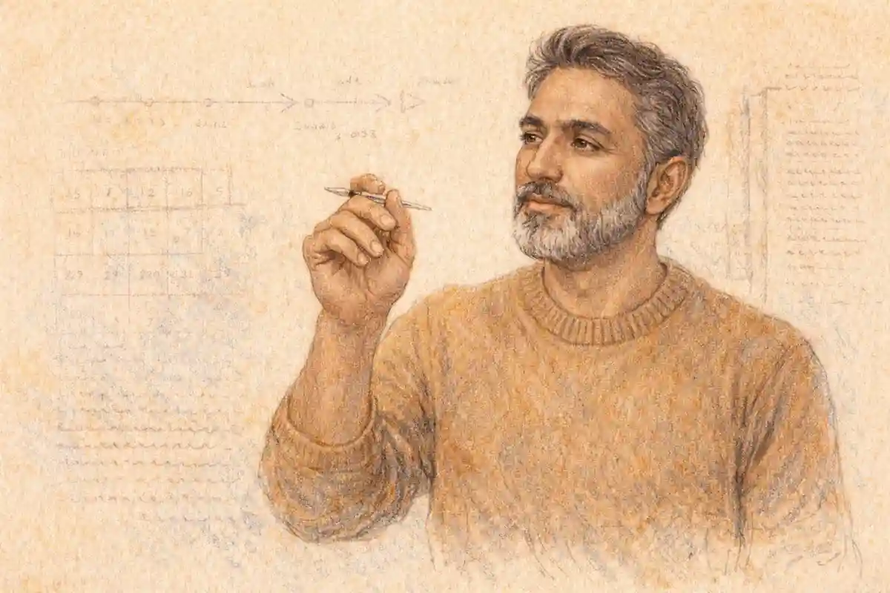

A student who announces an ambition to become a doctor at fifteen is making a promise that will take more than a decade to keep. Between that announcement and a white coat sit high school courses, college prerequisites, a demanding admissions examination, and years of training, and the very first layer of that long structure is built from Advanced Placement classes chosen in the ninth, tenth, eleventh, and twelfth grades. Families who understand what those classes can and cannot do hold a real advantage, because the plan that serves a future physician looks different from the plan that serves a future engineer, a future lawyer, or a student who simply wants the longest possible list of AP courses on a transcript.

The central tension of pre-health planning is easy to state and hard to hold onto. AP classes genuinely help an aspiring doctor, sometimes enormously, yet the help they give is mostly preparatory rather than substitutive. A strong score in AP Biology does not excuse a student from college biology in the eyes of many medical schools, and a strong score in AP Chemistry does not reliably erase a required semester of general chemistry. What those scores do instead is build the knowledge, the laboratory habits, and the examination stamina that make the college versions of the same subjects go better, and they signal to college admissions readers that the student has already survived college-paced science and asked for more.

Everything in this guide follows from that distinction. The pages ahead map the science sequence a future doctor should build, explain why the prerequisite caution matters so much, set out the InsightCrunch pre-health AP roadmap as a single findable plan, and show how to use AP credit as a way to get ahead rather than as a shortcut that quietly removes required courses from a record. Students who want the widest view of how all the pieces fit together can start with the [AP exams complete guide](/2008/11/08/ap-exams-complete-guide/), and then return here for the pre-health specifics.

## Planning Backward from the Medical School Door

Good pre-health planning runs in reverse. Instead of asking which AP classes look impressive in the junior year, a family begins at the far end, with the requirements a medical school applicant must satisfy, and works back toward the present one decision at a time. Medical schools publish prerequisite lists, and those lists cluster around a familiar core: a year of biology with laboratory work, a year of general chemistry with laboratory work, a year of organic chemistry with laboratory work, a year of physics with laboratory work, and mathematics that often reaches calculus or statistics, with biochemistry, psychology, and sociology added by many programs. The details differ from school to school, and any family should read the published lists of the programs a student might plausibly target, because the lists are the ground truth that everything else must serve.

Once that destination is clear, the role of high school becomes clear as well. High school cannot deliver the prerequisites themselves in a form that most medical schools will accept, no matter how rigorous the AP course was or how high the score climbed. What high school can deliver is readiness: a student who arrives at college having already wrestled with AP-level biology reads a college textbook faster, recognizes laboratory technique sooner, and spends the crucial first semesters building grades rather than catching up. The AP plan is therefore a rehearsal plan, and judging it by rehearsal standards changes every choice. A family stops asking how much college a student can skip and starts asking how thoroughly a student can prepare.

Backward planning also disciplines ambition. A student who knows that organic chemistry waits in college, taught at a pace that humbles strong students every year, will treat AP Chemistry as serious training rather than as a trophy. A student who knows that the admissions examination tests biology, chemistry, physics, psychology, and sociology in integrated passages will see AP Psychology and AP Statistics as part of the foundation rather than as electives to squeeze in if the schedule happens to allow. The destination explains the journey, and families who keep the destination visible make calmer decisions in the crowded middle years of high school.

There is a second benefit to working backward, and it is emotional as much as academic. Pre-health students famously burn out when every semester feels like an audition with no script. A backward map gives each year a defined job. The ninth grade builds foundations, the tenth grade opens the first AP science doors, the eleventh grade carries the heaviest load, and the twelfth grade consolidates, explores, and leaves room for the student to arrive at college with energy intact. When each year has a job, a family can tell whether a proposed schedule serves the plan or merely decorates it.

### What separates a useful AP class from a merely impressive one?

A useful class teaches the student to handle the material that a later course will assume. An impressive class adds a line to a transcript without changing what the student can do. Colleges reward the first kind in placement and readiness, and medical schools reward it indirectly through stronger grades in their own required courses.

## The Science Core: Biology as the Foundation Stone

AP Biology earns its place at the center of the pre-health plan because medicine is, at its root, the applied study of living systems. The course covers the material a future physician will meet again and again: cell structure and signaling, genetics and inheritance, evolution as the organizing idea of the life sciences, energetics, and the molecular machinery that turns information into organisms. A student who has genuinely learned this material, rather than memorized it for a single May morning, walks into college biology with a map already drawn. Lectures move from revelation to review, and the mental energy saved can be spent on the laboratory, where college courses separate careful students from careless ones.

The laboratory dimension deserves emphasis, because it is where AP Biology quietly does some of its best work. Designing a controlled experiment, handling data honestly when the results refuse to match the hypothesis, and writing up findings in a form another scientist can evaluate are habits that medical training assumes and rarely teaches from scratch. Students absorb these habits slowly, through repetition, and an AP Biology year supplies a full cycle of repetitions under a teacher who can correct technique in real time. Families sometimes undervalue this because laboratory skill leaves no number on a score report, yet the students who thrive in college science are very often the ones whose hands already know what their minds are still learning.

Sequencing matters as much as selection. Most students meet AP Biology best after a solid introductory biology course and at least concurrent chemistry, because the biochemistry woven through the AP curriculum punishes students who have never balanced an equation or thought about energy in molecular terms. Schools package these sequences differently, and a counselor who knows the local patterns can say which ordering produces strong outcomes in that building. The general principle travels well even when the packaging differs: biology lands hardest when chemistry is present to support it, and both land harder when the student has the reading stamina for a college-length textbook.

Depth should win over speed in this subject. A student who takes AP Biology in the tenth grade and earns a middling grasp has gained less than a student who takes it in the eleventh grade and truly masters it, because mastery is what transfers to the college classroom. The score matters, and a top score is a fine thing, but the deeper prize is the internalized framework: the ability to hear a new biological claim and immediately ask what mechanism would produce it, what evidence would test it, and what alternative explanation fits the same facts. That reflex is the beginning of clinical reasoning, and it starts here.

Students who want a fuller treatment of how the science courses interact with the pre-health timeline will find the dedicated discussion of [AP sciences for pre-med students](/2007/12/15/ap-sciences-for-pre-med-students/) worth reading alongside this guide, since it follows the same subjects from the angle of college placement and course selection after arrival.

## Chemistry: The Subject That Decides So Much

If biology is the foundation stone, chemistry is the load-bearing wall. The college pre-health sequence runs through general chemistry into organic chemistry, and organic chemistry has ended more medical ambitions than any other single course. AP Chemistry exists, in pre-health terms, to make that wall bearable. The course builds fluency in the ideas that general chemistry assumes and organic chemistry exploits: atomic structure, bonding, equilibrium, thermodynamics, kinetics, acids and bases, and the quantitative discipline of stoichiometry. A student who owns these ideas arrives at college chemistry able to focus on the genuinely new material, and a student who owns them deeply has taken the single most effective step available in high school toward surviving the organic sequence later.

Quantitative confidence is the hidden gift of the course. Pre-health students who struggle in college chemistry usually struggle with the mathematics wearing a lab coat: unit conversions, logarithms in pH calculations, equilibrium expressions that must be solved rather than merely written down. AP Chemistry drills exactly these operations until they become routine, and routine is what a timed examination rewards. Families evaluating whether a student is ready for AP Chemistry should look less at enthusiasm for science in general and more at algebra fluency, because the course speaks algebra fluently from the first month onward.

The laboratory program in AP Chemistry teaches a second, quieter curriculum. Titration technique, careful measurement, error analysis, and the discipline of recording observations before interpreting them all rehearse the mindset of a clinician who must trust data gathered under imperfect conditions. There is also a character lesson embedded in the work: chemistry experiments fail in instructive ways, and a student learns to ask whether the failure lives in the procedure, the measurement, or the underlying idea. Differential diagnosis, years later, asks the same question in a different room.

One caution belongs in this section, and it previews the larger caution developed later in this guide. Because AP Chemistry maps so neatly onto the first college chemistry course, families are tempted to treat a high score as permission to skip that course entirely. Many medical schools will not honor the skip for prerequisite purposes, and even where a college allows the placement, the student who jumps straight into organic chemistry without a college-paced general chemistry grade on the record may arrive underprepared and unproven at the same time. The wiser use of a strong AP Chemistry performance is placement into an honors or accelerated section, or a confident, high-grade pass through the college course with the AP year as preparation. The score opens doors; it should not be asked to remove load-bearing walls.

## Physics, Calculus, and the Quantitative Spine

Medicine looks like a purely biological profession from the outside, and the physics requirement surprises many families when it first appears on a prerequisite list. The surprise fades on inspection. Blood moves through vessels under pressure gradients, lungs exchange gases across surfaces governed by physical law, imaging technologies from ultrasound to magnetic resonance translate physics into diagnosis, and the body itself is a structure of levers, torques, and fluid systems. Medical schools require physics because physicians who understand the physical world read their own tools more intelligently, and because the admissions examination tests physics reasoning in passages that blend it with biology and chemistry.

AP Physics 1, the algebra-based course, fits the pre-health plan naturally for most students. It builds the mechanics, waves, and circuits background that college physics will revisit at greater depth, and it does so without demanding calculus as a prerequisite. A student headed toward an engineering-heavy college path might choose a calculus-based sequence instead, though for the future physician the algebra-based course usually offers the better trade of depth against schedule space. What matters most is the habit the course builds: translating a physical situation into quantities, relationships, and a solvable structure. That habit transfers directly to the quantitative passages of the admissions examination.

Calculus occupies a more nuanced position. Some medical schools list calculus among their mathematics expectations, many accept statistics in its place or alongside it, and nearly all value evidence that an applicant can handle quantitative reasoning at a college level. AP Calculus AB gives a pre-health student a genuine introduction to rates of change and accumulation, ideas that surface in pharmacology, physiology, and epidemiology more often than students expect. A student who enjoys mathematics and can take calculus without displacing a core science should do so with confidence. A student forced to choose between calculus and a second year of science should usually protect the science, because the science sequence has fixed prerequisites downstream while mathematics requirements vary more and can often be satisfied in college.

Statistics may be the most undervalued course in the entire pre-health conversation. Modern medicine runs on evidence, and evidence arrives as studies: trials with control groups, survival curves, sensitivity and specificity figures, risk ratios that must be interpreted rather than merely quoted. AP Statistics teaches a student to read that literature with educated suspicion, to ask how a sample was gathered, what a confidence interval actually claims, and why a result can be statistically significant and clinically trivial at the same time. Admissions examinations include data-based passages that reward exactly this literacy, and the research experiences that strengthen a medical school application increasingly expect it from the first week.

Families should also notice what the quantitative spine does for the student's options. A future doctor who handles mathematics comfortably keeps doors open that close quietly for others: computational biology, biomedical engineering electives, research groups that need someone who can model as well as pipette. Pre-health planning that treats mathematics as a box to check wastes this. The goal is not maximal course accumulation; the goal is a student who reaches college able to say yes to quantitative opportunities without fear.

### Does an aspiring physician really need physics in high school?

Strictly speaking, no student needs AP Physics to become a doctor, since the prerequisite itself waits in college. The course earns its place by rehearsing the reasoning that college physics and the admissions examination will demand, and by arriving early, while a teacher can still slow down for a confused student.

## Psychology and Statistics: The Modern Additions to the Map

Older pre-health advice treated psychology as a pleasant elective, interesting but peripheral. That advice has aged badly. Medical education has moved steadily toward the whole patient: behavior, perception, learning, mental health, and the social conditions that shape whether treatment plans survive contact with real lives. The admissions examination formalized the shift by testing psychology and sociology concepts in their own section, and medical schools increasingly list introductory psychology among their expected or recommended courses. AP Psychology sits squarely in this current, giving a high school student the vocabulary of the behavioral sciences years before college.

The course content maps onto medical practice with surprising directness. Learning theory explains how habits form and how they might be changed, which is the daily work of preventive medicine. Memory research explains why patients forget most of what a physician tells them and how instructions might be structured to survive. Developmental psychology frames pediatrics and geriatrics alike, while the units on psychological disorders give a future clinician a first, careful vocabulary for conditions they will meet constantly. Even sensation and perception matter, since so much of diagnosis begins with what a patient reports sensing.

AP Psychology also serves the pre-health student strategically. It is often the most accessible AP course for a younger student, demanding strong reading and conceptual organization more than advanced mathematics, so it can serve as a first AP experience that teaches examination craft in a lower-stakes arena. A sophomore who learns how to prepare for an AP examination through psychology carries that method into the heavier sciences later. Counselors who sequence plans thoughtfully use the course this way, as a bridge between ordinary high school work and the full science sequence.

Statistics, discussed above as part of the quantitative spine, deserves a second mention here because its partnership with psychology is so productive. Research methods run through the heart of AP Psychology: experiments, correlations, operational definitions, and the limits of each design. A student who takes both courses sees the same methodological ideas from two directions and understands them far better than a student who meets them once. When that student later reads a study claiming that some intervention improves outcomes, the questions arrive automatically: compared to what, measured how, in which population, with what chance of a fluke. Physicians spend their careers inside those questions.

A word of balance is in order. Neither psychology nor statistics replaces a laboratory science in the pre-health plan, and a schedule that substitutes them for biology or chemistry has mistaken garnish for structure. Their role is expansion: they widen the student's picture of what medicine involves, they prepare ground that the admissions examination will test, and they demonstrate intellectual range to every reader of the transcript. Placed alongside the core sciences rather than instead of them, they mark the difference between a narrow plan and a complete one.

## The InsightCrunch Pre-Health AP Roadmap

Advice scattered across a dozen conversations tends to evaporate, so this guide gathers the whole plan into one findable artifact: the InsightCrunch pre-health AP roadmap. The roadmap assumes a student who discovers the ambition somewhere in the middle years of high school and a school that offers the standard science sequence, and it should be adjusted to local offerings with a counselor's help. Its logic matters more than its exact grade placements: foundations first, the paired core sciences in the middle years, expansion courses where space allows, and the credit caution applied at every step.

| Stage | Primary focus | AP courses that fit | Planning caution |
|---|---|---|---|
| Ninth grade | Foundations and reading stamina | None required; strong introductory biology and chemistry | Protect grades and habits before chasing advanced labels |
| Tenth grade | First AP experiences | AP Psychology, AP Biology where the school sequence allows | Learn AP examination craft in a manageable arena first |
| Eleventh grade | The heavy science year | AP Biology or AP Chemistry, whichever was not yet taken, plus AP Statistics | Balance the load; two laboratory sciences at once is a ceiling, not a target |
| Twelfth grade | Consolidation and range | AP Physics 1, AP Calculus AB, a second science or a humanities AP | Leave room for applications, service, and arriving at college with energy |
| College arrival | Prerequisites taken in college | AP credit used for placement and space, not prerequisite erasure | Verify each target medical school's policy on AP credit before skipping anything |

Read the roadmap as a set of relationships rather than a contract. A student whose school offers AP Chemistry only in the junior year will move pieces around, and a student who discovers the ambition as a junior will compress the early stages and lean harder on the college years. What must not move is the caution column's message, because it protects the student at the exact point where the cost of error is highest. Credit decisions made casually at seventeen can surface as missing prerequisites at twenty-one, when the repair is expensive.

The roadmap also encodes a philosophy about load. Notice that no stage demands three AP sciences at once, and the heaviest stage pairs a laboratory science with statistics, a combination many students find complementary rather than crushing. Families sometimes treat restraint as a lack of ambition, though in pre-health planning restraint is a form of accuracy: college admissions readers and medical schools alike reward depth of mastery, and a transcript with excellent grades in a demanding but sane schedule outperforms a transcript with mediocre grades in a heroic one. The student is building a record that must stay strong for eight more years, and pacing is part of the build.

A roadmap earns its keep only when a family actually consults it at decision points. Print it, in effect, at three moments: when the sophomore schedule is chosen, when the junior schedule is chosen, and in the spring of the senior year when college course registration first appears. At each moment the same question applies: does this choice serve the destination, and does it respect the caution? Families who ask those two questions at those three moments will avoid nearly every common pre-health planning error this guide describes.

### Why do medical schools insist on college-level prerequisite courses?

Medical schools want every applicant measured on the same field. A college prerequisite course carries a known syllabus, a graded cohort, and laboratory hours that admissions committees can compare across thousands of files. High school credit arrives with none of that comparability, so many programs simply ask applicants to take the course again in college.

## The Prerequisite Caution: Where Good Plans Go Wrong

Every pre-health family should hear this caution stated plainly at least once: many medical schools require that prerequisite courses be taken in college, and many will not accept AP credit as a substitute for those courses, particularly in biology and chemistry. Policies vary by program, and a minority of schools accept AP credit for some prerequisites, sometimes with conditions such as completing additional advanced coursework in the same discipline. Because the variation is real, no family should rely on a general impression. The only safe procedure is checking the published policy of each medical school the student might plausibly attend, and treating any unverified assumption as a risk.

The backfire mechanism is worth understanding in detail, because it operates quietly. A student earns a top score in AP Biology, and the college happily grants credit and places the student out of introductory biology. The student, pleased, fills the space with electives and applies to medical school three years later, only to discover that several target programs count the prerequisite as unmet. The repairs are all unpleasant: squeezing a college biology course into a final semester, taking it after graduation while working, or narrowing the application list to the minority of schools whose policies fit the record. None of these outcomes reflects a failure of ability. All of them reflect a decision made at seventeen with incomplete information.

A related version of the trap involves grades rather than eligibility. Even where a medical school accepts AP credit for a prerequisite, the student who skips the college course gives up something valuable: a graded performance in a core science, earned against college peers, in the very subject the school cares about. Medical admissions committees read science grades closely, and a record thin in graded college science invites questions that a fuller record never faces. The student who retakes biology in college after an AP year usually earns an excellent grade, banks early confidence, and still gains the advanced standing benefits elsewhere in the schedule. Skipping can look efficient and still cost more than it saves.

Colleges themselves add a layer of complexity, since the credit a college grants and the use a medical school permits are separate decisions made by separate institutions. A university may award eight credits for an AP Biology score while its own advising office warns pre-health students not to apply those credits toward the biology prerequisite. Families who conflate the two decisions, hearing credit granted as permission granted, walk into the trap with paperwork that seemed to bless the step. The dedicated explanation of [AP science credit and how colleges award it](/2007/11/18/ap-sciences-college-credit-guide/) unpacks this separation, and the broader survey of [AP credit policies at colleges](/2008/10/07/ap-credit-policies-colleges/) shows how widely institutional rules diverge.

None of this makes AP credit worthless for the future doctor, and the next section takes up its proper uses. The caution targets one specific move: erasing a required course from the college record on the strength of a high school examination. Until a family has verified, in writing, from the actual programs of interest, that a specific skip is safe, the default assumption should be that prerequisites will be taken in college and that AP work is preparation for earning strong grades in them. That default has protected generations of applicants, and it costs the student nothing but a course they were well prepared to excel in anyway.

## Using AP Credit to Get Ahead Instead of to Skip

The series thesis for pre-health students can be stated in one sentence: AP credit is best used to get ahead, not to skip required courses. Getting ahead takes several legitimate forms, and each of them strengthens a medical school application rather than thinning it. A student might use a strong AP Biology score to enter an honors introductory sequence that moves faster and grades against a stronger cohort. Another might use chemistry credit to begin the sequence at a higher point while still completing a full graded year of college chemistry beyond the skipped portion, satisfying both the letter and the spirit of prerequisite policies that demand advanced coursework in exchange. A third might bank credits in subjects outside the prerequisite core, English or history or a language, and spend the freed hours on research, clinical volunteering, or an additional science elective that deepens the record.

Placement is the most underappreciated of these uses. Colleges use AP scores to sort students into appropriate starting points, and for a pre-health student the right starting point is often one level of comfort above the true novice course but inside the graded sequence. Honors general chemistry, taken after AP Chemistry, is the classic example: the material is deeper, the classmates are serious, the grade is real, and the prerequisite question never arises. Students who frame AP success as a sorting instrument rather than an exit ticket consistently end up with stronger records than students who frame it as escape.

Advanced coursework is the second legitimate use, and medical schools themselves point toward it. Where a program accepts AP credit toward a prerequisite, the condition is frequently that the applicant complete further college coursework in the same field: genetics or biochemistry after introductory biology, physical chemistry or analytical chemistry after general chemistry. A student who skips ahead and then climbs higher has converted high school work into genuine advancement, and committees read that record favorably. The danger lives only in skipping ahead and then stopping, which leaves the discipline represented by an examination taken at seventeen.

Freed schedule space is the third use, and families underestimate its strategic value. The pre-health college years are crowded with sequenced courses that cannot be rearranged freely, and every elective slot is precious. AP credits in composition, history, government, or a world language can satisfy distribution requirements and release hours for the things that distinguish an application: a sustained research placement, a hospital volunteering commitment held across years rather than semesters, a minor in a field the student loves, or simply enough slack to protect grades during the organic chemistry semesters. Used this way, AP credit in nonscience subjects quietly serves the science record.

Timing completes the picture. A student should decide how to use each AP score deliberately, ideally in conversation with the college's pre-health advising office during the first registration cycle, rather than accepting whatever default the registrar applies. Defaults exist to move paperwork, not to optimize an application, and students have lost prerequisite standing by allowing credits to post in ways nobody examined. The deliberate student keeps a list: each score, how the college recorded it, how it will be used, and which medical school policies were checked before any prerequisite-adjacent decision was made. That list, maintained across four years, is the difference between a plan and a hope.

### How can AP credit help without replacing a required course?

Credit works best when it clears space rather than erasing requirements. A student might use a strong score to enter an honors sequence, to begin research earlier, or to fit an extra humanities course into a crowded pre-health schedule. The required science courses still happen in college, where they also produce the grades that committees actually weigh.

## Sequencing the Path Grade by Grade

Plans become real when they are attached to registration deadlines, so it helps to walk the four years slowly and name what each year is for. The ninth grade is for foundations, and its most important products are invisible on any transcript summary: reading stamina, note-taking method, comfort with laboratory routine, and grades in introductory science and mathematics that open later doors. A ninth grader enrolled in strong introductory biology and chemistry, progressing steadily in mathematics, and reading widely in English is doing pre-health work of the first importance, whether or not any course carries an AP label. Families who rush this year, pushing a student into an AP science before the foundation sets, usually spend later years repairing the damage.

The tenth grade introduces the first deliberate AP choices. AP Psychology often fits here beautifully, offering genuine college-level reading and a first encounter with research methods at a moment when the student's schedule still has room to breathe. Some schools run their biology sequence so that AP Biology lands in the tenth grade, and where the school has built the course for sophomores with proper supports, that placement can succeed. The principle governing the year is exposure with success: the student should finish tenth grade having proven, to themselves most of all, that AP work is a craft they can perform well.

The eleventh grade carries the heaviest load in most pre-health plans, because the calendar forces it. By now the student can handle the flagship sciences, and one of AP Biology or AP Chemistry, sometimes both for the strongest students, anchors the year. AP Statistics pairs well here, as does an AP English course that sharpens the writing the student will need for applications soon after. The danger of the junior year is simple arithmetic: each additional AP course subtracts recovery time from all the others, and grades across the whole schedule are the currency that matters. A family should count total load honestly, including sports, work, and service, and should treat the schedule that leaves the student sleeping and learning as more ambitious than the schedule that merely looks ambitious.

The twelfth grade consolidates. The remaining core science, often AP Physics 1 or the second of the biology and chemistry pair, completes the foundation, and AP Calculus AB fits naturally for students whose mathematics sequence arrives there. Senior year also asks for judgment about range: a humanities or social science AP can round out the record and feed the student's genuine curiosity, which matters more than families sometimes admit, because the person who arrives at college still interested in learning is the person who survives the pre-health grind with spirit intact. College applications consume real hours in the fall, and a schedule built with that reality in view protects both the applications and the grades.

Students who discover the ambition late should not despair over a missed sequence. A junior who has taken no AP science can still take one flagship course as a senior, lean on a strong college performance, and build a perfectly viable path, since medical schools judge the college record far more heavily than the high school one. The roadmap guides the typical case; the principles rescue the atypical ones. Readiness over speed, mastery over accumulation, and the prerequisite caution over every shortcut: a student who holds those three ideas can start from almost anywhere.

## Beyond Science: The Classes That Round Out a Physician

A plan built only from laboratory sciences produces a narrow student, and medicine has little use for narrow physicians. Patients arrive with histories, fears, families, and finances, and the doctor who cannot write a clear paragraph, follow an ethical argument, or understand the community a patient lives in will practice a diminished version of the profession. Medical schools know this, and their holistic review processes look for evidence that an applicant is educated in the full sense. AP classes outside the sciences are therefore part of the pre-health plan, not decoration appended to it.

AP English Language and AP English Literature build the skill a physician uses every hour: precise language under pressure. Composing a chart note, explaining a diagnosis to a frightened family, writing a referral that a colleague can act on, and reading a research paper with attention to what its sentences actually claim all depend on the habits these courses train. The rhetorical analysis in AP English Language, in particular, teaches a student to ask who is speaking, to whom, with what evidence, and toward what end, which is nearly a description of reading a clinical study or listening to a pharmaceutical presentation. Students who dismiss English as irrelevant to medicine are discarding training they will wish they had.

History and social science courses contribute context that clinical work quietly assumes. AP United States History gives a future physician the background to understand how the American healthcare landscape acquired its shape, while AP Government clarifies the policy machinery that will govern the student's future practice. AP Psychology has already been discussed as a science-adjacent asset, and courses such as AP Human Geography open questions about how place, poverty, and environment distribute health across populations. A student drawn to medicine by a desire to serve communities will find these courses feeding the motive rather than distracting from it.

World language study deserves a specific defense, because it is often the first thing sacrificed when a science schedule tightens. A physician who can take a history from a patient in the patient's own language practices better medicine, full stop, and medical schools in many regions view language proficiency as a genuine clinical asset. AP Spanish, in particular, pairs with the demographics of American healthcare in ways that need no embellishment. Even short of fluency, sustained language study trains the ear and the humility that cross-cultural care requires, and it signals to every admissions reader that the student's ambitions include the people medicine serves, not only the science medicine uses.

The correct conclusion is balance with intent. A future doctor's transcript should be unmistakably science-led, and within that frame it should show a mind ranging across the humanities and social sciences with real achievement. Elective choices made from curiosity tend to produce the strongest versions of this balance, because students work harder at what genuinely interests them and write more honestly about it later. The student who loves history should take the history course and excel in it; the record will read as character, not drift.

### What should a ninth grader do before choosing AP courses?

A ninth grader should protect the foundation first. Strong grades in introductory biology and chemistry, steady mathematics progress, and one course chosen from genuine interest teach more about readiness than an early leap into advanced work. The family that builds the base patiently gives the later science sequence something solid to stand on.

## The Neighboring Path: How the Plan Differs from Engineering

Families often build one generic strong-student plan and aim it at whatever profession the student names, and the pre-health plan suffers when it inherits engineering assumptions. Comparing the two paths clarifies what makes the doctor's route distinct. The companion guide to [AP classes for future engineers](/2006/04/21/ap-classes-for-future-engineers/) describes a plan in which calculus-based physics and the deepest available mathematics sit at the center, because engineering programs build directly on them and often grant placement that students are expected to use. The future doctor's plan shares the respect for mathematics but arranges the furniture differently.

Three differences matter most. First, the prerequisite caution barely exists on the engineering path: an engineering school that grants credit for AP Physics generally means the student to proceed to the next course, and the profession raises no second gatekeeper years later to question the skip. Pre-health students face that second gatekeeper in the form of medical school policies, which is why the same score must be handled more conservatively. Second, the engineering plan prizes the calculus-based physics sequence, while the pre-health plan usually gains more from algebra-based physics plus statistics, matching the actual content of medical prerequisites and the admissions examination. Third, the pre-health plan reserves more room for psychology, writing, and language study, because the profession it feeds is a human service built on scientific knowledge rather than a technical discipline alone.

Recognizing these differences protects students who change direction, which many do. A sophomore aiming at engineering who migrates toward medicine will find the strong mathematics harmless and the missing psychology easy to add, while a student moving the other way must scramble for physics depth. Counselors who keep both roadmaps in view can advise switchers intelligently, and students should hear early that changing direction is normal and manageable rather than a derailment. The plans are cousins, not strangers, and the shared core of biology, chemistry, and quantitative strength serves either ambition.

The comparison also teaches a general lesson about AP planning everywhere: the value of a course depends on the destination's rules, not on the course's reputation. A class can be rigorous, well taught, and genuinely learned, and still be the wrong choice for a particular student's path if it displaces something the destination requires or duplicates something the destination will not honor. Families who internalize that lesson stop collecting AP courses and start composing an education, which is the shift this entire guide exists to encourage.

## Study Skills: The Hidden Curriculum of the AP Years

Ask physicians what high school actually gave them and few will name a fact. They name a capacity: the ability to absorb a large volume of difficult material on a schedule, organize it so it can be retrieved under pressure, and keep working accurately when tired. Medical education is famously a volume problem before it is anything else, and the AP years are where a student first discovers whether their study methods can carry volume. This hidden curriculum is arguably the strongest reason for a future doctor to take AP classes at all, outlasting any single score or credit decision.

The methods that work share a recognizable shape. Material is encountered actively rather than passively: problems attempted before solutions are read, chapters outlined in the student's own words, diagrams redrawn from memory. Review is spaced across weeks rather than massed into the night before an examination, because the spacing is what moves knowledge from recognition to command. Practice testing does the heavy lifting, and students preparing for examinations in any of these subjects can sharpen the habit with [free AP exam practice questions](https://reportmedic.org/tools/ap-exam-practice-questions.html), working under time limits and then studying their errors until each error has a named cause. The student who can say precisely why a wrong answer tempted them has learned something no rereading provides.

Laboratory work adds a second set of skills that pure examination study misses. Keeping a notebook that an outsider could follow, recording data before knowing whether it will flatter the hypothesis, and writing conclusions that claim only what the evidence supports are practices that transfer directly to clinical documentation and research. They also build intellectual honesty of a specific kind: comfort with being wrong in public, on paper, in a form that allows correction. Medicine punishes the opposite trait severely, and students who develop this comfort early carry an advantage that compounds.

Time architecture is the third skill, and the least discussed. A pre-health student in a heavy AP year is running a small enterprise: classes with different rhythms, examinations that cluster cruelly, laboratory reports, and whatever life exists outside school. The students who thrive build weekly structures, protect sleep as a study input rather than a reward, and learn to triage, giving the next hour to the task where it does the most good. These are precisely the skills that separate students who survive the first college semester from students who spend it recovering, and they cannot be crammed. They are acquired by living inside a demanding but manageable schedule for several years, which is one more reason the sane load matters: a schedule beyond management teaches only chaos.

Families can support the hidden curriculum without becoming managers of it. The most useful contributions are structural: a quiet place to work, protection of sleep, meals that happen, and a household stance that treats a disappointing examination as data rather than verdict. Students absorb their family's definition of failure long before they develop their own, and the pre-health path is long enough that everyone on it will collect failures to interpret. The interpretation, practiced at home across the AP years, becomes the resilience that medical training later assumes.

### Which habits from AP science classes carry into medical training?

AP science classes rehearse the daily work of medical training long before it begins. Students learn to read dense chapters on a deadline, to keep a laboratory notebook that another person can follow, to sit cumulative examinations without panic, and to recover from a poor test by changing method rather than merely adding hours.

## Common Mistakes and How Thoughtful Families Avoid Them

The errors in pre-health planning repeat so reliably that they can be catalogued, and the catalogue below, rendered in prose, covers the ones that do the most damage. The first and gravest is the prerequisite skip already examined at length: using AP credit to erase a college course that medical schools expect to see taken in college. Its cousins are nearly as costly. Assuming that a college's grant of credit settles the medical school question is the second error, and it persists because the two decisions arrive on the same transcript line. The repair in both cases is verification, checking program policies directly and early enough to act on what they say.

A third error is breadth over readiness: enrolling in an AP science before the supporting coursework exists, on the theory that exposure itself is valuable. Exposure without foundation produces a weak grade, a weak score, and a student who has learned to fear the subject, which is a worse outcome than waiting a year on every dimension. The fourth error is the heroic schedule, three laboratory sciences and four other AP courses stacked into a single year, pursued because a classmate or a forum suggested that anything less reads as unserious. Readers of transcripts do not grade suffering; they grade achievement, and the heroic schedule reliably taxes achievement in every subject it touches.

A fifth error is subtler: neglecting the human side of the record until the college years, then attempting to manufacture interest in people during the application season. The student who has volunteered, worked with patients or elders, or simply studied languages and history with genuine attention arrives at essays and interviews with something true to say. A sixth error involves treating the plan as fixed. Students change, schools change their offerings, and a sophomore ambition may ripen into something adjacent, such as biomedical research or dentistry or public health, each with its own adjustments to the map. The family that revisits the plan annually, asking whether the destination still fits and whether the route still serves it, avoids the quiet tragedy of executing a perfect plan toward a goal the student outgrew.

Underneath all six errors sits a single misconception worth naming directly: the belief that the AP program is a credentialing machine whose output is a number of credits. For the future doctor, the AP program is better understood as a training environment whose output is a prepared student. Credits are a byproduct, sometimes useful, sometimes unusable, occasionally harmful when misapplied. Preparedness is the product, and it never expires, never varies by institution, and never needs verification against a policy page. Families who keep that ordering straight, preparation first and credit second, make the right decision in nearly every specific case without needing to memorize the cases.

One more mistake deserves mention because it hides inside good intentions: choosing courses to impress a hypothetical reader rather than to build a real student. Every schedule decision has two audiences, the admissions reader who will see the transcript and the student who must live inside the schedule for nine months. Decisions that serve the reader while punishing the student usually fail both, since exhaustion writes itself into grades soon enough. The student is the plan's instrument and its point; a plan that consumes the student has misunderstood the assignment at the deepest level.

## How Many AP Classes Are Enough?

No honest answer exists as a single number, and families should distrust anyone who offers one. The right load depends on the school's offerings, the student's preparation, the other claims on the student's hours, and the colleges being targeted, all interacting at once. What can be offered honestly is a way of reasoning about the number, and the reasoning begins with the core: for a future doctor, the nonnegotiable heart of the plan is the science sequence itself, biology and chemistry taken at AP level where the school offers them and the student is ready, supported by mathematics through at least statistics or calculus. Around that heart, psychology, physics, and the humanities courses are added in the order of their value to the particular student, not in the order of their prestige.

A useful test for any proposed addition is to ask what the new course displaces. Every AP course added to a schedule removes hours from somewhere: from sleep, from the other courses' study time, from the sport or job or service that rounds the student out, or from the unstructured time in which adolescents consolidate who they are. A course that displaces idle scrolling is a bargain; a course that displaces sleep is a loan taken against every other grade. Families rarely perform this subtraction explicitly, and the schedules that result show it. The question is never whether a student can add a course, since almost any course can be added on paper. The question is what the addition costs the courses already there.

Quality thresholds matter more than counts for a second reason: the audiences who will read this record read grades and scores, not merely enrollments. A transcript showing five AP courses with top marks and scores of four and five tells a story of mastery. A transcript showing nine AP courses with scattered results tells a story of appetite outrunning capacity, and both college and medical readers have seen enough of each story to know how the sequel usually goes. The pre-health path rewards the first story disproportionately, because the college science sequence will test capacity again at a higher level, and evidence of knowing one's limits is evidence of the judgment the path requires.

There is also a floor below which a plan undersells a capable student, and honesty requires naming it. A student at a school offering the full sequence who takes no AP science at all, despite strong preparation, will arrive at a competitive college behind classmates in both placement and confidence, and college admissions readers may reasonably wonder about the missing rigor. The target zone for most future doctors at well-resourced schools ends up looking like the roadmap in this guide: somewhere between five and eight AP courses across the four years, weighted toward science, chosen in an order that respects readiness. Students at schools with fewer offerings are judged in their context by every reader who matters, and should build the strongest plan their building allows without apology.

The number question also has a time dimension that families miss. AP load should generally rise across the four years, light in the ninth and tenth grades while foundations form, heaviest in the eleventh when the student is most practiced, and deliberate in the twelfth when applications and transition compete for attention. A plan that inverts this shape, front-loading AP courses into the years when the student is least equipped for them, manufactures early damage that later excellence must first repair. Growth curves exist in education for the same reason they exist in athletics: capacity is built, not declared.

## Verification: The Habit That Protects the Whole Plan

Most of this guide's cautions reduce to a single practice: verify policies at the source, in writing, close to the moment of decision. The habit sounds bureaucratic and is in fact the highest form of strategy available to a pre-health family, because every costly error described in these pages began as an unverified assumption that felt obviously true. Colleges publish their AP credit policies; medical schools publish their prerequisite requirements and their stance on AP credit; both change over time; and the only version that counts is the version in force when the student's own application is read. A family that builds verification into its routine converts an entire category of risk into a modest amount of reading.

The practice has a rhythm. In the high school years, verification means checking the target colleges' credit policies before assuming any score will be used in a particular way, and reading college pre-health advising pages, which often state plainly whether their own students are advised to retake AP-covered sciences. In the college years, the rhythm continues with the pre-health advising office, whose staff track medical school policies as a profession and can say which programs accept which credits under which conditions. Students who introduce themselves to that office early, rather than in the application semester, gain advisers who know their record and can flag a missing prerequisite while repair is still cheap.

Documentation is the habit's second half. When a policy matters to a decision, save it: the page, the date it was read, and the exact wording about laboratory requirements or credit acceptance. Policies drift, advising memories differ, and the student who can produce the source text resolves disputes in one email. This sounds excessive for a high school family, and for most decisions it is. For the handful of decisions that touch prerequisites, it is simply the cost of certainty in the one area where certainty is purchasable.

Verification also guards against a subtler failure: planning from anecdotes. Every pre-health community circulates stories of a student who skipped everything and matched into a famous residency, or a student who retook everything and was rejected everywhere. Anecdotes describe the tails of distributions and conceal the middle, where outcomes are decided by the accumulation of sound, verified, unglamorous choices. The family that checks policies is choosing to live in the middle of the distribution on purpose, which is where reliable success has always lived.

### How do admissions committees read a transcript full of science?

Committees read a heavy science transcript as evidence of appetite, not as a credential by itself. They look for grades earned against strong peers, for laboratory work completed in person, and for the judgment to balance depth with breadth. A transcript that pairs science rigor with writing and service reads as the record of a future colleague.

## Reading a Prerequisite List Like an Insider

Since the destination governs the plan, families benefit from learning to read an actual prerequisite list with a practiced eye. The list will name subjects and durations, a year of this, a semester of that, and the first skill is translating durations into courses as a particular college packages them, since a year of chemistry might be two semesters in one catalog and three quarters in another. The second skill is noticing the laboratory language. Many programs specify that laboratory work must accompany the science courses, and online or credit-only arrangements that strip the laboratory away can fail the requirement even when the lecture content matches. This detail alone invalidates many casual assumptions about how prerequisites can be satisfied.

The third skill is separating requirements from recommendations. A school may require biology, chemistry, physics, and mathematics while recommending biochemistry, genetics, psychology, and statistics, and the two lists do different work. Requirements gate the application; recommendations describe the applicants who thrive and, in competitive pools, function as soft expectations. A student planning backward should treat strong recommendations as requirements for practical purposes when the target schools are selective, while a student applying broadly can weight them by the programs that matter most. The fourth skill is watching the mathematics line, which varies more than any other: some programs name calculus, some name statistics, some accept either, and a few ask for both, which is why this guide treats the pair as a unit to complete rather than alternatives to choose between when the schedule allows both.

Finally, a practiced reader notices what the list assumes without saying. Prerequisites are floors, and the applicants who clear them still compete on grades, examination performance, clinical exposure, research, service, and the personal qualities that interviews exist to detect. The high school student's contribution to that distant competition is indirect but real: habits, readiness, and a transcript that opened the right college doors. Reading the list well means holding both truths at once, that the list matters enormously and that it is only the beginning of what matters, and planning with the calm that double vision produces.

## The College Transition: Where the Plan Meets Reality

The spring of the senior year and the summer that follows are when the high school plan is converted, decision by decision, into a college record, and the conversion deserves the same care as the plan itself. Score reports arrive, the college posts its credit decisions, and registration for the first semester opens with a deadline that rewards the prepared. A student who arrives at that moment with the roadmap's caution internalized will make sound choices almost automatically: prerequisites scheduled in college, AP credit applied to placement and distribution requirements, and the pre-health advising office consulted before anything irreversible is selected.

The first registration conversation is the critical scene. Many colleges assign incoming students a default schedule or a brief advising meeting, and defaults are built for the median student, who is not pre-health and whose credit choices carry no downstream gatekeeper. The future doctor should come to that meeting with specific questions prepared: how the college records each AP score, whether the pre-health office advises retaking the sciences, which course numbers satisfy the typical prerequisite lists, and how the laboratory components are packaged. A student who asks these questions in the first semester is indistinguishable, in outcome, from a student whose family verified everything years earlier; a student who asks them in the junior year of college may be doing archaeology on their own record.

There is a psychological transition to manage as well. Students who excelled in AP sciences sometimes meet college chemistry or biology with an overconfidence that the first examination corrects rudely, because college courses move faster, grade against stronger cohorts, and assume a self-direction that high school structured away. The AP year's true gift in this moment is not the content, much of which will feel familiar, but the study architecture built while learning it. Students who lean on that architecture, treating the familiar material as a chance to perfect method rather than as permission to coast, convert their preparation into the strong early grades that anchor a pre-health record.

Families should also expect the ambition itself to be tested in the transition, and should treat the testing as information rather than emergency. College exposes students to fields they could not have imagined in high school, and some future doctors discover, honestly, that their real gift lies in research, engineering, or policy. The AP plan described here serves those students well too, since strong science preparation is portable across every adjacent field. Nothing in a well-built pre-health plan is wasted on a student who changes direction; the plan's value was the preparation, and preparation transfers.

## Experience Beyond the Classroom

Coursework is the spine of preparation, but medicine is practiced on people, and the high school years offer early chances to learn whether the daily reality of care attracts or repels. Volunteering in a hospital or clinic, shadowing a physician for a day, working a summer job in a setting where illness and vulnerability are ordinary, or caring for a family member through a health crisis all teach the student something no syllabus contains: how it feels to be useful to people who are suffering, and whether that feeling sustains or drains them. A wise plan leaves room for these experiences rather than scheduling them away, because a student who discovers a mismatch at seventeen has been given a gift, and a student whose commitment deepens has been given fuel.

The experiences also matter, more quietly, to the student's later application story. Medical schools ask applicants to demonstrate that they know what they are choosing, and the demonstration usually begins in college with sustained clinical exposure. High school experience does not substitute for that, and families should resist inflating a summer of volunteering into a credential. Its real function is formation: it tests the motive, builds the empathy that science courses can then serve, and gives the student concrete memories to think with when coursework turns abstract. A student who has watched a physician comfort a family reads the biology of disease differently afterward.

Science research, where a school or local institution makes it accessible, plays a related role. A research experience teaches the student how knowledge is actually manufactured, with its false starts, controls, and inconclusive endings, which is a corrective to the textbook impression that science is a warehouse of settled facts. It also produces mentors, and mentors who have watched a student work are the people whose later letters carry weight. Not every student has access to a laboratory placement, and no student should treat its absence as a defect; libraries, science fairs, and independent projects under a teacher's eye can supply much of the same education. The principle is engagement with real questions, in whatever venue the student's circumstances allow.

Balance governs here as it governs the course schedule. A student whose every hour is programmed, classes, volunteering, research, sport, music, presents a record that readers greet with a specific skepticism, because sustainability is itself a qualification for a long training path. The experiences worth choosing are the ones the student would defend in an empty room: chosen from interest, held across time, and allowed to deepen. Two commitments kept for three years teach and signal more than six commitments sampled for a semester each.

## Ordering the Two Flagship Sciences

A practical question dominates many family conferences: if biology and chemistry are the twin pillars, which comes first, and should they ever run together? Schools answer this differently by design, and local structure should lead, but the reasoning underneath the answers can be made explicit. AP Chemistry leans on algebra and on comfort with quantitative manipulation from the first month, while AP Biology leans on reading volume, conceptual organization, and the chemistry of molecules that a prior chemistry course renders familiar. A student whose mathematics is ahead of their reading often thrives taking chemistry first; a student who reads voraciously and computes cautiously often thrives taking biology first, with chemistry following once confidence and algebra have grown.

Running the two together is the classic junior year temptation, and it deserves a candid assessment. The combination is survivable for a well-prepared student with a strong record in both introductory courses, a light load elsewhere, and a temperament that enjoys immersion. It is a poor idea for a student still consolidating study method, still carrying heavy commitments outside school, or still earning uneven grades in the introductory versions. The deciding evidence is the student's own history, not the neighbor's success story. Counselors earn their keep in exactly this conversation, because they have watched cohorts attempt both patterns and can report what happened to students with this student's profile in this school's versions of the courses.

There is also an examination calendar argument for separating them. Each AP science course makes its heaviest demands in the spring, and two laboratory sciences double the laboratory reports, review cycles, and May examinations competing for the same weeks. A student who separates the flagships by a year gives each course a season of relative primacy and typically produces two strong scores rather than a pair of compromised ones. Since the scores serve placement and signaling functions that reward strength, separation is usually the higher-yield strategy even for students who could survive the combination.

Whichever order a family chooses, the introductory courses beneath the AP level deserve respect in the decision. A student who earned top marks in introductory chemistry with evident ease is a different candidate for early AP Chemistry than a student who passed the same course with effort and gaps. Schools sometimes gate AP enrollment by grade thresholds for exactly this reason, and families should read a gate as information about the local course's real demands rather than as an obstacle to argue around. The goal is a sequence the student can master, in an order that lets each course's knowledge support the next.

## What Strong Scores Actually Do

Because the credit question is so easily misunderstood, it helps to enumerate plainly what a strong AP score accomplishes for a future doctor, so that families can value it accurately without inflating it. A strong score certifies, to any reader, that the student mastered a college-level syllabus under standardized conditions at a stated age; that certification has genuine signaling power with college admissions committees deciding whether an applicant can handle a demanding science curriculum. It typically earns placement consideration, the right to begin at a more advanced or honors point in the college sequence. It frequently earns credit hours that satisfy distribution requirements outside the prerequisite core, releasing schedule space in college. And it correlates with, because it partly causes, the outcome families care about most: strong grades when the material returns at college depth.

What a strong score does not do is equally plain. It does not amend a medical school's published prerequisites. It does not guarantee that any particular college will grant credit, since colleges set their own score thresholds and subject rules, and a score that earns credit at one institution may earn only placement, or nothing, at another. It does not excuse the student from demonstrating laboratory competence in college settings. And it does not, by itself, constitute evidence of the interpersonal qualities that medical schools weigh heavily in their later stages. Keeping both lists in view, what scores do and what they do not do, is the whole of credit literacy, and the student who holds both lists clearly will never be surprised by a policy page.

The signaling function deserves one more layer of honesty. College admissions readers evaluate AP performance in the context of what the school offered, and they reward students who took the demanding courses available to them and performed well. Medical schools, years later, will barely glance at the high school record at all; their attention is on the college record, the admissions examination, and the person. Families sometimes plan as though medical admissions committees will pore over the AP transcript, and correcting that impression relieves real pressure. The AP years matter to the medical ambition mostly through what they build in the student and where they help the student land for college. That is a large importance, and it is also a bounded one, and the bound is comforting once seen clearly.

Scores should therefore be pursued with full effort and held with open hands. The student prepares seriously, because preparation is the transferable asset and the score is its receipt. If the receipt comes back strong, the family deploys it according to verified policy, toward placement, advancement, and space. If a score disappoints, the preparation still stands, the college course still awaits, and the student has learned the examination's lessons at seventeen rather than at twenty. No single May morning, good or bad, decides a medical future, and students who believe that tend to perform as if it were true, calmly and well.

## Working with a Counselor Instead of Around One

Every recommendation in this guide improves when it passes through the hands of a school counselor who knows the local terrain, because AP courses with identical names differ in pace, grading, and teacher strength from building to building, and because colleges read transcripts against the profile of the school that produced them. The counselor holds that profile knowledge, knows which sequences have historically produced strong scores in that building, and can spot a schedule whose ambitions exceed its foundations before the damage is done. Families sometimes treat the counselor as a registrar to be negotiated with; the families who plan best treat the counselor as the first member of the advising team that will eventually include a college pre-health office.

Good questions extract the counselor's real knowledge. Ask which introductory course grades have predicted success in each AP science at this school, because the honest answer converts guesswork into evidence. Ask how the school's students typically sequence biology and chemistry, and what happened to the students who doubled up. Ask which colleges the school's pre-health graduates have attended and whether those graduates reported any credit surprises, since alumni outcomes are the closest thing a family gets to a preview. Ask, too, what the counselor would advise if the student's ambition were broader, health careers generally rather than medicine specifically, because the answer reveals how much of the plan is medicine-specific and how much is simply strong preparation.

The relationship works best when it is built before it is needed. A short conversation in the ninth grade, in which the family shares the ambition and asks how the school's four-year map usually unfolds, establishes the counselor as a partner in a long project rather than a stranger consulted at registration. Annual check-ins keep the plan aligned with the student's actual performance, which will always contain surprises in both directions, and give the counselor the context to write a later recommendation letter with real knowledge of the student's trajectory. Letters matter, and they are written from accumulated impressions, not from transcripts alone.

Students should progressively own this relationship. A tenth grader can attend the planning meeting; an eleventh grader should lead it, arriving with a proposed schedule and the reasoning behind it, ready to have the reasoning tested. That progression rehearses exactly the self-advocacy the student will need with college advisers, professors, and eventually the professional world, where no one schedules the meeting for you. Parents who model respect for the counselor's expertise, while still asking verifying questions, teach the balance of trust and diligence that the whole pre-health enterprise requires.

## Adjacent Doors: When the Destination Shifts

A plan aimed at medicine should be built so that its assets remain valuable if the student steps through an adjacent door, and fortunately the pre-health core is among the most portable preparations in all of secondary education. Dental schools impose prerequisite structures strikingly similar to medical schools, with the same caution about where the courses are taken, so the roadmap serves a future dentist almost unchanged. Physician assistant programs, pharmacy programs, and graduate nursing pathways likewise build on college biology, chemistry, and statistics, and they read a strong AP foundation with the same approval. The student who plans for medicine and lands in one of these fields has lost nothing.

Other doors open in different directions. A student who falls in love with the laboratory during AP Biology may aim at biomedical research, where the statistics and chemistry keep their value and the physics becomes more central. A student captivated by the population questions in AP Statistics or AP Human Geography may move toward public health, a field whose graduate programs prize exactly the quantitative and social science mixture this plan assembles. A student drawn to the technology of care may pivot toward biomedical engineering, at which point the engineering roadmap becomes the relevant map and calculus-based physics rises in importance, a shift far easier to make from a strong general foundation than from a narrow one.

The portability has a planning moral: in the early years especially, families should prefer choices that keep doors open over choices that optimize for a single destination at the cost of all others. Foundational sciences, strong mathematics, writing, and a language are the universal currency, valuable in every health and science direction. Specialization can wait for the years when the student's own experience has something to say about it. The students who navigate changes of direction with the least loss are those whose early plans were built from currency rather than from tokens redeemable at one window only.

Parents play a delicate role in these shifts. The ambition to become a doctor is often a family's shared story, and a student who begins to doubt it may fear that doubt reads as betrayal. Families who state early, and repeat sincerely, that the plan serves the student rather than the student serving the plan, give the ambition room to be tested honestly. A doctor who chose the work freely after real exposure to alternatives practices with a sturdiness that a doctor carried into the field by momentum rarely matches. The plan's purpose is a well-prepared young person; the white coat is one excellent outcome among several, and treating it that way makes even its achievement more likely.

## When the School Does Not Offer the Course

Not every student attends a school that offers the full AP menu, and a pre-health plan must be honest about how much that matters and how much it does not. College admissions readers evaluate a transcript against the opportunities the school provided, and a student who exhausted a small school's offerings is read as ambitious, not deficient. Medical schools, as noted, will judge the college record almost exclusively. The student at a school without AP Physics or AP Statistics is therefore not behind in any way that cannot be fully repaired in college, and families should hear that reassurance plainly before considering heroic remedies.

Still, resourceful students have options, and the options have a sensible order. The first is the strongest local substitute: an honors or dual-enrollment version of the subject, taught seriously, often serves preparation as well as the AP course would, even if it carries a different label. Dual-enrollment credit in particular deserves the standard verification treatment, since its acceptance varies by institution in both directions, sometimes exceeding and sometimes trailing AP credit. The second option is a neighboring school's or district consortium's seat, where logistics allow. The third is structured self-study for a single examination, which succeeds reliably only for students with strong independent habits, a mentor who can answer questions, and a subject whose laboratory absence does not gut the preparation; biology and psychology tolerate this route far better than chemistry.

What a family should not do is allow a missing course to distort the rest of the plan. Moving a student to a different school solely to capture one AP course trades community, teachers who know the student, and often the student's happiness for a line on a transcript whose marginal value is small. The scarce resources in a pre-health plan are mastery, grades, and the student's sustained enthusiasm, and all three are usually better served by depth in the building the student already belongs to. Ambition expresses itself in how fully a student uses available opportunities far more legibly than in the length of the opportunity list.

Access questions also have a financial dimension that honest planning should acknowledge. Examination fees, review materials, transportation to a distant consortium seat, and the opportunity cost of hours spent commuting are real, and they land unevenly across families. Fee reduction programs exist for students with financial need, and counselors can connect families to them discreetly. No family should silently drop a valuable course for cost reasons before asking the school what support exists; equally, no family should strain itself for an optional addition whose absence, as this guide has argued, decides very little. The core sciences at the student's own school, taken in the right order and mastered, are the plan. Everything else is refinement.

## May as Rehearsal: The Examination Itself

The AP examinations deserve attention as events in themselves, because for many future doctors they are the first encounter with a high-stakes, standardized, cumulative test, and the species will recur throughout a medical career in larger and more consequential forms. Learning how one personally behaves inside such an examination, how nerves rise and settle, how pacing feels at the halfway mark, how a disastrous first section can be quarantined rather than carried, is knowledge that cannot be read in a book. Students acquire it by sitting real examinations under real conditions, which is a further argument for taking a first AP examination in a subject of moderate difficulty during the tenth grade rather than debuting with the flagship sciences all at once in the eleventh.

Preparation for May should mirror the examination's actual demands. The science examinations reward students who can move between multiple-choice precision and free-response explanation, writing prose that shows reasoning in sequence, defines terms before deploying them, and answers the question asked rather than the question memorized. Practicing that writing, in complete timed responses that a teacher or rubric then judges, is worth more in the final months than any additional rereading of content. Students often discover in April that they know more than they can express in the format; the discovery should happen in February practice instead, while the gap is still cheap to close.

Score interpretation completes the rehearsal. A five is a triumph, a four is a strong result with real placement value at many colleges, and a three is a pass whose usefulness varies by institution and subject. None of these outcomes, as this guide has repeated, settles anything about the student's medical future, and the student who can receive a score as information, integrating pride or disappointment into an adjusted plan within a week, is practicing the emotional discipline that clinical training demands in far harder currencies. Families set the tone for this interpretation, and the tone that helps is steady interest in what was learned and what comes next, rather than a verdict on the student's worth or prospects.

There is a final, practical point about the examination calendar. AP examinations cluster in the same two weeks, and a student carrying three or four of them is running an endurance event whose training is the spring's sleep, pacing, and review architecture. Schools handle conflicts and late testing by published rules, and counselors know them. The student's job is simpler: arrive at May with method already habitual, so that the fortnight tests knowledge rather than improvisation. That is the deepest sense in which the AP years rehearse medicine, a profession whose practitioners are examined, audited, and re-certified across an entire career, and whose best members treat evaluation as weather: constant, impersonal, and survivable by the prepared.

## The Parent's Seat: Support Without Steering

Behind most successful pre-health students stands an adult contribution that is easy to underdescribe: someone maintained the conditions in which sustained work was possible, and did so across years, through discouragements, without converting the project into a referendum on the family's worth. The parent's seat in this enterprise has a specific shape. It is logistical, providing the quiet room, the predictable meals, the calendar that protects sleep before examinations. It is financial, absorbing fees and materials where possible and finding assistance where not. And it is temperamental, offering the student a relationship in which a bad grade can be reported without fear, which turns out to be the precondition for every honest planning conversation in this guide.

What the parent's seat is not is the driver's seat. The student who is carried toward medicine by parental determination arrives at college with a borrowed engine, and borrowed engines fail precisely when the road steepens, in organic chemistry or the first discouraging semester, far from home and from the lender. Students who own the ambition, who chose the courses for reasons they can articulate, and who have been allowed to make and repair small planning mistakes while the stakes were low, develop the self-governance that the long path actually runs on. The parent's highest skill is calibrated withdrawal: heavily involved in the ninth grade's structures, advisory by the eleventh, and by the twelfth grade reduced, by design, to consultant and safety net.

Sibling comparisons and community comparisons are the corrosive agents most likely to disturb this balance, because pre-health communities talk, and every family hears of a student who took more, scored higher, started earlier. The comparisons are almost always information-poor: they omit the other student's school resources, prior preparation, sacrifices, and inner state, and they measure the one dimension, accumulation, that this guide has argued matters least. A family's best defense is its own written plan, consulted at decision points, which converts each alarming anecdote into a checkable question: does our plan, given our student's record and school, need adjusting, or does it merely need keeping? Most of the time it needs keeping.

There is one more parental task, and it closes the circle back to verification. Students planning at seventeen should not carry the whole burden of policy research, institutional comparison, and long-range scheduling alone. The family that shares the verification work, reading credit policies together, attending the counselor meeting together, saving the documents together, distributes the project's weight and models the professional diligence the student is being asked to grow into. Medicine is a team enterprise from its first day. A pre-health plan built by a small team, with the student progressively in charge, is already a first lesson in how the profession works.

## The Shape of a Sound Plan, Stated Plainly

Gathered into one view, the plan this guide recommends has a recognizable silhouette. It begins with foundations protected in the ninth grade, strong introductory sciences, steady mathematics, real reading. It opens the AP account in the tenth grade with courses chosen for success, often psychology, sometimes a first science where the school builds it that way. It carries its heaviest load in the eleventh grade, anchored by one flagship science, supported by statistics or the second science for the strongest students, with writing kept alive throughout. It consolidates in the twelfth grade with the remaining science, physics or calculus as the sequence dictates, and room deliberately preserved for applications, service, and the student's own curiosity.

Woven through the silhouette are the commitments that give it strength. Prerequisites will be taken in college unless a specific, verified policy says otherwise in writing. AP credit will be spent on placement, advancement, and breathing room rather than on the erasure of required courses. Load will be set by evidence about the student, not by comparison with other people's children. The human side of the record, language, writing, history, experience with actual patients and communities, will be built alongside the science rather than after it. And the plan will be revisited annually, because the student it serves is changing faster than any document can.

A family that builds this shape has done everything high school can do for a medical ambition. What remains is the student's own work across the years that follow, in college classrooms and laboratories and eventually in clinics, where the preparation either flowers into a physician or redirects, honorably, toward one of the adjacent callings that the same preparation serves. Either outcome honors the plan. The worst outcome in pre-health planning was never a changed destination; it was an unprepared traveler, and that outcome, with the roadmap in hand and the cautions observed, is entirely avoidable. Preparation, patiently accumulated and honestly verified, is the one advantage that no policy change can devalue and no admissions cycle can render obsolete.

## Inside AP Biology: What Mastery Actually Looks Like

Families planning around AP Biology benefit from knowing what the course truly demands beneath its welcoming subject matter, because its reputation as the approachable science misleads many students into underestimating it. The course is built around a small set of large ideas: evolution as the thread tying all of biology together, the flow of energy through living systems, the storage and transmission of information, and the interactions that connect molecules to ecosystems. Every unit hangs from those ideas, and the examination tests whether a student can use them on material never seen before, a new species, a novel experiment, an unfamiliar data table, rather than whether the student can recite the examples the textbook happened to choose.

That design has consequences for how the course should be studied and when it should be taken. Because the examination prizes transfer, memorization alone plateaus quickly; the student must practice explaining mechanisms in complete sentences, interpreting graphs whose axes are deliberately unfamiliar, and designing experiments with controls that a grader can identify. Students with strong reading comprehension and a tolerance for ambiguity flourish, while students who rely on recognition memory discover, sometimes late, that the course is asking a different question than the one they prepared to answer. A first conversation with the teacher about how the local course assesses its students gives a family the truest preview available.

The connection to medicine runs deeper than the syllabus suggests. Physiology in medical school is this course's content at higher speed and greater depth: membranes, signals, feedback loops, inheritance, immunity. A student who has internalized the AP framework possesses the grammar in which all of that will be written. Even the course's treatment of experimental design returns with interest, because reading clinical trials is experimental design criticism wearing professional clothes, and the student who has already asked where the control group is, a hundred times, in a high school classroom will ask it in the hospital library without prompting.

Mastery, then, is the right ambition for this course, and mastery has a texture families can recognize: the student explains a new biological phenomenon by reaching for mechanism before terminology, sketches the graph an experiment should produce before seeing its results, and reads a dense passage once with comprehension rather than three times with hope. A course completed to that standard has done its pre-health work regardless of how any institution later treats its credit, which is precisely the security the prerequisite caution pushes families toward. The preparation cannot be rescinded by a policy page.

## Inside AP Chemistry: The Road That Leads to Organic

AP Chemistry repays the same close inspection, since it is the course whose mastery most directly predicts comfort in the college sequence that filters pre-health cohorts. Its spine is quantitative: the student learns to move between the macroscopic world of measurable masses and volumes and the particulate world of atoms and molecules, translating fluently in both directions. Equilibrium receives the emphasis it deserves, because so much of chemistry, and later so much of physiology and pharmacology, is equilibrium reasoning: which way a system leans, how it answers a disturbance, what the numbers say about the position it will settle into. Acids and bases extend the same reasoning into the territory where blood chemistry will one day live.

The free-response portion of the examination deserves specific mention in family planning, because it reveals what the course certifies. Students must set up calculations so that a grader can follow the logic, justify predictions with particulate-level explanations, and interpret laboratory data they may never have seen. This is scientific communication under time pressure, and it is markedly harder than selecting answers. A student whose preparation consists of working problem sets until the setups become automatic will meet May with the right reflexes; a student who has mostly watched solutions being produced will discover the difference at the worst moment. Teachers structure courses around this reality, and the student who does the unglamorous volume of practice problems is buying, cheaply, the exact skill the college sequence will tax.

Organic chemistry, the college course waiting downstream, is sometimes described as a foreign language, and the description is fair enough to be useful. It has its own vocabulary of structures, its own grammar of mechanisms, and a volume of material that punishes passive study more swiftly than any course before it. What AP Chemistry contributes to that encounter is not organic content itself, which it barely touches, but the foundations organic reasoning stands on: bonding, polarity, intermolecular forces, energetics, kinetics, and equilibrium, all held quantitatively. A student solid in those foundations learns the new language as a second dialect; a student shaky in them must learn the language and rebuild the foundations simultaneously, which is the position from which pre-health ambitions most often quietly collapse. That, in one paragraph, is the entire case for taking AP Chemistry seriously and in proper sequence.

## The Supporting Sciences: Environmental Science and Computer Science

Two further AP sciences appear on many transcripts, and a pre-health family should know what each can and cannot contribute. AP Environmental Science examines the systems where health is manufactured or destroyed before any patient reaches a clinic: water quality, air pollution, infectious disease ecology, nutrition and agriculture, and the population dynamics that frame public health. For a student drawn toward the community side of medicine, the course offers genuine intellectual nourishment and a vocabulary for the social determinants that clinicians meet daily. Its limitation is structural: it is not a laboratory prerequisite science, no medical school counts it toward the core requirements, and it must never displace biology or chemistry in a plan. Taken as an addition, in a year with space, it enriches; taken as a substitute, it quietly hollows the plan's core.

AP Computer Science raises a different question, since computational skill has moved from novelty to infrastructure across modern medicine. Medical records, imaging, genomics, epidemiology, and research analysis all run on software, and physicians who can think computationally, or at least converse fluently with those who build the tools, hold a widening advantage. A student with genuine interest in computing will find AP Computer Science Principles accessible and AP Computer Science A more demanding, and either can serve the long arc of a medical career, particularly for students eyeing research or academic medicine. The caution mirrors the environmental case: these courses are assets layered onto the core, never replacements for it, and their value depends on the student's authentic interest, since an unenthusiastic detour costs hours the core sciences needed.

The general principle governing all supporting courses is that electives should express the student, not decorate the plan. A transcript gains coherence when its electives cluster around a discernible curiosity, whether that curiosity is environmental, computational, linguistic, or artistic. Readers forgive, and indeed reward, nearly any elective pattern that reads as a mind at work; what they discount is randomness that reads as collection. Future doctors are permitted, and encouraged, to be interesting people on paper, provided the scientific spine of the record stands unmistakably behind the interesting parts.

## Summer: The Unscheduled Asset

The months between school years are the plan's least examined resource, and families who think about them deliberately gain ground that no schedule change can match. Summer serves three legitimate masters in a pre-health plan, and the error is letting any single one of them consume the whole season every year. The first master is recovery, which is not idleness but maintenance: adolescents carrying heavy academic years genuinely require unstructured weeks, and the student who returns in September restored will outperform, across the following year, the student who returns merely more decorated. The second master is experience, the volunteering, shadowing, employment, and family responsibility through which the student tests and feeds the ambition itself. The third master is preparation, targeted academic work that makes the coming year easier: previewing the flagship science's first units, repairing a mathematics gap, or reading widely enough to raise the student's general fluency.

The proportions should shift across the four summers. The summer after ninth grade belongs mostly to recovery and experience, with light reading as the only academic ask. The summer after tenth grade can carry a first serious experience commitment, perhaps a volunteer role held weekly, alongside genuine rest. The summer after eleventh grade is the one colleges will ask about and the one where a sustained experience, research, clinical volunteering, or employment in a care setting, does its deepest work, though even here a student who protects some true rest protects the senior year as well. The summer after twelfth grade has its own assignment, which is transition: reading for pleasure, confirming the college registration decisions this guide describes, and arriving at the new campus with reserves rather than deficits.

Notice what summer is not for, in a sound plan: it is not primarily for racing ahead through next year's courses to manufacture an appearance of acceleration. A student who pre-learns an entire AP course in July converts the school year into a review exercise with diminishing returns and new risks, since self-taught material often carries self-taught misconceptions that a classroom would have caught early. Targeted preparation, the first chapters, the vocabulary, the mathematics refreshers, captures most of the benefit at a fraction of the cost. The students who use summer best treat it as a change of pace that still points in the plan's direction, which is also, not coincidentally, how physicians are advised to use their own scarce leave across a long career.

## The Reading Habit Behind the Courses

Underneath every structural recommendation in this guide sits an unglamorous variable that predicts success across all of them: how much, and how willingly, the student reads. AP courses are reading courses wearing subject costumes. The biology textbook runs long and dense, the chemistry text assumes a reader who can follow a worked example line by line, and even the examinations themselves are reading tests in part, with stimuli, passages, and data presentations that must be parsed before any science begins. A student who reads slowly and reluctantly pays a tax on every course in the plan, while a student who reads fluently collects a discount everywhere. Families deciding where to invest effort in the early years should know that few investments outperform simply building a reader.

The habit forms through volume and pleasure more than through assignment. Students who read for enjoyment in middle school, fiction, history, science writing, whatever holds them, arrive at high school with the stamina that textbooks require, and the content of the pleasure reading matters far less than the act itself. Households support the habit structurally: books present in the home, screens bounded by some family norm, adults visibly reading something themselves. None of this appears on a transcript, and all of it shows up in the grades the transcript records, which is why this section belongs in a planning guide despite its distance from course catalogs.

Reading also feeds the specific literacy that medicine demands. Physicians read constantly and consequentially: charts, studies, guidelines, and the narratives patients tell, which must be heard with the same close attention a literature class teaches. The student who learns, through years of reading, to notice what a text assumes, where it hedges, and what it leaves out is acquiring diagnostic equipment for both books and people. AP English courses sharpen this deliberately, which is one more reason this guide keeps returning them to the center of a supposedly scientific plan. The sciences supply the content of medicine; reading supplies its method of intake, and a plan strong in only one of the two is half a plan.

Families sometimes ask for a reading list, and the honest answer is that the list matters less than the practice, with two exceptions worth naming by kind rather than by title. Narrative medicine, the memoirs and essays in which physicians describe their work from inside, gives a young student the truest available preview of the profession's texture, its satisfactions and its griefs, and a student who reads such work and still wants the life has passed a useful test. Popular science writing of high quality serves a different purpose, keeping the student's curiosity fed at exactly the level where school courses can sometimes starve it. Both kinds belong on the nightstand rather than the syllabus, encountered by choice, which is where reading does its deepest formation anyway.

## Ethics Early: The Questions That Arrive Before the Answers

Medicine confronts its practitioners with ethical questions that no examination syllabus contains, and students are often surprised to discover how early those questions begin pressing on anyone paying attention. Who should receive a scarce treatment, and who decides? What does a physician owe a patient who refuses the treatment that would save them? How should a family be told that the news is bad? High school students meet embryonic versions of these questions in biology class, in the news, in their own families' hospital corridors, and the student who has practiced thinking about them, carefully and with humility, begins building the moral reasoning that medical schools probe in interviews and that practice demands daily.

Certain AP courses feed this development more directly than their catalog descriptions suggest. AP English Language trains the analysis of argument, including the detection of manipulation, which is ethical equipment as much as rhetorical. History courses display societies deciding, well and badly, how to distribute care, risk, and obligation across their members. Psychology examines how ordinary people behave under authority, in groups, and in distress, which is the raw material of half the ethical failures in institutional medicine. A student who takes these courses seriously is assembling, without any single course announcing it, the beginnings of a professional conscience.

Families contribute through conversation more than curriculum. Dinner-table discussion of a hard case in the news, conducted with genuine curiosity about the competing values rather than a rush to verdict, teaches a student that ethical questions have structure, that reasonable people weigh duties differently, and that the weighing itself is a skill. The future physician formed in such a household arrives at college already understanding that medicine's hardest problems are rarely technical, and that understanding, invisible on every transcript, is among the most valuable things the high school years can confer. It also protects the student: those who choose medicine knowing it contains moral difficulty choose it with open eyes.

## Confidence, Calibrated

A final quality runs beneath every section of this guide, and naming it gives the whole plan its proper emotional register: the goal of the AP years for a future doctor is calibrated confidence. Confidence matters because the path ahead is long and frequently discouraging, and students who do not believe they can do hard science stop volunteering for it. Calibration matters because the same path punishes overconfidence without mercy, in examinations that do not grade intentions and in prerequisite policies that do not honor assumptions. The plan described here is engineered, at every joint, to produce the calibrated kind: real mastery verified by real examinations, ambitions checked against published requirements, loads set by evidence, and credit handled as a tool rather than a trophy.

Students display calibrated confidence in recognizable ways. They can say what they know and what they merely recognize. They prepare for examinations with method rather than bravado and receive results as data. They ask verifying questions without embarrassment, having learned that professionals verify everything. They choose courses for what the courses will build in them, and they can explain the choice to a counselor, a parent, or themselves in the middle of the night before registration. None of these traits is a course, and all of them are curriculum, absorbed from a plan that embodies them.

The family that has read this far holds the complete argument. Build the science core in the right order and at the right weight. Add psychology, statistics, physics, and the humanities as the student's genuine pattern dictates. Treat credit as placement and space, never as the erasure of a prerequisite that a medical school expects to see completed in college. Verify every policy that matters at its source, and keep the documents. Protect the student's sleep, reading, and experience of actual human need alongside the transcript. Then let the student work, year by year, inside a plan that respects both the ambition's height and its length. That is what AP classes can do for a future doctor: not shorten the road, but make the traveler worthy of it, and ready for every mile.

## Two Students, Two Plans

Abstract principles settle more firmly when they are seen operating in particular lives, so consider two composite students, drawn from the patterns counselors describe, whose plans embody the choices this guide has argued for and against. The first, call her Maya, attends a large suburban school offering the full AP menu. Her family maps backward from medical school prerequisites in the ninth grade and builds accordingly: foundations first, AP Psychology in the tenth grade as a low-stakes apprenticeship in examination craft, AP Biology in the eleventh with statistics beside it, and AP Chemistry with AP Physics 1 in the twelfth, alongside the Spanish sequence she refuses to drop because she volunteers at a clinic where it matters. She earns strong scores, banks the credit for placement and distribution requirements, and registers in college for the full prerequisite sequence, honors section where her scores place her, having verified with the pre-health office that her target medical schools expect exactly that.

The second student, call him Daniel, is equally able and considerably more hurried. His family treats the AP program as a race to accumulate credit, so Daniel doubles the flagship sciences as a junior while carrying four other AP courses, survives with respectable but diminished grades, and arrives at college determined to spend every credit he earned. He skips introductory biology and general chemistry on the strength of his scores, steps directly into organic chemistry without a college-paced foundation beneath it, and spends a bruising semester discovering the gap. Worse follows at application time, when two of his preferred medical schools inform him that his biology and chemistry prerequisites, as recorded, do not satisfy their requirements, and the repair consumes the summer he had planned for examination preparation. Daniel recovers; able students usually do. The point of the comparison is the price, which was paid in grades, options, and calm, and which purchased nothing that Maya's patience did not also obtain.

The contrast is not between ambition and its absence, since both students are ambitious and both families care intensely. The contrast is between two theories of what AP credit is: a head start in preparation, cashed as readiness and placement, or a coupon for skipping, cashed as absence. Maya's theory compounds quietly in her favor at every stage, in confidence, in grades, in an application with no asterisks. Daniel's theory delivered its savings early and its bills late, which is the signature of every shortcut in this territory. Families choosing between the theories should notice that the students' abilities were never the variable. The plan was the variable, and plans are chosen, which means they can be chosen well.

## When a Grade Slips: The Recovery Protocol

No honest planning guide should pretend that the path runs without setbacks, and the pre-health student who has never absorbed a disappointing grade has simply not yet taken a hard enough course. What separates students who recover from students who spiral is rarely the size of the setback; it is the speed and accuracy of the diagnosis that follows. A slipped grade is a symptom with a differential, and the families who treat it that way, almost medically, resolve most slips within a single term. The possible causes sort into a few durable categories: the foundation beneath the course was thinner than anyone realized, the study method matched a previous course's demands rather than this one's, the total load left too little recovery and review time, or a life circumstance, illness, family trouble, a team season, consumed the margin the plan assumed.

Each cause has its matching repair, and applying the wrong repair is the commonest reason slips persist. A foundation gap responds to targeted tutoring and prerequisite review, not to more hours of the same confusion. A method mismatch responds to changing the study architecture, worked problems before readings, spaced self-testing, written explanations, rather than to intensifying the old architecture. A load problem responds only to subtraction, and families should hear plainly that dropping or deferring one course to rescue three others is strength disguised as retreat, read correctly by every counselor and admissions officer who has watched the alternative. A circumstance problem responds to time and to honest communication with teachers, who cannot accommodate what they do not know.

The emotional handling matters as much as the academic handling. A student who interprets a slipped grade as a verdict on the medical ambition itself may abandon a viable path over a single term's data, while a student taught to read the same grade as information joins the long fraternity of physicians who can each name the course that once humbled them. Parents conduct most of this interpretation, in the first conversation after the grade arrives, and the conversation that helps asks what happened and what changes next, in that order, before it offers either comfort or pressure. The ambition is a decade long. A plan that cannot absorb one bad semester was never really a plan, and a student who learns recovery at sixteen owns a skill that medical training, with its own humbling examinations, will reward for thirty years.

## Looking Far Ahead: The Examination at the End of College

It can steady a high school student to know, in outline, what the distant admissions examination actually is, because rumor inflates it into something formless. The test that medical school applicants sit near the end of college is a long, passage-based examination: scientific reasoning applied to dense texts and data, critical analysis of unfamiliar arguments, and the biological, chemical, physical, psychological, and social foundations of behavior, all under strict time discipline. Nothing in it rewards the student who memorized isolated facts in bulk. Everything in it rewards the student who reads precisely, reasons from principles, interprets data calmly, and sustains concentration across hours. Read that description again and notice that it is also a description of the habits this guide has been recommending since its first page.

That continuity is the deepest justification for the pre-health AP plan. The student is not serving two masters, high school examinations now and a medical examination later, with different rules for each. The student is apprenticing in a single craft, evidence-based reasoning under pressure, whose examinations grow longer and more consequential across the years. AP Biology teaches the craft in living systems; AP Chemistry teaches it in quantities; AP Psychology and AP Statistics teach it in human behavior and data; AP English teaches it in prose. A student who understands that the craft is one thing, practiced in many rooms, stops asking whether a course is on the test and starts asking whether it makes them better at the craft, which is the question that never leads a plan astray.

Seen from that distance, even the pacing of the high school plan acquires its logic. The craft cannot be crammed at the end of college any more than it can be crammed in the spring of the junior year, because its substance is judgment built through thousands of small, corrected attempts. Each AP course in the roadmap is, in this light, a scheduled season of attempts: problems attempted and reviewed, passages read and questioned, experiments designed and criticized. The student who completes several such seasons has not merely covered content. The student has rehearsed the exact motion, attempt, feedback, correction, that professional competence is made of, and has done so early enough for the motion to become character before the stakes turn clinical.

## The Long Middle: Staying Motivated Across Four Years

Between the excitement of declaring the ambition and the concreteness of college applications lies the long middle of the plan, the ordinary semesters of the tenth and eleventh grades, where motivation must survive on something sturdier than novelty. Students sustain themselves differently, and a wise plan notices what actually fuels the particular student rather than prescribing a universal stimulant. For some it is the subject itself, the genuine pleasure of a biology mechanism clicking into place, and the plan protects that fuel by keeping at least one beloved course in every schedule. For others it is people: the clinic shift where a nurse trusts them with a real task, the teacher whose regard they want to deserve, the younger sibling watching. For others it is craft pride, the private satisfaction of a well-kept notebook and a rising standard of work. Each fuel is legitimate, and each needs different maintenance, which the annual plan review should quietly assess.

Motivation also has a known enemy in this population, and it is comparison conducted at close range. The pre-health corridor of any school contains a few students whose visible output seems superhuman, and measuring one's own middle against their highlight produces discouragement with no informational content. The corrective is longitudinal rather than lateral: the student should be compared, kindly and concretely, with the student of a year ago, in mastery, method, and stamina, where the growth is real and legible. Counselors and parents who institutionalize that comparison, in the annual review and in ordinary conversation, give the student a rivalry that instructs instead of one that merely wounds.

Finally, the long middle is where the ambition should be periodically re-interrogated, not anxiously but honestly, in the spirit of a clinician checking whether the treatment still fits the patient. Does the student still light up at the science? Does the experience of care still attract more than it drains? Has an adjacent field begun to look like a truer home? A plan that schedules these questions treats the student as a person developing rather than a project executing, and paradoxically produces the most durable doctors, because a commitment renewed with open eyes each year arrives at college already stress-tested. The students who never ask the questions are not more committed; they are merely less informed, and the questions will ask themselves eventually, at higher cost, in a harder room.

## Frequently Asked Questions

### Q: Which AP classes should a future doctor take?

A future doctor should build the plan around AP Biology and AP Chemistry, taken in an order that respects readiness and the school's own sequencing, since those two courses rehearse the college prerequisite subjects most directly. Around that core, AP Psychology and AP Statistics add the behavioral science and data literacy that medical education and its admissions examination both reward, and AP Physics 1 builds the quantitative reasoning the physics prerequisite will later assume. AP Calculus AB belongs in the plan when the mathematics sequence reaches it without displacing a core science. Beyond the sciences, at least one strong writing course and sustained world language study round out the record. The exact count matters less than the pattern: science-led, readiness-based, and balanced by genuine breadth, with every credit decision checked against the prerequisite caution.

### Q: Do medical schools care about the AP classes you took?

Medical schools care about the AP classes a student took mostly indirectly, which surprises families who imagine admissions committees studying the high school transcript. By the time an application is read, the committee's attention rests on the college record: prerequisite grades, the admissions examination, clinical experience, and the person the file describes. The AP years enter that judgment through their consequences. They shaped the student's preparation, which shaped the college grades; they influenced placement, which influenced which courses the student took and when; and where credit was used carelessly, they can surface as a prerequisite problem that the committee must flag. So the honest answer is that medical schools rarely reward AP classes directly and constantly reward what strong AP preparation produces. A student should choose AP courses to become ready, not to be noticed, and trust that the readiness will be noticed in every place it actually shows.

### Q: Which AP sciences help aspiring physicians?

The AP sciences that help aspiring physicians most are biology and chemistry, because they map directly onto the heaviest college prerequisites and onto the content of the admissions examination. Biology supplies the framework of living systems, genetics, and physiology that medical study assumes, while chemistry builds the quantitative fluency that general and organic chemistry will demand. Physics helps in a different register, training the student to translate physical situations into solvable structures, and it prepares the ground for the college physics prerequisite. Statistics, though not a laboratory science, strengthens the evidence-reading skill that modern practice runs on, and psychology contributes the behavioral vocabulary that medical education has steadily absorbed. Environmental science and computer science can enrich a plan where interest is genuine, though neither substitutes for the core pair. The hierarchy is stable: biology and chemistry first, then physics, statistics, and psychology in the order the student's schedule and strengths suggest.

### Q: Is AP Biology important for a future doctor?

AP Biology is important for a future doctor less because of any credit it might earn than because of the framework it builds. Medicine is applied biology, and the course's central ideas, evolution, information flow, energy, and systems interaction, are the grammar in which college biology, physiology, and eventually clinical reasoning are written. A student who masters the course reads college lectures as review rather than revelation and spends the saved effort on laboratory skill and depth. The course also trains experimental design and data interpretation, habits that return when the student must read clinical research critically. The importance comes with one condition: the credit should be treated as preparation and placement leverage, not as a substitute for college biology, since many medical schools expect the prerequisite to be taken in college. Judged as preparation, AP Biology stands at the center of the pre-health plan.

### Q: Is AP Chemistry important for a future doctor?

AP Chemistry is arguably the most consequential single course in the pre-health plan, because the college sequence it feeds, general chemistry into organic chemistry, decides the fate of more medical ambitions than any other stretch of coursework. The AP course builds the foundations organic reasoning stands on: bonding, equilibrium, energetics, kinetics, and acids and bases, all handled quantitatively and under examination conditions. A student who owns that material arrives at college chemistry able to concentrate on what is genuinely new, and arrives at organic chemistry with its prerequisites internalized rather than half-remembered. The laboratory program adds measurement discipline and error analysis that transfer to clinical data habits. As with biology, the score's best use is placement, an honors or advanced starting point inside the graded college sequence, rather than skipping the graded sequence altogether, since medical schools commonly expect the chemistry prerequisites completed in college with grades attached.

### Q: How many AP classes should a pre-health student take?

No single number fits every pre-health student, and any source that offers one without asking about the school, the student's preparation, and the rest of the student's life should be distrusted. A more useful answer describes a shape. The science core, biology and chemistry at AP level where offered and when the student is ready, is nonnegotiable in the plan's logic. Psychology, statistics, physics, calculus, and humanities courses are then added in the order of their value to that particular student, stopping at the point where another addition would begin subtracting from grades, sleep, or the experiences that test the ambition itself. For many students at schools with full offerings, the result lands between five and eight AP courses across four years, weighted toward the junior year. What matters is that every course on the list can be defended by its contribution, and that the grades across the whole schedule stay strong enough to keep the long path open.

### Q: Do AP classes earn credit that counts toward medical prerequisites?

Sometimes, and the word sometimes carries the entire weight of the pre-health credit caution. Colleges decide what credit an AP score earns at that college, and policies differ widely by institution and by subject. Medical schools then make a separate decision about whether that credit satisfies their prerequisites, and many programs state that prerequisites, particularly in biology and chemistry, must be taken in college, with AP credit not accepted or accepted only when followed by advanced coursework in the same field. A minority of programs are more permissive, which is exactly why no general answer can protect a particular student. The safe procedure is to check the published policies of the colleges and medical schools actually in view, in writing, before using any score to skip a prerequisite course. Until that verification exists, a family should assume that AP credit will serve placement and general requirements while the prerequisites themselves are completed in college.

### Q: Should a future doctor use AP credit to skip introductory science?

As a default, no. Skipping introductory college science on the strength of an AP score exposes a future doctor to two distinct risks that preparation-minded students avoid. The first is eligibility: many medical schools will not count the skipped course as a completed prerequisite, and the discovery often arrives years later, when repair is awkward and expensive. The second risk is evidentiary: the skipped course removes a graded college performance in a core science from the record, and admissions committees weigh those grades closely. The stronger play is to convert the AP year into placement advantage, entering an honors or accelerated section, or to pass through the college course with the confidence and method the AP year built, banking an excellent grade and an intact prerequisite. Exceptions exist where a specific medical school's written policy accepts the credit, usually with advanced coursework beyond it, but the exception should be verified program by program rather than assumed from the college's willingness to grant the credit.

### Q: Which AP classes prepare you for a pre-health track?

The classes that prepare a student for a pre-health track do so on three levels at once, and the best plan attends to all three. On the content level, AP Biology and AP Chemistry rehearse the subjects the college prerequisites will formalize, while physics, statistics, and psychology prepare their own corners of the eventual curriculum and admissions examination. On the method level, every rigorous AP course trains the skills the track actually runs on: reading dense material on deadline, solving unfamiliar problems, writing explanations a grader can follow, and managing a cumulative examination. On the disposition level, a well-built schedule teaches pacing, recovery from setbacks, and the verification habit, checking requirements at the source rather than trusting assumption. A student whose AP years developed all three levels arrives at college pre-health advising already fluent in the track's real language. Courses chosen only for content coverage, without the method and disposition gains, prepare the student for a fraction of what is coming.

### Q: Does AP Psychology help a future doctor?

AP Psychology helps a future doctor in ways that have grown more substantial as medicine has absorbed the behavioral sciences. The admissions examination tests psychology concepts directly, medical schools increasingly expect or recommend introductory psychology, and clinical practice itself is saturated with the course's subject matter: learning and habit change, memory and its failures, development across the lifespan, perception, and the vocabulary of psychological disorders. A physician who understands why patients forget instructions, how behavior is reinforced, and how mental illness presents holds equipment that no amount of biochemistry supplies. The course also serves younger students strategically, since its demands center on reading and conceptual organization, making it a frequent and successful first AP experience that teaches examination craft before the flagship sciences arrive. It does not replace a laboratory science in the plan, and should not be asked to. Placed alongside biology and chemistry, it widens the student's picture of what a patient is.

### Q: Do the AP classes you took matter for medical school later?

They matter for medical school the way a foundation matters for a house: rarely inspected, constantly load-bearing. Committees reviewing an application focus on the college years, and a high school course title will not rescue a weak college record or decorate a strong one into something it is not. What the AP classes determined, years earlier, was the student's trajectory: the readiness that produced college grades, the placement that positioned advanced coursework, the habits that carried through the admissions examination, and, where credit was mishandled, occasionally a missing prerequisite that must be explained or repaired. Students sometimes hear that high school does not matter and relax in exactly the wrong way. The accurate version is that high school matters through its consequences, which are large and durable, rather than through direct inspection, which is minimal. Build the AP years for the doctor the student is becoming, and their influence on the eventual application will take care of itself.

### Q: Which AP class is most useful for an aspiring physician?

Reasonable advisers divide between biology and chemistry, and the division itself is instructive. The case for AP Biology rests on medicine's identity: the profession is the study of living systems, and no other high school course builds the conceptual framework, the vocabulary, and the experimental instincts that medical study assumes from its first week. The case for AP Chemistry rests on consequence: the college chemistry sequence is the pre-health path's great filter, and no other AP course so directly determines whether a student reaches organic chemistry prepared or overwhelmed. A student forced to choose only one, by a schedule that allows nothing more, should weigh the school's teaching strength and the student's own inclinations, since mastery in either beats survival in both. In practice the question rarely stays forced, and the complete answer is the pair, sequenced intelligently, with chemistry carrying the heavier strategic weight and biology the heavier conceptual one. Together they form the twin pillars every other recommendation in this guide leans on.

### Q: Should a pre-health student lean on AP credit to move ahead in science?

A pre-health student should lean on AP credit to move ahead, provided moving ahead means advancing rather than vanishing. Using a strong score to enter an honors sequence, to begin the college science ladder at a higher rung while still completing its graded length, or to qualify early for research and advanced electives converts high school work into genuine momentum, and medical schools read the resulting record, more advanced coursework with strong grades, with approval. Where a program accepts AP credit toward a prerequisite on the condition of further coursework in the field, the student who climbs beyond the skipped course has satisfied both the letter and the purpose of the rule. The posture to avoid is leaning on credit to make required science disappear from the college record altogether, which trades a durable asset, demonstrated college mastery, for a one-time scheduling convenience. Move ahead boldly, in other words, but move ahead upward through the sequence, not sideways out of it.

### Q: How do AP classes strengthen a pre-health path?

AP classes strengthen a pre-health path through accumulation of capacities rather than through any single credential. They deepen the content base in the subjects the college prerequisites formalize, so that the student's graded college performances start from fluency instead of exposure. They install the study architecture, spaced review, active problem solving, timed practice, honest error analysis, that high-volume learning requires and that medical training will later assume without teaching. They provide standardized evidence, legible to college admissions readers, that the student can perform at college pace. They open placement and schedule space that wise advising converts into research, service, and advanced coursework. And they do quieter work beneath all of this: they let a young person test a serious ambition against serious material while the cost of discovering a mismatch is still low. A path strengthened in all those ways at once is not merely longer on paper. It is sturdier at every joint where the coming decade will apply pressure.

### Q: How do you plan an AP path toward becoming a doctor?

Begin at the destination and work backward. Read the prerequisite lists that medical schools publish, note the laboratory language and the mathematics variations, and accept the governing caution that those courses will generally be taken in college regardless of high school credit. Then build the high school years as preparation for earning strong grades in them: foundations protected in the ninth grade, a first AP success in the tenth, the flagship science or sciences carried in the eleventh, and the remaining science with physics, calculus, or statistics completing the arc in the twelfth. Add psychology, writing, and a world language for the breadth the profession itself requires, hold the total load at a level the student's grades and sleep can sustain, and verify every credit assumption against published policies before acting on it. Finally, revisit the plan each year with the counselor, adjusting for the student's real performance and evolving mind, because the plan serves the student and never the reverse.

### Q: Does AP Physics matter for a future doctor?

AP Physics matters for a future doctor as preparation rather than as a credential, and within that role it matters genuinely. Medical schools require college physics because the body and its technologies obey physical law: pressure and flow in circulation, gas exchange in the lungs, the imaging tools that translate physics into diagnosis. The admissions examination tests physical reasoning woven into biological and chemical passages, a format that surprises students who filed physics away as unrelated to medicine. AP Physics 1, the algebra-based course, rehearses exactly that reasoning at high school pace, teaching the student to translate a described situation into quantities and relationships. For most pre-health students it fits best in the later years, once mathematics and study method are secure, and the calculus-based versions are optional refinements better suited to engineering-leaning paths. A student who skips AP Physics is not disqualified from anything, since the prerequisite waits in college, but a student who takes it arrives with one less subject to meet for the first time under college pressure.

### Q: How does AP Statistics help a pre-health student?

AP Statistics helps a pre-health student by teaching the native language of medical evidence. Modern practice is built on studies, and every study arrives wearing statistics: samples and their biases, confidence intervals, significance tests, risk measures, and survival curves. The course trains a student to interrogate those presentations, asking how the data were gathered, what the comparison group was, how wide the uncertainty runs, and whether a statistically detectable effect is large enough to matter for a patient. That skepticism serves immediately in research experiences and admissions examination data passages, and it serves permanently in a career spent deciding which published claims deserve to change a treatment. Many medical schools also accept or prefer statistics within their mathematics expectations, giving the course a modest credential value on top of its intellectual one. For students whose schedules force a choice, statistics often yields more pre-health value per hour than a second pass at material already covered elsewhere, and it pairs comfortably beside a laboratory science in a heavy year.

### Q: Which non-science AP classes help a future doctor?

The non-science classes that help a future doctor most are the ones that build the profession's human instruments. AP English Language and AP English Literature train precise writing and close reading, the daily tools of chart notes, referrals, patient explanations, and critical appraisal of research prose. A world language at AP level, Spanish above all in many American communities, moves toward the clinical asset of speaking with patients in their own language and signals a service orientation that committees recognize. AP United States History and AP Government supply the context of the healthcare system the student will practice inside, while courses such as AP Human Geography illuminate how place and poverty distribute health. Psychology sits between the categories and has its own case made elsewhere in this guide. The selection principle is coherence: electives chosen from genuine interest and pursued to real achievement read as character, and they protect the student from the narrowness that a purely technical preparation can produce in a profession devoted to whole people.

### Q: How early should a future doctor start AP science classes?

A future doctor should start AP science classes when readiness, not eagerness, says the time has come, and for most students that means the tenth or eleventh grade rather than the ninth. The prerequisites of success are concrete: a strong introductory course in the same subject or its supporting discipline, mathematics fluency appropriate to the course, reading stamina equal to a college textbook, and study habits that have already survived ordinary honors work. A student who carries those assets into a tenth grade AP Biology, where the school's sequence is built for it, can thrive and gain a year of advanced standing in experience. A student pushed into the same course a year before the assets exist will usually harvest a weak grade, a weak score, and a damaged relationship with the subject, three losses purchased in the name of earliness. Counselors know the local patterns and should be believed over forums and neighbors. The path to medicine is a decade long; nobody's outcome turns on starting its first rehearsal at fourteen instead of fifteen.

### Q: Should a future doctor take AP Calculus?

A future doctor should take AP Calculus when the mathematics sequence reaches it naturally and the rest of the plan can bear the load, and should not displace a core science to force it in early. The credential picture is mixed by design: some medical schools name calculus in their mathematics expectations, many accept statistics alongside or instead, and nearly all look for demonstrated quantitative competence at college level. Calculus also builds genuine intellectual capital for the path, since rates of change and accumulation underlie pharmacology, physiology, and the modeling that research increasingly requires, and a student comfortable with those ideas reads advanced science with less friction. AP Calculus AB is the usual fit, covering the essential ground in a year; the BC extension suits students with strong momentum and engineering-adjacent interests. Where a choice must be made between calculus and statistics, the pre-health calculus of the decision often favors statistics for its evidence-reading value, though the strongest position, schedule permitting, is both: calculus for the mathematics record, statistics for the mind that will read trials for a living.
