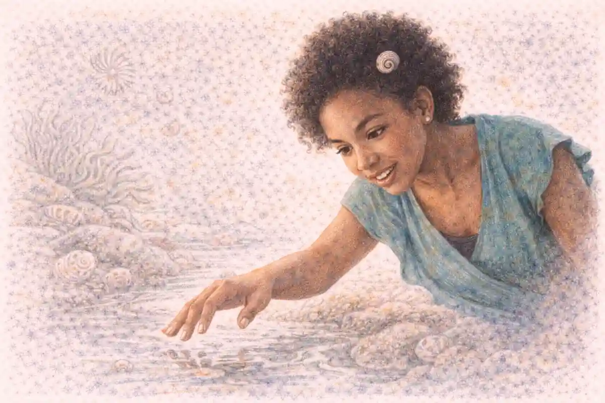

Every free-response section has one question that separates students who memorized images from students who can think with them, and on the AP Art History exam that question is the comparison essay. The prompt places a work from the required image set in front of the candidate and asks for a second work, chosen by the candidate, to be set against it. Two objects, two cultures or two moments, one argument. Nothing in the task rewards a tidy summary of each work delivered in sequence, because the scoring guide hunts for something else entirely: a stated resemblance or difference, developed through observable evidence, and carried toward a claim about what the pairing reveals. Students who understand that the essay grades the relationship between works, rather than the works themselves, write a fundamentally different response from students who treat the prompt as two short identifications stapled together.

That misunderstanding is the complication this guide exists to repair. Listing similarities without analysis feels safe, since every listed similarity is true, and truth feels like credit. Yet a similarity that is never interpreted earns almost nothing, because the reader cannot tell whether the writer noticed it by accident or understood it as evidence. A comparison thesis solves the problem by deciding in advance what the pairing proves. Once a writer knows that two buildings both stage a ruler's claim to divine sanction, or that two painters both weaponize stillness, every observed detail becomes a witness called to testify. The pages that follow build that skill in stages: choosing the second work, framing the claim, deploying evidence across form, content, function, and context, and managing the clock. Broader course coverage sits in the [AP Art History complete guide](/2007/07/20/ap-art-history-complete-guide/), while the mechanics of single-work analysis belong to a companion treatment; the concern here is strictly the space between two works and how to write inside it.

## The Shape of the Task

The comparison essay opens the free-response section as the long essay question, and its architecture is fixed enough to plan around. The candidate receives a work from the required image set, shown in the question booklet, and the prompt supplies the ground rules: identify the given work accurately, select a second work of art that invites genuine comparison, and analyze the relationship between the two through description, evidence, and interpretation. A suggested time of roughly thirty-five minutes applies within a two-hour section, which makes the question the single largest writing investment of the exam and the one most damaged by improvisation. Everything about the task, from selection to closing line, can be rehearsed in advance except the identity of the given work, and strong candidates treat that one unknown as the only variable they cannot control.

Selection freedom is the feature students most often misread. The second work may come from the required image set itself, which most candidates choose because the identification details are drilled and dependable, or it may come from beyond the required set, a possibility the prompt explicitly allows and a later section examines in detail. Either way, the chosen work must be identified with the same precision the given work receives: designation or title, the artist, culture, or period that produced it, a date or range, and the medium or materials where relevant. An elegant comparison built on a vaguely identified partner bleeds credit at the foundation, because readers award a distinct portion of the score for accurate identification and cannot pay for analysis anchored to a work they cannot verify.

Prompts also phrase their demands with deliberate breadth, usually inviting comparison on any defensible ground, and that breadth is a trap for the unprepared. Faced with total freedom, weaker candidates default to medium or date, announcing that both works are paintings or that both come from the nineteenth century, observations too thin to organize an essay. Prepared candidates instead arrive with a private taxonomy of grounds: sacred space, images of rulership, the body in devotion, narrative compression, the memorial impulse, attitudes toward nature, the staging of spectatorship. Any given work snaps into at least two of those frames, and the partner work is chosen because it shares the frame while differing inside it. Freedom, handled this way, stops being a void and becomes a menu the candidate has already memorized.

One further structural fact shapes preparation: the given work can come from any content area of the course, from prehistoric stone to contemporary installation. No candidate can predict it, so pairing skill must be portable. A student who has only ever compared European paintings will freeze when the booklet shows a Moche portrait vessel or a Marshall Islands navigation chart, while a student trained to hunt for function and context first can find ground with almost anything. The sections ahead keep returning to that portability, because the exam's generosity with selection is matched by its indifference to a candidate's favorite period.

### What is a basis of comparison, and why does the essay stand or fall on it?

A basis of comparison is the shared concern that makes two works answerable to the same question, such as how a community houses its gods or how an image secures political loyalty. Without that common ground, comparison collapses into coincidence, and the essay becomes two descriptions sharing a page rather than one argument about a relationship.

## Choosing the Ground Before Choosing the Work

Veteran teachers describe the decision sequence in an order that beginners find backwards. Beginners pick a favorite second work and then search for something the pair might share. Experienced writers choose the ground first, the human problem both works address, and let the ground nominate the partner. A prompt showing Bernini's Ecstasy of Saint Teresa, all marble turbulence and hidden window light, poses a question about how art stages an invisible interior event. Ground chosen, the partner nearly selects itself: the Chola bronze Shiva as Lord of Dance, where divinity is likewise rendered as bodily motion, or a Byzantine icon whose gold stillness argues the opposite theology of presence. Each partner shares the ground and stakes a different position inside it, which is precisely the geometry a comparison needs.

Grounds divide into families, and fluency means moving among them without strain. Functional grounds ask what a work does: shelter ritual, commemorate the dead, instruct the illiterate, display a patron's reach. Thematic grounds ask what a work is about: sacrifice, fertility, exile, triumph, the passage between worlds. Formal grounds ask how a work is built: frontality versus movement, closed versus open composition, permanence of stone versus ephemerality of performance. Contextual grounds ask where a work stands in its world: made under empire or against it, for a court or a congregation, before or after a rupture like conquest or reform. A given work supports several grounds at once, and the skilled move is selecting the ground where the candidate's knowledge runs deepest, since the ground will dictate which evidence matters for the next thirty minutes.

Weak grounds share a recognizable thinness. Medium alone rarely sustains analysis, because two oil paintings may have nothing else in conversation. Chronology alone is thinner still. Geography by itself, both works from Italy, describes an accident of the syllabus rather than a relationship. The test of a ground is generative power: state the ground, and three meaningful similarities or differences should present themselves almost immediately, each attached to visible evidence. If the ground yields only one observation, it is a fact, not a frame, and the essay built on it will starve by the second page.

Difference deserves emphasis equal to resemblance, since grounds that produce only agreement flatten quickly. The most productive pairings are dialectical: same problem, opposed solutions. Housing the divine in a domed interior produces the Pantheon's single shaft of light and Hagia Sophia's ring of windows dissolving the dome's edge, two engineering answers to one theological question. Picturing a ruler produces the frozen composite view of the Palette of King Narmer and the fleshy verism of a Roman portrait, authority claimed through cosmic order in one case and through experienced age in the other. When a candidate trains the eye to ask what problem a work solves, opposed solutions surface everywhere, and the essay gains the productive tension that readers reward.

## Selecting the Second Work

Selection is a wager placed under time pressure, and like all wagers it improves when the odds are calculated beforehand. Four criteria govern a sound choice. Command comes first: the candidate must know the candidate work cold, its identification details, its appearance, its making, and its world, because hesitation about basic facts will leak into every paragraph. Shared ground comes second, as established above, with the refinement that the ground should be specific enough to generate evidence yet broad enough to sustain a full essay. Contrast potential comes third, since a partner identical in argument to the given work leaves the writer with agreement and nothing to develop. Evidence density comes fourth: some works simply offer more observable material per minute of writing, busy surfaces, layered programs, famous engineering, documented patronage, and those works carry an essay further than sparse ones the writer admires but cannot describe at length.

Fame is the seductive false criterion. Students reach for the Mona Lisa or the Sistine ceiling because those names feel prestigious, then discover that celebrity works attract celebrity vagueness, the kind of half-knowledge gathered from posters rather than study. A required work rehearsed all year, perhaps the Screen with the Siege of Belgrade from colonial Mexico or the Great Stupa at Sanchi, will outperform a famous work known only as an image, because scoring follows specificity. Readers pay for the observation that the stupa's carved torana narrates the Buddha's life while the monument refuses his figure, not for the announcement that a painting is a masterpiece. Choose the work about which the most true sentences can be written without pausing.

Near-identity is the opposite error. Pairing two Gothic cathedrals can work in expert hands, but the beginner who sets Chartres beside Sainte-Chapelle often produces an essay of small measurements, this window taller, that vault higher, because the differences available are real yet minor. A bolder pairing across a wider gap, Chartres against the Great Mosque of Djenné, trades measurement for meaning: two communities raising sacred height from utterly different materials, one in cut stone and glass, one in mud brick replastered by congregational hands each year. Distance, paradoxically, clarifies. The wider the cultural or chronological gap, the more the shared ground stands out as a genuine human constant rather than a stylistic habit, and the more the differences demand explanation through context, which is where the rubric's upper reaches live.

Candidates do not make this decision from the full set of 250 required works in the examination room. Wise preparation builds a shortlist in advance, perhaps fifteen partner works distributed across regions and millennia, each mastered to identification depth and each tagged with the grounds it serves best. Against any prompt, at least two or three shortlist members will fit, and the decision narrows to picking the richest fit rather than searching memory at random. A later section on the pairing bank develops that preparation system fully; the principle belongs here because selection quality is decided months before the exam, in the choice of what to master, and only ratified in the room.

### What should a student do when the prompt's work feels unfamiliar?

Slow down and inventory what the image itself supplies: material, scale cues, subject matter, setting, and any visible text or regalia. Attribution habits can place most works by culture and period from those clues alone. Then choose ground from function, the safest lens when style feels foreign, and select a partner work whose context the student commands completely.

## Reaching Beyond the Required Set

The prompt's permission to choose a work beyond the required set tempts ambitious students, and the option deserves a clear-eyed audit. Its advantages are real. A student who has studied a local museum's holdings, or who carries deep knowledge of a tradition the syllabus touches lightly, may own a work more richly than any required alternative. A pairing between the required Vietnam Veterans Memorial and a personally studied work, perhaps Frida Kahlo's The Two Fridas, can open ground about memory, identity, and the body that the standard repertoire reaches less directly. When knowledge is genuine, the outside choice also signals intellectual independence, and readers respond warmly to comparisons they have not graded four hundred times.

Risk concentrates in identification and verification. The outside work must still be identified accurately, with maker, date, and medium stated correctly, and the writer bears full responsibility for those facts without the safety net of a drilled curriculum. Errors that would be impossible with a required work, a wrong decade, a confused attribution, a medium misremembered, become live possibilities, and each one taxes the score before analysis begins. A subtler risk follows: knowledge of outside works often runs anecdotal, heavy on story and light on observable form, because museums and media teach narrative more readily than visual structure. An essay long on biography and short on evidence will underperform a drier essay built on things a reader can see.

The decision rule that experienced teachers give is conservative by design. Reach beyond the set only when the outside work beats every required alternative on the four selection criteria at once, command, ground, contrast, and evidence density, and only when identification details are as certain as a birth date. Otherwise the required set, a repertoire specifically assembled to reward comparison across every content area, supplies the safer and usually richer partner. Ambition in this essay belongs in the argument, where it is rewarded, rather than in the selection, where it is merely exposed.

Consider how the calculus plays out in practice. A prompt presents Robert Smithson's Spiral Jetty, and a student who has walked a local gallery's land-art documentation might consider an outside earthwork studied on a field trip. If the student can name its maker, date, materials, and site conditions without strain, and can describe its surface as confidently as the jetty's basalt and salt crystals, the choice is defensible. If any of those facts arrives fuzzy, Stonehenge waits inside the required set carrying three thousand years of contrast on monumentality, labor, and ritual landscape, with identification the student has rehearsed since autumn. Professional judgment in the examination room means honoring the difference between knowing a work and knowing of it.

## The Thesis That Drives the Essay

A comparison thesis is a claim about a relationship, and its anatomy explains most score differences between adjacent responses. Its first component names the ground, the shared concern both works engage. Its second component asserts the significant resemblance or divergence the evidence will establish. Its third component, the one beginners omit, states the significance: what the relationship reveals about the cultures, patrons, or beliefs involved. A thesis missing its third component describes; a thesis carrying all three argues. Compare two specimens built on the same pairing. The weaker announces that the Pantheon and Hagia Sophia both use domes and both served religious purposes in the Roman world. The stronger argues that both buildings crown a sacred interior with a dome pierced by light, yet the Pantheon's single oculus concentrates divinity at one point above the emperor's city while Hagia Sophia's ring of forty windows dissolves the dome's weight, picturing a heaven that hovers rather than presses. The second thesis hands the writer a paragraph plan, a standard of relevance, and a conclusion waiting to be earned.

Thesis writing benefits from a mechanical rehearsal before it becomes instinct. State the pairing's shared ground in a clause. Add a verb of argument, reveals, conceals, negotiates, enacts, refuses, rather than a verb of mere existence, is, has, uses. Attach the consequence: what a viewer, worshipper, or ruler would understand from these choices. Finally, check the claim against both works with a skeptic's eye, since a thesis true of only one partner is a single-work observation wearing comparative clothing. Drafts that survive that check almost write their own topic sentences, because each body paragraph can open by advancing one clause of the thesis with fresh evidence.

The misconception named in the series brief, listing similarities without analysis, usually begins at the thesis stage. A writer whose claim amounts to a list will produce an essay that amounts to a list, no matter how elegant the sentences become. Conversely, writers who cannot yet write a full analytical thesis can borrow structure from the claim itself by forcing a because into the sentence: the two works treat death differently because their cultures locate the dead in different relations to the living. That single connective compels evidence selection, since every subsequent paragraph must feed the causal or interpretive claim the because established. Teachers who grade practice essays report the same pattern across cohorts: the because sentence, awkward as it sometimes reads, separates responses that develop from responses that merely accumulate.

A thesis also disciplines scope. Thirty-five minutes cannot exhaust two major works, and the thesis announces in advance which aspects the essay will pursue and which it will honorably ignore. A comparison of Las Meninas with the Arnolfini Portrait on the ground of staged looking can ignore pigment, brushwork, and half of each painting's iconography without apology, because the thesis promised an essay about spectatorship, mirrors, and the viewer's drafted role. Readers do not penalize omission inside a declared frame; they penalize drift, the slow slide from one ground to another as the writer chases whichever fact surfaces next. Plant the thesis like a fence and let it keep the essay grazing in one rich field.

## The InsightCrunch Comparison Essay Template

Method becomes portable when it is named and sequenced, so this guide names its method the InsightCrunch comparison essay template, the Art History comparison essay built step by step from thesis to evidence. The template borrows its discipline from historical writing generally, including the document-driven habits examined in the [AP European History FRQ strategy](/2007/07/24/ap-european-history-frq-strategy/), where a claim must likewise govern sources rather than follow them. Each stage below is a stage of thinking before it is a stage of writing, and the sequence matters more than any single stage.

| Stage | The writer's move | What the stage produces |
| --- | --- | --- |
| Select | Choose the partner work by ground, command, contrast, and evidence density | A pairing with genuine tension inside a shared concern |
| Frame | Write a thesis naming the ground, the key resemblance or divergence, and its significance | A claim that assigns every later paragraph its job |
| Describe | Give each work a compact, accurate account of its visible facts | The shared factual floor the analysis will stand on |
| Juxtapose | Alternate works along chosen dimensions, attaching evidence to claims | Comparison performed on the page rather than promised |
| Contextualize | Explain each choice through patronage, ritual, belief, or politics | The reasons the two works solve one problem differently |
| Conclude | Return to the thesis at a higher level, stating what the pairing reveals | Significance the reader can carry away |

Description inside the template is deliberately rationed. The Describe stage earns its points with precision, materials named, scale conveyed, iconography identified, and then it stops. Writers who let description colonize the Juxtapose stage produce the parallel-summary failure the rubric starves. A reliable proportion guards the boundary: if more than a third of an essay's sentences could be moved into a single-work analysis without damage, the comparison has not yet begun. The template's alternation rule prevents that drift structurally, since a paragraph that must touch both works cannot settle into a monologue about one.

Contextualize sits late in the sequence for a reason. Context introduced before evidence tends to float free as general history, impressive and unattached. Context introduced after juxtaposition lands as explanation, answering the question the evidence has already raised: why would one culture dissolve a dome in light while another drills a single hole in it, why would one sculptor free a figure from a block while another assembles divinity from cast bronze and flame. By the time the writer reaches that stage, the reader wants causes, and causes are what the scoring guide's most generous categories reward.

## Form and Content: The First Two Lenses

The framework behind this course trains students to analyze any work through form, content, function, and context, and the comparison essay simply runs that machinery on two machines at once. Single-work command of the four lenses is treated fully in the [AP Art History analysis framework](/2007/07/15/ap-art-history-analysis-framework/); the comparative writer's distinct skill is synchronization, holding the same lens steady while crossing from one work to the other. Form names everything a viewer can verify with the eyes: medium and material, scale, composition, line, color, light, texture, space, and the handling of the human figure. Content names what the work represents and means at the level of subject: its figures, narratives, symbols, and iconographic program. A comparison earns trust when its formal observations and its content claims keep citing each other, because form is usually how content becomes visible.

Formal comparison thrives on matched vocabulary. Both works in a pairing should be interrogated with the same terms, or the comparison quietly compares a vocabulary with a silence. Ask of each work how it organizes symmetry, whether its composition closes inward or opens outward, how its scale treats the body, what its material permits and forbids. The Great Hall of the Bulls at Lascaux and a Chauvet-era painted chamber reward such matched questioning less than a pairing of Stonehenge with the Forbidden City, where megalithic circles and axial timber courtyards both choreograph procession yet one addresses the sky through mass while the other addresses it through ordered emptiness along an axis. Matched questions also expose false friends: two works may share a motif, say a frontal staring figure, while using it to opposite formal ends, apotropaic confrontation in a Kongo power figure, iconic stillness in a Byzantine panel.

Content comparison demands equal discipline about iconography. A writer comparing narrative programs, perhaps the Bayeux Tapestry against the Japanese handscroll known as the Night Attack on the Sanjô Palace, must track what each sequence chooses to show, where it lingers, and what it refuses. The Norman embroidery stretches conquest into a providential procession of ships, feasts, and omens, legitimating a duke's claim across seventy meters of linen. The Kamakura scroll erupts into a palace coup rendered with plunging diagonals and crowds in panic, then scrolls its violence past in minutes of unrolling. Same lens, story told in sequence; opposed claims, destiny ratified versus order shattered. Content observations of that caliber, anchored to named episodes and devices, are what separate analysis from plot summary.

Form and content also fail together in a signature way writers should recognize. When a candidate knows a work's story but not its surface, the essay fills with content claims unsupported by anything visible, and readers, who grade against images they know intimately, stop trusting the page. The corrective habit is a ratio: no content paragraph without at least two formal observations woven into it. Arguing that the Palette of King Narmer proclaims cosmic order becomes credible the moment the writer cites its registers, its hierarchical scale, and the king's composite pose, twisted torso above profile legs, a body assembled from each part's most legible view. The claim rides on the evidence, visibly, and the reader is paid in the currency the rubric accepts.

One more formal topic earns constant points because students neglect it: scale and the viewer's body. Works address bodies differently, through miniature intimacy, human measure, or overwhelming monumentality, and comparison across that axis generates significance almost automatically. The ivory Queen Mother pendant mask of Benin, worn at a king's hip, compresses dynastic memory into a few inches of carved surface meant for proximity and touch. Maya Lin's Vietnam Veterans Memorial works at the opposite register, a granite cut in the earth that swallows the visitor's reflection among more than fifty-eight thousand names, yet both works are instruments of remembrance calibrated by size to the bodies that carry grief. A writer who asks where each work puts the viewer's body has found a paragraph before finishing the question.

## Function and Context: The Second Pair of Lenses

Function asks what a work was made to do in the world, and context asks what world made those actions necessary. The two lenses belong together in comparison because identical functions pursued in different contexts produce the most instructive differences the exam can offer. Two objects built to hold the dead, the Great Pyramids of Giza and the Taj Mahal, share a function and diverge in nearly everything else: one a mountain of limestone raised by a god-king's state for a single solar journey, the other a marble garden tomb built by a widowed emperor inside a Persianate vision of paradise, where the tomb waits at the end of a charbagh rather than commanding a plateau. Function supplied the ground; context, theology, dynasty, landscape, and grief, supplied the essay.

Context in the rubric's sense is not a paragraph of background pasted beside the art. It operates at several depths, and comparison writers should know which depth they are mining. Immediate context covers patron, site, and occasion: who paid, where the work stood, what ceremony it served. Cultural context covers the belief systems and social structures that made the work intelligible to its first audience. Historical context covers the events pressing on its making, conquest, plague, reform, colonization, revival. Art-historical context covers the prior works a maker answered or refused. A strong comparison typically braids two depths at once, pairing, for instance, the immediate context of Bernini's Cornaro Chapel commission with the cultural context of Counter-Reformation devotion, against a Byzantine icon's immediate setting in a domestic or liturgical interior and its culture's theology of the image as window rather than performance.

Function also protects writers from the weakest comparison genre, the style-only essay. Two works can share a style and want utterly different things from their audiences, as the Seated Scribe and a Ndop portrait figure of the Kuba kingdom demonstrate. Both present seated elite men with watchful naturalism in the face, yet the Egyptian figure serves a tomb owner's eternal administration, a literate servant stationed forever at his accounts, while the Ndop embodies a king's physical presence and dynastic continuity for a court that reads its carved emblems. Without function, the pairing is a coincidence of posture. With function, posture becomes argument: two civilizations deciding what a powerful man's image must preserve.

Writers should also learn to compare absences, the functions a work refuses. The Great Stupa at Sanchi narrates the Buddha's life across its gateways while withholding the Buddha's body, a functional decision rooted in an aniconic phase of devotion, where footprints, wheels, and empty thrones carry presence. Set against a Gothic cathedral portal crowded with carved Christs and saints, the absence stops looking like a gap and starts looking like a theology. Comparative essays that notice a meaningful absence and explain it through context display exactly the maturity the exam's design hopes to find, because absence cannot be copied from a label; it must be inferred from the pairing itself.

Patronage deserves a paragraph of its own because it converts context into plot. Comparing works by their patrons, a pope's Rome against a shogun's Kyoto, a merchant's Amsterdam against a sultan's Istanbul, gives the writer agents, motives, and audiences, the raw materials of explanation. Vermeer's Woman Holding a Balance emerged from a prosperous Dutch market of private buyers and hangs its quiet moral arithmetic in a domestic interior, scales empty, a painting of judgment day framed behind the woman like a thought. A Mughal court portrait, by contrast, speaks the language of an emperor's album, jewel-flat and hieratic, made to circulate among courtiers as a token of rank. Same century, same small scale, opposite economies of looking, and the comparison writes itself once patronage enters the frame.

## Visual Evidence: Making Points Land

Evidence in this essay means the observable, the features a skeptical reader could locate in the image within seconds. Color behavior, edges, proportions, materials, gestures, spatial tricks, inscriptions, damage, and setting all qualify, while reputations, intentions, and movements do not. The craft skill is density management: claims spaced closely enough to their proof that no paragraph asks the reader for faith. A practical cadence serves most writers well. Each comparative claim receives at least two pieces of evidence, one drawn from each work, stated in the same breath so the comparison happens inside the sentence rather than across a page break. The sentence that says the stupa's railings turn pilgrims in a clockwise circuit while Chartres pulls its pilgrims forward and upward along the nave has done more comparative work than a page of sequential description.

Vocabulary is the delivery system for evidence, and precision compounds. General words like big, old, detailed, and beautiful spend the writer's credibility without buying information. The discipline's own terms pay better: foreshortening, chiaroscuro, contrapposto, verism, hierarchical scale, composite view, closed form, atmospheric perspective, engaged columns, rib vault, repoussé, lost-wax casting. Each term compresses a visual fact into a word the reader trusts, and paired terms let evidence travel in matched pairs across the two works. Where single-work analysis rewards breadth of vocabulary, comparison rewards symmetry of vocabulary, the same lens-word applied twice so the difference between the works, rather than between the writer's moods, becomes the subject.

### Why do readers distrust two summaries placed side by side?

Readers distrust parallel summaries because the format hides the only judgment the prompt requests, the relationship between the works. Juxtaposition performed by the booklet, with its two works already adjacent, cannot substitute for juxtaposition performed by the writer, whose sentences must state the resemblance or difference outright and then prove it with paired, observable evidence.

Numbers and measurements, used sparingly, act as evidence multipliers. Heights, dates, distances, and counts are facts a reader can verify, and a comparison that notes the Pantheon's dome spans roughly forty-three meters of unreinforced concrete while Sainte-Chapelle lifts its glass walls some fifteen meters in a stone cage teaches scale more efficiently than adjectives do. The caution is proportion: measurements support claims, they do not replace them, and a paragraph of dimensions without interpretation reverts to the description trap. Every figure should arrive attached to a consequence, for span, for light, for the body standing beneath.

Evidence also includes what a work does to time. Some images compress a saga into a single field, as the Narmer Palette stacks registers of unification into one slab of siltstone. Others stretch a moment across repeated figures, or freeze ritual into perpetual performance, as processional friezes and dance bronzes do. Comparing two works by their handling of time, synoptic against sequential against timeless, gives writers a high-yield dimension that beginners rarely touch and readers visibly enjoy, precisely because it cannot be faked from a title and a date.

A final evidence habit separates polished essays from competent ones: citing the small thing. Major features are claimed by every candidate, domes, halos, armies of figures, and they earn their points at a crowded rate. The small thing, the empty scales in Vermeer's balance, the discarded sandal of a fleeing figure in a Japanese scroll, the mosquito-thin inscription band on a Qur'an page, belongs to the writer alone. One small, exact observation per work, folded into the argument, convinces a reader that the essay was written by someone who has truly looked, and trust, once established, raises the price of every other sentence on the page.

## Weaving: Paragraph Architecture

Structure at the paragraph level offers two honest options. Block structure treats one work fully, then the other, then compares in a final movement; it is orderly, easy to control, and chronically tempted by the summary failure. Alternating structure organizes paragraphs by dimension rather than by work, so each paragraph visits both objects under a single heading of inquiry, patronage in one, light in the next, the body in a third. For this prompt, alternation wins on almost every axis: it performs comparison continuously, it keeps evidence paired, and it makes drift visible the moment a paragraph forgets its second work. Block structure retains one legitimate use, the compact descriptive opening the template prescribes, after which the essay should switch into alternation and never look back.

Topic sentences carry the architecture. In a comparison essay, a topic sentence should contain both works and a claim, or it is a label rather than a thesis in miniature. Where devotion in the Byzantine panel concentrates into frontal stillness, Bernini releases devotion into spiraling motion, and the contrast is theological before it is stylistic: a sentence of that kind promises a paragraph and delivers a map. Writers who draft topic sentences first, five or six of them in the planning minutes, often discover their thesis clarifying itself across the list, because the pattern among claims is the argument. The essay then becomes the execution of a visible design, and readers follow design with a generosity they withhold from wandering.

Transitions in comparison writing fall into two families and should be deployed deliberately. Resemblance transitions, likewise, in the same spirit, equally, announce that the second work joins the first on a dimension. Divergence transitions, by contrast, whereas, yet, announce a fork. A healthy essay uses both families in rough balance, tracking the true balance of the pairing, and an essay whose transitions run only one way usually reveals a writer comparing from a conclusion reached before the evidence was consulted. There is also a third, quieter family worth cultivating, the consequence transition: because of this shared choice, as a result of that difference, which ties observation to significance and keeps the analysis lens engaged.

Paragraph length teaches its own lesson under timed conditions. Very long paragraphs in comparison essays tend to become one-work monologues, since sustained attention to a single object is easier than oscillation. Shorter paragraphs, each built around one dimension and both works, enforce the oscillation mechanically. Aiming for paragraphs of roughly one hundred fifty to two hundred words gives the writer four or five comparative movements inside the essay, enough to cover the ground a thesis stakes out without letting any single movement bloat into summary. The discipline is architectural rather than aesthetic: the shape of the page polices the quality of the thinking.

## Comparing Across Cultures

Cross-cultural pairing is the exam's signature pleasure and its most demanding form, because the writer must build the bridge the two works never built themselves. The bridge material is always a shared human problem: how to picture the divine, how to bury the honored dead, how to make power visible, how to store memory, how to mark the seasons. Framed at that depth, a Kongo power figure and a Venetian altarpiece need no historical contact to sustain comparison; both mediate between a community and forces it cannot touch directly, and their differences in material, handling, and activation become evidence about the worlds that required them. The writer's first obligation is to establish that the shared problem genuinely mattered in both cultures, a claim context must support, since a ground invented for the essay convinces no one.

Asymmetry is the standing temptation of the form, and it appears in two costumes. The first costume is hierarchy, in which one work becomes the standard and the other a deviation, usually with the European work silently occupying the standard's chair. The second costume is flattening, in which differences dissolve into a warm announcement that all cultures value spirituality or beauty. Both failures forfeit the analysis the prompt exists to measure. The professional habit is symmetry of curiosity: each work receives the same questions, the same evidential care, the same contextual depth, and judgments are phrased as differences in strategy rather than ranks of achievement. A writer comparing Great Zimbabwe's dry-laid granite enclosures with the coursed ashlar of Inka masonry at Machu Picchu can honor both as engineering arguments about authority, one curving walls into secrecy around a royal court, the other fitting polygonal stones so precisely that the mountain itself seems recruited into the state.

Language needs watching at cultural borders. Terms drawn from one tradition migrate badly when imposed on another, so calling a nkisi a fetish or a stupa a temple imports conclusions the writer has not argued. Descriptive neutrality at first mention, power figure, reliquary, mound, circumambulatory monument, followed by the culture's own terms where the writer knows them, keeps the essay honest and quietly displays command. Dates and geographies need the same care: anchoring each work in its own chronology, rather than measuring one against the other's timeline, prevents the subtle theft in which a twelfth-century African court is described as contemporary with a European period label it never heard of.

One cross-cultural ground outperforms all others for reliability, and teachers steer students toward it whenever the prompt allows: the encounter with death and what follows it. Every culture in the required set builds for the dead, and the builds argue. The terra cotta warriors of the First Emperor of China mass-produce an afterlife of administration, thousands of individualized soldiers guarding a tomb mound in perpetuity. The Coyolxauhqui Stone at the Templo Mayor turns death into cosmic reenactment, a dismembered goddess at the pyramid's foot restaging myth each time a captive's body descends the stairs. Set either against an Egyptian tomb painting or a Christian reliquary and the essay gains metaphysics, politics, and form in a single frame, because choices about the dead are choices a culture cannot make carelessly.

Ritual movement supplies a second dependable ground. Works designed to be walked around, processed past, or unrolled in sequence build time into viewing, and comparing those choreographies exposes belief with unusual clarity. Circumambulation at Sanchi moves the pilgrim clockwise around a solid, imageless presence. The Stations-like ascent of a Gothic pilgrimage church moves the body toward light and relic. A Japanese emaki asks the hands to meter narrative at reading speed, revealing and concealing as the scroll passes. Writers who compare choreographies can quote the viewer's own body as evidence, the rarest and most persuasive kind, since a reader can test the claim in imagination without a single image on the desk.

## Comparing Within a Single Culture

Same-culture comparison trades the drama of distance for the precision of change, and it defeats students who assume that shared origin means easy agreement. The ground still matters, but now the differences arrive wearing the costume of development: the same tradition answering its own earlier answers under new pressures. Titian's Venus of Urbino and Manet's Olympia make the canonical training pair. Both stage a reclining nude receiving the viewer's arrival, attended, offered, composed from the same Venetian inheritance. Yet where Titian's goddess dissolves the encounter in mythological permission and soft recession, Manet flattens the space, hardens the light, and returns the viewer's stare with interest, converting an old genre into an argument about modern looking, money, and power. The essay lives in the delta between inheritance and revision, and that delta is legible only because the shared ground holds everything else constant.

Within-culture work rewards chronological precision more than any other form. Dates stop being identification furniture and become the argument's skeleton, since the writer must name what happened between the two moments to explain why the second work differs. Between the Parthenon's marble citizenry and the Alexander Mosaic's swirling melee lie the Peloponnesian War, the rise of Macedon, and a changed theory of what a battle picture is for. Between Giotto's Lamentation in the Arena Chapel and Michelangelo's Last Judgment lie two centuries of patronage, theology, and anatomy, and the writer who can narrate even a compressed version of that interval owns the essay's middle paragraphs. Gaps in historical knowledge, survivable in cross-cultural comparison where context runs in parallel, become fatal here, because the comparison's engine is change itself.

A subtler same-culture ground compares across media within one world: a culture's painting against its architecture, its court art against its devotional objects. The linear perspective that organizes Masaccio's Holy Trinity also organizes Brunelleschi's Florence, and setting the fresco's painted barrel vault beside the dome its painter's generation raised over the cathedral lets a writer argue that Renaissance space was a single idea wearing two materials. Medieval comparisons work the same way, as when the woven narrative of the Bayeux Tapestry is set against the carved programs of a Romanesque portal, two solutions to the problem of teaching story to audiences who mostly could not read. Media contrast inside one culture keeps context economical, since the world is shared, and throws the formal argument into high relief.

Revision and quotation give writers a final within-culture tool: the deliberate backward glance. Many required works cite earlier works in their own tradition, quoting a pose, a plan, or a composition to borrow authority or to challenge it. The Church of Sainte-Chapelle quotes the palatine chapel type to wrap a king's relics in royal precedent. Delacroix's Liberty Leading the People answers Géricault's generation while arming a new revolution in its imagery. When the second work in a pairing consciously quotes the first, or quotes the first work's ancestors, the writer can compare not only two objects but two acts of memory, and the essay's significance section nearly composes itself.

## A Worked Pairing: The Pantheon and Hagia Sophia

Watching the template operate on one concrete pair fixes the method better than further abstraction. Suppose the prompt presents Hagia Sophia, Justinian's church in Constantinople, raised between 532 and 537 CE under the direction of Anthemius of Tralles and Isidorus of Miletus. Ground first: how a dome can picture heaven over an imperial congregation. The partner that ground nominates is the Pantheon in Rome, rebuilt under Hadrian between roughly 118 and 125 CE, its coffered concrete dome and central oculus the ancestors of every later vaulted interior in the Mediterranean world. Command is high for both, contrast is rich, and the identification details are standard issue, so the selection stage closes within a minute.

The thesis then writes itself from the ground. Both buildings crown a gathering space with a dome opened to light, yet the Pantheon concentrates heaven into a single beam admitted through one nine-meter oculus, the visible source of a cosmos arranged around the emperor's Rome, while Hagia Sophia rings its dome with forty windows at the springing, so that light arrives from everywhere at once and the structure seems suspended rather than supported, picturing a divinity that pervades rather than presides. Description follows in rationed form: portico and rotunda, aggregate concrete lightened toward the crown, against nave, pendentives, and semidomes cascading east and west. Juxtaposition then alternates along light, structure, and the worshipper's movement, each paragraph visiting both buildings. Context closes the argument: Hadrianic Rome absorbing all gods into one civic vault, Justinian's Byzantium staging Orthodox liturgy under an emperor who claimed to have outbuilt Solomon. Every stage of the template finds material without strain, which is the mark of a pairing chosen by ground rather than by fame.

## How Readers Award the Points

Scoring for this question is performed by trained readers working from a published rubric, and knowing the rubric's categories converts anxiety into a checklist. Readers look first for a thesis that responds to the prompt with a defensible claim establishing a line of reasoning, and the claim must govern the essay rather than decorate its first paragraph. A distinct portion of credit attaches to the accurate identification of the chosen work, its maker or culture, date, and medium, which is why the selection stage treats identification as non-negotiable. Further credit rewards description that is specific and accurate for both works, since analysis without a factual floor cannot stand.

The rubric's generous middle belongs to the comparison itself. Readers award escalating credit as the essay moves from naming similarities and differences, to supporting them with visual and contextual evidence, to explaining their significance for meaning, function, or belief. An essay that touches every category lightly will be outscored by an essay that saturates the comparison categories, because the instrument is built to detect development rather than coverage. The final and most discriminating category rewards the writer who shows what the relationship means, who can say why these two objects, held together, teach something neither teaches alone. Candidates should read that category as the scoring guide's definition of the whole exercise.

Partial credit realities are kinder than students fear and sterner than they hope. A missed date costs the identification point but leaves analysis intact if the essay's facts remain sound. A weak thesis can be partially rescued by strong paired evidence, since readers credit the comparison they can see. What cannot be rescued is absence: an unwritten category earns nothing regardless of the essay's charm elsewhere. The practical consequence is a writing rule with the force of law in the examination room: touch every category at least once, saturate comparison and significance as deeply as time allows, and never let one brilliant section consume the minutes owed to the rest of the rubric.

## Time: The Thirty-Five-Minute Budget

The suggested thirty-five minutes for this question divide into movements that mirror the template. Planning deserves roughly five minutes, an interval students resist and professionals protect, because selection and thesis errors committed in minute one cannot be repaired in minute thirty. Reading the prompt, identifying the given work precisely, choosing ground and partner, and drafting a thesis plus four topic sentences all fit inside those five minutes for a prepared candidate, and the plan converts the remaining time into execution rather than invention. Broader pacing across the full examination is mapped in the [AP Exams complete guide](/2008/11/08/ap-exams-complete-guide/), but the internal economy of this single question is where most comparison essays are won or lost.

### How long should a student spend planning before writing the comparison essay?

Roughly five of the thirty-five suggested minutes belong to planning: identifying the given work, choosing the ground, selecting the partner, and drafting a thesis with topic sentences. Planning feels expensive because the page stays blank, yet every minute spent there buys back several minutes of writing that would otherwise wander, stall, or require abandonment mid-paragraph.

Writing consumes the next twenty-five minutes or so, and its discipline is momentum. Comparative paragraphs should follow the topic sentences in order, evidence paired as drafted, with a private rule against returning to polish earlier prose while later categories remain untouched. A short closing movement of about five minutes remains for the significance push: strengthening the conclusion, checking that both works have been identified accurately in the text, and adding one contextual observation wherever the essay feels thinnest. Candidates who rehearse this budget in practice sessions stop experiencing the clock as weather and start experiencing it as an instrument, which is precisely the transformation timed rehearsal exists to produce.

## Building a Pairing Bank and Practicing the Skill

Preparation for this question works best as the construction of an asset: a pairing bank. The bank holds partner works, perhaps fifteen, chosen for range across the content areas and mastered beyond identification into argument readiness. Each entry carries four kinds of capital: identification facts, three reliable grounds the work serves, a half-dozen evidence details stated in precise vocabulary, and one significance claim linking the work to its world. A bank built to that standard converts the exam's selection gamble into an inventory decision. Preparation in other subjects follows the same logic of concentrating on high-yield material, a principle visible in the way the course's companion coverage treats the themes European History returns to most, in [AP European History most tested themes](/2006/06/14/ap-european-history-most-tested-themes/); art history's version of that yield map is the set of works and grounds that pair richly against almost anything.

Practice with the bank should rehearse decisions, not only prose. One drill gives the student a random required work and ninety seconds to name a ground, a partner from the bank, and a thesis, with no writing allowed; the drill trains the expensive minutes. A second drill swaps partners mid-plan, forcing a new thesis for the same given work against a different bank entry, which teaches that arguments belong to pairings rather than to works. A third drill imposes evidence quotas, requiring each paragraph to cite one formal observation and one contextual fact per work, until paired evidence becomes reflex. Timed full essays still matter, perhaps one every two weeks across the spring, but decision drills deliver more improvement per hour because selection and framing are where this question's variance lives.

Reading practice essays with a rubric in hand completes the system. Students should grade anonymous sample responses in pairs, hunting specifically for the failure modes named in the next section, and then grade their own drafts a day after writing, when the prose has gone cold enough to read as a stranger's. Supplementary question practice supports the habit: working through [free AP History practice questions](https://reportmedic.org/tools/ap-history-practice-questions.html) builds the broader habit of turning prompts into claims under time pressure, a transferable skill wherever essays are scored against rubrics. The measure of readiness is simple to state and hard to fake: hand the student any required work and watch a ground, a partner, and a because sentence arrive inside two minutes.

## Common Failures and Their Repairs

The description trap is the failure from which all others descend, and its repair has already been prescribed: ration description to the template's early stage, then forbid any sentence that could not name its comparative job. Thesis drift follows, in which an essay opens on sacred space and closes on portraiture because facts pulled the writer downhill; the repair is mechanical, rereading the thesis after each paragraph and deleting or converting whatever does not serve it. Evidence famine, claims without observable anchors, repairs itself through the ratio rule of two formal observations per content paragraph. Identification errors, the cheapest points lost on the exam, yield to the bank's drilling and to the habit of stating maker, date, and medium slowly and separately rather than in a rushed appositive.

The unbalanced essay is a quieter failure: four paragraphs on the given work, one hurried paragraph on the partner, as if the second object were a footnote. Readers notice the asymmetry instantly, because the rubric's comparison categories cannot be satisfied by a monologue with an appendix. The structural repair is the alternation discipline described earlier, reinforced by a counting habit during the closing minutes: tally the sentences devoted to each work and add partner evidence wherever the ledger tilts. A related failure is the orphaned conclusion, a final paragraph introducing new works or new claims in the closing lines, which signals panic rather than synthesis and should be replaced by the significance return the template reserves for the end.

### How does a conclusion earn points without repeating the thesis?

A conclusion earns its place by climbing one level of generality above the thesis, stating what the pairing reveals about the cultures, beliefs, or patrons involved rather than what the two works share. Where the thesis announces a relationship, the conclusion interprets it, converting evidence already presented into significance about how each world understood the problem both works addressed.

The last failure is tonal, and it matters more than students expect: the essay written in the voice of a tour guide, marveling, gesturing, and moving on. Readers reward the voice of a junior colleague making a case, measured, specific, and willing to commit to a judgment the evidence supports. Marveling costs nothing and buys nothing. Judgment, hedged where the evidence is thin and firm where it is dense, is the sound of the analysis the rubric was built to find.

## A Catalogue of Productive Dimensions

Grounds tell the writer where to stand; dimensions tell the writer where to look once standing there. A dimension is a measurable aspect shared by both works along which evidence arranges itself: light, scale, material, surface, the treatment of the body, the handling of narrative, the relation to landscape, the presence or absence of text. Seasoned writers keep a private catalogue of dimensions with proven yield and run through it quickly when a prompt lands, testing each against the given work until one begins generating paired observations. The catalogue matters because dimensions are discovered faster by recognition than by invention, and the planning minutes reward the prepared mind that pattern-matches over the inspired mind that browses.

Light is the catalogue's most reliable earner, because nearly every work in the set manipulates light or depicts it. Actual light can be compared across interiors: the Pantheon's oculus, the clerestory of a Gothic nave, the screened glow of a mosque lamp, the cut earth of Maya Lin's memorial reflecting the sky into polished granite. Depicted light offers a parallel track: Caravaggio's raking beam in the Calling of Saint Matthew, the candlelit concentration of Georges de La Tour, Vermeer's windowed calm. Comparing two works on light forces claims about attention and revelation, since light in sacred and secular settings alike decides what the viewer is permitted to know first, and writers who ask who controls the light in each work usually find a thesis hiding inside the answer.

Scale generates significance through the body, as noted earlier, but its subtler yield is political. Monumental scale is always an expenditure, of labor, of material, of organizational force, and comparing two expenditures exposes two theories of legitimacy. The colossal Buddha carved into the cliff at Longmen and the colossal granite figures of Great Zimbabwe's Hill Complex both dwarf the visitor, yet one addresses an empire's merit-making devotion while the other stages a court's controlled access, since the Zimbabwe enclosures ration approach through narrow passages. Miniature scale argues in the opposite direction, toward intimacy, possession, and private handling: an album painting, a reliquary pendant, a Qur'an copied for a single reader's hands. Setting a monumental work against an intimate one on the ground of remembrance or devotion gives the writer a ready-made drama of public versus private belief.

Material deserves its own dimension because materials carry meanings that iconography alone cannot. Gold in a Byzantine apse mosaic is not decoration but theology, a substance that returns light and denies shadow. Jade in a Liangzhu cong is not green stone but a cosmology you can hold, the square earth and round heaven fused in one ritual object. Bronze announces permanence and state control of metal; mud brick announces cyclical renewal and communal labor; found objects and industrially fabricated steel announce a modern argument about what art is permitted to be. Two works in the same material invite comparison of handling, while two works in opposed materials invite comparison of values, and either configuration outperforms a pairing in which material is never mentioned at all.

The human figure is a dimension with endless yield because every culture in the course had to decide what a body is. Frontality, contrapposto, verism, idealization, elongation, dismemberment, multiplication into armies of near-identical soldiers: each choice encodes a theory of the person. Comparing the kouros-derived poise of an early Greek figure with the wrinkled specificity of a Roman veristic portrait produces a paragraph on civic identity almost unaided. Comparing traditions that refuse the body altogether, aniconic Buddhist carving against the carved vegetal geometry of an Islamic mihrab, produces something rarer, an essay about presence achieved through absence on both sides of the pairing.

Text and image form a final high-yield dimension, increasingly relevant across the set's second half. Works that carry writing, the stele of Hammurabi tradition of inscribed law, a Chinese hanging scroll where calligraphy and painting share one surface, Shirin Neshat's photographs inscribed with Farsi poetry across a woman's face and hands, ask the viewer to read and look in negotiated sequence. Comparing two inscribed works on the dimension of who may read them, and what the writing does to the picture, generates claims about authority and access that pure iconography cannot. A writer alert to inscriptions also earns quiet identification credit, since naming a work's text is among the most specific observations an essay can offer.

## Materials and Making as Evidence

Technique is evidence that survives translation across any pairing, because the way a thing was made constrains what it can mean. Lost-wax casting, used for the Chola bronzes and for Benin plaques alike, permits undercuts, thin walls, and a single irreversible pour, so each finished object testifies to organized workshops and controlled risk. Carving subtracts, and its meanings follow the block: Michelangelo's figures straining out of marble make a Neoplatonic argument simply by their unfinished edges. Fresco binds image to wall and to the speed of drying plaster, which is why Giotto's Arena Chapel narratives carry their calm monumentality, each giornata planned like architecture. A writer who can name the making process for both works owns a paragraph of evidence that no amount of iconographic guessing can counterfeit.

Making also scales into labor, and labor into politics. The terra cotta army's modular production, heads and torsos assembled from standardized parts and then individualized, embodies an imperial bureaucracy in clay. The Bayeux Tapestry's embroidery, wool on linen worked by many hands, embodies a different organization, narrative as needlework, conquest retold at domestic speed. Comparing two works by their division of labor, the named master against the anonymous workshop, the single pour against the ten thousand firings, lets the essay argue about how societies organize skill. Readers value such paragraphs because they connect visual facts to social structure without leaving the evidence behind.

Modern and contemporary works weaponize making in ways comparison writers should exploit rather than fear. Robert Smithson's Spiral Jetty is made of basalt, salt, and entropy, and its medium includes its own decay. El Anatsui's Old Man's Cloth is made of bottle caps and copper wire, a textile built from the debris of trade, so the material itself narrates the commerce the work contemplates. Doris Salcedo's Shibboleth is made of a crack, an engineered fracture in a museum floor, where the medium is the institution's own fabric split open. Set against any traditional medium, such works let the writer compare not only techniques but definitions: what counts as the substance of art in each world, and who gets to decide.

Durability forms the shadow side of the making dimension, and it compares beautifully. Stone temples argue for eternity and are judged by time accordingly; the Great Mosque of Djenné argues for renewal and must be replastered annually or dissolve, a theology of maintenance rather than permanence. Ephemeral and process-based works in the contemporary set extend that logic until the object nearly vanishes, leaving documentation as the surviving evidence. A comparison between a work built to outlast empires and a work built to be remade, redone, or allowed to disappear hands the writer a ready significance claim about how each culture imagines its own future.

## Grounds in Depth: Images of Power

Political imagery offers the most heavily stocked ground in the required set, because every state in the course commissioned arguments about itself. The writer's opportunity lies in refusing the lazy version of the ground, both works show rulers, and instead specifying the mechanism: intimidation, legitimacy, genealogy, divine mandate, civic virtue, bureaucratic reach. The Palette of King Narmer exercises power as cosmic bookkeeping, the king's body enlarged, his enemies reduced to pattern, the whole unification of Egypt arranged in registers like entries in a ledger of order. Augustus of Prima Porta exercises the same mandate through opposite means, a youthful, idealized calm, cupid at the ankle, a breastplate narrating diplomacy as destiny. Two claims to rule, one through smiting, one through serenity, and the comparison writes its middle paragraphs from the mechanisms alone.

Portraiture of rulers rewards the dimension of access: who was permitted to see this image, and at what distance. The Ndop figures of the Kuba kings were kept objects, embodiments handled by the court rather than displays for a crowd. A Mughal durbar painting circulated in albums among nobles, power shared hand to hand. Bernini's busts and equestrian monuments occupied palaces and squares, power staged for ambassadors. At the far end of the scale stand images of power addressed to everyone at once, Trajan's Column spiraling its campaigns above a forum, or the colossal heads and stelae of earlier states planted in public ground. Comparing two power images by their intended audience converts iconography into sociology, since the same crown means different things at arm's length and at a hundred meters.

Power also appears in the set wearing disguises the comparison writer should learn to strip. A reliquary or mosque lamp may serve a ruler's legitimacy as surely as a portrait does. The Sainte-Chapelle is a king's argument disguised as a jewel box, Louis IX housing the Crown of Thorns in a chapel whose walls dissolve into glass, announcing that France's monarchy now guards Christendom's holiest objects. The Forbidden City argues through urbanism instead, axis, symmetry, and graduated courtyards materializing a cosmology with the emperor at its still center. Comparing disguised power with declared power, chapel against equestrian statue, city plan against portrait bust, gives an essay the pleasure of revelation, and readers reward writers who can show that the most effective political images are often the ones not labeled as such.

Resistance belongs in this ground as power's necessary partner. Works made under occupation, colonization, or censorship encode counter-claims that comparison can surface, especially when the partner work displays the dominant imagery being answered. Goya's Third of May 1808 turns the machinery of state violence into an image that indicts its makers, the firing squad faceless and mechanical, the victim's white shirt blazing at the composition's center. Set beside any official battle piece, David's imperial choreography or a triumphal procession carved in stone, Goya's canvas argues that the ground of power includes the power to frame memory afterward. Essays that include the answering image, not only the proclaiming one, read as history rather than as catalogue.

## Grounds in Depth: Memory and the Dead

Commemoration, already introduced as a dependable ground, deepens when the writer distinguishes among its species. Dynastic memory preserves a line: tombs, ancestor figures, portrait galleries. Civic memory preserves a polity: war memorials, triumphal monuments, founding scenes. Personal memory preserves a mourner: the widow's tomb, the parent's commissioned altarpiece, the name cut into granite among thousands. Two works from different species can still compare, but the writer must name the species difference as part of the claim, since a memorial for a king and a memorial for conscripted strangers may share a function while intending opposite relations between the living and the dead.

The Vietnam Veterans Memorial repays extended attention because its design decisions are so legible. Maya Lin cut a V of black granite into the earth, descending to an apex where the two walls meet at the height of the war's costliest years, and arranged the names chronologically by date of death, so a visitor's search becomes a journey into the war's own timeline. Touch is invited; reflections superimpose the living face on the carved names. Compare that grammar of memory with Trajan's Column, where the dead are anonymous, the emperor appears dozens of times, and memory rises rather than descends. Both monuments commemorate war for a state that needed to narrate it. One narrates through elevation and repetition of a single figure; the other through descent and the unrepeatable singularity of fifty-eight thousand names. The ground could hardly be firmer, and the essay nearly organizes itself along the axis of who is remembered, the ruler or the ruled.

Ancestor imagery opens a distinct chamber inside this ground. The reliquary figures of the Kota peoples, their metal-sheathed faces watching over the bones of lineage founders, treat memory as guardianship: the dead remain employed, guarding the living who guard them. Benin's commemorative heads for the oba's altar place memory on an altar where brass and ivory convert ancestry into regalia. A European portrait bust on a tomb chest performs related work in a different theology, preserving likeness as consolation and as legal proof of lineage. Comparing ancestor works across cultures succeeds when the writer tracks the transaction, what the living owe the dead and what the dead are believed to do in return, because that transaction, more than style, explains the objects' forms.

Even the set's humblest memorials reward the ground. A Roman funerary relief of freedmen, faces lined and labeled with new citizen pride, argues that memory belongs to the formerly enslaved as well. A Moche portrait vessel holds an individual's features in clay with an intimacy that suggests remembrance at household scale. Set either beside a state monument and the essay gains its significance from disproportion: the same human refusal to forget, funded at wildly different levels, formalized in wildly different materials. Comparison essays often find their strongest closing claims in such disproportion, stated plainly.

## Two More Worked Pairings

A second demonstration pairs the Great Stupa at Sanchi with Chartres Cathedral, a ground of pilgrimage architecture across an unbridgeable cultural distance. Selection logic runs cleanly: both are required works of high command for most candidates, both organize a sacred journey, and their solutions diverge at nearly every dimension. The thesis might argue that both monuments choreograph approach toward a sacred center the pilgrim cannot simply enter, yet Sanchi keeps its center solid and silent, a mound circled clockwise at ground level beneath gateways carved with a life whose protagonist never appears, while Chartres lifts its center into light and vertical procession, drawing the pilgrim down a nave toward an altar and a relic, through portals crowded with the very figures Sanchi withholds. Description then supplies the stupa's railings, toranas, and anda, the cathedral's west front, labyrinth, and stained glass, before alternation takes over along movement, imagery, and the location of the sacred. Context explains the divergence through aniconic devotion in early Buddhism against incarnational image theology in medieval France, and the significance writes itself: two religions deciding whether the holy is approached by circling an absence or by advancing toward a presence.

A third demonstration stays inside one broad problem, humanity marking land at monumental scale, and pairs Stonehenge with Spiral Jetty. The ground is land art before the term existed: arranged matter in open country, aligned to sky and season, demanding bodily travel to reach. The thesis can argue that both works recruit landscape and astronomy into ritual attention, yet Stonehenge concentrates communal labor into permanent megalithic order, a calendar in stone meant to outlast its makers, while Smithson's jetty disperses into entropy, salt, and fluctuating water levels, a monument designed to be reclaimed by the lake that hosts it. Evidence pairs trilithons and bluestones transported across Britain with basalt hauled into the Great Salt Lake; context pairs Neolithic ritual consolidation with a twentieth-century critique of gallery and market. The pairing also models cross-time comparison etiquette: neither work is treated as the other's primitive draft or decadent echo, and the vast interval between them becomes evidence about permanence itself.

## Contemporary Works and Difficult Media

The Global Contemporary content area introduces works whose media resist habits formed on paintings and temples, and comparison writers need adjusted reflexes. Installations, earthworks, photographs, and conceptual gestures cannot be described by composition alone; their evidence includes site, duration, audience behavior, and the conditions of documentation. Comparing Christo and Jeanne-Claude's Gates, thousands of saffron panels unfurled through Central Park for sixteen days, with a processional work of an earlier era succeeds on the dimension of choreographed movement and temporary transformation of shared space. Comparing Mariko Mori's Pure Land, a digitally composed photographic panorama of smiling futuristic figures in a candy-colored afterlife, with a Byzantine mosaic of paradise succeeds on iconography updated through technology, gold ground traded for digital luminosity, the communion of saints traded for pop serenity.

Photography also changes the evidence game in a way writers should name. A photograph's claim to indexical truth, its status as a trace of something that stood before a lens, can itself become the comparative dimension, set against painting's constructed testimony. Shirin Neshat's Rebellious Silence places a woman's gaze down the barrel of a rifle, her face divided by calligraphy, and the photograph's stillness holds portrait, veil, weapon, and poem in one arrested instant. Set against a court portrait or a devotional panel, the work lets a writer argue about how images of women carry ideology in each medium, and what changes when the subject returns the viewer's look with a weapon aligned to the sightline.

The rescue skill for difficult media is to return to function and audience whenever form feels ungraspable. What does this work do, in what space, for which public, at what duration, and what must a visitor surrender or perform to experience it? Those questions generate evidence even for a crack in a floor or a field of wrapped fabric, because they direct attention to site, bodily negotiation, and institutional framing, all of which are observable and arguable. Writers who master that fallback find the contemporary section of the set stops being the pairing pool's hazard and becomes its richest reserve, since fewer candidates can write about such works with control.

## Rescue Moves When a Pairing Stalls

Even prepared writers hit the wall: the partner work chosen in minute three reveals itself in minute twelve as thinner than memory promised, or the thesis refuses to govern the second paragraph. Rescue begins with diagnosis. If the partner is thin, the fault is usually evidence, and the remedy is a descent to the safest lenses, function and context, where any required work is documented and arguable, rather than a panicked replacement, since abandoning a half-built essay costs more than completing an imperfect one. If the thesis has stalled, the remedy is reduction: shrink the claim until the surviving evidence supports it, trading grandeur for truth, because a modest claim fully developed outscores an ambitious claim abandoned mid-essay in every rubric category that matters.

A stalled middle paragraph has its own repair kit. Return to the images, literally, in the booklet, and list three observable features of each work that have not yet been used; the list almost always contains a dimension the essay needs, because writers stall from fixation rather than from genuine exhaustion of material. Another move changes the paragraph's governing question: replace what else is true with what made this necessary, shifting from inventory to causation, which is context's home ground. A third move drafts the conclusion early, since stating the significance plainly often reveals which missing paragraph the argument requires, converting a stall into a specification.

Time triage governs the final rescue decisions. With ten minutes left and one category untouched, the writer should purchase the cheapest available points first: verify identification details in the opening, add one paired evidence sentence to the thinnest paragraph, and reserve the last three minutes for a conclusion that states significance in two sentences. Elegance is not among the rubric's categories; coverage, accuracy, and development are. The candidate who internalizes that hierarchy stops mourning the perfect essay around minute twenty-five and starts assembling the complete one, which is the exchange the exam was designed to reward all along.

## Reading the Given Work in the Room

The given work arrives as an exercise in controlled attribution, and the first minutes should extract everything the booklet offers before memory is consulted at all. The images themselves carry data: material visible in the surface, scale implied by figures, doors, or landscape, subject matter announced by dress and attribute, and occasionally inscriptions or architectural settings that narrow the field to a single culture. A disciplined reader inventories those clues in order, medium and scale, subject and iconography, style and handling, setting and function, because the inventory doubles as the description the essay will need later. Only after the visual inventory should recall take over, matching the accumulated profile against the required set, where the work almost always resides.

Misattribution is the silent catastrophe of this question, since an essay that identifies the given work wrongly spends thirty minutes arguing about a phantom. The defenses are procedural. Check the identification against at least two independent visual facts rather than one strong resemblance, because single-feature matches mislead: many cultures carve enthroned rulers, many centuries paint gold grounds. Attend especially to the features a course emphasizes, the ones textbook images repeat, since the exam selects works whose identities are recoverable from the standard reproductions students have studied. When certainty refuses to arrive, write toward what the work demonstrably is, a sixteenth-century West African commemorative portrait in ivory, rather than gambling on a precise title the evidence cannot support, because accurate generality protects the identification credit that a specific error destroys.

The booklet's presentation also deserves a reader's suspicion in one narrow respect: reproductions flatten. A carved lintel and a hanging scroll can occupy the same page height in print while differing in reality by a factor of twenty, so scale claims should lean on knowledge rather than on the image's size in the question paper. Color in reproduction drifts as well, and writers who build evidence on exact hues risk describing the printer rather than the work. Sound evidence habits in the room therefore favor structure, material, iconography, and spatial organization, the properties print transmits faithfully, and treat color arguments with a lighter touch unless the pairing turns on a famous chromatic fact, a blue ground, a gold field, a black granite wall.

Once attribution settles, the reader should perform one more extraction before selecting the partner: the given work's affordances, the grounds it most naturally offers. A funerary object affords memory and the afterlife. A palace or temple affords power, ritual, and cosmic order. A narrative image affords storytelling and audience. A portrait affords identity and status. Naming the affordances takes seconds and disciplines the search, since the partner must share at least one affordance while differing in its handling, and the writer who skips this step tends to choose partners by surface resemblance, the very habit the rubric starves.

## Narrative and Sequence as Ground

Storytelling gives comparison a built-in engine, because two narrative works can always be asked the same questions: what moment was chosen, what was omitted, how is the viewer moved through time, and whose version of events does the telling serve. Continuous narration, in which a protagonist reappears across episodes inside one field, structures both the Bayeux Tapestry and Trajan's Column, while the Japanese handscroll meters story through the hands, one arm's length at a time, concealment and revelation alternating. Synoptic images take the opposite approach, compressing a myth into one charged configuration, as the Coyolxauhqui Stone condenses a goddess's dismemberment into a circular emblem placed where reenactment would pass over it. Any pairing across these modes converts formal observation into claims about how cultures distribute truth across time.

Narrative comparison also sharpens the political lens, because stories about origins and victories are rarely innocent. The Alexander Mosaic freezes the instant a Persian king turns to flee, and its tessellated chaos argues that empire changes hands in moments of personal nerve. A Yaxchilán lintel shows a Maya queen drawing a thorned rope through her tongue while her husband holds a torch, narrating dynastic legitimacy as sacrificial duty, the story's event a ritual rather than a battle. Setting the two side by side on the ground of narrating power gives the writer a contrast of public spectacle against dynastic rite, of an enemy's collapse against a lineage's offering, each story engineering belief through the moment it elects to preserve.

Writers should also track the narrator's position, a dimension too few candidates exploit. Some narratives are told from inside the community's memory, processional friezes on a temple its own worshippers circle; others address outsiders, converts, or posterity. The reliefs wrapping Borobudur's terraces instruct pilgrims who climb with the stories under their feet, level by level, toward a summit of openwork stupas and silence. A triumphal arch addresses a city of strangers and subjects, broadcasting a version of events to people who were not there. Comparing two narratives by their intended first audience converts description into argument about propaganda, pedagogy, or devotion, and such arguments are the kind that significance categories exist to reward.

## Architecture: Plan, Section, and the Walked Experience

Buildings are the comparison essay's most demanding subjects and its most rewarding, because a building is evidence arranged in three dimensions and experienced in sequence. The writer's descriptive toolkit therefore shifts from surfaces to instruments: the plan, which reveals how a building sorts people; the section, which reveals how it sorts light and height; and the route, which reveals how it sorts time. Comparing two buildings by their plans alone produces startlingly mature analysis. The Forbidden City's axial enfilade of courts sorts visitors by rank through repetition and delay, while the winding, centered plan of a pilgrimage church sorts pilgrims by progress toward a relic. Radial, axial, courtyard, and cruciform plans each encode a theory of approach, and a writer who names the plan type for both buildings has already compared their politics.

The section carries the theology. Vault height, dome profile, the ratio of solid to void in the wall, the placement of openings high or low: these decisions distribute awe. Sainte-Chapelle nearly abolishes its walls, replacing masonry with a cage of stained glass between slender supports, so the interior reads as a lantern built for relics. The mosque at Djenné moves in the opposite direction, thick mud walls pierced sparingly, ostrich-egg finials on engaged columns of palm rib, a cool, shadowed interior whose sacredness feels earthen and held. A comparison along the section can argue that one community liquefies structure into light while another thickens structure into shade, and that both choices preach. Such claims sound sophisticated because the evidence genuinely is the building, measured in section rather than asserted from style labels.

Routes complete the architectural argument, and routes compare cleanly across the widest cultural gaps. Processional ways, pilgrimage circuits, funerary descents, and ceremonial ascents all choreograph bodies through thresholds, pauses, and revelations. The stepped ascent of Borobudur, the axial climb of a Mesoamerican pyramid such as El Castillo at Chichén Itzá, the descent into Maya Lin's granite cut: each route is a narrative the visitor performs rather than reads. Writers should ask of any building in a pairing where the visitor enters, what the visitor is permitted to see at each stage, and where the journey ends, because answers to those three questions, set in parallel, constitute a comparison of beliefs disguised as a comparison of floor plans.

## Landscape and Nature as Ground

Works that picture or occupy landscape let writers compare entire cosmologies, since every tradition must decide whether nature is a dwelling, a threat, a text, or a god. Fan Kuan's Travelers among Mountains and Streams shrinks its human party to specks beneath a monumental cliff, and the painting's ink gradations make atmosphere itself a subject: humanity passes, the mountain remains, and humility before scale becomes the image's moral. Cézanne's Mont Sainte-Victoire answers from another tradition, the mountain rebuilt stroke by stroke as architecture, nature disciplined into geometry by an eye determined to make sensation permanent. Set side by side, the two landscapes support a thesis about reverence achieved by opposite methods, dissolution of the self into vastness in one case, reconstruction of the world by the self in the other.

Site works make the same ground literal. A zen garden such as Ryoan-ji arranges fifteen stones in raked gravel so that no vantage point reveals all of them at once, turning landscape into a discipline of partial knowledge. An earthwork like Spiral Jetty abandons the garden's containment for geological time and industrial machinery. Between those poles lie works like Fallingwater, where a house reaches over a waterfall in cantilevered trays, negotiating with its site rather than subduing or surrendering to it. Comparisons across this spectrum can track a single variable, control, asking how much each work imposes on nature and how much it accepts, and the answers map neatly onto the cultures' wider metaphysics.

Even images made indoors carry landscape arguments worth comparing. Hokusai's Great Wave off Kanagawa pitches human labor, three boats straining, beneath a claw of water while Mount Fuji sits small and still on the horizon, a hierarchy of permanence and fragility every Japanese viewer of the print would have read instantly. A Dutch landscape of the seventeenth century, church spire over flat fields, makes the contrary claim, a world drained, fenced, and rendered legible by human order under a tall sky. Writers who pair landscapes across traditions should resist summarizing scenery and instead compare those hierarchies: what endures, what labors, what watches, and what the picture believes will be standing when the weather changes.

## One Pairing, Many Essays

Students sometimes fear that a famous pairing admits only one correct essay, and the fear misleads practice, because strong pairings are valuable precisely for their flexibility. Take the Parthenon and the Pantheon. On the ground of sacred architecture, the essay argues about exterior sculpture against interior space, a temple made to be circled against a temple made to be entered. On the ground of empire, the essay argues about a city-state's treasury-funded self portrait against an emperor's universal vault absorbing all cults. On the ground of architectural afterlife, the essay argues about quotation, since the Pantheon's portico borrows the Greek temple front and both buildings were later converted, copied, and cited across two millennia of classicism. Three defensible theses, three different essays, one pairing: the ground chosen by the writer, not the objects, decides the argument.

Flexibility matters practically because the prompt may nudge a pairing in a direction the writer did not rehearse. Prompts in this question are open, yet their phrasing often foregrounds a theme, function, cultural meaning, or the work's relationship to its audience, and a rehearsed pairing must bend toward the foreground without breaking. Writers who have practiced a single pairing from two grounds own that bend. Writers who memorized one essay per pairing discover, in the room, that a memorized essay answers a question adjacent to the one asked, and adjacency is the enemy the rubric's thesis category exists to punish.

Flexibility also protects against the nightmare scenario in which the given work is the student's rehearsed partner. The bank method collapses if every argument is a fixed script between two fixed works. Arguments stored as grounds and dimensions survive the shuffle, because a ground can accept new members: the student whose partner bank entry is shown in the booklet simply promotes another bank work into the vacant chair, running the same ground with a fresh pairing. This is why preparation in this guide stores knowledge by theme and dimension rather than by pair, and why the practice drills vary the given work relentlessly.

## Dates, Labels, and Attribution Discipline

Accuracy with dates is a scored behavior, and its conventions deserve explicit attention. Circa is an honest word, not a hedge, and the course's own dating uses ranges wherever the evidence requires them: Stonehenge raised in phases across a millennium, the Night Attack scroll dated to a century rather than a year, a Kongo power figure placed in the late nineteenth century. Writers should mirror the course's precision habits, stating the tightest date they genuinely command and widening it gracefully rather than inventing a year. An invented exact date, discovered by a reader who knows the work, damages credibility beyond the single point at stake, because it suggests that other specifics on the page may be invented too.

Period and culture labels carry similar discipline. Labels like Gothic, Mughal, Edo, Chola, or Byzantine are arguments compressed into words, each claiming a place, a span, and a set of conventions, and they earn trust when the essay's observations actually exhibit those conventions. Dropping a style label without exhibiting its features reads as decoration. Conversely, an essay that describes ribbed vaults, pointed arches, and skeletal walls has proven Gothic whether or not it says the word, and saying it afterward collects the credit rather than requesting it. The rule is sequencing: evidence first, label second, in attribution as in everything else this exam rewards.

Attribution, practiced as a habit rather than an emergency measure, generalizes beyond the short-answer question devoted to it. Every identification inside the comparison essay is a small attribution performed in public, supported by the features the writer chooses to mention. This is why descriptive sentences in strong essays tend to select diagnostic details, the features that distinguish this work from near neighbors, rather than generic ones. A description of Chartres that mentions its mismatched west spires and its labyrinth identifies while it describes. A description of a Moche vessel that notes the stirrup spout performs the same double duty. Writers who habitually choose diagnostic details find that identification points stop being a separate task and become a byproduct of good description, which is how the rubric's designers presumably hoped the categories would interlock.

## The Comparison Essay Inside the Whole Exam

No question on this exam lives alone, and the comparison essay's skills echo through the rest of the section in ways a strategic candidate exploits. The visual analysis question asks for a deep reading of a single work's form and meaning, which is the comparison essay's description and evidence machinery with the partner removed. The contextual analysis question asks how a work's world shaped it, the comparison essay's fourth lens working solo. The short-answer questions on description and attribution rehearse the identification discipline the long essay grades at its foundation. A student who practices the long essay properly is, without extra effort, practicing the architecture of every other answer on the paper.

The transfer also runs in the other direction. Habits formed in the shorter questions protect the long one. Attribution practice sharpens the given work's identification. Contextual analysis practice builds the patronage and belief paragraphs the comparison needs at its climax. Even the multiple-choice section contributes, since its stimulus sets train the eye to interrogate unfamiliar images with formal vocabulary before reaching for names, the exact sequence the comparison essay's opening minutes demand. Candidates who treat the course as one integrated skill, with the long essay as its fullest expression, prepare more efficiently than candidates who fence each question type into its own revision week.

Strategically, the long essay also anchors the section's psychology. It comes first among the free responses, carries the largest suggested time, and asks for the largest act of judgment. A candidate who handles it with a rehearsed method acquires momentum that the shorter questions can ride, while a candidate who bleeds time into it arrives at the remaining questions already behind. The discipline is asymmetrical: protect the long essay's budget fiercely, because its categories are numerous and each needs feeding, yet refuse to let it expand beyond its thirty-five suggested minutes no matter how rich the pairing feels, since points forgone in later questions are exactly as real as points pursued here.

## One Subject, Many Worlds

Certain subjects recur across the whole set like themes in a fugue, and recognizing them gives writers ready-made comparative frames. The enthroned or seated authority figure appears as pharaoh, as Augustus, as a Maya lord on a carved lintel, as a Kuba king in wood, each culture solving the problem of how stillness can radiate command. The mother and child appears as the Virgin and Child enthroned in Byzantine and Gothic panels, as Yoruba maternity figures carved for shrines, as Guanyin holding or blessing the faithful in East Asian devotion. Death's doorway appears as mihrab, altar, stupa, and tomb. Each recurrence is an invitation the exam quietly extends: hold the subject constant, and let the cultures argue.

Comparing a recurring subject works because it isolates variables. When subject is fixed, differences in medium, scale, handling, and setting must be explained by context, and context is the rubric's premium currency. A Byzantine Virgin and Child, gold-ground and hieratic, presents the child as a miniature emperor delivering a blessing, theology about Christ's dual nature compressed into a lap. A Yoruba mother and child figure, carved for a shrine and darkened by offerings, binds maternity to spiritual mediation and communal survival, the children at the breast and back mapping a lineage rather than a doctrine. Both are mothers holding children; everything else, theology, function, audience, the child's meaning, diverges, and divergence on a fixed subject is the cleanest significance a comparison can buy.

Writers should maintain a private index of such recurrences as part of the bank: seated rulers, standing saints and bodhisattvas, sacred mountains, walled paradises, processions, battles, lovers, corpses prepared for eternity. When the booklet opens to any given work, the index answers the first question instantly, which family does this belong to, and the family's other members line up as candidate partners with grounds already attached. The index is, in effect, the required set reorganized by human concern rather than by geography, and students who build it during the course find the exam's generosity with selection far easier to spend.

## Ruins, Copies, and Reconstruction

A significant share of the required set survives damaged, displaced, or mediated by copies, and comparison writers who acknowledge those conditions sound more trustworthy than writers who describe every work as if it gleamed in a gallery. The Doryphoros of Polykleitos survives through Roman marble copies of a Greek bronze, so a comparison involving it can note that the canon of proportions reaches the viewer filtered through copyists, a fact about transmission that pairs beautifully against works surviving in the original medium. The Parthenon's sculptural program is divided between Athens and London, its frieze fragmented by explosion, removal, and museum geography. An essay comparing the Parthenon with an intact monument can mine that dispersion itself, arguing about what wholeness means to interpretation and who now owns the contexts in which comparison happens.

Condition also governs evidence choice. Pigment survives on some works and vanishes from others; Greek marble stood painted, Egyptian relief kept its color in tomb darkness, and reproductions in the exam booklet may show either state depending on the photograph. Writers should ground chromatic claims in the work's documented original appearance where that appearance is famous, and in its surviving surface where the course teaches it that way, rather than in the accidents of a single printed image. A comparison that notes the difference between original and surviving states, if only in a clause, displays the scholarly caution readers are trained to reward.

Reconstruction raises the paired question of imagination. An aerial view of Nan Madol, its artificial islets of basalt logs rising from a lagoon, or the restored courts of a Maya city, presents a work partly rebuilt by archaeology, and comparing such a site with a continuously used monument like the mosque at Djenné lets the essay examine two kinds of authenticity: fabric preserved by rebuilding in the same mud each year, against fabric preserved by abandonment and scholarly reconstruction. Neither condition invalidates comparison. Both become evidence the moment the writer treats survival itself as one of the work's properties, shaped by climate, conquest, devotion, and neglect, exactly the forces the context lens exists to explain.

## What Strong Writers Do Differently

Across all of these sections runs a single pattern worth naming plainly before the questions that follow. Strong comparison writers decide more and describe less, and they make their decisions in a fixed order: ground before partner, thesis before paragraphs, evidence before labels, significance before summary. Weak writers reverse every one of those orders and then wonder why true sentences refuse to add up to a score. The skill is learnable because the order is learnable; nothing in the method depends on talent for phrase-making, and students who adopt the sequence find their existing knowledge suddenly worth more, like a currency exchanged at a fairer rate.

Strong writers also keep two ledgers balanced throughout the essay. The first ledger tracks the works: sentences, evidence, and attention owed to each in rough parity. The second ledger tracks the rubric: thesis stated, identifications secured, description delivered, comparison developed, significance claimed. Checking both ledgers in the closing minutes, and spending the remaining time on whichever account stands emptiest, is the least glamorous habit in this entire guide and the one most reliably worth points. Students preparing for the exam should tape the two ledgers above their desks. Readers can feel their presence in an essay within three paragraphs, and the feeling they produce has a name in the scoring room: control.

## Sacred Interiors and the Management of Wonder

Interiors built for worship form a natural comparison family because they all solve one problem: how to make an invisible presence feel near. The solutions vary along measurable dimensions, and measurable dimensions are a writer's fortune. Height is one: a Gothic nave lifts the eye and the prayer together, while the low, column-crowded hall of a hypostyle mosque spreads sanctity horizontally across a community at prayer. Light is another, already treated as a general dimension, but interiors give it liturgical specificity, since the hour of worship and the orientation of openings can be argued from the building's section. Sound is a third, rarely exploited: stone vaults prolong chant, mud and timber absorb it, and a writer who mentions acoustics in comparing Hagia Sophia with a timber-roofed hall has opened evidence most candidates never touch.

Thresholds govern sacred interiors as surely as heights do. Porches, narthexes, screens, courtyards, and gates sort the approaching visitor by purity, rank, or initiation, and comparing two buildings by their sequence of thresholds converts floor plans into theology. The iconostasis screens the altar in an Orthodox interior, revealing and concealing in liturgical rhythm. The torana gateways at Sanchi mark passage from the mundane into the circumambulatory path. The successive courtyards of a palace-temple complex such as Angkor Wat delay the central tower across moats and causeways until arrival itself becomes pilgrimage. Each threshold is a decision about who may approach the sacred and how quickly, and decisions like that are the context lens's native prey.

Wonder, the intended product of these interiors, should itself be analyzed rather than merely reported. Readers grow suspicious when essays call a space awe-inspiring without specifying the mechanism, since awe is an effect with causes: scale beyond the body's measure, light detached from visible sources, materials that deny their own weight, repetition that defeats counting. Two interiors can produce wonder by opposite mechanisms, one by overwhelming mass, one by dematerialization, and the contrast is an argument about whether the divine in each tradition presses down or lifts away. A writer who dissects wonder into its mechanics has performed the essay's essential maneuver in miniature: replacing an adjective with an analysis.

## Movement, Activation, and Performance

Many works in the set are not finished until somebody moves, carries, wears, strikes, or circles them, and that dependence on action is a comparative dimension of the first rank. A Kongo power figure accumulates meaning as specialists drive blades and nails into its surface, each insertion sealing an oath or a plea, so the object's final form records a community's legal and spiritual history in iron. A Benin pendant mask performs at the hip of a king in motion, its ivory catching light as the wearer dances or processes. A Japanese handscroll exists only while unrolling. Comparing two activated works shifts the writer's questions from what the object is to what the object does over time, and time-based evidence, sequence, repetition, accumulation, suits the comparison essay's need for development.

Performance also reframes authorship, a context topic with high yield. Works activated by ritual belong partly to their performers and communities, complicating the single-maker model that European portraiture teaches. The Great Mosque of Djenné is remade by its congregation in an annual festival of replastering, authorship distributed across a town. The Gates existed for sixteen days and belonged, in part, to the walkers whose passage completed its corridors of saffron fabric. Set against a marble carved by one master's workshop, such works let the essay argue about where art resides: in the object, in the act, or in the agreement between a community and its forms. That is a significance claim of genuine weight, purchasable entirely with required-set evidence.

Still images of movement deserve a place in this family as well. The Shiva Nataraja freezes a dance that is also a cosmology, creation and destruction balanced in one ring of flame. Bernini's David winds a body to the instant before release, recruiting the viewer's space as the trajectory of the stone. Futurist and modern works fracture motion into phases, while a Moche vessel or an Etruscan mirror may catch gesture at ritual's peak. Comparing two such works on the dimension of arrested motion, what instant was chosen and what the choice excludes, gives the writer a formal question with theological and narrative consequences attached, the signature combination this essay rewards.

## Reviewing the Required Set for Comparison

Review methods built for recognition fail this essay quietly. Flashcards that pair an image with a title train the identification reflex, which is necessary, and then stop precisely where the essay begins, since no flashcard asks what a work argues or what it might be set against. Comparison-ready review adds three operations to every work studied. The student states the work's function in one sentence without naming its style. The student names two other works, from different content areas, that share its ground. The student drafts one because sentence linking the work to a partner, the embryo of a thesis. A required work processed through those three operations enters the bank; a work merely recognized remains a stranger the student can greet but not use.

Image drills sharpen the visual side of the same preparation. Project a work without its label and require a spoken inventory, medium, scale cues, subject, setting, one diagnostic detail, before any naming is allowed. The drill reverses the usual study order, in which the name arrives first and perception lazily follows, and it reproduces the booklet situation honestly, since the exam always shows the image before the mind supplies the title. Partners can drill one another in pairs, timing the inventory, penalizing invented details, until evidence-first looking becomes the default rather than the aspiration.

Writing review completes the triangle. Ninety-second thesis sprints, full timed essays at lengthening intervals, and revision of old drafts against the rubric all belong in a serious spring calendar, but one exercise outperforms the rest for this question: the rewrite. Take a mediocre practice essay, keep its pairing, and rewrite only the thesis and the topic sentences, leaving the evidence untouched. The exercise isolates the essay's skeleton and proves, viscerally, how much of the score lives in the framing rather than in the facts. Students who have felt a weak essay strengthen under their hands without a single new fact almost never return to writing summaries, because they have learned where the points were hiding.

## The Set as a Conversation Among Works

The required set rewards students who hear its works talking to one another across centuries, because many of them were built as replies. Brunelleschi measured the Pantheon before raising Florence's dome, and his double-shelled answer argues with Roman concrete in pointed brick and tension chains. Sinan, designing the Selimiye Mosque at Edirne, answered Hagia Sophia across a thousand years and a change of faith, gathering the dome's weight onto eight piers so the interior could open into a single, unobstructed unity beneath a wider span. Manet painted Olympia in open quotation of Titian's Venus, and Picasso spent a career replying to Manet. A student who knows these lines of descent owns ready-made comparisons with the argumentative tension already installed, since quotation is comparison performed by the artists themselves.

Descent changes how a writer should phrase difference. When the second work consciously answers the first, difference becomes intention, and the essay can argue about motive with a confidence that random pairings rarely permit: what did the later maker keep, what did the later maker refuse, and what pressure in the later maker's world explains the refusal? Brunelleschi keeps the dome and the oculus idea but refuses Roman mass, substituting structure for bulk because a Renaissance commune's resources and a new mathematics demanded elegance. Sinan keeps the domed basilica's ambition and refuses its forest of supports, because an Ottoman imperial mosque required a unified prayer hall and a silhouette of cascading half-domes on the skyline of a conquered continent's edge. Each refusal is a thesis waiting for a writer.

Conversation lines also run between traditions that never met, as a kind of rhyme the syllabus creates by juxtaposition. The course places the Great Stupa and the Gothic cathedral in one curriculum, the nkisi and the reliquary in one list, and the juxtaposition itself teaches the comparison habit every time a student reviews. Teachers exploit those rhymes deliberately, setting works side by side in lectures until students begin pairing unprompted. By the spring, the bank should feel less like a list of monuments and more like a room full of arguments in progress, some ancient, some cross-cultural, some conducted across a single city's lifetime, and the exam essay becomes the act of stepping into one of those arguments and taking a side with evidence.

## When the Pair Shares a Maker, a Site, or a Patron

A special family of pairings holds one variable constant at the level of production: two works by the same maker, two works for the same site, or two works funded by the same patron. Such pairings terrify students who assume sameness means nothing to say, and reward students who understand that a controlled variable is an analytical gift, because every remaining difference must be explained by intention, occasion, or development rather than by culture. Michelangelo's David and his Sistine Chapel ceiling share a maker, a city, and a classical inheritance, yet one is a solitary republican sentinel carved for a cathedral buttress and redirected to a palace square, while the other is a papal cosmos spread over a chapel's vault, and the contrast maps the difference between Florence's civic self-image and Rome's theocratic one through a single pair of hands.

Same-maker pairings also license arguments about artistic development that few other grounds permit. Bernini's David, carved in his twenties, explodes into the viewer's space with a violence his later Ecstasy of Saint Teresa refines into theater, hidden light, and staged witnesses in opera boxes. The comparison can argue a career's arc, from youthful virtuosity announcing itself to mature control of an entire chapel as an instrument, and it can ground that arc in the changed demands of patrons and settings across three decades. Picasso's Les Demoiselles d'Avignon against his Guernica performs the same service at higher stakes: two assaults on the inherited figure, thirty years apart, one breaking form to invent a visual language, the other wielding a matured language to indict a bombing, their differences measuring what history did to the artist between the two canvases.

Same-site pairings work across makers rather than within one career. A cathedral like Chartres accumulates campaigns across centuries, Romanesque towers beside a Gothic nave beside later glass, so the building compares its own eras internally. Palaces and temple complexes extended by successive rulers, from the Forbidden City's Ming and Qing layers to the additions at Karnak across dynasties, let a writer compare two reigns through their building choices on shared ground. Such pairings simplify context beautifully, since place, materials, and often function remain stable, and the essay can spend all of its context budget on the single variable that changed, a regime, a theology, a technology of vaulting or of image-making.

Same-patron pairings isolate taste and ideology with unusual purity. Works commissioned by one pope, one emperor, or one merchant family show a single will expressing itself across media, and the differences among the works then reveal the patron's program rather than the makers' whims. A writer comparing two commissions of Julius II, or two products of Medici patronage across a generation, can argue about propaganda, piety, and self-fashioning with the confidence of a controlled experiment. The method generalizes: whenever a pairing shares a producer-side constant, announce the constant early, treat it as the essay's control, and let every observed difference testify about the variable that remained free.

## Judging the Distance Between Partners

Every pairing sits somewhere on a spectrum of distance, chronological, cultural, or both, and skilled writers choose their position on that spectrum deliberately. Close pairings, two works from one city in one generation, offer precision: differences are small, documented, and attributable to specific causes, while the risk is thinness, an essay reduced to measurement. Distant pairings offer magnitude: the shared ground must be a deep human constant to survive the journey, and the differences arrive large enough to demand real explanation, while the risk is vagueness, a ground so broad that anything fits. Middle distances, one tradition across two centuries, two neighboring cultures in one era, often give developing writers the best exchange rate, ground firm enough to hold, differences wide enough to matter.

Distance also governs how much of the essay's context budget each work consumes. A close pairing shares most of its context, freeing words for analysis of the narrow gap where the argument lives. A distant pairing must build two worlds before it can compare them, and the writer should budget accordingly, compressing description harder to protect the contextual movements. Recognizing the tax in advance, during the planning minutes, prevents the common failure in which a cross-cultural essay spends its whole length erecting backgrounds and reaches the comparison with ninety seconds left. The ground-first method pays the tax efficiently, since a well-chosen ground decides which context matters and licenses the writer to omit the rest without apology.

One calibration heuristic survives every classroom test. If the writer can state three differences and two similarities, each tied to visible evidence and at least one of them tied to context, the distance is right. If the inventory overflows, the pairing may be closer than it needs to be, and significance will have to be mined from nuance. If the inventory starves, the ground is wrong rather than the works, and returning to function, the most portable of the four lenses, usually restocks it. Distance, judged this way, stops being a property of the pairing and becomes a property of the writer's preparation, which is exactly where a prepared candidate wants every variable to live.

Practice should therefore sample the whole spectrum on purpose. A student who has only written close pairings will hesitate before a prompt inviting a leap across three thousand years, while a student who has only written grand cross-cultural leaps may lack the fine instruments a same-tradition prompt rewards. Rotating distances across practice essays, one near, one middle, one far in each month of preparation, builds the full register. The exam will choose the given work; the candidate still chooses how far to travel for the partner, and fluency at every distance converts that choice from a gamble into a decision among rehearsed options. Teachers can accelerate that fluency by assigning pairings against instinct, requiring the cautious student to leap and the leaping student to measure, until range itself becomes a habit rather than an accident of temperament. The bank records, beside every mastered work, the distances at which it has been successfully paired, so gaps in range stay visible and assignable.

## Frequently Asked Questions

### Q: What is the comparison essay on AP Art History?

The comparison essay is the long essay question that opens the free-response section of the exam. The booklet presents one work from the required image set, and the candidate must select a second work, drawn either from that same set or from beyond it, then compare the two in a sustained written argument. The response is expected to identify both works accurately, describe each with specific visual evidence, and analyze the relationship between them across form, content, function, and context. A suggested time of roughly thirty-five minutes applies. What distinguishes the task from the exam's shorter analysis questions is the demand for relationship: a single work, however brilliantly read, cannot satisfy a prompt whose scoring guide rewards stated similarities and differences, the evidence supporting them, and an explanation of what the pairing reveals about the cultures, patrons, or beliefs that produced the two objects.

### Q: How do you structure a comparison essay on AP Art History?

A dependable structure begins with accurate identification of both works and a thesis that names the shared ground, the key resemblance or divergence, and its significance. A compact descriptive passage then establishes each work's visible facts, kept deliberately brief so description cannot swallow the essay. The body alternates between the works along chosen dimensions, perhaps light, scale, and the viewer's movement, with each paragraph visiting both objects and attaching paired evidence to its claims. A contextual movement follows, explaining the choices the evidence has exposed through patronage, ritual, belief, or politics. The conclusion returns to the thesis at a higher level, stating what the pairing reveals. This sequence, named the InsightCrunch comparison essay template in this guide, works because it mirrors the scoring guide's own categories in the order readers encounter them.

### Q: How do you choose works to compare on AP Art History?

Choose by ground before choosing by affection. Identify the human problem the given work addresses, such as housing the divine, picturing a ruler, or burying the honored dead, and let that problem nominate partners. Then test each candidate against four criteria: command, meaning the chooser knows the work's identification, appearance, and context cold; shared ground specific enough to generate evidence; contrast potential, since a partner identical in argument leaves nothing to develop; and evidence density, the amount of observable material the work offers per paragraph. Fame is a false guide, because celebrated works attract vague knowledge, and near-identical partners tempt writers into measuring small differences. Prepared candidates build a shortlist of partner works across regions and periods during the year, so the examination decision narrows to picking the richest fit rather than searching memory at random under time pressure.

### Q: How do you compare two artworks on AP Art History?

Comparing two artworks means performing the relationship in sentences rather than describing both objects and trusting the reader to connect them. The method starts with a basis of comparison, one shared concern both works engage. The writer then moves along matched dimensions, asking the same questions of each work in turn: how is it made, what does it show, what was it for, whose world explains it. Every claim receives paired evidence, one observation drawn from each work, stated closely enough together that the resemblance or difference is visible inside the comparison itself. Description is rationed to the facts the analysis needs. The essay succeeds when its paragraphs are organized by dimension instead of by artwork, because that architecture forces juxtaposition onto the page instead of leaving juxtaposition as an exercise for the person holding the pen's product.

### Q: What makes a strong comparison on AP Art History?

A strong comparison combines a defensible thesis, paired evidence, and explained significance. The thesis claims something about the relationship, what the two works share, where they diverge, and why the pattern matters, rather than announcing a topic. Evidence stays observable and specific: materials, scale, composition, gestures, and settings a reader could verify in the images, offered in matched terms for both works so the comparison measures the objects rather than the writer's uneven knowledge. Significance closes the circuit by explaining the relationship through context, the patronage, rituals, beliefs, or political pressures that made each work take its form. Strength also shows in balance, with both works receiving comparable attention, and in a ground firm enough that three or more meaningful similarities or differences present themselves without strain. When those elements converge, the essay reads as an argument about two cultures thinking, not as two summaries sharing a binding.

### Q: How do you compare across cultures on AP Art History?

Cross-cultural comparison stands on a shared human problem rather than on historical contact. The writer first establishes that the ground, picturing the divine, commemorating the dead, displaying legitimate power, genuinely mattered in both cultures, supporting that claim with context from each side. Both works then receive symmetrical treatment: the same questions, the same evidential care, the same contextual depth, with judgments phrased as differences in strategy rather than ranks of achievement. Vocabulary needs guarding at cultural borders, since terms borrowed from one tradition can smuggle unearned verdicts into the treatment of another; the culture's own terms are used where known, and neutral description elsewhere. Dates are anchored in each culture's own chronology. Handled this way, distance becomes an asset, because a ground that survives translation across unconnected worlds reveals something about the problem itself, and differences demand the contextual explanation the scoring guide rewards most generously.

### Q: How do you support a comparison with visual evidence on AP Art History?

Visual evidence means the observable: medium and material, scale, composition, line, color behavior, light, texture, spatial construction, gesture, and iconographic detail that a reader could locate in the image. Support works best in pairs, with each comparative claim answered by one observation from each work, stated in the same passage so the relationship is demonstrated rather than asserted. Precise vocabulary carries the evidence efficiently, since terms like contrapposto, foreshortening, hierarchical scale, and lost-wax casting compress verifiable facts into single words readers trust. Sparingly used measurements strengthen claims about scale and span. Every content claim about meaning should be anchored to at least one visible feature, and each paragraph benefits from one small, exact observation, the kind of detail only a writer who has truly looked would notice. Evidence offered this way converts opinion into demonstration, which is the currency the scoring guide accepts.

### Q: How do you compare form and content on AP Art History?

Form covers everything verifiable by looking: medium, material, scale, composition, line, color, light, texture, and spatial organization. Content covers what a work represents and means at the level of subject: its figures, narratives, symbols, and iconographic program. Comparing the two lenses means interrogating both works with matched formal questions first, how each organizes symmetry, scale, and the human figure, and then tracking how those formal choices produce each work's content. A frontal, gold-ground figure produces an icon's timeless presence; a spiraling marble group produces an ecstatic event unfolding in the viewer's space. The strongest essays keep the lenses citing each other, since a content claim unsupported by formal observation floats free, while formal description without content never rises to meaning. The relationship between the lenses is itself a finding: in many works, form is simply how content becomes visible.

### Q: How is the comparison essay scored on AP Art History?

Trained readers score the response against a published rubric with distinct categories. Credit attaches to a thesis that answers the prompt with a defensible claim and establishes a line of reasoning, and separately to the accurate identification of the chosen work, its maker or culture, date, and medium. Further credit rewards specific, accurate description of both works. The rubric's generous middle belongs to the comparison itself, with escalating credit as the essay names similarities and differences, supports them with visual and contextual evidence, and explains their significance for meaning, function, or belief. A final, discriminating category rewards the writer who shows what the relationship reveals. Because each category is credited independently, an essay should touch every category at least once and saturate comparison and significance as deeply as time allows, while remembering that unwritten categories earn nothing regardless of the essay's strengths elsewhere.

### Q: How do you select a work beyond the required set for comparison on AP Art History?

The prompt permits a partner from beyond the required set, and the selection standard is strict. The outside work must beat every required alternative on command, shared ground, contrast potential, and evidence density simultaneously, and its identification details, maker, date, and medium, must be known with certainty, because the writer bears full responsibility for facts no curriculum has drilled. The typical successful case involves a work the student knows from sustained personal study, a museum holding, a family tradition, a local monument, rather than a famous image known from posters. The risks concentrate in verification, since a wrong decade or confused attribution taxes the score before analysis begins, and in evidence, since outside works are often known anecdotally, rich in story and poor in observable form. When any doubt survives those tests, the required set supplies the safer partner, and ambition belongs in the argument instead.

### Q: How do you avoid mere description in a comparison essay on AP Art History?

Mere description is avoided by changing the essay's unit of organization from the artwork to the dimension. When paragraphs are built around one work at a time, description is the only thing they can contain; when paragraphs are built around a shared dimension, light, scale, patronage, the viewer's route, every sentence must compare in order to exist. Three habits enforce the shift. The thesis is written as a claim about a relationship, with a because inside it, so accumulation cannot satisfy it. Description is rationed to a compact early passage, and any later sentence that cannot name its comparative job is cut or converted. Finally, each paragraph's topic sentence names both works and a claim, which makes drift visible the moment a paragraph forgets its second object. Description remains necessary as the evidence base; the failure lies only in letting it become the destination rather than the floor the analysis stands on.

### Q: How do you compare function and context on AP Art History?

Function asks what a work was made to do: shelter a ritual, guard a tomb, instruct an audience, display a patron's reach. Context asks what world made those actions necessary, and it operates at several depths, from the immediate facts of patron, site, and occasion to the cultural systems of belief and the historical pressures of conquest, reform, or revival pressing on the work's making. Comparison across these lenses begins by matching functions, since two objects built for the same work in the world, two tombs, two altarpieces, two palace facades, invite precise contrast. The essay then explains each object's form through its context, braiding at least two depths at once. The method's power lies in causation: where formal comparison says the works differ, functional and contextual comparison can say why, and that why is where the scoring guide's analysis credit concentrates.

### Q: How do you write a thesis for a comparison essay on AP Art History?

A comparison thesis is assembled from three components. The first names the ground, the shared concern both works engage, such as how a community houses its gods or how an image secures loyalty. The second asserts the significant resemblance or divergence the evidence will establish. The third states the significance, what the relationship reveals about the cultures, patrons, or beliefs involved, and it is the component beginners most often omit. Strong verbs carry the claim, reveals, negotiates, refuses, enacts, while verbs of mere existence, is, has, uses, leave the thesis inert. A reliable rehearsal inserts a because into the sentence, linking the difference between the works to the difference between their worlds, since that connective forces evidence selection for every later paragraph. The finished claim is then checked against both works with a skeptic's eye, because a thesis true of only one partner is a single-work observation in comparative clothing.

### Q: How do you manage time on the AP Art History comparison essay?

The suggested budget is roughly thirty-five minutes, divided in the template's order. About five minutes belong to planning: identifying the given work from the booklet's visual evidence, choosing the ground, selecting the partner, and drafting a thesis with topic sentences. That blank-page interval feels expensive and repays itself several times over, since selection and framing errors made early cannot be repaired late. Around twenty-five minutes go to writing, following the topic sentences in order, evidence paired as planned, with a standing rule against polishing early prose while rubric categories remain untouched. The final minutes are reserved for the significance push: strengthening the conclusion, verifying that both works carry accurate identifications in the text, and adding a contextual observation wherever the essay feels thinnest. Candidates who rehearse this budget in practice stop experiencing the clock as weather and begin using it as an instrument.

### Q: How do you practice comparison essays for AP Art History?

Effective practice rehearses decisions, not only prose. Selection drills present a random required work and allow ninety seconds to name a ground, a partner, and a thesis, with no writing permitted. Partner-swap drills force a new thesis for the same given work against a different partner, teaching that arguments belong to pairings rather than to objects. Evidence drills impose quotas, one formal observation and one contextual fact per work in every paragraph, until paired evidence becomes reflex. Periodic full essays under the thirty-five-minute budget integrate the skills, and self-grading a day later, with the scoring guide in hand, converts each draft into a diagnosis. The foundation beneath all of it is a pairing bank, a shortlist of works mastered beyond identification into argument readiness, each carrying its grounds, its evidence details, and one significance claim linking it to its world.

### Q: What is the required works set on AP Art History?

The required works set is the course's official repertoire of two hundred fifty works of art and architecture, selected by the College Board as the shared foundation for teaching, questioning, and scoring. The works are organized across ten content areas spanning the globe and the whole reach of human making: global prehistory, the ancient Mediterranean, early Europe and the colonial Americas, later Europe and the Americas, the Indigenous Americas, Africa, West and Central Asia, South, East, and Southeast Asia, the Pacific, and global contemporary art from 1980 onward. Every exam question draws on this repertoire, and the comparison essay's given work always comes from inside it, though the partner a candidate selects may come from outside. Because the set is finite, it can be mastered systematically, and because it was assembled to support comparison across regions and millennia, it doubles as the safest pool of partner works a candidate can draw on.

### Q: How do you attribute an unfamiliar work on AP Art History?

Attribution is the disciplined placement of a work within a culture, period, and medium using visual evidence, and the exam devotes a short-answer question to works deliberately chosen from outside the required set. The method proceeds from the observable inward. Material and technique narrow the field first, followed by scale cues, subject matter and iconography, dress and regalia, inscriptions, and setting. Style is interrogated next: how the figure is constructed, how space is organized, what conventions govern pattern and proportion. Each observation is tested against the required works the unfamiliar object most resembles, since relatives inside the set are the intended bridge. The answer then states the attribution at the tightest level the evidence supports, culture and approximate date before speculative titles, because accurate generality earns credit that a specific guess forfeits. Practiced regularly on museum objects and reproductions, attribution becomes the same inventory habit the comparison essay's opening minutes require.

### Q: What formal analysis vocabulary does AP Art History reward?

The rewarded vocabulary names verifiable visual facts with precision. Composition terms include balance, symmetry, focal point, closed and open form, and the picture plane. Figure terms include contrapposto, foreshortening, verism, idealization, hierarchical scale, and composite view. Light and surface terms include chiaroscuro, sfumato, tenebrism, impasto, and repoussé. Spatial terms include linear and atmospheric perspective, overlapping, and register. Architectural terms include post and lintel, arch, vault, dome, pendentive, clerestory, and engaged column. Process terms include lost-wax casting, fresco, tempera, and woodcut. Such words earn their place because each compresses an observation a reader can check, replacing spendthrift adjectives like beautiful or detailed with information. In comparison writing the vocabulary gains a second virtue: matched terms applied to both works let the difference between the objects, rather than a difference between descriptions, become the essay's subject.

### Q: How do you compare two works from the same culture on AP Art History?

Same-culture comparison trades the drama of distance for the precision of change. Because the context is largely shared, the argument's engine becomes development: the later work answering the earlier one under new pressures of patronage, belief, technology, or taste. Dates stop being identification furniture and become the skeleton of the claim, and the writer must narrate what happened between the two moments concisely enough to explain why the second work differs. Quotation is a privileged form of evidence here, since many works deliberately cite predecessors in their own tradition, borrowing a pose, plan, or composition to claim authority or to challenge it. The standing risk is thinness, two objects so close that only measurements separate them, so the pairing should span a genuine interval or a genuine divide of medium, class, or function inside the shared world. Handled well, the form produces the course's most exact arguments about continuity and change.

### Q: How do you use context to interpret an artwork on AP Art History?

Context interprets a work by explaining its choices through the world that produced it. The writer begins with the immediate circumstances: who commissioned or paid for the work, where it stood, what ceremony, display, or use it served. Cultural context follows, the beliefs, social structures, and conventions that made the work intelligible and necessary to its first audience. Historical context adds the pressures of the moment, conquest, reform, colonization, plague, or revival, while art-historical context names the earlier works the maker answered or refused. Interpretation happens when those facts are attached to specific features, so that a dome's ring of windows becomes an argument about theology, or a portrait's worn surfaces become evidence about ritual use. Kept in that order, evidence first and explanation second, context avoids becoming decorative background and instead performs the work the exam values: turning what a thing looks like into what it meant.
