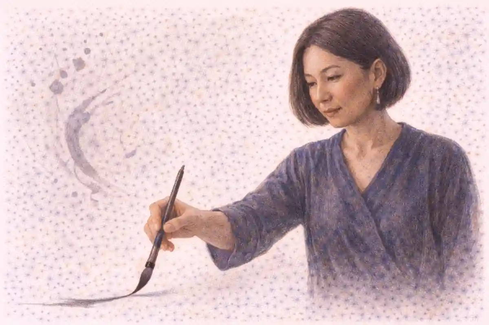

Every AP history course asks students to reason, but World History asks them to reason at a scale no other course attempts. The canvas runs from 1200 to the present and stretches across Afro-Eurasia, the Americas, and Oceania, which means a single exam question can place West African trading states beside Southeast Asian port cities and expect a student to think clearly about both. Facts alone cannot carry that load. A student who memorizes each civilization as a separate exhibit will run out of memory long before the course ends, while a student who learns to compare, to trace causes, and to track change across centuries owns a set of tools that works on any region the exam names.

Three historical reasoning processes organize the entire course: comparison, causation, and continuity and change over time. They appear in the framework as skills to be practiced, in the multiple choice questions as habits of reading, and in the written responses as the difference between an essay that lists and an essay that argues. Students sometimes treat them as vocabulary words to define on a quiz. That is a costly mistake. Each process is a way of moving through evidence, and the exam rewards the movement itself far more than any definition recited from memory.

What follows treats the three processes as working instruments rather than labels. It shows how comparison behaves when the two cases sit an ocean apart, how causation behaves when the chain runs across three centuries, and how continuity and change behaves when the span is long enough for empires to rise, transform, and vanish inside a single prompt. The companion [AP World History complete guide](/2007/08/20/ap-world-history-complete-guide/) covers the course as a whole, while this article isolates the reasoning itself, because reasoning across regions is precisely the skill that separates strong World History scores from average ones.

## Three Lenses Ground into One Instrument

Comparison, causation, and continuity and change over time are often introduced as three separate skills, yet on an actual exam they behave like three settings on a single instrument. A prompt about the Mongol Empire might ask why it expanded, which invites causation, then ask how its rule resembled rule in another khanate or another empire entirely, which invites comparison, and then ask what persisted in Eurasian trade after the empire fragmented, which invites continuity and change. The student who sees only one skill per question will answer a third of what the exam is really asking. Skilled readers let the three processes inform one another, because a cause in one region becomes a comparison point in another, and a change tracked over time in one place becomes the stable background against which change elsewhere stands out.

The framework gives each process a precise meaning, and precision matters. Comparison means identifying similarities and differences between two or more historical developments, then explaining the reasons for the patterns found and evaluating their significance. Causation means tracing how events and processes produce other events and processes, distinguishing long term causes from short term triggers and weighing which causes mattered most. Continuity and change over time means noticing what persisted and what transformed within a period or across periods, and explaining the processes that drove the transformation. None of the three is satisfied by description alone. Each demands explanation, and explanation is where the points live.

Scale is the feature that makes World History's version of these skills distinctive. In a national history course, comparison usually stays inside one country's borders, and causation can lean on a familiar cast of governments and parties. World History removes that scaffolding. Its comparisons cross oceans and its causal chains cross cultures, so the student must hold two unfamiliar contexts steady at once. That difficulty is also the opportunity: because the exam expects cross-regional thinking, it builds prompts that reward it, and a student trained to think across regions collects points that region-bound study leaves on the table.

A useful way to picture the three processes is to treat each as a question the historian asks of any material. Comparison asks, what is this like, and what is it unlike, and why? Causation asks, what made this happen, and what did it make happen next? Continuity and change asks, what endured while everything around it moved, and what finally gave way? A student who habitually asks all three questions of every topic, from Song China to the Sokoto Caliphate, walks into the exam already reasoning in the register the graders reward. The sections ahead take each process in turn, then put them to work on the cross-regional problems that define this course.

## Comparison: Holding Two Places in the Mind at Once

Comparison begins with an act of selection. Before a student can compare the Ottoman and Mughal empires, or maritime trade in the Indian Ocean with overland trade on the Silk Roads, the student must choose a basis for the comparison, a category along which both cases can be measured. Political structure, economic organization, treatment of religious minorities, methods of legitimating rule, and relations with merchants are all serviceable categories. A comparison without a chosen category drifts into two summaries stapled together, one paragraph about the first case and one about the second, with no analytical thread tying them. Graders recognize that shape instantly, because it describes twice and compares never.

Strong comparisons are built sentence by sentence rather than paragraph by paragraph. The weak version devotes a block to each case and hopes the reader performs the comparison mentally. The strong version alternates: a claim about land-based gunpowder empires, evidence from the Safavid case, contrasting evidence from the Ottoman case, and an explanation of why the difference emerged. When the Ottoman state administered a vast multiethnic empire through a professional bureaucracy and a devshirme-recruited corps, while the Safavid state anchored its legitimacy in Twelver Shi'a Islam enforced as state doctrine, the difference itself tells a story about how each empire solved the problem of cohesion. Explanation follows naturally once the evidence sits side by side, which is why interleaving beats blocking every time.

Similarities deserve as much respect as differences, and students habitually undervalue them. Finding that two distant societies responded alike to a shared pressure is a genuine discovery, because it suggests that the pressure, not local culture alone, shaped the outcome. When both the Ming state and several European states moved to control bullion flows in the sixteenth and seventeenth centuries, the parallel response points to a shared condition: silver had become a global currency, and governments everywhere faced the same new problem of managing it. A comparison that surfaces only differences misses that insight. A comparison that surfaces only similarities, on the other hand, flattens real variety, so the craft lies in balancing the two and then judging which pattern matters more for the question asked.

Significance is the third move, and it is the one students skip most often. After similarities and differences are on the page, the reasoning student asks what they mean. Two empires may differ in administrative style yet converge in outcome, or resemble each other in ritual while diverging in economic fate. Deciding which resemblances were consequential and which were cosmetic is the analytical core of the skill. The exam's written prompts reward exactly that judgment when they ask students to evaluate the relative importance of similarities or differences, and the judgment cannot be bolted on at the end; it has to grow out of categories chosen at the start.

### What makes a comparison genuinely analytical rather than descriptive?

A comparison turns analytical the moment it explains patterns instead of reporting them. Descriptive work notes that two societies both taxed merchants. Analytical work asks why each taxed merchants, notices one farmed revenue to local intermediaries while the other built a salaried customs service, and argues the difference reveals contrasting state capacities.

World History comparison also operates at several scales, and skilled students shift scale deliberately. Two port cities, such as Malacca and Kilwa, can be compared as nodes in one trading system. Two regions, such as sub-Saharan Africa and Southeast Asia, can be compared in their responses to expanding trade networks. Two hemispheres can be compared after 1492, when the Columbian Exchange began moving plants, animals, people, and pathogens between worlds that had developed in isolation. Each scale reveals different patterns. The city scale exposes daily commercial practice, the regional scale exposes adaptation to shared pressures, and the hemispheric scale exposes the largest structures of all, which is why the course trains students to move among them rather than camping at one level.

A final discipline keeps comparison honest: both cases must be treated in their own terms before they are set against each other. Comparing Aztec tribute extraction to Spanish colonial taxation only works if the student first understands what tribute meant inside Mexica political life, rather than grading one society by the other's standards. The exam's best comparison questions assume that respect for context, and its stimulus materials often supply the context deliberately. Students who read a source about one case and rush to judge it by a second case they half remember will produce confident, shallow work. Students who ground each case first, then compare, produce the essays that score.

## Causation: Chains That Run Across Centuries

Causation is the process students think they understand best and handle worst. Nearly everyone can name a cause for a famous event; far fewer can sort causes by type, weigh them against one another, and follow effects outward as they branch and decay. The framework expects exactly that sorting. Causes differ in their distance from the event: long term causes accumulate slowly, like population growth, climate pressure, or the gradual integration of a trade network, while short term causes strike quickly, like an assassination, a drought in a single year, or a ruler's sudden death. Between them sit intermediate developments that transmit long term pressure into immediate crisis. An answer that lists all three types as though they were equal has done the gathering but not the reasoning.

Consider the fall of a great state, the kind of problem World History poses in every unit. The collapse of the Abbasid Caliphate's effective power, the fragmentation of the Mongol Empire, and the decline of the Ottoman state across the nineteenth century all tempt students toward a single dramatic cause. Serious analysis resists the temptation. Fiscal strain from military commitments, succession disputes, regional governors converting delegated authority into hereditary power, and pressure from steppe peoples or European rivals interact over decades. The reasoning skill lies in holding the whole web steady, identifying which strands bore the most weight, and conceding that removing any one strand might have delayed the outcome rather than prevented it. Counterfactual awareness of that kind, used sparingly, marks a sophisticated causation answer.

Effects require the same discipline as causes, because effects become causes in their turn. The Mongol conquests destroyed cities and irrigation systems across parts of Persia and Iraq, an immediate effect of conquest. The Pax Mongolica that followed then lowered the cost of overland travel, revived Silk Road exchange, and sped the movement of technologies such as printing, gunpowder weapons, and astronomical knowledge across Eurasia, a second order effect that outlived the empire itself. A student who stops at the first order, at destruction, tells half the story and misses the half the exam prefers, since prompts often ask about unintended or long run consequences. Training the eye to ask what happened because of that, and then what happened because of that in turn, converts causation from a list into a narrative of transmission.

Primary and secondary causes are another distinction the exam quietly tests. A primary cause is one without which the event would not have happened in recognizably the same form; a secondary cause shaped the timing, scale, or character of the event without being indispensable. European maritime expansion after 1450 had primary causes in the search for direct access to Asian goods and in state competition that funded risky voyages. It also had enabling conditions, from caravel design to accumulated knowledge of Atlantic wind patterns, which students sometimes mistake for motives. Sorting motives, conditions, and triggers into their proper boxes is the unglamorous work that makes causation essays persuasive, because a grader can watch the student think.

### What separates a trigger from a cause worth arguing about?

A trigger is the proximate event that sets a prepared situation in motion, while structural causes are the conditions that made the situation explosive. The spark matters for chronology, but arguments about significance belong to the structures: fiscal strain, military pressure, contested legitimacy. Exam answers that lavish attention on the spark and neglect the structure mistake sequence for explanation.

World History stretches causation across an unusually long fuse, and that is the real challenge of the skill in this course. The causes of Atlantic revolutions in the late eighteenth century include Enlightenment ideas circulated through print, fiscal crises in France and in Spanish America, the example of the American Revolution, and, across a much longer arc, the slow construction of Atlantic trading systems that created creole elites with both grievances and resources. A student reasoning well will reach back across units without embarrassment, since the course is cumulative by design. The causes of decolonization reach back further still, into the nineteenth century construction of colonial states, the world wars that weakened European powers, and the education of colonial subjects in the colonizers' own political languages. Long fuses are normal in this course, and the student who only looks for causes inside the same decade as the effect will systematically underperform.

Causation also runs between regions, which is where World History causation earns its keep. Silver mined at Potosi reshaped tax policy in Ming China, because Spanish and Portuguese traders carried American silver into Chinese markets where a tax system increasingly demanded payment in silver. A drought in one part of the world could raise grain prices in another once markets integrated. The spread of industrialization from Britain to Belgium, Germany, the United States, and later Japan was a causal chain with regional links, each adoption altering the conditions for the next. Students who reason only inside one region will miss these transmissions, and the exam is built to catch exactly that habit, planting stimulus material that pairs an event in one place with its consequence in another.

## Continuity and Change over Time: The Long View

Continuity and change over time asks the student to watch a society across a span of years and report honestly on what moved and what refused to move. The skill sounds simple until a student tries it, because change is loud and continuity is quiet. Battles, revolutions, and new technologies announce themselves; marriage patterns, village agriculture, and religious practice persist in the background and rarely get dates attached to them. Untrained answers therefore chronicle change and forget continuity entirely, which is why the framework names the two together as one process. An answer that finds only change has failed half the prompt before the grader reaches the second paragraph.

Periodization is the skeleton of this skill. The course divides 1200 to the present into four units, and while the boundaries are conventions rather than natural laws, they mark real shifts in the dominant patterns of world history: the age of regional networks before oceanic connection, the making of a connected world between 1450 and 1750, the industrial and imperial nineteenth century, and the global twentieth century through the present. Students reason about change by testing those boundaries, asking whether life in a given place genuinely reorganized around 1450 or 1750 or whether the boundary is an artifact of European experience that fits other regions poorly. That testing is itself a graded move, since prompts often invite students to characterize change within or across the course's own periods.

Turning points anchor the analysis. A turning point is a moment after which the previous pattern could not simply resume: the Mongol conquests for Eurasian exchange, 1492 for the Americas, the Industrial Revolution for energy regimes and labor, the First World War for European predominance, decolonization for the political map of Africa and Asia. Identifying a turning point requires arguing both sides of it, showing the pattern before and the different pattern after, and the argument fails when the student treats a famous date as self evidently pivotal. Some famous dates changed less than quieter ones. The year a dynasty changed mattered less to a Chinese peasant than the year a new crop, perhaps the sweet potato or maize arriving through Columbian Exchange channels, altered what a hillside farm could produce.

Continuity has its own heroes in this course, and naming them precisely is a learnable craft. Religious frameworks persisted across political upheavals: Islam spread and rooted itself in West Africa and Southeast Asia through centuries of dynastic change, and Confucian family ethics organized Chinese life under dynasties that rose and fell around it. Trade routes endured while their cargoes changed; the Indian Ocean monsoon system carried merchants in 1200 and in 1700 on the same seasonal winds, even as the goods shifted and European armed ships entered the water. Patriarchy persisted across nearly every society in the course, changing its forms while keeping its core asymmetries. A student who can name a continuity and explain the mechanism that preserved it, an institution, a geography, a belief system with organized carriers, does the quiet half of the skill with real sophistication.

Change itself comes in kinds, and sorting the kinds sharpens any answer. Some change is rapid and revolutionary, like the Haitian Revolution's destruction of slavery in France's richest colony. Some is cumulative and almost invisible year to year, like the slow commercialization of the Chinese economy across the Ming and Qing centuries. Some change is reversal, as when the People's Republic of China first collectivized agriculture and later unwound the communes. Some change is superficial, a new flag over an old structure, which students must learn to detect rather than celebrate. A prompt that asks about change across a long span is usually fishing for this discrimination: the student who reports that everything changed, or that nothing really did, will score below the student who specifies what changed, how fast, for whom, and what stood still underneath.

### Why does continuity earn as much credit as change?

Graders reward continuity because spotting it is harder and because it disciplines the story of change. Anyone can see that industrialization transformed work; explaining why family structures, religious observance, or village landholding persisted through that transformation requires understanding the forces that stabilize a society. Continuity claims protect an answer from exaggeration, since change measured against a background takes its size.

The long span is where this skill and this course meet most naturally. A continuity and change essay on gender roles might run from 1450 to the present, tracking how women's labor in textile production shifted from household spinning to factory floors to global garment supply chains, while the expectation that women carry primary responsibility for household labor survived every transition. An essay on state power might run from the gunpowder empires to modern nation states, tracing the continuity of taxation and conscription alongside the transformation of legitimacy from dynastic and religious claims toward nationalism and popular sovereignty. Spans of four or five centuries frighten students who think in chapters; they delight students who think in processes. The course is built for the second kind, and this skill is the machinery that makes long thinking possible.

## The InsightCrunch World Reasoning Toolkit

Skills stay abstract until a student has handles to grab, so this guide packages the three processes as the InsightCrunch World reasoning toolkit, a small set of repeatable moves that can be applied to any region or period in the course. The toolkit's first move is framing: before writing anything, the student names the skill the prompt demands, the two cases or the span involved, and the categories or cause types that will organize the answer. Framing takes ninety seconds and prevents the most common failure in AP history writing, which is answering fluently beside the question. The second move is pairing: evidence is gathered in matched sets, never in solitary piles, so that comparison material arrives already compared and causation material arrives already chained. The third move is judging: the student decides which similarity, difference, cause, or change mattered most and says why, because judgment is what converts information into argument.

The table below condenses the toolkit into its working parts. Each row pairs a process with the question it asks, the move a student performs, and the trap that move is designed to avoid. Students preparing for the exam can rehearse with the table open, topic by topic, until the moves run without prompting.

| Reasoning process | Guiding question | Working move | Trap it avoids |
|---|---|---|---|
| Comparison | What is this like or unlike, and why? | Choose categories, interleave evidence from both cases, judge significance | Two summaries stapled together |
| Causation | What produced this, and what did it produce? | Sort causes into long term, intermediate, and trigger; rank them | A list of causes treated as equal |
| Continuity and change | What endured, what transformed, and how fast? | Name the mechanism preserving continuity; characterize the pace of change | A chronicle of change with no stable background |
| All three together | How does this place connect to that one across time? | Let a cause in one region become a comparison point in another | Region by region silos |

Two habits bind the toolkit together. The first is the habit of the second case: whenever a student studies a development in one region, the toolkit demands a named counterpart somewhere else, even if the counterpart is only a question. Studying the trans-Saharan gold trade invites the counterpart of Indian Ocean gold flows out of Great Zimbabwe; studying Japanese industrialization invites the counterpart of Egyptian or Ottoman industrial experiments. The counterpart habit makes comparison automatic rather than occasional. The second habit is the habit of the long arrow: whenever a student records an event, the toolkit demands a cause reaching back at least a generation and a consequence reaching forward at least a generation. Long arrows make causation and continuity visible by default, so the exam's long span prompts feel familiar instead of threatening.

None of this requires talent. It requires repetition across enough topics that the moves become reflexes, which is why the toolkit is designed for the whole course rather than for the final review week. A student who frames, pairs, and judges on every practice paragraph from September onward will not need to learn a new way of thinking in April. The content units supply the raw material; the reasoning toolkit is the machinery that processes it. The deep dive into the early units, [Units 1 to 4 of AP World History from 1200 to 1750](/2007/08/16/ap-world-history-units-1-4-1200-1750/), shows the raw material in its regional variety, and the machinery described here is what a student runs on that material to turn coverage into scores.

## Comparison at Work: Empires, Oceans, and Land Empires of Trade

Worked examples teach faster than rules, so consider how comparison handles the great land empires of the early modern period. Between 1450 and 1750 the Ottoman, Safavid, and Mughal empires all governed large Muslim majority or Muslim ruled populations, all fielded gunpowder armies, and all faced the problem of ruling subjects whose religions differed from the court's. A descriptive answer recites those shared features. An analytical answer chooses a category, say the management of religious difference, and works it hard: the Ottoman millet arrangements granted communal autonomy to Christians and Jews within an Islamic imperial frame; Akbar's Mughal court experimented with policies of accommodation toward Hindus, abolishing the jizya for a time and recruiting Rajput elites into imperial service; the Safavid state moved in the opposite direction, consolidating Twelver Shi'a identity partly to distinguish itself from Sunni neighbors. The category reveals three different technologies of cohesion, and the comparison now explains something real about how empires hold together.

Maritime comparisons reward the same discipline. The Indian Ocean trading system and the trans-Saharan trading system both moved gold, both carried Islam along their routes, and both depended on environmental knowledge, monsoon winds in one case and desert caravan organization in the other. The differences are where the argument lives. Oceanic trade connected three continents through ports that ships reached on predictable seasonal cycles, creating a genuinely multilateral system in which no single state could dominate the whole. Saharan trade ran between the West African savanna and the Mediterranean through a far harsher corridor, concentrating power in the states that controlled the corridor's southern termini, Mali and then Songhai. A student comparing the systems can argue that geography set the political consequences: diffuse maritime networks produced merchant diasporas and port city autonomy, while a narrow desert corridor produced territorial empires taxing a chokepoint. That argument is comparison doing real historical work.

Comparison also rescues topics students find dull, because any two cases placed side by side generate friction and interest. Labor systems after 1450 offer a grim example. Encomienda and later hacienda labor in Spanish America, serfdom's intensification in Russia, and the plantation slavery of the Caribbean all answered an elite demand for cheap, controlled workers, yet they differed in legal basis, in the racial ideologies built around them, and in workers' possibilities for resistance or escape. The comparison reveals a shared early modern pattern, the coercive reorganization of labor under expanding markets, expressed through local institutions. Without the comparison, each system sits in its own chapter as a fact to memorize. With it, the three systems illuminate a single global process, which is exactly the kind of illumination the course thesis promises.

Scale shifting deserves one more worked moment. Comparing the Aztec and Inca empires at the level of imperial administration shows two solutions to governing without a shared written script tradition in the Aztec case and without wheeled transport or a market economy in the Inca case: tribute lists and relay runners in one, quipu records, state storehouses, and the mita labor levy in the other. Zoom out to the hemispheric scale and both empires become comparable as states that expanded rapidly in the century before European contact, integrating diverse peoples through a mix of coercion and incorporated local elites. Zoom in to the city scale and Tenochtitlan's market system contrasts with Cuzco's ceremonial and redistributive functions. Each scale is a legitimate comparison; the skilled student picks the scale the prompt implies and says enough at that level to argue, rather than spraying facts from all three.

Mistakes in comparison cluster predictably, and naming them helps students avoid them. The first mistake is the unbalanced comparison, in which one case gets rich detail and the other gets a sentence, usually because the student studied one region harder. The second is the comparison of incomparables, pairing categories that do not align, such as one empire's religion with another's tax code. The third is the frozen comparison, where two societies are compared as though each stood still across the whole span, which collapses the moment a prompt covers two centuries. The fourth is the missing verdict, evidence on both sides with no judgment about which pattern mattered more. Each mistake is fixable with toolkit moves: choose categories first, interleave the evidence, periodize each case, and end with a judgment. None requires more knowledge; all require more deliberate arrangement of the knowledge a student already holds.

## Causation at Work: Silver, Disease, and Industrial Fire

The Columbian Exchange is the course's richest causation laboratory, because its effects run in every direction and at every speed. In the Americas, pathogens from the Old World caused catastrophic population decline among Indigenous peoples who lacked immunity to smallpox, measles, and influenza, in some regions killing a majority of the population within generations. That demographic collapse was a primary cause of the labor shortage that colonizers answered with African slavery, which makes disease a remote but genuine cause of the Atlantic slave system's scale. In the other direction, American crops such as maize, potatoes, and manioc raised caloric output in Europe, Africa, and China, supporting population growth on three continents. A student reasoning causally can follow one exchange through demography, labor, diet, and state finance without ever leaving the evidence, and can rank the links: disease mattered fastest, crops mattered longest, and silver mattered most to governments.

Silver deserves its own causal chain because it ties three continents into one mechanism. Mines at Potosi in the Andes and Zacatecas in Mexico poured bullion into world circulation. Much of it crossed the Atlantic to Spain, where it financed Habsburg wars and fueled price inflation, and much of it crossed the Pacific on the Manila galleons to China, where Ming tax reforms had consolidated payments into silver and created enormous demand. Chinese demand kept silver's value high in Asia, which drew more silver westward and bound American miners, Spanish officials, Filipino intermediaries, and Chinese taxpayers into a single causal web. The chain teaches the central lesson of World History causation: the causes of a Chinese fiscal policy can include an Andean mountain, and an exam that tests world history will test exactly that reach.

Industrialization supplies a slower, more layered chain. Britain industrialized first for reasons historians still rank differently: accessible coal, high wages that made labor saving machinery profitable, colonial markets and raw materials, financial institutions able to mobilize capital, and an agricultural surplus that freed workers. The reasoning skill is not picking one winner but showing how the factors interlocked, coal near iron near canals, wages beside markets beside credit. Then the chain extends. Industrial Britain's demand for cotton fed slavery's expansion in the American South and land pressure in Egypt and India; its exports of cheap textiles undercut handloom weavers in Bengal; its need for markets and materials helped drive the new imperialism of the late nineteenth century. Each link is an effect becoming a cause, and the student who narrates the chain with the links sorted by weight writes the kind of answer the causation prompts were designed to find.

### How far back should a causation answer reach?

Reach back until the chain reaches a condition without which the event loses its shape, and stop there rather than reciting everything earlier. For most exam prompts that means one long term layer, such as trade integration or fiscal strain, an intermediate development that sharpened it, and the trigger. Three layers, weighed and connected, outscore a catalogue of ten causes.

Decolonization shows causation operating on a global political scale, and it rewards students who separate the layers. Long term causes include the colonial state's own schools and bureaucracies, which trained the lawyers, clerks, and officers who would lead independence movements, and the spread of ideas about self determination that circulated through print and through colonial soldiers' service in two world wars. Intermediate causes include the weakening of Britain, France, and the Netherlands by the Second World War, the emergence of the United States and the Soviet Union as superpowers skeptical of old empires for their own reasons, and the founding of the United Nations as a forum where colonialism faced organized criticism. Triggers varied by colony: a partition plan in India, a military defeat at Dien Bien Phu for France in Indochina, a settler revolt in Kenya. The layered model travels; a student who builds it for one colony can rebuild it for another in minutes, which is precisely the transfer the exam hopes to measure.

A last causation discipline is honesty about limits. Causes interact, evidence is incomplete, and historians argue in good faith about the same events. Exam answers earn trust when they acknowledge a competing cause and explain why the chosen ranking still stands, rather than pretending the record speaks with one voice. That acknowledgment is not hedging; it is the signature of a mind that understands causation as a judgment under uncertainty. Graders who read hundreds of essays recognize the signature at once, because most essays either assert one cause with false confidence or list many causes with no commitment. The middle path, commitment with reasons and a concession, is where the strongest scores gather.

## Continuity and Change at Work: Faith, Family, and the State

Take religion across the whole span of the course and the skill performs beautifully. In 1200 the great religious traditions were already old, and their carriers, merchants, monks, missionaries, and scholars, kept moving them into new territory: Islam into West Africa and maritime Southeast Asia, Buddhism along routes into East and Southeast Asia, Christianity into the Americas after 1492 under colonial sponsorship. The change story is expansion and encounter, including syncretic blends where traditions met local practice. The continuity story is deeper: the core texts, rituals, and ethical frameworks of each tradition persisted across every political revolution the course records, and religious identity repeatedly outlasted the states that sponsored or persecuted it. A student writing on religion across two units can therefore argue a layered thesis, that the map of belief changed dramatically while the internal architecture of belief changed slowly, and support both halves with named cases.

The state offers a second long performance. Between 1200 and the present, states taxed, conscripted, judged, and recorded in every unit, and those functions are the continuity. Bureaucracy itself is a continuity with a pedigree running through Chinese examination systems, Ottoman scribal services, and Inca record keepers into modern civil services. The change story is equally real: legitimacy migrated from divine sanction and dynastic inheritance toward nationalism, constitutions, and mass politics; the scale of state ambition swelled until twentieth century governments attempted to manage economies, education, and public health in ways no sultan or emperor imagined. Surveillance and welfare both belong to that swelling. The skill is in the proportion. A strong answer refuses to let the drama of new ideologies erase the old fiscal skeleton underneath, and refuses equally to pretend that a tax collecting empire and a modern welfare state are the same animal.

Turning points repay careful handling because the exam loves to test them. Consider 1750 as a hinge. Before it, most human labor everywhere ran on muscle, wind, and water; after it, fossil energy began its long takeover, first in Britain and then, unevenly, across the world. Before it, European power overseas was real but contested and coastal; after it, industrial and military gaps widened until European empires could seize interiors in Africa and Asia. Yet a sophisticated answer complicates the hinge: for a farmer in Bengal or a herder in Central Asia, 1750 changed less than 1850 or 1950 would, and periodization drawn from British experience maps awkwardly onto regions whose hinges came later. Arguing about where a turning point truly sits, for whom, is the skill at its most advanced, and the course's four unit boundaries are invitations to practice that argument rather than walls that forbid it.

Migration supplies a third performance with a particularly clear continuity. Humans moved in every period of the course: Bantu speaking peoples across Africa in earlier centuries, Turks and Mongols across the steppe, Europeans and enslaved Africans across the Atlantic, indentured laborers from India and China across the Indian and Pacific Oceans, and guest workers and refugees in the twentieth century. The continuity is movement itself, driven by the ancient motives of land, work, safety, and family strategy. The changes are in scale, in coercion, and in state management: passports, quotas, and border regimes are modern inventions layered over an ancient behavior, and the mechanization of transport compressed journeys that once took seasons into days. A continuity and change answer on migration that names the ancient pattern first and then specifies the modern machinery scores higher than one that treats modern migration as an unprecedented event, because the first answer knows what the phenomenon is.

Students stumble on this skill in three recurring ways. The first stumble is the empty middle, an answer that describes the start of the span and the end of the span with nothing about the process between, as though history teleported. The second is change spotting without continuity, described earlier as the loud and quiet problem. The third is the false turning point, where a student crowns a famous event that changed little for the people in the prompt, or ignores the slower shift that changed everything. Each stumble has a toolkit cure: narrate the middle as a process, deliberately assign one category of life to continuity before writing, and test every candidate turning point by asking what daily life looked like on both sides of it. The tests take seconds and rescue essays.

## The Three Skills Inside the Multiple Choice Section

Multiple choice questions in World History are reasoning questions wearing a content costume. A stimulus, perhaps an excerpt from a travel account, a trade statistic rendered in plain text, a description of a ritual, or an image of a building, anchors a small set of questions, and those questions rarely ask what the stimulus says. They ask what caused the situation the stimulus shows, what the situation resembles elsewhere, or how it changed from an earlier pattern. A student who reads the stimulus only for facts will answer the first question of each set and guess at the rest. A student who reads for skill cues will recognize the set's architecture: one question on the source itself, one on causation or comparison, one reaching outward to another region or period.

Causation questions have tells. Their stems carry words like contributed, resulted, led, enabled, or prompted, and their answer choices mix plausible causes with effects, conditions, and coincidences. The common trap is the choice that names something true but downstream, an effect dressed as a cause, or something true but trivial beside the structural answer the framework favors. When a question asks why Indian Ocean trade expanded in the period after 1200, choices might include a specific ruler's policy, a specific port's wealth, the diffusion of lateen sails and navigational knowledge, and the growth of states and cities demanding luxuries across Afro-Eurasia. The reasoning student weighs scale: individual reigns end, while technologies and demand structures operate across centuries, and the exam's causation answers usually sit at the structural level.

Comparison questions in multiple choice reward the counterpart habit directly. A set may present a source about Mongol religious tolerance and then ask which other empire followed a comparable policy, or present a description of terrace farming in the Andes and ask where a similar adaptation to environment appeared. The student who has spent the year naming counterparts answers from a prepared mental index. The student who studied each region in isolation must invent the comparison under time pressure, and invented comparisons tend to latch onto surface features, matching two societies because both had kings, rather than structural ones, such as both extracting labor through corvee obligations. Surface matching is the multiple choice version of the stapled summaries error, and the exam plants it as a distractor with care.

Continuity and change questions carry their own tells: stems ask what persisted, what remained consistent, what changed most significantly, or which development represents a break from an earlier pattern. The traps here are absolute statements about total transformation and nostalgic statements about total stasis, both of which world history almost never supports. A question about West Africa between 1200 and 1750 might offer choices claiming Islam replaced all local practice, or that trade patterns froze, or that states rose and fell while the gold trade's basic geography and the region's religious layering endured and deepened. The third shape of answer, layered and proportioned, is usually the reasoning answer. Students should grow suspicious of any choice in this family that uses words like completely, entirely, or never, because the course's own thesis is that change is real but almost always partial.

Time management interacts with reasoning in this section more than students expect. A set built around a rich stimulus can consume minutes if the student rereads the whole passage for every question. The toolkit habit of framing helps here as well: on first reading, mark what the source is, where and when it belongs, and which skills the set is likely to test. That thirty second investment pays across three or four questions. Practice sets should therefore be done in whole sets rather than single questions, so the framing habit forms under realistic conditions. Students who practice question by question often look strong in homework and then bleed time in the exam room, because the skill they failed to train was the set level reasoning that World History demands.

## The Three Skills Inside the Written Responses

Written responses are where the reasoning processes stop being reading habits and become architecture. A long essay prompt in World History names its skill in the verb: compare, evaluate the causes, assess the extent of change. The thesis of a strong response performs the skill rather than announcing it. A comparison thesis does not say that two empires had similarities and differences; it states which pattern mattered more and why. A causation thesis does not say that an event had many causes; it ranks the two or three decisive ones and names the trigger as a trigger. A continuity and change thesis does not say that much changed; it specifies what changed, what endured, and which of the two tells the deeper story of the period. Graders can award the argument point within the first paragraph when the thesis reasons, and no quantity of later evidence fully repairs a thesis that merely describes.

Evidence selection follows the thesis's reasoning shape. Comparison essays need matched evidence, point by point, so the writer's outline should be organized by category rather than by case. Causation essays need evidence at each layer, long term, intermediate, and trigger, with at least one effect followed into its second generation. Continuity and change essays need evidence from both sides of the span and, crucially, from the middle, so the process of transformation is visible rather than implied. Students who outline for five minutes in the toolkit's framing mode produce these shapes naturally; students who start writing immediately produce chronologies, and chronology is the enemy shape in all three formats, because a sequence of events displays knowledge while withholding judgment.

The short answer questions test the same skills in miniature, and they punish the same habits in miniature. A typical set presents a stimulus and asks students to identify a development, explain a cause or a comparison, and extend to a consequence or a second region. Each part is a reasoning move compressed into a few sentences. The student who answers the explain part with a description, restating the stimulus in other words, has performed the most common short answer error in the course. Explanation requires a mechanism, a because that connects conditions to outcomes, and mechanisms are exactly what causation practice builds. Short answers are therefore best trained with the same toolkit, framed and paired, at smaller scale.

Document based writing adds sourcing to the reasoning load, and the two support each other. A document's author, audience, and purpose shape what causal or comparative claim the document can honestly carry: a merchant's letter can evidence trade practices and perceptions, a court chronicle can evidence how a state wished its power to be seen, and neither should be asked to prove what its creator could not have known. The full treatment of essay mechanics, document grouping, and rubric strategy lives in the guide to [AP World History DBQ, LEQ, and SAQ strategy](/2007/08/07/ap-world-history-dbq-leq-saq-strategy/), and this article deliberately leaves that machinery there. What belongs here is the connection: reasoning gives document work its direction, because a student who knows the essay must compare will group documents comparatively, while a student grouping by topic alone will assemble piles that no thesis can use.

Complexity, the quality that separates good essays from top band essays, is also a reasoning product. In a comparison essay, complexity appears when a student shows that a similarity held in one domain while reversing in another, or that a difference mattered enormously for one group and barely for another. In a causation essay, it appears when a cause operates through an unexpected channel, or when an effect feeds back to strengthen its own cause, as industrial profits funded the navies that protected the trade that generated the profits. In a continuity and change essay, it appears when change in one region is continuity's cause in another, as when the transformation of Atlantic economies depended on the persistence of coerced labor systems. Students chase complexity as though it were a spice added at the end; it is actually the natural flavor of reasoning carried one step further than the prompt required.

## Companion Practices: Contextualization and Sourcing

The framework surrounds the three reasoning processes with supporting practices, and two of them do so much work that they deserve direct treatment here. Contextualization is the practice of placing a development inside the larger patterns of its moment, explaining how broad processes shaped a specific case. It is comparison's quiet partner: to contextualize the rise of the Sokoto Caliphate is to place it inside the wider wave of Islamic reform movements and state building across West Africa in the eighteenth and nineteenth centuries, and to contextualize the Meiji Restoration is to place it inside the global pressure of Western industrial power on Asian states. A student who contextualizes well has usually compared already, because the context chosen is a set of comparable cases moving through the same currents. Weak contextualization names the century and stops; strong contextualization names the process and shows its fingerprints on the case.

Sourcing is the second companion, and it disciplines all three reasoning processes by policing the evidence they use. Every document was made by someone, for someone, at a moment, for a purpose, and those four facts limit and enable what the document can prove. A causation argument built on a ruler's memoir must account for the memoir's interest in crediting the ruler's decisions. A comparison built on two travel accounts must account for the travelers' different homes and hosts. A continuity claim built on legal codes must remember that codes describe aspirations as well as practice. Sourcing is therefore not a separate chore performed on documents before the real writing begins. It is the quality control department of reasoning itself, and essays that source well reason well because their claims have been sized to their evidence.

The two companions combine in the strongest World History work. Consider a student analyzing why the Haitian Revolution succeeded where other slave revolts had not. Contextualization places the revolt inside the Atlantic revolutionary age, the fiscal collapse of the French monarchy, and the wars that pulled French attention and troops across the Atlantic. Sourcing weighs the evidence: French planter correspondence for the colony's internal divisions, revolutionary decrees for the legal turns of emancipation, later Haitian constitutions for the new state's self understanding. The causation argument that emerges, layered, timed, and honest about its materials, is the kind the exam exists to reward. Neither companion skill appears in this article's title, but both are load bearing, and students preparing the three named processes should train the companions alongside rather than after.

There is a temptation to treat these practices as rubric garnish, sprinkled into an essay's margins to collect stray points. The temptation should be resisted for a practical reason: garnish is visible. Graders read contextualization that does not connect to the argument as decoration, and sourcing comments that do not alter any claim as boilerplate. Woven in, the same material becomes invisible in the best way, changing what the essay can claim and how firmly it claims it. The test a student can apply is deletion: if removing the contextualization paragraph would change nothing in the essay's argument, the paragraph was garnish; if removing it would strand the thesis without its setting, the paragraph was structure. Structure earns; garnish merely occupies space.

## Reasoning at Different Scales

World History is unusual among school subjects in demanding that students reason about units of wildly different size, from a single port city's customs house to the entire Afro-Eurasian trading world, and the reasoning processes behave differently at each scale. Comparison at the city scale is concrete and sensory: Malacca and Mogadishu can be compared through the goods on their docks, the languages in their markets, the origins of their merchants. Comparison at the scale of whole civilizations is structural: the comparison turns on state forms, agrarian bases, and religious frameworks, and it risks vagueness unless the student anchors it in the concrete. Skilled writers shuttle between scales, proving a structural claim with a dockside detail, and the exam's stimulus design encourages the shuttle by pairing granular sources with expansive questions.

Causation changes character with scale as well. At the small scale, causation is personal and immediate: a usurper seizes a throne, a caravan is raided, a missionary converts a ruler. At the large scale, causation is impersonal and slow: silver flows alter tax systems, disease pools reshape labor markets, energy regimes reorder which regions hold power. Neither scale is more true; they are different lenses on the same past, and the framework's causation skill asks students to connect them, showing how a slow structural pressure expressed itself through a fast personal event. The assassination that starts a succession crisis matters because the succession system was already brittle; the brittleness matters because it eventually let the crisis happen. Students who can run causation in both directions between the scales write answers with genuine depth.

Continuity and change is the most scale sensitive of the three. At the scale of an individual life, almost nothing in 1750s West Africa may have visibly changed across a decade. At the scale of the Atlantic world, that same decade sits inside the slave trade's height, a transformation of three continents. The prompt's implied scale therefore determines the honest answer, and a student who answers a global question with village evidence, or a village question with global claims, will reason past the point. Reading prompts for their scale is a framing move, one more reason the toolkit insists on ninety seconds of framing before any writing begins. The framework rewards the student whose analysis is sized to the question, and sizing is a learnable, mechanical discipline.

## From Describing to Analyzing: The Upgrade Every Answer Needs

The single most valuable sentence a World History student can learn to write is the one that begins where description ends. Description reports that the Safavid Empire used Shi'a Islam as a state ideology. Analysis asks what work that ideology did: distinguishing the empire from its Sunni rivals, giving its shahs a legitimating language, binding a tribal military aristocracy to a centralizing court, and hardening a frontier into a confessional border that outlasted the dynasty. Description reports that steamships shortened ocean voyages. Analysis follows the shortening into freight rates, migration volumes, imperial response times, and the shrinking strategic value of coaling station geography. In each case the facts are identical; the analysis is a second pass over the same facts, asking of each one what it caused, what it resembled, or what it changed.

Students often believe analysis requires more facts than they possess, when it usually requires more questions asked of the facts already in hand. The toolkit's three guiding questions are the asking machinery. Given any paragraph of description, a student can interrogate it: what is this like elsewhere, which converts it toward comparison; what produced this and what did it produce, which converts it toward causation; what stood still while this moved, which converts it toward continuity and change. A paragraph that survives all three interrogations has been analyzed. Teachers can train the conversion directly by taking descriptive drafts and marking the sentences where a question should have been asked, and students can train it alone by refusing to let a study session end at summary.

The distinction matters for grading mechanics as well as for intellectual honesty. Rubrics across the written formats reserve their upper reaches for analysis and complexity, and reserve their floors for accurate description, which means a flawless descriptive essay has a ceiling it cannot break through. Students aiming at the top scores must therefore treat description as scaffolding, necessary and temporary, with analysis as the building. The good news is that the ratio can be practiced deliberately: for every factual claim in a practice essay, the student writes one reasoning sentence that uses it. The habit feels artificial for a week and then becomes the way the student thinks, which is the point of every drill in this course.

## The Silo Problem: Why Region by Region Study Fails This Exam

The misconception this article most needs to retire is the belief that World History is a shelf of separate civilizations, each to be learned in its chapter and closed when the chapter ends. The course is organized in units for administrative sanity, and textbooks arrange regions in sequence because paper has an order, but the exam itself is built against the silo. Its themes, which track interaction, environment, governance, economics, culture, and social organization across the whole span, exist precisely to force connections. Its written prompts routinely name two regions or a span crossing unit boundaries. A student who learned Song China, the Mongol Empire, the Delhi Sultanate, Mali, and the Aztec world as five sealed boxes must, in the exam room, open all five at once and reason among them, a feat of retrieval that siloed study never rehearsed.

The silo also distorts causation, because the largest causes in this course are connective by nature. Trade networks, missionary religions, epidemic disease, steppe migrations, silver flows, and industrial capitalism do not respect regional boundaries, so a regional account of any of them is structurally incomplete. Why did West African states grow wealthy in the fourteenth century? Partly because of gold the region produced, and partly because North African and European demand, Islamic commercial networks, and camel transport technology converged on the region from outside. Why did Japan industrialize faster than China in the late nineteenth century? The comparison is unanswerable inside either silo; it requires the two cases, their different state structures, and their different encounters with Western pressure, held in one frame. Silo study cannot even formulate such questions, let alone answer them.

Breaking the silo is a study design problem with study design solutions. The first solution is thematic note taking: instead of a notebook per region, keep a running matrix whose rows are themes, trade, labor, belief, state power, gender, environment, and whose columns are regions and periods, filling cells as the course proceeds. The matrix makes comparison a byproduct of note taking rather than an extra task. The second solution is the paired flashcard habit: every fact card gets a counterpart prompt on its back, asking where else the pattern appears or what it produced elsewhere. The third solution is boundary review: at each unit's end, the student spends one session only on connections across the boundary, what crossed from the earlier unit into the later one and what the crossing changed. None of these techniques adds study hours; all of them redirect hours toward the connections the exam actually scores.

Teachers inherit the silo from pacing guides, and many fight it with comparative warm ups and cross unit projects. Students can fight it independently regardless of classroom design, because the fight is mostly a matter of asking connection questions on schedule. The reward for winning it is not merely better essays. It is a usable mental map of the premodern and modern world in which regions appear as variations on shared human problems: how to feed cities, legitimate rulers, move goods, absorb new faiths, and survive contact with strangers. That map is what the course was always for, and the exam is simply the occasion on which the map gets drawn from memory.

## All Three Skills on One Topic: The Mongol Century

Watch the three processes cooperate on a single topic and their unity becomes obvious. The Mongol Empire invites causation first: why did a confederation of steppe peoples conquer most of Eurasia in the thirteenth century? The layered answer reaches from steppe ecology and horse based mobility through Chinggis Khan's reorganization of tribal forces into decimal units with meritocratic promotion, to the disunity and wealth of the settled states in the path. Comparison follows naturally, because the empire's successor states diverged: the Yuan in China adopted Chinese bureaucratic forms, the Ilkhanate in Persia converted to Islam and patronized Persian culture, the Golden Horde on the steppe kept more of the older pattern while Islamizing over time. Comparing the khanates explains how one conquest produced several civilizations' worth of outcomes, with local conditions filtering a shared inheritance. Continuity and change completes the circuit: under the conquest's violence, Eurasian trade routes revived and integrated, diplomatic passports and relay stations persisted as infrastructure after the empire fragmented, and the political unity of the steppe world dissolved while its connective tissue remained.

A student who can run all three processes across the Mongol century owns a template for the entire course. The French Revolution submits to the same treatment: layered causes from fiscal crisis to Enlightenment circulation, comparison with the American and Haitian revolutions unfolding in the same Atlantic storm, continuity in the French state's centralizing drive beneath revolutionary rhetoric. The spread of Buddhism submits as well: causes in trade routes and royal patronage, comparison of its Theravada, Mahayana, and Tibetan forms as it crossed cultures, continuity of core doctrine through every translation. Topic after topic, the three questions keep opening doors, which is why this article treats them as one instrument with three settings rather than three chores. The exam will supply the topics; the instrument is the student's to bring.

## Connecting the Skills Across the Four Units

The course's four units are not four subjects; they are four chapters of one argument about connection, and the reasoning skills are the argument's verbs. In the first unit, from 1200 to 1450, the connections are regional: Silk Roads, Indian Ocean routes, and trans-Saharan caravans link Afro-Eurasia while the Americas develop their own networks in isolation. Comparison in this unit runs among the great regional systems, causation runs through trade and conquest, and continuity is visible in the ancient religions and agrarian patterns that anchor every region. A student reasoning well here learns to compare networks themselves: why did the Indian Ocean system integrate more peoples than the Sahara crossing, and what did each network do to the states along its edges?

The second unit, from 1450 to 1750, makes the connections oceanic and global. The Columbian Exchange rewires biology on both sides of the Atlantic; silver rewires finance on three continents; European sea empires plant themselves on coasts they could not yet conquer inland. Continuity and change does heavy work in this unit, because the honest story is double: the world's peoples were connected as never before, and yet most daily life, farming, worship, family, continued on rhythms older than any caravel. Causation also stretches, since an event in this unit, the conquest of Mexico, has causes in Iberian politics, Caribbean experimentation, Indigenous alliances, and Eurasian disease history all at once. The student who practices reaching for all four cause families, political, economic, cultural, and environmental, will find the unit's questions opening like locks.

The third unit, from 1750 to 1900, is the century of revolutions and industry, and it is where comparison earns its highest wages. Revolutions in the Atlantic world invite structured comparison of causes and outcomes; industrialization invites comparison of the first mover with the followers and the resisters; imperialism invites comparison of colonial regimes and of colonized societies' responses. Causation in this unit runs through ideology and energy together, an unfamiliar pairing for students used to purely political stories. Continuity hides in plain sight: the same century that industrialized textiles also expanded coerced labor, and the same states that proclaimed rights also built empires, and noticing those continuities is the difference between a celebratory summary and a historical argument.

The fourth unit, from 1900 to the present, compresses the tempo. Two world wars, a global depression, decolonization, the Cold War, and accelerating globalization crowd into a single span, and the reasoning skills become survival equipment. Turning points multiply and must be sorted: 1914, 1945, 1989, and the slower hinges of demographic transition and digital communication compete for the label. Comparison runs between the superpowers, between paths of decolonization, between economic models. Causation runs through everything at once, since the century's events are densely interconnected, a war in Europe reordering colonies in Asia within years. The student who has practiced the toolkit across the earlier units arrives here with the tempo tolerance the unit demands.

Running beneath the units, the course's themes offer a second set of rails for the skills. Governance, economic systems, social organization, culture, environment, and technology each form a thread a student can follow from 1200 to the present, reasoning along the thread with whichever process a prompt requests. Following the technology thread, for instance, produces a ready made continuity and change narrative: gunpowder's diffusion, printing's spread, steam's concentration of production, electricity's reorganization of cities, and the internet's compression of distance, with the continuity that each new technology was absorbed into older hierarchies before it transformed them. Students who build one such thread deliberately, in a notebook, own a spine for half the essay prompts the exam can pose, because nearly any prompt can be hung on a theme the student has already reasoned through end to end.

## The Same Skills in a Narrower Frame: What APUSH Teaches World Students

Students who take both United States history and World History often notice that the reasoning framework is shared, and the comparison between the two courses is itself instructive. In APUSH, comparison typically operates within one nation's experience: North against South, one era's reformers against another's, the early republic against the Gilded Age. Causation there runs through a relatively continuous cast of institutions, parties, and constitutional arguments. World History keeps the same three processes but removes the shared national floor, so the student must supply context for both sides of every comparison and cannot assume that terms like state, market, or religion mean the same thing in both cases. The World student who has done APUSH work will find the moves familiar and the footing less certain, which is exactly the intended difficulty. The dedicated treatment of [comparison and continuity and change in APUSH](/2006/07/29/apush-comparison-continuity-change/) shows the skills on the narrower canvas, and reading it beside this article clarifies what scale does to each process.

The transfer runs in the other direction as well. World History's habits improve APUSH answers, because the World-trained student instinctively contextualizes American developments inside global currents: the cotton economy inside world textile demand, the Revolution inside an Atlantic crisis of empires, the Cold War inside decolonization. Each course punishes insularity in its own way. What neither course rewards is the memorized survey, the parade of names and dates unconnected by argument. Both frameworks were written to kill the parade, and the reasoning processes are the weapons provided. A student deciding where to invest limited study time should hear the implication plainly: an hour spent practicing comparison on weak content yields more score growth than an hour spent adding content that no reasoning will ever organize.

## Worked Comparison: Three Atlantic Revolutions

Return to comparison for one extended demonstration, because the Atlantic revolutions are the exam's favorite comparison ground and they show every move in sequence. The American, French, and Haitian revolutions shared a world: Enlightenment texts circulating through Atlantic print networks, imperial fiscal crises after mid century wars, and the example effect, each revolt teaching the next both hope and technique. A comparison that stops at those shared causes has done honest work but not finished it, because the outcomes diverged wildly, and divergence is the argument. The American Revolution produced a stable republic that preserved slavery and property relations largely intact. The French Revolution cycled through republic, terror, and military rule while abolishing feudal dues and, briefly, colonial slavery. The Haitian Revolution destroyed slavery outright and produced a state founded by the formerly enslaved, which the Atlantic powers then isolated and indebted.

Explaining the divergence requires reaching for the cases' different structures. The American mainland colonies had broad landholding, representative assemblies with long practice, and an enslaved population that was a minority in most rebellious states. France had a powerful fiscal crisis at the center of an old regime, a politically awakened Third Estate, and bread prices that could mobilize a capital city. Saint Domingue had a small white planter class ruling an enormous enslaved majority on brutal sugar plantations, with free people of color pressing claims between the two. The same Atlantic ideas entered three different social chemistries and reacted differently in each. That sentence shape, shared inputs, different structures, divergent outcomes, is the template of every strong comparison the exam rewards, and students can rehearse the template on any paired topic in the course, from Meiji Japan and Qing China facing the West to Ghana and Algeria exiting empire.

Judgment completes the demonstration. Asked which difference mattered most, a strong answer might argue demography: where the enslaved or the commoners vastly outnumbered the elite and could be armed, revolution turned social as well as political, and where they could not, revolution stayed constitutional. Another strong answer might argue fiscal structure or geography. The exam does not require the one true verdict; it requires a verdict defended by the comparison's own evidence. Students who internalize that distinction stop hunting for the answer the grader wants and start building the answer the evidence supports, which is, not coincidentally, the one the grader wants.

## Practicing the Skills: A Regimen That Builds the Instrument

Practice for reasoning differs from practice for recall, and a student following a recall regimen will arrive at the exam with organized notes and unorganized thought. The regimen that builds the instrument has four repeating elements. The first is the paired study session: no topic is studied alone, because every session pairs the day's region with a counterpart from an earlier unit, and the session ends by writing three sentences, one similarity with a reason, one difference with a reason, and one judgment about which matters more. Fifteen such sessions produce a comparison reflex. The second element is the causal chain drill: given an event, the student writes its long term cause, its intermediate development, its trigger, and two generations of effects, then ranks the causes and defends the ranking in two sentences. The third is the span drill: given a theme and two dates at least two centuries apart, the student writes what changed, what persisted, and the mechanism behind each, in a single paragraph. The fourth is timed transfer: a prompt on a topic the student has not reviewed in weeks, answered cold, because the exam's defining condition is reasoning about material at a distance.

Review of practice matters as much as the practice. A student should reread old drills monthly, not to admire them but to catch the habits forming: the comparison that always pairs the same two regions, the causation answer that always reaches for economic causes and forgets religious ones, the continuity claim that always names the same institution. Habits are the point of drills, and bad habits entrench as faithfully as good ones unless audited. A simple tally helps: across ten practice responses, count how many open with framing, how many rank causes, how many name a continuity mechanism. The counts show the instrument's actual calibration, which feelings about readiness never do.

The regimen scales down to the final weeks without changing shape. Late practice should privilege mixed sets, questions drawn from several units at once, because mixed sets force the framing move that single unit homework makes optional. It should also privilege writing by hand under time if the exam format demands it, since reasoning that cannot keep pace with the clock earns nothing. None of the regimen requires commercial products. It requires prompts, a timer, and honest self scoring against the question each prompt actually asked. Students drilling with [free AP History practice questions](https://reportmedic.org/tools/ap-history-practice-questions.html) and released sample responses should study the samples at the boundary between score levels, because the boundary is where reasoning differences are most visible: the essay that scored one band higher almost never knows more facts; it frames earlier, ranks more clearly, and concedes more intelligently.

### How can a student tell whether a practice answer reasons or merely describes?

Three tests expose the difference in under a minute. If every sentence would still be true with the two cases swapped, the comparison never engaged. If removing any cause leaves the conclusion untouched, the causes were never ranked. If the answer could end at any paragraph without loss, no argument is building.

Parents and study partners can run the regimen without knowing the content, which makes it unusually durable. A partner needs only the toolkit's questions: what is this like, what made this happen, what stood still. Asked aloud after any study session, the three questions convert review into reasoning rehearsal. Teachers use versions of the same questions as exit tickets for the same reason. The questions are the course in miniature, and a student who hears them often enough begins to ask them internally at the sight of any new material, which is the final goal of the whole apparatus. The complete course map, including how these skills sit inside the full exam blueprint, is laid out in the [AP Exams complete guide](/2008/11/08/ap-exams-complete-guide/), and the reasoning core described here is the part of that blueprint most fully under the student's control.

## Failure Patterns in the Exam Room, and Their Cures

Certain reasoning failures recur so reliably that naming them in advance functions as a vaccine. The first is the prompt echo, in which the student's thesis restates the question in declarative form: this essay will show that the two empires had important similarities and differences. The echo feels safe because it cannot be wrong; it earns nothing because it cannot be right either, since it commits to no judgment the evidence could support or refute. The cure is mechanical: before writing, complete the sentence the prompt is afraid to state, the one that says which pattern mattered most, and let the echo be replaced by a claim that could lose an argument.

The second failure is evidence flooding, the discharge of every fact the student knows about a region in the hope that quantity will be mistaken for coverage. Graders are trained to resist the mistake; they award evidence that is used, meaning evidence attached to a claim, and they read floods as evidence of the very disorganization the course exists to cure. The cure is the pairing habit from the toolkit: no fact enters the essay unless it arrives with its partner, its cause, or its consequence attached. A paragraph built from paired facts is shorter than a flood and scores higher, a trade students find suspicious until they try it.

The third failure is the orphaned comparison term, in which a student writes at length about one case and gestures at the second with phrases like in contrast, the other empire, without developing it. The gesture fools the writer, who feels the comparison has occurred, and fools no one else. The cure is structural: alternate cases at the sentence level within paragraphs, which makes orphaning physically difficult. The fourth failure is the telescoped span, a continuity and change answer that leaps from the first date to the last with the middle centuries unexamined. The cure is the middle paragraph rule: every span answer contains at least one paragraph set in the middle of the span, describing the process mid transformation. The fifth failure is the unearned superlative, biggest cause, most important change, asserted without the ranking argument that would earn it. The cure is a single sentence of comparative justification, the cheapest sentence in the essay and frequently the one that unlocks its highest band.

Underlying all five failures is a sixth, quieter one: the student reasons well in practice and stops reasoning under pressure, reverting to the survey habits that school rewarded for years. Pressure reversion is predictable, so the defense is procedural rather than motivational. Framing routines that are written on the scratch paper in the first minute, the skill, the cases, the categories, the span, run automatically when thought will not. Students should rehearse the routine until it is boring, because boring routines survive stress. The exam is not only a test of whether a student can reason; it is a test of whether the student's reasoning has been converted into procedures sturdy enough to operate while anxious, hurried, and watched by a clock.

## Worked Causation: Why Industrialization Spread Unevenly

A final extended example shows causation and comparison braided, the way the exam's hardest prompts braid them. Industrialization began in Britain and then appeared, at different speeds and in different forms, in Belgium, Germany, the United States, Russia, Japan, Egypt, and India, where in the Indian case British policy is often argued to have produced deindustrialization instead. Why the uneven spread? The comparative frame forces the question into focus: all these societies knew of British machinery, since information traveled faster than factories, so ignorance explains nothing. The causes of divergence must lie in conditions: access to coal and iron, capital markets able to fund railways and mills, state policies that protected or exposed infant industries, labor costs that made machinery profitable or pointless, and colonial status that let an outside power set tariff policy for its own benefit.

Work the cases and the ranking emerges. Japan's Meiji state treated industrialization as a survival project, sending missions abroad, hiring foreign experts, building model factories, and reforming taxation to fund them, because its leaders had watched China's humiliation and drawn the causal lesson. Egypt under Muhammad Ali attempted a state led industrialization a generation earlier, with factories, monopolies, and technical missions, but the project ran into British and French pressure, culminating in imposed free trade terms that stripped its protective tariffs, and into the limits of its fiscal and energy base. Russia industrialized late and in pockets, driven by state railway building and foreign capital, with serfdom's legacy and vast distances shaping the pattern. The comparison isolates state capacity and geopolitical room to maneuver as the heavyweight causes, with resource endowment and labor costs as the supporting cast. That is a defensible ranking, argued from paired cases, and it doubles as a template: when a prompt asks why a global process landed unevenly, compare the landings and rank the conditions.

Notice what the example did not do. It did not recite a chronology of inventions, it did not treat each country as a separate story, and it did not end with the observation that many factors were involved. Many factors are always involved; the skill is the sorting. Students who finish practice essays by asking whether they sorted, ranked, and braided have a self check that works on any topic, including topics they barely know, because the check inspects the reasoning rather than the recall. On an exam where no student knows everything, the reasoner with partial knowledge outscores the memorizer with partial knowledge every time, since reasoning stretches knowledge across gaps that recall cannot cross.

## The Twentieth Century: Reasoning at Higher Speed

The final unit tests all three processes under compression, because the events arrive faster and the connections tighten. Globalization after 1945, and especially after the Cold War, gives continuity and change a paradox to chew on: the world economy integrated to a degree not seen since before 1914, which is itself a continuity argument, a return after an interruption, while the speed and digital character of the new integration were genuinely novel. A strong answer holds both halves. It can note that container shipping and financial flows restored a connected world economy, and that the restoration ran on technologies and institutions, the internet, the World Trade Organization, multinational supply chains, with no precedent in the earlier age. Students trained to look for the stable background will find it even here, in the persistence of the nation state as the system's organizing unit despite a century of predictions about its demise.

Comparison in the twentieth century often runs between development paths, and it rewards structural patience. East Asian export led growth, Latin American import substitution, Soviet central planning, and Gulf oil rentier models can be compared along categories of state role, market exposure, and resource base, with outcomes judged across several decades rather than single booms. The comparison disciplines the easy verdicts: planning delivered rapid heavy industrialization and then stagnation; import substitution built industries and then debt crises; export led strategies delivered sustained growth alongside authoritarian chapters and brutal working conditions. A student who compares across the full arc, and who specifies for whom each path worked, reasons at the level the prompts assume. Causation braids through the same material, since each path was partly chosen and partly imposed by position in the world economy, by Cold War patronage, and by colonial inheritance, and separating the chosen from the imposed is the causation question hiding inside the comparison.

Disease and environment give the century a grim continuity thread that the course threads deliberately. The 1918 influenza pandemic, the later emergence of HIV and AIDS, and modern pandemics form a comparison set across the century: pathogens globalized along the same transport networks as goods, states responded with the tools of their era, and societies argued over the same tensions between commerce, liberty, and public health. Environmental change accelerates the thread: human population growth, fossil fuel dependence, and climate effects form a causation chain whose first links sit in the industrial unit and whose consequences dominate the final one. A student reasoning across the whole course can draw that chain unbroken from a Lancashire mill to a flooded delta, which is the single most World History sentence imaginable, and the exam's design quietly hopes students will write versions of it.

## Choosing Examples: The Quiet Half of Reasoning

Every reasoning move described in this article runs on examples, and example selection is a skill separable from both knowledge and argument. The well chosen example is specific enough to be checkable, typical enough to carry a general claim, and bounded enough to discuss in the space available. Students err in both directions: the example so grand it can only be gestured at, the entire Ottoman Empire offered as evidence in one clause, and the example so obscure that the student cannot develop it past its name. The middle register wins: a named policy, a dated treaty, a particular city's experience, a specific institution's rule. Akbar's abolition of the jizya, the Treaty of Tordesillas dividing an ocean between two crowns, Malacca's harbor dues, the Meiji land tax, the Haitian indemnity demanded by France: each is small enough to hold and large enough to matter.

Typicality deserves emphasis because students love the dramatic exception. The exception has its uses, chiefly in complexity moves, where a well placed exception disciplines a generalization. But an argument built from exceptions is a cabinet of curiosities, not a case. Graders reward the student whose main examples represent the pattern and whose exceptions are flagged as exceptions, since that flagging is itself analysis. A related discipline is symmetry: in comparison work, examples should be drawn at the same level from both cases, a policy against a policy, a city against a city, because mismatched levels smuggle in false differences that the analysis then wastes effort explaining.

Students should also build, deliberately, a personal bank of versatile examples, a dozen or so developments they know deeply enough to deploy in several reasoning roles. The Columbian Exchange serves causation, comparison, and continuity and change prompts alike. The Mongol peace serves all three. The spread of Islam into West Africa, the industrialization of Japan, the abolition of the Atlantic slave trade, and the Green Revolution each repay deep knowledge with repeated use. A bank of twelve such examples, each known with its causes, counterparts, and consequences attached, is worth more in the exam room than a survey of two hundred names, because the bank arrives pre reasoned. Building the bank is the natural final project of the toolkit regimen: choose the examples, write the three toolkit questions against each, and revise the bank as the course proceeds. When the exam presents an unfamiliar prompt, the bank is what the student thinks with, and students think noticeably better with prepared instruments than with raw memory.

## Social Threads: Gender, Labor, and Everyday Continuity

Some of the finest reasoning in the course happens far from palaces, along threads of social life where continuity is strongest and change must be argued with care. Gender is the exemplary thread. Across nearly every society in the span, patriarchal structures organized family authority, property, and public life, and that persistence across radically different religions and economies is itself a finding that comparison produces: the forms varied, from footbinding in China to purdah in parts of the Islamic world to coverture in the Anglo American legal tradition, while the underlying asymmetry recurred. Change along the thread was real but uneven and often contested: women's textile labor was reorganized by factories, suffrage movements won political rights country by country across the twentieth century, and education expanded, each change meeting organized resistance and each arriving at different dates in different regions. A continuity and change answer on gender that specifies region and date, and that credits resistance as part of the story, will outreason a sweeping claim in either direction.

Labor is the second great thread, and it braids all three processes continuously. Causation explains the recurring elite demand for coerced workers whenever land was abundant, labor scarce, and markets hungry, a formula that produced serfdom's second rise in Eastern Europe, slavery's expansion in the Americas, and indenture systems after abolition, as though coercion kept changing its legal costume while the underlying economics persisted. Comparison separates the costumes: chattel slavery's racial permanence against serfdom's customary limits against the contract fiction of indenture. Continuity and change tracks abolition's genuine ruptures alongside the sharecropping, debt peonage, and convict leasing that preserved coercion under new names. Students sometimes treat social history as softer than political history; on this exam it is often the harder reasoning ground, because the evidence is dispersed and the continuities refuse to sit still for simple period labels.

Everyday life supplies the corrective evidence for grand narratives, and reasoning students learn to check their claims against it. A claim that the Columbian Exchange transformed the world is true at scale and false at the level of a particular valley that kept its crops and herds for another century. A claim that industrialization proletarianized labor is true for Manchester and premature for most of humanity in 1850. The scale discipline described earlier applies with special force here: social threads teach students to ask for whom, where, and by when before pronouncing any change complete. Prompts that ask about ordinary people, women, peasants, the enslaved, are testing exactly this discipline, and the students who practiced on social threads answer them with a granularity that purely political study cannot imitate.

## The Habit Beneath the Skills

Underneath the techniques sits a habit of mind that the techniques exist to install: the refusal to let any development sit unexplained and unconnected. The historian's world has no isolated facts, only facts whose connections have not yet been traced. A new tax in one empire is a response to a war, a model copied from a rival, a stage in a centuries long bargaining between center and locality, and a precedent that later rulers would cite. Students who internalize the refusal begin to experience unconnected material as unfinished, the way a musician experiences an unresolved chord. That discomfort is the engine of self directed study, and it survives the exam by years, which is more than can be said for most memorized content.

The habit also explains why the framework orders the skills as processes rather than topics. A topic can be finished; a process can only be practiced. Schools can certify that a student has covered the Ottoman Empire; no one can certify that a student has finished learning to compare, because comparison deepens with every new pair of cases the mind attempts. The exam samples the process at one moment in its development and grades the sample fairly, rewarding the moves that are present rather than the coverage that was attempted. Students who grasp this stop asking how much of the course they have covered and start asking how fluently they can move, a change of question that reorganizes study time more thoroughly than any planner or calendar.

None of this makes content optional. Reasoning without evidence is rhetoric, and the exam's graders can tell the difference within a paragraph. The claim of this article is about proportion and sequence: content gathered in the service of reasoning, organized by the toolkit's questions as it arrives, compounds; content gathered as an inventory, to be reasoned about later, evaporates. Later rarely comes, because the inventory is never complete and the reasoning never gets its scheduled turn. Students should therefore reverse the usual order, reasoning first and continuously, letting each unit's facts fall into a structure that was built before they arrived. The structure is portable across the whole span from 1200 to the present, across every region the course visits, and across the boundary between this course and every other history the student will ever study. That portability is the real prize the exam is pointing at, and it is why three processes with plain names deserve an article of their own.

## Networks as Reasoning Objects

Trade networks deserve treatment as objects of reasoning in themselves, because the course returns to them in every unit and because students habitually describe them instead of analyzing them. A network has nodes, edges, cargoes, and carriers, and each element supports a different reasoning process. Comparison asks how networks differ in structure: the Indian Ocean's open, monsoon timed, multi state system against the Silk Roads' relay of middlemen across politically fragmented Central Asia, or the Atlantic's increasingly state chartered and coerced system after 1500. Causation asks what networks do: they move pathogens and technologies as faithfully as luxuries, they enrich nodes and starve bypassed rivals, they create diaspora communities whose loyalties span the map, and they transmit shocks, so that a demand shift in China could reorder production in Mexico. Continuity and change asks what persists inside networks: routes endure while cargoes rotate, so the monsoon circuit that carried Roman era luxuries later carried Gujarati cloth, Chinese porcelain, and Omani dates in turn.

The network lens also corrects a common causal error, the assumption that states make trade. Often the sequence runs the other way: merchants and diasporas built the routes, and states grew by taxing, protecting, or seizing them. Mali's wealth rested on a trade older than the empire; the Swahili city states were commercial creations that states later courted; the Dutch and English East India Companies were hybrids that behaved as states because trade at that scale demanded fleets, forts, and diplomacy. Students who reason with networks see political history and commercial history as one system, and their causation answers gain a second engine: not only what rulers decided, but what the routes made profitable, possible, or dangerous. Prompts about state building in this course frequently conceal a network question inside them, and the toolkit's framing step is where the concealment gets noticed.

## Belief on the Move: A Reasoning Synthesis

The spread of religions is the course's longest running storyline, and it exercises the three processes in their purest forms because the evidence is rich in every region. Causation asks why faiths traveled: along trade routes with merchants who needed trust networks, with missionaries who sought converts deliberately, with conquerors who carried a faith into new capitals, and with migrants who packed their gods for the journey. Each channel left a different texture in the receiving society, so the channel itself becomes an explanatory variable: Islam's arrival in maritime Southeast Asia through commerce produced gradual, locally blended adoption, while its arrival in conquered territories elsewhere could arrive with state sponsorship from above. Comparison then separates the receptions: why did Buddhism transform as it entered China, absorbing Daoist vocabulary and spawning new schools, while Christianity in the Kongo kingdom was adopted by royal choice and woven into local kingship? The comparison teaches that receiving societies are never passive; they edit what arrives.

Continuity and change completes the storyline by following what belief did to time itself. Conversion rarely erased prior practice in a generation; ancestors, spirits, and local rites persisted under new names and calendars, producing the layered religious landscapes that sources describe and that careless students flatten into before and after pictures. The reasoning student learns to date changes in belief by centuries rather than by the year a ruler converted, and to treat a royal conversion as the start of a process, not its completion. That patience with slow change transfers directly to every other thread in the course, from technology adoption to family structure, which is why teachers who want to teach continuity and change often begin with religion: its evidence is vivid, its pace is honest, and its continuities are impossible to miss once a student has been shown how to look.

## War and the State: Causation with a Long Shadow

War is the course's most persistent causal engine, and reasoning about it well requires resisting both glorification and reduction. States made war and war made states: the fiscal machinery of taxation, debt, and bureaucracy across early modern Europe grew under military pressure, and similar pressures reshaped Ottoman, Qing, and Tokugawa institutions in their own idioms. Comparison sharpens the point, because the same pressure produced different settlements depending on geography and prior institutions; an island state's navy, a steppe frontier empire's cavalry establishment, and a continental monarchy's standing army taxed their societies in different currencies. Causation runs forward from war into everything else: the Seven Years' War's debts into revolutionary crises on two continents, the First World War into the collapse of four empires and the redrawing of three regions, the Second World War into decolonization's acceleration and the superpower order. A student who cannot trace war's fiscal and political shadows will find half the course's causal chains missing their first link.

War also teaches the limits of intention, which is causation's advanced lesson. Belligerents routinely produced outcomes opposite to their aims: empires that fought to preserve prestige spent the treasury that prestige rested on; revolutions defended by terror consumed their own children; blockades meant to starve an enemy accelerated the enemy's industrial substitution. Unintended consequence is not an exotic garnish in this course; it is a standard move in mature causation answers, and prompts about major wars are often designed to elicit it. The student who asks, of every wartime decision, what it produced that its makers did not want, holds a question that generates analysis on demand. Paired with the toolkit's long arrow habit, the question converts even a thin knowledge base into structured reasoning, because consequences can be followed through fiscal, demographic, and ideological channels the student already knows.

## Arguing with the Course's Own Boundaries

A mature sign of continuity and change reasoning is the willingness to argue with periodization itself, including the periodization printed in the course framework. The boundaries at 1450, 1750, and 1900 encode a particular story, one in which oceanic connection, industrialization, and global war mark the hinges of the human past. For much of the world those hinges are real. For some regions they creak. A Central Asian historian might hinge the era on the decline of overland steppe power as sea routes and gunpowder states rose, a process straddling the printed boundary. A historian of West Africa might treat the Atlantic slave trade's intensification, cresting in the eighteenth century, as the true hinge and regard 1450 as merely its overture. The framework knows its boundaries are arguments, and its prompts sometimes invite students to evaluate them.

Students should accept the invitation carefully. Evaluating a boundary does not mean rejecting it for sport; it means testing whether the pattern a prompt asks about actually reorganized at the boundary for the people involved. The strongest form of the move proposes a better boundary for the specific case and defends it: for the political history of South Asia, 1757 and Plassey may mark more than 1750; for East Asian economic history, the 1839 to 1842 Opium War rupture may outweigh any date in the previous century. Each proposal demonstrates the skill's deepest layer, the recognition that periods are tools historians build, not boxes the past arrived in. Graders reward the recognition because it cannot be faked by memorization; it only appears when a student has genuinely tracked a pattern across a boundary and noticed whether the pattern noticed the boundary back.

## Reading Stimulus Material for Reasoning Cues

Every stimulus on the exam, a passage, a map description, a data summary, an image caption, arrives with reasoning cues embedded in it, and fluent readers extract the cues before they extract the facts. The first cue is provenance: who made this, when, and from where, because provenance tells the reader which comparisons and causes the source can speak to. A fourteenth century North African traveler's account of Mali can evidence how the Islamic world perceived West African wealth; it cannot, alone, evidence Mali's internal tax structure. The second cue is vocabulary: words like whereas, meanwhile, increasingly, still, and despite signal comparison and continuity claims inside the source itself, and questions about the source often target exactly those signals. The third cue is silence: what the source does not mention, a harbor account silent about enslaved labor, a court history silent about a lost battle, frequently becomes the subject of the set's hardest question, which asks what the source's perspective leaves out.

Students should practice cue reading as a separate micro skill, with a timer: ninety seconds per stimulus to record provenance, two vocabulary signals, and one silence, before seeing the questions. The drill feels artificial for exactly as long as it takes to become perception. Once perception, it changes the experience of the whole exam, because the questions stop arriving as surprises and start arriving as confirmations of what the source was already showing. The three reasoning processes complete the circuit: provenance feeds sourcing, vocabulary signals comparison and continuity, and silences invite causation about why the source was made as it was. A student reading this way is doing, on a small scale and under time pressure, precisely what historians do with archives, which is the deepest sense in which this course teaches a discipline rather than a syllabus.

## Environment: The Silent Cause in Every Unit

Environmental causation is the thread students most often leave out of their reasoning, and its absence flattens answers in every unit. Climate set the terms for the course's first unit: the cooling and drought pressures associated with the Little Ice Age strained harvests from Europe to China in the seventeenth century, contributing to rebellions and fiscal crises that purely political accounts struggle to explain. Geography set the terms for trade: monsoon winds made the Indian Ocean a single navigable system, while the Sahara's aridity concentrated exchange into corridors that states could tax. Disease environments decided conquests: Eurasian pathogens devastated the Americas while tropical disease environments in West Africa limited European penetration to the coasts for centuries, an asymmetry that shaped the entire geography of early empire. A causation answer that never mentions environment is missing one of the framework's standing cause families, and prompts are written expecting it.

Environment also disciplines comparison, because societies facing similar environments often converge on similar adaptations, and the convergence is evidence that environment, not culture alone, did the work. Terrace agriculture in the Andes, in the Philippines, and in East African highlands; pastoral nomadism across the Eurasian steppe and in parts of East and southern Africa; irrigation bureaucracies in Mesopotamia's successor states, in China, and in the Andes: each set shows independent peoples solving the same physical problem in recognizably similar ways. The comparison becomes a natural experiment, and its differences then isolate the cultural and political variables with unusual clarity. Continuity and change closes the triangle, since environments themselves changed under human pressure: deforestation, soil exhaustion, species transfers, and eventually industrial emissions turned the silent background into an actor with its own momentum, a transformation the final unit examines under the name of climate change.

## What Graders Are Actually Reading For

It clarifies everything to state plainly what a trained reader hunts for in a World History response. The reader hunts for a claim that reasons, evidence sized and matched to the claim, and signs that the writer knows the evidence's limits. Everything else, the elegant sentence, the wide vocabulary, the confident tone, is welcome decoration on those three. The reader also hunts, more quietly, for the absence of the failure patterns: no echo thesis, no flood, no orphan case, no telescoped span, no unearned superlative. A response can be modest in its knowledge and still score well by displaying the three positives and avoiding the five negatives, which is the practical meaning of the claim that this exam tests reasoning processes applied to content rather than content alone.

Students should therefore allocate their final preparation accordingly. The last unit of study time belongs to conversion practice: taking material already learned and running it through the toolkit until the moves are fast. The last review session belongs to the bank of versatile examples, refreshed and re reasoned. The last evening belongs to rest, on the unglamorous evidence that reasoning degrades with fatigue faster than recall does. A student who walks in with a calibrated instrument, a bank of twelve deep examples, and framing routines that run on scratch paper will extract from the exam roughly what the student actually knows, and on an exam built like this one, that extraction rate is the whole ballgame. The three processes named in this article's title are not a unit to finish before the real studying starts. They are the real studying, wearing their working clothes.

## A Note on Numbers, Maps, and Other Quiet Evidence

Reasoning in this course also runs on evidence that is not prose, and students should practice reasoning over quantities and spaces with the same toolkit. Trade figures, population estimates, and migration counts support causation and continuity arguments when handled with humility: the numbers from premodern contexts are estimates built from tax records, port registers, and archaeology, and a careful student treats them as orders of magnitude rather than precise counts. Even so, magnitudes reason. Knowing that the Atlantic slave trade carried roughly twelve million Africans across the ocean, and that the trans-Saharan and Indian Ocean trades in enslaved people were smaller per year but ran for far longer, changes what a comparison of coerced migration systems can claim. Knowing that world population roughly doubled between 1700 and 1900, and then quadrupled across the twentieth century, frames every continuity claim about land, food, and cities. The numbers do not need false precision to earn their place; they need proportion, and proportion is a reasoning virtue.

Maps reward the same treatment. A map of the Mongol Empire is a causation argument about steppe logistics waiting to be read; a map of monsoon winds is a comparison of sailing systems in disguise; a map of colonial boundaries in Africa is a continuity and change document, since borders drawn at conference tables in Europe persisted after independence and continue to structure the continent's politics. Students should practice narrating maps with the toolkit's questions before the exam asks them to: what connects to what, what flows along the connections, what the pattern resembles elsewhere, and what changed between two maps of the same place. The student who can interrogate a map has doubled the usable evidence in the room, because every stimulus set with a visual component stops being decoration and becomes a source. On an exam where the margin between scores is often a handful of points, converting decoration into evidence is among the cheapest gains available.

## Empire as a Reasoning Laboratory

No institution gives the three processes more to work on than empire, which is why empires recur in every unit and why a student fluent in imperial reasoning is fluent in the course. Comparison begins with imperial technique: Rome's successor states are outside the span, but within it the Mongol khanates, the Ottoman timar and devshirme systems, Mughal mansabdari ranks, Spanish viceroyalties, Inca storehouse redistribution, and British indirect rule form a natural comparison set along categories of extraction, elite recruitment, and cultural policy. Causation asks both why empires expand, frontier insecurity, revenue hunger, ideological mission, and why they fragment, overextension, succession failure, fiscal exhaustion, and the slow education of subjects into alternative loyalties. Continuity and change tracks the imperial constants, tribute, garrisons, roads, and record keeping, against the transformations that eventually made empire illegitimate in the eyes of much of the world, a change in moral weather as consequential as any change in weaponry.

Resistance belongs inside the same laboratory, because the colonized reason back. Comparing resistance across empires teaches the comparison skill under emotional load: the Pueblo Revolt's expulsion of Spanish rule for a generation, the Haitian Revolution's total overturn, the Sepoy Rebellion's failure and its consequences for British policy, Mau Mau, the Algerian war, and countless quieter resistances of foot dragging, flight, and cultural preservation. The categories hold steady, armed or unarmed, elite led or popular, successful in the moment or successful across generations, and the comparisons resist easy ranking because success itself changes meaning with the time horizon chosen. Causation deepens the exercise, since resistance movements were caused partly by empire's own instruments, its schools, armies, and print networks, a feedback loop that mature answers name and immature ones miss. A student who practices reasoning on empire and resistance has, without noticing, practiced it on nearly everything the exam contains.

## Demography: The Deep Current Beneath the Events

Population is the slowest variable in the course and the one that silently powers the most causal chains, which makes it ideal training ground for the long arrow habit. The recovery and growth of population in the centuries after 1200 underwrote urbanization from Song China to the Italian cities. The demographic catastrophe in the Americas after 1492, driven overwhelmingly by disease, emptied landscapes that colonizers then misread as wilderness and created the labor scarcity that the Atlantic slave system was built to fill. Population growth in eighteenth century China and Europe pressed on land and food prices in ways that surface inside the era's revolutions and migrations. The demographic transition of the industrial centuries, mortality falling first and fertility later, produced the population explosions, youth bulges, and migration pressures that structure the final unit's politics. Each of these is a causation story in which the first cause is a birth rate or a death rate, invisible in the chronicles of courts and therefore habitually underweighted by students who read only political narrative.

Continuity and change gains a measuring instrument from demography as well, because population figures let a student test whether a claimed transformation reached ordinary life. A revolution that leaves fertility, mortality, and household size untouched has changed the state more than the society; an economic shift that bends the mortality curve has changed the society whether or not any manifesto announced it. Comparison uses the same instrument across regions: two societies at similar population densities facing different land frontiers will solve labor and food problems differently, and the divergence becomes explicable rather than mysterious. Students do not need statistical sophistication for any of this. They need the habit of asking, whenever a prompt describes a society, how many people it held, how fast that number was moving, and what the movement quietly compelled. That habit, added to the toolkit, completes this article's argument: the reasoning processes are not ornaments on the course's content but the means by which the content, demographic, imperial, commercial, spiritual, and military alike, becomes knowledge a student can use.

## Technology: Diffusion, Refusal, and Uneven Arrival

Technology gives continuity and change its most visible evidence and gives causation one of its most instructive complications, because technologies do not spread themselves. Gunpowder traveled from China across Eurasia and was adopted, adapted, or resisted according to each society's military organization and fiscal reach; the great gunpowder empires built foundries and artillery corps, while peoples whose warfare ran on cavalry mobility integrated firearms on different schedules. Printing moved from East Asian origins into European movable type abundance and into an Islamic world that adopted it for official purposes long before popular religious printing spread, a divergence that comparison explains through institutions, scripts, and markets rather than through any simple story of openness or closure. The student who asks, of every technology, who wanted it, who paid for it, and whose interests it threatened, has a causation template that works for steam engines, vaccines, and container ships alike.

Refusal and delay are as informative as adoption, and reasoning students learn to treat them as evidence rather than backwardness. Tokugawa Japan restricted firearms for two centuries as a matter of social policy, preserving a sword bearing order; the decision was rational within its aims and reversed within a generation once the aims changed under foreign pressure. Societies that adopted selectively, taking the chronometer and the rifle while refusing the missionary and the joint stock company where they could, were performing analysis of their own, separating a technology's utility from its carrier's ambitions. The exam's comparison prompts about responses to industrialization reward exactly this reading, in which adoption curves become arguments about state capacity and perceived threat. Continuity completes the picture once more: each celebrated new technology was absorbed first into old hierarchies, gunpowder into imperial spectacle, print into established scholarship, steam into existing trade routes, before its deeper reorganizations began. The pattern, absorption before transformation, is one of the most reliable continuity findings in the course, and a student who states it with two cases in evidence has written analysis of a high order.

## Putting the Instrument Down: A Closing Orientation

A student nearing the exam can measure readiness with a single exercise that this whole article has been quietly describing. Choose any development from any unit, the spread of sugar cultivation, the Tanzimat reforms, the building of the Trans Siberian Railway, and speak about it for three minutes without notes, hitting a comparison, a layered cause, an effect two generations out, a continuity that survived it, and a judgment about what mattered most. If the three minutes flow, the instrument is installed, because the exercise is the exam with the paper removed. If the three minutes stall, the stall itself diagnoses the gap: the missing counterpart, the unranked cause, the continuity nobody assigned. Diagnosis of that precision is what months of toolkit practice purchase, and it is available for every remaining study session, on any topic, at no cost but honesty.

One more reassurance belongs at the end, because students consistently overestimate how much of the exam turns on the topics they happen to fear. The blueprint samples the whole span, no single region carries a score, and the reasoning points are distributed wherever a prompt's verb points. A student weak on one region but strong in the three processes loses a handful of content opportunities and keeps every reasoning opportunity, on every question, in every section. That arithmetic is the final argument for the priorities this article has urged all along: build the instrument first, feed it content continuously, and trust that a mind trained to compare, to trace causes, and to watch time will find its footing on whatever ground the exam provides.

The course will end, and the regions will blur in memory as regions do, but the three questions remain usable on every new subject the student ever meets, from economics to epidemiology to the history of the student's own city. What is this like, what made this happen, what stood still while everything moved: carried out of the exam room, those questions are the difference between a person who has been informed about the world and a person who can think about it. World History, graded across the widest canvas in the curriculum, exists to build that person. The reasoning skills are not the preface to the course. They are the course, and everything else is their evidence.

## Frequently Asked Questions

### Q: What is the comparison reasoning skill on AP World History?

Comparison is the process of identifying similarities and differences between two or more historical developments and then explaining what produced those patterns and why they matter. It is not two summaries placed side by side. A genuine comparison chooses categories first, such as state structure, labor systems, or treatment of religious minorities, and then interleaves evidence from both cases along those categories. In World History the cases usually sit in different regions, so the skill demands holding two contexts steady at once. The final move is judgment: deciding which similarities or differences were most significant and defending that decision. An answer that describes both cases accurately but never explains or judges the patterns has performed only the first half of the skill, and the exam's rubrics reserve their upper reaches for the second half.

### Q: What is causation on AP World History?

Causation is the process of explaining how events and processes produce other events and processes, and how those effects generate further consequences in turn. The skill involves sorting causes by type and distance: long term conditions that accumulate slowly, intermediate developments that transmit pressure, and short term triggers that set a prepared situation in motion. It also involves weighting, deciding which causes were indispensable and which merely shaped timing or scale. In World History, causal chains routinely cross regions, as when American silver altered tax policy in Ming China, so the skill includes following transmissions across distance. Strong causation answers also follow effects into their second generation and acknowledge competing explanations before defending a ranking. A list of unranked causes, however accurate, demonstrates gathering rather than reasoning.

### Q: What is continuity and change over time on AP World History?

Continuity and change over time is the process of tracking what persisted and what transformed within a society or system across a defined span, and explaining the processes behind both. The two halves are equal partners: change is loud and easy to spot, while continuity is quiet, carried by institutions, geographies, and belief systems that outlast political upheaval. A complete answer names a continuity and the mechanism that preserved it, characterizes the pace and reach of the changes, and often identifies a turning point after which an earlier pattern could not resume. Because World History spans 1200 to the present, the skill operates over centuries, asking students to watch patterns like religious frameworks, trade routes, and patriarchal family structures endure while states, technologies, and economies transform around them.

### Q: How do you compare across regions on AP World History?

Begin by choosing categories that both regions can genuinely answer, such as how states raised revenue, how merchants were organized, or how a society responded to a new religion or a trade shift. Then gather evidence in matched pairs rather than in separate piles, so that every fact about one region arrives with its counterpart from the other. Write in interleaved form, alternating cases within paragraphs, and explain each pattern as it appears instead of saving all analysis for the end. Respect scale: a port city should be compared with a port city, a region with a region, unless the prompt deliberately asks for a cross scale reading. Finish with a judgment about which pattern carried more weight, since a comparison without a verdict has not yet become an argument.

### Q: How do you analyze causes and effects on AP World History?

Start by separating the event from its setting, then sort candidate causes into long term conditions, intermediate developments, and triggers, discarding causes that are actually effects in disguise. Rank the survivors by asking the counterfactual question: which removal would most change the outcome. Then follow the effects outward in two waves, the immediate consequences and the second order consequences that appear when the first wave alters other systems. Check the standard cause families as a completeness test: political, economic, social, cultural, and environmental factors all deserve a glance before the ranking is final. Finally, concede the strongest alternative cause and explain why the chosen ranking still stands. That concession, brief and specific, signals to a grader that the ranking is a judgment rather than a guess.

### Q: How do you track continuity and change on AP World History?

Fix the span first and describe the pattern at its start in concrete terms, because change can only be measured against a stated baseline. Then move through the middle of the span rather than leaping to its end, narrating the process by which transformation occurred and noting where the process stalled or reversed. Deliberately assign at least one domain of life, religion, family structure, agricultural practice, or trade geography, to the continuity column before writing, and identify the mechanism that kept it stable. Characterize each change by pace and population: rapid or gradual, sweeping or confined to an elite. Where the evidence supports it, name a turning point and show daily life on both sides of it. The result is a measured account in which change takes its true size against its stable background.

### Q: How do you apply the historical reasoning skills on AP World History?

Application begins before any writing, in a short framing step: name the skill the prompt demands, the cases or span involved, and the categories or cause layers that will organize the response. In multiple choice, application means reading stimuli for skill cues, recognizing when a question asks for a cause, a counterpart, or a persistence, and weighing answer choices at the structural level rather than the anecdotal one. In written responses, application means letting the named skill shape the thesis, so a comparison thesis renders a verdict, a causation thesis ranks, and a continuity thesis proportions change against stability. The three processes also apply to study itself: pairing topics across regions, chaining causes backward and forward, and assigning continuities before drafting are study habits that rehearse the exact moves the exam scores.

### Q: How do you build a cross-regional comparison on AP World History?

Choose two cases connected by a real analytical thread, a shared pressure, a shared institution, or a shared moment of contact, rather than two cases joined only by the textbook's table of contents. Define the categories in advance and keep them symmetrical, so both cases are examined along the same lines. Anchor each case in its own context first, in a sentence or two, so neither is judged by the other's standards. Then interleave the evidence, pattern by pattern, explaining reasons as they emerge: a shared response points to a shared condition, while a divergence points to differing local structures. Close by judging the relative significance of the similarities and differences for the question asked. Built this way, the comparison generates its own thesis instead of borrowing one from the prompt's wording.

### Q: How do you identify turning points on AP World History?

A turning point is a moment after which an earlier pattern could not simply resume, so identification is a test applied to candidate dates rather than a label given to famous ones. Apply three checks. First, describe the pattern before the date in concrete terms. Second, describe the pattern after it and confirm that the difference is structural rather than cosmetic, a change in how the system worked rather than in who sat on a throne. Third, ask whether the change reached the population the prompt concerns, since a turning point for a court may be invisible to the countryside for generations. Candidates in this course include the Mongol conquests for Eurasian exchange, 1492 for the Americas, industrialization for energy and labor, and decolonization for the political map. The argument, not the date, earns the credit.

### Q: How do the reasoning skills appear in AP World History multiple choice?

They appear as the real subject of most stimulus based sets. A source is presented, and the questions ask what caused the situation it shows, what it resembles in another region or period, or what persisted or changed around it. Causation items use stems with words like contributed and resulted, and their traps include effects dressed as causes and true facts at the wrong scale. Comparison items ask which development was comparable, rewarding students who keep a mental index of counterparts and punishing surface matching, such as pairing two societies merely because both had kings. Continuity and change items ask what remained consistent or what broke with earlier patterns, and their traps are absolute statements about total transformation or total stasis. Framing each set on first reading, noting provenance and likely skills, converts these patterns into points.

### Q: How do you explain change over a long span on AP World History?

Narrate the process, not just the endpoints. Begin with the pattern at the span's opening, stated concretely, then identify the mechanisms that pushed against it: new technologies, new trade connections, new ideologies, demographic or environmental pressure. Follow those mechanisms through the middle of the span, where most answers go silent, showing intermediate stages and partial or reversed changes. Distinguish kinds of change as they appear, revolutionary breaks, cumulative drift, and surface changes that leave structures untouched. Bring in continuity deliberately, because a span in which everything changed is usually a span examined too loosely. End by proportioning the whole: which change reached deepest, for which populations, and what the span's people at its close would still have recognized from its opening. That proportioned verdict is what separates explanation from chronology.

### Q: How do reasoning skills strengthen an AP World History written response?

They supply the response's architecture and its claim to the upper score bands. A thesis built on a reasoning process argues rather than announces: it ranks causes, renders a comparative verdict, or proportions change against continuity, giving the grader an argument to reward within the first paragraph. Evidence selection improves automatically, because comparison demands matched evidence, causation demands layered evidence, and continuity and change demands evidence from the start, middle, and end of a span. Reasoning also produces complexity without decoration, since a cause that feeds back on itself, a similarity that reverses in a second domain, or a change in one region causing continuity in another are all one extra step of the same processes. Finally, reasoning disciplines the conclusion, replacing summary with the judgment the whole response has been building toward.

### Q: What is the difference between causation and comparison on AP World History?

Causation works along the arrow of time, asking what produced a development and what that development produced; comparison works across space or cases, asking how two developments resemble and differ and why. Their evidence habits differ accordingly: causation gathers layers and chains, while comparison gathers matched pairs along shared categories. Their characteristic errors differ too. Causation fails as an unranked list or as sequence mistaken for explanation, while comparison fails as two summaries stapled together or as surface matching. The processes cooperate constantly in practice, since comparing how two societies responded to one pressure is often the best way to discover the pressure's causal weight. A prompt's verb usually announces which process leads, but strong responses let the second process support the first rather than ignoring it.

### Q: How do you connect reasoning skills across World History units?

Treat the units as chapters of one argument about connection rather than as four separate subjects. At each unit boundary, ask what crossed from the earlier period into the later one: which trade routes, faiths, technologies, and institutions survived the crossing, and what the crossing changed in them. Build thematic threads that run the whole span, such as labor coercion, state finance, or religious expansion, and reason along the thread with whichever process a prompt requests. Keep a comparison matrix whose rows are themes and whose columns are regions and periods, filling cells as the course proceeds, so connections become a byproduct of note taking. Practice prompts that deliberately straddle boundaries, comparing a first unit network with a second unit empire or tracing a third unit revolution's causes into the first unit's trade patterns.

### Q: How do you practice the historical reasoning skills for AP World History?

Use drills that isolate each process and then combine them. For comparison, end every study session with three sentences: one similarity with a reason, one difference with a reason, and one judgment about which matters more, always pairing the day's topic with a counterpart from an earlier unit. For causation, take any event and write its long term condition, its intermediate development, its trigger, and two generations of effects, then defend a ranking. For continuity and change, take a theme across two dates at least two centuries apart and write what changed, what persisted, and the mechanism behind each. Finish with timed transfer, cold prompts on unreviewed topics, and audit the results by counting framing moves, rankings, and continuity mechanisms. Reasoning improves through reps of exactly this kind.

### Q: What is contextualization on AP World History?

Contextualization is the practice of placing a development inside the larger patterns of its moment and showing how those broad processes shaped the specific case. It is the difference between knowing that the Meiji Restoration happened in nineteenth century Japan and explaining it through the global pressure of Western industrial and military power on Asian states, the same pressure then reshaping China, the Ottoman Empire, and Siam in their own ways. Strong contextualization names a process, not just a period, and traces the process's fingerprints on the case: its timing, its form, its urgency. Weak contextualization decorates an answer with a century label and connects to nothing. Woven into an argument, contextualization does real work, because it explains why a case took the shape it did and links the three reasoning processes to the world beyond the prompt's borders.

### Q: How do you use sourcing with the reasoning skills on AP World History?

Sourcing checks who created a piece of evidence, for what audience, at what moment, and for what purpose, and then sizes historical claims to what that evidence can honestly support. It disciplines each reasoning process. A causation argument resting on a ruler's memoir must discount the memoir's interest in crediting the ruler. A comparison built on two travel accounts must account for the travelers' different homes, hosts, and purposes before treating their descriptions as equivalent windows. A continuity claim built on legal codes must remember that codes record aspirations as well as practice. Used this way, sourcing is not a preliminary chore but the quality control of reasoning itself, and written responses that source while they argue can claim more, more safely, than responses that treat every document as a neutral window onto the past.

### Q: How do the reasoning skills appear in World History short answers on AP World History?

Short answer sets compress the three processes into a few sentences each. A typical set presents a stimulus, then asks for an identification, an explanation that is usually causal or comparative, and an extension to a consequence, a second region, or a change over time. The skills appear in miniature but under the same rules: the explanation part requires a mechanism, a because that connects conditions to outcomes, and restating the stimulus in fresh words earns nothing. The extension part rewards the counterpart habit and the long arrow habit, since reaching accurately to another case or a later consequence is precisely what those habits train. Brevity raises the stakes on framing; reading the whole set first and naming each part's skill takes seconds and prevents the commonest error, answering an explain prompt with a description.

### Q: How do you compare societies at different scales on AP World History?

Decide the scale the prompt implies and hold it steady: a city with a city, a state with a state, a world region with a world region. Patterns visible at one scale can vanish or invert at another, since two port cities may resemble each other closely while their hinterland empires diverge, and two hemispheres may share a process, such as coerced labor's expansion, that looks different in every locality. When a cross scale comparison is intended, make the shift explicit and explain what each level reveals: the local level shows practice and texture, the regional level shows adaptation to shared pressures, and the global level shows the largest structures. Mismatched levels are a quiet source of false differences, so examples should be drawn symmetrically. Skilled writers shuttle between scales deliberately, proving a structural claim with a dockside detail.

### Q: How do you move from describing to analyzing on AP World History?

Interrogate every paragraph of description with the three guiding questions. Ask what the development resembles elsewhere, which converts it toward comparison. Ask what produced it and what it produced, which converts it toward causation. Ask what stood still while it moved, which converts it toward continuity and change. A fact that survives the three questions has been analyzed; a fact merely reported has not. In practice, students can enforce the conversion by writing one reasoning sentence for every factual claim in practice responses, a ratio that feels artificial briefly and then becomes a habit of thought. The distinction is worth the effort because the written rubrics cap purely descriptive work below the upper bands. Description is the scaffolding of a strong answer; analysis is the building the graders are paying for.
