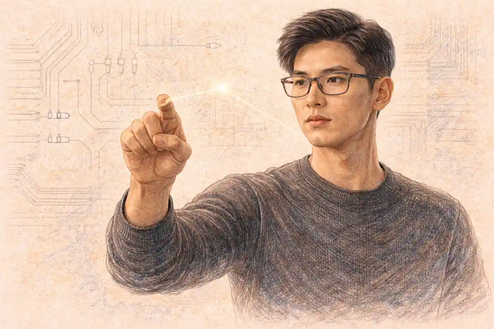

Two examination systems dominate the plans of ambitious students on opposite sides of the Pacific, and they could hardly be built more differently. The Advanced Placement program offers a menu of separate subject examinations, each taken voluntarily, each scored on its own five point scale, each designed to show that a student has handled college level work while still in secondary school. The Gaokao, China's national college entrance examination, works in almost the opposite way: a single coordinated test event near the end of high school, taken by nearly every student who hopes to attend a university at home, with one composite score carrying almost the entire weight of admission.

Comparisons between the two systems usually go wrong at the first step, because they treat the two tests as rival versions of the same instrument. They are not. An AP exam answers a narrow question about one subject: has this student mastered material roughly equal to an introductory college course? The Gaokao answers a sorting question for an entire nation: among millions of candidates in a province, who has earned a place at which university, in which major? Purpose shapes everything else about each test, from the number of papers a student sits to the way a score is read by an admissions office.

A fair comparison therefore has to move dimension by dimension, looking at purpose, structure, grading, timing, stakes, and recognition, and it has to keep one principle in view from start to finish. Neither exam is better in the abstract. Each one is powerful inside the system that built it and weak outside that system, so the meaningful question for any student is never which test wins, but which destination the student is aiming at, and which evidence that destination actually rewards.

## Two exams built for different jobs

The Advanced Placement program grew out of a simple problem in American education: able students in strong schools were finishing high school ready for more advanced work than their timetables offered, and colleges wanted a trusted way to recognize that readiness. The College Board built AP as a bridge. A school teaches a course pitched at first year college level, the student sits a standardized examination in that subject in May, and universities decide for themselves what a strong score earns, whether that is placement into a higher course, credit toward a degree, or simply evidence of ambition in an application file.

Because AP is a bridge, it is modular by design. A student might take one exam in a single spring or six, spread across two or three school years, mixing calculus with art history and biology with a world language. No central authority decides how many exams a student should attempt, and no single result defines the student, because each score stands alone and speaks only about its own subject. The program also travels: schools in dozens of countries offer AP courses, and the examination a student sits in Shanghai or Toronto is the same one sat in Ohio.

The Gaokao answers a different problem entirely. China has far more students seeking university places than elite universities can hold, and the state needs one defensible, uniform mechanism for allocating those places. The examination, formally the National College Entrance Examination, gathers almost the whole output of a student's secondary schooling into a few days of testing in June, and provincial admissions offices then match students to universities and majors largely by score. Where AP certifies achievement subject by subject, the Gaokao ranks a generation.

That ranking function explains the examination's famous intensity. A sorting instrument has to separate millions of candidates who have studied the same national curriculum, so its papers are built to discriminate finely among very strong students at the top of the distribution. It also explains why the Gaokao is compulsory in practice for domestic admission: there is no alternative portfolio of certificates that a Chinese university will weigh in its place for the ordinary applicant. Skipping AP merely leaves a blank in an application. Skipping the Gaokao closes the domestic door almost entirely.

The two systems also differ in who governs them. AP belongs to a nonprofit membership organization, and its real authority is soft: universities remain free to honor scores generously, grudgingly, or not at all. The Gaokao belongs to the state education apparatus, administered through provincial examination authorities under national direction, and its authority is hard: the score bands it produces drive an allocation algorithm that fills university seats province by province. One system persuades institutions; the other instructs them.

Even the calendar position of each test reflects its job. AP examinations sit in May, near the end of the American school year but after most college application decisions have already been made for seniors, which is why AP scores so often function as placement currency rather than admission currency for that final year group. The Gaokao sits in June, after applications in any meaningful sense have yet to begin, because in the Chinese system the application itself, the list of university choices a student submits, is written after the score is known. Sequence reveals purpose: one test reports backward to institutions that have already chosen, the other reports forward to institutions that are about to choose.

## The InsightCrunch AP-versus-the Gaokao table

Short summaries flatten this comparison, so the table below lays the two systems side by side across the dimensions that matter most to students and families: purpose, structure, grading, and recognition, with stakes and flexibility added because those two shape daily life during preparation. It is named the InsightCrunch AP-versus-the Gaokao table, and the sections that follow unpack each row in prose.

| Dimension | AP Exams | The Gaokao |
| --- | --- | --- |
| Core purpose | Certify college level mastery in individual subjects | Rank candidates and allocate university places within each province |
| Who takes it | Voluntary, chosen subject by subject, often across several grades | Effectively required for domestic university admission, taken at the end of high school |
| Structure | One exam per subject, each about three hours, spread across two weeks in May | A compact set of papers across two to four days in June |
| Subject choice | More than three dozen subjects, selected freely by the student | A core of Chinese, mathematics, and a foreign language, plus chosen electives under provincial models |
| Grading | Each exam scored from 1 to 5 against a national standard | A composite total of raw marks, commonly out of 750 in many provinces |
| Retakes | Any exam may be retaken the following May, with both attempts on record | Retaking usually means repeating the final school year and sitting again the next June |
| Admission role in its home system | Supporting evidence, plus placement and credit after enrollment | The dominant factor in admission decisions |
| Recognition abroad | Read directly by universities in the United States and many other countries | Accepted by a growing but limited set of foreign universities, usually alongside other evidence |

Read the table as a map rather than a verdict. Every row where the Gaokao looks rigid has a reason rooted in fairness to millions of candidates, and every row where AP looks free has a cost rooted in uneven access, because a voluntary system always reflects the resources of the schools and families who can use it. The comparison becomes useful only when a reader stops asking which column wins and starts asking which column describes the system the reader actually has to satisfy.

One more caution belongs beside the table. Provincial variation inside China is real, and several figures that sound universal, such as the 750 point total, describe the common pattern in many provinces rather than a single national rule. AP has its own local variation of a different kind: the examinations are uniform, but what a score buys varies from one university to the next, sometimes from one department to the next inside a single university. Uniform test, variable value, on one side; variable test forms, uniform value, on the other. That inversion is the cleanest one sentence summary of the whole comparison.

## Structure: many small examinations against one great sorting

An AP examination is a self contained event. A single subject receives a single paper, usually built from a multiple choice section and a free response section, and the whole sitting lasts roughly three hours, with languages, arts, and research based subjects swapping some written tasks for spoken, portfolio, or project components. A student registered for four AP subjects in one spring will walk into four separate rooms on four separate days across a two week window in May, and each performance is scored, sealed, and reported independently of the others. A bad morning in chemistry cannot contaminate a strong afternoon in economics the following week, because no mechanism exists that would add the two results together.

The Gaokao is a single woven event. Candidates sit a connected battery of papers over two days in the traditional model, and over three or four days in many provinces that have adopted newer subject models, with each day holding one or two long papers. Chinese, mathematics, and a foreign language form the universal core. Around that core, the older structure added a combined science paper or a combined humanities paper, while the newer provincial models let students choose individual subjects: one preferred subject from a short list and two further subjects from a wider list in the model often described as three plus one plus two, or three freely chosen subjects alongside the core in the model described as three plus three. Either way, the papers feed one composite score, and the composite is the number that matters.

Time pressure behaves differently inside the two designs. AP free response sections reward paced, structured writing against a clock measured in minutes per question, and experienced teachers drill students to allocate minutes the way a budget is allocated. Gaokao papers compress an entire subject's worth of discrimination into one sitting, so stamina matters as much as knowledge: the mathematics paper in particular is known for a steep internal slope, with early items that most prepared students can answer giving way to final problems designed to separate the strongest few thousand candidates in a province.

Security and standardization also diverge in scale. AP papers travel to thousands of schools under the College Board's administration rules, with alternate forms for late testing, and the multiple choice sections are machine scored while trained readers score free responses at centralized reading events each June. Gaokao papers are set partly at national level and partly at provincial level depending on the subject and the province's arrangements, printed and guarded under conditions closer to a state secret than a school test, and marked within each province under tight moderation in the weeks after the examination. Breaches or leaks around the Gaokao are treated as serious crimes under Chinese law, a measure of how much social weight the single event carries.

### What does a Gaokao score report actually show?

A Gaokao result is more than one number. Alongside the composite total, provinces publish position tables showing exactly where a candidate stands within the provincial cohort, broken into fine bands, because admission depends on rank within the province rather than on the raw mark alone, and identical totals in different provinces carry different value.

Subject choice inside AP deserves one more layer of attention, because students comparing systems often miss how unusual it is. In most of the world's examination systems, a candidate takes a fixed block of subjects that a school or a state assembles. AP hands the assembly to the student and the school together: one teenager's May might contain physics and studio art, another's might contain only a single language exam taken to strengthen one application theme. That freedom is precisely what makes AP transcripts hard to compare across students, and it is why universities read them as evidence of initiative as much as of mastery.

Choice inside the Gaokao operates within a narrower channel, yet it is not absent. Under the newer models, selecting which elective subjects to be examined in is a strategic decision with real consequences, because some university majors require specific subjects, most famously physics for engineering pathways, and because grading conversions for elective papers under some models translate raw performance into banded scores linked to a candidate's standing among those who chose the same subject. Families study these rules the way investors study tax codes, since a well chosen combination can protect a strong student from a brutally competitive subject pool.

## Grading: a five point scale against a mountain of marks

AP grading begins with raw performance and ends with translation. Multiple choice answers and free response scores combine into a composite, and that composite is converted each year into the familiar scale: 5 for extremely well qualified, 4 for well qualified, 3 for qualified, and 2 or 1 for lower levels of demonstrated mastery. The conversion thresholds are set so that a 5 in one year means roughly what a 5 meant in another, which makes the scale criterion referenced in spirit: it describes what a student can do, not where the student finished relative to classmates. Universities then layer their own policies over the scale, commonly treating 4s and 5s as credit worthy and a 3 as borderline, though each institution, and often each department, writes its own rule.

Gaokao grading keeps the raw marks visible. Papers are marked to a points scheme, subject totals are added, and the sum is the score: in many provinces the core and combined papers have long added to a maximum of 750, built from 150 each for Chinese, mathematics, and the foreign language, and 300 for a combined paper, while some provinces run different totals, such as lower maxima or scaled systems that convert marks onto a wider range. Because some elective papers in newer models are banded before they enter the total, the composite is not purely raw everywhere, yet the philosophy stays transparent: the number is a sum of earned marks, and its meaning comes from rank. A total that opens a famous university's door in one province may fall short in another with a stronger cohort, and everyone in the system understands that the rank tables, not the raw number, carry the real information.

The contrast in philosophy deserves emphasis. AP asks whether a student has crossed a fixed bar of college level competence, and it is content for tens of thousands of students to cross the highest bar together. The Gaokao asks where a student stands in a queue, and a queue by definition cannot let everyone stand at the front. Comparing the difficulty of a top AP score with a top Gaokao score without respecting that difference is a category error, like asking whether a driving test is harder than a motor race: one certifies, the other ranks, and each is demanding in the way its function requires.

### What is a provincial cutoff line?

Provinces publish cutoff lines each year: the lowest composite score that qualified for each admission tier, or batch, in that province. A candidate compares a personal score and provincial rank against those lines and against each university's admission range from earlier years, then builds an ordered preference list of institutions and majors to submit.

Marking labor shows the scale difference plainly. AP free responses are read by thousands of teachers and professors gathered for scoring events, each reader handling one question type repeatedly until consistency settles. Gaokao marking mobilizes provincial teaching workforces under double marking and arbitration rules for subjective items such as essays, with discrepancies beyond a tolerance sent to a third reader. Both systems chase the same virtue, consistency, but the Gaokao must defend it under a microscope AP never faces, because a two mark swing in a province can move a candidate across a cutoff line and into a different life path.

## Stakes: a supporting document against a life sorting event

Ask an American student what rides on one AP exam and the honest answer is: less than the student fears. A weak score can simply be left unreported to some colleges, a strong one can trim a semester's coursework or unlock an advanced class, and admissions committees weigh grades, essays, recommendations, and course rigor alongside any scores. The examination season matters, but it shares the stage with everything else in a file, and because tests are spread across grades ten, eleven, and twelve, no single May carries a whole future. Even a disastrous sitting leaves the structure of a student's plans intact.

Ask a Chinese family the same question about the Gaokao and the answer arrives in a different register. For the ordinary applicant, the composite score determines the tier of university available, the city a student may move to, the majors within reach, and, through all of those, a large share of the graduate's first employment prospects. Families reorganize years around the examination. The final year of high school bends toward it almost entirely, and the two or three examination days themselves acquire a civic solemnity: traffic is managed near test centers, construction noise is restricted in many cities, and strangers make way for candidates the way a crowd makes way for an ambulance.

Yet the stakes comparison needs one refinement, because low stakes per exam does not mean low stakes per student. AP results feed a competitive admissions culture in which students at selective American high schools may sit ten or more examinations across their school career, and the accumulated record can signal the rigor that elite universities demand. The pressure is diffuse, spread over years and entangled with grades and activities, but it is real. The Gaokao concentrates pressure the way a lens concentrates light; AP spreads it the way weather spreads across a season. Students suffer in both climates, just on different schedules.

Retakes underline the difference. An AP subject can be attempted again the next May with modest cost and no stigma, and both attempts sit on the score report unless a student arranges otherwise. Repeating the Gaokao traditionally meant something far heavier: returning for another full year of preparation, often in a dedicated repeat class, and sitting the whole battery again the following June as an older candidate among younger ones. Many students do choose that road, and some provinces have adjusted rules about repeat candidates and private repeat schools, but the emotional arithmetic remains distinct: one system treats a second attempt as a routine option, the other treats it as a year of life.

## Age, stage, and who sits which examination

AP examinations belong to no single age. Students sit them from grade nine onward, with the heaviest concentration in grades eleven and twelve, and self studiers outside any classroom can register through a school that administers the tests. The typical candidate is therefore somewhere between fourteen and eighteen, meeting the examination as one credential among several while the larger business of high school continues around it. Because AP scores report to colleges a student selects, the audience for the result is chosen by the candidate.

The Gaokao belongs to one precise moment: the end of senior high school, at about eighteen, when a cohort that has moved together through years of schooling arrives at the gate together. Some candidates are older repeat students, and a small number come through social candidate routes rather than school enrollment, but the examination's identity is bound to that single transition between secondary school and university. Its audience is not chosen by the candidate at all; provincial admission systems receive the score as a matter of structure, and the candidate's preference list, the zhiyuan, is where personal choice finally enters, after the number is fixed.

This difference in staging changes what preparation can even mean. AP preparation is course based: knowledge accumulates inside a taught class over a school year, and the exam samples that course. Gaokao preparation is cycle based: the final year of high school is largely given to systematic review of three years of material, organized in rounds that schools have refined over decades, moving from coverage to drilling to full mock examinations. A student preparing for AP is finishing a course. A student preparing for the Gaokao is completing a campaign.

## Recognition: what universities actually do with each score

In its home territory, AP recognition is broad but discretionary. American universities know the scale intimately, and most publish credit and placement tables listing the score each department requires for each subject. Beyond the United States, universities in Canada, Britain, and many other countries read AP results as part of international applications, with British offers sometimes stated partly in AP terms for American schooled applicants. The pattern to hold onto is that recognition is granted institution by institution, and it can change when a department revises its policy, so a score's value is never fully known until a specific university has spoken.

In its home territory, Gaokao recognition is total but bounded. Every Chinese university in the regular admission system uses the score, which gives the examination a clarity AP never has: nobody wonders whether the credential counts. Outside China, the map thins. A set of universities in places such as Australia, Canada, Germany, and parts of Europe will consider Gaokao results for direct entry, sometimes with language requirements attached, and the list has grown over the years as institutions learned to read the score against provincial standing. Still, in the largest destination for Chinese students abroad, the United States, the Gaokao has traditionally played little formal role: American admissions offices build files around transcripts, essays, and tests they know, and AP results earned in an international school in China slot into that machinery far more naturally.

### Which foreign universities read a Gaokao score directly?

A minority do, and the pattern is patchy rather than universal. Some Australian and Canadian universities publish Gaokao entry requirements province by province, expressed as a share of the provincial maximum or as standing relative to cutoff lines, and several European systems recognize the examination for direct entry when paired with proof of language proficiency.

Families often ask whether a Chinese student can hold both currencies at once, and the answer is yes with effort. International divisions and international schools in China run curricula aimed at foreign universities, teaching AP courses or other international programs while their students often remain registered in the Chinese system in some form; other students in ordinary domestic schools prepare for the Gaokao alone and add English proficiency tests when applying abroad. The practical barrier is time: the Gaokao's final year review cycle and a heavy AP load pull against each other, so dual track students usually choose one primary track and treat the other as insurance or as a supplement rather than an equal commitment.

Recognition also runs in an unexpected direction: prestige. Inside China, a place at a famous domestic university earned through a towering Gaokao score carries a social clarity that a foreign admission may not match in the eyes of employers and relatives, because everyone understands exactly how hard the gate was. Inside an American admissions office, an AP transcript full of 5s carries a similar clarity in miniature. Each credential is most eloquent in the room where its scale is native, which is why moving between systems always involves translation loss, and why students should choose the examination whose audience they most need to convince.

## Origins: how each system grew into its present shape

The Gaokao's modern form dates to the restoration of national entrance examinations in 1977, after a decade in which university admission had run through recommendation rather than testing. That restoration is remembered in China as a hinge moment: millions of people whose education had been interrupted were allowed to compete on a paper examination, and a generation of talent re-entered the universities. The story matters for any comparison because it explains the examination's moral status at home. Whatever its pressures, the Gaokao is widely defended as the fairest instrument available at national scale, a test that a farmer's child and a official's child sit under the same rules, and proposals to dilute its weight in admission meet resistance rooted in that founding memory.

AP's founding story is quieter and more administrative. In the early 1950s, American educators worried that strong students were repeating material when they reached college, and a pilot program let a small group of schools teach college level courses with examinations to certify them. The College Board took the program over and expanded it subject by subject, school by school, decade by decade, until it became a standard feature of ambitious American high schools and, later, of international schools worldwide. Nothing in AP's history gives it the Gaokao's civic sacredness; it is a service that proved useful, grew because institutions trusted its signal, and remains answerable to the universities that honor it.

The two histories produce different reform styles. Gaokao reform is state engineering: when authorities judged the old single combined paper too blunt, they redesigned subject choice models province by province, piloting in a few regions before wider rollout, because any change to a sorting machine that processes millions must be tested like a bridge design. AP reform is committee craft: course frameworks are revised by educators, new subjects are added when a field matures, examinations migrate toward digital administration, and the system adjusts through professional consensus rather than decree. Both systems change; they simply change at the speed their governance allows.

## Subject coverage: a wide menu against a deep core

AP's menu stretches across more than three dozen subjects: several sciences, three histories, two English courses, mathematics from precalculus through calculus and statistics, computer science in two flavors, a row of world languages, economics in both macro and micro forms, psychology, government, art and design portfolios, music theory, seminar and research. No student attempts more than a fraction of the catalogue, and no school offers all of it, so the lived AP program in any one building is a subset shaped by staffing and demand. Breadth is the program's signature: it treats advanced study as something that can begin in almost any direction a teenager's curiosity points.

Gaokao coverage is narrower on paper and deeper in obligation. Every candidate is examined in Chinese and mathematics at full weight, plus a foreign language that for most candidates is English, though Japanese, Russian, French, German, and Spanish papers exist for students whose schooling followed those tracks. The elective block then adds depth in sciences, humanities, or a chosen mix, depending on the provincial model. Where AP lets a student skip a disliked domain entirely, the Gaokao insists on a common spine: literacy in the national language, quantitative reasoning, and a world language are not optional for anyone seeking a university place through the regular route.

The Chinese paper deserves a moment of attention from any reader who knows only Western examinations. It combines language knowledge, reading of modern and classical texts, and a long composition that is marked by human readers and discussed nationally each year; the essay prompt becomes a small cultural event, reproduced in newspapers and argued over by adults who sat the examination decades earlier. Nothing in AP commands that kind of shared national attention, because AP has no single day and no single paper that a whole cohort experiences together. The Gaokao is not merely an assessment system; it is a rite that a society watches itself perform.

Mathematics shows a similar contrast in miniature. AP splits mathematics into pathways: a student chooses among statistics, precalculus, and calculus levels that match a course taken, and each examination samples the reasoning of its own syllabus. Gaokao mathematics is one demanding paper for all candidates within a track, long used in two broad versions tuned for science oriented and humanities oriented students, with the newer models continuing to differentiate by pathway in some provinces. The AP approach asks which mathematics a student has studied; the Gaokao approach asks how far a student's mathematics can be pushed against the full cohort.

## The difficulty question, taken seriously

Every comparison eventually meets the question people ask first: which is harder? The honest treatment separates three meanings of hard that casual debate mixes together. Content difficulty asks how advanced the material is. Competitive difficulty asks how strong the rival candidates are. Consequential difficulty asks how much a single imperfect performance costs. The two examinations trade victories across these meanings, and any one word answer hides the trade.

On content, the comparison splits by subject. A Gaokao mathematics paper presses harder on speed and on layered problem solving within its syllabus than AP Calculus does within its own, because the paper must distinguish among students who have all mastered the basics. AP examinations, in turn, can demand forms of work the Gaokao rarely samples: extended source based essays in history, laboratory reasoning in sciences, spoken interpersonal tasks in languages, and open ended research in the capstone courses. Neither syllabus contains the other; each is deep where its system values depth.

On competition, the Gaokao stands apart in scale. A candidate is measured against the entire provincial cohort, and the universities at the top draw from the highest sliver of that cohort, so excellence must be near total across every paper, since one weak subject drags the composite down against rivals who have none. AP competition is real but refracted: a student competes against the expectations of particular universities, and a transcript with several 5s and one 3 remains a strong transcript. Perfection is rewarded in AP; in the Gaokao, at the top of the distribution, something close to perfection is the entry condition.

On consequence, the asymmetry is greatest of all. An AP score below a student's hope disappoints and may redirect a credit plan; the student's university future, already substantially shaped by coursework and the admissions process, survives the blow. A Gaokao composite below a student's hope can close the preferred tier, the preferred city, and the preferred major in a single announcement, with the remedy being a year of repetition. When families describe the Gaokao as the harder examination, consequence is usually the meaning underneath the word, and on that meaning they are right.

### Can Gaokao candidates choose a language besides English for the foreign language paper?

Yes. The foreign language requirement can be met with one of several languages where schools teach them, including Japanese, Russian, French, German, and Spanish, alongside the overwhelming majority choice of English. Japanese is the most common alternative in many regions, chosen sometimes for affinity and sometimes as a strategic route to a stronger mark in a smaller candidate pool.

## Preparation cultures: a course to finish against a campaign to win

Preparation for AP is distributed across ordinary school life. The course itself is the preparation: a teacher works through a published framework across the school year, students complete problem sets and practice essays as part of graded coursework, and revision in the final weeks usually means past papers, timed sections, and review sessions layered over other classes that continue as normal. Commercial preparation exists, from review books to tutoring, but the school's timetable carries most of the weight, and a student with a good teacher and a disciplined spring can prepare without buying anything beyond a review book. The rhythm is a ramp: steady accumulation, a May peak, then release.

Preparation for the Gaokao has its own industrial organization. Schools divide the final year into review rounds with distinct jobs: a first round that rebuilds every topic in the syllabus, a second round that trains problem types and cross topic combinations, and a final round of full mock examinations under real timing. Mock results are ranked within schools and sometimes across districts, so a student learns a personal position in the hierarchy long before June and watches it move. Around the school system there grew, over decades, a large shadow education sector of evening and weekend tutoring; regulatory changes in the early 2020s restricted for profit tutoring in core school subjects, pushing some demand into quieter channels, but the cultural expectation that examination preparation deserves total commitment survived the policy shift.

Homework loads tell the same story at daily scale. A Gaokao track student's evening is typically structured by the school's demands well into the night during the final year, with morning self study and weekend sessions common in many schools, while an AP student's heavy weeks arrive in bursts around examination season and application deadlines. Neither pattern is laziness or virtue; each is an institution's honest answer to the stakes its examination carries. A test that decides nearly everything will always colonize the calendar of the year that precedes it.

Family roles differ accordingly. In China, the Gaokao mobilizes a household: parents adjust work schedules, manage meals and sleep, sometimes rent rooms near the examination site, and treat the season as a family campaign with one soldier. In the United States, AP season usually asks less of parents than of students, and families more often serve as schedulers and chauffeurs than as a support battalion. Observers who find the Chinese pattern excessive usually underestimate how rational it is: when one score rearranges a family's prospects, treating its production as a family project is a proportionate response.

Teachers' incentives diverge just as sharply. A Gaokao teacher's reputation, and often a school's public standing, rests on how many students cross prominent cutoff lines, so instruction bends toward the examination's exact demands with an honesty other systems sometimes pretend not to share. An AP teacher answers to a published framework and a scoring standard, yet also to a classroom of students whose goals range from Ivy League ambition to a single credit in a state university, so pacing and depth vary more from room to room. One profession optimizes a cohort's rank; the other shepherds a spread of individual goals.

Resource quality inside AP preparation hides inside the course itself. Two students with the same examination entry may have had very different years: one in a small class with a veteran teacher and a cupboard of past papers, another largely self taught from a textbook because the school could staff the course only thinly. The examination is common, but the road to it is not, which is the standing fairness critique of a voluntary, school delivered program. Preparation access in the Gaokao system is unequal too, across provinces and between famous urban schools and rural ones, yet the critique takes a different form there: not who got to prepare, since all prepare, but whose preparation conditions, teachers, and provincial admission quotas were kinder.

## Pressure: concentrated heat against a long season

Student accounts of the Gaokao's final months return to a few images: countdown boards in classrooms marking days to the examination, corridors of posted mock rankings, a social world narrowed to classmates who share the same clock. The pressure is collective, which cuts both ways. Shared dread becomes solidarity; nobody has to explain why June matters, and rituals of encouragement, from teacher pep talks to parents waiting outside school gates with flowers on examination days, give the strain a communal frame. The same collectivity can crush a student who falls behind, because the ranking is visible and the escape routes are few.

AP pressure wears a different costume. It arrives as accumulation: several examinations in one May, layered on top of final grades, spring sports, and, for juniors, the opening moves of college applications. Because each result is individually modest in consequence, students rarely describe terror; they describe exhaustion, triage, and the quiet decision to let one subject go underprepared because three others mattered more. Teachers recognize the syndrome and advise course load restraint, advice that ambitious students in competitive schools find hard to take when peers stack their schedules with five or six examinations a year.

Mental health discussions in the two countries have followed their own examinations. Chinese debate about the Gaokao often centers on whether one event should carry so much, and reforms that add subject choice or adjust provincial policies are partly attempts to soften a single point of failure without surrendering the fairness the public trusts. American debate about AP often centers on access and inflation: whether the program pressures students to collect examinations as trophies, and whether colleges silently require what they publicly call optional. Each society worries about the side of its system that hurts students, and each worry is a fair description of a real cost.

What neither debate should claim is that the other system has solved the problem. A student sorted by one examination into a university tier below their ability carries a visible wound; a student ground down by four years of credential accumulation carries an invisible one. The comparison that matters for a family choosing a track is not which system is kinder in the abstract, but which kind of pressure a particular student withstands better: a single summit attempt after a long campaign, or a long trail of individually smaller climbs.

## Flexibility and second chances

Flexibility shows up first in small choices. An AP student selects subjects, decides how many examinations to attempt in a given year, may spread them across grades, and can even sit an examination without taking the corresponding course if a school will host the attempt. A student can also choose, within reporting rules, which colleges receive which scores, and many universities allow applicants to self report results and send official reports only after enrollment. Almost every variable in the system bends a little, because the credential is a signal offered to institutions rather than an allocation imposed on them.

The Gaokao bends in fewer places, and the places it does bend are deliberate. Subject selection under the newer provincial models is genuine flexibility, introduced to let students lean toward strengths and intended majors, and the preference list after results is a real exercise of choice among the options a score has unlocked. But the examination date is fixed for everyone, the battery must be taken as a whole, the score is reported into a provincial system rather than to institutions a candidate selects, and a retake is measured in years rather than months. Flexibility in a sorting machine is rationed carefully, because every exception complicates the fairness the machine exists to guarantee.

### Do AP scores ever expire?

College Board score records are kept for years and can be sent long after the examination, with older scores archived rather than deleted, so an AP result does not lapse the way some professional certificates do. The practical limit is usefulness: credit is granted under the policy of the university a student finally attends.

Second chances carry a psychological difference beyond their mechanics. Knowing a test can be retaken next spring changes how a student walks into the room this spring; the attempt becomes information as much as judgment. Knowing a retake costs a year changes the same walk into something closer to a verdict, and students prepare with a thoroughness that outsiders sometimes misread as mere drilling. Much of what looks like cultural difference between the two preparation worlds is really this single structural difference wearing clothes: reversible stakes produce experimenters, irreversible stakes produce perfectionists.

## Access, cost, and the fairness debate in both systems

Neither examination is free of charge in the broad sense, but the money sits in different places. AP charges a per examination registration fee, with reduction programs for students with financial need and with some schools and districts covering costs to encourage participation; the total for a student taking many subjects can still become a real family expense, and the fee is only the visible part, since tutoring, review materials, and well resourced courses concentrate in wealthier schools. The Gaokao's registration charge is small by comparison, and the examination itself is a public provision, yet the surrounding economy of preparation, from school choice earlier in childhood to private help in the final years, carries heavy unequal costs of its own.

Fairness arguments in China often focus on provincial quotas. Universities allocate places by province, and admission lines differ across provinces because cohorts and seat allocations differ, so a score that earns a famous university place in one province might not in a more competitive one; candidates in populous provinces with many strong students describe their road as harder, and the debate about regional equity is a permanent feature of Gaokao season commentary. The system's defense is that allocation by province keeps national universities genuinely national and prevents a few regions from capturing every seat.

Fairness arguments around AP usually focus on availability. A student cannot earn a credential their school does not offer, and wealthy districts offer more courses, smaller classes, and better preparation, so a program designed to reward merit can end up certifying advantage. The program's defenders answer that the examination itself is open to any student who can reach a test center, that self study routes exist, and that colleges read scores in the context of what a school offered. Both defenses contain truth, and both systems live with a version of the same unsolved problem: a fair test administered inside an unequal society will reproduce some of that inequality no matter how carefully it is built.

Rural and migrant students add a further layer on the Chinese side. Rules about where a student may sit the examination, tied to household registration and years of local schooling, have been adjusted over time to accommodate the children of migrant workers, with conditions that vary by province. The details are intricate, yet the principle is easy to state: in a province based allocation system, the question of which province a candidate belongs to is itself an admission question, and policy keeps negotiating the answer.

## The examination days themselves

An AP morning is an ordinary school day with a sealed room in it. Students check in with identification, surrender phones, take assigned seats, and work through sections separated by short breaks, while the rest of the school continues around them; by afternoon, the same student may be back in regular classes or at practice. The ordinariness is part of the design: the program runs inside schools, uses school staff as proctors, and repeats the ritual across two weeks and thousands of sites with as little drama as administration can manage.

Gaokao days suspend ordinary life in the streets around a test center. Candidates pass through identity checks and metal detectors, classrooms hold a few dozen candidates under multiple invigilators and camera surveillance, and the papers themselves arrive under guard. Cities commonly arrange traffic priority for candidates, police help lost students reach centers, and businesses near schools quiet their work. The choreography communicates something deliberate to an eighteen year old: the society regards this performance as important enough to reorganize itself around, which comforts some candidates and terrifies others.

Results arrive on different clocks and trigger different rituals. Gaokao scores are released province by province in the second half of June, often met with family gatherings around a screen at midnight release moments, and the preference submission window follows within days, compressing research about hundreds of universities and majors into a high stakes week where small ranking differences steer big decisions. AP scores arrive in July, usually to an email and a login rather than a family vigil, and they trigger no immediate deadline for most students, since the scores flow into applications the following autumn or into credit claims after enrollment. One calendar produces a national festival of news; the other produces a private errand.

Leaks, cheating scandals, and security debates flare around the Gaokao in proportion to its stakes, and authorities answer with escalating measures: signal shielding, biometric checks in some regions, and severe penalties. AP security incidents exist, including digital era concerns about material shared across time zones, and the College Board answers with form variation and administration rules. The pattern generalizes cleanly: the higher the consequence attached to a test, the more energy a society spends defending the test's integrity, and the Gaokao's defenses are what a maximum stakes examination looks like when a state decides its legitimacy is worth guarding like a border.

## How the score is used: a reader's file against an allocation system

An American admissions reader meets AP scores inside a bundle of context. The reader sees grades in the courses themselves, the school's profile showing which AP courses were even available, teacher recommendations, essays, and activity records, and the scores function as corroboration: they confirm that an A in a demanding course reflected outside standards, or they add a data point where a transcript is hard to interpret. A student with modest scores but strong grades from a school offering few AP courses can still thrive in that reading, because the file argues as a whole. Holistic review, whatever its inconsistencies, gives a score many chances to be forgiven.

A provincial admission system meets a Gaokao score with no bundle at all. After results are published, candidates submit ordered preferences of universities and majors, and the allocation proceeds by score order within the province: higher ranked candidates have their preference lists processed ahead of lower ranked ones, and each candidate lands at the highest preference that still has room when their turn arrives, subject to the rules of the batch and the major groupings a university has set. The design is admirably legible: a candidate can reconstruct exactly why a placement happened, and complaints about favoritism have nowhere to hide. The same legibility means there is no committee to persuade, no essay that repairs a weak paper, no context that softens the number.

These mechanics change how students should think about marginal effort. In the American system, an extra point of AP performance in one subject adds a small increment to a large file, and students rationally spread effort across grades, activities, and several examinations. In the Gaokao system, a handful of marks can move a candidate past hundreds of provincial rivals clustered at the same score band, so effort concentrates ferociously on squeezing every paper, including drilling the exact formats of partial credit. Advice that sounds obsessive in one system is simply arithmetic in the other.

The preference list itself deserves recognition as a second examination of a different kind. Chinese students and their families spend the days after results studying admission data: previous years' minimum ranks for each university and major, the effect of new programs, the risk of aiming high against the safety of aiming lower. Choosing poorly can waste a strong score on unreachable preferences or strand a candidate in a lower batch despite a score that deserved better, so a small industry of counselors and guidebooks serves this week. AP has no equivalent moment, because no single decision in the AP world is both irrevocable and score priced in the same way.

Score meaning also drifts across borders in ways families should price in. An AP 5 earned in Beijing means the same thing to an American reader as an AP 5 earned in Boston, because the examination and standard are shared; the signal crosses the ocean without loss. A Gaokao score crossing the same ocean arrives as an unfamiliar currency: a foreign reader needs provincial rank, the province's competitiveness, and the year's cutoff lines to interpret it, and few admissions offices maintain that conversion expertise for every province. Portability is one of AP's deepest structural advantages for internationally mobile students, and opacity abroad is one of the Gaokao's real costs for students who leave.

## Inside the papers: question styles and what they reward

AP papers blend recognition with production. Multiple choice sections test breadth and precision under time pressure, often through stimulus based sets built on a passage, data table, map, or artwork, and free response sections ask students to construct: an argument essay with documents, a rhetorical analysis, a multi part physics problem, a laboratory design, a spoken presentation. The scoring guides reward identifiable moves: a defensible thesis, accurate evidence, correct setup, clear reasoning chains. A prepared student can learn the shape of high scoring work in each subject, and teachers teach those shapes openly, which makes AP at its best an examination of demonstrated academic behaviors rather than of raw cleverness.

Gaokao papers lean harder on accuracy under compression. Items are engineered so that partial mastery reveals itself quickly, and the hardest problems in mathematics and sciences often require chaining several ideas inside one question with no scaffolding provided. In language papers, close reading passages probe fine discrimination among near equivalent options, a skill that only wide reading and drilling build. The Chinese composition, marked by readers working at speed under moderation, rewards control of structure and language at a level of polish that students practice through hundreds of timed essays across the final years. Where AP free response asks a student to show reasoning generously and collects partial credit along the way, Gaokao items more often demand the finished product, exact and complete.

Neither style is a purer measure of intelligence. They are measures of different trained capacities, and students switching systems discover the gap bodily: a Gaokao trained student may find AP multiple choice oddly forgiving yet stumble on an open ended essay that rewards stated reasoning over silent correctness, while an AP trained student facing Gaokao style items may understand every concept and still bleed marks to speed, precision slips, and unfamiliar item engineering. Preparation transfers between the systems less than families hope, because each examination has spent decades optimizing its candidates for itself.

## The language examination irony

One comparison inside the larger one deserves its own moment. AP offers an examination in Chinese Language and Culture, designed mainly for students learning Chinese as a world language, testing listening, reading, writing, and speaking through cultural themes. Meanwhile, millions of Chinese students sit the Gaokao's foreign language paper, most often in English, which tests reading, language use, and writing without a speaking component in many provinces, though some regions have added listening and speaking elements in varying forms. A Chinese teenager may therefore be examined on English as a foreign language by the home system while an American teenager is examined on Chinese by the visiting one, and the two papers, aimed in opposite directions, illustrate how each system defines the language skill a university student needs.

Heritage speakers complicate the AP side of that picture. Students who grew up hearing Chinese at home sometimes sit AP Chinese and earn top scores with modest formal study, which universities increasingly understand and discount appropriately when a score is read in context. The Gaokao's English paper has its own asymmetry: urban students with years of strong English teaching and media exposure meet the same paper as rural students whose English instruction was thinner, and the common paper records the difference faithfully. Every examination inherits the inequalities of the preparation behind it; language papers simply make the inheritance easiest to see.

## Scale: what the numbers of candidates do to each system

In many years the Gaokao candidate count has run into eight figures, a population of examinees larger than the total population of many countries, all processed through provincial systems in a single month. Numbers at that scale explain nearly every design choice a foreign observer finds extreme: the security apparatus, the provincial rather than national ranking, the published position tables fine enough to separate candidates a single mark apart, the refusal to let interviews or portfolios into the core process. Any discretionary element multiplied by ten million candidates becomes an invitation to corruption or chaos, so the system strips discretion away and defends the purity of the number.

AP operates at a large but distributed scale: millions of examinations are sat each May across thousands of schools, yet no single administration event gathers a whole age cohort, and failures of logistics harm dozens of students rather than a province. Distribution buys resilience and calm. It also buys invisibility: because there is no single AP day, the program never becomes a national ritual, and public debate about it stays professional rather than civic. Scale is not a detail in this comparison; it is the reason one examination is a state ceremony and the other is a school service.

Scale shapes scoring philosophy as well. A ranking instrument used on ten million candidates must generate fine distinctions across the whole distribution, which pushes paper design toward items with wide difficulty spread. A criterion instrument used across dozens of subjects must instead defend the meaning of its top band in every subject separately, which pushes design toward standard setting studies and comparability work that the public never sees. Observers who ask why the Gaokao cannot simply be more like AP usually have not priced the difference between certifying volunteers and sorting a nation.

## Guidance for the students who actually face this choice

Consider first the student in a Chinese domestic school whose family is weighing a transfer to an international track. The decision is usually not about examinations in isolation but about destination probability: a domestic track keeps the full range of Chinese universities open through the Gaokao while closing most foreign routes that demand years of differently built coursework, whereas an international track with AP courses builds a strong file for American and other foreign universities while making a return to the domestic gate awkward, since AP scores do not substitute for the Gaokao at home. Families should therefore decide the destination question first, with honest attention to finances and the student's adaptability, and let the examination follow from that answer.

Consider next the student already in an international school in China, preparing AP examinations for applications abroad, who wonders whether to also attempt the Gaokao. The practical answer turns on workload realism. The Gaokao syllabus in Chinese and mathematics diverges from international curricula, and its final year review cycle would consume the very months when applications and AP examinations peak. A small number of students do manage dual preparation, usually with strong Chinese language schooling in their background and unusual stamina, but for most students the attempt taxes the primary track without producing a competitive score on the secondary one. Insurance that endangers the main policy is poor insurance.

Consider finally the student outside China who encounters the Gaokao as a concept: perhaps a Chinese citizen schooled abroad returning for admission, or a foreign student curious about Chinese universities. Returnees face the province question immediately, since eligibility and quota placement depend on registration and schooling history, and they often discover that Chinese and mathematics at Gaokao depth cannot be improvised from an international syllabus. Foreign students, meanwhile, usually enter Chinese universities through separate international admission routes rather than the Gaokao itself, which is a useful reminder that the examination guards the domestic allocation, not the university's every door.

Across all three profiles, one habit protects the decision: translate every claim about the examinations into the language of destination. Ask of any advice which universities it optimizes for, which admission mechanics it assumes, and which score audience it imagines. Advice that cannot answer those questions is probably comparing the examinations as abstractions, and abstractions admit nobody.

## Myths that survive every comparison season

One durable myth holds that the Gaokao tests memory while AP tests thinking. The Gaokao's hardest items punish pure memory, since their difficulty lives in combination and speed, and AP's frameworks include plenty of content recall beneath their reasoning tasks. The myth survives because each system's critics describe its drill culture and call the description an analysis of its papers. A fairer statement is that both examinations test thinking inside trained formats, and the formats differ.

A second myth promises that a strong Gaokao performance would automatically convert into top AP scores, or the reverse. Subject overlap makes the fantasy plausible, and the counterexamples are easy to find: students whose mathematics survives the transfer beautifully while their essay based subjects falter, students whose English shines in one system's reading sections and strains in the other's writing demands. Skill transfers at the level of knowledge and discipline; it does not transfer at the level of item craft, timing, and scoring habits, which is where marks are actually won and lost.

A third myth treats the choice as a judgment on two countries' values, as if one system believed in merit and the other in opportunity. Both systems believe in merit and ration opportunity; they disagree about which risks to run. The Gaokao accepts the cruelty of a single day to purchase defensible fairness at national scale. AP accepts the unevenness of school provision to purchase breadth, choice, and portability. A reader who sees the trade clearly can respect both designs while still choosing firmly between them for a particular child, which is the only choosing that was ever actually on the table.

## Destination decides: reading this comparison as a decision

Every thread in this comparison converges on the same practical rule: choose the examination that the destination rewards, and prepare for it without nostalgia for the other system. A student bound for Chinese universities needs the Gaokao, full stop, and should treat every hour diverted to foreign credentials as an hour priced against a provincial rank. A student bound for the United States needs the credential set American universities read fluently, in which AP scores support grades and rigor rather than replace them. Students aiming at Britain, Canada, Australia, or continental Europe should map each target university's stated treatment of both credentials, since policies differ sharply by country and sometimes by faculty within one institution.

Students weighing AP against other admission tests will find the neighboring comparisons in this series useful, because the Gaokao is only one of several systems AP is measured against. The contrast between AP and the SAT, two College Board products with entirely different jobs, is drawn in [AP vs SAT](/2007/01/25/ap-vs-sat/), and the British comparisons appear in [AP Exams vs GCSEs](/2007/01/21/ap-exams-vs-gcses/) and [AP Exams vs A-Levels](/2007/01/12/ap-exams-vs-a-levels/), each showing how a subject based credential is read by systems built on different assumptions. For the admissions mechanics that decide how much any of these credentials matters in an American file, [AP Classes and College Admissions](/2007/01/07/ap-classes-and-college-admissions/) lays out the reader's perspective, and the full program's shape is mapped in the [AP Exams Complete Guide](/2008/11/08/ap-exams-complete-guide/).

Practice belongs inside that decision, not after it. A student who has settled on the AP track should be working with real examination material early enough for the formats to become familiar, and [free AP exam practice questions](https://reportmedic.org/tools/ap-exam-practice-questions.html) offer a straightforward way to begin testing subject readiness before course choices harden. A student on the Gaokao track has the equivalent discipline in past papers and provincial mocks, and in both systems the same principle holds: familiarity with genuine items is the cheapest score improvement available, because it converts examination craft from a surprise into a routine.

Decision timing matters as much as decision content. The tracks diverge years before the examinations themselves: course selections in the first year of high school already assume a destination in many schools, and switching tracks late usually means accepting a weakened version of the new track rather than a full one. Families who postpone the destination conversation until the final two years often discover that the choice was quietly made for them by earlier timetabling. The examinations look like June and May events; in reality they are decided in the Septembers that precede them.

## Reform currents in both systems

Neither system is standing still, and a comparison that freezes them in place will mislead within a few years. Gaokao reform has moved province by province toward subject choice models, adjustments in how elective scores are converted, and continued negotiation over regional equity and the treatment of repeat candidates, all conducted inside a public consensus that the examination's core role must be protected. The direction of travel is toward modest personalization at the edges of a still decisive central score, not toward holistic admission of the American kind, and any report claiming otherwise should be read with suspicion.

AP reform moves along different rails: digital administration spreading subject by subject, course frameworks revised to track college practice, new subjects appearing where fields have matured, and periodic debates about how many examinations a student should reasonably stack. The direction of travel there is toward breadth and convenience, with universities periodically tightening credit policies in response, a quiet negotiation between the program that issues the credential and the institutions that price it. Watching those credit tables shift year to year tells a family more about AP's real value than any program brochure.

Reform in both systems also answers to politics beyond education. The Gaokao's fairness is a legitimacy asset for the state, which is why changes arrive as careful provincial pilots rather than national leaps. AP's growth is a market and mission story for a nonprofit, which is why expansion into new schools and countries continues even when educators debate load and stress. A student does not need to settle these politics, but understanding them predicts the future better than any headline: the Gaokao will remain recognizably itself because too much rests on its stability, and AP will keep widening because widening is what it is for.

## What a score cannot say

A Gaokao composite says nothing about which of its subjects carried the total, nothing about a student's creativity, resilience, or fit for a particular field beyond the subjects chosen, and nothing about how the student might perform in a seminar, a laboratory team, or a studio. Chinese universities accept that blindness as the price of fairness, and they recover some of the missing information later, through major transfer rules, postgraduate examinations, and employers' own filters. AP scores say more about individual subjects and less about the whole student, and American universities compensate by demanding the thick application file that Chinese families sometimes find bewilderingly soft. Each system knows what its number cannot say; each has built institutions downstream to say it.

Employers inherit the same limits. In China, the university tier a Gaokao score purchased remains a legible signal years after graduation, and some employers screen on it openly, extending the examination's shadow far beyond admission. In the United States, AP scores vanish from professional life almost immediately, replaced by the university attended, the degree earned, and work itself. A credential's half life is part of its design: the Gaokao sorts once and echoes for years, AP certifies briefly and then steps aside.

For the student standing between the systems, the humane conclusion is that neither number is a measure of worth, and each is a key cut for a particular lock. Keys should be judged by whether they open the intended door, kept in good condition, and never mistaken for the house. The families who navigate this comparison best are the ones who hold the metaphor firmly: they choose the door first, cut the right key with full effort, and refuse to let arguments about which key is finer distract them from the opening.

## The third player: English tests and the rest of an application

Chinese students aiming abroad quickly learn that neither AP nor the Gaokao is the whole file. Universities in English speaking countries ask for proof of English proficiency from students schooled in another language, usually through standardized language tests designed for that single purpose, and those scores operate as thresholds rather than rankings: a file needs enough, and more than enough buys little. Students sometimes imagine that a strong Gaokao English paper or a strong AP English result should discharge that requirement, and admissions offices answer according to their own rules, which vary: some waive language testing for students in English medium programs, others never do. The lesson generalizes: each credential in an international file has one narrow job, and trouble starts when a family asks a score to do a job its issuer never promised.

The mirror image holds for foreign students curious about China. Chinese universities run separate admission channels for international applicants, typically built on school records, language proficiency in Chinese or English depending on the program's medium, and sometimes institution run tests, rather than on the Gaokao. The examination that dominates Chinese education is therefore oddly irrelevant to the foreign applicant standing outside the domestic allocation, a fact that surprises students who assumed one gate guarded every entrance. Systems look monolithic from a distance and reveal side doors up close, on both sides of this comparison.

## Two students, read closely

Abstract rules become clearer against concrete cases, so consider two composite portraits drawn from common patterns. The first is a student in a provincial capital's strong public school, strong in mathematics and physics, mid ranking in Chinese composition, aiming at a top tier engineering program at home. For this student, the Gaokao's structure is an ally: the examination rewards the exact strengths built over years, the preference list can be engineered around provincial rank data, and the family's task is execution: protect the weaker paper, polish examination craft, and treat the final year's review rounds as sacred. Diverting effort into AP courses would be a strategic error of the purest kind, because the destination's gate does not read them.

The second portrait is a student in an international department in a coastal city, headed for American universities, carrying four AP courses in the junior year with calculus and physics at the center. For this student, the Gaokao is the abstraction: its score would open domestic doors the student does not plan to walk through, while AP results, grades, and language scores compose the file that will actually be read. The family's risks are different ones: overloading the examination schedule, neglecting the essay and recommendation work that American files reward, mistaking score collection for strategy. Each portrait shows the same rule from opposite sides: the correct examination is the one the destination reads, and preparation quality matters only after that identity is settled.

A third, harder portrait sits between them: the student whose family wants both doors kept open as long as possible. The honest counsel is that openness has a shelf life. Early secondary years can genuinely serve both masters, since strong mathematics, science, and language foundations feed every system, but by the final two years the tracks demand incompatible calendars and divergent subject depths, and the student who refuses to choose usually arrives at both gates underprepared. Keeping options open is a strategy for the first half of high school; commitment is the strategy for the second half, and confusing the two halves is the most expensive mistake in this entire comparison.

## The school year that each examination builds

Walk through a Chinese high school in the final year and the Gaokao's gravity organizes everything visible: timetables tilt toward the examined subjects, review rounds set the calendar's rhythm, mock examinations arrive with the regularity of tides, and even holidays are negotiated against the countdown. Teachers of non examined subjects accept their marginal status with grace or resignation. The year has one plot, and every student can recite it.

Walk through an American high school across the same months and AP is one plot among several: examination weeks in May interrupt a calendar also filled with final projects, championships, performances, and, for seniors, the long goodbye rituals of graduation season. Juniors carry the heaviest AP loads while simultaneously beginning college visits and testing for admissions examinations of a different kind. The year has many plots, and the student's skill is orchestration rather than endurance. Neither calendar is a defect; each is the honest shadow of its examination's stakes, cast across an institution.

Parents comparing systems sometimes envy the other calendar. The Chinese final year's single minded clarity can look enviable to a family drowning in American application sprawl, while the American year's variety can look merciful to a family inside the countdown. The envy is instructive: it reveals that what families want is rarely a different examination, but relief from the specific pain their own system inflicts, and no examination on earth offers achievement without pain of some design.

## How foreign universities learn to read an unfamiliar score

Institutions that accept the Gaokao for direct entry face a translation problem, and their solutions show what the score really is. Rather than naming a universal number, many universities publish requirements by province, because the same total means different things against different provincial maxima and cohort strengths. Some express the requirement as a proportion of the provincial full score; others tie it to the province's own first tier cutoff line, asking for a score comfortably above the line that admits students to the leading batch of domestic universities. Both methods admit the same truth: the raw number is meaningless without provincial context, so honest conversion always travels through rank or proportion.

Language conditions ride alongside almost every such offer. A Gaokao based admission typically still requires evidence of English proficiency for programs taught in English, and foundation or preparatory routes exist for students whose scores fall near the line. Families should also note that direct entry policies can change as universities review how their Gaokao admitted cohorts perform, so an offer route that exists for one intake is a policy, not a promise engraved in stone. Verification against the specific university's own published requirements, for the specific intake year, is the only safe way to use this pathway.

AP scores travel with less translation loss but not with none. A British university accustomed to A Level grades maintains conversion habits for AP results that an American reader would find strict or loose depending on the institution, and credit in the American sense often does not exist in systems where degrees are shorter and more specialized: AP results there buy admission strength rather than time. Even a portable credential, in other words, changes its purchasing power at each border, and students collecting scores for multiple destination countries should price each score in each destination's currency before deciding how many examinations to sit.

## Credit, placement, and the value each score keeps after admission

AP's most tangible reward arrives after enrollment. A qualifying score can exempt a student from an introductory course, open an advanced course in the first semester, or contribute credits that shorten the path to a degree, and students who string several such results together sometimes graduate a semester early or make room for a second major, research, or internships. The value is real but uneven: selective universities tend to grant placement more readily than credit, some departments accept scores only at the top of the scale, and a student may rationally decline credit in a subject central to a major in order to take the university's own foundation course. Families should read AP's benefit as options purchased, not semesters guaranteed.

The Gaokao score spends its entire value at the admission gate, and spends it completely. Once enrolled, the number confers no exemptions and skips no courses; its work is finished, though its echo persists in the tier of institution named on a graduate's record. This single use design is not a flaw but a reflection of function: an allocation instrument has no reason to survive its allocation. Comparing the two scores' afterlives therefore clarifies the systems once more. One credential is a key that becomes a small pension of academic advantages; the other is a key that opens one enormous door and is then put away.

Students who cross systems feel this difference in their first university semester. The AP alumnus in an American classroom may begin in second level calculus beside sophomores, carrying confidence from an external standard already met. The Gaokao alumnus in a Chinese classroom begins alongside the exact cohort the score selected, in courses that assume the common preparation the examination certified, and the shared starting line is itself a kind of fairness the system values: everyone in the room earned the room the same way.

## Side doors and hybrid routes, honestly assessed

China's regular admission runs on the Gaokao score, yet a set of narrower routes exists around its edges, and families researching alternatives should understand their scale. Certain universities run special programs for exceptional talent in fundamental disciplines with their own selection layers built on top of Gaokao performance rather than instead of it. Some provinces have piloted comprehensive evaluation schemes in which school records and university assessments add a modest share beside the examination score. Artistic and athletic pathways adjust subject weightings for defined categories of candidates. None of these routes overturns the central fact: for the overwhelming majority of domestic applicants, the score remains the gate, and the side doors are sized for exceptional cases rather than for general escape.

The American system, viewed from the Chinese side, can look like nothing but side doors: essays, interviews, recommendations, portfolios, recruited athletics, legacy and institutional priorities, all flowing around test scores that form only one stream in the river. Chinese observers sometimes conclude that American admission is therefore softer or less meritocratic, and American observers sometimes conclude that the Gaokao is therefore purer. Both conclusions mistake architecture for virtue. Each system aims its discretion where its society tolerates discretion: the Chinese design concentrates trust in a number because numbers can be audited at scale, and the American design distributes trust across readers because its universities are independent and its applicants are comparatively few per institution. AP sits inside the American architecture as its most number like component, which is exactly why internationally mobile families lean on it: in a soft system, a hard score is precious evidence.

Hybrid students are appearing in a third space as well: the growing number of schools in China that teach international curricula to Chinese nationals, where AP examinations are sat by students whose passports and ambitions point in several directions at once. These schools are the physical meeting point of the two systems, and their counseling offices live this entire comparison daily, translating between score languages for families whose children might plausibly land on either side. Their existence does not merge the systems; it merely staffs the border between them.

## The comparison on one page

Strip the detail away and five contrasts carry the whole subject. Purpose: AP certifies subject mastery for institutions that choose how to honor it, while the Gaokao allocates scarce university places for a state that must defend the allocation. Form: AP is many small voluntary examinations spread across years, while the Gaokao is one compulsory battery concentrated in days. Grading: AP translates performance into a five point standard referenced scale, while the Gaokao sums marks into a total whose meaning is provincial rank. Consequence: an AP result nudges a large application file and may buy placement or credit, while a Gaokao result decides tier, institution, and major in one stroke. Portability: AP scores are read fluently across borders, while Gaokao scores are read perfectly at home and unevenly abroad.

A student who understands those five contrasts owns the comparison, and every other fact in this long article is commentary on them. Difficulty debates, preparation cultures, security rituals, reform arguments, and family strategies all hang from purpose, form, grading, consequence, and portability, the way ornaments hang from a tree. When a new claim about either examination appears, in a headline, a counselor's office, or a relative's confident advice, test it against the five contrasts and it will either find its place or reveal itself as noise.

What remains is the decision, and decisions of this weight deserve a calm statement. The Gaokao is the right examination for a student whose future runs through Chinese universities, and no collection of foreign credentials substitutes for it there. AP examinations are the right instruments for a student whose future runs through universities that read them, above all in the United States, and no Gaokao score, however towering, is required or much weighed there. Where the destination is genuinely undecided, foundations come first and commitment follows by the middle of high school. Choose the door, then cut the key, then spend every remaining hour making the key excellent. That sequence, followed honestly, is the entire strategy this comparison exists to teach.

## Bad days, disruptions, and appeals

Every examination system reveals its philosophy in how it treats the candidate whose day goes wrong. AP spreads risk so widely that a single ruined morning is survivable: sections can be affected by room disruptions that trigger incident reports and, in serious cases, score reviews or retesting arrangements, late testing windows exist for schools hit by conflicts or emergencies, and a student who simply performed badly can cancel a score within a set window or retake the subject the next year. The system's generosity flows from its structure: because no allocation depends on any one result, mercy is cheap.

The Gaokao cannot afford the same mercy, and its rules show it. A candidate who falls ill during the examination days generally has no alternate sitting of equivalent standing; the year's battery is the year's battery, and the remedy is the repeat year. Score verification exists through formal recheck channels, but rechecks verify that marks were added and recorded correctly rather than inviting readers to rejudge answers, a narrowness that follows necessarily from scale and from the allocation timetable that cannot wait for millions of reappraisals. Even the system's handling of emergencies, from spare papers to backup centers, aims at keeping the single event intact rather than offering individuals a second event. Students preparing for the Gaokao therefore rehearse robustness itself: sleep, health, travel plans, and contingency routes to the center are part of preparation in a way AP students rarely need to contemplate, because in a one chance system, protecting the day is a scored subject of its own.

## Technology in the two examination rooms

AP administration has been migrating from paper booklets toward digital delivery through the College Board's testing application, with subjects moving at different speeds and hybrid forms, digital questions with paper free response, appearing along the way. The shift changes preparation at the margins: students practice inside the same interface they will meet in May, use built in tools such as graphing and reference sheets on screen, and type essays that readers score without handwriting in the way. It also changes security, since digital forms can vary and update in ways printed stock cannot.

The Gaokao remains, at its core, a paper civilization guarded by electronics. Candidates answer on machine read cards for objective items and in booklets for written work, identification and surveillance technologies watch the room, and signal shielding protects the perimeter, yet the artifact at the center is still ink on paper produced under timed silence. The conservatism is functional rather than nostalgic: a paper system is legible to every candidate in every county, survives power and network failures, and produces a physical record that rechecks can consult. Each system's technology tells the truth about its priorities: AP optimizes for distributed convenience across thousands of sites, while the Gaokao optimizes for uniformity and defensibility across one national moment.

## Border institutions: universities that live in both worlds

A small set of universities physically located in China operate across the two systems, and their admissions pages are the most instructive documents in this entire comparison. Sino foreign cooperative universities and international branch campuses in China typically admit Chinese nationals through processes that begin with Gaokao eligibility, often requiring scores above a provincial threshold, and then add their own assessments, interviews, or English requirements on top, because their charters require them to respect the domestic allocation while their teaching is international in language and style. Foreign applicants to the same campuses arrive through record based review without the Gaokao. One campus, two gates, each gate shaped by the student's status rather than by the institution's preference.

These border institutions prove the rule they appear to break. Even where a university wants holistic judgment, the Chinese regulatory and social environment anchors domestic admission to the examination, and the added layers sit on top of the score rather than replacing it. Meanwhile no American university has built a Gaokao anchored track for domestic applicants, because the anchor belongs to a system the applicants never passed through. Credentials are not interchangeable parts; they are fittings machined for particular machines, and the border campuses machine adapters rather than pretending the parts are the same.

## Foundations that serve both systems

Families with younger students often ask what preparation is safe before the tracks diverge, and the answer is genuinely reassuring. Deep reading in the home language builds the comprehension every examination in the world eventually tests. Mathematics learned for understanding rather than for tricks survives every change of syllabus, because algebraic fluency and geometric intuition are the load bearing walls under both AP calculus and Gaokao problem solving. A second language studied steadily over years, with real reading and listening rather than examination cramming, compounds quietly in a student's favor in both systems. Writing practice that demands actual argument, evidence selected and arranged to persuade, prepares a student for the Chinese composition, for AP free response, and for the application essays neither examination contains.

What younger students do not need is premature specialization in either system's item craft. Drilling Gaokao formats at thirteen wastes the years when broad knowledge is cheapest to build, and stacking AP examinations in the first year of high school converts a credential meant to certify maturity into a stress rehearsal. Both systems were designed to be met at the end of secondary schooling by students who spent the earlier years becoming educated; the surest way to honor either design is to become educated first and examination ready second, in that order.

## How the rest of the world fits between them

Placed on a world map of examinations, AP and the Gaokao mark two poles that help locate everything else. Systems built on school leaving examinations with subject grades, such as A Levels in England or the baccalaureate traditions in continental Europe, sit nearer the Gaokao in being decisive for domestic admission yet nearer AP in being subject by subject credentials that universities read individually. India's large entrance examinations for engineering and medicine resemble the Gaokao in scale and sorting function while covering narrower subject ground. Japan's university entrance arrangements blend a common test with institution specific examinations, a hybrid neither pole would fully recognize. Seeing the family resemblances prevents a common error: treating AP and the Gaokao as the world's only two philosophies, when in fact they are two well developed answers to questions every country answers somehow.

The global trend lines are also more interesting than convergence slogans suggest. Several systems have added elements of coursework or broader records to temper single examination weight, while others have moved toward common testing to tame the chaos of institution specific exams, and the two movements proceed simultaneously in different places. AP and the Gaokao are unlikely to merge into a world standard; they are likelier to keep borrowing small features at the margins while defending their cores, because each core is load bearing for the society that built it.

## Reading results day like an analyst

A Gaokao score should never be read alone, and experienced families follow a disciplined sequence when results arrive. First comes the total, checked against expectations from mock examinations to detect recording errors worth a formal recheck. Second comes the provincial rank, the number that actually prices the result, compared against position tables rather than against friends' totals. Third comes history: the admission ranks that target universities and majors recorded over the last several admission cycles, which show whether this year's rank reaches the desired doors with room, exactly, or not at all. Only after those three readings does preference strategy begin, balancing ambition against the hard arithmetic of batch rules. Families who reverse the sequence, dreaming over university names before checking rank, waste the short window the calendar allows.

An AP score report asks for a different discipline. Each subject result should be read against the purpose it was meant to serve: credit and placement subjects are checked against target universities' published tables, admission signaling subjects are judged by whether the set of scores tells a coherent story of rigor and strength, and any disappointment is priced honestly, which usually means cheaply, before a student decides between retaking, reporting, or simply moving on. Because scores arrive while summer plans and application work compete for attention, the analyst's habit worth copying is the written audit: one page per examination, purpose, result, consequence, action. Students who audit calmly in July rarely panic in the autumn.

Both readings share one principle worth stating plainly. A score's meaning is relational: the Gaokao number means something only inside a province, a year, and a preference list, while an AP number means something only inside a subject, a transcript, and a university's policy. Students get into trouble when they carry a number out of its relations and worship or mourn it as an absolute, and every wise counselor in both systems spends results season pulling students back to relations.

## Counselors at the border

School counselors who work with internationally mobile students describe their job as translation under time pressure, and their practical wisdom distills into a handful of warnings that recur across offices. Do not let a student accumulate AP examinations as a substitute for a destination decision, because universities read unfocused volume as anxiety rather than ambition. Do not assume a Gaokao bound student can bolt on an international file in the final year, because the calendars collide at exactly the moments both reach maximum demand. Do not let families compare cousins across systems, since a rank in one world and a set of scores in the other share no exchange rate, and the comparison manufactures misery without information. Do not promise that policies will hold still, because credit tables and provincial rules both revise, and a plan built on a policy should carry a date and a recheck.

Underneath the warnings sits a positive doctrine these counselors repeat: the student should be able to explain, in one honest paragraph, which universities the current track serves and why the evidence being built matches what those universities read. A student who can write that paragraph is oriented in either system. A student who cannot is preparing in the dark, whatever the examination timetable on the wall says, and the counselor's first job is to turn the lights on.

## Alumni, looking back

Years later, alumni remember the two examinations in characteristically different ways. Gaokao alumni tend to remember a date, a room, a season of total effort shared with everyone they knew, and the memory often carries pride even when the result disappointed, because the ordeal was collective and its fairness is part of personal biography: the number may have closed doors, yet it was earned in the open. AP alumni tend to remember subjects rather than a season: the teacher who made chemistry click, the examination that went strangely well, the credit that rescued a crowded first year timetable. One memory is a monument; the other is a shelf of souvenirs.

Employers and graduate schools downstream extend these memories in institutional form. Chinese professional life keeps the Gaokao's outcome legible through the prestige of the university attended, so the examination's consequences, though formally spent at admission, informally persist. American professional life forgets AP entirely by the first job interview. A student choosing between systems is therefore also choosing, in a small way, how long the examination will be part of their story: a defining chapter retold for decades, or an early credential that quietly did its work and retired. Neither is a reason to choose by itself, yet the difference is real, and students who understand it meet results day with clearer eyes.

## Subject by subject: where the papers actually meet

Mathematics is the natural meeting point, since both systems prize it and both syllabi cover algebra, functions, geometry, and probability, with calculus present in each in different depths and roles. The Gaokao paper treats the whole field as one arena, expecting candidates to move between topics inside single problems and to handle proof flavored reasoning within strict time. AP divides the field into courses and certifies each separately, so a student's AP mathematics record reads like a set of course completions rather than a single duel. A student strong in the Gaokao arena usually finds AP mathematics comfortable in content and must learn its pacing and its calculator customs; a student strong in AP courses facing Gaokao papers must build the connective speed the single arena demands. The knowledge largely transfers; the performance shape does not, and performance shape is where marks live.

Science papers show a similar pattern with different emphases. Gaokao physics, chemistry, and biology papers, whether combined in older models or separate under newer ones, press for exact problem solving and precise recall of a defined syllabus, with experimental questions testing procedures students have performed or studied in standard form. AP science examinations devote large portions to reasoning with data, designing investigations, and arguing from evidence in free response, with laboratory experience woven through the course frameworks. Both value experiments; one examines the standard experiment's mastery, the other examines the student's ability to reason about an experiment's design. Teachers crossing between systems describe the adjustment as learning where the marks hide, since the underlying science is the same planet viewed from two windows.

Humanities and social subjects diverge most in spirit. The Gaokao examines history, geography, and politics as electives within a framework that includes the national curriculum's account of China's past and present, marked against structured keys that reward accurate, organized knowledge. AP history examinations ask students to build arguments from provided sources under rubric points for thesis, evidence, and analysis, and AP government, economics, and psychology each carry their own frameworks of concepts and applications. A student can excel in one tradition and need real retraining for the other, because the rewarded performance, the essay as structured knowledge display against the essay as documented argument, differs at the level of habit, and habits are slower to change than facts.

Language subjects complete the tour. The Gaokao Chinese paper is the system's crown: national language mastery, classical texts, and the famous composition, taken by every candidate at full weight, so the subject functions as a shared cultural examination as much as a skills test. AP has no equivalent universal paper; its English examinations are electives chosen by a fraction of students, and its world language examinations serve learners of a language rather than native speakers being certified in their own tongue, with AP Chinese as the partial exception that heritage speakers bend toward native use. A system that examines everyone in the national language is making a statement about citizenship; a system that examines volunteers in many languages is making a statement about choice, and the statements are as different as the systems themselves.

## Planning backward from the examination calendar

Sound planning in either system begins at the examination date and walks backward. A Gaokao family marks the June days first, then the mock examination rhythm of the final year, then the review rounds, then the earlier decision points: subject selection where the provincial model requires it, and before that the choice of high school itself, which in many cities is governed by a separate entrance examination at the end of middle school. The chain of gates is long, and each gate's preparation borrows time from the same childhood, which is why Chinese educational planning so often starts earlier than foreign observers expect.

An AP family walks backward from May as well: which examinations belong in the junior year so scores exist for applications, which belong in the senior year for credit rather than signaling, which courses must precede them in sequence, and where the student's other commitments, from athletics to employment, will collide with the spring peak. The plan also prices retake slack honestly, since a junior year disappointment can be repaired the following May, a luxury the Gaokao calendar does not sell. In both systems the families who plan backward suffer fewer surprises than the families who plan forward from enthusiasm, because examinations reward the calendar as faithfully as they reward knowledge.

## How each score keeps its meaning over time

A credential is a promise that a result this year means what the same result meant last year, and both systems spend invisible effort keeping that promise in opposite ways. AP defends comparability deliberately: because colleges award credit against fixed score points, the program uses standard setting and equating work so that the performance earning a 5 on one form would earn a 5 on another, and the published meaning of each score point, from extremely well qualified down, stays stable enough for a credit table printed years apart to remain fair. The work is statistical and committee bound, invisible to students, yet it is the foundation under every claim that a 5 is a 5.

The Gaokao makes a different promise and keeps it differently. Because admission runs on rank within a single year's provincial cohort, comparability across years matters less than comparability across the rooms of one province in one June: the same paper, the same marking standards, the same moderation, for every candidate who will be ranked together. Year to year drift in paper difficulty is absorbed by the ranking itself and by cutoff lines that float with the cohort, so the system does not need a total to mean the same thing across years; it needs the order inside one year to be just. Each system protects exactly the property its use requires, and neither protection is transferable: AP cannot rank a nation because its sittings are scattered and voluntary, and the Gaokao cannot certify an absolute standard because its instrument is rebuilt annually for discrimination rather than for fixed thresholds.

Score inflation debates follow from these designs. AP faces periodic questions about whether its top band has grown easier to enter as participation widened and preparation improved, and the program answers with its comparability machinery and with college outcome studies. The Gaokao faces the mirror question in the form of competition intensity: as cohorts prepare ever more thoroughly, the marks needed for a given rank climb in everything but name, and families experience the climb as an arms race even though the share of top places cannot expand. Both debates are really about the same anxiety, whether the currency is quietly debasing, and both systems answer with the strongest defense available to them: show the machinery, publish the distributions and lines, and let the public audit the promise.

## Teachers who have worked in both rooms

Teachers who have taught AP courses in international schools after training in Chinese schools, or the reverse, often become the most precise comparers of all, because they have watched the same kinds of teenagers meet both machines. Their observations tend to converge on a few points. Students from the Gaokao tradition arrive with formidable stamina, exactness, and respect for past papers, and they initially underrate how much AP free response rewards visible reasoning, the shown work of an argument, over silently correct answers. Students from the AP tradition arrive with flexible subject confidence and practiced essay voices, and they initially underrate how completely a Gaokao paper punishes a single weak topic, since there is no neighboring subject whose score can average the wound away.

These teachers also report that motivation behaves differently under the two designs. In a Gaokao classroom, the target is public and shared, and a teacher can build a whole year's morale around a cohort's climb, with mock rankings as weather reports everyone reads. In an AP classroom, targets are private and plural, one student's reach school differing from another's safety plan, so morale work is individualized and the teacher becomes part instructor, part portfolio manager. Neither room is warmer or colder; they simply run on different fuels, collective ascent against personal assembly, and a teacher's craft consists of knowing which fuel the room burns.

For a student crossing between systems, such a teacher is the best translator available, worth more than any comparison article, because translation in the end is not about the examinations' documents but about retraining instincts: when to show reasoning, when to be exact, how to pace a paper, what a marker is hunting for in the first thirty seconds of reading an answer. Instincts change slowly and only under feedback, which is why cross system students should budget a full season of marked practice in the new format before expecting their knowledge to pay its full exchange rate.

## The sequel examinations: what waits beyond each gate

The Gaokao is not the last great sorting in a Chinese student's life, and understanding its sequels explains the calm with which Chinese students meet later examinations. A national postgraduate entrance examination stands at the exit of undergraduate study for the large share of students who pursue master's degrees, civil service examinations sort graduates into government posts, and professional licensing examinations punctuate careers in law, accounting, and medicine. A student formed by the Gaokao enters this landscape with a trained expectation: important doors in life have examinations in front of them, preparation is a long campaign, and rank is the honest currency. The Gaokao is the first and largest of these gates, and its habits echo forward for decades.

The American landscape beyond AP looks different in kind. College admission itself uses a mix of records rather than a single sequel examination, graduate and professional schools impose their own tests, from general aptitude measures to the specialized admissions examinations for law, medicine, and business, and licensing follows professional training. AP is therefore a student's first encounter with a pattern that recurs in American life: standardized scores used as one component among several, each test owned by a different body, each with its own preparation industry and its own debates about fairness. Where the Chinese pattern concentrates sorting into a few enormous public gates, the American pattern distributes it across many smaller private ones, and citizens of each system tend to find the other's arrangement either impressively clean or unsettlingly diffuse.

Students who cross systems for graduate study meet the translation problem one final time. A Chinese graduate applying to American programs presents a university name whose tier the Gaokao set, a grade record, and new test scores earned for the purpose, and American committees read the package with the same contextual habits they apply to AP files. An American graduate entering Chinese professional life meets examination gates that owe more to the Gaokao's logic. The border between the systems is not crossed once at eighteen; it is crossed repeatedly across a working life, and bilingual fluency in both credential languages is a durable advantage for anyone whose career will live on it.

## Three short scenes from the border

Scene one: a June morning outside a test center in a mid sized Chinese city, where a mother who has taken leave from work stands behind a police line with thousands of other parents in a silence so complete that the examination bell sounds like a starting pistol at a regatta, and a father beside her whispers that he sat the same papers in a hotter room in his own youth and has thought about his score, on and off, ever since. Nobody in that crowd needs the stakes explained.

Scene two: a May afternoon in an American suburb, where a junior closes a laptop on the last of five AP examinations taken that fortnight, checks two scores from the previous year on a phone out of habit even though results arrive in July, and drives to a shift at a part time job while texting a friend about prom. The examinations mattered all spring and are already becoming paperwork, and nobody at the workplace will ever ask about them.

Scene three: a counseling office in an international school in Shanghai in September, where a family spreads two futures across a desk: a domestic track sheet with mock examination projections and provincial rank bands on one side, and an international track sheet with course plans, language test dates, and application deadlines on the other. The counselor does not tell them which sheet describes the better examination. She asks which country their daughter pictures when she imagines being twenty five, and the room goes quiet, because everyone understands that the answer to that question is the decision, and the sheets are only its consequences.

## Examination literacy: the skill underneath both systems

Underneath every contrast in this article sits one shared skill that successful students in both systems possess and struggling students in both systems lack: examination literacy, the ability to read a test as a designed artifact rather than as weather. A literate AP student knows which rubric points a free response question is built to collect and writes to those points without being told. A literate Gaokao candidate knows which items on a paper are traps for the hurried, which are gifts for the prepared, and where the final discriminating problems will be waiting. In both rooms, literacy converts knowledge into marks at a higher exchange rate, and in both rooms it is teachable, which is the most hopeful fact in the entire comparison.

Families can build that literacy without choosing a system prematurely. Worked examples studied actively, past papers attempted under honest timing, marked answers compared against scoring guides rather than against feelings: these habits pay in any format ever devised. What does not pay is contempt for format, the belief that real knowledge should not need craft. Every examination ever built rewards craft alongside knowledge, and the students who thrive are the ones who respect both currencies and refuse to be embarrassed about holding either.

## What the comparison means for schools

Schools stand between the two systems as institutions, and their decisions shape student choices long before any family deliberates. A Chinese school deciding whether to open an international division is really deciding to run two calendars, two counseling languages, and two definitions of a successful graduate under one roof, and the schools that do it well keep the tracks honest with each other: the domestic track does not apologize for its examination, the international track does not inflate its credentials, and students move between them only at planned junctions rather than in mid year panic. Schools that do it badly sell whichever track a family will pay for and let the student discover the collision in the final year, when discovery is most expensive.

American schools with significant numbers of Chinese international students face the mirror problem. Their students arrive with Gaokao world instincts: a belief that one examination should decide things, a trained appetite for past papers and rank information, and families at home who read report cards through a sorting lens. Good counseling in such schools teaches the local grammar explicitly: that a file persuades rather than a number allocates, that course selection signals ambition, that a teacher's recommendation is a real document and not a formality. Students who learn the grammar thrive; students who keep preparing for a sorting machine that is not there waste effort drilling for gates the system never built.

Program builders in both countries can borrow one practice from the other side without borrowing the system. Gaokao institutions are masters of the diagnostic mock cycle, in which rehearsal results are analyzed item by item and teaching adjusts within weeks, a discipline many AP programs would profit from adopting in place of a single anxious review month. AP programs are masters of the published framework and the transparent scoring guide, in which students can read exactly what excellence looks like before they sit, a transparency that would soften the mystique around any high stakes paper. Borrowing practices is safe; borrowing purposes is not, and the whole article reduces, for institutions as for students, to keeping that distinction straight.

## Why this comparison keeps returning

Search interest in the two examinations side by side is not an accident of curiosity; it reflects a real population standing at a real border. Chinese families with rising incomes and global horizons must decide, earlier each decade, how much of a child's schooling to aim at home and how much at the world. International schools multiply in Chinese cities. Universities on several continents compete for Chinese students and publish policies toward a score most of their staff once could not read. American educators, watching the largest school system on earth run a single decisive examination, inevitably measure their own plural arrangements against it. The comparison returns every admissions season because the border it describes keeps getting busier.

It also returns because each system functions as the other's thought experiment. To a Chinese reader, AP poses a genuine question: what would admission look like if trust were distributed among teachers, essays, and subject certificates instead of concentrated in one number, and would the result still feel fair at national scale? To an American reader, the Gaokao poses the opposite question: what would admission look like if every discretionary element were stripped away in the name of auditable equality, and what would be lost along with the corruption risk? Neither reader has to want the other's system for the question to be worth sitting with, and an honest comparison serves both by refusing to turn either examination into a caricature of cruelty or softness.

The students caught between the systems deserve the last consideration in this section, because they are the comparison made flesh. A teenager translating between a rank world and a file world learns something most adults never do: that merit is not a substance but a set of agreements, different in different rooms, each room honestly convinced of its own fairness. That lesson, learned at seventeen, is worth more than either credential, and it is available only to those who take both systems seriously enough to compare them properly.

## Pinning the distinction down

If the whole comparison had to survive in two sentences, they would be these. The Gaokao asks a nation-sized question, who should receive scarce university places, and answers it with one number per candidate, defended like a border. AP asks a classroom-sized question, what has this student mastered in this subject, and answers it with a shelf of small certificates, each waiting for a university to decide what it is worth. Everything else in this article, the calendars and cutoffs, the mocks and frameworks, the flowers at the school gate and the quiet May mornings, is those two sentences wearing their working clothes.

A student who can hold both sentences at once is immune to the worst errors in this territory: immune to boasting that one score proves superiority over the other's holders, immune to despair when a credential fails to convert at a foreign border, immune to the sales talk of anyone promising that a single examination, sat in a single spring, can substitute for deciding where a life is aimed. Immunity of that kind is the real prize of the comparison, and it is available free to every reader who reached this page.

One practical habit follows from those two sentences and costs nothing to adopt. Whenever a score is discussed, name its audience in the same breath: this number persuades American admissions readers, that number instructs a provincial allocation system, and the two audiences keep different ledgers. Families who speak that way at the dinner table make calmer decisions than families who speak of good scores and bad scores as if the adjectives lived inside the numbers themselves. The examinations will go on being compared, season after season, by people who need the comparison to make a choice. Let the choice be made with the audiences named, the destinations chosen, and the purposes kept straight, and either examination, honestly prepared for, will do the job its makers built it to do.

There is also a quieter reason to keep the two audiences named, and it concerns respect. Students in each system routinely underestimate the other system's demands, picturing Gaokao candidates as drilled automatons or AP students as hobbyists collecting easy certificates, and both pictures dissolve on contact with the real papers. A Gaokao mathematics candidate would respect the stamina inside an AP history examination's document work; an AP student who attempted a Gaokao paper at full speed would respect its engineering within the hour. Examinations this large are never easy in any direction. They are difficult in the shapes their societies chose, and the mature reader honors the difficulty before presuming to rank it.

The questions that follow gather the comparison into the form students and parents most often ask it, one decision at a time. Each answer returns to the same ground covered in the sections above: purpose before difficulty, destination before prestige, and the mechanics of the system a student actually has to satisfy before any opinion about which examination is finer in the abstract.

## Frequently Asked Questions

### Q: What is the difference between AP exams and the Gaokao?

The difference begins with purpose. AP examinations are voluntary, subject by subject tests that certify a student has mastered college level material in one area, reported on a scale from 1 to 5 and used by universities as supporting evidence and as a basis for placement or credit. The Gaokao is China's national college entrance examination: a compulsory battery for domestic applicants, sat at the end of high school, producing one composite score that ranks candidates within their province and drives university admission almost on its own. One system certifies achievement in pieces; the other sorts a whole cohort at a single gate. Nearly every other contrast between them, from timing to stakes to preparation style, grows out of that founding difference in what the two examinations are for.

### Q: Are AP exams harder than the Gaokao?

The question splits into three meanings. On content, the comparison varies by subject: Gaokao mathematics and science papers press harder on speed and layered problem solving within a fixed syllabus, while AP examinations demand extended essays, data analysis, laboratory reasoning, and spoken tasks that the Gaokao rarely samples. On competition, the Gaokao is more severe, because a candidate is ranked against an entire provincial cohort and the leading universities draw from its highest sliver. On consequence, the Gaokao is harder by a wide margin, since one weak performance can close tiers, cities, and majors, while a weak AP score damages only one part of a large application file. So neither test wins the word harder outright; each is hardest on the dimension its design emphasizes.

### Q: How do AP exams and the Gaokao compare for university admission?

In China, the Gaokao is the admission system for domestic applicants: the composite score and provincial rank determine which batch of universities a candidate may enter, and the preference list submitted after results converts that standing into a specific institution and major with very little discretionary review. In the United States, AP scores play a supporting role: admissions readers weigh them beside grades, course rigor, essays, and recommendations, and their largest concrete value often arrives after admission as placement or credit. The same student file logic does not transfer. A credential that decides everything in one country can be a modest supplement in another, which is why admission value must always be priced inside the destination system rather than in the abstract.

### Q: How do AP exams and the Gaokao differ in structure?

An AP program is a collection of independent examinations, one per subject, each lasting roughly three hours and mixing multiple choice with free response, spread across two weeks in May and taken in whatever combination a student chooses over several school years. The Gaokao is one connected battery taken by a whole cohort over two to four days in June: Chinese, mathematics, and a foreign language for everyone, plus elective subjects under provincial models, all feeding a single composite score. AP results never combine; a student owns a portfolio of separate scores. Gaokao results exist only as a combination; the subjects have no separate public life. That structural difference explains why the two systems produce such different preparation rhythms and such different kinds of pressure.

### Q: Can Chinese students take AP exams alongside the Gaokao?

Some can, and many find the combination expensive in the currency that matters most, which is time. Students in international schools and international divisions in China commonly take AP courses aimed at foreign universities, and a few students in domestic tracks add AP subjects on the side. The collision arrives in the final year, when Gaokao preparation becomes a full review campaign of mocks and drills at exactly the season when AP examinations and overseas applications also peak. Because the Gaokao syllabus in Chinese and mathematics diverges from international curricula, dual preparation usually weakens one track or both. Counselors generally advise choosing a primary track and treating the other as a supplement, and they advise making that choice well before the final two years of school.

### Q: How do AP exams and the Gaokao differ in stakes?

A single AP result carries modest stakes: it may earn placement or credit, strengthen or slightly weaken one part of an application, or be left unreported in some circumstances, and a poor sitting can be repaired with a retake the following May. The accumulated record across many subjects matters, but no one result is decisive. A Gaokao result carries nearly total stakes for a domestic applicant: the composite fixes the tier of university available, shapes the city and major within reach, and echoes into early employment through the institution's name. Retaking means repeating a year. The difference is not merely emotional; it is structural, because one examination distributes its weight across a file and years, while the other concentrates its weight into a single number announced on a single day.

### Q: Do US colleges consider the Gaokao or AP exams?

American colleges consider AP examinations routinely and the Gaokao rarely. AP scores arrive in a format admissions offices know intimately, are read beside transcripts as evidence of rigor and mastery, and later convert into placement or credit under published policies. The Gaokao plays little formal role in American undergraduate admission, because offices would need provincial rank and cutoff context to interpret a composite, and files are instead built from transcripts, essays, recommendations, and tests administered for the American market. A Chinese applicant to the United States therefore gains far more from AP results earned in an international program than from a Gaokao score, however strong, while a small number of universities in several other countries do publish Gaokao entry routes for their own intakes.

### Q: How do AP exams and the Gaokao differ in subject coverage?

AP coverage is wide and optional: more than three dozen subjects span sciences, histories, English, mathematics, computer science, economics, psychology, government, languages, arts, and research, and each student assembles a personal subset, often skipping whole domains that do not interest them. Gaokao coverage is narrower and compulsory at the core: every candidate is examined in Chinese and mathematics and a foreign language, and then adds elective depth in sciences or humanities under the provincial model in force. The philosophy differs as much as the list. AP treats advanced study as a set of directions a student may choose; the Gaokao treats a common spine of language, number, and a world language as something every university entrant must demonstrate, whatever their eventual field.

### Q: How do AP exams and the Gaokao differ in grading?

AP grading translates raw performance into a five point scale through standard setting that holds the meaning of each score steady across years: a 5 certifies extremely well qualified work against a fixed idea of college level mastery, and thousands of students can earn one in the same subject because the scale describes competence rather than rank. Gaokao grading keeps the marks visible, adding subject results into a composite, commonly out of 750 in many provinces, and gives that total meaning through provincial rank and published cutoff lines rather than through any fixed standard. A Gaokao total therefore cannot be interpreted alone; it must be read against its province and year. One scale answers the question of what a student can do, the other answers where a student stands.

### Q: Should a student aiming abroad take AP exams or the Gaokao?

For a student whose destination is universities abroad, above all in the United States, AP examinations are the useful instruments: they are read directly by admissions offices, they demonstrate college level work in English medium subjects, and they can earn placement or credit after enrollment. The Gaokao, by contrast, is built for domestic allocation, and most foreign universities either ignore it or accept it only through specific published routes that still demand language evidence and transcripts. The exception is the student keeping a genuine domestic option open, for whom the Gaokao remains compulsory and must anchor planning. The decision rule is destination first: list the universities actually targeted, read what those universities reward, and build the examination record they ask for rather than collecting credentials on the chance they might matter somewhere.

### Q: How does exam pressure compare between AP exams and the Gaokao?

Gaokao pressure is concentrated: years of preparation narrow into a few June days, rankings are visible inside schools, families reorganize around the event, and the candidate knows that one number will price the next four years. The pressure is shared by the whole cohort, which creates solidarity alongside strain. AP pressure is distributed: several examinations across two May weeks, repeated over two or three school years, layered over grades and applications, with each result individually survivable. Students describe accumulation and exhaustion more than fear. Neither pattern is painless, and the better question for a particular student is which shape of pressure they withstand more successfully: a single summit attempt after a long campaign, or a long trail of smaller climbs with chances to recover between them.

### Q: How do AP exams and the Gaokao differ in preparation?

AP preparation is course based: a school teaches a published framework across the year, homework and graded practice accumulate inside ordinary school life, and the final weeks add timed past papers and review, with commercial books and tutoring as optional supplements. Gaokao preparation is cycle based: the final year is largely a structured campaign of review rounds that rebuild the whole syllabus, then train problem types, then rehearse full mock examinations under real conditions, with results ranked so students can watch their standing move. Families play a larger operational role on the Gaokao side, managing schedule, rest, and morale. Both systems reward past paper fluency, but AP preparation finishes a course while Gaokao preparation completes a campaign, and the daily texture of the two experiences differs accordingly.

### Q: Which is more flexible, AP exams or the Gaokao?

AP is more flexible at almost every joint. Students choose subjects and quantities, spread sittings across grades, prepare through courses or independently, retake a subject the following May at modest cost, and decide which colleges receive scores under the reporting rules. The Gaokao permits real but bounded flexibility: subject selection has widened under newer provincial models, and the preference list after results is a genuine exercise of choice among unlocked options. Beyond those points the design is fixed, with one date for everyone, a battery taken as a whole, results flowing into a provincial allocation system, and retakes measured in years. The contrast follows from function: a signal offered to institutions can bend freely, while a sorting mechanism used by millions must ration exceptions to protect its fairness.

### Q: Do AP exams help with Chinese university admission like the Gaokao?

No, not for the regular domestic route. Chinese universities admitting through the ordinary system allocate places by Gaokao score and provincial rank, and AP results do not substitute, supplement, or convert within that process. A student who skips the Gaokao holding only AP scores has, for domestic purposes, no score at all. Narrow exceptions exist at the edges: Sino foreign cooperative universities and international campuses in China build their own layered processes for some applicants, though Chinese nationals entering those routes generally still begin from Gaokao eligibility, and international applicants are handled through separate channels that never involve the examination. For a student committed to Chinese universities, the Gaokao is not one credential among several; it is the gate itself, and planning should treat it that way.

### Q: How do you decide between AP exams and the Gaokao?

Decide the destination first, because the examinations serve different systems and the destination chooses between them. A student bound for Chinese universities needs the Gaokao and should organize years around it without apology. A student bound for the United States or similar destinations needs the evidence those universities read, in which AP scores support grades and rigor. A genuinely undecided family should invest the early secondary years in foundations that serve both, deep reading, strong mathematics, steady language study, and honest writing, then commit by the middle of high school, when the calendars and syllabi diverge beyond reconciliation. After the destination is fixed, the remaining work is execution: learn the chosen examination's formats through real past papers, and let arguments about which test is finer go, since they admit nobody.

### Q: How do provincial variations in the Gaokao compare with the single format of AP exams?

The Gaokao is national in name and provincial in operation. Provinces differ in which subject model they run, in whether some papers are set provincially or nationally, in total score structures in a minority of cases, in elective score conversion methods, and above all in admission quotas and cutoff lines, so the examination a candidate experiences is the examination of one province. AP runs the opposite design: one program, one framework per subject, one scoring standard, administered in schools across many countries, so a result earned in one place is directly comparable with the same result earned anywhere else. The trade is between local fit and universal legibility. Provincial variation lets the Gaokao match regional conditions; the single AP format is precisely what makes its scores portable across borders.

### Q: How does the timing of the Gaokao within the school year differ from AP exams?

The Gaokao sits at the very end of the Chinese school journey, in early June of the final year, after teaching has concluded and the year has been given over to review; results arrive later in June and university choices are submitted after the score is known, so the examination closes the school story and opens the allocation story in one motion. AP examinations sit in May, inside a school year still in progress, and students may meet them in several different years of high school. For seniors, American admission decisions largely precede the May sittings, so those scores serve placement and credit more than admission. The calendars reveal the functions: one examination is a graduation gate feeding a summer allocation, the other is a recurring checkpoint inside an ongoing application process.

### Q: How do students apply to university after Gaokao results compared with AP exams?

After Gaokao results, application is a compressed, score priced exercise: candidates learn their total and provincial rank, study previous years' admission ranks for universities and majors, and submit an ordered preference list within days, knowing the allocation will process higher ranks first and land each candidate at the best preference with room remaining. There are no essays, interviews, or recommendations in the regular route. In the American system that AP feeds, application is a months long construction of a file: transcripts, essays, recommendations, activity records, and scores, submitted before most senior year AP results even exist, with decisions arriving in the spring and AP scores used afterward for placement and credit. One process prices a number; the other persuades a committee.

### Q: How long does Gaokao preparation typically run compared with AP preparation?

Gaokao preparation, understood honestly, runs for years and intensifies across all of senior high school, with the final year organized as a dedicated campaign of review rounds and mock examinations; in a deeper sense it reaches back to the middle school entrance competition that decides which high school a student attends. Students and families commonly experience it as a three year arc with a one year crescendo. AP preparation runs at course scale: each subject is prepared inside one school year of teaching, with focused review in the final weeks before May, and a student taking several subjects repeats that cycle in parallel rather than extending it. The difference mirrors the stakes: a life sorting examination colonizes years, while a subject credential asks for a strong season per subject.

### Q: How does a single exam day for the Gaokao contrast with AP exams spread across subjects?

Strictly, the Gaokao is a compact event of two to four days rather than one day, yet its spirit is a single moment: the whole cohort sits the whole battery together, the papers feed one score, and there is no spacing across seasons in which a weak performance can be isolated or repaired. AP examinations are deliberately dispersed: each subject sits alone on its own day across a two week May window, often across different school years, and every result is sealed separately, so a bad morning stays a bad morning rather than becoming a bad year. Dispersion lowers the cost of any single failure and raises the organizational burden of many small ones; concentration does the reverse, which is why the two systems feel so different from inside a candidate's skin.
