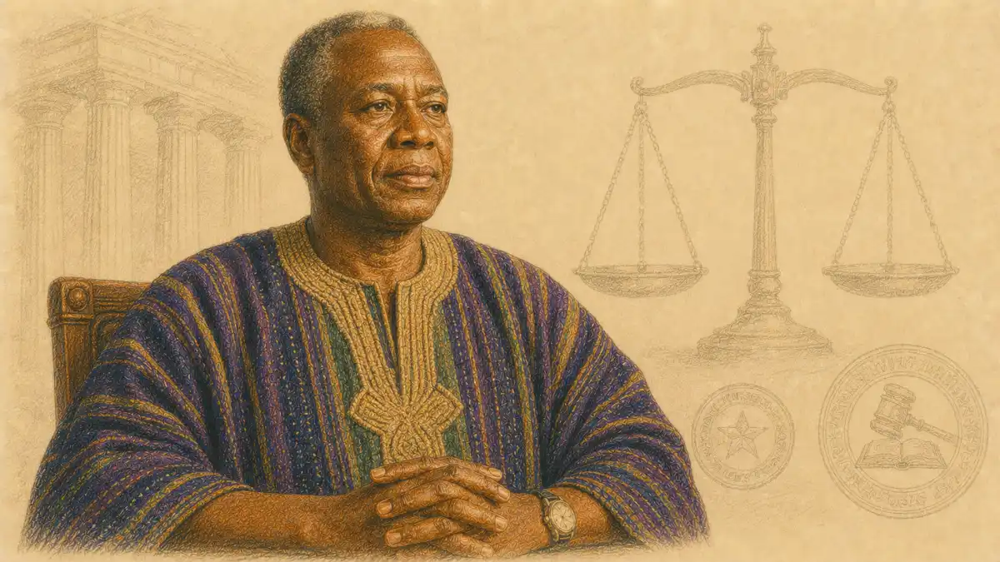

Most Advanced Placement courses hand students a defined body of knowledge and then test how much of it stuck. AP Seminar works in the opposite direction. The course hands students questions that have no single settled answer, a stack of sources that disagree with one another, and a set of deadlines spread across the school year, then it grades how well they investigate, argue, write, and speak. A student who thrives on memorized content may find the openness unsettling at first, while a student who loves chasing a problem through libraries and databases often discovers that Seminar feels less like a class and more like an apprenticeship in thinking.

Because the grading rewards process as much as product, preparation looks different here. Nobody can cram for AP Seminar in a frantic weekend, and nobody needs to. The score grows out of habits built month by month: reading sources with suspicion and generosity at the same time, narrowing a sprawling curiosity into a researchable question, building an argument that survives hostile questions, and presenting findings to an audience that is allowed to push back. This guide walks through the whole architecture of the course, task by task and skill by skill, so a student, a parent, or a teacher new to the program can see exactly where the points live and how strong work earns them.

## A Course Built Around Questions Rather Than Answers

AP Seminar is the first course in the AP Capstone program, a two year sequence developed by College Board that places inquiry at the center of the curriculum. Where a conventional course organizes itself around chapters, Seminar organizes itself around themes and problems. Teachers choose broad topics, often framed as lenses such as power, sustainability, identity, or innovation, and students learn to approach those topics the way working researchers do, by asking what is known, what is disputed, and what evidence would settle the dispute if anything could.

The intellectual spine of the course is a framework College Board calls QUEST, a set of five practices that recur in every assignment. Students question and explore, they understand and analyze arguments, they evaluate multiple perspectives, they synthesize ideas across sources, and they team, transform, and transmit their conclusions to an audience. The acronym matters less than the rhythm it describes. Every major task in the course walks students through that same cycle, first with a team for support and later alone under examination conditions, so the skills compound through repetition with rising independence.

Nothing in the design assumes a student arrives already knowing how to do academic research. Early units teach the difference between a topic and a question, between a summary and an analysis, between a source that merely agrees with a hunch and a source that genuinely tests it. By the time the scored performance tasks begin, the class has usually practiced each component in miniature, which is why teachers describe Seminar as a course where the rehearsal is the curriculum and the graded performances simply formalize habits that the year has been building all along.

## How AP Seminar Differs From a Content Course

The most common misconception about AP Seminar is that it must secretly have a syllabus of facts hiding somewhere, a list of terms to memorize before the exam. It does not. The end of course exam supplies its own reading passages and source packets on the day, so there is no canon of content that a student could review the night before. What the exam tests instead is transfer: whether the reading, reasoning, and writing moves practiced all year can be performed on unfamiliar material under time pressure.

That difference reshapes what good studying means. In a content course, review means returning to material until recall becomes fast and reliable. In Seminar, review means returning to one own drafts and performances until the weak joints show: a claim that outruns its evidence, a counterargument acknowledged but never answered, a source quoted when it should have been interrogated. Students who keep an honest log of feedback from practice tasks usually improve faster than students who simply complete more tasks, because the course grades the quality of thinking moves rather than the volume of work produced.

The difference also changes how difficulty feels. Seminar rarely produces the panic of an unrecognized term on a test. Its hard moments are quieter and more personal: a research question that collapses after two weeks of reading, a team that cannot agree on a solution, a presentation defense where a teacher asks the one question nobody prepared for. Students who expect those moments, and who treat them as the actual substance of the course rather than as accidents, tend to handle the graded performances with far more composure.

## The AP Capstone Program Around the Course

Seminar does not stand alone. It is the foundation year of AP Capstone, and its partner course, AP Research, asks students to spend a full year designing and completing an independent investigation of their own choosing. Seminar teaches the shared grammar of inquiry that Research then assumes: formulating questions, reviewing what others have written, choosing a method, and defending conclusions in public. A student deciding whether the sequence fits should read the companion guide to [AP Research and its academic paper](/2007/01/30/ap-research-complete-guide/) alongside this one, because the two courses are designed as a single arc.

Students who earn scores of 3 or higher in both Seminar and Research, together with scores of 3 or higher in four additional AP courses of their choosing, receive the AP Capstone Diploma. Those who complete Seminar and Research with qualifying scores but do not add the four other courses receive the AP Seminar and Research Certificate. The credential structure signals something important about the program intent: College Board treats inquiry as a discipline in its own right, worth certifying the way it certifies chemistry or calculus.

Schools adopt Capstone for varied reasons. Some want a humanities bridge for students headed toward research heavy majors. Some use Seminar to strengthen writing across the curriculum, since the course forces argumentation in a way few single subject classes can. Whatever the local motive, students experience the same core: a year of guided practice in asking defensible questions and answering them with evidence, inside a national framework that scores the results consistently.

## The Shape of the Year

A Seminar year typically opens with skill building units that carry no College Board score, though they matter enormously for everything that follows. Students learn to annotate an argument, to map its claims and reasons, to spot the line of reasoning and test where it bends. They practice short research cycles, sometimes on playful topics, so that the mechanics of searching databases, evaluating credibility, and citing sources become routine before the stakes rise.

The scored work then unfolds in a deliberate sequence. The team project comes first, usually across the middle stretch of the year, because collaboration lets students specialize and support one another while the research process is still new. The individual research based essay and presentation follow, raising the demand: the question, the reading, the writing, and the speaking all belong to one student alone. Finally, in May, the end of course exam compresses the same skills into a single sitting with unfamiliar texts.

That sequencing is a pedagogy in itself. Team before individual teaches interdependence before independence. Months of untimed project work before a timed exam teaches depth before speed. Teachers who protect the sequence, resisting the urge to rush into graded tasks before the practice units have done their work, generally produce calmer and stronger performances, because students meet each scored component having already survived a rehearsal version of it.

## The InsightCrunch Seminar Task Map

Three scored components make up the final AP score, and their relationship is the single most useful thing a new student can memorize. Unlike most AP courses, where a single May exam decides nearly everything, Seminar spreads its score across the year. The table below, which this guide calls the InsightCrunch Seminar task map, lays out the components and their weight in the final score as published in the course framework.

| Task | Components | Share of the AP score |
| --- | --- | --- |
| Task 1: Team Project and Presentation | Individual Research Report, team multimedia presentation, oral defense | 20 percent |
| Task 2: Individual Research-Based Essay and Presentation | Individual Written Argument, individual multimedia presentation, oral defense | 35 percent |
| End-of-course exam | Argument analysis questions and a source-based argumentative essay | 45 percent |

Read the map as a strategy document. More than half of the score is earned before the May exam even begins, through work that allows drafting, feedback, and revision. That distribution rewards students who treat the year as the assessment rather than treating the assessment as a single day. It also softens catastrophe: a rough exam morning cannot erase two strong projects, and a weak project cannot fully sink a student who writes a commanding exam essay.

The map also explains the course emotional arc. Autumn belongs to learning the moves. Winter belongs to the team. Spring belongs to the individual project, the most heavily weighted project work, and then to the sprint of exam preparation. Students who pace themselves according to that arc, saving their deepest focus for the individual project rather than exhausting themselves in October, tend to finish the year with their best work last, which is exactly where the weighting rewards it.

### How much of the AP Seminar score is decided before the May exam?

Fifty-five percent of the AP Seminar score comes from the two performance tasks completed during the school year, with the team project carrying twenty percent and the individual project carrying thirty-five percent. The remaining forty-five percent rests on the end-of-course exam taken in May, which students answer in a single sitting using passages and sources provided that day.

## Task One: The Team Project and Presentation

The team project begins with a shared problem. Teachers present a theme or a set of stimulus materials, and teams of three to five students carve the broad territory into a problem or issue that matters and can actually be investigated. A team might take a theme like water and narrow it to the question of how one city should manage storm runoff, or take a theme like artificial intelligence and narrow it to how one school district should govern student use of generative tools. The narrowing is itself a graded skill, even when it appears inside other scores.

Each member then researches one lens or perspective on the problem individually. One student might take the economic angle, another the scientific evidence, another the ethical or cultural dimension. The design forces a truth that professional research teams know well: a complicated problem looks different depending on the instrument used to examine it, and a team that gathers only one kind of evidence will propose a lopsided solution. Teachers monitor the lens choices early, because a team with four overlapping perspectives and one missing crucial angle will struggle no matter how hard everyone works.

The team reconvenes to synthesize. This is the intellectually richest and socially hardest phase, because the individual findings rarely point in one clean direction. Evidence gathered through an economic lens may recommend a policy that the ethical lens finds troubling. The team must argue its way toward a shared conclusion or a shared proposal, and the quality of that argument, how honestly it weighs competing evidence, becomes the raw material for both the written reports and the presentation that follows.

## The Individual Research Report

Inside the team project sits an individual written component, the Individual Research Report, capped at 1,200 words. Each student writes up the inquiry conducted through the assigned lens: the research question pursued, the sources consulted, the evidence found, and the conclusions that evidence supports about the team shared problem. The report is submitted to College Board and scored there, which makes it a student first encounter with an external reader who knows nothing about the classroom.

Brevity is the discipline of the report. Twelve hundred words sounds generous until a student tries to fit a question, a method, a fair account of several sources, and an argued conclusion inside it. Strong reports read like compressed scholarship: every paragraph does a job, quotations appear only where the exact wording matters, and summaries of sources always bend toward analysis. Students who draft long and then cut ruthlessly usually produce tighter reports than students who try to write exactly to the limit from the first sentence.

The report also teaches a quiet lesson about scholarly identity. Because the lens belongs to the individual, the report is where a student voice first becomes visible in the course, distinct from the team collective product. Teachers often advise students to choose lenses that genuinely interest them, since two weeks inside an indifferent topic produces flat prose, while curiosity sustains the close reading and careful qualification that scorers reward.

## The Team Multimedia Presentation and Its Defense

The team presentation, roughly eight to ten minutes, delivers the group argument: the problem as the team framed it, the evidence across lenses, and the solution or resolution the team proposes. Multimedia here means the presentation should use visuals, data displays, or media elements as part of the argument rather than as decoration. A chart that changes what the audience believes belongs in the deck. A photograph that merely fills a slide does not.

Delivery duties are shared, and the sharing itself is part of the design. Each member must be able to speak to the whole argument, because the oral defense that follows the presentation allows the teacher to direct questions to any member about any part of the work. Teams that let one strong speaker carry the presentation discover the risk in the defense, where a quiet member may be asked to explain the reasoning behind a slide someone else built. Strong teams rehearse by quizzing one another across sections until the argument lives in every member head, not just in the deck.

The defense questions tend to probe choices rather than facts. Why did the team frame the problem this way rather than that way? Which source did the team trust least, and why did it stay in the argument? What would change if one key piece of evidence turned out to be wrong? Students who prepare by listing the genuine weak points of their own project, and deciding honestly how to answer for them, walk into the defense with an advantage no amount of slide polish can match.

## Task Two: The Individual Research-Based Essay and Presentation

The second performance task removes the team. Working from a packet of stimulus materials that College Board provides, each student builds an individual project: a research question inspired by the stimuli, an investigation conducted independently, a written argument of 2,000 words, a presentation of six to eight minutes, and a short oral defense. The stimulus packet usually gathers four to five sources of different genres, an essay, a speech or article, data, imagery, that circle a broad theme and invite connections.

The genius of the design is the word inspired. The question must grow out of the stimulus materials, but it may travel far from them, into territory the student chooses and researches independently. A packet themed on play might produce one student investigating municipal funding for public playgrounds, another examining the psychology of games in workplace training, and a third analyzing how professional sports leagues market nostalgia. The stimuli light the fuse; the research belongs to the student.

Because this task carries thirty-five percent of the score and depends on a single student stamina and judgment, teachers often call it the heart of the course. It is also the task that most resembles later academic work. Anyone who has written a college research paper will recognize the shape: a question worth answering, a literature worth reading, an argument worth defending, and an audience waiting to ask hard questions at the end.

## Choosing a Research Question That Can Survive Research

Every Seminar teacher has watched a promising student sink weeks into a question that could never have worked. The failure modes are consistent enough to name. Some questions are too broad, asking about the effects of social media on society when a semester of doctoral work could not settle the matter. Some are not questions at all but topics wearing a question mark. Some are settled factual matters that research can only summarize, leaving nothing to argue. Some depend on evidence that does not exist in accessible form.

A survivable question has recognizable traits. It is narrow enough that a student can read the important sources within the available weeks, yet open enough that reasonable people disagree about the answer. It points toward evidence that exists in scholarly or reputable form. It matters to someone beyond the student, which gives the argument stakes, and it connects back to the stimulus materials in a way the student can explain in a sentence or two. Teachers often test drafts with a simple demand: state the question, then state the two or three defensible answers it might produce. A question with only one possible answer is a report waiting to happen, not an investigation.

Refinement is expected and even graded in spirit. Strong students keep a research log where the question visibly evolves: the first version, the version after preliminary reading exposed a flaw, the final version with its scope narrowed to a population, a place, or a time frame. That evolution is not a sign of early failure. It is the actual behavior of researchers, and students who document it can describe it in their defense with the confidence of people who did the work rather than the performance of work.

## The Individual Written Argument

The Individual Written Argument, the 2,000 word essay at the center of Task Two, is the single most substantial piece of writing most Seminar students have produced. Its job is to answer the research question with a claim that the essay evidence can carry, developed through a line of reasoning that engages multiple perspectives and acknowledges complexity. Scorers read for the quality of the argument architecture: how the claim is framed, how reasons are sequenced, how evidence is selected and interpreted, and how counterarguments are treated.

What separates high scoring essays from competent ones is rarely vocabulary or sentence flourish. It is the relationship between claim and evidence. In a middling essay, evidence appears as decoration, quoted to agree with points already asserted. In a strong essay, evidence does work: it qualifies claims, it forces distinctions, it sometimes visibly changes the direction of the argument mid-essay as the writer follows the research where it leads. Scorers are trained to notice that difference, and students can practice it by asking of every cited source a blunt question: what does this source make my argument do that it could not do before?

The essay also demands honest engagement with opposing views. A counterargument paragraph that steelmans the other side, presenting its strongest form before answering it, signals intellectual maturity that scorers reward. A counterargument paragraph that attacks a caricature signals the opposite. Students sometimes fear that conceding ground weakens an essay; in this scoring system, thoughtful concession paired with a clear response usually strengthens it, because the rubric values complexity over bravado.

## The Individual Presentation and Defense

Six to eight minutes is a demanding container for a year-defining project. The individual presentation must compress the research journey and the argument into a spoken form that an audience can follow without the essay in hand. Strong presenters treat the talk as a distinct composition rather than a summary of the paper: they open with the problem that makes the question matter, walk the audience through the turning points of the evidence, and land on the conclusion with the implications made explicit.

Visuals in the individual presentation carry special weight because there is no team to share the stage. Slides should pace the argument, showing the data display or image at the moment the spoken line needs it, then getting out of the way. Students who read dense paragraphs off their slides surrender the audience attention that the performance is meant to hold, and teachers score engagement and delivery as real components rather than courtesies.

The oral defense after the individual presentation is brief, typically two teacher questions, but it punches above its length. One question usually asks the student to reflect on the process: how the question evolved, which source proved most valuable, what the investigation could not settle. The other often probes depth: an alternative perspective, a limitation of the evidence, an implication the student had not foregrounded. Because the defense cannot be scripted, it functions as an authenticity check on the whole project, and students who truly did the reading answer it with ease that cannot be faked.

## The End-of-Course Exam, Part A: Analyzing an Argument

The May exam opens with a single substantial passage and three questions about it. The passage is an argumentative text, often drawn from a speech, an essay, or a work of nonfiction, and the questions ask the student to identify the author argument, explain the line of reasoning that connects claims to conclusion, and evaluate the effectiveness of the evidence and rhetoric used. Thirty minutes is the suggested working time, and the answers are short essays rather than multiple choice selections, which surprises students who associate AP exams with bubbled answers.

Part A is the purest test of the reading skill the course builds all year. There is no content to recall, because the passage is new to everyone in the room. What transfers is habit: the reflex to annotate for claims rather than for facts, to mark where an author concedes or qualifies, to notice when an example is asked to carry more weight than an example can bear. Students who have spent the year diagramming arguments in class perform these moves almost automatically, while students facing the task cold burn their half hour simply deciding what the questions want.

Preparation for Part A therefore looks like rehearsal, not review. Timed practice with unfamiliar passages, followed by comparison against scored sample responses, teaches students the length and directness the readers reward. The strongest practice answers state the author claim in a sentence, trace two or three reasoning moves with textual evidence, and render a judgment about effectiveness that acknowledges both strengths and limits rather than declaring the passage brilliant or flawed in one sweeping breath.

## The End-of-Course Exam, Part B: Building an Argument From Sources

Part B reverses the direction. The exam provides a packet of four sources on a shared theme, texts and sometimes visual or quantitative material, and asks the student to write an argumentative essay that takes a position on an issue the packet raises, drawing on at least two of the sources as evidence. Ninety minutes is the working frame, and the task mirrors the year project work in miniature: read across perspectives, synthesize, argue, and acknowledge complexity, all against the clock.

Success in Part B depends on refusing two temptations. The first is summary: marching through the sources one by one, reporting what each says, produces an organized book report rather than an argument. The second is ignoring the packet: writing a preformed opinion essay and sprinkling in two quotations produces an argument that the evidence never actually touches. The scored sweet spot sits between those failures, an essay whose position the student owns but whose reasons visibly grew out of wrestling with the provided material.

Source selection inside the essay is a quiet scoring lever. Students choose which two or more sources to build on, and the choice reveals judgment. Picking the two sources that agree most loudly is easy but limiting, because the essay then has nothing to push against. Students who deliberately include a source that complicates their position, and who answer that complication inside the essay, demonstrate the evaluative stance the rubric prizes. Teachers drill this as a habit during the year: never cite only the friendly evidence.

### What happens during an oral defense in AP Seminar?

After each performance task presentation, the teacher asks questions that the student or team must answer on the spot. The questions probe how choices were made during the research, which evidence mattered most, and where the argument remains vulnerable. Because the defense cannot be scripted in advance, it rewards students who genuinely conducted the investigation themselves.

## How Scoring Actually Works

Scoring splits along a sensible line. The written components, the Individual Research Report and the Individual Written Argument, along with the exam responses, are scored through College Board processes by trained readers using analytic rubrics. The presentations and oral defenses are scored by the student own AP Seminar teacher, who completes required training and follows the same rubric language, because live performance cannot be shipped to a reading site. That division explains why Seminar teachers guard rehearsal time so carefully: they are the official scorers of everything spoken.

Rubrics in Seminar describe levels of quality rather than counting errors. A response earns its row score by matching a description of what the work does: whether the argument is defensible, whether the evidence is relevant and sufficient, whether the reasoning connects the two, whether perspectives are genuinely engaged or merely mentioned. Students benefit from reading rubric language directly, because phrases like establishes a line of reasoning or acknowledges complexity stop being abstractions once a class has matched them against scored samples.

Component scores then combine according to the weights in the task map, and the composite converts to the familiar five point AP scale. The conversion is set through College Board standard setting rather than by a fixed percentage published in advance, which is why this guide, like honest counseling everywhere, speaks about raw score targets for a 5 in ranges rather than in exact numbers. A student aiming at the top score should think in terms of strong performances across all three components, since the weighting makes a single heroic component unable to carry two neglected ones.

## What a 5 Really Requires

No published table says that a specific number of points guarantees a 5, and any source claiming one is inventing precision. What can be said truthfully is structural. A student who earns solidly strong rubric rows on both written projects, presents and defends them convincingly, and produces a competent exam, especially a Part B essay that genuinely synthesizes sources, has built exactly the profile that the top score describes. The breadth matters because forty-five percent of the score sits in the exam room, beyond the reach of revision.

Students sometimes ask whether a weak team experience dooms them. It does not. The team project is worth twenty percent, and within it the Individual Research Report is scored on the student own work, which cushions the effect of a difficult group. The rational response to a shaky team phase is not despair but concentration: the individual project and the exam together control eighty percent of the outcome, and both lie entirely in the student own hands.

The reverse logic also holds and is worth stating plainly. A student who coasts on a strong team, then treats the individual project casually because the year already feels successful, has exposed the largest single block of the score to exactly the wrong attitude. Teachers see this pattern every year, and the defense against it is calendar discipline: the individual project deserves the student freshest effort precisely because it arrives when the year feels nearly finished.

## The Reading Skill: Taking Arguments Apart

Underneath every task sits one foundational ability, the capacity to read an argument as a constructed object rather than as a stream of information. Seminar teaches students to identify claims, the reasons offered for them, the evidence beneath the reasons, and the assumptions that quietly hold the structure together. Rogerian moves, concessions, rebuttals, and qualifications stop being vocabulary words and become visible joints in texts the class dissects together.

A useful classroom exercise makes the skill tangible. Students take a single opinion essay and rewrite its argument as a skeleton: one sentence for the claim, one for each reason, one for the evidence type under each reason, one for the assumption nobody stated. Weak arguments collapse visibly under this treatment, their skeletons showing a missing joint or a reason repeated in different words. Strong arguments stand. Students who internalize the exercise begin performing it mentally on everything they read, which is precisely the transfer Part A of the exam measures.

Reading this way also protects students in their own research. A source whose skeleton shows circular reasoning, or evidence that is only anecdote stretched across a general claim, can be set aside early, before it contaminates a project bibliography. The habit saves weeks. Many a failed project did not fail at the writing stage; it failed at the reading stage, when weak sources were admitted without inspection and then could not support the argument built on top of them.

## Evaluating Sources and Credibility

Seminar students learn to interrogate a source before they use it, and the interrogation follows a consistent pattern even when teachers phrase it differently. Who produced this, and what qualifies them to speak? What kind of evidence does it offer, data, testimony, reasoning, imagery, and how was that evidence gathered? What does the source want the audience to believe or do, and what might its perspective cause it to omit? How do other sources, especially ones with different interests, describe the same matter?

That routine matters because student research now happens in an environment where polish is cheap. A beautifully designed site can carry fabricated claims, while a dry institutional report can carry the most reliable numbers available on a question. Seminar grading consistently rewards students who choose the credible source over the convenient one and who can explain the choice. In the oral defense, the question of why a particular source was trusted is among the most common a teacher can ask.

Lateral reading is the technique professionals use and the course quietly encourages. Instead of staying on a page and judging it by its own presentation, the researcher opens new searches to see what independent voices say about the source itself. A claim that appears in one outlet and nowhere else earns suspicion. A finding echoed across outlets with different ownership and different audiences earns provisional trust. Students who practice lateral reading on practice tasks bring a functioning skepticism into their graded projects.

## Synthesis: The Skill That Separates Scores

If one word names the difference between mid level and high level Seminar work, it is synthesis. Summary treats sources one at a time. Synthesis puts sources into conversation: this study extends that claim, this editorial misunderstands the data it cites, these two accounts agree on the facts and disagree violently about what the facts mean. The Individual Written Argument and the exam Part B both pay their highest rewards to writing that stages that conversation rather than shelving sources in separate paragraphs.

Synthesis can be practiced deliberately. A matrix on paper, with research sub questions down one side and sources across the top, forces a student to record what each source contributes to each part of the problem, and the empty cells in the matrix are diagnostic gold: they show where the research has holes before the writing begins. Another practice is the synthesis sentence drill, writing single sentences that cite two sources in genuine relation, using verbs like confirms, complicates, extends, contradicts, and qualifies. Twenty such sentences often contain the outline of the eventual essay.

Teachers recognize synthesis failure in drafts instantly, because it has a texture: paragraphs that could be rearranged in any order without loss, since each reports one source and connects to nothing. The repair is rarely more research. The repair is restructuring around ideas rather than around sources, letting each paragraph advance the argument and pulling in whichever sources bear on that paragraph point. Students who make that structural turn usually describe it as the moment the course clicked for them.

## Argument Construction From the Inside

Building an argument in Seminar begins with a claim that is arguable, specific, and significant, three adjectives teachers repeat until students hear them in their sleep. Arguable means a reasonable person could disagree. Specific means the claim names its scope rather than gesturing at a whole field. Significant means the answer changes something about how the audience should think or act. A claim failing any of the three tests produces an essay that scorers find competent at best, because there is nothing at stake in it.

From the claim, students build a line of reasoning: a sequence of reasons, each supported by evidence, arranged so that the argument accumulates rather than merely continues. The order deserves thought. Some arguments climb from the most concrete reason to the most consequential. Others confront the strongest objection early to clear the ground. What scorers penalize is not a particular order but the absence of one, essays where reasons arrive in the sequence the student happened to find the sources.

Evidence inside the argument needs interpretation, not just presentation. A statistic dropped into a paragraph without comment asks the reader to do the writer work. A statistic followed by a sentence explaining what it shows, why it matters, and where its limits lie demonstrates the analytical stance the rubric rewards. The pattern of evidence plus interpretation, repeated with discipline, is the closest thing Seminar has to a secret technique, and it is no secret at all, just hard to sustain for two thousand words without practice.

## Working in a Team Without Losing the Argument

Teamwork in Seminar is not group work in the casual sense, where one student does the project the night before while others watch. The structure blocks that failure mode in two ways: the Individual Research Report isolates each member research contribution for its own score, and the oral defense exposes any member who cannot explain the shared argument. Still, structure alone does not make a team function, and the habits that do are worth naming.

Functioning teams divide by lens early and write their division down, so gaps and overlaps surface in week one rather than in the final rehearsal. They set internal deadlines ahead of the official ones, because synthesis, the hardest phase, cannot be compressed into the final evening. They designate a skeptic, a member charged with attacking the emerging solution before the teacher defense does, and they rotate the role so criticism never becomes personal property. Above all, they treat disagreement about evidence as information rather than as conflict, since a team that argues honestly in private rarely falls apart in public.

Struggling teams share opposite symptoms: lens assignments made by friendship instead of by the problem shape, research hoarded in separate documents until the end, and a presentation assembled as four solo segments stapled together. The repair in each case is the same move, earlier and more honest conversation about the whole, held while there is still time to change the parts.

## Presentation Craft as an Academic Skill

Seminar treats presentation as scholarship in spoken form, not as a performance garnish. The scored dimensions include the substance of the argument as delivered, the organization of the talk, the use of media, and the quality of delivery itself, which means eye contact, pacing, and the ability to speak from knowledge rather than from a script or a slide. Students accustomed to earning grades silently sometimes resent this, until a teacher points out that every profession they admire communicates its findings aloud to rooms full of skeptics.

Good Seminar presentations share a recognizable architecture. The opening earns attention by establishing the problem stakes in concrete terms, a number, a scene, a tension between two facts. The middle moves through the argument in the same order the audience needs to understand it, which is not always the order the researchers discovered it. The ending widens from the conclusion to its implications, answering the audience unspoken question of why this inquiry deserved their minutes.

Rehearsal is where presentation quality is actually manufactured. Teams and individuals who rehearse aloud, timed, at least twice, discover the overlong section and the missing transition while discovery is still cheap. Recording a rehearsal on a phone remains painfully effective: students forgive a teacher critique and forget it, but watching themselves read a slide aloud converts them in a single viewing.

### Why does the individual project begin with stimulus materials?

College Board supplies the stimulus packet so that every student starts from a shared set of texts, images, and data, then travels outward through independent research. The design tests whether a student can let sources provoke a question instead of merely answer one, and it keeps scoring anchored to a common starting point nationwide.

## From Stimulus to Question: The Most Delicate Move in Task Two

The transition from packet to project defeats more students than any other single step. The stimulus materials tempt two shallow responses. One is to summarize them and call the summary a project. The other is to abandon them instantly, choosing a preexisting hobby topic and inventing a thin connection afterward. Scorers and teachers can detect both moves quickly, because the resulting research question either never leaves the packet or never truly touches it.

A genuine transition looks more like a chain of associations that research then disciplines. A student reads a stimulus essay about urban heat, notices a data source on tree canopy distribution, and begins wondering how planting decisions get made in neighborhoods with the least shade. Reading follows the wondering outward: municipal budgets, environmental justice scholarship, interviews published in planning journals. The final question, perhaps about how one city should prioritize planting funds, is visibly descended from the stimuli yet clearly the student own, and the student can narrate that descent in the defense without embarrassment.

Teachers coach this transition with freewriting and mapping exercises in the first days after the packet arrives. The goal is volume before judgment: list every question the materials provoke, cluster them by theme, mark which clusters connect to researchable evidence, and only then begin narrowing. Students who skip the divergent phase and marry the first question that occurs to them often discover its poverty two weeks later, when changing course is possible but expensive.

## Research Process: Searching With a Strategy

Amateur research begins with a search box and hope. Seminar research begins with a plan: key terms and their synonyms, the databases most likely to hold scholarly treatment of the question, and a running bibliography where every promising source gets a line the moment it is found. School librarians become central figures in this phase, and students who treat the library orientation as a formality usually pay for the inattention during the weeks when sources are due.

Search terms deserve the same care as the question itself. A student investigating school start times needs the vocabulary of the field, circadian, adolescent sleep phase, bell schedule, before databases will yield their best material. Reading one strong source and mining its terminology is often worth an hour of random querying, because fields name their concepts in ways outsiders do not guess. The bibliography of one good source is also a map to the next five, a chain that experienced researchers follow deliberately.

Keeping a research log transforms the process from a scramble into an asset. A log records where the student searched, what the search returned, which sources were rejected and why, and how the question shifted in response to evidence. Beyond its organizational value, the log becomes defense preparation: when a teacher asks why a prominent source is absent from the bibliography, the student who logged a reasoned rejection answers with authority, while the student who never encountered the source has nothing to say.

## Reading a Field: What a Literature Conversation Looks Like

Students often imagine research as collecting sources the way one collects ingredients, each item independent until combined in the final dish. Academic fields do not actually work that way, and Seminar tries to teach the truer model: sources respond to one another across years, forming a conversation with positions, replies, and revisions. Entering a project means joining that conversation at its current state, not starting a new one in ignorance of what has been said.

The practical skill is tracing positions. Given six sources on a question, a strong student can arrange them into camps and border disputes: these two agree on the diagnosis and split over the remedy, that one disputes the evidence the others share, this older piece framed the debate that the newer pieces still inhabit. An essay built on such a map argues with the field rather than at it, and its claims land with the weight of someone who knows where the open ground lies.

Teachers build this skill with annotated bibliography assignments long before the graded tasks. Each entry forces a student to state not only what a source argues but what it argues against and whom it cites. By the third or fourth entry, patterns emerge visibly on the page, and the class conversation shifts from sources as authorities to sources as participants. That shift in perception is one of the course most durable gifts, transferable to every discipline the student will meet afterward.

## Academic Integrity, Collaboration, and the Boundaries of Help

A course built on projects raises honest questions about assistance, and College Board answers them with bright lines. The scored work must be the student own. Teachers may teach skills, give feedback on practice work, and follow the permitted guidance in the course framework, but they may not write, edit into shape, or direct the content of scored submissions. Teammates may collaborate fully inside the team components, because collaboration is the assignment there, while the individual components require solitary authorship.

The rules matter because the oral defense functions as verification. A student whose essay was quietly reshaped by a tutor or a parent will face teacher questions about choices the student never made, in an argument the student cannot fully explain. The defense rarely produces formal accusations; it simply produces low confidence and low scores, as the gap between the written product and the spoken understanding becomes impossible to miss. Authentic work, even imperfect authentic work, defends better than polished borrowed work.

Citation discipline belongs to the same ethic. Seminar follows standard academic practice: any idea, data, or wording taken from a source must be credited, and quotation must be exact and marked. Students learn that citation is not bureaucratic decoration but a courtesy to readers and a map of the argument intellectual debts. Sloppy attribution in a draft is usually carelessness rather than dishonesty, yet the course treats the distinction seriously and teaches students to build citation habits early, when the stakes are practice grades rather than a reported AP score.

## The Misconception That There Is Nothing to Study

Every spring, a familiar rumor circulates among students new to the course: Seminar has no content, so the exam cannot be studied for, so nothing remains but to show up. The rumor confuses content with preparation. There is no list of facts to memorize, true, but there is a repertoire of moves to practice, and the exam measures exactly those moves under time pressure. A student can absolutely prepare: by analyzing arguments on a clock, by writing source based essays on a clock, and by studying scored samples to learn what readers count as effectiveness.

Practice materials are not scarce. Students can sharpen general argument skills with [free AP exam practice questions](https://reportmedic.org/tools/ap-exam-practice-questions.html) and released Seminar samples, then compare their timed responses against the published scoring commentaries. The comparison step is where the growth happens. Reading why a sample earned its row score, in the reader own language, teaches a student to hear their own drafts the way a scorer will hear them, a skill no amount of unguided writing volume can replace.

There is also a body of knowledge worth having, even if it is knowledge about the course rather than from a textbook. Students should know the task weights cold, the word limits, the presentation lengths, the rubric vocabulary, and the calendar of their own school deadlines. That procedural fluency frees mental bandwidth on performance days, letting attention go to the thinking instead of to logistics remembered at the last minute.

## Common Mistakes and How They Cost Points

Patterns of lost points repeat across schools and years with enough regularity that teachers warn about them by name. The first is the question that arrives too late: students who spend the research window still choosing a topic produce rushed projects whose thinness no writing skill can hide. The second is the source dump, a bibliography assembled for length rather than for use, where half the cited works never actually appear in the argument reasoning. The third is the presentation written as an essay and read aloud, which concedes the delivery and engagement dimensions before the talk begins.

A subtler mistake involves counterarguments handled as decoration. Many drafts include a paragraph beginning with a gesture toward critics, dispatching them in two sentences, and moving on with visible relief. Scorers read that paragraph as evidence the student has not yet understood what an opposing view is for. The stronger pattern gives the objection real estate, states it at full strength, and then either answers it with evidence or concedes the part of it that is true and narrows the claim accordingly. Both responses score; the decorative dismissal does not.

Time mismanagement inside the exam deserves its own warning. Part A feels small, three questions, one passage, and students linger there polishing prose while Part B, the longer and richer opportunity, waits with its four sources unread. The suggested split exists for a reason, and students who practice with a visible clock learn to treat the half hour boundary as a genuine instruction rather than as a rumor.

## College Credit, Placement, and What Admissions Offices See

Families often ask the money question directly: does Seminar earn college credit? The honest answer is that policies vary widely, and the course framework itself frames credit as varying by college. Some universities grant elective credit for qualifying Seminar scores, some grant credit for the completed Capstone Diploma, some offer placement or nothing at all, and policies change often enough that families must check each target school directly. The broader rules that govern AP credit across subjects are mapped in the companion guide to [AP credit policies at colleges](/2008/10/07/ap-credit-policies-colleges/), which explains how score reports translate into standing at different kinds of institutions.

Admissions value operates on a separate track from credit value. An admissions reader cannot award credit, but can recognize what a Capstone sequence signifies about an applicant: two years of sustained inquiry, a defended research project, and writing samples produced under national rubrics. In an application pool crowded with strong grades, a completed independent investigation gives a student something concrete to describe in essays and interviews, an intellectual project with a question, a method, and findings. How that signal interacts with course selection overall is treated in the guide to [AP classes and college admissions](/2007/01/07/ap-classes-and-college-admissions/), and students weighing Seminar against another elective should think in those portfolio terms.

There is also a skills dividend that never appears on a transcript line. The first college research paper, the first lab report literature review, the first internship presentation, all arrive easier for Seminar graduates, because the underlying cycle of question, evidence, argument, and defense has already been rehearsed at full length. Alumni of the course consistently describe that transfer when teachers survey them, and it may be the most reliable return the course pays.

### How are Seminar presentations scored if College Board never sees them?

Trained AP Seminar teachers score the presentations and oral defenses at their own schools using College Board rubrics and calibration materials. The arrangement trusts teachers with live performance while reserving the written reports, the written argument, and the exam for centralized scoring, a division that keeps one standard across thousands of classrooms.

## Who Should Take AP Seminar, and Who Should Hesitate

The course welcomes students who are curious in a particular way: they enjoy questions that stay open, they read or listen with an instinct to argue back, and they tolerate drafts, since nearly everything in Seminar is revised before it is scored. A student does not need to be the strongest writer in the school on day one. The course teaches writing as a process of thinking on paper, and many average September writers finish May with genuinely strong essays because the feedback cycles are frequent and specific.

Hesitation is appropriate in a few cases. A student whose schedule is already saturated with project heavy courses may find the long deadlines of Seminar colliding with everything else, because the work cannot be compressed into the night before. A student who strongly prefers clear right answers may find the ambiguity uncomfortable, though some such students convert happily once they see that rigor exists here too, aimed at reasoning rather than at recall. A student planning to take Seminar only as a transcript ornament, without interest in the work, will likely find the year long and the score disappointing.

Reading level matters more than most families expect. The course asks students to read scholarship and serious journalism independently, in quantity, and to keep pace with sources chosen for a self directed project. A student still struggling to read grade level nonfiction will spend the year fighting the material instead of the ideas. In that case, a year of growth in an English course first, with Seminar taken later, often serves the student better than an early placement that produces only frustration.

## Seminar Beside Other AP Courses

Students building a schedule often compare Seminar with AP English Language, and the comparison is instructive. English Language centers on rhetoric and composition, analyzing how texts persuade and producing timed and polished writing about provided prompts. Seminar centers on inquiry, generating questions and sustaining projects across weeks. The two overlap in argument analysis and in respect for evidence, and many schools sequence them happily, but they are not substitutes: one studies the craft of arguments, the other practices the research that gives arguments something to be about.

Against the big content courses, Seminar plays a different role in a student program. It supplies no laboratory science and no historical canon, and it should not displace a course a student needs for a planned major. Its contribution is methodological. Students report that Seminar habits leak productively into other subjects: source evaluation sharpens history document work, argument mapping clarifies science explanations, and presentation practice steadies everything from club leadership to job interviews. For the full landscape of what each AP course contributes, the program overview at [the complete AP exams guide](/2008/11/08/ap-exams-complete-guide/) places Seminar among its sibling subjects.

There is also the Capstone completion question to weigh. Seminar alone delivers the skills course and its score. Seminar followed by Research delivers the diploma pathway when combined with four other qualifying AP scores, and the multi year commitment has value for students who want a signature project by graduation. That longer decision, including whether the credential justifies the schedule space, is examined in the analysis of [whether the AP Capstone Diploma is worth it](/2006/12/16/ap-capstone-diploma-worth-it/), and it deserves a family conversation rather than a reflexive yes or no.

## Inside the Rubric: What Readers Actually Reward

Rubric rows in Seminar describe performances, and reading a few of them closely teaches more than a semester of vague advice about writing well. One family of rows concerns the argument itself: whether the work takes a defensible position, whether that position is developed through reasoning rather than asserted through repetition, and whether the conclusion follows from what came before instead of wandering into new territory at the end. Students are often surprised to learn how heavily coherence weighs, until they read a sample where elegant sentences support an argument that quietly changes its claim halfway through, and see the score it earns.

Another family concerns evidence: its relevance, its sufficiency, and the accuracy with which it is represented. The accuracy point deserves emphasis, because students sometimes paraphrase a source into a stronger claim than the source made, believing they are helping their case. Readers check fidelity, and an essay that inflates its evidence loses trust it cannot regain within the same document. The trustworthy essay quotes precisely, summarizes fairly, and flags uncertainty where the source itself is uncertain.

A third family concerns engagement with perspectives and complexity. The rubric language rewards work that situates its argument among other positions, acknowledges limitations, and qualifies claims to match the evidence strength. None of this requires a student to be wishy washy. It requires the opposite: a position held with enough precision that its boundaries are visible. Readers describe the best essays as confident and careful at once, and students should memorize that pairing as the target tone.

## Evidence in Its Many Forms

Seminar broadens what counts as evidence beyond the scholarly article, and projects are stronger when students exploit the full range deliberately. Quantitative evidence brings scale and comparison: census figures, survey results, experimental data, budget numbers. Qualitative evidence brings texture and mechanism: interviews, case studies, field observation, documentary accounts. Historical evidence brings trajectory, showing how a problem arrived at its present shape. Visual evidence, from photographs to data displays, can establish conditions that prose describes only clumsily.

Each form carries its own credibility questions, and strong projects show awareness of them. A survey is interrogated for its sample and its question wording. An interview is weighed as testimony from an interested party or an expert witness, which are different things. A historical narrative is checked for the era of its writing, since accounts of the same event shift as archives open and politics change. Scorers notice when a bibliography mixes forms thoughtfully, because range usually signals that the student followed the question rather than a single convenient database.

Data displays inside essays and presentations deserve special discipline. A graph earns its place when the writer interprets it: here is the trend, here is the anomaly, here is what the pattern rules out. A graph pasted without interpretation is furniture. Students who practice writing two sentences about every display they include, one describing the pattern and one arguing its meaning, find their evidence sections tightening noticeably within a few weeks.

## Perspectives Are Not Decorations

The course vocabulary leans heavily on the word perspective, and students misuse it in a predictable way, treating each perspective as a person opinion to be collected and displayed. In Seminar usage, a perspective is a structured way of seeing a problem, shaped by a discipline, a stake, or a set of values: the economist perspective on a minimum wage question differs from the small business owner perspective, and both differ from the labor historian view, not because the people feel differently but because each framework notices different evidence and weighs it by different standards.

Handled properly, perspectives do analytical work in a project. They generate the sub questions that organize research. They predict where evidence will conflict. They supply the counterarguments that a mature essay must answer. A team project makes this concrete by assigning lenses to members, but the individual project tests the same capacity internally: one student, holding several perspectives in mind at once, resisting the pull to research only the angle that confirms the first instinct.

A practical exercise helps students keep perspectives honest. For each perspective in play, the student writes what that perspective would count as a good outcome, what evidence it trusts most, and what it systematically overlooks. The third item is the valuable one. Every lens has a blind spot, and an argument that names the blind spots of its own sources reads as masterful next to one that treats its favorite perspective as simple truth.

## The Teacher Role in a Seminar Classroom

Seminar asks teachers to work against several instincts of their profession. The teacher is not the source of content, because the course has no content canon. The teacher is instead a coach of process: designer of practice tasks, modeler of argument analysis, manager of deadlines that stretch across months, and finally the official scorer of student presentations. Teachers describe the role as closer to directing a research seminar at a university than to lecturing a survey course, and the comparison holds up in classroom observation.

Calibration keeps that scoring honest. Teachers complete training on the rubrics, score sample performances, and compare their judgments against established benchmarks before their own students present. During the year, many departments add informal moderation, having colleagues sit in on rehearsals or review borderline calls, so that a student score reflects the national standard rather than one classroom generosity or severity. Students should understand that this machinery exists, because it explains why presentation feedback during practice carries real predictive weight.

The teacher also enforces the course integrity boundaries, which occasionally creates tension worth understanding in advance. A teacher who refuses to look at a scored draft is not being unhelpful; the framework restricts feedback on work in progress for the performance tasks, channeling help toward the practice phase where it belongs. Families who grasp this design avoid misreading professional restraint as indifference, and students learn to front load their questions into the weeks when answers are permitted.

## A Walk Through the Year, Season by Season

Autumn in a Seminar classroom feels like a workshop. The class reads arguments together, slowly at first, learning to hear the difference between a claim and a topic sentence, between evidence and illustration. Short writing cycles dominate: analyze this editorial by Friday, evaluate these two sources against each other, draft a research question and defend its scope to a partner. Grades exist, but the deeper product is a shared vocabulary the class will use all year, words like warrant, qualification, and line of reasoning entering ordinary conversation.

Winter brings the team project and the first taste of scale. Research stretches across weeks, sources multiply, and the class learns project management the experiential way, through a deadline that cannot move because College Board sets the submission window. Teachers watch team dynamics the way coaches watch scrimmages, intervening less in the content than in the process: a team meeting that never happens gets scheduled, a lens that produced nothing gets redirected, a draft report gets its feedback while revision is still possible.

Spring divides in two. The individual project occupies the first half with an intensity students describe as the real course finally revealing itself, the packet, the question, the solitary research, the long essay, the talk, the defense. Then the calendar turns to May and the mode shifts from depth to speed: timed argument analysis, timed source essays, scored samples studied like game film. The year ends with an exam that feels, to a well taught student, less like a new challenge than like the practice tasks with the training wheels removed.

## Preparing for the Performance Tasks Week by Week

Preparation for the team project begins before teams exist, in the individual habits of the first research cycle. A student who has already built a personal system for saving sources, naming files, and logging searches will not waste the team first week on archaeology through a downloads folder. Teachers therefore treat the autumn practice tasks as systems training disguised as content, and students wise enough to notice build infrastructure they will thank themselves for in February.

During the team research window, weekly rhythm protects the project. A standing meeting time, an agenda kept in a shared document, and a simple rule that no meeting ends without named tasks and dates will carry a team further than brilliance will. The synthesis phase deserves protected days on the calendar, because merging four lens reports into one argument cannot be scheduled for the final evening without producing the stapled segments failure that teachers dread.

For the individual project, the calendar discipline is personal. Wise students set their own question deadline several days ahead of the official one, buying insurance against the common discovery that a first question needs rework. They reserve the final week before the essay deadline for revision rather than for research, a distinction that struggling students chronically blur. And they schedule presentation rehearsal while the essay is still in draft, because speaking the argument aloud exposes structural confusion earlier than any silent reread can.

## The Oral Defense Question Families

Although defense questions are written by each teacher for each project, they cluster into families that students can prepare for generically. One family asks about origins: how the question was chosen, how it changed, what the student would investigate next with more time. Another family asks about evidence judgment: which source was most persuasive and why, which source was excluded and on what grounds, how conflicting findings were resolved. A third family asks about limitations and alternatives: what the project could not establish, how a skeptic would attack the conclusion, what the strongest version of the opposing position looks like.

Preparing for families rather than for guessed questions changes the rehearsal task completely. A student cannot memorize answers to questions that do not yet exist, but a student can know the project honestly: its genuine turning points, its real compromises, its acknowledged gaps. That knowledge is precisely what the defense exists to verify, and it accumulates naturally in students who kept research logs and reflected at each stage. The defense, in other words, is prepared across the whole project, in the same way character is prepared across a whole year.

There is a performance element that honest preparation still leaves room for. Students should practice answering aloud, in complete sentences, at a measured pace, including the discipline of pausing before answering a hard question rather than filling silence with the first available words. A thoughtful pause reads as confidence. A rushed guess reads as the opposite, and the difference costs nothing but rehearsal to acquire.

## Revision: Where the Score Is Actually Manufactured

First drafts in Seminar are supposed to be imperfect; the scoring system assumes revision the way architecture assumes scaffolding. The students who gain most from feedback share a method. They collect comments without defending against them, sort the comments into structural problems and surface problems, repair structure first even when it hurts, and only then attend to sentences. Reversing that order, polishing the prose of paragraphs that restructuring will delete, is the most common waste of revision time teachers observe.

Structural revision in an argument essay has a specific look. It may mean conceding that the second reason is actually a restatement of the first and finding a genuinely independent reason in the research notes. It may mean moving the counterargument earlier because the claim only makes sense once the objection is on the table. It may mean cutting the most beloved paragraph in the draft, the one with the beautiful quotation, because the quotation evidence points somewhere the argument is not going. Students remember these operations painfully and permanently, which is to say the course is working.

Peer review, structured well, is a revision engine rather than a courtesy. Seminar classrooms train reviewers to respond as readers: mark where you were persuaded, where you were lost, where you wanted evidence and found assertion. A writer receiving three such readings owns a map of the draft as audiences actually experience it, which no solitary reread can supply. The reviewers gain as much as the writers, since diagnosing another student argument sharpens the diagnostic eye they turn on their own.

## Note Taking and Annotation Systems That Survive the Year

The volume of reading in Seminar punishes casual habits. A student who highlights everything owns a yellow book and no usable notes. Effective systems share a few traits whatever form they take. Annotation happens in conversation with the text: a claim marked, a question raised in the margin, a connection drawn to another source by name. Notes are taken with the eventual argument in mind, capturing not only what a source says but where it might serve, under which sub question, supporting or complicating which emerging claim.

The two column note, evidence on one side and interpretation on the other, is a classic for a reason. It forces the student to process at the moment of capture rather than deferring all thinking to the writing stage, and it produces raw material that transfers into drafts with unusual ease. Digital tools can serve the same discipline or undermine it; the tool matters less than whether the student is summarizing or analyzing at the point of contact with the source.

Retrieval closes the system. Students should be able to find, within a minute, the source that contained a given statistic and the note that recorded their response to it. That standard sounds clerical, and it is, but clerical failure is a leading cause of missed deadlines and misattributed quotations in project courses. Seminar treats organization as an intellectual virtue because researchers who cannot find their evidence do not, in any practical sense, have it.

## Working With Data Without Drowning in It

Quantitative material intimidates some Seminar students into either avoidance or worship, and the course tries to cure both. Avoidance leaves arguments resting entirely on testimony and anecdote. Worship treats any number as proof and any chart as a conclusion. The mature stance treats data as evidence with a biography: someone gathered it, for a purpose, using definitions and instruments that shape what it can show. Asking after that biography is a research skill as concrete as building a bibliography.

Correlation discipline is the most frequently tested piece of data literacy in student projects. Two trends rising together invite a causal story, and the invitation must be declined until alternative explanations have been examined: a third factor driving both, a coincidence of timing, a reversal of the supposed direction. Scorers reward the student who writes that careful sentence, the one acknowledging that the data establish association while the mechanism remains argued rather than proven. That single sentence of restraint can lift an entire evidence section in a reader estimation.

Scale is the second discipline. A project about one school, one town, or one season must claim accordingly, and the temptation to generalize a local finding into a national law has sunk many otherwise careful essays. Strong writers perform the opposite move: they state the local scope precisely, then argue carefully about what the case might suggest for similar settings, marking the suggestion as suggestion. Precision about scope is one of the clearest signals separating research from opinion dressed in citations.

## Writing Under Word Limits

Both written components impose ceilings, 1,200 words for the report and 2,000 for the argument, and the ceilings are pedagogy. Professional and academic writing nearly always answers to length constraints, and the discipline of fitting a real argument inside one produces the economy that readers experience as clarity. Students who view the limits as enemies tend to write bloated drafts and cut in panic. Students who view them as design parameters outline to the limit from the beginning, budgeting words the way an engineer budgets weight.

Cutting is a learnable craft with recognizable moves. Sentences that announce what the essay will do can usually vanish once the essay simply does it. Background sections shrink when writers ask how much history the argument actually needs rather than how much they happen to know. Quotations contract to their load bearing phrases. Repeated qualifications collapse into one precise statement placed where it governs everything after it. A student who masters those four moves can recover hundreds of words without losing a single idea.

The opposite skill matters just as much: knowing when a section is thin rather than long. An argument essay whose counterargument occupies three sentences has not saved words; it has amputated a scoring dimension. Budgeting therefore cuts both ways, and a useful revision exercise is to count the words spent on each function of the essay, claim, reasons, evidence, opposition, implications, and compare the proportions against the rubric emphases. The numbers rarely lie about where a draft priorities actually live.

## The Presentation Slide as an Argument Unit

Slide design in Seminar is an intellectual task disguised as a visual one. Each slide makes a claim on the audience attention, and strong decks pass a simple test: cover the speaker, read only the slides, and the argument skeleton remains visible. Titles that state conclusions rather than topics do much of that work. A slide titled with its finding teaches the audience something even before the speaker speaks, while a slide titled with a bare topic promises information and delivers homework.

Density is the standing temptation. Students who fear forgetting their material paste it onto slides as insurance, then read the insurance policy aloud while the audience reads faster and waits. The better insurance is a speaker note system and rehearsal, leaving slides lean: one display, one phrase, one image with a job to do. Scorers evaluating media use are really evaluating judgment about what belongs in which channel, the eye or the ear, at each moment of the talk.

Accessibility belongs to craft as well. Readable type sizes, contrast that survives a bright room, charts whose axes are labeled in words a newcomer can parse: these are courtesies that also function as clarity tests. A data display the audience cannot decode in five seconds is not evidence in any practical sense, whatever its merits on the student screen at midnight. Rehearsing in the actual room, under the actual projector, remains the cheapest insurance in the entire course.

## Speaking Skills: Pace, Presence, and Recovery

Delivery scoring rewards communication, not theater. The core skills are plain: speak at a pace the audience can process, look at the listeners rather than at the screen, gesture and move with intention rather than from nerves, and let sentences end before the next begins. Students who consider themselves poor speakers often discover that two or three targeted fixes, slowing down and looking up being the usual pair, move their delivery further than any personality change could.

Recovery deserves explicit practice because something goes wrong in nearly every live presentation: a slide misfires, a statistic slips from memory, a defense question arrives from an unconsidered angle. The scored difference lies not in the error but in the response. Composure, a brief acknowledgment, and a return to the argument thread read as mastery of the material. Panic, apology spirals, and abandonment of the thread read as fragility. Teachers who build small controlled failures into rehearsals, advancing a slide early, asking one unfair question, give students the recovery reps that make the real day survivable.

Question handling in the defense rewards a particular honesty. A student who does not know should say what they do know around the gap and name the gap plainly, rather than improvising a confident fiction. Teachers scoring defenses are experts at detecting invention, and the invention damages trust in everything else the student said. The plain admission, paired with how the student would investigate the point, frequently earns more than a fluent bluff.

## Exam Day Mechanics and Mindset

The end of course exam runs two hours in total, divided between the analysis questions and the source based essay, and it is administered under the standard AP conditions students know from other subjects. What differs is the texture of the work: extended writing from the first minute, no multiple choice shelter, and reading material that must be processed before any writing can begin. Students should expect the opening minutes of each part to feel slow, because absorbing a passage or a packet is the work, not a delay before the work.

Pacing strategy can be decided in advance and rehearsed until it is boring. Read the Part A passage with a pen, marking the claim, the turns, and the evidence types, then answer the three questions in order of confidence if the sequence allows, keeping prose direct. In Part B, spend the first block of minutes reading all four sources and penciling a tentative position, because essays planned after full reading synthesize, while essays started after the first source merely react. Leave a closing margin for rereading, since a conclusion that contradicts an earlier paragraph is the kind of error fresh eyes catch cheaply.

Mindset matters in a specific Seminar way. The exam does not ask what the student knows about a topic; it asks how the student thinks with material. That framing can calm a prepared student, because it means the year habits are the preparation and no surprise topic can nullify them. The student who has analyzed two hundred arguments in class is not meeting a new species of task in May, only a new specimen, and treating it that way is both honest and steadying.

## Score Reports and What to Do With Them

Scores arrive in the summer reporting season alongside other AP results, and families sometimes struggle to interpret a Seminar score because the course lacks the familiar content frame. A 3 certifies qualifying work in research and argumentation as the framework defines those terms; a 4 and a 5 certify progressively stronger command of the same performances. Colleges receiving the score read it as evidence about writing and inquiry readiness, whatever their formal credit policy happens to be.

A disappointing score deserves an autopsy rather than a shrug, especially for students continuing into AP Research. The informative questions are diagnostic. Did the written components or the exam underperform, insofar as a student can judge from the composite and from teacher feedback on the spoken parts? Was the weakness architectural, a claim or structure problem, or evidentiary, or presentational? Each diagnosis prescribes different work for the following year, and teachers can usually help a student reconstruct the likely story from the year artifacts.

A strong score, conversely, should be banked as more than a transcript line. The projects behind it are portfolio material: the written argument can anchor a college application essay about intellectual interests, the research experience can structure an interview answer, and the bibliography represents real familiarity with a field a student might claim to love. Students who keep their project files, drafts, and logs organized after the course ends own the raw material for those later uses; students who scatter them own only the number.

## Myths That Circulate About AP Seminar

Certain claims about the course recur in hallways and parent meetings, and each deserves a direct answer. One myth holds that Seminar is an easy A or an easy 5 because there is nothing to memorize. The record of the course grading suggests otherwise: the performances are demanding, the rubrics unforgiving of shallow work, and the absence of memorizable content removes the very strategy that carries many students through other courses. Effortless success stories usually turn out to involve students who were already strong readers and writers before the course began.

Another myth claims the opposite, that scores are arbitrary because teachers grade their own students. The scoring design answers this: written work goes to College Board readers, exam responses go to College Board readers, and teachers score only live performance after calibration training, with rubrics shared nationally. Reasonable people can debate the design, but arbitrary it is not.

A third myth treats the course as relevant only to future humanities majors. The evidence of the curriculum disagrees. The engineer evaluating studies before a design decision, the pre-medical student reading trial reports, the business student interrogating a market claim, all perform Seminar moves. The course teaches the handling of contested evidence, which is a nearly universal professional activity, and its alumni in technical fields are often its most vocal defenders.

## Choosing the Team Problem Well

The team project fate is often sealed in its first week, when the broad theme becomes a specific problem. Workable problems share traits that experienced teachers check on sight. The problem is bounded, attached to a place, a population, or a decision that someone actually faces. It is genuinely contested, with informed people proposing incompatible remedies. It is researchable through multiple lenses, so each member can own a distinct evidentiary territory. And it matters enough that a proposed solution would change something real for somebody identifiable.

Unworkable problems fail symmetrically. A problem stated at the level of world hunger or climate change in general offers no decision to inform and no lens division that means anything. A problem with an obvious consensus answer leaves the team performing research theater around a conclusion nobody disputes. A problem dependent on evidence locked inside proprietary or inaccessible data starves the individual reports. Teachers who veto early and specifically, naming which trait failed, save teams weeks of doomed labor, and students should invite that veto rather than fear it.

The framing sentence is the tool that keeps a problem honest. A team should be able to complete this sentence in plain words: we are investigating a specific decision or condition, affecting a specific group, where the evidence pulls toward more than one defensible response. Every later choice, from lens assignments to presentation structure, can be tested against that sentence. When the synthesis phase wobbles, as it always does, the framing sentence is the fixed point the team returns to.

## Lens Selection and the Division of Intellectual Labor

Choosing lenses is choosing what the team will be able to see. A sturdy set usually spans kinds of evidence rather than slicing the problem into arbitrary pieces: a scientific or technical lens for mechanisms, an economic lens for costs and incentives, a social or cultural lens for lived effects, and an ethical or legal lens for rights and obligations. Not every problem needs the same four, but every problem needs coverage unlike enough that the synthesis has real tensions to resolve.

The assignment conversation deserves more care than it usually gets. Members gravitate toward the lens matching their favorite school subject, which is a reasonable start, but the team should also ask who reads fastest, who handles data most confidently, and which lens carries the heaviest literature for this particular problem. Matching strength to load is not unfairness; it is project management, and the individual report scores will reflect the fit.

Gaps discovered mid research are normal and survivable. A lens that yields thin evidence can pivot toward the sub question where material exists, documenting the pivot in the report as part of the inquiry story. What teams must not do is silently narrow the whole problem to fit one member convenience, because the presentation will then argue from a fraction of the relevant world and the defense questions will find the missing territory within minutes.

## Feedback Culture Inside the Classroom

Because so much Seminar scoring rests on work produced over weeks, the classroom feedback culture functions as course infrastructure. Effective classrooms normalize critique as a technical activity aimed at texts rather than at people. The vocabulary helps: students learn to say the evidence in this paragraph does not support the claim above it, a sentence about a relationship on the page, instead of anything about the writer ability or effort. Precision of criticism is itself a taught skill, assessed informally every time the class workhops a draft.

Anonymous sample work lowers the temperature of early practice. Classes often begin the year dissecting published scored samples and teacher written imitations, where the author is absent or fictional, so students can be ruthless about structure without social cost. By the time peer drafts circulate, the norms have set: name strengths specifically, locate problems exactly, propose at least one repair for every problem named. A review that only praises is recognized by everyone, including the writer, as a review that did not happen.

Teachers protect this culture by modeling receipt of criticism on their own practice materials and by grading the quality of feedback during practice cycles in some form. The investment pays out during the performance tasks, when students run their own rehearsal critiques with genuine rigor because the habit has become simply how the room operates.

## How Seminar Serves Different Kinds of Learners

The discussion heavy, project based design interacts with student differences in ways worth planning around. Strong silent readers sometimes dominate the written components and vanish in defenses; deliberate low stakes speaking practice across the autumn, paired presentations, two minute argument summaries, builds the missing muscle gradually. Confident talkers face the mirror problem, learning that a fluent presentation over a thin argument scores worse than a quieter talk over a strong one, a lesson the rubric teaches whether or not the student enjoys it.

Students with documented accommodations participate under the standard College Board arrangements that govern all AP courses, and the project structure offers some natural flexibilities alongside the formal ones, since much work happens across weeks rather than in single sittings. The timed exam remains the least flexible element, which is one more reason teachers front load timed practice for everyone: familiarity reduces the penalty that raw novelty would otherwise impose on anxious students.

Multilingual learners bring a genuine asset to a course about perspectives, direct knowledge of how arguments and evidence conventions differ across cultures and languages. The challenge is workload: research reading in academic English is slow at first, and wise planning starts those students earlier on source gathering, with heavier use of librarian support. Teachers who treat the asset as real and the challenge as logistical, rather than treating either as a verdict on ability, tend to see these students produce some of the year most original questions.

## Parents and Guardians: Supporting Without Contaminating

Families can help a Seminar student substantially within the integrity boundaries, and the most useful help is structural rather than editorial. Protecting calendar space during the heavy project weeks, asking the student to explain the research question at the dinner table, and serving as a practice audience for presentations all strengthen the work while leaving authorship untouched. The explanation request is doubly valuable: a student who cannot make a grandparent understand the project in three minutes has discovered a clarity problem while it is still fixable.

The line families must respect is equally clear. Editing drafts, suggesting sources that steer the argument, and quizzing with leading questions about content all cross from support into contribution, and the oral defense is designed to surface exactly that gap. The kindest interpretation of the rule is also the truest: the score is meant to certify the student capabilities, and a contaminated score certifies a fiction that helps nobody when the student later sits in a college seminar room alone.

Questions about deadlines and policies belong with the teacher early rather than late. Seminar calendars vary by school because teachers sequence the performance tasks within College Board windows, so a family should work from the classroom calendar rather than from dates found in general guides, including this one. What general knowledge can supply is the shape: team work before individual work, individual work before the exam, and practice before everything.

## A Brief Word About AP Research for Those Continuing

Students who finish Seminar and continue into AP Research will find the second course simultaneously familiar and lonelier. The question crafting, source evaluation, and defense skills transfer directly, but the year long independent study, complete with a formal academic paper and a presentation with additional questions from a panel, removes the scaffolding of teacher chosen themes and team support. The students who fare best are those who used Seminar deliberately as training: keeping their research logs, archiving their feedback, and noting which parts of the process they rushed.

That continuity is the program designers intent. Capstone treats inquiry as a discipline with levels, and Seminar is explicitly the level where the moves are taught, named, and rehearsed under guidance. A student deciding between taking Seminar alone or committing to the sequence should weigh appetite honestly: the diploma pathway rewards the student who wants a substantial self directed project as a capstone to high school, not merely another credential line.

Whichever path a student chooses, the Seminar year itself stands complete. Its score reports a real attainment, its habits transfer immediately, and its central lesson, that a question honestly pursued through evidence beats an answer merely asserted, is one that no subsequent course will need to unteach.

## Timed Analysis Drills That Actually Transfer

Part A preparation fails when it becomes passive, reading sample answers and nodding along. The transfer producing drill has three beats: attempt under time, compare against a scored sample, then rewrite the weakest answer using what the comparison exposed. The rewrite beat is the one students skip and the one that matters most, because it converts recognition into production while the gap is still vivid. Two cycles of this drill per week for a month will change a student timing instincts more than a semester of untimed analysis.

The comparison itself needs structure or it degenerates into grade envy. Students should mark three things in the sample: where the claim about the author argument is stated, how many distinct reasoning moves are traced, and where the evaluation of effectiveness concedes anything. Then they mark the same three things, or their absence, in their own response. The marks turn an abstract standard into a checklist the next attempt can actually use.

Teachers vary the drill by swapping passages across genres, a speech for an essay, a historical address for a magazine argument, because Part A rewards flexibility more than pattern matching on one text type. Each genre hides its reasoning differently: speeches lean on repetition and audience address, essays on qualification and concession. A student who has named those habits across genres walks into the exam with a toolkit instead of a template.

## Timed Essay Drills for the Source Packet

Part B rehearsal should simulate the real cognitive sequence, not just the writing. The clock starts at the reading, and students must practice the discipline of withholding the pen until the packet has been surveyed whole. Early drills can isolate phases: fifteen minutes to read four sources and produce nothing but a position sentence and a source map, graded on the map alone. Isolating the phase teaches students that planning output is real output, a lesson timed writing usually obscures.

Later drills compress toward the full performance. Students draft complete essays in the working window, then spend as long reviewing them against the rubric as they spent writing. The review questions are consistent: does the position appear before the evidence summary begins, does every source cited do argumentative work, does one paragraph engage a source that pushes back, does the conclusion answer the prompt rather than summarize the essay. An essay that passes those four checks in practice tends to pass them in May.

One more drill deserves mention because it cures the most common Part B disease, the source parade. Students take a finished practice essay and reorder its body paragraphs. If the essay reads equally well in the new order, the paragraphs were source reports arranged in a line, and the essay needs restructuring around reasons. If the reordering breaks the logic, the essay has an actual line of reasoning worth keeping. The test takes two minutes and tells the truth.

## Annotated Bibliographies and Source Maps as Thinking Tools

The annotated bibliography is sometimes assigned as homework bookkeeping, which wastes its potential. Written properly, each annotation performs three acts in a few sentences: it summarizes the source argument accurately, it evaluates the source credibility and method, and it states the source intended role in the project, even if that role later changes. A bibliography built this way becomes the project memory, and drafting from it feels like assembling prepared components rather than excavating a pile of PDFs at midnight.

Source maps extend the idea visually. Given the project question at the center, the student places sources in relation: supporters of one answer, supporters of another, method critics, background providers, data suppliers. The map exposes overreliance instantly, a project whose map shows eleven sources in one camp and one lonely source elsewhere has announced its own imbalance before any teacher needs to. Rebalancing at the map stage costs an afternoon; rebalancing at the draft stage costs a week.

Both tools pay their largest dividend in the defense. A teacher asking why the bibliography lacks the obvious opposing study is really asking whether the student knows the field map. Students who built these tools can describe the terrain, including the parts they chose not to occupy, and that description is the sound of research competence that the whole course exists to produce.

## Handling Conflicting Evidence Without Panic

Every real investigation reaches a moment when two credible sources disagree, and novices experience the moment as failure. Seminar reframes it as the most valuable event in the project, because disagreement between credible sources is where an arguable claim is born. If all sources agreed, there would be nothing to argue, only a report to file. The student job is not to make the conflict vanish but to explain it: different methods, different populations, different time frames, different definitions of the key term.

Definition disputes deserve special attention because they masquerade as factual ones. Two studies of screen time and wellbeing may disagree chiefly because they measure different activities under one label. A student who discovers that distinction owns a sophisticated analytical point, the kind that elevates an essay from summary toward scholarship. Teachers push students to read methods sections for exactly this reason: the definitions live there, and so do the explanations of half the conflicts in any literature.

Where conflict survives explanation, the essay should carry it openly. Acknowledging that the evidence splits, stating which side the student finds stronger and why, and narrowing the claim to fit the stronger portion is not weakness. It is the precise behavior the rubric complexity language was written to reward, and readers consistently rank such essays above those that cite only the agreeable half of the record.

## Structuring the Long Essay Before Writing a Word

An outline for the Individual Written Argument is not a formality imposed by teachers; it is the mechanism by which a two thousand word essay acquires an architecture instead of a sequence. The useful outline works at the level of reasons, not topics. Each entry states a reason in a full sentence, names the evidence that will carry it, and notes which other part of the essay it depends on or sets up. An outline written at topic level, with entries like background or counterargument, conceals the only question that matters, which is whether the reasons actually add up to the claim.

The background question deserves a direct rule. Seminar essays bleed words on historical throat clearing that the argument never uses. The test for any background passage is whether a later paragraph would fail without it. Context that merely surrounds the topic belongs in the research notes; context that the claim stands on belongs in the essay, sized to its load. Writers who apply the test ruthlessly find their introductions shrinking to a paragraph that frames the problem and states the stakes, which is all a reader needs.

Transitions in a long argument are load bearing, not decorative. A transition should tell the reader why the argument moves where it moves: having established the mechanism, the essay turns to the evidence of outcomes, or having conceded the strongest objection, the essay now narrows the claim to its defensible core. Students who write transitions as genuine signposts rarely produce the stapled paragraphs problem, because the signposts force the order to mean something.

## Intros, Conclusions, and the Parts Students Undervalue

The introduction of a Seminar essay has three jobs and only three: establish the problem that makes the question worth asking, acknowledge the conversation the essay is joining, and state the claim toward which everything will move. Introductions that attempt a fourth job, summarizing the whole essay in advance or opening with a decorative quotation, spend words the body will miss. Readers form their expectations here, and a claim stated cleanly at the end of a tight introduction lets them spend the essay evaluating rather than guessing.

Conclusions fail in mirror image, either repeating the introduction with the verbs changed or sprinting into territory the essay never examined. The scored ideal reflects on the argument significance: what follows if the claim is right, what questions the investigation leaves open, where the evidence boundary lies. That reflective move is the essay last chance to display the complexity the rubric rewards, and students who reserve real thought for it, rather than treating it as a formality, close their essays at full strength.

Titles and headings inside the essay are minor but free advantages. A title that names the question or the claim orients the reader before the first sentence. Section headings, where a teacher permits them, can mark the line of reasoning visibly. Neither device rescues a weak argument, but both reduce the friction between a strong argument and its reader, and friction reduction is a legitimate scoring consideration in a document read under time pressure.

## The First Weeks: Habits That Compound

Everything in Seminar compounds, which is why teachers fuss over September habits that look trivial. The student who builds a citation routine in the first practice cycle will not spend March learning formatting while also writing the year biggest essay. The student who keeps a running list of feedback themes, not just individual corrections, begins to see personal patterns, a tendency to overclaim, a habit of burying the claim, that targeted practice can then attack directly.

Reading stamina is the quietest compounding habit. The course reading load grows as projects begin, and students who have been reading a modest amount of serious nonfiction weekly since autumn meet the project bibliography as a continuation rather than a cliff. Teachers who assign regular outside reading are not padding the syllabus; they are building the exact capacity the performance tasks will draw on without warning.

A final early habit is comfort with provisional answers. Seminar asks students to hold positions loosely while evidence gathers, and some students experience that looseness as failure to learn. It is actually the discipline itself. The class that normalizes changing a claim in response to a source, publicly and without embarrassment, produces students whose final arguments have survived contact with reality, which is the property readers reward above all others.

## When a Project Goes Wrong: Recovery Plays

Projects fail in predictable ways, and recovery is a testable skill in its own right. The question that collapses under research is the classic case: the honest recovery is to narrow or pivot early, document the change, and build the final argument on the ground the evidence actually supports. Teachers would rather score a modest question thoroughly investigated than a grand question abandoned in place, and the pivot story, told well in a defense, demonstrates the research judgment the course certifies.

The team that fractures has a narrower set of plays. The teacher mediates the work division, the deliverables get re-scoped to what the remaining collaboration can carry, and each member protects the individually scored components first. Because the Individual Research Report is scored separately, a student in a failing team can still secure that portion fully, and the twenty percent team weight limits the blast radius of even a complete group failure.

The presentation that goes wrong live has the simplest play of all: continue. A dropped line, a dead slide, a question that lands hard, none of these end a performance, and evaluators are practiced at crediting recovery. Students who have rehearsed recovery treat the incident as material; students who have only rehearsed perfection treat it as verdict. The difference shows in the score often enough that wise teachers schedule the imperfection into practice on purpose.

## The Long View: What Seminar Leaves Behind

Measured by its transcript line, Seminar is one course among many. Measured by what its graduates carry, it is closer to a workshop in intellectual self reliance. The alumnus who can walk into an unfamiliar controversy, locate the credible evidence, map the honest disagreements, and state a defensible position in writing and aloud owns a capability that every college major and most professions presuppose and few teach directly. That capability, more than the score, is the course argument for its own existence.

The habits also generalize in a direction students rarely predict: they become better consumers of argument in ordinary life. A graduate reads a headline claim and automatically asks after the sample, the definition, the missing perspective. That reflex does not make anyone cynical; it makes them expensive to fool, which is a different and better thing. In a information environment that monetizes credulity, the reflex may be the most valuable line on the whole transcript, even though no registrar records it.

For the student still deciding, the honest summary is this. Seminar will not hand over a body of knowledge to master, and it will not reward the strategies that work in courses that do. It will teach a person to ask a real question, to follow evidence past the point of comfort, to build an answer that can survive questions, and to stand next to that answer in public. Students who want that training will find the year demanding in the way good training is demanding, and the score at the end will simply be the receipt.

## Questions Students Ask Teachers Every Year

Certain worries arrive in every cohort wearing new clothes. Students ask whether a question has to be original to all humanity, and the answer is no: it has to be genuinely investigated by the student, within a scope one school year can support, and the defense of a modest question examined honestly outscores the performance of a grandiose one examined shallowly. Students ask whether they may change their claim after drafting begins, and the answer is not only yes but that the change, if the evidence forced it, is the project working as designed. The essay that ends where the first outline began is often the essay whose research was decoration.

Students ask how many sources a project needs, and honest teachers refuse the number while explaining the underlying measure. A bibliography is sufficient when the important positions on the question are represented by credible voices and the student can explain the selection. Ten sources that all say the same thing in the same way are thinner than six that map the actual disagreement. Counting sources is a proxy students reach for because judgment is harder to count, and the course exists partly to replace the proxy with the judgment.

Students ask whether the exam can really be fair when the topics are unknown, and the answer lies in the scoring design. Nobody in the room knows the passage or the packet in advance, the skills measured are the rehearsed ones, and the readers apply the same rubrics to every response in the country. Fairness in Seminar does not mean the topics are familiar. It means the thinking demanded is the thinking taught, and on that standard the exam is among the most predictable assessments in the program.

## Reading the Course Framework Like a Map

College Board publishes a course and exam description for Seminar, and students almost never read it, which is a missed advantage hiding in plain sight. The document states the task specifications precisely: the components, the lengths, the weights, the rubric language, and the rules governing teacher involvement. A student who reads it once, pencil in hand, in September owns the rulebook of the game they are about to play for nine months, while classmates operate on rumor and recollection.

The framework also clarifies what teachers may and may not do during the performance tasks, and that clarity protects students from a common frustration. When a teacher declines to comment on a draft of the Individual Written Argument, the refusal is compliance, not coldness, and knowing the rule in advance lets a student plan questions for the periods when feedback flows freely. The students who extract the most help from their teachers are usually those who understand which phases permit which kinds of help.

Schools add their own calendars on top of the framework, setting internal deadlines for question approval, draft milestones, and rehearsal days inside the official submission windows. A student therefore works from two documents: the national framework for the rules that never change, and the classroom calendar for the dates that do. Confusing the two is a perennial source of missed deadlines, and the fix is a single personal calendar where both are merged in the first week of the year.

## Why This Course Exists: The Designers Wager

Capstone was built on a diagnosis worth understanding, because it explains every design choice in Seminar. The diagnosis holds that students can arrive at demanding colleges with strong content knowledge and fragile inquiry skills: able to pass examinations on material presented to them, unpracticed at framing their own questions, evaluating contested evidence, or sustaining an argument across weeks. Universities reported the gap, and the program answers it by certifying process rather than content for once.

The wager embedded in the design is that inquiry can be taught as explicitly as content, with named moves, rubrics, rehearsal, and progressively independent performance. Seminar is that wager made into a school year. Its tasks are not projects in the decorative sense, the poster at the end of a unit, but the assessment itself, scored with the same seriousness as any May examination. Students who sense the seriousness early tend to stop asking whether the work counts, because the map of the score answers them.

Whether the wager pays off for a particular student depends less on talent than on engagement with the rehearsal structure. The course offers an unusual bargain: nearly everything scored is first practiced, feedback is built into the calendar, and the skills are cumulative by design. A student who takes the bargain seriously, treating practice tasks as the real curriculum, will find the graded performances feel less like judgments than like recitals of pieces already learned.

## A Note on Ambition and Scope

New Seminar students often equate ambition with scale, imagining that a project about a global problem outranks a project about a local one. Scorers reward a different quality, which might be called completeness: a question pursued through all its relevant perspectives, evidence followed to the point where claims can be sized honestly, and a conclusion that fits the investigation like a glove rather than a banner. A county level question about water pricing, fully worked, demonstrates every skill the rubric names. A planetary question gestured at demonstrates mainly the gesture.

Scope discipline also protects the calendar. A bounded question produces a bounded bibliography, a writable essay, and a presentation that can be rehearsed to polish. An unbounded one produces a research phase that never naturally ends, forcing the writing to begin in panic wherever the student happens to be standing when the deadline arrives. Teachers who approve questions are really approving workloads, and the students who internalize that equivalence early make better partners in their own education.

## Seminar for the Student Who Plans to Specialize Early

A student already aimed at a technical future sometimes wonders whether a course about argument belongs in a schedule crowded with mathematics and laboratory science. The answer from the curriculum itself is that evidence handling is not a humanities hobby. The future engineer will read studies whose conclusions conflict, the future physician will weigh trial reports of uneven quality, the future programmer will evaluate claims about tools and methods made by parties selling something. Seminar trains exactly the reading posture those moments require, and it does so before the stakes involve patients, bridges, or budgets.

There is also a communication argument that specialized students underestimate at their peril. Technical fields promote the people who can explain findings to mixed audiences, defend a design choice in a review meeting, and write a recommendation that survives skeptical reading. Those are Seminar performances wearing professional clothes. A student who has already stood through a scored defense of a research project owns a rehearsal advantage that compounds quietly for years, and admissions readers at technical institutions know the Capstone sequence signals precisely that preparation.

## Seminar for the Student Who Loves a Subject

The opposite case deserves equal honesty. A student burning with interest in one field, history, say, or biology, may find Seminar breadth refreshing or diluting depending on temperament. The saving design feature is the individual project, which lets a student aim the full research apparatus at a question inside the beloved territory, provided the stimulus connection can be honestly drawn. Many students produce the best work of their high school careers in that slot, because the course hands them professional tools and a topic they would have pursued anyway.

Where friction appears, it is usually about the process requirements: the logs, the annotated bibliographies, the rehearsals, the documentation of a question evolution that the passionate student experiences as bureaucracy around an inquiry they are already conducting happily in their head. The course answer is that externalizing the process is the point. Knowledge that lives only as intuition cannot be defended, taught, or improved, and the artifacts Seminar demands are the mechanism by which private enthusiasm becomes public scholarship. Most converts come around the first time a defense question is answered easily because a log entry existed.

## The Difference Between a Topic, a Problem, and a Question

Vocabulary precision in the planning stage prevents months of drift, so the distinctions deserve one direct statement. A topic is a territory: urban heat, food security, campaign finance. A problem is a tension inside a territory: residents of low canopy neighborhoods bear heat burdens that planting budgets have historically worsened rather than relieved. A question is the investigable form of the tension: how should this city allocate its planting budget to reduce heat exposure in the neighborhoods that carry the highest burden. Each step adds a decision, a population, and a criterion, and each step makes research more possible rather than less interesting.

Students stall when they try to research a topic, because a topic generates summaries. They flourish when they research a question, because a question generates a search for evidence arranged by relevance to possible answers. Teachers therefore spend what can feel like excessive time at the whiteboard converting topics into problems and problems into questions in front of the class, sentence by sentence. The exercise is the course in miniature: thinking made visible, revised in public, until the instrument is sharp enough to cut.

## Endurance: The Hidden Curriculum of Long Projects

Nobody lists stamina among the course learning objectives, yet every Seminar graduate names it among the outcomes. A project spanning two months teaches a student to keep working on something whose payoff is distant, to recover from a mid course discovery that the plan needs surgery, and to maintain quality in week six at the standard set in week one. Those capacities are conspicuously absent from courses organized as a sequence of short units, and conspicuously required by college, by research, and by most serious employment.

Teachers scaffold endurance deliberately: milestone deadlines, visible progress artifacts, and feedback timed to arrive while effort can still change the product. Students can scaffold themselves the same way, by breaking the long arc into weekly deliverables small enough to finish and by protecting a regular work session in the calendar rather than relying on inspiration arriving in large free blocks. The students who finish Seminar strongest are rarely the ones who worked the most hours in total. They are the ones whose hours were distributed, so that no phase of the work was ever asked to happen all at once.

## One Last Distinction: Performance Versus Learning

It is possible to chase the Seminar score so single mindedly that the course actual purpose slips out of view, and teachers watch for the symptom: a student asking of every practice task only whether it will be graded, optimizing for the receipt rather than for the capability the receipt certifies. The irony is that the optimization backfires even on its own terms. The performance tasks reward judgment exercised in unscripted moments, a defense answer, an exam response to an unseen passage, and judgment is precisely the thing that grows only when a student engages practice as learning rather than as unpaid labor.

The healthier stance treats every scored event as a sample drawn from a capability that the year is building. Samples vary; capabilities endure. A student whose capability is real can absorb a mediocre rehearsal, a hard defense question, even a disappointing component, because eighty percent of the enterprise does not rest on any single morning. That stance is not motivational decoration. It is an accurate reading of the assessment design, which spreads its evidence across months and modes precisely so that no single performance has to carry the whole truth about a student. Seminar, in the end, grades the way it teaches: across time, through evidence, with the whole record in view.

## The Quiet Role of Curiosity

Underneath the rubrics and calendars, the variable that best predicts a Seminar student ceiling is the oldest one in education: whether the student actually wants to know the answer to the question being investigated. Curiosity cannot be assigned, but it can be courted. The question selection process is where the courting happens, and students should choose the topic that generates follow up questions in their own minds unbidden, the one they catch themselves reading about when no deadline is watching. Two months is a long time to live inside a question chosen to impress somebody else.

Teachers can smell the difference in conferences within a minute. The genuinely curious student arrives with complications, half formed objections to their own emerging claim, and a list of sources that argue with each other. The dutiful student arrives with a progress report. Both may earn fine scores, but the first student is having the experience the program was designed to deliver, and is far more likely to produce the synthesis, qualification, and intellectual risk that the top rubric rows exist to reward.

## What Good Looks Like, Finally

After all the specifications, a family new to the course deserves one plain picture of success. It looks like a student at a kitchen table in the middle of the year, surrounded by printed sources marked in three colors, arguing out loud with an author who cannot hear, revising a claim in a notebook because a study refused to cooperate with the first version. It looks unglamorous and absorbs the student completely. The score that eventually arrives in summer is simply that scene, and dozens like it, converted into a number by readers who were trained to recognize exactly the habits the scene builds.

Hold that picture against the alternative the course was designed to replace: a student alone the night before a test, memorizing terms whose meanings evaporate by the following week, hoping the exam asks the questions the review sheet predicted. Seminar refuses that bargain entirely. Its demands are heavier across the year and lighter on any single day, and its rewards are the kind that remain in the student possession long after scores are reported and forgotten.

## Frequently Asked Questions

### Q: What is AP Seminar?

AP Seminar is a foundational course in the AP Capstone program that teaches research, argumentation, and presentation instead of a fixed body of content. Students investigate real problems from multiple perspectives, evaluate sources for credibility, build arguments supported by evidence, and defend their conclusions in writing and in live presentations. The course runs on a cycle of inquiry: pose a question, gather and judge evidence, synthesize what the sources say together, and communicate findings to an audience. Because the assessment measures those skills, the reading and topics vary by classroom while the expectations remain national and consistent.

### Q: How is AP Seminar scored?

The AP score combines three components with fixed weights. The team project and presentation contribute twenty percent, the individual research based essay and presentation contribute thirty-five percent, and the end of course exam contributes forty-five percent. Written work, meaning the research report, the written argument, and the exam responses, is scored by trained College Board readers using analytic rubrics, while teachers who have completed calibration training score the presentations and oral defenses at their own schools. Component results are combined into a composite that College Board converts to the standard one to five AP scale through its standard setting process.

### Q: What are the AP Seminar tasks?

Three scored tasks make up the course. Task One is a team project in which each member researches one lens on a shared problem, writes an Individual Research Report, and then joins the team multimedia presentation and oral defense. Task Two is individual: working from College Board stimulus materials, each student develops a research question, writes a two thousand word Individual Written Argument, delivers a short presentation, and answers defense questions. The third component is the end of course exam, which asks students to analyze the argument of a provided passage and to write an argumentative essay drawing on a packet of provided sources.

### Q: How hard is AP Seminar?

The difficulty is real but different in kind from a content heavy course. There is nothing to memorize, yet the work demands sustained reading of serious sources, independent project management across weeks, and comfort with questions that have no single correct answer. Students who write and revise willingly, read at grade level without strain, and tolerate ambiguity usually find the course challenging in a satisfying way. Students who depend on cramming, or who need every task to have one right answer, often find it harder than its reputation suggests. The scoring is not lenient: shallow research and unexamined claims are penalized by rubrics at every level.

### Q: What is the Individual Research Report in AP Seminar?

The Individual Research Report is the written component of the team project, capped at twelve hundred words and scored by College Board. Each team member investigates the shared problem through one assigned lens or perspective and writes up that inquiry: the sub question pursued, the sources consulted, the evidence gathered, and the conclusions the evidence supports about the team problem. Because the report is individual, it protects a student score from being wholly dependent on teammates, and because it is brief, it rewards compression and precision. Strong reports summarize sources only in the service of analysis and make the writer reasoning visible on every page.

### Q: What is the Team Project in AP Seminar?

The Team Project and Presentation is the first performance task, worth twenty percent of the score. A team of three to five students narrows a broad theme into a specific problem, divides the investigation by lenses, and researches in parallel. Each member produces an Individual Research Report, and the team then synthesizes its findings into a multimedia presentation of roughly eight to ten minutes that frames the problem, presents the evidence across lenses, and argues for a solution or resolution. An oral defense follows, in which the teacher may ask any member about any part of the work, which is why every member must understand the whole argument.

### Q: What raw score is needed for a 5 on AP Seminar?

College Board does not publish a fixed raw score cutoff for a 5, because the conversion from composite points to the five point scale is set through standard setting and can shift between administrations. Any source quoting an exact threshold is inventing precision. What can be said honestly is structural: a student needs strong performances spread across the components rather than one heroic result, since the exam alone carries forty-five percent and the individual project thirty-five percent. Consistently earning the upper rubric rows on both written projects, presenting and defending them convincingly, and writing a solid exam, especially the source based essay, is the profile the top score describes.

### Q: Do colleges give credit for AP Seminar?

Policies vary by college, and the course framework itself presents credit as institution dependent. Some universities award elective credit for qualifying Seminar scores, some recognize the completed Capstone Diploma, some offer placement or no formal benefit, and policies change often enough that families should verify each school rules directly rather than relying on summaries. Admissions value is separate from credit value: a completed Capstone sequence signals two years of sustained inquiry and a defended research project, which readers can weigh in holistic review. Students should treat credit as a possible bonus and the skills and portfolio as the guaranteed return on the course.

### Q: What is the end-of-course exam in AP Seminar?

The end of course exam is a two hour assessment taken in May that contributes forty-five percent of the score. Part A presents one argumentative passage with three questions asking students to identify the author argument, explain its line of reasoning, and evaluate the effectiveness of its evidence and rhetoric, in about thirty minutes. Part B provides four sources on a shared theme and asks for an argumentative essay that develops a position while drawing on at least two of the sources, in about ninety minutes. Nothing on the exam requires memorized content, because every text is supplied on the day; the exam measures transfer of the year skills to unfamiliar material.

### Q: What skills does AP Seminar build?

The course builds the full cycle of academic inquiry. Students learn to formulate researchable questions and narrow them to a workable scope, to search deliberately and keep an organized record of sources, to evaluate credibility by examining authorship, evidence type, and purpose, and to read arguments analytically by identifying claims, reasons, and assumptions. They practice synthesis, placing sources in conversation rather than summarizing them in isolation, and they construct arguments with claims, lines of reasoning, interpreted evidence, and honestly treated counterarguments. Finally, they learn to present findings aloud, design visuals that carry argument, and defend choices under questioning, a combination that transfers to nearly every later discipline.

### Q: How does AP Seminar fit the AP Capstone program?

AP Seminar is the first of the two Capstone courses and the prerequisite foundation for AP Research. Seminar teaches the shared methods of inquiry in a guided setting: question formulation, source evaluation, argument construction, and presentation with defense. AP Research then asks each student to design and complete an independent year long investigation, producing an academic paper and a presentation before a panel. Students earning scores of three or higher in both courses, plus three or higher in four additional AP subjects, receive the AP Capstone Diploma; those completing the two Capstone courses with qualifying scores alone receive the AP Seminar and Research Certificate.

### Q: Is AP Seminar worth taking?

For students who want training in research, writing, and speaking that transfers across subjects, the course earns its schedule space. It prepares students for college level papers and presentations, gives them a substantial defended project to discuss in applications and interviews, and builds source judgment that protects them in an information environment full of confident nonsense. The costs are real: the workload arrives in long project arcs that punish procrastination, and the ambiguity of open questions frustrates students who prefer settled answers. Credit policies vary by college, so the decision should rest on the skills and the fit rather than on a guaranteed credit payoff.

### Q: How is the AP Seminar presentation scored?

Presentations are scored by the student own AP Seminar teacher, who has completed College Board training and calibration on the official rubrics, because live performance cannot be sent to a central reading. The rubrics address the substance of the argument as delivered, the organization of the talk, the use of media in support of the argument, and delivery qualities such as pacing, eye contact, and engagement. The oral defense responses factor into the assessment of the student or team command of the work. Calibration against national samples is what keeps a school score meaningful, and practice presentation feedback from a trained teacher is therefore a reliable preview of the real evaluation.

### Q: What background helps before AP Seminar?

No specific prior course is required, but several foundations help noticeably. Comfortable reading of grade level nonfiction matters most, because the course assigns serious journalism and scholarship in quantity and expects students to keep pace independently. Basic essay writing, including paragraph organization and citation habits, gives students a platform the course can extend. Curiosity about contested questions and a tolerance for revision are dispositions rather than credentials, yet they predict success as well as any transcript line. Students can prepare over a summer by reading long form journalism regularly and practicing short written responses to arguments they encounter, building stamina before the projects begin.

### Q: How do you succeed in AP Seminar?

Success follows from treating the year as the assessment rather than treating one day as the assessment. Choose questions early, keep them narrow enough to research deeply, and let evidence revise the claim instead of defending the first draft of an idea. Maintain an organized system for sources and notes from the first practice task, read feedback for recurring patterns rather than single corrections, and revise structure before sentences. Rehearse every presentation aloud and timed, prepare for defense questions by knowing the project genuine weak points, and practice the exam formats under a clock. Students who build those habits steadily rarely need heroics in May.

### Q: What makes a strong research question in AP Seminar?

A strong research question is narrow enough to investigate thoroughly in the available weeks, open enough that credible people can answer it differently, and significant enough that the answer matters beyond the classroom. It points toward evidence that actually exists in accessible, reputable forms, and it connects visibly to the stimulus materials or team theme it grew from. Teachers often test a draft question by asking for the two or three defensible answers it might produce; a question with only one possible answer describes a report, not an investigation. Refinement through preliminary reading is expected, and a question that survives that refinement usually carries a project well.

### Q: How do you evaluate source credibility in AP Seminar?

Evaluation begins before a source is used, with questions about origin and purpose. Students consider who produced the source and what qualifies them, what kind of evidence it offers and how that evidence was gathered, what the source wants its audience to believe or do, and what its perspective might lead it to omit. They then check laterally, seeing what independent voices say about the source and whether its claims appear across outlets with different interests. Peer reviewed scholarship, reputable data agencies, and established journalism generally anchor a bibliography, while anonymous, undated, or openly selling material earns suspicion. The goal is not perfection but a defensible selection the student can justify in a defense.

### Q: How long is the Individual Written Argument in AP Seminar?

The Individual Written Argument is a two thousand word essay, and the limit functions as a design constraint rather than a suggestion. Inside that space the student must frame a research question, state a defensible claim, develop it through a line of reasoning, interpret evidence from multiple sources and perspectives, and engage counterarguments honestly. The ceiling teaches economy: background is sized to what the argument needs, quotations are trimmed to their essential phrases, and every paragraph must advance the case. Students who outline at the level of reasons before drafting usually fit the limit gracefully, while students who draft without a budget tend to cut in panic at the deadline.

### Q: How do you structure an argument in the AP Seminar Individual Written Argument?

A reliable structure begins with an introduction that establishes the problem, acknowledges the existing conversation, and states a specific, arguable claim. Body sections then develop a line of reasoning, each reason supported by evidence that the writer interprets rather than merely presents, with sources placed in conversation so that agreement, tension, and contradiction among them become part of the analysis. A genuine counterargument section states the strongest opposing position fairly and answers it with evidence or concedes ground and narrows the claim. The conclusion reflects on implications and limitations instead of repeating the introduction. The order of reasons should feel inevitable, building toward the claim full strength by the final section.

### Q: How do presentation skills affect your AP Seminar score?

Presentation skills carry direct scoring weight because both performance tasks include a scored presentation and oral defense, together accounting for a meaningful share of the fifty five percent of the score earned through project work. Teachers score the delivery itself, including organization, pacing, eye contact, and engagement, alongside the use of media and the substance delivered, so a strong argument spoken poorly genuinely loses ground. The defense adds a second channel: it verifies that the presenter understands and owns the research, and fluent, honest answers protect the score that the written work built. Students who rehearse aloud, design slides that support rather than replace speech, and prepare for hard questions convert presentation from a risk into an advantage.
