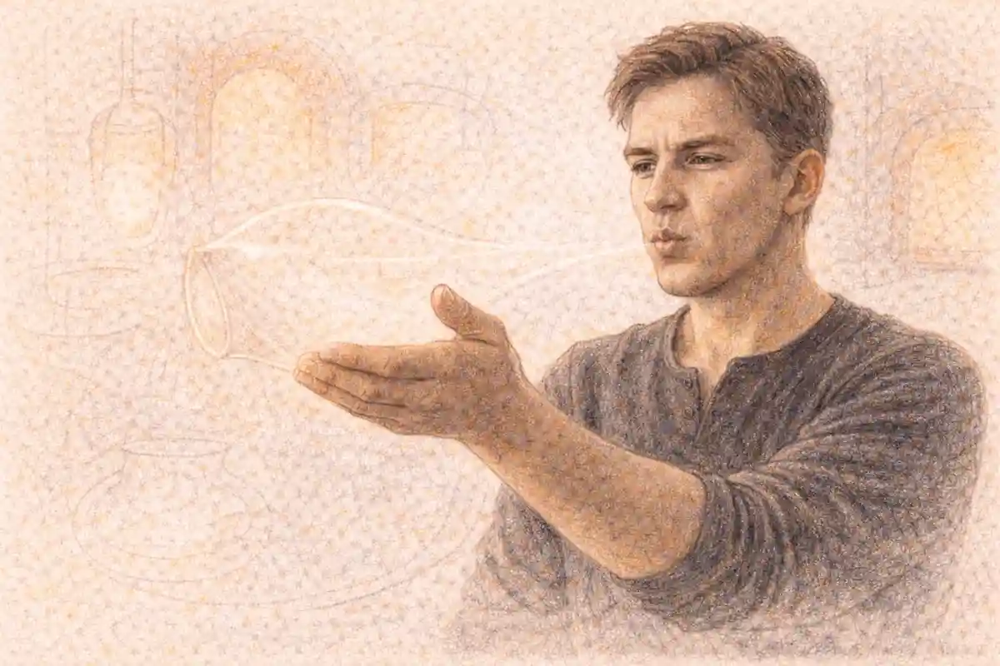

Some courses ask a student to master a single discipline and prove it in a single sitting. AP African American Studies asks for something wider and, in the end, more honest about how knowledge actually works. The course follows the African diaspora from the kingdoms of early Africa through enslavement, emancipation, migration, and the movements of the modern era, and it refuses to stay inside one department while doing so. A week spent on the transatlantic slave trade might move from shipping records and demography to the spirituals enslaved people sang, then to an abolitionist pamphlet, then to the legal architecture that protected the whole system. History supplies the chronology, yet literature, visual art, music, and social science supply much of the evidence, and the course treats all of it as primary material worthy of close reading.

That breadth is the first thing a prospective student should understand, because it shapes everything else: the four units, the individual project each student designs and defends, the source-heavy exam, and the way a final score is assembled. Students who thrive here are rarely the ones who memorize the longest list of dates. They are the ones who learn to follow a through-line, a question about freedom, belonging, creativity, or power, as it changes shape across centuries and across kinds of evidence. A sermon, a census table, a Jacob Lawrence panel, and a Supreme Court opinion can all speak to the same question, and the course trains students to hear them in conversation with one another.

This guide maps the whole structure. It explains what each unit covers, what the project demands, how the end-of-course exam is built, how scoring combines those pieces, and how colleges have treated the course. It also confronts the practical questions families ask about a newer AP offering: whether the course is available at a given school, what background helps, and what a serious study plan looks like when the material spans four fields at once.

## A Course Built Across Disciplines

AP African American Studies is an interdisciplinary course in the full sense of that phrase, not a history survey with a few poems pasted in for decoration. Its framework draws on history, literature, the arts, geography, political science, anthropology, and data-driven social science, and it expects students to move among those lenses deliberately. When the course studies the Great Migration, for example, the historical record of labor recruitment and racial violence sits beside the demographic maps that track population movement, the blues that carried news and feeling along the same rail lines, and the fiction of writers who turned arrival in Chicago or Harlem into art. Each lens answers a different kind of question. Maps show where people went and in what numbers. Lyrics show what the journey felt like and what migrants hoped to find. Ordinances and court cases show what greeted them when they arrived.

Because the disciplines rotate, the skills rotate too. One week the central task is sourcing a document and corroborating it against others. Another week the task is interpreting a work of art as an argument, reading its composition and symbols the way one would read an editorial. Later the task might be evaluating a scholar's claim against data, asking what a table of literacy rates or land ownership can and cannot prove. Students who arrive expecting a single mode of work sometimes stumble early. The course rewards readers who can shift registers without losing rigor, treating a quilt, a speech, and a statistical abstract as different instruments playing related music.

The interdisciplinary design also answers the most common misconception about the course, which is that it covers a narrow slice of the American past. The frame is diasporic, not merely national. Units begin in Africa itself, long before European contact, and they keep returning to connections across the Atlantic world: to Haiti and its revolution, to Brazil and Cuba and their enslaved majorities, to Black internationalism and the Pan-African congresses, to the global circulation of Black music and political thought. The United States holds the center of gravity, yet the course insists that African American life was always made in conversation with Africa, the Caribbean, and the wider world.

## Where the Course Stands as a Newer Offering

Honesty about the course's position matters more than boosterism. AP African American Studies is one of the newer courses in the AP program. It moved through a pilot phase in a limited set of schools before opening more broadly, and availability is still expanding as additional schools adopt it, train teachers, and fit it into crowded schedules. A student reading this guide should therefore treat local availability as a question to verify rather than a fact to assume. The school's course catalog, the counseling office, and the College Board's course ledger for the school are the authorities that matter, because a course can exist nationally while remaining unavailable in a particular building in a particular year.

That expanding footprint has a second consequence worth understanding. For a newer course, the accumulated folklore that surrounds older AP subjects, the thickets of prep books and inherited wisdom about exactly which topics appear every year, is thinner here. The course and exam description published by the College Board carries more weight than usual, since it is the document from which teachers build syllabi and from which the exam is drawn. Students who read that framework closely, especially its unit structure, its thematic through-lines, and its list of key topics and sources, hold a genuine advantage. In a mature course, folklore sometimes approximates the framework. In a newer one, the framework itself is the map, and guesswork is a poor substitute.

A third consequence involves college credit, which this guide addresses in its own section below. Policies for newer courses settle unevenly across institutions, and some colleges evaluate a new AP subject for a year or two before publishing a firm equivalency. None of that diminishes the course's academic substance, and admissions readers generally recognize the rigor of a full interdisciplinary AP course. It does mean that families should research credit at specific target colleges rather than assuming either automatic credit or automatic refusal. Both assumptions outrun the evidence.

## The InsightCrunch African American Studies Map

The table below is the InsightCrunch African American Studies map, the whole course on one screen. Each unit pairs its era and central questions with the kinds of sources students meet there, and the final rows attach the two assessments, the individual project and the end-of-course exam, to the work they draw upon. Read the map vertically to see the chronological spine of the course. Read it horizontally to see how a single unit mixes disciplines. The exam questions and the project both feed on the same habits the units build: sourcing, contextualizing, corroborating, and arguing from evidence across genres.

| Component | Era and focus | Signature sources and evidence | What it feeds |
|---|---|---|---|
| Unit 1: Origins of the African Diaspora | Early African societies, kingdoms and empires, the opening of the Atlantic slave trade | Archaeology and material culture, oral traditions, maps of trade networks, early European accounts read critically | Foundations for sourcing and for seeing Africa as a source of history, not a backdrop |
| Unit 2: Freedom, Enslavement, and Resistance | Slavery in the Americas, everyday resistance, revolution, and abolition through the Civil War era | Slave narratives, plantation records, runaway advertisements, abolitionist writing, the Haitian Revolution's documents | Practice in reading hostile and partial records against the grain |
| Unit 3: The Practice of Freedom | Emancipation, Reconstruction, Jim Crow, and the Great Migration | Amendments and court opinions, Black newspapers, photographs, migration data, the art and music of the migration | Skill in connecting law and policy to lived experience and cultural production |
| Unit 4: Movements and Debates | Civil rights, Black Power, Black feminism, and contemporary questions of identity, art, and justice | Speeches and manifestos, movement photography, literature and Afrofuturism, demographic and economic data | Practice in weighing competing interpretations within Black thought itself |
| Individual Student Project | A student-chosen topic tied to course themes, developed across the year | Independent research: scholarly articles, archives, interviews, data sets, creative works | A presentation and oral defense scored as part of the course grade for AP purposes |
| End-of-Course Exam | The full span of the framework, tested in one sitting | Stimulus-based multiple choice sets and free-response questions built on sources | The remaining share of the AP score, reported on the 1 to 5 scale |

Two features of the map deserve emphasis before the units get their own sections. First, the project is not an ornament bolted onto an exam course. It carries real weight in the final score, and it is the one place where a student chooses the ground, frames the question, and defends the answer aloud. Second, the exam is source-saturated by design. Nearly everything on it arrives attached to a text, an image, a map, or a data display, which means the daily work of the units is itself exam preparation when it is done seriously. A student who has spent the year interrogating sources in class has rehearsed the exam's core moves hundreds of times.

## Unit 1: Origins of the African Diaspora

The course opens where the story actually begins, in Africa, and the choice is deliberate. Unit 1 studies the continent's early societies and political formations on their own terms: the kingdoms and empires that organized trade, law, craft, and learning for centuries before European ships anchored off the coast. Students encounter West African powers such as Ghana, Mali, and Songhai, built substantially on trans-Saharan commerce in gold and salt, and they study the city of Timbuktu as a center of scholarship whose libraries held hundreds of thousands of manuscripts. Farther south and east, the map widens to include Great Zimbabwe and its stone enclosures, the Swahili coast cities that traded across the Indian Ocean, the kingdom of Kongo with its early diplomatic ties to Portugal, the Asante confederacy, and the kingdom of Benin, whose cast-bronze plaques display a court art of extraordinary sophistication. The point is not a parade of names. The point is to establish that the people who would be carried across the Atlantic came from societies with governments, markets, religions, technologies, and internal debates of their own.

Sources in this unit teach the course's first great methodological lesson, which concerns the archive itself. For much of early African history, the written record is thin or arrives through outsiders, so students learn to work with archaeology, linguistics, oral tradition, and material culture as evidence in their own right. A griot's epic, a mosque's architecture, the distribution of cowrie shells or brass weights across a trade network: each can support an argument when handled carefully. Students also learn to read early European accounts skeptically, recognizing that a Portuguese factor's description of a Kongo court tells the truth about trade goods while distorting nearly everything about African motives and capacities. That double vision, using a source while distrusting its frame, is the seed from which the rest of the course grows.

Into this world the unit introduces the Atlantic slave trade as a transformation rather than an origin. Students examine how European demand, African political dynamics, warfare, and coastal trading systems combined to expand the trade over centuries, and they confront its scale through data: millions of people embarked, with mortality on the Middle Passage and in the seasoning camps recorded in the cold arithmetic of shipping ledgers. Maps of embarkation regions and destinations matter here, because the diaspora's geography explains later cultural patterns, from the African linguistic survivals in Gullah communities to the religious blends of the Caribbean and Brazil. The unit closes by following the trade's human cargo into the Americas, setting up the question that governs Unit 2: how did enslaved people, inside a system designed to erase them, preserve memory, build community, and resist?

## Unit 2: Freedom, Enslavement, and Resistance

Unit 2 takes up slavery in the Americas as both an economic system and a lived condition, and it insists on holding those two perspectives together. Students study the plantation regimes of the Caribbean, Brazil, and the North American mainland, along with slavery's presence in cities, in maritime labor, and in the northern colonies where it is too often forgotten. The legal machinery receives close attention: slave codes that defined enslaved people as property, barred literacy and assembly, and made status hereditary through the mother. Against that machinery the unit sets the evidence of enslaved people's own world, their family structures maintained under threat of sale, their religious practice blending African traditions with Christianity, their foodways, music, and language, all of it documented in archaeology, in oral histories collected generations later, and in the remarkable genre of the slave narrative.

Resistance runs through the unit as a spectrum rather than a single dramatic act. At one end sits everyday defiance: work slowed, tools broken, feigned illness, knowledge withheld. In the middle stand flight and the maroon communities that runaways built in swamps, mountains, and forests from Jamaica to Suriname to the Great Dismal Swamp. At the far end stand revolts, and the unit studies them seriously: the Stono Rebellion in South Carolina, the conspiracy trials that terrified New York, Nat Turner's rebellion in Virginia, and above all the Haitian Revolution, in which enslaved people defeated French, Spanish, and British forces and founded a Black republic that reshaped the hemisphere's politics. Haiti matters to this course beyond its heroism. Its revolution forced the Louisiana Purchase, terrified slaveholders across the Americas, inspired abolitionists, and posed the era's sharpest question about whether the rights language of the age of revolutions applied to everyone or only to some.

Abolition, when the unit reaches it, appears as a movement enslaved and free Black people drove from the beginning. Figures such as Olaudah Equiano, whose narrative carried the Middle Passage into British drawing rooms, Phillis Wheatley, whose poetry contested claims of African incapacity even as she remained enslaved, and later David Walker, whose Appeal called on enslaved people to resist, anchor a story that white allies joined but did not originate. The unit ends amid the sectional crisis and the Civil War, with emancipation arriving through a combination of federal action and the self-liberation of hundreds of thousands who fled to Union lines. Students leave the unit able to argue, with evidence, that freedom was seized as much as it was granted, which is precisely the kind of claim the exam's free-response questions are built to test.

## Reading Records That Were Meant to Hide the Truth

A methodological thread deserves its own discussion here, because Unit 2 is where students feel it most. Much of the surviving documentation of slavery was produced by enslavers: manifests, inventories, account books, court records, runaway advertisements. These sources are indispensable and poisonous at once. An inventory lists a woman between a plow and a mule, and the historian's task is to recover her existence without mistaking the document's categories for her reality. Scholars call the necessary technique reading against the grain, and the course teaches it concretely. A runaway advertisement, written to recapture a man, inadvertently preserves his skills, his scars, his languages, his family ties, and his determination, and students learn to mine the hostile text for the life it tried to erase. That skill, extracting trustworthy evidence from interested sources, transfers everywhere: to political speeches, to census categories, to photographs staged for propaganda. Students who master it in Unit 2 carry the course's central instrument into every later unit and onto the exam itself.

## Unit 3: The Practice of Freedom

Emancipation opens Unit 3, and the unit's title carries its argument: freedom was not a condition delivered in a moment but a practice that freedpeople had to invent, defend, and rebuild daily. The Reconstruction years give students a dense weave of law and life. The Thirteenth, Fourteenth, and Fifteenth Amendments rewrote the constitutional order, while freedpeople on the ground founded schools and churches, reunited families separated by sale, negotiated labor contracts, bought land where they could, and sent Black legislators to statehouses and to Congress. Sources multiply in this era and diversify in kind. Freedmen's Bureau records, the testimony collected by congressional committees, Black newspapers such as the Christian Recorder, and the photographs that document new schools and conventions let students watch a society attempting to define citizenship in real time.

The counterrevolution that overthrew Reconstruction receives equal weight, because the course treats the era's violence and law as a single system. Students study the Ku Klux Klan and the paramilitary campaigns that suppressed Black voting, the Compromise that withdrew federal protection, the Supreme Court decisions that gutted the amendments' enforcement, and the Jim Crow order that replaced slavery's formal structure with segregation statutes, disfranchisement devices, convict leasing, and the ever-present threat of lynching. The unit also studies the responses that order provoked. Booker T. Washington's accommodationist strategy and W. E. B. Du Bois's demand for full civil and political equality frame a debate about tactics under oppression that students will meet again in every later movement. Ida B. Wells's investigative journalism against lynching shows the press used as a weapon of evidence, her pamphlets marshaling statistics and case reports to indict a system that courts refused to touch.

The Great Migration carries the unit into the twentieth century, as millions of Black southerners moved to northern and western cities in search of wages, safety, and schools. Here the course's disciplines converge with particular beauty. Demographers' maps chart the streams from the Mississippi Delta to Chicago, from Alabama to Detroit, from Texas to Oakland. The Chicago Defender, smuggled south by Pullman porters, argues the case for departure in editorials and advertisements. Jacob Lawrence's Migration Series compresses the whole movement into sixty panels of image and caption, a work students analyze as both art and historical argument. The blues and gospel traditions register the journey's grief and exhilaration. Out of the migration came the Harlem Renaissance, and the unit lingers there: Langston Hughes and Zora Neale Hurston remaking American literature, Duke Ellington and the visual art of Aaron Douglas defining a modern Black aesthetic, Alain Locke's anthology announcing a New Negro. Students leave the unit understanding that cultural production was never decoration on the freedom struggle. It was one of the struggle's principal arenas.

## Unit 4: Movements and Debates

The final unit begins with the modern civil rights movement and deliberately refuses to tell it as a simple pageant of famous speeches. Students study the movement's infrastructure: the churches and colleges that supplied meeting places and organizers, the labor and legal campaigns that preceded the famous marches, the NAACP's litigation strategy that dismantled school segregation's legal basis in Brown v. Board of Education, and the disciplined nonviolence of the Montgomery bus boycott, the sit-ins, and the Freedom Rides. Sources here include the movement's own media strategy, since organizers understood that photographs of peaceful protesters met with violence could move a national audience, and students analyze those images as crafted arguments rather than transparent windows. The legislative victories of the mid-1960s, the Civil Rights Act and the Voting Rights Act, arrive in the course as hard-won outcomes of organized pressure, not gifts of conscience.

Alongside that story, and sometimes in argument with it, the unit studies Black Power and the era's radical traditions. Malcolm X, the Black Panther Party with its survival programs and its critique of American capitalism, and the Black Arts Movement's demand for art accountable to Black audiences all complicate any single storyline about what liberation required. Black feminism receives its own sustained attention. The Combahee River Collective's statement, the scholarship of figures such as bell hooks and Kimberlé Crenshaw, and the concept of intersectionality give students a framework for analyzing how race, gender, and class operate together, and the course treats these thinkers as central theorists rather than late additions. Debates within Black intellectual life, over integration and nationalism, respectability and confrontation, capitalism and socialism, are presented as a sign of the tradition's vitality. Students are expected to map those debates, not to flatten them.

The unit then turns toward the present through questions rather than headlines. Students examine demographic and economic data on wealth, housing, education, and incarceration, and they study how redlining's maps from the 1930s correlate with neighborhood conditions generations later, a case study in how policy hardens into geography. Contemporary expressive culture closes the course's arc: Afrofuturism in literature and film, from Octavia Butler's fiction onward, hip-hop as an archive of social commentary, and the visual art of creators who remix the very traditions the earlier units introduced. Ending here is a design statement. The course's last word is not a settled conclusion but a set of live questions about memory, representation, and justice that students are now equipped to argue about with evidence, which is exactly the disposition the project and the exam both reward.

## The Individual Project: The Course's Second Engine

Every student in AP African American Studies completes an individual project, and the design of that requirement reveals the course's deepest conviction: that students should not only consume scholarship about the African diaspora but practice making it. Over an extended period during the school year, each student selects a topic connected to the course's themes, develops a researchable question, investigates it through credible sources, and presents the findings in a formal presentation followed by an oral defense. The topic might grow out of any unit's soil. One student might trace how a single neighborhood's churches anchored its civil rights organizing. Another might compare how two slave narratives handle the scene of separation from family. Another might analyze Afrofuturist imagery in contemporary music videos against the visual language of the Harlem Renaissance, or use census data to test whether a city's Black population decline matches the patterns scholars describe for gentrification.

The research phase teaches habits that lecture courses rarely reach. Students learn to distinguish a topic from a question, since a topic names a territory while a question picks an argument worth having. They learn to hunt beyond the open web into scholarly articles, digitized archives, museum collections, published oral histories, and data sets, and to keep a working bibliography as they go rather than reconstructing one in a panic at the end. Teachers typically stage the project with checkpoints, a proposal, an annotated bibliography, a draft of the argument, rehearsal of the presentation, so that the work matures in public and feedback arrives while it can still change the outcome. Students who treat those checkpoints as bureaucracy miss their purpose. Each one is a chance to discover that a question is too broad, a source base too thin, or a claim too large for its evidence, while there is still time to fix the design.

The presentation and defense then test a different band of skills. A presentation forces compression: the student must decide what the audience needs, in what order, supported by which images, quotations, and data, and must speak about the work with command rather than reading a paper aloud. The oral defense that follows, in which the student answers questions about choices made and evidence weighed, tests ownership. Examiners of projects in many disciplines ask the same piercing questions in different words. Why this question? Why these sources and not others? What evidence pushed against your conclusion, and what did you do with it? What would you investigate next? A student who has genuinely done the research can answer those questions with specifics. A student who assembled a poster the night before cannot, and the format is designed to expose the difference kindly but unmistakably.

Students who have taken the College Board's Capstone sequence will recognize the family resemblance, and the comparison is instructive. The project expectations here parallel the performance tasks in [AP Seminar](/2007/02/03/ap-seminar-complete-guide/), where students research, argue, and present as a team and then alone, and they look ahead to the sustained single-question inquiry of [AP Research](/2007/01/30/ap-research-complete-guide/), where a full academic paper replaces the presentation. The resemblance is close enough that a student weighing the Capstone courses against this one should compare them directly before choosing. African American Studies differs from both in one respect: the project's question must live inside the course's subject matter, so the research skills are exercised on the diaspora's history and culture rather than on a topic of unrestricted choice. That constraint is a strength for most students. The units supply background, vocabulary, and a shelf of model scholarship, so the project deepens the course instead of wandering away from it.

## Choosing Well: What Strong Projects Have in Common

Patterns emerge among projects that score well, and students are wise to study them before committing to a topic. Strong projects begin with a question that evidence can actually settle or illuminate, narrow enough to answer in the available time yet rich enough to matter. A project asking how Black newspapers covered the Great Migration in general is a swamp; a project asking how one newspaper's coverage of a single city's arrivals changed across one decade is a study. Strong projects also rest on accessible sources. Ambition is admirable, but a question that depends on an archive three states away or on interviews no one will grant is a plan for disappointment. The best topics often hide in the local and the personal: a family's migration story checked against the documented record, a church's or school's institutional history, a neighborhood's changing demographics read through maps and census tables, a local artist's or musician's body of work read against the movements the course describes.

Strong projects also engage a debate or a tension rather than summarizing a settled story. The course itself models this habit relentlessly, presenting Washington and Du Bois, integrationists and nationalists, uplift and protest as live arguments. A project that discovers a genuine disagreement among scholars, or between a community's memory and the documentary record, has an engine. A project that reports that an important person did important things has a book report. Teachers know the difference, the scoring rubrics know the difference, and the oral defense exposes it within two questions. The wisest students choose topics where they can imagine a smart person disagreeing with their first instinct, because that imagined disagreement is what turns research from collection into thinking.

## The End-of-Course Exam: Built Out of Sources

The written exam arrives at the end of the course as a single sitting, and its architecture follows the course's convictions. One section presents multiple-choice questions, many of them grouped in sets around a shared stimulus: a passage from a narrative or speech, a photograph or artwork, a map, a chart of demographic or economic data. The questions attached to a stimulus test whether the student can extract what the source shows, place it in context, and connect it to the framework's larger themes. Freestanding knowledge still matters, since a student who cannot identify the era or the stakes of a source will struggle with everything built on it, yet the exam consistently routes knowledge through evidence rather than asking for bare recall. A question rarely asks what happened in a vacuum. It shows the student something, then asks what the something means.

The free-response section extends the same philosophy at greater length. Students write essays in response to prompts anchored in sources, sometimes analyzing a single document's argument and audience, sometimes synthesizing several sources into an answer about a development across time, sometimes constructing an evidence-based argument on a theme the framework names. The scoring of these essays rewards the habits the units drill: a defensible claim stated early, evidence chosen precisely rather than dumped, sourcing that notices who made a document and why, and reasoning that explains how the evidence supports the claim. Students looking for additional timed practice with source-based history questions can work through [free AP History practice questions](https://reportmedic.org/tools/ap-history-practice-questions.html), which rehearse the same muscles of stimulus reading and evidence selection that this exam demands.

Timing and format specifics are published in the College Board's course and exam description for the year of administration, and students should confirm them there each year, since newer courses occasionally adjust section details as they scale. The broad shape, however, is stable and worth internalizing: a multiple-choice section measured in dozens of questions across roughly an hour or a little more, a free-response section requiring sustained writing under time pressure, and a total sitting in the neighborhood of two hours, with the project completed and presented during the school year rather than on exam day. Students who practice under those conditions, reading stimuli quickly, budgeting minutes per question set, and outlining essays before writing them, walk in with a decisive advantage over students who know the content but meet the format for the first time in the testing room.

## Short Answers to Practical Questions

### How much writing does the exam require?

The free-response section asks for several sustained essays written under time pressure, each built on sources supplied in the exam booklet. Strong answers state a claim early, develop it with precisely chosen evidence, and explain their reasoning in connected prose. Students should practice outlining for a few minutes before writing, since planned essays consistently outscore longer improvised ones.

### Can a student take the course without a prior history credit?

Yes, the course is designed to be entered without a specialized prerequisite, and its first unit builds the background knowledge it later assumes. Students with strong reading habits and any prior experience in history or English classes usually adjust quickly. The heavier demand is not prior content but willingness to read varied sources closely and write about them often.

### Does the course require presenting in front of the class?

Yes, the individual project ends in a presentation followed by an oral defense, and both are part of the course's assessed work. Teachers stage drafts and rehearsals across the year so the presentation is practiced rather than improvised. Students who fear speaking should treat the checkpoint structure as training, since the defense rewards familiarity with one's research above polish.

### Is the course mostly memorization of dates and names?

No, the framework organizes content around themes and through-lines, and the exam routes nearly every question through a source that students must interpret. Dates and names matter as the skeleton that gives sources their context, so chronology cannot be ignored. Students who memorize lists without practicing source analysis routinely underperform students who can reason from evidence.

## How the Score Is Assembled

AP scores are reported on the familiar 1 to 5 scale, and in this course the number summarizes two distinct performances rather than one. The end-of-course exam contributes the larger share of the composite, and the individual project contributes a meaningful minority share, substantial enough that a neglected project caps what even a brilliant exam day can produce. Readers trained by the College Board score the free-response essays and the project components against published rubrics, while the multiple-choice section is scored by machine. The component scores are then combined and converted to the 1 to 5 scale using thresholds set through the College Board's standard-setting process, in which college faculty compare AP performance against the performance of students in corresponding college courses. Readers new to the AP program can find the wider architecture of exams, scores, and calendars laid out in the [AP Exams complete guide](/2008/11/08/ap-exams-complete-guide/), which explains how the program's pieces fit together across all subjects.

What does a given number signify? A 5 represents performance equivalent to the top band of grades in the corresponding college course, a 4 the next band, and a 3 the level the College Board describes as qualified, meaning capable of doing the work the college course demands. Colleges then decide for themselves which scores earn credit or placement, a subject the next sections take up directly. Two cautions belong in any honest scoring discussion. First, no one outside the College Board can state the exact raw-score cutoffs for a given year, because the conversion is built anew for each administration from equating data; students should treat any precise number circulating online as folklore. Second, the project share means this course's score is partly earned months before exam day, which diligent students experience as an opportunity and disorganized students experience as a trap. The score rewards a full year of work in a way that a single-sitting subject cannot, and study plans should be built around that fact.

The practical meaning of the composite structure is that effort should be allocated deliberately. A student who pours everything into exam-week cramming while treating the project as an afterthought has voluntarily surrendered a large block of available points. A student who builds the project steadily, chooses essay evidence with care in timed practice, and learns to read stimuli quickly is playing the whole board. Teachers who understand the structure pace the year accordingly, finishing the project well before the exam review season so that April can belong to synthesis and practice rather than to construction.

## Availability: A Course Still Reaching Every School

With adoption still spreading, the question of whether a particular student can take it has a genuinely local answer. Adoption requires a school to schedule the course, assign or train a teacher, and order it into the AP course ledger for that year, and schools have moved at different speeds. Some districts embraced the course during its pilot years and now offer multiple sections. Others are adding it as staffing and demand allow. Still others have not yet scheduled it at all. None of those states is permanent, and the trend of the course's footprint is expansion, but a student planning a schedule for next year must verify the present tense at their own school. The counseling office and the school's published course catalog settle the question, and where the course is absent, students and families asking for it, early and in numbers, is historically how such offerings arrive.

Where the course is unavailable, students sometimes ask about substitutes. A strong African American history elective, a literature course rich in Black writers, or an independent study supervised by a willing teacher can each build parts of what this course builds, though none replicates its assessed structure or produces an AP score. The Capstone courses develop the research and presentation skills through unrestricted topics. What cannot be improvised is the specific combination this course offers: a coherent diaspora-wide curriculum, an examined body of sources, and a scored research project inside the subject. Students for whom that combination matters should register the interest with their school even if the answer for the coming year is no, because course planning runs a year ahead of the classroom and expressed demand is a real input.

## College Credit and the Admissions Reader

Credit policy for AP African American Studies varies by college, and any guide that promises otherwise is selling certainty it does not possess. The general logic of AP credit is explained in the overview of [AP credit policies at colleges](/2008/10/07/ap-credit-policies-colleges/), and this course follows the pattern that newer subjects often trace. Some institutions have published equivalencies, granting credit for scores of 3, 4, or 5 against general education requirements in humanities, social science, or diversity-designated categories, or against an introductory African American studies course. Others award elective credit only, or placement without credit, or have the question under review by the relevant department. A department's decision typically turns on how its faculty judge the AP framework against their own introductory syllabus, which is why two colleges of similar selectivity can land in different places and why policies can change between a student's junior year and their enrollment.

The practical consequence is a homework assignment for families: check the AP credit policy pages of the specific colleges on the student's list, and check again in the enrollment year, rather than relying on summaries of summaries. The equally practical second point is that credit is not the whole of the course's value in admissions. Admissions readers evaluate the transcript for rigor and coherence, and a student who takes a demanding interdisciplinary course, completes a defended research project inside it, and can speak about that project in an interview or an essay presents a legible story of intellectual appetite. How AP courses function in admissions decisions more broadly, including the difference between courses taken and scores reported, is covered in the guide to [AP classes and college admissions](/2007/01/07/ap-classes-and-college-admissions/), and its central advice applies here: a course chosen out of genuine interest and pursued deeply serves a student better than a course collected for decoration.

One further group should hear a direct word: students bound for colleges where African American studies, Africana studies, or ethnic studies departments are strong. For them, this course functions as a genuine foundation, an introduction to the field's questions, canonical texts, and debates that first-year seminars will assume as background. Arriving already fluent in the difference between a primary source and a scholarly interpretation, already acquainted with Du Bois and Wells and the Combahee River Collective, changes what a student can do in those first college classrooms, whether or not a single credit hour transfers.

## The Through-Lines: Themes That Organize Everything

Framework documents can read like inventories until a student finds the thematic threads that stitch the inventory into an argument, and this course is unusually explicit about its threads. Freedom is the first and largest. Every unit re-asks what freedom means and who gets to practice it: freedom as legal status in emancipation proclamations, freedom as movement in the migration, freedom as economic footing in land and wages, freedom as self-definition in art and naming, freedom as the vote, freedom as control over one's own story. A student who tracks that single word across the year accumulates an essay bank without trying, because nearly every free-response prompt can be approached through the era-specific meaning of a theme the student has already watched evolve. Resistance is the second thread, running from shipboard revolts and maroon settlements through abolitionist organizing, anti-lynching journalism, litigation, boycotts, and cultural refusal, always posing the tactical question of how oppressed people act effectively inside systems built to stop them.

Migration and diaspora form the third thread, the course's spatial imagination. Movement is never mere relocation in this curriculum. The Middle Passage, the domestic slave trade's forced marches south and west, the Great Migration, Caribbean and African immigration to American cities, and the returns and exchanges among all of these are studied as acts that remake culture at both ends. Music again supplies the proof students remember: the blues traveling from Delta to Chicago and electrifying on arrival, jazz musicians carrying New Orleans up the river roads, hip-hop born in the Bronx from Jamaican sound-system practice by way of a Kingston-born DJ. Each example teaches the same analytical move, that culture travels with people and changes in transit, and each gives students a concrete case to deploy when an exam question asks about connection or exchange across the diaspora.

Creativity under constraint is the fourth thread, and it protects the course from becoming a ledger of injuries. Enslaved artisans, quilters whose coded and uncoded patterns both carried memory, chefs who transformed American cuisine from plantation kitchens, architects and builders whose work stands uncredited in famous buildings, inventors, photographers, filmmakers, and the writers of every generation insist on a fuller story. The course presents Black cultural production not as a reaction to oppression alone but as an autonomous tradition with its own aesthetics, arguments, and internal debates. Memory and representation close the set. Who gets remembered, in what monuments and textbooks, whose version of an event hardens into the official one: the course returns to these questions from the contested memory of Reconstruction to debates over memorials and curricula in students' own lifetimes. A student who can name the through-lines and attach two or three pieces of evidence to each owns the skeleton of nearly any essay the exam can ask.

## A Shelf of Sources the Course Returns To

Certain works recur in this field the way certain experiments recur in physics, because they concentrate the discipline's questions into portable form. Frederick Douglass's narrative of his enslavement remains the classroom's central exhibit for several skills at once: it is a primary source about slavery's daily mechanics, a rhetorical performance aimed at white abolitionist audiences whose expectations shaped its telling, and an argument about literacy as the pathway from slavery to freedom that students can test against other narratives. Harriet Jacobs's Incidents in the Life of a Slave Girl stands beside it and corrects its frame, showing slavery's particular violences against women and the different strategies survival required, so that students learn from the pairing itself that no single source, however eloquent, speaks for a whole system. W. E. B. Du Bois's The Souls of Black Folk introduces double consciousness, perhaps the single most cited concept in the field, and his earlier sociological study of Philadelphia models the data-driven method that later social science inherited.

The visual and musical shelf matters just as much. Jacob Lawrence's Migration Series teaches visual argument in sixty panels, each image captioned with a sentence that functions as a claim, and students who learn to read those panels learn to read any image the exam places before them. The photographs of Gordon Parks, the paintings of Aaron Douglas with their layered silhouettes bridging Africa and Harlem, the quilts of Gee's Bend with their improvisational geometry, and the spirituals and blues recordings that survive from the early recording era each open a different door into the same rooms the documents describe. Zora Neale Hurston's fiction and anthropology, Richard Wright's and Ralph Ellison's novels of visibility and protest, James Baldwin's essays with their fusion of the personal and the national, Toni Morrison's excavation of memory in Beloved, and Octavia Butler's speculative reconstructions of power and kinship form the literary spine that later units lean on. Naming these works here serves a study purpose: a student who keeps a running source journal, one page per major work with its creator, era, genre, argument, and two deployable details, builds the single most useful review document the course allows, because the exam's stimuli are drawn from exactly this ecology of texts, images, and data.

## How Scholars in This Field Argue, and Why Students Should Care

One of the course's quiet ambitions is to show students that history and culture are argued about by professionals, not merely recorded by them, and that the arguments have their own history. Reconstruction offers the cleanest case. For decades, the dominant scholarly account, taught in universities and echoed in popular film, portrayed Reconstruction as a corrupt failure imposed on a prostrate South, a version built on the racial assumptions of its authors and on sources drawn overwhelmingly from the era's white power holders. Du Bois demolished that account in 1935 with Black Reconstruction in America, arguing from the record that Black workers and voters were central democratic actors and that the era's overthrow was a counterrevolution of property and race. Later generations of historians, working through archives Du Bois could not reach, confirmed and extended his reading until the older account collapsed entirely. Students study that reversal for two reasons. It demonstrates that evidence, patiently marshaled, can overturn an entrenched story. It also demonstrates that the questions a scholar brings determine which sources get read, a lesson that applies with full force to the student's own project.

Debates like that one recur at every scale of the course. Scholars argue over how central slavery was to American economic development, over whether the Great Migration is best explained by southern push or northern pull, over how to periodize the civil rights movement and whether a long movement framing that begins in the labor struggles of the 1930s explains more than the classic decade of Montgomery to Memphis. Literary scholars argue over the politics of dialect in Hurston, over protest fiction's demands on Black writers, over whether Afrofuturism is an escape from history or a method for re-entering it. The course does not ask students to referee these disputes to a verdict. It asks them to map the positions, identify the evidence each side prizes, and notice what each side's framing reveals and conceals. That is the exact cognitive move the exam's best-scoring essays make when a prompt presents two sources in tension, and it is the move the oral defense probes when a questioner asks a student how a different scholar might read the same archive.

There is a civic dividend here that students often name as the course's lasting gift. A citizen trained to ask who produced a document, whose voices an archive preserves and whose it loses, how a statistic was gathered and what its categories assume, is harder to fool, by textbooks, by broadcasts, and by feeds. The course teaches those questions inside one subject because one subject, studied deeply, is how any mind learns them. Students leave with a content knowledge that matters and a skepticism that transfers, and the exam, to its credit, is built to reward both.

## How Hard Is the Course, Honestly?

Difficulty in AP courses has several ingredients, and this course distributes its weight unusually. The reading load is real but distinctive: instead of a single textbook spine, students read many shorter primary sources, narratives, speeches, scholarly excerpts, poems, and case documents, alongside visual and musical material. Students who read steadily do fine; students who let sources accumulate face a pile of short pieces that resist cramming because each must be situated in its context. The writing load is likewise steady rather than crushing. Analytical essays recur across the year, the project generates staged writing of its own, and the defense adds a speaking demand that pure exam courses never impose. There is no single brutal gate, no equivalent of a calculus problem set that defeats the unprepared in week two. The course instead defeats the disorganized slowly, which is why its veterans describe it as demanding rather than punishing.

Comparisons help families calibrate. Against AP United States History, this course trades breadth of political chronology for depth across more genres of evidence and adds a scored project with a defense; students who found APUSH's document questions congenial usually find this exam's source work familiar in kind and richer in texture. Against a literature course, it adds law, data, and social science. Against the Capstone courses, it fixes the subject matter while keeping the research architecture. The students who struggle most are typically those who enrolled expecting a single-mode course, a straight narrative history or a straight literature class, and resisted the register-switching the framework requires. The students who flourish are curious readers with decent writing stamina and a tolerance for ambiguity, since the field's best questions rarely resolve into one right answer. No particular identity or background is a prerequisite for success, and the course is designed, in its sources and its debates, to reward any student willing to do the reading and join the argument.

## A Study Method Built for Four Disciplines at Once

Studying for this course fails when students import the method of a single-discipline subject, so a working method deserves explicit description. The foundation is a source journal kept all year, introduced earlier in this guide and worth restating as the method's spine. Every significant source encountered, a narrative excerpt, a speech, a photograph, a map, a data table, a poem, earns a compact entry: creator, date, genre, occasion, central claim or content, and two connections, one to a through-line and one to another source that agrees or quarrels with it. Fifteen minutes after each class keeps the journal alive. The payoff compounds quietly until review season, when the journal becomes a personalized deck of evidence from which essay plans can be assembled in minutes. Students who skip the journal spend April rereading everything. Students who keep it spend April arguing, which is the activity the exam actually scores.

On top of the journal, the method layers three habits. The first is timeline discipline. Interdisciplinary range can blur chronology, and blurred chronology sinks essays, so students maintain a one-page timeline of anchor events and works, adding each new item in position as the year proceeds. The timeline's purpose is not memorization for its own sake; it is the ability, on sight of any source, to say what world it was made in, what had already happened, and what had not yet become possible. The second habit is paired reading. Whenever the course presents a source, the student asks for its natural partner: the document that answers it, the image that contradicts it, the data that complicates it. Douglass beside Jacobs, Washington beside Du Bois, the Defender's boosterism beside the letters of migrants who found the North colder than advertised. Pairs are the unit of analysis in this field, because the exam loves tension and the project defense probes alternatives.

The third habit is timed production. Knowledge that cannot be mobilized in forty minutes of writing does not exist on exam day, so from midyear onward students write practice essays against the clock on a regular rhythm, then grade them against the rubric's actual language: claim, evidence, sourcing, reasoning. The point of the exercise is diagnostic. Most students discover a signature weakness, often evidence chosen by topic rather than by fit, or sourcing that names an author without using what the authorship implies, and a discovered weakness can be drilled. Short daily reviews beat weekend marathons for the factual layer as well. Five retrieval questions a day, drawn from the journal and answered from memory before checking, will hold hundreds of facts in place with less total time than any rereading scheme, because retrieval is what memory is for.

## Common Mistakes That Cost Students Points

Certain errors recur so predictably in this course that naming them amounts to a study guide in negative space. The first is treating the course as pure chronology, a parade of events from kingdoms to hashtags, and preparing by memorizing the parade. The exam's stimuli punish that preparation, since a student can know every date in a unit and still fail to say what a given source proves. The second error is the opposite: floating into theme talk without evidence, writing essays in which freedom and resistance are invoked like weather while no document is ever quoted, dated, or placed. Rubrics cannot award evidence points to essays that contain no evidence, and vague uplift is the most common reason strong students earn middling essay scores.

The third error is project neglect, already flagged in the scoring discussion and worth repeating because it is the most expensive mistake available in this course. A project begun in its final month produces a thin presentation and a brittle defense, and the composite score keeps the receipt. The fourth error is source laziness in the project itself: building the research on encyclopedia summaries and the first page of search results when the rubric expects scholarly and primary material. The fifth error is treating the arts as illustration. Students who describe a Lawrence panel or a Hurston chapter as showing what the documents already said miss the course's core claim, that the artwork is itself an argument with its own evidence and logic, and they write thinner analyses for it. The sixth error is summary where comparison belongs. When two sources are placed side by side, on the exam or in the project, the scoring wants the relationship between them, agreement, tension, correction, silence, and a paragraph about each in sequence earns only half the available credit. Every one of these errors is a habit rather than a knowledge gap, which is the good news: habits can be retrained in a semester of deliberate practice.

## The Social Science Strand: Data, Maps, and the Argument Numbers Make

A strand of the course that surprises students expecting only texts and artworks is its sustained use of quantitative and spatial evidence, and the surprise is itself a lesson in the field's history. Du Bois was among the pioneers of data visualization in America, and the plates his Atlanta University team prepared for the 1900 Paris Exposition, charting Black population, land ownership, occupations, and education in striking geometric designs, remain touchstones that students study as both evidence and art. The tradition continues through the course's later units. Census tables trace the Great Migration's streams and the later reverse flows southward. Maps of 1930s federal redlining grades, laid over maps of present-day income, tree canopy, and health outcomes in the same neighborhoods, let students watch a policy decision cast a shadow three generations long, and the exercise teaches a crucial evidentiary discipline: a correlation displayed on a map begins an argument rather than finishing one, and students must supply the mechanisms, the lending practices, the contract buying, the highway routes, that connect the grades to the outcomes.

That discipline generalizes into a set of questions students learn to aim at any number. Who gathered this data, and under what categories? The census has classified race by changing rules across its history, and each rule change is a historical fact that distorts naive comparisons across decades. What does the table omit? Informal economies, kinship care work, and much of cultural life never reach a spreadsheet, and a table's silence about them is a property of the instrument, not of the community. What scale is doing the persuading? A national average can hide the neighborhood variation that the course's local studies exist to expose. Exam stimuli include charts and maps often enough that these questions are practical preparation, and project students who use data, on demographics, education, housing, or health, find that the defense returns to them with interest. Numbers in this course are never decoration. They are claims, and claims get cross-examined.

## Diaspora Connections: The Course's Wider Map

Although the United States anchors the course, its diaspora frame keeps breaking the national border, and students should understand the major crossings well enough to use them. Haiti is the first and most consequential. The revolution that created it in 1804 reverberated through every slave society in the hemisphere: it doubled the size of the United States through the Louisiana Purchase, it sent refugees who reshaped New Orleans's culture permanently, it stood as proof of possibility for the enslaved and as nightmare for their enslavers, and its later treatment by foreign powers, isolation, indemnity, occupation, became a case study in how the world punished Black self-determination. The nineteenth century adds emigration debates, as Black leaders argued over Liberia, Haiti, and Canada as destinations for those despairing of American justice, and adds the Black press's international reporting, which kept readers in Chicago aware of Ethiopia, the Congo, and the Caribbean.

The twentieth century widens the circuit. Garvey's movement built the largest Black mass organization of its era explicitly on diaspora ties, with branches across the Caribbean, Central America, and Africa. The Pan-African congresses gathered Du Bois and his counterparts from Africa and the Caribbean to argue strategy across colonial lines. Nkrumah's Ghana hosted diaspora intellectuals and inspired freedom movements on both sides of the Atlantic, while the American civil rights movement drew tactics and moral vocabulary from anticolonial struggles and returned the loan with interest. Reggae, Afrobeat, and hip-hop trace later circuits of the same network. Students meet these connections not as enrichment but as load-bearing structure, because the framework's claim is that African American culture was always made transnationally. An exam stimulus about a Garvey newspaper or a Pan-African manifesto is testing exactly that claim, and a project on a local immigrant community's church or music scene sits naturally inside the course's frame for the same reason.

## Institutions That Carried the Culture

Between the famous individuals and the mass movements stands a layer of institutions that the course treats as protagonists in their own right, because African American life was preserved and advanced by organizations as much as by heroes. The Black church is the foundational case. Born in the invisible institution of enslaved people's secret worship and formalized in independent denominations such as the African Methodist Episcopal Church, founded under Richard Allen's leadership after its members were pulled from their knees at prayer in a segregated Philadelphia sanctuary, the church became the one institution the community owned outright. It housed schools, mutual aid societies, political meetings, and the training of generations of speakers and organizers, and its music carried theology, news, and encoded hope in a single vessel. When students later meet the civil rights movement's church-based infrastructure, they are seeing an institution two centuries deep, not an improvisation.

The Black press forms the second case. From Freedom's Journal in 1827, whose editors declared that they wished to plead their own cause because others had spoken for them too long, through the Chicago Defender's migration campaigns to the magazine empires of Ebony and Jet, Black newspapers and journals created a national conversation under conditions of exclusion from the mainstream press. The course reads them doubly: as sources about events and as actors in events, since a Defender editorial could move a family north as surely as a labor recruiter could. Historically Black colleges and universities form the third case. Founded largely in Reconstruction's wake at places such as Howard, Fisk, Morehouse, Spelman, and Tuskegee, they educated the teachers, lawyers, doctors, and scholars who staffed every later movement, and their archives, choirs, and debate teams became cultural engines. Fraternities and sororities, mutual benefit societies, the NAACP and the Urban League, Black labor unions such as the Brotherhood of Sleeping Car Porters: each earns study as machinery that converted individual talent into collective capacity. Students who grasp the institutional layer write better essays about everything else, because movements in their accounts acquire addresses, budgets, and meeting nights instead of floating as moods.

## Language, Naming, and the Politics of Terms

The course is attentive to words, and a guide would fail its subject by ignoring the attention. Students study how the names applied to Black Americans changed across the centuries, each term, from the imposed vocabularies of slavery through Negro, colored, Afro-American, Black, and African American, carrying arguments about identity, pride, and political program. The shifts were never mere fashion. The embrace of Black in the 1960s, announced in poetry and in the slogan that turned a slur-seasoned word into a declaration, was itself a movement act. Capitalization debates in newsrooms, the distinction between describing people as enslaved rather than as slaves, the contested vocabulary of riot and uprising and rebellion for the same street events: the course treats each as an occasion to practice the field's foundational skill of noticing that language is evidence. A term in a document often dates it, places its author politically, and predicts its argument before the argument begins.

That attentiveness extends to the language of scholarship. Terms such as agency, resilience, uplift, respectability, and intersectionality do analytical work in the field, and students learn to use them precisely or not at all. Agency names the capacity of oppressed people to act meaningfully within constraints, and its careless use, celebrating every act as resistance, empties it of meaning. Respectability names a strategy and its costs. Students who can deploy this vocabulary accurately write essays that sound like the discipline, and the oral defense rewards the same precision when a questioner presses on word choice. The exam will not quiz definitions in isolation, yet every stimulus it offers is saturated with terms whose connotations separate careful readers from skimmers.

## The Year at a Glance: Pacing Units and Project Together

A student entering this course benefits from seeing the year's shape whole, because the central management problem is that two clocks run at once. The unit clock moves steadily through the framework's four eras, while the project clock demands slow, staged work that cannot be compressed into the weeks when the unit clock happens to pause. Wise teachers interleave the two, launching the project early with topic exploration during the first units, requiring the proposal and bibliography while the middle units unfold, and scheduling presentations with enough margin before the exam that the defense never collides with review season. Wise students adopt the same view from their side of the desk. They treat the autumn as design season, testing topic ideas against the sources they meet in class, noticing which unit's questions refuse to leave them alone, and consulting the teacher about feasibility while feasibility can still be changed. The student who falls in love with a Unit 4 topic in September has a dilemma the pacing plan must solve, either by front-loading independent reading on that era or by finding a kindred question in the earlier material.

Winter belongs to research and construction. By then the question should be frozen, the source base largely gathered, and the argument draftable in outline. This is also the season when the course's own content grows most essay-intensive, as Reconstruction and the migration supply rich document sets for timed writing practice, so students learn to protect project hours on the calendar the way athletes protect training sessions. Spring divides by design. Presentations and defenses occupy the earlier weeks, while the final stretch belongs to synthesis: reviewing the source journal against the framework's topic list, writing timed essays across eras, and rehearsing the multiple-choice discipline of reading a stimulus fully before touching its questions. A student who reaches that final stretch with the project already defended experiences review season as consolidation. A student still building slides experiences it as two examinations at once, and the composite score usually records the difference.

Families can support this pacing without knowing the content. The useful interventions are structural: asking in October what the project question might be, asking in January what the sources are turning out to be, and treating presentation rehearsal at home as the genuinely valuable exercise it is, since explaining research aloud to a non-specialist audience is the closest possible simulation of a defense. Teachers, for their part, carry the course's distinctive load of staging and feedback, and the schools where the course thrives tend to be those that protect the checkpoints rather than treating them as optional enrichments. The project's pedagogy lives in its stages; compress the stages and what remains is a poster session, which neither the rubric nor the defense will reward.

## Exam-Day Craft: Working the Stimulus Before the Questions

Multiple-choice performance in a source-based exam is a craft with learnable moves, and students should practice them as deliberately as essay structure. The governing move is to interrogate the stimulus before reading its questions: identify the creator, the date, the genre, and the occasion, then state the source's central content in one silent sentence. That half-minute of orientation pays for itself repeatedly, because most questions attached to a stimulus test precisely those identifications, and because distractors in this exam are typically built from plausible misreadings, correct facts attached to the wrong era, true themes drawn from the wrong source, answers that describe a different document's argument. A student who has fixed the source in time and purpose can eliminate such options by category rather than by hunch. A student who has not will find every option vaguely defensible, which is the sensation of an exam being lost.

Pacing discipline matters as much as reading discipline. Sets should be worked whole rather than scavenged, since the questions in a set often scaffold one another from identification toward interpretation toward connection. Hard items should be marked and revisited rather than allowed to consume the minutes that easier items later in the section are waiting to donate. The framework's topic list functions as a pre-exam checklist here: in the final review weeks, students should be able to attach at least two sources and one through-line to every major topic on it, and topics that fail that test deserve the remaining study hours in strict priority. There is no penalty structure that rewards leaving questions blank in modern AP scoring, so the endgame of any section is a completed grid, with educated guesses where certainty ran out.

Essay craft under time pressure follows from the rubric's anatomy. Readers reward a thesis that takes a position a reasonable person could dispute, evidence selected because it proves the position rather than because it shares the prompt's topic words, and reasoning that keeps saying how each piece of evidence supports the claim. Sourcing earns its points when it does analytical work, when the student explains that a source's origin shapes what it can show, not when authorship is merely named. The strongest timed essays in this subject also exploit the course's comparative structure, reaching deliberately for the partner source that complicates the first, because synthesis across documents is where the rubric's upper band lives. Students should practice the physical choreography as well: two or three minutes of outlining that lists claim, evidence in order, and the sourcing move for each body paragraph, then writing without returning to the outline except to check the plan. Essays built this way read as arguments. Essays written as streams of remembered content read as inventories, and readers can tell the difference within a paragraph.

## Preparing the Defense: Owning the Work Out Loud

The oral defense frightens students out of proportion to its length, and preparation dissolves most of the fear once its logic is understood. Questioners are not hunting for trivia, and they are not re-examining the course. They are testing whether the research is genuinely the student's own, whether its choices were deliberate, and whether its conclusion is proportioned to its evidence. Nearly every defense question is a variation on a short list. What made this question worth asking? Where did the evidence come from, and what determined which sources were trusted? What was the strongest material against the conclusion, and how was it handled? What changed between the proposal and the final argument? What are the project's limits, stated honestly? What would the next study on this question do? A student who writes out candid answers to those six questions in advance, each anchored to a specific episode from the research, walks into the defense with very little left to fear, because surprise questions are usually just these questions wearing the topic's clothing.

The presentation itself deserves the same engineering. Slides or boards should carry evidence, images, quotations, maps, data, rather than paragraphs of the speaker's script, because an audience reads what is projected and stops listening to what is said. The spoken structure that serves nearly every project runs in five movements: the question and why it matters, the evidence base and how it was assembled, the argument the evidence supports, the complication the argument must survive, and the conclusion with its limits. Rehearsal should be timed and, where possible, recorded, since students who watch themselves once fix in an evening the habits, rushing the complication, burying the question, reading the slides, that no amount of advice corrects. A rehearsal audience of one honest friend or family member who interrupts with the six defense questions is worth more than three silent run-throughs.

Composure under questioning is itself a taught skill. The defense rewards the sentence that begins by conceding the fair half of a hard question before answering the rest, and it punishes bluffing instantly, since a fabricated detail invites the follow-up that exposes it. Students should practice the honorable phrases: that source exists and I chose not to use it because; my data cannot settle that, and here is what it does settle; if I repeated the study I would widen the sample in this direction. Such sentences signal a researcher rather than a performer, and signaling a researcher is the entire game. Teachers score generously the student who knows the borders of their own work, because knowing the borders is proof the territory inside them was actually walked.

## Reading Images and Hearing Music as Evidence

Two evidentiary crafts recur so often in this course that students benefit from treating them as named methods. Visual analysis begins with description disciplined enough to delay interpretation: what is literally present, in what arrangement, at what scale, with what light, text, and framing. Only then does the reader ask the argumentative questions. What has the maker chosen to show and to crop out? What conventions of the genre are being used or broken? How do image and caption, or image and occasion, redirect one another? A Dorothea Lange era photograph of a migrant family, a Panther newspaper cover, a Bearden collage of a Harlem street, a Kehinde Wiley portrait that restages an Old Master pose with a young Black sitter: each yields layered answers to those questions, and the layering is what separates an art-aware essay from a paragraph that merely reports a picture's subject. Students should also interrogate photographs' afterlives, since images in this field were often made as weapons, movement photography designed for national newspapers, lynching photographs sold as postcards, and their makers' intentions are part of their evidence.

Musical evidence asks for parallel care. A spiritual's double coding, its biblical surface and its freight of escape and endurance, teaches students that a source can mean in layers for different audiences, a principle that then illuminates sermons, speeches, and trickster tales across the course. The blues stanza's structure, its repeated line and answering turn, is an argument form students can hear. Sampling in hip-hop is an archival practice, a way of citing ancestors in sound, and students who grasp that connection understand the course's whole theory of tradition in a single example: the past is not behind the present but inside it, quoted, revised, and argued with. When the exam places a lyric excerpt or describes a performance in a stimulus, it is testing whether students can treat art as a document. The students who practiced that treatment all year barely notice the difficulty.

## Women's Voices as a Structural Thread

Any honest account of this course must register how deliberately it threads Black women's work through every era rather than segregating it into a commemorative week. In the earliest units, women appear in the record obliquely, through the ledgers that priced their labor and their children, through the material culture of cooking, healing, and cloth, and students learn to read those traces with the seriousness the archive's hostility demands. With literacy's spread the voices become unignorable and distinct. Wheatley's poems contest the era's racial science from inside its own forms. Jacobs exposes slavery's sexual economy and the impossible choices it forced on mothers. Wells weaponizes the investigative report. The pattern the course traces is not a simple emergence from silence into speech. It is a shifting set of strategies, indirection under surveillance, testimony when a platform opened, institution-building through clubs and churches when the platform closed, through which women shaped every movement the later units name.

The club movement's motto, lifting as we climb, condenses a political philosophy students are asked to take seriously: advancement obligated to community rather than escape from it, pursued through kindergartens, settlement work, anti-lynching campaigns, and suffrage organizing that had to fight on two fronts at once. The twentieth century extends the thread into every genre the course values. Hurston's anthropology revalued the folk culture that uplift ideology had taught some to hide. Baker's organizing model, suspicious of charismatic hierarchy, quietly structured the student movement of the 1960s. Hamer's testimony before a national convention carried sharecropper experience into constitutional politics. The Combahee River Collective then supplied theory equal to that practice, naming interlocking oppressions in a statement whose influence on later scholarship students can trace citation by citation. Morrison, Lorde, Butler, and hooks close the arc in the course's reading list, each insisting in a different form that the interior lives of Black women are a central archive of American experience. A student who follows this thread across the year possesses one of the strongest essay resources the course offers, because nearly any prompt about voice, institution, strategy, or memory can be answered through it with precision.

## Beyond the Classroom: Archives, Museums, and the Local Record

The course's research ethic points students outward, and a guide should name the destinations. Digitized collections have transformed what a high school project can attempt. The Library of Congress holds the WPA narratives of formerly enslaved people, thousands of pages of testimony that students can search by state and theme, alongside digitized Black newspapers and the papers of major figures. University special collections increasingly mount open exhibits of their holdings, and national museums, above all the National Museum of African American History and Culture in Washington, publish object records and essays that model how a single artifact can carry an argument. Local institutions matter even more for project purposes. County historical societies, public library local-history rooms, church archives, and the records departments of older Black schools and businesses hold the deeds, photographs, yearbooks, and minute books from which original local studies are built, and their staffs are frequently delighted to be asked, since school researchers are rarer in those rooms than they should be.

Oral history deserves a specific caution and a specific encouragement. Interviewing elders about migration, schooling, work, worship, and neighborhood change can give a project evidence that exists nowhere else, and the course's methods apply with full force: prepare with research so the questions deserve the answers, record with permission, transcribe faithfully, and treat memory as a source to be corroborated and interpreted rather than as a recording of fact. Memory's distortions are data too, revealing what a community needed its past to mean. Students who conduct one careful interview often report that the project changed character under their hands, becoming less an assignment about distant material and more an act of custody for a story their own community holds. Teachers who build even a modest local-archive day into the year report the same conversion across whole classes. The diaspora's history, the course keeps insisting, also happened on the student's own street, and finding its traces there is the most convincing proof of the course's central claim that evidence is everywhere for those taught to read it.

## Debates That Never Close: Integration, Nation, and the Long Argument

Underneath the course's chronological order runs a permanent seminar, a set of questions that each generation of Black thinkers has answered differently and that students are expected to join rather than merely witness. The oldest of them asks where freedom can be built: inside American institutions reformed toward their stated ideals, or in separate institutions and territories under Black control. The emigration debates of the nineteenth century, the colonization schemes that Lincoln entertained and free Black conventions overwhelmingly rejected, Garvey's mass nationalism, the Nation of Islam's separatist economics, and the integrationist litigation strategy of the NAACP are all positions on that single axis, and the course's achievement is to let students see the axis itself, so that a Garvey speech and a King speech can be read as rival answers to a shared question rather than as isolated monuments. Closely allied runs the tactics debate: moral suasion against legal compulsion, economic boycott against electoral capture, nonviolent discipline against armed self-defense, each defended by serious people reasoning from the evidence of their moment.

A third permanent question concerns culture: whether Black art should serve the struggle directly, as the Black Arts Movement demanded when it called itself the spiritual sister of Black Power, or whether art's first obligation is to its own standards, the position associated with Ellison's defense of craft and with Hurston's refusal to write propaganda even for a righteous cause. A fourth concerns memory and repair in the present: what is owed for slavery and Jim Crow, by whom, and in what form, a debate students meet through data on the wealth gap, through the history of reparations proposals from the ex-slave pension movement onward, and through arguments about curricula and monuments in their own communities. The course does not resolve these arguments, and its refusal is the point. A student's project, defense, and essays all gain voltage when the student locates their own question inside one of these long arguments and can show the lineage of positions they are entering. The exam's most ambitious prompts are built the same way, presenting a live disagreement in sources and asking the student to reason within it. The student who has spent the year watching smart people disagree carefully has rehearsed for exactly that task.

## What Top Performance Looks Like in This Course

Descriptions of scoring remain abstract until they are attached to a portrait, so consider the composite picture that emerges from rubrics, teacher experience, and the course's design. The top-performing student reads a stimulus twice before answering anything about it, once for content and once for construction, and habitually asks of every source the four questions the course drills: who made this, when, for whom, and toward what end. Their essays open with claims that could be argued against, marshal four or five pieces of evidence chosen for fit rather than fame, and pause at least once to acknowledge the strongest counter-reading before answering it. Their project began from a question narrow enough to have an answer and grew through visible stages, so the defense sounds like a person describing a journey they actually took, complete with the wrong turn that taught them the most. Their factual command is broad but deployed selectively; they know far more than they use in any single answer, and the surplus shows as confidence in selection rather than as overflow on the page.

The same portrait, inverted, describes the middle of the distribution. The middling student knows the narrative and can summarize any unit, yet writes essays that retell rather than argue, answers multiple-choice questions from recognition rather than from the stimulus, and treats the project as a display rather than an inquiry. The encouraging fact about this course is that the distance between those portraits is mostly technique, and technique is teachable. Students who adopt the source journal, the paired-reading habit, and the timed-essay rhythm described in this guide typically watch their practice scores climb within a grading period, because the exam rewards behaviors before it rewards brilliance. The course, at bottom, is an apprenticeship in a discipline, and apprenticeships yield to hours spent practicing the discipline's actual moves under gradually rising standards.

## Concepts That Do Heavy Lifting

A handful of concepts recur so persistently in the course's sources and scholarship that fluency with them functions like a skeleton key. Diaspora is the first: the dispersal of a people from a homeland and the durable connections, memories, and exchanges that persist among the dispersed. The concept matters because it reframes everything it touches, turning the Atlantic from a barrier into a medium and turning cultural similarities among Black communities in Bahia, Havana, Kingston, New Orleans, and London from coincidences into evidence of relationship. Double consciousness, Du Bois's account of seeing oneself through the eyes of a society that devalues one, gives students a precise instrument for reading literature and life alike, from Wheatley's negotiations with her audience to the code-switching that contemporary students can observe in their own speech communities. The concept's endurance across a century of citation is itself a datum about its explanatory power.

Agency and its limits form a paired concept that the course handles with unusual care. To insist on the agency of enslaved and oppressed people is to reject accounts in which they appear only as victims or as raw material for other actors' plans. To insist simultaneously on the reality of constraint is to reject the sentimental inversion in which every survival becomes triumph and the system's violence dissolves into backdrop. Holding both claims at once, people acted, and the field of action was brutally narrowed, is the analytical signature of mature work in this field, and essays that strike that balance read as a full band above those that choose a side. Intersectionality, the Combahee River Collective's legacy formalized by Crenshaw, supplies the method for analyzing how race, gender, class, and other structures operate as one system rather than as parallel tracks, and students practice it concretely whenever a source's meaning shifts depending on which of its subjects they center.

Afrofuturism and its neighboring aesthetics close the conceptual set by turning the course's gaze forward. Butler's Patternist and Xenogenesis novels, the visual worlds of contemporary Black speculative art, and musicians who stage Africa and outer space in the same frame are studied as serious engagements with the course's oldest questions: what freedom could mean beyond survival, how memory might be carried without being obeyed, who gets imagined into the future at all. A field that began, in this curriculum, with the archaeology of African kingdoms ends by analyzing art about worlds that do not yet exist, and the symmetry is instructive. The past and the future, in this discipline, are both places where the present argues with itself, and students who can hold that idea can read nearly anything the exam or the culture puts in front of them.

## Review Season: The Final Stretch Done Well

The last weeks before the exam have their own discipline, distinct from the year's learning rhythm, and students should shift gears deliberately rather than simply accelerating the old one. The first task of review is cartographic: laying the framework's topic list beside the source journal and marking honestly which topics command two sources and a through-line and which command only a vague glow of recognition. The glow topics get the hours. The second task is integrative. Knowledge in a chronological course tends to file itself by era, while the exam's comparative prompts cut across eras, so review should include exercises that force the cuts: tracing one through-line, such as the Black press, or education, or the debate over emigration and belonging, from its first appearance to its last, and writing the connective tissue between stops. A student who can narrate how Freedom's Journal's founding argument reappears in the Defender, in movement newspapers, and in a podcast era publication owns a synthesis that no single unit could have given them.

The third task is simulation under honest conditions. Full timed practice, stimulus sets and essays together, followed by rubric-based review of what the simulation exposed, teaches the body's knowledge that no reading can: how long forty minutes actually feels, where the time leaks, which question type eats the margin. Students should schedule simulations early enough in the review season that their lessons can change behavior, which means weeks before the exam rather than days. The final days themselves belong to consolidation and rest: brief daily retrieval from the journal, a last pass over the timeline, an early night before the exam. Cramming new material at that point purchases anxiety rather than points, and the project's long lesson applies to the exam as well. Work staged across time outperforms work compressed into a crisis, and this course, more than most, is designed to prove it.

## Education as a Freedom Practice

No theme demonstrates the course's method better than education, because its history contains the whole grammar of the field: prohibition, clandestine practice, institution-building, legal struggle, and continuing debate. Enslavers understood literacy's danger with perfect clarity and legislated against it, especially after Nat Turner's rebellion, which was led by a literate preacher. Enslaved people pursued learning anyway, in pit schools, in Sabbath schools, through sympathetic children and stolen moments with a spelling book, and Douglass's account of his mistress's lessons and his master's furious interruption of them remains the canonical scene because it states the stakes in one household: knowledge and unfreedom cannot coexist for long. Emancipation turned that private hunger public at a scale that still startles. Freedpeople taxed themselves, built schoolhouses before they built homes, and filled classrooms with students from six to sixty, while northern aid societies and the Freedmen's Bureau supplied teachers and the Black church supplied buildings and protection.

The twentieth century converted the theme into constitutional law. The line runs from the segregated academies and industrial-education debates of the Washington era, through the NAACP's deliberate litigation campaign that chose graduate and professional schools as the first battleground, to Brown's declaration that separate educational facilities are inherently unequal, to the massive resistance that closed public schools in some districts rather than integrate them, to the busing battles and the slow resegregation that later data makes visible. The course asks students to read Brown twice, once as the triumph it was and once against the implementation record that followed, and that double reading is a model of the field's honesty. In the present, the theme survives as debates over curriculum itself, over which histories schools teach and who decides, debates in which this very course has figured in public discussion. Students finishing the unit sequence on education possess something rare: a worked example, stretching over three centuries, of how a society argues about who may know what, and they can aim that example at any era the exam chooses.

## Deciding Whether to Enroll

The decision to take this course deserves the same evidence-based treatment the course itself teaches. The strongest signal for enrolling is appetite: a student who lights up at the prospect of reading narratives, arguing about images, and building a research project inside this subject will do the year's steady work gladly, and glad work is what the composite score rewards. The second signal is fit with the rest of a schedule. The course pairs naturally with a United States history course taken before or after it, deepening both, and with English courses whose writing demands it reinforces. It competes for hours with the project-heavy Capstone courses if those are also on the menu, and a student should count total presentation and research obligations across a year before stacking several in the same two semesters. The third signal is the local reality already discussed: whether the school offers the course, in which year, and under which teacher, since a staged project course lives or dies by its staging.

Signals against enrolling are equally concrete. A student who dislikes sustained reading across genres, or who is carrying a schedule already saturated with writing-heavy courses, may serve their goals better with a different elective and should hear that as strategy rather than surrender. A student enrolling solely because the course is reputed to be an easy credit should reconsider on the evidence of this guide: the workload is honest, the project is scored, and the defense cannot be charmed. Counselors add one more consideration worth passing on. Because the course is newer, its presence on a transcript tells a small story of initiative, of choosing a subject off the most traveled path, and colleges that value intellectual curiosity do notice such choices. That story is a bonus, never a reason by itself, but alongside genuine interest it completes the case. The students who choose this course for its own sake are, year after year, the ones its teachers describe as transformed by December, and transformation is a difficult outcome to schedule by accident.

## From This Course to Majors, Work, and Citizenship

What a course is for, beyond its score, is a fair question for any family, and this one answers unusually well across several futures. For students headed toward the humanities and social sciences, the course is a genuine head start: African American studies, history, English, sociology, political science, anthropology, and American studies departments all build on the texts, concepts, and methods introduced here, and arriving students who already handle primary sources and scholarly disagreement begin college work a level up. For students headed toward law, public policy, education, journalism, museum and archive work, or medicine and public health, the transfer is nearly as direct. Each of those fields runs on documents, data, and contested narratives, and several of them, health equity research and education policy most obviously, engage this course's very content as professional substance. A future teacher who has studied how freedpeople built schools, or a future physician who has studied how medical institutions earned and lost Black communities' trust, carries knowledge their work will use.

The civic return deserves equal billing. Students leave the course having practiced the interpretation of founding documents against the record of their application, the reading of statistics against their construction, and the hearing of fellow citizens' experiences as evidence rather than as noise. Democracies run on exactly those habits, and they are scarcer than any factual knowledge. There is also a quieter personal return that alumni of demanding interdisciplinary courses tend to report: the discovery that a single subject, pursued honestly, opens onto nearly everything, art and law and data and song all illuminating one another. Students who have felt that click once go looking for it again in other fields, and a person who knows how to make disciplines talk to each other owns a method that no syllabus can obsolete.

Finally, a word about the course's demands in the context of a whole education. Schools sometimes treat courses as interchangeable slots in a credit ledger, and families sometimes shop for AP subjects by rumored ease. This guide has argued throughout for a different standard: choose the course whose work a student will actually do with appetite, staff it with the staged habits the work requires, and let the score follow from the substance. In a program of study that includes laboratory sciences, mathematics, languages, and the arts, an interdisciplinary course in African American studies supplies a distinctive good, the experience of a field where the evidence sings, testifies, litigates, and calculates all at once. That experience is worth having in high school, in the years when a student's sense of what knowledge can do is still being formed, and it is worth having whether the eventual transcript line reads 5 or something more modest.

## Figures Who Anchor the Eras

Survey courses cohere around people, and this one's cast rewards close attention because each major figure embodies a method as well as a moment. Douglass embodies rhetoric as liberation technology, a man who seized literacy, then the lecture platform, then the editorial chair, turning each instrument toward slavery's destruction while revising his own politics in public across five decades. Wells embodies investigation: her anti-lynching pamphlets assembled names, dates, and coroners' records into indictments that shamed two nations, and her insistence that atrocity be documented rather than merely denounced is a founding gesture of the field's evidentiary conscience. Du Bois embodies the scholar as combatant, producing foundational sociology and history while editing a movement magazine and quarreling productively with nearly everyone, including himself across a sixty-year career. Students who study these three closely acquire templates for reading everyone else, because the later figures inherit their instruments: King inherits Douglass's platform and the church's cadence, the Panthers inherit Wells's documentation impulse in their patrol logs and newspapers, and contemporary scholar-activists inherit Du Bois's double vocation whole.

The artists anchor differently. Hurston teaches the recovery of folk voice as high art and the ethnographer's ethics of returning what was gathered. Lawrence teaches compression, an epic told in panels small enough to hold in the hands. Ellington teaches institution-building inside an orchestra, a band as a decades-long workshop for Black composers. Morrison teaches memory as method, the deliberate excavation of what official records paved over, and her Nobel-era canonization marks the field's arrival at literature's center on its own terms. Butler teaches the future as a site of historical thinking. None of these figures is presented as a saint for memorization. Each is presented with critics attached, Washington's fiercest opponents and King's sharpest internal challengers included, because the course's figures earn their stature by surviving argument, and students learn to honor them the same way.

## Study Groups and Classroom Practices That Work

Because the course's skills are performative, reading sources and arguing from them aloud, its best study structures are social. A small group that meets weekly to interrogate one source together, assigning rotating roles of contextualizer, skeptic, and connector, will outperform the same hours spent in solitary rereading, because the skeptic's role manufactures the counter-readings that essays and defenses both require. Groups should keep two artifacts: a shared timeline that every member can reproduce from memory, and a running bank of paired sources, two documents that argue with each other, filed under the through-line they contest. When exam season arrives, that pair bank converts directly into essay plans, and the conversion feels like a reward the group paid itself months in advance.

In the classroom, the practices with the strongest track records in source-based courses all appear here in diaspora dress. Document seminars, in which a single rich source, a runaway advertisement, a Lawrence panel, a Combahee paragraph, receives an entire period of collective attention, teach depth habits that transfer to unseen stimuli. Structured debates over the field's permanent questions, with students assigned positions they did not choose, build the charitable-reading muscle the defense rewards. Gallery walks of data displays, where students critique one another's charts for the Paris Exposition exercise of redesigning a visualization of migration or land ownership, make the social science strand tactile. Teachers consistently report that the course's interdisciplinary range, the very feature that intimidates some students in September, becomes by spring its chief delight, because a class that can move from a spiritual to a statute to a statistic in one discussion has more kinds of fun available to it than a class confined to one register. Students choosing study strategies should optimize for that same range rather than drilling a single mode, since the exam, the project, and the discipline itself all sample broadly by design.

## Prosperity and Its Enemies: Business, Land, and Greenwood

Economic life threads through the course as more than background, and students study Black economic institution-building with the same seriousness given to politics and art. Land was emancipation's central economic question, and the failure of land redistribution, the reversal of field orders that had settled freed families on coastal plots, set the terms for generations of sharecropping and tenancy that the course examines through contracts, crop liens, and the records of Black landowners who beat the odds. By the early twentieth century, Black business districts in cities such as Durham, Chicago's Bronzeville, and Tulsa's Greenwood demonstrated what segregated markets plus communal investment could build: banks, insurers such as North Carolina Mutual, theaters, newspapers, professional offices, and in Greenwood's case a prosperity famous enough to earn the name Black Wall Street. Madam C. J. Walker's manufacturing empire belongs in this story not as a curiosity but as a case study in industry creation, a product line, a sales force of thousands of women earning independent incomes, and a philanthropy that funded scholarships and anti-lynching work from the profits.

Greenwood's destruction in the 1921 Tulsa race massacre then teaches the era's hardest economic lesson in a single case. A white mob, abetted by official failures and in part deputized, burned some thirty-five blocks of the district and killed residents in numbers still disputed by historians, after which insurance claims were denied on a riot-exclusion technicality and the event was omitted from Oklahoma's official memory for decades. Students study the massacre's documentary trail, survivor testimony, the archaeological and journalistic recovery of mass graves in the present century, and the reparations arguments that descend from it, because the case concentrates the course's themes into one address: achievement, violence, law's complicity, memory's suppression, and evidence's slow return. Sport supplies the era's contrasting public stage. Jack Johnson's heavyweight crown and the white hope campaigns against him, the Negro Leagues' parallel baseball economy with owners such as Rube Foster building a league of genuine quality, Joe Louis carrying a nation's hopes into the ring against a Nazi symbol, and Jackie Robinson's integration of the major leagues as a deliberately chosen civil rights operation each let students watch American arguments about race conducted before mass audiences. The course reads box scores and sportswriting as sources with the same care as editorials, which they often were.

## Memory Sites: Where the Course Leaves the Page

Public history forms the course's final evidentiary genre, and students learn to read landscapes and museums as arguments built in space. A plantation site that interprets its grounds through the enslaved community's experience makes different claims than one that lingers on the furniture of the big house, and the Whitney Plantation's memorials to enslaved children represent a deliberate curatorial argument students can analyze like a text. The national memorial to lynching victims in Montgomery, with its suspended steel columns and its jars of soil collected from lynching sites by descendants and volunteers, demonstrates how design choices, duplication of columns for counties to claim, soil as relic and evidence, encode a theory of how memory should work. Local markers and their absences compose the same lesson at walking scale. Students are often assigned, in class or in projects, to audit their own surroundings: which events have plaques, which have silence, whose names are on the schools and streets. The audit reliably produces the course's most electric discussions, because it converts the abstract theme of representation into a map of the student's own town.

These sites matter to the exam only indirectly, yet they matter to the discipline directly, since African American studies has always included a public-facing vocation of recovering and marking what official memory dropped. They matter to the project concretely, as destinations, as sources, and sometimes as subjects, since a study of how a local site tells its story is itself a well-formed research question with archives attached. And they matter to this guide's closing argument. A course whose evidence includes soil, columns, quilts, ledgers, lyrics, and law reports is teaching a single capacious claim: that the past survives in more forms than books, and that a trained reader can learn from all of them. Students who internalize that claim have not merely prepared for an examination. They have acquired a way of moving through the world with their eyes open, which is as good a definition of the course's purpose as any its designers have offered.

## Science, Medicine, and the Ethics of Evidence

A shorter strand of the course, easy to overlook amid the movements and masterpieces, concerns science and medicine, and it earns its place by teaching the ethics of evidence alongside its history. Students meet Black practitioners and inventors whose work was absorbed into American life with uneven credit, from Benjamin Banneker's almanacs and surveying work to the surgical and blood-banking innovations of Charles Drew, whose plasma research saved countless lives while he protested the military's segregation of donated blood. The strand's harder lessons concern exploitation. The Tuskegee study, in which federal researchers observed Black men with syphilis for decades without treatment even after penicillin became standard, and the case of Henrietta Lacks, whose cells, taken without her knowledge at Johns Hopkins, became one of medicine's most important research tools while her family remained unaware for years, are studied through documents, testimony, and the policy reforms that followed exposure. The analytical point is larger than the two cases. Students learn to ask of any institution's evidence the course's standing questions, whose bodies and records were used, who consented, who benefited, whose account was believed, and they carry those questions into contemporary debates about research ethics, health disparities, and medical trust, where the history is not background but an active variable.

The strand also corrects a distortion the rest of the course could accidentally produce. A curriculum centered on humanities and social science can leave the impression that Black intellectual life avoided laboratories, when the record shows scientists, mathematicians, engineers, and physicians working inside and against institutions that variously excluded, exploited, and depended on them. Katherine Johnson's orbital calculations at NASA, the West Computing group's segregated brilliance at Langley, and the long line of Black physicians who built their own hospitals when white institutions barred their patients belong to the same national story as the narratives and the marches. The exam draws sparingly on this strand compared with the course's central arcs, yet projects frequently flourish here, because local hospitals, Black medical societies, and family stories of care work offer rich, researchable, and under-documented material. A student investigating how a city's Black doctors organized during segregation is doing the discipline in its full sense, part archive, part interview, part ethics, part argument.

## A Final Word to the Student Reading This Guide

Guides end, courses begin, and the distance between reading about a discipline and practicing it is closed only by work, so a closing word belongs to the student who will do that work. Enter the course expecting to be changed by its reading list, because the texts were chosen across two centuries precisely for their power to rearrange a reader's understanding. Expect the first weeks to feel disorienting if your previous courses kept their subjects in separate rooms; the disorientation is the sensation of a framework being built, and it resolves, usually around the first long essay, into the pleasure of making connections no single department would have offered you. Keep the journal. Trust the checkpoints. Ask the question in class that the source provoked in you at midnight, because in a seminar-built course that question is frequently the lesson.

Expect also to be trusted with genuine scholarly disagreement and genuine difficulty, and rise to the trust by doing the reading even when, especially when, the sources argue with your first instincts. The field this course introduces was built by people who believed that careful attention to evidence could change what a nation knows about itself, and several of them paid for the belief. A student does not need to match their stakes to honor their example. The student needs only to practice their methods honestly for one school year: read closely, argue fairly, document carefully, and defend conclusions in proportion to evidence. Do that, and the score, whatever the composite arithmetic returns, will be the least interesting thing the course gave you.

## Work, Faith, and Family: The Texture of Everyday Life

Grand narratives of movements and laws can float above the ground unless a course keeps returning to the texture of ordinary days, and this one is careful to do so. Work is the first texture. Students examine the labor systems that organized most Black lives across most of the span: gang and task labor on plantations, skilled trades practiced by enslaved artisans whose hire enriched their enslavers, domestic service in northern homes, sharecropping's annual arithmetic of debt, the industrial jobs that drew migrants north and the service jobs that awaited their wives, the professional niches carved out in segregated economies, and the public-sector employment that later built a Black middle class in many cities. Each system is studied through its paper and its testimony, contracts, pay records, union files, oral histories, so that students learn how an economy feels from inside a household's decisions rather than from a chart of sectors alone.

Family is the second texture, and the course treats kinship as an achievement under pressure rather than a default condition. Slavery's market made every family provisional, and the record of sales, separations, and the desperate postwar advertisements in which freedpeople searched newspapers for sold children and parents teaches students what family meant to people who had to fight to have one. The strategies that answered the pressure, fictive kin networks, naming practices that carried ancestors forward, the church family and the lodge family, grandmothers as institutions unto themselves, recur in the sources of every era. Migration rearranged the texture again, stretching families across regions and inventing the rituals, the summer trips south, the packages and remittances, the funerals that functioned as reunions, that held the stretched fabric together. Students analyzing a migration letter or a family photograph are reading this texture directly, and the exam's most humane stimuli often live at exactly this scale.

Faith is the third texture, braided through the other two. The course follows Black religious life from African traditions carried and transformed under slavery, through the ring shout and the hush harbor, into denominational institution-building, storefront churches in migrant neighborhoods, the gospel music industry, the Nation of Islam's alternative theology, and the megachurch era, treating each as both spiritual practice and social infrastructure. Sermons appear as sources alongside speeches, and students learn to hear their shared rhetorical DNA. Food, dress, hair, and celebration complete the everyday syllabus in smaller but telling ways: the agricultural knowledge enslaved Africans carried across the Atlantic in seed and technique, the cuisine that emerged from ration and ingenuity, the politics of respectability written in clothing, the crown of hair as argument in the Black is beautiful era and in court cases and school codes after it. None of this is garnish. The course's wager is that a student who understands how people cooked, worshipped, dressed, worked, and kept their families intact under conditions designed to scatter them understands the diaspora more truly than a student who knows only its proclamations, and the wager shapes selections in the framework from the first unit onward.

## The Long Movement: Rethinking the Timeline

One scholarly reframing has influenced how the modern era is taught so strongly that students meet it explicitly, and it doubles as a lesson in how periodization itself is an argument. The classic account confines the civil rights movement to a heroic decade, Montgomery to Memphis, mass protest winning federal law. The long movement account, developed by historians across decades of scholarship, stretches the frame in both directions: backward into the labor and left organizing of the 1930s and 1940s, where unions, Black newspapers, and defense campaigns built the infrastructure the famous years inherited, and forward past the legislative victories into the urban rebellions, the welfare rights and prison movements, and the unfinished economic agenda that the classic story treats as decline. Each frame reveals and conceals. The classic frame honors a real peak of national transformation. The long frame explains where the organizers were trained and why the victories stopped where they did, and it restores women, workers, and northern and western activists to a story the classic version renders southern, male, and clerical.

Students are not asked to pick a winner and discard the loser. They are asked to do something harder and more useful: to state what question each frame answers best, and to notice how the choice of beginning and ending silently decides what counts as a cause and what counts as an effect. That skill, interrogating a timeline rather than merely memorizing one, may be the most portable thing the course teaches, because every field and every newsroom packages time into eras with agendas embedded in the packaging. A student who reflexively asks why a story starts where it starts is reading the world with the course's eyes.

## One Pairing, Worked Slowly

Abstractions about paired reading land better with a single worked example, so consider two sources the course's migration materials place in natural conversation. The first is the Chicago Defender's editorial voice during the Great Migration's first wave: confident, exhorting, cataloguing southern outrages and northern wages in adjacent columns, a newspaper openly campaigning to move a population and succeeding. The second is the voice of the letters migrants and would-be migrants wrote, to the Defender, to the Urban League, to relatives already north: hesitant, specific, asking about the price of coal and the temper of foremen, reporting a cousin's address as a treasure. Read alone, the editorial teaches the migration's public argument. Read alone, a letter teaches one family's calculus. Read together, they teach the thing itself, a mass movement composed of a campaign and a million private decisions, each legible only in the other's light. The exam builds whole question sets on pairings with exactly this chemistry, and the student who has practiced supplying the second voice whenever a first voice speaks will find those sets hospitable rather than strange. The habit generalizes far past this one example. A proclamation beside a freed family's petition, a redlining map beside a resident's oral history, a movement speech beside the internal memo that planned the march: in each case the second source disciplines the first, and the analysis lives in the discipline. Students sometimes ask where essays of the highest band find their extra insight, and the honest answer is usually this unglamorous one, in the space between two sources that were read against each other slowly enough for the friction to spark.

## Frequently Asked Questions

### Q: What is the format of the AP African American Studies exam?

The assessment has two parts completed at different times. During the school year, each student completes an individual project on a self-chosen topic within the course's themes, presenting the research formally and defending it in an oral defense. At the end of the course, students sit for a written exam built almost entirely from sources. One section contains multiple-choice questions, many grouped in sets around a shared stimulus such as a passage, image, map, or data display. The other section contains free-response questions requiring essays that analyze and synthesize sources. Exact section timing and question counts are published in the College Board's course and exam description for the year, which students should confirm directly, but the architecture, project plus source-based written exam, is the design's stable core.

### Q: What does AP African American Studies cover?

The course spans the African diaspora from early African societies to the present, organized in four units. The first studies African kingdoms and empires, the continent's internal diversity, and the origins of the Atlantic slave trade. The second examines enslavement in the Americas, everyday and organized resistance, abolition, and emancipation. The third follows Reconstruction, Jim Crow, and the Great Migration, including the Harlem Renaissance. The fourth covers the civil rights movement, Black Power, Black feminism, and contemporary debates in art, policy, and identity. Throughout, the material crosses disciplines: slave narratives and novels beside laws and court opinions, paintings and music beside census data and maps, so coverage means both a chronology and a set of methods for reading many kinds of evidence.

### Q: How is AP African American Studies scored?

The final AP score, reported on the standard 1 to 5 scale, combines the two assessed components rather than resting on exam day alone. The end-of-course exam contributes the larger share of the composite, with its multiple-choice section scored by machine and its free-response essays scored by trained readers using published rubrics. The individual project, including its presentation and oral defense, contributes a meaningful minority share, scored against College Board rubrics as well. Component results are combined and converted to the 1 to 5 scale through the standard-setting process the College Board uses across subjects, in which college faculty help align AP performance with performance in comparable college courses. A 3 is described as qualified, a 4 as well qualified, and a 5 as extremely well qualified.

### Q: How hard is AP African American Studies?

The course is demanding in a distinctive way rather than brutal in a familiar one. Its reading load is steady and varied, many shorter primary sources, scholarly excerpts, poems, and documents instead of one textbook, so it punishes accumulation and rewards weekly habits. Its writing load is likewise continuous, with analytical essays across the year plus the staged writing of the project. The oral defense adds a performance element that pure exam courses lack. There is no single early gate that defeats unprepared students; instead, the course slowly exposes disorganization, and its composite score keeps a record of the whole year. Students with solid reading stamina, decent writing fluency, and curiosity across subjects generally find it challenging and manageable. Students expecting a light elective built on lectures alone usually find it harder than advertised.

### Q: What is the project component of AP African American Studies?

Each student completes an individual project investigating a question of their own choosing within the course's themes. The work proceeds in stages across the school year: selecting and narrowing a topic, framing a researchable question, gathering scholarly and primary sources, drafting an argument, and preparing a formal presentation. The project concludes with that presentation followed by an oral defense, in which the student answers questions about the research choices, the evidence, and the conclusions. Topics range widely, from a local church's role in a migration story to a comparison of two narratives, from a neighborhood's demographic change read through census data to an analysis of Afrofuturist imagery against Harlem Renaissance art. The project is scored as part of the AP result, so its stages and checkpoints carry real weight.

### Q: How long is the AP African American Studies exam?

The written exam is a single end-of-course sitting in the neighborhood of two hours, divided between a multiple-choice section of stimulus-based questions and a free-response section of source-based essays. The project is not part of that sitting; it is presented and defended during the school year on the school's schedule, typically well before the exam date. Because the course is newer, students should verify the precise section lengths and question counts in the College Board's course and exam description for their administration year rather than relying on summaries. The practical preparation point is stable regardless of small adjustments: students must sustain focused reading and writing for roughly two hours, and pacing practice under timed conditions is the reliable way to build that stamina.

### Q: What raw score is needed for a 5 on AP African American Studies?

No fixed raw-score cutoff is published in advance, and any precise percentage offered online should be treated as an estimate rather than a fact. The conversion from composite points to the 1 to 5 scale is built for each administration through the College Board's standard-setting and equating process, so the threshold moves somewhat from year to year. In broad terms across AP subjects, a 5 typically requires earning a strong majority of the available points, with free-response work in the rubrics' upper bands and a project that scores well, since the project forms part of the composite here. Students aiming at a 5 serve themselves best by targeting the underlying performance, complete and well-evidenced essays, careful stimulus reading, and a strong defended project, rather than chasing a rumored number.

### Q: Do colleges give credit for AP African American Studies?

Policies vary by institution, and because the course is newer, they vary more than for long-established subjects. Some colleges grant credit for qualifying scores, often applied to general education requirements in the humanities or social sciences or to an introductory African American or Africana studies course. Others award placement without credit, elective credit only, or are still evaluating the course through their departments. The only reliable method is to check the AP credit policy published by each college on a student's list, and to check again near enrollment, since policies for newer courses are revised as departments review them. Families should also weigh the non-credit returns, admissions evidence of rigor and a genuine foundation for college coursework in related fields, which accrue regardless of any single institution's credit decision.

### Q: Is AP African American Studies widely available?

Availability is expanding but remains uneven, and the honest answer for any individual student is local. The course moved through a pilot phase in a limited number of schools before opening more broadly, and schools continue to add it as teachers are trained and schedules allow. Some districts offer multiple sections; others have not yet scheduled the course at all. A student should confirm availability through the school's course catalog and counseling office for the specific year in question. Where the course is absent, expressing interest early matters, because schools plan offerings a year or more ahead and documented student demand is one of the inputs that brings a new course into the catalog. The College Board's course ledger listing for a school is another reliable confirmation of whether the course is running there.

### Q: What skills does AP African American Studies test?

The course tests a connected set of analytical skills exercised on many kinds of evidence. Students source documents by identifying creator, occasion, audience, and purpose, and they corroborate claims across conflicting sources. They contextualize, placing a text, image, or data set within its era and its debates. They analyze visual art and music as arguments, and they read maps, charts, and tables critically, asking how data was gathered and what its categories hide. They construct evidence-based arguments in timed essays, and, in the project, they design a research question, evaluate scholarly and primary sources, present findings formally, and defend choices orally. Underneath all of these sits the course's signature skill: connecting evidence across disciplines, following a theme such as freedom or migration as it changes form across centuries and genres.

### Q: How is AP African American Studies structured across units?

Four units move chronologically while repeatedly crossing disciplines. Unit 1, Origins of the African Diaspora, studies early African societies and the opening of the Atlantic slave trade. Unit 2, Freedom, Enslavement, and Resistance, examines slavery in the Americas, the spectrum of resistance from everyday defiance to revolution, abolition, and emancipation. Unit 3, The Practice of Freedom, covers Reconstruction, the Jim Crow order, and the Great Migration with its cultural flowering. Unit 4, Movements and Debates, treats the civil rights movement, Black Power, Black feminism, and contemporary questions. Recurring themes, freedom, resistance, migration, creativity, memory, bind the units together, and the individual project runs alongside the sequence, drawing on whichever units feed the student's chosen question.

### Q: Is AP African American Studies worth taking?

For students with genuine interest in the subject, the case is strong on several independent grounds. The course builds transferable skills, source analysis, research design, evidence-based writing, and oral defense, that serve in every later field. It provides a real foundation for college study in history, literature, sociology, political science, and African American or Africana studies itself. It strengthens an admissions profile with evidence of rigor and intellectual appetite. Credit policies vary by college for this newer course, so students whose sole aim is transfer credit should verify policies at their target schools first. Students who take it for the subject itself rarely regret the choice, and the composite structure, part project and part exam, means steady effort is rewarded more reliably than in courses decided by a single sitting.

### Q: What disciplines does AP African American Studies draw on?

The framework is deliberately interdisciplinary. History supplies the chronological spine and the archival methods. Literature contributes narratives, poetry, drama, and essays read as both art and evidence. The visual and performing arts, painting, photography, quilts, music from spirituals to hip-hop, are treated as primary sources with their own logics. Geography appears through trade networks, the Middle Passage, migration maps, and redlining's spatial legacy. Political science and law enter through constitutions, amendments, court opinions, and policy. Anthropology informs the study of culture, folklore, and oral tradition, while sociology and economics supply the data traditions running from Du Bois's pioneering studies to contemporary demography. The course's distinctiveness lies less in the list than in the expectation that students will combine these lenses on a single question without being told which lens the question requires.

### Q: What background helps before AP African American Studies?

No specialized prerequisite is required, and the first unit deliberately builds the foundational knowledge later units assume. Helpful background is a matter of habits more than courses. Strong reading stamina matters most, since the course assigns many shorter sources across genres and expects students to situate each one in context. Prior experience writing analytical essays, in English or history classes, eases the year's steady writing demands. Any earlier coursework touching American history, world history, or African and diaspora cultures gives useful scaffolding without being essential. Curiosity about art, music, and data helps because the course treats all three as evidence. Students whose schools offer the course at different grade levels should follow local guidance, but motivation and reading habits predict success here more reliably than any transcript line.

### Q: What is the best way to start studying for AP African American Studies?

Begin with the framework itself: read the course and exam description's unit structure, themes, and topic list so the year's map is visible before details accumulate. Then start a source journal from the first weeks, recording each major source's creator, date, genre, argument, and connections, because that journal becomes the core review document later. Build a one-page timeline of anchor events and works and add to it as the course proceeds, since placing any source in its moment is the exam's most repeated demand. Practice reading in pairs, setting each document beside the one that answers or complicates it, because the exam favors comparison. Finally, begin the project early by collecting possible questions as the units spark them, rather than waiting for the formal launch to start thinking.

### Q: How do you choose a topic for the AP African American Studies project?

Choose a question rather than a territory. A topic names a subject, such as the Great Migration, while a question picks an argument evidence can settle, such as how one newspaper's coverage of arrivals in a single city changed across a decade. Narrow until the study fits the time and sources actually available, and verify that scholarly articles, primary documents, archives, or data on the question can genuinely be reached from school. Topics with a live debate or a tension, between community memory and the documentary record, or between two scholars' readings, generate stronger projects than settled summaries do. Local angles often serve best: a family's migration checked against records, a church's or school's history, a neighborhood's changing demographics, a regional artist's work read against the movements the course describes. Test the final choice by imagining a smart reader disagreeing with the expected answer; if disagreement is imaginable, research will have work to do.

### Q: How do you analyze primary sources on the AP African American Studies exam?

Start before the questions: identify the source's creator, date, genre, audience, and occasion, then state its central content or claim in one sentence. Ask what kind of evidence this source can honestly provide and what its position prevents it from seeing, since a plantation ledger, a slave narrative, a movement photograph, and a census table each reveal and conceal differently. Place the source in context, naming the era's stakes and the debate it entered, and corroborate it mentally against the course's other sources on the same question. Read against the grain when the source is hostile or interested, as with runaway advertisements whose details preserve a life the writer meant to recapture. On the exam, expect distractors built from true facts attached to the wrong era or the wrong document, so the sourcing done in the first half-minute is what eliminates them.

### Q: How does AP African American Studies move from early Africa to the present?

The four units form a single arc with deliberate hand-offs. It begins in Africa itself, with the kingdoms, trade networks, and cultures that preceded European contact, so the diaspora starts from societies rather than from a slave ship. The trade and slavery units then follow forced migration into the Americas and the worlds enslaved people built and defended there. Emancipation shifts the question from bondage to citizenship, and the Reconstruction, Jim Crow, and migration units trace freedom's practice and frustration across law, violence, movement, and art. The final unit carries the same through-lines, freedom, resistance, migration, creativity, memory, into the civil rights era, Black Power, Black feminist thought, and contemporary culture and policy. Because themes recur at each stage, the course reads less like four separate surveys and more like one long argument whose terms keep evolving.

### Q: How do you prepare for source-based questions in AP African American Studies?

Preparation means rehearsing the exact moves the questions reward. Practice with stimulus sets in timed conditions: read the source fully, identify its creator, era, and purpose, and articulate its claim before looking at the questions, then answer by elimination, discarding options that attach true facts to the wrong period or the wrong document. Keep a source journal across the year so that review means revisiting organized notes rather than rereading everything. Build the pairing habit, studying each major source beside a partner that agrees or quarrels with it, since comparison is the exam's favorite demand. Write timed essays regularly and score them against the rubric's vocabulary of claim, evidence, sourcing, and reasoning until weaknesses become specific and fixable. Finally, maintain a living timeline, because rapid placement of an unfamiliar source in its era is the skill every question quietly assumes.

### Q: How is the project in AP African American Studies presented and defended?

The project concludes in two connected performances. First, the student delivers a formal presentation of the research: the question and its significance, the sources gathered and how they were chosen, the argument the evidence supports, and the complications the argument had to survive. Visual support typically carries evidence, images, quotations, maps, or data, rather than paragraphs of text, while the spoken delivery supplies the reasoning. Immediately following, the student faces an oral defense, answering questions that probe ownership and judgment: why this question, why these sources, what evidence pushed against the conclusion, what the study cannot settle, and what a next investigation would do. Both parts are scored against College Board rubrics, and teachers stage rehearsals and staged drafts during the year so the performances demonstrate practiced command rather than improvisation. Specificity is the currency throughout; students who can narrate real decisions and real surprises from their research defend convincingly.
