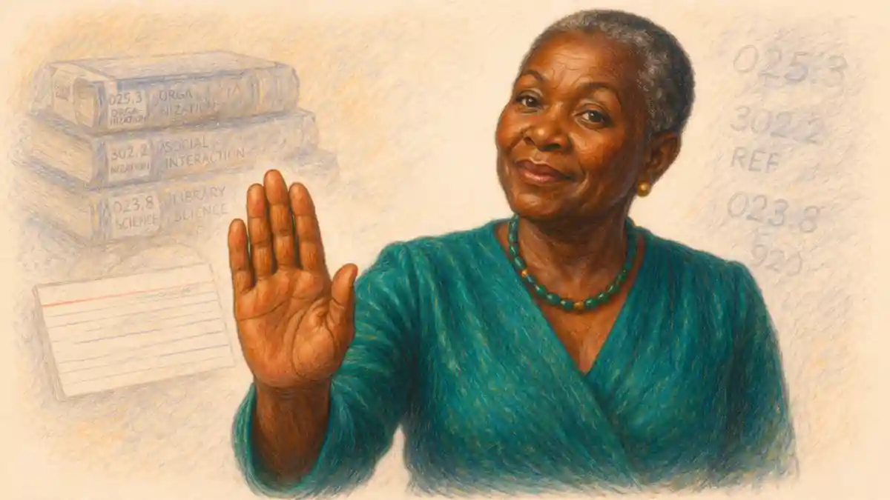

Most Advanced Placement courses end with a clock, a booklet, and a room full of students writing against the same deadline. AP Drawing ends differently. Instead of a timed test, you assemble a body of work across a school year, photograph it, write about the thinking behind it, and send the whole package to trained readers who study each image and score the evidence you leave behind. The course is built around a simple conviction: drawing is a way of investigating the world, and a portfolio can show that investigation unfolding in a way no single afternoon of testing ever could.

That difference changes everything about how you should prepare. Success does not come from memorizing facts or drilling timed responses. It grows out of sustained studio habits, a guiding question that keeps your hand moving, honest revision when a piece stalls, and written reflection that helps a stranger understand choices the images alone cannot explain. Students who treat the year as a slow accumulation of unrelated assignments usually end up with a scattered submission. Students who build around one inquiry, return to it from many angles, and document the process tend to produce work that reads as a coherent artistic voice.

This guide walks through the entire structure in plain terms. You will find the two scored sections mapped against each other, the rubric rows readers apply, the role of written evidence, guidance on materials and mark-making, a realistic working calendar, and the mistakes that quietly pull scores down. Where a companion guide covers a neighboring topic in more depth, such as the broader advice in the [AP exams complete guide](/2008/11/08/ap-exams-complete-guide/), this page points you toward it so each part of your preparation sits in the right place.

## A Portfolio Instead of a Timed Exam

Every AP course asks colleges to trust a score, so each course needs an assessment that gathers trustworthy evidence. For a studio discipline, the honest evidence is the work itself, produced over months rather than minutes. The College Board therefore built AP Drawing as a digital submission: a set of images uploaded through an online portal, accompanied by written responses, scored by art educators who read portfolios in a structured setting each spring. Your teacher guides the process during the year, but the final judgment comes from readers who have never met you and know your work only through what you submit.

Because the assessment is a portfolio, the skills it rewards differ from those in a lecture course. Observation matters, because drawing begins with looking carefully at form, light, space, and surface. Decision-making matters, because every sheet records a chain of choices about scale, medium, viewpoint, and emphasis. Persistence matters most of all, since the strongest section of the submission is explicitly a sustained investigation, a sequence of works that pursue one line of inquiry through practice, experimentation, and revision. A student cannot cram for that in a weekend. The portfolio format quietly enforces the habits the course exists to teach.

Families sometimes ask whether a portfolio score carries the same weight as an exam score on a transcript. Colleges see the same 1 to 5 scale and the same AP branding, and many institutions grant credit or placement for strong portfolio results just as they do for strong test results, though the details vary widely from campus to campus. The grade in the course and the portfolio score are separate judgments: your teacher grades your year of work, while readers grade the submitted evidence against a national rubric. Keeping those two judgments distinct helps students aim at the right target. Pleasing a teacher who knows your effort is one thing; convincing a distant reader through images and writing is another, and the second audience should shape your decisions from the first month onward.

One more consequence follows from the format. Since readers encounter your work as digital images, documentation is part of the craft. A powerful drawing photographed carelessly, cropped at an angle, or dulled by poor lighting arrives weakened before a single rubric row is considered. Strong students treat photography and file preparation as studio skills, not clerical chores, and they build time for documentation into the rhythm of the year rather than scrambling at the deadline.

## Two Sections, One Artistic Voice

The submission divides into two parts that test related but distinct abilities. The Sustained Investigation section carries the larger share of the score, roughly three fifths of the total, and asks for fifteen images that grow out of a single inquiry you pursue across the year. Some of those images may show process, experiments, or works in progress, because the section rewards evidence of thinking as much as finished polish. Alongside the images, you answer written prompts describing the inquiry itself and the ways you practiced, experimented, and revised along the way.

Selected Works, the second section, carries roughly two fifths of the score and asks for five works that demonstrate your command of drawing skills, materials, processes, and ideas at their best. These pieces do not need to belong to your sustained inquiry, and many students use the section to show range: a large observational study beside a small experimental piece, a tonal drawing beside a linear one. For each selected work you also supply short written responses identifying the materials used, the processes followed, and the ideas the piece explores.

Readers score the sections separately, then the results combine into the familiar AP scale. That architecture carries a practical lesson. A student with dazzling finished pieces but a thin, disconnected investigation will lose ground in the larger section, while a student with a rich inquiry and sloppy flagship works leaks points in the smaller one. The portfolio asks for both depth and quality, exploration and excellence, and it weights the exploration more heavily because exploration is harder to fake and easier to sustain across fifteen images than across five.

Notice how the two sections frame time differently. Sustained Investigation looks backward across months of growth; it is a narrative. Selected Works looks at your present ceiling; it is a showcase. Teachers often describe the difference as journey versus destination, and the metaphor holds up under scoring, because the rubric rows for the investigation reward development over time while the rows for selected works reward the quality visible in each individual piece.

## The InsightCrunch Drawing Portfolio Map

Students plan better when the whole submission fits on one page, so the table below compresses the structure into a single reference. We call it the InsightCrunch Drawing portfolio map, and it pairs each part of the submission with its share of the score and the question readers silently ask while scoring it. Keep it near your sketchbook. When a week of studio time ends, glance at the map and ask which row your effort served, because time spent ignoring a heavily weighted row is time the score will notice.

| Section | What you submit | Share of the score | What readers weigh |
| --- | --- | --- | --- |
| Sustained Investigation | Fifteen images grown from one inquiry, including process and revision evidence | About 60 percent | Quality of the inquiry, practice and experimentation, revision, and the bond between materials, processes, and ideas |
| Written evidence for the investigation | Responses naming the inquiry and describing practice, experimentation, and revision | Scored within the investigation section | Clarity, specificity, and whether the words match what the images show |
| Selected Works | Five finished works showing drawing skill at its strongest | About 40 percent | Drawing skill, command of materials and processes, and the ideas carried by each piece |
| Written evidence for selected works | A short response for each piece naming materials, processes, and ideas | Scored within the Selected Works section | Accuracy and economy, since vague labels earn little trust |

Weights printed in course materials present the investigation at about three fifths and the selected works at about two fifths, and treating those shares as approximate planning figures is wiser than treating them as exact arithmetic. Rubrics evolve, readers calibrate against anchor portfolios each season, and the conversion from section scores to the final 1 to 5 grade is set through a process that students never see in full. What stays constant is the strategic shape: the investigation dominates, written evidence breathes inside both sections, and no single spectacular piece can rescue an incoherent year.

Read the map from left to right and a workflow appears. First you decide what to submit, which is a question of evidence. Then you consider the share, which is a question of emphasis. Finally you study the last column, which is a question of audience: readers can only reward what they can perceive, so every studio decision should survive translation into a photographed image and a few honest sentences. Students who internalize that chain stop asking how to impress and start asking how to make their thinking visible, a subtle shift that changes the work itself.

## Inside the Sustained Investigation

Fifteen images sounds modest until you consider what they must collectively prove. The investigation section asks whether you can pose a question worth chasing, chase it through varied attempts, learn from failures, and arrive somewhere more interesting than where you began. Readers move through the sequence looking for that arc. An inquiry might begin with a place, a material, a memory, a formal problem such as transparency or weight, or a subject you cannot stop drawing. Whatever the seed, the inquiry must be specific enough to generate decisions and open enough to survive a year of growth.

Vague topics collapse under the weight of fifteen images. A student who announces that the inquiry concerns nature has named a category, not a question, and the resulting works tend to drift among landscapes, animals, and leaves without building pressure. Contrast that with an inquiry into how water distorts the drawn line, or how a grandmother's kitchen changes across the hours of a day, or how repeated self-portraits shift when the mirror is replaced by a photograph, a shadow, or a memory. Narrow doors open into large rooms. Each new piece can test the question from another side, and the sequence gains the coherence readers reward.

### How many images does the Sustained Investigation require?

The Sustained Investigation requires fifteen images, and that count includes works at every stage of development, from early experiments and studies in progress to finished pieces. Students may show process photographs, details, and revised versions beside completed drawings, because readers score the growth the sequence documents rather than demanding fifteen polished finals.

Fifteen images also means fifteen decisions about sequencing. Readers experience the investigation in the order you arrange, so order is an argument. Opening with the earliest tentative study and closing with the most resolved piece tells a growth story; alternating strong and weak images muddles it. Many teachers advise laying prints of every candidate image on the floor late in the year, physically rearranging them until the arc reads clearly to a fresh eye. Pieces that repeat an idea already proven can be cut without loss, while a modest experiment that unlocks a later breakthrough deserves its place because it explains how the breakthrough happened.

Process images deserve special respect in this section. A photographed page of thumbnail sketches, a failed print, a drawing half erased and redrawn, these artifacts prove experimentation in a way polished finals cannot. Readers are trained to look for them, and their absence makes written claims about revision sound hollow. Build the habit of photographing work before you alter it. A thirty-second snapshot in October becomes irreplaceable evidence in April, when the earlier state of a piece exists nowhere else.

## Choosing an Inquiry That Can Carry a Year

Picking the inquiry is the highest-leverage decision in the course, and it deserves more ceremony than a weekend of brainstorming. Strong inquiries tend to share three properties. They connect to something the student genuinely returns to, a fascination sturdy enough to survive frustration. They can be pursued with materials and access the student actually has, since an inquiry requiring a coastline fails a student landlocked in the plains unless the work transforms that distance into its subject. And they contain a tension, a problem or contradiction that drawing can worry at from multiple sides.

Teachers run many rituals for finding such questions. Some ask students to list obsessions, grievances, and recurring sketchbook motifs, then hunt for overlaps. Others begin with a formal provocation: draw the same subject in twelve materials, or render one object at monumental and miniature scales, and watch which experiments produce curiosity rather than mere completion. A useful test for any candidate inquiry is generativity. Sit with the question and sketch titles for ten possible pieces. If ideas arrive past the fifth title without strain, the inquiry has legs. If the list stalls at three, the topic is probably a single assignment wearing the costume of an investigation.

Personal subject matter often powers strong sequences, yet personal does not have to mean confessional. A student fascinated by transit systems investigated how repeated commutes flatten a city's geography into habit, drawing the same bus window across seasons. Another, working in a family restaurant, drew hands: washing, chopping, counting change, resting. Neither sequence depended on dramatic autobiography. Each grew from proximity, from looking hard at what the student already saw every week, and proximity is the most renewable resource a young artist owns.

Formal inquiries score just as well when the investigation stays genuine. Questions about line quality, erasure as a drawing tool, the behavior of ink on wet paper, or the tension between a drawn grid and the image breaking through it can sustain fifteen images if the student keeps varying the test conditions. The rubric does not privilege subject over form or form over subject. It privileges evidence of inquiry, and a formal investigation documented with rigor shows that evidence as clearly as a narrative one.

Beware the inquiry that is really a technique in disguise. Announcing an investigation of charcoal produces fifteen charcoal drawings and no question, because a medium can host an inquiry but cannot be one. The fix is to ask what the medium is being used to find out. Charcoal might investigate how value shapes emotional temperature, or how smudging blurs the boundary between figure and ground. Once the question exists, the medium becomes a method rather than a topic, and the sequence can even change media midstream if the question demands it.

## Practice, Experimentation, and Revision

Three verbs run through the investigation rubric like a refrain: practice, experimentation, and revision. Practice means the repeated exercise of skills and concepts, the studies and drills that deepen control. Experimentation means deliberate risk, trying approaches whose outcome you cannot predict. Revision means returning to earlier work with new understanding and changing it, sometimes radically. Readers award the strongest marks when all three appear as habits across the sequence rather than as single token images.

Practice is the easiest of the three to show and the easiest to undervalue. Gesture studies, value scales, compositional thumbnails, a page of hands drawn from a mirror: such sheets demonstrate the workshop floor of the investigation. Scatter a few through the sequence where they explain a leap in the finished pieces. A reader who sees the practice understands the product; a reader shown only products must take your development on faith, and rubrics rarely pay for faith.

### What does revision look like inside a portfolio?

Revision appears when an earlier drawing visibly changes under new thinking: a composition cropped and redrawn at larger scale, a failed passage erased and rebuilt, a study reworked in another medium, or a sequence where the same motif returns transformed. Photographing pieces before altering them preserves the before-and-after evidence readers need.

Experimentation is where scores quietly separate. Safe portfolios repeat a proven formula fifteen times with minor variations of subject. Experimental portfolios show detours: an unfamiliar material, an inverted value structure, a drawing built from a process such as folding, tearing, or frottage, a scale that initially defeats the student. Not every experiment must succeed. A failed experiment followed by a smarter attempt tells readers more about artistic thinking than a row of cautious successes, provided the sequence makes the learning visible. The written evidence plays a supporting role here, naming what was attempted and what the attempt taught, in sentences that point back to specific images.

Revision, the third habit, is the one students most often fake and readers most easily detect. Rewriting an inquiry statement in April to pretend a scattered year was planned all along does not fool anyone, because the images testify otherwise. Genuine revision leaves physical traces: reworked surfaces, pentimenti, compositions revisited months later with deeper understanding, earlier conclusions openly abandoned. Sometimes revision means destroying a nearly finished piece to rescue its strongest passage. That kind of courage registers with readers, who spend their days distinguishing performed growth from real growth.

A practical rhythm helps all three habits coexist. Alternate production weeks with reflection weeks. During production, fill pages and push pieces forward. During reflection, pin everything up, photograph the wall, write a page in the sketchbook about what the work is discovering, and choose the next experiments deliberately. The alternation prevents the two failure modes of the section: frenzied making without thought, and endless planning without work. Over a school year, that rhythm compounds into exactly the arc the rubric describes.

## Selected Works: Your Five Strongest Arguments

Where the investigation tells a story, Selected Works makes a case. Five pieces, each photographed cleanly and supported by a short written response, must persuade readers that your drawing skills, your handling of materials and processes, and your ideas operate at a high level. Because the count is small, every choice is exposed. A weak fifth piece does not hide in a crowd; it sits in the sequence like a wrong note, and readers calibrate their sense of your judgment partly by what you chose to include.

Selection strategy starts with honesty about range. The five works should demonstrate breadth without scattering: perhaps an observational piece with complex space, a tonal piece built on value, a linear piece driven by contour and mark, a piece where color does structural work, and a piece that takes a conceptual risk. Exact recipes vary by student, yet the principle holds: each work should prove something the other four do not. Two nearly identical portraits waste a slot that could have shown invention, process range, or ambition of scale.

Pieces from the investigation often migrate into Selected Works, and that migration is allowed and common. A culminating drawing from the inquiry can serve double duty conceptually, first as evidence of growth inside the narrative and then as a flagship standing alone. Teachers disagree about how much overlap is wise. Heavy overlap can make the portfolio feel thin, as if the student produced only one body of work all year. Light overlap, one or two pieces, usually reads as coherence rather than scarcity, especially when the selected pieces are the investigation's strongest outcomes.

Quality control in this section is ruthless and visual. Hold each candidate to three questions. Does the drawing reward sustained looking, with passages of genuine observation or invention rather than uniformly competent rendering? Is the craft controlled, meaning edges, values, and marks behave intentionally even when the style is loose? Does the piece say something, carrying an idea beyond technical display? A work failing two of the three belongs in the investigation sequence at most, where process context can support it, not in the showcase where it must stand naked.

The written responses for selected works look trivial and are routinely fumbled. For each piece you identify materials, processes, and ideas in a few lines. Generic labels squander the opportunity. Naming graphite as the material says little; naming graphite, compressed charcoal, and erasure on toned paper says more. Processes should describe how the piece was made: layered from a photographic reference the student shot, built through repeated erasure, developed from a maquette. Ideas should state the thinking the piece carries, in plain language a stranger can follow. Readers use these responses to confirm what the image suggests, and mismatches between words and image erode confidence in both.

## Mark-Making and the Language of Drawing

AP Drawing is the portfolio most tightly bound to the drawn mark, so fluency in mark-making sits near the center of the course. A mark is any trace a tool leaves: the drag of charcoal, the bite of a pen, the wash of diluted ink, the powdered softness of pastel pushed into paper tooth. Readers look for marks that are intentional, varied, and fitted to their purpose. A drawing where every passage shares the same pressure and tempo reads as monotone, whatever its subject. A drawing where marks shift, tightening in a face, loosening across a background, stabbing at accents, breathing in open fields, demonstrates a student conducting the surface rather than merely filling it.

Building that fluency is trainable. Material studies help: one subject rendered in five tools reveals how each tool edits the world differently. Speed drills help too, since timed gesture drawing forces economy and punishes fussiness. Slow looking matters most of all. Observational drawing from life, rather than from photographs alone, teaches the hand to translate three dimensions into two without flattening, because the eye must constantly choose what to keep. Photographs predigest those choices; life refuses to.

Composition is the other half of the language. A drawn image organizes attention through placement, scale, cropping, value structure, and the path the eye travels. Strong portfolios show compositional ambition: subjects that break the frame, diagonals that energize quiet subjects, negative space treated as a shape with rights of its own. Weak portfolios center every subject at the same scale on the same paper, a habit readers recognize instantly. Varying format across the year, working tall, wide, square, and small, breaks that habit and often unlocks inquiries that a single rectangle was silently constraining.

Value deserves its own sentence of respect, because value structure carries most drawings. A piece can survive imperfect proportion; it rarely survives muddled value, where lights and darks scatter without hierarchy and the image dissolves into gray noise. Students who squint at their work, photograph it in black and white, or check a thumbnail at arm's length are testing value architecture. Those humble tricks, repeated weekly, separate portfolios that glow from portfolios that merely describe.

Drawing also includes approaches that stretch the everyday meaning of the word, and a later section of this guide takes up that boundary question directly. For now, hold the broad principle: the course welcomes any process whose trace is fundamentally drawn, from silverpoint to digital stylus work printed and reworked by hand, provided the student can articulate the materials, processes, and ideas involved. Breadth of method is welcome. Confusion about method is not.

## Materials, Processes, and Ideas: The Triad Readers Track

Nearly every rubric conversation in this course returns to a triad: materials, processes, and ideas. Materials are the physical stuff, graphite, ink, charcoal, pastel, collage elements, the paper or board receiving them. Processes are the actions and methods, layering, erasing, transferring, masking, building tone through hatching, working wet into wet. Ideas are the intentions and meanings, the question a piece asks or the feeling it constructs. Readers award high marks when the three reinforce one another, when the material choice serves the process and the process embodies the idea, rather than sitting beside it as decoration.

Alignment inside the triad is easy to recognize in strong work. An inquiry into erosion drawn with crumbling charcoal, repeatedly erased and redrawn until the paper itself thins, fuses all three strands: the material enacts the idea through the process. Misalignment is equally visible. A delicate subject rendered in a bombastic medium for no reason, or a conceptual piece whose process is invisible and unexplained, leaves readers to guess at connections the artist never built. Much of portfolio coaching reduces to hunting misalignments and repairing them, sometimes by changing the work, sometimes by changing the stated idea to the one the work actually pursues.

Students often ask whether expensive materials raise scores, and the answer is plainly no. Readers score intention and control, not price tags. A grocery bag drawn on with a ballpoint pen can outscore a slick piece on costly board if the cheap drawing thinks harder. Resourcefulness even reads as a virtue in this course, because working within constraints and transforming humble materials is itself a process worth documenting. Save money for good paper in the final pieces if you wish, but spend your real budget on time and attention.

## Written Evidence: Saying What Images Cannot

Images show outcomes; writing must supply the connective tissue. The investigation asks you to state your inquiry and to describe how you practiced, experimented, and revised, and those responses are scored as part of the section rather than treated as paperwork. Readers lean on them when a sequence puzzles them, and a clear statement can rescue strong work from misreading. Conversely, inflated claims collapse under comparison with the images, and readers who catch one exaggeration tend to distrust the rest of the submission.

Good written evidence is specific, concrete, and verifiable against the pictures. Naming the images your sentences describe, referencing the turn where a material changed or a composition failed, and admitting what an experiment taught you all build credibility. Vague uplift does the opposite. Sentences claiming that a piece explores identity and society, without anchoring either word in a visible decision, read as filler. Write the way a thoughtful studio mate would talk: plainly, about particulars, with the work open in front of you.

### How long should the written evidence be?

Written evidence stays brief by design: the investigation asks for focused responses to set prompts, and each selected work carries a short identification of materials, processes, and ideas. Readers reward precision over volume, so a compact paragraph naming concrete choices outscores a long, general essay about artistic intentions.

The drafting method matters almost as much as the final text. Write a first version early, when the inquiry is young, then rewrite it at midyear and again before submission, each time forcing the words to match the work that actually exists. Many students discover during revision that the inquiry drifted productively away from its original statement, and the honest response is to describe the drift, since the rubric rewards genuine investigation rather than fidelity to a September guess. Keep every draft. Comparing versions is itself evidence of revision, and teachers can use the drafts to coach the final wording.

Watch the tone of the writing as carefully as its content. Arrogance reads badly, false modesty reads worse, and jargon borrowed from art criticism reads worst of all. Readers are working artists and teachers; they respond to a student voice that observes carefully and reports honestly. If a sentence could describe any portfolio ever made, delete it and write the sentence only your portfolio could claim.

## How Readers Score the Portfolio, Row by Row

Scoring happens in rubric rows, each row isolating one dimension of quality and assigning a level based on the evidence across the relevant section. For the investigation, the rows attend to the inquiry itself, to practice, experimentation, and revision, and to the relationship among materials, processes, and ideas. For selected works, the rows attend to drawing skill and to how materials, processes, and ideas operate in the five pieces. Row-based scoring means a portfolio can be uneven in instructive ways: brilliant inquiry, weaker craft; polished craft, shallow inquiry. The final AP grade blends the rows through the section weights shown in the map.

Understanding rows changes how students spend effort. Because the inquiry row is scored on the whole fifteen-image arc, a single dazzling piece cannot lift it; only the sequence can. Because the craft row in selected works is scored on five pieces you choose, ruthless selection lifts it directly. Students who grasp the geometry of the rubric allocate time shrewdly: steady weekly production for the investigation, concentrated finishing energy on the flagship pieces, and repeated pruning of both sequences as the deadline approaches.

No published raw score guarantees a particular final grade, and any source claiming a fixed conversion for portfolios should be distrusted. Portfolio scoring involves reader judgment calibrated against anchor sets, and the threshold between adjacent grades emerges from that calibration rather than from a printed table. Students sometimes find this uncertainty uncomfortable, yet it carries a hidden kindness: there is no cliff edge where one point flips a grade, and consistent strength across rows is rewarded more reliably than a desperate hunt for a magic number.

Teachers prepare students for reader judgment through critiques run like scoring rehearsals. Works go up without names, the class applies rubric language to what is actually visible, and students learn to separate intention from evidence. That separation is the whole game. Readers cannot score the drawing you meant to make, the process you forgot to photograph, or the idea you never wrote down. Every rehearsal that hammers this point makes the eventual submission stronger.

## The Technical Skill Misconception

Every year, strong technicians arrive in this course expecting their rendering ability to carry the score, and every year some of them leave puzzled by results that undervalue obvious talent. The misconception is understandable. Years of praise for realistic drawings teach students that fidelity equals quality, and school art often rewards the most photographic piece in the room. The portfolio rubric, however, treats skill as one strand among several. Rendering that never risks, never questions, and never changes across fifteen images demonstrates a plateau, however polished, and the investigation rows score growth rather than plateaus.

### Does technical skill alone earn a high score?

Technical skill alone does not earn a high score, because the larger section of the portfolio grades inquiry, experimentation, and revision across fifteen images. Flawless rendering repeated without growth demonstrates a plateau, while a developing artist who risks, revises, and documents the process gives readers far more scoring evidence.

The opposite misconception also circulates: that ideas excuse weak craft. They do not. Readers are artists; unresolved drawing, accidental muddiness, and careless surfaces register immediately, and the selected works rows score skill directly. The portfolio's real demand is integration. Skill must be pushed into the service of an inquiry, and the inquiry must be embodied in skilled work, each strand strengthening the other until the distinction barely matters. Students who reach that integration stop asking whether a piece is good in the abstract and start asking what it contributes to the whole, which is precisely the judgment readers exercise.

Consider two imaginary submissions. One presents fifteen technically impeccable drawings of fifteen unrelated subjects, each a small triumph of rendering. The other presents a rougher sequence chasing one question about hands and labor, with visible false starts, a midyear change of medium, and a final trio of pieces where control and concept lock together. Under this rubric the second portfolio very plausibly outscores the first, because it supplies evidence on every row while the first supplies overwhelming evidence on only one. That verdict is not a quirk; it is the course philosophy made visible in numbers.

None of this excuses sloppy technique, and students should keep sharpening observational skill all year. The point is sequencing and purpose. Skill practice belongs inside the investigation, aimed at the problems the inquiry raises: drawing glass because your inquiry concerns transparency, studying anatomy because your figures keep failing at the wrist. Practice with a target compounds. Practice as an end in itself merely accumulates.

## Documenting and Photographing the Work

Since readers meet your art as files on a screen, the camera is effectively part of your medium. Documentation done well is invisible; documentation done badly taxes every image before judgment begins. The core requirements are consistency and fidelity: the photograph should show the drawing squarely, evenly lit, color-faithful, and cropped to the work without amputating edges the reader needs to see.

Technique is learnable in an afternoon and worth that afternoon. Pin or tape the work flat on a neutral wall, position the camera parallel to the surface, and light it from both sides at matching angles to kill glare and shadow. Avoid flash, which flattens texture and invents hotspots. Check each shot at full size for focus drift, especially at the corners, and reshoot immediately while the setup stands. For three-dimensional or heavily textured passages, an additional detail photograph can clarify what a flat shot obscures, where the section permits extra views.

Color fidelity deserves special vigilance with toned papers and subtle media. A white balance thrown off by warm classroom lighting can turn a cool gray study jaundiced, and readers cannot correct for distortions they cannot detect. Photographing beside a neutral gray card, then adjusting against it, keeps hues honest. Students working digitally should export files at the dimensions and formats the submission portal specifies, and keep unedited masters archived so a corrupt upload never becomes a lost piece.

Build documentation into the calendar rather than bolting it on. A weekly habit of photographing every finished or significantly changed piece serves three purposes at once: it preserves process states for the investigation, it creates a running archive from which final selections can be compared side by side, and it spreads the labor so deadline week is about judgment rather than logistics. Schools vary in equipment, yet a phone camera used carefully beats a neglected fancy camera used hastily, and teachers can usually help students without access arrange time with school devices.

## A Working Calendar for the Year

Portfolios fail by drift more often than by disaster, so a calendar that converts the year into phases protects against the slow leak of weeks. The exact months bend around school schedules, but the phase order is stable. Begin with exploration and skill building in the opening stretch: wide sketchbook work, material experiments, and the search for an inquiry, with nothing yet treated as precious. Close that phase by choosing the inquiry deliberately, in conference with your teacher, and writing its first honest statement.

The long middle of the year belongs to production inside the inquiry, punctuated by reflection points. Aim to complete the bulk of investigation images during these months, alternating making with pinning up, photographing, and writing brief sketchbook assessments. Schedule a formal midyear review, ideally with outside eyes, where the sequence so far is laid out in order and interrogated: where does the arc sag, which experiments deserve sequels, which pieces are repetitions wearing new subjects? Decisions made at midyear, dropping a medium, narrowing the question, enlarging the format, still have time to reshape the outcome.

Selected works can be identified surprisingly early. By midyear most students know which three or four pieces anchor the showcase, and the remaining months can target the gaps: the missing scale, the unproven medium, the conceptual stretch. Finishing energy should concentrate there rather than spread evenly, because the showcase rewards peaks, not averages. Keep a running folder, physical or digital, labeled with the five leading candidates, and force every new strong piece to displace one rather than merely join the folder.

The final stretch reverses the year's posture from making to judging. New work slows; selection, sequencing, documentation, and writing take over. Finalize the fifteen investigation images in an order that tells the growth story, complete the written evidence while the pieces are in front of you, photograph everything under one consistent setup, and proofread the submission on screen exactly as a reader will meet it. Students who want structured drills alongside studio work can borrow habits from timed-exam preparation, and the [free AP exam practice questions](https://reportmedic.org/tools/ap-exam-practice-questions.html) used for other courses are a reminder that deliberate, repeated practice with feedback is the engine under every strong AP result, portfolios included.

Leave a buffer week before the deadline untouched by production. Uploads stall, files corrupt, teachers spot a missing image at the last review. A buffer converts those accidents from catastrophes into errands. Submitting a few days early, once checks are complete, costs nothing and buys genuine peace.

## Common Mistakes That Drag Scores Down

Certain errors recur so reliably that teachers can predict a class's lost points by October. The first is the assembled portfolio: fifteen competent drawings gathered from a year of disconnected assignments and retroactively declared an investigation. Readers detect the absence of connective tissue within three images, because nothing in the sequence requires the piece before it. The remedy is not better framing language but an actual inquiry, adopted early enough to generate real continuity. Students who discover this problem late should narrow honestly: find the thread that genuinely runs through the strongest eight pieces and build the remaining images from it, rather than pretending the whole drawer was planned.

Thin written evidence ranks second. Students pour months into images and twenty minutes into the sentences that interpret them, and the imbalance shows. Short does not have to mean thin; thin means generic, interchangeable, and unmoored from specific images. The remedy is drafting the writing early and revising it beside the work, as the earlier section on written evidence describes. A teacher reading your responses should be able to point at the image each sentence describes.

A third error is uniform safety: one medium, one format, one subject type, one level of finish, repeated until the sequence numbs the reader. Safety usually masquerades as consistency, and the distinction matters, because the rubric rewards a coherent inquiry pursued through varied means, not identical products. Force variation deliberately. Change scale drastically for two pieces. Ban your favorite medium for a fortnight. Draw the inquiry's subject from an unfamiliar vantage, at an unfamiliar hour, with your non-dominant hand if the experiment serves the question. Some attempts will fail, and the failures, documented, are assets.

Neglecting the showcase until spring is a fourth classic. Students assume their five best pieces will simply exist by April, only to discover that their output clusters in one medium and one size, leaving the showcase row with nothing to select from. Track candidates all year, as the calendar section advises, and commission the missing types on purpose. A fifth error is documentation chaos at the deadline: mismatched crops, glare, files named in ways that scramble the intended order. Each is small; together they signal carelessness to readers primed to reward care.

Finally, beware the borrowed inquiry, the topic chosen because it scored well for someone else, sounded impressive, or pleased a teacher. Readers meet hundreds of portfolios and can smell a ventriloquized investigation: the words say one fascination, the images confess another. Authenticity is not a sentimental extra in this course; it is a scoring variable, because genuine fascination sustains the practice, experimentation, and revision the rubric measures. Choose the question you will still care about in February.

## Drawing Among the Three Portfolios

The Art and Design program offers three portfolios, and students choosing among them should understand the borders. AP Drawing, the subject of this guide, centers on mark-making in any medium, with the drawn trace as the primary event. Its sibling, covered in the companion [AP 2-D Art and Design portfolio guide](/2007/03/29/ap-2d-art-and-design-portfolio-guide/), centers on design: composition, graphic communication, and two-dimensional problem solving across media including photography and digital work, where design decisions outrank the drawn gesture. The third sibling, detailed in the [AP 3-D Art and Design portfolio guide](/2007/03/25/ap-3d-art-and-design-portfolio-guide/), moves into space, scoring form, structure, and materials in sculptural work.

Borderline works exist, and placing them correctly is a real skill. A poster built from drawn lettering might belong to either Drawing or 2-D, depending on whether the artistic event is the mark or the design solution. A drawn image later cut, folded, and constructed into an object starts crossing toward 3-D. Teachers adjudicate these calls case by case, and the safest habit is deciding the home portfolio by asking what a reader should primarily judge. If the answer is the life of the line, the energy of the mark, and the translation of observation into trace, the piece speaks Drawing's language.

Students building any of the three portfolios share the same strategic spine: one inquiry pursued with discipline, evidence documented as it happens, writing that matches the images. The fuller treatment of that shared strategy lives in the companion guide to [AP Art and Design portfolio strategy](/2007/03/16/ap-art-and-design-portfolio-strategy/), which takes up sequencing, inquiry design, and time management across all three submissions. Read it alongside this page if your school lets you choose between portfolios, or if your investigation keeps drifting across the borders and you need language for deciding where it belongs.

What counts as drawing deserves one clarification here, because students regularly misjudge the boundary. Drawing in this course is not restricted to pencil on paper or to representation. Erasure drawings, drawings built from thread or wire shadow, drawn animations presented as sequences, frottage, powdered pigment worked like pastel, ink drawn with sticks: all can qualify when the trace and the hand remain the medium's core. Equally, a painting is not disqualified by being a painting; many paintings are fundamentally drawings in paint, where line, contour, and mark carry the image. The test is the work's center of gravity, and your written evidence should show that you understand where your own pieces place it.

## Credit, Placement, and Life After the Portfolio

A strong portfolio score can convert into college credit, advanced placement, or portfolio-review advantages, but the conversion is local and must be verified campus by campus. Art programs frequently ask to see the work itself during admissions or placement reviews regardless of the score, which gives AP Drawing students a double asset: a nationally scored credential and a mature body of work ready to show. Policies for awarding credit differ sharply, with some colleges granting studio credit for scores of 4 or 5, some granting elective credit only, and some requiring their own review before granting anything. The landscape of such policies, and the habit of checking each target school's published rules rather than trusting rumor, is mapped in the guide to [AP credit policies at colleges](/2008/10/07/ap-credit-policies-colleges/).

Do not let credit arithmetic dominate course decisions anyway. The deeper returns of the year are capabilities: a sketchbook habit, fluency in several media, the discipline of finishing and revising, and a written voice for talking about visual work. Those capabilities transfer into design, architecture, illustration, animation, and any field where seeing clearly is a professional skill. Alumni of portfolio courses routinely report that the investigation structure, pose a question and pursue it through documented attempts, became their template for later creative projects long after the score faded from memory.

For students continuing to art school applications, treat the AP submission as a rehearsal rather than a rival. The same pieces, rephotographed and resequenced for each school's requested format, can anchor an admissions portfolio, and the written responses translate naturally into artist statements. Keep masters of every file, keep the inquiry drafts, and keep the sketchbooks. Years later, the archive of a year spent drawing with intent becomes a record of how your seeing developed, worth more than the number it earned.

One closing piece of logistics belongs in every plan: scores arrive in the summer, alongside the other AP results, and students should arrange for score reports to reach the colleges that need them through the usual reporting channels. None of that machinery changes the work itself. Build the investigation honestly, document everything, write plainly, and the portfolio will say what it needs to say to any reader, admissions officer, or future self who opens it.

## Getting Started: The Opening Weeks

The first weeks of the course set trajectories that later effort struggles to bend, so treat the opening as design work rather than warm-up. Begin by surveying your own history as a maker. Spread out everything you have drawn in the past two years, including sketchbook pages you would rather hide, and look for recurrences: subjects that return uninvited, materials you reach for under pressure, scales you avoid. Those recurrences are data. An inquiry built on a genuine recurrence starts with momentum, while one built on a stranger's interests starts with debt.

Teachers usually run structured explorations during this phase, and students should exploit them fully. If the class rotates through media stations, treat each station as an audition: which tool makes you lose track of time, which produces surprises you want to chase? If the class draws a shared subject, compare your rendering with classmates' versions and notice what your eye did differently, because difference is the raw ore of a personal inquiry. Keep every scrap. The investigation section can use exploratory work, and pieces that feel disposable in September sometimes become the opening chapter of the sequence by spring.

By the end of the opening phase you should hold three artifacts. The first is a candidate inquiry stated in one or two sentences, written in language you would use with a friend rather than language borrowed from a syllabus. The second is a materials list, grounded in what you can actually obtain and sustain for a year. The third is a calendar sketch, even a rough one, marking when major pieces, reviews, and documentation sessions will fall. None of these artifacts is a contract. Each will be revised repeatedly, and the revisions themselves become evidence. The failure mode to avoid is drifting through the opening phase making pleasant drawings while postponing every decision, because postponed decisions compress the investigation into the spring and starve it of the depth the rubric rewards.

Self-directed students and homeschoolers walk the same phases without a classroom's scaffolding, which makes structure more important, not less. Such students should manufacture the external pressure a class provides: fixed weekly studio hours, a mentor or working artist willing to critique monthly, deadlines written down and shared with someone who will ask about them. The portfolio makes no distinction between schooled and self-taught work; it reads evidence, and evidence accumulates fastest under a rhythm somebody enforces.

## The Sketchbook as Engine Room

Behind nearly every strong portfolio sits a sketchbook that worked harder than the final pieces did. The sketchbook is where the inquiry lives between studio sessions: thumbnails testing compositions, notes recording what a failed experiment taught, clippings and studies that feed the next attempt. Teachers who require sketchbook reviews are not being bureaucratic. They are inspecting the engine room, because a portfolio whose sketchbook is empty usually has an investigation that exists only in its final statement, which is to say barely at all.

Habits matter more than materials here. Carry the book everywhere and draw from the day itself: the passenger across the aisle, the sink of dishes, the dog asleep in a geometry no photograph would invent. Short drawings made under mild pressure teach translation speed, while longer studies parked inside the same book show range. Write beside the drawings, in the moment, because a note recording why you switched from pen to charcoal preserves reasoning that memory will confidently rewrite by next month.

Should sketchbook pages enter the fifteen images? Sometimes. A spread that visibly works through a problem can be among the most persuasive evidence in the investigation, because it collapses practice, experimentation, and revision into a single frame. Pages that merely rehearse the same study six times add little. Students should photograph sketchbook spreads as they complete them and audition the strongest during sequencing, treating the book as a candidate mine rather than a sacred text or a scrap heap.

Protect the book's honesty. The temptation to perform a tidy sketchbook for grading, redrawing pages neatly or omitting disasters, destroys its function. Readers are not shown the book itself, and teachers value it as a thinking instrument; cosmetic effort spent there steals time from work that is scored. A messy page with a genuine discovery advances the portfolio. A pristine page with nothing at stake advances only the performance of diligence.

## Observation, Imagination, and the Space Between

Drawing education rests on two great sources: the seen world and the imagined one. Portfolios dominated entirely by either source develop characteristic weaknesses. Work drawn only from observation can grow timid, technically neat and conceptually thin, as if looking were a substitute for thinking. Work drawn only from imagination can drift into formula, repeating symbols and shortcuts the hand learned years ago while the eye went untrained. The investigation format pushes students to braid the sources together: observe to gather truths the imagination could not invent, then invent to reorganize those truths into statements observation alone could never make.

Photographs sit uneasily between the two sources, useful and dangerous in equal measure. A photograph you took yourself, of your own subject, staged for your inquiry, is a legitimate studio tool and a common one. An image harvested from the internet and copied is neither observation nor imagination; it is transcription of somebody else's seeing, and portfolio rules on originality treat copied work harshly, as the section on authenticity below explains. Even with your own photographs, beware their flattening habits: fixed framing, compressed value, frozen gesture. Many teachers require a share of work from life in every sequence precisely to keep the eye honest.

Exercises can force the braid. Draw a scene from life, then redraw it from memory the following day and compare the losses; what vanished was never truly seen. Invent a figure, then pose a friend to test whether your invention survives anatomy. Take an observational study and push it through three transformations, exaggeration, reduction to geometry, translation into another medium, until it becomes a personal image with observational DNA. Such exercises generate exactly the sequenced evidence, attempt, failure, adjustment, that the investigation rows are built to reward.

Subject matter drawn from daily life often braids the sources naturally. A kitchen table observed across a week accumulates imagination's contributions by itself, because memory edits, mood selects, and the hand stylizes whether invited or not. Students hunting for inquiries should look at the scenes they inhabit repeatedly. Repetition gives observation depth, and depth gives imagination something solid to push against.

## Dry Media: Graphite, Charcoal, Pastel, and Their Relatives

Dry media form the traditional heart of the course, each with a distinct temperament a student should learn to conduct. Graphite rewards patience and precision, building tone grain by grain, and its erasability invites the layered revision readers like to see. Its risks are timidity and shine: timid pressure produces anemic gray, while heavy burnishing flattens the surface into glare that photographs badly. Charcoal behaves more like weather, sweeping in broad value fronts, erasing to a ghost, encouraging the large gestures and dramatic revisions that make process photographs so eloquent. Its risks are muddiness and fragility, since charcoal dusts, smears, and demands fixative discipline.

Pastel occupies the border between drawing and painting, delivering color with a drawn touch, and it suits inquiries where hue carries meaning but the hand wants to keep drawing's directness. Colored pencil builds slowly and precisely, rewarding planned layering, and it punishes haste with waxy bloom. Conte crayons and chalk bring an earthy, sculptural pressure to figure work. None of these media scores above the others; readers respond to fit and control. A student who knows why charcoal serves an inquiry into smoke and erasure will outscore a student using the same stick because it was issued in class.

Mixing dry media multiplies possibilities and risks in equal measure. Graphite under charcoal can structure a drawing that charcoal alone would loosen into fog; pastel over a charcoal underdrawing glows with borrowed depth. Mixed work also complicates the written evidence, since materials and processes must be reported accurately, and it complicates documentation because surfaces sheen differently under lights. Treat mixed media as a deliberate process with a stated purpose, and the triad stays aligned.

Paper is a dry medium too, for practical purposes. Tooth, weight, tone, and size all edit what a tool can say. Toned paper hands the artist a middle value for free and makes lights luminous, which is why so many strong figure studies live on gray or tan grounds. Rough paper breaks a charcoal stroke into sparkle; smooth board lets a pen glide into wire. Choosing paper is choosing a collaborator, and the investigation gains credibility when paper choices vary with intent instead of defaulting to whatever pad was open.

## Wet Media, Print Processes, and Drawing Beyond the Pencil

Ink changes a student's relationship with error, and that change alone makes it valuable inside an investigation. A pen line cannot be erased into pretending it never happened; it can only be answered. Working in ink forces commitment, economy, and a visible record of decisions, all qualities readers prize. Washes extend ink toward value and atmosphere, and diluted ink drawn with sticks, reeds, or brushes builds a vocabulary between line and tone. Students who fear ink's permanence often discover, after a fortnight of forced practice, that the fear was the point: their drawings gain the decisiveness that pencil's erasability had been quietly taxing all year.

Watercolor and gouache enter this portfolio when they behave as drawing, when line, mark, and contour carry the image rather than color fields alone. Thin, linear watercolor over a drawn structure, gouache used to hatch and stipple, paint drawn with a fine brush as if it were a pen: these approaches sit comfortably in the course. The written evidence should make the drawn character explicit, naming the linear process so a reader scanning quickly does not misfile the piece.

Printmaking processes contribute drawings by other means. A monotype is essentially a drawing made on a plate and transferred, complete with the accidents transfer brings, and a series of monotypes chasing one image makes a beautiful investigation structure: same question, new conditions, visible learning. Drypoint and linocut involve drawn lines incised or carved, and their proofs document revision with unusual clarity, since each state of the plate can be photographed before reworking. Students with access to a press should discuss such work with their teacher early, because editioning and state proofs need planning across the year.

Digital tools have a legitimate, bounded place. A stylus drawing made entirely by hand on a tablet is a drawing in every meaningful sense, and its layers can preserve process states elegantly. What the course resists is automation substituting for the hand: filters, traced photographs, and generated imagery break the chain of evidence between the student's eye and the submitted mark, and they raise originality problems the authenticity section addresses. Hybrid workflows, digital drawing printed and reworked in physical media, often produce the most interesting evidence of all, because each transfer forces fresh decisions. Whatever the toolset, the test remains constant: can you show a reader your hand thinking?

## Scale, Format, and Surface Decisions

Few choices alter a drawing's meaning as quickly as scale, and few are made as carelessly. Students default to the pad size the school supplies, so portfolios arrive with fifteen same-sized rectangles and a quiet monotony of ambition. Scale is expressive: a face drawn larger than life confronts, the same face drawn at postage size confides. An inquiry into crowds might need a panoramic sheet the eye must travel; an inquiry into a single worn object might gain intensity from smallness and isolation. Varying scale across the investigation is therefore not variety for its own sake but evidence that the student thinks in the medium's full grammar.

Format interacts with composition in ways beginners underestimate. A tall format stacks space and suits figures, doorways, and falling motion; a wide format stretches time and suits journeys, horizons, and repeated motifs. Square formats refuse the eye a default direction and can hold stillness beautifully. Students benefit from a deliberate format audit midyear: list the dimensions of every image so far, and the pattern, or the rut, will announce itself. Breaking a rut needs one brave piece, after which the new format usually enters the vocabulary permanently.

Surface decisions extend beyond paper choice into the treatment of the sheet itself. Collage grounds, sanded passages, stitched or pierced areas, transferred images drawn over, surfaces built up with gesso and then drawn into: each creates a terrain the drawing must negotiate, and negotiation generates decisions worth scoring. The caution is gimmickry. A tortured surface that serves no inquiry reads as decoration, and readers discount it. A surface whose construction embodies the inquiry's idea, a drawing about repair built on a mended, visibly sutured sheet, earns its complexity honestly.

Scale also has a documentation consequence students forget until spring: very large works photograph awkwardly, require more light control, and may need detail shots to prove their surfaces. Plan the photography of oversized pieces early, when walls, ladders, and helping hands can be arranged calmly. Nothing about a piece's merit depends on its size, yet everything about its reception depends on the reader seeing it whole and clearly.

## Critique: Using Feedback Without Losing the Thread

Critique is the course's social technology, the structured conversation that turns private effort into shared learning. Done well, it teaches the exact skill the portfolio finally tests: seeing your own work as a stranger will. Students should enter critiques with specific hungers rather than a general hope for praise. Bring two questions you genuinely cannot answer alone, about a passage, a sequence gap, a medium choice, and let the room work on those. Vague openness invites vague comment; precise questions recruit precise eyes.

Receiving feedback is a discipline. Write down what is said, especially the parts that sting, because sting often marks the location of a real problem your defenses had been guarding. Resist rebutting in the moment; the speaker is reporting what the work communicated, and communication failures belong to the work, not the audience. Later, alone with the notes, sort comments into three piles: changes to make, experiments to try, and opinions to respectfully decline. That third pile matters. A portfolio with no declined advice usually has no author either, just a committee's compromises wearing one name.

Giving feedback trains the same muscles from the other side. Describing a classmate's drawing in rubric language, naming where inquiry shows and where it hides, where marks serve and where they merely fill, builds the vocabulary you will need for your own written evidence. Students who critique generously and precisely tend to self-assess accurately, and self-assessment accuracy predicts portfolio strength better than almost any classroom variable, because the final selection and sequencing decisions are self-assessments performed under deadline.

Teachers orchestrate critique in many formats: full-class pin-ups, small-group table reviews, silent written rounds, one-to-one conferences. Each format surfaces different truths. Public pin-ups expose sequence and comparison; table reviews allow handling and detail; conferences permit honesty about direction and doubt. Engage each format on its own terms, and keep a running critique log in the sketchbook, dated, so that growth in your judgment becomes as documentable as growth in your hand.

## The Midyear Review and Course Correction

Halfway through the year, every investigation deserves a formal audit, and students who schedule one gain an advantage no extra weekend of drawing can match. Lay out everything produced so far in sequence, on a wall or a long table, and read it as a reader would: silently, in order, without the maker's explanations. The exercise is uncomfortable by design. Gaps that felt theoretical become visible: the inquiry that pivots without transition, the three pieces that repeat one success, the experiment promised in October that never actually happened.

From that honest viewing, three kinds of decisions should emerge. Some threads deserve abandonment, and abandoning them early converts sunk effort into freedom. Some threads deserve intensification, the experiment that produced the room's strongest reaction and clearly wants sequels. And some missing pieces reveal themselves, the scale not attempted, the process undocumented, the revision the sequence needs to prove its arc. Write the decisions down as a work plan with dates. A midyear review that ends in feelings rather than assignments has wasted its clarity.

Teachers often attach grade conferences to this moment, and students should use them diagnostically rather than defensively. Ask where your evidence is thinnest in rubric terms. Ask which single change would most raise the sequence. Ask whether your stated inquiry matches the inquiry a stranger would infer from the wall. The last question is the most valuable and the most feared, because drift between statement and work is the most common midyear finding, and it is entirely repairable: either redirect the work or rewrite the statement to claim the investigation you are truly pursuing.

Expect the correction to involve a burst of directed making in the weeks after the review. That burst is normal and healthy, and it often produces the portfolio's turning point, the pieces where intention and evidence finally align. Protect time for it in the calendar by resisting new obligations in the fortnight after the review. Course correction is not an admission of failure; in rubric language it is revision at the scale of the whole portfolio, and it models exactly the behavior the investigation exists to teach.

## Sequencing the Fifteen: Storytelling With Images

Sequencing is the final act of authorship in the investigation, and it rewards the same instincts as editing a film or ordering poems in a chapbook. The reader's journey through your fifteen images should have a shape: an opening that establishes the question and the stakes, a middle that complicates and deepens, and a close that resolves or deliberately refuses resolution. Within that arc, adjacency matters. A quiet piece gains power after a loud one; a process spread placed before its finished outcome teaches the reader how to watch the outcome; two similar pieces placed apart can rhyme, while placed together they merely repeat.

Practical sequencing begins on the floor or the wall, never in the upload portal. Print small copies of every candidate, including the rejects, and arrange them physically where you can swap neighbors in seconds. Read the wall aloud, in the sense of narrating what each image contributes and what would be lost if it vanished. Pieces whose loss changes nothing are candidates for the cut, however fond of them you are. Fondness is not a rubric category, and the sequences readers remember are the ones where every image earns rent.

Pacing deserves explicit attention. A sequence of fifteen uniformly intense, highly finished pieces exhausts a reader and flattens its own peaks. Interleave breathing room: a spare study, a process sheet, a small quiet drawing, and the peaks regain their altitude. Conversely, a sequence that saves all strength for the final three images risks a reader whose confidence has already drained. Distribute two or three strong pieces through the middle as promises, and let the closing run confirm them.

Test the finished order on fresh eyes if you can, ideally a viewer who knows art but not your year. Ask only two questions: what is this investigation about, and where did your attention wander? The first answer checks coherence against your statement; the second locates the sag. Adjust once, decisively, and then stop. Endless reordering in deadline week is anxiety wearing the mask of rigor, and it occasionally introduces the very disorder it fears.

## Authenticity, Originality, and Borrowed Imagery

Portfolio rules rest on a simple covenant: the work must be yours, made by your hand, from your seeing and your imagination. Copying a published photograph, another artist's composition, or a found image and presenting the copy as your investigation breaks that covenant, and the consequences in AP portfolio assessment are severe, up to loss of the score. The rule is not pedantry. A copied image testifies about somebody else's decisions, and a rubric built on evidence of your thinking has nothing honest to measure in it.

Legitimate influence looks different from copying, and students should learn to tell them apart. Every artist absorbs influences: a way of hatching learned from a printmaker, a palette borrowed from a painter, a compositional device studied in a museum. Influence becomes your own work when you run it through your inquiry, your subjects, and your decisions until the source is a seasoning rather than the meal. Teachers can help draw the line in specific cases, and asking early is always safer than explaining late.

Photographs require the same honesty. Working from your own photographs is accepted practice in most classrooms, because the seeing began with you: you chose the subject, the framing, the moment. Working from found photographs transfers that seeing to a stranger. Even mechanical aids carry responsibilities; projecting and tracing a found image to fake observational skill misrepresents the evidence exactly as surely as signing another student's drawing would. When in doubt, disclose the process in your written evidence. Transparency protects you, because a reader who understands how a piece was made can judge it fairly, while a reader who discovers concealment judges everything else in the submission more harshly too.

Collage and appropriation raise subtler questions, since some contemporary drawing genuinely builds on found material. The distinction readers apply is transformation and disclosure: found elements must be subordinated to your own drawn investigation, visibly transformed by your hand, and acknowledged in the materials and processes you report. A found image that remains the image's main event, with drawing as garnish, inverts the portfolio's purpose. Students planning such work should conference with teachers well before the pieces become load-bearing in the sequence.

Process honesty extends to digital assistance. Software that generates or completes imagery in your place severs the chain of authorship the portfolio exists to certify, and students should treat automated generation as they would a hired hand: incompatible with the submission's premise. Your own digital drawing, your own photography, your own scans of physical work all stand on firm ground. When a tool does the seeing for you, the ground disappears.

## What a Score Means

The portfolio receives the same five-point report as every AP assessment, and the bands carry consistent meanings across the program. A 5 signals work of exceptional quality, the kind readers hold up when calibrating what excellence looks like. A 4 signals strong work with clear command and only modest gaps. A 3 signals competent, qualifying work whose evidence is uneven, often strong in one section and thinner in the other. Scores of 2 and 1 signal partial or minimal evidence against the rubric, usually because the investigation never cohered, the craft never stabilized, or the submission was incomplete in spirit even when complete in count.

Those bands should inform strategy without becoming superstition. Students sometimes ask teachers to predict scores from classroom grades, and wise teachers decline precise prophecy, because readers judge against a national pool with anchor portfolios no classroom can fully simulate. What a teacher can do is locate your evidence on the rubric honestly: this row reads strong, that row reads developing, and here is the gap between your selected works and your investigation. Strategy follows from that map far more reliably than from grade daydreaming.

Colleges interpret bands through their own policies, as the credit discussion earlier noted, and art programs often supplement the number with their own look at the work. A 3 with a compelling body of images can open doors that a bare number suggests are closed, while a 4 earned on a narrow, polished sequence may interest an admissions reviewer less than its digit promises. Keep the score in proportion. It is a compressed judgment of one submission, useful as credential and feedback, and it is not a verdict on your future as an artist.

## Training the Hand: Exercises That Pay Rent

Skill grows through volume with feedback, and certain classic exercises repay their time so reliably that strong programs build them into the year's floor. Timed gesture drawing, thirty seconds to five minutes per pose, strips away fussiness and teaches the hand to find the action of a form before its details. Sustained observational studies, one object across many sessions under changing light, teach patience and the difference between knowing and seeing. Master studies, copying a great drawing slowly to interrogate its decisions, transplant centuries of solved problems into a student's hand, provided the copies stay in the sketchbook as study rather than migrating into the portfolio as product.

Value exercises deserve a permanent place in the rotation. A five-value scale rendered until it is boring, then the same scene compressed into three values, then two, builds the hierarchy sense that keeps finished drawings luminous. Contour exercises, blind and modified, weld eye to hand. Negative-space studies, drawing the air around objects rather than the objects, cure the symbol-drawing habit that flattens so much student work. None of these exercises is glamorous; all of them compound, and their fingerprints show in finished pieces as surely as scales practice shows in a recital.

Structure the training like an athlete's week rather than a student's panic. Short daily drills maintain fluency, one longer observational session each week stretches capacity, and one experimental session feeds the inquiry directly. Track the training in the sketchbook with dates, because dated drills are revision evidence in embryo: a reader shown a January page of stiff hands beside an April figure drawing watches skill being built rather than being told it was. Students who keep that log also gain a private consolation during plateaus, since the record proves plateaus end.

Plateaus deserve a sentence of their own, because every student meets one and many misread it as a talent ceiling. A plateau is usually consolidation, the nervous system quietly reorganizing around new demands, and the correct response is varied work at the edges of the difficulty rather than either surrender or grim repetition. Change medium, change scale, change subject, and let the stalled skill recover sideways. Teachers recognize the pattern; students should learn to recognize it in themselves before it costs them a month of confidence.

## Building Toward a 5: Assembling the Evidence

Guides with titles like this one owe readers a direct answer to the obvious question, so here it is in plain terms. A top score is assembled, not achieved in a single gesture, and the assembly has a recognizable shape. It begins with an inquiry specific enough to generate fifteen distinct yet connected images and honest enough to sustain a year of attention. It continues with visible habits: practice that builds skill, experiments that risk outcomes, revisions that leave physical traces. It matures through selection discipline in the five showcase pieces and writing that reads like a person describing real decisions. And it lands through documentation that lets readers see everything clearly.

Notice what that shape omits: genius, expensive materials, a famous teacher, a tragic backstory, a single masterpiece. Readers score evidence against rows, and evidence is democratic; any student willing to do the year's unglamorous repetitions can manufacture it. The portfolios that earn the highest marks in school after school share a texture teachers describe as seriousness: nothing included casually, nothing claimed without a picture to back it, no gap between the words and the work. Seriousness is a practice, not a personality trait, and it can be trained week by week.

Break the assembly into monthly questions and it becomes manageable. Does the inquiry still generate new pieces, or has it narrowed into repetition? Where is the newest experiment, and what did it change? Which pieces would make the showcase if the deadline were Friday, and what is missing from that set? Are the written drafts keeping pace with the work, or will April demand a month of prose archaeology? Students who answer those questions in writing, monthly, rarely face a desperate spring.

Teachers remain the student's best instrument for calibrating all of this, because they have watched many cohorts convert effort into scores. Use their conferences deliberately. Bring the sequence, bring the drafts, bring specific questions, and leave with dated commitments. Where a school offers portfolio reviews with outside artists or college faculty, seize them; a stranger's cold read in February is the cheapest simulation of reader judgment money and pride can buy, and the sting it delivers arrives while repair is still possible.

Ambition, finally, should be aimed at the work rather than the digit. Students who chase the number directly tend to game the rubric with safe, legible moves and produce the competent, airless portfolios that stall at respectable middle scores. Students who chase a real question with discipline tend to generate the evidence the top rows describe as a byproduct. The paradox is the course's last lesson, and it generalizes far beyond drawing: build the genuine thing, document it honestly, and let the evaluation follow.

## Inquiry Patterns That Reliably Bear Fruit

Students paralyzed by the blank choice of an inquiry can borrow structural patterns that have carried many portfolios, then fill them with personal content. One durable pattern is the place study: one location revisited across time, weather, and hour until the drawings accumulate into a portrait of attention itself. Kitchens, bus stops, workshops, and grandmothers' porches have all served, because familiarity deepens observation while change supplies variety. Another durable pattern is the object biography: a single thing, a pair of boots, a bicycle, a houseplant, drawn through use, damage, repair, and season until the object becomes a clock measuring a life around it.

The transformation pattern builds an investigation from a process rather than a subject. An image is drawn, then altered by water, folding, sanding, redrawing from its own photograph, or translation into another medium, and the sequence records what survives each change. Such investigations photograph beautifully for the process rows, because every state can be captured before the next alteration. A related pattern is the constraint engine: the student adopts a rule, one continuous line, no eraser, only marks shorter than a thumb, drawing only what a mirror shows, and lets the rule generate problems that ingenuity must solve. Constraints manufacture experimentation, which is why this pattern rescues students whose natural mode is caution.

Human patterns carry their own power. The repeated portrait, one sitter across sittings and moods, teaches how identity survives variation. Hands performing a trade, a family's rituals at a table, a team's season viewed from the bench: each gives the hand recurring access to meaningful subjects and gives the sequence a social heartbeat. Formal patterns work equally well in the opposite direction: an investigation of edges, of transparency, of the space between two objects, pursued across whatever subjects present themselves. The rubric is indifferent to pattern choice. What readers need is a question with generative structure, filled with content only you could supply.

Borrow the pattern, never the portfolio. Two students in one class can both run a place study and produce sequences with nothing in common, because the seeing differs. Trouble starts when a student borrows the specific inquiry a senior made famous in the school, images and all, expecting the score to transfer with the recipe. It never does, because readers score the evidence of a living investigation, and a reenactment produces the evidence of a reenactment.

## When the Inquiry Changes Midyear

Investigations are supposed to evolve, and sometimes they should be replaced outright. The student who begins studying reflections in windows may discover, three months in, that the real fascination is the people behind the glass, and following that discovery is not failure; it is the investigation working. The rubric's language of practice, experimentation, and revision blesses exactly this kind of responsive change, provided the sequence and the writing make the turn visible rather than disguising it.

Managing a turn well requires bookkeeping. Keep the early work, because the opening images become the before in your growth story. Write a short memo in the sketchbook on the day the direction changes, stating what the old question was, what the work revealed, and what the new question asks. That memo, written in the moment, later becomes the backbone of your written evidence, far more credible than a polished reconstruction. Then design the remaining months to bridge the two phases: a few transitional pieces that carry motifs from the old inquiry into the new one will stitch the sequence into a single arc.

A harder case is the inquiry that dies entirely, leaving discouragement and a drawer of disconnected work. Rescue begins with the floor exercise from the midyear review: spread everything out and hunt for the latent thread, the subject or process that kept recurring while you were supposedly doing something else. Latent threads are surprisingly common, because the hand has opinions the planner never consulted. Build the rescue inquiry around that thread, produce the connective pieces the thread needs, and let the off-thread work migrate to sketchbook status or, if strong, to the showcase. Many respected portfolios were born in such rescues, and readers cannot tell a planned arc from a rescued one when the final evidence coheres.

What must not happen is silent abandonment followed by a fabricated narrative. Readers compare words to images professionally, and a statement describing a tidy investigation that the pictures contradict costs trust across every row. Honesty about the turn, by contrast, often reads as maturity. The investigation is a record of thinking, and thinking includes changing its mind.

## Bad Weeks, Blocks, and the Discipline of Return

Every long investigation includes fallow stretches, and the difference between students is rarely whether blocks arrive but how quickly work resumes after them. Blocks have causes worth diagnosing. Some are technical: the inquiry demands a skill the hand does not yet own, and avoidance masquerades as lost inspiration. The cure is targeted practice, a week of drills aimed at the missing skill, after which the blocked piece often completes itself. Some blocks are conceptual: the question has quietly exhausted its generativity, and the cure is a constraint change or a deliberate side experiment rather than more hours staring at the same motif. Some are simply fatigue, cured by rest and by drawing something easy and pleasurable without portfolio intent.

A practical protocol helps regardless of cause. Shrink the unit of work until it fits inside the resistance: one thumbnail, one fifteen-minute study, one photographed state of an existing piece. Momentum is easier to restart at small scale, and small completions rebuild the evidence of agency that blocks erode. Keep the studio appointment even when production fails; showing up to sort materials, stretch paper, or review the wall keeps the investigation warm and frequently tricks the hand into working. Waiting for inspiration as a precondition reverses the actual causality most artists report: the work generates the mood far more often than the mood generates the work.

Teachers and classmates form the safety net during these stretches, but only for students willing to say the plain sentence: I am stuck. Classes normalize stuckness when teachers narrate their own, and a stuck student who speaks early usually receives the precise help, a demo, a reference, a constraint, that unsticks the work. Silence, by contrast, converts a two-week block into a two-month hole in the sequence, and holes are what readers find. Treat asking as a studio skill on the same list as hatching and value control.

One more distinction protects morale. A bad week inside a strong investigation is weather; a semester of avoidance is climate. Weather needs patience and small units. Climate needs a conference and possibly the rescue procedure described above. Students should track their own production honestly, a simple dated tally of finished and in-progress pieces, because numbers end arguments that feelings keep reopening.

## The Final Month: Submission Mechanics and Proofreading

The last month belongs to verification, and it should feel almost boring compared with the making that preceded it. Assemble the final fifteen and five in the portal exactly as sequenced on the wall. Upload the best documentation files, then view every image inside the portal at the size a reader will see, because compression and cropping surprises hide until that view. Read each written response aloud beside its image and ask the only question that matters: does every sentence describe something visible, and is anything visible and important left undescribed?

Proofread with a checklist mindset, in prose rather than in a list carried in your head. Confirm that investigation images are in the intended order and that no placeholder, duplicate, or wrong version slipped in. Confirm that selected works responses name materials, processes, and ideas for all five pieces, spelled consistently. Confirm that names and identifying details follow your school's instructions. Confirm that the inquiry statement matches the final sequence rather than the September draft. Each confirmation is trivial alone; together they are the difference between a submission and an accident report.

Technical failures in the final days are common enough to plan around. Portals slow under national traffic near deadlines, school networks hiccup, and files reveal corruption at the worst hour. Submitting several days early, as the calendar section urged, converts these from emergencies into anecdotes. Keep local copies of every final file and every final text in two places, and keep the written evidence in a document you can paste from, so a lost session never means rewriting prose from memory at midnight.

After submission, resist two temptations. The first is forensic regret, replaying choices that cannot be changed; the portfolio is a record of a year, and its imperfections are part of the record. The second is amnesia: file the sketchbooks, masters, and drafts properly, because the archive becomes raw material for applications, interviews, and your own later understanding of how your work grows. Then go draw something with no deadline attached, as a reminder that the hand was never really about the score.

## Who Thrives in This Course

AP Drawing suits students who want drawing at the center of their school week and who tolerate open-ended problems well. There is no single prerequisite profile. Some students arrive with years of lessons and fluent technique; others arrive from a single foundations class with more curiosity than polish. Both profiles can succeed, because the scoring rewards growth and investigation rather than entry-level virtuosity, but each profile faces a characteristic danger. The trained student must risk the fluency that made drawing safe. The newer student must build skill fast enough that ideas stop outrunning the hand.

Honest self-knowledge about working style matters as much as skill. The course gives long horizons and few daily checkpoints, so students who need external structure must build it deliberately: standing studio hours, sketchbook quotas agreed with the teacher, midyear deadlines that bite. Students who procrastinate on essays will procrastinate here too, and the portfolio punishes delay more severely than a test does, because the evidence of a year cannot be manufactured in a fortnight. Counselors advising students should ask less about talent and more about follow-through, since follow-through is what the fifteen images ultimately depict.

The course also suits students aiming beyond art. Aspiring architects, designers, engineers, and medical illustrators all draw professionally, and a year of disciplined investigation gives them both a credential and a portfolio artifact for applications. Even students headed for unrelated fields report that the inquiry structure taught them how to run a long project, a transferable asset no rubric row names directly. What the course does not suit is the student seeking an easy credit or a free period with pencils. The workload is real, the critique is public, and the deadline is unforgiving; students who enroll for rest usually transfer out by October, and the ones who stay under protest produce the thin sequences this guide keeps warning about.

## Looking at Drawings: Building a Visual Library

No artist develops in a vacuum, and the quality of a student's looking quietly caps the quality of the making. Building a visual library means sustained exposure to strong drawing across centuries and cultures: the silverpoint precision of Renaissance studies, ink traditions that treat a single stroke as a complete statement, printmakers who built worlds from parallel lines, modern artists who drew with scissors, thread, light, and erasure. Museums, library folios, and art books all serve, and teachers can aim students at drawings rather than only famous paintings, because the drawings reveal process the way finished canvases conceal it.

Looking becomes useful when it turns analytical. Choose one drawing you admire and interrogate it in the sketchbook: where do the darkest values sit, how does the artist's mark change between near and far passages, what was left out? Copy small passages by hand, not to counterfeit the work but to feel its decisions from inside, the way musicians practice passages from scores. Then return to your own inquiry and steal the principle, never the picture: the value architecture, the cropping courage, the economy of line. Principles transfer; pictures would be copying, and the authenticity rules draw exactly that border.

Contemporary drawing deserves equal shelf space in the library. Artists working now stretch the medium in directions the portfolio welcomes: drawings built from stitching, from burned lines, from data translated by hand, from a year of daily marks accumulated into a single surface. Seeing such work licenses students to design investigations beyond the still life and the portrait, while the rubric's steady triad of materials, processes, and ideas keeps the experimentation legible to readers. A student who can name three living artists whose work matters to the inquiry, and say why, usually writes stronger evidence and takes smarter risks.

Keep the library physical where possible. A wall of postcards, printed references, and torn book pages near the drawing table becomes ambient instruction, consulted in the seconds when a passage stalls. Digital collections work too, though the scroll's amnesia makes deliberate saving essential. Either way, review the collection at midyear and notice how your taste has moved; that movement is the inquiry educating its own eye, and it deserves a page of reflection in the sketchbook.

## Time, Jobs, and the Rest of a Student's Life

Portfolio courses compete with employment, athletics, family duties, and four or five other demanding classes, and pretending otherwise helps nobody. The students who protect their investigations treat drawing time the way athletes treat practice: scheduled, bounded, and defended in advance rather than scavenged from leftovers. Two or three focused studio blocks a week, supplemented by sketchbook minutes on buses and in waiting rooms, will carry an investigation if the blocks are genuinely focused. The same hours dissolved into distracted half-attention will not, because drawing's feedback loop needs sustained looking to close.

Portable practice is the working student's secret weapon. A pocket sketchbook converts dead time into evidence: the break room, the bleacher, the passenger seat. Many strong investigations contain pieces born in such margins, and the sketchbook habit matters more than the size of the studio a student commands at home. Students without a quiet workspace should negotiate alternatives early: the art room before school, a library corner, a relative's table. Teachers routinely open rooms for portfolio students once asked, and asking is again a studio skill.

Communication with the teacher becomes load-bearing when life presses hard. A student whose job swallows November should say so in October, when deadlines can be reshaped, rather than in December, when only apologies remain. Teachers cannot bend the national submission date, but they can help resequence the year's internal milestones around predictable crunches like playoffs, holidays, and examination weeks in other subjects. The calendar is a shared instrument; keep it honest and it will protect the work.

Burnout deserves the same plain treatment as blocks. A student running on empty produces cautious, joyless images, and readers can see the flatness. Strategic rest, drawing for pleasure outside the inquiry, one week in a term with the portfolio closed, is maintenance rather than indulgence. The investigation is a marathon run at sketchbook pace, and the students who finish strongest are the ones who managed energy as deliberately as they managed materials.

## The Teacher's Role in a Student-Owned Portfolio

Outsiders sometimes imagine the portfolio teacher as a coach shouting from the sideline, but the role is closer to an editor at a good magazine: setting standards, asking the questions the work must answer, and refusing to write the piece for the author. Teachers design the year's scaffolding, the exploratory assignments of the fall, the critique calendar, the midyear review, and they certify that submitted work is the student's own. They may demonstrate techniques, bring in references, and interrogate a sequence until its gaps confess themselves. What they must not do is make the art, because authorship is the portfolio's entire evidentiary basis.

Students get the most from this relationship by treating conferences as working sessions rather than verdicts. Arrive with the actual pieces, the sketchbook, and two or three sharpened questions. Take notes in the room. Leave with the next experiments named and dated. A student who uses a teacher this way is rehearsing the professional skill of working with editors, clients, and collaborators, which every creative career demands and few school courses teach.

Teachers also serve as translators of the rubric. They have seen anchor portfolios, attended scoring briefings, and watched cohorts succeed and stumble in patterns a single student cannot perceive from inside one year. When a teacher says an inquiry is too thin or a showcase piece too safe, that judgment carries data. Students are free to disagree, artists must sometimes, but disagreement should be argued with evidence and experiments, not with hope. The strongest portfolio classrooms feel less like hierarchies than like studios with a senior practitioner present, and students who build that culture among themselves, sharing materials knowledge and honest critique, amplify everything the teacher provides.

## Color in a Drawing Portfolio

Students often treat this course as a black-and-white affair, and while value will always be drawing's skeleton, color is welcome wherever it works as drawing. The distinction readers apply is functional. When hue and temperature carry structure, marking space, separating planes, setting emotional key through deliberate palettes, color is drawing in another register. When color merely fills outlines the way a coloring page invites, it adds decoration without evidence, and experienced readers register the difference instantly.

Building color competence inside an investigation follows the same rhythm as any other strand: practice, experimentation, revision. Limited palettes teach fastest, because three colors force decisions about harmony and contrast that a full box postpones. Students might spend a month drawing one motif in a warm palette and then a cool one, comparing how temperature alone rewrites the subject's meaning. Pastel, colored pencil, ink washes tinted with watercolor, and toned papers that contribute a color of their own all give different hands to color, and an investigation can sample several before settling into the combination that fits its question.

Color also carries documentation traps. Screens shift hues, classroom lights lie, and a saturated red can clip into flatness in a careless photograph. Students working in color should test-photograph early pieces and compare screen to sheet under daylight, adjusting lighting and camera settings until the file tells the truth. Subtle color, the kind built from layered near-neutrals, is the easiest to lose in documentation and often the most sophisticated thing in the portfolio, which makes early testing doubly worthwhile.

Where color should stay out is equally instructive. An inquiry into line quality may gain nothing from hue and lose the clarity of its question. Restraint reads as intention when the written evidence can articulate it, and a portfolio that moves between monochrome and color with evident purpose demonstrates more judgment than one uniformly saturated by default. As with scale and medium, the score follows the thinking, and color is one more place where thinking either shows or does not.

## Design Problems Inside a Drawing Portfolio

Although design has its own portfolio down the hall, design problems live inside drawing more often than students expect, and handling them knowingly strengthens a submission. Any time a drawing must organize information, balance text with image, repeat a motif across a surface, or guide a viewer's eye through a deliberate path, the artist is solving design problems with drawn means. Posters, drawn maps, patterned surfaces, narrative sequences that read like panels, and images built on grids all sit at this border, and they succeed in this course when the drawing remains the primary event.

The grid deserves a special word, because it tempts students toward mechanical neatness. A grid can be a scaffold for invention, each cell a variation chamber, or a cage that flattens everything it touches. Investigations that interrogate the grid itself, letting images strain against, leak across, or dissolve their assigned cells, turn a design device into drawn drama. Investigations that use the grid merely to organize fifteen similar images have solved a layout problem and called it art, and readers grade accordingly.

Typography occasionally enters drawn work, in signage within a scene, in hand-lettered text integrated into an image, or in drawn responses to the letterforms of a place. Handled as drawing, letterforms become marks with rhythm and weight, and the boundary holds. Handled as pasted graphic elements, they pull the piece toward the design portfolio's territory. The written evidence should show awareness of the choice, naming the process by which lettering was drawn, built, or integrated, so a reader can judge the piece by the standard it claims.

Composition, finally, is the design problem no drawing escapes. Balance, emphasis, rhythm, unity, and variety are design vocabulary precisely because they describe how any image holds together. Students who learn to speak that vocabulary in critiques write better evidence and make better selections, because they can name why one piece coheres and another merely accumulates. The border between the portfolios matters for placement decisions, but inside the studio the disciplines are cousins, and fluency in both makes each stronger.

## Working in Series: Motifs, Variations, and Deepening

The investigation is itself a series, yet inside it many students discover the power of smaller series, groups of three or four works that attack one motif in quick succession. A motif repeated with variation is drawing's oldest research method: the same doorway in four lights, the same hands in four media, the same corner of a room at four hours. Repetition strips away the noise of choosing new subjects and exposes the variables that matter, medium, value structure, viewpoint, scale, so learning accelerates and the sequence gains ready-made evidence of experimentation.

Variation needs discipline to stay honest. Change one major variable at a time in the early passes, so the results teach cleanly: same subject, new medium; same medium, new scale; same scale, new vantage. Once the lessons accumulate, combine variables freely in the later pieces, where confidence can spend what the studies earned. Sketchbook notes should record the variable changed and the effect observed, in sentences short enough to write while the comparison is fresh. Those notes, months later, are the raw draft of the written evidence's most credible passages.

Motifs also solve a perennial inquiry problem: how to keep fifteen images coherent without making them identical. A recurring motif acts as a refrain, returning in altered form to mark the investigation's stages, while satellite pieces explore the question's edges. Readers experience the refrain as intention. They can compare your October doorway with your March doorway and watch the seeing deepen, which is precisely the growth narrative the section exists to document. Choose motifs with staying power, subjects available all year and rich enough to reward the tenth visit as much as the first.

Series thinking helps the showcase too. A pair of related flagships, shown to have grown from the same matrix, can demonstrate range within mastery more persuasively than two strangers. Selection committees for exhibitions use the same logic, grouping works so each comments on its neighbor. Students who have spent the year making series arrive at selection week with this grammar already in their hands, and their final five tend to look curated rather than collected.

There is a failure mode to guard against: the series that becomes a production line, stamping out variations after the learning has stopped. The signal is boredom, the maker's first and most honest critic. When a motif stops generating questions, retire it with gratitude and let the inquiry's next phase begin, because a portfolio that documents a living investigation will include endings as well as beginnings, and readers trust a sequence that knows when to move on.

## Learning From Other Students' Portfolios

Schools accumulate informal archives: the senior whose investigation everyone remembers, the wall of past sequences a teacher keeps for demonstration, the binders of printed portfolios from earlier cohorts. Studying those archives with discipline teaches calibration faster than any rubric handout. Look first at sequences that scored at the top and ask what their evidence does that yours does not yet do. The answer is rarely a single spectacular image. It is usually density: more process states preserved, more genuine turns in the inquiry, writing that names particulars, a showcase with no passenger pieces.

Then study the middle-band portfolios, which are more instructive still, because their gaps resemble the gaps in most drafts. A sequence will glow for six images and coast for nine. A showcase will open with four strong pieces and close with a sentimental favorite. Written evidence will describe the portfolio the student wished existed. Naming those patterns in other work builds the antibodies that recognize them in your own, ideally during the midyear review when correction is cheap.

Handle peer examples ethically. Admire structures, not solutions; borrow the habit of photographing every state, not the inquiry about abandoned houses that made a graduate's name in the school. Teachers curate these archives precisely because unmediated admiration slides into imitation, and imitation is the one cargo this course cannot carry. Close every archive session by returning to your own wall and writing down the single adjustment the comparison demands. Insight that never becomes an assignment evaporates by the following week.

The same calibration logic explains why outside portfolio reviews, at college fairs or through school partnerships, punch above their weight. A reviewer meeting your sequence cold, with no knowledge of your effort or intentions, reproduces the reader's situation more faithfully than any familiar audience can. Their confusion is data, their enthusiasm is data, and their indifference, the most painful data of all, locates the images that survive only on the maker's affection.

## Depth Versus Coverage: Spending the Year Where It Counts

Every portfolio decision is secretly a budget decision, because the year holds a fixed number of studio hours and the rubric prices activities unequally. Depth beats coverage almost everywhere in this course. Fifteen images pursuing one question with increasing sophistication will outscore twenty images grazing six questions, which is why the investigation's design punishes tourism. The same logic governs medium: two media mastered inside an inquiry teach readers more than six media sampled at postcard depth. Students feel pressure to demonstrate range, but range in this rubric means range of thinking, evidence of varied approaches to one problem, not a buffet of unrelated competencies.

Coverage has its place in exactly two spots. The first is the opening exploration phase, where sampling widely is the entire point, since you cannot choose an inquiry or a medium intelligently without handling alternatives. The second is the showcase, where the five pieces should collectively cover your abilities: observation, invention, value, line, and idea. Everywhere else, prefer the deeper well. When a week tempts you toward a shiny new direction, ask whether the inquiry needs a new continent or a better map of the country it already occupies. The better map wins most arguments.

This budgeting lens clarifies the value of revision, which students chronically underfund because new work feels more productive. An hour spent reworking a nearly strong piece often buys more score than an hour starting a fresh one, since the reworked piece can serve the investigation's arc and audition for the showcase simultaneously. Keep a visible list of pieces in three states, finished, promising, and stalled, and review the promising list weekly. Portfolios are assembled from the promising list far more than from flashes of late inspiration, and the students who tend that list rarely face a thin April.

Finally, budget some hours for looking, writing, and photographing, the unglamorous thirds of the enterprise. A useful rule of thumb in many classrooms holds that for every three hours of drawing, one hour goes to the supporting disciplines combined: reviewing the wall, drafting evidence, documenting states, planning the next experiments. Students who skip the supporting hour draw more and score less, because the portfolio a reader meets is built as much from those quiet tasks as from the marks themselves.

## Risk, Ambition, and the Signature of a Mature Portfolio

Read enough strong portfolios and a quality emerges that rubric rows describe only indirectly: appetite. Mature submissions reach for more than they can fully control. A piece attempts a scale the student has not mastered, a viewpoint that complicates every passage, a process whose outcome cannot be predicted, and the reach itself generates the evidence readers reward: problem solving under pressure, revision when the reach overshoots, and outcomes with a charge that safe work rarely carries. Teachers call this working at the growing edge, and they push students toward it because comfort zones produce the fluent, forgettable sequences that stall in the middle bands.

Risk needs management, not just encouragement. The portfolio's two-section architecture is a natural risk portfolio in the financial sense: the investigation can carry the experiments because its fifteen slots forgive failures that teach, while the showcase should hold only risks that landed. A sensible year therefore experiments early and often inside the inquiry, harvests the successes for the five, and never gambles a showcase slot on an unproven stunt in the final month. Students who invert that allocation, playing safe for months and then lunging at novelty near the deadline, usually present an investigation without growth and a showcase without polish, the worst of both ledgers.

Ambition also shows in the inquiry's intellectual reach. Compare two questions: drawing my dog, and drawing how a household's routines inscribe themselves on the surfaces of a home. The first can work if treated with the series discipline described earlier, yet the second arrives with built-in depth, inviting observation, memory, material experiment, and social observation into one frame. Students should test candidate inquiries for that kind of layered potential. A question touching only technique yields technique-deep portfolios; a question touching technique, subject, and meaning yields the density top rows describe.

Voice is the name usually given to whatever remains when appetite, inquiry, and craft combine across a year. It cannot be assigned, faked, or hurried, and it should not be chased directly, because students who hunt for a style tend to manufacture mannerisms. Voice accumulates as a residue of honest decisions repeated under varied conditions: the way you always crop, the values you favor, the subjects you cannot leave alone. By spring, classmates can often identify one another's unsigned work across the room. That identifiability is the portfolio's deepest success, and while no rubric row bears its name, readers feel it in every row they score.

A word of proportion belongs here. Ambition inside a school portfolio still answers to evidence, and the grand gesture that collapses leaves less behind than the modest piece fully realized. Readers reward reach that the sequence can document: attempts, adjustments, partial victories. Reach beyond documentation, the spectacular failure nobody photographed and the writing cannot reconstruct, scores as absence. Take the risk, by all means, and take the photograph too.

## The Night Before the Deadline, and Other Emergencies

Emergencies in portfolio season follow scripts so regular that teachers can set their watches by them, and most are survivable if met with procedure rather than panic. The corrupted file is the classic: a flagship image that will not open, an upload that stalls at the same percentage, a photograph discovered to be out of focus only inside the portal. The defenses were built months earlier or not at all: master files in two locations, exports tested in the portal during a calm week, documentation sessions scheduled before the final fortnight. Students holding those defenses fix the problem in an hour. Students without them learn why the defenses exist, in the hardest classroom there is.

The missing piece is the second classic: a sequence that reaches the portal one strong image short, because a work was damaged, lost, or quietly never finished. Resist the urge to pad with a weak classroom exercise, which dilutes the arc and announces its own inadequacy. Better options exist. A strong process spread from the sketchbook, photographed properly, can hold a slot honorably by showing practice and experimentation in concentrated form. A documented earlier state of a revised piece can stand as its own image, turning the revision pair into evidence twice over. Both solutions share a principle: fill gaps with evidence, not with filler.

The third classic is the inquiry statement that no longer fits, discovered at the final proofread when a student reads the words against the wall and feels them slide off. This is the emergency the drafting rhythm described earlier exists to prevent, yet if it arrives, honesty still has time to work. Rewrite the statement in the remaining hours, narrowly and plainly, claiming only what the images demonstrate. Readers forgive a modest inquiry fully embodied far more readily than a grand one the pictures contradict, and a truthful statement written late beats a fictional one written early.

Behind all three scripts sits the same moral, and it is the sentence this whole guide has been circling: the portfolio rewards the student the year actually produced, documented faithfully, over the student anyone wishes had shown up. Emergencies shrink portfolios to their evidence, and evidence is the one currency that cannot be counterfeited at midnight. Build it steadily, keep it backed up, and deadline week becomes what it should be, a quiet exercise in assembly.

## A Short Glossary for the Portfolio Year

Shared vocabulary keeps critiques and written evidence precise, so a compact glossary earns its place near the end of this guide. A sustained investigation is the year-long pursuit of one inquiry through practice, experimentation, and revision, documented in fifteen images. Inquiry names the question or line of exploration driving that pursuit. A motif is a recurring subject or form that returns across works, giving readers a thread to follow. Process means the actions and methods by which a work was made, from layering and erasing to transferring and masking. Pentimenti are the visible traces of earlier decisions inside a finished surface, the ghosts of compositions the artist revised away, and readers treasure them as proof that revision physically happened.

Value is the lightness or darkness of a passage, independent of its color, and value structure is the arrangement of lights and darks that holds an image together. Tooth describes a paper's surface texture and its grip on dry media. Frottage is the technique of rubbing a drawing tool over paper laid on a textured surface so the texture transfers into the image. A maquette is a small preliminary model or study used to plan a larger work. Ground is the prepared surface a drawing is built on, whether bare paper, a toned wash, or a collage layer. An anchor portfolio is a scored example used to calibrate readers at the start of a scoring session, the standard against which live judgments tune themselves.

Fluency with these terms is not ornament. Students who can say that an experiment failed because its value structure collapsed, rather than because it looked wrong somehow, can plan the next attempt precisely, and precise planning is the visible difference between portfolios that develop and portfolios that merely accumulate. Keep the glossary open during critique season, and let its words migrate into your sketchbook notes and eventually into the written evidence, where exact language quietly persuades readers that the thinking behind the images was exact as well.

## Keeping Faith With the Work After Submission

Something underappreciated happens in the weeks after a portfolio ships: students decide, often permanently, what kind of makers they are. A score can flatter or sting, but the archive remains, and returning to it with a teacher for one final review converts the year from an ordeal survived into a map understood. Where did the inquiry actually live, beneath its official statement? Which experiments deserved sequels they never received? What would the sixteenth image have been? Those questions turn a finished portfolio into the foundation of the next body of work, whether that work heads toward art school, another AP course, or a private practice kept alongside an unrelated career.

Students continuing in the program's sibling courses will find the habits transfer intact, since investigation, selection, and written evidence structure all three portfolios. Students leaving formal art education take the deeper exports: a trained eye, a documented long project, and proof, addressed to themselves most of all, that they can pursue a question for a year and answer it in public. Keep drawing in some form. The hand forgets more slowly than the calendar suggests, and a sketchbook kept even casually preserves the fluency the year built, ready for whatever use life eventually finds for it.

## One Page to Pin Above the Desk

If the whole guide had to shrink to a single sheet for the studio wall, it would carry five sentences. Choose a question you genuinely want answered and let it organize the year. Make work steadily, photograph everything, and keep the failures that taught you something. Choose the five showcase pieces as if a stranger's opinion of your judgment depended on them, because it does. Write about the work in plain, specific sentences that a reader can verify against the images. Begin again each week, since the portfolio is nothing more, and nothing less, than the sum of those beginnings.

Pin beside that sheet a second one holding the year's dates: the inquiry decision, the midyear review, the documentation sessions, the writing drafts, and the buffer week before submission. Ambition without dates is weather talk; dates turn intention into appointments, and appointments, kept week after week, are what a fifteen-image investigation is actually made of. When motivation thins, and it will, the calendar on the wall does the believing for you until your own returns.

## Frequently Asked Questions

### Q: What is the AP Drawing portfolio?

The AP Drawing portfolio is the assessment for the AP Drawing course, one of the College Board's Art and Design portfolios. Instead of sitting a timed written exam, students build a body of drawn work across the school year and submit it digitally: images of the work plus short written responses about the thinking behind it. The submission has two parts, a Sustained Investigation of fifteen images grown from a single inquiry and a set of five Selected Works showing drawing skill at its strongest. Trained readers score the evidence against a rubric, and the result is reported on the standard AP scale from 1 to 5.

### Q: How is the AP Drawing portfolio scored?

Readers score the two sections separately, using rubric rows that isolate specific qualities. In the Sustained Investigation, the rows attend to the strength of the inquiry, to practice, experimentation, and revision, and to how materials, processes, and ideas work together across the fifteen images. In Selected Works, the rows attend to drawing skill and to the handling of materials, processes, and ideas in the five chosen pieces. Section results are weighted, with the investigation carrying the larger share at roughly three fifths and the selected works roughly two fifths, then combined and converted to the AP scale of 1 to 5 through a calibration process rather than a published formula.

### Q: What sections make up the AP Drawing portfolio?

Two sections make up the submission. The Sustained Investigation asks for fifteen images that develop from one guiding inquiry, and process images, experiments, and revised states belong there alongside finished pieces because the section documents growth over time. Written responses accompany the images, naming the inquiry and describing how the student practiced, experimented, and revised. The Selected Works section asks for five pieces that present the student's drawing skills, materials, processes, and ideas at their highest level, each with a short written response identifying the materials used, the processes followed, and the ideas involved. Everything is submitted digitally as images and text.

### Q: How hard is AP Drawing?

The difficulty of AP Drawing lies in duration and openness rather than in obscure content. There is no syllabus of facts to memorize and no timed paper to survive. Instead, the course demands a year of self-directed production: choosing an inquiry that can sustain fifteen images, making work steadily while other classes compete for time, revising pieces that fail, and writing honestly about decisions. Students with strong technique but weak follow-through often find the course harder than expected, because the larger section rewards growth and investigation over polished repetition. Students who keep a steady rhythm, use critique well, and document as they go generally find the challenge demanding but manageable.

### Q: How many works does the AP Drawing portfolio require?

The portfolio requires fifteen images in the Sustained Investigation and five works in Selected Works, twenty images in total across the submission. The fifteen investigation images are not fifteen finished masterpieces; the section is designed to hold studies, experiments, process photographs, and revised versions beside completed drawings, because readers score the development the sequence shows. The five selected works, by contrast, should be finished pieces at the student's highest level. Some pieces can inform both sections conceptually, since a culminating investigation drawing may also stand among the selected five, but each section is uploaded and scored on its own terms, so plan the counts separately.

### Q: What is the sustained investigation in AP Drawing?

The sustained investigation is the larger section of the portfolio: fifteen images that grow out of one inquiry the student pursues across the year. An inquiry is a question or line of exploration, perhaps how a place changes across a day, how a material behaves under stress, or how a repeated motif transforms across media. The section rewards evidence of practice, experimentation, and revision, so students include studies, false starts, and reworked pieces rather than only polished finals. Written responses frame the sequence by stating the inquiry and describing the working process. Readers look for an arc in which images build on one another and the thinking visibly deepens from first to last.

### Q: What raw score is needed for a 5 on AP Drawing?

No fixed raw score for a 5 is published for this portfolio, and any source quoting an exact threshold should be treated with suspicion. Portfolio sections are scored by readers using rubric rows, calibrated against anchor portfolios, and the conversion from section performance to the final 1 to 5 grade is set through that calibration rather than printed as a point table. In practical terms, a 5 requires consistently strong evidence across the rows: a coherent and genuinely developed investigation, visible experimentation and revision, skilled selected works, and written evidence that matches the images. Students serve themselves best by aiming at that evidence profile instead of hunting for a number.

### Q: Do colleges give credit for AP Drawing?

Many colleges give credit or placement for strong AP Drawing scores, but policies are set campus by campus and vary widely. Some institutions award studio art credit for scores of 4 or 5, some award elective credit, and some art programs prefer to review the work itself before granting placement, regardless of the score. Because the details differ, students should check the published AP policy of each college on their list rather than relying on general claims. Even where credit is not granted, the portfolio itself remains an asset for art program applications, since it gives admissions reviewers a scored, mature body of work to examine.

### Q: What media suit the AP Drawing portfolio?

Nearly any medium whose primary event is the drawn mark can suit the portfolio: graphite, charcoal, ink, pastel, colored pencil, conte, and chalk form the traditional core, and toned or textured papers extend their range. Paint media qualify when they behave as drawing, with line, contour, and mark carrying the image, and processes such as monotype or drypoint can contribute where the drawn line drives the result. Digital drawing made by hand with a stylus is also possible. The real tests are control and fit: the medium should serve the inquiry, the student should command its behavior, and the written evidence should name materials and processes accurately.

### Q: How is the written evidence scored on AP Drawing?

Written evidence is scored as part of the sections it accompanies, not as a separate essay grade. For the investigation, readers consider whether the stated inquiry is clear and whether the description of practice, experimentation, and revision matches what the fifteen images actually show. For selected works, they check whether the materials, processes, and ideas named for each piece are accurate and specific. Vague or inflated writing earns little, because readers compare every claim against the images in front of them. Specific, plain, verifiable sentences earn trust, and that trust colors how generously ambiguous images are read. Strong writing cannot rescue weak work, but it regularly decides how strong work is understood.

### Q: Is AP Drawing worth taking?

For students who want drawing at the center of their week, AP Drawing is worth taking for several distinct returns. It can earn college credit or placement where policies allow, and it produces a mature body of work that strengthens art program applications. More durably, it teaches capabilities that outlast any score: sustaining a long project, revising in response to critique, documenting process, and writing clearly about visual decisions. Those skills transfer into design, architecture, illustration, and many other fields. The honest caution is workload: the course asks for steady production across a full year, and students seeking an easy credit or a quiet period will find it neither.

### Q: How do you document work for AP Drawing?

Document each piece by photographing it squarely on a neutral background with even lighting from both sides, avoiding flash, glare, and shadows, and keeping the camera parallel to the surface so edges stay true. Check every shot at full size for focus and color fidelity, since readers judge the file in front of them and cannot credit what a poor photograph hides. Photograph work in progress before you alter it, because those earlier states become the process and revision evidence the investigation rewards. Work digitally from clean exports at the sizes the submission portal requests, keep unedited master files backed up in two places, and photograph pieces as the year proceeds instead of leaving every image to deadline week.

### Q: What background helps before AP Drawing?

No single prerequisite defines readiness, but a foundation drawing or general art course helps by establishing basic fluency: observational drawing from life, value control, composition, and comfort with a few core media. A sketchbook habit helps even more, because the course runs on sustained self-directed production and students who already draw regularly adapt fastest. Curiosity about how drawings are made, willingness to revise, and tolerance for open-ended problems matter as much as technique. Students entering with modest skills succeed regularly when they practice deliberately and use critique well, while technically advanced students still have to learn investigation. The portfolio rewards the year's growth, so the best background is any history of making work steadily and looking at art seriously.

### Q: How long does the AP Drawing portfolio take to build?

Building the portfolio takes the full school year for most students, because the central section is designed as a sustained investigation that unfolds over months of practice, experimentation, and revision. Weekly studio time in class is usually supplemented by sketchbook work and longer sessions outside it, and the total effort rivals any other AP course even though the hours look different from homework in a lecture subject. The timeline resists compression: fifteen images that genuinely build on one another cannot be manufactured in a few weeks without the sequence showing the rush. Students who start the inquiry early, produce steadily, and reserve the final stretch for selection, documentation, and writing experience the year as demanding but orderly.

### Q: How do you start the AP Drawing portfolio?

Start by surveying your own past work for recurring subjects, materials, and scales, because the strongest inquiries grow from genuine fascinations rather than borrowed topics. Run wide experiments in the opening weeks, trying media and formats while treating nothing as precious, and keep every study, since early explorations often become the opening images of the sequence. From those experiments, shape a candidate inquiry stated in a sentence or two of plain language, specific enough to generate decisions and open enough to survive a year. Write its first draft, sketch a rough calendar with your teacher, begin a sketchbook routine, and photograph everything from the first month onward so process evidence exists when the sequence needs it.

### Q: What counts as drawing in the AP Drawing portfolio?

Drawing in this portfolio means work whose primary event is the drawn mark or trace, and the definition reaches well beyond pencil on paper. Erasure drawings, drawings in thread, ink drawn with sticks, frottage, powdered pigment handled like pastel, drawn sequences, and paintings whose images are carried by line and contour can all qualify. The test is the work's center of gravity: if a reader primarily judges the life of the line, the energy of the mark, and the translation of observation into trace, the piece speaks the course's language. Work whose center is a design solution or a sculptural form belongs to the sibling portfolios instead. Your written evidence should show that you understand where each piece places that center.

### Q: How are two-dimensional design problems treated inside AP Drawing?

Two-dimensional design problems appear inside drawing whenever a piece must organize information, balance image and text, repeat a motif across a surface, or steer a viewer's eye along a planned path, and they are welcome when drawing remains the primary event. A drawn poster, a hand-built grid that images strain against, or lettering drawn as mark and rhythm can succeed on this portfolio's terms. Problems arise when a design solution becomes the main event and the drawn trace turns into decoration, because readers then judge the piece by standards it was not submitted under. The practical approach is awareness: name the design element in your process, keep the hand and the mark in charge, and let composition serve the inquiry rather than replace it.

### Q: What written evidence does the AP Drawing portfolio require?

The portfolio requires written evidence in both sections. For the Sustained Investigation, you state the inquiry you pursued and describe how you practiced, experimented, and revised across the fifteen images, answering the prompts the submission provides. For each of the five Selected Works, you supply a short response identifying the materials used, the processes followed, and the ideas the piece explores. The writing is brief by design, and readers score it as part of each section rather than separately. Accuracy matters more than eloquence: every sentence should describe something a reader can verify in the images, specific choices should replace general claims, and the statement should be revised as the work evolves so the final words match the final sequence.

### Q: How is the AP Drawing portfolio scored row by row?

Row by row scoring means readers assign levels on separate rubric rows, each isolating one dimension of the work. In the investigation, the rows focus on the quality of the inquiry itself, on the evidence of practice, experimentation, and revision across the sequence, and on the relationship among materials, processes, and ideas. In Selected Works, the rows focus on drawing skill and on how materials, processes, and ideas operate in the five chosen pieces. A portfolio can therefore score unevenly, with a strong inquiry row beside a weaker craft row, and the section results are weighted and combined into the final grade. Students benefit from thinking in rows, because each row points at different work: the sequence for some, ruthless selection for others.

### Q: How does AP Drawing differ from AP 2-D Art and Design?

The two portfolios share the same architecture, a sustained investigation of fifteen images and five selected works, but they judge different centers of gravity. AP Drawing centers on mark-making: the drawn trace, observation translated through the hand, and media from graphite to ink handled as drawing. AP 2-D Art and Design centers on design: two-dimensional problem solving, composition, and graphic communication, with photography and digital media playing larger roles and design decisions outranking the drawn gesture. Borderline pieces, such as a poster built from drawn lettering, are placed by asking what a reader should primarily judge. Students may not submit the same work to both portfolios, so the choice should follow the work you most want to make.
