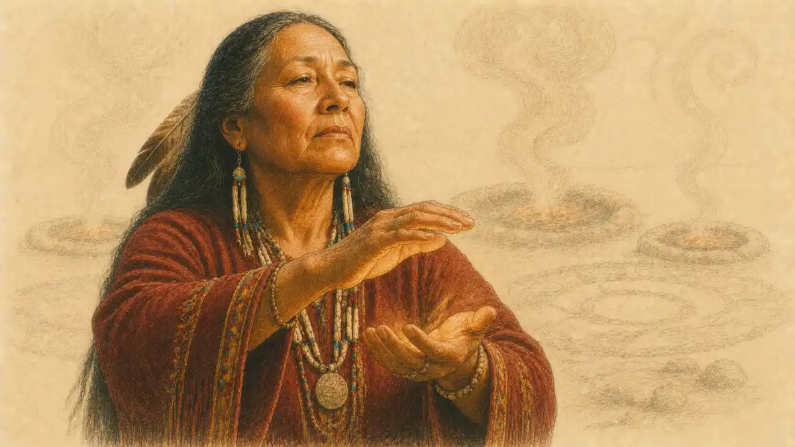

Every AP course has a center of gravity, and AP Art History has the most visible one in the entire program: a required image set of 250 works of art and architecture, drawn from every inhabited continent and from roughly thirty thousand years of human making. A student who finishes the course can walk from a Paleolithic cave wall to a contemporary installation without leaving the syllabus, and can explain not only what each work looks like but who made it, who paid for it, what it was for, and what its makers believed about the world. That double demand, recognition joined to interpretation, defines the exam and shapes everything about how the course should be studied. This guide builds the full model: the ten content areas that organize the 250 works, the regions and periods inside them, the two exam sections and the six free-response tasks, the scoring logic that converts performance into a 1 to 5, and a study path that treats context as the primary memory tool. Readers who want the wider program picture first can start with [the complete guide to AP exams](/2008/11/08/ap-exams-complete-guide/) and return here for the subject itself.

The course rewards a particular kind of attention. A required work is never only a picture to be named. Each of the 250 arrives with a maker or a culture, a material and a technique, a place and a function, and a set of meanings that the people who used it would have recognized. The exam tests all of those layers, sometimes in a single question, and it deliberately includes works that most students have never encountered before the course begins, from a Nukuoro female deity figure to a Marshall Islands navigation chart. Students who try to survive on flashcards of titles and dates discover that the exam keeps asking the second question, the one about purpose, belief, patronage, and change over time. Students who learn each work as a small argument about its culture find that the titles and dates take care of themselves, because a work anchored to its context is far harder to forget than a work memorized as an isolated image. That principle, context first and recall second, runs through every section of this guide, and the framework behind it is developed fully in [the AP Art History analysis framework](/2007/07/15/ap-art-history-analysis-framework/).

## A required set, a global map, and a single story

The 250 works are fixed by the course framework, which means every AP Art History classroom in the world works from the same core list. Teachers add local examples and museum visits around the edges, but the exam draws its images from the required set and from works chosen to be compared with it. The set is organized into ten content areas, and each content area pairs a region with a span of time, so the list reads as a map as much as a syllabus. Global Prehistory opens the course around 30,000 BCE. The Ancient Mediterranean follows. Europe then carries two long areas that run from late antiquity through the colonial centuries and on to the start of the twenty-first century. The Indigenous Americas, Africa, West and Central Asia, South, East, and Southeast Asia, and the Pacific each receive a dedicated area, and a final area gathers global contemporary work from 1980 onward. The architecture of the list is itself a teaching claim: no single tradition owns the history of art, and comparison across traditions is the discipline's basic move.

Scale is the first practical fact a student must absorb. Two hundred fifty works across a school year works out to roughly two new works per class meeting, every meeting, all year. Each work carries an identification: title or designation, name of artist or culture where known, date or period, and materials. Beneath the identification sits the larger body of knowledge the exam actually grades, which includes form, function, content, and context. A mosque lamp, a cathedral, a portrait mask, and a subway poster can sit in the same unit of study because the same four lenses apply to each. The course also insists on architecture as a full partner to painting and sculpture. Students analyze plans, elevations, and construction systems, not only facades, and they learn to read a building as evidence about labor, belief, and political power. By the end of the course, the 250 works function less like a list and more like a reference library that the student can search by period, by region, by material, by function, or by theme.

## The InsightCrunch Art History content map

The table below is the InsightCrunch Art History content map, the curriculum organized by region and period. Shares of the image set are approximate, drawn from the framework's published distribution, and they tell a student where the exam's weight sits before a single flashcard is made. Europe and its later extensions hold close to half the set. The remaining half is genuinely global, and the exam protects that balance by sampling every area.

| Content area | Region and period | Approximate share of the set | What the area asks of the student |
| --- | --- | --- | --- |
| Global Prehistory | Worldwide, 30,000 to 500 BCE | 4 percent | Reading images and objects made before writing, through material and site |
| Ancient Mediterranean | Near East, Egypt, Greece, Rome, 3500 BCE to 300 CE | 10 percent | Tracing how empires and city states used art to state power and belief |
| Early Europe and Colonial Americas | Europe and colonial Americas, 200 to 1750 CE | 20 percent | Following faith, monarchy, and exchange across the medieval and early modern worlds |
| Later Europe and Americas | Europe and the Americas, 1750 to 2001 CE | 26 percent | Tracking movements, revolutions, and modern media in rapid succession |
| Indigenous Americas | North, Central, and South America, 1000 BCE to 1980 CE | 6 percent | Reading works through land, ceremony, and continuity across conquest |
| Africa | African continent, 1100 to 1990s CE | 6 percent | Understanding art as action within ritual, kingship, and daily life |
| West and Central Asia | Islamic and Central Asian worlds, 500 BCE to present | 4 percent | Seeing pattern, calligraphy, and architecture carry meaning where figuration varies |
| South, East, and Southeast Asia | Asian traditions, 300 BCE to present | 8 percent | Balancing state, religious, and personal expression across vast regions |
| The Pacific | Oceania, 700 to 1980s CE | 4 percent | Reading navigation, genealogy, and ceremony in portable and built forms |
| Global Contemporary | Worldwide, 1980 to present | 12 percent | Analyzing work that questions media, identity, institutions, and the art object itself |

Reading the map vertically pays off quickly. A student can see that prehistory is small but foundational, that the two European areas together form the single largest block, and that the contemporary area is the second largest single block after Later Europe and the Americas. Reading the map horizontally pays off across the year: each row names a reading skill as much as a body of content. Prehistory teaches inference from material evidence. The Pacific teaches respect for knowledge systems encoded in objects rather than texts. West and Central Asia teaches that an art tradition can carry its deepest meanings through geometry, calligraphy, and the built environment. The content map is worth returning to at every stage of review, because a weak area on the map is a predictable weak area on the score report, and a balanced student deliberately studies against the pull of favorite periods.

### Why does the course span the entire world instead of one tradition?

Because art history as a discipline changed its mind about what counts as evidence, and the course follows the discipline. A survey confined to one tradition would teach students to mistake a regional style for a universal standard, leaving them unable to explain how forms travel and how cultures borrow under pressure.

The global design also serves the exam's favorite intellectual move, which is comparison. A comparison question gains its power from distance: two works that share a function across a wide cultural gap reveal what the function itself demands, while two works from neighboring traditions reveal what a culture chose. Students who have studied a Malagan mask from New Ireland beside a Chokwe Pwo mask from central Africa can talk about ancestors, performance, and gendered knowledge with real evidence in hand. Students who have studied only one tradition can talk about style. The exam grades the first conversation at a higher level than the second, and the content map's global reach is what makes the first conversation possible for every student in the room, regardless of which museum sits nearest the school.

## Content Area 1: Global Prehistory, 30,000 to 500 BCE

Prehistory poses the course's purest analytical problem, because the works arrive without texts, signatures, or written records of any kind. Everything a student claims about the Great Hall of the Bulls at Lascaux, painted around 15,000 to 13,000 BCE, must be argued from pigment, placement deep inside a cave system, scale, and the accumulated evidence of archaeology. The Apollo 11 stones from Namibia, among the oldest works in the set at roughly 25,500 to 23,500 BCE, prove that image making on portable stone began in Africa at the very start of the surviving record. The running horned woman at Tassili n'Ajjer in Algeria records a Sahara that was once grassland, which makes the painting evidence about climate as much as about ceremony. Students learn to hold interpretations loosely here, distinguishing what the object shows from what scholars infer, and that intellectual honesty becomes a graded skill across the whole exam.

The later prehistoric works widen the lens from image to construction and exchange. Stonehenge, raised in phases between about 3000 and 2000 BCE in England, required the movement of enormous stones across serious distances, which makes it evidence about social organization and coordinated labor long before any state appears in the region. The jade cong from Liangzhu culture in China, a squared tube with a circular bore worked from one of the hardest stones available, shows ritual value attached to labor intensive objects whose exact use remains debated. The beaker with ibex motifs from Susa demonstrates how a drinking vessel can carry a whole vocabulary of stylized animal form. A student who can explain why a Neolithic community would invest weeks of grinding labor into a single jade object understands something about value that applies equally to a Fabergé egg and a Benin bronze, and the exam knows it.

## Content Area 2: The Ancient Mediterranean, 3500 BCE to 300 CE

The ancient Mediterranean area is where art becomes an instrument of the state in documented form, and the works reward students who track patronage as carefully as style. In Egypt, the Palette of King Narmer, carved around 3000 to 2920 BCE, uses registers, hierarchy of scale, and composite view to narrate political unification as divine order. The seated scribe, carved and painted with startling naturalism around 2620 to 2500 BCE, shows that Egyptian art could relax its royal conventions when the subject stood lower in the hierarchy, which teaches students that style in Egypt was a language of rank. The Great Pyramids of Giza and the mortuary temple of Hatshepsut at Deir el-Bahari then scale the same language up to landscape, binding a ruler's afterlife to cosmic order through geometry and procession.

Greece and Rome convert that inheritance to new political uses. The Parthenon in Athens, built between 447 and 432 BCE under Iktinos and Kallikrates, refines temple architecture through entasis, curvature, and proportional systems while its sculpture program advertises Athenian identity. Polykleitos's Doryphoros embodies a written canon of ideal proportions, making it the set's clearest case of a work that illustrates a theory. The Alexander Mosaic, a Roman copy of a Greek painting, shows narrative compression at battle scale. The Augustus of Prima Porta turns a portrait into a policy statement, with a breastplate that argues diplomacy and divine ancestry in carved form. The Colosseum and the Pantheon close the area by demonstrating Roman engineering as spectacle and as theology: one organizes fifty thousand spectators through concrete vaulting, the other places a worshipper beneath an oculus that admits a moving disc of sunlight. Students who grasp how each regime reused earlier forms to claim legitimacy hold the key to the area's comparison questions.

## Content Area 3: Early Europe and Colonial Americas, 200 to 1750 CE

This is the largest of the early areas, and its teaching spine is the relationship between faith and image. Early Christian art in the Catacomb of Priscilla worked under conditions of minority status, using borrowed Roman forms to carry new meanings through symbols a hostile viewer would pass over. San Vitale in Ravenna and Hagia Sophia in Constantinople then show Christianity as state architecture: Hagia Sophia, built in 532 to 537 CE under Anthemius of Tralles and Isidorus of Miletus, suspends a vast dome on pendentives so that light seems to dematerialize the structure, while San Vitale's mosaics place Justinian and Theodora inside the liturgy as permanent participants. Chartres Cathedral, rebuilt from 1145 into the thirteenth century, organizes an entire theology into stone, glass, and sculpture, and its stained glass programs taught scripture to a largely nonreading congregation. The Bayeux Tapestry, an embroidery rather than a woven tapestry, narrates the Norman Conquest as justified history, reminding students that textiles can be political documents.

The Renaissance and Baroque centuries inside this area reward attention to revival and persuasion. Giotto's Arena Chapel frescoes in Padua restore weight, emotion, and spatial illusion to sacred narrative. The Arnolfini Portrait by Jan van Eyck builds a world of symbolic detail inside oil paint's new luminosity. Brunelleschi's dome for Florence Cathedral solves a structural problem that had stalled the building for decades, and Michelangelo's Sistine Chapel ceiling and David, Raphael's School of Athens, and Titian's Venetian painting together define the High Renaissance conversation about the human figure and classical antiquity. Bernini's Ecstasy of Saint Teresa then shows the Baroque answering with theatrical immersion, while Velázquez's Las Meninas turns court portraiture into a puzzle about who is looking at whom. The area closes across the Atlantic, where works such as the Angel with Arquebus from the Cuzco School show colonial Americas artists fusing European print sources with local materials and meanings, a fusion the exam treats as creation rather than copying.

## Content Area 4: Later Europe and Americas, 1750 to 2001 CE

No area moves faster. Within a single human lifetime at the start of this period, a student passes from David's Oath of the Horatii, with its Neoclassical demand that private feeling yield to civic duty, to Delacroix's Liberty Leading the People, where Romantic energy makes revolution itself the hero. Courbet's Burial at Ornans then refuses both polish and grandeur, insisting that a provincial funeral deserves the scale of history painting, and Manet's Olympia weaponizes a familiar pose by returning the viewer's stare with interest. Monet's Impression, Sunrise gave a movement its name through a critic's insult, and the area uses it to teach how loose brushwork and optical color became a theory of perception. Van Gogh's Starry Night and Cézanne's Mont Sainte-Victoire push in opposite directions from the same Post-Impressionist starting point, one toward expressive turbulence and the other toward structural order beneath sensation, while Seurat's A Sunday on La Grande Jatte builds a still, monumental scene from divisionist touches and social observation.

The twentieth century inside this area is a study in broken contracts. Picasso's Les Demoiselles d'Avignon fractures the figure and imports Iberian and African sculptural force into Parisian painting, and Guernica later converts monochrome distortion into an indictment of bombing civilians. Duchamp's Fountain argues that selection and context, rather than manufacture, can make art. Frank Lloyd Wright's Fallingwater and Le Corbusier's Villa Savoye offer rival modern houses, one grown from its site and one machined against it. Pollock's Number 1, 1950 (Lavender Mist) makes the act of painting the subject, Warhol's Marilyn Diptych turns celebrity and mechanical reproduction into a meditation on fame and death, Jacob Lawrence's Migration Series Panel no. 49 compresses a mass movement of people into a modernist visual shorthand, and works by Cindy Sherman and Jean-Michel Basquiat close the area by interrogating identity, photography, and the street as sources of form. Students should expect this area to dominate the exam simply because it dominates the set, holding roughly a quarter of the 250 works.

## Content Area 5: Indigenous Americas, 1000 BCE to 1980 CE

The Indigenous Americas area spans three thousand years and insists that the Americas held complex artistic traditions long before European contact, traditions that continued through conquest and into the present. Chavín de Huántar in Peru, a temple complex built and expanded between about 900 and 200 BCE, organized pilgrimage through labyrinthine galleries, hidden sculpture such as the Lanzón Stela, and engineered sound and water effects. The cliff dwellings of Mesa Verde, built by Ancestral Puebloan peoples in the thirteenth century, turn defense, climate, and community into architecture fitted to an alcove in the rock. Yaxchilán's carved lintels in the Maya world record dynastic ritual, including Lady Xoc's bloodletting vision, with a precision that binds image to hieroglyphic text. The Great Serpent Mound in Ohio, an effigy earthwork of debated date, shows sculpture practiced at the scale of landscape itself.

Conquest did not end these traditions, and the area's later works make that argument explicitly. The Aztec Sun Stone and the frontispiece of the Codex Mendoza carry Mexica cosmology and imperial administration in carved and painted form. Inka masonry at Cuzco and the terraced complex of Machu Picchu demonstrate a stone technology fitted to seismic ground, where precisely cut blocks without mortar have outlasted the empire that raised them. Featherwork, including the headdress associated with Moctezuma, treats iridescent quetzal feathers as a material of state value comparable to gold. In the twentieth century, Maria Martínez's blackware pottery from San Ildefonso Pueblo revived and refined a ceramic tradition into signed individual artistry, and Jaune Quick-to-See Smith's Trade (Gifts for Trading Land with White People) collages the history of broken treaties into a monumental contemporary canvas. The area therefore teaches continuity under pressure as a central theme, and comparison questions often pair its works with colonial or contemporary pieces to test whether students can see both rupture and survival in the same object.

## Content Area 6: Africa, 1100 to 1990s CE

African art in this course is taught as action: objects that do work inside ritual, government, healing, and remembrance rather than objects made primarily for display. The Great Mosque of Djenné in Mali, the largest mud brick building in the world, is replastered each year in a communal festival, so its maintenance is a social institution as much as a construction task. Great Zimbabwe's dry stone walls and conical tower announced a trading state's wealth in gold and imported goods. The Benin plaques from the Kingdom of Benin, cast in brass by specialist guilds, lined the royal palace with images of warriors, courtiers, and Portuguese traders, functioning as a visual archive of the court. The Golden Stool of the Asante, the Sika Dwa Kofi, is understood to hold the soul of the nation, which is why it is never sat upon and is treated as a living presence rather than furniture.

Sculpture and masquerade deepen the same lesson. Ndop portrait figures from the Kuba kingdom encoded individual kings through conventional emblems, joining memory to legitimacy. Nkisi n'kondi power figures from the Kongo accumulated nails, blades, and attached materials as oaths were sworn and disputes settled, so the object's surface is a record of its legal and spiritual use. The Chokwe Pwo mask honors female ancestors while being danced by a male performer, which opens a precise discussion of gender, embodiment, and who may represent whom. Aka elephant masks, Yoruba veranda posts carved by artists such as Olowe of Ise, Mblo portrait masks, and Lukasa memory boards from the Luba each demonstrate that form follows function inside specific institutions of knowledge. Students who describe these works only in terms of style have missed the point the exam keeps grading: in this area, context is not background to the object. Context is the object's operating system.

## Content Area 7: West and Central Asia, 500 BCE to the present

This compact area carries an outsized conceptual load, because it asks students to understand traditions in which calligraphy, geometry, and architecture bear meanings that figural traditions assign to bodies. The Treasury at Petra, carved into rose colored sandstone by the Nabataeans around 40 to 9 BCE, opens the area with a Hellenistic facade fronting a rock cut tomb in a trading city built on caravan wealth. The Kaaba in Mecca and the Dome of the Rock in Jerusalem then anchor Islamic sacred geography: the Dome of the Rock, completed in 691 to 692 CE, is the earliest surviving Islamic monument, its octagon and mosaic program announcing a new faith's presence in a city dense with older claims. The Great Mosque of Samarra in Iraq, with its spiraling Malwiya minaret, shows an Abbasid capital building at imperial scale in brick.

Portable works carry the area's argument about the word and the page. Folios from Qur'ans, written in angular Kufic script on parchment, treat the copied word as an object of devotion and craft, with gold illumination marking divine speech. The Baptistère de Saint Louis, an inlaid brass basin made by Muhammad ibn al-Zain in Mamluk Egypt or Syria, shows figural court imagery flourishing in metalwork even where religious settings avoided it, which teaches students to ask where an image appears before generalizing about a culture's rules. Illustrated folios such as Bahram Gur Fights the Karg from the Great Mongol Shahnama and The Court of Gayumars from the Shahnama of Shah Tahmasp display Persian painting's command of landscape, pattern, and narrative density. The Ardabil Carpet, dated 1540 and among the oldest dated Islamic carpets, turns a mosque floor into a garden of paradise through wool knots counted in the millions. Students leave this area able to explain aniconism as a situated practice rather than a blanket prohibition, which is exactly the nuance the exam's contextual questions reward.

## Content Area 8: South, East, and Southeast Asia, 300 BCE to the present

Three vast regions share this area, and the exam expects students to keep their traditions distinct while recognizing centuries of exchange along trade and pilgrimage routes. The Great Stupa at Sanchi in India, begun under Ashoka in the third century BCE and enlarged over generations, organizes Buddhist devotion as circumambulation around a solid mound, with carved torana gateways narrating the Buddha's life through symbols rather than a human figure in the earliest phase. Borobudur in Java rises as a walkable mandala of terraces, its reliefs guiding pilgrims upward through Buddhist teaching, while Angkor Wat in Cambodia began as a Hindu temple mountain for Vishnu and a model of Mount Meru before its later Buddhist life. The Shiva as Lord of Dance, a Chola dynasty bronze, condenses a theology of creation and destruction into a single balanced figure ringed by flame, cast by the lost wax method for processional use.

East Asian works pivot between state power and contemplative space. Todai-ji in Nara pairs imperial patronage with Buddhist monumentality in its Great Buddha Hall. The Longmen Caves in China carve dynastic devotion directly into a cliff face, and the Jowo Rinpoche in Lhasa, Tibet's most revered Buddha image, gathers pilgrims whose devotion has worn the statue's surface through centuries of touch and regilding. Fan Kuan's Travelers among Mountains and Streams makes a monumental hanging scroll in which tiny human figures move beneath a vast, textured mountainside, stating a Neo-Confucian sense of human scale within cosmic order. The Forbidden City in Beijing organizes an empire's ritual geography along a strict axis in timber and tile. Hokusai's Under the Wave off Kanagawa turns a woodblock print into a study of instability, with Mount Fuji small and still beneath a clawing wave. The Taj Mahal gathers Mughal resources into a tomb complex where white marble, inlaid stone, calligraphy, and charbagh gardens construct paradise on earth, and a twentieth century work such as Chairman Mao en Route to Anyuan shows revolutionary China inheriting oil painting for state narrative. The area rewards students who can separate a technique's origin from its later homes.

## Content Area 9: The Pacific, 700 to 1980s CE

The Pacific area is the smallest in the set, and students underestimate it at their cost, because its works test whether contextual analysis can operate where written art histories are thin and knowledge travels through objects, performance, and genealogy. Nan Madol in Micronesia, a city of artificial islets built from basalt logs stacked on a reef between about 1180 and 1500, demonstrates engineering and chiefly authority in a lagoon environment. The moai on ahu platforms on Rapa Nui, carved between roughly 1100 and 1600, embody ancestors whose presence faced inward over settlements, and their scale records competition among clans as much as devotion. The 'ahu 'ula, a Hawaiian feather cloak made from thousands of red and yellow feathers bound to a fiber net, concentrated chiefly mana in a garment whose production consumed years of specialized labor and the plumage of countless birds.

Other Pacific works encode knowledge systems directly. Marshall Islands navigation charts of lashed sticks and shells map swell patterns and island positions, functioning as teaching devices for an oral science of ocean travel rather than as maps to be carried at sea. Staff gods from the Cook Islands wrapped carved ancestral images inside barkcloth and feathers, so the visible bundle protected sacred power held within. The female deity figure from Nukuoro presents a smooth, abstracted body whose minimal features served offerings and invocation. Malagan carvings and masks from New Ireland were made for ceremonies that settled the affairs of the dead and validated rights, then were often left to decay once their work was done, which challenges students raised on permanence as a value. Hiapo barkcloth from Niue and Aboriginal Australian painting such as Emily Kame Kngwarreye's Earth Creation close the area by showing pattern as a carrier of land knowledge, law, and identity. A student who calls these works simple decoration has failed the area's central test.

## Content Area 10: Global Contemporary, 1980 to the present

The final area treats the whole world as one conversation and assumes the earlier nine areas as its vocabulary. Jenny Holzer's Untitled (Selections from Truisms) places short, conflicting aphorisms in public and electronic formats, forcing passersby to notice how authority sounds when slogans contradict each other. Nam June Paik's Electronic Superhighway: Continental U.S., Alaska, Hawaii outlines the United States in neon and video, arguing in 1995 that the nation's real connecting tissue had become broadcast media. Jeff Koons's Pink Panther pairs a pop icon with a pin-up figure in porcelain, using a craft medium's gloss to ask what taste, kitsch, and desire are worth. Yinka Shonibare's The Swing (after Fragonard) restages a Rococo flirtation with a headless figure dressed in Dutch wax fabric, so colonial trade histories interrupt a scene of aristocratic leisure. Christo and Jeanne-Claude's The Gates lined Central Park's paths with saffron fabric panels for sixteen days, making a temporary artwork whose manufacture, negotiation, and removal were part of its meaning.

The area also changes what counts as evidence in the course. Installation, performance documentation, video, and site specific work ask students to analyze context that includes the venue, the audience's movement, and sometimes the legal permissions behind the piece. Attribution questions in this area name individual living artists, and artists of the recent past, more often than anywhere else in the set, and comparison questions frequently pair a contemporary work with an older one, asking what the newer work quotes, corrects, or refuses. Students who treated the earlier areas as closed history find this area reopening them: a contemporary artist can reach back to a Benin plaque's politics or a folding screen's format and make the past answer new questions. The exam's final message is that art history is a living argument, and the contemporary area is where students are asked to join it with a full command of everything that came before.

## The exam format: two sections in a single sitting

The AP Art History exam runs three hours and divides into two equally weighted halves. Section I presents 80 multiple-choice questions in one hour. Section II presents six free-response questions in two hours. Each section contributes 50 percent of the reported score, which produces a balance unusual among AP exams: the writing half matters exactly as much as the selection half, and neither can rescue a collapsed performance in the other beyond a limited point. The multiple-choice section mixes single questions with sets. A set groups several questions around a small cluster of images, sometimes with a short passage, and asks students to identify, analyze, and connect the works shown. Some questions display works from the required set, others display works outside the set that students must reason about from style, culture, and context, and a few present images without identification precisely so that attribution skill can be measured.

The free-response section is built as a ladder of tasks. Two long essays open it, each with a suggested time of 25 minutes. The first long essay is a comparison built around a required work shown in the booklet, which the student must set against a self selected work addressing the prompt's theme. The second long essay asks for an argument about a broader issue or development in art history, supported by specific works. Four shorter essays follow, each with a suggested time of 15 minutes: a visual analysis of an unfamiliar or shown work, a contextual analysis, a comparison of two shown works, and an attribution task in which the student identifies a shown work's culture, period, or maker and defends the call with evidence. Suggested times are guidance rather than enforced cutoffs inside the section, and students manage their own two hours. Every free-response answer is read by trained faculty readers working from scoring guidelines that award points for accurate identification, valid claims, and specific visual and contextual evidence.

### How much writing does the exam actually demand?

More than most students expect, and less than strong writers fear. Six essays in two hours means short, dense arguments rather than polished papers: long essays of several developed paragraphs with works named and analyzed, short essays of a tight paragraph or two moving directly from claim to evidence.

That writing load explains why the course cannot be survived on recognition alone. A student may correctly name every image in the multiple-choice section and still cap the final score in the middle range if the essays stay vague. Conversely, a student with solid recognition and disciplined essay habits, naming dates, materials, patrons, and functions with confidence, converts knowledge into points at a high rate. The practical implication shapes the study advice later in this guide: practice must include timed writing about works, not only review of images, because the exam's second half grades the ability to build an argument under a clock. Students routinely report that the multiple-choice hour feels fast but manageable, while the free-response two hours separate prepared writers from prepared viewers. Both halves must be trained, and they must be trained differently.

## Section I in depth: the multiple-choice hour

Eighty questions in sixty minutes allows about forty-five seconds per question, which sounds severe until a student understands the set structure. Questions arrive in clusters, and the reading invested in one cluster's images pays off across three to five questions at once. The clusters test different operations. Identification questions ask which work is shown, or which artist, culture, or period produced it. Analysis questions ask what a formal feature does, how a material behaves, or why a composition directs the eye as it does. Context questions ask what a work was for, who commissioned it, or what belief it served. Connection questions ask how two shown works relate, differ, or descend from shared sources. A further family of questions places an unfamiliar work beside a required one and asks what can be inferred, which is where the exam most openly declares that it grades transfer rather than recall.

Strategy in this section is a matter of triage and trust. Students should answer in order, mark genuine uncertainties, and return only if the clock allows, because unanswered questions earn nothing and educated elimination raises the odds on the rest. The deeper discipline is perceptual: strong students have trained themselves to extract evidence from an image in seconds, checking material, viewpoint, scale cues, dress, script, and architectural vocabulary before reading any options. Weak students read the options first and let the distractors argue. Distractors in this exam are engineered from plausible errors, such as the neighboring period, the culture across the trade route, or the artist who influenced the shown maker, so a vague feeling of familiarity is a trap. The remedy is the identification spine: every required work learned with its title, maker or culture, date range, and materials becomes a fixed point, and unfamiliar works are then located by triangulation against those fixed points. That is the same skill the attribution essay grades at greater length, rehearsed eighty times in an hour.

## Section II in depth: six essays, six distinct jobs

Each free-response question grades a named skill, and students gain points by recognizing which job a prompt assigns before writing a sentence. The comparison long essay shows one required work and names a theme, then asks the student to select a second work, from any period or region, that speaks to the same theme. Scoring rewards a well chosen partner work, precise identification of both pieces, and a genuinely comparative structure in which similarities and differences both carry meaning. A frequent failure mode is the doubled mini essay, two descriptions stapled together, which earns credit for knowledge while forfeiting the comparison points that define the task. The second long essay poses a broad proposition about art history, such as how art responds to political change or how cultures in contact reshape each other's forms, and asks for an argued position with evidence. Strong answers take a clear stance, select works that genuinely test the stance rather than merely illustrating it, and concede complexity where the evidence demands it.

The four short essays each isolate one operation. Visual analysis gives a work, often with identification withheld or partial, and asks what its formal choices accomplish; the answer lives in line, color, composition, space, light, and the handling of the medium. Contextual analysis asks how a work's setting, patronage, audience, or belief system explains its form, and it punishes answers that recite generic history without tying facts to visible decisions. The paired comparison shows two works and asks for the significant relationships between them, which may involve influence, shared function, or deliberate contrast. The attribution task shows a work and asks the student to assign it to a culture, period, or artist and to defend the assignment with at least two specific pieces of evidence. Across all six tasks, scoring guidelines share a grammar: identification points for accurate naming, and analysis points for claims supported by named features and facts. The companion guide to [the AP Art History comparison essay](/2006/06/10/ap-art-history-comparison-essay/) develops the two comparison tasks at full length, and students aiming at the top score band should treat that essay family as a specialty worth separate drills.

## Scoring: how performance becomes a number from 1 to 5

The College Board converts the two sections into a composite and then into the familiar 1 to 5 scale, where 5 means extremely well qualified, 4 well qualified, 3 qualified, 2 possibly qualified, and 1 carries no recommendation for credit. The composite cut points shift a little from year to year as equating adjusts for the difficulty of a given form, which is why this guide states thresholds as ranges and patterns rather than fixed numbers. As a working pattern, a 5 generally requires earning roughly two thirds to three quarters of the available points across the whole exam, with the exact boundary moving by form. A 4 typically sits in the band below that, and a 3, the score most colleges treat as the floor for any recognition, generally requires something in the neighborhood of half the available points, again varying by year. Students who want the mechanics of the scale itself, and how colleges read each number, can consult the series overview of how the 1 to 5 scale is built and reported.

Two scoring features deserve emphasis because they shape preparation. First, there is no penalty for wrong answers in the multiple-choice section, so a blank response is a discarded opportunity. Second, free-response scoring is point based rather than holistic impression: readers award defined points for defined accomplishments, which means a student can know with unusual clarity what an answer must contain. An attribution answer, for example, earns its identification point only for a correct assignment, and its evidence points only for accurate, specific support. This architecture favors students who study the scoring guidelines of past exams, because the guidelines reveal precisely how an accomplished answer differs from a nearly accomplished one. It also means partial knowledge is bankable. A student unsure of a work's exact title can still earn analysis points by describing its culture, material, and function accurately, provided the claims made are true. Honest precision about what a work demonstrably is outperforms confident invention, since readers do not award points for fabricated specifics and invented facts can undermine credit for adjacent claims.

### What raw score is needed for a 5 in plain terms?

Think in fractions rather than points. A student who answers about three quarters of the multiple-choice questions correctly and writes essays earning a similar share of their points sits comfortably inside the historical 5 band on most forms. One strong section can carry a merely average partner section.

That arithmetic should calm one fear and sharpen another. The calming point is that no student needs to recognize all 250 works flawlessly, because the exam samples the set and the threshold tolerates error. The sharpening point is that the tolerance is spent quickly by systematic weakness: a neglected content area, an unpracticed essay type, or a habit of vague writing can each consume the margin on their own. Balanced preparation, spread across both sections and all ten areas, is therefore not a slogan but a scoring strategy. Students should also understand score reporting: scores arrive in July following the May exam, schools receive them for placement and credit decisions, and students control which scores are sent onward. The exam's difficulty is frequently debated among students, and the fairest summary is that the breadth is genuinely large while every individual task is learnable, which is why completion rates for the full syllabus, rather than raw talent, predict outcomes so well.

## The skills the exam measures, and how each is trained

The course framework names a set of disciplinary skills, and every question on the exam can be traced to one of them. Visual analysis is the foundation: the disciplined description of form, composition, materials, and technique, and the explanation of how those choices produce effects and meanings. Contextual analysis places a work inside its world of patronage, ritual, politics, trade, and belief, and argues from that placement back to the work's features. Comparison examines two or more works for significant similarities and differences and interprets what those relationships mean. Attribution assigns an unfamiliar or unidentified work to a maker, culture, or period using visual and contextual evidence. The study of artistic traditions tracks how forms persist and change inside a culture across time, and interpretation binds the set together: building a defensible claim about a work and supporting it with evidence a reader can check. Argument from evidence underlies all six, because the exam never pays for an unsupported opinion about art, however heartfelt.

Each skill has a distinct training method, and conflating them wastes effort. Visual analysis improves through slow looking at single works, ideally in timed five minute writing bursts that force observation before interpretation. Contextual analysis improves through paired study, where each work is reviewed with its function and patron stated aloud before its style is mentioned. Comparison improves through deliberate mismatch exercises, pairing works that share a function across cultures or a form across centuries. Attribution improves through unknown image drills, in which a student must commit to a culture and period and then defend the call with two named clues. Traditions are learned by arranging one culture's works in sequence and narrating the changes between neighbors. Interpretation improves through revision, taking a flat paragraph about a work and rewriting it until every claim touches a visible feature or a documented fact. A study plan that rotates these drills across the week will outperform a plan that simply rereads notes, because the exam samples all six skills while rereading trains only recognition.

## Visual analysis: reading a work before knowing it

Visual analysis begins with a refusal: the refusal to name the work before describing it. A student facing an unknown painting should first establish the facts of seeing. What fills the frame, and what is cropped or absent? Where does light originate, and what does it privilege? Are forms modeled smoothly or built from visible marks, and does space recede in measured steps or collapse toward the surface? In sculpture, the corresponding questions concern mass, surface, the play of solid and void, and how the object expects a body to move around or beneath it. In architecture, the student reads plan, elevation, structure, and the sequence of approach. This descriptive pass feels slow, yet it is what the exam's analysis points purchase, and it is also the raw material of attribution, since style is nothing more than patterned description compared across works.

The descriptive pass must then convert to claims. The point of noticing that Cézanne builds Mont Sainte-Victoire from discrete, hatched strokes is the claim that follows: the mountain becomes architecture, sensation reconstructed as structure. The point of noticing that the Pantheon's oculus is the dome's only light source is the claim that the interior stages a relationship between worshipper and cosmos. Students should practice the hinge word because: every formal observation followed by because and an effect doubles its value in an essay. Teachers call this the work's visual evidence, and readers scan for it. One further habit separates strong analysts from weak ones. Strong analysts name the medium's role. A bronze invites a discussion of casting and surface, a woodblock print invites a discussion of carved line and editioned multiples, and a woven textile invites a discussion of labor and pattern as structure. Medium is never a label to recite; it is a cause with effects, and treating it as one lifts answers across every question type on the exam.

### Which details in an image earn points fastest?

Identifying details earn points fastest: features that narrow a work to one culture, period, or maker with little ambiguity. A pointed arch with stained glass argues Gothic Europe. Registers with composite figures argue ancient Egypt. Students score quickly when they hunt for the two or three features that could belong almost nowhere else.

Building that instinct is a trainable project. Students can cover the labels on reproductions and practice announcing, for each work, the single most diagnostic feature and the runner up. A mud brick facade bristling with projecting wooden beams points to Djenné and Sudanic mosque construction. A dome resting on pendentives with a ring of windows at its base points to Hagia Sophia's Constantinople. Featherwork of saturated red and yellow points to Hawaiian chiefly regalia, while lashed sticks arranged in curves point to Marshall Islands navigation teaching. The habit generalizes: on the exam, the first feature a student notices in an unfamiliar work should be the feature least likely to be shared with another tradition, and the answer should be built around that feature before safer generalities are added.

## Contextual analysis: the habit that beats memorization

Contextual analysis asks what a work was doing in the world. The questions are concrete. Who commissioned this, and what did the patron gain? Where did the work live, and who encountered it there, under what rules of access? What ritual, political, or economic transaction did it serve? What did its material cost, and whose labor produced it? What did its audience already believe, such that this form would persuade them? The Parthenon changes meaning when a student learns it housed a treasury as well as a cult image, and that its frieze processed an idealized citizenry past the eyes of those same citizens. The Baptistère de Saint Louis changes meaning when a student learns that its courtly figures parade across a basin used for washing, made by a Muslim craftsman whose signature sits inside the decoration. Context is not a paragraph of background pasted beside an image. Context is a causal account of why the image looks as it does.

The exam grades this skill in a dedicated short essay and inside nearly every other task, because art history as a discipline rests on it. Students build it by attaching to each required work a compact context packet: function, patron or maker community, original setting, audience, and one belief or pressure that shaped its form. Five facts per work, held firmly, outperform fifty loosely held facts across ten works, because the exam samples broadly and rewards usable knowledge over hoarded knowledge. Cross cultural context matters as well. The course repeatedly places traditions in contact, through trade routes that carried Chinese porcelain and Persian textiles westward, through conquest that imposed European church forms on American materials and hands, and through colonial markets that moved Benin brass casters' products into European collections. A student who can narrate one such encounter in detail, naming what changed on each side, owns a template that fits dozens of possible prompts.

## Attribution: naming the maker, culture, and period from evidence

Attribution is the exam's most game-like skill and the one students either love or fear. The task presents a work, often outside the required set, and asks for an assignment: this culture, this period, possibly this artist. Points follow the assignment and its defense. The defense is the heart of the matter, since a lucky guess earns less than a reasoned miss in some scoring structures, and the guidelines ask for specific evidence. Evidence comes in layers. Material narrows the field first, since basalt, jade, ivory, feather, and mud brick each carry geographic probabilities. Technique follows, since lost wax casting, woodblock printing, true fresco, and cut stone masonry without mortar each belong to traceable traditions. Motif and iconography then refine the call, and conventions of figure, dress, script, and spatial construction complete it. The trained student narrates the narrowing, which is exactly the performance the readers reward.

Attribution also polices a common misunderstanding about how art historians work. Museum labels that read as certainties began as arguments from evidence, and many required works carry debated dates or attributions, which the course acknowledges rather than hides. The Great Serpent Mound's dating has been argued across centuries. Several prehistoric works are assigned by association with dated deposits rather than by direct evidence. Students who understand attribution as reasoned inference stop treating identification as a guessing game and start treating every image as a solvable problem. That shift in posture is worth real points in the multiple-choice section as well, because distractor options are usually wrong in identifiable ways: the material is impossible for the proposed culture, the date precedes the technique, or the motif belongs to the neighboring tradition that borrowed it later. Elimination grounded in evidence is attribution practiced at speed.

## Comparison: thinking in pairs

Comparison is the discipline's signature move, and the exam builds two full tasks around it while weaving comparative demands into the multiple-choice sets. A strong comparison is organized by ideas rather than by objects. The weak structure describes work A completely, then work B completely, then adds a sentence claiming they are similar yet different. The strong structure chooses points of comparison that matter, such as function, patronage, treatment of the body, or relationship to a sacred center, and argues each point across both works in turn. Under that structure, the Colosseum and a Maya ballcourt can sustain a serious comparison about spectacle and state power, while two madonnas separated by three centuries can sustain one about how a culture's theology of tenderness changed. What makes a comparison significant is a claim about why the similarities and differences exist, rooted in the works' contexts.

Students should build a small stock of reliable comparison axes and rehearse them until selection becomes fast. Function is the most versatile axis, since works that share a job across cultures expose both universal constraints and local choices. Material is the most concrete axis, rewarding students who know what bronze, marble, feather, and fiber each permit and forbid. Patronage exposes power. Scale exposes ambition and audience. Treatment of space, of the body, and of narrative each open dependable lines of argument. The self selected work in the long comparison essay should be chosen for the richness of its relationship to the shown work, not for the student's comfort alone, though comfort matters under time pressure. A work the student knows at the level of context packet, rather than title and date, is the only safe selection. Rehearsing three or four versatile pairings in advance, each genuinely comparative and each spanning distant regions, gives a student insurance against an unfamiliar prompt theme.

## The memorization question, answered honestly

Every prospective student asks whether AP Art History is pure memorization, and the honest answer has two halves. The first half concedes real ground: identification matters, and identification must be memorized. Two hundred fifty works, each with a title or designation, a maker or culture, a date range, and materials, form a body of fact that no reasoning skill can replace, because an essay about an unidentified work starts by surrendering points. Students who dislike factual learning on principle will feel the load, and pretending otherwise would be a disservice. The second half corrects the picture: memorization in this course is the floor rather than the ceiling, and the memorization itself works differently than students expect. A work learned with its function, patron, and meaning attached is learned once, as a story with a visual anchor. A work learned as an image with a caption is learned five times and forgotten four, because nothing holds it in place.

The exam's design enforces the distinction. Unfamiliar works appear throughout the multiple-choice section and in the free-response visual analysis, precisely so that a student cannot convert the course into a recognition contest. To score on an unfamiliar work, a student must deploy analysis: dating by style, placing by material, inferring function from form. That is the discipline of art history operating in miniature, and it means the highest scoring students are not the ones with the largest flashcards but the ones whose memorized works became training data for judgment. There is also a humane point buried in the design. Human memory is narrative by preference. The Nkisi figure with its accumulated nails is unforgettable once a student knows that each nail sealed an oath. The navigation chart is unforgettable once a student knows it encodes ocean swells rather than coastlines. Context is the most efficient memory technology available to a student of this course, and the exam quietly grades whether teachers and students discovered that fact.

## Materials and techniques across the set

A tour of the set by material reveals how much of art history is the history of substances. Stone teaches permanence and labor. Marble in Greek hands becomes flesh through carving and polish, while basalt in Micronesia becomes civic infrastructure, and precisely fitted Inka stone becomes a political claim about mastery over a seismic land. Bronze teaches casting traditions that link Chola temple processions, Benin palace walls, and Renaissance Florence through one technology of mold, wax, and poured metal. Gold teaches value and sacred light, from the Asante Golden Stool to Byzantine tesserae to the gilded surfaces that made divine presence visible in dim interiors. Fiber teaches patience and pattern: Asante and Ewe cloth, Niuean barkcloth, Andean featherwork, and the Ardabil Carpet all convert thousands of small decisions into a unified field of meaning, and they complicate any hierarchy that places painting above textile.

Wet and dry media carry their own logics. True fresco binds pigment into plaster and imposes speed and planning, shaping Giotto's scene divisions. Oil paint permits revision and luminosity, enabling van Eyck's microscopic symbolism. Woodblock and wood engraving make images multiple, which changes their social reach from Hokusai's Japan to the broadsides of the twentieth century. Photography arrives inside the set as both document and art, and video and neon extend the lesson into the contemporary area, where Paik's screens and Holzer's signboards treat commercial display technology as a medium with native grammar. Students should maintain a material index alongside the content map, a personal list of works organized by substance, because multiple-choice questions about technique and attribution questions about unfamiliar objects both reward material fluency. When an unknown object appears, its material is often the first honest clue, and a student who has thought in materials all year reads that clue instantly.

## Architecture: half the conversation

Architecture is not a garnish on this course. Roughly a third of the required works are buildings or built environments, and they demand a literacy of their own. Students must read a plan as a diagram of movement and hierarchy, understanding that a basilica's nave and side aisles organize crowds differently than a stupa's circumambulatory path or a mosque's courtyard and hypostyle hall. Structure must be legible too: post and lintel, arch, vault, dome on pendentives, flying buttress, timber frame, and stacked basalt each solve the problem of spanning and sheltering in a specific material culture, and each leaves a visible signature. Hagia Sophia's dome, Chartres's skeletal walls of glass, the Forbidden City's axial timber halls, and Fallingwater's cantilevered concrete trays can be arranged as a single argument about how societies distribute weight and meaning together.

Buildings also carry the course's strongest evidence about patronage and power, because they are the most expensive objects most societies produce. A student who asks who could command the labor for Great Zimbabwe's walls, the marble for the Taj Mahal, or the steel and site for the Vietnam Veterans Memorial's granite cut has hold of the contextual thread. Setting matters equally: Nan Madol rises from a lagoon, Machu Picchu keys its masonry to mountain sightlines and solstice events, and Mesa Verde's dwellings shelter inside a cliff's thermal shadow. Site specific analysis prevents the common error of treating buildings as portable objects with roofs. For study purposes, each architectural work deserves a plan sketch in the student's notes, however rough, because drawing a plan forces the spatial understanding that a photograph of a facade conceals. Exam images of buildings include plans and details often enough that this habit pays direct dividends, and the contextual essay becomes far easier to write about a building whose circulation the student can picture from above.

## Patronage, power, and the question of who paid

Behind nearly every required work stands a transaction. A pharaoh commissions eternity. A city state votes funds for a temple that doubles as a treasury and a boast. A bishop raises a cathedral to house a relic and the pilgrims it draws. A shah orders a carpet whose scale advertises both devotion and resources. A dealer, a museum, and a market shape what a contemporary artist can afford to make. Teaching students to ask who paid, and what the payer received, converts art history from a parade of styles into a history of decisions, and the exam's contextual questions are built on that conversion. Patronage explains scale, since cost follows ambition. Patronage explains iconography, since programs flatter, legitimize, or instruct on the patron's behalf. Patronage even explains survival, since works housed by durable institutions outlast works the market or the climate discarded.

The course is equally careful about makers who worked outside elite patronage or against it. Folk and ritual objects in the African and Pacific areas were sustained by communities and specialists whose names went unrecorded, which is itself a fact about how those societies organized making. Named individual artists emerge unevenly across the set: medieval masons are often anonymous while their cathedrals are famous, whereas contemporary works attach to personalities as a condition of the market. Colonial works complicate authorship further, since the Angel with Arquebus was painted by an Indigenous or mestizo artist working inside a Spanish commission structure, and naming that structure honestly matters more than inventing a biography. Students should practice a balanced formula: state what is known about maker and patron, state what the work did for each, and mark speculation as speculation. Readers trained in the discipline reward that precision, and the habit protects students on unfamiliar works, where the safest claims concern function and audience rather than invented biographies.

## Exchange: how forms travel and what travel does to them

Cultures in this course are never sealed. Buddhism carried the stupa from India to the pagoda forms of East Asia, transforming a solid mound into tiered timber architecture while preserving the relic at its heart. Islamic trade carried calligraphic and geometric vocabularies across three continents, where local materials reinterpreted them in brick, tile, and carved stucco. European prints crossed the Atlantic in missionary luggage and reappeared in Cuzco painting with Andean flora and local faces inside European compositions. Japanese prints reached Paris in the nineteenth century and altered how European painters cropped, tilted, and flattened their scenes. African sculpture reached Picasso's studio and altered the course of European modernism, a debt the course expects students to name precisely, including which formal qualities traveled and which meanings were stripped away in transit.

Exchange questions reward students who can hold two truths at once: borrowing is universal, and borrowing is never innocent of power. Conquest, missionization, colonial markets, and museum collecting all moved objects and forms under unequal conditions, and the course's later areas ask students to discuss those conditions directly, particularly where sacred or funerary objects now sit in distant collections. Shonibare's headless aristocrat in Dutch wax fabric, itself a product of Indonesian technique, Dutch manufacture, and West African markets, condenses the whole theme into one costume. The practical study move is to keep a short list of documented encounters, each with dates, direction of travel, and a named formal consequence. Six to eight such encounters, mastered in depth, give a student material for the second long essay and for contextual questions across every area, because the exam returns to contact and exchange as one of its organizing ideas.

### How do unfamiliar works appear on the exam, and how should a student approach them?

Unfamiliar works appear as multiple-choice stimuli, as the visual analysis essay subject, and as attribution material, and they are chosen to be solvable. Each shares a tradition, technique, or function with required works, so the approach is systematic: establish material and technique, read the conventions, infer function, and place the culture and period.

The psychological side matters as much as the method. Students who expect the exam to consist only of memorized images experience an unfamiliar work as a betrayal, and panic burns the minutes the method needs. Students who have practiced with unknowns all year experience the same image as the exam's most honest question, the one that measures art history rather than rehearsal. Teachers build that calm by seeding every quiz with one unannounced work, and self studiers can build it by testing themselves on museum collection images outside the set. The goal is a reflex: unknown does not mean unknowable. Every tradition in the course has fingerprints, and the year is spent learning to read them under gradually increasing time pressure.

## A study system built on context cards

The unit of study in this course should be the context card, whether physical or digital. One side carries the image, large enough to show the features that matter. The other side carries the identification spine and the context packet: title or designation, maker or culture, date range, materials, and then function, patron or community, original setting, and one or two meaning bearing facts. Students should build cards as the course proceeds rather than in a panic at the end, because card writing is itself the deepest encoding pass most students ever give a work. Review then follows a spacing rhythm: new cards return within days, stable cards return at widening intervals, and problem cards return relentlessly until they stabilize. Digital flashcard systems automate the spacing; paper systems can approximate it with boxes sorted by confidence. Either way, the card's context side is what separates this course's review from the caption drilling that fails students in May.

Volume management decides whether the system survives contact with a real schedule. A student facing ten new cards a week can sustain the load; a student who postpones card making until fifty works have piled up cannot. The remedy is a weekly rhythm pinned to the class calendar, with one session for building, several short sessions for review, and one timed writing session that converts recognition into essay material. Practice questions belong inside that rhythm from early in the year rather than as a final phase, because question formats teach what to notice in the works themselves. Students can work through [free AP History practice questions](https://reportmedic.org/tools/ap-history-practice-questions.html) alongside classroom materials to build pacing and question reading habits for the history exams generally, then return to art specific sets for image based drills. Mixing question sources matters less than mixing question types: identification, analysis, context, and comparison should all appear each week, mirroring the exam's own blend.

## Building a study set from the 250 works

A flat list of 250 works overwhelms because it hides every relationship that makes the works memorable. A study set earns its name when the works are cross indexed. Students should be able to pull the set by content area for coverage review, by century for tradition questions, by material for technique questions, by function for comparison questions, and by theme for the long essays. Themes worth pre building include images of rulers and legitimacy, sacred spaces and how they organize bodies, death and commemoration, the body as ideal and as real, art made for trade and encounter, and art that argues with earlier art. Each thematic cluster of eight to twelve works, drawn from at least three content areas, becomes a ready made evidence bank for the second long essay and a reservoir of partner works for the comparison essay. Building clusters is slow work, and it is the highest value slow work in the course, because it converts the syllabus from a warehouse into an argument kit.

The set should also be tiered honestly. Every student develops a personal A tier of works known cold, at identification plus full context level, and the goal across the year is to push the A tier toward the full 250. A B tier holds works identified reliably with partial context, and a C tier holds the residue that a student recognizes without commanding. Review time should be allocated to move C tier works upward rather than to polish favorites, a discipline that runs against instinct and pays in score. Students should mark, for each work, the two facts they would write first in an essay, because that micro summary becomes the retrieval cue under pressure. One further device helps disproportionately: photograph or print the works at varied sizes and crops during review, since exam reproductions differ from textbook plates, and a student who knows a work only at one scale may fail to recognize a detail view of the same object.

## A calendar that respects the school year

Pacing the course across roughly thirty weeks leaves a workable structure. The first weeks belong to prehistory and the Ancient Mediterranean, where the core vocabulary of form and the identification spine are established. Europe's two large areas then occupy the year's center of gravity, interleaved with the Indigenous Americas so that colonial encounters can be taught while both sides are fresh. Africa, West and Central Asia, and South, East, and Southeast Asia fill the middle months, and the Pacific pairs naturally with the Asian areas for comparative discussion of navigation, ancestors, and portable wealth. Global Contemporary closes the sequence, when students hold enough historical vocabulary to hear its quotations and refusals. Four to six weeks before the exam, new coverage ends and the course turns to synthesis: thematic clusters, timed essays, unknown image drills, and full practice sections under exam conditions. Students constructing their own review calendar can adapt the structure in [the AP exam study plan](/2008/09/19/ap-exam-study-plan/), scaling its weekly review blocks to the 250 work load described here.

Assessment inside the year should mirror the exam's proportions long before May. Quizzes that sample only the newest area teach coverage but not retention, while cumulative quizzes that always reserve a share of questions for earlier areas teach the exam's actual demand. Teachers who weight a small number of long essays across the year give students the feedback loop that writing skill requires, and students should seek that loop even in courses that underweight it, by writing timed practice essays and self scoring them against released guidelines. Released exams and scoring guidelines from the College Board are the gold standard for this work, since they show real prompts, real student samples, and the readers' commentary on both. A student who has studied two or three past free-response sets closely knows the difference between an answer that describes and an answer that argues, and that knowledge transfers to every new prompt.

## Seeing works: reproductions, scale, and the museum problem

Nearly everything in this course is studied through reproduction, and honest teaching names the distortions that follow. A projected slide flattens a Chola bronze and a cathedral wall to the same glowing rectangle, erasing the two facts a viewer in person could never miss: the bronze fits a procession's hands, and the cathedral governs a body's movement for an hour. Scale is meaning in this discipline. The Great Stupa reads differently once a student grasps that circumambulation is a walk measured in minutes, and a Lukasa memory board reads differently once a student grasps that it fits in two hands and speaks through touch. Students should therefore annotate every card with dimensions and one sentence about bodily relationship: held, worn, entered, circled, processed past, or viewed from below. That sentence restores what the slide removes, and it arms the contextual essay, where scale is frequently the evidence that ties form to function.

Museum visits, where geography permits, repair the remaining distortions: weight, surface, and the choreography of display. A single afternoon spent comparing a real marble's chill and polish against a real textile's fragility teaches more about material than a week of definitions. Virtual collections fill the gap for students far from major museums, and most large museums publish collection images with curatorial notes that model the language of attribution and context. The exam itself acknowledges the reproduction problem by choosing images that survive it: clear views, telling details, and plans where plans carry the meaning. Students can return the courtesy by practicing with less flattering images, angled views, details, and black and white plates among them, so that recognition attaches to the work rather than to one famous photograph of the work. A work known from three views is known; a work known from one postcard is borrowed.

## Writing about art: vocabulary, evidence, and the shape of an answer

Art historical writing runs on a shared vocabulary, and fluency in it is a scoring asset. Students need precise terms for composition and space, for techniques from encaustic to lost wax to screenprinting, for architectural members from lintel to lantern, and for the social facts of patronage, iconography, and syncretism. Precision is rewarded twice over: the right term conveys a paragraph of description in a word, and its correct use signals to a reader that the analysis rests on training. The opposite habit, evaluative fog, is the most common point leak in student essays. Sentences calling a work beautiful, powerful, or interesting without evidence earn nothing, and they consume the lines in which evidence could have stood. Every evaluative word in a draft should trigger a student's suspicion and a demand: show the feature, name the effect, cite the context.

The shape of a strong short answer is stable enough to memorize. Open with the claim or identification the prompt requests. Support it with two or three pieces of specific evidence, each tied to a visible feature or a documented fact. Close by stating the significance the prompt asks for, whether that is function, meaning, or relationship. Long essays extend the same skeleton: a defensible thesis, body paragraphs organized by idea, works introduced with full identification at first mention, and a conclusion that answers the prompt's actual question rather than summarizing the paragraphs. Identification at first mention is a mechanical rule with scoring consequences, since readers award identification points where the work is named with its maker or culture and date. Students should rehearse the full identification as a single breath, title, artist or culture, date, medium, until it costs no thought. What remains, the thinking, is what the exam exists to grade.

## Common mistakes and the points they cost

The most expensive mistake in the course is the one the misconception section named: studying for recognition and arriving at an exam that grades analysis. Its close cousin is the regional blind spot, in which a student masters favorite areas, usually the European ones, and treats the Pacific, Africa, or West and Central Asia as garnish, only to meet an essay cluster drawn from the garnish. A third mistake is date panic, the belief that a work is unusable without an exact year. The framework asks for dates at the level of period and approximate range for most purposes, and a student who can place a work within its culture's sequence and century usually holds enough chronology to earn the points on offer. Precision about the wrong things, such as memorizing exact dimensions while ignoring function, is a fourth leak, produced by study materials that mistake trivia for knowledge.

Essay specific mistakes repeat with instructive regularity. Students describe when the prompt asks them to analyze, compare one work when the prompt demands two in conversation, and select a partner work for the long comparison that shares only a subject rather than an arguable relationship. Attribution answers name a culture without evidence, or offer evidence that fits three cultures equally. Contextual answers recite a civilization's history without touching the work's features. Timing mistakes compound the content ones: the multiple-choice hour lost to three stubborn questions, or a first long essay that consumes the time of two. Each mistake has a drill that repairs it, and the repair is always specific: timed unknowns for attribution, paired outlines for comparison, context packets for contextual thinness, and hard per question budgets for pacing. Students who keep an error log from practice tests, sorted by mistake type rather than by topic, discover their personal pattern within a month and can aim their remaining study at the pattern itself.

## Exam day: pacing three hours with images

The multiple-choice hour rewards a metronome. Forty-five seconds per question is the average the math imposes, and set based clusters allow banking time on fast identifications to spend on harder analysis. A workable discipline is two passes: answer everything answerable on first contact, flag the rest, and use the final minutes only on flagged items, changing an answer only when new evidence rather than anxiety argues for the change. No question should hold a student hostage, because three questions surrendered to one puzzle is a trade the exam wins. The free-response section rewards a plan made before writing begins. Ten minutes spent reading all six prompts, choosing the self selected comparison work, and sketching point lists for each essay is the highest yielding time in the entire exam, since it prevents the mid essay discovery that a chosen example cannot carry the argument. Budgets should follow the suggested times, twenty-five minutes for each long essay and fifteen for each short one, with a reserve of several minutes held for the attribution task, which tends to expand when a student starts genuinely reasoning.

Physical and procedural details are unglamorous and decisive. Students should know the room rules from their school's administration, bring approved materials only, and treat the booklet images as documents to annotate: circling the diagnostic detail, sketching the plan, and marking the comparison axis in the margin all convert looking into writing material. Students who wear a watch with a simple timer, where permitted, manage the section change without depending on proctor announcements. Fatigue management matters across three hours of looking and writing, and the break between sections is for water, movement, and deliberate forgetting of the first hour's regrets. Scores are built in the second section by students who can leave the first behind. Finally, students should write legibly and identify works fully at first mention even under pressure, because a reader can only award points for knowledge the reader can find on the page.

## Credit, placement, and what colleges do with the score

Colleges treat AP Art History as a humanities credential, and its most common conversions are elective credit, placement out of an introductory survey, or satisfaction of a general education requirement in the arts or humanities, depending on the institution's rules and the score earned. Scores of 3 are accepted for some form of credit at many institutions, while selective colleges often set the bar at 4 or 5 or grant placement without units. Art history, studio art, architecture, and design programs may read the score as evidence of visual literacy and commitment, though portfolio based programs continue to judge studio potential by the portfolio itself. The general mechanics of thresholds, caps, and departmental variation are covered in the series guide to [AP credit policies at colleges](/2008/10/07/ap-credit-policies-colleges/), and students should check target institutions individually before assuming a conversion.

The score's value is not exhausted by credit arithmetic. The course teaches a transferable literacy: reading images critically in a culture saturated with them, arguing from visual evidence, and understanding how societies unlike one's own have organized belief and power into form. Those capacities serve students in history, literature, law, medicine's image based specialties, design, marketing, and any field where evidence arrives as pictures. Admissions readers also know the course's reputation for breadth, and a strong score signals a student who handled a genuinely global syllabus with a heavy writing load. None of this requires a student to love every period equally. It requires the score to certify what the exam measures, which is why the credit conversation and the study conversation in this guide keep returning to the same skills.

## Who thrives in this course, and an honest word about difficulty

AP Art History suits students who like systems of meaning: students who enjoy history but want it tangible, who read images in daily life with suspicion and pleasure, or who are considering fields from museum work to architecture to media. It also suits strong writers in search of a humanities AP with a concrete syllabus, because the 250 works give preparation a finish line that open ended subjects lack. Students who struggle are usually those who enroll expecting a gentle elective and meet a survey course with a college pace, or those whose schools compress the syllabus into a semester. Difficulty in this course is breadth difficulty: no single work is conceptually hard, yet the accumulation is relentless, and a student who falls three content areas behind faces a recovery measured in weeks. Reading level matters as well, since the exam's passages and prompts assume fluent academic reading, and the essays assume a student can sustain an argument in writing.

Workload comparisons help families decide. Students commonly rank the course as demanding in memorization volume, moderate in conceptual difficulty, and generous in interest, since the material ranges from cave paintings to protest art. A student carrying several other AP courses should count the weekly card building and review time honestly, roughly an hour of maintenance for every two hours of class at the course's steady pace, more in the final synthesis weeks. The course rewards consistency more than brilliance, and its outcomes are unusually predictable from study habits, which students tend to experience as fairness. Those who begin in September with the context card system and never let the backlog form almost always reach May with the full set in command. Those who cram meet an exam designed, at every level, to detect cramming.

## Self-studying AP Art History without a classroom

The course can be self studied, and its fixed image set makes it more self studiable than most AP subjects, because the syllabus cannot hide. A self studier needs four assets: the official course framework with the image set, a strong survey text or open museum resources for context, a card system built from the first week, and a writing feedback source, which can be released scoring guidelines studied closely enough to self score with honesty. The calendar matters more without a teacher's pacing, and the self studier should adopt the area sequence in this guide and defend the synthesis weeks in spring against the temptation to keep adding coverage. Museum digital collections supply the images, and several major museums organize online galleries by culture and period in ways that map cleanly onto the ten content areas.

The risks are predictable. Without classmates, comparison practice withers, so the self studier should manufacture it by writing paired outlines weekly. Without deadlines, card building slips, so external structure, a weekly quota reviewed by a friend, a tutor session, or a school check in, protects the system. Without a reader, essays drift into description, and the antidote is ruthless use of released guidelines, scoring one's own timed essays a week after writing them, when the author's pride has cooled. Exam registration runs through a school that offers the exam, arranged in the fall, and self studiers should confirm a seat early since art history is offered at fewer sites than the largest AP subjects. The payoff for the organized self studier is real: the exam cannot distinguish a classroom student from a prepared independent one, and the image set's fixed boundaries mean preparation can genuinely be finished.

## Themes that organize the whole course

Certain themes recur so persistently across the ten areas that they function as the course's hidden table of contents. Art and power appears wherever a ruler's image standardizes an empire, from Narmer's palette to Augustus's breastplate to the Forbidden City's axis. Sacred space appears wherever communities build their cosmology at full scale, in stupas, cathedrals, mosques, and cliff dwellings alike. The body as a site of meaning runs from the Doryphoros canon through Chola bronze dance to Sherman's performed identities. Death and memory gather works as different as pyramids, Ndop portraits, Malagan carvings, and the Vietnam Veterans Memorial into one conversation about how the living keep the dead present. Trade and encounter explain forms that appear where no local ancestry predicts them. Nature and the sacred landscape bind Travelers among Mountains and Streams to Machu Picchu and Fallingwater. Students who index their study set by these themes hold the second long essay in their hands before the prompt is read, because nearly every broad proposition the exam poses is one of these themes wearing a question's clothes.

The themes also discipline breadth into coherence at review time. A student in April does not relearn 250 works one by one. The student walks the themes and checks which works can be summoned under each, which areas are missing from each theme's evidence, and which works refuse to sit still under any theme and therefore need individual attention. That audit converts anxiety into a list, and lists can be finished. Teachers build the same audit into capstone discussions, asking a class to defend a theme with one work per content area, which exposes thin regions instantly. The exam's architecture quietly assumes this thematic fluency: the comparison essay's theme, the long essay's proposition, and many set based clusters all presuppose that a student can think across the map rather than merely along it. The content map organizes knowledge by where and when. The themes organize it by why it matters. A complete student keeps both maps open at once.

## Reading a work cold: one full demonstration

Consider how a prepared student meets an unfamiliar image: a manuscript painting showing a ruler enthroned beneath a canopy of leaves, attended by courtiers rendered smaller than the central figure, with architecture reduced to a patterned backdrop and the whole scene framed by dense floral borders. The descriptive pass notes the flattened space, the hierarchy of scale, the minute surface pattern, and the integration of figures into ornament. The material pass identifies a painted folio, pigment on paper, made to be held and viewed closely in a bound book. The convention pass recognizes Persian court painting habits, the enthronement subject, and the possibility of the Shahnama tradition of illustrated kingship narratives. The contextual pass then argues function: an image of ideal rule made for a royal patron, in which the ruler sits as the still center of a fertile, ordered world, and the painting's beauty itself testifies to the court's resources and refinement. The attribution follows with confidence hedged to the evidence: Persian, likely Timurid or Safavid era, fifteenth or sixteenth century, with style markers named. Whether the work proves to be The Court of Gayumars or a cousin folio matters less than the chain of reasoning, each link of which the scoring guidelines can see and reward.

That demonstration compresses the entire course into five moves, and it is worth practicing until the moves become automatic. Notice that nothing in the chain required the work to have been memorized. Everything in the chain required other works to have been memorized well, with their contexts attached, since the conventions recognized in the stranger were learned from required folios studied properly. This is the deepest answer to the memorization question: the 250 works are not the exam's content alone. They are the training set from which a student learns to read the thirty first work's worth of evidence in any image the exam can present. Students who internalize that relationship stop asking whether a given work will be on the test, a question with no useful answer, and start asking what a given work teaches about reading, a question that compounds in value all year.

## The final month: a synthesis protocol

The last four weeks before the exam have a different job from the rest of the year, and treating them as more coverage is the final strategic error available to a student. Coverage is done. The month's work is conversion: turning stored knowledge into timed performance. A sound protocol runs on a weekly cycle. One full multiple-choice section under time, scored and autopsied by question type. Two timed long essays and four timed short essays across the week, self or peer scored against released guidelines. Two unknown image sessions, run as pure attribution and analysis drills. One thematic audit, walking the major themes and noting which works surface and which areas stay silent. Card review continues but changes character: the student now speaks each answer aloud as an essay paragraph in miniature, claim, evidence, significance, rather than merely recognizing the image. Scores on practice sections should be converted into the composite ranges discussed in the scoring section, so the student watches the number that matters rather than a raw count.

The autopsy step deserves emphasis because it is where the month's gains live. Every missed multiple-choice item should be classified before the next practice set begins: unknown work, known work with forgotten context, misread question, or distractor trap. Each class has a different remedy, and only the first is fixed by more review. Essay autopsies compare the student's answer against the guidelines point by point, marking where an identification was incomplete, where evidence went unnamed, and where significance was asserted rather than argued. Students usually discover that their losses cluster in one or two repairable habits, which is the best news the final month can deliver. The protocol ends with logistics: confirm the exam site and time, assemble permitted materials, and protect sleep in the final days, since visual memory and writing fluency are both sleep sensitive. Students arrive with a plan for each section, a stock of rehearsed comparisons, and a calm built from having already sat the exam several times in practice.

## The verdict on AP Art History

AP Art History is the AP program's most ambitious act of faith in breadth: a single course claiming that a student can hold thirty thousand years of world making in one mind and argue about it under time pressure. The claim survives because the course is honest about its method. A fixed set of 250 works bounds the breadth. Ten content areas give the set a map. A small family of skills, practiced relentlessly, converts looking into analysis, and analysis into points. The exam then samples fairly, rewarding the student who learned works as arguments about their cultures and declining to reward the student who learned them as pictures with captions. For students who enjoy history they can see, who write willingly, and who want a humanities credential with genuine global reach, the course offers one of the strongest returns in the catalog. Its demands are plain and its finish line is visible from the first week, which is more than most hard courses can say. Begin with the content map, build context cards from the first work onward, write about art every week, and the 250 works stop being a threat and become what the framework intended: a portable museum, carried in memory, that a student will keep using long after the score report arrives. There is a final, quieter dividend worth naming. A student who completes this course walks through the built world differently afterward, reading a courthouse, a mosque, a subway mural, and a war memorial as documents with authors, patrons, and arguments, and that habit of informed attention is the one outcome no score report can capture and no college application can fully list.

## Three works that teach the whole course

Some required works are so densely instructive that a student who masters them owns a template for dozens of others. San Vitale in Ravenna is one. Its centralized plan, its apse mosaics of Christ between angels and saints, and its famous paired panels of Justinian and Theodora with their retinues compress the area's entire argument into one building: imperial power and Christian worship fused into a single visual system, with mosaic's gold ground dissolving architecture into heavenly light. Read San Vitale well and Hagia Sophia becomes legible by contrast and Chartres by descent, since the comparison axes, plan, light, patronage, and image program, are already in hand. The second template work is the Nkisi n'kondi power figure. Nothing in the European tradition prepares a student for an object whose meaning accumulates through use, whose surface records legal and spiritual transactions, and whose power depends on materials sealed inside it by a ritual specialist. Mastering the Nkisi recalibrates a student's default assumptions about authorship, permanence, and where a work's life happens, and every African and Pacific work on the set becomes more legible afterward.

The third template work is Shonibare's The Swing (after Fragonard), chosen because it teaches the contemporary area's methods in a single installation. The work quotes an eighteenth century painting students already know, removes the figure's head, and dresses the mannequin in fabric whose own biography crosses Indonesia, the Netherlands, and West Africa. Every skill the exam grades fires at once: visual analysis of pose and staging, contextual analysis of trade and empire, attribution habits applied to a quotation, and comparison across two and a half centuries. A student who can write about The Swing for fifteen minutes without repeating a sentence can write about anything in Content Area 10, and probably about anything in the set. Teachers build capstone lessons around such works for a reason. Templates do not replace coverage, but they organize it, and organization is what a student retrieves under pressure.

## Whose art counts: makers, gender, and the edges of the record

The set quietly teaches a history of who gets remembered. Early areas are dominated by anonymous makers, not because their societies lacked individual talent but because their institutions recorded patrons rather than artists. The course marks the exceptions with care: the signed Baptistère of Muhammad ibn al-Zain, the Yoruba master Olowe of Ise whose veranda posts carry a recognizable personal hand, and Maria Martínez, whose signatures on San Ildefonso pottery registered a market shifting from communal craft to named artistry. Gender runs through the set as subject and as maker. The Pwo mask honors women while being danced by men. Theodora's panel asserts a female ruler's presence inside a sanctuary she never visited. Artemisia Gentileschi's Self-Portrait as the Allegory of Painting claims the personification of the art itself for a woman painter working in a profession structured against her, and students are expected to analyze how that claim is staged. Later areas widen the lens: Sherman's film stills dismantle stock female roles by performing them, and the Guerrilla Girls' interventions, discussed in classes as context for the contemporary area, turn the museum's own statistics into a medium.

Students should handle these questions with the same evidence discipline as any other. The exam rewards claims about representation that point to features: who is shown, at what scale, in what posture, with what attributes, for whose eyes. It does not reward importing a ready made lecture, because the set's works resist single readings. A feather cloak is chiefly regalia and also the product of labor by many hands, largely women's hands in fiber preparation, and a strong essay can hold both facts. The sophisticated position, that art records power while occasionally arming the powerless, emerges from the works rather than being imposed on them, and readers can tell the difference between an argument grown from evidence and one applied from outside. That difference is, once again, the difference the whole exam grades.

## Sacred objects, living traditions, and respectful analysis

A significant share of the 250 works remains sacred to living communities, and the course expects analysis that respects that fact without abandoning rigor. The Jowo Rinpoche is not a historical artifact to its pilgrims. The Golden Stool is not a symbol to the Asante; it is a presence with prohibitions attached. Navigation charts, memory boards, and masks encode knowledge that descendant communities may regard as restricted, and some Pacific and Indigenous works in the set were made for ceremonies whose details are not public property. Art historical method has language for this: students describe what a work does within its tradition, cite what scholars and community voices have made public, and avoid inventing ritual specifics to fill an essay's gaps. The scoring guidelines support the discipline, since invented detail earns nothing wherever it appears, and a precise statement of a work's function, stated at the level the evidence supports, earns its points honestly.

This posture strengthens rather than limits analysis. A student who writes that the moai embodied ancestral presence for Rapa Nui communities, and that their toppling recorded social upheaval on the island, has said something true, specific, and arguable. A student who fabricates a ceremony says something weaker at greater length. The same discipline serves students in the museum, where labels increasingly name source communities and repatriation questions, topics the contemporary area treats as part of art's present life. Students who complete the course tend to leave it with two habits that outlast the exam: looking longer before concluding, and asking whose object this is before asking what it means to them. The exam cannot grade those habits directly at scale, but the essays give both of them room to show.

## AP Art History beside the other history courses

Students choosing among history electives often ask how this course differs from the document based history APs, and the honest comparison clarifies both. The history courses build arguments from texts: documents, data, and historiography. Art History builds arguments from objects, with texts in a supporting role. The evidentiary instinct differs accordingly. A history student asks who wrote a source and why. An art history student asks who made an object, from what, for whose use, and how its form argues its case. The comparison essay and the document based question are cousins, both demanding a thesis defended with marshaled evidence under time pressure, but the evidence in one is quoted and in the other is seen. Students who have taken a prior history AP usually find the argument skills transfer completely while the evidence skills must be rebuilt around looking, and students who take Art History first often find later history courses easier in structure and harder only in reading volume.

Sequencing advice follows from that comparison. Art History pairs productively with a world history course, taken before, alongside, or after, since each supplies the other's missing half: chronology and political narrative from one, material and visual depth from the other. It also pairs well with studio art for students who make things, because technique learned by hand becomes attribution evidence on paper, and several of the course's strongest students report that throwing a pot or stretching a canvas reorganized how they read the set. What Art History does not pair well with is absence: the course's cumulative design punishes a late start more than most, and counselors do students a service by steering mid year transfers toward subjects with modular structures. For students deciding where the course fits a four year plan, the deciding questions are appetite and calendar. Appetite for looking, reading, and writing in roughly equal thirds, and a calendar with room for steady weekly maintenance, predict success better than any prior grade.

## Inside a well run classroom year

From the student's seat, a well run year has a recognizable texture. Lessons move between slow looking at one work and rapid comparison across several, so that depth and breadth train in alternation. Writing appears weekly in miniature, a paragraph here and a timed short answer there, long before the first full essay arrives. Quizzes sample backward as well as forward, keeping September's prehistory alive in February. The teacher's deepest contribution is sequencing the encounters: placing the Nkisi after the reliquaries it can be misread as resembling, placing Shonibare after Fragonard has been genuinely learned, placing the comparison drills after enough works exist to compare. Students in less structured classrooms can reproduce the texture independently by imposing the same alternation on their own weeks: one deep work, one cluster, one timed task, one backward sampling, repeated without exception.

The classroom's other asset is other eyes. Discussion surfaces readings a solitary student misses, because twenty students looking at the same façade will notice twenty different facts, and the pooling of observations is the fastest visual analysis training ever devised. Students should treat seminar disagreement as data: when two readings of a work conflict, the resolution almost always lives in a feature both parties overlooked, and finding it is the discipline in action. Field trips, guest talks by conservators or architects, and handling sessions with teaching collections serve the same end. None of this is decoration on the course. The exam's unseen images and comparative demands mean that a student trained only on lectures has trained for a narrower test than the one administered in May, while a student trained in communal looking has rehearsed the exam's actual cognitive work all year.

## Chronology: how much precision is enough

Students chronically overinvest in exact years and underinvest in sequence, and the exam's design suggests the reverse priority. What the questions actually require is placement: before or after the neighboring landmark, inside the correct period and culture, and in the right relationship to the works it influenced or answered. A student who knows that San Vitale's mosaics precede Chartres by six centuries, that Olympia answers Titian across three, and that the Great Wave belongs to a nineteenth century print culture feeding European modernism holds the chronology the exam spends. Exact dates matter most where the framework itself makes them load bearing, such as works defined by a political moment, and for the famous anchors that organize whole areas. The identification spine therefore asks for date ranges rather than single years for most works, and students should learn ranges with the same seriousness as titles.

Sequence also functions as an attribution tool. An unfamiliar work that quotes a known work must postdate it, and a technique's invention closes off every earlier century at a stroke. Students can drill sequence directly by shuffling twenty cards from one area and rebuilding the line, narrating each transition aloud: what changed, what persisted, and what pressure explains the change. The narration is the point. A chronology held as a story of decisions, rather than a ruler of years, survives the exam room's pressure and transfers to unfamiliar material. Teachers call the underlying knowledge period style, the recognition that a century has a visual accent. Accents are learned by immersion and corrected by sequence drills, and they are what the attribution essay, at its core, examines.

## A worked pass through a multiple-choice set

Watch a prepared student handle a typical set. The booklet shows three images: a rock cut facade with classical columns, a spiraling minaret in brick, and a manuscript page of angular gold script. The first question asks which pairing of cultures produced the first two works. The student does not read options yet. The facade's rock cut tomb form plus Hellenistic orders announces Nabataean Petra, trade wealth carving Greece's vocabulary into Arabian stone. The spiral minaret announces Abbasid Samarra and its Malwiya. Both are West and Central Asian area anchors, and the pairing resolves the question before the distractors, Egyptian and Roman, Byzantine and Persian, can argue their partial resemblances. The second question asks what the gold script page demonstrates about its culture's values. The student's context packet for Qur'an folios answers directly: the copied word as sacred object, calligraphy as the supreme visual art in religious settings, gold marking divine speech. The third question asks which statement about the facade is accurate, and the student's knowledge that Petra's Treasury fronts a tomb, not a treasury, and that its classicism arrived through trade rather than conquest, eliminates three options that each contain one plausible error.

The demonstration's lesson is that sets reward preparation in layers. Identification settles some questions outright. Context packets settle others. Error detection, the ability to spot the single false clause inside an otherwise true statement, settles the rest, and it is trained by writing practice questions as well as answering them: a student who has composed distractors knows how they are built. Time discipline held throughout, three images read once and used three times, which is why set based sections of the exam feel faster than their question counts suggest. Students should practice whole sets as units rather than drilling isolated questions, because the exam's economy is set shaped, and the student who reads a cluster's images deeply at the start collects interest on every question that follows.

## The image set as a designed argument

A fixed list of 250 works is itself an interpretation of art history, and strong students learn to read the list as critically as they read the works. The set argues that no region owns the story, that architecture and portable objects deserve equal standing, that sacred and political functions explain more art than self expression does, and that the story does not end in Europe or in 1900. The distribution on the content map is the argument in numbers: Europe and its extensions hold close to half the set, which acknowledges the depth of that record and the location of many surviving monuments, while the other half enforces the global claim with works many students would never otherwise meet. Debates about inclusion are part of the discipline, and the contemporary area's rapid turnover shows the canon being argued in public. Anyone who can articulate what the set emphasizes, and what a differently drawn set might reveal, has understood something the exam's long essay quietly hopes to hear: that selection is interpretation, in a syllabus as surely as in a museum.

The number itself deserves a thought. Two hundred fifty is large enough to prevent the course from becoming a highlights reel of one tradition and small enough to be genuinely mastered in a school year at two works a day. The works were chosen as representatives and as anchors: representatives that stand for a culture's broader production, and anchors that other works can be compared against. That dual role explains the exam's use of unfamiliar images, which are almost always satellites of the anchors, near enough to be reasoned about and far enough to test the reasoning. A student preparing well therefore studies each anchor for its satellite generating power, asking what a second work from the same culture, a generation later, in a cheaper material, for a different patron, would be likely to look like. That single question, asked across all ten areas, manufactures the transfer the exam grades.

## Detail views, second views, and the discipline of looking twice

Exam booklets rarely show a work the way a postcard does. Buildings arrive with plans and interior views. Sculptures arrive from the angle that exposes the argument. Paintings arrive with details enlarged, sometimes cropped to the passage where the meaning concentrates. Students trained on single frontal images experience these presentations as new works, which is why varied view review is a scoring practice rather than a refinement. For every architectural work, the student should know the plan cold and be able to walk the building mentally from entrance to focal point. For every sculptural work, the student should know what the back and sides confess that the front conceals. For every famous painting, the student should know two details well enough to identify the whole from either fragment.

Looking twice is also a reading strategy inside the exam room. The first look establishes category: medium, culture, period, subject. The second look hunts the graded evidence, the diagnostic detail and the feature that ties form to function. Students who budget the second look into their per question rhythm convert several guesses per set into reasoned answers, and the conversion is worth more than any single fact memorized in April. Teachers model the habit by projecting a detail before the whole, forcing identification from a fragment, and the exercise is easily copied in solo review by cropping images on a phone or covering a card with a hand. The discipline generalizes beyond the exam, which is the course's quiet boast: a student who has learned to look twice at a façade, a mask, and a manuscript page will look twice at everything visual for the rest of a life, and will be harder to fool in all of them.

## When a work will not stick: troubleshooting memory

Every student collects a residue of works that refuse to stay learned, and the residue is diagnostic rather than shameful. A work will not stick when its card carries no story, when it resembles a neighbor too closely, or when it was learned in a batch of similar images that blurred together. Each cause has a targeted repair. The storyless work needs its context packet rebuilt around the strangest true fact available, since oddity is memory's handle: the mosque rebuilt by communal festival each year, the stool that holds a nation's soul, the garden with no plants but stone and raked gravel. The confused pair needs a dedicated contrast card that names the discriminating features side by side, because interference between similar works, two Gothic cathedrals, two ink landscapes, two portrait masks, dissolves only when the difference is stated explicitly. The blurred batch needs relearning in a new order, interleaved with works from other areas, so each image is retrieved by its own features rather than by its position in a sequence.

Persistent failures sometimes trace to the image itself rather than the student. A work known from one small reproduction may simply never have been seen clearly. Enlarging the image, studying a detail, or watching the object handled in a museum video can supply the missing encoding in minutes. Another honest cause is sequencing debt: a work first met during an absence or a rushed week enters the deck without its lesson, and no amount of review repairs a foundation that was never poured. The repair is to relearn it as new, with full context, rather than to keep failing it as review. Students should track their residue list by name across the spring, because the list shrinks predictably under targeted repair, and a student who watches forty problem works fall to twelve has measured proof that the system works, which is the best available fuel for the final weeks.

## Resources beyond the textbook, ranked by what they repair

A student's shelf should be built backward from weaknesses. The framework document and the official image set repair uncertainty about scope, and they outrank every commercial product because the exam is written against them. A solid survey text repairs narrative gaps, giving each area a story arc that isolated cards cannot supply, and it should be read in area sized sittings rather than grazed. Museum collection sites repair image quality and curatorial language: their entries model attribution reasoning, list alternate views and details, and often include the provenance discussions the contemporary area expects. Released exams with scoring guidelines repair calibration, the student's sense of what a point buying answer actually contains, and no other resource substitutes for them in the spring. Video walkthroughs of buildings repair spatial understanding for students who cannot visit, and a slow camera path through Hagia Sophia or along Sanchi's railing teaches circulation in a way no plan alone achieves.

What a shelf does not need is volume for its own sake. A second test preparation book duplicating the first adds little beyond new practice questions, and question quantity without guideline study can entrench vague answer habits. Social media decks and shared card sets carry a specific risk in this subject: an error in a shared deck, a wrong date, a misattributed culture, replicates silently into hundreds of reviews, so borrowed cards should be verified against the framework before adoption. The guiding principle is that every resource must either add evidence, add images, or add feedback. Material that only rephrases what a student already owns consumes the scarcest asset in the course, which is not money or even intelligence but the weekly hours in which 250 works can be turned, steadily and with context attached, into a portable museum. One more resource deserves a deliberate place on the shelf: a sketchbook or its digital equivalent, kept not for beauty but for thinking, in which plans, details, and figure studies are drawn badly and therefore honestly. Drawing a capital, a dome section, or a mask's profile forces decisions about proportion and structure that looking alone postpones, and students who sketch even clumsily report that certain works become unrecognizable as strangers afterward, because the hand has learned what the eye had only visited.

## A note on names, dates, and honest approximation

Students sometimes worry that the course demands false precision, and the framework is more humane than the worry suggests. Many required works carry date ranges rather than years because the evidence supports ranges: a cave painting dated by the deposits around it, a mound whose construction phases scholars still debate, a mask assigned to a century by style and collection history. The identification spine honors the evidence by teaching the range, and exam questions are written to the same standard, asking for period and culture where a year would be a guess. Where a date is exact and load bearing, a dated carpet, a building raised in a documented five year campaign, a photograph of a datable event, the course expects the year and rewards the student who supplies it. Learning which kind of date each work carries is itself art historical knowledge, since it records how the discipline knows what it claims to know.

Names deserve the same care. Some works carry artists' names, some carry culture names, and some carry the names of places, patrons, or the museums that hold them, and the differences among those labels are information rather than inconsistency. A work designated by culture signals a tradition in which individual attribution was not recorded or not valued in the European sense. A work designated by a descriptive title, such as a power figure or a navigation chart, signals that the object's own culture named it by function. Students who read designations this way stop experiencing the anonymous half of the set as a memory defect and start experiencing it as evidence about how societies organize making. That reading habit is worth points in attribution and contextual tasks alike, and it is one more place where the course's central lesson repeats: the label is part of the work, and attention to it is analysis, not clerical work.

## Frequently Asked Questions

### Q: What is the format of the AP Art History exam?

The exam has two sections in a single three hour sitting. Section I contains 80 multiple-choice questions answered in one hour, mixing single questions with sets built around clusters of images and short passages. Section II contains six free-response questions answered in two hours: two long essays with suggested times of 25 minutes each and four short essays with suggested times of 15 minutes each. Images in both sections are reproductions, sometimes shown as details, plans, or multiple views. Every question draws on the course's required image set of 250 works or on unfamiliar works chosen so that students can reason about them using the set as a reference.

### Q: What are the 250 required works on AP Art History?

The 250 required works form the course's official image set, a fixed list of paintings, sculptures, buildings, photographs, textiles, and objects spanning roughly thirty thousand years and every world region. The set begins with Paleolithic works such as the Apollo 11 stones and the cave paintings at Lascaux and ends with global contemporary installations. Each work carries an identification of title or designation, artist or culture where known, date or period, and materials. The exam reproduces works from the set and also presents related unfamiliar works, so the list functions as both the content to learn and the training ground for analyzing art beyond it.

### Q: How is the AP Art History exam scored?

Each section contributes 50 percent of the composite score. Multiple-choice answers earn one point each with no penalty for wrong answers, so blanks gain nothing. Free-response answers are read by trained faculty readers who award points defined in scoring guidelines for accurate identification, defensible claims, and specific visual and contextual evidence. The composite is converted to the 1 to 5 scale, with 5 meaning extremely well qualified and 3 generally treated as the threshold of qualification. Cut points are set after each administration through equating, so the raw performance behind each reported score shifts slightly between forms of the exam.

### Q: How hard is AP Art History?

The difficulty is breadth rather than depth of any single topic. No individual work is conceptually forbidding, yet the syllabus covers 250 works across ten content areas and thirty thousand years, and the exam adds a heavy timed writing load. Students consistently rank the memorization volume high and the conceptual difficulty moderate. Outcomes track study systems more than talent: students who build context rich review materials steadily across the year and practice timed essays find the exam demanding but fair, while students who cram meet unfamiliar images and essay types designed to expose shallow preparation. A realistic verdict is challenging, cumulative, and very learnable.

### Q: What content areas does AP Art History cover?

Ten content areas organize the course. Global Prehistory covers worldwide art from 30,000 to 500 BCE. The Ancient Mediterranean runs from 3500 BCE to 300 CE across the Near East, Egypt, Greece, and Rome. Early Europe and Colonial Americas spans 200 to 1750 CE, and Later Europe and Americas runs 1750 to 2001 CE. The Indigenous Americas covers 1000 BCE to 1980 CE, Africa covers 1100 to the 1990s CE, West and Central Asia runs 500 BCE to the present, South, East, and Southeast Asia runs 300 BCE to the present, the Pacific covers 700 to the 1980s CE, and Global Contemporary gathers work from 1980 onward.

### Q: How long is the AP Art History exam?

The exam lasts three hours in total. Section I allows one hour for 80 multiple-choice questions, which averages about forty-five seconds per question, though set based clusters let students bank time on quick identifications. Section II allows two hours for six free-response questions, with suggested pacing of 25 minutes for each of the two long essays and 15 minutes for each of the four short essays. A short break separates the sections. Students manage their own time within Section II, so a pacing plan matters: readers award no extra credit for an overlong first essay purchased with the final question's minutes.

### Q: What raw score is needed for a 5 on AP Art History?

No fixed raw score exists, because cut points are set for each form of the exam after administration. As a working pattern drawn from released scoring information, a 5 generally requires earning roughly two thirds to three quarters of the total available points across both sections combined. A student answering about three quarters of the multiple-choice questions correctly and earning a similar share of free-response points sits comfortably inside the historical band for a 5. Strength in one section can offset a mid range performance in the other, but a collapsed section is almost impossible to outrun, which is why balanced preparation matters more than brilliance in one format.

### Q: Do colleges give credit for AP Art History?

Many colleges grant some recognition, most often elective credit, placement out of an introductory art history survey, or satisfaction of a general education requirement in the arts or humanities. Policies vary widely by institution and sometimes by department. Scores of 3 are accepted for credit at many schools, while more selective colleges commonly require a 4 or 5, and some grant placement without units. Because the value of the same score ranges from a full course of credit to nothing at all depending on the college, students should check the published AP policy of each target institution rather than assuming a conversion.

### Q: How much memorization does AP Art History require?

A substantial amount, and it is honest to say so. The identification layer of 250 works, each with a title or designation, maker or culture, date range, and materials, must be committed to memory because essays and multiple-choice questions presuppose it. Memorization alone, however, caps a score well below the top range, because the exam includes unfamiliar works and grades contextual analysis, comparison, and attribution. The encouraging fact is that memorization gets easier when each work is learned with its function, patron, and meaning attached. Context acts as a memory scaffold, so the analytical approach and the memorization load turn out to be the same work done once, properly.

### Q: What skills does the AP Art History exam test?

The exam tests a defined family of art historical skills. Visual analysis covers disciplined description of form, composition, materials, and technique, and explanation of their effects. Contextual analysis connects a work to its patronage, function, setting, and beliefs. Comparison examines relationships between works and interprets their significance. Attribution assigns works to makers, cultures, and periods from evidence. The study of artistic traditions tracks change and continuity within cultures, and interpretation binds the family together by building claims about works and defending them with evidence. Multiple-choice questions sample all of these at speed, while each free-response question is built around one or two of them.

### Q: How is the AP Art History exam split between multiple choice and free response?

The split is exactly even by weight. Section I, the multiple-choice section, contributes 50 percent of the composite score through 80 questions in one hour. Section II, the free-response section, contributes the other 50 percent through six essays in two hours. The even split has practical consequences for preparation: a student cannot compensate for neglected writing with perfect identification, because half the score is written, and cannot compensate for weak recognition with eloquence, because the essays presuppose identified works. Study time should roughly mirror the weighting, with image review and timed writing both present every week rather than assigned to separate seasons of the year.

### Q: Is AP Art History worth taking?

For students who enjoy history, images, and writing, the course is among the strongest values in the AP catalog. It delivers a genuinely global survey that most students would never assemble on their own, builds visual literacy and evidence based argument that transfer to many college majors, and can earn humanities credit or placement at many colleges. The fixed set of 250 works gives preparation a clear finish line. The costs are real: a heavy cumulative memorization load and six timed essays. Students who want a light elective should look elsewhere, but students willing to study steadily usually judge the exchange worthwhile, and many report the course changed how they see museums, cities, and images generally.

### Q: How do you study the 250 works for AP Art History?

The most reliable method is the context card system. For each work, record the identification spine of title, maker or culture, date range, and materials, then add a compact context packet: function, patron or community, original setting, and the beliefs or pressures that shaped its form. Build cards as the course proceeds, review them on a spacing rhythm that returns new cards quickly and problem cards relentlessly, and cross index the set by material, function, and theme so comparison and essay questions can draw on it. Add timed writing weekly, because recognition that cannot become an essay paragraph earns nothing on half the exam. Finish with unknown image drills to train analysis beyond the memorized set.

### Q: What global regions does AP Art History cover?

The course is deliberately worldwide. Its ten content areas include Europe across two long periods, the Ancient Mediterranean world of the Near East, Egypt, Greece, and Rome, the Indigenous Americas from ancient to modern times, Africa, West and Central Asia, South Asia, East Asia, Southeast Asia, and the Pacific islands of Oceania, closing with a global contemporary area that draws artists from every continent. Roughly half the image set sits outside the European tradition, and the exam samples all areas, including the smallest. Works range from Namibian painted stones and Marshall Islands navigation charts to Japanese woodblock prints and Malian mud mosques, so regional balance in study is a scoring requirement, not a preference.

### Q: What is the best way to start preparing for AP Art History?

Start with the map rather than the flashcards. Learn the ten content areas and what each asks, using an overview such as the InsightCrunch Art History content map, so every work encountered afterward has a place to land. Then begin the context card habit with the first works of the course, capturing function and patronage alongside titles and dates from day one, because retrofitting context onto memorized captions is far harder than learning both together. Add two routines early: slow looking, in which one work receives five minutes of pure description before any interpretation, and one short timed paragraph of writing per week. Students who install the system in September rarely need heroics in April.

### Q: How do you memorize images and attributions for AP Art History?

Memorize in layers rather than in bulk. First fix the identification spine for each work: title or designation, maker or culture, date range, and materials. Then attach the features that make the work recognizable and attributable, meaning the two or three visual details that could belong almost nowhere else, such as pendentives under a dome, registers with composite figures, or lashings and curves in a stick chart. Review with image only prompts that force retrieval instead of recognition, mix the order constantly so sequence cannot substitute for knowledge, and practice on details and alternate views. Attribution improves fastest through unknown image drills, where each attempt must end with a culture, a period, and two named clues defended aloud.

### Q: What free-response question types appear on AP Art History?

Six tasks appear in a fixed family. The first long essay presents a required work and a theme, and asks for a comparison with a second work the student selects from anywhere in the course. The second long essay poses a broad proposition about art history and asks for an argued position supported by specific works. Four short essays follow: a visual analysis of a shown work, a contextual analysis tying a work to its setting and function, a comparison of two shown works, and an attribution task asking the student to assign a work to a culture, period, or artist and defend the assignment with evidence. Suggested times are 25 minutes for each long essay and 15 for each short essay.

### Q: How do you compare two works of art on AP Art History?

Organize by ideas rather than by object. Choose points of comparison that carry meaning, such as function, patronage, material, scale, treatment of the body, or relationship to a sacred or political center, and argue each point across both works in turn. Identify both works fully at first mention, with maker or culture and date. Alternate evidence between the works inside each paragraph instead of writing two separate descriptions, and keep asking why a similarity or difference exists, grounding the answer in each work's context. End by stating what the relationship reveals, whether influence, shared purpose across cultures, or deliberate contrast. A comparison succeeds when removing either work would break the argument.

### Q: How do you pace the AP Art History exam sections?

In the one hour multiple-choice section, hold an average near forty-five seconds per question, answering on first contact, flagging stubborn items, and returning only with leftover time, since blanks earn nothing. Read set images once and deeply, because several questions draw on the same cluster. In the two hour free-response section, spend the first minutes reading all six prompts, selecting the self chosen comparison work, and sketching point lists before writing. Follow the suggested budgets of 25 minutes per long essay and 15 per short essay, protect a small reserve for the attribution task, and leave nothing blank: partial, accurate knowledge earns defined points under the scoring guidelines.

### Q: How do you build a study set from the 250 works in AP Art History?

Build the set as a cross indexed system rather than a flat list. Start with one context card per work carrying the identification spine plus function, patron or community, setting, and meaning. Then index the same works several ways: by content area for coverage checks, by century for tradition questions, by material for technique questions, by function for comparisons, and by theme for the long essays, with clusters on power, sacred space, death and memory, trade and encounter, and the body. Tier the set honestly into works known cold, works identified with partial context, and works merely recognized, and spend review time moving the lowest tier upward. A study set built this way answers questions the exam actually asks.
