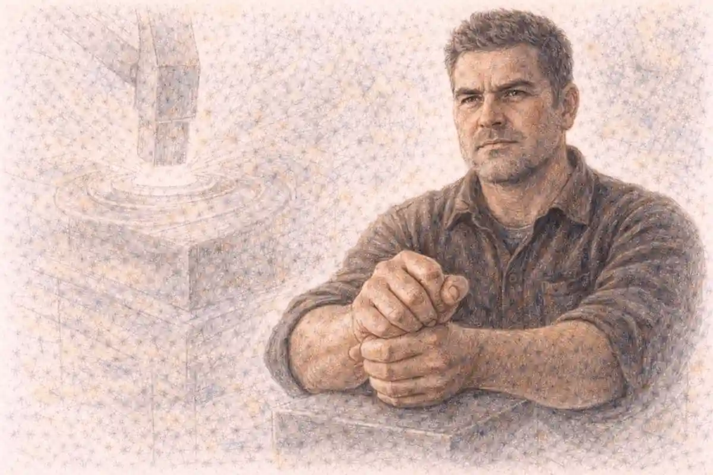

Five and a half centuries separate a Medici banker counting florins in Florence from a commuter tapping a transit card in Berlin, and AP European History asks students to hold that entire span in one mind at once. The course begins around 1450, with printing presses spreading across the continent, Ottoman armies pressing against its eastern edges, and Atlantic voyages about to redraw every map in Europe. It ends in the present era, with a union of European states sharing a currency, open borders, and arguments about what Europe means. Between those poles lie the Reformation and the wars it ignited, the rise of absolute monarchs and the revolutions that answered them, factories that rebuilt society from the ground up, two world wars of industrial scale, a cold war that split the continent in two, and a long, uneven project of integration. A student who treats that span as a warehouse of facts will drown in it. A student who learns to trace themes across the centuries, watching how power, belief, money, and identity keep rearranging themselves, discovers that the course has a shape. This guide exists to hand over that shape whole: the periods and units, the themes and skills, the four question types, the scoring machinery, and a study path that builds thematic reasoning instead of rewarding recall alone.

Everything in the sections ahead answers to one conviction, stated plainly at the start so that every later recommendation can be judged against it. European History rewards tracing themes across centuries, so studying continuity and change beats memorizing rulers. The exam was redesigned around that conviction. Its multiple-choice questions arrive attached to sources that must be read, not recognized. Its essays pay for argument, evidence, and context rather than for inventories of names. Its rubrics reserve their highest rewards for students who can explain why a development happened, what it resembled in another century, and what stayed constant while everything around it moved. Readers who absorb the format sections of this guide, then the period sections, then the scoring sections, will finish with a working model of the whole test: what it contains, how each part is weighted, which skills earn the points, and where preparation time buys the largest return. The guide also confronts the misconception that shadows this course more than any other, the belief that success means swallowing an endless procession of names and dates. That belief is understandable, and it is wrong, and understanding why it is wrong changes how a student should study from the first week of the school year.

## What the course is, and why it is built the way it is

AP European History is a college-level survey taught in high schools, modeled on the introductory modern European history course that universities offer to first-year students. The College Board frames it as an investigation of cultural, economic, political, and social developments from approximately 1450 to the present, and the word investigation carries weight. Students are expected to analyze historical sources, weigh evidence, and construct arguments, the same work a university seminar demands, scaled to a school year. The course framework organizes content into nine units grouped inside four chronological periods, threads seven recurring themes through every unit, and names six historical thinking skills plus three reasoning processes that the exam scores directly. Nothing on the test is decorative. Each multiple-choice set hangs on a passage, map, image, or chart. Each essay rubric point corresponds to a named skill. A student who learns the framework learns the exam's values, because the framework and the exam were built from the same blueprint.

Breadth explains much of the course's reputation. Nine units in roughly thirty-six weeks of instruction means a new configuration of Europe every month: Renaissance courts and Reformation pulpits in the autumn, absolute monarchies and Enlightenment salons by winter, factories, empires, and total war by spring. Teachers pace the year knowing that the final units compete with review time, and students feel the squeeze most in Period Four, where two world wars, a cold war, decolonization, and integration all demand attention. The framework answers the squeeze by insisting on connections. A unit on industrialization revisits the state-building theme from the absolutism unit; the integration unit revisits the nationalism that the nineteenth century weaponized. Content repeats in altered forms, which is precisely why thematic study compounds in value while isolated memorization decays. Every fact learned inside a theme becomes a hook for the next unit's facts.

Placement within a student's program matters as well. Schools typically offer the course to sophomores, juniors, or seniors, often as an alternative or sequel to world history and a companion to United States history. No other AP course is a formal prerequisite, and the framework assumes no prior European coursework, though students with strong reading stamina and some grounding in world history settle faster. Writing load distinguishes the course from many social studies classes: three essays on exam day, short-answer responses in nearly every unit, and document work woven through the year. Students discover early that the course grades reasoning on paper. That discovery, uncomfortable in September, becomes an advantage by spring for students who practice the essay forms deliberately rather than hoping fluency arrives on its own.

## The InsightCrunch Euro exam map

Orientation beats effort when a course is this wide, so the guide's findable artifact comes early. The InsightCrunch Euro exam map compresses the whole assessment into one table: each period with its span and exam weight, and each question type with its share of the final score. Unit weights in the framework run from 10 to 15 percent apiece, a range that applies to the multiple-choice section, and the periods inherit those weights through their units. Period One holds two units, Period Two holds three, Period Three holds two, and Period Four holds two, so the middle periods carry the widest combined territory even where individual units weigh the same. Section weights are fixed rather than ranged: multiple choice contributes 40 percent, short-answer questions 20 percent, the document-based question 25 percent, and the long essay 15 percent. Reading the map vertically shows where the year goes; reading it horizontally shows where the score comes from. Both readings should govern a study plan, because students routinely over-invest in the periods they enjoy and under-invest in the question types that pay the most.

| Component | Span or task | Exam weight |
|---|---|---|
| Period One | c. 1450 to 1648: Renaissance, exploration, Reformation, religious conflict | Units at 10 to 15 percent each |
| Period Two | c. 1648 to 1815: absolutism, Enlightenment, revolution, Napoleon | Units at 10 to 15 percent each |
| Period Three | c. 1815 to 1914: industrialization, nationalism, imperialism | Units at 10 to 15 percent each |
| Period Four | c. 1914 to present: world wars, Cold War, integration | Units at 10 to 15 percent each |
| Multiple choice | 55 questions in 55 minutes, every question attached to a stimulus | 40 percent |
| Short-answer questions | Three questions in 40 minutes, parts scored a point apiece | 20 percent |
| Document-based question | Seven documents in 60 minutes, including a 15-minute reading period | 25 percent |
| Long essay question | One essay chosen from three prompts in 40 minutes | 15 percent |

A map earns its keep only when it changes behavior, and this one should change three habits. First, it should end the practice of studying periods in isolation, because the weight column shows no period small enough to skip and none large enough to carry a score alone. Second, it should redirect essay practice toward the document-based question, the single richest task on the test, worth a quarter of the composite before any other writing begins. Third, it should calibrate confidence: a student shaky in Period One faces a bounded problem of two units, not a ruined exam, and a student strong everywhere except short answers is leaving a fifth of the score undertrained. Teachers use the same map in reverse when they audit their own pacing guides, checking that instructional weeks roughly honor the weights the exam will enforce. Families reading a syllabus in September can perform the same audit at the kitchen table.

Where the map deliberately simplifies, the guide says so. Period weights emerge from unit weights rather than from a separate period table, and exam forms vary in emphasis from year to year within the published ranges. Essay prompts range across periods by design: the document-based question can land anywhere from the Renaissance forward, and the long essay offers a choice of three prompts spanning different stretches of the course, so no period is ever truly absent from Section II. The themes and skills, treated in their own sections below, cut across every row of the map, which is why two students with identical factual coverage can earn very different scores. One knows what happened; the other knows what the exam pays for.

## Period One, 1450 to 1648: a world remade in two centuries

The course opens in a Europe still medieval in structure and already restless in mind. Period One holds the Renaissance and the Age of Reformation as its two units, and together they describe a civilization questioning every authority it had inherited. Renaissance humanism redirected learning toward classical texts, individual achievement, and the study of rhetoric and history, while artists and architects gave those values visible form in Florence, Rome, and the courts of northern Europe. The printing press multiplied the movement's reach, cutting the cost of books and standardizing texts, so that ideas which once traveled at the speed of a copied manuscript now moved at the speed of trade. Simultaneously, monarchs in France, England, Spain, and Portugal consolidated power over nobles and towns, building the new monarchies whose taxes, armies, and bureaucracies funded oceanic exploration. Columbus, da Gama, and Magellan turned that state competition outward, and Europe's interaction with the wider world, the first of the seven themes, begins here with consequences the course never leaves behind: American silver inflating European prices, Columbian Exchange crops remaking diets, and colonized peoples paying the cost of Europe's expansion.

Reformation then shattered the religious unity that the medieval church had supplied. Luther's challenge in 1517 began as a protest against indulgences and became, through print and princely protection, a permanent division of western Christianity. Calvin's Geneva offered a disciplined alternative model of church and city, England's break with Rome fused religious change to royal ambition, and the Catholic Church answered with reform and repression through the Council of Trent and new religious orders. A century of religious warfare followed, from the French Wars of Religion through the Dutch Revolt to the Thirty Years' War, which devastated German lands before the Peace of Westphalia in 1648 closed the period by affirming that rulers would determine the religion of their territories. Students should notice the period's examinable pattern: challenges to authority, once armed with print and state sponsorship, could not be contained, and Europe emerged more divided, more literate, more commercially ambitious, and more violent than it entered. Period One questions reward that pattern recognition far more than they reward the recall of any single date inside it.

## Period Two, 1648 to 1815: power, reason, and revolution

Peace in 1648 freed European states to pursue power with fewer religious restraints, and Period Two's three units trace what they did with that freedom. The first unit examines absolutism and constitutionalism, the period's twin experiments in organizing authority. France under Louis XIV became the absolutist exemplar, centralizing government at Versailles, revoking the Edict of Nantes, and fielding armies that made France the continent's dominant power, while England moved the opposite direction through civil war, regicide, restoration, and the Glorious Revolution toward a constitutional monarchy anchored by Parliament. The Dutch Republic demonstrated a third path, commercial oligarchy, whose banks, shipping, and tolerance for dissent produced prosperity disproportionate to its size. East of the Elbe, Prussia and Austria built military bureaucracies, and Russia under Peter the Great westernized by command. The unit's driving comparison, why some states concentrated power while others constrained it, is among the most reliable essay territories in the whole course.

A second unit follows the Scientific Revolution and the Enlightenment, the intellectual engine of the period. Copernicus, Kepler, Galileo, and Newton rebuilt the cosmos on mathematics and observation, and Enlightenment thinkers applied the same critical method to society: Locke on government by consent, Montesquieu on separated powers, Voltaire on toleration, Rousseau on the general will, and a widening circle of salons, coffeehouses, and print shops carrying those arguments into a growing public sphere. Political developments ran alongside, as enlightened absolutists such as Frederick of Prussia, Catherine of Russia, and Joseph of Austria adopted reform language while guarding their authority. The third unit then watches the era's ideas collide with fiscal crisis in France. The French Revolution moved from constitutional reform through republic, terror, and military rule, exporting its principles at bayonet point and provoking a conservative reaction that Napoleon both embodied and betrayed. The Congress of Vienna in 1815 closed the period by restoring monarchies and constructing a balance of power meant to prevent another revolutionary conflagration. The examinable thread is unmistakable: legitimacy itself changed meaning between 1648 and 1815, from divine right toward popular sovereignty, and every regime after 1815 had to argue its case in a vocabulary the period created.

## Period Three, 1815 to 1914: industry, nation, and empire

Vienna's settlement tried to freeze Europe, and Period Three's two units record the forces that melted the freeze. Industrialization, the first unit, began in Britain where coal, capital, labor, and empire converged, then spread to Belgium, France, Germany, and beyond in a second wave powered by steel, chemicals, electricity, and railroads. Factory discipline reorganized time and family life, cities swelled faster than sanitation or housing could follow, and a new class structure, industrial capitalists above, a wage-earning working class below, generated the period's defining social question. Responses multiplied: trade unions and strikes, factory legislation and public health reform, Marx's scientific socialism and its rivals, Christian and democratic socialisms, and a women's movement pressing against separate-spheres ideology. Governments learned to intervene in economies their grandfathers had left to markets, and mass politics arrived as suffrage expanded and parties organized the newly enfranchised. The unit rewards students who can hold both ledgers at once, productivity and misery, reform and exploitation, because exam questions on industrialization almost always test that doubleness.

The second unit turns to the century's political developments and perspectives. Conservatism, liberalism, and nationalism competed as organizing ideologies after 1815, clashing in the revolutions of 1830 and 1848, the latter a near-continental uprising that failed almost everywhere yet permanently changed what governments feared and what peoples expected. Nationalism then succeeded by statecraft where it had failed by insurrection: Cavour and Garibaldi unified Italy, Bismarck unified Germany through war and diplomacy, and the Habsburg and Ottoman empires strained under the national claims of their subject peoples. Cultural movements tracked the political weather, romanticism exalting nation and feeling, realism and then modernism registering industrial society's dislocations. Finally, a new imperialism projected European rivalry onto Africa and Asia, partitioned at Berlin in 1884 and 1885, driven by markets, raw materials, strategy, and racial ideology, and resisted by colonized peoples in forms the exam expects students to know. By 1914 the period had assembled every ingredient of catastrophe: industrial firepower, alliance systems, imperial friction, nationalist grievance, and governments that had learned to mobilize mass emotion. Period Three is the course's hinge, the century where modern Europe's achievements and its pathologies were built side by side.

## Period Four, 1914 to present: catastrophe, division, and integration

The final period compresses more regime change into a century than the previous three periods managed in four. Its first unit covers the era of global conflict: the First World War's total mobilization, trench stalemate, and home-front transformation; the Russian Revolution that war made possible; a peace settlement whose compromises satisfied no one; the Great Depression that discredited liberal economics across the continent; and the totalitarian answers, fascist Italy, Nazi Germany, and the Soviet Union under Stalin, that promised order at the price of freedom and, in the Nazi case, pursued racial empire to the point of genocide. The Second World War exceeded its predecessor in reach and civilian death, and its conclusion left Europe occupied, divided, and dependent on two superpowers whose capitals lay outside it. Students often find Period Four the most narratively gripping and the most demanding in essay work, because causation questions abound: why democracies collapsed in some states and survived in others, how war aims radicalized, what made the Holocaust possible. The exam's document sets return to this century often, drawn by its dense archival record of photographs, speeches, statistics, and propaganda.

The second unit follows the Cold War and contemporary Europe. Western Europe rebuilt under American sponsorship through the Marshall Plan, chose integration over rivalry by pooling coal and steel, then widened and deepened that project into a European Union, while NATO and the Warsaw Pact froze a divided continent into armed camps. Decolonization unwound the empires Period Three had built, sometimes negotiated, sometimes through wars in Algeria and elsewhere that reverberated inside European politics and society. The Soviet bloc cracked in 1989, the Berlin Wall fell, and the Soviet Union dissolved two years later, ending the division and expanding both the Union and NATO eastward. Contemporary Europe in the framework is no victory lap: migration debates, economic crisis management, questions of identity and sovereignty, and the tension between integration and national democracy all appear as live themes. The course ends deliberately unresolved, because its last skill is the recognition that periodization is an argument, and students who can argue about where an era ends have learned the discipline the whole framework was built to teach.

## Inside the periods: the nine units and what each one demands

Teachers plan by units even though exams sample by periods, so a complete guide must translate between the two maps. Unit One, Renaissance and Exploration, asks how classical revival, print, and state consolidation changed European society and launched global contact. Unit Two, the Age of Reformation, asks how religious dissent fragmented Christendom and what that fragmentation did to politics and daily life. Unit Three, Absolutism and Constitutionalism, asks why states diverged in structure after 1648. Unit Four, Scientific, Philosophical, and Political Developments, asks how new knowledge claims rearranged authority. Unit Five, Conflict, Crisis, and Reaction in the Late Eighteenth Century, asks why revolution came to France and what it changed and failed to change. Unit Six, Industrialization and Its Effects, asks how production remade class, city, and family. Unit Seven, Nineteenth-Century Perspectives and Political Developments, asks how ideology and nationalism reorganized states and empires. Unit Eight, Twentieth-Century Global Conflicts, asks how total war and totalitarianism grew from the old order's collapse. Unit Nine, Cold War and Contemporary Europe, asks how a divided continent rebuilt, integrated, and argued about its future.

Each unit carries a published exam weighting of 10 to 15 percent of the multiple-choice section, a deliberately even spread that punishes strategic neglect. A student cannot skip the Reformation and compensate with brilliance on the Cold War, because roughly an eighth of the objective score sits inside every unit. Evenness also means the exam's stimulus sets can pair any unit with any skill: a chart of nineteenth-century urban growth, a Renaissance painting, a Soviet poster, and a philosophe's paragraph all arrive in the same section wearing the same question forms. The companion guide to the [European History periods and themes](/2007/07/29/ap-european-history-periods-themes/) unpacks each unit's key concepts and the thematic threads that bind units together, and readers who want the full unit-by-unit treatment should continue there after finishing this overview. Within this guide, the units matter chiefly as the calendar of a study year: nine blocks, each ending with the same obligations, a thematic review, a document practice set, and a short-answer set under time.

Unit boundaries also explain the course's most common scheduling surprise. Because Period Two holds three units while the other periods hold two, the calendar from roughly November to February covers 1648 to 1815, and students lulled by early momentum sometimes treat the Enlightenment as a pause between wars. The exam disagrees. Intellectual history carries full unit weight, and its arguments, toleration, consent, political economy, become the vocabulary that later units assume. A study plan that honors the map gives Unit Four the same structured review as the war-heavy units on either side of it.

## Seven themes that run through every century

Themes are the framework's answer to the warehouse problem: seven lenses that recur in every period so that content learned once can be recognized in new settings. The first theme, Interaction of Europe and the World, follows exploration, empire, trade, migration, and cultural exchange, asking what Europe exported, what it absorbed, and at whose expense. The second, Economic and Commercial Developments, follows the shift from agrarian and guild economies through commercial capitalism to industrial and postindustrial systems, tracking labor, money, and markets. The third, Cultural and Intellectual Developments, follows belief and knowledge: Renaissance humanism, Reformation theology, Enlightenment reason, romantic feeling, modernist doubt, and the mass culture of the twentieth century. The fourth, States and Other Institutions of Power, follows the machinery of rule, from feudal fragmentation through new monarchies, absolutism, constitutionalism, nation-states, totalitarian regimes, and supranational institutions. The fifth, Social Organization and Development, follows hierarchy and its challengers: estates and classes, family structures, gender roles, and movements for inclusion and equality. The sixth, National and European Identity, follows the stories peoples tell about who belongs, from dynastic loyalty through nationalism to the contested idea of Europe itself. The seventh, Technological and Scientific Innovation, follows tools and the knowledge behind them, from the press and the caravel to the steam engine, the telegraph, and the technologies of total war and mass media.

Working with themes is a trainable habit rather than a talent. When a student meets the printing press in Unit One, the thematic move is to file it twice: once as a technology that cheapened texts, and once as an institution-shaping force that weakened a church monopoly and armed reformers. When the same student meets the telegraph in Unit Six or state broadcasting in Unit Eight, the earlier filing makes the new material partly familiar, and essay evidence assembles itself across centuries. The exam's long essay questions are built for exactly this filing system, since their prompts ask for developments across broad spans and their rubrics reward evidence drawn from the whole span rather than a single decade. The guide returns to themes in the study sections below, where note-taking by theme, review by theme, and essay planning by theme convert the framework's abstraction into weekly routines. Students who want the concentrated treatment of which themes the exam leans on hardest will find it in the series analysis of the [most tested European History themes](/2006/06/14/ap-european-history-most-tested-themes/), which ranks thematic territory by its appearance across past exam forms.

A caution belongs here, because themes misused become vague. A theme is a question, not a slogan: not "interaction happened," but "how did Atlantic trade redistribute power among European states, and who inside those states gained and lost?" Graders reward that specificity. The themes earn points when they organize evidence into claims about change, and they earn nothing as decorative vocabulary sprinkled over a summary. Every thematic statement in an essay should be falsifiable in principle, attached to named developments, and pointed at the prompt's actual wording.

## The skills the exam scores, named and priced

Six historical thinking skills structure every task on the exam, and naming them precisely is the first step toward practicing them deliberately. Developments and Processes asks students to identify and explain how and why developments unfolded, the factual spine of the course organized as explanation rather than list. Sourcing and Situation asks who created a source, when, for what audience and purpose, and how that situation limits or strengthens its use as evidence. Claims and Evidence in Sources asks what a source argues and what support it offers, including quantitative material in charts and tables. Contextualization asks students to place a development inside the broader events and ideas surrounding it. Making Connections asks students to use the reasoning processes, comparison, causation, and continuity and change, to link developments across time, place, and theme. Argumentation asks for a defensible claim, organized evidence, and the complexity that comes from qualification, counterargument, and corroboration across sources.

### What does contextualization look like when it is done well?

Done well, contextualization names the wider situation that made a source or development possible, in specific terms, and ties that situation directly to the prompt: the fiscal crisis of the French monarchy framing a 1789 pamphlet, the confessional map after Westphalia framing a bishop's letter, the Depression framing a 1932 election poster, each connection explained rather than merely mentioned.

Those six skills are not abstractions for a poster; they are the scoring language of the rubrics. The document-based question awards points for a thesis, for contextualization, for accurate description of documents, for using documents as evidence for an argument, for sourcing analysis, and for complexity. The long essay awards its points for the same family of moves performed on recalled knowledge instead of supplied documents. Short answers are scored a point per part, and the parts are written to demand specific skills: explain a development, identify a cause, compare two interpretations. Multiple-choice questions embed the skills inside their stems, asking what a source most directly illustrates, what development a chart supports, or which claim evidence best sustains. A student who reviews by skill, asking after every practice set which skill each missed question was testing, improves faster than a student who reviews by topic alone, because the missed skill, not the missed topic, is usually the recurring defect.

Sourcing deserves an extra paragraph, since students chronically underperform it. The moves have names: point of view, purpose, audience, and historical situation, and the rubric pays when a student explains why one of those matters for the argument being built. Saying a source is biased earns nothing; explaining that a monarch's edict defending censorship was written to protect the confessional settlement his throne rested on, and therefore reveals more about state anxiety than about public opinion, earns the point and strengthens the essay. That level of commentary is learnable in a semester of deliberate document practice, and it transfers to every other history course a student will ever take.

## Three reasoning processes underneath every score

Beneath the six skills sit three reasoning processes that the framework treats as the discipline's core operations, and every question type gives students a way to display them. Causation asks for causes and effects weighed rather than listed: short-term triggers against long-term conditions, primary causes distinguished from contributing ones, consequences sorted into the intended and the accidental. Comparison asks for similarities and differences that matter, organized by theme or structure rather than by a paragraph on one case followed by a paragraph on the other, and it appears everywhere, from multiple-choice sets contrasting two states to short answers asking how two revolutions diverged. Continuity and Change over Time asks what persisted while so much else moved: women excluded from formal power across all four periods while their economic roles transformed, states expanding their reach in every century while the justifications for that reach inverted, religion losing institutional monopoly while retaining cultural force. Prompts in the long essay often name one of these processes outright, and the strongest responses treat the process as the essay's skeleton, with evidence hung on it in chronological order.

Students underrate continuity because drama belongs to change, yet rubrics reward the student who notices what did not happen. Peasants remained the majority of Europeans well into the industrial era. Dynastic thinking survived deep into the age of nationalism. Anti-clericalism and devout practice coexisted in the same cities for centuries. An essay that explains a revolution's causes and then names the social structures the revolution left untouched has demonstrated the complexity the top rubric band describes. Practice should therefore alternate: for every causation drill, a continuity drill; for every comparison of two states, a comparison of one state with itself across a century. The processes also govern how a year of notes should be kept, a point the study sections below develop in full.

Historical significance, the judgment of what mattered most and why, binds the three processes together. Significance arguments power complexity points: a development matters because it redirected later events, or because it revealed a structure that persisted, or because contemporaries across Europe reorganized their choices around it. Students who practice finishing practice essays with one sentence of significance, defended rather than asserted, find their conclusions stop reading like summaries.

## Section I, Part A: fifty-five multiple-choice questions in fifty-five minutes

The exam opens with the multiple-choice section: fifty-five questions in fifty-five minutes, worth 40 percent of the composite score, delivered in sets of three to five questions hanging on a shared stimulus. Every question is source-anchored. Stimuli include primary texts such as speeches, edicts, memoirs, and letters; secondary texts written by historians arguing interpretations; images including paintings, photographs, posters, and political cartoons; and data in maps, charts, and tables. The arithmetic of the section is unforgiving and liberating at once: one minute per question, no penalty for wrong answers, and no question worth more than any other. Guessing is free, so leaving blanks is the only unforced error, and pacing discipline, moving on from a sink question to protect the set behind it, is a scoring skill in its own right.

Question stems distribute across the skills. Some ask what a source most directly illustrates or supports, testing comprehension sharpened by context. Others ask which development the stimulus reflects, which cause it suggests, or which comparison it sustains, testing the reasoning processes against the source's evidence. A third family asks about the source itself: its author's purpose, its audience, the situation that produced it. Students misread the section's difficulty when they prepare for it as a factual quiz; the facts required are real but they are required in service of interpretation. Knowing that the Edict of Nantes granted Huguenots limited toleration matters because a question shows its text and asks what it reveals about state priorities, not because the date 1598 is precious in itself. Preparation therefore pairs content review with stimulus practice: read the source first, predict the question's target, then read the options as arguments to be eliminated on evidence. Distractors on this exam are engineered to be attractive to students who recognize a name without reading the passage, and that engineering is the section's central trap.

### What does a set-based question reward that a lone question cannot?

A set rewards holding a source in mind across several angles at once: the set opens with comprehension, moves to the development the source illustrates, and closes with sourcing or a cause, so a careful first reading pays three times, while a skimmed reading taxes the student repeatedly and turns one misunderstanding into three lost points.

Time strategy follows from the set structure. Read the stimulus with the questions in peripheral awareness, annotate with two or three-word jots rather than underlining everything, and bank the comprehension question before wrestling the interpretive one. Students who finish with five minutes in hand should spend them on flagged questions inside sets they understood, not on the one opaque stimulus that resisted everyone. Practice sections should be taken whole and timed, because stamina and set-switching are themselves tested; fifty-five minutes of sustained source work is a physical as well as intellectual task, and April is too late to discover that attention fades at question forty. Scores on practice sets also diagnose by skill: a student missing sourcing questions across many periods has a technique problem, while a student missing everything from one period has a content problem, and the two problems demand entirely different repairs.

## Section I, Part B: three short-answer questions in forty minutes

The short-answer section follows immediately: three questions in forty minutes, worth 20 percent of the composite, each question split into three parts lettered a, b, and c, each part worth exactly one point. The first question is required and works from a secondary source, typically a historian's interpretation that students must engage rather than merely summarize. The second is also required and works from a primary source, an image, or data. The third offers a choice between two prompts, drawn from different period ranges, neither with a stimulus, asking for recalled developments deployed precisely. Thirteen or so minutes per question, then, and the responses are short by design: a strong part answer runs two to four sentences that name a specific development and explain its fit to the prompt's verb. Thesis statements are not required, introductions are wasted motion, and the scoring is point hunting in its purest form.

Precision is the section's currency. Parts command with verbs such as identify, describe, and explain, and the difference between describing a cause and explaining one is the difference between a fact and a small argument. Responses earn points for specificity: naming the enclosure movement and explaining its effect on labor supply earns what gesturing at economic change cannot. Students lose points most often by answering a nearby question instead of the asked one, by restating the stimulus as if summary were analysis, or by offering examples so broad, "nationalism caused conflict," that no grader can credit them. The repair is a discipline of answering in the prompt's own terms, one claim per part, evidence attached, and moving on. Because the section rewards breadth of recall across periods, it is also where a thematic note system pays its most visible dividend: the student who filed developments by theme can retrieve a fitting example for an unexpected prompt from a period they studied months earlier.

Choice strategy on the third question deserves explicit practice. Students should read both options, choose the one where they can name three concrete developments fastest, and commit without nostalgia for the road not taken. Hedging between prompts burns the scarcest resource in the section, which is minutes. Teachers who drill the choice, ninety seconds to decide, timed, produce students who treat it as routine. The section as a whole, a fifth of the exam, is the most coachable component on the test: its forms are stable, its scoring is transparent, and its demands are specific, which is why this guide's study plan assigns it weekly timed practice from the second month of the year rather than reserving it for spring review.

## Section II: the document-based question, the richest hour on the exam

Section II opens with the document-based question, worth 25 percent of the composite, the largest single task on the exam. Students receive seven documents and sixty minutes, of which the first fifteen are a recommended reading period, to write an essay answering a prompt about a development somewhere in the course from 1450 forward. The documents mix texts, images, and data, drawn from across the social order: rulers and ministers, yes, but also merchants, clergy, workers, women, soldiers, and critics, because the question tests whether a student can build an argument from a deliberately varied evidence base. The rubric awards up to seven points: one for a thesis that responds to the prompt with a defensible claim, one for contextualization, up to two for accurately describing the documents and using them as evidence in service of the argument, one for incorporating a specific piece of outside evidence, up to two for sourcing analysis that explains the point of view, purpose, audience, or situation of at least three documents, and one for complexity. Every one of those categories is trainable, and the essay is best understood not as a performance of knowledge but as a checklist executed in argumentative prose.

### How should seven documents be grouped before writing begins?

Group by the argument they can carry, not by type or order: two or three clusters that each advance a line of the thesis, such as documents showing state sponsorship, documents showing popular resistance, and documents revealing economic motive, with each cluster's sourcing notes written beside it during the reading period, so drafting becomes assembly rather than invention.

The workflow that produces those points has a rhythm experienced teachers drill until it is automatic. The reading period belongs to the prompt first: parse its task and time bounds, then read documents with a pencil, tagging each with its cluster, its usable evidence, and its sourcing angle. Outside evidence should be chosen before drafting, one specific development the student knows cold that the documents omit. Drafting then proceeds by cluster, describing each document's content in a sentence before analyzing it, because description without analysis earns half the evidence credit at best. Sourcing sentences should explain why a document's origin matters for the argument rather than reciting attribution lines. Complexity, the point students find most mysterious, usually comes from the moves already named: qualifying the thesis, acknowledging a document that cuts against it and explaining its limits, or extending the argument across the period boundary. A full tactical treatment, with timing splits and worked examples, lives in the companion guide to [European History free-response strategy](/2007/07/24/ap-european-history-frq-strategy/), and this overview deliberately leaves the fine mechanics there.

Two failure modes dominate lost DBQ points nationally, and both are habits rather than knowledge gaps. The first is document summary marching in order, one paragraph per document, which signals description without argument and strands the evidence points. The second is a thesis that restates the prompt, which fails the thesis point no matter how accomplished the prose beneath it. A student who fixes only these two habits, grouping ruthlessly and writing a claim that could be argued against, typically gains more from a single practice cycle than from a month of added content review. The essay also rewards legibility of structure: graders reading hundreds of scripts credit arguments they can follow, so cluster signposting in prose, naming the line of reasoning each paragraph pursues, is a scoring courtesy to the reader and a discipline for the writer.

## Section II: the long essay question, argument from memory

The long essay closes the exam: forty minutes, 15 percent of the composite, one essay chosen from three prompts. Each prompt names a reasoning process, most often causation, comparison, or continuity and change, and the three options target different spans: the first option drawn from the earlier centuries of the course, the second from a broad middle span, and the third from the later centuries into the modern era. Exact period labels on the options vary by form, but the architecture is constant: every student, whatever their strengths, faces one prompt they can answer well if their knowledge is organized by process and theme. The rubric awards up to six points: thesis, contextualization, up to two for evidence, and up to two for analysis and reasoning that supports the argument and demonstrates complexity. No documents are provided, which makes the LEQ the purest test of the course's central claim, that organized knowledge outperforms accumulated knowledge.

### What separates a thesis that earns its point from one that does not?

A thesis earns its point when it answers the prompt's actual task with a claim a reasonable historian could dispute: it names the development, takes a position on its causes, character, or extent, and previews the lines of evidence the essay will use, while a restated prompt or a list of topics, however accurate, gives the grader nothing to credit.

Choosing among the three prompts is a skill with a protocol. Read all three, and for each, spend thirty seconds listing evidence from memory; choose the prompt where the evidence list is longest and most specific, not the prompt whose topic feels most familiar in the abstract. Familiarity without retrievable evidence is the trap; students write thin essays on beloved topics every year while ignoring a drier prompt they could have loaded with specifics. Planning time is capped at roughly five minutes, producing a thesis, a contextualization target, and two or three evidence clusters with the reasoning process kept visible. Students should also rehearse the pivot: when a chosen prompt's second cluster runs dry, a continuity point or a comparison to a neighboring state can complete the reasoning without abandoning the plan. The exam's final forty minutes reward composure built in practice, which is why full timed LEQs belong in the study calendar from midwinter onward rather than as a spring surprise.

Contextualization on the LEQ mirrors the DBQ move at smaller scale: a few sentences placing the prompt's development inside its broader situation, the decades before the starting boundary usually, earn the point when the connection is explained. Analysis points beyond the first require the essay to do more than narrate: qualify the claim, weigh causes against each other, acknowledge change within the period, or trace an effect beyond the closing boundary. Students aiming at the top band should practice writing one explicit complexity sentence per essay, a sentence beginning from qualification or counterevidence, until the move becomes reflexive. Like the DBQ, the LEQ is treated at full tactical depth in the free-response companion linked above; the master guide's responsibility is the map, and on the map the LEQ is the final 15 percent that rewards everything the course taught about argument.

## How scoring works, from raw performance to the reported scale

The composite score is assembled in fixed proportions from the four components: multiple choice at 40 percent, short answers at 20 percent, the document-based question at 25 percent, and the long essay at 15 percent. Multiple-choice performance is machine-scored with no penalty for wrong answers. Short answers are scored by trained readers against the point structure of each part. Essays are scored at the annual Reading, where faculty consultants and secondary teachers work through hundreds of thousands of scripts under chief reader supervision, with rubric calibration, sample benchmarking, and back-reading checks designed to keep a point in one room equal to a point in another. The weighted composite is then converted to the reported five-point scale, where 5 signals extremely well qualified, 4 well qualified, 3 qualified, 2 possibly qualified, and 1 no recommendation, language that colleges use as shorthand for mastery of the equivalent introductory course.

Conversion thresholds are set after each administration by analyzing the exam's difficulty and the performance of students in comparable college courses, which is why no fixed raw cutoff exists and why honest guides quote ranges. Across published forms and released materials, a 5 has typically begun somewhere in the neighborhood of 65 to 75 percent of the available composite points, a 4 in a band roughly ten points lower, and a 3 lower still, with the exact lines moving several points between administrations. Those ranges carry a practical lesson: the distance between a 3 and a 4, or a 4 and a 5, is usually a handful of rubric points, not a chasm of knowledge. One sourcing point secured on the DBQ, one short-answer part answered with a named example instead of a generality, one multiple-choice set read carefully instead of hurried, each of those is a plausible margin. Students should therefore treat scoring as an accumulation game played across all four sections rather than a referendum delivered by any single one.

Partial strength deserves a clear statement, because students misjudge it in both directions. A brilliant DBQ cannot rescue a neglected multiple-choice section that carries nearly twice its weight, and a strong objective performance cannot fully substitute for essays that leave thesis and contextualization points unclaimed. The composite forgives one weak component; it does not forgive two. Score planning, estimating where one's likely points sit by component across practice administrations, converts anxiety into arithmetic, and this guide's review sections are organized to raise the weakest component first, since the composite's marginal point is cheapest wherever the current performance is lowest.

## What a 5 actually requires, in practice

Translating the ranges into behavior gives a usable picture of the top band. A 5-level performance usually combines a multiple-choice showing comfortably above two-thirds correct, short answers that drop few parts, a DBQ earning five or more of its seven points, and an LEQ earning four or more of its six. No single component must be perfect, and the typical 5 includes visible imperfections: a guessed stimulus set, one SAQ part that missed, a complexity point that never landed. What the profile never includes is an abandoned component or a structural failure such as a missing thesis. The practical implication is liberating: preparation for a 5 is not a quest for total mastery of five centuries, which no historian possesses, but the systematic elimination of unforced losses, essays that fail to claim attainable points, sections left underpracticed, questions left blank that guessing would have covered a quarter of the time by chance alone.

Practice resources should match that profile. Students need released-style questions across all four formats, scored against real rubrics, with feedback that names the rubric point gained or lost rather than offering general praise. A broad bank of [free AP History practice questions](https://reportmedic.org/tools/ap-history-practice-questions.html) gives Euro students timed material in the formats the exam uses, and the discipline matters more than the source: practice must be timed, written out for essays rather than outlined in the head, and reviewed against the rubric within a day while the decisions are still memorable. Score-a-5 study also has a characteristic allocation: roughly equal time to content review and skills practice in the autumn, tilting toward timed production as spring approaches, with the final month dominated by full sections under exam conditions. Students who invert that allocation, all reading and no production, routinely report the experience of knowing the material and underperforming the format, the most preventable disappointment in the course.

## Credit, placement, and what colleges do with the score

Colleges set their own policies, and the honest summary is a pattern rather than a rule. Many universities grant credit or advanced placement for scores of 4 and 5 in European History, commonly satisfying a general education history requirement or counting as elective credit toward graduation; some selective institutions set the bar at 5, and a minority grant placement without credit hours. A score of 3 earns credit at a substantial number of public universities and satisfies requirements at fewer private ones. Because policies differ by institution and change over time, the operative advice is procedural: check the AP credit policy of each college on a student's list, note whether the award is credit, placement, or both, and weigh that against the student's plans. A future history or humanities major might rationally retake the introductory sequence for foundation, while a student in a crowded engineering curriculum might value the freed slot more than the repeated content.

The value question should not be reduced to credit arithmetic in any case. The course trains document analysis, argumentative writing under time pressure, and the management of a large body of material across a year, capacities that transfer to law, policy, business, and any field where evidence must be marshaled into a case. Admissions readers also recognize the course as a rigorous humanities offering, and a strong score corroborates the grade on the transcript. Students weighing the course against alternatives should weigh those durable gains alongside the credit table, since credit captures only the portion of the course's value that a registrar can record.

## The names-and-dates misconception, examined honestly

Every spring, students decline this course, or enter it dreading the wrong thing, because of a single picture: a strong student hunched over flashcards, trying to memorize five centuries of kings, battles, treaties, and popes in sequence, as if the exam were a recitation contest with five hundred contestants. The picture is wrong about the exam's design at every joint. Multiple-choice questions cannot ask for a bare date without a stimulus, because every question is anchored to a source that supplies context and asks for interpretation. Short answers ask for developments explained, not chronologies recited. Essays are scored by rubrics in which a memorized list, however long, earns evidence credit only when it serves an argument, and earns nothing toward thesis, contextualization, sourcing, or complexity. The exam's architects built it precisely to defeat the flashcard strategy, and score data's persistent lesson is that students with moderate factual command and strong reasoning skills outperform students with encyclopedic recall and weak argument habits.

### Why does the exam begin around 1450 rather than with the medieval centuries?

The framework starts where the developments that define modern Europe become visible together: print transforming communication, Atlantic exploration reorganizing trade and power, states consolidating, and, within two generations, the Reformation splitting western Christianity, so the starting boundary gives every later period a foundation of change already in motion rather than a static world to memorize.

None of this makes content knowledge optional, and honesty requires the qualification. Reasoning in this discipline runs on evidence, and evidence is made of specifics: names, dates, places, and terms are the vocabulary in which arguments are written. A student who cannot place the French Revolution before Napoleon, or who confuses the Congress of Vienna with the Treaty of Versailles, cannot build the causation arguments the rubrics pay for. The accurate picture is a hierarchy: chronology as scaffolding, specifics as evidence, themes and processes as the architecture that makes the specifics worth knowing. Dates matter most at period boundaries and turning points, the handful of anchors, 1517, 1648, 1789, 1815, 1914, 1945, 1989, that let a student locate any development within a generation. Students who learn two dozen such anchors and the thematic story connecting them possess most of what the exam will ever ask them to deploy, and they possess it in a form that survives forgetting, because a theme can be re-derived from its anchors while a memorized list simply evaporates.

The misconception also damages study behavior in a subtler way: it makes review feel endless, since a warehouse can always add another shelf, and endless review crowds out the timed practice that actually moves scores. Students liberated from the warehouse picture study differently. They read a unit asking what changed, what persisted, and what it resembled earlier. They practice documents weekly. They write essays in October instead of waiting for spring permission. Teachers report the same conversion every year, and it usually arrives after the first graded DBQ, when a student discovers that the classmate with the color-coded timeline scored lower than the classmate who grouped documents well and argued cleanly. This guide exists partly to deliver that discovery in August instead.

## How hard the course is, and where the difficulty actually sits

Difficulty in AP European History is real but specific, and students deserve the specific version rather than the legend. The reading load is the first pressure: college-level textbook chapters, primary sources in period language, and secondary interpretations, arriving weekly for nine months. The writing load is the second: three distinct essay forms plus short answers, each with its own rubric, all demanding speed. The breadth is the third: four periods at even weight, so no month of the course can be treated as expendable. Against those pressures stand real mitigations. The content is narrative, carried by stories of ambition, belief, and catastrophe that human memory holds more easily than abstract symbol systems. The skills repeat in stable forms, so practice compounds predictably. The grading standards are public and learnable. Students with strong reading habits and any prior success in history or English usually find the course demanding but manageable; students whose reading stamina is still developing find the first semester a genuine climb and should plan support accordingly.

Comparisons help calibrate expectations. Against AP United States History, Euro covers a longer span across many states and languages, which broadens the cast but removes the single-narrative depth APUSH demands on its home ground. Against AP World History, Euro trades global breadth for regional density: fewer civilizations, more detail per century. The essay machinery is shared across all three courses, a fact students can exploit, since DBQ and LEQ technique learned in one history transfers to the others almost intact. Where Euro is uniquely demanding is the density of its intellectual and cultural content: art movements, theological disputes, and philosophical systems carry real weight here, and students who enjoy ideas tend to underrate the difficulty while students who prefer political narrative find those units the year's hardest. Knowing which profile fits oneself is useful self-knowledge for the choosing decision, and for pacing effort once enrolled.

Grade and score outcomes follow effort patterns more than aptitude folklore suggests. The students who struggle most, in teacher after teacher's account, are rarely those who found the material confusing; they are those who fell behind the reading in October and discovered that a survey course compounds arrears mercilessly, since every unit assumes the vocabulary of the ones before. The course's difficulty is therefore best described as a pacing challenge wrapped around an argument challenge, and both challenges yield to systems: a reading schedule kept, a note system maintained, practice essays written monthly whether assigned or not. Students who build those systems early describe the spring as busy rather than brutal, which is about the most honest endorsement a course like this can earn.

## Choosing the course: timing, background, and honest self-assessment

Schools place the course at different grades, and each placement has a logic. Sophomores meet it as a first AP, gaining essay training early with two more years to exploit it, but carrying a heavy reading load at fifteen. Juniors pair it with AP United States History in some sequences, a heavy but synergistic year in which shared essay skills serve two exams. Seniors take it with college applications behind them or beside them, bringing mature reading skills and, sometimes, competing priorities. No placement is wrong in itself; the match between placement and the student's reading stamina, writing fluency, and schedule load is what decides the experience. Background that genuinely helps includes a solid world history course, strong performance in English classes that required analytical essays, and any habit of reading nonfiction for pleasure. Background that does not matter includes prior European travel, family heritage, or a head full of historical trivia, none of which substitutes for the disciplined reading the course runs on.

Self-assessment should be concrete. A prospective student can read a college-level chapter on the Reformation in a library or bookstore and honestly judge the prose: interesting with effort, or a wall? They can write a timed page arguing whether the printing press mattered more than any ruler of its century, and judge whether the exercise felt like a puzzle or a punishment. Those two tests predict the year better than any reputation. Students on the fence with strong systems and genuine curiosity should take the course; students choosing it solely to lengthen a course list, with no appetite for reading, should expect the year to tax them in ways the transcript line will not repay. Counselors add one more consideration: Euro pairs well with AP English courses, whose argumentative writing reinforces the same capacities, and stacks dangerously with several other reading-heavy courses in the same year, a scheduling fact worth more than any motivational speech.

## Euro beside the other AP history courses

Comparison clarifies choice, and the three AP history courses share enough machinery that their differences stand out cleanly. The [AP United States History guide](/2007/09/16/ap-us-history-complete-guide/) covers a single nation's story from 1491 forward, with nine periods inside one political system's evolution; Euro covers many nations across a longer span, which means more comparative questions and less assumption of a shared narrative. The [World History complete guide](/2007/08/20/ap-world-history-complete-guide/) spans from 1200 across every world region, organized by networks, states, and exchanges on a planetary scale; Euro's candidates envy that breadth less once they see its price in regional detail, and World candidates envy Euro's smaller map. All three exams run the same four question types, the same essay rubrics in structure, and the same skill vocabulary, which is why students who take two of them report that the second course's format training takes weeks rather than months.

The differences that matter for planning are three. Content volume per century runs highest in Euro for the modern centuries, since five hundred years of one continent's dense record leaves fewer quiet decades than a global survey can afford. Source language differs: Euro's documents include translated theological, philosophical, and literary texts whose argument structures reward slow reading, while World's sources skew toward cross-cultural description and data. Essay span differs as well: Euro LEQ prompts range across a continent of states, inviting comparison between countries as a native move, whereas APUSH prompts more often divide by region, class, or institution inside one nation. None of these differences makes one course harder in the abstract; they make each course harder for different students, which returns the choosing question, properly, to the student's own reading profile.

Students sometimes ask whether taking Euro after World, or after APUSH, confers an unfair head start worth engineering a schedule around. The transfer is real but modest: perhaps a month of format fluency and a set of essay habits, worth having, not worth distorting a program to obtain. Content overlaps exist, Atlantic revolutions, industrialization, the world wars, the Cold War, and a student meeting them a second time in a new frame learns them more deeply, which is a genuine educational good and a minor exam advantage. The deeper point is that the three courses were designed as siblings; a school offering any of them is offering the same discipline wearing different geography, and students should choose by curiosity and schedule, the two factors that actually predict completion.

## A study path across the school year

The year divides naturally into acquisition and conversion phases, and the plan that serves both phases has five recurring elements. Reading comes first and stays first: each unit's textbook treatment read actively, with the thematic questions of the period held in mind, rather than skimmed for bolded terms. Notes come second, kept by theme inside each unit rather than as a chronological dump, so that retrieval practice in spring can move by theme as the essays demand. Documents come third: one source analyzed per week in writing, with sourcing sentences composed deliberately, builds the DBQ's core muscles long before the DBQ itself is assigned whole. Timed writing comes fourth: short answers monthly from the autumn, full essays by midwinter, always under clock conditions and always reviewed against rubrics. Retrieval comes fifth and binds the rest: brief, frequent self-testing on anchors, terms, and thematic claims, spaced across weeks, which learning research consistently favors over rereading for durable retention.

Pacing by term gives the elements their proportions. In the autumn, weight reading and note systems, with short-answer practice as the only timed writing, while the class moves through Periods One and Two. In the winter, as Period Three begins, add a full essay every two to three weeks and begin stimulus-set practice for multiple choice in timed blocks. In the spring, with Period Four underway, shift the balance: content acquisition continues, but conversion dominates, with full sections assembled under exam conditions, mixed-period sets replacing unit sets, and rubric-scored review of every piece of timed writing. The final eight weeks then run the architecture described in the next section. Students who self-study alongside a class, or entirely on their own, should adopt the same phases with a published framework as their syllabus and a stricter calendar, since no teacher's pacing will rescue drift. The single most common failure in self-managed preparation is the indefinite postponement of timed writing, and the cure is scheduling it like a class meeting that cannot be moved.

Materials deserve a brief, practical word. The course framework itself, published by the College Board, is the syllabus and the checklist; a student who can state each unit's key concepts in thematic sentences owns the content map. A reputable review book serves as the compressed second pass, best used after the textbook rather than instead of it, with its practice questions treated as format training. Released exams and sample responses from the College Board are the gold standard for calibration, because their rubrics and scored examples show exactly where the points live. Classroom materials, teacher-provided document sets and feedback, outrank all commercial products in value, since feedback on one's own prose is the one input no book can supply.

## How the course is taught, and how to use the classroom well

Classrooms run this course in recognizable rhythms, and students who understand the rhythm can extract more from each phase. Lecture and discussion carry the narrative spine; document days slow the pace to practice sourcing on a single text; seminar discussions stage the historiographical disagreements that short-answer first questions love; and periodic timed writes simulate the exam's pressure in miniature. The student's opportunity hides in the transitions. Discussion contributions are rehearsal for argumentation, and students who practice defending a claim about, say, Bismarck's intentions in class find the LEQ's demands familiar in May. Document days are free coaching in the exam's highest-value skill, wasted by students who treat them as reading comprehension rather than as reps. Feedback on timed writes is the scarcest resource in the building, and the students who improve fastest are those who read it against the rubric, tally which points they are losing, and keep that tally visible across the year.

Group study deserves a disciplined form rather than a ban or a shrug. The productive format is small, scheduled, and artifact-driven: members bring written work, a set of sourcing sentences, a thematic outline, a graded practice set, and spend the session critiquing products rather than pooling impressions. Timelines built together, causation chains argued aloud, and documents sourced competitively all convert sociability into preparation. The unproductive format, rereading notes in parallel while chatting, produces the feeling of study at a fraction of its yield. Students should also use the teacher's office hours with artifacts in hand; a question about a rubric point lost on a specific essay gets a specific answer, while a request for general advice gets generalities. Treating the classroom as a training facility with a coach, rather than as a broadcast to be attended, is the posture the whole study path assumes.

## Working with maps, images, and data, the non-text stimuli

A large share of multiple-choice stimuli and several documents in most DBQ sets are not prose at all, and students who train only on paragraphs surrender those points unnecessarily. Maps on this exam argue: a map of Europe in 1648 against one in 1815 is a claim about state consolidation; a map of industrial regions is a claim about coal and transport; a map of alliance systems is the First World War's causation drawn rather than written. The reading protocol mirrors text sourcing: note the title, the date, the maker's likely purpose, then state the change or pattern the map displays in one sentence before facing the questions. Images demand the same discipline with added attention to symbolism and audience: a Renaissance portrait advertises status through objects, a revolutionary print recruits emotion through allegory, a Soviet poster instructs through composition, and a photograph's framing is itself an argument about what the viewer should feel. Political cartoons compress an editorial into a scene, and their labels, exaggerations, and stock figures are the vocabulary to read first.

Data stimuli, charts of population, production, prices, suffrage, or casualties, test the Claims and Evidence skill in quantitative dress. The protocol is to read axes and units before values, find the trend or comparison the data most plainly shows, and distrust any answer option that claims more than the data displays, such as assigning a cause the chart cannot contain. Students routinely overthink data questions; the exam uses them to test whether a development can be recognized in numerical form, so the correct answer is usually the thematic claim the trend illustrates, the growth of cities during industrialization, the demographic cost of total war, the spread of literacy alongside print. Weekly practice should rotate stimulus types deliberately, because familiarity with each genre converts its questions from puzzles into routines, and the routines free working memory for the interpretive questions where the section's real difficulty waits.

## The prose of the Euro essay: writing graders can follow

Essay scoring happens at reading speed, hundreds of scripts per reader across the Reading's days, and prose that respects that reality earns its argument a fairer hearing. The habits that help are mechanical enough to drill. Paragraphs should open with the claim they will prove, not with background throat-clearing. Evidence should be named specifically and then analyzed in the sentence that follows it, so the reader never wonders why a fact appeared. Sourcing sentences should be complete moves, naming the document, the relevant feature of its origin, and the reason that feature matters to the argument, in two sentences at most. Signposting language, by contrast, by extension, the exception that tests the claim, guides a fast reader through the argument's turns. None of this requires elegance; clarity under time pressure is the aesthetic the rubric rewards, and students who chase ornate style usually trade away the analysis points their plainer classmates collect.

Two prose failures recur in lost points. Summary voice, narrating events in sequence without subordinating them to a claim, produces essays that read as book reports and strand the analysis points no matter how much content they contain. Floating generality, claims about society, the people, or Europe as a whole with no named evidence beneath them, cannot earn evidence points and usually signals the grader that the thesis is decorative. The corrective drill is conversion: take any summary paragraph from practice and force each sentence to answer the question "in service of which claim?" before rewriting. Students who run that drill on three essays report the fourth arriving pre-converted, which is the moment essay writing in this course stops feeling like performance and starts feeling like a procedure. Procedures survive nerves; performances do not, and exam day is a nerve event by design.

## The final eight weeks: review architecture

Spring review should be built as architecture rather than as panic with a calendar. Eight weeks out, the work is audit: one full practice exam under timed conditions, scored component by component, producing a personal map of where the remaining points are cheapest. The audit usually reveals the same pattern this guide predicts, a weakest component worth double-digit composite points, and the review plan should be written against that map rather than against a generic sequence of periods. Weeks seven through five run themed review cycles: each week takes one theme across all four periods, rereading notes by theme, answering a mixed stimulus set, and writing one timed essay whose prompt forces that theme across time. This cycle is the warehouse picture's executioner, since it makes cross-period argument a weekly habit precisely when the exam will demand it.

Weeks four through two shift to production volume: two timed essays and two timed objective sections per week, every one reviewed against rubrics within a day, with a running tally of lost points by category taped where the student studies. The tally is the plan's steering wheel; when thesis losses vanish and sourcing losses persist, sourcing drills replace thesis drills without debate. The final week tapers deliberately: one last full DBQ early in the week, light retrieval work, sleep protected as a scoring input, and logistics settled, the testing room, the timing, the allowed materials under the administration's rules, so that exam morning contains no novelty except the prompts. Students should also rehearse the section transitions, the half-minute of resetting between multiple choice and short answers, between the DBQ's reading period and drafting, because composure at the seams is a practiced skill like any other. Review that ends in a procedure, the same procedure trained all year, is review that survives the room.

## Document work across the year, not just in April

Because the DBQ is a quarter of the score and its skills feed every other component, document practice belongs in every month rather than in a spring unit. The year's progression has a natural staircase. Early work isolates sourcing: given one document, students write the two sourcing sentences the rubric wants, and nothing else, until the moves are fluent. Middle work adds grouping: given a set, students produce clusters and a thesis, and stop, training the reading period as a separable skill. Later work adds outside evidence and complexity: full essays, then full essays under the true sixty minutes. Running alongside, a personal anthology helps: each student keeps the year's best documents, the ones they sourced well, rereading them before exams as a reminder of their own ceiling. Teachers who build this staircase report the spring DBQ unit shrinking to refinement, which is where it belongs.

Sourcing fluency also pays rent outside the DBQ. Short-answer first questions present historians' interpretations whose authorship and argument students must handle; multiple-choice sets include sourcing stems in nearly every group; even the LEQ's contextualization draws on the same habit of situating claims in their moment. A student who sources automatically reads all sources faster and trusts them more precisely, knowing what each can and cannot prove. The skill is the closest thing the course has to a master key, and the study path's weekly document rep is the guide's single most repeated recommendation for a reason: it is the highest-yield habit per hour invested anywhere in the preparation landscape.

## Common mistakes that cost points, gathered in one place

A consolidated catalogue of unforced errors, each paired with its repair, serves students better than the same warnings scattered across a year of feedback. On multiple choice, the signature error is name recognition answering in place of reading: an option mentions a familiar term, the student selects it, and the stimulus's actual claim goes unread. The repair is procedural, finishing the stimulus before opening the options mentally. On short answers, the signature error is answering the neighboring question, describing when the prompt said explain, or summarizing the stimulus when the prompt asked for the historian's argument; the repair is underlining the verb and the object in each part before writing. On the DBQ, the signature errors are the marching summary and the restated thesis, treated earlier, plus a quieter one: documents described but never attached to the argument, evidence floating in paragraphs that would read identically under a different thesis. The repair is the claim test applied per paragraph. On the LEQ, the signature error is prompt shopping by affection rather than by evidence inventory, and its repair is the thirty-second listing protocol the LEQ section describes.

Content-side mistakes have their own catalogue. Chronology inversions, placing the Enlightenment after the French Revolution or the Congress of Vienna after unification, poison causation arguments at their root, and the anchor-date system is the standing repair. Anachronism in sourcing, judging a sixteenth-century cleric by modern standards of tolerance, forfeits the situation move the rubric wants; the repair is asking what the author could have known and wanted in their own moment. Single-country tunnel vision, answering a European prompt with France alone across four centuries, starves comparison and breadth points; the repair is a standing habit of drafting one evidence item from a second region into every practice essay. Overclaiming from data, and its cousin the monocausal answer, both collapse under the same discipline: state the trend, name two causes, note the limit. Finally, the meta-mistake that produces many of the others is practicing only what is already comfortable. Every error above survives in students who review strengths; the audit-driven plan exists to aim practice at the leaks.

## Exam day, hour by hour

The exam runs three hours and fifteen minutes of testing, plus administrative time, and its internal rhythm rewards students who arrive with the sequence memorized. Section I, Part A gives fifty-five minutes for fifty-five source-based questions; the pacing anchor is one set per block of minutes, with a checkpoint at question twenty-eight near the half-hour mark. Part B follows with forty minutes for three short-answer questions, roughly thirteen minutes apiece, with the choice on the third question decided in ninety seconds by evidence inventory. A break separates the sections at most administrations. Section II begins with the DBQ's suggested fifteen-minute reading period inside its sixty minutes; students should treat the reading period as sacred for planning, since essays planned there write faster than essays improvised later. The LEQ's forty minutes closes the day, with five minutes of planning protected even under fatigue. Students who have run full simulations experience the day as a fourth repetition rather than a premiere, and that familiarity is worth measurable points on the final essay, where untrained students fade.

Practical disciplines complete the picture. Answer every multiple-choice question, since blanks earn nothing and guesses earn on average a quarter of their points by chance. Keep handwriting legible at speed, a trainable trait that should be practiced in every timed write rather than hoped for in May. Watch the clock at checkpoints rather than continuously, because clock anxiety is itself a tax on reasoning. Between sections, reset deliberately: the short answers do not care how the multiple choice felt, and the LEQ does not care about the DBQ. Students prone to spiraling after a hard set should pre-commit to the checkpoint system, which converts rumination into a schedule. None of this is glamorous, and all of it is the difference, at the margin where scores are decided, between the composite a student's knowledge deserved and the one it received.

## Evidence banks: what to know cold in each period

Guides to this course often stop at strategy, but strategy runs on inventory, and students reasonably ask what, concretely, they should be able to deploy without hesitation. The answer is an evidence bank per period: a set of developments so central that essays, short answers, and stimulus sets return to them constantly, each banked with its causes, its effects, and its thematic addresses. In Period One, the bank holds humanism and its educational program; print and its consequences; the new monarchies and their instruments; the voyages and the Columbian Exchange; Luther, Calvin, and the English Reformation as three distinct reform models; the Catholic Reformation's twin faces of reform and discipline; and the religious wars culminating at Westphalia. A student who can write three causal sentences and one continuity sentence about each of those holds Period One's working capital.

Period Two's bank holds Louis XIV's system and its costs; the English constitutional path from civil war to 1689; Dutch commercial supremacy; the Scientific Revolution's method and its social carriers; the Enlightenment's major arguments and their publics; enlightened absolutism's reforms and limits; the French Revolution's phases and its export by war; Napoleon's consolidation and overreach; and the Vienna settlement's principles. Period Three's bank holds the British industrial takeoff and its factor conditions; the factory system and urbanization; class formation and the labor movement; Marxism and its rivals; reform legislation as a pattern; the ideologies of the post-1815 order and the revolutions of 1830 and 1848; Italian and German unification as contrasting state projects; mass politics and suffrage; and the new imperialism's motives, methods, and resistance. Period Four's bank holds the First World War's causes, conduct, and home fronts; the Russian Revolutions and the Soviet state; the interwar settlement and the Depression; fascism and Nazism as distinct regimes with a shared family; Stalinism; the Second World War and the Holocaust; postwar reconstruction and integration's first steps; the Cold War's crises and its European order; decolonization's European reverberations; 1989 and the Soviet collapse; and the European Union's expansion and arguments. Banking a development means more than recognizing it: state what changed, name who gained and who paid, and file it under two themes, and the bank starts paying interest in every essay written afterward.

Building the bank is a year's quiet work, best done in the margins of the units themselves. After each unit, a student adds its seven to ten bank entries to a running document, each entry compressed to a few lines: the development, one cause, one effect, one comparison partner in another period. By March the document holds roughly eighty entries, and spring review becomes the rehearsal of that document by theme rather than a rereading of a thousand textbook pages. The bank also disciplines cramming: a student short on time in April should secure the bank before chasing peripheral detail, because exam questions, written to sample the framework fairly, lean on the center of each unit far more often than on its edges. Teachers recognize bank-fluent students in essays by the specificity of their second examples, the ones produced when the prompt's obvious evidence runs out; that depth is what the bank is for.

## The anchor dates: two dozen numbers that carry the chronology

Chronology in this course is scaffolding, and scaffolding should be minimal, strong, and load-bearing. Two dozen anchors suffice to hold the whole structure: 1453 and the fall of Constantinople shadowing the course's opening generation; 1492 for the Atlantic turn; 1517 for Luther; 1545 for Trent's opening; 1555 for Augsburg's settlement; 1588 for the Armada; 1648 for Westphalia; 1688 and 1689 for England's revolution settlement; 1713 for Utrecht's balance; 1763 for the Seven Years' War's global reshuffle; 1789 for the French Revolution; 1804 for Napoleon's crown; 1815 for Vienna; 1848 for the springtime of peoples; 1861 and 1871 for Italy's and Germany's unifications; 1884 for Berlin's partition conference; 1914, 1917, 1929, 1939, 1945, 1957 for Rome's treaty and the integration project's founding, 1968 for the continent-wide year of revolt, 1989 for the Wall, and 1991 for the Soviet end. Around each anchor, a student should hold a five-year halo of neighboring developments, which converts any exam stimulus into a located event rather than a floating one.

Anchors serve three exam functions beyond orientation. Causation arguments require sequence, and sequence errors are the fastest way to void an otherwise strong essay; anchors make sequence checkable at a glance. Periodization judgments, the raw material of continuity and change essays, are arguments about which anchors bound an era, so students fluent in anchors can argue periodization rather than merely recite it. Stimulus comprehension improves as well: a document dated 1847 or 1936 announces its likely concerns to the anchored reader before its first line is read. Memorizing the anchor list is a weekend's work with spaced repetition, and it is the only memorization this guide prescribes without apology, because everything else the course asks for is built more durably by reading, writing, and arguing.

## Reading historians disagree: the interpretation skill

One of the exam's distinctive pleasures, and a reliable point source, is its use of historians arguing with each other. Short-answer first questions and various stimulus sets present interpretations, a Marxist reading of industrialization against a revisionist one, a debate over the French Revolution's social character, competing verdicts on appeasement, and ask students to explain the argument, identify the evidence it rests on, and sometimes to support or challenge it with developments. Students trained only on a textbook's settled voice find these questions disorienting, since the textbook rarely admits that its narrative was chosen among rivals. The repair is exposure: teachers who stage historiographical pairs in class, and students who read two accounts of the same event during review, build the recognition that history is an argument conducted under evidence rules, which is precisely the recognition the framework's Argumentation skill names.

Working an interpretation has a protocol parallel to sourcing a document. Identify the claim in one sentence, stripping examples away. Name the evidence family the claim leans on: economic data, diplomatic records, cultural artifacts, demographic patterns. Note what the interpretation explains well and what it strains to fit, because exam questions often ask for a development that supports one reading and a second that complicates it. Then take a position with qualification, the move complexity points reward. Students who practice the protocol on six or eight famous debates across the year, the causes of the First World War, the nature of absolutism, the industrial standard-of-living controversy, the origins of the Cold War, acquire a reusable instrument rather than a set of opinions, and their LEQ essays gain the habit of acknowledging rival readings, which graders recognize as maturity.

## Textbook and source reading as weekly disciplines

Reading in this course fails in two familiar ways: the skim that retains vocabulary without structure, and the highlight-everything pass that retains ink without judgment. A workable protocol for textbook chapters runs in three passes. The first pass takes only headings, maps, and chapter conclusions, producing a skeleton of the unit's argument in the student's own words at the top of the notes page. The second pass reads for causation, pausing at each major development to write its cause and its consequence in the margins, so the chapter becomes a chain rather than a pile. The third pass, a day later, converts the chapter into bank entries and thematic claims, the material spring review will actually use. Chapters read this way take longer per sitting and far less time across the year, because they rarely need to be reread whole.

Primary sources ask for a different protocol, slower at the start and faster with practice. Read the attribution line first and form a hypothesis about purpose and audience before reading the text; then read once for the claim, once for the evidence and the telling detail, and once asking what the source cannot show. Two or three jotted sentences after each reading, claim, best evidence, limit, constitute the note that document practice accumulates. Period language is a real obstacle in early sources, and students should expect sixteenth-century prose to cost double time in September and near-normal time by February; that improvement curve is normal and not a verdict on aptitude. Secondary sources, the historians, ask for the interpretation protocol above. Together the three reading modes, textbook, primary, secondary, are the course's true syllabus; the exam is simply where their accumulated habits are cashed.

## Self-study, hybrid paths, and the independent candidate

A minority of students take the exam without the course, or alongside a school history class that does not track the framework, and their path is viable when it is honest about what a classroom supplies. The classroom's irreplaceable gifts are pacing, feedback on writing, and a document diet chosen by a professional; the independent candidate must manufacture all three. Pacing comes from the framework itself, nine units across the months from September to April, with the study path's phase proportions preserved. Feedback can be assembled from scored sample responses, which the College Board publishes with commentary, used as grading standards against which the student marks their own timed essays with unsentimental strictness, supplemented where possible by a teacher, tutor, or study partner willing to read against rubrics. The document diet can be built from published document collections and past exam sets, working the staircase from sourcing sentences to full timed essays.

The independent path fails in predictable places, and naming them is a kindness. It fails when reading substitutes for writing, because no quantity of absorbed narrative produces essay fluency. It fails when the calendar slips silently, since no bell enforces the phases. It fails when practice goes unscored, because unexamined practice rehearses errors into habits. A weekly written log, units completed, essays written and their rubric scores, sets taken and their skill diagnosis, is the independent candidate's substitute for institutional structure, and students who keep one honestly tend to arrive in May indistinguishable from their classroom peers. The hybrid student, enrolled in a non-AP European course, should map their class's units onto the framework monthly and fill the gaps in reading before they become spring emergencies, paying special attention to the intellectual-history units that general courses often slight.

## September questions, answered early

New students arrive carrying a handful of practical questions that deserve direct answers before the year swallows them. The reading load is heavy but finite: most classes assign a chapter-scale reading each week plus sources, and the three-pass protocol keeps it near three focused hours for most students. The writing begins sooner than expected: short answers and document work usually start in the first month, and the first full DBQ often lands before winter, deliberately early, so that its lessons can compound. Prior European knowledge is not assumed; the course teaches its own geography and vocabulary, though students should expect to learn the continent's map in the first weeks and to keep an atlas habit all year. Grades in the course track systems more than brilliance: the reading done on schedule, the notes kept by theme, the practice essays written when assigned and sometimes when not. Students who ask what the teacher wishes they knew in September usually hear the same reply: start the document reps and the anchor dates now, because both are cheap in autumn and expensive in April.

One more September question deserves its answer in print because it concerns the guide's whole argument: whether the thematic approach shortchanges students who simply love the stories. It does not, because themes are how stories become portable; the student who follows state power from Versailles to the European Union has not abandoned narrative but multiplied it, holding several centuries of story in one arc. Affection for the material is an asset the thematic method spends rather than wastes, since evidence chosen with genuine interest is remembered longer and argued better. The course rewards the student who cares about how the story turns out and can also explain why it turned, and nothing in this guide's machinery asks anyone to surrender the first for the second.

## The map underneath the course: geography as equipment

European history is unintelligible without its physical stage, and the exam assumes a working map the way it assumes reading. Students should hold the continent's skeleton without effort: the Iberian, Italian, and Balkan peninsulas; the North European Plain running from France through Germany into Russia, the invasion corridor of three centuries; the Rhine, Danube, and Vistula as commercial and military arteries; the Mediterranean as the early modern world's center and the Atlantic as its successor; the chokepoints at Gibraltar, the Danish straits, and the Bosphorus. Political geography layers on top: why France's compact shape favored centralization while the Holy Roman Empire's fragmentation preserved particularism; why Britain's island position subsidized naval power and constitutional experiments; why Prussia's exposed eastern marches bred military bureaucracy; why Russia's scale made every western invasion a war against distance and winter. Stimulus maps test this equipment constantly, and a student who must decode the geography before reading the question has spent the minute the question allowed.

Map fluency is built the same way as the anchor dates, briefly and early. Trace the political map at each period boundary, 1648, 1815, 1871, 1919, 1945, 1991, until the transformations narrate themselves: states consolidating, empires dissolving, buffers appearing and vanishing. Note where capitals sit relative to frontiers, where industrial regions cluster along coalfields and rivers, where imperial borders in Africa ignored the peoples they divided. The habit pays beyond maps: essays gain geographic precision, arguments about trade, invasion, and integration acquire spatial logic, and a student explaining why the Schlieffen Plan failed or why the Coal and Steel Community began with those two commodities is drawing on map knowledge whether they name it or not. Geography is the course's quietest theme, unlisted among the seven, and one of its most reliable point sources.

## Religion across five centuries: from monopoly to pluralism

No thread better demonstrates the course's method than the religious one, because its arc contains every reasoning process the exam tests. The course opens with a western church claiming universal authority and ends in a Europe of established churches, secular states, revived faiths, and new religious diversity through migration, with the thread passing through Reformation fragmentation, confessional state-building, wars of religion, Enlightenment critique, nineteenth-century revivals and anti-clerical campaigns, totalitarian substitutes for faith, and postwar secularization. Causation runs in every direction: print caused dissent to spread, dissent caused states to police belief, policing caused toleration to emerge as a practical rather than principled settlement, and toleration eventually hardened into rights language that limited the very states that had granted it. A student tracing that single thread practices causation, comparison across confessions and centuries, and continuity, since religious practice persisted in private and cultural forms long after institutional monopoly died.

The thread also teaches evidentiary range. Its sources include catechisms and edicts, sermons and satires, church architecture and census data on practice, Inquisition records and philosophe pamphlets, which is why exam writers return to it for document sets that demand varied sourcing. Students should bank the thread's turning points with the same care as the political narrative: the confessional settlements of the sixteenth century, Westphalia's territorial principle, the revocation of the Edict of Nantes as absolutism's religious face, the Civil Constitution of the Clergy as revolution's, the Kulturkampf as the nation-state's, and the late twentieth century's plural settlement. An LEQ on change over time can be answered from this thread alone in several of its standard forms, and a DBQ set drawn from it rewards the sourcing fluency the study path builds. Threads like this one are the answer to the warehouse misconception in concrete form: nobody memorizes the religious history of Europe as a list, but a student who can walk the thread can answer questions in every period it touches.

## War and the state: the military thread

War made the early modern state, the saying runs, and the state made war, and the course tests that reciprocity relentlessly. The military revolution of the sixteenth and seventeenth centuries, larger armies, gunpowder fortifications, professional officer corps, drove the taxation and bureaucracy that absolutism and constitutionalism both, in their opposite idioms, were built to fund. The levée en masse of the French Revolution fused war to nationalism and citizenship, multiplying army sizes and making war a people's enterprise rather than a dynastic one. Industrialization then multiplied war's destructive capacity faster than its practitioners understood: railroads and telegraphs in the wars of unification, machine guns and heavy artillery in 1914, and the full industrial mobilization of 1939 to 1945, when production statistics became strategy and civilian populations became targets by doctrine. Total war blurred every boundary the earlier centuries had maintained between front and home, soldier and civilian, state and economy, and the exam's twentieth-century causation questions return to that blurring constantly.

The thread's other half is war's political harvest. Defeat in 1918 dissolved four empires and midwifed both communism's expansion and fascism's grievances; victory in 1945 produced occupation, division, and the integration project designed explicitly so that France and Germany could never fight again; colonial wars after 1945, in Indochina, Algeria, and elsewhere, reconfigured metropolitan politics and immigration; and the Cold War's armed peace built welfare states partly as fortifications of loyalty. Students should be able to run the reciprocity in both directions for any major conflict on the exam: what the war demanded of the state, and what the war then did to the state and society that emerged. Stimulus sets love the thread's artifacts, recruitment posters, casualty tables, production charts, soldiers' letters, because they compress the reciprocity into a single source that sourcing and evidence skills can unlock.

## Women, family, and daily life: the social thread

The framework's social theme keeps the course honest about the majority of Europeans who never held office or commanded armies, and exam questions sample daily life in every period. The thread's spine is a long negotiation between prescription and practice. Early modern households were units of production governed by patriarchal authority and late marriage patterns in the west; the Reformation and Counter-Reformation each reimagined marriage and female religious life while closing some doors, convents among them, and opening others, such as Protestant emphases on female literacy for Bible reading. Enlightenment debate put women's nature and education into print, from Wollstonecraft's rejoinder onward, while industrialization's separation of workplace from home generated the separate-spheres ideology that prescribed domesticity precisely as economic reality pushed working-class women into factories and mines. The contradiction powered the century's women's movements: education campaigns, property law reform, and eventually suffrage, won in most states around or after the First World War, in which women's war work had made exclusion untenable in public argument.

The twentieth century compressed revolutions in daily life: mass consumption and appliances, the demographic transition to small families, expanded secondary and university education for women, wartime mobilizations followed by postwar domestic ideology, and the feminist movements of the 1960s and 1970s that contested law, work, and culture together. Sources for the thread are correspondingly intimate, household accounts, conduct books, factory inspectors' reports, advertisements, photographs, and oral histories, and they reward the sourcing habit of asking whose prescription a document records and whose practice it hides. Students often find this thread the most writable in essays, because its evidence is concrete and its changes are dramatic when set against its continuities: legal subordination ending while economic gaps persisted, family size collapsing while family ideology adapted. An exam that includes this thread in every period is announcing that social history is not decoration on the political narrative but one of the discipline's main accounts of what changed in European lives, and preparation that treats it as a soft option misreads the framework.

## Money and markets: the economic thread

The economic theme gives students a second spine parallel to the political one, and the periods read differently when followed through it. The course opens amid commercial expansion: Italian banking techniques spreading north, Atlantic trade routes reorienting Europe's economic gravity from the Mediterranean to the ocean-facing states, American silver driving a long price revolution, and mercantilist doctrine teaching states to treat trade as warfare by ledger. The eighteenth century added agricultural improvement, proto-industrial production in cottages, and the financial instruments, national debts, joint-stock companies, central banks, that let states like Britain borrow for war at rates their rivals could not match, a fiscal advantage with direct military consequences the exam loves to test. Industrialization then reorganized everything the earlier system had built: production left the household, capital concentrated, business cycles and unemployment entered ordinary life, and economic doctrine polarized between liberal political economy and its socialist critics, with governments improvising a middle repertoire of tariffs, social insurance, and public works.

The twentieth century ran the thread through catastrophe and management. War economies demonstrated planning's capacities and brutalities; the Depression discredited orthodoxy and empowered Keynesian management, fascist autarky, and Soviet planning as rival answers to the same failure; postwar western Europe built its golden age on managed capitalism and welfare states, while the east ran command economies whose stagnation became a central cause of 1989. Integration was an economic project before it was a political symbol: coal and steel pooling, a common market, monetary union, each step trading sovereignty for stability and growth. Students should hold the thread's recurring question in a form they can reuse: in each period, who organized production, who bore its risks, and what did the state owe those whom the system failed? That question, asked of a guild economy, a factory town, a depression, and a welfare state in turn, generates comparison and causation material for nearly any essay the exam can pose, and its answers chart the real transformation of European life more faithfully than any list of inventions.

## Falling behind, and the midyear rescue plan

Survey courses punish arrears, so the guide owes struggling students a recovery protocol rather than a scolding. The diagnosis comes first, and it is usually one of three deficits: reading arrears, where whole units were skimmed; skill arrears, where content is known but essays and short answers underperform; or organizational arrears, where notes exist in chaos and retrieval fails under time. Each deficit has a distinct repair, and applying the wrong one wastes the scarcest resource, which is weeks. Reading arrears are repaired by triage, not by heroic rereading: use the framework's key concepts and the evidence bank structure to rebuild each missed unit in compressed form, two focused hours per unit with bank entries as the output, accepting breadth over depth until the skeleton stands. Skill arrears are repaired by volume of scored practice at small scale: a short-answer set and a sourcing drill every few days, marked against rubrics, since skill gaps close through feedback loops rather than review. Organizational arrears yield to a single weekend of reconstruction, rebuilding the note system by theme from whatever fragments exist, with the anchor dates and bank entries as the frame.

The rescue plan's calendar is honest about trade-offs. A student two units behind in January can recover fully by March by surrendering enrichment, rereading nothing twice, and protecting the weekly timed writing that keeps skills compounding. A student behind in April faces triage of a harder kind: secure the evidence bank and the two essay procedures, run mixed stimulus sets for the objective sections, and accept thinner coverage of one period, chosen by the audit rather than by distaste, since an unchosen gap is usually the largest one. What rescue never includes is the warehouse response, the attempt to memorize everything missed in a panic, which produces the illusion of coverage and the reality of exhaustion. Teachers would rather receive a student with a plan and a tally of lost points than a student with a larger pile of flashcards, and the composite score agrees with the teachers.

## Where to go deeper: sources a student can trust

Preparation materials vary wildly in quality, and a short hierarchy helps students spend money and time in the right order. First and free stands the official course framework, which defines every unit, theme, and skill the exam may test, and which too few students ever actually read. Second stand released exams, sample responses, and scoring commentary, the only materials that show the standard applied rather than described. Third stand college-level textbooks and the document readers built for survey courses, whose narratives carry the depth that review products compress away. Fourth, and genuinely useful in their place, stand reputable review books, best treated as a second pass and a question bank rather than as a first teacher. Lectures and courses from universities and museums, widely available in recorded form, serve students who learn by listening, provided the listening is paired with the writing practice no recording can replace. What students should distrust is any product promising leaked content, guaranteed scores, or a shortcut around the document work, since the exam's design makes those promises empty by construction. The materials question, like every question in this guide, resolves to the same discipline: choose the source that makes the student produce arguments, not the one that merely surrounds the student with information.

## Where DBQ topics come from, and what that teaches about preparation

Students sometimes imagine the document-based question's topics as drawn from a hat of obscurities, and the reality is more instructive. Prompts are built where the documentary record is rich, varied in viewpoint, and arguable: a development significant enough that contemporaries across the social order wrote, drew, counted, and argued about it. That is why the same families of topics recur in practice materials across years, the spread of Reformation ideas, state responses to industrialization, the experience and justification of empire, nationalism's promises to subject peoples, the home fronts of total war, the motives behind integration, because each offers documents from rulers and ruled, supporters and critics, texts and images and numbers in genuine tension. A prompt must also divide opinion among reasonable readers, since a question everyone answers identically cannot sort performances, which means DBQ topics live where historians themselves argue.

Preparation follows from that construction. Students cannot predict the prompt, and attempts to do so waste the spring; they can, however, train on the topic families, working one document set from each family across the year so that no plausible set arrives as a wholly foreign genre. Within each family, the transferable work is identical: sourcing the official voice against the dissenting one, noticing what the data document adds that the texts cannot say, finding the document that complicates the obvious thesis. A student who has done that work six times owns the DBQ as a procedure, and the seventh set, the real one, becomes an exercise in applying a mastered form to fresh material. That is the deepest sense in which the exam rewards systems over warehouses: the prompts change every year, and the procedure does not.

## What the equivalent college course looks like

The AP course was modeled on the introductory modern European history survey that universities teach, usually across one or two semesters, and knowing the original clarifies the copy. The college version assigns a major textbook alongside a reader of primary sources, meets in lectures supplemented by discussion sections, and assesses through some combination of examinations, document analyses, and essays, often including a longer research-informed paper the AP version cannot replicate. Its pacing is faster and its reading heavier, but its intellectual demands are the same family: source criticism, contextualization, argument from evidence, and comfort with historiographical disagreement. AP students who earn strong scores arrive having rehearsed most of the college course's skills, which is why departments grant credit with reasonable confidence, and why students who earned credit sometimes still elect to take the college course when the subject is their intended major, trading the saved hours for the seminar experience and the research paper.

The comparison also explains the AP course's distinctive pressures. A college semester compresses what a school year stretches, but the college student carries fewer subjects and owns their schedule, while the high school student carries the survey alongside five other courses and a fixed bell. The AP version therefore depends more heavily on systems, the note structures and spaced practice this guide prescribes, because its students have less slack in which to recover from drift. Recognizing that design constraint is useful self-knowledge in September: the course is not hard in the manner of an impossible text but in the manner of a long project with weekly deliverables, and long projects are won by calendars. Students who internalize that in the first month rarely meet the spring as an emergency.

## Working a full practice exam: the debrief protocol

A practice exam's value sits almost entirely in its debrief, and students who merely take simulations collect fatigue while students who interrogate them collect points. The protocol begins with scoring discipline: grade the objective sections by set and by skill, not as a single percentage, so that a sourcing weakness spread across four periods is visible as one problem rather than four accidents. Grade the short answers part by part, marking each lost part with its cause, a missing development, a verb misread, a claim too broad to credit. Grade the essays against the official rubric line by line, awarding only points the script plainly earns, and write beside each unearned point the sentence or move that would have earned it. That last step converts regret into instruction, because the missing move, written out in the student's own hand during the debrief, is the exact move the next essay must practice.

The debrief then sets the following fortnight. Rank the losses by size and repair cost: a thesis habit costs two practice essays to fix and may be worth points on both essay types, while a single period's content gap costs hours of reading and may be worth less than the essay repair. Choose the two largest cheap repairs and assign them specific drills with dates, rather than resolving generally to do better. Track simulations in a simple log, composite estimates beside component scores, so that progress is legible and plateaus are honest signals to change method rather than to add hours. Students who run this protocol across three or four full simulations typically find their fourth simulation's errors are new errors, committed at a higher level, while students who skip debriefs repeat their first simulation's errors at full length in May. The exam cannot be surprised into a good score; it can be debriefed into one, simulation by simulation, point category by point category, until the student's rubric tally shows the cheap losses already gone.

## A note on periodization: arguing about where eras begin and end

The framework's boundaries, 1450, 1648, 1815, 1914, are presented to students as furniture, fixed and unquestionable, and part of historical maturity is learning that they are arguments wearing the disguise of furniture. Reasonable historians defend other seams: 1492 or 1517 as the true opening of the modern; 1715 or 1789 as the hinge the framework places at 1648 and 1815; 1945 rather than 1914 as the start of the contemporary. Each alternative boundary is a claim about what matters most, trade or confession, statecraft or industry, and the exam's continuity and change prompts quietly invite students to notice. A response that acknowledges a boundary's contestability, then defends the framework's line or proposes a better one with evidence, displays precisely the complexity the top rubric band exists to reward.

Students need not become periodization theorists; they need the habit of asking, at each seam, what the boundary foregrounds and what it hides. Westphalia foregrounds state sovereignty and hides the colonial world already transforming Europe's economy. Vienna foregrounds diplomatic order and hides the industrial transformation gathering beneath it. The habit converts the course's given structure from a memorized grid into a first historiographical position the student holds knowingly, and it gives LEQ conclusions somewhere intelligent to go: the essay that ends by questioning its own period frame has demonstrated a sophistication no summary can imitate. Teachers prize the move because it cannot be faked by recall; it requires the student to have understood the centuries well enough to argue about how they should be divided, which is the discipline's signature act.

## The verdict on AP European History

Judged whole, the course is the AP program's fullest training in evidence-based argument about the human past: five centuries of content organized by themes, four question types that each test a distinct professional skill, and rubrics that pay for reasoning in public, named increments. Its difficulty is genuine and mostly resides in pace and breadth rather than in obscurity, and its central misconception, that success is memorization, dissolves on first contact with its actual scoring. Students who read steadily, keep notes by theme, practice documents weekly, and write under time from the autumn onward will find the exam a demanding but legible instrument, one whose demands this guide has tried to make fully visible: the map of periods and weights, the skills and processes, the scoring arithmetic, and the study path that converts a warehouse of centuries into an argument a student can carry into the room. The centuries are not going to get shorter. The student's command of them can absolutely get stronger, and that command, once built, is the kind of education that stays useful long after the score report is filed away. It shows up in the first college seminar where a source must be interrogated rather than summarized, in the newsroom or the policy office where a claim must be weighed against a record, and in ordinary citizenship inside societies still arguing about the very questions this course teaches students to argue well: who holds power, what it costs, what changed, and what stubbornly refused to change across five hundred years of European experiment. That durability, more than any credit line on a transcript, is the return the course promises to the student who meets it on its own terms and does the work it asks.

## Frequently Asked Questions

### Q: What is the format of the AP European History exam?

The exam has two sections. Section I pairs fifty-five multiple-choice questions in fifty-five minutes with three short-answer questions in forty minutes. Section II pairs the document-based question, sixty minutes including a suggested fifteen-minute reading period, with one long essay written in forty minutes from a choice of three prompts. Every multiple-choice question is attached to a stimulus, a text, image, map, or data display, and every question type is scored against the framework's skills and reasoning processes. Total testing time runs three hours and fifteen minutes, with a break between sections at most administrations. The design makes the exam a test of source work and argument as much as of knowledge, since no component rewards bare recall by itself.

### Q: What time periods does the AP European History exam cover?

Coverage runs from approximately 1450 to the present, divided into four periods and nine units. Period One, 1450 to 1648, holds the Renaissance and exploration unit and the Reformation unit. Period Two, 1648 to 1815, holds absolutism and constitutionalism, the scientific and philosophical developments unit, and the late eighteenth-century crisis unit covering the French Revolution and Napoleon. Period Three, 1815 to 1914, holds industrialization and the nineteenth-century political developments unit. Period Four, 1914 to the present, holds the global conflicts unit and the Cold War and contemporary Europe unit. Each unit carries a published weighting of 10 to 15 percent of the multiple-choice section, so coverage is deliberately even and no stretch of the span can be safely neglected.

### Q: How is the AP European History exam scored?

Four components combine into a weighted composite: multiple choice at 40 percent, short answers at 20 percent, the document-based question at 25 percent, and the long essay at 15 percent. Multiple choice is machine scored with no penalty for wrong answers. Short answers earn one point per part across nine parts. The DBQ is scored on a seven-point rubric covering thesis, contextualization, evidence from the documents, outside evidence, sourcing, and complexity. The long essay is scored on a six-point rubric covering thesis, contextualization, evidence, and analysis. Trained readers score the written work at the annual Reading. The composite is converted to the five-point AP scale after each administration, with thresholds set from that year's difficulty and college comparability studies, so exact cutoffs shift slightly between years.

### Q: How hard is AP European History?

The honest answer separates three difficulties. Reading volume is substantial, college-level chapters and primary sources arriving weekly for nine months. Writing demand is high, three essay forms plus short answers, all timed and rubric scored. Breadth is the third pressure, four periods weighted evenly across five and a half centuries, so no month is expendable. Set against those pressures, the material is narrative and interconnected, the question forms are stable and public, and the skills compound with practice in predictable ways. Students with developed reading stamina and some analytical writing experience generally find the course demanding but manageable. Students still building those foundations find the first semester the steepest climb and should arrange support early rather than after falling behind.

### Q: What question types are on the AP European History exam?

Four types appear. Multiple-choice questions arrive in sets of three to five sharing a stimulus, testing comprehension, sourcing, causation, comparison, and continuity and change against texts, images, maps, and data. Short-answer questions come in three parts each, the first working from a secondary source, the second from a primary source or data, and the third offering a choice between two stimulus-free prompts. The document-based question supplies seven documents and asks for an argumentative essay built from them plus one piece of outside evidence. The long essay question offers three prompts spanning different stretches of the course and asks for an argument built from recalled knowledge. Each type maps to a share of the score, 40, 20, 25, and 15 percent respectively.

### Q: How long is the AP European History exam?

Testing time totals three hours and fifteen minutes. Section I, Part A allows fifty-five minutes for the multiple-choice questions, and Part B allows forty minutes for the three short-answer questions. Section II allows sixty minutes for the document-based question, inside which a fifteen-minute reading period is recommended, and forty minutes for the long essay. Administrative procedures, instructions, and the break between sections add time to the session, so students should plan on a longer morning or afternoon at the testing site than the testing total suggests. The pacing anchors are worth memorizing: roughly a minute per multiple-choice question, about thirteen minutes per short answer, and five protected planning minutes inside the long essay's forty.

### Q: What raw score is needed for a 5 on AP European History?

No fixed raw cutoff exists, because conversion thresholds are set after each administration by weighing that form's difficulty and comparing performance with students in equivalent college courses. Across released forms and published analyses, a 5 has typically begun somewhere around 65 to 75 percent of the total weighted points, with a 4 beginning roughly ten points lower and a 3 lower still, the exact lines moving several points from year to year. Translated into components, a 5 usually combines a multiple-choice performance comfortably above two-thirds, short answers dropping few parts, a DBQ earning at least five of seven points, and a long essay earning at least four of six. The practical lesson is that the margin between bands is usually a handful of rubric points.

### Q: Do colleges give credit for AP European History?

Many do, under policies each institution sets for itself. Scores of 4 and 5 commonly earn credit hours or satisfy a general education history requirement at public universities and many private colleges, while some selective institutions require a 5 and a few grant placement without hours. A 3 earns credit at a substantial number of institutions and placement at others. Awards also differ in kind: credit toward graduation, satisfaction of a specific requirement, or permission to enter a higher course, and the three are not interchangeable in value. Because policies change, students should read the AP credit page of every college on their list and confirm how the award would apply to their intended program before counting on it in planning.

### Q: What skills does the AP European History exam test?

Six historical thinking skills organize the scoring. Developments and Processes covers explaining how and why developments unfolded. Sourcing and Situation covers analyzing a source's authorship, audience, purpose, and circumstances. Claims and Evidence in Sources covers identifying arguments and their support, including data. Contextualization covers placing developments inside their broader setting. Making Connections covers applying the reasoning processes across time and place. Argumentation covers building a defensible claim with organized evidence and complexity. Three reasoning processes run beneath the skills: causation, comparison, and continuity and change over time. Every question type gives these skills a scoring surface, from sourcing stems in multiple choice to the complexity point on the DBQ, which is why preparation organized by skill outperforms preparation organized by topic alone.

### Q: How is the AP European History exam weighted across sections?

The weights are fixed. Multiple choice contributes 40 percent of the composite, the largest share, spread across fifty-five source-based questions. Short answers contribute 20 percent across three questions of three parts each. The document-based question contributes 25 percent, making it the most valuable single task on the exam, worth more than the entire long essay and short-answer sections' individual components. The long essay contributes 15 percent. Content weighting runs in parallel: nine units each carry 10 to 15 percent of the multiple-choice section, which means periods holding more units represent more total territory. Students should let both weightings steer their preparation, giving essay practice the hours its combined 40 percent deserves rather than treating writing as the junior partner of the objective sections.

### Q: Is AP European History worth taking?

For students who read willingly and want training in argument, the case is strong. The course teaches document analysis, evidence handling, and timed argumentative writing at a level few high school courses match, and those capacities transfer directly to college work in history, law, policy, and the humanities generally. A strong score can also bring credit or placement, and admissions readers recognize the course as rigorous. The costs are real: a heavy weekly reading load, substantial writing, and a year-long pacing commitment. Students choosing purely to lengthen a course list, without appetite for the reading, often pay those costs without collecting the benefits. Worth, in this course, is unusually predictable from fit: curiosity about the material plus disciplined habits converts effort into durable skill.

### Q: What themes run through AP European History?

Seven themes organize the framework. Interaction of Europe and the World tracks exploration, empire, trade, and migration. Economic and Commercial Developments tracks systems of production, labor, and exchange from agrarian economies to postindustrial ones. Cultural and Intellectual Developments tracks belief and knowledge, from humanism through the Enlightenment to modernism and mass culture. States and Other Institutions of Power tracks the machinery of rule, from fragmented lordship to nation-states and supranational bodies. Social Organization and Development tracks hierarchy, family, class, and movements for equality. National and European Identity tracks the stories peoples tell about belonging. Technological and Scientific Innovation tracks tools and the knowledge behind them. Themes recur in every period, which lets students file new content under familiar questions and build the cross-century arguments the essays reward.

### Q: What background helps before AP European History?

No formal prerequisite exists, and the framework assumes no prior European coursework, but several foundations measurably ease the first semester. A solid world history course supplies chronology habits and geographic literacy. Strong English coursework with analytical essays supplies the argumentative writing the rubrics score. A habit of reading nonfiction, which builds the stamina the weekly load demands, may be the single best predictor of a smooth start. Map knowledge of Europe and comfort with timelines help immediately. By contrast, trivia knowledge, travel experience, and family connection to Europe, pleasant as they are, do not substitute for reading and writing practice. Students entering without the stronger foundations are not excluded from success; they should simply front-load the anchor dates, the map work, and the first document reps.

### Q: How much memorization does AP European History require?

Less than reputation claims, and of a particular kind. The exam never tests bare recall alone: every multiple-choice question hangs on a stimulus, and essays pay for argument built from evidence. What students must hold securely is a scaffolding of anchors, roughly two dozen boundary dates such as 1517, 1648, 1789, 1815, 1914, 1945, and 1989, plus an evidence bank of central developments per unit, each known with a cause, an effect, and a comparison partner. That is memorization in the service of reasoning, a few hundred well-chosen specifics rather than thousands of detached ones. Students who attempt comprehensive memorization typically underperform students with a secure core and strong skills, because hours spent enlarging the warehouse are hours not spent practicing the document and essay procedures the rubrics actually score.

### Q: What is the best way to start studying for AP European History?

Begin with the framework rather than with content: read the course's structure, the four periods, nine units, seven themes, and the skill list, until the map is familiar. Then secure the scaffolding, the anchor dates and a blank map of Europe that can be filled from memory. From there, work unit by unit with three habits running in parallel: read actively with causation notes, keep notes organized by theme rather than by day, and practice one document and one short-answer set each week under time. Write the first full essays early, score them against the published rubrics, and keep a tally of which rubric points are being lost, since that tally should steer review. Starting this way converts the year from a sequence of topics into the construction of a system, which is what the exam measures.

### Q: What is contextualization in AP European History?

Contextualization is the skill of placing a development, source, or argument inside the broader circumstances that surround it, explaining how those circumstances shaped what happened or what could be said. Both essays award a dedicated point for it. Earning the point requires more than naming an era: the response must connect specific surrounding developments to the prompt's subject, as when an essay on a 1789 pamphlet explains the monarchy's fiscal crisis, the harvest failures, and the calling of the Estates General as the conditions that made the pamphlet's claims urgent and legible to its readers. Weak contextualization gestures at background; strong contextualization selects the two or three surrounding facts that actually explain the subject and states their influence explicitly. The move is trainable, and practicing it as a short standalone paragraph is one of the fastest scoring gains available.

### Q: How much time should you spend on each AP European History section?

Spend the time the exam assigns, and protect the internal subdivisions. Multiple choice allows fifty-five minutes for fifty-five questions, so the discipline is a minute apiece, with a checkpoint near the halfway mark and a rule against sinking five minutes into one stimulus. Short answers allow forty minutes for three questions, about thirteen minutes each, with the choice on the third question decided in the first ninety seconds. The DBQ allows sixty minutes, of which fifteen belong to reading and planning the documents before drafting begins. The long essay allows forty minutes, with roughly five reserved for choosing the prompt and planning. Students should rehearse these budgets in practice until they are reflexive, because exam-day improvisation about time is the most common way strong knowledge turns into an unfinished final essay.

### Q: How do you take notes for AP European History across a school year?

Organize by theme inside each unit rather than as a single chronological stream. For every development, record the same fields: what changed, one cause, one effect, who gained and who paid, and the themes it belongs under. Add a comparison partner from another period whenever one suggests itself, because those cross-links become essay evidence in the spring. Keep a separate running page for anchor dates and another for the evidence bank, and update both at each unit's end. Weekly, convert fresh notes into a handful of thematic claims stated as sentences, since claims are what essays deploy. In review season, this system lets a student reread the year by theme in an afternoon, test themselves by covering the effect column, and walk into essays with organized retrieval instead of a warehouse of undifferentiated pages.

### Q: What is the difference between the SAQ, LEQ, and DBQ in AP European History?

The three written formats test overlapping skills at different scales. The short-answer questions are brief and pointed: three questions of three parts each, answered in a few sentences per part, working from sources or from recall, worth 20 percent in total and scored a point per part. The document-based question is a full essay built from seven supplied documents plus outside evidence, testing sourcing, grouping, and argument at the largest scale, worth 25 percent on a seven-point rubric. The long essay question is a full essay built entirely from recalled knowledge, chosen from three prompts that each name a reasoning process, worth 15 percent on a six-point rubric. In short: the SAQ rewards precision in miniature, the DBQ rewards argument from given evidence, and the LEQ rewards argument from organized memory.

### Q: How do you use a review book effectively for AP European History?

Treat the book as a second pass and a practice bank, never as the course itself. Read the textbook or class material first for depth, then use the review book's compressed chapter to test what stuck, converting anything fuzzy into a note or a bank entry. Work its practice questions in timed sets rather than as untimed reading, and review every miss by asking which skill the question targeted, not merely which fact was missing. Use its essay prompts as occasions for full timed writes scored against the official rubrics, which the book cannot replace. In the final weeks, let the book's unit summaries drive the themed review cycles, while released exams set the standard for what mastery looks like. Used this way, a review book sharpens a preparation built elsewhere; used as a substitute, it produces recognition without command.
