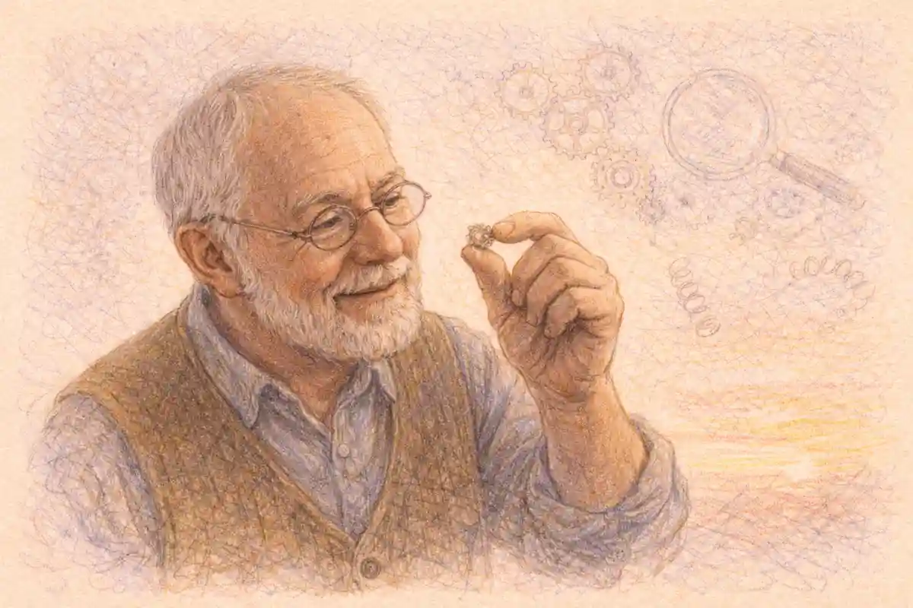

Eight centuries of human history arrive in a single examination booklet, and the first reaction most students report is disbelief. Song China and the Mongol Empire share a syllabus with industrial Manchester, anticolonial movements, and the Cold War. Kingdoms in West Africa sit beside maritime empires in Europe, while revolutions in Haiti, France, and Russia unfold inside the same course framework. Faced with that sweep, a student can feel that preparation means memorizing every ruler, battle, treaty, and dynasty across six inhabited continents. That feeling misreads the examination completely. AP World History Modern, as the College Board frames the course, tests whether a student can think with history at scale: tracing patterns across regions, comparing societies that never met, explaining why change accelerated in one place and stalled in another, and building arguments from evidence under time pressure. Facts matter enormously, yet facts serve the reasoning rather than replacing it.

A useful way to enter the course is through its architecture. Nine units carry the story from 1200 to the present, grouped into four larger eras that teachers use as scaffolding. Six themes recur through every unit, asking how humans interact with environments, how cultures develop and spread, how states govern, how economies organize production and exchange, how societies sort people into hierarchies, and how technology reshapes all of the rest. Six historical thinking skills sit on top of that content, and every question on the examination, from a fifty five question multiple choice set to the document based essay, grades some blend of those skills. A student who understands the architecture stops asking how anyone could learn everything. The better question becomes which patterns repeat, which comparisons the examiners love, and which evidence travels well between units. This guide builds that model piece by piece: format, scoring, units, themes, skills, question craft, study systems, and the traps that cost points.

## Where AP World History sits among the history examinations

Three Advanced Placement history courses divide the past between them, and students often choose without understanding the trade each one demands. AP United States History covers one nation across nine periods, trading breadth for density, so a single decade can support an entire essay. AP European History covers one continent from 1450 forward, rewarding close knowledge of states, ideas, and movements within a connected region. AP World History Modern covers the whole inhabited globe from 1200 forward, trading density for range. Depth in one place matters less than the ability to place developments side by side: Song commercialization beside Abbasid trade revival, industrialization in Britain beside Meiji Japan, decolonization in Ghana beside decolonization in India.

Neither trade is easier in any simple sense. A student strong in narrative memory may thrive in a single nation course and struggle when the frame jumps oceans every paragraph. Another student, bored by one country's politics, lights up when the same century offers five regions to compare. Counselors sometimes describe World History as the broadest first history AP because its skills transfer everywhere: sourcing, contextualization, comparison, causation, continuity and change, and argumentation appear in every AP history course and in college survey classes afterward. The comparison with its sibling courses is developed in the series guide to [AP United States History](/2007/09/16/ap-us-history-complete-guide/), where the same skills operate inside a national frame.

Grade level placement varies by school. Many students meet World History in tenth grade as a first AP, others in eleventh or twelfth after a prior history course. The College Board imposes no prerequisite, and the course assumes no earlier AP experience, though it does assume a student can read textbook prose at a steady clip and write a structured paragraph without prompting. Reading stamina quietly predicts success as much as prior knowledge does. A student who reads slowly but reasons sharply can still excel, provided study systems compensate with earlier starts and smaller daily loads. A fast reader who never practices writing will leak points in the free response sections, where half the examination's weight sits.

## The shape of the examination

Section One arrives in two parts. Part A presents fifty five multiple choice questions in fifty five minutes, worth forty percent of the composite score. Questions arrive in sets of three or four attached to a stimulus: a passage, a map, a chart, a political cartoon, an image of an artifact, or a pair of conflicting accounts. Almost no question asks for a bare fact in isolation. A typical item shows a source, then asks what development it illustrates, what caused the situation it describes, what changed afterward, or which other region experienced a comparable process. The stimulus does half the teaching inside the room; a prepared student reads stimuli as evidence first and decoration never.

Part B of Section One holds three short answer questions in forty minutes, worth twenty percent. Each short answer question carries three parts, labeled within the question, and each part expects a few sentences rather than an essay. The first question draws on a secondary source, the second on a primary source, and students then choose between two options for the third, one centered on the earlier centuries and one on the later centuries, both written without a stimulus. Short answers reward precision. A vague paragraph about trade earns nothing where a named route, commodity, and consequence earns the point in two lines.

Section Two contains the two essays. Seven documents go to students in the document based question, with a fifteen minute reading period and forty five minutes of suggested writing time, worth twenty five percent. The long essay question offers a choice among prompts spanning different stretches of the course and allows forty minutes, worth fifteen percent. Total testing time runs three hours and fifteen minutes, plus breaks and instructions. Weighting matters for strategy: multiple choice and short answers together form sixty percent, so a student cannot essay their way out of weak objective skills, while the document based question alone outweighs the long essay by a wide margin, which argues for serious document practice across the year.

## The InsightCrunch World History exam map

One table cannot hold eight centuries, yet one table can hold the examination itself. The InsightCrunch World History exam map places every unit and every question type beside its weight, so a student can see at a glance where study hours earn their keep. Units carry roughly equal weight by design, which kills the common strategy of mastering two favorite eras and hoping. Question types carry unequal weight, which rewards the opposite discipline: heavy investment in multiple choice craft and document work, steady investment in short answers, and enough long essay practice to convert knowledge into argument quickly.

| Unit or question type | Coverage | Weight | What it rewards |
|---|---|---|---|
| Unit 1 | The Global Tapestry, 1200 to 1450 | 8 to 10 percent of multiple choice | State building in Asia, Dar al-Islam, Africa, the Americas, and Europe |
| Unit 2 | Networks of Exchange, 1200 to 1450 | 8 to 10 percent of multiple choice | Trade routes, the Mongol peace, and cultural transfer along networks |
| Unit 3 | Land-Based Empires, 1450 to 1750 | 8 to 10 percent of multiple choice | Gunpowder empires, administration, and legitimation of rule |
| Unit 4 | Transoceanic Interconnections, 1450 to 1750 | 8 to 10 percent of multiple choice | Maritime empires, the Columbian Exchange, and coerced labor systems |
| Unit 5 | Revolutions, 1750 to 1900 | 8 to 10 percent of multiple choice | Enlightenment ideas, revolutions, and early industrial change |
| Unit 6 | Consequences of Industrialization, 1750 to 1900 | 8 to 10 percent of multiple choice | Imperialism, resistance, and migration driven by industrial demand |
| Unit 7 | Global Conflict, 1900 to present | 8 to 10 percent of multiple choice | World wars, the Russian Revolution, and mass atrocities |
| Unit 8 | Cold War and Decolonization, 1900 to present | 8 to 10 percent of multiple choice | Superpower rivalry, independence movements, and new states |
| Unit 9 | Globalization, 1900 to present | 8 to 10 percent of multiple choice | Economic integration, rights movements, and environmental pressures |
| Multiple choice | 55 questions in 55 minutes | 40 percent of the score | Source analysis, comparison, causation, and continuity and change |
| Short answer | 3 questions in 40 minutes | 20 percent of the score | Precise claims backed by specific named evidence |
| Document based question | 7 documents in 60 minutes | 25 percent of the score | Thesis, contextualization, sourcing, and evidence woven into argument |
| Long essay question | Choice of prompt in 40 minutes | 15 percent of the score | Argument across a period with evidence drawn from memory |

Reading the map vertically teaches the course's fairness. No unit can sink a student alone, and no unit can rescue one either. Reading it horizontally teaches pacing: the two sections split time almost evenly while splitting weight unevenly, since Section One carries sixty percent in ninety five minutes and Section Two carries forty percent in one hundred minutes. Students who love writing often over invest in essays during the year and under invest in the faster sections that quietly decide more of the score. The map corrects that instinct before it hardens into a study plan.

## Scoring, grades, and what a score means

The College Board reports AP scores on a five point scale. A 5 signals extremely well qualified, a 4 well qualified, a 3 qualified, and scores below that band signal weaker or no recommendation for college level credit. Composite points from the four question types are combined by weighting, converted through a scale set for each administration, and reported as that single digit. The conversion matters because it is not a fixed percentage printed anywhere official. Equating keeps standards comparable across years, so the raw performance behind a 5 shifts somewhat with the difficulty of a given form. Honest guidance therefore speaks in ranges and patterns: across administrations, a 5 generally requires something in the neighborhood of two thirds to three quarters of available points, with strong free response work able to lift a borderline multiple choice performance and the reverse also holding.

Partial strength profiles are normal in this subject. A student may write a superb document based essay and still land at a 4 because multiple choice stimuli about unfamiliar regions dragged the objective sections down. Another student may answer multiple choice questions with near machine consistency and stall at a 4 because essays stayed at summary level. The score report gives only the digit, never a section breakdown, so diagnosis during the year depends on practice data the student collects personally. That is an argument for tracking practice results by section and by unit across months, building a private scoreboard that reveals which quadrant bleeds points.

Colleges set their own credit and placement policies, and history credit follows the same institutional pattern as every other AP subject: a department decides which scores earn credit, which earn placement, and which earn neither. Policies differ between campuses and sometimes between a score of 4 and a score of 5 at the same campus. World History credit often satisfies a general education history or global perspectives requirement rather than a major sequence course, since history departments usually want majors inside their own period courses. Families should read the policy of each target college directly rather than assuming, and students aiming at selective institutions should treat the course's skill training as the durable prize, with credit as a welcome extra.

## The six themes that organize everything

Themes give the course its grammar. Humans and the environment asks how geography, disease, migration, and resource pressures shaped societies, and how societies reshaped landscapes in return. Cultural developments and interactions asks how religions, philosophies, arts, and sciences formed, spread, and changed through contact. Governance asks how states formed, expanded, administered territory, and justified power. Economic systems asks how production, labor, and trade were organized, from tributary networks to global supply chains. Social interactions and organization asks how hierarchy, gender roles, family structures, and class systems ordered life and provoked resistance. Technology and innovation asks how tools, ships, weapons, engines, and networks altered what humans could do and what they attempted next.

Every unit can be read through all six lenses, and examiners build questions by crossing a unit with a theme. A multiple choice set on the Indian Ocean might test economic systems through monsoon trade, cultural interaction through the spread of Islam along the routes, and governance through Swahili city states in three consecutive items. Study that files facts under themes travels between units; study that files facts under isolated civilizations shatters on contact with a comparative question. The thematic habit also powers essays. A long essay prompt about trade networks invites a thesis organized by economic, cultural, and political effects, which is simply three themes wearing essay clothes. Students who annotate notes with theme labels all year find essay planning in May feels like sorting rather than inventing.

Theme language also disciplines comparison. Comparing the Ottoman and Mughal empires state by state produces a catalog; comparing them through governance, culture, and economy produces an argument. The first approach lists what each had. The second explains why both used religious tolerance as an administrative tool in some contexts and coercion in others, which is the kind of claim the scoring guides reward. Teachers call this thinking thematically, and it is trainable: any content review can end by asking which two themes the material illustrates best and what a parallel case in another region would be.

### Why does comparison sit at the center of this course?

Comparison sits at the center because the examination grades connections between regions more heavily than recall inside one region, and its prompts, stimuli, and essay choices repeatedly force two or more societies into a single answer. A student trained to compare states, trades, and beliefs across oceans can convert unfamiliar material into points by reasoning from known parallel cases.

That answer deserves expansion because students routinely misjudge it as flavor. Comparison is a scored skill with named rubric behaviors: identifying similarities and differences, then explaining the reasons behind them. Reasoned comparison needs two cases held in working memory at once, which is why note systems organized by region alone fail so many students. Cross regional grids, where one row is a theme and each column a region, build the required mental furniture. Section after section of this guide returns to grids, maps, and timelines because those tools externalize comparison until the mind performs it unaided.

## The historical thinking skills, one by one

Developments and processes, the first skill, asks students to identify and explain what happened: a trend, a turning point, a system taking shape. Sourcing and analysis asks who produced a document, for whom, for what purpose, and how those facts limit or strengthen its use as evidence. Claims and evidence in sources asks students to pull an author's argument apart and test its support. Contextualization asks students to place an event inside the larger processes of its era, the move that opens both essay types with a dedicated scoring point. Making connections asks for comparison, causation, and continuity and change over time, the analytical engines of the course. Argumentation crowns the set: a defensible thesis, a line of reasoning, evidence marshaled in support, and complexity that acknowledges nuance, contradiction, or qualification.

Skills sound abstract until attached to tasks. Sourcing becomes concrete when a student reads a missionary account of Aztec religion and asks what the author's purpose does to the description before trusting any detail in it. Causation becomes concrete when a student separates the long term pressures behind the Haitian Revolution, slavery's brutality, Enlightenment language, French revolutionary turmoil, from its immediate triggers. Continuity and change becomes concrete when a student tracks women's labor across industrialization and finds factory wages changing household economics while patriarchal legal structures persisted. Each skill has a practice form: short drills exist for every one, and the strongest courses rotate drills weekly rather than saving skill work for essay weeks.

Rubric literacy multiplies the value of skill practice. The rubric for the document based question awards points for thesis, contextualization, evidence from documents, evidence beyond documents, sourcing analysis, and complexity. The long essay rubric mirrors that structure without documents. Short answers award a point per part for an accurate claim with support. Reciting what each point requires, a student stops writing essays that merely feel good and starts writing essays that score, which are related but distinct achievements. Teachers call the gap between them the invisible tax on unprepared writers, paid in every section.

## The first era: states and networks, 1200 to 1450

Units One and Two cover a world of regional states and thickening connections. Unit One surveys how societies organized themselves around 1200: Song China with its bureaucracy, commercial revolution, and Confucian order; the Islamic world stretching from Iberia to Central Asia with its caliphates giving way to Turkic and later Mongol powers; South and Southeast Asian states shaped by Hinduism, Buddhism, and Islam arriving by sea; sub Saharan kingdoms such as Mali enriched by trans Saharan gold and salt trade; the Americas, where the Mexica and Inca built large imperial systems without contact with Afro Eurasia; and a Europe of feudal monarchies slowly consolidating. The unit's governing idea is state building: how rulers raised revenue, raised armies, legitimized authority, and managed diversity.

Unit Two follows the connective tissue. The Silk Roads revived under Mongol protection, the Indian Ocean network rode monsoon winds between East Africa, Arabia, India, and Southeast Asia, and trans Saharan caravans linked West Africa to the Mediterranean. Trade moved goods, and it also moved religions, technologies, crops, and diseases along the same routes. Buddhism traveled to East and Southeast Asia, Islam spread through merchant communities, paper and gunpowder technologies diffused westward, and the bubonic plague later rode the network with catastrophic effect. Students who learn Unit Two as a set of routes with cargoes, carriers, and consequences hold a template that later units reuse: maritime trade in Unit Four, industrial shipping in Unit Six, and container globalization in Unit Nine all rhyme with these earlier networks.

The full treatment of this era, with its regional case files and evidence banks, lives in the companion guide to [AP World History Units 1 to 4](/2007/08/16/ap-world-history-units-1-4-1200-1750/), which walks the early centuries region by region. Within this master guide the point is structural: the early units establish baselines. A student who knows how states taxed, how merchants organized credit, and how faiths spread before 1450 can measure later change against something real. Examiners exploit those baselines constantly, asking what the Columbian Exchange altered, what industrialization disrupted, and which older patterns survived both shocks.

## The second era: land empires and oceans, 1450 to 1750

Unit Three turns to the great land based empires that expanded with gunpowder weapons and sophisticated administrations. The Ottoman, Safavid, and Mughal empires divided much of the Islamic world, while Russia pushed across Siberia, Qing China consolidated after the Ming fall, and Tokugawa Japan unified under a shogunate that tightly regulated contact with outsiders. Rulers legitimized power through monumental architecture, religious patronage, bureaucratic recruitment systems such as the Ottoman devshirme and the Chinese examination tradition, and careful management of ethnic and religious diversity. The unit trains a classic comparison: how empires facing similar problems of scale produced different institutional answers.

Unit Four goes to sea. European maritime empires, Portuguese trading posts, Spanish and Portuguese colonies in the Americas, Dutch and English chartered companies, and the silver economy linking Potosí and Manila to Chinese demand transformed the globe. The Columbian Exchange moved crops, animals, and pathogens between hemispheres, with demographic catastrophe for Indigenous peoples of the Americas and population growth in parts of Afro Eurasia fed by American crops. Labor systems hardened under colonial demand: encomienda and hacienda in Spanish America, chattel slavery on Caribbean and Brazilian plantations, and indenture in various oceans. The Atlantic slave trade forcibly carried millions of Africans to the Americas, a system students must understand in its economics, its human cost, and its resistance, from shipboard revolts to maroon communities.

Comparison opportunities multiply in this era. Silver offers a near perfect case: one commodity mined in the Americas and Japan, demanded in China, taxed by Spain, and moving through Manila galleons, producing inflation, trade imbalances, and state policy on three continents. A student who can narrate silver's circuit can answer questions about globalization's first draft, state finance, and labor coercion without memorizing separate chapters. Joint stock companies offer another: Dutch and English corporate forms pooled risk and projected power in ways state navies alone could not, prefiguring later corporate empires.

## The third era: revolutions and industry, 1750 to 1900

Unit Five opens with the Enlightenment's challenge to inherited authority and the Atlantic revolutions that followed: American independence, the French Revolution and its radical phases, Haitian independence won by enslaved people against a colonial power, and Latin American independence movements led by figures such as Bolívar and San Martín. Alongside political upheaval runs the abolition of the slave trade and of slavery itself across the nineteenth century, the first women's rights movements, and the beginnings of industrialization in Britain, powered by coal, cotton, capital, and colonial markets. Nationalism emerges as a double force, unifying Italy and Germany while straining multiethnic empires such as the Ottoman and Habsburg states.

Unit Six tracks industrialization's consequences as it spread and as empires expanded to feed it. The new imperialism carved Africa at Berlin conference tables, deepened British control in India, and pressed into Southeast Asia and the Pacific. Colonized peoples resisted in forms ranging from the Indian Rebellion of 1857 to resistance movements across Africa and Asia, with outcomes shaped by local politics as much as by European weapons. Industrial economies pulled migrants across oceans: Europeans to the Americas, Indians and Chinese as indentured and free laborers across imperial networks, creating diaspora communities from Fiji to the Caribbean. States that industrialized late or defensively, Meiji Japan most famously and Egypt under Muhammad Ali in an earlier attempt, show the era's central tension between adopting foreign technology and preserving sovereignty.

This era rewards causation chains. Coal deposits and capital accumulation help explain British industrial primacy; industrial textile demand helps explain intensified cotton slavery in the American South and colonial pressure on Indian weavers; steam shipping and quinine help explain the speed of African colonization after 1880; colonization helps explain migration, resistance, and the economic structures postcolonial states inherited. Students who practice writing causal chains, each link named and evidenced, find Unit Five and Six questions far less mysterious than students who memorize parallel timelines for each country.

## The fourth era: a connected and contested planet, 1900 to the present

Unit Seven covers the first half of the twentieth century as global conflict. The First World War grew from alliance systems, imperial rivalry, and nationalist pressures, then destroyed four empires and redrew maps in Europe and the Middle East. The Russian Revolution created the first communist state and a model that inspired and alarmed movements worldwide. The interwar years brought economic depression with global reach, the rise of fascist and authoritarian movements, and continued anticolonial organizing. The Second World War exceeded its predecessor in scale and civilian cost, and the era includes mass atrocities that the course treats directly, including the Holocaust and other genocides and ethnic violence of the period. Students meet total war as a concept: states mobilizing economies, science, and populations at unprecedented depth.

Unit Eight follows the Cold War and decolonization as twin processes. The United States and the Soviet Union competed through alliances, proxy wars in Korea and Vietnam, nuclear brinkmanship, and rival development models offered to new nations. Decolonization transformed Asia and Africa: Indian independence and partition in 1947, Ghana's independence in 1957 under Nkrumah, Algeria's hard won independence from France, and dozens of other new states navigating between the superpower blocs, some through the Non Aligned Movement. The unit also covers the Chinese Revolution's outcome, the creation of Israel and the conflicts that followed, apartheid and its eventual end, and the varied paths of states choosing capitalist, socialist, or mixed economies under pressure.

Unit Nine examines globalization's acceleration after the Cold War's end. Trade liberalization, multinational corporations, container shipping, and digital communication integrated markets at new speed, while debates over cultural homogenization, labor conditions, and environmental damage intensified. Rights movements expanded claims: feminist movements across regions, campaigns against racial and caste discrimination, Indigenous rights movements, and new understandings of civil rights. Population growth, urbanization, pandemics from influenza to HIV and AIDS to COVID 19, and climate change forced global coordination problems that no single state could solve. The course ends not with a conclusion but with a set of open questions students are equipped to argue about, which is precisely the posture the final essay rewards.

The later centuries receive their own deep treatment in the companion guide to [AP World History Units 5 to 9](/2007/08/11/ap-world-history-units-5-9-1750-present/), covering revolutions through globalization with unit by unit evidence. This master guide keeps returning to one observation about the modern era: interconnection becomes both the subject and the method. Events in one region increasingly require explanation through other regions, a factory closure through trade policy, a revolution through global depression, a protest movement through communication technology diffusing across borders in days.

## The broad scope problem, and why it dissolves

Every World History teacher hears the same fear in September: the course covers too much to learn. The fear rests on an image of history as a warehouse of facts, each civilization a shelf, each shelf to be emptied into memory. Under that image the fear is rational. Eight centuries times six regions times politics, economy, culture, and society produces a number no memory survives. Fortunately the examination was not built on that image. It was built on patterns: a limited set of processes that recur across regions and centuries, tested through whatever content a stimulus supplies. State building, trade network growth, imperial expansion and resistance, industrialization, revolution, migration, and globalization form a short list that organizes most questions ever written for this course.

Thematic comparison dissolves the scope problem by changing the unit of study. Instead of learning Mali, then the Delhi Sultanate, then Song China as three separate stories, a student learns how agrarian states raised revenue, and meets Mali's gold taxes, Delhi's land revenue, and Song commercial taxes as three instances of one problem. Instead of six separate religions chapters, a student learns how belief systems spread, through conquest, trade, migration, and mission, and files Buddhism, Islam, and Christianity as cases with shared mechanics and different details. Content volume shrinks dramatically under this filing system, because each new case mostly confirms a pattern with local variations that are exactly what examiners ask about.

Worked scale helps too. Nine units at roughly equal weight means each unit deserves roughly equal study time, and a school year offers enough weeks for each unit to receive focused attention plus cumulative review. The student who reviews cumulatively, twenty minutes weekly on older units, arrives in spring with the early centuries still warm. The student who studies unit by unit and never looks back must relearn Units One and Two in April under panic conditions. Scope is a scheduling problem disguised as a memory problem, and scheduling problems have scheduling solutions. The study systems later in this guide give that solution a concrete form.

### How can one course cover eight centuries without collapsing into trivia?

One course covers eight centuries by grading processes over inventories: questions supply much of the specific content inside their stimuli, then ask students to explain, compare, or contextualize using patterns learned across units. A student who masters recurring processes such as state building, exchange, empire, and industrial change can reason through unfamiliar material confidently.

Breadth also changes what counts as a detail worth keeping. In a national course, a single election or court case can anchor a unit. In World History, the details that earn their keep are the portable ones: a named trade good with its route, a policy with its consequence, a movement with its grievance and method. Portable details are the currency of comparison and short answers alike. Teachers who say know less, better are describing this filter. Ten deeply understood cases, each connected to patterns and to each other, outperform fifty skimmed cases on every question type the examination contains.

## Multiple choice craft

Fifty five minutes for fifty five stimulus based questions sets a pace of roughly one minute per item, with sets sharing a stimulus so that reading time amortizes across three or four questions. Pace discipline starts with the stimulus: read it actively, noting author, date, region, and the development it most likely illustrates, before glancing at the questions. Many sets follow a rhythm, moving from comprehension of the source, through the process it reflects, to a comparison or consequence elsewhere. Recognizing that rhythm lets a student predict later questions while answering early ones.

Elimination remains the workhorse skill. Most items contain one option that is factually wrong for the period, one that is true but unresponsive to the question asked, one that is plausible but weaker, and one that the stimulus and stem jointly support. Anachronism hunting pays especially well in this subject: an option placing industrial labor conditions in 1300, or nationalism in a 1200s kingdom, can be discarded on chronology alone. Options using absolute language deserve suspicion, while options matching the stimulus's region and century deserve a second look. When two options survive, the tiebreaker is usually the verb in the stem: caused, resulted, illustrates, and continued each point to a different relationship, and the option honoring the verb wins.

Guessing economics favor answering everything, since no penalty applies to wrong answers. A student should mark and return only when a set's stimulus is genuinely opaque, and even then a best guess should be recorded before moving on, because returning costs rereading time. Practice should be timed in sets rather than in single questions, because set rhythm is the real skill. Review of practice sets matters more than the sets themselves: for every missed item, a student should name whether the error was content, chronology, stimulus reading, or option discipline, since each error class has a different cure. Content gaps send a student back to a unit; chronology gaps send them to a timeline; reading gaps send them to annotation drills; discipline gaps send them to slower elimination practice.

## Short answer craft

Short answer questions look small and score large: twenty percent of the examination across nine separately scored parts. Each part awards one point for a response that does the task with accuracy and specific support. The tasks use predictable verbs: identify, describe, explain. Identify wants a named fact. Describe wants a fact with a characteristic or two. Explain wants a because clause, a mechanism linking cause to effect or claim to evidence. Students lose points most often by answering a different verb than the one printed, writing an explanation where identification was requested and wandering off task, or identifying where explanation was requested and stopping one clause too early.

Stimulus based short answers add a sourcing layer. The first question typically presents a historian's argument and asks students to identify its claims, then explain developments that support or undermine it using content knowledge. The second presents a primary source and asks similar work closer to the document. The third and fourth options, from which students choose one, drop the stimulus and test a reasoning process directly, often comparison, causation, or continuity and change within a period. Choosing between the two options is itself a skill: pick the period and process where your evidence bank is deepest, not the one whose wording feels friendlier.

Brevity discipline separates scorers' favorites from the rest. Three to five sentences per part, each sentence carrying a named example or a mechanism, beats a page of general prose. General prose is the enemy: phrases about trade being important or empires being powerful earn nothing until a route, ruler, policy, or revolt gives them weight. A practical drill is to write short answers with a rule that every part must contain at least one proper noun beyond those in the question and one verb of consequence, such as taxed, banned, converted, migrated, or resisted. The full free response method, short answers included, is developed step by step in the series treatment of [AP World History free response strategy](/2007/08/07/ap-world-history-dbq-leq-saq-strategy/), which this guide complements rather than repeats.

## The document based question, decoded

Worth a quarter of the entire score, the document based question presents a historically framed question with seven documents: texts, images, maps, charts, and occasionally data tables, produced from different positions within the period under study. A fifteen minute reading period precedes the writing, and strong students treat those minutes as the essay's true beginning. They read the prompt until its task is unmistakable, skim the documents for topic and stance, draft a thesis with a line of reasoning, and sort documents into two or three groups that will become body paragraphs. Grouping by argument rather than by document order separates analytical essays from summaries, because a group embodies a claim: three documents showing how merchants experienced a trade network differently by status, for instance, already argue something before a sentence is written.

The rubric's architecture should shape drafting habits. One point rewards a thesis that responds to the prompt with a historically defensible claim establishing a line of reasoning. One point rewards contextualization: several sentences placing the topic inside broader regional or global processes, positioned usually near the opening. Evidence points reward using document content accurately to support an argument, with a higher band for using six or seven documents rather than a bare minimum. A further point rewards evidence beyond the documents, a specific historical fact the student supplies. Analysis points reward explaining how a document's point of view, purpose, historical situation, or audience matters for at least three documents, and a final complexity point rewards a genuinely nuanced argument, qualification, or sustained connection across periods or regions. Students who memorize this architecture stop hoping their essay happens to score and start assembling points deliberately, checking each rubric line during the reading period like items on a manifest.

Document handling technique matters at the sentence level. Quoting sparingly and paraphrasing precisely keeps the student's own analysis in front. Attributing each document by author or type, never by number alone in polished work, signals sourcing habits. Connecting documents to each other, noting where a merchant's letter corroborates a tax record or where an official decree contradicts a traveler's account, demonstrates the corroboration instinct historians prize. The outside evidence point should be planned during the reading period, not hunted in the final minutes: one well chosen fact, placed where the argument needs support, fully explained in a few sentences.

Time inside the document based question rewards a simple allocation. Reading and planning occupy the first fifteen minutes. Writing occupies the remaining forty five, with the thesis and contextualization drafted first even if phrased roughly, body paragraphs following the grouping plan, sourcing woven in as documents appear rather than appended at the end, and a closing minute spent checking that the complexity move, often a qualification in the final paragraph, is actually present on the page. Students who write documents in numerical order without grouping almost always produce summary, and summary caps the essay's ceiling regardless of how much content it contains.

## The long essay question, decoded

The long essay question strips away documents and asks what a student can build from memory in forty minutes. Prompts offer a choice, each anchored in a different stretch of the course, and each built on a reasoning process: comparison, causation, or continuity and change over time. The rubric parallels the document based question: thesis, contextualization, evidence, analysis, and complexity points, with evidence drawn entirely from the student's knowledge. This is the section where evidence banks pay their dividend. A student who has maintained a running stock of portable cases, each tagged by unit, theme, and process, can answer any prompt by selection and arrangement. A student without that stock spends the first ten minutes hoping memory provides, which is not a plan.

Prompt choice deserves a cold eye. All three prompts grade on the same rubric, so the correct choice is the one where the student holds the deepest evidence and the clearest line of reasoning, even if its period is less beloved. A causation prompt wants a thesis ranking causes or separating long term conditions from triggers. A comparison prompt wants similarities and differences with reasons attached, organized by category rather than by case, so the essay compares within paragraphs instead of describing two societies in sequence and bolting on a comparative sentence at the end. A continuity and change prompt wants a periodization argument: what transformed, what persisted, and why the balance fell as it did.

Planning five minutes is not lost time; it is where the thesis becomes defensible and the evidence gets sorted into a line of reasoning. The body should carry specific evidence in nearly every sentence: named policies, dated turning points, identified groups with their interests. Complexity in the long essay often comes from qualification, arguing that a change was profound for one region or class and shallow for another, or from connecting the prompt's period to a later echo of the same process. Examiners reward that reach when it stays accurate, and penalize decorative complexity that asserts nuance without evidence.

## Contextualization and sourcing: the two habits that pay everywhere

Contextualization is the disciplined act of placing a topic inside the larger story of its moment. For a prompt on Indian Ocean trade, context might describe Afro Eurasian networks expanding under Mongol era stability and rising demand in Song and later Ming China. For a prompt on decolonization, context might describe a world war that weakened European empires, superpowers rhetorically committed to self determination for their own reasons, and colonized soldiers and workers returning with new expectations. The rubric asks for more than a sentence of background; it asks for a description of broader processes, connected explicitly to the topic, accurate enough to stand as history rather than decoration. Students earn the point reliably by writing three or four sentences that answer the question: what was happening around this topic, in this era, that made it possible or necessary?

Sourcing analysis is contextualization's document level twin. For each document a student might ask four things. Point of view: what position does the author occupy, and how does it shape the account? Purpose: why was this produced, and for what effect? Historical situation: what circumstances surrounded its creation that explain its content? Audience: who was meant to receive it, and how did that shape its choices? Not every document needs all four lenses; the rubric rewards explaining relevance, showing why the sourcing fact matters for using the document as evidence on this question. A tax farmer's report minimizing smuggling matters because his income depended on the trade he describes. A missionary's horror at a ritual matters because conversion was his project. Sourcing sentences that end with a consequence for the argument score; sourcing sentences that merely name a bias do not.

Both habits transfer beyond the essays. Multiple choice sets routinely include a sourcing question about a stimulus, and short answers ask students to explain how an author's position shapes an account. A student who practices sourcing on every practice document during the year, in the margin, in one sentence, builds reflex speed that shows up in three sections. The same holds for contextualization, which is simply the essay form of the background knowledge multiple choice stimuli assume.

### What exactly earns the contextualization point in an essay?

Contextualization earns its point when several opening sentences describe a broader historical process surrounding the essay topic, connect that process explicitly to the topic, and stay accurate for the period. A student writing on Atlantic revolutions might frame them inside Enlightenment circulation, imperial fiscal crises, and colonial resistance traditions, then tie that frame directly to the revolutions discussed.

The failure modes are instructive. A single vague sentence about times changing earns nothing. A detailed paragraph about the wrong century earns nothing. Context that merely restates the prompt in grander words earns nothing. The reliable formula is era, process, connection: name the era's defining processes, show the mechanism linking one process to the topic, and let the thesis grow out of that link. Practicing that formula on old prompts until it becomes automatic is among the highest yield drills in the course, because the same point is available on both essays, worth real weight in a forty percent section.

## Argumentation and the complexity instinct

Every essay rubric in this course ends at the same summit: a complex understanding, demonstrated rather than claimed. Complexity takes several legitimate forms. A student may qualify an argument, arguing that industrialization transformed class relations in Britain while leaving gender hierarchies largely intact. A student may corroborate across regions, showing the same mechanism operating in two places with different outcomes. A student may trace an argument across periods, showing how a network built for silver later carried opium and then manufactured goods. A student may hold two causes in productive tension, weighing state policy against market forces throughout an essay rather than listing them in separate paragraphs. Each form shares one trait: the essay's structure itself performs the nuance, instead of a final sentence announcing that things were complicated.

Thesis craft underlies all of it. A defensible thesis for this course names a claim, a scope, and a line of reasoning with categories the body will actually develop. Weak theses restate the prompt, split the world into pros and cons without judgment, or promise three unrelated observations. Strong theses take a position on degree, cause, or significance: although maritime trade enriched port cities across the Indian Ocean world, its deepest effects were political, since rulers who taxed the trade built the era's most durable states. That sentence can organize three body paragraphs and sustain sourcing, outside evidence, and qualification. Students should practice rewriting flat theses into arguable ones as a weekly drill; the skill compounds across every free response they will ever write in the course.

Evidence selection is argumentation's other half. An essay drowning in facts but starved of claims reads as a report. An essay rich in claims but poor in facts reads as an editorial. The scoring guides reward the braid: claim, evidence, explanation of how the evidence supports the claim, repeated at paragraph scale. Explanation sentences, the ones beginning with causal or comparative logic in the student's own voice, are where points accumulate, and they are the sentences untrained writers skip. A useful self check after drafting any practice essay is to highlight every explanation sentence; an essay with long unhighlighted stretches is summary wearing an essay's clothes.

## A study system built for breadth

Breadth punishes heroic study sessions and rewards systems. The core system has four moving parts. A running evidence bank collects portable cases all year, each entry carrying a name, a date range, a unit, a theme tag, and two sentences of significance. A regional grid keeps comparison material sorted, with rows for themes and columns for regions, filled gradually as units accumulate. A timeline wall or notebook spine holds anchor dates that organize chronology: 1200, 1450, 1750, and 1900 as era gates, plus turning points inside each era such as 1492, 1648 in its European context, 1763, 1804, 1885, 1914, 1945, 1947, 1989, and 2001, each understood as a marker inside larger processes rather than a trivia item. A weekly review rhythm revisits older units in small doses so the whole course stays warm.

Retrieval practice beats rereading at every level of this course. Flashcards have a role for vocabulary and anchor facts, yet the higher yield tools are blank page recalls, where a student writes everything remembered about a unit's key developments before checking notes, and comparison sprints, where two regions must be compared on one theme in eight timed minutes. Practice questions should be mixed across units once the year matures, because the examination itself is mixed, and blocked practice by unit flatters students into false confidence. Error logs close the loop: every missed practice item gets a line naming the gap and the fix, reviewed weekly until the same gap stops appearing.

Writing practice needs its own cadence. One timed essay every week or two, scored against the actual rubric, ideally with teacher or peer review using the same language the rubric uses, builds both skill and calibration. Short answer drills can run shorter and more often, fifteen minutes for a full question, because their scoring is granular and feedback is fast. Students should keep a portfolio of scored essays across the year; rereading an October essay in March makes growth visible and reveals recurring rubric lines that still leak, which focuses the final review better than any commercial review book chapter can.

The final review phase, roughly the last four to six weeks, shifts from learning content to integrating it. Full practice examinations under real timing expose pacing failures while they can still be fixed. Unit sweeps target the weakest two units identified by practice data rather than the student's favorites. Essay drills concentrate on the rubric lines with the worst personal record, contextualization for many students, sourcing for others. In the last week, volume drops, sleep is protected, and review narrows to the evidence bank, the grid, and the timeline, the three artifacts the student has built all year. Students who want a dedicated plan for converting this system into the top score should follow the playbook in [how to get a 5 on AP World History](/2007/02/21/how-to-get-a-5-on-ap-world-history/), which sequences the same habits toward a single target.

## Notes, timelines, and maps as working tools

Note organization decides whether review is possible at all. Notes filed purely by chapter and date force a student to reread the year in order to find anything. Notes filed by unit, with theme tags in margins and comparison flags wherever a case resembles one from another region, become a searchable evidence bank. A simple convention pays off: every note entry ends with a so what line stating the development's significance in one sentence. That sentence, written in September, becomes the explanation sentence an essay needs in May. Students who skip it must invent significance under time pressure, which is where vague essays are born.

Timelines serve chronology, the skeleton under every reasoning process. A causation answer fails when its sequence is scrambled; a continuity and change answer fails when its periodization is arbitrary. Building one cumulative timeline per era, adding events as units progress, and periodically annotating clusters, three revolutions within four decades, two independence movements sharing a year, trains the eye for simultaneity, which is comparison's raw material. Timelines also expose acceleration: the compression of change after 1750 and again after 1900 becomes visible as ink density, a picture worth several lectures on why the modern units feel faster.

Maps do similar work for space. A student should be able to sketch, from memory, the major trade routes of each era with their goods and carriers, the extent of the great empires at their height, the partition lines of Africa and the mandate system, the Cold War blocs, and the shipping lanes of the global economy. Sketching is the operative word: drawing a rough map in review encodes location knowledge far better than studying a polished atlas page. Many multiple choice stimuli are maps, and students who have drawn the network read a stimulus map in seconds, spending their minute on the question rather than on decoding the geography.

## Pacing the examination itself

Three hours and fifteen minutes of testing divides into four distinct efforts, each with its own clock discipline. Multiple choice runs at a minute per question in sets; a student who falls behind should speed up by trusting first instincts on comprehension items and reserving deliberation for the comparison and causation items where it pays. Short answers run at roughly thirteen minutes per question, and the three parts within a question deserve near equal investment, since each carries its own point and a neglected part is a guaranteed zero on that line. The document based question's reading period is sacred: fifteen minutes of planning that students squander by beginning to write early almost always produce weaker essays than fifteen minutes spent grouping and outlining.

The long essay's forty minutes divide into five for planning, thirty for writing, and five for review and strengthening, with the review pass hunting for the complexity move and for evidence gaps rather than for spelling. Breaks between sections are for water, movement, and deliberate mental reset; reviewing the previous section during a break spends energy without buying points. Students with approved accommodations follow adjusted clocks, and their pacing plans should be built and practiced on those clocks all year, not improvised in the examination room. Practice under personal race conditions is the only pacing advice that has ever worked, which is why the study system above schedules full timed runs well before the final month.

Stamina is a trainable variable in a three hour examination. Attention typically dips in the third hour, exactly where the essays sit. Students who have sat full practice examinations arrive with that dip already mapped and managed, often by front loading care on the document based question, which carries the larger weight. Nutrition, sleep the night before, and a morning routine rehearsed rather than invented all belong to pacing in the broad sense. None of this is glamorous, and all of it shows up in scores at the margin where grades are decided.

## The year in the classroom: how the course usually unfolds

Most courses move through the nine units in order, spending the autumn on the first era, the winter on empires and oceans, and the spring compressing revolutions, global conflict, and globalization into the final months. That calendar creates a predictable imbalance: Units Seven through Nine, dense with events students half know from other classes, arrive when energy is lowest and the examination is nearest. Wise students compensate privately, previewing the modern era's outline during winter break and keeping a light familiarity with the world wars, the Cold War, and decolonization long before the class arrives there. Previewing is not pre learning; it is building coat hooks so spring lectures hang content on an existing frame.

The middle of the year carries its own hazard, a motivation trough somewhere inside Units Four and Five where the novelty has faded and the examination still feels distant. Grades in many classrooms dip there, not from inability but from accumulated small neglects: unread chapters, unreviewed notes, essays returned and never reread. The systems in this guide exist largely to carry students through that trough on rails. A weekly review rhythm does not care about motivation. An evidence bank grows by entries per week, not by inspiration. Students who install the rails in September ride them in February without deciding anything.

Teacher variation is real and worth planning around. Some courses emphasize document work from the first month; others front load content and introduce essays later. Some assign a heavy textbook; others build from readers and lectures. The examination, however, is identical for every student in every school, which means each student privately owns the gaps their particular course leaves. A student whose class rarely times multiple choice sets must time them at home. A student whose class writes essays monthly but never short answers must drill short answers independently. Diagnosing your own course's emphases against the exam map in this guide, then supplementing the thin places, is the quiet work that separates self directed students from passengers.

## Evidence banks: the portable cases that power essays

An evidence bank is a personal arsenal of cases, each small enough to recall under pressure and rich enough to serve several prompts. A strong entry has five elements: a name, a date range, a place, a mechanism, and a significance. Consider the Manila galleon trade. Name and range: the galleon route between Acapulco and Manila, operating for roughly two and a half centuries after the 1560s. Mechanism: American silver exchanged for Chinese silk and porcelain, with Spanish colonial infrastructure and Filipino labor sustaining the route. Significance: it completed a truly global trade circuit, tied China's silver based economy to American mines and coerced labor, and showed states taxing flows they did not control. That single entry can serve prompts on globalization's origins, labor systems, state finance, cultural contact, and environmental exchange.

Thirty to fifty such entries, spread across units and themes, constitute a serious arsenal. Quality beats quantity because each entry must be recallable in an examination room, not merely recognizable in a notebook. Building the bank is slow work done in small installments: two entries per week across a school year yields sixty. Reviewing the bank is active work: cover the significance line and reconstruct it, sort entries by theme, pair entries from different regions and articulate the comparison aloud. The bank also feeds short answers, where one precise case often carries a part, and multiple choice review, where missed items frequently trace to a case the student knew vaguely and could not deploy precisely.

Some cases are so versatile they deserve anchor status. The Mongol Empire serves state building, trade, cultural transfer, disease, and conquest's costs across two units. The Columbian Exchange serves environment, demography, labor, and globalization in nearly any era framing. Industrialization in Britain serves economics, class, gender, empire, and technology simultaneously. The Haitian Revolution serves Enlightenment ideas, slavery's violence, Atlantic interconnection, and the limits of revolutionary universalism. Decolonization in India serves nationalism, nonviolent and violent resistance repertoires, partition's costs, and Cold War positioning. Writing a rich paragraph on each anchor, from memory, with dates and mechanisms, gives a student insurance against almost any prompt the examination can issue.

## Regional literacy without regional silos

Breadth creates a temptation to learn regions as sealed chapters, yet the examination keeps prying the seals open. Regional literacy still matters: a student should know the basic political geography and signature developments of East Asia, South Asia, Southeast Asia, the Islamic world across its zones, sub Saharan Africa, Europe, Latin America, and North America in each era. The skill is holding that knowledge in a form that invites crossing. When a new development appears, the trained reflex asks three questions. What process is this an instance of? Where else did that process run, earlier, later, or at the same moment? What differed there, and why?

East Asia offers a training ground for the reflex. Song commercialization, Mongol conquest and Yuan rule, Ming maritime withdrawal after the treasure voyages, Qing expansion, nineteenth century pressure from industrial powers, the fall of the Qing, warlord fragmentation, communist victory in 1949, and reform era growth form a single long thread about state capacity and foreign pressure. South Asia offers another: Delhi Sultanate, Mughal synthesis, British East India Company ascendancy, the Raj, nationalist mobilization, independence and partition, and postcolonial democracy under strain. Each thread, learned as a story of recurring problems rather than a list of regimes, becomes comparative capital. The Ottoman thread, Safavid and Qajar Persia, and later Iran and Turkey extend the exercise into the Islamic world, while West and East African threads, from Mali and Songhai through the slave trade's reordering to colonization and independence, correct any syllabus impression that Africa enters history only when Europeans arrive.

Oceania and the Pacific appear less heavily yet still appear: Polynesian navigation and settlement as a marvel of premodern technology and environment knowledge, European exploration and colonization, indentured labor circuits, and the Pacific theater of the Second World War. Latin America deserves more than its colonial chapter: independence's conservative outcomes, nineteenth century caudillo politics and export economies, the Mexican Revolution, import substitution, debt crises, and democratization waves all test well because they braid themes together. A student whose regional threads run the full eight centuries can contextualize almost any stimulus within a minute, which is the practical meaning of regional literacy in this course.

## Reading sources like a historian

Stimuli and documents are the examination's native habitat, so source reading deserves direct instruction. A primary source is a survival from the period, created by someone inside it for purposes of their own. A secondary source is a later account, usually a historian's argument built from primary material. The examination uses both, and the reading moves differ. With a primary source, the student interrogates position and purpose before content: who speaks, from what rank, faith, office, or grievance, and what did they want this text or image to do? With a secondary source, the student identifies the historian's claim and the evidence marshaled for it, because short answer and multiple choice questions about secondary sources usually test claim recognition and the ability to support or challenge the claim with period knowledge.

Images demand their own protocol. A political cartoon compresses an argument into symbols that must be decoded with period knowledge: animals standing for nations, scales, weapons, and caricatured figures all carry assigned meanings. A photograph raises questions of staging and selection. A work of art or architecture, a mosque, a palace, a propaganda poster, testifies to the values and resources of its patron as much as to its subject. Maps and charts require reading titles, legends, and axes before data, because examiners hide the question's hinge in exactly those framing elements. Students should practice narrating any visual in three sentences: what it shows, what it argues or assumes, and what it leaves out. That third sentence, the omission sentence, is where sourcing points and multiple choice traps both live.

Vocabulary work supports source reading more than students expect. Period terms such as tribute, mandate, syncretism, mercantilism, enclave, protectorate, and self determination unlock stimuli quickly when known and block them entirely when unknown. A running glossary, built from course readings rather than copied from a list, with each term defined through an example, pays compound interest. Archaic or translated phrasing in older documents slows many students; the cure is exposure volume, reading a few documents weekly from September onward so that by spring the prose of a sixteenth century letter feels like a dialect rather than a foreign language.

## The difficulty question, answered honestly

Is this course hard? The honest answer separates three kinds of difficulty. Volume difficulty is real but manageable, as the scope discussion showed: the content is wide, yet organized by patterns that compress it. Skill difficulty is the true barrier for most students. Writing a sourced, contextualized argument in forty minutes is a performance skill that improves only with repetitions, and many students arrive having written mostly untimed, single draft essays with generous teacher feedback. Reading difficulty sits between the two: the textbook and documents demand sustained attention to dense prose, and students whose reading diet has been mostly short form digital text feel the strain in the first months.

Score distributions across the national cohort, published in broad outline by the College Board each cycle, consistently place World History in the middle of the AP pack: neither among the courses with the highest top score shares nor among the lowest. That pattern fits the course's profile: accessible entry, demanding ceiling. A student can reach a 3 with solid content knowledge and basic skills. A 4 asks for reliable skills under timing. A 5 asks for the braid of content, skills, and judgment operating together across all four question types, plus the pacing to let it show. None of that requires genius; all of it requires a year of deliberate practice, which is precisely what makes the course a fair test and a good preparation for college history.

Self assessment helps students calibrate. A student reading at course pace, writing organized paragraphs, and genuinely curious about how societies differ usually thrives. A student taking the course only for transcript decoration, unwilling to read nightly or write weekly, usually regrets the enrollment by November. Schools sometimes gate the course behind prior grades or a summer assignment; those gates reflect the reading load more than the content's intrinsic difficulty. Younger students can succeed and do, particularly when their schools build the course as a first AP with scaffolding: explicit note instruction, modeled essays, and gradual release of timing pressure across the autumn.

### Who tends to thrive in AP World History?

Students who thrive tend to read willingly in long stretches, enjoy spotting patterns across unlike cases, and tolerate ambiguity long enough to build an argument from partial evidence. Prior success in geography or strong writing instruction helps, yet curiosity about distant places and earlier centuries predicts persistence best across a demanding year.

Background knowledge helps in specific, nameable ways. A world geography foundation means stimuli maps are readable at a glance. Familiarity with the major world religions, their founding eras, core ideas, and regions of strength, removes a whole layer of confusion from the first units and returns value in every later era. Basic economic vocabulary, trade, tax, currency, labor, market, and state, speeds comprehension across all nine units. None of these is a prerequisite, and the course teaches each from the ground up; they are accelerants, not tickets. A student lacking them should front load the first month with glossary and atlas work, after which the gap narrows quickly.

## Working with a textbook and lectures without drowning

Textbook chapters in this course run long, and reading them passively is the most common study failure in the subject. Active reading converts the same pages into learning: preview the chapter's headings and maps, read with a pen, mark developments rather than facts, and close each section by writing a two sentence summary from memory. The summary habit exposes comprehension gaps instantly, because a section that cannot be summarized was not understood, however familiar its sentences felt while passing under the eyes. Cornell style notes, a lecture outline, or a digital document all work as containers; the container matters far less than the summarizing and tagging behaviors inside it.

Lecture time deserves a parallel discipline. Notes taken verbatim capture words and lose structure. Notes taken as claims, with the teacher's examples indented beneath the claim each supports, mirror the essay form the examination grades and make review sessions dramatically faster. After class, five minutes spent merging lecture notes with the textbook summary and adding one comparison flag produces the integrated record that review season needs. Students who postpone integration until spring face two parallel archives that refuse to combine under pressure. Small weekly integrations are unglamorous and decisive, which could serve as the motto for most of what this guide recommends.

Review books and online resources have a place, as supplements with defined jobs. A review book's condensed unit summaries serve the final six weeks well and serve September poorly, because compression without prior understanding produces recognition without recall. Online videos can clarify a confusing development efficiently when used surgically, one concept at a time, followed by notes. Practice question banks, including timed sets of [free AP History practice questions](https://reportmedic.org/tools/ap-history-practice-questions.html), serve best when every session ends with error analysis rather than a score screenshot. The resource is never the system; the system is what the student does repeatedly with whatever resources are at hand.

## Causation, continuity, and change: the three engines

Comparison gets the publicity, yet three other reasoning processes do much of the examination's work. Causation asks why developments happened and what they produced. Skilled causation separates long term conditions from short term triggers, ranks causes by weight, and traces effects across domains, noting that an effect in politics may arrive decades after its economic cause. The plague's arrival in fourteenth century Afro Eurasia, for example, runs through labor scarcity to wage pressure to social unrest to state responses, a chain in which each link can be evidenced and each link invites comparison between regions where the chain ran differently. Prompts reward students who build chains rather than pile causes into a heap labeled factors.

Continuity and change over time asks what transformed and what endured across a defined span, and it punishes essays that narrate a period as uniform progress or uniform decline. The craft move is periodization: choosing turning points and defending them. Trade in the Indian Ocean changed carriers, goods, and naval protection between 1200 and 1750, while monsoon timing, port city autonomy, and merchant diasporas persisted through every political turnover. An essay that holds both truths in one argument demonstrates the process properly. Students often find change easier to see than continuity, so drills should force the continuity hunt explicitly: for any transformation, name two structures that survived it and explain the source of their durability.

Argumentation binds the engines together, and comparison supplies the fourth. The dedicated skills treatment in [AP World History comparison, causation, and continuity and change](/2006/07/20/ap-world-history-comparison-causation-ccot/) develops each process with worked examples, and students should treat that material as the technical manual for what this guide summarizes. Within essays, the processes blend: a causation thesis usually implies a comparison with a place where the effect differed, and a continuity argument usually requires explaining the causes of persistence. Examiners design prompts expecting the blend, which is why single process essays, however tidy, tend to plateau below the complexity line.

## Skill drills that fit inside a busy week

Skills grow through short, frequent, focused repetitions more reliably than through occasional essay marathons. A sourcing drill takes ten minutes: one document, four margin questions, one sentence explaining why the author's position matters for this document's use. A contextualization drill takes ten minutes: one prompt, one four sentence opening paragraph, written cold. A thesis drill takes ten minutes: one prompt, three candidate theses, then a ranking with reasons. A comparison sprint takes twelve minutes: two regions, one theme, a grid filled and then converted into two analytical sentences. A causation chain drill takes ten minutes: one development, a chain of four links, each link checked for evidence the student actually knows.

Rotating one drill per school day produces roughly one hundred fifty skill repetitions across a year, a volume no weekend workshop can match. Drills also diagnose precisely. A student whose contextualization paragraphs keep failing usually lacks era frames, not writing talent, and the cure is memorizing four era frames cold: the era of regional states and reviving networks, the era of land empires and oceanic connection, the era of revolution and industry, and the era of global integration and conflict. A student whose sourcing sentences name bias without consequence needs the so what extension practiced until automatic. Small drills, honestly scored against the rubric's language, are where the course's skill difficulty quietly surrenders.

## Common mistakes and their repairs

Region by region memorization leads the catalog of errors, because it feels like diligence. The repair is structural: rebuild notes around processes and grids, keeping regional threads as the grid's columns. A second error is evidence free analysis, essays that discuss empires and trade in the abstract for pages. The repair is a drafting rule: no paragraph ships without at least two named, specific pieces of evidence, and no claim survives review without an explanation sentence attached. A third error is document summary in the document based question, repaired by grouping before writing and by requiring each body paragraph to open with a claim the documents then serve.

Chronology slips form a fourth family. Students place the printing press's effects in the wrong continent's century, assign nationalism to medieval kingdoms, or let the Cold War leak into the Second World War's causes. The repair is anchor discipline: era gates memorized cold, plus a habit of dating every evidence bank entry, so that a case pulled in an essay arrives with its century attached. A fifth error is stimulus neglect in multiple choice, answering from general knowledge while the stimulus points elsewhere. The repair is procedural: underline the stimulus's operative phrase and require the chosen option to be consistent with it. A sixth error is time surrender, spending twenty minutes perfecting short answer one while the essays wait. The repair is practiced allocation with a visible clock, rehearsed until the allocations feel like defaults rather than decisions.

A seventh error is subtler and costs strong students real points: answering the prompt that was expected rather than the prompt that was printed. Preparation creates templates, and templates tempt students to reproduce a rehearsed essay on industrialization when the prompt asks about its consequences for migration. Rubrics grade responsiveness above all else; a brilliant answer to a neighboring question scores as an off task essay. The repair is a ritual: before writing anything, restate the printed prompt's task in your own words at the top of the planning space, including its reasoning process, its period, and its regions, then check the finished thesis against that restatement word by word.

## How the four question types reinforce each other

Students often prepare the four question types as separate subjects, yet the examination designed them as one instrument played four ways. Multiple choice stimuli are miniature documents; the sourcing instinct trained for essays answers their hardest items. Short answers are essay paragraphs in embryo: claim, evidence, explanation, repeated nine times. The document based question is short answer discipline scaled up and given documents to carry. The long essay is the document based question with the scaffolding removed, testing whether the habits survive on memory alone. Preparation that exploits the overlaps learns faster than preparation that silos them. An hour spent sourcing practice documents improves three sections. An evidence bank entry written well serves all four.

The reverse is also true, and worth a warning. Weakness in one habit taxes every section. A student who cannot identify a historian's claim will bleed points in multiple choice sets, the first short answer, and any document written by a modern scholar. A student whose chronology is shaky will misread stimuli, misgroup documents, and misperiodize essays simultaneously. This is why diagnosis by habit, rather than by section, produces the fastest score movement in the final months: fix the habit and three sections rise together. Teachers who track errors by habit across a student's whole portfolio routinely find one repair worth more than a month of generic review.

## Worked approach: a multiple choice set under the microscope

Consider what strong processing looks like on a plausible set. The stimulus is a passage from a fourteenth century North African traveler describing the markets and mosques of a West African trading city, praising its scholarship and noting caravans arriving with salt. The first question asks what the passage best illustrates. A prepared student, having noted author position, date, and region before reading options, recognizes a description of trans Saharan exchange integrating West Africa into Dar al-Islam, and selects the option naming cultural and economic integration through trade. Options about European colonization die on chronology; options about industrial production die on period; an option about purely local subsistence contradicts the caravans in the text.

The second question asks which development most directly enabled the trade described. The student thinks in mechanisms: camel transport adapted to desert conditions, merchant networks sharing faith and commercial law, and demand for gold in Mediterranean markets all qualify, while the option naming steam shipping fails chronology and the option naming Mongol protection belongs to a different network's geography, a distractor built for students who memorize networks as a blur. The third question pivots, as sets often do, to comparison: which other region's cities grew through a comparable mechanism in the same era? Swahili coast ports on the Indian Ocean network present themselves, city states enriched by maritime trade and Islamic cultural integration, and the parallel locks in. Three questions, three habits: sourcing, causation, comparison. Nothing in the set required an obscure fact; everything required the course's core processes operating quickly.

## Worked approach: an essay from prompt to plan

Take a plausible long essay prompt asking students to explain how trade networks shaped state development in Afro Eurasia between 1200 and 1750. The planning minutes begin with a restatement: causation, states, networks, two eras inside the span. A thesis takes shape: trade networks shaped states most powerfully by supplying revenue that rulers converted into administration and coercion, though the conversion succeeded only where rulers could tax flows without strangling them. Contextualization writes itself from the era frame: post Mongol network revival, rising demand in China and Europe, new maritime routes after 1500. Body paragraphs organize by mechanism rather than by place. Revenue and administration covers Mali's gold taxes, Song commercial taxes, and Ottoman customs. Legitimation through trade wealth covers monumental building and patronage funded by customs income in port and caravan cities. Coercion and protection covers states projecting power along routes, from Mongol protection to Portuguese fortified trading posts to the armed companies of the Dutch and English.

Outside the plan, evidence waits in reserve: the Manila galleon for the span's final phase, Swahili city states for a comparison note, the Safavid silk monopoly for state enterprise. Complexity enters through qualification: landlocked agrarian states such as Ethiopia or the Inca in their separate hemisphere developed through tribute and labor taxes rather than commerce, showing the mechanism's limits and the thesis's honesty. Five planning minutes produced that skeleton, and the remaining writing time becomes execution. Students consistently report that essays planned this way feel shorter to write, because the thinking happened once, up front, instead of continuously at the sentence level where it competes with wording.

## College credit, placement, and the worth question

Families ask whether the course is worth taking, and the answer depends on which currency they value. In credit currency, policies vary widely: many public universities grant a history elective or general education credit for a score of 3 or 4, some require a 4 or 5, and highly selective private institutions may grant placement, credit for a distribution requirement, or nothing at all. Because departments set these rules and revise them, the only reliable method is reading the published AP policy of each college on the student's list, in the admission cycle when it will matter, rather than relying on a counselor's memory of an older policy. A score's cash value, where credit replaces a tuition bearing course, can be meaningful, yet it should never be the sole reason for enrollment.

In skill currency, the return is steadier. A year of sourcing documents, contextualizing developments, and writing argued essays under time pressure is direct preparation for college history, political science, international relations, and law adjacent study, and the writing stamina transfers to every subject that assigns essays. In transcript currency, the course signals willingness to attempt a broad, reading heavy subject, a signal admissions readers understand in context of what a school offers. In interest currency, the course is the rare high school experience that genuinely spans the planet, and students who catch the comparative habit keep it for life, reading news about trade, migration, and conflict with historical depth their peers lack. Weighed together, the course earns its place for students who will do the reading; the worth question collapses, in practice, into the willingness question.

Placement within a student's program matters as much as the course itself. Taking World History alongside another reading heavy AP can overload a semester; pairing it with a problem set based course often balances the week. Students doubling in history, pairing World with United States or European History in the same year, should expect the skills to reinforce each other while the content loads add, a trade that suits strong readers and punishes procrastinators. First time AP students benefit from the course's clear rubric transparency: the scoring rules are published, stable, and learnable, so effort converts to visible progress more predictably than in subjects with opaque grading.

## What a strong score report profile looks like from the inside

No official breakdown accompanies the score, yet students can infer their profile from practice data gathered across the year, and the inference guides final review. A balanced profile shows multiple choice accuracy holding across all nine units rather than spiking in favorites, short answer points earned at a steady rate per part, document essays reaching the upper evidence band, and long essays with contextualization and thesis points secured nearly every time. Imbalanced profiles point to their own repairs. Objective strength with essay weakness calls for rubric drills and timed writing volume. Essay strength with objective weakness calls for stimulus reading practice and unit gap repair, usually in the two weakest units identified by item data.

The border between adjacent scores is thinner than students imagine. Because the composite blends four weighted sections, a single rubric point gained consistently, contextualization secured on both essays rather than one, can move a borderline profile across a line. So can three or four multiple choice items per set rescued by elimination discipline, or one short answer part per question answered with a named example instead of a generality. Final month review should therefore hunt small, repeatable gains across sections rather than chasing a transformation in any single one. Marginal gains compound in a weighted composite; that arithmetic is the optimist's best friend in April.

## The verdict on AP World History Modern

Judged as a piece of assessment design, this examination knows what it wants. It wants students who can hold the planet in view without losing the particular, who can read a stranger's account of a vanished market and ask the right questions of it, who can argue that a network mattered more for politics than for prices and defend the ranking with evidence from three regions. It does not want, and does not reward, the student who memorized a textbook's bold terms and nothing else. Every structural choice, stimulus based objective questions, granular short answers, a document essay with a published rubric, a memory based long essay, pushes toward the same definition of historical competence.

Judged as a course, it offers something scarce in a high school program: a genuinely global story, taught as one interconnected narrative rather than as a parade of national chapters. Students leave knowing why silver linked Potosí to Beijing, why revolutions clustered in the Atlantic world, why independence swept Asia and Africa within a generation, and why the problems of the present, climate, migration, inequality between regions, have histories rather than merely headlines. Preparation that honors the design, patterns over inventories, skills drilled in small doses, evidence banked in portable form, essays planned before they are written, converts the examination's breadth from a threat into the very thing that makes high scores achievable. The scope that frightens students in September becomes, by spring, the source of their advantage: there is always another region to compare, another case to cite, another connection to draw, and the students who learned to draw them own the examination room.

## The six themes in action across the eras

Abstract theme names become useful only when attached to scenes. Environment, the first theme, runs from monsoon winds dictating sailing calendars in the Indian Ocean to the Little Ice Age stressing seventeenth century harvests, from American crops raising Afro Eurasian populations after 1500 to coal smoke remaking industrial cities and carbon emissions forcing planetary politics in the final unit. A student tracing that single thread watches technology, disease, and demography braid together, and gains a ready made continuity and change argument for almost any period the examiners choose. Environment questions also reward attention to human response: irrigation states, terrace farming, pastoral adaptation, and flood control bureaucracies all show societies engineering their way around constraints rather than merely suffering them.

Culture, the second theme, follows belief and knowledge across borders. Buddhism's movement along trade routes into East Asia, carried by merchants and monks and translated into local idioms, offers the template: transmission, adaptation, syncretism. Islam's spread works similarly through commerce into West Africa and Southeast Asia and through conquest and administration elsewhere, producing regional Islams that share a core while differing in practice. The Scientific Revolution and Enlightenment show knowledge moving through print, academies, and salons, then traveling globally through colonial schools and reform movements, where colonized intellectuals turned the vocabulary of rights against empire itself. Students should track not only where ideas went but what changed about them on arrival, because examiners ask about adaptation as often as about movement.

Governance, the third theme, is the story of scale. City states and kin based networks give way to territorial empires with professional bureaucracies, which give way to nation states claiming popular sovereignty, which face twentieth century totalitarian and developmental variants, which then confront globalization's limits on sovereignty. Each transition raises the same questions in new forms. How is revenue extracted, and from whom? How are officials recruited, and how are they kept loyal? How is rule justified, by divine mandate, dynastic tradition, religious authority, national identity, revolutionary ideology, or electoral consent? How are diverse populations managed, by tolerance as policy, by forced assimilation, by hierarchy, or by expulsion? A student who asks those four questions of every state in the course owns the governance theme outright.

Economic systems, the fourth theme, tracks how humans organized production and exchange at widening scales. Tribute and taxation in kind support early states; commercialization monetizes Song China and parts of the Islamic world; mercantilist empires attempt to funnel colonial wealth toward metropoles; industrial capitalism reorganizes labor around factories and wages; command economies attempt to replace markets with plans; mixed and market economies dominate the post Cold War landscape while states retain regulatory and welfare roles. Labor systems thread through all of it: corvée and slavery, serfdom and peonage, indenture and wage labor, each with its coercions and its resistances. Questions on this theme reward students who can name who produced, who profited, who decided, and who bore the cost, in that order.

Social organization, the fifth theme, examines how societies sorted people and how the sorted pushed back. Patriarchy structures most agrarian societies while varying in strictness and in the spaces women carved within it, from market women in West Africa to educated elites in Song China to factory workers whose wages shifted household bargaining. Caste in South Asia, estate systems in Europe, racial hierarchies constructed under colonialism, and class formations under industrial capitalism each assigned life chances at birth and each generated ideologies defending the assignment. Resistance ranged from everyday evasion to organized movements: slave revolts, peasant rebellions, labor unions, suffrage campaigns, and civil rights movements across several continents. The theme's examination value lies in specificity: naming the hierarchy, the group disadvantaged, the mechanism of enforcement, and the form resistance took.

Technology, the sixth theme, rewards students who treat tools as arguments about what societies valued. Gunpowder weapons favored states that could fund foundries and drill infantry. Lateen sails, astrolabes, and larger hulls made oceanic empires possible. The printing press lowered the cost of dissent. Steam power freed production from muscle and water sites and bound colonies to factories through shipping schedules. Railways integrated continental interiors and moved troops as readily as grain. Telegraphs, then radio, then digital networks compressed coordination time for states, markets, and movements alike. Each technology in the course should be filed with its enabling condition and its unintended consequence, because questions probe both, and because that pairing converts a gadget list into analysis.

## Turning points that organize memory

Certain moments earn anchor status because so many threads pass through them. The Mongol conquests of the thirteenth and early fourteenth centuries destroyed some states, inadvertently protected trade across Eurasia, spread technologies and pathogens, and reset political maps from China to Persia to Eastern Europe. A student can hang a dozen developments on that single hook. The year 1492 opens the oceanic era in the Americas, yet the deeper anchor is the half century around it, when Iberian voyages, the conquest of the Aztec and Inca states, and the opening of sea routes to Asia rewired global exchange within two generations. Anchors work because they compress: one date, properly understood, retrieves a cluster.

The mid eighteenth century begins the age of revolutions and industry almost simultaneously, and the pairing matters: political revolutions proclaimed rights while industrial change rearranged the material basis of power, and the two processes interrogated each other for a century and a half. The year 1914 detonates the long nineteenth century's order; 1945 closes a still more destructive war and opens the bipolar, decolonizing world; 1989 and 1991 close the Cold War and accelerate globalization's confident phase; 2001 reopens questions of security and globalization's discontents. Between the anchors sit slower transformations that turning point thinking can hide: commercialization's centuries long creep, abolition's grinding progress, urbanization's steady climb. Skilled students hold both tempos at once, using anchors for orientation and slow processes for depth, and say which tempo a given question is really about.

## A preparation arc across the school year

The opening weeks should privilege orientation over coverage anxiety. Learn the course map until it can be reproduced from memory: nine units, four eras, six themes, four question types with their weights and timings. Set up the three working tools in the same weeks, evidence bank, comparison grid, and cumulative timeline, because tools installed late never accumulate enough entries to matter. Begin reading routines immediately, since reading stamina compounds like fitness and cannot be crammed in spring. Write first essays untimed or generously timed, scored against the rubric, so the rubric's language becomes familiar before speed enters the picture.

Autumn's work is foundation and habit. Units One through Four supply the baselines every later comparison needs, so their evidence bank entries deserve extra care. Skill drills should rotate weekly through sourcing, contextualization, and thesis writing, while multiple choice practice runs in small timed sets with error logs from the start. The first full short answer set under real timing usually shocks students with its pace; that shock is information, and it should arrive in October rather than April. By the winter break, a student should hold the early eras securely, a working grid with several themes filled across regions, and a clear personal list of leaking rubric lines.

Winter brings the revolutions and industrialization units, where causation chains lengthen and essay prompts grow more demanding. This is the season to raise writing volume: one timed essay every week or two, alternating document based and long essay forms, each scored and each followed by a rewrite of the weakest paragraph rather than a shrug. Comparison sprints should now pair early and later material, Song commercialization against British industrialization, Mongol network management against nineteenth century imperial infrastructure, because the examination delights in cross era reasoning and winter is when the material for it first exists in full. Students should also sit a first full practice examination late in this phase, not for a score to celebrate or mourn, but for a pacing map.

Spring compresses the modern era and the review into the same weeks, a scheduling collision every World History student faces. The defense is preview and parallelism: preview Unit Seven through Nine outlines during winter so spring lectures consolidate rather than introduce, and run cumulative review in parallel with new content rather than after it, twenty minutes several times a week on rotating older units. As the examination nears, work shifts from acquisition to performance: full timed sections, rubric targeted drills, and evidence bank review replace new note taking. The final week belongs to consolidation and rest. A student who arrives having slept, with the grid and timeline reviewed and the essay protocols rehearsed, outperforms an equally knowledgeable student who traded sleep for one more skim of the twentieth century.

## The reading period protocol for documents

Fifteen minutes with seven documents decides the document essay's ceiling, so the minutes deserve a protocol rather than a hope. The first two minutes belong to the prompt alone: its task, its reasoning process, its period, its theme, restated in the student's own words at the top of the planning page. The next eight minutes move through the documents in order, extracting from each a topic phrase, a stance, one usable content point, and one sourcing note, point of view, purpose, situation, or audience, whichever is most alive in that document. Speed matters more than polish here; margin shorthand beats sentences. A document that resists understanding gets a question mark and a provisional topic guess, then the protocol moves on, because one opaque document among seven cannot sink an essay that handles six well.

The final five minutes build the architecture. Documents are grouped into two or three clusters that express claims, and the clusters are ordered into a line of reasoning. A thesis sentence is drafted in full, not sketched, because a written thesis exposes vagueness while it can still be repaired. Contextualization content is chosen and noted as three quick phrases. One piece of outside evidence is selected and placed beside the paragraph it will support. A complexity move is decided in advance, often a qualification about which group experienced the phenomenon differently, and noted at the plan's foot. When writing time opens, the student executes a finished design instead of improvising one, and the difference shows in every paragraph that follows.

## What trained readers reward, in their own terms

Understanding the reader's chair changes how students write. Readers score large volumes of essays against rubrics under time discipline, rewarding work that makes points easy to find and verify. A thesis placed early, stated in arguable terms, and honored by the body that follows earns trust that carries borderline judgments. Topic sentences that announce each paragraph's claim let a reader award analysis points without excavation. Evidence that is named precisely, a policy, a revolt, a treaty, a technology with its region attached, reads as knowledge; evidence gestured at in generalities reads as bluffing, even when the student knows more than the page shows. Explanation sentences, where the student states why evidence supports the claim, are the clearest signal of historical thinking a page can send.

Readers also reward restraint. An essay that deploys six documents accurately outscores one that name drops seven while misreading two. A qualification that the evidence genuinely supports outscores a complexity paragraph that contradicts the thesis for decoration. Legibility and organization are not scored directly, yet they govern whether scored elements get noticed at all, which is a practical argument for paragraph discipline that no rubric line needs to state. Students should occasionally score sample essays with the official rubrics themselves; an hour in the reader's chair teaches more about earning points than three hours of additional content review, because it converts abstract advice into witnessed cause and effect.

## Studying the modern era without drowning in events

Units Seven through Nine intimidate students with event density: wars, revolutions, coups, treaties, and movements arrive in quick succession across every continent. The compression strategy that works is to study the modern era through its master processes rather than its headlines. Global conflict explains the wars and their settlements. Ideological competition explains the Cold War's proxy geography and the development models offered to new states. Decolonization explains the map's transformation and the new states' shared problems of legitimacy, borders, and economic inheritance. Globalization explains trade integration, cultural flows, and the backlash movements against both. A headline that cannot be attached to a master process is probably a detail the examination will supply inside a stimulus rather than demand from memory.

Within each process, a small cast of anchor cases carries the load. For decolonization, India supplies the mass movement and partition pattern, Ghana the negotiated African independence pattern, Algeria the settler colony and violent struggle pattern, and Vietnam the decolonization absorbed into Cold War pattern. Four cases, deeply known, answer most prompts the process generates. For the Cold War, Korea, Cuba, Vietnam, and Afghanistan mark the proxy spectrum, while the Non Aligned Movement marks the refusal of the binary. For globalization, East Asian export economies, the European integration project, and global supply chains in manufacturing mark the integration pattern, while movements for environmental protection, labor standards, and cultural preservation mark the contestation pattern. Anchor discipline is the same skill the earlier eras taught, applied where the temptation to memorize everything is strongest.

Names and dates still matter in the modern era, differently. Leaders function as evidence shorthand: Atatürk for secularizing nationalism, Mao for revolutionary transformation in China, Mandela for negotiated transition, Deng for market reform under party rule. Dates function as sequence markers rather than trivia: 1917, 1945, 1947, 1949, 1957, 1979, and 1989 order the century's turns, and a student who can place any development relative to those markers can contextualize modern stimuli quickly. What examiners rarely demand is day level precision or exhaustive leader lists for smaller states; the stimulus supplies those, and the student's job is process recognition.

## Self testing, calibration, and the honest scoreboard

A private scoreboard, maintained across the year, converts vague anxiety into targeted work. Its rows are the four question types; its columns are the units and the rubric lines. Every practice set, drill, and essay feeds it a few numbers. Patterns emerge within two months: the unit where multiple choice accuracy sags, the rubric line that never gets earned, the short answer part type, often the explain parts, where points leak. Review time allocated by scoreboard evidence outperforms review time allocated by preference, because preference steers students toward material they already like and know, which is the material least in need of the hours.

Calibration deserves its own habit. After each timed practice, before seeing results, a student predicts the outcome in writing: an estimated score band, the sections felt strongest and weakest, the specific items or rubric lines in doubt. Comparing prediction with result exposes misjudgment in both directions. Chronic overconfidence on essays usually signals rubric misunderstanding, curable by scoring sample essays. Chronic underconfidence on multiple choice usually signals elimination habits that abandon correct first instincts, curable by tracking how often changed answers move toward or away from correctness. Calibration is a meta skill, yet it governs every decision made inside the examination room, from prompt choice to time allocation, so its training value exceeds its modest time cost.

Mock examination days should simulate the real sitting faithfully at least twice before May: same section order, same timings, same break structure, no phone, no pausing the clock for water or doubt. The first simulation's purpose is exposure, burning off the novelty of three hours of sustained performance. The second simulation's purpose is verification, confirming that pacing repairs and rubric repairs installed since the first actually hold under pressure. Students should write a short debrief after each simulation while memory is warm: where time went, where attention dipped, which protocol slipped. That debrief, more than the simulation's score, is the document the final review plan should be built from.

## Working in groups without wasting the group

Study groups help this course when they are structured around production rather than pooling ignorance. A strong format assigns each member one region or theme to teach in ten minutes, with listeners required to ask one comparison question and one causation question per presentation; teaching exposes gaps that silent review conceals. Another format runs document sets collaboratively during the learning phase, members sourcing aloud in turn, then separates for timed individual writing, preserving both the discussion benefit and the performance honesty. Essay exchange with rubric scoring, done seriously, multiplies feedback beyond what one teacher can supply, provided the group agrees to score against the rubric rather than against kindness.

Groups fail predictably when sessions become collective rereading, when the strongest member lectures while others transcribe, or when social time quietly annexes the agenda. Ground rules set in advance prevent most failures: an agenda with timed items, materials produced before discussion rather than during it, and a closing round where each member states one error they made that week and its repair. That closing round, borrowed from the error log discipline, normalizes mistake analysis as the group's real work. Students studying alone can simulate several group benefits through recorded self explanation, teaching a unit aloud to an empty room, and through written peer exchange with a single trusted partner.

## Belief systems as historical actors

Religion in this course is never merely background decoration; faiths organize states, justify resistance, move merchants, and redraw maps. Students need working knowledge of the major traditions the syllabus engages: Hinduism and Buddhism in South and Southeast Asia, Confucianism and Daoism in East Asia, Islam across its many regions, Christianity in its Catholic, Orthodox, and Protestant forms, Judaism, and the Indigenous and African religious traditions that persisted, adapted, and blended under pressure. For each tradition, the examinable knowledge has a consistent shape: founding era and core ideas, the mechanism by which it spread, its relationship to state power, and one moment where it drove change or resisted it. That four part shape converts an intimidating catalog of world religions into a repeatable study template.

Syncretism deserves special attention because examiners love it as evidence of cultural interaction with texture. Sufi orders adapting Islam to local practice in South and Southeast Asia, Vodou and Santería blending African traditions with Catholic forms in the Americas under slavery's conditions, Sikhism emerging in a Punjab where Hindu and Muslim traditions met, and the Ghost Dance movement among Native American peoples responding to dispossession all show belief as something communities actively remake under historical pressure. A student who can explain why syncretism happens, contact plus inequality plus the human need to make new conditions meaningful in inherited language, holds a key that unlocks dozens of possible stimuli. Equally important is the reverse case: movements of purification or fundamentalism that define themselves against blending, which recur across traditions and centuries and make excellent comparison material.

Secular ideologies enter the course as belief systems with similar analytical needs. Liberalism, nationalism, socialism, communism, and fascism each offer a diagnosis of society's ills, a promised future, a theory of who should rule, and a repertoire of mobilization. Treating them with the same four part template used for religions, origin, spread mechanism, relation to the state, moment of consequence, helps students compare a nineteenth century nationalist movement with a twentieth century communist one without flattening either. The course's final units add environmentalism and human rights frameworks as global vocabularies that movements borrow across borders, completing a long arc from faiths carried by merchants to ideas carried by networks of activists and screens.

## Labor and production: the thread under every era

Ask of any society in the course who does the work, under what compulsion, for whose benefit, and the answer explains more of its politics than its rulers' proclamations do. Early agrarian states ran on peasant taxation in grain and labor, with corvée obligations building the monuments and canals that legitimized the states demanding them. Commercial growth added wage labor in cities, guild regulated craft production, and merchant capital organizing putting out systems. The early modern centuries hardened coercion where colonial demand met labor scarcity: chattel slavery in the Atlantic world, encomienda and its successors in Spanish America, serfdom's intensification in Eastern Europe, each system pairing racial or legal ideology with economic function, and each generating resistance from flight to revolt.

Industrialization rearranged labor again, pulling workers into factories under wage discipline, drawing women and children into mills, and provoking the first labor movements, unions, strikes, and eventually protective legislation in the societies that industrialized earliest. Colonies experienced industrial demand as intensified extraction: cash crop coercion, mine labor migrancy, and indenture systems that moved workers across oceans under contracts that blurred into compulsion. The twentieth century added command economy labor allocation, wartime mobilization of whole populations including women's mass entry into industrial work, and postwar welfare settlements in some states. Globalization's labor story runs through export processing zones, migrant labor in wealthy states and Gulf economies, informal economies in megacities, and service and digital work reorganizing employment in the wealthiest societies.

This thread earns its keep in essays because it connects eras with a single question. A continuity and change prompt on any span can be answered through labor: what changed in how work was compelled and rewarded, what persisted in who bore the heaviest burdens. A comparison prompt can pair labor systems across regions at one moment, Caribbean slavery with Russian serfdom in the eighteenth century, for instance, examining why both intensified under market integration despite different legal forms. Students who build labor into their evidence bank entries as a standard field, alongside mechanism and significance, find their essays gaining economic depth that many competitors' purely political narratives lack.

## Examination day: logistics, mindset, and the final hour

Preparation ends at the examination room door, and what remains is execution. Arrive with identification and materials as the school's instructions specify, having eaten and slept on a rehearsed schedule rather than an improvised one. During instructions, settle breathing and recall the pacing allocations section by section, so the plan is loaded before the first stimulus appears. Work the multiple choice in sets, marking genuine puzzles and moving on rather than bleeding minutes. In the short answers, reread each part's verb before writing its first sentence. In the reading period, run the document protocol exactly as practiced, resisting the urge to begin drafting prose early.

The final hour, when the long essay often sits, is where preparation's compound interest pays out. Fatigue will argue for the familiar prompt over the evidentially stronger one; the plan, choose by evidence depth, should overrule it. Fatigue will argue for skipping the planning minutes; the protocol should overrule that too. Fatigue will argue that contextualization is optional; the rubric disagrees, and the practiced four sentence opening should be produced almost mechanically. Students who rehearsed full simulations know their own third hour dip and its timing, and can schedule their care accordingly, slowing slightly on the document essay's sourcing sentences or double checking the long essay's thesis against the prompt restatement. Execution is not a separate talent from preparation. It is preparation, performed once, under observation, at the moment when reverting to habit is easiest, which is why the habits were built all year to be the right ones.

## How to learn a single unit well

Each unit repays a consistent learning routine, and students who standardize the routine stop wasting effort deciding how to study. The routine opens with the unit's frame: its dates, its regions in focus, and the one sentence story of what changed during it. Next comes the textbook or course material read actively, with developments marked and sections summarized from memory. Then the evidence bank receives its new entries, two to four per unit section, each written in the standard format with dates attached. The comparison grid gains its cells for the unit's regions, and the timeline gains its events, so integration happens during learning rather than in a desperate spring weekend.

The routine closes with retrieval and application. A blank page recall of the unit's key developments, checked against notes, exposes what familiarity disguised. A handful of practice questions, some from the unit and some mixed from earlier units, tests deployment rather than recognition. One short writing task, a short answer set or a single essay paragraph on the unit's most likely prompt shape, converts knowledge into the examination's currency. Errors from all three checks enter the error log with their repairs assigned. A unit learned this way is never finished in the sense of being filed away, since cumulative review keeps revisiting it, yet it is finished in the sense that matters: its material can be found, recalled, and used.

Unit difficulty varies in predictable ways that the routine absorbs. Units dense with unfamiliar geography, the early units for many students, need extra map sketching. Units dense with documents and historiography need extra sourcing reps. Units dense with events, the modern ones, need extra process framing to prevent headline sprawl. Naming a unit's particular density at the outset and adjusting the routine's emphasis accordingly is a small act of metacognition with outsized returns, and teachers who model it aloud give students a template for self directed adjustment all year.

## Gender, family, and everyday life in the evidence base

Examinations increasingly reward students who can speak about ordinary life, not only states and wars, and the social theme supplies the material. Household structures, marriage practices, inheritance rules, and gendered divisions of labor differed across the course's societies in ways that shaped everything from demography to resistance. Foot binding in China, veiling practices debated within Islamic societies, the matrilineal systems of parts of West Africa and Southeast Asia, and the patriarchal household codes of agrarian empires each encode a civilization's assumptions about order. Students should learn such practices with the same care given to tax systems, including how they changed and who contested them, because questions treat them as evidence of values and power rather than as curiosities.

Change in gender relations tracks the course's master processes faithfully. Commercialization created market roles for women in many regions while sometimes narrowing their property rights. Industrialization pulled women into factory labor, then into clerical and service work, while generating suffrage movements and new legal claims. Wartime mobilization expanded women's public roles in both world wars, with partial postwar rollbacks that themselves make fine continuity and change material. Education's expansion to girls, uneven and contested across regions, underlies fertility decline and workforce transformation in the final units. A student who can narrate that arc with regional variation holds social theme evidence for essays in any era, plus a standing corrective to narratives in which half of humanity appears only as background.

Everyday life evidence also humanizes document work. Documents about markets, food, dress, festivals, and family disputes appear regularly as stimuli, and students who have studied material life read them faster and source them better, recognizing a dowry contract or a guild regulation as an institutional artifact rather than a puzzle. Building a small stock of everyday life cases, a Song market scene, a Mali caravan town's routines, a Manchester mill worker's day, a Soviet queue, a Lagos market in the globalization era, gives essays a texture that purely political evidence cannot, and readers reward the texture when it carries analysis rather than decoration.

## How empires weaken and fall: a pattern worth owning

Collapse questions recur across the units, and a comparative pattern for imperial decline converts scattered cases into a single analytical tool. Fiscal strain appears first in many accounts: military commitments outgrow revenue, tax bases erode as elites win exemptions or peasants flee registration, and debased currency or inflationary finance corrodes trust. Overextension follows naturally, since empires acquire frontiers faster than they acquire the administrative capacity to hold them. Succession instability turns structural strain into crisis, because systems built around personal authority handle transfers of power badly. External pressure, from steppe confederations to rival states to maritime competitors, tests the weakened structure, while internal challengers, regional strongmen, religious movements, peasant rebels, read the same weakness and move.

Cases give the pattern its discriminating power, because the pattern's value lies in the variations. The Abbasid caliphate fragmented as regional dynasties converted delegated authority into hereditary rule while the center retained ceremony. Ming China fell to a combination of fiscal paralysis, climate stressed harvests, epidemic, rebellion, and Manchu conquest, a reminder that collapse usually needs several causes cooperating. The Ottoman Empire, by contrast, adapted for centuries through institutional reform and only dissolved after a world war, which warns students against treating decline as a one way escalator with a fixed timetable. The Soviet Union collapsed with startling speed when economic stagnation, legitimacy erosion, and reform from above interacted. An essay that deploys the pattern, then specifies which elements operated in the case at hand and which did not, performs exactly the qualified comparison the complexity point exists to reward.

Rise deserves the mirror treatment. States expand successfully when revenue systems scale, when conquered populations are incorporated through co optation as often as through terror, when ideology or religion supplies a loyalty language wider than kinship, and when military organization matches the geography of ambition. Mongol incorporation of Chinese administrators and Persian bureaucrats, Ottoman recruitment through the devshirme balanced against local elites, and British reliance on Indian sepoys and civil servants all show empires ruling through the ruled. Students who keep a rise checklist beside the decline checklist can answer prompts in either direction and, more valuable still, can explain why the same empire rose by one set of mechanisms and fell when those mechanisms reversed.

## Trade goods as teachers

A single commodity, followed honestly, can teach an entire era. Silk reveals Han and later Chinese production, steppe diplomacy, and the tastes of distant elites. Silver reveals American mining under coerced labor, Spanish fiscal dependence, Japanese export policy, and Chinese monetary demand. Cotton reveals Indian artisan production, British industrial displacement of that production, slave grown supply in the American South, and colonial reorganization of Egyptian and Indian agriculture. Oil reveals industrial energy transitions, the strategic remaking of the Middle East, rentier state politics, and the environmental costs threaded into the final unit. Examiners build stimuli around goods precisely because goods cross borders and social levels at once, touching peasants, merchants, officials, and consumers in a single chain.

Students should therefore keep a small goods file inside the evidence bank: five or six commodities, each with its production zone, its labor system, its route, its consumers, and its political consequence. When a stimulus mentions a good the student has filed, the question's world assembles itself quickly. When an essay prompt touches trade, industry, or empire, the goods file supplies concrete evidence with built in human texture, an antidote to the abstract discussion of commerce that earns so little. Goods also discipline chronology, since a commodity's chain changes by era: cotton in 1300 means Indian Ocean luxuries, in 1800 it means industrial inputs and slavery's expansion, and confusing the two is exactly the anachronism examiners plant in wrong options.

One more habit separates prepared students in the final analysis: they treat every practice question, however small, as a source to be interrogated rather than an obstacle to be cleared. A missed item gets read again slowly, its stimulus reexamined for the phrase that carried the answer, its wrong options studied for the trap each was built to spring. A scored essay gets reread beside its rubric until every lost point has a name and an address. Over a school year, that interrogative posture compounds into something larger than test technique. It becomes a way of reading the past itself, alert to authorship, allergic to vagueness, and comfortable holding several regions and several causes in view at once. The examination was designed to find students who read the world that way, and a year spent preparing honestly tends to produce them, whether or not the final digit captures everything the preparation built.

## Frequently Asked Questions

### Q: What is the format of the AP World History exam?

The examination has two sections. Section One combines fifty five multiple choice questions in fifty five minutes, worth forty percent, with three short answer questions in forty minutes, worth twenty percent. Section Two contains a document based question using seven documents, with a fifteen minute reading period and forty five minutes of writing, worth twenty five percent, and a long essay chosen from prompts spanning different periods, written in forty minutes and worth fifteen percent. Total testing time is three hours and fifteen minutes. Every part is stimulus or skill driven, so format knowledge shapes pacing from the first minute.

### Q: What time periods does the AP World History exam cover?

The Modern course begins at 1200 and runs to the present, organized into nine units. Units One and Two cover 1200 to 1450, Units Three and Four cover 1450 to 1750, Units Five and Six cover 1750 to 1900, and Units Seven, Eight, and Nine cover 1900 to the present. Earlier world history, before 1200, appears only as background inside stimuli or context, never as a unit students must study in depth. The equal weighting of units means the earlier centuries matter as much as the later ones, so review plans should protect time for the opening units rather than spending everything on the twentieth century.

### Q: How is the AP World History exam scored?

Each section produces raw points that are weighted and combined into a composite: multiple choice counts forty percent, short answers twenty percent, the document based question twenty five percent, and the long essay fifteen percent. Trained readers score the written sections against published rubrics that award points for thesis, contextualization, evidence, analysis, and complexity. The composite is converted to the five point AP scale through equating that keeps standards comparable across administrations. Students receive a single digit in July, with no section breakdown, which is why tracking practice performance by section during the year matters for diagnosis.

### Q: How hard is AP World History?

The course is demanding in three distinct ways. Its content range is wide, spanning eight centuries and every inhabited region, though recurring patterns compress that range considerably. Its reading load is heavy, with dense textbook chapters and primary documents throughout the year. Its skill demands are the steepest barrier: writing sourced, contextualized arguments under strict timing is a performance ability that grows only through repeated practice. Students who read steadily, keep organized notes, and write timed essays regularly tend to find the course challenging but manageable. Students who rely on last minute memorization usually find the free response sections expose that strategy quickly.

### Q: What question types are on the AP World History exam?

Four question types appear. Multiple choice questions arrive in stimulus based sets and test comprehension, sourcing, causation, comparison, and continuity and change. Short answer questions present three parts each, using secondary and primary sources for the first two and offering a choice of period focus for the third. The document based question supplies seven documents and asks for an argued essay that sources and groups them. The long essay offers a choice among prompts built on comparison, causation, or continuity and change, answered entirely from knowledge. Each type rewards specific evidence and reasoning rather than general discussion.

### Q: How long is the AP World History exam?

Testing time totals three hours and fifteen minutes. Section One lasts ninety five minutes, split between fifty five minutes of multiple choice and forty minutes of short answers. Section Two lasts one hundred minutes, split between the sixty minute document based question, which includes a fifteen minute reading period, and the forty minute long essay. Breaks and administrative instructions add time to the sitting without adding testing minutes. The length makes stamina a real variable, so full timed practice examinations before the real sitting are strongly advised, letting students rehearse pacing and energy management under realistic conditions.

### Q: What raw score is needed for a 5 on AP World History?

No fixed raw cutoff is published, because each administration is equated so that standards stay comparable across forms of differing difficulty. In pattern terms, a 5 generally requires earning roughly two thirds to three quarters of the available composite points, with the exact line shifting somewhat by year. Balanced strength matters as much as totals: a strong essay performance can lift a moderate multiple choice result, and the reverse also holds. Students should therefore aim for competence in every section rather than perfection in one, and treat any source promising an exact percentage threshold with skepticism.

### Q: Do colleges give credit for AP World History?

Many colleges grant credit or placement for qualifying scores, but policies are set by each institution and vary widely. Some award general education or elective history credit for a 3, more commonly for a 4 or 5, while others grant placement without credit, and some selective institutions grant neither. History departments often prefer majors to take their own period courses, so World History credit frequently satisfies distribution requirements rather than major sequences. Students should check the published AP policy of every college on their list during the application cycle, since departments revise policies and a score's value depends entirely on the receiving institution's rules.

### Q: What skills does the AP World History exam test?

Six historical thinking skills organize the assessment. Students identify and explain developments and processes, analyze sources by authorship, purpose, situation, and audience, evaluate claims and evidence within sources, contextualize events inside broader processes, make connections through comparison, causation, and continuity and change, and construct supported arguments. Every question type exercises some blend of these skills: multiple choice sets lean on sourcing and connection making, short answers on precise claims with evidence, and the essays on contextualization and full argumentation. Skill practice, particularly sourcing sentences and contextualization paragraphs, produces gains across all sections simultaneously, which is why strong courses drill skills weekly.

### Q: How is the AP World History exam weighted across sections?

Multiple choice carries the largest single share at forty percent of the composite. Short answers carry twenty percent. At twenty five percent, the document based question outweighs the long essay, which carries fifteen percent. Section One therefore decides sixty percent of the score in ninety five minutes, while Section Two decides forty percent in one hundred minutes. The weighting argues for serious investment in objective section craft and short answer precision, alongside essay training. Within the essays, the document based question outweighs the long essay substantially, so document handling practice deserves the larger share of writing preparation time.

### Q: Is AP World History worth taking?

For students willing to read nightly and write regularly, the course pays in several currencies. It can earn college credit or placement depending on institutional policy and score. It trains transferable skills in source analysis, contextual reasoning, and timed argumentative writing that serve students in college humanities and social sciences. It signals academic ambition on a transcript. Beyond credentials, it provides a genuinely global framework for understanding trade, migration, conflict, and inequality in the present. The costs are real, chiefly time and reading volume, so the honest test is willingness: students who will do the steady work almost always judge the course worthwhile afterward.

### Q: What themes run through AP World History?

Six themes recur across all nine units. Humans and the environment covers geography, disease, migration, and resource pressures. Cultural developments and interactions covers religions, philosophies, arts, and sciences forming and spreading. Governance covers state formation, administration, and legitimation. Economic systems covers production, labor organization, and trade. Social interactions and organization covers hierarchy, gender, family, and class. Technology and innovation covers tools and systems that expand human capability. Examiners build questions by crossing themes with units, and students who file their notes under themes find comparison and essay planning far easier, because the thematic categories double as ready made lines of reasoning for essay theses.

### Q: How do you handle the broad scope of AP World History?

The scope becomes manageable once study targets patterns instead of inventories. Recurring processes, state building, trade network growth, imperial expansion and resistance, industrialization, revolution, and migration, organize most testable content, and new material usually turns out to be a fresh case of a known process. Comparison grids, cumulative timelines, and an evidence bank of portable cases compress eight centuries into retrievable form. Cumulative review in small weekly doses keeps early units warm, and roughly equal unit weighting means study time should spread evenly rather than chasing favorites. Students who adopt this architecture routinely report that the course feels smaller each month even as content accumulates.

### Q: What background helps before AP World History?

No formal prerequisite exists, and the course teaches its content from the ground up, but several foundations accelerate the start. World geography knowledge makes stimulus maps readable at a glance. Familiarity with major world religions, their founding eras, core beliefs, and regions of strength, removes confusion throughout the early units and pays again in later ones. Basic economic vocabulary around trade, taxation, currency, and labor speeds comprehension everywhere. Prior practice in paragraph and essay writing helps most of all on the free response sections. Students lacking any of these can close the gap with focused glossary, atlas, and writing work in the opening month of the course.

### Q: What is the best way to start studying for AP World History?

Begin with the architecture rather than the content: learn the nine units, the four eras, the six themes, and the four question types until the map of the course is clear. Then build the three working tools, an evidence bank for portable cases, a comparison grid organized by theme and region, and a cumulative timeline anchored on the era boundaries at 1200, 1450, 1750, and 1900. Start timed practice early in small doses, review errors by naming the habit that failed, and keep a weekly cumulative review rhythm so older material never goes cold. Starting with structure converts later content study into filing rather than piling.

### Q: What is the difference between the DBQ, LEQ, and SAQ in AP World History?

The three free response types differ in evidence source, length, and weight. The short answer questions are brief, three parts each answered in a few sentences, worth twenty percent across three questions, and mix stimulus based and stimulus free prompts. A full essay built from seven supplied documents, the document based question is worth twenty five percent and grades thesis, contextualization, document use, sourcing, outside evidence, and complexity. The long essay is a full essay built entirely from memory, worth fifteen percent, with a choice of prompts organized around comparison, causation, or continuity and change. Together they test precision, document craft, and independent argument in ascending order of scaffolding removal.

### Q: How do you organize notes across the regions in AP World History?

A workable system files notes by unit first, then tags each entry with its theme and region so material can be retrieved by any of the three. Comparison grids with themes as rows and regions as columns should grow alongside the notes, filled in as each unit adds a region's case. Every entry benefits from a closing significance sentence, written when the material is fresh, stating why the development matters in one line. Color or symbol conventions for causation, comparison, and continuity material help during review. The test of any system is retrieval speed in spring: if a case cannot be found and deployed in two minutes, the filing failed.

### Q: How much time should you spend on each AP World History section?

Multiple choice allows roughly one minute per question, worked in stimulus sets so reading time spreads across three or four items. Short answers allow about thirteen minutes per question, divided nearly evenly among the three parts since each carries its own point. Give the document based question its full fifteen minute reading period for grouping and planning, then about forty five minutes of writing. The long essay divides well into five minutes of planning, thirty of writing, and five of review. These allocations should be practiced until they feel automatic, because decisions about time made mid examination are usually made badly.

### Q: What is contextualization in AP World History?

Contextualization is the practice of situating a topic within the broader historical processes of its era, and both essays award a dedicated point for it. A strong contextualization passage runs several sentences, describes a process larger than the topic itself, and connects that process explicitly to the essay's subject. For a prompt on decolonization, context might cover a world war weakening European empires, superpowers pressing self determination for their own strategic reasons, and wartime service changing colonized peoples' expectations. Vague scene setting earns nothing; the connection between the broad process and the specific topic is what the rubric pays for, so the link must be stated, not implied.

### Q: How do you use timelines to study AP World History?

Timelines work best as cumulative, annotated study instruments rather than decoration. Build one per era and add events as units progress, anchoring the structure on the era boundaries at 1200, 1450, 1750, and 1900, then marking turning points inside each era. Annotate clusters where developments coincide, such as revolutions bunching in the Atlantic world, because simultaneity is the raw material of comparison questions. Periodically reconstruct a timeline from memory and check it against the master copy; the reconstruction exposes chronology gaps that passive review hides. Timelines also serve causation study, since a correctly ordered chain of events is the skeleton every causal argument hangs on.
