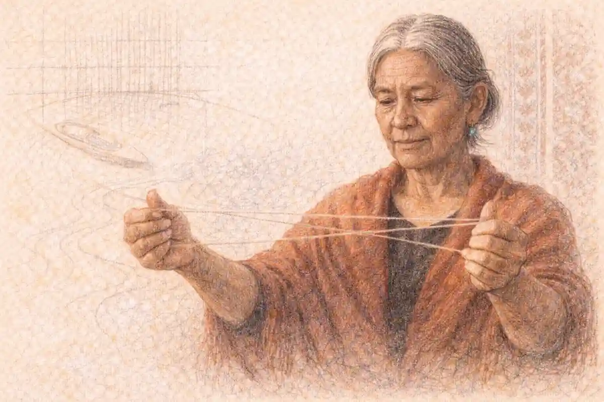

Every APUSH course begins with a puzzle disguised as a starting point. The first period opens in 1491, one year before the voyage that most students expect to launch the story, and that single year of offset carries the whole argument of the early course inside it. The exam does not begin with Columbus because the exam is not, at its foundation, a story about Europeans arriving somewhere empty. It begins with the world that existed before sustained contact: Native societies with their own economies, diplomacies, agricultural systems, and rivalries, and European societies being reshaped by state building, commerce, and religious fracture. When those two worlds collided after 1492, the collision produced consequences that were still unfolding in 1800 and, in several cases, are still being argued about in the later periods of the course. Periods 1 through 4, running from 1491 to the opening of the nineteenth century, are therefore not a prologue to the real exam. They are the foundation the rest of the exam quietly stands on.

Three centuries of material sit inside those four periods, and the density frightens students into the weakest possible strategy, which is memorizing events as isolated entries on a timeline. The strategy fails for a specific reason that this article returns to from several directions. APUSH questions about the early periods rarely ask what happened in a vacuum. They ask why colonies developed differently from one another, how an exchange of plants and diseases became a transformation of labor, why a trading relationship curdled into a revolution, and how a revolution that began as a defense of old rights produced a new constitutional order. Each of those questions is a causation question, and causation questions are answered with connections, not with lists. A student who knows that tobacco saved Jamestown but cannot connect tobacco to land hunger, land hunger to indentured servitude, servitude to Bacon's Rebellion, and rebellion to the turn toward enslaved African labor knows four facts and no history.

The series frame matters here as well. The full sweep of the course, all nine periods and the skills that bind them, is mapped in the [complete AP US History guide](/2007/09/16/ap-us-history-complete-guide/), and this article handles the first four periods at the depth the exam assumes. What follows works through contact and the Columbian Exchange, the three great colonial systems and the variations inside them, the Atlantic economy and the slavery at its center, the long era of salutary neglect and the political habits it bred, the imperial crisis and the Revolution it produced, the failed first republic under the Articles of Confederation, the Constitution and the fight over ratification, and the early republic of Washington and Adams down to the election of 1800, where Period 4 opens. Along the way it addresses directly the most common misconception about this material, the belief that early colonial detail is low-value decoration, and it shows instead how that detail anchors the causation questions that later periods keep asking.

## Why the early periods carry the whole course

Weighting is the first fact to absorb, because weighting tells a student where the exam's attention actually lives. The College Board assigns Period 1 a small share of the exam, roughly five percent, and Period 2 a larger share near ten percent, while Period 3, covering 1754 to 1800, carries a share in the range of ten to seventeen percent, among the heaviest single blocks in the course. Period 4, from 1800 to 1848, carries a similar heavy weighting, and its opening movements, the Jeffersonian turn and the market changes that followed, are unintelligible without the groundwork of the decades before 1800. Those numbers, however, understate the true weight of the early periods, because exam questions do not respect period borders as politely as the framework prints them. A long essay prompt about the causes of sectional tension reaches back to colonial labor systems. A document-based question on American identity draws on Revolutionary ideology. A short-answer question about federal power begins, very often, with Hamilton.

Consider what later periods actually presuppose. The market revolution of Period 4 grows out of colonial Atlantic commerce and the early republic's banking and tariff fights. The sectional crisis of Period 5 grows out of slavery's colonial entrenchment and the compromises of 1787. The constitutional arguments of the Civil War era quote the ratification debates. The foreign policy of the early republic, neutrality, embargo, and the management of European war, becomes the template later administrations either follow or repudiate. A student who treats 1491 to 1800 as a decorative preface arrives at Period 5 carrying conclusions without premises, and conclusions without premises are exactly what APUSH scoring punishes. The rubric rewards claims supported by specific evidence and reasoning about cause, comparison, and change over time, and the richest early-period evidence is causal evidence: it explains how something came to be, which is the single most reusable form of knowledge on the exam.

There is also a skills argument. The historical thinking skills the exam grades, sourcing, comparison, causation, and continuity and change over time, are all introduced in classrooms through early-period material, because the early periods offer unusually clean examples of each. The Columbian Exchange is a causation engine with visible inputs and outputs. The Chesapeake and New England are a ready-made comparison with a shared origin and divergent results. The shift from salutary neglect to imperial enforcement is continuity and change compressed into a single generation. Students who learn the skills on this material carry working templates into every later unit, which is why strong teachers linger here even when the calendar pressures them forward. The comparison and continuity-change skills in particular repay deliberate practice, and the series treats them as a discipline of their own in its article on [APUSH comparison and continuity and change](/2006/07/29/apush-comparison-continuity-change/), which early-period students should read alongside this one rather than after it.

## The misconception: colonial detail as decoration

Every year, students make the same calculation and lose points for it. Colonial history feels remote, crowded with similar-sounding settlements, charters, and governors, and the temptation is to skim it, bank the broad strokes, and save serious effort for the Civil War, the Great Depression, and the Cold War. The calculation rests on a misconception worth dismantling carefully: the belief that early colonial detail is low-value because individual colonial facts rarely headline an exam question. The premise is half right and the conclusion entirely wrong. Individual facts do rarely headline questions. What headlines questions are arguments, and arguments about American development are built from early-period materials more often than students expect, because the early periods are where the course's permanent structures were poured: a racialized labor system, a tradition of local self-government, a suspicion of concentrated authority, an Atlantic commercial orientation, and a constitutional framework that distributed power in ways Americans still argue through.

Watch how a single piece of colonial detail anchors a chain. The House of Burgesses, first convened in Virginia in 1619, looks like trivia. Placed in a chain, it becomes the seed of a representative tradition that colonial assemblies defended for a century and a half, the tradition colonists believed Parliament was violating after 1763, the tradition the state constitutions of 1776 institutionalized, and the tradition the federal Constitution both honored and constrained. A student who dismissed the Burgesses as decoration cannot write the causation essay on the Revolution's origins, because the essay's central claim, that the Revolution defended an existing political order as much as it created a new one, depends on exactly that detail. Detail of this kind is not decoration. It is load-bearing.

The same holds for economic detail. Mercantilism is a vocabulary word until it is understood as the operating system of empire, the assumption that colonies existed to enrich the mother country through a favorable balance of trade, raw materials flowing one way and finished goods the other. Understood that way, mercantilism explains the Navigation Acts, explains why enforcement mattered after 1763, explains colonial smuggling as both crime and quiet ideology, and explains why the early republic's fights over tariffs and manufacturing echoed arguments colonists had made inside the British system. Or take the detail of the Middle Passage and the triangular trades: not decoration, but the economic machinery that made Chesapeake tobacco and Carolina rice profitable, bound New England shipping to the plantation complex, and embedded slavery in every region's economy rather than only the South's. The exam's slavery questions, which run through Period 5 and beyond, presuppose all of it.

None of this argues for memorizing everything. The argument is about selection. Early-period detail earns its place when it sits inside a chain of causation, a comparison, or a continuity, and the skill this article practices throughout is exactly that placement: for each major development, what caused it, what it caused, what it resembled, and what it changed. A fact that can answer those four questions is worth keeping. A fact that answers none of them can be released without anxiety. Students who study with that filter discover that the early periods are not three centuries of noise. They are a surprisingly small number of powerful stories, told carefully, with the details that carry weight retained and the rest allowed to fall away.

## The map of the four periods

Period boundaries in APUSH are arguments, not just dates, and reading them as arguments clarifies everything that follows. Period 1, 1491 to 1607, covers the world before English colonization and the first contacts: Native societies across North America, European exploration driven by trade, conquest, and religion, the Columbian Exchange, and the Spanish empire that set the patterns others reacted against. The period ends in 1607 because Jamestown's founding opens the English colonial story proper. Period 2, 1607 to 1754, covers the building of colonial societies: the Chesapeake, New England, the Middle Colonies, and the Lower South, the growth of slavery, Atlantic commerce, religious awakenings, and the development of distinct regional cultures under a loose imperial hand. Its end date, 1754, marks the opening of the Seven Years' War, the conflict that broke the old imperial arrangement.

Period 3, 1754 to 1800, is the revolutionary era in the broad sense: war between empires, an imperial crisis, a war for independence, a failed confederation, a constitutional refounding, and a first decade of nation building under Washington and Adams. Its questions are political in the deepest sense, about where authority lives and how it justifies itself. Period 4, 1800 to 1848, turns to expansion and transformation: Jeffersonian democracy, the market revolution, the Second Great Awakening, reform movements, and the growth of sectional tension, all of which the companion article on [APUSH Periods 5 to 7](/2007/09/07/apush-periods-5-7-1844-1945/) picks up where its own span begins and which the Period 4 material proper develops from the election of 1800 forward. This article's span closes at 1800, so its Period 4 coverage concentrates on the threshold itself, the election that transferred power between parties for the first time and posed the questions the new century would answer.

The themes the College Board uses to organize the course run through all four periods and give students a second skeleton to hang events on. The official theme set includes American and national identity, work and exchange and technology, geography and environment, migration and settlement, politics and power, America in the world, American and regional culture, and social structures. Early-period study becomes far more efficient when each event is filed under at least one theme as it is learned, because exam prompts are written in the language of themes even when they never name them. A prompt about how economic development affected society is speaking the work-exchange and social-structures themes. A prompt about the causes of migration is geography and migration speaking. The table that organizes this article's whole argument is built on that principle, pairing each period with the themes where its exam value concentrates.

## The InsightCrunch APUSH early-periods table

The InsightCrunch APUSH early-periods table compresses the four periods into a single reference organized by theme, and it is designed to be used actively rather than admired. Read across a row to see how one theme evolves from contact to the early republic, which is precisely the motion a continuity-and-change essay performs. Read down a column to see how the themes interlock inside one period, which is what a period-specific short-answer question demands. Every cell names developments that the sections of this article then unpack at working depth.

| Period | Politics and Power | Work, Exchange, and Technology | Migration and Settlement | Identity and Culture | America in the World |
|---|---|---|---|---|---|
| Period 1, 1491 to 1607 | Native confederacies and consensus governance; European monarchies centralizing | Columbian Exchange moves crops, livestock, and disease; maize agriculture spreads | Native nations across varied environments; Spanish conquest and settlement | Distinct Native cultures; Spanish Catholic missions; first African presence | Spain builds an Atlantic empire; rival powers probe the hemisphere |
| Period 2, 1607 to 1754 | Colonial assemblies grow under salutary neglect; Glorious Revolution echoes | Tobacco, rice, and fur staple economies; slavery expands; Navigation Acts | English, African, German, and Scots-Irish migration; indentured servitude | Great Awakening; Enlightenment ideas circulate; regional cultures diverge | Colonies tied to Atlantic trade; imperial wars begin on American soil |
| Period 3, 1754 to 1800 | Imperial crisis; independence; Articles fail; Constitution and ratification | War finance; Hamilton's program; early manufacturing debate | Loyalist exodus; settlement pushes past the Appalachians | Republican ideology; Revolutionary-era reforms and limits | Alliance with France; neutrality in the 1790s; Jay and Pinckney treaties |
| Period 4 opens, 1800 | Election of 1800 transfers power peacefully; Jeffersonian ascendancy | Market revolution groundwork; embargo experiments ahead | Louisiana Purchase horizon; westward pressure builds | Second Great Awakening approaches; reform impulses gather | Barbary conflicts; neutrality strained by European war |

Two habits make the table earn its keep. First, after studying any single event, place it in the table mentally and name its row and column out loud; the placement exercise converts passive recognition into the retrieval structure the exam rewards. Second, when a practice prompt appears, locate its theme column before reaching for content, because the column tells you which family of evidence the scorers expect. Students who internalize the table find that early-period prompts stop looking like requests for trivia and start looking like invitations to trace a row.

With the map in hand, the work begins where the course begins, in the world before 1492 and the collision that followed it.

## Period 1: the world before and at contact, 1491 to 1607

### Why does Period 1 begin in 1491 rather than 1492?

The framework starts one year before Columbus so that Native American societies can be studied on their own terms, as the subjects of the first key concept rather than as a backdrop for European arrival. That single year signals that contact was an encounter between two established worlds, not a discovery of an empty one.

Geography wrote the first draft of Native American history. North of Mexico, the continent held hundreds of distinct societies, each fitted to its environment with a precision that exam questions love to test through comparison. In the Southwest, Pueblo peoples built multistory adobe towns and irrigated maize, beans, and squash in an arid land, organizing life around kinship and ceremony calibrated to scarce water. Along the Mississippi and Ohio valleys, mound-building cultures raised Cahokia, a city whose population rivaled contemporary London's, sustained by maize agriculture and river trade reaching from the Great Lakes to the Gulf. The peoples of the Pacific Northwest, by contrast, harvested salmon and cedar so abundantly that they built ranked, slave-holding societies and staged potlatch ceremonies without farming at all, a standing reminder that agriculture was one adaptation among several rather than a universal stage. On the Great Plains, many groups combined farming in river villages with seasonal buffalo hunts, while in the Northeast the Iroquois Confederacy bound five nations, later six, into a diplomatic league whose consensus practices managed war and trade across a wide region.

Two corrections follow from that survey, and both appear on exams. First, there was no single Native American experience; prompts that invite students to generalize about Native societies are usually testing whether the student resists. Second, these societies were not static. They traded, migrated, warred, adopted crops, and rebuilt political arrangements long before Europeans appeared, which means the changes after 1492 were accelerations and disruptions of existing histories, not the start of history itself. Population estimates for the hemisphere vary widely among scholars, running into the tens of millions, with several million north of Mexico, and the honest exam answer acknowledges the range rather than inventing a precise figure. What is not in dispute is density in favored regions and sophistication everywhere: roads, irrigation works, astronomical observation, diplomatic protocol, and oral traditions carrying law and memory across generations.

Europe, meanwhile, was assembling the motives and tools that would push its ships west. Monarchies in Spain, Portugal, France, and England were centralizing authority, taxing more effectively, and competing for status and revenue. Merchants wanted Asian goods, spices, silk, and precious metals, without the tolls and middlemen of overland routes, and improvements in navigation, cartography, and ship design made oceanic gambles calculable. Religion supplied both motive and justification: a militant Catholicism fresh from the reconquest of Iberia framed expansion as evangelization, while the Protestant Reformation would soon give northern rivals a competing warrant. Underneath the grand motives sat a colder one, land and labor. European societies understood colonies as sources of wealth to be extracted for the metropole, an assumption the Spanish acted on first and most brutally, and one the English later adapted rather than abandoned.

## The Columbian Exchange: the engine of Period 1

The Columbian Exchange names the vast transfer of plants, animals, diseases, people, and technologies between the Eastern and Western Hemispheres after 1492, and it is the single most consequential process in Period 1, arguably in the entire course. Its mechanism was biological before it was political. The hemispheres had evolved in isolation for millennia, so each held species and pathogens the other had never met. When ships began regular crossings, they stitched two biological worlds into one, and the stitching rearranged populations on four continents within a few generations.

Disease did the fastest and deadliest work. Smallpox, measles, influenza, and typhus arrived in populations with no acquired immunity, and epidemics moved faster than Europeans themselves, sometimes emptying villages before direct contact occurred. Mortality in many regions reached catastrophic levels across the sixteenth century, in some places consuming the great majority of a community within decades, and the social effects compounded the biological ones: elders died with their knowledge, labor systems collapsed, political authority fractured, and survivors consolidated into new communities that Europeans later misread as the aboriginal condition. For exam purposes, disease is not a sad backdrop to colonization; it is a cause of colonization's success, explaining why relatively small European forces could conquer large states and why colonizers soon complained of a labor shortage on land they described as empty when it had, in fact, been emptied only a generation before.

Food moved in both directions and remade diets worldwide. From the Americas came maize, potatoes, tomatoes, beans, squash, peppers, and cacao; the potato and maize, calorie-rich and adaptable, eventually supported population growth in Europe, Africa, and Asia. From the Old World came wheat, rice, sugarcane, coffee, and citrus, plus the animals that transformed American landscapes: horses, cattle, pigs, sheep, and chickens. Horses remade Plains cultures within a few generations, creating the mounted hunting and raiding societies that later Americans would mistake for timeless. Sugarcane, planted in the Caribbean and Brazil under brutal labor regimes, tied the exchange to its darkest consequence. European demand for sugar, and then for tobacco, cotton, and other plantation staples, created a labor hunger that neither dying Native populations nor European migrants could fill at the price planters demanded, and the Atlantic slave trade was built to fill it. The exchange thus contains the seed of the colonial labor story: biology created scarcity, markets created demand, and coercion supplied the difference.

Silver deserves its own sentence in any account, because the mines of Mexico and Peru, above all Potosí, poured bullion into Spain and through Spain into global trade, inflating European prices, financing wars, and flowing onward to China in exchange for silk and porcelain. The first truly global economy was an early-period creation. So was the first global catastrophe of cultural destruction, as missions, encomiendas, and colonial administrations attacked Native religions, languages, and governing structures across two continents.

## Spain sets the pattern, and the pattern sets the arguments

Spanish colonization supplied the template against which later empires defined themselves, and the exam expects students to know its working parts. The encomienda system granted Spanish settlers the right to extract labor and tribute from Native communities in exchange for nominal protection and Christian instruction, a legal fiction that in practice licensed exploitation until demographic collapse and reform pressure replaced it with other coercive forms, including the repartimiento draft and the hacienda. Above the extraction sat a administered empire of viceroyalties, audiencias, and Catholic missions, with the Church functioning as an arm of the state. At the base sat a caste order that ranked peninsulares, creoles, mestizos, and Indigenous and African people in a formal hierarchy, embedding race into law in ways that echo through the entire hemisphere's later history.

Resistance and critique appeared from the start, and both are testable. Native peoples resisted through flight, revolt, negotiation, and the quiet preservation of language and practice inside imposed forms, producing the blended cultures historians call syncretic. Bartolomé de las Casas, having begun as an encomendero, became the system's most famous internal critic, and his advocacy helped prompt the New Laws of 1542 and the Valladolid debate over the humanity and rights of Native peoples. That a debate occurred at all matters for the exam: it shows colonization generating its own moral and legal arguments from the beginning, arguments later English colonists would inherit, translate, and eventually aim at their own empire.

England's late arrival shaped its distinct path. Through most of the sixteenth century England raided Spanish shipping and planted failures, Roanoke most famously, while Spain's wealth made English merchants and monarchs impatient. When permanent English settlement came in 1607, it came through joint-stock companies rather than royal administration, a financing choice with enormous consequences: profit-seeking corporations, answerable to investors, planted colonies that London supervised loosely, and the looseness of that supervision is the first thread of the salutary-neglect story that dominates Period 2 and detonates in Period 3. France, meanwhile, built a thin empire of trade and alliance along the St. Lawrence and the Great Lakes, and the Dutch planted New Netherland for commerce at the Hudson's mouth. By 1607 the hemisphere held competing imperial systems whose rivalries would structure North American history for a century and a half, and Period 1 closes with every major element of the later drama already on stage: exchange, disease, slavery's beginnings, missions, resistance, and rival empires.

## The French and Dutch alternatives

Comparison sharpens when the English colonies are set against their imperial neighbors, and the exam does exactly that. New France grew slowly by design and by demography: a fur-trading empire strung along the St. Lawrence, the Great Lakes, and eventually the Mississippi to Louisiana, populated by a small number of French settlers, many of them soldiers, traders, and missionaries, in a society organized by seigneurial landholding, Catholic monopoly, and close, necessary alliance with Native nations. The coureurs de bois and voyageurs who carried the trade lived inside Native worlds, marrying into Native families and producing métis communities, because the trade demanded Native partnership rather than Native displacement. Jesuit missionaries learned languages, wrote ethnographies of real value, and pursued conversion with a cultural patience that contrasted, at least in method, with Spanish coercion and English indifference. The contrast that matters for exams is structural: where furs were the staple, Native land and Native labor remained valuable in place, so French colonization displaced fewer people and provoked less land war; where planting was the staple, as in English America, the land itself was the prize and conflict was chronic. Demography sealed the outcome: by the 1750s British America held well over a million people against perhaps seventy thousand in Canada, a disparity that made the Seven Years' War's result heavily overdetermined in North America whatever happened on its battlefields.

New Netherland supplies the third model. The Dutch West India Company planted its colony for trade, governed it through company appointees and great patroon estates along the Hudson, recruited settlers of many nations because Dutch people were scarce, and tolerated religious diversity because commerce preferred it. New Amsterdam's polyglot streets, its enslaved African laborers building company works, and its strategic position between New England and the Chesapeake made it valuable enough for England to seize in 1664 and valuable enough for the Dutch to trade away formally at the peace table. Under English rule as New York, the colony kept its pluralism, its manorial landlords on the Hudson, and its commercial orientation, and its turbulent politics, Leisler's Rebellion included, reflected the unresolved question of how a conquered, diverse colony would be governed. Together the three empires give students a controlled comparison in colonization itself: extractive and missionary Spain, commercial and plural Dutch, demographic and agricultural England, alliance-based France, each leaving institutions and grievances that Period 2 and 3 questions sample. The English mainland colonies won the continent not because their model was gentlest but because it reproduced people fastest and demanded the commodity, land, that the continent held in greatest supply.

## Period 2: building colonial societies, 1607 to 1754

### What made the Chesapeake different from New England?

Labor and purpose divided them. The Chesapeake organized around tobacco, dispersed plantations, and first indentured then enslaved workers, producing a hierarchical, individualistic society. New England organized around family migration, compact towns, churches, and mixed farming, producing a communal, literate society whose institutions prized order and shared belief over staple-crop profit.

Jamestown began as a corporate wager and nearly died of it. The Virginia Company's settlers, disproportionately young men seeking quick fortunes, arrived unprepared for farming, dependent on Powhatan's paramount chiefdom for food, and ravaged by disease in a malarial river site. The starving time of 1609 to 1610 reduced the colony to a remnant. Survival came through discipline, reinforcement, and above all tobacco: John Rolfe's marketable strain turned Virginia into a boom economy after the mid-1610s, and tobacco's demands wrote the region's social script. The crop exhausted soil quickly, so planters hungered constantly for fresh land, pushing settlement up the rivers and into Native territory with predictable violence. Tobacco also devoured labor. The headright system, granting fifty acres to whoever paid a migrant's passage, rewarded importing workers, and for most of the seventeenth century those workers were English indentured servants, young people who sold four to seven years of labor for passage and the hope of land.

The hope soured as the century turned. Servants survived their terms in growing numbers, claimed freedom dues, and found the best land monopolized by great planters, creating a restless class of landless freedmen along a tense frontier. Bacon's Rebellion in 1676, when Nathaniel Bacon's followers, frontiersmen angry at Governor Berkeley's Native policy and their own exclusion, burned Jamestown before the movement collapsed with Bacon's death, exposed the danger. Historians debate its weight, yet the exam-ready reading is clear: planter elites drew lessons about labor discipline from 1676, and in the decades around it the Chesapeake shifted decisively from indentured servitude toward racial slavery, a workforce that could be held for life, inherited through the mother, and marked by law. Virginia's slave codes, consolidated by 1705, defined enslaved people as property and stripped legal protections, while falling servant migration and the Royal African Company's loosened monopoly made enslaved Africans more available. By the early eighteenth century a tobacco society rested on enslaved labor, governed by a planter gentry through the House of Burgesses and county courts, stratified, Anglican in establishment, and organized around the plantation rather than the town.

Maryland began in 1632 as the Calverts' proprietary experiment, notable for the Act Concerning Religion of 1649, which extended toleration to Trinitarian Christians in a colony founded partly as a refuge for English Catholics, a limited and pragmatic toleration that nonetheless marked an early American landmark. Carolina, chartered in 1663, split into two colonies whose Lower South economy came to rest on rice and indigo cultivated by enslaved Africans whose knowledge of rice cultivation shaped the colony's wealth, and whose majority-Black lowcountry developed the task system and a distinctive African American culture. Georgia, founded in 1732 as a buffer against Spanish Florida and a philanthropic experiment that initially banned slavery, surrendered the ban by 1751 and converged toward the plantation model, a convergence that itself testifies to the system's gravitational pull.

New England's founding logic ran in the opposite direction. The migrants who settled Massachusetts Bay after 1630 came heavily in families, motivated by Puritan reform of the Church of England, and they built a society of compact towns gathered around congregational churches, with town meetings practicing a broad, if male and church-bound, self-government. The Mayflower Compact of 1620, signed by the Plymouth separatists before landing, became an emblem of government by consent, and Massachusetts Bay's charter, carried across the Atlantic, let the colony govern itself to a degree London later regretted. Cool climate and rocky soil discouraged staples; instead, mixed farming, fishing, lumber, and shipping produced a diversified economy and a merchant class in Boston and Salem that grew rich inside the Atlantic trades, including, uncomfortably for the region's self-image, the carrying of enslaved people and the provisioning of slave plantations. Education carried unusual weight in a culture built on Bible reading: Massachusetts laws of the 1640s required towns to support schools, and Harvard's founding in 1636 announced ambitions far beyond subsistence.

Puritan New England also generated its own dissents, which the exam treats as windows into the whole system. Roger Williams, banished for denying that magistrates could punish religious error and that charters could extinguish Native title, founded Rhode Island on separation of church and state and fair dealing for land. Anne Hutchinson's challenge to clerical authority, framed through theology and sharpened by her gender, ended in banishment after a trial that revealed how tightly the colony fused spiritual and political order. The Half-Way Covenant of 1662, admitting grandchildren of the founding generation to partial membership, registered declining religious intensity as the second generation prospered, and Salem's witch trials of 1692, driven by local faction, war anxiety, and gendered fear, closed the century with a spasm that contemporaries themselves soon regretted. King Philip's War of 1675 to 1676, Metacom's coalition against encroaching Puritan settlement, was proportionally among the deadliest wars in American history, destroying a dozen towns, killing thousands, and breaking Native power in southern New England, after which surviving Native communities faced enslavement, removal, or marginalization on their own land.

Between the two great systems sat the Middle Colonies, the empire's most plural region. New York began as Dutch New Netherland, a fur-trading venture with patroon estates along the Hudson, and passed to England in 1664 with its diversity intact: Dutch, English, German, Scandinavian, and African residents, and a pragmatic commercial culture. Pennsylvania, founded in 1681 under William Penn's proprietorship, tested a holy experiment of Quaker toleration, representative government, and peaceful purchase of Native land, drawing migrants from across northern Europe and producing, in Philadelphia, the colonies' largest and most cosmopolitan city. Grain farming, the bread colonies' export engine, rewarded family farms and tenant arrangements rather than plantations, and ethnic and religious pluralism, Lutherans, Presbyterians, Mennonites, Jews, Catholics, and Anglicans worshipping in proximity, made the region a preview of the nation's later composition and a standing contrast, on exam comparisons, to both the hierarchical Chesapeake and the homogeneous townships of New England.

Three structural facts unite these regions despite their differences, and prompts probe all three. Every region depended on Native land and, initially, Native trade and diplomacy, so colonization was negotiation and war braided together from the first decade. Every region joined the Atlantic economy, exporting staples or provisions and importing manufactures, enslaved people, and credit, so none of them was economically self-contained. And every region developed representative assemblies that colonists came to regard as rights-bearing bodies, the institutional habit that would collide with Parliament in Period 3. Regional difference inside structural sameness is the exact pattern comparison questions are built to detect.

## Native nations as diplomatic and military powers

Colonization was never a one-sided transaction, and the early-period questions that students find hardest are usually the ones that require treating Native nations as states pursuing interests. The diplomatic record supports that treatment at every step. Powhatan's paramount chiefdom managed the Jamestown intruders as a tributary problem, feeding them, starving them, marrying into their leadership through Pocahontas and John Rolfe, and finally resisting in the coordinated assaults of 1622 and 1644 when English tobacco expansion made coexistence impossible. The Wampanoag under Massasoit kept a peace with Plymouth for decades because the alliance served Wampanoag strategy against Narragansett rivals, and his son Metacom dismantled that inheritance only when land loss and legal humiliation made the peace worthless to his generation. In the Southeast, the Creek and Cherokee nations balanced French, Spanish, and British traders against one another for generations, extracting gifts, guns, and restraint as the price of alliance. Diplomacy was not a courtesy extended by empires. It was the operating system of a continent where Europeans were, for most of two centuries, outnumbered supplicants outside a few coastal enclaves.

Trade drove the diplomacy, and trade reshaped Native life as profoundly as any mission or war. The fur trade pulled Native hunters into Atlantic markets, reorganized labor within Native communities, intensified warfare over hunting territories in the struggles historians call the Beaver Wars, and made European firearms and metal goods into necessities that only continued trade could supply. Dependence was real but never total, and it cut in several directions at once: French Louisiana survived on Native alliance, British traders in Carolina built a deerskin trade that enslaved Native captives in its early decades, and the southeastern slave trade in Native people, largely forgotten in popular memory, sent tens of thousands of captives to Caribbean and northern markets before African slavery fully replaced it. Alcohol, debt, and land cessions arrived as trade's shadow. Yet Native communities also appropriated European goods on their own terms, folding guns into existing rivalries, horses into new hunting economies, and Christianity, where it was adopted at all, into frameworks that answered Native needs, as in the Pueblo communities that expelled the Spanish in the great revolt of 1680 under Popé and negotiated a changed accommodation when the Spanish returned a decade later. The Pueblo Revolt, the most successful Indigenous uprising of the colonial era in the north, belongs in every student's evidence bank: it demonstrates coordination across language groups, the fragility of mission colonialism, and Spanish willingness to concede religious space in exchange for restored rule.

War between Native nations and colonies followed the logic of the land. Where settlers came to trade, as in the French interior, coexistence lasted longest, though disease and dependence eroded it steadily. Where settlers came to plant, as in English America, the demand for fenced and exclusive land made conflict structural rather than incidental, and the sequence of wars, Pequot in 1637, King Philip's in 1675, the Tuscarora and Yamasee wars in the Carolinas, Bacon's frontier violence in Virginia, marks the ratchet of dispossession. By the 1750s the French and Indian War drew Native nations into a global conflict as principals with their own war aims, and the British victory that removed France also removed the balance that had protected Native bargaining power, which is why Pontiac's coalition and later Tecumseh's, beyond this span, fought not merely against settlers but against a world in which only one empire remained to negotiate with. For essays, the productive framing is consistent: Native peoples acted, adapted, allied, and resisted inside constraints that tightened over time, and the tightening itself, driven by demography and land hunger, is one of the early course's master causes.

## Women, family, and social structure in the colonial world

Demography quietly scripted colonial societies, and the contrast between the Chesapeake and New England on this axis is among the most reliable comparison materials in the course. Early Virginia's migrants were heavily male, mortality was savage, and families formed late and broke often, leaving households headed by widows, children orphaned young, and kinship networks thin; the region's culture of individual striving and its slow development of schools and towns follow from that arithmetic. New England's family migration produced balanced sex ratios, earlier marriage, remarkable longevity for the era, and multigenerational households anchored in town and church, conditions that supported the region's literacy, institutional density, and communal discipline. The Middle Colonies sat between the patterns. Across regions, women's legal standing rested on coverture, under which a wife's property and legal identity were subsumed in her husband's, while widows and single women, feme sole, could hold property, run businesses, and appear in court, a duality that widowhood made practically significant in a high-mortality world. Enslaved women stood outside these protections entirely, their children inheriting their status under the doctrine Virginia codified in 1662, partus sequitur ventrem, a legal innovation that made slavery self-reproducing and marked one of the clearest moments where colonial law deliberately built the racial order.

Social rank ordered colonial life everywhere, though its bases differed by region: planter wealth and office in the Chesapeake, church standing and town reputation in New England, mercantile fortune in the port cities, where a cosmopolitan elite of merchants and officials stood above artisans, laborers, servants, and the enslaved in hierarchies that port-city crowds could nonetheless challenge. Those crowds matter for the revolutionary story. Urban artisans, sailors, and laborers formed the muscle of Stamp Act riots and tea resistance, and their economic grievances, against impressment, unemployment in wartime's aftermath, and competition from slave and soldier labor, gave patriot politics a popular energy that elite pamphleteers both used and feared. Colonial society by 1754 was thus neither a flat frontier democracy nor a replica of England's aristocracy, but a set of ranked orders increasingly confident, literate, and practiced in self-assertion, whose internal tensions, elite against crowd, debtor against creditor, frontier against tidewater, the Revolution would activate rather than create.

## Slavery and the Atlantic economy

No honest account of the colonial economy can treat slavery as a regional footnote, because the Atlantic system made it a continental fact. The framework historians use for that system begins with mercantilism: colonies existed to supply the mother country with raw materials and captive markets, trade was to be carried in imperial ships, and certain colonial goods, enumerated in law, could be sold only within the empire. The Navigation Acts, from 1651 onward, codified the design, and colonial commerce grew up inside it, sometimes obediently, often through smuggling that everyone understood and officials intermittently punished. The resulting trade web is often drawn as triangles: manufactures from Europe to Africa, enslaved Africans across the Middle Passage to the Americas, and plantation produce to Europe, with additional circuits carrying New England fish, grain, and lumber to the Caribbean and bringing molasses north. The molasses mattered. Distilled into rum and entangled with customs enforcement, it would help ignite the imperial crisis itself.

Within that web, labor regimes varied by crop and place, and the variation is standard exam material. Chesapeake tobacco slavery worked largely in gangs on plantations of middling size. Lowcountry rice slavery, in a disease environment white residents fled seasonally, developed the task system, under which enslaved workers who finished assigned tasks controlled remaining hours, preserving space for family economies, language, and culture that produced the Gullah world of the Carolina and Georgia coast. Caribbean and Brazilian sugar slavery, though outside the British mainland colonies, consumed the largest share of the Africans carried across the Atlantic and set the brutal pace of the whole plantation complex; Brazil and the Caribbean together received the overwhelming majority of the roughly twelve million Africans embarked in the trade across its full span. Northern slavery, smaller in scale, was nonetheless real: enslaved people labored in New York and New Jersey agriculture, in ports and households and skilled trades across New England and the Middle Colonies, and northern merchants and shippers profited from the trade itself, which is why the exam resists any framing of slavery as something the North merely observed.

Enslaved people were never a passive input into this system, and Period 2 evidence of agency recurs on exams. Day-to-day resistance ran from work slowdowns and tool breaking to the preservation of African languages, religions, music, and kinship practices under pressure. Flight created maroon communities in swamps and mountains and a constant pull toward Spanish Florida, where the 1693 Spanish offer of freedom to escaped British slaves who accepted Catholicism helped inspire the Stono Rebellion of 1739, the largest slave uprising of the mainland colonial era, after which South Carolina's Negro Act of 1740 tightened the legal cage. New York saw alleged conspiracies and harsh repression in 1712 and 1741. The through-line for exam writing is that slavery was contested from its beginnings by the enslaved themselves, and that law hardened in response to resistance as much as to economics. The long causation chain matters even more: slavery's profits entrenched a planter class, slavery's legal architecture defined race in statute, and slavery's expansion into new lands became the question the early republic repeatedly compromised over and the later republic finally fought over.

## Salutary neglect and the colonial political order

For roughly the first half of the eighteenth century, Britain governed its mainland colonies with a loose hand that Edmund Burke later named salutary neglect. The phrase describes a practice more than a policy: the Navigation Acts stood on the books, but enforcement was intermittent, customs posts were undermanned, vice-admiralty machinery rusted, and the Board of Trade advised without commanding. Distance did much of the work, since instructions took months to cross the Atlantic, but politics did the rest, as British ministries found colonial crackdowns costlier than the revenue they might raise. Governors appointed from London discovered that colonial assemblies held the purse, voting the governor's salary year by year, and a governor who fought his assembly usually lost something he needed. Robert Walpole's alleged maxim about letting the colonies alone, whether or not he spoke it, captures the governing wisdom of the arrangement while it lasted.

Neglect was a school. Inside it, colonial assemblies grew from advisory bodies into legislatures in fact, claiming the rights of Englishmen to consent to taxation, control appropriations, and speak for their constituents. Town meetings in New England and county courts in the South schooled ordinary free men in political participation, and voter eligibility among white men ran broader than in Britain itself, thanks to widely held land. Colonial politics had its own corruptions and exclusions, of women, of Native nations, of the enslaved, of the propertyless, yet the participatory habit among the included was genuine and deep. Print culture widened the schoolroom: newspapers multiplied, almanacs circulated, and the 1735 acquittal of John Peter Zenger, whose lawyer argued that truth should defend a printer against a seditious libel charge, entered colonial memory as a landmark for press freedom even though it changed no statute at the time.

Two intellectual movements ran through the same decades and armed colonists with languages for later argument. The First Great Awakening, cresting in the late 1730s and 1740s, sent itinerant preachers like George Whitefield across the colonies and Jonathan Edwards into print, splitting congregations into New Lights and Old Lights and seeding new colleges, Princeton, Brown, Rutgers, and Dartmouth among them. Its exam significance is structural: the Awakening taught colonists to question established authority in the most intimate domain, religion; it created intercolonial experiences shared from Georgia to New Hampshire; and it elevated emotional, voluntary commitment over inherited hierarchy, all habits with obvious political afterlives. The Enlightenment supplied the companion vocabulary: Locke's natural rights and government by consent, Montesquieu's separation of powers, and a broader faith in reason and print, ideas that circulated through colonial libraries and newspapers long before anyone aimed them at Parliament. Neither movement caused the Revolution in any simple sense. Together they built the audience and the arguments that a later crisis would mobilize.

### Why did Britain abandon salutary neglect after 1763?

Victory in the Seven Years' War left Britain holding Canada and the Ohio Valley, an enormous war debt, and a conviction that colonists should help pay for their own defense. Neglect had been affordable while empire was cheap; governing a continent-sized territory required revenue, garrisons, and administrative control that London now demanded.

The road to that reversal ran through war. Imperial rivalry between Britain and France produced a sequence of conflicts from 1689 onward, King William's War through Queen Anne's and King George's, each fought partly on American ground with colonial militia and Native alliances, each ending with the underlying contest unresolved. The Albany Congress of 1754, where Benjamin Franklin's Plan of Union proposed an intercolonial government for defense, failed in both London and the assemblies, a small episode with large diagnostic value: neither the empire nor the colonies yet had machinery for acting together, and each side suspected the other's design. The Seven Years' War, opening in the Ohio Country in 1754 when a young George Washington's clash at Fort Necessity lit the fuse, became a genuinely global war, and British victory by 1763 transformed the map. France left mainland North America, Spain ceded Florida, and Britain acquired Canada and everything east of the Mississippi. Native nations that had played empires against each other lost their leverage, and Pontiac's War in 1763, a broad Native resistance to British expansion and contempt, taught London that the interior needed management. The Proclamation of 1763, reserving lands west of the Appalachians to Native peoples and forbidding colonial settlement there, was that management's first instrument, and colonists who had fought expecting western land read it as betrayal. The stage for Period 3 was set by victory itself: an empire suddenly expensive, a frontier suddenly contested, and a colonial political nation trained by two generations of self-government to expect consent.

## Credit, currency, and the colonial economy's machinery

Beneath the staple trades ran a financial machinery whose frictions became political grievances, and its workings repay the same attention as any battle. The colonies suffered a chronic shortage of coin, since mercantilist trade drained specie toward Britain to settle balances, and colonial commerce ran instead on credit: book credit at the country store, bills of exchange drawn on London merchants, and commodity moneys like tobacco warehouse receipts in Virginia and wampum in early New England trade. Colonial governments answered the shortage with paper currency, bills of credit issued against future taxes or land banks that lent on mortgage, and the experiments divided the colonies internally for decades, debtors and merchants in port towns wanting tight money, farmers and developers wanting easy issues. Parliament intervened with the Currency Acts of 1751 and 1764, restricting first New England and then all colonial paper, and the restriction joined the list of grievances that framed the imperial crisis, because it touched exactly the assemblies' power of the purse that colonists considered the heart of self-government.

Debt ran downward through every level of the Atlantic system. British merchant houses extended credit to Chesapeake planters who lived splendidly and died owing fortunes, a dependence that made the tobacco aristocracy simultaneously rich and resentful, and several of the Revolution's Virginia leaders carried planter debts among their motives for suspicion of British merchants and courts. Scottish factors and stores moved into the backcountry on credit, binding small farmers to Glasgow's ledgers. Artisans bought materials on account, servants' contracts were traded as assets, and enslaved people were mortgaged as the colonies' most liquid collateral, a fact that connects the credit system directly to slavery's financial entrenchment. When the imperial crisis turned economic, boycotts, in 1765, 1768, and 1774, weaponized this web: nonimportation worked because colonial consumption ran on British credit and goods, and enforcement committees audited merchants' compliance because debt made defection tempting. The financial lens thus explains both the colonies' growth and their rebellion's mechanics, and answers about the coming of the Revolution that include currency restriction and planter debt alongside taxation read as mature economic history rather than civics.

## Population, immigration, and the backcountry

Colonial America's most startling statistic is its growth, and students should hold the pattern even without precise figures: a population of roughly a quarter million in 1700 multiplied toward two and a half million by the Revolution, doubling about every generation, mostly by natural increase in a land-rich, food-rich environment that let Americans marry younger and raise larger families than Europeans could. Enslaved Africans and their descendants formed a large and growing share of that total, approaching a fifth of the whole by 1770 and a majority in lowcountry districts, so the population story is also a slavery story. Layered over natural increase came the eighteenth century's great migrations: Germans settling Pennsylvania's interior in the tens of thousands, Scots-Irish Presbyterians pouring through Philadelphia and Charleston toward the backcountry of Pennsylvania, Virginia, and the Carolinas, convicted servants and redemptioners, Highland Scots after 1745, and Africans carried in chains in numbers that rivaled the European migration of the same decades. Franklin's 1751 Observations on the increase of mankind, marveling at American doubling and fretting about German difference, shows contemporaries understood they were living a demographic event without precedent in their world.

Settlement's geography generated politics. The backcountry, the piedmont and valley country beyond the fall line, filled with small farmers who felt misrepresented in assemblies dominated by tidewater planters, taxed for courts and churches they rarely used, and undersupplied with protection against Native nations whose land they pressed. The Paxton Boys of 1763, Scots-Irish frontiersmen who massacred peaceful Conestoga Indians and marched on Philadelphia to demand redress, and the Regulator movements in the Carolinas in the late 1760s and early 1770s, backcountry farmers organizing against corrupt fees and absent courts, put down at Alamance in 1771, translate those grievances into examinable episodes. Their significance is directional: colonial politics contained an internal frontier of resentment that ran east-west as well as colony against empire, and the Revolution, when it came, would be fought on both axes at once, with backcountry allegiance contested between patriots and Loyalists in some of the war's cruelest fighting. Regional comparison on exams increasingly includes this third geography, neither tidewater nor town, and students who know only two colonial Americas will miss it.

## The dress rehearsal: the Dominion of New England and anglicization

Salutary neglect had a prelude that proves how early the imperial argument began. In the 1680s the Stuart crown attempted the opposite of neglect: Massachusetts's charter was annulled in 1684, and the Dominion of New England, imposed from 1686 under Sir Edmund Andros, consolidated the northern colonies under a single appointed governor, revoked assemblies, taxed without consent, enforced the Navigation Acts in earnest, and questioned land titles granted under the old order. When news of the Glorious Revolution reached Boston in 1689, colonists arrested Andros and shipped him home, while New York tore itself apart in Leisler's Rebellion and Maryland's Protestants seized power in the name of William and Mary. The settlement that followed restored separate colonies and, in Massachusetts's 1691 charter, a royal governor beside an elected assembly, with property rather than church membership setting the franchise. The episode's exam value is the template it created: colonists in 1689 had already argued that taxation without consent, standing authority without assembly, and charter rights violated were tyranny, and had already acted on the argument successfully. The revolutionaries of 1776 were the grandchildren of men who had rehearsed the part.

Through the middle decades of the eighteenth century another change bound the colonies more tightly to Britain even as their politics diverged. Historians call it anglicization, and its most visible layer was consumption. Colonial imports of British manufactures surged: tea and equipage, ceramics, textiles, metalwares, and furniture carried metropolitan fashion into farmhouses, and the consumer revolution gave colonists across regions a shared material culture and a shared vocabulary of refinement. Print anglicized alongside goods; colonial newspapers reprinted London content, colonial lawyers studied English precedents, and colonial gentlemen built Georgian houses whose symmetry advertised membership in an empire of taste. The paradox is examinable and rich: the same integration that made colonists feel most British also made a boycott possible, because nonimportation worked only where British goods mattered, and made imperial taxation feel like a family betrayal, because colonists understood themselves as Britons entitled to Britons' rights. A student who grasps that double motion, integration generating both loyalty and leverage, holds the key to the imperial crisis's emotional register, which was not separatism but disappointed membership. The crisis, when it came, was fought by people who began by demanding to be treated as what they believed they already were.

## Period 3: revolution and refounding, 1754 to 1800

The decade after 1763 is the most argument-dense stretch of the early course, and the exam returns to it relentlessly because every later American argument about taxation, representation, and federal power descends from it. Britain's postwar program had a logic London considered obvious. The national debt had roughly doubled during the war, much of it spent defending America; British taxpayers carried heavy land taxes while colonists paid among the lightest taxes in the empire; a standing army of some ten thousand troops would garrison the frontier; and customs revenue leaked through smuggling on a scale that made the American customs service cost more than it collected. George Grenville's ministry set out to rationalize the system. The Sugar Act of 1764 lowered the molasses duty while promising real enforcement and vice-admiralty trials without juries. The Stamp Act of 1765 reached further, taxing paper goods, legal documents, newspapers, and playing cards directly inside the colonies, the first internal tax Parliament had levied on America for revenue.

The colonial response invented a political vocabulary. Colonists distinguished internal taxes, which only their assemblies could levy, from external trade duties, which they had grudgingly conceded to Parliament, and the slogan of no taxation without representation condensed a constitutional claim: that the rights of Englishmen traveled with Englishmen, and that virtual representation, Parliament's claim to speak for all subjects whether or not they voted, was a fiction when applied across an ocean. The Stamp Act Congress of 1765, bringing delegates from nine colonies to New York, asserted those rights in a coordinated intercolonial voice. Enforcement failed on the ground because resistance made it fail: crowds intimidated stamp distributors into resigning, nonimportation agreements turned merchants and households into enforcers of a consumer boycott, and organizations like the Sons of Liberty fused street politics with print. Parliament repealed the Stamp Act in 1766 under commercial pressure, and in the same breath passed the Declaratory Act claiming authority over the colonies in all cases whatsoever, a pairing students must hold together: repeal answered the boycott, the Declaratory Act reserved the principle, and the crisis was postponed rather than resolved.

Charles Townshend's duties of 1767, placed on imported glass, lead, paint, paper, and tea, tried to slip past the internal-external distinction by taxing at the port, and colonists, educated by pamphlets like John Dickinson's Letters from a Farmer in Pennsylvania, answered that revenue was revenue whatever the collection point. Nonimportation revived, troops landed in Boston in 1768, and friction in that occupied town produced the Boston Massacre of March 1770, five colonists dead and a propaganda contest that Paul Revere's engraving won for the patriot side. Lord North's ministry repealed most Townshend duties in 1770, keeping the tea duty as a marker of right, and three deceptively calm years followed. Calm ended with the Tea Act of 1773, which cut the price of East India Company tea while preserving the tax, and colonial radicals read the cheapness as the trap: accept inexpensive taxed tea and the principle of parliamentary taxation was conceded. Boston's answer in December 1773 was to destroy the tea rather than land it, and similar pressure elsewhere turned ships away. Each step in this sequence matters less as an isolated event than as a ratchet: every assertion of parliamentary right taught colonists to organize across colony lines, and every act of resistance taught London to see conspiracy where colonists saw constitutional defense.

Parliament's punishment for Boston, the Coercive Acts of 1774, closed the port, rewrote Massachusetts's charter, shielded royal officials from local trial, and quartered troops anew; colonists named them the Intolerable Acts and treated the package, together with the Quebec Act's toleration of Catholicism and extension of Quebec's borders, as proof of a design against colonial liberty. The First Continental Congress met in Philadelphia in September 1774, endorsed the Suffolk Resolves, built the Continental Association to enforce boycotts through local committees, and agreed to reconvene if grievances went unanswered. Those committees deserve a line of their own, because they were governments in embryo: elected or acclaimed locally, inspecting trade, publishing names, and disciplining neighbors, they taught thousands of ordinary people the mechanics of collective action that independence would soon require. When fighting opened at Lexington and Concord in April 1775, after General Gage moved to seize provincial munitions at Concord, the political nation that responded had been rehearsing for a decade.

The Second Continental Congress managed a war while still debating reconciliation, raising an army under George Washington, issuing currency, and sending the Olive Branch Petition even as it organized resistance. Thomas Paine's Common Sense, published in January 1776, performed the decisive rhetorical work of the era, translating independence from a radical position into common sense in plain language aimed at ordinary readers, attacking monarchy and hereditary succession rather than only Parliament, and selling on a scale that made it the Revolution's loudest voice. Richard Henry Lee's resolution and the Declaration of Independence, adopted July 4, 1776, with Thomas Jefferson as principal draftsman, then fused Enlightenment theory to a bill of particular grievances, asserting equality and unalienable rights as self-evident while listing the king's offenses as the legal case for separation. The document's internal tension is itself examinable: a text proclaiming universal equality was produced by a society holding some half million people in slavery, a contradiction contemporaries noticed, Abigail Adams's plea to remember the ladies noticed along gender lines, and later generations weaponized in both directions, as abolitionists and suffragists quoted the preamble against the order its authors built.

The war that followed was longer and nearer to failure than commemoration suggests. Britain held advantages in navy, finance, regulars, and manufacturing; the American cause held advantages in distance, local knowledge, political resilience, and the impossibility of Britain occupying a continent of armed communities. The early New York campaign of 1776 nearly ended the rebellion, and Washington's counterstrokes at Trenton and Princeton saved it politically through the winter. Saratoga in October 1777, where Burgoyne's army surrendered, supplied the proof of viability that brought France into open alliance in 1778, converting a colonial rebellion into a world war that stretched British resources from the Caribbean to India; Spain and the Netherlands joined against Britain without formally joining the American cause. The war's later grinding phase in the South, partisan warfare, British victories that could not be converted into control of the countryside, and finally the trap at Yorktown in October 1781, where French sea power sealed Cornwallis's fate, delivered independence. The Treaty of Paris in 1783 recognized the United States, granted boundaries to the Mississippi, and left unresolved the debts, Loyalist property, and frontier posts that would trouble the new nation's diplomacy for a decade.

Two dimensions of the war repay special attention because prompts return to them. The first is participation and its limits. Tens of thousands of Loyalists, perhaps a fifth of the white population, opposed independence, and a large share, estimates commonly run into the tens of thousands, eventually left the country for Canada, Britain, or the Caribbean, carrying American political culture with them and emptying communities of neighbors. Enslaved people read the war through their own interests: Lord Dunmore's Proclamation of 1775 offered freedom to the enslaved people of rebels who joined British lines, and thousands fled to British forces in the war's largest self-emancipation before emancipation was policy anywhere in the new republic. Women sustained farms and businesses, followed armies as camp workers, and in the ideology later named republican motherhood were assigned the civic task of raising virtuous citizens, an expansion of women's recognized importance that stopped short of political rights. The second dimension is the state constitutions of 1776 and after, the Revolution's first institutional harvest. Most expanded legislative power, distrusted executives, and issued declarations of rights; Pennsylvania's 1776 frame went furthest toward democracy, while Massachusetts's 1780 constitution, drafted substantially by John Adams, balanced powers and endured. Vermont abolished adult slavery in 1777, Pennsylvania legislated gradual emancipation in 1780, and northern states followed in a pattern that made slavery sectional in law even as the Constitution was being written, a fact Period 5 questions assume as background.

## The Seven Years' War: the war that made the Revolution possible

Between the Albany Congress's failure and the Proclamation Line stands the war itself, and its scale deserves direct attention because the crisis that followed is unintelligible at smaller scale. The fighting opened badly for Britain: Washington's surrender at Fort Necessity in 1754, Braddock's catastrophic defeat near Fort Duquesne in 1755, and French and Native successes along the frontier through 1757, years in which colonial assemblies haggled over quotas and colonial soldiers served beside regulars who despised them, friction that left both sides with grievances stored for later use. William Pitt's accession to direction of the war in 1757 changed its financing and its fortunes: Britain poured money, troops, and naval power into America, reimbursed colonial expenditures, and promoted colonial officers, converting colonial reluctance into something nearer enthusiasm. Quebec fell in 1759 after Wolfe's victory on the Plains of Abraham, Montreal followed in 1760, and the Treaty of Paris in 1763 ratified a continental revolution in power: France expelled from the mainland, Spain out of Florida but compensated with Louisiana, Britain mistress of everything east of the Mississippi, and Native nations facing a single empire for the first time.

Each element of that settlement carried a consequence the exam traces. The war's cost, the debt figures London ministers contemplated as they designed the postwar program, was the argument for taxing America. The removal of France removed the colonists' need for British protection, dissolving the empire's strongest practical bond at the very moment London tried to charge for the connection. Colonial officers, Washington conspicuously, had measured themselves against British regulars and found the comparison less humbling than British officers insisted, a military self-confidence with a future. Native nations, abandoned by French alliance and flooded by settlers, faced the choice Pontiac's War embodied, and its suppression taught London to garrison the interior, the expense Grenville proposed colonists share. Even the war's memory politics mattered: colonists who remembered contributing men and money to a common victory heard the claim that they were undertaxed dependents as an insult to a shared achievement, and insults, in a political culture marinated in honor and rights, were accelerants. No single thread of the imperial crisis begins earlier than the war's end, which is why the College Board opens Period 3 in 1754 rather than 1763: the war is the Revolution's first cause.

## The war at home: finance, endurance, and the army that held

Wars are won by supply systems as much as by battles, and the Revolutionary War's home front explains both its length and its politics. Congress, forbidden by the Articles' design from taxing, financed the struggle by printing paper money until depreciation made continental currency a byword for worthlessness, by borrowing abroad, chiefly from France, and by requisitioning supplies from states that complied unevenly. Robert Morris, as superintendent of finance from 1781, improvised a working system out of personal credit, French loans, and the Bank of North America, the republic's first chartered bank, and the improvisation's fragility taught the nationalist generation, Morris, Hamilton, and Madison among them, that union without revenue was a fiction. Inflation fell hardest on soldiers paid in depreciating paper and on the urban poor facing wartime prices, and food riots, many led by women, punctuated the war years in American towns as they did in European ones, evidence that the home front's consent had limits the Revolution's leaders ignored at their peril.

The army's endurance under those conditions became a political fact in itself. Washington's achievement was less tactical brilliance than institutional survival: holding a force together through enlistment crises, the winter at Valley Forge in 1777 and 1778 where supply failure killed thousands while von Steuben drilled the survivors into a professional core, the harsher winter at Morristown, and the mutinies of 1781 when Pennsylvania and New Jersey regiments, unpaid and underfed, marched on their own government. The Newburgh episode of 1783, when discontented officers flirted with coercing Congress over promised pay and Washington talked them down in person, stands in the record as the moment the American Revolution declined the military coup that ended so many others, and the precedent of an army subordinated to civil authority is among the war's most consequential products. Civilians endured their own war: Loyalist and patriot neighbors informing and raiding, frontier communities exposed to war parties allied to either empire, enslaved people calculating which army's lines meant freedom, and port towns under blockade or occupation, New York held by the British for the entire war, its population swollen with refugees and its harbor a prison-ship anchorage where thousands of American prisoners died. Diplomatically, the alliance system the war created deserves its final word: Franklin's embassy in Paris converted French strategic interest into ships, troops, and loans, the Franco-American alliance of 1778 remaining the young republic's only formal alliance for generations, and the peace settlement of 1783, negotiated by Franklin, Adams, and Jay with instructions from Congress quietly set aside, won boundaries and recognition beyond what the battlefield alone had earned. Independence, in short, was a home-front, financial, and diplomatic achievement as much as a military one, and exam answers that say so, with evidence, read as analysis rather than narrative.

## The ideology of the Revolution

Ideas were weapons in the imperial crisis, and the exam expects fluency in the two great vocabularies patriots used. Republicanism, drawn from English opposition writers and classical history, taught that liberty survived only where citizens were virtuous, independent, and vigilant, and that power was forever conspiring against liberty through corruption, standing armies, and placemen. Read through that lens, a stamp tax was never really about the money; it was a symptom of a ministerial design to reduce free Britons to dependence, and small encroachments deserved resistance precisely because they were small and precedential. Liberalism, drawn from Locke, supplied the complementary language of natural rights, consent, and contract: government existed to secure life, liberty, and property, rested on the people's agreement, and dissolved its obligations when it broke the trust. Most patriot argument braided the two vocabularies without distinguishing them, republican suspicion supplying the alarm and Lockean rights supplying the legal claim, and students who can separate the strands in a document earn sourcing and analysis credit that summary writers miss.

The Loyalist counter-argument deserves the same seriousness, because comparison prompts exploit it. Loyalists warned that resistance served the ambitions of a smuggling, land-speculating few; that the empire's protection was worth its modest costs; that colonial assemblies were themselves oligarchies in no position to lecture Parliament on representation; and that independence would unleash the crowd, debase property, and end in either anarchy or an American Caesar. Events gave those warnings some evidence, from tarring and feathering to the confiscation of Loyalist estates, and the debate matters beyond 1783 because the Constitution was written by men who had heard both sides: the Federalist design is in part an answer to Loyalist predictions, an attempt to prove that a republic could be energetic without being tyrannical and popular without being lawless. Slavery exposes the ideology's outer boundary with special clarity. Enslaved petitioners in Massachusetts sued for freedom in the Revolution's own language during the 1770s and 1780s and won, in courts applying the state constitution's declaration that all men are born free and equal, while southern revolutionaries who spoke the same language held their human property and heard no contradiction they were willing to act on; Samuel Johnson's London jab about the loudest yelps for liberty coming from the drivers of enslaved people circulated because it landed. An essay that can hold the ideology's genuine power and its deliberate limits in one argument is writing at the level the top scores describe.

## The Articles of Confederation and the critical period

Independence required a government, and the government the Revolution built first was designed by men determined not to rebuild what they had overthrown. The Articles of Confederation, drafted in 1777 and ratified in 1781 after Maryland held out for western land cessions, created a confederation of sovereign states: a one-house Congress in which each state voted equally, no executive, no federal judiciary, no power to tax, no power to regulate commerce, and amendment only by unanimity. Congress could declare war, conduct diplomacy, coin money, and requisition funds from the states, which is to say it could ask. The design was the Revolution's ideology rendered as architecture, sovereignty kept close to the people in their states, central power starved on purpose, and for judging the 1780s fairly, students should concede that the Confederation achieved real things. It won the war's endgame, negotiated the Treaty of Paris, and passed the Land Ordinance of 1785 and the Northwest Ordinance of 1787, the latter organizing territorial government, promising eventual statehood on equal terms, and barring slavery from the Northwest Territory, a settlement whose importance for the sectional future can hardly be overstated.

By the middle of the decade, though, the design's defects compounded. Requisitions went unpaid, leaving Congress unable to service war debts or fund an army beyond a token force. States taxed each other's goods, issued competing currencies, and struck separate commercial postures while Britain flooded American markets and excluded American ships from the West Indies trade, and Congress lacked any lever to answer as a nation. Spain closed the lower Mississippi in 1784, and the Jay-Gardoqui negotiations exposed sectional fracture when northern commercial interests seemed willing to trade away western navigation. Debtors and creditors fought state-level battles over paper money and foreclosure, and Shays's Rebellion in western Massachusetts in 1786 and 1787, when indebted farmers under Daniel Shays closed courts and marched on the Springfield armory before a privately funded militia dispersed them, convinced elites across the states that the Confederation could neither protect property nor command respect abroad. The rebellion's exam function is catalytic rather than substantive: it scared the political nation into a convention, and it taught the convention's members to fear both weak government and, in reaction, unchecked democratic majorities, a double fear the Constitution visibly carries.

### How did the Constitution answer the failures of the Articles?

The Constitution gave Congress the powers the Articles had withheld: taxation, regulation of commerce, and a federal executive and judiciary to enforce national law. It then hedged those powers with federalism, separation of powers, and checks and balances, answering weakness without recreating the concentrated authority the Revolution had resisted.

Fifty-five delegates met in Philadelphia in May 1787 charged with revising the Articles and instead wrote a new frame, in closed session, through a summer of argument whose structure students should know as a set of bargains. James Madison's Virginia Plan proposed a strong national government with representation by population in both houses, an executive, and a judiciary, favoring large states. The New Jersey Plan answered with equal state representation and a weaker center. Roger Sherman's Connecticut Compromise, the Great Compromise, split the difference: a House apportioned by population and a Senate with two members per state, the dual principle, people and states, that still organizes Congress. The Three-Fifths Compromise counted three-fifths of the enslaved population toward representation and direct taxes, magnifying southern power in the House and the Electoral College for generations; students should treat it not as an arithmetic curiosity but as a structural subsidy to slavery's political influence, purchased to keep the Deep South inside the union. A companion bargain protected the Atlantic slave trade from congressional prohibition until 1808 while allowing a tax on importation, and another made fugitive slave rendition a constitutional obligation. Against those, the document subjected the presidency to election through an Electoral College, hedged Congress with enumeration, and left the states holding all powers not delegated, a federal architecture designed to be argued about, and argued about it has been ever since.

Ratification was a second founding fought in public. The Constitution required approval by nine of thirteen state conventions, bypassing the Articles' unanimity rule and the state legislatures whose power the new frame trimmed. Federalists, carrying the argumentative masterpiece of the Federalist Papers, written by Alexander Hamilton, James Madison, and John Jay under the name Publius, contended that an extended republic would control faction, Federalist No. 10's celebrated claim, and that separation of powers and checks and balances, Federalist No. 51's argument, would make the new government safe by making ambition counteract ambition. Anti-Federalists, a diverse coalition rather than a party, warned that the Constitution built a consolidated government at continental distance from the people, lacked a bill of rights, empowered a standing army and federal courts beyond local control, and would deliver the country to an aristocratic few; Brutus and the Federal Farmer gave those warnings their most durable print form. The contest ran close in the states that mattered most, Massachusetts ratifying by a narrow margin after a compromise promised amendments, Virginia and New York following by similarly tight votes, New York by a handful, with the promise of a bill of rights smoothing the path. James Madison carried that promise into the first Congress, and the Bill of Rights, ten amendments ratified by 1791, answered the ratification debate's strongest objection while entrenching liberties, speech, press, religion, arms, juries, protection against unreasonable search, whose later careers no one in 1789 could foresee. For exam writing, ratification is best treated as an argument about the Revolution's meaning: Federalists claimed to fulfill 1776 by making republican government work at scale, Anti-Federalists claimed to defend 1776 against a new consolidation, and both claims remained available to every later generation that fought over federal power.

## The early republic: Washington, Hamilton, and the first parties

The government that convened in 1789 had to invent itself while operating, and George Washington's two terms set precedents nearly everywhere a question can probe: a cabinet of department heads, a title kept deliberately plain, federal courts organized by the Judiciary Act of 1789, and neutrality asserted as the young republic's default posture toward European war. Alexander Hamilton, as secretary of the treasury, supplied the era's defining program and its defining controversy. His reports proposed funding the national debt at par, assuming state debts into the federal ledger, chartering a national bank, and encouraging manufactures through tariffs and subsidies, a system designed to bind creditors to the new government, establish public credit, and steer the economy toward commerce and industry. The assumption fight produced the era's emblematic bargain, the Compromise of 1790, in which southern votes for assumption were exchanged for a permanent capital on the Potomac, a reminder that the republic's geography was negotiated alongside its finance.

Opposition organized around Thomas Jefferson and James Madison into the Democratic-Republican interest, against the Federalist following of Hamilton and John Adams, and the first party system was born less from organization than from conviction about what the republic should be: agrarian and commercial, strict and loose in reading the Constitution, oriented toward France or toward Britain. The bank fight made the constitutional argument explicit. Jefferson's strict construction held that Congress possessed only enumerated powers and those strictly necessary to them; Hamilton's doctrine of implied powers, anchored in the necessary and proper clause, prevailed with Washington's signature on the bank bill in 1791. That single argument, loose against strict construction, recurs on exams across three centuries of prompts, and it begins here, over a bank. The excise tax on whiskey, part of Hamilton's revenue system, provoked the Whiskey Rebellion in western Pennsylvania in 1794, and Washington's decision to raise a militia army larger than most Revolutionary forces and lead it partway west announced that the new government could enforce its laws, the Confederation's signature incapacity answered in a single demonstration.

Foreign revolution stress-tested the parties. The French Revolution, and then war between revolutionary France and Britain from 1793, split Americans along ideological lines that hardened into identity. Washington's Neutrality Proclamation of 1793 and his Farewell Address of 1796, counseling against permanent alliances and warning against faction, set doctrines later generations quoted as scripture. The Citizen Genêt affair, in which a French envoy commissioned American privateers and appealed over the president's head to public opinion, discredited pro-French enthusiasm and fed Federalist charges of mob politics. Jay's Treaty of 1795, settling impressment-era grievances partially and securing British evacuation of the Northwest posts while conceding much on trade, provoked fury in Republican ranks and a constitutional fight over the House's treaty role; Pinckney's Treaty with Spain the same year, winning Mississippi navigation and the right of deposit at New Orleans, showed diplomacy's western face and calmed the frontier constituency whose loyalty the union most needed.

John Adams inherited the machinery and the storm. The undeclared Quasi-War with France followed the XYZ Affair of 1797 and 1798, in which French agents demanded bribes before negotiations and American envoys' published dispatches turned public opinion sharply against France. In the heated atmosphere of 1798, the Federalist Congress passed the Alien and Sedition Acts, lengthening residency requirements for citizenship, empowering the president to deport dangerous aliens, and criminalizing false, scandalous, and malicious writing against the government, a statute under which Republican printers were actually prosecuted. Madison and Jefferson answered through the Virginia and Kentucky Resolutions, asserting that the states, as parties to the constitutional compact, could judge federal usurpations and declare them void, the nullification doctrine's first full statement and a seed with a long, dangerous germination. Adams, to his credit and his party's disgust, then chose negotiation over war fever, reopening talks with France and accepting the political cost, a decision that split the Federalists and set up the election that closes the century.

### Why does the election of 1800 matter so much?

The election of 1800 forced the first transfer of power between opposing parties in the nation's history, and the system held. Jefferson called it a revolution in the principles of government, and its peaceful outcome, after a House deadlock, proved the Constitution could absorb partisan conflict rather than collapse under it.

The mechanics of that election exposed the Constitution's unfinished wiring. Democratic-Republican electors, voting for Jefferson and Aaron Burr without distinguishing president from vice president as the original design required, produced a tie that threw the choice into the outgoing Federalist House, where intrigue over elevating Burr deadlocked the chamber through dozens of ballots before enough Federalists abstained to elect Jefferson. The crisis directly produced the Twelfth Amendment, separating the ballots, ratified in 1804. Jefferson's inaugural promised reconciliation, declaring Americans all republicans and all federalists in a formulation that claimed the middle ground while his party dismantled pieces of the Federalist program: the Alien and Sedition Acts expired or were repealed, the military shrank, internal taxes were repealed, and Albert Gallatin's treasury management attacked the national debt that Hamilton had treated as an asset. As a Period 4 doorway the election matters in three directions at once: it demonstrated democratic resilience, it launched the Jeffersonian ascendancy that framed the next quarter century, and it promised the expansion, economy, and agrarian confidence whose contradictions, slavery's spread foremost among them, the new century would collect with interest.

## Culture and community under slavery

Slavery's history from inside the quarters is early-period content with growing exam weight, because questions increasingly ask what enslaved people built under coercion rather than only what was done to them. African cultures crossed the Middle Passage in memory and practice: languages that blended in the lowcountry into Gullah, foodways that carried okra, black-eyed peas, and rice knowledge into American kitchens, musical and religious forms built on call and response and ring ceremony, and craft traditions in basketry, ironwork, and boatbuilding that planters exploited and depended on. Family was the culture's core and its most vulnerable point, since sale could sever any tie the law refused to recognize; enslaved people answered with extended kin networks, naming practices that carried ancestors forward, and abroad marriages across plantation lines that stitched communities together over distance. Christianity, encountered first through owners' instruction meant to teach obedience, was reworked in the invisible institution of hush-harbor worship into a faith of deliverance, where Exodus was not metaphor but precedent, and Black preachers emerged as community leaders whose authority the regime could neither license nor fully suppress.

Labor itself was a negotiated terrain within brutal limits. Enslaved workers bargained with the tools available: pace, skill, feigned illness, broken tools, spoiled crops, and the leverage that scarce expertise, a driver's knowledge, a blacksmith's craft, a cook's centrality, could purchase in small privileges and protections for family. Owners understood the negotiation and answered with the whip's arithmetic and the threat of sale, yet the daily friction shaped plantation operations in ways account books record and exam documents occasionally reveal. Revolt stood at the spectrum's far end, rare on the mainland compared with the Caribbean because of demographic ratios and patrol power, but the fear of it was constant, shaping law, architecture, and the militia obligations that structured white male citizenship in the South. For essay purposes the balanced formulation is that slavery was a system of violent domination that never achieved total control, and enslaved people's cultural and familial construction under it ranks among the early republic's foundational American creations, carried into every later period's questions about identity, resistance, and the meaning of freedom claimed by a nation that had watched freedom's opposite at close range.

## Slavery's geography redrawn, 1776 to 1800

The revolutionary generation redrew slavery's map, and the redrawing is the early course's clearest example of change and continuity operating at once. In the North, the Revolution's logic worked, slowly, against the institution: Vermont's constitution of 1777 barred adult slavery, Pennsylvania's gradual emancipation act of 1780 freed no living enslaved person but declared the children of enslaved mothers free at adulthood, and Massachusetts courts read slavery out of the state constitution in the Quock Walker cases of 1783. Connecticut and Rhode Island passed gradual laws in 1784, New York followed in 1799, and New Jersey, last in the North, only in 1804. Gradualism's pace reveals its character: emancipation designed to protect slaveholders' property interests first, freedom arriving by birthdate arithmetic over decades, and free Black communities in northern cities building churches, schools, and mutual aid societies inside a freedom that remained hemmed by discrimination and, in several states, disfranchisement. In the South the same years brought manumissions by conscience-struck owners, Virginia liberalizing private manumission in 1782, and a brief evangelical and revolutionary critique of slavery, followed by entrenchment as tobacco gave way in the Upper South to wheat, which loosened labor demand temporarily, while the Lower South's rice and the coming cotton economy tightened slavery's grip. The Constitutional Convention's compromises protected the institution nationally, and the 1790 census counted roughly seven hundred thousand enslaved people in the new republic, their numbers growing by natural increase in a pattern unlike the import-dependent Caribbean.

Two consequences follow for later periods and are worth naming as this article's span closes. The section line drawn by gradual emancipation, slavery lawful and expanding below a border, dying slowly above it, created the political arithmetic of the early republic: Senate balance tended deliberately, House apportionment swollen by the Three-Fifths clause, and a national politics that learned to route around slavery to survive, the route that held until it did not. And the Haitian Revolution, beginning in 1791 in France's richest slave colony, terrified American slaveholders, enriched American merchants who traded with it, split American opinion along the partisan lines of the 1790s, and stood through the period as living proof that the age of revolutions could be turned, by the enslaved themselves, against slavery, a possibility American politics spent the next seventy years alternately invoking and suppressing. Students who can narrate emancipation in the North and entrenchment in the South as one process with two outcomes hold the master key to Period 5.

## Religion in the early periods

Religion runs through the early periods as both institution and insurgency, and the exam tests its political weight rather than its theology. Colonial establishments were the norm: Congregational churches tax-supported in most of New England, Anglican churches established in the South, with dissenters tolerated in varying degrees and Rhode Island and Pennsylvania standing as the pluralist exceptions. Church membership structured community standing, and ministers functioned as intellectual authorities, which is why the jeremiad sermon, lamenting communal decline from a founding errand, became a durable American rhetorical form. The First Great Awakening then disrupted the arrangement from inside Protestantism, and its examinable consequences are political as much as spiritual: converts learned to judge ministers by the experience a sermon produced rather than the office its preacher held, denominations multiplied and competed, Baptists and Methodists began their long growth among ordinary people and, increasingly, the enslaved, and a shared intercolonial event gave colonists an early experience of moving together across colony lines.

The Revolution translated religious voluntarism into constitutional principle. Virginia's fight over assessment for Christian teachers produced Madison's Memorial and Remonstrance of 1785 and Jefferson's Statute for Religious Freedom of 1786, separating church from state in the state where Anglican establishment had been strongest. The federal Constitution banned religious tests for office, and the First Amendment barred an establishment while protecting free exercise, a settlement Baptists and other dissenters had lobbied for from hard experience of persecution. Yet the settlement was partial in ways exams probe: several states kept religious establishments or tests into the early republic, Massachusetts disestablishing only in 1833, and slavery's churches produced their own insurgency, as enslaved Christians forged an invisible institution of worship and, in figures like Nat Turner just beyond this article's span, turned biblical literacy toward liberation. Religion in the early periods is thus best studied as a recurring argument about authority: who may speak for God, whether the state may fund the speaking, and what happens when the enslaved and the excluded claim the text for themselves. That argument, like the arguments over banks and taxes, was fully formed by 1800 and has never since left the course.

## Land and westward pressure in the early periods

Expansion was the early republic's constant temptation and its most consequential habit, and its roots are colonial. From the first settlements, land hunger drove the story: tobacco's soil exhaustion pushed Virginians upriver, speculators organized companies to claim the Ohio Country, and colonial charters that ran sea to sea on parchment gave colonies paper claims they treated as destiny. The Seven Years' War itself began as a fight over the Forks of the Ohio, where Virginia speculators and French traders claimed the same ground, and the Proclamation of 1763 was Britain's attempt to slow a settler flood it could not otherwise police. Colonists read the line as theft of the war's prize, land speculators from George Washington downward read it as a threat to fortunes, and the grievance entered the Revolutionary indictment. Land policy thus belongs in the causation story of independence, not merely in its background.

Independence converted imperial restraint into national opportunity and national contradiction. The Confederation's land ordinances created the template for expansion: orderly survey, sale for revenue, territorial government, and statehood on equal footing, a system the Constitution's government retained. The Northwest Ordinance's slavery ban drew the first legislative line between free and slave expansion, while the Southwest developed under no such restriction, and the divergence foreshadowed the sectional geometry of the next century. Treaties and wars stripped Native nations of land in sequence: the Treaty of Greenville in 1795, after Anthony Wayne's victory at Fallen Timbers, opened most of Ohio to settlement, and Pinckney's Treaty secured the Mississippi outlet that made western produce commercially viable. Native resistance adapted in turn, from the multi-tribal confederacies of the 1790s to the diplomatic and military strategies that would define later confrontations, and the exam consistently frames expansion as contested process rather than inevitable tide. Every acre of the public domain carried the same question inside it, whether the labor on it would be free or enslaved, and by 1800 that question had been deferred, compromised, and geographically divided without ever being answered.

## The market revolution's early foundations

Although the market revolution belongs to Period 4's decades, its machinery was assembled in the early republic, and exams reward students who can see the assembly. The colonial economy had already taught Americans market behavior: staple exports, imported manufactures, merchant credit, and price signals traveling across an ocean. What changed after independence was scale and integration. Hamilton's financial system, funded debt, assumed state obligations, a national bank, a mint, created the credit infrastructure on which later canals, banks, and corporations would be built, whatever Jeffersonians thought of its politics. The Constitution itself functioned as economic machinery, forbidding state tariffs and paper money, empowering Congress over commerce and coinage, and creating a continental free-trade zone under one legal roof, which is one reason historians describe the founding as, among other things, a commercial settlement.

Technology and law supplied further foundations before 1800. Eli Whitney's cotton gin of 1793, designed to make short-staple cotton profitable, instead revived and expanded slavery by making the crop's processing cheap enough to spread across the interior South, the era's most consequential unintended consequence and a set-piece causation question. Whitney's parallel promotion of interchangeable parts in firearms manufacture seeded the American system of manufactures. Samuel Slater's Rhode Island mill of the early 1790s transplanted British textile technology and began the factory story that embargo and war after 1807 would accelerate into the Waltham and Lowell systems. State governments chartered banks and corporations in growing numbers, courts began reshaping contract and property doctrine toward development, and turnpike companies improved the roads on which market integration physically depended. When Period 4 questions ask students to explain the causes of the market revolution, the strongest answers reach back across the period line to this groundwork: credit, law, land, technology, and a crop whose economics bound industrialization in the North to slavery's expansion in the South. The market revolution was not a thunderclap after 1800. It was an inheritance collected.

## Tracing causes through the four periods

The series thesis for this material can be stated in one line: early-period points come from tracing causes into later periods, so studying connections beats isolated events. A worked example shows what the sentence means in practice. Begin with a plant. Tobacco's profitability in the 1610s created demand for land and labor. Land demand produced the headright system, pressure on Powhatan's people, and wars in 1622 and 1644 that broke Native power in tidewater Virginia. Labor demand produced indentured servitude, then, as servant supply tightened and Bacon's Rebellion dramatized the dangers of a free and armed laboring class, accelerated the shift to enslaved African labor codified in the slave codes. Slavery's entrenchment created a planter elite whose wealth funded the colonial resistance leadership, whose fear of British interference with slavery appears among the Revolution's background anxieties, and whose institution the Constitution then protected through the Three-Fifths Compromise, the fugitive slave clause, and the twenty-year protection of the Atlantic trade. The cotton gin multiplied slavery's value after 1793, expansion carried it west, and the compromises of 1820 and 1850, the Kansas crisis, and ultimately civil war followed the line forward. One plant, followed honestly, generates a thread that runs through five periods of the course. A student who can pull that thread can answer questions in every one of them.

The method generalizes into a habit with four moves. For any development, ask what produced it, what it produced, what it resembled elsewhere, and what stayed the same beneath the change it brought. Those are causation, consequence, comparison, and continuity, the exam's reasoning processes wearing work clothes. Apply the four moves to salutary neglect and the whole revolutionary era reorganizes: produced by distance and British politics, it produced assemblies with real power and a political nation jealous of them; it resembled the loose, negotiated character of the early Spanish borderlands in some respects while differing in the assemblies' strength; and beneath the change of 1763, colonists' expectations of consent remained continuous, which is precisely why enforcement felt like tyranny rather than administration. Prompts that ask students to explain continuity and change are answered by exactly this kind of ledger, with the before and after states described specifically and the forces of change named. The discipline is treated at full length in the series article on [APUSH comparison and continuity and change](/2006/07/29/apush-comparison-continuity-change/), and students weak in the skill should alternate readings, one pass through this article for content, one pass through that one for method.

Ranking topics by yield disciplines the hours that remain before an exam. In the early periods the perennial heavyweights are the Columbian Exchange and its demographic consequences; the comparison of colonial regions, above all Chesapeake against New England with the Middle Colonies as the pluralist third term; the growth and resistance of slavery; salutary neglect and its end; the sequence from the Seven Years' War through the Declaration as a single causal chain; the Articles' failures against the Constitution's design, including the slavery compromises inside that design; the Hamilton-Jefferson argument in its bank, debt, and foreign-policy forms; and the election of 1800 as proof and product of the party system. The series surveys the most-tested territory across the whole course in its guide to the [most tested APUSH topics](/2006/07/25/apush-most-tested-topics/), where the early periods' share of examination attention is set against the later blocks students more instinctively prioritize. Timelines serve this ranking process when they are built as causal chains rather than date lists: a date earns its line on the timeline when removing it breaks an explanation, and students who prune their timelines by that rule find the pruned version easier to memorize and far easier to use.

## How the exam tests the early periods

Format knowledge converts content into points, so the four question families deserve direct treatment. Multiple-choice questions on the early periods are stimulus-driven: a passage from a colonial sermon, a historian's paragraph on the middle ground, a map of triangular trade, a table of population growth, followed by questions that test comprehension of the source, the context behind it, and the developments it can support. The skill is disciplined reading under time pressure, and the trap is importing outside assumptions the stimulus cannot carry. A passage from a Puritan divine supports claims about New England's religious culture; it does not support claims about Virginia's. Short-answer questions typically present a historian's interpretation or a pair of images or excerpts and ask for the kind of surgical response this article has modeled: identify a cause, describe a difference between regions, explain a continuity. Each part wants a claim, specific evidence, and the connective reasoning, in a paragraph compact enough to leave time for the next part.

The document-based question draws on the early periods with some frequency because the era is rich in argumentative documents: exploration accounts and Las Casas, colonial charters, sermons, Revolutionary pamphlets, the Declaration, Federalist and Anti-Federalist essays, Washington's Farewell. The series article on [APUSH DBQ strategy](/2007/08/29/apush-dbq-strategy/) teaches the full rubric method, and two era-specific notes belong here. First, sourcing in early-period documents means reading genre as evidence: a sermon, a company report to investors, and a treaty are each performing a task, and naming that task is what sourcing points are made of. Second, outside evidence for this era is abundant and cheap for prepared students, since the causal chains in this article each contain half a dozen usable facts, and the rubric rewards relevant evidence deployed in argument rather than evidence recalled at random. The long essay, finally, is where the four-moves habit pays its largest dividend: prompts on causation and continuity across the Revolution, on comparing colonial development, or on evaluating the Constitution as change or continuity from the Articles all yield to a thesis that takes a position on degree, names its categories, and runs a chain in each body paragraph.

Volume of practice matters because these are performance skills, and targeted sets beat generic review for diagnosing which family is leaking points. Students preparing the early periods should drill with [free AP History practice questions](https://reportmedic.org/tools/ap-history-practice-questions.html), sorted to the period under study, and should mark every missed item by failure type, unknown content, misread stimulus, or weak connective reasoning, since each failure type has a different remedy and treating them as one problem wastes the drill. Timed conditions are not optional decoration on this process; the exam's pacing is itself a tested constraint, and early-period material, with its dense names and parallel regions, consumes unpracticed readers' minutes at a rate that surprises them in May.

## Common mistakes and how to study this material

Three errors account for most lost points in the early periods, and each has a known repair. The first is memorizing events without themes, collecting dates that cannot be summoned in an argument. The repair is the table habit from earlier in this article: never learn an event without assigning it a theme and a causal direction, because the assignment is the encoding the exam later retrieves. The second error is ignoring causation in favor of sequence, writing that one thing happened and then another as though chronology were explanation. Scorers are trained to distinguish the two, and the repair is a vocabulary discipline: force the connective words because, therefore, enabled, provoked, entrenched, and undermined into practice writing until chains replace lists by habit. The third error is weak chronology itself, the genuine inability to say what came before what, which quietly invalidates otherwise intelligent essays; a student who places the Great Awakening after the Revolution or the Stamp Act before the Seven Years' War has broken causality at the root. The repair is a skeletal timeline of perhaps twenty anchor dates, learned cold, onto which all other knowledge is hung: 1492, 1607, 1619, 1620, 1630, 1676, 1689, 1730s and 1740s for the Awakening, 1754, 1763, 1765, 1773, 1776, 1781, 1783, 1787, 1789, 1791, 1794, 1798, and 1800. Twenty dates, memorized to reflex, will carry the chronology of three centuries.

Regional confusion is a fourth, quieter error: students blend the colonies into a single colonial America and then cannot answer comparison questions that constitute a large share of early-period testing. The repair is comparative study from the start, learning each region against the others on fixed axes: motive for settlement, labor system, religious establishment, political institutions, relation to Native nations, and staple or economic base. A Chesapeake fact learned beside its New England opposite sticks twice as well and arrives pre-formatted for the prompts that will ask for it. Primary sources supply the final repair tool, because early-period documents are short, public, and legible: Paine's pamphlet in excerpt, the Declaration's grievances, one Federalist essay, one Anti-Federalist answer, Equiano's narrative of the Middle Passage in excerpt. Reading even five such texts replaces summary knowledge with the texture that sourcing questions measure.

## Terms that carry arguments

A short vocabulary, mastered in its working sense rather than as definitions, unlocks a disproportionate share of early-period questions. Republican motherhood names the post-Revolutionary assignment of civic virtue's reproduction to mothers, expanding women's recognized influence while confining it to the household, and questions use it to test whether students can hold expansion and limitation in one judgment. Virtual representation was Parliament's doctrine that members represented the whole empire regardless of who elected them, and the colonial rejection of it is the constitutional hinge of the 1760s. Enumerated powers, implied powers, and strict construction form the vocabulary of the bank fight and every federal-power argument after it. The middle ground describes the negotiated world of the Great Lakes country where neither Native nations nor French traders could dominate, a concept stimulus passages invoke to test whether students understand alliance as necessity. Cash crop, staple, and headright each compress an economic mechanism into a word: a crop grown for market rather than subsistence, the export commodity around which a region organized, and the land grant that turned imported labor into settlement. Students who can deploy these terms accurately, inside arguments rather than as decoration, find that early-period sources become dramatically easier to read, because the sources and the questions share the vocabulary.

## The verdict on Periods 1 to 4

Three centuries is a lot of course, and the natural fear is that the early periods demand more than they return. The accounting of this article runs the other way. Periods 1 to 4 contain the course's clearest causation stories, its cleanest comparison, its most reusable constitutional vocabulary, and the premises of nearly every argument the later periods conduct. The Columbian Exchange explains the demographic world colonization built on. Colonial regionalism explains the sectional map. Slavery's entrenchment explains the republic's central contradiction. Salutary neglect explains why 1763 detonated. The Articles explain the Constitution, the Constitution explains the party wars of the 1790s, and the election of 1800 proves the system could survive its own passions, which is the early course's final gift: a working definition of the nation whose later trials fill the remaining five periods, surveyed in the [APUSH Periods 5 to 7](/2007/09/07/apush-periods-5-7-1844-1945/) article for the middle span and in the full course map for everything after. Master the chains, keep the twenty anchor dates cold, file every event under its theme, and the first four periods stop being the course's remote preface. They become what they were designed to be: the ground on which every later score is built. One final discipline seals the preparation: return to the early-periods table after every practice set and file each missed question into its cell, naming whether the miss was content, chronology, or reasoning. Misses filed that way shrink across weeks, because the table converts a score report into a study assignment, and the assignment, worked honestly, is the difference between students who have read the early periods and students who can use them under pressure in May.

## A worked example: answering a causation prompt on the early periods

Abstract advice about chains becomes useful only when it survives contact with an actual prompt, so consider one in the standard long-essay family: evaluate the extent to which British imperial policy caused the American Revolution between 1754 and 1776. The weak response narrates the taxes in order and concludes that they caused the Revolution, earning credit for evidence while surrendering the analysis points. The stronger response begins by reframing the question's terms: imperial policy changed in kind after 1763, from neglect seasoned with trade regulation to systematic revenue extraction and enforcement, and the extent claim can be calibrated against what policy acted upon, a colonial political nation already formed by assemblies, print, and Protestant habits of dissent. Policy, on that reading, was the trigger and the accelerant; the combustible material was a century and a half of self-government, and the essay's thesis can say exactly that, assigning policy the primary role in timing and form while denying it sole credit for the explosion.

Body paragraphs then sort themselves by mechanism rather than by year. A paragraph on enforcement explains how the Sugar Act's courts, the customs reforms, and the Currency Act converted abstract sovereignty into felt experience in ports and counting houses. Another on principle traces the internal-tax argument from the Stamp Act Congress through Dickinson to the First Continental Congress, showing colonial ideology radicalizing in response to each British answer, repeal paired with the Declaratory Act being the pattern that taught colonists no concession was safe. A third paragraph concedes and weighs the counterweights: the Seven Years' War's removal of France, which made independence thinkable; economic interests, from smugglers to indebted planters, that policy threatened into coalition; and the crowd politics of Boston that repeatedly forced events faster than either ministry or congress preferred. The conclusion then returns to extent with a judgment the evidence has earned, perhaps that imperial policy caused the Revolution's timing, its constitutional language, and its intercolonial unity, while the deeper causes, demography, land, and a century of self-rule, determined that some rupture was likely once London chose to govern in earnest. Every paragraph in that architecture is built from material this article has covered, which is the point of the exercise: the early periods, learned as mechanisms, are already an essay bank, and the topics ranked earlier in this article each support the same treatment. Students should rehearse the conversion deliberately, taking one prompt per study session and forcing one familiar chain into its frame, until the movement from knowledge to argument becomes reflex rather than inspiration.

## Frequently Asked Questions

### Q: What does APUSH Period 1 cover?

Period 1 runs from 1491 to 1607 and covers the Americas before permanent English settlement, plus the first century of European contact. Its content begins with the diversity of Native American societies, from Pueblo irrigation towns and Mississippian mound cities to the Iroquois Confederacy, each adapted to a specific environment. European exploration follows, driven by trade ambitions, state rivalry, and religious motives, with Spain building the first great American empire. The Columbian Exchange is the period's central process, transferring crops, livestock, and diseases between hemispheres and devastating Native populations. Spanish systems of encomienda, missions, and caste close the period, along with the first English and French footholds. Exams test this period mainly for causation and for Native agency, asking how contact transformed societies on both sides of the Atlantic rather than asking for exploration trivia.

### Q: What does APUSH Period 2 cover?

Period 2 runs from 1607 to 1754 and covers the founding and maturation of the British mainland colonies. Students are responsible for the regional systems that took shape within it: the tobacco Chesapeake built first on indentured servitude and then on racial slavery, Puritan New England with its towns, churches, and family migration, the pluralistic Middle Colonies, and the rice-producing Lower South. The period also includes the Atlantic economy under mercantilism and the Navigation Acts, the growth of the slave trade, colonial assemblies maturing under salutary neglect, the First Great Awakening, Enlightenment circulation, and the opening imperial wars against France. Its end date, 1754, marks the start of the Seven Years' War. Testing concentrates on comparison among regions, the development of slavery, and the political habits colonists formed while London governed loosely, all of which become causes in the revolutionary period that follows.

### Q: What does APUSH Period 3 cover?

Period 3 runs from 1754 to 1800 and covers the making of the United States. Its first movement is imperial: the Seven Years' War, the postwar British program of taxation and enforcement, colonial resistance from the Stamp Act through the Tea Party, and the decision for independence in 1776. The Revolutionary War follows, including the French alliance, the Loyalist experience, and the social changes the war set moving. The period then turns to state building: the Articles of Confederation and their failures, the Constitutional Convention and its compromises, the ratification fight, and the Bill of Rights. Washington's and Adams's administrations close the span, with Hamilton's financial program, the birth of political parties, neutrality during the French revolutionary wars, the Alien and Sedition Acts, and the election of 1800. Questions emphasize causation chains and constitutional argument.

### Q: What does APUSH Period 4 cover?

Period 4 runs from 1800 to 1848, opening with Jefferson's election and the transfer of power between parties. Its major content includes Jeffersonian democracy and the Louisiana Purchase, the War of 1812, the market revolution in transportation, banking, and manufacturing, the Missouri Compromise and the sectional balancing it revealed, Jacksonian democracy and the Bank War, the Second Great Awakening and the reform movements it inspired, from abolition to women's rights at Seneca Falls, and the Mexican-American War at the period's edge. This article covers Period 4 through its doorway, the election of 1800, because the period's themes grow directly out of the early republic's choices about banks, expansion, and slavery. Testing in Period 4 stresses the market revolution's social effects, democracy's expansion for white men alongside its contraction for others, and reform as a religious and political force.

### Q: How is colonial America tested on APUSH?

Colonial America is tested chiefly through comparison and causation rather than through recall of individual settlements. Multiple-choice sets pair a stimulus, often a passage about Puritan society, a map of trade routes, or a population table, with questions about regional development. The durable comparison is Chesapeake against New England, with the Middle Colonies as the diverse third case: labor systems, settlement motives, religious establishments, family patterns, and relations with Native nations supply the standard axes. Causation questions ask how staple crops produced labor systems, how labor systems produced laws and hierarchies, and how distance from London produced assemblies with real power. Short answers frequently present two historians disagreeing about colonial society and ask students to explain the difference with evidence. Students score by keeping regions distinct, naming specific evidence for each claim, and remembering that slavery, Native diplomacy, and Atlantic commerce operated in every region, not only where they were largest.

### Q: How is the American Revolution tested on APUSH?

The Revolution is tested as an argument about causes and as an argument about consequences. On causes, questions follow the chain from the Seven Years' War through the tax program, colonial constitutional claims, organized resistance, and the Coercive Acts to independence, and they reward students who can explain why each step made the next more likely. Documents from the era, sermons, pamphlets, the Declaration, anchor source-analysis questions. On consequences, testing turns to who the Revolution changed things for: state constitutions and expanded participation for white men, gradual emancipation in the North, Loyalist exile, Native nations' loss of the imperial balance, and women's civic role redefined without political rights. Continuity questions are equally common, asking what independence did not change, including slavery's survival and elite leadership. Strong answers treat the Revolution simultaneously as a war, a political theory in action, and a social process with uneven effects.

### Q: What is the Columbian Exchange on APUSH?

On APUSH, the Columbian Exchange is the transfer of plants, animals, diseases, people, and technologies between the Eastern and Western Hemispheres that followed Columbus's voyages, and it is taught as Period 1's central causal engine. Disease is its deadliest current: smallpox, measles, and influenza struck populations without immunity and caused mortality on a catastrophic scale, weakening Native societies before many Europeans arrived in force. Food crops traveled both ways, maize and potatoes transforming diets and supporting population growth in the Old World while wheat, sugarcane, and livestock remade American landscapes; horses revolutionized Plains cultures. The exchange also created the plantation labor crisis, since staple crops demanded workers that dying Native populations and voluntary migration could not supply, driving the Atlantic slave trade. Silver from American mines globalized the system. Exam questions use the exchange to test causation and unintended consequences, and strong answers always trace at least two steps beyond the initial transfer.

### Q: How are the early colonies compared on APUSH?

Comparison of the early colonies follows a standard set of axes that rubrics reward: reason for settlement, labor system, economic base, religious life, political institutions, demography, and relations with Native nations. The Chesapeake scores as a commercial venture where tobacco profits organized society, indentured servitude gave way to slavery, families formed late under high mortality, Anglicanism was established but weak, and a planter gentry ruled through assemblies and county courts. New England scores as a religious migration where families arrived together, towns and congregations structured life, mixed farming and commerce supported broad literacy, and town meetings practiced local self-rule. The Middle Colonies score as the plural case, with grain farms, ethnic and religious diversity, and proprietary governments. The Lower South aligns with the Chesapeake on slavery while differing through rice, the task system, and a Black majority. Answers earn full credit when each claim carries evidence from at least two regions.

### Q: How is the creation of the Constitution tested on APUSH?

The Constitution's creation is tested as a response to failure and as a bundle of compromises. Questions on failure ask students to connect the Articles of Confederation's missing powers, no taxation, no commerce regulation, no executive or judiciary, to the crises of the 1780s: unpaid debts, commercial disorder, Shays's Rebellion, and diplomatic weakness. Questions on compromise focus on the Great Compromise between large and small states, the Three-Fifths Compromise and the slave-trade bargain that protected slavery to hold the union together, and the Electoral College as a hedge between popular and elite control. Ratification supplies the argument questions: Federalist claims about faction, energy, and checks and balances against Anti-Federalist warnings about consolidation and the missing bill of rights. Continuity-and-change prompts ask how much the Constitution altered the Revolution's principles. The strongest answers name the specific defect each provision answered and the specific interest each bargain served.

### Q: What is salutary neglect on APUSH?

Salutary neglect is the name, borrowed from Edmund Burke, for Britain's loose administration of the mainland colonies during roughly the first half of the eighteenth century. Imperial laws such as the Navigation Acts remained in force on paper, but enforcement was sporadic, customs staffing was thin, and London's ministries generally declined to spend political capital disciplining colonial assemblies. In the space that neglect opened, assemblies gained control of taxation and governors' salaries, town meetings and county courts schooled free men in self-government, and colonists came to treat consent-based taxation as an inherited right rather than a favor. The concept matters on the exam because it explains the revolutionary era's emotional logic: when Britain after 1763 began enforcing the system and taxing for revenue, colonists experienced administration as innovation and tyranny, because two generations of practice had taught them that their assemblies, not Parliament, held the taxing power.

### Q: How are Native American interactions tested in early APUSH periods?

Native American interactions in the early periods are tested through the lens of agency, diplomacy, and adaptation rather than victimhood alone. Questions address how Native societies organized before contact, including confederacies such as the Iroquois League and agricultural systems across regions, and then how those societies responded to trade, disease, missions, and land pressure. The fur trade is a favorite stimulus because it shows mutual dependence reshaping both parties, while wars from the Pequot War and King Philip's War to Pontiac's War test whether students can explain Native strategic reasoning, alliance building, and resistance. Documents may include treaty records or accounts of figures like Powhatan and Metacom. Slavery questions sometimes include the early trade in enslaved Native people. Strong answers name specific nations rather than writing about Native Americans generically, identify the interest each side pursued in an encounter, and track how demographic collapse and settler land hunger steadily narrowed Native options between 1491 and 1800.

### Q: How is the early republic tested on APUSH?

The early republic, meaning the Washington and Adams administrations through 1800, is tested as the Constitution's first stress test. Questions concentrate on Hamilton's financial program, funding, assumption, the national bank, and the strict-versus-loose construction argument it forced, because that argument recurs across the whole course. Foreign policy supplies the second cluster: neutrality during the wars of the French Revolution, the Citizen Genêt affair, Jay's Treaty and the partisan fury it provoked, Pinckney's Treaty and the Mississippi question, and the Quasi-War with France. The Alien and Sedition Acts and the Virginia and Kentucky Resolutions test civil liberties and the first statement of nullification. Precedent questions cover Washington's cabinet, his two-term example, and the Farewell Address. The election of 1800 closes most accounts, tested as proof that the constitutional system could transfer power between hostile parties without violence, and as the doorway into Period 4's Jeffersonian era.

### Q: What economic systems appear in early APUSH periods?

Several distinct economic systems layer across the early periods, and questions often ask students to tell them apart. Native economies ranged from reciprocal and redistributive systems within kinship and confederacy networks to the market-integrated fur trade after contact. European colonialism imposed mercantilism, the doctrine that colonies existed to enrich the mother country through favorable trade balances, enforced imperfectly through the Navigation Acts. Within colonies, plantation agriculture organized production for export around coerced labor, first indentured servitude and then hereditary racial slavery, while family farming, artisan production, and merchant commerce structured the non-plantation regions. The Spanish empire ran extractive mining through draft labor systems such as the encomienda and its successors. After independence, the early republic argued over Hamilton's program of public credit, a national bank, and encouraged manufactures against a Jeffersonian preference for agrarian commerce, a debate that set up the market revolution. Exam answers score by naming the system, its labor source, and whom it was designed to enrich.

### Q: How do you trace causes through APUSH Periods 1 to 4?

Tracing causes through the first four periods means building chains in which each development explains the next, then carrying the chain across period boundaries. A reliable method works in four moves for any topic: name what produced the development, name what the development produced, compare it with a parallel case, and identify what stayed constant underneath the change. Tobacco illustrates the method at full length: profits created land and labor demand, labor demand produced servitude and then slavery, slavery shaped the planter class that led resistance to Britain, and the Constitution then protected slavery through its compromises, setting up the sectional crises of later periods. Other productive chains run from the Seven Years' War to taxation to revolution, and from salutary neglect to assembly power to the constitutional fight of the 1760s. In essays, chains should be signposted with causal language and anchored to specific evidence at each link, because scorers credit reasoning connections, not chronological lists.

### Q: What are the heavily tested events in APUSH Periods 1 to 4?

The heavily tested events cluster where causation is densest. From Period 1, expect the Columbian Exchange, Spanish colonization and the encomienda, and Native societies before contact. From Period 2, expect Jamestown and the tobacco economy, Bacon's Rebellion and the turn to slavery, the founding of New England and its dissents, the Great Awakening, and the regional comparison among Chesapeake, New England, and the Middle Colonies. From Period 3, the Seven Years' War and the Proclamation of 1763 open the sequence, followed by the Stamp Act crisis, the Boston Tea Party and Coercive Acts, the Declaration of Independence, Saratoga and the French alliance, Yorktown, Shays's Rebellion, the Constitutional Convention and ratification, the Whiskey Rebellion, and the election of 1800. Events earn their testing weight by causing later events, so studying each one with its causes and consequences attached is more efficient than studying longer lists of isolated dates.

### Q: How is slavery in the early periods tested on APUSH?

Slavery in the early periods is tested as a system with origins, variation, and consequences, not as a single fact. Origin questions ask how and why the Chesapeake shifted from indentured servitude to hereditary racial slavery around the turn of the eighteenth century, connecting tobacco's labor demand, servant unrest dramatized by Bacon's Rebellion, declining English migration, and the legal codification of race in slave codes. Variation questions compare labor regimes: gang labor on tobacco and sugar plantations, the task system in the rice lowcountry, and smaller-scale slavery in northern farms, ports, and households, alongside the northern commercial stake in the trade. Agency questions cover day-to-day resistance, cultural preservation, flight, and revolts such as Stono in 1739. Constitutional questions follow slavery into the founding, through the Three-Fifths Compromise, the fugitive slave clause, and protection of the Atlantic trade until 1808, plus gradual emancipation in the North. Causation across periods is the highest-value framing.

### Q: How is the market revolution tested in early APUSH periods?

The market revolution itself belongs to Period 4, but exams test its early-period foundations whenever a prompt asks about causes. Students should be ready to explain how the colonial Atlantic economy taught market behavior, through staple exports, merchant credit, and imported manufactures, and how independence multiplied the effect: the Constitution created a continental free-trade zone, barred state tariffs and paper money, and empowered Congress over commerce. Hamilton's financial system then supplied credit infrastructure, funded debt, a national bank, that later development used. Technology questions target Eli Whitney twice, for the cotton gin of 1793, which expanded slavery by making short-staple cotton profitable, and for interchangeable parts in firearms production, while Samuel Slater's early textile mill opens the factory story. Embargo and war after this period accelerated domestic manufacturing, but the strongest causation answers begin before 1800, with law, credit, land policy, and a crop whose economics joined northern industry to southern slavery.

### Q: How are the Federalist and Democratic-Republican parties compared on APUSH?

The first two parties are compared on constitutional interpretation, economic vision, foreign sympathy, and social base. Federalists, led by Hamilton and Adams, read the Constitution's powers broadly under the necessary and proper clause, built the national bank, funded and assumed debts, favored tariffs and commercial ties with Britain, and drew support from merchants, creditors, and New England. Democratic-Republicans, led by Jefferson and Madison, argued strict construction, opposed the bank as unconstitutional, preferred agriculture and trade with France, and drew support from farmers, artisans, and the South and West. Comparison questions often use the parties' reactions to the same event, the French Revolution, Jay's Treaty, the Alien and Sedition Acts, as evidence of the divide. The deepest point students can make is that the parties disagreed about what the Revolution had meant: Federalists saw an ordered liberty requiring energetic government, while Republicans saw a standing warning against consolidation, and that disagreement organized American politics long after both parties vanished.

### Q: How is westward expansion tested in APUSH Periods 1 to 4?

Westward expansion in the first four periods is tested as a cause of conflict long before it becomes the story of Period 4 and beyond. Colonial questions link land hunger to tobacco's soil exhaustion, to charter claims and speculation in the Ohio Country, and to wars with Native nations from the Powhatan conflicts through King Philip's War. The Seven Years' War began partly over western land, and the Proclamation of 1763, Britain's attempt to reserve the trans-Appalachian west for Native peoples, became a revolutionary grievance. After independence, testing shifts to policy: the Land Ordinance of 1785 and Northwest Ordinance of 1787, with the latter's slavery ban drawing the first free-slave expansion line, the Treaty of Greenville opening Ohio after Fallen Timbers, and Pinckney's Treaty securing Mississippi navigation. The recurring analytical point is that every western acre carried the slavery question inside it, deferred by compromise and geography, so expansion questions reward students who connect land policy to sectional tension.

### Q: How is religion tested in early APUSH periods?

Religion in the early periods is tested for its institutional and political effects rather than its doctrines. Colonial questions cover the establishments, Congregational in New England and Anglican in the South, the limited tolerations of Maryland's 1649 act, Pennsylvania, and Rhode Island, and the role of churches in structuring community authority. The First Great Awakening is the period's most tested religious event, examined for splitting congregations, multiplying denominations, encouraging challenges to established authority, and creating a shared intercolonial experience that preceded political union. Revolutionary-era questions turn to disestablishment: Virginia's Statute for Religious Freedom, the ban on religious tests in the Constitution, and the First Amendment's pairing of no establishment with free exercise, a settlement several states completed only later. Enslaved people's reworked Christianity and the growth of Baptist and Methodist movements among ordinary people also appear. Strong answers treat religion as an argument about authority, asking who could speak, preach, and tax, in each case.
