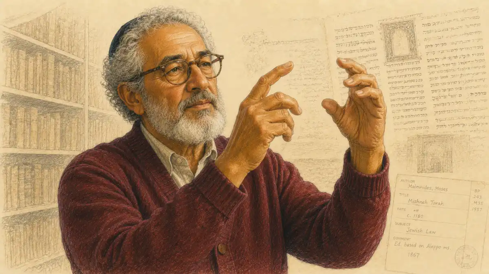

The poetry analysis essay frightens candidates out of proportion to its difficulty, and the fear has a specific shape. A student can prepare for the literary argument essay by choosing works in advance, rehearsing themes, and arriving with a mental library. The prose fiction essay at least offers narrative, characters doing things in scenes a reader can follow. The poetry essay offers none of that shelter. The exam hands over a poem the candidate has almost certainly never seen, written in a voice from another century or another continent, compressed into a page of lines that refuse to explain themselves, and asks for an analytical essay in roughly forty minutes. Everything about the task feels designed to expose the unprepared.

That feeling is the first thing to dismantle, because the task is more learnable than it looks. The poem is unfamiliar by design, and the design is the fairness of the question. Nobody in the room has an advantage of prior study on that particular text, so the score cannot reward what a student memorized about a poet in October. It rewards a method: a repeatable way of entering a strange poem, finding its pressures and turns, and converting observations into an interpretation a reader can defend. Students who believe the essay tests poetic knowledge panic when the poem resists them. Students who know it tests a reading process stay calm, because a process works on any text, including one that resists at first.

This article builds that process end to end. It covers the prompt and the rubric that scores the response, a reading method for unfamiliar poems that works under a clock, the craft of connecting form and devices to meaning, the architecture of a strong essay, and the traps that keep competent readers at middling scores. The full map of the course, including the multiple choice section and the other two essays, lives in [the complete AP English Literature guide](/2007/10/22/ap-english-literature-guide/), and the works worth preparing for the open question are gathered in [the AP English Literature reading list](/2007/10/04/ap-english-literature-reading-list/). Companion essays in the series treat [the prose fiction essay](/2007/10/13/ap-english-literature-prose-fiction-essay/) with the same rubric discipline, and the underlying skill beneath everything here, reading closely enough to notice what a text is doing, gets its own treatment in [the close reading guide](/2006/07/11/ap-english-literature-close-reading/). A compact decoding of the shared essay rubric appears in [the AP English essay rubric guide](/2006/05/05/ap-english-essay-rubric-decoded/), for readers who want the scoring logic isolated from any single prompt type.

## Where the poetry analysis essay sits on the exam

The free response section of AP English Literature and Composition contains three essays, and the poetry analysis is the first of them, Question 1 in the standard ordering. The section allows two hours for all three essays, which means each essay commands roughly forty minutes of writing and thinking combined. The free response section as a whole carries a little more than half the composite score, so each essay carries a meaningful share, and the poetry essay's share is identical to the shares of the prose fiction essay and the literary argument essay. No essay is a warm up for the others. Each one is scored separately on the same six point rubric, and the poetry essay is the only one where the text is guaranteed to be new to every candidate in the room.

The poem itself is chosen from the broad sweep of English language poetry across several centuries, and the selection habits matter for preparation. Poems on the exam tend to be long enough to sustain analysis, usually between a sonnet's fourteen lines and a few dozen lines, and substantial enough in figurative and structural interest that a reader can say more than one true thing about them. Very short lyrics rarely appear because they starve the essay of evidence, and very long excerpts rarely appear because the clock starves the reader. The poets range across eras and backgrounds, and the exam has a long habit of pairing an accessible surface with a complicated interior: a poem that seems to describe a landscape turns out to be staging an argument about grief, or a poem that seems to praise turns out to be quietly withdrawing the praise. Candidates should expect that doubleness. A poem whose meaning sits entirely on its surface would give the essay nothing to do.

The prompt that accompanies the poem follows a recognizable pattern. It names the poem and its author, sometimes with a line of context about the occasion or the collection, and then directs the candidate to analyze how the poet uses literary elements and techniques to develop a theme, a complex attitude, a relationship, or some other named concern. The wording varies, but the verb is nearly always some form of analyze, and the object is nearly always the development of meaning through craft. Reading the prompt precisely matters because it tells the candidate what the essay must centrally address. A prompt asking how the speaker's attitude toward a parent changes is not asking for everything true about the poem; it is asking for a reading of a change, and the essay that answers a neighboring question instead will be scored as a partial response no matter how elegant its prose.

One structural fact deserves emphasis before any technique discussion. The three essays share a rubric, which means the skills transfer, but the reading demands differ. The prose essay gives the candidate a passage with scenes and dialogue to lean on. The literary argument gives a prompt and the candidate's own prepared knowledge. The poetry essay gives a compressed text where every line carries structural weight and where misreading two lines can bend the whole interpretation. That compression is why this essay rewards a disciplined reading method more than the others do, and why the method occupies so much of this article.

## The prompt, decoded

Candidates lose points before writing a word by misreading what the prompt requests, so the prompt deserves a slow parse. A typical prompt does four things. It identifies the text. It supplies a small amount of framing, such as the century, a biographical note, or the situation the poem addresses. It names the interpretive focus, the thing the essay must analyze, which might be a complex idea, a speaker's shifting attitude, the relationship between two figures, or the effect of a setting. It then instructs the candidate to analyze how the poet's choices develop that focus. Each part does work. The framing is a gift of orientation, not decoration. The named focus is the essay's obligation. The final instruction is the scoring key, because the rubric's evidence points reward analysis of choices, not summary of content.

The phrase complex appears in prompts and scoring guidance often enough that candidates should understand what it signals. A complex attitude or a complex treatment means the poem does not hold one simple position. The speaker may admire and resent the same person, or find beauty and waste in the same field, or begin in certainty and end in doubt. Prompts use the word to warn candidates away from flattening the poem into a single slogan. An essay that argues the poem celebrates nature, when the poem in fact celebrates nature while mourning what human labor does to it, has answered a simpler question than the one asked. The thesis point depends on defensible interpretation, and defensibility usually requires acknowledging the poem's internal tension rather than sanding it away.

Candidates should also notice what the prompt does not ask. It does not ask for the poet's biography, the poem's place in literary history, or a catalogue of every device present. Context can season an introduction, but the essay's center of gravity is the text on the page. It does not ask whether the candidate likes the poem, and evaluative language about the poem's quality earns nothing. It does not ask for a line by line walkthrough in the poem's own order, although many candidates default to that structure because it relieves them of organizing an argument. The prompt asks for an interpretation organized by ideas, supported by the poem, and attentive to craft. Everything in this article follows from that sentence.

### Why does the rubric reward interpretation over identification?

Identification names what is present: a metaphor in the third stanza, a shift in the eighth line, a pattern of harsh consonants. Interpretation states what those features accomplish. Readers award evidence points for selected details plus commentary, and commentary is interpretation, so the rubric pays for the sentence after the device, not for the naming itself.

What interpretation sounds like is easy to hear once the contrast is clear: the metaphor shrinks a lifetime into a single season, so the speaker's urgency becomes reasonable rather than theatrical, and the poem earns its closing plea. Essays rise or fall on how consistently that second sentence appears, stays specific, and ties back to the thesis under pressure.

## The scoring rubric, piece by piece

Every AP English Literature essay is scored on a six point rubric with three rows, and candidates should know the rows cold, because the rubric is the essay's true prompt. The first row awards a single thesis point. The thesis must respond to the prompt with an interpretation, meaning a defensible claim about the text that goes beyond restating the prompt or summarizing the poem. A thesis that says the poet uses imagery and diction to show a complex attitude earns nothing, because it names categories without claiming anything. A thesis that claims the speaker's early reverence for the harvest curdles into resentment as the imagery shifts from abundance to exhaustion has made an interpretive claim, and the point follows if the essay then defends it.

The second row awards up to four points for evidence and commentary, and this row is where essays are won and lost. The scale climbs by the quality and quantity of support. An essay with little or no evidence, or with summary standing in for analysis, sits at the bottom. An essay that selects relevant evidence and offers some commentary rises into the middle. The top of the row, four points, goes to essays that select evidence well across the text and sustain commentary that explains how the evidence develops the interpretation, with a line of reasoning that holds the essay together. Two phrases in the scoring language deserve memorization: consistently and line of reasoning. Consistency is what separates the top band from the middle, since a single brilliant paragraph surrounded by summary will not reach it. A line of reasoning means the essay's parts advance one argument in an intelligible order, so the reader can feel the interpretation deepening rather than restarting with each paragraph.

The third row awards a single sophistication point, and it is deliberately difficult to earn. Sophistication can come from an insightful interpretation that handles the poem's complexities with nuance, from a vivid and persuasive style, or from an elegant and complex argument structure that mirrors the text's own movement. Most essays do not earn it, and candidates should understand that chasing it at the expense of the evidence row is a losing trade. The sophistication point is best understood as a byproduct: essays that interpret precisely, select evidence shrewdly, and write with control sometimes receive it as recognition. The threshold language used in scoring treats these bands as ranges rather than fixed cut lines, and candidates should think of the rubric as a description of reader impressions rather than a checklist of tokens to collect.

A final rubric habit is worth internalizing. Readers score the essay in front of them against the prompt that was given, in a sitting with many essays, at speed. Clarity is therefore a scoring feature, not a cosmetic one. A thesis buried in a decorative opening paragraph, evidence quoted without line anchoring, commentary that assumes the reader will connect the dots: all of these tax the reader and depress the score. The essays that score at the top make their reasoning easy to follow while making it hard to dispute.

## The InsightCrunch poetry analysis template

Strategy becomes usable when it compresses into a structure a candidate can carry into the room. The InsightCrunch poetry analysis template organizes the essay as a movement from interpretation to form to meaning evidence, in five working parts. The introduction establishes the poem's situation in a sentence or two and lands an interpretive thesis that names the poem's central tension or development. The first body movement reads the poem's opening position, the attitude or state the poem begins from, with evidence drawn from its early lines and the formal choices that establish that position. The second body movement tracks the turn, the place where structure, tone, or imagery shifts, and analyzes the devices that perform the shift. The third body movement reads the poem's resolution or complication, showing how the closing lines settle, unsettle, or reframe what came before, and it carries the essay's most sophisticated commentary. The conclusion extends the interpretation to its widest honest implication about the poem's subject, without introducing new evidence.

| Template stage | What it does | Evidence to reach for |
|---|---|---|
| Opening position | States the poem's starting attitude or state | Early lines, initial imagery, opening tone |
| Thesis | Claims the interpretation the essay will defend | The central tension or development, named precisely |
| First movement | Analyzes how the opening position is built | Diction, imagery, and form in the poem's first section |
| The turn | Locates and analyzes the poem's shift | Volta, stanza break, tonal change, new imagery |
| Second movement | Analyzes the position after the shift | Later diction, syntax, and sound working together |
| Resolution | Reads the ending as settlement or complication | Closing lines, final image, last formal gesture |
| Commentary habit | Converts each observation into an effect | Sentences that say what a choice accomplishes |
| Conclusion | Widens the interpretation honestly | The poem's implication for its subject, restated freshly |

The template is a scaffold, not a mold. Some poems turn once and settle, and some turn three times and refuse to settle, and the template flexes by adding a movement or merging the resolution into the turn. What must not flex is the direction of travel: interpretation first, evidence in service of it, and every stage asking what the poem's choices accomplish rather than merely recording that the choices exist. Candidates who internalize the direction can improvise the stages. Candidates who memorize stages without the direction produce orderly summaries, which is the failure mode this template exists to prevent.

## Reading an unfamiliar poem: the first pass

The reading method begins with a discipline that feels counterintuitive under time pressure: the first reading is for the poem's literal movement, not for its devices. Candidates who hunt metaphors on first contact end up with a list of features and no understanding of what the poem is doing, because devices mean nothing until a reader knows the situation they are operating inside. The first pass asks plain questions in a deliberate order. Who is speaking, and to whom or about what? What is the situation, the occasion, the literal scene? What changes between the beginning and the end? Where does the energy of the poem rise, stall, or turn? A reader who can answer those four questions in rough form understands the poem's spine, and every later observation will have somewhere to attach.

Punctuation is the first pass's best instrument. Poems are scored in sentences as much as in lines, and the sentence structure reveals the poem's logic. A candidate reading for the first time should track where sentences begin and end, noticing that a poem of five stanzas might contain two long sentences, or twelve short ones, and that the distribution is an argument waiting to be interpreted. Where a sentence refuses to end, spilling across lines and stanzas, the poem is usually enacting accumulation, obsession, or overflow. Where sentences shorten toward the close, the poem may be enacting resignation, decision, or exhaustion. None of these readings is available to a candidate who reads line by line as if each line were a sealed unit.

The first pass should also register emotional weather without analyzing it. Tone registers before it explains itself: a reader feels the poem darken, or lighten, or tighten into irony, and that felt shift is data. Marking the line where the weather changes gives the essay its turn. The mark does not need a label yet. Interpretation comes on later passes; the first pass simply guarantees that the reader noticed the poem's largest movements while they were happening, because in a compressed text those movements are the essay's skeleton.

Most importantly, the first pass should end with a provisional sentence of plain English: the poem begins in one state and moves to another, and something in the middle forces the move. That sentence, however rough, is the seed of the thesis. Candidates who finish a first reading without it tend to write essays that wander, because they begin composing before they know what they think. Candidates who insist on the sentence discover that the essay's hardest intellectual work was done in the first three minutes, and the remaining passes exist to test and furnish that sentence rather than replace it.

## The second and third passes: pressure and pattern

Where the first pass tracks movement, the second pass hunts pressure: the places where the poem's language intensifies, strains, or changes character. Diction shifts are the most reliable pressure signals. A poem that has been using plain rural vocabulary and suddenly admits a legal or religious term has opened a new register, and the opening is an interpretive event. Repeated words demand attention, especially when their contexts change, because repetition with variation is how poems argue with themselves. Images that recur in altered form, an early garden returning as a late graveyard, are the poem thinking. The second pass marks these recurrences and shifts without yet writing about them, building the evidence inventory the essay will draw on.

A second pressure signal lives in syntax. Long accumulating sentences behave differently from broken ones, and a poem that changes its sentence behavior midstream is showing the reader where its mind changes. Parallel constructions signal control and ceremony; interruptions, inversions, and questions signal disturbance or appeal. Candidates often overlook syntax because it lacks the glamour of imagery, but readers reward its analysis precisely because it demonstrates that the candidate noticed how the poem is built, not merely what it pictures.

The third pass, if time allows even a partial one, tests the provisional thesis against the whole text. The candidate rereads the opening and closing lines with the thesis in mind and asks whether the poem's ending genuinely reframes its beginning in the way the thesis claims. Endings are where weak interpretations die, because a thesis that explains the first two thirds of a poem and ignores its conclusion will be dismantled by the conclusion's evidence, and the essay's own reader will notice the omission. The third pass also harvests the specific short quotations the essay will use. Evidence selection happens here, deliberately: two or three phrases per movement, chosen because they carry the interpretation's weight, not because they were the lines the candidate happened to underline first.

These passes are not a luxury sequence for slow readers. On a forty minute clock they compress into perhaps eight minutes of reading total, and the compression is trainable. Students practicing the method on released poems find that the passes blur together with experience: the first reading starts catching pressures automatically, and the provisional sentence arrives sooner. The method's promise is not speed but order. It guarantees that understanding precedes analysis, and that analysis precedes composition, which is the sequence the rubric rewards and the sequence panic destroys.

### What should the first five minutes look like?

The first five minutes belong to the poem, not the pen. Minute one reads the prompt twice and circles its named focus. Minutes two and three take the first pass, tracking sentences, speaker, and situation. Minute four states the provisional sentence. Minute five marks pressure points and picks the turn.

Writing begins around minute six with a thesis already earned, which is why prepared candidates look calm while others are still introducing a poem they have not finished meeting. The calm is not temperament. It is the visible result of a sequence completed in the right order.

## Annotation that earns its time

Annotation is where reading becomes visible, and visible reading becomes an essay plan, so the habit deserves rules. Useful annotation is sparse and functional. A margin note should do one of four jobs: record the poem's movement at a turn, name a pressure point and its local effect in two or three words, connect a late line back to an early one, or flag a phrase worth quoting. Notes that paraphrase the line beside them waste the margin and the minutes. Notes that list device names without effects merely postpone the thinking the essay needs, since a label in the margin becomes a label in the essay unless the writer converts it.

The most productive single annotation habit is marking the poem's structure in the margin as the reading proceeds: a bracket where the opening position ends, a star at the turn, a bracket where the closing position begins. Those three marks, laid down during the passes, become the essay's paragraph plan the moment writing starts, because a poetry essay organized by movements is an essay with a line of reasoning already built in. Candidates who skip structural annotation often default to organizing by device, one paragraph for imagery and one for diction, which fragments the poem into a catalogue and forfeits the argument's forward motion.

Annotation also disciplines quotation choice. A candidate who underlines everything has selected nothing. The functional approach underlines only phrases that could appear in the essay, which for a poem of thirty lines might mean eight or ten phrases total. When writing begins, the candidate glances at the marked phrases and finds the evidence preselected, each attached to a marginal note about its effect. That attachment is the difference between evidence with commentary and evidence with decoration, and readers can tell within a paragraph which kind they are holding.

A caution about annotation volume closes the topic. The exam booklet is not scored. Marks in the margin earn nothing except what they contribute to the essay, and elaborate color systems or redrawn diagrams consume the minutes the essay needs. Annotate like a professional taking working notes in a meeting: enough to reconstruct the thinking later, nothing performed for its own sake.

## Form: the architecture a reader can see

Form is the poem's visible architecture, and the poetry essay rewards candidates who treat architecture as meaning. The broadest formal facts come first. A sonnet makes claims by its shape: the octave and sestet of the Petrarchan form stage a proposition and a response, while the Shakespearean form builds through three quatrains toward a couplet that either crowns or undercuts them. A villanelle's refrains enact obsession or entrapment because the form literally forbids escape from two lines. Stanza patterns matter similarly. Regular stanzas can enact order, ritual, or containment; a poem whose stanzas lengthen or shatter as it proceeds is showing the reader a control that fails or a feeling that outgrows its container.

Line behavior carries formal meaning at a smaller scale. Enjambment, where a sentence runs past a line ending, creates momentum and often a small double meaning, since the word at the line's end briefly means one thing before the next line corrects it. End stopped lines create pauses that can feel like decisions, breaths, or blows. Caesuras break lines from within and frequently mark hesitation or emphasis. A candidate need not name every device to use the observations. Writing that a thought keeps overrunning the lines built to hold it, until the final stanza where short end stopped lines impose a hard calm, is form analysis at full strength, and it requires no terminology beyond what the sentence itself demonstrates.

Form also includes what the poem refuses. Free verse is a formal choice, and its refusal of pattern can enact openness, improvisation, or disorder depending on the poem's other signals. Irregularity inside an otherwise regular poem is loud: the single line that breaks a stanza pattern, the rhyme that fails to arrive, the meter that stumbles at the moment of confession. Candidates should hunt for the break in any pattern the poem establishes, because poets place meaning at the break the way composers place it at the dissonance. The essay that notices where a poem's form cracks, and interprets the crack, is doing the exact work the evidence row's top band describes.

Finally, form governs the essay's own sense of proportion. A poem dominated by a single long sentence will reward syntactic analysis; a poem of fragments will reward attention to juxtaposition and white space. Matching the essay's emphasis to the poem's dominant formal behavior keeps the analysis proportionate, and proportion is a quiet marker of the strongest essays. The reader should finish feeling that the essay analyzed this poem, not that it applied a generic checklist in this poem's vicinity.

## Sound: meter, rhythm, and the music of argument

Sound is the formal dimension candidates most often either ignore or mishandle, and both errors cost evidence points. Ignoring sound abandons a whole category of the poet's choices, since poems are built for the ear even when read silently. Mishandling sound means listing alliteration or onomatopoeia as if naming the noise were the analysis. The productive middle path treats sound as pace and texture in the service of meaning. Meter establishes a poem's gait. A steady iambic pulse can enact composure, inevitability, or a heartbeat under control, and departures from the pulse land where the poem wants emphasis, which is why scanning even loosely for the lines that stumble repays the effort.

Rhyme works as relationship. Rhymes link words the poem wants the reader to hold together, and the linkage itself is an interpretation prompt: when a poem rhymes a word for wealth with a word for death, the rhyme has made a claim before the essay says a word. Slant rhymes and failed rhymes enact near misses, uneasy reconciliations, relationships that almost hold. A closing couplet that rhymes cleanly after a poem of slant rhymes delivers resolution in the ear before the mind names it. Candidates who train themselves to ask what a rhyme joins, and whether it joins them harmoniously or uneasily, find sound analysis becoming concrete instead of decorative.

Texture matters at the level of the individual syllable. Clusters of hard consonants slow the mouth and roughen a passage; long vowels and liquids smooth it. Poets exploit the contrast at emotional hinges, and the essay can too, briefly and precisely, by tying one texture observation to one interpretive consequence. The rule of proportion applies with special force here: a sentence or two of sound analysis, well placed at a turn or a climax, strengthens an essay, while a paragraph of phonetic inventory weakens it. Sound should appear in the essay the way it appears in the poem, as emphasis at chosen moments.

Rhythm also regulates reading speed inside the essay's evidence. A passage the poem hurries through, with short lines and enjambment, usually narrates or panics; a passage it slows, with caesuras and heavy stresses, usually contemplates or mourns. Pointing out that the poem makes the reader physically slow down at the moment of loss lets the essay claim that form produces feeling, which is the series thesis for this question in its purest shape.

## Diction and syntax: the poem's verbal surface

Diction analysis begins with register, the social and emotional altitude of the poem's word choices. Poems speak in mixtures: plain words beside elevated ones, domestic vocabulary invaded by theological or commercial terms, archaic forms sitting next to contemporary slang. The mixture is the meaning bearing layer, because register tells the reader how the speaker stands toward the subject. A speaker who describes a parent's labor in the vocabulary of liturgy is making a claim about dignity; a speaker who describes a grand landscape in the vocabulary of accounting is making a claim about diminishment. The essay earns its points by naming the mixture and interpreting the stance it creates, not by admiring individual pretty words.

Connotation does the finer work. Words arrive with atmospheres attached, and poets choose between near synonyms for the atmosphere as much as for the denotation. Tracking a poem's clusters helps: when the vocabulary of a passage gathers around decay, or machinery, or hunger, the cluster reveals the poem's governing metaphor even where no single metaphor is stated. Candidates can build strong commentary from a cluster observation because it is verifiable in the text, specific to this poem, and naturally connected to tone and theme. Isolated word worship, by contrast, convinces nobody, since any single word can be made to seem significant by a determined reader.

Syntax, diction's partner, governs how the poem thinks in time. Periodic sentences withhold their main clause and create suspense or ceremony; loose sentences deliver the clause early and ramble into qualification, enacting a mind thinking as it goes. Questions inside a poem redistribute power: a speaker asking questions of an absent figure is performing longing or accusation, and a poem that ends in a question refuses the settlement its earlier stanzas seemed to promise. Imperatives claim authority or desperation. Fragments, where they appear, mark speech breaking under feeling or a mind seizing only pieces of a scene. Each of these observations converts cleanly into commentary, because syntax is the poem's thought process made visible, and the essay's job is precisely to describe a thought process.

The strongest diction and syntax commentary links the two. A passage where elevated diction rides inside broken syntax suggests reverence that cannot compose itself; plain diction inside stately periodic sentences suggests humility held with dignity. Two layer readings like these separate top band essays from middle band ones, because they show a candidate coordinating the poem's systems rather than sampling them one at a time.

## Imagery and figurative language

Imagery is evidence a reader can see, which makes it the poetry essay's most natural support and its most common trap. The trap is inventory: candidates list the poem's images as if presence were analysis. The discipline that avoids the trap treats every image as a comparison with a direction. A metaphor claims that one thing is another, and the essay should ask what the claim transfers. When a poem figures a life as a harvest, the vehicle brings ripeness, labor, seasonality, and cutting with it, and the interpretation lives in deciding which of those transfers the poem activates and which it resists. Vehicle analysis of that kind is teachable, repeatable, and exactly what readers mean by commentary.

Patterns of imagery matter more than single images. A poem whose early images come from one sensory field and whose later images come from another is charting its own movement in pictures. Images of enclosure giving way to images of open air, or warmth imagery cooling into stone and ash, give the essay a visible arc to interpret. Sensory distribution counts too: a poem heavy with sound and poor in sight may be staging blindness, night, or inwardness; a poem of tactile images insists on contact and labor. Candidates who map the image pattern before writing find that their body paragraphs organize themselves, since each stage of the pattern becomes a stage of the argument.

Figurative language beyond metaphor follows the same discipline. Personification assigns agency, and the essay should ask why the poem wants a river or a season to act like a person, and what that borrowed agency permits the speaker to say. Apostrophe, direct address to the absent or dead or abstract, performs the speaker's need rather than the addressee's presence, and it often marks the poem's emotional summit. Symbols differ from metaphors by accumulation: an object that returns across a poem, gathering contexts, ends the poem meaning more than it could mean in any one appearance. The essay that tracks a symbol's accumulation writes about the poem's growth, which is interpretation at its most persuasive.

A proportion rule governs all of this. Imagery discussion should occupy the essay in roughly the share the poem assigns it, and a candidate who spends four paragraphs on imagery in a poem whose real engine is syntax has misread the poem's economy. The template protects against the misreading by sending the writer back to movements and turns, inside which imagery appears as one system among several, doing its share of the poem's work.

### When does a device deserve its own sentence?

A device deserves its own sentence when naming it changes the interpretation. If the essay can state an effect that would be invisible without the device, the device has earned its mention. If removing the device's name leaves the sentence's meaning intact, the name was decoration, and deletion is the honest repair.

Consider the refrain that returns unchanged while everything around it decays, so the refrain's sameness becomes the poem's measure of loss: there the naming does interpretive work. Writers can test each mention by deletion, keeping only the devices whose absence would genuinely weaken the claim, and the essay tightens by exactly the number of ornaments it sheds.

## Tone and the speaker

Tone is the poem's attitude made audible, and the poetry essay depends on reading it precisely because the prompt so often names attitude as its focus. Precision begins with vocabulary. Candidates reach for a small set of blunt tone words, sad, happy, angry, and the bluntness flattens their interpretations, since a poem can be wistful without being sad, wry without being amused, reverent without being serene. Building a working vocabulary of calibrated tone words is unglamorous preparation that pays in every essay: elegiac, sardonic, admonishing, rueful, awestruck, resigned, defiant, tender, clinical, jubilant. Each word is a small interpretive claim, and the essay then owes evidence for the calibration, which disciplines the analysis that follows.

Speaker and author must be kept separate, a distinction the exam assumes and candidates routinely blur. The speaker is a constructed voice inside the poem, who may share the poet's biography or may be a persona, a historical figure, a dramatic character, or a collective voice. Writing that the poet feels something when the text supports only that the speaker performs something is a small error with large consequences, because it replaces textual analysis with biography and invites claims the evidence cannot check. The safe habit is simple: the essay discusses the speaker's words, attitudes, and development, and mentions the poet only as the maker of choices, the one who arranged the speaker, the images, and the turns.

Tone rarely holds still across a whole poem, and its movement is often the essay's subject. A speaker may begin in detachment and end in involvement, or begin in praise and curdle into irony, and the shift usually coincides with the structural turn the template asks the writer to find. Reading tone dynamically means describing at least two tonal positions and the hinge between them. Irony deserves a special note because it inverts tone: an ironic passage says one thing in a voice that means another, and candidates who miss the inversion misread the poem's entire position. Signals of irony include exaggeration that overshoots plausibility, praise lavished on the manifestly unworthy, and a sudden flatness of diction where the subject deserves richness.

The relationship between speaker and subject is tone's deepest layer. Distance, intimacy, resentment, awe: the poem positions its speaker relative to what it contemplates, and the positioning often is the theme. A speaker who addresses a dead parent directly occupies a different poem from a speaker who describes that parent in the third person, even if the facts are identical. Essays that articulate the positioning give their readers the sense of an interpretation with genuine reach, the quality the sophistication row exists to recognize.

## The volta and the poem's structural turns

Every analytical essay on a poem needs a hinge, and the poem supplies one in its volta, the turn where direction changes. In sonnets the volta is formalized, arriving near the ninth line in the Petrarchan pattern or at the couplet in the Shakespearean, but the phenomenon belongs to all poems, not only sonnets. A turn can arrive as a stanza break where the scene changes, a conjunction that pivots the logic, a shift in tense from past to present, a change of addressee, a question interrupting a description, or an image that contradicts the images before it. Finding the turn is the single highest value act of the reading passes, because the essay's structure and the thesis's claim both hang from it.

Turns deserve analysis as events, not just locations. The essay should ask what kind of turn it is. Some turns are reversals, where the poem's position flips. Some are deepenings, where the position holds but gains a cost or a complication. Some are widenings, where a private observation opens into a general claim, and some are narrowings, where a general meditation suddenly lands on one unbearable particular. Naming the turn's kind gives the thesis its verb, since a thesis about a poem is usually a claim that the poem does one of those four things to its own starting position.

Poems with multiple turns reward the candidate who ranks them. A minor early swerve may prepare the major late reversal, and an essay that treats every wobble as equal produces a shapeless middle. Ranking asks which turn the poem's ending ratifies. The ending is the arbiter: the turn that the closing lines build upon is the poem's main hinge, and subordinate turns can be handled as approaches to it. That ranking instinct is also what allows an essay to be selective under time pressure, since the writer who knows the main hinge can let minor material go without panic.

Where a poem refuses to turn, the refusal itself becomes the subject. Some lyrics hold one position and intensify it, and the essay then analyzes intensification: how each stanza adds pressure to a single attitude through accumulation, variation, or escalation of imagery. Recognizing a static poem matters because candidates hunting for a turn that does not exist invent one, and invented evidence collapses under a reader's eye. The honest essay on an intensifying poem claims stasis as the poem's strategy and interprets what the stasis enacts, which is often obsession, endurance, or a grief that cannot move.

## Building an interpretive thesis

The thesis is the essay's contract with its reader, and the rubric's first row describes its minimum terms: respond to the prompt with an interpretation. Building one reliably is a craft with steps. Begin from the provisional sentence the first reading produced, the poem begins here and moves there. Convert the movement into a claim by adding the agent and the stakes: the speaker begins in a posture, the poem's central turn forces a recognition, and the closing position differs from the opening in a specified way that matters. The conversion usually requires two clauses, because a one clause thesis can rarely hold a development and its meaning at once.

Strong theses name the development and at least gesture at the means. A thesis claiming that the speaker's gratitude toward a teacher curdles into an adult's recognition of the teacher's failure, as the poem's imagery of light gives way to imagery of debt and closed doors, promises an essay about a change, carried by a traceable system. The promise is checkable: the body paragraphs must show the curdling and the imagery shift, and the reader can hold the essay to its word. Weak theses fail in predictable ways. The catalogue thesis lists devices without claiming an interpretation. The slogan thesis claims a theme so broad it could fit any poem ever written about nature or love or time. The plot thesis restates what happens. The evaluative thesis praises the poem's beauty or power, which is criticism of the poem rather than analysis of it.

Candidates should test a drafted thesis with three questions before writing the body. Could this claim be argued against by a reasonable reader of the same poem? If not, it is probably summary or slogan. Does it answer the prompt's named focus, in the prompt's own terms where possible? If it answers a nearby question, the evidence row will suffer no matter how well the essay proceeds. Does it commit the essay to evidence the poem actually contains, in the proportions the poem contains it? A thesis built on the poem's two weakest lines forces the writer into distortion by paragraph three.

The thesis also sets the essay's tense and person habits. Literary analysis conventionally writes about texts in the present tense, since the poem's actions recur at every reading, and keeps the writer's own person out of the prose. Those conventions are small, but they signal to a reader that the essay understands its genre, and signals accumulate at the margins where the sophistication point lives.

## From observation to claim: commentary that interprets

Commentary is the skill the whole rubric leans on, and it is also the skill candidates find hardest to define. A working definition: commentary is any sentence that explains what a piece of evidence does to the poem's meaning. Observation selects and presents the evidence. Commentary interprets its function. The ratio between them in an essay predicts the evidence row's score more reliably than any other measure, and the most useful self training a candidate can do is auditing practice essays for that ratio, paragraph by paragraph, marking sentences that only report and converting them.

Conversion follows learnable moves. The effect move states what changes for the reader or the speaker because of the choice: the short line after four long ones makes the sentence land like a verdict. The contrast move sets the evidence against what surrounds it: against the stanza's flowing syntax, the single imperative reads as panic breaking through composure. The pattern move connects the evidence to its siblings elsewhere in the poem, building the accumulation argument. The stakes move raises the interpretation's consequence: if the garden is figured as a ledger, then the speaker's love is already an accounting, and the ending's unpaid debt was prepared from the start. Each move takes an observation a candidate already has and pulls it one level toward meaning.

Commentary fails in recognizable costumes. Restatement repeats the evidence in the writer's words and calls the repetition analysis. Device praise admires the poet's skill without interpreting the poem. Biographical drift leaves the text for the poet's life. Generic significance claims that an image is powerful or effective without specifying the power's direction. Candidates who learn the costumes learn to catch themselves mid sentence, which is when catching matters, because the repair is always the same: finish the sentence by saying what the choice accomplishes, for this speaker, in this poem, at this point in its movement.

Density is the final commentary variable. Top band essays do not merely include commentary; they sustain it, so that nearly every piece of evidence arrives with interpretation attached and the interpretations connect into the line of reasoning. A candidate can practice density directly by taking a scored sample essay from the middle band and rewriting its evidence sentences with commentary appended, feeling how the same evidence doubles in value. The exercise teaches the central economic fact of this essay: points live in the sentences after quotations.

### How does the sophistication point differ from the thesis point?

The thesis point rewards a defensible interpretation stated clearly, and many essays earn it. The sophistication point rewards distinction beyond defensibility: an interpretation with genuine nuance about the poem's tensions, a prose style with control, or an organization that mirrors the poem's own movement. It cannot be claimed by announcement or installed by a grand conclusion.

It emerges when precision compounds across the whole essay, which is why chasing it directly fails while building the habits that produce it, calibrated tone words, ranked turns, sustained commentary, sometimes earns it as a byproduct of stronger work. The distinction matters practically: one point is a threshold any prepared candidate can cross, and the other is a recognition the reader grants.

## Choosing evidence: how much, which lines

Evidence selection is an act of judgment the rubric watches closely, because the scoring language distinguishes essays that use evidence from essays that select it. Selectivity shows in three habits. The first is distribution: evidence drawn from across the poem, especially from its ending, demonstrates that the interpretation governs the whole text rather than a favored passage. Essays that quote the first stanza four times and the conclusion never are telling their reader the interpretation only fits part of the poem. The second habit is grain: short quotations, a phrase or a line, embedded in the writer's own sentences, integrate better than long block quotations, which stall the argument and often substitute the poem's voice for the essay's analysis. The third habit is relevance under pressure: each quotation should be the strongest available proof of its paragraph's claim, not merely a true line about the paragraph's topic.

Quotation mechanics carry quiet weight. Quoted phrases should be woven into grammatical sentences so the essay reads as prose rather than as a poem interrupted by commentary. Line references in parentheses help readers locate evidence quickly, and accuracy in quotation is nonnegotiable, since a misquoted line undermines the reader's trust in every other claim. Paraphrase has one legitimate use: orienting the reader to a passage's literal situation in a sentence before the analysis begins. Beyond orientation, paraphrase spends words the commentary needs.

A practical selection method runs during the third reading pass. For each movement of the poem, the candidate marks two phrases that carry the movement's meaning most densely, favoring phrases where several systems meet at once, an image that is also a sound event, a line whose syntax breaks as its diction darkens. Dense evidence supports layered commentary, and layered commentary is what the top of the evidence row describes. Candidates who select this way rarely face the mid essay panic of having nothing left to say, because dense phrases keep yielding interpretation as the writing proceeds.

Evidence also has a negative discipline: knowing what to omit. A poem contains more analyzable material than a forty minute essay can hold, and the attempt to include everything thins the commentary on each item below the scoring threshold. The template's movements ration attention deliberately. Writers who trust the ration finish essays with three movements treated deeply; writers who chase completeness finish surveys. Readers reward the depth every time.

## Organizing the essay

Organization is the line of reasoning made visible, and the poetry essay offers three workable architectures. The movement architecture, which the template embodies, organizes by the poem's development: opening position, turn, closing position. Its advantage is that the structure itself demonstrates understanding, since a reader can watch the essay think the poem's thought in order. The system architecture organizes by the poem's dominant systems, imagery in one movement, syntax and sound in another, and it suits poems whose development is subtle but whose craft layers are rich. The tension architecture organizes by the poles of the poem's central conflict, giving each pole a movement and the negotiation between them a third, and it suits poems built on a sustained doubleness.

Each architecture fails in a characteristic way. Movement essays fail by becoming paraphrase walks, retelling the poem in order with occasional device names sprinkled over the retelling; the repair is to make each movement's first sentence a claim about meaning, not a report of content. System essays fail by fragmenting the poem into a catalogue; the repair is to keep returning to the single interpretation the systems jointly serve. Tension essays fail when the poles are unequal in the poem but equalized by the writer, or when the negotiation movement merely repeats the first two; the repair is to reserve genuinely new evidence for the negotiation, usually from the poem's ending.

Paragraphing inside any architecture follows one rule: a paragraph is a stage of the argument, not a container of fixed size. Topic sentences carry claims, evidence arrives in a deliberate order, commentary escalates within the paragraph from local effects to larger significance, and a closing sentence hands the argument to the next stage. Transitions between paragraphs should be logical rather than merely sequential, showing that the second movement complicates the first rather than simply following it in the poem. Readers scoring at speed feel these transitions as the line of reasoning, and their absence registers as a set of observations rather than an argument.

Length expectations deserve plain statement. No rule fixes an essay's length, and scoring guidance treats thoroughness as a function of development rather than page count. In practice, essays that reach the top bands tend to be substantial, usually several developed paragraphs, because sustained commentary takes room. Candidates should aim for completeness over bulk: a finished argument with a conclusion, at whatever length the forty minutes honestly produce, outscores an unfinished longer performance, since the evidence row rewards a line of reasoning that arrives somewhere.

## The introduction and the thesis in place

The introduction to a timed analytical essay has two jobs and should refuse all others. It orients the reader to the poem and the essay's subject, and it delivers the thesis. Orientation takes a sentence or two: the poem's situation, its speaker's position, the occasion the prompt supplies. The thesis follows immediately, ideally as the introduction's closing sentence or pair of sentences, stated with the precision built in the drafting process described earlier. Everything else that introductions traditionally attempt, the broad meditation on poetry across the ages, the poet's biography, the plot summary of the whole poem, spends the essay's scarcest resource, which is the reader's early confidence, and spends the clock besides.

A useful test for an introduction is subtraction. Remove its sentences one at a time and ask whether the essay's argument loses information. Biographical filler, however accurate, fails the test, because the argument about this poem's speaker and structure proceeds identically without it. The orientation sentence passes the test, since the reader needs the situation to follow the evidence. The thesis passes absolutely. Introductions that survive subtraction are short, and short introductions are a mark of candidates who understand that the evidence row, not the opening, is where the score accumulates.

Candidates anxious about openings can adopt a reliable shape: name the work and its maker in the orientation, characterize the poem's movement in one clause, and then state the thesis as the claim the movement supports. The shape is unglamorous and effective, and its effectiveness compounds across the three essays of the section, since the same discipline serves the prose essay's introduction as well.

## Body paragraphs: claim, evidence, commentary

The body paragraph is the essay's engine room, and its internal economy can be taught as a rhythm. A claim opens, usually the paragraph's first sentence, asserting the stage of the interpretation this paragraph will prove. Evidence follows, selected and embedded, with the paragraph typically braiding two or three pieces of textual proof rather than resting on one. Commentary dominates the paragraph's word count, converting each piece of evidence into effect and then connecting the effects into the paragraph's larger claim. A closing turn of the screw, a sentence that raises the claim's stakes or complicates it honestly, prepares the transition forward.

Ratios expose weak paragraphs instantly. When evidence occupies most of a paragraph, the paragraph is a summary with quotations. When commentary floats free of evidence for long stretches, the paragraph is an opinion the poem cannot verify. Healthy paragraphs invert the summary ratio: evidence present in every movement of the paragraph, commentary roughly doubling the evidence's bulk. Candidates can self score practice paragraphs with that rough proportion in mind before they ever see a rubric, and the habit transfers to timed conditions because it becomes a feeling for when a paragraph is underinterpreted.

Braiding evidence deserves its own word, since it separates fluent analysis from list analysis. In a braided paragraph, the writer moves between two passages of the poem, or between a passage and the poem's form, letting each illuminate the other, so the commentary argues rather than enumerates. A paragraph that reads the opening image against the closing image, showing the vehicle changed and interpreting the change, is braiding. A paragraph that discusses three unrelated devices in sequence is listing, however accurate each discussion is. Readers experience braiding as the line of reasoning inside the paragraph, and it is among the most reliable predictors of the evidence row's top band.

## Conclusions that complete the argument

The conclusion of a timed essay is not a summary, and candidates who treat it as one waste its scoring potential. The rubric does not award a point for concluding, but the conclusion shapes the reader's final impression of the interpretation's reach, which is where sophistication judgments form. A strong conclusion performs the interpretation's widest honest move: it states what the poem's development finally means for its subject, a claim about grief or gratitude or power that the essay has earned through evidence and can now afford to make plainly. The widening must stay honest, tethered to the poem's particulars, since a conclusion that floats into universal statements about all humanity detaches from the text at the moment it should be most firmly attached.

Conclusions also resolve the essay's structural echo. If the thesis promised a development, the conclusion names the completed development in fresh language, showing the reader the distance the speaker traveled in the poem and the distance the essay traveled in proving it. Fresh language matters: repeating the thesis verbatim signals a writer who has stopped thinking, while restating the claim with the essay's accumulated understanding signals one who has arrived. Two to four sentences usually suffice. The conclusion is the last thing the reader reads, and its control lingers.

## A worked approach: meeting a strange poem

The method deserves a demonstration, and a demonstration needs a poem, so consider the kind of text the exam favors: a lyric of moderate length in which a speaker watches an elder relative work at a skilled manual task, perhaps mending or building, while the speaker's own competence is desk bound and abstract. On the first pass, the movement is plain enough: the speaker begins in admiration of the elder's hands and knowledge, something interrupts the admiration, perhaps the elder's error or a memory of impatience, and the poem closes in a complicated gratitude that includes guilt. The provisional sentence writes itself: admiration moves, through an interruption, into indebted unease.

The second pass finds the pressures. The diction of craft, precise verbs for the task, gives way at the interruption to the diction of school and office, and the poem's two vocabularies stage the speaker's divided inheritance. The syntax flows in long sentences while the work proceeds and breaks into fragments at the memory. The third pass tests the thesis against the ending and finds the closing image repeats the opening image of hands, now still, so the essay's evidence plan selects the two hand images as bookends, the vocabulary shift as the turn's mechanism, and the broken syntax as the guilt's formal signature. Total elapsed thinking: perhaps seven minutes. The essay then writes itself along the template, opening position, turn, resolution, with commentary converting each observation into the claim that the poem honors the elder by admitting the speaker's failure to inherit the skill, an elegy disguised as a tribute.

Notice what the demonstration did not require: knowledge of the poet, the period, or the poem's reputation. Every move ran on the text itself, which is the method's entire promise. Candidates who rehearse the sequence on released poems across eras discover that the steps hold whether the poem is a metaphysical sonnet, a Romantic ode fragment, or a contemporary free verse lyric, because the steps address how poems work rather than what any particular poem contains.

### Why do strong readers annotate less than weaker ones?

Strong readers annotate decisions, while weaker readers annotate everything. A candidate who has internalized the passes marks only what the essay will use: the turn, the pressure points, the phrases dense enough to quote. A candidate without a method marks hopefully, underlining most of the poem, because nothing has been decided yet and every line might matter.

The sparse page is therefore not a sign of less reading but of completed reading, where selection has already occurred. Volume of ink correlates with uncertainty, and the margin tells the truth about the reading before the essay begins. Teachers glancing at booklets during practice can diagnose the method's presence from the margin alone.

## Pacing the forty minutes

The poetry essay's clock discipline mirrors its reading discipline, dividing the available minutes into phases with boundaries a candidate can feel. The first phase, reading, takes roughly a quarter of the time: the passes, the provisional sentence, the structural marks. The second phase, a brief planning pause, converts the marks into a thesis and a paragraph order, and it should be protected even when the room's scratching pens urge immediate writing, because two minutes of planning routinely save ten minutes of mid essay wandering. The third phase, drafting, consumes the bulk of the time and proceeds movement by movement, with the writer glancing at the poem only to verify quotations. The final phase reserves a few minutes for review: rereading the thesis against the body, checking that the conclusion exists, and repairing any sentence whose meaning has collapsed under speed.

Pacing failures have signatures. The most common is reading debt: a candidate who spends too long composing an introduction borrows from the conclusion, and essays missing conclusions are a standing feature of the middle bands. The second is perfection debt: polishing early sentences while later movements go unwritten. The third is poem debt: returning to the poem repeatedly during drafting, rereading whole stanzas in search of one more piece of evidence, which signals that evidence selection during the passes was too thin. Each debt is prevented by the phase boundaries rather than by willpower, which is why candidates are taught to watch the clock at three fixed moments: after the reading, after the thesis and plan, and at the drafting midpoint.

Candidates should also plan for variance. Some poems yield quickly and some resist, and a rigid minute allocation calibrated to an easy poem will punish the candidate who meets a hard one. The method handles variance because its phases are proportional: a resistant poem takes a larger reading share and repays it with a clearer thesis, while a yielding poem releases minutes to the drafting phase, where they convert into the commentary density the top band wants.

## The paraphrase trap

Paraphrase is the poetry essay's most expensive habit, because it consumes the essay's words while earning the evidence row's lowest credit. Paraphrase restates what the poem says in the essay's own words, line by line or stanza by stanza, and it seduces candidates for understandable reasons. It feels like coverage. It requires no interpretive risk. It fills pages. Scorers, however, read paraphrase as the absence of the skill being tested, since the exam supplies the poem and gains nothing from its retelling. An essay can contain accurate paraphrase of every line and earn almost nothing beyond a possible thesis point, a trade so bad it should be taught as arithmetic.

The boundary between orientation and paraphrase is thin but learnable. Orientation gives the reader the literal situation in a sentence so the analysis can begin; paraphrase gives the situation repeatedly, in place of analysis. A useful self test asks of any sentence: does this sentence tell the reader something the poem does not already say plainly? Commentary passes the test. Device identification passes narrowly. Restatement fails it. Candidates who apply the test while drafting find their paraphrases converting themselves, because the natural repair is to append the interpretive consequence the sentence was avoiding.

Paraphrase often enters disguised as quotation handling: quote a line, restate the line, quote the next line, restate it. The pattern signals a writer walking the poem rather than arguing about it. The repair is structural. Banish the walk by organizing paragraphs around claims, so quotations must earn admission by serving a claim, and restatement loses its function since the claim sentence has already done the orienting work. The template's movement architecture performs this repair automatically, which is one reason it is recommended to candidates whose practice essays show the walking pattern.

## The device list and other failure modes

Second only to paraphrase, the device list wastes candidate effort. In this failure mode the essay becomes a guided tour of techniques: the poet uses imagery, the poet uses personification, the poet uses enjambment, each granted a paragraph, each illustrated, none interpreted into a unified claim. The mode fails the evidence row because commentary never accumulates into a line of reasoning, and it fails the poem because the devices in a real poem interact, and listing them in isolation misrepresents the interaction. The repair is subordination: devices appear inside movements, in service of claims, named only where naming sharpens the interpretation.

Other failure modes cluster around the thesis. The absent thesis leaves the reader to infer the interpretation, and readers scoring at speed do not perform that charity. The prompt echo thesis restates the task as if it were a claim. The two poems problem arises when the essay's first half interprets one reading and its second half drifts into another, usually because the writer's understanding changed mid draft; the repair is the review phase, where the drift can be caught and the thesis aligned to the essay actually written. The biographical essay substitutes the poet's life for the poem's evidence. The appreciation essay evaluates the poem's greatness. Each mode is a way of not answering the prompt that was given, and the rubric's design means the cost lands in the same place every time.

A quieter failure deserves naming because strong students commit it: overreading. An interpretation that requires the poem to be an elaborate allegory of something its language never touches will collapse under evidence selection, since the poem will not supply the quotations the claim needs. The scoring system rewards defensibility, and a modest reading the text supports at every step outscores a dazzling one it supports nowhere. Candidates should feel the evidence's resistance as information. Where the poem will not cooperate, the interpretation, not the poem, should yield.

## Practice method: drills that build the skill

Preparation for this essay divides into drills that isolate subskills and rehearsals that integrate them. The reading drills come first. Timed first passes on released poems, ending in a written provisional sentence, train the movement sense. Thesis drills present a poem and a prompt and require only a thesis and an evidence plan in ten minutes, multiplying the number of poems a candidate can meaningfully encounter. Commentary drills take a single stanza and demand five effect sentences, each converting an observation into an interpretation, which builds the ratio the evidence row rewards. Turn hunting drills ask the candidate to locate and classify the volta in poems across forms, until the hinge sense becomes reflexive.

Rehearsals then integrate. Full essays under honest timing, scored against the rubric by a teacher or against published scoring guidance and sample essays, convert drill strength into performance. The review of a rehearsal matters more than the rehearsal: the candidate should name the essay's failure mode in the vocabulary of this article, paraphrase walk, device list, thesis drift, evidence starvation at the ending, and set the next rehearsal's single repair goal accordingly. Essays improve fastest when each attempt has one named enemy.

Candidates building a practice set can work through released poetry prompts systematically, pairing each attempt with scoring notes, and can generate additional structured practice with [free AP English practice prompts](https://reportmedic.org/tools/ap-english-practice-prompts.html), which supply prompts for timed rehearsal across the essay types. The pairing matters: prompts without scoring reflection produce volume without growth, while scoring reflection without fresh prompts produces insight without stamina. The two together are the preparation.

Preparation should also widen the poem diet. Candidates who practice only on Romantic lyrics meet the metaphysical conceit or the contemporary dramatic monologue as strangers. A rotation across centuries and forms, sonnet, ode, elegy, ballad, free verse meditation, dramatic monologue, builds the generalizable reader the exam assumes. The reading list companion in this series supports the longer works side of preparation, and pairing its selections with released poetry prompts covers both of the exam's reading appetites.

## A short practice and review plan

A focused plan for the final stretch of preparation runs in weekly cycles. Early in the cycle, drill days dominate: first passes, thesis sprints, commentary sets, each short enough to fit beside other coursework. Mid cycle, one full timed essay a week establishes the pacing phases and exposes the candidate's characteristic failure mode to daylight. Late in the cycle, rehearsals become full free response sections, all three essays in sequence, because the poetry essay's performance depends partly on the stamina and confidence the whole section demands. Review sessions follow every rehearsal within a day, while the writing decisions are still memorable, and each review ends with the single repair goal written down where the next rehearsal will see it.

Throughout the cycle, candidates should keep a personal error log in plain prose: the failure modes they commit, the tone words they reach for too often, the device they overname, the phase of the clock that betrays them. The log converts vague dissatisfaction into a repair list, and it gives the final review before the exam a concrete agenda: read the log, rehearse the repairs once more, and trust the method. Preparation ends, as the essay begins, with a process the candidate believes in because it has been tested.

## Stanzas: reading the poem's rooms

Stanza structure is the level of form between the line and the whole poem, and it rewards the same interpretive attention. A stanza is a room the poem builds for a stage of its thinking, and changes between stanzas are changes of scene, mood, or argument. Candidates should track what each stanza is for. One stanza establishes, the next complicates, the next retreats or advances, and the map of those functions is the poem's outline, which is also the essay's outline when the movement architecture is in use. A poem in couplets thinks in pairs and closures; a poem in quatrains thinks in balanced blocks; a poem whose stanzas vary wildly in length thinks in swells and collapses, and the variation itself can be interpreted against the poem's subject.

Stanza breaks are decisions, and white space is part of the text. A break after a question hangs the question in silence. A break that splits a sentence across stanzas creates a suspension the reader feels in the body. A final stanza much shorter than the others lands like a door closing. Candidates habitually analyze everything except the spaces, yet the spaces are where the poem breathes and where its turns often hide. The third pass should include a glance at the breaks alone, asking what the poem would lose if it were printed as one block, because the answer names the stanza structure's contribution.

Single stanza poems and continuous forms pose the opposite problem: no rooms, only a corridor. There the reader must find internal divisions, sentence boundaries, shifts of address, changes of tense or image field, and the essay should name those internal divisions as its movements rather than pretending the poem arrived pre divided. Readers reward the candidate who can segment a continuous poem intelligently, since the segmentation is itself an interpretation.

## The opening and closing lines: the poem's frame

First lines and last lines carry disproportionate weight in poems, and essays should weight them accordingly. The opening line sets the poem's terms: its world, its voice, often its central image or problem. Poems frequently smuggle their whole argument into an opening image that only reveals its load at the end. The closing line settles or unsettles the account, and it is the line candidates most often underuse as evidence, because drafting fatigue arrives exactly where the poem's conclusion should be analyzed. The discipline of reserving evidence from the ending, built into the selection method earlier, corrects a genuine scoring leak, since readers notice whether an interpretation survives contact with the poem's last word.

The relationship between opening and closing is a ready made essay structure. Where the closing repeats the opening with a difference, a word altered, an image darkened, a tense changed, the poem has drawn its own arc and the essay can trace it with unusual confidence. Where the closing contradicts the opening, the poem's turn was a reversal and the thesis should say so. Where the closing simply stops, refusing echo or answer, the refusal is the meaning to interpret. Candidates who compare the frame's two ends during the third pass gain a thesis check and a conclusion's raw material in a single move.

Openings also calibrate tone faster than any other passage. The first three lines usually announce the speaker's stance toward the subject, reverent, ironic, clinical, intimate, and misc calibration there bends everything downstream. A candidate who senses the opening tone is playful and reads the whole poem as solemn will manufacture evidence tensions for forty minutes. Returning to the opening after the first full pass, with the ending known, recalibrates the stance against the whole, which is another reason the passes are ordered as they are.

## Persona poems and dramatic monologues

Some exam poems arrive in a borrowed voice: a historical figure, a mythic character, a tradesperson, a parent, a figure from scripture or legend. Persona poems and dramatic monologues add a layer the essay must handle, because the speaker's words now serve two masters, the character's immediate situation and the poet's design upon that character. The analytical opportunity is the gap between what the speaker means to reveal and what the poem reveals about the speaker. A monologue's speaker justifies, boasts, or pleads, and the poem arranges the speech so the reader judges what the speaker cannot see. Essays that read only the surface argument miss the poem's actual event, which is the exposure happening beneath the speech.

Handling the layer requires modest apparatus. The essay names the persona and the occasion, notes the listener the poem implies where one exists, and then analyzes the speaker's language for self betrayal: the detail mentioned too often, the praise that wounds, the calm that cracks at one word. Evidence selection favors those cracks, because they are where the poem's meaning concentrates. Tone analysis doubles in these poems, since the speaker has a tone and the poem has a tone toward the speaker, and distinguishing them is precisely the sophistication the top of the rubric imagines.

Candidates should resist importing the full story behind a persona. The poem supplies the portion of the myth or history it needs, and the exam does not reward retelling the rest. A sentence of orientation suffices. What the poem does with its borrowed voice, how it bends the famous story toward an unfamiliar emphasis, is the analyzable event, and it is available entirely from the page.

## Older poems: archaic language, allusion, and patience

Poems from earlier centuries bring surface difficulties that rattle candidates into underestimating their understanding. Archaic pronouns and verb forms, inverted syntax, and unfamiliar spellings slow the first pass, and the slowdown feels like failure. It is usually only friction. The method handles it directly: the first pass tracks sentences rather than lines, and older poems, for all their inversions, still build sentences with subjects and predicates that patience can reassemble. Reading an inverted clause by mentally restoring its plain order is a legitimate first pass tool, and the provisional sentence test still applies, since a candidate who cannot say what the poem's speaker is doing does not yet understand it, whatever the vocabulary.

Allusion works similarly. Poems invoke scripture, myth, and earlier literature, and candidates fear the reference they cannot place. Most exam poems are chosen so their argument survives a missed allusion: the reference enriches a passage whose local meaning remains available from context. Where an allusion is caught, a phrase of orientation in the essay suffices, and the analysis proceeds to what the allusion does, importing a story's weight into the poem's moment. Where it is missed, the essay loses a nuance rather than its foundation, provided the candidate keeps analyzing what the text demonstrably does instead of stalling over what it might invoke.

The deeper point is confidence management. Older poems often carry the exam's most tractable structures, sonnets with marked voltas, odes with staged turns, because formal traditions externalize the poem's movement where a contemporary poem might internalize it. Candidates who expect difficulty from age alone misallocate their calm. The method does not distinguish centuries, and neither should the reader using it.

## Contemporary poems and free verse challenges

Contemporary free verse poses the mirror problem: no formal scaffolding announces the turns, diction runs plain enough to seem artless, and candidates wonder where the analysis will come from. The answer is that free verse relocates form rather than abolishing it. Line breaks become the primary instrument, each one a small decision about emphasis and suspension, and enjambment effects multiply because no metrical contract predicts them. Image juxtaposition replaces transition: two scenes set side by side argue by adjacency. The sentence tracking of the first pass matters even more here, since a free verse poem's sentences, long and sinuous or shattered into fragments, are its true architecture.

Plain diction in a contemporary poem is a choice with the same analytical standing as elevated diction in an older one. The essay asks what the plainness performs: intimacy, honesty, a refusal of grandeur, or a trap, since plain surfaces in these poems often cover a final turn that reframes everything before it. Candidates should also attend to the contemporary poem's endings, which frequently close on an image rather than a statement, leaving the interpretation to the reader. The essay's job at such an ending is to say what the final image gathers from the poem before it, a task the frame comparison habit prepares directly.

A specific caution applies: contemporary poems invite biographical and cultural speculation because their worlds resemble the candidate's own. The discipline stands. The speaker is a construction, the evidence is the text, and the rubric pays for analysis of choices. Familiarity of setting is not understanding of poem, and the passes protect against the complacency the familiar surface induces.

### Can a poem be analyzed well without knowing its author's era?

Yes, because the essay scores analysis of the text's choices, and the text carries its era in its language for any reader who attends to it. Diction, form, and allusion announce a poem's period during the passes, and the interpretive questions, who speaks, what changes, where the pressure sits, stay identical across every period.

Historical knowledge can enrich an introduction or sharpen an allusion's gloss, but its absence removes decoration rather than structure. Candidates lose more points apologizing for a poem's age, in their heads or on the page, than any missing fact could cost them. The passes were built for exactly this indifference to period.

## When the poem resists: working with partial understanding

Some poems will not fully yield inside the reading minutes, and candidates need a protocol for resistance that is better than panic or invention. The protocol begins by shrinking the claim. An essay does not require total understanding; it requires a defensible interpretation supported by the portions the candidate does understand, and most poems yield their movement, their turn, and their tone even when individual lines stay obscure. The provisional sentence can be built from the poem's large behavior, which is legible, while the obscure passage is handled honestly at the level of its function rather than its decoded meaning.

Evidence strategy adjusts under resistance. The candidate selects from the poem's clear stretches, which in a well chosen exam poem are numerous, and lets the obscure passage appear, if at all, as part of a pattern whose other members are clear. What the candidate must never do is fabricate: inventing a decoding for an obscure line and building on it risks the essay's credibility everywhere, since readers know these poems and will catch the invention. An interpretation that covers most of the poem soundly outscores a totalizing one that falsifies a part.

Resistance also has a time dimension. Understanding often arrives during drafting, when writing about the clear second stanza suddenly illuminates the obscure first. The phase plan accommodates the phenomenon by keeping the thesis provisional until the drafting midpoint check, the moment when the candidate may legitimately adjust the thesis to the essay the poem has actually permitted. Flexibility of that kind is not weakness; it is the method responding to the text, which is the skill being examined.

## The language of analysis: verbs and precision tools

Analytical writing has a working vocabulary, and candidates who command it write commentary more easily because the verbs do half the interpreting. Verbs that describe what a choice does, enacts, stages, undercuts, accumulates, withholds, juxtaposes, converts, carry interpretation inside them, while neutral verbs, uses, shows, has, leave the interpretation still to be supplied by the sentence around them. Upgrading the verb stock is among the cheapest improvements available to a candidate's prose, and it compounds with the tone vocabulary discussed earlier: precise nouns for attitudes, precise verbs for operations, and the essay starts sounding like analysis because it is analysis.

Precision tools extend beyond vocabulary. Naming the poem's parts accurately, stanza, line, couplet, refrain, caesura, lets commentary point at evidence the reader can find instantly. Hedge words have their honest uses, where a reading is one of two the text supports, but habitual hedging signals a writer unwilling to commit, and the thesis in particular must speak without them. The written conventions of the genre, present tense for the poem's actions, the speaker distinguished from the poet, quotations embedded rather than stacked, form a small professional dialect, and fluency in it reassures the reader at the level below argument, where sophistication impressions form.

Sentence variety sustains the impression. Analytical prose built from identical sentence shapes reads as mechanical even when its content is sound, because the form contradicts the claimed sensitivity to form. Varied length, occasional inversion for emphasis, questions used sparingly as genuine analytical instruments rather than decoration, these give the essay the vividness the sophistication row names, and they are trainable in drills by rewriting flat paragraphs for rhythm alone.

## What the reader sees: scoring from the other side

Imagining the reader's experience sharpens every decision in this article. Readers score many essays in sequence, against the prompt and the rubric, forming a judgment that the document's own language calls an impression anchored in the rows. The first minute of reading weighs heavily: a prompt responsive thesis early, evidence visibly selected from across the poem, commentary arriving promptly, these establish the essay's band before its midpoint. An essay that spends its first page on orientation and summary has spent its most impressionable minute on the rubric's least rewarded material.

Readers also read for the line of reasoning physically, following the essay's connectives and topic sentences to feel whether the argument advances or circles. Circling is the sensation of an essay whose paragraphs could be rearranged without loss, and it caps the evidence row regardless of local insights. Advancement feels like deepening: each paragraph knows something the previous one did not. Candidates can self test for the sensation by reading only their topic sentences in sequence after a rehearsal; if the sequence tells the interpretation's story, the line of reasoning exists.

Legibility and stamina close the reader's side of the picture. Handwriting that forces decoding, paragraphs without breaks, quotations without anchors, all impose friction that taxes the impression. None of these is the essay's substance, and all of them mediate the substance's reception. The professional habits, clear structure, anchored evidence, a conclusion that lands, are therefore not cosmetic advice but scoring strategy, the removal of every obstacle between the reader and the interpretation the candidate actually built.

## Repetition and refrain: the poem's memory

Repetition is the device candidates notice earliest and interpret laziest, usually with the claim that a repeated word emphasizes its own importance. The claim is true and empty. Repetition earns analysis when the essay tracks what happens to the repeated element across its returns. A refrain in a ballad or villanelle comes back into changed circumstances, and the sameness of the line against the change around it measures everything the poem has lost or learned. A single repeated word inside a stanza can tighten like a knot or toll like a bell depending on its companions, and the essay should decide which, with evidence. Anaphora, the repetition of openings across lines, builds incantation or accusation through accumulation, and its effect depends on what accumulates, blessings or charges.

The interpretive question is always differential: what differs between this occurrence and the last. Sometimes the grammar shifts around the repeated phrase, a statement returning as a question. Sometimes the speaker changes, or the tense, or the phrase's completion, a refrain that loses its final word in its last return enacting exactly the depletion the poem describes. Candidates who build the differential habit find repetition becoming their most reliable evidence, because the poem has done the comparison work for them and left the two terms sitting in the text waiting to be set against each other.

Repetition also operates below the word level, in recurring images, sounds, and syntactic shapes, and the essay can treat those recurrences as the poem's memory of itself. A poem that keeps returning to a doorway, a color, a quality of light, is thinking by return, and the interpretation that follows the returns will match the poem's own logic. The pattern move in commentary exists for exactly this material, and a body paragraph built on a return, early occurrence against late, is among the most naturally braided structures available to a timed essay.

## Endings that refuse: ambiguity as a position

Candidates trained to find resolution sometimes force it onto poems whose endings deliberately withhold settlement, and the forcing produces the overreading failure in its most respectable costume. Many strong poems end in suspension: a question unanswered, an image that will not resolve into a statement, two impulses held in permanent balance. The mature analytical response treats the suspension as the poem's position rather than as a puzzle the essay must solve anyway. The thesis for such a poem claims the refusal itself: the speaker arrives not at peace but at a clear sighted inability to choose, and the poem's structure, its balanced stanzas, its unanswered questions, its final image poised between readings, enacts the inability.

Writing about ambiguity well requires a distinction between the poem's ambiguity and the essay's vagueness. The poem's ambiguity is determinate: a reader can name the two or three positions the text holds open and show the evidence sustaining each. The essay's vagueness is the failure to name any of them. Strong essays on unresolved poems are therefore more specific, not less, cataloguing the competing pulls precisely and interpreting the competition as the meaning. Readers recognize the maneuver as sophistication, because it is: the essay has understood something true about how the poem works and declined to falsify it for the sake of a tidy conclusion.

The conclusion of such an essay should honor the suspension it has analyzed. A closing that suddenly resolves what the body proved unresolvable betrays the argument at its final step. The honest close restates the held tension at its widest significance, which is a completion of the argument rather than an evasion of one, and readers schooled by the rubric understand the difference.

## A second worked approach: the sonnet under the clock

Consider the exam's other favorite gift, a sonnet whose octave builds an elaborate compliment to an absent beloved through a chain of comparisons drawn from the natural world, each comparison grander than the last. The first pass registers the architecture before the content settles: eight lines of accumulation, and a reader trained on form is already listening for the turn the form promises. The provisional sentence forms around expectation: whatever the sestet does to this praise is the poem's real subject, because praise this inflated is a structure built to be corrected.

The second pass confirms the pressure points. The comparisons escalate past plausibility, a signal of irony working under the compliment's surface, and the diction of the octave keeps borrowing the vocabulary of wealth and monument, as if love required appraisal. The volta arrives and reverses the procedure: the sestet abandons comparison altogether for plain statements of presence, short clauses, domestic scale. The third pass tests the thesis against the closing couplet and finds the poem's last claim resting on an unadorned assertion that outlasts every monument the octave imagined, so the evidence plan writes itself: two of the octave's grandest comparisons as the position, the volta's first plain clause as the hinge, the couplet as the resolution that reframes praise as the enemy of the thing praised.

The essay that results argues that the sonnet distrusts its own eloquence, building a tower of comparison in order to walk away from it, and that the form performs the argument, the octave's amplitude against the sestet's restraint. Every element came from the passes: form supplied the expectation, diction supplied the irony, the volta supplied the structure, and the frame check supplied the conclusion. A candidate meeting this poem for the first time, knowing nothing of its author or its century's conventions beyond what the poem displays, has everything the essay needs, which is the demonstration's point.

## Scale: the short lyric and the long excerpt

Poems at the scale extremes adjust the method's proportions. A very short lyric, a dozen lines or fewer, offers little evidence and enormous density, and the essay's task becomes depth on a small field: nearly every line can be quoted, and the commentary must multiply angles on the same few phrases, form against diction against sound, rather than ranging for new material. Candidates should expect to reread such a poem more times and to build paragraphs around single lines unpacked fully. The risk is thinness disguised as completeness, finishing the poem's content in five minutes of writing and then padding; the defense is the layered reading, since a dense lyric supports commentary at several levels on the same evidence.

A long excerpt inverts the problem. Material abounds and selection becomes the whole discipline. The movement architecture earns its keep here, because the candidate who has marked opening position, turn, and resolution can let whole middle stretches go with a sentence of orientation each, protecting commentary depth where the poem's meaning concentrates. Quotation discipline tightens as well: short phrases, densely chosen, never the long block that eats a paragraph's space and hands the poem the essay's job. The candidate's confidence in omission is what the reader scores as judgment, and judgment, again, is what the top of the evidence row describes.

Both extremes reward the same underlying stance: the essay is an argument about the poem, sized to forty minutes, not a container into which the poem must be poured entire. Scale changes the argument's tactics. It does not change its nature.

## Exam day: the poetry essay inside the whole section

The poetry essay does not occur in isolation, and section level strategy protects its performance. It arrives first among the essays, which cuts two ways. The candidate is freshest for it, and its reading load is the section's heaviest, since the poem must be met from nothing while the other essays lean on a passage's narrative clarity or on prepared works. Candidates should spend their freshness deliberately rather than discovering at the literary argument that the poetry essay consumed the section's best hour. The phase discipline inside the essay is the protection, and the discipline is easier to keep on the first essay than to recover on the third.

Order of attack is a legitimate personal variable. Some candidates settle by writing the poetry essay first while their reading is sharpest; others prefer to bank a more predictable essay before facing the unknown poem. Either order is defensible, and the choice should be made in rehearsal, where its effects on timing and confidence are measurable, rather than improvised in the room. What is not defensible is neglecting the transitions: the minute spent closing one essay's booklet work and clearing the mind for the next text is part of the method, since a poem read through the previous essay's residue is a poem half met.

The multiple choice section earlier in the exam also contains poetry passages, and the skills cross feed. The close reading habits built for the essays sharpen the multiple choice performance, and multiple choice practice, with its forced attention to line level evidence, feeds the essay's selection instinct. Preparation that treats the sections as one reading course rather than two separate tests compounds in both directions, which is why the series treats close reading as the foundation skill beneath the whole subject.

## Titles, epigraphs, and the poem's edges

A poem begins before its first line, and the essay may use the advance material the exam prints with it. The title is the poet's first choice and sometimes the only words in the poem that stand outside the speaker's voice. Titles name subjects the poem never names, supply occasions the lines assume, or pose the terms the poem will spend itself redefining. A title that promises one thing while the poem delivers another is an irony engine the essay should not waste. A bare numerical or generic title withholds, and the withholding can matter when the poem's whole manner is reticence. Reading the title during the first pass, and rereading it after the last line, costs seconds and occasionally hands the candidate the thesis's missing term, the word the poem circles without saying.

Epigraphs and headnotes work as framing instructions. An epigraph borrows another text's voice to tune the poem's key, and the essay can note what the borrowed voice imports, a story, a judgment, a warning, without needing to know the source intimately, since the poem will use the import visibly. The prompt's own framing line, a date, a place, a dedication, similarly orientates, and candidates should treat every printed word around the poem as a deliberate gift from the exam's makers, who include nothing by accident.

Even the poet's name does quiet work. A candidate who recognizes the name gains a prior about period and manner that the reading passes will confirm or correct, and a candidate who does not recognize it loses nothing the rubric counts, since the essay scores the text's analysis. The edges of the poem, handled this way, become orientation rather than temptation, material that steadies the reading instead of luring it into biography.

## Microanalysis: working one stanza closely

Within an essay organized by movements, one passage usually deserves slower treatment than the rest, and choosing that passage well is a mark of judgment. The best candidate is the poem's hinge region, the stanza of the turn, or the passage where the poem's systems converge, an image that is also a sound event inside a breaking syntax. Microanalysis slows the essay's tempo deliberately: the passage is quoted with care, its elements unpacked in sequence, diction against syntax against sound against structure, and the commentary draws the strands together into the essay's most concentrated claim. Readers experience the slowdown as depth, and placing it at the argument's center gives the essay a core the other paragraphs can orbit.

The technique has failure modes worth naming. Microanalysis lavished on a peripheral passage misallocates the essay's best attention, and readers feel the disproportion. Microanalysis that unpacks without gathering, cataloguing a stanza's features and moving on, reproduces the device list at a smaller scale. The gathering sentence is therefore obligatory: after the unpacking, the essay states what the passage, taken whole, does to the poem's meaning that no other passage does. That sentence is usually the strongest in the essay, and candidates who know to write it give their readers a summit to remember.

Placement interacts with pacing. The microanalytical passage should be chosen during the reading passes, not discovered during drafting, because its treatment expands to fill whatever time remains and an unplanned expansion late in the essay starves the conclusion. Planned, it anchors the drafting midpoint, the moment the pacing plan reserves for a progress check.

## What transfers across the three essays

The shared rubric means the poetry essay's disciplines pay rent in the other two essays, and candidates should know the exchange rates. Thesis construction transfers whole: the prose fiction essay and the literary argument both reward a defensible interpretation stated early, and the habit of adding the development and the means to a one clause claim serves all three. Commentary transfers whole as well, since the prose essay's evidence row climbs by the same conversion of observation into effect. Evidence selection transfers with one adjustment: the literary argument draws evidence from memory of a whole work, so its selection discipline operates on episodes and scenes rather than lines, but the principles, distribution across the work, grain, relevance under pressure, are identical.

What does not transfer is the reading protocol. The prose passage rewards the same passes at lower intensity, since narrative announces its movements more plainly, and the literary argument has no text to pass through at all, replacing reading with prompt analysis and work selection. Candidates who try to run the full poetry protocol on the prose passage overspend minutes the prose essay needs for breadth, and candidates who skip protocol on the poem underspend where the exam's compression demands it. Calibrating protocol to text density is itself a transferable judgment, and rehearsals of the full section are where the calibration is learned.

The reverse transfer deserves a final word. The literary argument's breadth, its demand that a candidate hold a whole work's arc, trains the frame sense that the poetry essay uses on opening and closing lines. The prose essay's attention to narrative voice trains the speaker analysis the poem requires. The section is a system, and preparation that honors the system outperforms preparation that treats each essay as a separate subject with separate tricks.

## Building the reader across the year

Timed technique sits on top of a slower asset: the candidate's history as a reader of poems. That history is built by volume and variety across the year, and its exam value is pattern recognition. A student who has read widely among sonnets feels a volta arriving before consciously looking for one; a student who has lived with elegies recognizes the genre's moves inside an unfamiliar instance and can spend scarce minutes on what this poem does differently. Genre fluency of that kind cannot be installed in a final week, which is why teachers assign poems all year and why candidates should protect a steady reading habit alongside their drill work.

The habit needs only modest structure to pay. Reading a few poems a week outside assignment, across periods and forms, with a notebook sentence after each recording the poem's movement in plain words, builds both the library and the provisional sentence reflex at once. Discussion compounds the benefit, since defending a reading aloud to a skeptical friend rehearses exactly the essay's transaction, claim, evidence, commentary, under friendlier time conditions. Annotation habits formed in untimed reading persist into the exam booklet, and the margin discipline described earlier is best understood as the timed residue of a year's slower practice.

Candidates beginning late should not despair of the asset, only budget honestly. A compressed season of deliberate reading, weighted toward the exam's favored forms and centuries, still builds usable pattern sense, and the drills in this article are designed to convert whatever reading history a candidate has into scored performance. The method exists precisely so that a modest library, well used, beats a large one carried as trivia.

## Common prompt shapes and how each bends the essay

Prompts vary their named focus, and each focus bends the essay's emphasis in a predictable direction. The attitude prompt, the most frequent shape, asks how the poet develops the speaker's attitude toward a subject, and it bends the essay toward tone tracking: two tonal positions, the hinge between them, and the devices that carry the change. The relationship prompt asks about the bond between two figures, or between a speaker and a place or an idea, and it bends the essay toward positioning evidence, forms of address, distance and intimacy markers, and the moments the bond is tested or redefined. The technique forward prompt names a specific device or structural feature and asks how it functions, bending the essay toward depth on one system while still requiring a thesis about meaning, since a functional catalogue without an interpretation earns the same low credit as any other list.

The complexity prompt, which uses words like complex, paradoxical, or ambivalent in its framing, warns the essay to hold two truths at once, and its bending is toward the tension architecture. The development prompt asks how a poem's meaning unfolds or changes across its length, bending toward the movement architecture and the volta. Candidates can classify a prompt within seconds during the reading phase, and the classification preselects the architecture, which in turn preselects the annotation the passes should gather. Prompt literacy of this kind is among the fastest scoring improvements available, because a misclassified prompt produces a well written essay aimed beside the target, and no amount of commentary density repairs an aim problem.

One further shape deserves respect: the prompt that supplies an interpretive claim and asks the candidate to analyze how the poem supports or develops it. There the thesis work changes character. The claim is given, and the essay's interpretation lives in the how and the how far, the mechanisms chosen, the complications noticed, the places where the poem qualifies the claim it supports. Candidates who waste the essay re-arguing whether the given claim is true have misread their assignment; the scoring rewards the anatomy of the support.

## Negation and absence: what the poem refuses to say

Poems argue by withholding as well as by statement, and the poetry essay can learn to read a silence. Negation is the most visible withholding: a speaker who insists on what a thing is not is drawing the shape of an expectation the poem means to disappoint or correct, and a cluster of negations around a subject signals that the poem's energy lives in refusal. The essay should ask what positive claim the negations are protecting, since a poem that keeps saying what grief is not is usually circling a grief that available language fails. Absence works at larger scale. The person never described in an elegy, the answer never given to a poem's central question, the reconciliation the final stanza approaches and declines: these structured absences are choices with the same standing as images, and naming one precisely, with the evidence of the approaches around it, is sophisticated reading.

Candidates must handle absence claims with extra evidential care, because an absence can be alleged of anything. The discipline is to show the poem preparing the missing element, building the expectation through pattern, address, or narrative, so the refusal registers as an event rather than as the reader's invention. Where that preparation cannot be shown, the absence is not in the poem and the essay should drop the claim. Where it can be shown, the claim often becomes the thesis's sharpest clause, since poems frequently mean most at the point of their most deliberate refusal.

## The essay's own music: style as a scoring asset

The sophistication row names vivid and persuasive writing, which makes the essay's prose a scored instrument rather than a transparent container. Style in analytical writing is not ornament applied afterward; it is the perceptible match between the writing's behavior and the poem's behavior. An essay about a poem of accumulating pressure can build its own sentences long at the analysis's climax and short at the verdict. An essay about restraint can practice it. Such mirroring should never become cute or call attention to itself, but at its best it convinces the reader, below the level of explicit argument, that the writer has felt the poem's workings from inside.

More ordinary style decisions carry most of the weight. Verbs with interpretations inside them, transitions that state logical relations rather than merely sequencing paragraphs, quotations chosen for beauty as well as proof where the poem offers both, and the disciplined variation of sentence shape all accumulate into the impression the sophistication row rewards. Candidates can train these directly by revising scored practice essays for prose alone after their argument has been assessed, separating the two judgments so each gets honest attention. The final rehearsals should then reunite them, since the exam permits no separate passes, and the habits must fire together under the clock.

A warning closes the topic. Style pursued as display, the thesaurus sentence, the decorative opening, the conclusion inflated with borrowed grandeur, reads to scorers as insecurity rather than brilliance, because it spends the essay's resources on the writer instead of the poem. The prose that earns the point is the prose whose control serves the interpretation so completely that the reader notices the interpretation first and the writing only afterward, with pleasure.

## Checking the essay against the poem one final time

The review phase deserves a protocol of its own, because unfocused rereading spends its minutes without catching what matters. The protocol runs three checks in a fixed order. The thesis check rereads the introduction's claim against the body actually written, and if drafting discovered a better interpretation than the one announced, the thesis is the thing to adjust, since a thesis the body does not defend earns nothing however promising it sounded at the start. The ending check confirms that the poem's closing lines appear somewhere in the essay's evidence and that the essay's own conclusion exists and completes the argument rather than trailing off mid movement. The mechanics check scans for the small fractures speed produces: a quotation missing its closing mark, a sentence whose verb never arrives, a device named in a form the poem does not contain.

Two minutes is enough for the protocol once it is habitual, and its yield is disproportionate, because the errors it catches are the ones readers notice most: the promised argument that never arrived, the ending neither the poem nor the essay was granted. Candidates sometimes resist reserving the minutes, feeling that more drafting is always worth more than review, but the arithmetic favors the protocol. A paragraph added in the final minutes earns only if the essay beneath it is coherent, and the coherence is precisely what the checks protect. The method's last discipline is therefore the same as its first: order the work, trust the sequence, and let the poem have the final word by making sure the essay answered it whole.

## Analytical distance: when to zoom in and when to pull back

Strong essays modulate their distance from the text, and the modulation can be practiced as a conscious rhythm. At the closest distance, the essay works inside a single line or phrase, unpacking a word's connotation, a break's timing, a sound's texture. At the middle distance, it works across a stanza or a system, tracing an image pattern or a syntax habit. At the far distance, it speaks of the poem's whole design, its genre, its arc, its place in the conversation its title or epigraph joins. Weak essays camp at one distance: the line campers produce exquisite fragments without an argument, and the altitude campers produce plausible generalities the evidence never touches. Readers reward the travel between distances because the travel is what understanding looks like on paper.

Paragraph architecture encodes the rhythm naturally. A body paragraph can open at the far distance with its claim about the poem's movement, descend to middle distance for the pattern that supports the claim, drop to the closest distance for the one line where the pattern concentrates, and rise again for the closing sentence that raises the stakes. The descent and return give the paragraph a felt shape, and the shape across several paragraphs gives the essay its line of reasoning in physical form. Candidates can rehearse the rhythm in commentary drills by taking one stanza and writing about it at all three distances in turn, then braiding the three into a single paragraph.

Distance discipline also governs quotation length. Close distance work quotes phrases; middle distance work quotes lines; far distance claims usually quote nothing at all, resting on the evidence already laid down. Matching quotation grain to analytical distance keeps the essay's texture varied and its proportions honest, and it prevents the two characteristic texture failures, the essay paved with block quotations and the essay floating free of the text entirely.

## The verdict on the poetry analysis essay

The poetry analysis essay is the fairest task on the AP English Literature exam precisely because it feels the least fair. It strips away preparation advantages, hands every candidate the same strange text, and asks a single question in three parts: can you read, can you interpret, can you argue. The candidates who thrive are not the ones who arrive knowing the most poems. They are the ones who arrive with a method, first pass for movement, second for pressure, third for proof, a template that moves from opening position through the turn to resolution, and a commentary habit that converts every observation into meaning. Those candidates meet an unfamiliar poem the way a musician meets an unfamiliar score: not with recognition, but with technique, and technique is enough. Practice the passes until they compress, drill commentary until the ratio holds under speed, and let the rubric's plain demands, a defensible thesis, selected evidence, sustained commentary, govern every rehearsal. The poem on the exam will be new. The way of reading it will not be, and that is the whole strategy.

## Frequently Asked Questions

### Q: What is the poetry analysis essay on AP English Literature?

The poetry analysis essay is the first free response question on the AP English Literature and Composition exam. The exam presents a poem the candidate has almost certainly never seen, drawn from across the centuries of English language poetry, together with a prompt directing the candidate to analyze how the poet uses literary elements and techniques to develop a named focus, such as a theme, a complex attitude, or a relationship. The candidate writes an analytical essay in roughly forty minutes, one of three essays in a two hour free response section. Because the text is new to every candidate, the question tests a reading method rather than prepared knowledge, and it is scored on the rubric shared by all three essays.

### Q: How is the poetry analysis essay scored on AP English Literature?

Scoring follows the six point rubric used for every essay on the exam. One point rewards a thesis that responds to the prompt with a defensible interpretation rather than a restatement or summary. Up to four points reward evidence and commentary, scaled by how well the essay selects textual support from across the poem and how consistently its commentary explains what that evidence does to the meaning, with the top of the scale reserved for essays holding a clear line of reasoning. A final point rewards sophistication, granted for an insightful and nuanced interpretation, a vivid and persuasive style, or an especially effective structure. Readers judge the essay as a whole against these rows, so clarity and completion matter alongside insight.

### Q: How do you structure a poetry analysis essay on AP English Literature?

A dependable structure follows the poem's own development. The introduction orients the reader to the poem's situation in a sentence or two and closes with an interpretive thesis naming the poem's central tension or movement. Body paragraphs then track the poem's stages: the opening position and how it is built, the turn where structure, tone, or imagery shifts, and the closing position the poem arrives at, with each paragraph advancing a claim supported by selected evidence and commentary. A brief conclusion widens the interpretation to its honest implication for the poem's subject without adding new evidence. Other architectures can work, organizing by the poem's systems or by the poles of its central tension, provided the parts advance one line of reasoning rather than cataloguing features.

### Q: How do you analyze poetic devices in the poetry analysis essay?

Analysis treats every device as a choice with an effect. The candidate names the device only where naming sharpens the reading, selects the instance that matters most, and then writes the sentence that matters more: the sentence explaining what the device accomplishes for the speaker's meaning at that point in the poem. A metaphor is analyzed by asking what its vehicle transfers onto its subject; enjambment by asking what the overrun line enacts; a rhyme by asking what it joins and whether the joining holds. Devices should appear inside the essay's argument about the poem's movements, subordinated to claims, rather than in a tour that grants each device its own paragraph. The test for any mention is deletion: if removing the device's name leaves the sentence's meaning intact, the name was decoration.

### Q: How do you write a thesis for the poetry analysis essay?

Begin from the sentence the first reading produces, the poem begins in one position and moves to another, and convert that movement into a claim by adding what forces the change and why the change matters. A strong thesis usually takes two clauses: it names the development, from reverence to resentment, from composure to grief, and gestures at the means, the imagery system that shifts or the syntax that breaks. It must answer the prompt's named focus directly, in the prompt's own terms where possible. Test the result three ways. A reasonable reader of the same poem should be able to argue against it, since unarguable claims are summaries or slogans. The poem should actually contain the evidence the thesis commits the essay to finding. The claim should fit this poem specifically rather than any poem on its theme.

### Q: How do you read a poem for the poetry analysis essay?

Reading runs in passes with different jobs. The first pass reads for the literal movement, tracking sentences rather than lines, identifying the speaker and the situation, and noticing where the poem's emotional weather changes; it ends with a provisional sentence stating how the poem begins, what shifts, and where it arrives. The second pass hunts pressure: diction changes, repetitions with variation, syntax breaks, images that recur in altered form. A third, shorter pass tests the provisional reading against the poem's ending and selects the short, dense quotations the essay will use. Annotation stays sparse and functional throughout, marking the turn, bracketing the opening and closing positions, and flagging quotable phrases. On a forty minute clock the passes compress into roughly eight minutes, and the compression is trainable through timed practice on released poems.

### Q: How do you pace the poetry analysis essay on AP English Literature?

Divide the roughly forty minutes into phases with boundaries. Reading and planning together deserve close to a quarter of the time: the passes, the provisional sentence, the thesis, and a paragraph order sketched from the poem's movements. Drafting takes the bulk of what remains and proceeds movement by movement, with the poem consulted only to verify quotations. A few closing minutes are reserved for review, checking the thesis against the body, confirming that a conclusion exists, and repairing any sentence that collapsed under speed. Watch the clock at three fixed moments: after the reading, after the plan, and at the drafting midpoint. The common failures are all debts, an introduction that borrows from the conclusion, early polishing that starves later movements, repeated returns to the poem that signal thin evidence selection during the passes.

### Q: What is a common poetry analysis essay mistake on AP English Literature?

Paraphrase is the most expensive common mistake, because it consumes the essay's words while earning the rubric's lowest credit. The candidate retells the poem stanza by stanza, often in a pattern of quotation followed by restatement, and produces pages that tell the reader nothing the poem does not already say. Close behind comes the device list, a tour of imagery, personification, and enjambment in separate paragraphs, each illustrated and none interpreted into a line of reasoning. Other frequent failures include a thesis that echoes the prompt or lists techniques without claiming an interpretation, evidence drawn only from the poem's opening while its ending goes unread, and biographical writing that substitutes the poet's life for the text's evidence. Each mistake is a way of avoiding the essay's actual task, converting observation into defended interpretation.

### Q: How do you handle an unfamiliar poem in the poetry analysis essay?

Treat unfamiliarity as the question's design rather than its cruelty, since the poem is new to every candidate and the score rewards method over prior knowledge. Run the passes: movement first, then pressure, then proof. Build the provisional sentence from the poem's large behavior, which stays legible even when individual lines resist. Where a passage remains obscure, shrink the claim honestly, interpret the passage at the level of its function in the whole, and select evidence from the poem's clearer stretches, which a well chosen exam poem supplies in number. Never invent a decoding for an obscure line, because readers know these poems and a fabrication damages the essay's credibility everywhere. Understanding often arrives during drafting, and the plan allows the thesis to be adjusted at the midpoint check when the poem finally yields its shape.

### Q: How do you earn the sophistication point on the poetry analysis essay?

The point cannot be seized directly, and candidates who chase it usually trade away evidence points worth more. Sophistication is awarded for an insightful interpretation that handles the poem's complexities with nuance, for a vivid and persuasive style, or for a structure that effectively mirrors the poem's own movement. It emerges as a byproduct when precision compounds: a thesis that names a genuine tension rather than a single position, tone described with calibrated vocabulary instead of blunt labels, turns ranked rather than merely located, commentary sustained across every paragraph, and a conclusion that widens honestly. Most essays do not earn the point, and an essay should never sacrifice a defensible thesis or developed evidence to gamble on it. The reliable route is indirect: build the habits that produce strong essays and let the point arrive as recognition when it does.

### Q: How many poetic elements should the poetry analysis essay address?

No quota exists, and counting elements is the device list mistake wearing a number. The essay should address the elements that carry the poem's meaning in the proportions the poem assigns them: a sonnet driven by its volta and its imagery needs those two systems treated deeply, while a free verse poem built on line breaks and juxtaposition needs its emphasis elsewhere. In practice, top band essays usually develop two to four systems in coordination, showing how diction, image, syntax, and form reinforce one interpretation, rather than sampling eight systems at surface level. Depth is what the evidence row measures, since commentary needs room to convert observations into effects. A useful gauge while planning is whether each element under consideration can support a full paragraph of claims and evidence; elements that cannot are better used as supporting details inside stronger paragraphs.

### Q: How do you connect form and meaning in the poetry analysis essay?

Name the formal fact and then state the meaning it performs, in the same breath. A stanza break that isolates a single line gives that line the weight of a verdict; enjambment that keeps overrunning line endings enacts a thought the speaker cannot contain; a rhyme scheme that holds for three stanzas and fails in the fourth places the poem's disappointment in the ear. The reliable sentence pattern pairs a choice with its consequence for the speaker or the reader, and the pattern works at every scale, from the sonnet's architecture of proposition and response down to a caesura that makes a line hesitate at the moment of confession. Breaks in established patterns deserve special attention, because poets place meaning where the pattern cracks. Formal observations that never reach a consequence are inventory, so each one should be finished by the interpretive clause it was gathered for.

### Q: How do you support a reading with evidence in the poetry analysis essay?

Select evidence the way the rubric watches for: distributed across the poem, short in grain, and relevant under pressure. Distribution means drawing from the ending as well as the opening, since an interpretation that quotes only the first stanza announces that it governs only part of the text. Short grain means embedding phrases and single lines inside the essay's own sentences rather than stacking long quotations that stall the argument and replace analysis with the poem's voice. Relevance means each quotation is the strongest available proof of its paragraph's claim, not merely a true line on the paragraph's topic. During the final reading pass, mark two dense phrases per movement, favoring lines where several systems meet at once, and attach a margin note stating each phrase's effect, so the commentary the rubric rewards is drafted before the writing begins.

### Q: How do you avoid paraphrase in the poetry analysis essay?

Apply a single test to every sentence while drafting: does this sentence tell the reader something the poem does not already say plainly? Commentary passes the test, device identification passes narrowly, and restatement fails it, so restatement gets cut or converted by appending the interpretive consequence the sentence was avoiding. Structure does the deeper repair. Paragraphs organized around claims force quotations to earn admission by serving an argument, and the walking pattern of quote, restate, quote, restate loses its function because the claim sentence has already oriented the reader. One sentence of orientation per passage is legitimate and useful; beyond that, summary is spending words the commentary needs. Candidates whose practice essays show the walking pattern benefit most from the movement architecture, which replaces the poem's order with the argument's order and makes paraphrase structurally homeless.

### Q: How do you interpret tone in the poetry analysis essay?

Precision begins with vocabulary, since blunt labels like sad or happy flatten readings that the poem keeps finer. Build and use a calibrated stock: elegiac, rueful, sardonic, admonishing, awestruck, resigned, defiant, tender, clinical. Each word is itself a small claim, and the essay then owes evidence for the calibration, in diction, syntax, and image choice. Read tone dynamically rather than as a fixed property, because the speaker's attitude usually moves, and the movement often coincides with the poem's structural turn; describe at least two positions and the hinge between them. Keep the speaker distinct from the poet, attributing feelings to the constructed voice the text presents. Watch for irony, where the voice means something other than it says, signaled by exaggeration past plausibility or praise lavished where the subject has not earned it.

### Q: How do you analyze imagery in the poetry analysis essay?

Treat each image as a comparison with a direction and ask what the vehicle transfers onto the subject. When a poem figures a life as a harvest, the vehicle brings ripeness, labor, seasonality, and cutting with it, and the interpretation lives in deciding which transfers the poem activates and which it resists. Patterns outweigh single images: map the poem's sensory fields and watch them change, since enclosure imagery giving way to open air, or warmth cooling into stone and ash, charts the poem's movement in pictures and can organize the essay's paragraphs. Note accumulation as well, because an object returning across a poem gathers meaning at each appearance until it functions as a symbol. Keep the discussion proportionate to the poem's own economy, and let every image mentioned finish in an effect, so the analysis interprets the picture instead of inventorying it.

### Q: How do you handle a poem's speaker versus its author in the poetry analysis essay?

Keep the two rigorously separate. The speaker is a constructed voice inside the poem, who may resemble the poet, may be a persona or historical figure, or may be a dramatic character invented for the occasion. The text supports claims about what the speaker says, feels, and performs; it does not support claims about the poet's private emotions, and importing biography replaces checkable analysis with speculation the evidence cannot verify. The safe habit is to attribute attitudes, choices of phrasing, and development to the speaker, while mentioning the poet only as the maker of the poem's arrangements, the one who selected the speaker, the images, and the turns. In persona poems and dramatic monologues the distinction becomes the analysis itself, since the poem often reveals what the speaker cannot see, and the gap between the speech and the design is where the meaning concentrates.

### Q: How do you write about sound devices in the poetry analysis essay?

Write about sound as pace and texture in the service of meaning, sparingly and at chosen moments. Meter establishes the poem's gait, and a steady pulse can enact composure or inevitability while the lines that break the pulse land where emphasis belongs. Rhyme works as relationship, joining words the poem wants held together, so the essay asks what a rhyme joins and whether it joins harmoniously or uneasily; slant and failed rhymes enact relationships that almost hold. Texture at the syllable level roughens or smooths a passage, and one precise observation tied to one consequence, hard consonants slowing the mouth at the moment of grief, strengthens an essay more than a paragraph of phonetic inventory. A sentence or two placed at a turn or climax is the right proportion, since sound named without an effect is the device list in miniature.

### Q: How do you handle a very long poem in the poetry analysis essay?

Let selection become the discipline, because a long excerpt contains more analyzable material than forty minutes can hold and the attempt at completeness thins commentary below the scoring threshold. Mark the opening position, the turn, and the resolution during the reading passes, then grant whole middle stretches a sentence of orientation each while the commentary depth concentrates where the meaning gathers. Tighten quotation discipline as length grows: short phrases, densely chosen, never long blocks that consume a paragraph and hand the poem the essay's work. Candidates should expect to skip lines they understood and even admired, trusting the movement architecture to keep the essay representative of the whole. Readers read confident omission as judgment, and judgment about proportion is exactly what separates selected evidence from gathered evidence at the top of the evidence row.

### Q: How do you decide which stanzas to focus on in the poetry analysis essay?

Rank stanzas by their function in the poem's development. The opening stanza earns focus because it establishes the position and terms the essay's thesis depends on. The stanza containing the turn earns the deepest focus, including the essay's slowest microanalysis, because the hinge carries the interpretation. The closing stanza earns focus because the ending tests and ratifies the reading, and interpretations that ignore it collapse under its evidence. Middle stanzas are chosen by pressure: the one where diction shifts register, where a governing image alters, where syntax breaks its pattern, or where a symbol completes its accumulation. Stanzas that merely continue an established movement can be handled in a sentence of orientation inside a neighboring paragraph. The result is an essay weighted the way the poem is weighted, which readers register as proportion and reward.
