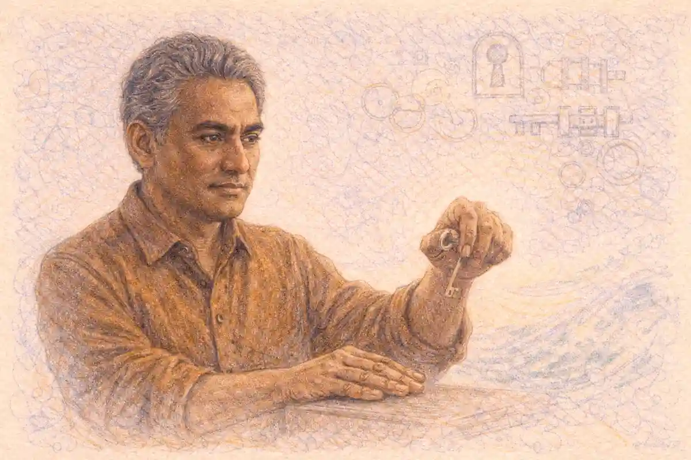

AP Physics 2 rewards a particular kind of thinker. The course ranges across fluids, thermodynamics, electricity, magnetism, optics, and the physics of atoms and nuclei, and that breadth tempts students into memorizing a separate trick for every problem they meet. Strong candidates work differently. Each area of the course rests on one governing relationship, sometimes two, and nearly every exam question is that relationship wearing a disguise. Pressure in a static fluid answers to density, gravity, and depth. A direct current circuit answers to charge conservation and energy conservation expressed through two loop and junction rules. A lens answers to a single equation whose signs carry the geometry. Organizing study around those principles, rather than around problem types, converts six intimidating topics into six manageable arguments, and it is the organizing idea behind the InsightCrunch Physics 2 principle table presented in this article.

## Why principle-first study wins in AP Physics 2

Breadth is the defining challenge of this course. A single free-response section can move from a gas expanding against a piston to a converging lens forming an image, and a student who stored those topics as unrelated chapters must rebuild context at every page turn. Principle-first study removes that cost. Once a candidate can state the governing relationship for an area, name its variables with their units, and list the conditions under which it holds, unfamiliar scenarios become translation exercises: read the story, find the principle, assign the symbols, and only then compute. The translation habit also protects against the most common scoring loss in this course, which is not weak algebra but a correct computation launched from the wrong model.

Memorized cases fail quietly. A student who learned that narrow pipes mean low pressure, full stop, will miss the question where the narrow section also sits higher, because the elevation term in Bernoulli's equation can outweigh the speed term. A student who learned Bernoulli's equation as a conservation statement sees the trade among pressure, speed, and height immediately. Cases describe what happened once; principles describe what must happen always, given stated conditions. Exam writers exploit that gap deliberately, constructing scenarios that differ from rehearsed examples in exactly one feature, the feature a principle tracks and a memorized case ignores.

Depth matters as much as organization. Each area below is taught at working depth: the relationship itself, the reasoning that justifies it, the forms in which questions present it, the numbers a candidate should be able to produce without hesitation, and the errors that graders see every year. Where a worked example appears, the arithmetic is shown in full with units carried through, because unit discipline is itself a scored habit on this exam. Readers who want the full course map, including exam format and scoring, will find it in the [AP Physics 2 complete guide](/2008/03/14/ap-physics-2-complete-guide/), while this article stays inside the six content areas and squeezes each one for exam value.

## Where these topics sit in the exam

Fluid mechanics and thermodynamics open the course and together account for roughly a fifth to a quarter of the multiple-choice emphasis in most framework outlines, with thermal physics and fluids each carrying a meaningful share. Electric circuits and the electrostatics beneath them form the largest single block of the course, and magnetism with electromagnetic induction adds a further substantial unit. Geometric and physical optics contribute a smaller but highly learnable share, and modern physics, covering photons, atomic models, and nuclear processes, closes the syllabus with concept-heavy questions that reward clear reasoning over heavy computation. Exact weights shift between administrations, so candidates should treat those shares as planning guides rather than promises.

Format shapes strategy. Multiple-choice items in Physics 2 frequently present a scenario, a diagram, or a small data set and then ask several questions about it, so a single misread can cost more than one point. Free-response questions divide among experimental design, qualitative and quantitative translation, and paragraph-length argument, which means a candidate must move between computing a number, sketching a graph, and defending a claim in connected prose. The principle-first approach serves all three formats. A governing relationship gives the computation its setup, the graph its shape, and the paragraph its logical spine.

One further structural fact deserves emphasis. Physics 2 is algebra based throughout. Derivatives and integrals never appear; every relationship on the equation sheet is algebraic, and every solution path is built from substitution, proportion, and careful reasoning about what changes and what stays fixed. That constraint is a gift to prepared students. When a problem looks hard, the missing step is almost never a mathematical technique. It is a physical insight, usually the recognition of which quantity is conserved, which two points share a pressure, or which loop encloses a given emf.

## The InsightCrunch Physics 2 principle table

The table below is the findable artifact for this article and the study tool its argument recommends. Each row pairs a course area with the governing relationship that organizes it, stated in words so the logic survives even when symbols blur under time pressure. Candidates who can reproduce this table from memory, and explain each row in a sentence, hold the skeleton of the entire course.

| Course area | Governing relationship in words | Core equation form |
| --- | --- | --- |
| Fluid statics | Pressure grows linearly with depth and acts equally in all directions | P = P0 + ρgh |
| Buoyancy | The buoyant force equals the weight of the fluid displaced | F = ρVg |
| Fluid flow | Mass conservation fixes speed through area, and energy conservation trades pressure, speed, and height | A1v1 = A2v2 and the Bernoulli relation |
| Thermodynamics | Pressure, volume, and temperature of a gas are locked together, and energy is conserved across heat, work, and internal change | PV = nRT and ΔU = Q + W |
| Electrostatics | Potential is energy per unit charge, and field points down the potential slope | V = U/q and ΔV = Ed for uniform fields |
| Direct current circuits | Charge is conserved at junctions and energy is conserved around loops | Kirchhoff's two rules with V = IR |
| Capacitance | Stored charge grows in proportion to voltage, and stored energy grows with its square | Q = CV and U = CV²/2 |
| Magnetism | Moving charge and current feel a sideways force, and changing flux induces an emf | F = qvB sinθ, F = BIL sinθ, emf = ΔΦ/Δt |
| Geometric optics | One signed equation locates images for lenses and mirrors, and magnification follows from distances | 1/f = 1/do + 1/di and M = -di/do |
| Modern physics | Light arrives in photons whose energy is set by frequency, and nuclei decay by halving | E = hf and the half-life rule |

Reading the table vertically teaches a second lesson. Conservation is the recurring plot. Bernoulli's equation conserves mechanical energy per unit volume along a streamline. The first law of thermodynamics conserves energy across a system boundary. Kirchhoff's rules conserve charge and energy in a circuit. Even the lens equation is a kind of accounting, tracking how rays from one object point are gathered to a single image point. A candidate who asks, in any scenario, what is being conserved and what the accounting entries are has already found the intended solution path more often than not.

## Fluid pressure: depth, density, and the atmosphere

A fluid at rest pushes. Pressure at a point in a static fluid equals the pressure applied at the surface plus the weight of the fluid column above that point, captured by P = P0 + ρgh, where ρ is the fluid density, g is the gravitational field strength, and h is depth measured downward from the surface. Three consequences follow, and exam questions test each one. Pressure depends on depth alone, never on the container's shape, the total volume of fluid, or the horizontal position. Pressure at a given depth is identical throughout a connected fluid. Pressure acts perpendicular to any surface it touches and equally in every direction at a point.

A worked example fixes the scale. Water has a density of 1000 kilograms per cubic meter. At a depth of 2.0 meters in an open tank, the gauge pressure, meaning the amount above atmospheric pressure, is ρgh = 1000 × 10 × 2.0 = 20,000 pascals, or 20 kilopascals. The absolute pressure there adds atmospheric pressure, about 101 kilopascals, giving roughly 121 kilopascals. Notice how the numbers behave: every additional meter of water depth adds about 10 kilopascals, so a diver 10 meters down experiences about one extra atmosphere from the water alone. That proportionality, pressure change per meter, is the mental ruler candidates should carry into any fluid statics item.

### Why does pressure depend only on depth and not on the shape of the container?

Pressure at a depth depends only on that depth because the fluid above a point supports its own weight, and the force per unit area from that column is set by density, gravity, and vertical height alone. Widening the container adds fluid and wall area in the same proportion, leaving the ratio, and thus the pressure, unchanged at every depth.

This result surprises students because intuition ties pressure to the total weight of water overhead. The resolution lies in the walls. In a container that narrows toward the top, the slanted walls push down on the fluid and make up any difference; in one that widens, the walls support part of the weight. Either way the pressure at a chosen depth settles at ρgh above the surface pressure. Exam scenarios with connected tubes of different shapes, the classic hydrostatic paradox arrangement, test exactly this reasoning, and the correct answer always follows the depth, not the silhouette.

Pressure also explains force questions on dams, doors, and submerged plates. Force is pressure multiplied by area, and because pressure grows with depth, the force on a vertical surface is larger near the bottom than near the top. A rectangular hatch one meter tall whose top edge sits 3.0 meters below the surface of water feels an average pressure set by its midpoint depth of 3.5 meters: 1000 × 10 × 3.5 = 35,000 pascals. Across an area of 2.0 square meters, the water pushes with about 70,000 newtons. Using the midpoint pressure for a uniformly deepening load is the standard algebra-based move, and graders reward the candidate who states why the midpoint is the right depth to use.

## Buoyancy: the weight of displaced fluid

Archimedes' principle states that a fluid exerts an upward force on an immersed object equal to the weight of the fluid the object displaces, F = ρVg, where ρ is the fluid density and V is the submerged volume. The principle holds for fully submerged objects and for floating ones, with V always meaning the volume below the fluid surface. Floating adds one more condition: equilibrium. A floating object displaces exactly its own weight of fluid, so the submerged fraction of a uniform object equals the ratio of the object's density to the fluid's density.

Numbers make the pattern stick. A wooden block of density 600 kilograms per cubic meter and volume 0.010 cubic meters floats in water. Its weight is 600 × 0.010 × 10 = 60 newtons. Floating equilibrium demands a buoyant force of 60 newtons, which requires a submerged volume of 60 / (1000 × 10) = 0.0060 cubic meters, exactly sixty percent of the block. Sixty percent submerged and forty percent above the surface is the visible signature of the density ratio, and questions about icebergs, hydrometers, and loaded barges are all this same computation wearing different costumes.

Fully submerged objects behave differently, and the distinction is a favorite trap. Once an object is entirely under the surface, pushing it deeper does not increase the buoyant force, because the displaced volume no longer changes. A submerged object's fate depends on comparing its own density with the fluid's: denser objects sink with a net force equal to the difference between weight and buoyancy, lighter objects accelerate upward until they break the surface and settle into floating equilibrium, and equal densities produce neutral buoyancy at any depth. Apparent weight questions follow directly. An object that weighs 80 newtons in air and displaces 0.0030 cubic meters of water when submerged experiences a buoyant force of 30 newtons, so a supporting scale or cable reads 50 newtons.

Fluid choice matters too. The same object floats higher in a denser fluid because less displaced volume is needed to match its weight, which is why ships ride higher in salt water than in fresh and why a hydrometer sinks deeper in a thin liquid than in a thick one. Candidates should also watch for layered scenarios, such as an object resting at the boundary between oil and water, where the buoyant force is the sum of the weights of both displaced fluids, each computed with its own density and its own displaced volume. The principle never changes; only the bookkeeping grows.

## Moving fluids: continuity and Bernoulli

Flow questions rest on two statements. The continuity equation expresses mass conservation for an incompressible fluid: the volume flow rate is the same at every cross-section, so A1v1 = A2v2, and where the area shrinks the speed must grow in inverse proportion. Bernoulli's equation expresses energy conservation along a streamline: P + ρgh + ½ρv² stays constant, so pressure, elevation, and speed trade against one another under a fixed budget. Most fluid flow items on this exam are solved by writing both statements, listing what is known at two points, and letting the algebra finish.

A narrowing pipe is the canonical scenario, and its numbers repay rehearsal. Water flows through a horizontal pipe whose cross-section narrows from 4.0 square centimeters to 1.0 square centimeter. If the speed in the wide section is 2.0 meters per second, continuity gives a speed in the narrow section of 2.0 × 4.0 = 8.0 meters per second. Bernoulli's equation, with no height change, then sets the pressure drop: P1 − P2 = ½ρ(v2² − v1²) = 0.5 × 1000 × (64 − 4) = 30,000 pascals. The narrow section runs 30 kilopascals below the wide section. Slower fluid, higher pressure; faster fluid, lower pressure. That inverse relation, applied carefully, is the engine behind lift explanations, atomizers, and venturi meters.

Elevation can reverse naive expectations. When a pipe narrows and rises at the same time, the speed term pushes the pressure down while the height term also pushes it down, so the effects add. When a pipe widens and rises, speed falls, which raises pressure, while height rises, which lowers it, and the winner depends on magnitudes. Candidates who compute both terms rather than reciting a slogan survive those items. Bernoulli also explains the tank drainage result known as Torricelli's law: a small hole at depth h below the surface of a large open tank releases fluid at speed √(2gh), because the pressure term is atmospheric at both the surface and the jet, the surface speed is nearly zero, and the budget reduces to a trade between height and speed. At h = 1.25 meters, the exit speed is √(2 × 10 × 1.25) = √25 = 5.0 meters per second.

Conditions deserve a sentence of their own, because free-response rubrics award points for stating them. Bernoulli's equation compares points along the same streamline in steady, incompressible flow, and it assumes viscous losses are negligible. Continuity in its simple form assumes incompressibility, an excellent approximation for liquids and a serviceable one for slow-moving gases. Naming those conditions when a scenario provides them is cheap credit; applying the equations where the conditions visibly fail, such as across a pump or inside a long narrow tube with heavy friction, is a recognized trap.

## Thermodynamics: gases, energy, and the first law

Thermal physics in this course is built around gases. The ideal gas law, PV = nRT, ties pressure, volume, temperature, and amount into one constraint, and its companion statements handle the special processes: constant temperature makes pressure and volume inversely proportional, constant pressure makes volume proportional to absolute temperature, and constant volume makes pressure proportional to absolute temperature. Every temperature in these relations is measured in kelvin, a conversion the exam treats as assumed knowledge and a reliable source of lost points when forgotten. Kinetic theory stands behind the law: temperature measures the average translational kinetic energy of the particles, ½mv² = (3/2)kT, so raising the temperature means raising molecular speeds, with the root-mean-square speed growing as the square root of absolute temperature.

A gas computation shows the machinery. Two moles of gas at 300 kelvin occupy 0.050 cubic meters. Its pressure is PV = nRT rearranged: P = nRT/V = (2.0 × 8.31 × 300) / 0.050 = 4986 / 0.050, which is about 99,700 pascals, close to one atmosphere. Compress the same gas isothermally to half the volume and the pressure doubles to roughly 2.0 × 10⁵ pascals, because nRT has not changed. Heat it at constant volume to 450 kelvin and the pressure instead scales by the temperature ratio, rising to about 1.5 × 10⁵ pascals. Ratio reasoning of this kind, asking what changed and what was held fixed, solves most gas law items faster than substitution and with fewer arithmetic slips.

The first law of thermodynamics is an energy ledger: ΔU = Q + W, where Q is heat added to the gas and W is work done on the gas, under the sign convention used in this course. Candidates must read each problem's wording carefully, because everyday language about work done by the gas flips the sign of W. A gas that absorbs 500 joules of heat while expanding and doing 200 joules of work on its surroundings has W = −200 joules in this convention, so its internal energy rises by 300 joules. Work in a pressure-volume process equals the area under the process curve on a PV diagram, and for expansion at constant pressure it reduces to W = −PΔV when expressed as work done on the gas. A gas expanding at 2.0 × 10⁵ pascals with a volume increase of 0.0030 cubic meters does 600 joules of work on its surroundings.

### Why does a gas do work only when its volume changes?

A gas does work only when its volume changes because macroscopic work requires a force moving through a distance, and for a gas the moving boundary is the piston or the flexible wall. Pressure on a fixed wall exerts force without displacement, so a constant-volume heating changes internal energy and pressure while transferring energy purely as heat, with zero work.

PV diagrams are the exam's favorite thermodynamic language. Each point on the diagram is a state; each path is a process; the area under a path is the work exchanged; and a closed cycle returns the gas to its starting state, which forces ΔU over the cycle to zero and makes the net heat equal in magnitude to the net work. Direction matters. A clockwise cycle is an engine, delivering net work to the surroundings; a counterclockwise cycle is a refrigerator or heat pump, consuming work. Reading a cycle's direction and estimating its enclosed area is a two-point skill that appears in some form nearly every year, and it requires no computation heavier than counting grid squares.

Entropy and the second law appear at the conceptual level. Heat flows spontaneously from hot to cold, no engine converts heat entirely into work, and the entropy of an isolated system does not decrease. Exam items in this strand ask for direction and feasibility judgments rather than numbers: which process can happen unaided, which diagram violates the second law, which change raises the entropy of the gas. Free expansion into a vacuum, for example, does no work and, for an ideal gas, changes no temperature, yet the entropy increases because the particles gain accessible volume. Candidates who reason from particle arrangements handle these items calmly.

## Electric field and potential: the foundation under circuits

Circuit analysis floats on two field ideas that the exam tests directly. The electric field describes force per unit charge, E = F/q, and points in the direction a positive test charge would be pushed. Electric potential describes potential energy per unit charge, V = U/q, and is a scalar, so potentials from several charges simply add, with signs carried by the charges themselves. The two are linked: the field points from higher potential toward lower potential, and in a uniform field the potential drop across a distance d is ΔV = Ed. Confusing the pair is the single most common electrostatics error in this course, and the extras in this article's question set return to that distinction deliberately.

Coulomb's law sets the force scale. Two charges of 3.0 microcoulombs and 5.0 microcoulombs separated by 0.30 meters attract or repel with F = kq1q2/r² = (9 × 10⁹ × 3.0 × 10⁻⁶ × 5.0 × 10⁻⁶) / 0.09 = (9 × 10⁹ × 1.5 × 10⁻¹¹) / 0.09 = 0.135 / 0.09 = 1.5 newtons. The inverse-square structure means doubling the separation quarters the force, a proportionality exam items probe constantly. Field from a point charge falls with the same square law, E = kQ/r², while potential falls only as 1/r, V = kQ/r. That difference in falloff rates is a quiet favorite of question writers: midway between two equal positive charges the fields cancel to zero while the potentials add to a maximum, a contrast that separates candidates who visualize from candidates who memorize.

Parallel plates give the cleanest field in the course. Between large oppositely charged plates the field is uniform, E = ΔV/d, so plates separated by 0.020 meters with 60 volts across them hold a field of 3000 volts per meter, and a proton released from the positive plate gains 60 electron-volts of kinetic energy crossing to the negative plate. Equipotential lines wrap the same physics in geometry: they never cross field lines at any angle but ninety degrees, they crowd where the field is strong, and no work is done moving a charge along them. Graph and diagram items built on equipotentials reward candidates who translate between the picture and ΔV = Ed without reaching for a formula sheet.

Capacitors store the field's energy. Capacitance is defined by Q = CV, charge stored per volt applied, and for a parallel-plate device it grows with plate area and shrinks with separation, C = κε0A/d. A 4.0 microfarad capacitor charged to 12 volts holds Q = 48 microcoulombs on its positive plate and stores U = ½CV² = 0.5 × 4.0 × 10⁻⁶ × 144 = 2.88 × 10⁻⁴ joules. Inserting a dielectric with the battery still connected raises capacitance, charge, and stored energy together; inserting it with the capacitor isolated raises capacitance while charge stays fixed, so voltage and stored energy both fall. That connected-versus-isolated contrast is among the most reliably tested capacitor ideas in the course, and it is pure principle: fix what the setup holds constant, then let the definitions speak.

## Electric circuits: two conservation rules run everything

The brief for this course flags circuits as the topic students fear most, and the fear is misplaced. Circuit analysis in Physics 2 rests on a small kit: Ohm's law V = IR for each element; the junction rule, which conserves charge by requiring currents into a node to equal currents out; the loop rule, which conserves energy by requiring the signed potential changes around any closed path to sum to zero; and the power relation P = IV = I²R = V²/R. Every series, parallel, and combination problem on the exam is those four statements plus the patience to label currents and walk loops in a consistent direction. What makes circuits feel hard is not the physics but the bookkeeping, and bookkeeping improves with protocol.

Series wiring gives every element the same current, splits the voltage in proportion to resistance, and adds resistances directly. Parallel wiring gives every branch the same voltage, splits the current in inverse proportion to resistance, and adds resistances by reciprocals. A worked series case: a 12 volt battery drives a 4.0 ohm resistor and an 8.0 ohm resistor in series. The total resistance is 12 ohms, the current everywhere is 12/12 = 1.0 ampere, the drops are 4.0 volts and 8.0 volts, and the battery supplies 12 watts, of which the larger resistor dissipates 8.0 watts. Brightness questions about bulbs are this computation in costume, because a bulb's brightness tracks the power it dissipates.

Parallel numbers behave in the opposite pattern. A 6.0 ohm resistor and a 3.0 ohm resistor in parallel across 12 volts present an equivalent resistance of 2.0 ohms, draw 6.0 amperes from the battery, and carry branch currents of 2.0 and 4.0 amperes, the smaller resistor taking the larger share. Combination networks surrender to reduction: collapse the parallel bank first, then treat the result as a series element. Put that 2.0 ohm equivalent in series with a 4.0 ohm resistor on the same battery and the total is 6.0 ohms, the main current is 2.0 amperes, the series resistor drops 8.0 volts, and the parallel bank shares the remaining 4.0 volts between its branches. Candidates who redraw the circuit after each reduction step make far fewer errors than candidates who hold three stages in their heads.

### How do you decide whether resistors share the same current or the same voltage?

Trace the wiring rather than the diagram's shape. Resistors share the same current when charge has exactly one path through them in sequence, with no junction between them. Resistors share the same voltage when their ends connect to the same two nodes, so each branch spans the identical potential difference regardless of what else the drawing contains.

Real batteries and meters refine the model. Internal resistance r inside a battery makes the terminal voltage fall below the emf as current rises, Vterminal = emf − Ir, so a battery with an emf of 12 volts and internal resistance of 1.0 ohm delivering 2.0 amperes shows 10 volts at its terminals. Ammeters belong in series and are built with tiny resistance so they barely disturb the current they measure; voltmeters belong in parallel and are built with huge resistance so they barely divert current. Experimental-design questions lean on those placements, and a misplaced meter in a proposed setup is often the flaw the question wants identified.

## Capacitors in circuits and the RC time scale

When a capacitor joins a resistor in a circuit, the quantities move in time. Charging through a resistor, the capacitor voltage climbs toward the battery voltage with a characteristic time τ = RC, fast at first and then leveling off, while the current starts at its maximum and decays toward zero. Discharging reverses the picture. The exam treats these curves qualitatively and through the time constant rather than through calculus, which fits the algebra-based scope: candidates should know that after one time constant a charging capacitor reaches roughly sixty three percent of its final voltage, that after several time constants the process is effectively complete, and that a larger resistance or capacitance stretches every stage proportionally.

Steady states simplify everything. A capacitor left connected for a long time acts like a break in its branch, carrying no current, so the resistors in other branches settle into an ordinary direct current problem and the capacitor voltage equals whatever potential difference its two nodes have reached. A 4.0 microfarad capacitor in a branch parallel to an 8.0 ohm resistor carrying 1.0 ampere charges to 8.0 volts and holds 32 microcoulombs. Questions that mix a switch, a waiting period, and a reconfiguration test whether the candidate resets the circuit analysis at each stage instead of blending the stages together.

Graph shapes carry the marks in this strand. Current against time during charging is a decaying curve starting high; voltage against time is its rising mirror; charge follows the voltage shape because Q = CV links them at every instant. Energy reasoning adds one more layer: half the energy a battery supplies during charging ends up stored in the capacitor and half is dissipated in the resistor, a result candidates can state and defend without any integration. Experimental questions may ask students to extract the time constant from a plotted curve by finding when the current falls to about thirty seven percent of its starting value, which is the same definition read backward.

## Magnetic fields: sideways forces and right hands

A magnetic field exerts force only on moving charge, and the force points sideways, perpendicular to both the velocity and the field. Its magnitude is F = qvB sinθ, largest when the motion crosses the field at right angles and zero when the motion runs parallel to the field lines. A current carrying wire is a river of moving charges, so the same physics appears as F = BIL sinθ for a straight segment. A wire 0.30 meters long carrying 2.0 amperes perpendicular to a 0.50 tesla field feels 0.50 × 2.0 × 0.30 = 0.30 newtons. Because the force never aligns with the motion, it does no work on a free charge; instead it bends the path into a circle, with the field supplying centripetal force, qvB = mv²/r, so the radius is r = mv/(qB). An electron moving at 3.0 × 10⁵ meters per second perpendicular to a 0.20 tesla field feels a force of 1.6 × 10⁻¹⁹ × 3.0 × 10⁵ × 0.20 = 9.6 × 10⁻¹⁵ newtons and curves tightly, a principle mass spectrometers exploit by sorting ions according to radius.

Fields come from currents. A long straight wire produces circular field lines centered on the wire, with strength falling as 1/r, B = μ0I/(2πr); at 0.050 meters from a wire carrying 10 amperes, the field is (4π × 10⁻⁷ × 10)/(2π × 0.050) = 4.0 × 10⁻⁵ tesla, comparable to Earth's own field. Loops and solenoids concentrate the geometry: a solenoid's interior field is roughly uniform and grows with turns per unit length and current. Two parallel wires exert forces on each other through these fields, attracting when their currents run in the same direction and repelling when opposed, a result that follows from two applications of the force rule and one right hand.

Direction is where points are won and lost, so the right-hand rules deserve drill until they are reflexes. For a moving positive charge, point the fingers of the right hand along the velocity, curl toward the field direction, and the thumb gives the force; for a negative charge the force reverses. For a straight wire, grasp the wire with the right thumb along the conventional current and the fingers curl along the field lines. For a loop or solenoid, curl the fingers along the current and the thumb points along the interior field, toward the north end. Cross products on this exam are really direction questions with magnitudes attached, and candidates who sketch the three vectors before computing rarely fall for the parallel-motion trap, in which sinθ quietly equals zero.

Fields also act on loops as wholes. A rectangular current loop in a uniform field feels no net force, because opposite sides are pulled oppositely, but it does feel a torque that rotates it until its plane aligns with the field in the stable orientation used by motors and galvanometers. Magnetic dipole language appears here: the loop behaves like a compass needle with a moment proportional to current and area. Questions in this vein stay qualitative for the most part, asking which orientation is stable, which way the loop turns, or what happens when the current reverses, and they reward the same right-hand discipline as the force items.

## Electromagnetic induction: changing flux writes the rules

Induction begins with flux, the measure of field passing through a loop, Φ = BA cosθ, where θ is the angle between the field and the loop's normal. Faraday's law states that a changing flux induces an emf equal in magnitude to the rate of change of flux, emf = NΔΦ/Δt for a coil of N turns, and Lenz's law supplies the direction: the induced current flows so that its own field opposes the change that created it. Three knobs can turn the flux: the field strength, the loop area, and the orientation. Exam scenarios rotate loops, slide them into or out of field regions, move magnets toward or away from coils, and vary the current in a neighboring circuit, and every one of those stories is a flux change asking for a magnitude and a direction.

A numerical anchor helps. A single loop of area 0.020 square meters sits perpendicular to a field that falls from 0.40 tesla to 0.10 tesla in 0.10 seconds. The flux change is 0.020 × 0.30 = 0.0060 webers, so the induced emf averages 0.0060 / 0.10 = 0.060 volts. Wind the wire into fifty turns and the same change yields 3.0 volts, which is why real generators and transformers are coils rather than single loops. Motional emf is the same law in moving clothing: a rod of length 0.50 meters sliding at 4.0 meters per second across a 0.30 tesla field develops emf = BLv = 0.60 volts between its ends, because the moving charges inside the rod are separated by the magnetic force until the resulting electric field balances it.

Lenz's law answers are arguments, not guesses. A north pole approaching a coil raises the flux toward the coil, so the induced current makes the near face a north pole to push back, which fixes the current direction once the winding sense is known. A loop being pulled out of a field region loses flux, so its induced current creates field in the same direction as the original to compensate, and the current also produces a drag force opposing the pull, which is why induction questions so often double as energy questions. The energy ledger always balances: whatever electrical energy induction delivers was paid for by the mechanical work of the agent fighting that drag, or by the source shrinking the original field. Candidates who narrate the opposition step by step, flux change first, opposing field second, current direction third, collect the reasoning points that rubrics reserve for exactly that chain.

## Geometric optics: one equation, signed with care

Reflection and refraction govern how light negotiates boundaries. Reflection keeps the angle with the normal equal on both sides. Refraction bends the ray according to Snell's law, n1 sinθ1 = n2 sinθ2, with angles always measured from the normal, never from the surface. Entering a slower medium, meaning a larger index, the ray bends toward the normal; leaving it, the ray bends away. Light passing from air into water at 45 degrees from the normal, with the index of water at 1.33, refracts to sinθ2 = sin45° / 1.33 = 0.707 / 1.33 = 0.532, so θ2 is about 32 degrees. Traveling the other way, from water toward air, a ray at too steep an angle cannot escape at all: total internal reflection begins beyond the critical angle, sinθc = 1/1.33 = 0.752, giving θc of about 49 degrees, the effect that keeps light trapped inside optical fibers and makes the underside of a water surface mirror like.

Mirrors and lenses share one accounting system. The mirror and lens equation, 1/f = 1/do + 1/di, with magnification M = −di/do = hi/ho, locates images when distances carry signs under a consistent convention. In the convention used in this course, distances measured on the side where light actually goes are positive: image distance is positive for a real image formed on the outgoing side, the focal length is positive for a converging lens or concave mirror, and a negative magnification announces an inverted image. Sign errors are the optics version of circuit bookkeeping errors, and the defense is identical: assign every sign from the physical picture before touching the algebra.

A converging lens example anchors the range of outcomes. With a focal length of 20 centimeters and an object 30 centimeters away, 1/di = 1/20 − 1/30 = 1/60, so the image forms 60 centimeters beyond the lens with magnification −60/30 = −2.0: real, inverted, and doubled in size, the projector arrangement. Move the same object inside the focal length, say 12 centimeters from the lens, and 1/di = 1/20 − 1/12 = (3 − 5)/60 = −1/30, so di = −30 centimeters; the negative sign places the image on the object side, virtual, upright, and magnified, the magnifying glass arrangement. One lens, two regimes, separated by the focal point, and exam items love asking candidates to predict which regime a stated arrangement occupies before any numbers appear.

Diverging elements flip the pattern. A diverging lens or convex mirror has a negative focal length and, for any real object, produces a virtual, upright, reduced image on the object side, which is why such mirrors serve as wide-view security mirrors. A concave mirror with focal length 10 centimeters and an object at 30 centimeters gives 1/di = 1/10 − 1/30 = 1/15, so di = 15 centimeters and M = −0.5: real, inverted, and halved, sitting between the focal point and the center of curvature. Ray diagrams remain the fastest verification tool in this strand. Tracing the parallel ray through the far focal point, the central ray straight through the lens center, and the near focal ray out parallel locates the image geometrically, and a computed answer that disagrees with the sketch exposes its own sign error before it costs points.

### How can you tell whether a lens image will be real or virtual before calculating?

Compare the object distance with the focal length and ask where the outgoing rays meet. For a converging lens, an object outside the focal point sends rays that genuinely converge on the far side, giving a real image; an object inside it leaves the rays diverging, so their backward extensions meet on the object side, giving a virtual image.

Optics questions also test systems: two lenses in sequence, where the first image becomes the second object, and a lens immersed in a fluid, where reduced index contrast weakens its power. The method never changes. Handle one element at a time, carry the image distance forward with care about which side the second element receives it from, and let the magnification of the system be the product of the individual magnifications. Candidates who narrate each stage in a line of prose beside the diagram rarely lose the thread.

## Modern physics: photons, atoms, and nuclei

The final strand abandons continuous quantities. Light arrives in photons, each carrying energy E = hf = hc/λ, conveniently computed with hc ≈ 1240 electron-volt nanometers. A photon of wavelength 500 nanometers carries 1240/500 = 2.48 electron-volts. In the photoelectric effect, that photon can free an electron from a metal with work function 2.0 electron-volts, leaving the electron at most 0.48 electron-volts of kinetic energy; raising the light's intensity adds more photons and more electrons but does not raise that maximum energy, while raising frequency does. Below the threshold frequency set by the work function, no electrons emerge at all, however bright the beam. Those three behaviors, energy set by frequency, count set by intensity, and a hard threshold, are the experimental facts that sank the wave-only model, and the exam revisits them from many angles.

Atomic spectra translate the same quantization into structure. Electrons occupy discrete energy levels, and a photon is emitted or absorbed only when an electron jumps between levels, with the photon energy equal to the level difference. Absorption lines and emission lines of an element therefore mirror each other, and a diagram of levels with arrows is the standard item format: the longest wavelength corresponds to the smallest jump, and a cascade through intermediate levels produces several photons whose energies sum to the direct jump's energy. The Bohr model ties this to hydrogen, where the levels scale as −13.6/n² electron-volts, so the jump from n = 3 to n = 2 releases 13.6 × (1/4 − 1/9) = 13.6 × 5/36 = 1.89 electron-volts, a red photon of about 656 nanometers.

Matter waves complete the symmetry. De Broglie's relation λ = h/p assigns a wavelength to any moving particle, negligible for baseballs and decisive for electrons. An electron accelerated through 100 volts reaches a kinetic energy of 100 electron-volts and a wavelength near 0.12 nanometers, comparable to atomic spacings, which is why crystals diffract electron beams and why electron microscopes resolve what light cannot. The exam keeps the mathematics at the substitution level and the reasoning at the comparison level: double the accelerating voltage and the wavelength shrinks, by a factor of √2, since momentum grows with the square root of energy.

Nuclear physics closes the course with binding and decay. A nucleus weighs less than its separated protons and neutrons, and the missing mass is the binding energy through E = mc²; the binding energy per nucleon peaks near iron, which is why fission of heavy nuclei and fusion of light nuclei both release energy by moving products toward that peak. Radioactive decay follows the half-life rule: after each half-life, half of the undecayed sample remains, so a sample with a two hour half-life falls to one eighth of its starting count in six hours. Decay equations must balance both mass number and charge, and identifying an unknown product in alpha, beta, or gamma decay is an arithmetic of those two conservation rules. Fission and fusion items stay conceptual, asking which process powers the sun, why a chain reaction needs control, or how a moderator's slowing of neutrons raises capture probability.

## Are circuits really the hardest topic in Physics 2?

The brief behind this article names a live misconception: students widely rank circuits as the hardest part of the course, harder than induction, harder than optics. The reputation comes from experience rather than structure. Circuit problems punish skipped steps instantly and visibly, while a shaky optics answer can hide behind a plausible diagram. Yet the circuit strand draws on fewer ideas than any other major unit: two conservation rules, one element law, and a power relation. What students call difficulty is usually one of three repairable confusions. Voltage gets treated as something a battery supplies to each resistor equally, regardless of wiring. Current gets treated as a substance that resistors use up, rather than a flow that returns undiminished. Equivalent resistance gets computed by habit, adding resistors that are actually in parallel because the drawing happens to place them in a row.

Each confusion dies under a specific counter-habit. Voltage confusion dies when candidates mark every node with a letter and remember that a perfect wire is a single node at a single potential, so elements sharing both endpoints share their voltage exactly. Current confusion dies with the water analogy made precise: charge is conserved, energy is not, and what a resistor consumes is potential energy per charge, never the charge itself, so the current entering a resistor equals the current leaving it at every instant. Equivalent resistance confusion dies with the reduction protocol: redraw after every collapse, name each equivalent resistor, and never hold two reductions in memory at once. Drilled this way, circuits become the most mechanical strand in the course, the place where a prepared candidate banks reliable points while other sections are still arguing about concepts.

Kirchhoff in action shows the protocol handling a two-loop network. Consider a circuit in which a 6.0 volt battery drives a branch containing a 2.0 ohm resistor, and that branch sits in parallel with a second branch containing a 4.0 ohm resistor, while a 1.0 ohm resistor stands in series with the battery in the main line. Reduce first: the parallel pair is equivalent to 1.33 ohms, the total resistance is 2.33 ohms, and the main current is 6.0/2.33 ≈ 2.57 amperes. The main-line resistor drops about 2.57 volts, leaving about 3.43 volts across the parallel pair, so the branch currents are about 1.71 amperes and 0.86 amperes, which sum back to the main current as the junction rule demands. Every circuit problem on the exam, however tangled the drawing, reduces to moves of this size.

## The question types that test these topics

Multiple-choice items cluster into recognizable families. Proportionality items ask how a quantity changes when an input doubles or halves, and they reward ratio reasoning over substitution: halve a lens's object distance toward the focal point and the image distance races outward, a behavior invisible to candidates who only plug numbers. Ranking items present three or four arrangements and ask for an ordering, of pressures at points in a fluid, of bulb brightnesses, of induced emfs, and they are solved by identifying the one variable that differs and reasoning monotonically. Graph items hand over a PV diagram, a current-time curve, or a potential profile and ask what it asserts. Scenario sets attach several questions to one diagram, so reading the diagram once, carefully, with every label annotated, pays compound interest.

Experimental and data items form a growing family. A candidate might receive measurements of pressure against depth and be asked which graph linearizes them, what the slope means physically, or which point is an outlier against the model. The principle table earns its keep here as well: the slope of pressure against depth is ρg, the slope of charge against voltage is capacitance, and naming the slope's physical identity is usually the entire question. Free-response questions extend the same material into four archetypes. Experimental design asks for a procedure, its measurements, and its analysis. Quantitative problems chain two or three principles, such as continuity feeding Bernoulli or flux feeding Ohm's law through an induced emf and a known resistance. Qualitative translation asks for a graph or diagram justified by a principle. Paragraph argument asks a candidate to defend or refute a claim in prose, the circuits are hardest claim being a fair example of the genre.

How this course compares with its siblings matters for students planning sequences, and the [comparison of AP Physics 1, 2, and C](/2008/02/25/ap-physics-1-vs-2-vs-c/) lays out the division of territory: Physics 1 owns mechanics, Physics 2 owns fluids, thermal physics, electricity, magnetism, optics, and modern topics, and the C courses revisit mechanics and electromagnetism with calculus. The algebra-based scope of Physics 2 means its magnetism questions stop at forces, fields from wires and solenoids, and flux, while the deeper field machinery belongs to [AP Physics C Electricity and Magnetism](/2008/03/01/ap-physics-c-em-guide/). Candidates bound for the C course can treat Physics 2 as conceptual preparation; candidates ending their physics study here can treat its breadth as the point.

## Worked approach: a fluid problem from words to numbers

Consider a storage tank open to the air, filled with water to a depth of 3.2 meters, with a small outlet pipe at the bottom that runs horizontally and narrows before exiting to the atmosphere. The question asks for the exit speed and for the pressure inside the pipe at a point where the diameter is half the exit diameter. Translation comes first. The tank is large, so the surface speed is negligible; the surface and the exit are both at atmospheric pressure; the height difference is 3.2 meters. Torricelli's relation gives the exit speed directly: v = √(2 × 10 × 3.2) = √64 = 8.0 meters per second. Inside the pipe, the narrower point has half the diameter, hence one quarter of the area, hence four times the speed of the wider flow at that level; where the pipe's speed is 8.0 meters per second the narrower station runs faster in proportion if the exit itself is the wide station, and the Bernoulli trade then prices the pressure difference through the ½ρv² difference. Stating the model before the arithmetic, and naming which two points Bernoulli compares, is what rubrics describe as a complete setup.

A second worked approach belongs to thermodynamics. A monatomic ideal gas in a cylinder expands at constant pressure of 1.5 × 10⁵ pascals from 0.020 to 0.035 cubic meters while absorbing 3000 joules of heat. Find the temperature change and the internal energy change. Work done by the gas is PΔV = 1.5 × 10⁵ × 0.015 = 2250 joules, so work done on the gas is −2250 joules and ΔU = 3000 − 2250 = 750 joules. The gas law then converts internal change into temperature change for a known amount: with 2.0 moles present, the temperature rise follows from Δ(PV) = PΔV = nRΔT, so ΔT = 2250 / (2.0 × 8.31) ≈ 135 kelvin. Notice the elegance the exam intends: at constant pressure, the same PΔV product governs both the work and, through the gas law, the temperature rise, and a candidate who sees that unity writes half as many lines.

A third approach, this time for circuits, uses a qualitative-quantitative pair of the kind free response favors. Two identical bulbs are connected in series across a battery; a third identical bulb is then wired in parallel with one of them. Predict and explain. Adding the parallel path lowers the total resistance, so the battery current rises and the untouched series bulb brightens. The paralleled pair splits its voltage, and each of those bulbs dims relative to the untouched one. The explanation runs through nodes and totals, not through intuition about sharing, and it generalizes to every brightness ranking item in the multiple-choice bank.

## Traps that cost points in Physics 2

Certain errors recur so reliably that naming them is a study method. In fluids, the signature slip is using total height from the ground instead of depth below the surface, followed closely by counting atmospheric pressure on one side of an equation and not the other; when both compared points breathe the same air, atmospheric pressure cancels and gauge reasoning is cleaner, but when one point is sealed, the atmosphere belongs in the budget explicitly. Buoyancy answers fail when candidates use the object's full volume for a floating body instead of the submerged volume. Bernoulli answers fail when points on different streamlines are compared in a rotational flow, or when the equation is applied across a pump or turbine, which adds or removes energy the plain relation does not track.

Thermodynamics traps begin with Celsius. Any gas law computation in Celsius degrees is wrong before it begins, because the proportionalities live in kelvin. Work sign errors follow: the candidate must state which convention the answer uses and keep it, since a rubric accepts either convention applied consistently and punishes a blend. PV diagram questions trap students who read work from the height of a curve rather than the area beneath it, and who forget that returning to the starting state forces the internal energy change over a cycle to zero. Heat and temperature get conflated as well; a large object at low temperature can hold more internal energy than a small hot one, and phase or mixing questions trade on that distinction.

Circuit traps concentrate on topology misread from drawings. A wire drawn around a resistor shorts it out of the circuit entirely, whatever its printed value, because both of its ends sit at the same potential. A switch that closes a fresh parallel branch changes every current in the network, not merely the new branch's. Power rankings fail when candidates apply P = V²/R with the battery voltage to a bulb that only receives part of it. Optics traps are sign errors and angle references: angles measured from the surface instead of the normal, focal lengths for diverging elements entered as positive, and magnification read as size without its orientation information. Magnetism traps are geometric: zero force on a charge moving along the field, zero flux when the loop's plane contains the field, and emf induced by changing area even in a steady field, which students forget because the field itself feels static. Modern physics traps are conceptual: brighter light cannot free electrons below threshold, a shorter half-life means faster decay rather than more material, and photon energy rises as wavelength falls, an inverse relation stated backward in a surprising share of wrong answers.

## How the six areas connect to one another

The course reads as six topics but reasons as fewer. Fluids and circuits share a deep analogy that strong candidates exploit: pressure difference plays the role of voltage, volume flow rate plays the role of current, and flow resistance in a pipe narrows exactly where electrical resistance rises, in a constricted element. A student stuck on an unfamiliar pipe network can often import intuition from a circuit network, and the reverse transfer works as well, which is why teachers draw the analogy explicitly. Thermodynamics and modern physics connect through the particle picture: kinetic theory treats gas pressure as molecular collisions, the same particle mindset that later treats electrons as particles with de Broglie wavelengths and photons as particles with momentum.

Optics and magnetism connect through the electromagnetic spectrum hiding behind the course's structure. The light bent by lenses is an electromagnetic wave, generated by the same field physics that produces the flux changes of the induction unit, and the modern unit's photon model completes that arc by quantizing it. Electrostatics and circuits connect trivially but importantly: a circuit is electrostatics set in motion, with the battery maintaining the potential landscape that the field unit defined. Candidates who study with those bridges in mind retain more, because each new fact attaches to an old structure instead of floating alone. The companion background in mechanics and waves from [the AP Physics 1 complete guide](/2008/03/28/ap-physics-1-complete-guide/) supplies the energy and oscillation language that Physics 2 quietly assumes throughout.

Free-response craft spans all six areas, and candidates preparing their prose should read the [AP Physics free-response strategy across all four exams](/2008/02/21/ap-physics-frq-strategy-all-exams/) alongside this article, since the justification habits it teaches, claim, principle, application, are precisely what Physics 2 rubrics pay for. The credit landscape is likewise shared across the sciences, and the [guide to how AP science credit works](/2007/11/18/ap-sciences-college-credit-guide/) explains how a Physics 2 score converts at different institution types, which helps students decide how much of their preparation budget this breadth-first course deserves.

## A short practice and review plan for Physics 2

Review should run principle-first in miniature. For each of the six areas, the candidate writes the governing relationship from memory, lists its variables with units, states its conditions, and then solves one rehearsed problem and one unfamiliar problem against the clock. The unfamiliar problem is the diagnostic; errors on it sort into model errors, translation errors, and arithmetic errors, and each class has a different remedy. Model errors send the candidate back to the concept sections. Translation errors call for more scenario reading with the pen down, naming principles aloud before writing. Arithmetic errors call for slower unit tracking and a habit of estimating the answer's size before computing it.

Spacing beats massing in a breadth course. A rotation that touches two areas per session, returning to each area every third day, keeps six sets of conditions fresh simultaneously, which matches the exam's own habit of switching topics between questions. Timed mixed sets belong in the final stretch, because topic switching under time pressure is a trainable skill distinct from the physics itself. The equation sheet should be present during practice from the start; familiarity with what it gives, and what it pointedly does not give, such as the sign conventions and the geometric relations a candidate must supply, is part of exam craft. Practice with [free AP Math and Science practice questions](https://reportmedic.org/tools/ap-math-science-practice.html) gives the repetitions this rotation needs, across all six areas, in the mixed order the exam will use.

Laboratory reasoning deserves a final share of the plan. Physics 2 free response includes experimental design, and candidates should rehearse the grammar of a good answer: a measurable quantity, an instrument named, a control identified, a graph proposed with axes stated, and an analysis sentence that ties the slope or intercept back to the principle table. A fluids experiment measuring pressure against depth, a circuit experiment extracting internal resistance from terminal voltage against current, and an optics experiment finding focal length from image and object distances all share that grammar. Writing one such design per area, in full sentences, is the highest-yield page a candidate can produce in the last week of preparation.

## The verdict on Physics 2 breadth

Breadth frightens students who count topics and calms students who count principles. Six areas, ten governing relationships, one habit of translation: that is the real size of AP Physics 2. Fluids yield to depth and displacement. Gases yield to a constraint and a ledger. Circuits yield to two conservation rules and honest bookkeeping. Magnetism yields to a right hand and a flux count. Optics yields to one signed equation and a sketch. Modern physics yields to quantization and halving. A candidate who can walk that sentence slowly, expanding each clause into its equation, its conditions, and one worked example, is not preparing for six exams. The preparation is for one exam with six dialects, and fluency in the shared grammar is what the score reports. Everything in this article, from the principle table onward, exists to build that fluency one verified example at a time.

## Fluid statics in depth: Pascal, manometers, and connected systems

Pascal's principle states that a pressure change applied to an enclosed fluid transmits undiminished to every part of the fluid and the container walls. Hydraulic systems cash that principle in: a small force on a small piston raises the pressure everywhere, and a large piston converts the same pressure into a large force. If the output piston has ten times the input piston's area, the output force is ten times the input force, while the output piston moves one tenth as far, so the work in equals the work out apart from losses. A 200 newton push on a 0.0050 square meter piston creates a pressure of 40,000 pascals, which lifts with 2000 newtons on a 0.050 square meter piston. Exam items on hydraulics test whether candidates track what is conserved: pressure is transmitted, force is not, and energy quietly balances the trade.

Manometers turn pressure differences into height differences that can be read off a ruler. In a U-tube containing a dense fluid such as mercury, the higher column side faces the lower pressure, and the pressure difference equals ρg times the height difference between the columns. The solving move is always the same: find two points at the same horizontal level in the same continuous fluid, because those points share a pressure, then write the pressure at each by descending from each surface and adding ρgh terms, and equate. Gas pressure measurement, altitude reasoning, and the classic two-liquid U-tube with oil floating on water all reduce to that single habit. Candidates who draw the equal-pressure line on the diagram before writing equations almost never err; candidates who equate the heights of unlike fluids usually do.

Connected vessels and dams extend the same statics. In vessels joined at the base, a single fluid settles to the same height in every arm regardless of arm width, because the pressure at the junction depth must match from every side. Two different liquids that do not mix settle with the denser one lower and the interface level set by balancing the columns above a chosen equal-pressure plane. A dam holding back a reservoir feels a force that grows with the square of the water depth, since both the pressure at each level and the submerged area below that level grow together; the algebra-based treatment asks only for the midpoint-pressure estimate, but the qualitative square law appears in reasoning items about why doubling a reservoir's depth more than doubles the structural demand.

One more fluid idea earns frequent marks: pressure in a moving context, where statics hands off to Bernoulli. A shower curtain billowing inward, a convertible top bulging at highway speed, and a curveball's drift all share the fast-flow low-pressure signature. Reasoning items ask for the direction of the effect and its cause, and the scoring language they reward is specific: name the faster stream, state its lower pressure from Bernoulli's relation, and let the pressure difference push the surface toward the fast side. Vague appeals to suction lose those points, because physics has no suction force, only pressure from the other side winning.

## Kinetic theory and the particle picture of gases

The ideal gas law is a summary; kinetic theory is the explanation beneath it, and this course tests both levels. In the particle picture, pressure is the drumbeat of molecular collisions against the walls, so pressure rises when collisions grow more frequent or more forceful. Heating a sealed gas raises molecular speeds, which raises both the force per collision and the collision rate, and pressure climbs in proportion to absolute temperature. Halving the volume at fixed temperature doubles the collision rate with each wall by crowding, and pressure doubles. Candidates who can narrate a gas law result in collision language earn the explanation points that pure substitution cannot reach.

Temperature itself gets a definition in this picture: the average translational kinetic energy of a particle is (3/2)kT, where k is Boltzmann's constant. That relation lets the exam compare gases directly. At the same temperature, a helium atom and a nitrogen molecule carry the same average kinetic energy, but the lighter helium atom moves faster, with root-mean-square speed √(3kT/m). At 300 kelvin, that speed is about 1370 meters per second for helium and about 510 meters per second for nitrogen, a ratio set by the square root of the inverse mass ratio, √(28/4) ≈ 2.65. Distribution questions follow: a Maxwell-Boltzmann sketch shifts right and flattens as temperature rises, the total area stays fixed because the particle count is fixed, and the fraction of molecules above any chosen speed grows. Reading those curves is a recurring graph skill in this unit.

Internal energy for an ideal gas depends only on temperature, because the particles interact negligibly between collisions, so there is no stored configuration energy to change. For a monatomic gas, U = (3/2)nRT; each added joule that stays in the gas raises the temperature in direct proportion. That single fact cleans up first law bookkeeping across the unit. In an adiabatic process, where no heat crosses the boundary, the internal energy change is the work alone, so compression heats the gas and expansion cools it, the physics behind bicycle pumps warming and spray cans chilling. In a free expansion, no work and no heat means no temperature change for an ideal gas, a result that sounds paradoxical until the particle picture explains it: the molecules gained room, not speed.

## Circuit analysis in depth: loops, grounds, and power budgets

The loop rule deserves a slow treatment, because it is the tool students reach for last and need most. Walking a closed loop, the walker adds each potential change with a sign: crossing a resistor in the direction of current is a drop of IR, crossing against the current is a rise, crossing a battery from the negative terminal to the positive is a rise of the emf, and the reverse crossing is a drop. The signed sum is zero when the walker returns to the start, because potential is a property of position, not of path. That position idea explains ground symbols in diagrams: a ground mark declares a node to be zero volts so that other node voltages can be quoted absolutely, and questions asking for the potential at a labeled point are loop problems solved from the ground outward.

Two-battery circuits are the loop rule's showcase. When two batteries oppose each other in parallel branches, the stronger emf drives current backward through the weaker one, charging it, and the branch currents follow from writing one junction equation and two loop equations and solving the small system. Candidates should expect the algebra to stay gentle: this course rewards setting the system up correctly far more than solving it quickly. A related family asks about short circuits and fuses. A short is a near-zero resistance path in parallel with the intended load, so nearly all current diverts through it, the load loses its voltage, and the main-line dissipation spikes, which is the physical story behind blown fuses and tripped breakers.

Power budgeting ties the unit together. Every element either supplies power, the battery at emf times current, or dissipates it, each resistor at I²R with its own current, and the two totals must match, a conservation check that catches arithmetic slips for free. In the series example earlier, the battery supplied 12 watts and the resistors dissipated 4 and 8 watts, and the match was not decoration; it was verification. Efficiency questions extend the budget: a motor is a device that converts most of its electrical input into mechanical output and the rest into heat, modeled in this course as an emf source with a resistive part, and candidates compute the split with the same power relations. Household-scale reasoning items run the same numbers at larger stakes, pricing a kilowatt-hour or sizing a circuit for simultaneous loads.

Measurement design within circuits is its own tested skill. To find an unknown resistance, the reliable school-laboratory method measures several voltage-current pairs and takes the resistance from the slope of the V against I graph, because the slope averages out single-reading errors and reveals non-ohmic behavior if the line bends. To find a battery's internal resistance, the method varies the load and graphs terminal voltage against current, whose intercept is the emf and whose slope magnitude is the internal resistance. Both designs appear regularly in free response, and both are graded on the analysis sentence as much as on the setup. Candidates who state what the slope means, in words, before computing it, write the sentence the rubric is looking for.

## Magnetism in depth: selectors, spectrometers, and motors

Combined fields produce the velocity selector, an arrangement in which crossed electric and magnetic fields pass only charges of one speed. The electric force qE and the magnetic force qvB point oppositely when the fields are crossed correctly, and they cancel exactly when v = E/B, so charges at that speed travel straight regardless of their charge or mass, while faster and slower charges deflect to opposite sides. With E = 3000 volts per meter and B = 0.010 tesla, the selected speed is 3.0 × 10⁵ meters per second. The selector's elegance, filtering by speed alone, is why it precedes the mass spectrometer in textbook order, and why exam writers pair the two devices in scenario sets.

The mass spectrometer then bends the selected beam into a semicircle whose radius r = mv/(qB) sorts ions by mass-to-charge ratio. Two ions with the same charge and speed but different masses land at different positions on a detector, with the heavier ion's radius larger in direct proportion to its mass. Doubling the charge halves the radius; doubling the speed doubles it. Proportionality chains of that kind are the standard question form, and they reward the candidate who writes the radius relation symbolically before substituting, because the symbolic form shows every dependence at a glance. Isotope separation, carbon dating preparation, and chemical analysis all ride on this one relation, giving teachers a ready supply of contexts.

Motors and meters return to the loop torque. A coil of N turns and area A carrying current I in a field B experiences a torque that varies with orientation, strongest when the coil's plane lies parallel to the field and zero when the coil's normal aligns with the field. The galvanometer converts that torque into a needle deflection against a spring, and adding a large series resistance turns it into a voltmeter while adding a small parallel resistance turns it into an ammeter, which closes the loop back to the measurement ideas in the circuits unit. A simple motor adds a commutator that reverses the current each half turn so the torque keeps its rotational sense; asked why a motor without one would merely oscillate and stall, the candidate answers with the torque's sign change at the aligned position.

Earth itself is a test context. The planet's field, roughly 5 × 10⁻⁵ tesla, has a horizontal and a vertical component at most locations, so a compass needle aligns with the horizontal component while a dip needle reads the total inclination. Charged particles from the sun spiral along field lines toward the poles, which is why auroras favor high latitudes, and the spiraling itself combines the circular motion of perpendicular velocity with steady drift along the field, a helix. Questions in this vein are qualitative and proportionality based, and they separate candidates who picture the geometry from candidates who reach automatically for F = qvB even when the motion is parallel and the force is zero.

## Induction in depth: generators, transformers, and eddy currents

A generator is Lenz's law with a crank. Rotating a coil in a fixed field changes the angle between the field and the coil's normal, so the flux oscillates and the induced emf alternates, peaking when the coil's plane lies parallel to the field and the flux is passing through zero fastest, and vanishing at the instants of maximum flux. That phase relationship, emf greatest when flux is zero, is the subtlest timing fact in the unit and a persistent exam target, because intuition insists the emf should peak with the flux it comes from. The resolution is the rate idea: emf tracks the slope of the flux graph, not its height, so the emf curve is the flux curve shifted by a quarter cycle. Doubling the rotation rate doubles both the frequency and the peak emf, since the same flux change is compressed into half the time, and doubling the number of turns doubles the peak emf as well.

Transformers move alternating power between coils through a shared iron core that guides the flux. The voltage ratio follows the turns ratio, so a step-up transformer with ten times as many secondary turns delivers ten times the voltage at one tenth the current, because power in an ideal transformer is conserved. Direct current defeats a transformer entirely: a steady primary current makes a steady flux, a steady flux induces nothing, and the secondary sits silent apart from a brief pulse at switch-on and switch-off. That single fact explains why power grids run on alternating current and why a transformer connected to a battery is a standard exam trap with a one-line answer.

Eddy currents are induction happening inside bulk metal. A changing flux through a solid conductor drives looping currents within the metal itself, and those currents dissipate energy as heat while their fields oppose the change, producing drag. Swinging a metal plate through a magnet's gap slows it visibly, and slotting the plate breaks the loops and weakens the effect, which is why transformer cores are laminated from insulated sheets. Induction cooktops exploit the heating side deliberately. Exam scenarios ask candidates to predict the drag direction, compare slotted and solid plates, or explain why a magnet falling through a copper tube descends in eerie slow motion: the tube's eddy currents arrange themselves, ring by ring, to oppose the magnet's approach above and its retreat below, and the magnet reaches a gentle terminal speed where the induced drag balances gravity.

Self-induction appears at the edge of the syllabus in qualitative dress. A coil resists changes in its own current because its own flux changes with that current, so a circuit containing a coil and a bulb shows the bulb brightening or dimming gradually rather than instantly when a switch moves. Candidates are asked for the direction of the induced emf and the qualitative brightness story, not for inductance calculations, keeping faith with the algebra-based and concept-forward design of this unit. The energy stored in an inductor's field is mentioned by analogy with the capacitor, another place where the course prefers the idea to the computation.

## Optics in depth: image chains, aberrations, and physical optics

The geometric strand deepens through systems and edge cases. A lens forming an image on a screen sets up the laboratory standard: measuring many object and image distance pairs and graphing 1/di against 1/do gives a straight line whose intercept is 1/f, another slope-and-intercept analysis of the kind this course loves. Covering half a lens does not remove half the image; every part of the lens forms the whole image, so covering half dims the image while leaving it complete and in place, a result that surprises nearly every student the first time and is asked about accordingly. Two thin lenses in contact add their powers, the reciprocals of their focal lengths, giving a combination stronger than either alone when both converge.

Mirrors reward the same care. A plane mirror's image is virtual, upright, the same size, and as far behind the glass as the object is in front, with left and right interchanged in the familiar way. Spherical mirrors obey the shared equation with focal length half the radius of curvature, f = R/2, a relation worth memorizing because problems give radii as often as focal lengths. Convex mirrors always produce reduced upright virtual images across a wide field, concave mirrors produce the full range from magnified virtual images inside the focal length to reduced real images far outside it, and the ray diagram decides which regime applies before the equation confirms it.

Physical optics stands behind the geometric treatment and appears in a supporting role. Diffraction spreads light through narrow openings, with the spread growing as the opening shrinks toward the wavelength, and interference between two slits produces a fringe pattern whose spacing follows Δy = λL/d, letting candidates measure a wavelength from a ruler and a screen distance. Thin films add color by interference between reflections from two surfaces, with a phase flip at the denser boundary complicating the path count. These relations appear in this course at the level of proportionality and simple substitution, and they reward the same habits as the rest of the unit: identify the governing relation, respect its conditions, and reason about ratios before reaching for numbers.

Color and dispersion close the optics story. A prism bends blue light more than red because the index of refraction depends slightly on wavelength, so white light fans into a spectrum; a lens suffers the same effect as chromatic aberration, focusing colors at slightly different points. Atmospheric optics, rainbows and mirages, are refraction stories at planetary scale. Exam items in this corner are conceptual, asking which color bends most, why a mirage pools on hot asphalt, or how a spectrometer separates wavelengths, and they cost little preparation compared with the image-formation core while still paying marks to candidates who read them carefully.

## Modern physics in depth: graphs, thresholds, and decay chains

The photoelectric effect is best learned as a graph. Plotting maximum electron kinetic energy against light frequency gives a straight line that crosses zero at the threshold frequency, climbs with slope equal to Planck's constant, and shifts sideways for metals with different work functions while keeping the same slope. Every standard question is a reading of that line: the intercept gives the work function, the slope gives h, the flat region below threshold explains why intensity cannot substitute for frequency, and a second metal's line running parallel confirms that the slope is a property of light, not of the surface. Stopping potential measurements connect the graph to the laboratory: the voltage that halts the fastest electrons, multiplied by the electron charge, equals that maximum kinetic energy, so a stopping potential of 0.48 volts for the earlier worked example is the same fact in electrical clothing.

Compton scattering and the photon's momentum extend the particle model. A photon carries momentum p = h/λ despite having no mass, and when it strikes a stationary electron it emerges with a longer wavelength and less energy, the difference handed to the electron. Candidates need the direction of those changes and their cause, not the scattering formula, and the reasoning is the same conservation bookkeeping used everywhere else in the course, now applied to a collision between light and matter. Pair production and annihilation mark the boundary where energy becomes mass and back: an electron and positron annihilating produce two photons of 511 kilo-electron-volts each, the rest energy of one electron, flying oppositely to conserve momentum, and that number is the signature inside positron emission tomography scans.

Nuclear decay chains test patience with the two balancing numbers. Each alpha emission removes 4 from the mass number and 2 from the charge; each beta-minus emission leaves the mass number fixed and raises the charge by one, as a neutron converts to a proton; gamma emission changes neither, shedding energy only. A chain question gives a parent nucleus and a sequence of decays and asks for the final identity, a bookkeeping exercise in exactly the spirit of circuit junctions. Decay rate reasoning runs parallel: activity is proportional to the number of undecayed nuclei, so activity halves on the same schedule as the sample, and a Geiger counter's falling count rate traces the same exponential halving. After two half-lives a quarter remains; after ten, about a thousandth, a landmark worth memorizing for estimation items.

Binding energy reasoning deserves one more pass, because it inverts intuition. The most stable nuclei sit near iron on the binding-energy-per-nucleon curve, with about 8.8 mega-electron-volts per nucleon, while uranium sits lower at about 7.6, so splitting uranium into mid-mass fragments moves the products uphill in binding per nucleon and releases the difference as energy, roughly 200 mega-electron-volts per fission. Fusion runs the same hill from the other side: hydrogen isotopes at about 1 mega-electron-volt per nucleon combine toward helium at about 7, releasing energy per reaction that is smaller per event but larger per kilogram of fuel. Questions ask which direction a given reaction runs energetically and why stars shine by fusion while reactors split, and the curve answers both.

## Heat engines, refrigerators, and the second law at work

Cyclic devices turn the PV diagram into a machine. A heat engine takes heat from a hot reservoir, converts part into net work, and rejects the rest to a cold reservoir; its efficiency is the work out divided by the heat in, and the second law caps that efficiency below the Carnot limit set by the reservoir temperatures, 1 − Tc/Th in kelvin. An engine between 500 kelvin and 300 kelvin can at best reach forty percent efficiency, and real engines fall short of the cap. A worked ledger keeps the arithmetic honest: an engine absorbing 1000 joules per cycle and rejecting 650 joules delivers 350 joules of work at thirty five percent efficiency, comfortably legal between those reservoirs and checkable in seconds.

Refrigerators run the cycle backward, spending work to move heat from cold to hot, and their performance measure flips accordingly: the coefficient of performance for cooling is the heat removed from the cold space divided by the work paid, and values above one are normal rather than suspicious, because the device moves heat instead of converting it. Heat pumps use the same machinery to warm a house, delivering the moved heat plus the work's worth of heat, which is why their effective output can exceed the electrical input several times over. Exam reasoning items ask candidates to spot impossible claims among advertisements and proposals: an engine claiming fifty percent between those reservoirs violates the cap, and a refrigerator claiming to cool a room with its door open misunderstands that the rejected heat returns to the same room with interest.

Entropy gives the second law its quantitative voice at the level this course requires. Melting, boiling, mixing, and free expansion raise entropy because the particles gain accessible arrangements; compressing a gas isothermally lowers the gas's entropy while the surroundings gain at least as much. Candidates are asked for directions and comparisons rather than computed values: which process raises total entropy, which change is reversible in principle, why a perfect engine is forbidden even with frictionless parts. The Carnot cap itself is an entropy statement, and candidates who connect the two presentations recognize recycled questions instantly when the costume changes from reservoirs to pistons.

## Experimental design across the six areas

One laboratory grammar serves every unit in this course, and rehearsing it in each dialect is efficient preparation. A strong design names the quantity to be varied, the quantity to be measured, the quantities held fixed, the instrument for each measurement, and the graph whose slope or intercept carries the physics. In fluids, varying depth and measuring pressure gives a line whose slope is ρg and whose intercept is the surface pressure, letting students measure a liquid's density with a sensor and a ruler. In circuits, varying the load on a battery and measuring terminal voltage against current gives the emf and internal resistance from intercept and slope. In optics, varying object distance and measuring image distance linearizes under reciprocals, a transformation students should practice until it feels routine.

Error reasoning is the second half of the grammar. A good answer identifies a specific uncertainty, states its direction of effect on the result, and proposes a concrete reduction: repeat trials and average, widen the range of the independent variable so the slope is better defined, or choose an instrument whose resolution matches the scale of the effect. Generic promises to be careful earn nothing. Design questions in magnetism are harder because fields are invisible, so students measure forces on wires, deflections of compasses, or induced emfs while a magnet moves at a measured rate, and the design must convert the invisible quantity into a visible one through a stated principle. Thermodynamics designs revolve around insulation, equilibration time, and the distinction between the thermometer's reading and the system's temperature, which are equal only after the two have settled together.

Data interpretation questions pair naturally with design. Given a table of induced emf against the rate of change of flux, the candidate states the proportionality, computes the slope as the number of turns, and flags any point that breaks the pattern as a candidate measurement error with a reason. Given stopping potential against frequency, the candidate extracts Planck's constant from the slope and the work function from the intercept, the photoelectric graph doing double duty. These items are generous to candidates who narrate quantities with units at every step, because the units audit the method: a slope of volts per hertz is joules per coulomb per cycle per second, which is energy per cycle per second, and checking that trail exposes most wrong turns before they harden into answers.

## Reasoning under time pressure: a candidate's protocol

A protocol steadies performance when the questions stop looking familiar. Read the scenario once for the story and once for the inventory, listing every given quantity with its symbol and units and circling the quantity requested. Name the governing principle aloud in the mind, in words from the principle table, and write its equation before substituting anything. Solve symbolically whenever the structure allows, because symbolic answers expose cancellations and proportionality answers, and many multiple-choice options are symbolic. Only then substitute numbers, keeping units attached, and finish with a sanity check on magnitude and direction: pressures of thousands of pascals for meters of water, currents of amperes for ohm-scale resistors on household-scale batteries, image distances in the same order as object distances unless the focal geometry says otherwise.

The sanity check deserves emphasis because Physics 2 results span absurd ranges, from 10⁻¹⁹ coulomb charges to 10⁵ pascal pressures, and a dropped exponent is the cheapest error to catch and the most expensive to keep. Direction checks matter as much as size checks. A buoyant force pointing down, a pressure rising as a pipe narrows at constant height, an induced current reinforcing the change that made it: each contradicts a principle and announces a slip upstream. Free-response answers should end with the requested quantity stated in a sentence with units, since graders award the communication of the result as well as its value, and a naked number at the foot of a page has lost marks it already earned.

Paragraph-length argument questions follow a template worth memorizing as a shape rather than as words. State the claim being judged. Name the governing principle. Apply it to the specific scenario, identifying the relevant quantities and how they change. Draw the conclusion and, where the prompt invites it, address the strongest counter-consideration. A candidate arguing against the claim that circuits are the hardest topic, for instance, concedes the bookkeeping burden, then shows that the strand runs on two conservation rules while induction demands those plus a direction argument, and concludes with the distinction between felt difficulty and structural difficulty. That architecture, claim, principle, application, conclusion, transfers to every area of the course without modification.

## Electrostatics in depth: conductors, shielding, and field maps

Conductors impose rules that simplify many scenarios. In electrostatic equilibrium, the field inside a conductor is zero, all excess charge resides on the outer surface, and the entire conductor sits at one potential. A hollow conductor shields its interior from external static fields, which is why sensitive electronics ride in metal enclosures and why a car's body protects occupants in a lightning strike: the charge rearranges on the outside until the interior field cancels. Exam items ask candidates to rank potentials at points on and inside charged conductors, and the equilibrium rules answer most of them without a single computation. Points on the same conductor share a potential even when their local fields differ wildly, because field depends on the nearby surface charge density, which concentrates at sharp curves, while potential is the conductor-wide constant.

Field line maps carry the visual half of this unit. Lines begin on positive charge and end on negative charge, their density encodes strength, and they never cross, because a crossing would give the field two directions at one point. Dipole maps, with their curved paths from one charge to the other, and the distorted maps around conductors placed in uniform fields are standard interpretation items. Candidates should practice translating in both directions: sketching the map from the charges, and inferring the charges from a given map, including the sign of an unknown charge from the lines' endpoints. Equipotential maps overlay the same scenes with contour logic borrowed from topography: closely spaced contours mean a steep potential slope and a strong field, and moving along a contour costs no work, which is why a charge slid along an equipotential keeps its potential energy exactly.

Gauss's law hovers at the edge of this course as a conceptual friend rather than a computational tool. The idea that flux through a closed surface counts the enclosed charge lets candidates reason that a charge outside a closed surface contributes zero net flux through it, and that the field of a spherically symmetric charge outside its radius mimics a point charge at its center. Those two statements answer a recognizable family of qualitative items, and they reward the same enclosed-versus-external bookkeeping that induction uses with loops. Where the C course turns this into derivations, Physics 2 asks only for the reasoning, one more instance of the algebra-based scope shaping the questions.

## Household electricity and the physics of everyday circuits

Domestic wiring is a parallel circuit with consequences. Appliances connect across the same two conductors, so each receives the full supply voltage and draws current according to its own resistance, which is why a kettle does not dim when a lamp joins the circuit, and why the main current is the sum of the branch currents. A 120 volt supply feeding a 1200 watt heater draws 10 amperes through that branch; add a 600 watt appliance and the main line carries 15 amperes, approaching the rating of a typical branch fuse. Those numbers make the earlier short-circuit discussion concrete: protection devices exist because parallel addition means total current, not any single appliance, is what the wiring must survive.

Series thinking explains a different household artifact, the string of decorative lights wired so that one failed bulb darkens the rest, each bulb being a resistor in a single chain whose break opens the only path. Modern strings shunt around failures, a detail candidates can reason out from the symptom. Extension cords and long runs introduce resistance in the leads themselves, dropping voltage along the cord under heavy load, which is the internal-resistance model wearing street clothes: the cord acts as a small resistor in series with the load, wasting power as heat in proportion to the square of the current, the reason heavy appliances demand short, thick cords.

Power transmission closes the energy story. Moving a given power along a line wastes I²R in the line's resistance, so utilities transmit at high voltage and low current and transform down near the load, which is only possible because transformers need alternating current, tying the household unit back to the induction unit in a single explanatory chain. Exam questions built on this story ask for the current at each stage and the loss comparison, and they are arithmetic wrapped around one idea: at fixed power, current falls as voltage rises, and losses fall with the square of the current.

## Synthesis: reading any Physics 2 scenario in four questions

Fluency compresses into a short interrogation applied to any scenario the exam presents. Ask first what is conserved: energy, charge, momentum, or particle number, and which accounting statement in the principle table tracks it. Ask second what is held fixed by the setup: a temperature, a voltage, a pressure at a surface, a charge on an isolated capacitor, a flux through a fixed loop, because the fixed quantity decides which form of the principle applies. Ask third what geometry controls: depths, areas, distances, angles from the normal, and separations, since nearly every Physics 2 relation is a principle filtered through a geometry. Ask fourth what the requested quantity's units and plausible size are, because the answer's dimensions police the algebra that produced it. Four questions, asked in order, convert a novel scenario into a solved structure with remarkable reliability.

Worked fluency looks like this in miniature. A sealed syringe of gas is compressed quickly to half its volume; asked for the pressure and temperature story, the interrogation runs: energy is conserved but the compression is fast, so heat exchange is negligible and the process is nearly adiabatic; nothing is held fixed except the amount of gas; the geometry change is the volume halving; the units demand pascals and kelvin. Work done on the gas raises its internal energy, so temperature rises, and pressure rises by more than the factor of two a slow isothermal squeeze would give. No number was needed, yet the answer is complete, and it was assembled by the four questions in under a minute. That speed is what principle-first preparation purchases.

Contrast a slow compression in a water bath, where temperature is the fixed quantity and the same volume halving merely doubles the pressure while heat leaks out to hold the temperature steady. Two scenarios sharing a piston and a volume change produce opposite temperature verdicts, and only the second question, what is held fixed, separates them. Exam writers build pairs like this deliberately, sometimes in adjacent items, to test whether candidates interrogate the setup or pattern-match the apparatus. The protocol is the defense.

## What strong Physics 2 students do differently

Observation of top scorers shows habits more than talents. Symbols get defined the first time they appear, in writing, with units, so that a page of work can be re-read at speed during checking. Diagrams are drawn even when the problem arrives with one, redrawn in the candidate's own hand with givens marked, because the act of drawing forces the topology questions, nodes in a circuit, depths in a fluid, normals in an optics setup, to be answered consciously. Estimates precede computation: a candidate who expects a pressure near 30 kilopascals and computes 3 megapascals catches the error at the moment of writing. Checks close every problem, against conservation, against a limiting case, or against the units, and the check is chosen before the arithmetic begins so it cannot be forgotten in the relief of finishing.

Limiting cases deserve their own sentence, because they are the highest-yield checking tool in this course. Set a resistance to zero and ask whether the formula predicts the short-circuit behavior it should; set the object distance to infinity and confirm the image falls at the focal point; set the depth to zero and confirm the pressure reduces to the surface pressure; set the field change to zero and confirm the induced emf vanishes. A formula that fails a limiting case is wrong no matter how carefully it was derived, and a formula that passes two limiting cases is very likely right. Graders know this habit when they see it in written work, and candidates who show a check earn credibility that survives a small arithmetic slip elsewhere.

Vocabulary precision is the quiet divider in prose answers. Pressure is not force, voltage is not current, heat is not temperature, flux is not field, and image distance is not focal length; each pair differs by exactly the distinction its unit exists to teach. Rubrics for explanation items are written as lists of distinctions, so a candidate who writes the distinction explicitly, in a sentence of its own, collects points that vaguer paragraphs miss. The principle table is, at bottom, a vocabulary list with equations attached, and mastering it at the level of sentences rather than symbols is the deepest preparation this article can prescribe.

## Fluid flow in depth: the venturi, lift, and the limits of Bernoulli

A venturi meter turns the narrowing pipe into an instrument. Two pressure taps, one in a wide section and one in a throat, feed a manometer or sensor, and the pressure difference reveals the flow speed through the Bernoulli trade. If the throat runs at four times the wide section's speed, the squared speeds differ by a factor of sixteen, and the pressure gap scales with the larger term, which is why modest flows produce readable pressure differences. Flow-direction questions ask what happens when the meter is reversed or when the fluid is a gas of much lower density: the same speed ratio yields a far smaller pressure signal, because ρ multiplies the whole Bernoulli difference, and a water-calibrated intuition overestimates gas pressure changes by three orders of magnitude.

Lift on a wing is the same relation taught with unusual care in this course, because the popular explanation is subtly wrong. Air does move faster over the curved upper surface, and the pressure above is lower, but the deeper account is that the wing deflects air downward and the reaction lifts the wing, with Bernoulli's relation and Newton's third law describing one flow from two sides. Exam items in this family reward the pressure-difference mechanism stated correctly: faster flow above, lower pressure above, net upward force from the pressure acting on the wing's area. Candidates should avoid claiming that parcels of air must reunite at the trailing edge, a myth the course quietly tests by omission.

Bernoulli's equation has edges, and naming them is scored knowledge. It fails across a pump, which adds energy, and across a turbine, which removes it; the fix is to add a pump head term or treat the machine as a boundary between two Bernoulli regions. It degrades in long narrow tubes where viscosity bleeds energy into heat, the regime where Poiseuille-style resistance thinking from the circuit analogy serves better. It also compares points along one streamline in steady flow; applying it between two unrelated points in a swirling tank invites error. Reasoning items that hand candidates a scenario with a pump mid-pipe or honey in a thin tube are checking exactly this boundary sense.

## Charging curves worked: one RC example in full

Numbers discipline the RC story the way they disciplined buoyancy. A 6.0 volt battery charges a 100 microfarad capacitor through a 2000 ohm resistor. The time constant is RC = 2000 × 100 × 10⁻⁶ = 0.20 seconds. The initial current is set by the full battery voltage across the resistor, 6.0/2000 = 3.0 milliamperes, because the uncharged capacitor initially drops no voltage. After one time constant, 0.20 seconds, the capacitor voltage has reached about sixty three percent of 6.0 volts, roughly 3.8 volts, its charge is about 380 microcoulombs, and the current has fallen to about thirty seven percent of its start, roughly 1.1 milliamperes. The final charge, reached after several time constants, is CV = 600 microcoulombs, and the stored energy settles at ½CV² = 1.8 millijoules, exactly half the 3.6 millijoules the battery supplied, the other half having warmed the resistor during the charge.

Discharge mirrors the computation with the roles swapped. The same capacitor, charged to 6.0 volts and then connected across the same resistor alone, begins discharging at 3.0 milliamperes and loses about sixty three percent of its charge in the first 0.20 seconds. Questions probe the invariants through the swap: the time constant is unchanged because R and C are unchanged, the initial current magnitude is the same because the starting voltage is the same, and the energy dissipated in the resistor over the full discharge equals the stored 1.8 millijoules exactly, since there is nowhere else for it to go. A candidate who frames discharge as the battery problem run in reverse, with conservation auditing each claim, answers the whole family from one rehearsal.

Switch choreography is the tested complication. A capacitor charged by one battery through one resistor, then switched to discharge through a different resistor, presents two time constants in one problem, and each stage must be analyzed with its own circuit. The charge at the moment of switching is the bridge quantity, continuous across the change because capacitor charge cannot jump without an infinite current. Tracking the state variables, charge and voltage, across the switching instant, rather than restarting from intuition, is the skill being measured, and it generalizes to inductors and to multistage fluid tanks alike.

## Timing and triage inside the exam sections

Pacing in a breadth course is topic triage. Multiple-choice sets that attach three or four items to one scenario should be read as investments: the diagram study is paid once and harvested several times, so those sets deserve a careful first pass rather than a skim. A candidate who stalls on a single computation for several minutes is spending the marks of two easier items elsewhere; the protocol is to mark, make the best principle-based elimination available, and move, returning with whatever time the section leaves. Because no guessing penalty applies, every item gets an answer, and a principle-based elimination that removes two options doubles the value of a guess.

Free-response time divides by points rather than by questions. A part worth two points deserves roughly twice the investment of a one-point part, and experimental design parts, which look long, often decompose into the grammar rehearsed earlier: variables, instruments, graph, analysis sentence. Writing the analysis sentence first, in the planning margin, anchors the whole design, because it states what the slope or intercept must mean and therefore what must be measured. Paragraph arguments should be drafted as claim and principle before prose, which keeps the answer's spine visible even if the clock truncates its polish. The closing minutes belong to unit checks and to the one-point completions, stating an isolated capacitor's final voltage or a decayed sample's remaining fraction, that can still be harvested from questions whose long parts ran over.

## Two more worked approaches: magnetism and optics under exam conditions

A free-response magnetism item might present a rectangular loop of wire entering a region of uniform field at constant speed, and ask for the induced emf and current while entering, while fully inside, and while leaving, with graphs. The principle interrogation runs cleanly. While entering, the flux grows at a rate set by the field, the loop's height, and the entry speed: with B = 0.40 tesla, height 0.10 meters, and speed 2.0 meters per second, the area grows by 0.20 square meters per second and the emf is 0.40 × 0.20 = 0.080 volts, steady while the entry lasts. While fully inside, the flux is constant at full value and the emf is zero despite the large flux, the rate idea deciding again. While leaving, the emf returns with the opposite sign. The current follows from the loop's resistance, and the force needed to hold the speed constant follows from the drag on the current-carrying edge inside the field, F = BIL, which is also the power balance: the mechanical power Fv equals the electrical power emf × I, a cross-check the rubric loves.

An optics item might give a two-lens bench: a converging lens of focal length 15 centimeters forms an image of an object 25 centimeters away, and a second converging lens of focal length 10 centimeters sits 50 centimeters beyond the first. The chain method applies. For the first lens, 1/di = 1/15 − 1/25 = (5 − 3)/75 = 2/75, so di = 37.5 centimeters, which places the intermediate image 12.5 centimeters in front of the second lens. That image becomes the second lens's object at do = 12.5 centimeters, inside its focal length, so 1/di = 1/10 − 1/12.5 = (5 − 4)/50 = 1/50, giving di = 50 centimeters beyond the second lens. Magnifications multiply: the first gives −37.5/25 = −1.5, the second gives −50/12.5 = −4.0, and the system gives +6.0, an upright image six times the object's size, two inversions having canceled. Stating each stage's regime before computing it is the written habit that keeps chained optics from collapsing.

## The equation sheet: what it gives and what it withholds

Preparation includes a census of the provided reference. Constants such as g, the gas constant, Boltzmann's constant, Coulomb's constant, the permeability of free space, Planck's constant, and the electron charge magnitude are given, so memorizing their values wastes effort better spent on their uses. The major relations of each unit appear in some form, but the sheet withholds the connective tissue: sign conventions for optics, the statement of Lenz's law in words, the floating fraction shortcut, the work sign convention, and the geometric facts about areas and volumes that problems quietly require. Candidates should practice with the sheet open and a personal list of withholdings beside it, because knowing what must be supplied from memory is itself a study outcome.

Estimation fluency rounds out the toolkit. Atmospheric pressure near 10⁵ pascals, water density 1000 kilograms per cubic meter, room temperature near 300 kelvin, Earth's field near 5 × 10⁻⁵ tesla, visible wavelengths between about 400 and 700 nanometers, and photon energies of a few electron-volts are the landmarks of the course's physical world. Answers that land orders of magnitude from those landmarks announce their own errors to a candidate who has internalized the map. The habit of glancing at an answer and asking which landmark it should resemble converts the final minute of each problem into a genuine review rather than a pause.

## One last bridge: fields, potentials, and the slope idea

A single mathematical shape recurs across the course in disguise, and recognizing it shortens many solutions. Potential in electrostatics and pressure head in fluids both behave like heights in a landscape: systems evolve to level them, differences between two points drive flow, and the local steepness of the landscape measures the local intensity of the effect. Voltage difference drives charge through resistance exactly as pressure difference drives fluid through a constriction, and the ratio of driving difference to resulting flow is the resistance in both worlds. Even temperature plays the height role for heat flow between two bodies in contact. Candidates who collect these analogies deliberately, writing each new relation beside its older cousin, find that later units feel half learned on arrival, because the landscape logic transfers whole. The exam's cross-topic scenario sets are built on precisely that transfer, pairing, for instance, a fluid network with a circuit network and asking the same sharing question in both dialects. Preparation that honors the bridges is preparation the test format rewards.

## Graphs that carry the course

Physics 2 speaks through graphs as fluently as through equations, and a candidate who reads axes before curves has an advantage in every unit. The PV diagram shows work as area and state as position. The charging curve shows the time constant as the moment the current falls to about thirty seven percent of its start. The potential profile across a circuit shows batteries as cliffs and resistors as slopes, with the walker returning to the starting height after any full loop. The photoelectric graph shows Planck's constant as a slope and the work function as an intercept. The decay curve shows the half-life as the horizontal distance between successive halvings, the same at every height because the process is exponential. The energy level diagram shows photon wavelengths ranked by arrow length in reverse. Six graph dialects, one grammar: axes first, then slope, intercept, area, and asymptotes, in that order.

Each graph type also carries a characteristic trap. PV diagrams trap candidates who read work from curve height instead of enclosed or underlying area. Charging curves trap candidates who expect linearity from an exponential process and extrapolate the initial slope across the whole interval. Potential profiles trap candidates who forget that a wire's flat segment means zero field contribution regardless of its length on the page. Photoelectric graphs trap candidates who read the work function off the vertical intercept without checking whether the axes plot energy or stopping potential. Decay curves trap candidates who count halvings from the wrong starting value. Naming the trap beside each graph in a personal review sheet is a small exercise with an outsized return, because graph items are among the most repeated formats in the multiple-choice bank.

Translation between representations is the deeper skill beneath the graphs. A scenario described in words should be sketchable as a diagram, statable as an equation, and predictable as a graph, and weakness in any one direction reveals itself in the others. A candidate who cannot sketch the current decay cannot set up its equation reliably either, and a candidate who can sketch the pressure profile along a narrowing pipe has already solved the Bernoulli ranking attached to it. Review sessions that force all three translations for a single scenario, rather than three scenarios in one representation each, build the connective tissue the exam actually measures. That connective tissue, more than any single formula, is what the principle table was always pointing at: one physics, many notations, and marks for the candidate who moves among them without losing the thread.

## Frequently Asked Questions

### Q: How are fluids tested on AP Physics 2?

Fluids appear in both sections through pressure, buoyancy, and flow scenarios. Multiple-choice items ask for pressures at depths, forces on submerged surfaces, floating fractions, and pressure or speed changes along pipes, often as ranking or proportionality questions. Free-response questions pair a computation with a justification, such as explaining why a buoyant force stays fixed as a submerged object sinks deeper, or designing a measurement of an unknown liquid's density from pressure readings at several depths. The governing tools are few: P = P0 + ρgh for statics, the displaced-weight rule for buoyancy, and continuity with Bernoulli for flow. Candidates who state which regime a scenario occupies, static or moving, before writing equations handle the family reliably and avoid its standard traps.

### Q: How is thermodynamics tested on AP Physics 2?

Thermodynamics is tested through gas processes, PV diagrams, and energy bookkeeping. Items give a process, isothermal, isobaric, isochoric, adiabatic, or cyclic, and ask for pressure, volume, or temperature changes, work exchanged, heat flow, or internal energy change. Graph questions present PV diagrams whose areas encode work and whose endpoints encode states, and second law questions ask whether a proposed engine, refrigerator, or process direction is permitted. Kinetic theory items compare molecular speeds and energies across gases and temperatures. The recurring disciplines are absolute temperature in kelvin, a consistent work sign convention stated in the answer, and the recognition that a closed cycle forces the internal energy change to zero. Ratio reasoning about what changed and what stayed fixed solves most items faster than substitution.

### Q: How are electric circuits tested on AP Physics 2?

Circuits are tested as analysis, prediction, and measurement. Analysis items give a network of resistors, capacitors, switches, and batteries and ask for currents, voltages, power dissipation, or stored charge. Prediction items change the network, closing a switch, adding a branch, removing a bulb, and ask how brightnesses or meter readings respond, with an explanation. Measurement items ask how ammeters and voltmeters connect, how internal resistance reveals itself in terminal voltage data, or how a graph's slope yields an unknown resistance. Free response adds experimental design and capacitor charging behavior over time. Every form reduces to Ohm's law, the junction rule, the loop rule, and the power relations, applied with labeled nodes and currents rather than intuition about how electricity feels.

### Q: How is magnetism tested on AP Physics 2?

Magnetism is tested through fields, forces, and induction scenarios. Items ask for the field around wires, loops, and solenoids, the force on a moving charge or a current-carrying wire, the circular path of a charge crossing a field, and the emf induced when flux through a loop changes. Direction carries unusual weight: right-hand rules, Lenz's law arguments, and zero cases such as motion parallel to the field or a loop sliding wholly inside a uniform field. Quantitative work stays algebraic, built on F = qvB sinθ, F = BIL sinθ, flux as BA cosθ, and emf as the rate of change of flux. Explanations that state the flux change first, the opposing field second, and the current direction third earn full reasoning credit.

### Q: What is fluid pressure on the AP Physics 2 exam?

Fluid pressure on the exam is the force per unit area within a fluid at rest, governed by P = P0 + ρgh, where P0 is the pressure at the surface, ρ the fluid density, and h the depth below the surface. Pressure at a point acts equally in all directions and perpendicular to any surface. Its depth dependence is the tested core: pressure ignores container shape, total volume, and horizontal position, and points at equal depth in a connected fluid share the same pressure. Gauge pressure omits the atmospheric contribution and suffices whenever compared points both meet the air. Typical numbers are worth internalizing: each meter of water depth adds about ten kilopascals, so ten meters of water adds roughly one atmosphere.

### Q: How do you handle Bernoulli's principle on AP Physics 2?

Bernoulli's principle is handled as an energy budget along a streamline: P + ρgh + ½ρv² has the same value at any two points compared. The working method is to choose two points whose conditions are known or requested, list pressure, height, and speed at each, and solve for the single unknown, pairing the equation with continuity A1v1 = A2v2 whenever areas and speeds both appear. State the assumptions the scenario grants: steady, incompressible flow with negligible viscosity, and no pump or turbine between the points. Watch the trades rather than memorizing outcomes, because a rising pipe or a widening section can reverse the slogan about fast flow and low pressure. A final check on units and magnitude catches most slips.

### Q: How is the ideal gas law tested on AP Physics 2?

The ideal gas law is tested as constraint reasoning on PV = nRT. Items fix one variable, change another, and ask for the third, or they compare two states of the same gas so the constants cancel and a ratio solves the problem. Microscopes appear alongside: temperature as average molecular kinetic energy, root-mean-square speed rising with the square root of absolute temperature, and lighter gases moving faster at the same temperature. Every temperature must be in kelvin before any proportionality is trusted. Combined with the first law, gas law results convert into temperature changes for energy problems, since at constant pressure the product PΔV equals nRΔT. Candidates who ask what is held fixed before writing anything rarely fall for the standard traps in this strand.

### Q: How do you analyze a circuit on AP Physics 2?

Circuit analysis follows a protocol. Label every distinct node with a letter, remembering that a plain wire is one node. Mark each unknown current with an arrow and a name. Reduce series and parallel groups step by step, redrawing the circuit after each collapse and recording each equivalent resistance. Apply Ohm's law to find the main current or the voltage across a group, then work back into the branches using the two sharing rules: series elements share current and split voltage, parallel elements share voltage and split current. Use Kirchhoff's loop and junction rules directly when reduction stalls, as with two batteries. Finish with a power budget: energy supplied by sources must equal energy dissipated in resistors, a free audit of the arithmetic.

### Q: What is electric potential on AP Physics 2?

Electric potential is potential energy per unit charge, V = U/q, measured in volts, and it is a scalar, so potentials from many charges add with signs and without directions. A charge's potential energy in a potential is U = qV, which is why a charge moving through a potential difference gains or loses qΔV of energy. Potential connects to field through slope: the field points from high potential toward low, and in a uniform field the drop over distance d is ΔV = Ed. Equipotential surfaces are perpendicular to field lines everywhere, and no work is done moving along them. Exam items exploit the scalar ease of potential for computation and the field contrast for reasoning, especially where fields cancel but potentials add.

### Q: How are magnetic fields tested on AP Physics 2?

Magnetic fields are tested as sources, maps, and influences. Source questions ask for the field of a long wire, falling as 1/r with circular lines given by a right-hand grasp, or the roughly uniform interior field of a loop or solenoid. Map questions give field lines or compass arrangements and ask for directions, relative strengths from line density, and pole identifications. Influence questions apply the field to charges, wires, and loops through the sideways force rules. A second family treats the field as something to be changed: moving loops, rotating coils, and varying currents set up induction through flux. Throughout, the zero cases matter as much as the formulas: a field exerts no force on a stationary charge, and flux vanishes when a loop's plane contains the field.

### Q: How is geometric optics tested on AP Physics 2?

Geometric optics is tested through image formation by lenses, mirrors, and refracting surfaces. Items give focal lengths, object positions, or ray diagrams and ask for image location, size, orientation, and whether the image is real or virtual. The tools are the shared equation 1/f = 1/do + 1/di, magnification M = −di/do, Snell's law for refraction with angles from the normal, and the critical angle condition for total internal reflection. Ray tracing is both a question type and the recommended check on algebra. Systems of two elements are handled in sequence, the first image becoming the second object. Sign discipline decides most scores in this strand: assign every sign from the physical arrangement before computing, then verify the result against a sketch.

### Q: What modern physics topics appear on AP Physics 2?

Modern physics on the exam covers photons and the photoelectric effect, atomic energy levels and spectra, matter waves, and nuclear processes. Photon energy follows E = hf = hc/λ, with the photoelectric relation setting the maximum electron energy as photon energy minus work function, and intensity governing electron count rather than energy. Atomic items use level diagrams: emitted and absorbed photons match level differences, and hydrogen levels scale as −13.6/n² electron-volts. De Broglie wavelength λ = h/p applies to particles, shrinking as momentum grows. Nuclear items balance mass number and charge across alpha, beta, and gamma decays, apply the half-life halving rule, and reason about binding energy per nucleon to judge whether fission or fusion releases energy.

### Q: How do you handle electromagnetic induction on AP Physics 2?

Induction is handled by tracking flux, Φ = BA cosθ, and asking what changes it: field strength, loop area, or orientation. Faraday's law gives the emf magnitude as the rate of change of flux, multiplied by the number of turns for a coil. Lenz's law gives the direction through an argument in three steps: state whether the flux is increasing or decreasing and in which direction, state the field the induced current must create to oppose that change, then use a right-hand rule to convert the needed field into a current direction. Motional emf, BLv for a rod crossing a field, is the same law applied to changing area. Remember that emf tracks the rate of change, so maximum flux can coincide with zero emf.

### Q: How is buoyancy tested on AP Physics 2?

Buoyancy is tested through Archimedes' principle: the upward force equals the weight of displaced fluid, F = ρVg, with V the submerged volume. Floating items use equilibrium, so the displaced weight equals the object's weight and the submerged fraction equals the density ratio of object to fluid. Fully submerged items compare densities to find net force and acceleration, and they punish the error of letting buoyancy grow with depth, which it never does once submergence is complete. Apparent weight items subtract buoyancy from true weight for a scale, cable, or spring reading. Layered fluids split the computation: each fluid contributes the weight of its own displaced portion. Icebergs, barges, hydrometers, and balloons are the standard costumes for one computation.

### Q: How do you connect electric force and field on AP Physics 2?

Force and field connect through the definition E = F/q: the field at a point is the force a positive test charge would feel there, per unit charge, so a known charge in a known field feels F = qE in the field's direction for positive charge and opposite for negative. Coulomb's law supplies the force between point charges, and dividing by one charge yields the other's field, E = kQ/r², which is how field formulas are built. Potential enters through energy: force fields that are conservative let potential differences replace force reasoning, with ΔU = qΔV. Exam items move among the three representations, asking for a field from a force measurement, a force from a field map, or an energy change from potentials, and the definitions are the bridges.

### Q: What is the difference between electric potential and electric potential energy on AP Physics 2?

Electric potential is a property of a location in a field, measured in volts, while electric potential energy is a property of a charge placed at that location, measured in joules. The link is U = qV: potential energy equals the charge multiplied by the potential where it sits, so doubling the charge doubles the energy while the potential stays unchanged, and a negative charge holds negative potential energy at a positive potential. Potential differences drive the energy bookkeeping of circuits, where a charge crossing a battery gains q times the emf and crossing a resistor loses q times the drop. Confusing the two quantities collapses most electrostatics reasoning, because fields respond to potential patterns while forces and energies belong to particular charges.

### Q: How do you analyze a circuit with resistors in combination on AP Physics 2?

Combination networks are analyzed by staged reduction. Find the innermost group that is purely series or purely parallel, collapse it into one equivalent resistor, redraw the circuit, and repeat until a single resistance faces the battery. Series equivalents add directly; parallel equivalents add by reciprocals, always landing below the smallest branch. Then reverse the journey: the equivalent circuit gives the total current, which unlocks the voltage across the outermost group, which splits into branch voltages or currents one stage at a time until every element is priced. Keep the two sharing rules visible throughout, same current in series, same voltage in parallel, and audit the finished work with a power budget. A worked habit of redrawing after each stage, rather than tracking stages mentally, is what separates reliable answers from near misses.

### Q: How do lenses and mirrors form images on AP Physics 2 questions?

Images form where rays from each object point are redirected to meet, or to appear to meet. Lenses refract rays at two surfaces; mirrors reflect them under the equal-angle law. Three principal rays locate the image in a diagram: a ray parallel to the axis bends through the far focal point of a converging lens, a ray through the center continues straight, and a ray through the near focal point emerges parallel. If the outgoing rays genuinely converge, the image is real and can land on a screen; if they diverge and only their backward extensions meet, the image is virtual. The equation 1/f = 1/do + 1/di with its sign convention gives the same location numerically, and magnification M = −di/do supplies size and orientation.

### Q: How do you use the right-hand rule on AP Physics 2 magnetism questions?

Right-hand rules convert geometry into direction, and each variant starts from a different grip. For a charge moving in a field, point the right fingers along the velocity, curl them toward the field direction, and the thumb points along the force on a positive charge; reverse the result for an electron. For the field around a straight wire, point the right thumb along the conventional current and let the fingers curl in the field's circular direction. For a loop or solenoid, curl the fingers along the current and the thumb gives the interior field direction. For induced current, first decide the field direction the loop needs, then curl the fingers to produce it. Writing the three vectors on the diagram before applying any grip prevents most direction errors.

### Q: What happens to pressure and speed as a fluid moves through a narrowing pipe on AP Physics 2?

Speed rises and pressure falls, under the conditions Bernoulli's equation assumes. Continuity requires the volume flow rate to stay constant, so when the cross-sectional area shrinks, the speed grows in inverse proportion: quarter the area and the speed quadruples. Bernoulli's budget then charges that kinetic gain to the pressure term, because along a horizontal streamline the sum P + ½ρv² is fixed, so the faster section runs at lower pressure. The pressure drop is ½ρ times the difference of the squared speeds, which is why modest speed ratios create large pressure changes in liquids. Two cautions complete the picture: a height change adds ρgh to the trade and can offset the speed effect, and pumps, friction, or turbulence between the points break the simple budget.
