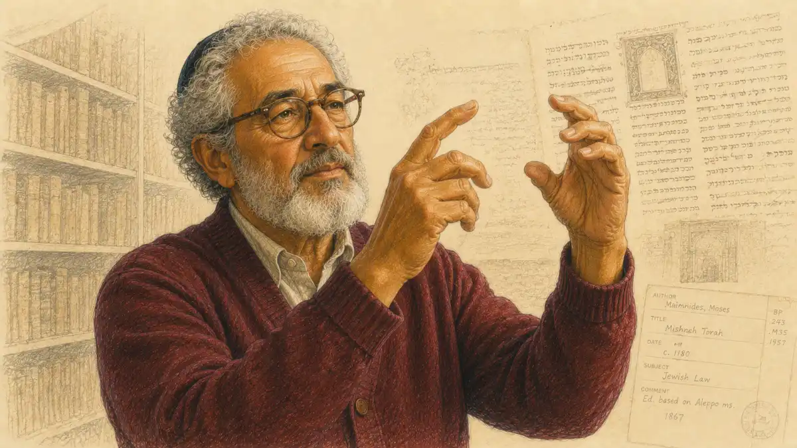

AP Biology carries a reputation that misleads almost everyone who repeats it. Students call it the memorization exam, the flashcard course, the vocabulary marathon, and then they sit down in May and discover that the questions in front of them are not asking what anything is called. A graph shows enzyme activity bending under conditions the student has never seen. A table reports gene frequencies in a population that changed across generations. An experiment describes a treatment group, a control group, and a result that needs interpreting rather than reciting. AP Biology is a reasoning exam wearing a memorization costume, and the costume fools exactly the students who can least afford to be fooled, because a year spent stockpiling terms produces a student who knows the language of the subject and cannot yet do the subject. The gap between a 3 and a 5 in this course is rarely a gap in how much was memorized. It is a gap in how the material was practiced: whether the student learned to look at unfamiliar living systems and reason about them with evidence, or learned to wait for questions that had already been answered in a review book.

That gap is the subject of this guide. The full model of the exam is here: the three-hour format and its two sections, the eight units with their published weight ranges, the six science practices the exam actually scores, the composite arithmetic behind the 1 to 5 scale, and a study path weighted by where the points live. The organizing instrument is the InsightCrunch Biology unit map, an exam-weighted study order for AP Biology that ranks the units by the share of the exam each one commands and sequences review accordingly. A student who reads this guide once and works from its map for a season will know what the exam is, which is the single advantage that separates prepared candidates from strong memorizers.

## What AP Biology is, and who should take it

AP Biology is a college-level survey of the living world, built around four big ideas that recur through every unit: evolution drives the unity and diversity of life, biological systems use energy and molecular building blocks to grow and reproduce and maintain dynamic homeostasis, living systems store and transmit and respond to information, and biological systems interact with each other and their environments in complex ways. The eight units of the course are those four ideas unfolded into content: the chemistry of life, cell structure and function, cellular energetics, cell communication and the cell cycle, heredity, gene expression and regulation, natural selection, and ecology. A student does not need to have chosen a science career to belong in the room, because the course teaches a transferable discipline, reading evidence about systems too complex to hold in the head all at once. A student does need the patience for layered material, since almost every later topic stands on earlier ones: gene expression assumes the chemistry of nucleic acids, ecology assumes energetics, heredity assumes the cell cycle.

The preparation that serves a student best is a first biology course and a grounding in chemistry, because the opening unit moves at the speed of chemical ideas: polarity, bonding, pH, the behavior of macromolecules in water. Algebra fluency matters more than families expect, since the exam asks for ratios, rates, probabilities, and the occasional chi-square or Hardy-Weinberg calculation rather than anything resembling calculus. Students aiming at pre-medicine and life-science majors treat the course as foundational, and students aiming anywhere else often discover it is the most honest training in evidence-reading their high school offers. Placement inside a wider STEM program, including how this course pairs with chemistry and mathematics across four years, is mapped in [the STEM majors course-stack analysis](/2008/08/28/ap-classes-for-stem-majors/), and this guide assumes that wider frame while going deep on the Biology examination itself.

### How is the course year different from the exam that ends it?

A school year in AP Biology is a sequence of topics taught in textbook order, reinforced by laboratory investigations and unit tests that reward knowing the material of the last three weeks. The May examination obeys a different logic entirely: it braids units together and presents scenarios no class rehearsed.

Questions braid units together, so a single free-response scenario can open with cellular respiration, pivot to the signaling pathway that regulates it, and close by asking what selection would do to a population carrying a variant of the enzyme involved. The exam also refuses to confine itself to organisms and pathways a class happened to study, because its scenarios are chosen to be unfamiliar: a deep-sea bacterium, an engineered yeast strain, a lizard population on an island no textbook names. Performance therefore depends less on coverage than on transfer, the ability to carry principles into scenarios that were never rehearsed. Teachers who understand this build transfer into the year with mixed problem sets and data exercises. Students who understand it stop asking whether a topic was covered and start asking whether they could reason about a topic they have never seen, which is the only question the exam ever really asks.

## The format: two sections, three hours, one long argument

The examination runs three hours and divides into two sections of equal weight. Section I holds sixty multiple-choice questions in ninety minutes, each with four answer options, and it ranges across all eight units with a heavy share of items built on data: graphs to read, tables to mine, experimental results to interpret, and scenarios that must be reasoned through rather than recognized. Section II holds six free-response questions in ninety minutes, two long questions worth eight to ten points each and four short questions worth four points each, and it is here that the exam's character shows most plainly. The long questions present a multi-part experimental or biological scenario and walk the student through describing, predicting, justifying, and explaining; the short questions isolate a single skill, a graph to construct, a calculation to perform, a claim to defend. A four-function calculator is permitted throughout the examination, and a reference sheet of equations and formulas is provided, two facts that quietly announce the exam's priorities: arithmetic is a tool to be used, not a barrier to be feared, and memorized formulas matter less than knowing which relationship a scenario calls for.

Pacing follows from the arithmetic. Ninety minutes across sixty multiple-choice items means ninety seconds per question on average, a budget that data-heavy items will strain and quick conceptual items will repay. Ninety minutes across six free-response questions means the two long questions deserve the larger share, roughly twenty minutes apiece in most sensible allocations, with the four short questions dividing what remains. Students who practice without a clock learn the content and miss the exam; students who rehearse with the clock learn both. The deeper tactical treatment of the written section, including how readers award points part by part, lives in the [AP Biology free-response strategy article](/2008/04/24/ap-biology-frq-strategy/), and this guide returns to format only where format changes how a student should study.

### What does the four-function calculator actually get used for on this exam?

The calculator handles the exam's working arithmetic: chi-square values from observed and expected counts, Hardy-Weinberg frequencies from an allele count, rates taken from a slope, and means and standard errors from a data table. Nothing on the paper requires more than the four basic operations and a square root.

Permission is not the same as irrelevance. A student who reaches for the calculator on every item bleeds time on questions designed to be answered by inspection, while a student who refuses it on a chi-square item invites arithmetic slips that cost points the reasoning had already earned. Fluency means knowing which items are calculation items at a glance. The exam's formula sheet supplies the relationships, chi-square, Hardy-Weinberg, standard error, the water potential equation, and others, so the scarce resource is never the formula. The scarce resource is recognition: seeing that a paragraph about beetle counts is asking for a chi-square, that a paragraph about a drought and a finch population is asking for allele frequencies. Practice should therefore pair every formula with the verbal shapes that summon it, until the cue and the tool are welded together. Section II also rewards a habit calculators cannot supply, showing enough of the setup that a reader can follow the substitution, because a correct final value reached through invisible work earns less sympathy when an early number went wrong than a transparent method with one slipped digit.

## The InsightCrunch Biology unit map

The eight units are not equal, and a study plan that treats them as equal donates points to the units with the largest weight. The framework publishes a weight range for each unit, expressed as a share of the multiple-choice section, and those ranges are the closest thing to a points budget the exam offers. Natural selection stands at the top, gene expression and cellular energetics press close behind, and the chemistry of life, though foundational, carries the smallest direct weight because its ideas are mostly tested inside other units' questions. The map below states each unit's range and assigns a study order that follows the weight: the heaviest units are reviewed first and revisited most, the lightest are secured late and maintained cheaply. Study order is not learning order. A first pass through the course follows the textbook; a review season follows the map.

| Unit | Exam weight range | Recommended study order |
| --- | --- | --- |
| Unit 7: Natural Selection | 13 to 20 percent | First: heaviest weight and the course's unifying idea |
| Unit 3: Cellular Energetics | 12 to 16 percent | Second: dense mechanisms, heavy free-response presence |
| Unit 6: Gene Expression and Regulation | 12 to 16 percent | Third: the molecular core most scenarios draw on |
| Unit 4: Cell Communication and Cell Cycle | 10 to 15 percent | Fourth: signaling logic appears inside every system |
| Unit 8: Ecology | 10 to 15 percent | Fifth: broad, data-friendly, rewarding late review |
| Unit 2: Cell Structure and Function | 10 to 13 percent | Sixth: organelle reasoning and membrane transport |
| Unit 1: Chemistry of Life | 8 to 11 percent | Seventh: small direct weight, maintained as foundation |
| Unit 5: Heredity | 8 to 11 percent | Eighth by weight, though its skills feed Unit 6 and 7 work |

Two warnings belong with any weight table. Ranges overlap and shift between administrations, so the map is a planning instrument rather than a promise: a unit at the bottom of its range in one year can sit at the top in another. Weights also describe the multiple-choice section's blueprint, while free-response questions range where their scenarios lead, and heredity, the lightest unit by the table, regularly powers substantial written questions through crosses, pedigrees, and chi-square analysis. The correct use of the map is proportional effort, not abandonment. Every unit gets studied; the heaviest get studied first, longest, and with the most practice under exam conditions.

## Unit 7: Natural selection, the exam's center of gravity

Natural selection carries the largest weight range in the course, and its position is structural rather than accidental: evolution is the framework's first big idea, the thread the other seven units hang from. The content runs from the evidence for evolution and the mechanisms that drive it, through Hardy-Weinberg equilibrium as the null model against which change is measured, to phylogenetics, speciation, and the origin of life. Exam questions in this territory rarely ask for definitions of selection. They present allele frequencies shifting across generations, a phylogenetic tree to read or defend, a population disturbed by migration or a bottleneck, and they ask what the evidence supports. The Hardy-Weinberg equations appear constantly, not as algebra trivia but as the baseline that lets a student say whether evolution is occurring at all and which mechanism the data implicate. Mastery here means fluency in three dialects at once: the mathematics of gene frequencies, the logic of trees and shared ancestry, and the vocabulary of mechanisms, drift, flow, mutation, selection, wielded precisely enough to distinguish them in a scenario. Depth on this unit, together with the ecology material it bleeds into, is developed in the [evolution, ecology, and biodiversity deep dive](/2008/04/28/ap-biology-evolution-ecology-biodiversity/), which treats selection pressures, phylogenetic reasoning, and speciation at working length.

## Unit 3: Cellular energetics, where mechanisms earn their keep

Cellular energetics joins enzyme biology to the two great energy pathways, photosynthesis and cellular respiration, and it carries a weight that understates its free-response importance. Enzymes are the exam's favorite experimental subject: a graph of reaction rate against temperature or pH or substrate concentration is a near-guaranteed sight, and the reasoning it demands, activation energy, denaturation, competitive and noncompetitive inhibition, induced fit, is the purest form of the course's data discipline. Photosynthesis and respiration must be learned as coupled systems rather than as two diagrams: where each stage happens, what each stage consumes and releases, how the electron transport chain converts a proton gradient into ATP through chemiosmosis, and how the two pathways interlock across a plant cell that runs both. Students lose points here by memorizing the light reactions as a sequence of names; students gain them by being able to predict what a poisoned complex, a blocked membrane, or a changed wavelength does to the whole flow. The cellular machinery in this unit, together with membrane structure and the signaling systems that regulate it, receives full treatment in the [cells, energetics, and communication deep dive](/2008/05/07/ap-biology-cells-energetics-communication/).

## Unit 6: Gene expression and regulation, the molecular core

Gene expression is where the course's information big idea becomes concrete: DNA structure and replication, transcription and RNA processing, translation, mutation, and the regulatory architecture that decides which genes a cell reads and when. The exam loves this unit because it is inherently procedural, and procedural material converts cleanly into questions: given a template strand, what RNA emerges; given a mutation, what happens to the protein; given an operon in a stated condition, is the gene on or off. Regulation separates strong students from memorizers, since the lac and trp operons, enhancers and transcription factors, and epigenetic mechanisms all test the same skill, tracing a causal chain from a molecular event to a phenotypic consequence. Biotechnology rides along inside this unit: gel electrophoresis, PCR, bacterial transformation, and sequencing appear as scenario material, and a student should be able to reason about what a band pattern or an amplification curve means rather than merely name the technique. The genetics material that feeds this unit and the heredity patterns that follow from it are covered at depth in the [genetics, heredity, and gene expression deep dive](/2008/05/03/ap-biology-genetics-heredity-gene-expression/), which works through crosses, linkages, and molecular scenarios in exam form.

## Unit 4: Cell communication and the cell cycle, the logic of signals

Cell communication teaches a three-part grammar that the entire course then speaks: a signal molecule binds a receptor, a transduction pathway relays and amplifies the message, and the cell responds. Once a student owns that grammar, unfamiliar pathways become readable, because the exam's signaling questions are built by dressing the same grammar in new molecules: a hormone and its receptor, a neurotransmitter at a synapse, a growth factor gone wrong in a cancer line. The distinctions that matter are mechanical: direct contact against local and long-distance signaling, intracellular receptors against membrane receptors, kinases and second messengers as the pathway's moving parts, and the points where a drug or a mutation can interrupt the chain. The cell cycle half of the unit supplies the machinery of division, checkpoints, cyclins and their dependent kinases, and the failure modes that produce uncontrolled growth, and it sets up the heredity unit by making mitosis and meiosis intelligible as processes rather than diagrams. Questions fuse the two halves constantly, since a checkpoint defect is simultaneously a cycle topic, a signaling topic, and a cancer topic, and students should practice reading such scenarios in all three registers at once.

## Unit 8: Ecology, the broad and data-friendly fifth

Ecology closes the course and rewards review out of proportion to its difficulty, because its questions lean on graphs and community scenarios more than on dense mechanism. The content spans population growth models and their limits, community interactions from competition to mutualism, energy flow through trophic levels with its characteristic inefficiency, biogeochemical cycling, and the effects of disruption on ecosystems at every scale. Exponential and logistic growth must be understood as models with assumptions, since exam items ask what a curve's shape implies about limiting factors and carrying capacity rather than what the curve is called. The productivity and energy material ties the unit back to energetics, and the biodiversity material ties it back to evolution, which is why ecology questions so often appear in braided form. Students who neglected this unit during the year can recover it efficiently in the review season, because its reasoning load is lighter than its content breadth suggests, and the [evolution, ecology, and biodiversity deep dive](/2008/04/28/ap-biology-evolution-ecology-biodiversity/) covers the population and community material alongside the selection content it pairs with.

## Unit 2: Cell structure and function, the architecture underneath

Cell structure supplies the physical stage on which the rest of the course happens. Organelle questions on the modern exam have moved past identification: a strong student explains why the endomembrane system is organized as it is, why mitochondria and chloroplasts carry their own DNA and double membranes, and how surface-area-to-volume ratios constrain cell size and shape the folds and compartments that evade the constraint. Membrane transport is the unit's highest-yield mechanism, because osmosis, diffusion, facilitated transport, and active transport generate endless scenario material, and the water potential equation gives the exam a reliable quantitative handle: given solute concentrations and pressure conditions, predict the direction water moves and defend the prediction. Endosymbiotic theory belongs here as evidence-based reasoning, not as a story: the student should be able to marshal the structural facts as an argument. Weak performance in this unit usually traces to a single habit, learning organelles as a labeled diagram instead of as a working system whose parts trade materials and energy, and the repair is to redraw the cell as a flow chart until every arrow can be explained.

## Unit 1: Chemistry of life, small weight and long shadow

The chemistry of life carries the smallest direct weight on the map, and treating it as minor is the classic opening mistake, because its concepts are the substrate of everything else. Water's properties, cohesion, adhesion, high specific heat, evaporative cooling, its behavior as a solvent, arise from hydrogen bonding, and hydrogen bonding reappears in protein folding, DNA pairing, and membrane behavior across the whole year. The four macromolecule families must be known structurally and functionally: what monomers build them, what bonds join the monomers, what hydrolysis and dehydration synthesis do, and how the structure of each family suits its jobs, from cellulose's rigidity to the information density of nucleic acids. Protein structure deserves the deepest attention in the unit, since primary through quaternary organization and the denaturation that destroys it connect chemistry to enzymes, to signaling receptors, to hemoglobin-style cooperativity wherever it appears. Review time for this unit should be spent inside other units' questions, checking that the chemical reasoning under the biology still holds, rather than on isolated vocabulary drills.

## Unit 5: Heredity, light on the map and heavy in the hand

Heredity's weight range understates its practical importance because its skills are instruments other units play. Meiosis must be understood as the engine of variation: crossing over, independent assortment, and random fertilization each generate diversity, and nondisjunction explains a family of disorders students should be able to trace through a karyotype or a pedigree. Mendelian genetics on this exam is probability wearing a biology coat: monohybrid and dihybrid crosses, test crosses, and the chi-square test that judges whether observed offspring counts fit a predicted ratio. Non-Mendelian patterns, linkage, sex-linkage, multiple alleles, polygenic traits, epistasis, and environmental effects on phenotype, supply the complications that separate routine cross work from exam-level cross work, and the transition rule is always the same: compute the expectation from the stated model, then let the data argue. Students should practice heredity problems until the mechanics are automatic, because genetics questions are among the few places on the exam where a fully correct answer can be produced on demand, and leaving those points unclaimed to spend time elsewhere is poor economics. The [genetics, heredity, and gene expression deep dive](/2008/05/03/ap-biology-genetics-heredity-gene-expression/) develops the cross work and the molecular material as one continuous treatment.

## The six science practices: the skills the exam actually scores

Content is only half the blueprint. The framework names six science practices, and every question on the exam is a content topic and a practice fused together. The first practice is concept explanation: stating how a biological phenomenon works in accurate, connected prose. The second is visual representations: reading and building models, diagrams, phylogenetic trees, and pathway sketches. The third is questions and methods: designing investigations, identifying variables, and judging whether an experiment can answer the question it claims to answer. The fourth is representing and describing data: constructing graphs, choosing axes and scales, and summarizing what a data set shows. The fifth is statistical analysis and mathematical routines: the chi-square test, Hardy-Weinberg calculations, rate and probability computations, and error analysis. The sixth is argumentation: making a claim and defending it with evidence and reasoning, the practice the long free-response questions exist to measure.

Understanding the practices changes what practice means. A student drilling flashcards is training none of the six beyond a shallow slice of the first. A student working a released free-response question is training four or five at once: reading a representation, summarizing data, perhaps computing a statistic, and writing an argument. This is why the exam's preparation economy is so lopsided, and why students who switch from recall drills to scenario work mid-year often improve faster in six weeks than they did in six months. The practices also explain the exam's texture, its endless graphs and tables and described experiments. Data is not decoration on this exam; data is the medium in which the practices operate. A review plan built on the unit map should therefore be built equally on the practice map: every study session should name the practice it trains, and a session that trains only content recall should be the exception rather than the rhythm.

## The mathematics of AP Biology: small tools, constant use

The quantitative demand of this exam is deliberately modest, and its modesty is a trap for students who conclude that mathematics can be ignored. Four tools do nearly all the work. Probability governs genetics: the product and sum rules, applied to crosses and to the chance of inheriting combinations of alleles. The chi-square test governs experimental judgment: observed counts against expected counts, a computed statistic, and a decision about whether a model survives its data, with the critical value supplied or readable from a provided table. Hardy-Weinberg algebra governs population genetics: p and q, the genotype frequencies built from them, and the conditions under which the equilibrium holds and evolution is absent. Rate and slope govern everything graphical: a rate of respiration from a respirometer trace, a rate of transpiration, a growth rate from a population curve, each one a rise over run with units attached and a biological meaning to state. Around these four orbit supporting skills: means and standard deviation and standard error for describing data and judging whether two samples differ, dilution and concentration arithmetic for laboratory scenarios, and surface-area-to-volume ratios for cell size questions.

Each tool should be practiced in its verbal habitat until the pairing is automatic. Counts of offspring phenotypes should summon chi-square before the question finishes asking. Allele counts in a population should summon Hardy-Weinberg. A graph with a quantity on one axis and time on the other should summon slope. Students who drill the tools in isolation, on naked numbers, often fail to recognize them inside a paragraph of biology, and recognition, not computation, is where the points are lost. The formula sheet provided at the exam supplies the equations themselves, which confirms the diagnosis: the exam tests whether a student knows what to compute and why, and leaves the remembering of symbols to the reference page.

## How the exam is scored: composites, bands, and the moving line for a 5

Each section contributes half the composite. Multiple-choice answers are scored by count of correct responses, with no deduction for wrong answers, so an unanswered item is a certain zero and a guessed item is a lottery ticket with no price. Free-response answers are read by trained readers against detailed scoring guidelines, point by point, part by part, which is why the written section rewards completeness and visible reasoning: a part answered earns whatever its elements are worth, and a part left blank earns nothing regardless of what the student knew. The two halves are combined into a composite score, and the composite is converted to the 1 to 5 scale against cut points set for each administration after the papers are read, calibrated so that a 5 represents the same standard of mastery across years rather than the same raw total.

Because the cut points are set per administration, any exact raw score promised for a 5 is fiction. The honest statement is a band: across administrations, a 5 has generally required something in the neighborhood of two thirds to three quarters of the available composite points, with the precise line drifting as the difficulty of a given year's paper drifts. A 4 has generally lived somewhat below that, in a band whose lower edge sits near half the composite points. Students should plan against the top of the band rather than the middle: a preparation aimed at comfortably clearing three quarters of the points survives a hard year, while a preparation aimed at a remembered cut score from a practice book is gambling on calibration. The practical translation is that no section can be sacrificed. A candidate cannot donate the free-response half and recover on multiple choice, because half the composite is written, and the written half is where partial credit makes steady accumulation possible for a student who answers everything, labels everything, and argues in complete sentences.

### How do the two long free-response questions differ from the four short ones?

The long questions are full scenarios, an experiment or a biological system described at length, with parts that climb from describing data through performing a calculation or constructing a graph to predicting an outcome and justifying the prediction with evidence. The short questions are single instruments: one skill, one focused scenario, four points, finished in a fraction of the time.

Time allocation should mirror that architecture. A student who gives the first long question half the section starves the four short ones, which are the cheapest points on the paper because each is self-contained and graded in isolation. Readers score every part against its own guideline, so an unfinished long question does not contaminate a polished short one, and triage is rational rather than defeatist. Working order is therefore a strategic choice: many strong students draft the short questions first to bank their points, then invest the remaining hour in the long scenarios. Others prefer to open with a long question while their concentration is freshest and use the short questions as a closing audit of remaining minutes. Either order succeeds when it is rehearsed; the failure mode is having no order at all and discovering the clock with two questions untouched. Practice sessions should simulate the full ninety minutes at least several times before May, because the pacing of this section is a physical skill, learned in the hand and the eye, not a fact that can be memorized the night before.

### Why do strong memorizers sometimes stall in the middle of this course?

Memorization scales badly. Early units reward it, because vocabulary and a gallery of organelles and molecules can be carried by a good memory. Around cellular energetics and gene expression the material turns procedural and conditional: pathways respond to conditions and genes switch on and off, so questions start asking what changes when a variable moves.

Recall has no move for that question shape, and the student's confidence, built on coverage, collapses when coverage stops paying. The stall is misdiagnosed in both directions. The student concludes the later units are simply harder and doubles the flashcard hours, which deepens the problem, while a teacher may conclude the effort faded when the effort actually intensified in the wrong direction. Repair begins with changing the practice medium: the same hour spent working scenario questions, drawing pathways from memory and then perturbing them, and explaining data aloud produces the reasoning the exam scores. Progress also requires surrendering a comforting metric. A stack of known terms can be counted, while reasoning growth is visible only in worked problems, so the student must learn to trust the uglier evidence of practice scores and written arguments improving week by week. Courses front-load the memorization-friendly material, which means the stall arrives mid-year for thousands of students at once; the ones who recover are the ones who treat the stall as information about method rather than as a verdict on ability.

### What separates a data question from a recall question on this exam?

A recall question can be answered from knowledge alone: name the organelle, state the bond, identify the stage. A data question hands the student something made for the occasion, a table of measurements, a graph with an unfamiliar organism, bands on a gel, and asks for an operation on it: describe the trend, compute the rate, judge the claim.

The knowledge still matters, but it enters as the tool, not as the answer. The distinction governs preparation because the two question types fail differently. Recall questions fail when the fact was never learned; data questions fail when the fact was learned and the operation was never practiced. A student can know everything about photosynthesis and still lose a data question about a novel alga's oxygen production by misreading the axes, ignoring the control condition, or describing the graph instead of interpreting it. Exam writers prefer data questions for a principled reason: they measure whether the biology can be used, which is the course's stated purpose. The practical habit is to treat every data set as a small argument waiting to be made. Identify the variables, name the comparison the design builds in, extract the trend in one sentence, and only then answer the specific part asked. Students who rehearse that four-beat routine on dozens of released items find the exam's dominant question type becoming its most predictable, while students who meet data only inside textbooks find the same items permanently surprising.

### How does the provided formulas sheet change what a student must memorize?

The sheet carries the course's working equations: chi-square, Hardy-Weinberg, standard error, water potential, and surface-area-to-volume relationships. Its presence abolishes one category of memorization entirely, the symbolic form of the equations, and replaces it with a harder demand: knowing which formula a scenario calls for and how to interpret the number that comes out.

Preparation should adjust in kind. Time once spent drilling formula recall is better spent drilling formula selection: mixed sets of short scenarios where the task is only to name the tool and set up the computation, judged before any arithmetic happens. Students should also learn the sheet's geography before exam day, since hunting for an equation mid-section costs the minutes the sheet was meant to save. Interpretation deserves equal weight, because free-response parts routinely award their points for the sentence after the calculation, the one that states what a chi-square value means for the hypothesis or what a water potential gradient means for the direction of flow. A number without its sentence is half an answer on this exam, and the sheet, by removing the memory burden, raises the relative value of the sentence until it becomes the skill the section is really grading.

## The study path: review in the order the exam pays

A serious review season for AP Biology runs eight to twelve weeks and is organized by the unit map rather than by the textbook's table of contents. The opening weeks belong to the three heaviest units, natural selection, cellular energetics, and gene expression, studied through scenario work rather than rereading: released questions sorted by unit, pathways redrawn from memory and then deliberately perturbed, data sets interpreted aloud in complete sentences. The middle weeks take up cell communication and the cell cycle, ecology, and cell structure, with heredity practiced in short daily doses because cross work is a perishable mechanical skill that decays without contact. The closing weeks are for integration: full-length practice sections under real timing, mixed sets that braid units the way the exam braids them, and targeted repairs of whatever the practice papers expose. The final week tapers to light review, formula-selection drills, and sleep, because a reasoning exam punishes exhaustion more directly than a recall exam does.

The weekly rhythm inside that arc matters as much as its length. New content review should alternate with retrieval, since rereading notes produces a fluent feeling that the exam does not reward; closing the book and reconstructing an argument is slower, uglier, and incomparably more effective. Written work deserves a protected share of every week, because half the composite is prose and most students' prose improves only when it is produced, read against a scoring guideline, and rewritten. Released scoring guidelines are the student's most underused asset: grading one's own free-response answers against the official rubric converts vague self-assessment into a points ledger, showing exactly which sentence elements readers pay for. The complete score-targeted campaign, with its own week-by-week plan for students aiming specifically at the top score, is laid out in [the guide to earning a 5 on AP Biology](/2008/01/29/how-to-get-a-5-on-ap-biology/), and students whose goal is a solid 3 or 4 can run the same architecture at a gentler volume rather than a different one.

A plan is only as good as its feedback loop, and the loop for this exam is the practice paper. Every two weeks of the season should end with a timed section, scored honestly, whose errors are sorted into the only three categories that matter: knowledge never learned, reasoning not yet practiced, and execution lost to time or carelessness. Each category has a different repair, and confusing them wastes the season: rereading a chapter does nothing for a pacing failure, and timing drills do nothing for a missing concept. Students should keep an error log keyed to those categories and let it, rather than anxiety, choose the next week's work. Families often ask what a parent can usefully do, and the answer is to protect the calendar and quiz nothing: this exam's skills are not flashcard skills, and the best support is time, quiet, and a household that treats the review season as a training block rather than a crisis.

## Reading the exam's data: graphs, tables, and gels

Data arrives in a small number of costumes, and fluency is mostly costume recognition. Line graphs carry change over time or across a gradient, and they ask for rates, comparisons between conditions, and the shape of a relationship, saturation, threshold, optimum. Bar graphs carry categorical comparisons, treatments against controls, species against species, and their standard error bars carry the argument about whether a difference means anything: overlapping intervals counsel caution, separated intervals license a claim. Tables carry everything else, counts for chi-square, frequencies for Hardy-Weinberg, measurements for means and rates. Gel images carry molecular reasoning: band position encodes size, band presence encodes genotype or expression, and a lane is an individual or a condition to be read like a sentence. Phylogenetic trees carry ancestry: the student reads nodes as common ancestors, branch order as relatedness, and learns that rotating a node changes nothing while moving a branch changes everything.

Each costume has a routine. For a graph: axes and units first, then the trend in one spoken sentence, then the comparison the design intends, then the specific part asked. For a table: identify what was counted, what the expected pattern would be under the named model, and whether the question wants a description, a calculation, or a verdict. For a gel: convert bands to sizes or genotypes before interpreting anything, because interpretation built on an unconverted gel is guesswork. For a tree: mark the nodes, trace the shared ancestors, and let the topology, never the left-to-right order of the tips, decide relatedness. Practicing these routines on released material until they are automatic converts the exam's most common point source from a threat into a rhythm, and it is the single highest-yield habit a student can build in the middle weeks of review.

## The experimental design questions: controls, variables, and honest claims

A recognizable family of questions presents an experiment, sometimes a strong one and sometimes a deliberately flawed one, and asks the student to work as its reviewer. The vocabulary of that review is fixed and should be deployed precisely: the independent variable the investigator manipulates, the dependent variable that gets measured, the standardized conditions held constant, the control group that anchors comparison, and replication that separates pattern from accident. Justification questions ask why a design element exists: why a control treatment with everything except the active ingredient, why sample sizes beyond a handful, why organisms were randomly assigned, why measurements were repeated. Prediction questions extend the design: given the hypothesis, what result would support it, what result would damage it, and what would a stated change to the procedure do to the outcome.

The most expensive errors in this family are logical rather than factual. Claiming an experiment proves a hypothesis, rather than supports it, misstates how evidence works and readers notice. Confusing correlation in an observational study with causation that only a manipulated experiment can argue is the classic trap, and the exam sets it in ecology and evolution scenarios every year. Ignoring a confound the scenario took pains to include, two variables changed at once, an uncontrolled temperature, a nonrandom assignment, forfeits the exact points the question was built to offer. Students should practice writing the three canonical sentences until they are reflexes: the claim the data support, the evidence from the results that supports it, and the reasoning that connects the evidence to the underlying biology. Claim, evidence, reasoning is not a school slogan on this exam; it is the literal structure of the argumentation practice the long questions score.

## The hardest ground, and the mistakes that reliably cost points

Ask teachers where scores go to die and the same terrain gets named: gene regulation scenarios that braid molecular steps into a causal chain, energetics questions that hide a standard pathway inside an unfamiliar organism, phylogenetic reasoning that punishes students who read trees left to right, and any free-response part that demands a prediction with a justification rather than a description. Difficulty in this course is rarely about obscure content. It is about chain length: the more steps between the scenario's given facts and the answer, the more places a student's reasoning can quietly leave the rails. The repair for chain length is chain practice, problems whose answers must be built in sequence, with each intermediate step stated rather than assumed.

The common mistakes form a short, stable catalog. Rote memorization as a primary strategy tops it, the course's signature misconception: students stockpile terms and meet an exam that spends its points on scenarios. Weak data interpretation follows: describing a graph in the answer instead of interpreting it, narrating the axes rather than the trend, and reporting a calculation without the sentence that says what it means. Experimental design blindness costs a third share: students who cannot identify the control, the variables, and the claim a design can support lose points in every unit, because design questions wear every unit's clothing. A fourth mistake is prose failure on the written section: answers that circle the point in fragments, never commit to a claim, or repeat the question's wording as though it were evidence. A fifth is allocation failure, polishing a strong unit while a heavy one stays unreviewed, which the unit map exists specifically to prevent. None of these mistakes is a talent problem, and all five respond to the same prescription: practice in the exam's own medium, timed, written, and scored against real guidelines.

## The laboratory program: investigations that anchor the course

AP Biology is a laboratory course in design, and the framework's published investigations give the year its inquiry spine. Their subjects are the course in miniature: diffusion and osmosis across membranes, enzyme catalysis under varied conditions, photosynthesis and cellular respiration measured rather than described, mitosis and meiosis modeled and counted, bacterial transformation, DNA restriction analysis read off a gel, mathematical modeling of population genetics, energy transfer in ecosystems, transpiration in plants, behavior in invertebrates, and dissolved oxygen as a window on productivity. Schools vary in which investigations they run and in how much of each is structured versus open, since the framework asks for a substantial share of class time in laboratory work and for investigations that move along the spectrum from guided to student-designed. What the exam does with this program is indirect and total: it never asks a student to report a lab result, and it constantly asks a student to think the way the labs trained, identifying variables, judging controls, extracting a rate from a respirometer trace, or explaining why a transformation produced colonies on one plate and none on another.

A student whose school ran few investigations is disadvantaged but not doomed, because the exam tests the reasoning the labs teach rather than the labs themselves, and that reasoning can be rehearsed on released questions built from laboratory scenarios. The review move is to study each common investigation as a design: what question it answers, what it manipulates and measures, what its control is, and what result would have surprised its hypothesis. Students who can narrate an investigation that way own its transferable value whether or not their hands ever touched the apparatus. Students who experienced the labs as recipes to complete, by contrast, may find the exam's design questions oddly foreign despite a year of Fridays in the lab, which is a reminder that the course's laboratory strand pays out in proportion to the thinking demanded, not the hours logged.

## College credit and placement: the landscape in patterns

Colleges treat an AP Biology score as evidence that a student has completed work comparable to an introductory college biology course, and they convert that evidence into credit or placement under policies that vary too widely for any honest guide to quote school by school. The durable patterns are these. Scores of 4 and 5 earn the most generous treatment, frequently credit for one or two semesters of introductory biology or exemption from a general-education science requirement. A score of 3 earns credit at some institutions, placement without credit at others, and nothing at the most selective schools, many of which accept only 4s and 5s or decline AP credit in the major's core sequence altogether. Pre-medical students meet a specific wrinkle: many medical schools prefer or require that prerequisite biology be taken at the college level, so an AP score may earn undergraduate credit while the student still takes college biology for the professional application. The score's most universal value is therefore not the credit itself but what it signals and enables: readiness for college science, room in a schedule for other courses, and a tested capacity for evidence-based reasoning.

Two practical rules follow. First, check the policy of each college on its own published AP credit chart before counting credit in a plan, because department rules can differ from the university's general rule, and biology departments are among the most likely to carve out exceptions. Second, weigh placement as carefully as credit: skipping an introductory course is valuable only when the student is genuinely ready for the course that follows, and a student whose 4 rested on narrow preparation may be better served by taking the college course and banking the grade than by advancing into organic-level expectations on a fragile base. The admissions side of the ledger is steadier: a strong AP Biology performance inside a rigorous program reads as evidence of scientific maturity to any reader, and that signal survives even at institutions whose registrars grant it no credit at all.

## Studying without a classroom: the self-study question

A determined student asks every year whether this exam can be prepared for independently, and the honest answer is that the content can and the course, in full, cannot quite. The written materials, a textbook or review book, released exams, scoring guidelines, and the framework's own unit structure, are all available to a solitary student, and the reasoning skills the exam scores are exactly the ones that solitary practice on released questions builds. What the solitary student lacks is the laboratory strand and a reader: nobody grades the practice free responses against the guidelines with a stranger's cold eye, and nobody designs the investigation the student failed to imagine. The workable compromise is structured: follow the unit map in weight order, write every practice answer in full sentences, score against the official guidelines without mercy, and find at least one knowledgeable reader, a teacher at another school, a tutor, a study partner with a strong record, to audit the written work monthly. General principles for organizing an independent AP campaign across subjects are collected in the [AP exam study plan](/2008/09/19/ap-exam-study-plan/), which supplies the scheduling scaffolding this guide's unit-level method can hang from. A self-studier should also rehearse the calculator tools early, since chi-square and Hardy-Weinberg fluency are solitary skills that no classroom would have supplied by osmosis anyway.

## The misconception, settled: what memorization is actually for

Because the course's central misconception deserves a direct burial, here is the precise division of labor. Memorization supplies the exam's raw materials: the vocabulary of structures and processes, the steps of the major pathways, the roster of mechanisms, drift, flow, mutation, selection, and the standard models, operons, Hardy-Weinberg, logistic growth, that questions invoke by name. Without that inventory the reasoning has nothing to work on, and students who romanticize pure reasoning while skipping the inventory fail just as reliably as the memorizers do. Reasoning does everything the inventory cannot: it selects which facts a scenario engages, arranges them into a causal chain, reads the data the scenario supplies, and produces a claim the evidence can carry. The exam's questions are engineered so that the inventory is necessary and nowhere near sufficient, which is exactly the design of a college course's final examination and exactly unlike a vocabulary test.

The practical consequence is a two-layer study method. The inventory layer is maintained cheaply and continuously: brief daily retrieval of terms and pathways, drawings reproduced from memory, flashcards if they are used for retrieval rather than recognition. The reasoning layer gets the prime hours: scenario questions, data work, written arguments, all timed and all reviewed against guidelines. Students invert this constantly, spending prime hours on the inventory because it feels productive and offers visible progress, and squeezing reasoning into the season's final fortnight where it cannot mature. A useful audit is to ask of any study hour which layer it served; a review season where the reasoning layer holds less than half the hours is a memorization campaign wearing a calendar. The teachers whose students consistently reach the top band describe the same classroom signature: students arguing about data, in the vocabulary, without being asked to. That signature is buildable at a desk, one worked scenario at a time.

## Worked approach: an energetics experiment, read the way the exam reads it

Consider the shape of a classic examination scenario, constructed here in the exam's archetype rather than copied from any paper. A researcher measures oxygen consumption in germinating seeds held at several temperatures, with a second set of seeds, killed and treated to prevent microbial growth, measured alongside as a control for the apparatus. The results arrive as a table or a graph, and the questions climb the usual ladder: describe the pattern, calculate a rate over a stated interval, explain the biochemistry under the numbers, predict the effect of a stated change. Each rung has its own discipline. Describing means stating the trend with its conditions attached: oxygen consumption rose with temperature across the measured range, at a rate that steepened rather than merely increased. Calculating means taking a slope between two points on the linear stretch, keeping the units, milliliters of oxygen per gram per minute, because a rate without units is an orphaned number the guidelines will not fully pay for. Explaining means naming the machinery: warmer conditions quicken enzyme-catalyzed steps of cellular respiration up to the range where proteins begin to lose their shape, and the control seeds establish that the gas change belongs to living respiration rather than to the instrument or to microbes. Predicting means extending the mechanism honestly: beyond the optimum the curve should fall as denaturation outruns kinetic gain, and a justification names that mechanism rather than gesturing at the heat.

Notice what the scenario never asked. It never asked for the steps of glycolysis, the location of the Krebs cycle, or the number of ATP from a glucose, although all three live in the same unit. The knowledge mattered as the engine of the explanation rung, where a student without the pathway cannot say why temperature bends the curve. Students should study released scenarios in this rung-by-rung way, labeling each part with the practice it exercises, until the ladder itself becomes familiar furniture: describe, calculate, explain, predict, justify. Variations change the organism, the variable, and the pathway; the ladder does not change, and a student who has climbed it thirty times in practice walks into the examination with a gait the questions cannot surprise.

## Worked approach: a population problem, from counts to a verdict on evolution

A second archetype, again in the exam's standard shape. A field team counts a beetle population and finds, for a gene with two alleles governing shell pattern, a stated number of homozygous dominant individuals, heterozygotes, and homozygous recessive individuals. The questions ask for allele frequencies, for the genotype distribution expected if the population sits in Hardy-Weinberg equilibrium, and for a judgment: does the population appear to be evolving at this gene, and what evidence would sharpen the judgment. The method is a small liturgy. Count alleles directly from the genotype counts, each homozygote contributing two copies of its allele and each heterozygote one of each, and divide by the total allele pool to get p and q. Square and combine them through the equilibrium equation to get expected genotype frequencies, and convert those back to expected counts against the population's size. Compare observed and expected, with chi-square as the formal instrument when the question asks for one, and state the verdict in the exam's disciplined language: the observed distribution matches or departs from the equilibrium expectation, and a departure means at least one equilibrium condition is failing, with selection, drift, migration, nonrandom mating, or mutation as the candidate explanations the scenario's details must choose among.

Two habits separate full credit from partial on this archetype. The first is keeping allele frequencies and genotype frequencies in separate mental compartments, since the commonest error on the page is averaging the wrong quantities or reporting p where the question wanted the heterozygote share. The second is remembering what the equilibrium is for: it is the null model, the picture of a population not evolving, so the calculation's purpose is the comparison and the verdict, never the arithmetic alone. Students should also be ready for the scenario's favorite sequel, a change described in words, a drought, an arriving predator, a pesticide, followed by new counts, because that sequel converts a static exercise into the exam's central story: frequencies move, mechanisms explain the movement, and the student who narrates both halves in connected prose is doing the discipline itself.

## Writing the free-response section: how readers actually pay

The written half of the composite is graded by humans working from guidelines that decompose each question into payable elements, and a student who understands the payment structure writes differently. Elements are discrete: a correct description of a trend, a calculation set up and carried through, a claim, a piece of evidence tied to that claim, a mechanism named and connected. An answer earns an element by containing its substance in identifiable form, which means the economics of the section favor explicitness over elegance. Burying the key relationship inside a long undifferentiated paragraph risks the reader missing it under time pressure; stating it in a clean sentence of its own nearly guarantees the element is seen. Structure is therefore a scoring technology: answer parts in the order asked, label nothing but separate everything, begin each part on its own line of thought, and let each part's first sentence carry its claim.

The classic failures are all failures of explicitness. Students describe when the part asked them to explain, and the mechanism the guideline wanted never appears. Students answer a prediction part without the justification the part explicitly requested, donating half its value. Students draw a graph with unlabeled axes, an unscaled grid, or a line that answers a different variable than the one named. Students also abandon winnable parts: a hard part c in a long question does not gate parts a and b, which are scored independently, and a skipped short question is four points surrendered without a fight. The discipline that fixes all of this is unglamorous: read the verbs. Describe, predict, justify, explain, calculate, construct, identify: each verb names a payable act, and the student's job is to perform exactly the acts named, in order, in prose a tired reader can grade at speed. Tactics beyond this foundation, including worked approaches to each recurring archetype, are developed in the [AP Biology free-response strategy article](/2008/04/24/ap-biology-frq-strategy/), which treats the written section as its whole subject.

## Multiple choice at working depth: where the other half is decided

Sixty questions in ninety minutes is a section that rewards temperament as much as knowledge. The item population divides into quick conceptual checks, which a prepared student answers in well under a minute, and data items, which consume two or three minutes legitimately and repay them. The section's central skill is recognizing which type an item is within its first lines and spending accordingly; the central failure is chronological stubbornness, bleeding six minutes into one stubborn data item while three quick items wait unanswered at the end. A two-pass rhythm suits the section: answer everything answerable on the first pass, mark the heavy items, and return with the banked time. Elimination remains the workhorse technique on hard items, since options on this exam are engineered so that two are usually implausible on inspection, converting a guess into a coin flip with positive expectation, and there is no penalty that would make leaving a bubble empty rational.

Content traps repeat in recognizable shapes. Items test whether a student confuses correlation with causation in an observational scenario. Items hinge on a single word, decreases, after, except, that reverses the correct choice. Items present a beautiful graph whose axes quietly measure something adjacent to what the stem asks. Items offer the memorizer's answer, the famous fact, beside the reasoning answer the data actually support, and the exam's whole philosophy lives in that pairing. Reviewing missed practice items should therefore be diagnostic, not clerical: for each miss, name whether the failure was knowledge, reading, reasoning, or time, because the four failures have four different repairs and a raw percentage score conceals all of them. A student whose misses are mostly reading failures needs slower stems and annotated options, not more chapters; a student whose misses are mostly time failures needs pacing rehearsals, not more content at all.

## The four big ideas as a revision lens

Late in the review season, when the units have each been worked and the practice papers start to blur together, the framework's four big ideas offer a final organizing lens that matches how the hardest questions are built. Evolution asks: how does this trait, this population, this molecule's history reflect descent with modification, and what evidence would show it. Energy and matter ask: where does the energy enter this system, what does it build, and what does the second law tax along the way. Information asks: how is the information stored, copied, expressed, transmitted, or received, and what happens when the copying or the reading errs. Interactions ask: what does this component do to the others, at the scale of a pathway, an organism, an ecosystem, and what feedback keeps the whole inside survivable bounds. A student who can run any scenario through the four questions owns a portable interrogation kit, useful precisely when a question's unit label is unclear, which on this exam is often.

The lens also repairs a subtle weakness of unit-ordered review: knowledge stored by unit tends to be retrieved by unit, while the exam's long questions retrieve by scenario. Practicing the four questions against mixed scenarios in the final weeks rewires the storage, attaching each fact to the ideas that will actually summon it. Teachers call this interleaving, and its effect is well documented in classroom experience even where students initially dislike it, because mixed practice feels harder than blocked practice while producing stronger performance where it counts. Feeling harder is, on this exam, frequently the sensation of the right work.

## AP Biology inside a four-year plan

Where the course sits in a student's program changes what it can do for them. Taken after a first biology course and alongside or after chemistry, it functions as the deepening pass its design assumes: the chemistry unit lands as review-flavored acceleration rather than as a second foreign language introduced simultaneously with the first. Taken as a student's first serious science course, which some schools permit and some students survive, it demands that the chemical and cellular foundations be built inside the course's own early weeks, and students in that position should expect the opening month to be the steepest of their year. Juniors and seniors form the bulk of most rosters, and the timing matters for a practical reason beyond maturity: the score arrives in time to matter for college applications and credit decisions, and the course's reasoning training transfers into any subsequent science, including physics and chemistry courses taken after it.

Pairings deserve thought. AP Biology and AP Chemistry in the same year is a heavy but coherent combination, since the two courses share the molecular layer and reinforce each other's opening units; the cost is laboratory time and two demanding written exams in the same May. AP Biology beside a statistics course is the quiet power pairing, because the exam's chi-square, error analysis, and data argumentation are statistical thinking in biological dress, and students regularly report that each course made the other easier. The least sensible pairing is AP Biology with a schedule so crowded that the laboratory and review hours get squeezed, because this course's returns are unusually proportional to steady weekly contact. Depth on sequencing the whole STEM shelf is available in [the STEM majors course-stack analysis](/2008/08/28/ap-classes-for-stem-majors/); the short version is that Biology rewards the student who arrives with chemistry done and a calendar with room to think.

## The course year, paced well: what strong classrooms do differently

A student reviewing for the exam inherits whatever the year built, and it helps to know what a well-built year looks like, both to recognize one and to compensate for one that fell short. Strong classrooms spend their opening weeks on the chemistry and cell units without lingering, because those foundations pay rent all year and the heavy units need their spring runway. They run investigations as arguments rather than ceremonies: students predict before they measure, and the write-up's conclusion is graded as an argument from evidence rather than as a summary of procedure. They assess in the exam's image from early in the year, with data items and short written answers braided into unit tests, so that by spring the formats hold no novelty. And they protect the review season structurally, ending new content with weeks to spare rather than teaching ecology against the examination's doorstep, a scheduling failure that converts the broadest and most recoverable unit into the least prepared.

Compensation, where the year fell short, follows the same diagnosis in reverse. A student whose class raced the final units should rebuild them from released questions backward, letting the questions define the needed content. A student whose assessments never resembled the exam should treat the first two full practice papers as format training rather than as measurements, and expect scores to understate knowledge until the medium is learned. A student whose laboratory experience was thin should study the common investigations as designs, per the laboratory section above. The exam is standardized enough that a deliberate student can close most classroom gaps in one disciplined review season; what cannot be closed in a season is a year of never having written an argument, which is why the written practice in the study path begins in its first week rather than its last.

## Graph construction: the written section's most neglected skill

Several free-response parts each year ask the student to build the graph rather than read one, and the task is graded with a strictness that surprises students who have only ever interpreted other people's axes. A payable graph has a title or an unmistakable identity, axes labeled with variables and units, a scale that uses the grid honestly without compressing the data into a corner, points plotted accurately, and, where the data describe categories rather than a continuum, bars rather than a seductive but false line. Where the scenario involves groups with variability, error bars representing standard error are part of the expected construction, and the accompanying part usually asks what those bars permit the student to conclude. Each omitted element is an element unpaid, and the elements are cheap: ninety seconds of care at the drawing buys points that an extra page of prose cannot.

The skill decays without use and is rarely taught twice, so review should include blank-grid drills: a small table of results, a blank grid, a timer, and a completed graph compared against the scoring guideline's description. Students discover their personal failure modes quickly, inverted axes, missing units, a line drawn through categorical data, and failure modes named are failure modes retired. Graph construction also closes a loop with the data-reading routines taught earlier in this guide: the student who has built graphs knows in the body how a graph can mislead, how scale choices flatter or flatten a trend, and reads the exam's provided graphs thereafter with a maker's skepticism, which is the most durable form the fourth science practice takes.

## Score profiles: what a 3, a 4, and a 5 look like from inside

Abstractions about bands become useful when translated into profiles. The typical 3 belongs to a student who knows the course's vocabulary and standard models, answers the quick conceptual items reliably, and produces partial written work everywhere: descriptions that stop before the mechanism, calculations begun and mostly carried, claims stated with evidence gestured at rather than tied down. Nothing is blank, and nothing is finished, and the composite lands where unfinished competence lands. The typical 4 belongs to a student who finishes most parts, whose data work is disciplined, whose calculations close, and whose losses concentrate in the longest causal chains and the most unfamiliar scenarios, where the reasoning thins at exactly the step the guideline valued most. The typical 5 belongs to a student whose work looks almost plain: every part attempted, every claim bolted to evidence, graphs built cleanly, rates computed with units, predictions justified by mechanism, and a visible calm about triage, the hard part noted, banked around, and revisited with whatever minutes remain.

The profiles matter because they locate the marginal point. For the 3, the marginal point is completion and explicitness, the cheapest points in the entire system. For the 4, the marginal point is chain discipline and justification, the habit of adding the because-sentence even when the answer already feels complete. For the student below 3, the marginal point is usually a foundation unit quietly missing, chemistry or cell structure never secured, taxing every downstream question. A review season run from an honest profile outperforms a review season run from a raw score, because the profile names the repair while the score only names the distance. Students should build their profile from two or three graded practice papers, in writing, before the season's plan is fixed, and should rebuild it after every subsequent paper to watch it change.

## The scenario families: recognizing the exam's favorite stories

Beneath the surface variety, the exam tells a handful of recurring stories, and naming them converts surprise into recognition. The perturbation story changes one element, a drug blocks a receptor, a mutation disables an enzyme, a drought enters a grassland, and asks what happens downstream; its skill is causal tracing. The comparison story places two organisms, two populations, two treatments side by side and asks what the differences mean; its skill is controlled interpretation. The deep-time story gives evidence, fossils, sequences, island distributions, and asks for an evolutionary account; its skill is tree-and-mechanism reasoning. The measurement story reports an investigation's numbers and asks for rates, verdicts, and design judgments; its skill is the data routine. The system story describes a feedback loop, hormonal, ecological, cellular, and asks where stability comes from and what breaks it; its skill is interaction reasoning. Nearly every long question is one story wearing a unit's clothes, and many are two stories braided.

Review organized by story complements review organized by unit, and the strongest late-season practice mixes both grids: the same student who drilled energetics by unit should meet energetics inside a perturbation story beside a comparison story from heredity. This is also the kindest way to meet genuinely unfamiliar scenarios in practice, because the student learns the transferable move explicitly: identify the story first, since the story dictates the method, and let the unit supply the facts the method needs. Teachers build entire courses around this recognition without always naming it. Students who name it for themselves gain the recognition a season early, which on this exam is the same thing as gaining points.

## Exam-day execution: the last layer of preparation

The three hours themselves have a craft, and it is trainable. Arrive with the permitted tools and nothing that invites a proctor's problem: the four-function calculator with fresh batteries, pencils for the multiple-choice grid, pens as the school's instructions direct for the written work. Use the opening minutes of Section I to settle into the two-pass rhythm rather than to prove speed, and keep a running sense of the checkpoint arithmetic: thirty items by the forty-five-minute mark is the even pace, and drift discovered at a checkpoint is correctable while drift discovered at the warning is not. Between sections, eat something, move, and let the multiple-choice half go; carrying a grievance about item forty-one into the written section taxes the half of the composite where composure pays best. In Section II, read all six questions during the opening minutes, rank them by familiarity, and start where the points feel most available, because confidence compounds and the guidelines pay each part independently. Write in the disciplined form the readers reward: claims first, evidence attached, mechanisms named, parts separated. Reserve the final minutes for the audit no one wants to do: every part attempted, every graph labeled, every calculation carrying units. Exhaustion near the end is universal; the audit is what separates the exhausted student who banked the points from the exhausted student who almost did.

## Quantitative fluency: drilling the four tools until recognition is instant

Fluency with the exam's four quantitative tools is built the way fluency in anything is built, by short frequent reps in realistic dress. A sound drill architecture gives each tool a weekly micro-session of fifteen minutes: a handful of short scenarios, each demanding the full liturgy of naming the tool, setting up the computation, executing it on the four-function calculator, and finishing with the interpretation sentence. Genetics probability gets its reps inside crosses of escalating complication, monohybrids until the product rule is reflexive, then dihybrids, then linked genes where the expected ratios themselves become the discovery. Chi-square gets its reps on fabricated offspring counts and seed germination data, with the student required to state the null model in words before touching numbers, because the test is meaningless until the expectation it judges has been named. Hardy-Weinberg gets its reps on allele counts drawn from described populations, including the instructive cases where the recessive phenotype count must be converted through a square root before any frequency exists. Rates get their reps on graphs, respirometer traces, growth curves, transpiration data, with units spoken aloud every time.

The architecture's real subject is recognition speed. In the exam room the tool must be chosen inside seconds, while the stem is still being read, and that reflex is exactly what mixed micro-sessions build and what blocked chapter-end problem sets do not. Students should keep a personal list of cue phrases harvested from practice papers: counts of phenotypes summon chi-square; a population described by its alleles summons Hardy-Weinberg; a quantity tracked against time summons slope; two means that might differ summon standard error. The list is short because the toolbox is small, which is the quantitative section's open secret: the exam's mathematics is a handful of moves, and the students who find it hard are almost never defeated by the arithmetic. They are defeated upstream, at the moment of choosing, and choosing is trainable in fifteen-minute installments.

## What each unit's questions are really testing

Reading the blueprint at one remove, past the content lists, each unit has a characteristic question soul that a student can prepare for directly. Chemistry of life questions test structure-function reasoning: given this molecule's shape or bonds, what behavior follows, and the water questions test whether hydrogen bonding is understood as a cause rather than recited as a fact. Cell structure questions test spatial and flow reasoning: where things happen, what crosses which membrane, and why compartmentalization is worth its costs. Energetics questions test perturbation reasoning on two great pathways: block this step, starve that input, and narrate the consequences through the coupled system. Communication questions test chain reasoning: signal, receptor, relay, response, and the thousand ways a chain can break or be drugged. Heredity questions test probabilistic reasoning under a stated model, with chi-square as the courtroom where models are judged. Gene expression questions test procedural reasoning: trace the information from DNA to protein through every processing step, and predict what each class of mutation does to the product. Natural selection questions test evidential reasoning: what do these frequencies, these fossils, this tree permit a scientist to claim. Ecology questions test systems reasoning: flows of energy, webs of interaction, and the distant consequences of a local change. A student who reviews by asking, of each unit, whether they can perform its characteristic reasoning on an unseen example has reviewed in the exam's own grammar, and the units' content lists become what they should have been all along: inventories in service of eight kinds of thinking.

## The design philosophy underneath the exam

The examination's distinctive texture, its scenarios, its data, its suspicion of recall, is not an accident of taste but the product of a deliberate design philosophy about what a college-level biology course should certify. The framework that governs the course is organized around enduring understandings and science practices rather than around a catalog of facts, because the discipline itself has outgrown fact-catalog certification: no examination could inventory modern biology, and the attempt would select for exactly the skill the field values least. What a working biologist does with a new system, form a model, derive a prediction, interrogate data, argue from evidence, is therefore what the exam samples, with the eight units supplying a fair and published territory in which the sampling occurs. This philosophy also explains the exam's generosity with resources: a formula sheet, a permitted calculator, published unit weights, released questions with scoring guidelines. The exam hides its expectations far less than its reputation suggests. It hides only its scenarios, and it hides those precisely so that reasoning, the thing being certified, cannot be replaced by recognition of a rehearsed page.

Students and families who grasp the philosophy stop litigating the exam's fairness and start exploiting its transparency. The blueprint is published; the practices are published; the scoring logic is published in every released guideline. The rational campaign is the one this guide has described: inventory maintained, practices trained, weights respected, prose disciplined. The irrational campaign, equally common, is to prepare for the exam the student wishes existed, a recall test with a calculator ban and a vocabulary list, and to experience the real one as an ambush. There is no ambush. There is a published design, faithfully executed each May, waiting for students willing to prepare for the examination that actually exists.

## For parents and counselors: reading the course from outside

Adults watching a student through this course often misread its signals, because its difficulty does not look like the difficulty of other courses. A student can hold a strong grade on unit tests built from familiar material and still be underprepared for May, since the school's assessments and the College Board's differ in the dimension this guide keeps naming: transfer to unseen scenarios. The health check that actually predicts the score is a released paper taken under timing in the spring, not the report card, and families should calibrate expectations, and encouragement, to the practice papers from March onward. Conversely, a student whose course grade sagged during a hard unit may be better prepared than the grade suggests if the classroom graded reasoning severely all year. Counselors placing students should weigh the chemistry background honestly: the course is significantly kinder to students who arrive with chemistry secured, and a student without it benefits from a summer bridge on bonding, solutions, and pH rather than from optimism.

The support that helps is logistical and emotional rather than instructional. Protect the review season's evenings in the spring the way a household protects a training season, because spaced practice across weeks is the mechanism and it cannot be compressed into the final weekend. Normalize the mid-year stall described earlier in this guide; it is a method problem with a known repair, not a character event. And when the score arrives, interpret it with the registrar's patterns in mind rather than as a verdict on the student's scientific future: a 3 in this course represents college-level work performed creditably under a reasoning-heavy standard, and the students who go on to thrive in college biology include many whose AP story began at exactly that number.

## After the score: what the result should change

A score is information, and each value carries its own instructions. A 5 or a strong 4 invites the credit-and-placement decision discussed in the credit section, taken with the college's chart open and the student's real readiness audited honestly: the follow-on course forgives nothing, and a student whose score rested on a heroic review season should consider whether the foundation or merely the performance reached the top band. A 3 invites a subtler judgment: at institutions that grant credit for it, the same readiness question applies with more force, and at institutions that do not, the course still did its work, since the reasoning training is the durable asset and it transfers into the college classroom intact. A score below 3, read correctly, is diagnostic rather than damning: it usually marks a specific layer that failed, a foundation unit, the written prose, the quantitative tools, and a student retaking the course or meeting the material again in college now owns a map of exactly which layer to rebuild, which is more than most beginning students have.

Students bound for the life sciences should also know what the exam deliberately left out, so its absence is not mistaken for the discipline's boundary: the anatomy-and-physiology depth, the organismal survey breadth, and the sustained laboratory independence of a college course all wait beyond the AP frame. The exam certifies a way of thinking about living systems and a foundation of molecular, cellular, evolutionary, and ecological knowledge. Colleges build on both, which is why the score earns its keep even where it earns no credit.

## The verdict: prepare for the exam that exists

AP Biology rewards a specific and learnable discipline: hold the inventory of the living world's structures and processes, and practice reasoning with it, through data, through experiments, through populations and pathways never seen before. The students who reach the top band are not the ones who memorized the most; they are the ones who closed the book earliest and started arguing from evidence, in complete sentences, against the clock. The exam publishes its weights, its practices, its formulas, and its scoring logic, and then asks only whether the candidate can think. Everything in this guide reduces to that exchange. Work the unit map in the order the exam pays, train the six practices in the exam's own medium, write like a reader is paying you by the element, and the memorization costume falls away to reveal the examination underneath: three hours, eight units, and a fair test of whether a young biologist can reason. Begin with the heaviest units, keep the inventory warm, and let every practice paper teach the next week what to fix.

## Worked approach: a signaling scenario, traced end to end

One more archetype deserves a slow walk, because signaling questions expose reasoning gaps with unusual clarity. A scenario in the standard shape describes a hormone whose receptor sits in the membrane of target cells, a relay of proteins inside, and a response in gene expression; a drug is introduced that binds one relay protein without disabling the receptor. The questions ask what still works, what fails, and how the cell's response changes. The strong method is to draw the chain as a sentence of arrows before answering anything: signal arrives, receptor changes shape, relay one activates relay two, a second messenger rises, a kinase cascade amplifies, a transcription factor enters the nucleus, the gene's product appears. With the chain explicit, each question localizes itself: the drug's block sits at one arrow, everything upstream of the block survives, everything downstream starves, and the prediction writes itself with the mechanism as its justification. Students who skip the drawing answer from a general feeling about signaling and drop the exact arrow the question was testing; students who draw answer the question that was asked.

The same chain method repairs the commonest signaling confusions. Amplification stops being a slogan once the student narrates why one receptor event yields thousands of product molecules: each activated protein activates several of the next, and the cascade multiplies at every tier. Termination becomes a mechanism rather than an afterthought: phosphatases, messenger degradation, and receptor removal are how the cell regains its silence, and scenarios that mutate a termination step predictably produce a response that cannot switch off, the shape of several famous cancer pathways. Crosstalk, the exam's advanced move, becomes manageable as two chains sharing a node, so a change in one pathway's traffic predictably alters the other's. None of this requires memorizing any particular pathway beyond the course's standard examples; it requires owning the grammar so thoroughly that a novel pathway reads as a dialect rather than as a new language, which is, once again, the entire philosophy of the exam compressed into one unit.

## The braided question: how the exam fuses units on purpose

Students meeting their first full practice paper often report a strange sensation: the questions will not stay in their units. A long question opens with a graph of photosynthesis rates, asks for a rate calculation, pivots to the signaling that opens and closes stomata, and closes by asking what a warming climate does to the population of the plant in question. The braid is deliberate. The framework's big ideas are cross-unit by definition, and the long questions are where the exam proves that a student's knowledge is a connected system rather than eight sealed compartments. Preparation that never practices the pivot leaves students technically ready for each strand and practically unready for the rope.

Training the braid means practicing transitions explicitly. After any single-unit problem set, a student should ask the braid questions aloud: what regulates this process, where does its energy come from, what happens to it under selection, what breaks if its information flow errs. Energetics braided with regulation, heredity braided with evolution, ecology braided with energetics: the pairings repeat, because the big ideas generate a finite set of seams. The review season's final weeks should be dominated by braided material, full papers and mixed sets, because that is when the seams become the skill. Students also gain a reading advantage from expecting braids: when a long question's third part seems to change the subject, the prepared student recognizes the seam and reaches for the neighboring unit's tools instead of concluding the question has become unfair. The subject never changed; the system simply showed another of its faces, and the exam was always going to ask about the whole face.

## Choosing resources: the short shelf that actually serves

The resource market for this exam is large and mostly redundant, and a student's shelf should be built by function rather than by marketing. One comprehensive text anchors the inventory: the course textbook or a full review book with complete unit coverage, used for reference and for rebuilding a weak unit from its foundations. One source of released truth outranks everything else: the College Board's published exams, free-response questions, and scoring guidelines, which are the only materials guaranteed to speak in the exam's exact voice, and which should supply the spine of all practice from mid-season onward. One question bank or review volume of practice items earns its place for volume drilling in the early season, with the caveat that unofficial items imitate the exam's surface more reliably than its reasoning depth, so their scores should be trusted less than released-paper scores. Beyond those three functions, additional purchases mostly duplicate: a second review book restates the first, and a vocabulary deck collection serves the layer of preparation that needs the least help.

Digital resources follow the same functional test. Video walkthroughs help a student rebuild a mechanism, a pathway drawn and narrated beats a chapter reread for energetics and gene expression, provided the student redraws from memory afterward rather than mistaking recognition for command. Spaced-repetition software serves the inventory layer well when the deck is built from the student's own errors rather than downloaded whole, since a deck of one's own misses is a personalized map of the inventory's holes. Simulations of selection, drift, and population growth make the evolution unit's abstractions visible and are worth an evening each. Short online question sets belong to the same layer, and a student who wants extra reps between released papers can work through [free AP Math and Science practice questions](https://reportmedic.org/tools/ap-math-science-practice.html) as volume practice, trusting its scores less than the released papers' scores while using its misses the same way. What no resource supplies is graded prose: the written half of the exam improves only through written answers read against guidelines, by a teacher, a tutor, a disciplined peer, or the student's own practiced eye. Students should audit their shelf against that sentence before buying anything else: most shelves are heavy on input and empty of feedback, and the exam pays for feedback's product.

## Energy and information: the two currencies every unit trades in

A final compression may serve students in the season's last days, when the eight units threaten to blur into one undifferentiated mass of detail. The whole course trades in two currencies. Energy enters living systems as light or as chemical bonds, gets captured in ATP and in reduced carriers, pays for synthesis, transport, movement, and signaling, and leaks as heat at every exchange, which is why food webs thin as they rise and why no pathway's bookkeeping ever balances in the organism's favor. Information enters as sequence, in DNA, gets copied with near-perfect fidelity and occasional fruitful error, gets read into RNA and protein, gets regulated at every gate, gets transmitted between cells as signals and between generations as alleles, and gets sorted by selection across deep time. Every unit is a market where the two currencies exchange: photosynthesis converts energy into stored information-rich molecules, respiration cashes them, gene expression spends energy to read information, signaling spends energy to move information, heredity ships information forward, evolution edits it, and ecology is the economy seen from above.

The compression is more than a mnemonic. When a scenario stalls a student mid-question, asking which currency the scenario is spending and which it is earning locates the relevant machinery with surprising speed: a question about a poisoned pathway is an energy question wearing information's clothes, a question about a silenced gene is an information failure with energetic consequences. Students who carry the two currencies into the exam hold a map of the whole territory drawn on an index card, and the map's emptiness is its strength: everything not on it is detail the scenario itself will supply.

## Ecology's models: growth curves and the assumptions inside them

Ecology earns a second look in this guide because its models are the exam's favorite place to test whether a student reads assumptions or merely shapes. The exponential model assumes unlimited resources and a constant per-capita growth rate, and its J-shaped curve is therefore a claim about conditions, not a portrait of any real population's whole life. The logistic model adds the environment's resistance and produces the S-shaped approach to carrying capacity, and its assumptions deserve the same scrutiny: a fixed ceiling, instantaneous feedback, no age structure, no migration. Exam questions exploit the gap between model and world with precision. A curve that overshoots and oscillates is asking about delayed feedback. A population that crashes is asking about the difference between density-dependent limits, food, disease, waste, and density-independent shocks, weather, disaster, that strike regardless of crowding. A stated change, predators removed, a competitor introduced, a nutrient pulse after runoff, must be traced through the model the question names, not through the student's general sense of nature.

Energy flow carries a parallel discipline. The ten-percent pattern of trophic transfer is a heuristic about inefficiency, rooted in respiration losses, incomplete consumption, and egestion, and the exam uses it quantitatively: given primary productivity, estimate what a trophic level can support, and given a food web change, reason about which populations gain slack and which lose it. Gross and net productivity must be kept distinct, since the difference between them, the producer's own respiration, is exactly the kind of two-term relationship the exam loves to hide inside a data table. Students who treat ecology as the soft unit meet these questions unprepared; students who treat its models as machines with stated assumptions find the unit's points among the most mechanically winnable on the paper, which is one more reason the map assigns ecology a serious review block rather than a farewell skim.

## The cell cycle as a case study in connected content

No topic demonstrates the course's interconnectedness better than the cell cycle, and a review hour spent following its threads is an hour spent reviewing half the course. The cycle's machinery is molecular: cyclins rise and fall, their dependent kinases switch checkpoints on and off, and the checkpoints audit DNA integrity and spindle attachment before permitting passage. The machinery is informational: the signals are proteins made from genes, the tumor suppressors and proto-oncogenes whose mutation converts a regulated cycle into a cancerous one are gene-expression stories, and a famous tumor suppressor's failure is simultaneously a cycle defect, a signaling defect, and a heredity pattern in families that inherit the broken copy. The machinery is evolutionary: the cycle's core is ancient and conserved, which is why yeast and human cells share its logic and why the exam can pose cycle questions in organisms a student has never heard of. And the machinery is ecological only at one remove, through the cell populations whose unchecked growth redefines an organism's internal environment.

The exam exploits exactly this connectivity. A scenario gives a mutation in a checkpoint gene and asks for predictions at three scales: the cell's behavior, the tissue's fate, the child's inheritance risk. Students who stored the cycle as a labeled wheel of phases answer the first scale and guess at the others; students who stored it as a system of signals, genes, and consequences narrate all three from one model. The study move generalizes beyond this topic: for every major mechanism in the course, a student should be able to state its molecular basis, its informational control, its failure mode, and its evolutionary history in four sentences. Mechanisms that survive that interrogation are learned; mechanisms that fail it are merely familiar, and the exam is exquisitely designed to tell the difference.

## The first month: decisions that quietly set the ceiling

For a student beginning the course, or beginning a serious review from a weak year, the opening month carries disproportionate weight, because the course's foundations are load-bearing and its habits compound. The chemistry of life should be learned as machinery rather than as vocabulary: a student who can explain why ice floats, why a fever endangers enzymes, and why phospholipids self-assemble owns Unit 1 in the only form later units can use. The cell should be drawn, repeatedly and from memory, as a working system with flows labeled, because the drawing habit converts the year's most-referenced diagram into a reasoning surface. Laboratory work should be approached from the first investigation as design literacy: before any procedure, the student states the question, the variables, the control, and the predicted pattern, a four-sentence discipline that pre-builds the exam's third science practice at no extra time cost. And the quantitative tools should be met early and casually, probability inside the first genetics-flavored examples, rates inside the first enzyme graphs, so that by the time the tools become examinable they are already familiar furniture rather than spring surprises.

The month also sets the writing culture. Short answers written in complete sentences from September onward cost little and pay enormously in May, when the student with nine months of sentence discipline writes claims and evidence by reflex while the student who coasted on fragments must learn prose and content simultaneously under deadline. Teachers build this culture deliberately in strong classrooms; a student in a weaker one can build it privately by answering every homework prompt in full sentences and self-scoring one answer a week against a released guideline's language. None of the month's moves is glamorous. All of them are cheap precisely because they are early, and the exam's score distribution is, in large part, the accumulated interest on decisions made before the leaves turned.

## A mixed week, anatomized: what interleaved review actually looks like

Abstract advice about interleaving becomes useful only when it is shown at the scale of a week. Picture a student in the season's fifth week, working the map's middle block, with five study sessions available. The first session opens with a heredity dose, fifteen minutes of cross work done against a timer, because the skill perishes without contact, then turns to the week's main unit, cell communication, studied through released questions rather than notes, and closes with ten minutes of inventory retrieval drawn from the student's own error log, terms and pathways that prior practice exposed as shaky. The second session belongs to data: a set of graphs and tables drawn from three different units, worked with the four-beat routine, axes, trend, comparison, answer, until the routine rather than any particular graph is what got practiced. The third session is a writing session: one long free-response question under a strict twenty-five minutes, scored against its guideline in a different color, with the missing elements listed verbatim from the guideline's language and the answer's weakest part rewritten once, immediately, while the standard is still warm. The fourth session returns to communication for its second pass, this time braided: signaling questions chosen because their scenarios live inside energetics and gene expression, forcing the pivots the exam forces. The fifth session is a timed multiple-choice set of thirty items across all units studied so far, scored by failure type, knowledge, reading, reasoning, time, with the results feeding the error log that will choose the following week's doses.

Several design choices inside that week deserve naming. No session is single-unit except by accident, because retrieval strengthens when the brain must first identify which knowledge a problem wants. Every session ends with the error log, the season's true syllabus, growing more personal and more valuable each week. Writing appears weekly rather than in a late panic block, because prose stamina and guideline literacy are slow-growing tissues. The heavy units recur even in a week nominally owned by a middle unit, through the mixed sets and the data session, so the map's priorities govern the season's totals rather than each week's label. And the whole architecture runs on released material wherever possible, because the exam's voice is learnable only from the exam's own utterances. A student handed this week as a template can generate a season by rotating the main unit through the map's order and letting the error log steer the doses, which is precisely the level of planning the score rewards: specific enough to execute on a tired evening, flexible enough to follow the evidence of one's own practice.

## The seasons of the course: foundations, mechanisms, integration

The school year has a natural three-act structure, and students who can see it stop being surprised by its rhythm. The autumn act is foundations: chemistry, cells, membranes, the vocabulary and structures everything else will use. Its assessments feel manageable, its material feels concrete, and its danger is complacency, because autumn grades certify the inventory while the exam will spend most of its weight elsewhere. The winter act is mechanisms: energetics, signaling, the cell cycle, heredity, gene expression, the procedural heart of the course where chains lengthen and the memorization stall arrives on schedule. Winter grades dip in strong classrooms too, because the assessments begin to demand transfer, and a student reading the dip as decline rather than as the course becoming itself may abandon methods at exactly the moment they begin to matter. The spring act is integration: evolution and ecology widen the lens, review reweaves the year into systems, and practice papers replace unit tests as the honest measurement. Spring's danger is the opposite of autumn's: the sheer breadth of a full review can feel like evidence of failure when it is actually the sensation of the whole discipline being held in the head at once, which no one had asked the student to do before.

Each act has its own correct work. Autumn rewards thoroughness: foundations built completely, drawings mastered, laboratory discipline installed. Winter rewards chain practice and written explanation, the slow conversion of procedures into reasoning. Spring rewards simulation and repair: timed papers, guideline-scored prose, error logs driving targeted rebuilding. Students who run winter's work in autumn burn out on material they cannot yet integrate; students still doing autumn's work in spring arrive at May with a beautiful inventory and no argument. The calendar is not a suggestion on this exam. It is the shape of the learning itself, and the students who top the band are usually the ones whose work changed when the season changed.

## Drawing as a study method: the sketchbook discipline

Biology is the most drawable of the sciences, and the exam knows it: visual representation is the second science practice, and the questions assume a student who can read a pathway diagram, a membrane cross-section, a phylogenetic tree, and a food web as fluently as prose. The study discipline that builds that fluency is embarrassingly simple: draw everything, from memory, repeatedly, and compare against the source only after the attempt. The mitochondrion with its folds and compartments, labeled with where each stage of respiration happens and what crosses each membrane. The photosynthetic membrane with its two photosystems and the chain between them. The operon in both its states. The lac operon's logic, the signaling cascade's arrows, the nitrogen cycle's reservoirs: each drawing is a small argument about what connects to what, and the errors a memory-drawing contains are a precise map of what the student does not yet understand, delivered without a test.

The discipline pays in both directions. Reading improves because a student who has drawn a tree knows in the hand why rotating a node changes nothing. Writing improves because the drawn model becomes the answer's skeleton: a free-response explanation of chemiosmosis from a student who has drawn the membrane twenty times is a narrated drawing, complete in the order the guidelines expect. Even the graph-construction skill is downstream of the habit, since axes and scales are drawing decisions made under the same discipline of labels and honesty. A sketchbook or a stack of scrap paper is therefore not an accessory to this course's preparation. For many students it is the preparation, the place where the inventory becomes a system, one honest, corrected drawing at a time.

## Budgeting the paper: a candidate's arithmetic

Strategy becomes concrete when a student translates the band for a 5 into a budget across the paper's parts. Take the composite as one hundred units for planning purposes. Fifty units live in Section I: sixty questions, so each question is worth a little under one unit, and a candidate hunting the top band should plan to bank roughly thirty-six to forty of those fifty, which means answering forty-three to forty-eight questions correctly out of sixty, a demanding but visibly finite target that a two-pass strategy serves well. Fifty units live in Section II: the two long questions carry roughly a third of the section between them and the four short questions the remaining two thirds, so the budget argues against the common instinct to lavish time on the long scenarios while the short questions, cheaper per point and graded in isolation, wait underfed. A candidate planning for the top band aims to collect about two thirds of the written points, which in practice means no part blank anywhere, most parts substantially complete, and the justification elements, the ones students most often omit, deliberately included.

The budget's real function is emotional as much as mathematical. A student who has done this arithmetic walks in knowing that perfection is not the price of a 5, that something like a quarter of the paper can be surrendered to difficulty, error, and time, and that the exam is therefore a collection exercise rather than a flawlessness test. That knowledge changes behavior at the hard moments: the stubborn item gets marked and abandoned without panic, the botched calculation gets its interpretation sentence anyway, the unfamiliar organism in a long question gets read as a costume on a familiar story rather than as a personal catastrophe. Candidates aiming lower can run the same arithmetic at their band; the method is identical, only the collection target changes, and a plan stated in points is a plan a student can actually execute in the room.

## Vocabulary, sized honestly: the inventory layer in numbers

Families sometimes ask how many terms the course really contains, expecting a frightening number, and the honest answer reframes the fear. The working vocabulary of AP Biology, the terms a student must recognize and use precisely, runs to several hundred: the organelles and their parts, the molecules and their classes, the mechanisms of evolution, the processes of the two energy pathways, the stages and structures of division, the cast of ecology. Several hundred sounds like a mountain until it is divided by a school year, where it becomes a handful of terms a week, and divided again by the course's structure, where most terms arrive attached to a mechanism that makes them memorable. Nobody memorizes several hundred words as a list; students absorb them as the names of parts in systems they are learning to operate, the way a mechanic absorbs the names of engine parts by working on engines.

The terms that deserve deliberate drilling are the confusable pairs and the precision words, the ones whose misuse costs points in prose: haploid against diploid, genotype against phenotype, homology against analogy, transcription against translation, independent against dependent variable, and the evidence words, supports, refutes, is consistent with, whose disciplined use is the argumentation practice itself. A student's flashcard effort, if flashcards there must be, should live almost entirely in that confusable territory, harvested from the student's own marked errors, rather than in a downloaded deck of everything. The inventory layer is real, it is finite, and it is the only layer of this examination that pure effort can fully close. Students find that fact encouraging once it is stated plainly: the memorization is the easy promise the course keeps, and everything beyond it is the reasoning the rest of this guide exists to train.

## The final ten days: taper, rehearsal, and readiness

The season's last ten days have their own discipline, distinct from the building weeks, because the asset being protected is no longer knowledge but performance. New content ends: a topic first met in the final week will be met again in the exam room as a stranger, and the hours it consumed were owed to consolidation. The work that remains is rehearsal and repair. Two full-length simulations, spaced several days apart and run at the real hour with the real break, calibrate pacing and stamina one last time; each is scored against guidelines and mined for the two or three repairs still cheap enough to make. Between simulations, the error log is worked down to its most frequent entries, the formula-selection drills run daily in short sets, and the student's personal cue list, the phrases that summon chi-square, Hardy-Weinberg, slope, and standard error, is read until it is boring. Boredom, at this stage, is the sensation of readiness.

The final forty-eight hours narrow further. Review becomes recognition: flipping through one's own drawings, the unit map, the cue list, the corrected practice answers, material the student made and therefore owns. Sleep is defended as a scoring input, because the exam's reasoning load draws directly on the faculties fatigue degrades first, working memory and careful reading, and an all-night session before a three-hour reasoning exam is a trade no score survives. Logistics are settled early: calculator and batteries checked, pencils and pens gathered, the testing room's location and arrival time confirmed, the morning's food planned. On the day itself, the prepared student's only task is execution of a rehearsed routine, two passes through Section I, a ranked start to Section II, claims with evidence, graphs with labels, the closing audit. Nothing about the day should be improvised by a student who has spent a season refusing to improvise, and the calm that observers mistake for talent is usually just the visible surface of a plan meeting no surprises.

## The organism question: model systems and the deliberately unfamiliar

A student paging through released papers notices the cast: fruit flies and pea plants keep their classic roles, but beside them stand deep-sea bacteria, engineered yeast, sticklebacks, pocket mice, gut microbes, and species invented for the occasion. The casting is the philosophy made visible. Model organisms appear because their genetics and physiology are the discipline's shared reference points, and a student should know the famous systems well: why the fly's generation time and chromosomes made it genetics' workhorse, why peas made ratios countable, why a bacterium's operon became regulation's exemplar. Unfamiliar organisms appear because the exam certifies transfer, and the correct response to an unknown species is not recognition but method: identify the system it belongs to, the variables the scenario manipulates, and the principles close enough to carry over. The scenario always supplies the exotic facts a question needs; what it refuses to supply is the reasoning, because the reasoning is the student's half of the contract.

This division of labor has a study consequence that students resist and should not: time spent memorizing organism trivia beyond the model systems is nearly worthless, while time spent practicing on unfamiliar scenarios is the highest-yield time in the season. A student who has worked thirty scenarios about organisms never seen before has rehearsed the exam's actual event; a student who has memorized the textbook's species index has rehearsed a different examination's. Teachers exploit this by rotating novel organisms through their assessments all year. Students preparing alone can exploit it by choosing practice material for its strangeness rather than its familiarity, and by treating every new scenario as good news: one more proof that the method, not the menagerie, is what gets graded in May.

## The transfer dividend: what this course pays into every other

A closing word belongs to the students who will never major in biology, because the course pays them a dividend that outlasts the score. The data routine, axes, trend, comparison, claim, is the same routine a citizen needs for a medical study in a newspaper, a climate graph in an argument, a drug trial's press release. The design literacy, variables, controls, replication, the difference between correlation and a manipulated experiment, is the difference between being persuaded by evidence and being persuaded by confidence. The argumentation habit, claims sized to their evidence and mechanisms named out loud, improves writing in every subject that grades writing. Colleges know this, which is why the course reads well on any transcript, and employers in data-adjacent fields quietly prize it for the same reason. A student choosing between this course and an easier science credit is therefore not choosing between two lines on a schedule. The choice is between a credential and a capability, and the capability keeps paying long after the credential has been spent.

## Frequently Asked Questions

### Q: What is the format of the AP Biology exam?

The exam runs three hours in two sections of equal weight. Section I presents sixty multiple-choice questions in ninety minutes, each with four answer options, ranging across all eight units with a heavy share of data-based items built on graphs, tables, and described experiments. Section II presents six free-response questions in ninety minutes: two long questions worth eight to ten points each, built on extended scenarios, and four short questions worth four points each, each isolating a single skill such as a calculation, a graph construction, or a defended prediction. A four-function calculator is permitted throughout, and an equations and formulas reference sheet is provided. Nothing is deducted for wrong multiple-choice answers, so every item deserves an attempt.

### Q: What are the units on the AP Biology exam and how are they weighted?

Eight units organize the course, each carrying a published weight range expressed as a share of the multiple-choice section. Natural selection is heaviest at 13 to 20 percent. Cellular energetics and gene expression and regulation follow at 12 to 16 percent each. Cell communication and the cell cycle and ecology sit at 10 to 15 percent each. Cell structure and function carries 10 to 13 percent. The chemistry of life and heredity are lightest at 8 to 11 percent each, though both matter beyond their weight: chemistry underlies every other unit, and heredity's skills power genetics and evolution questions across the paper. Ranges overlap and shift between administrations, so treat them as planning proportions rather than exact budgets, and study every unit while giving the heaviest the earliest and longest review.

### Q: How is the AP Biology exam scored?

Each section supplies half the composite score. Multiple-choice questions earn one point each for correct answers, with no penalty for wrong ones. Free-response answers are scored by trained readers working from detailed guidelines that award discrete points for discrete elements: a described trend, a completed calculation, a claim, a piece of supporting evidence, a named mechanism. The two halves combine into a composite, which is converted to the 1 to 5 scale against cut points set for each administration after scoring, so that the scale means the same standard of mastery each year even as raw totals move. Because readers pay for visible, identifiable elements, complete attempts in clear prose outscore blank or fragmentary answers from students who knew as much but showed less.

### Q: How hard is AP Biology?

The course is demanding in a specific way that surprises students: its content volume is large but manageable, while its reasoning demand is the real barrier. The exam rarely asks for obscure facts; it asks students to apply well-known principles to organisms, experiments, and data they have never seen, to construct graphs and run small calculations, and to write arguments in complete sentences under time pressure. Students with strong reading comprehension, steady work habits, and a functioning chemistry foundation generally find the course challenging but fair. Students who rely on last-minute memorization find it punishing, because the skill being measured cannot be stockpiled in a weekend. Difficulty also varies by classroom, since the laboratory program and the teacher's assessment style shape how much of the exam's reasoning style a student has practiced before May.

### Q: Is a calculator allowed on the AP Biology exam?

Yes. A four-function calculator, meaning one that adds, subtracts, multiplies, divides, and takes square roots, is permitted on the entire examination, both sections. Graphing and scientific calculators beyond that specification are not the sanctioned tool; the exam's arithmetic is deliberately kept within four-function reach. The permitted work includes chi-square calculations, Hardy-Weinberg frequencies, rates taken from slopes, means, and standard error computations. An equations and formulas sheet is provided alongside, so no formula needs to be memorized in symbolic form. What a student must supply is recognition: knowing which computation a scenario calls for, setting it up correctly, and writing the sentence that interprets the result, since free-response guidelines pay for the interpretation as well as the number.

### Q: What prerequisites help before taking AP Biology?

A completed first course in biology and a grounding in chemistry serve a student best, in that order of importance. The chemistry matters because the opening unit moves through water chemistry, bonding, pH, and macromolecular structure at speed, and students meeting those ideas for the first time inside AP Biology spend the autumn building a floor their classmates are already standing on. Algebra fluency is the third leg: ratios, probabilities, percentages, and simple equation rearrangement appear constantly, though nothing approaching calculus is ever required. Reading stamina is the unlisted prerequisite; the exam's scenarios are dense paragraphs, and students who read slowly or imprecisely lose points to the prose before the biology begins. A student missing the chemistry can still succeed with a deliberate summer bridge on bonding, solutions, and acids and bases.

### Q: How long is the AP Biology exam?

The examination lasts three hours, divided into two ninety-minute sections with a break between them. Section I, sixty multiple-choice questions, allows ninety seconds per item on average, a budget that quick conceptual questions underspend and data-heavy questions legitimately exceed, which is why a two-pass pacing strategy matters. Section II, six free-response questions, gives the two long questions the natural claim on the larger share, roughly twenty minutes apiece in most sound allocations, with the four short questions dividing the remaining time. Students should experience the full three-hour shape several times in practice before May, because the stamina and pacing of the real sitting are physical skills, and a first encounter with the exam's length should not happen on the day the score counts.

### Q: What raw score is needed for a 5 on AP Biology?

No fixed raw score exists, because the cut points converting composite scores to the 1 to 5 scale are set for each administration after the papers are read, calibrated to hold the standard constant as paper difficulty varies. The honest guidance is a band: across administrations, a 5 has generally required something in the neighborhood of two thirds to three quarters of the available composite points. A student should therefore prepare against the top of that band rather than aiming at a remembered number from a practice book or a classmate's year. The practical translation is proportional: earn roughly three quarters of the multiple-choice points, attempt every free-response part, and accumulate written points steadily through complete, explicit answers, and the composite takes care of itself in most years.

### Q: Do colleges give credit for AP Biology?

Many do, under policies that vary widely enough that each college's own AP credit chart is the only reliable source. The broad pattern: scores of 4 and 5 most often earn credit for introductory biology or exemption from a general science requirement, while a 3 earns credit at some institutions, placement without credit at others, and nothing at the most selective schools, some of which restrict credit within the biology major itself. Professional aspirations add a wrinkle: many medical schools prefer prerequisite biology taken at college level, so a pre-med student may bank the undergraduate credit and still take college biology. The score's steadiest value is placement and signal; it evidences readiness for college science in a form admissions readers and registrars both understand.

### Q: Is AP Biology worth taking for a pre-med path?

Yes, with one planning caveat. The course builds exactly the foundation pre-medical study stands on: molecular and cellular biology, genetics, physiology-adjacent reasoning, and above all the habit of arguing from experimental evidence, which the medical school admission test and college science courses both reward. It also gives a student an honest early read on whether the life sciences genuinely engage them, at high school prices. The caveat concerns credit rather than learning: many medical schools expect prerequisite biology to be completed at the college level, so an AP score, even a 5, may not discharge the requirement in a medical school's eyes, and a pre-med student often takes college introductory biology anyway. Take the course for the preparation and the signal; treat any credit it earns as a scheduling bonus, and confirm each target college's policy directly.

### Q: How is the AP Biology exam split between multiple choice and free response?

Evenly, by design: each section contributes half the composite score. Section I's sixty multiple-choice questions test the breadth of all eight units and lean heavily on data interpretation, since a large share of items are built around graphs, tables, and experimental scenarios. Section II's six free-response questions test depth and production: two long questions walk through multi-part scenarios requiring description, calculation or graphing, prediction, and justification, while four short questions isolate individual skills. The even split has a strategic consequence students ignore at their cost. No candidate can donate one half and recover on the other, so preparation must be bilingual: fast, accurate selection under time pressure on one side, and complete, explicit written argument on the other, trained in roughly equal measure across the review season.

### Q: What science practices does the AP Biology exam test?

Six practices structure everything the exam asks. Concept explanation covers stating how biological phenomena work in connected prose. Visual representation covers reading and building models, diagrams, and phylogenetic trees. Questions and methods covers experimental design: variables, controls, and whether a study can answer its own question. Representing and describing data covers constructing graphs and summarizing data sets accurately. Statistical analysis and mathematical routines covers chi-square tests, Hardy-Weinberg calculations, rates, and probability. Argumentation covers making claims and defending them with evidence and reasoning, the practice the long free-response questions exist to measure. Every exam question fuses one of these practices to a content topic, which is why preparation built only on content review trains half the instrument the score is computed from.

### Q: What math skills does AP Biology require?

A compact toolkit, used constantly. Probability, through the product and sum rules, runs the genetics work. The chi-square test judges whether observed counts fit a model's expected counts, in genetics and in experimental data generally. Hardy-Weinberg algebra converts allele and genotype counts into frequencies and supplies the null model for detecting evolution. Rates come from slopes on graphs, and descriptive statistics, means, standard deviation, and standard error, support claims about whether samples differ. Supporting skills include dilution arithmetic, percentages, and surface-area-to-volume ratios. None of it exceeds early algebra, and a formula sheet plus a four-function calculator are provided. The difficulty is never the computation itself; it is recognizing, inside a paragraph of biology, which of the four tools the paragraph is asking for.

### Q: How much memorization does AP Biology involve?

A real but bounded amount, in a supporting role. The inventory is genuine: vocabulary, the steps of major pathways, the roster of evolutionary mechanisms, the standard models such as operons, Hardy-Weinberg equilibrium, and logistic growth must be known cold, because reasoning has nothing to work with otherwise. What the exam does not reward is memorization as a strategy. Its questions embed the inventory inside unfamiliar scenarios and data, and pay for selection, arrangement, interpretation, and argument built on top of the facts. The workable division of labor is to maintain the inventory with brief daily retrieval, drawings reproduced from memory, self-testing rather than rereading, and to spend the prime study hours on scenario practice and written answers, where the score's larger half is actually decided.

### Q: What is the best way to start studying for AP Biology?

Start with a diagnostic and a map, not with chapter one. Take a released practice section under honest timing early, score it against the guidelines, and sort every miss into knowledge never learned, reasoning not yet practiced, or execution lost to time, because each failure has a different repair. Then organize the season by exam weight, the heaviest units first, using the InsightCrunch Biology unit map or the framework's published ranges: natural selection, cellular energetics, and gene expression before the lighter units, with heredity practiced in short frequent doses since cross work decays without contact. From the first week, work in the exam's medium: released questions, complete written answers, graphs built by hand. Early sessions feel slower than rereading notes. They are also the only sessions whose gains show up intact in May.

### Q: Who should take AP Biology?

Students who are curious about living systems and prepared to work quantitatively and in writing will find the course built for them. Life-science and pre-medical aspirants take it as foundation; engineering and physical-science students take it for the data and argumentation training, which transfers; undecided students take it as a rigorous test of whether science engages them. The honest screens are preparation and appetite rather than destiny: a prior biology course and some chemistry make the opening units far kinder, algebra fluency removes the quantitative friction, and a tolerance for dense reading removes the rest. Students who dislike writing should know the exam is half prose before they enroll, not after. A student who meets the screens and wants the subject is the student the course rewards.

### Q: Can you take AP Biology without a prior chemistry course?

It can be done, and it should be done knowingly. The course's first unit assumes the chemical ideas a chemistry course teaches: atomic structure and bonding, polarity and hydrogen bonding, solutions, acids, bases, and pH, and the macromolecular chemistry built on them. Without that background, the opening weeks demand double work, learning the chemistry and the biology it carries simultaneously, and the deficit echoes later in enzyme behavior, membrane transport, and energetics, where chemical reasoning is the machinery. Students who succeed without prior chemistry usually build a bridge first: a focused summer pass over bonding, water, and pH, or concurrent support during the autumn. Students with the choice in front of them should take chemistry first whenever the schedule allows; the course is designed as a second story, and it stands better on its intended foundation.

### Q: How much writing does the AP Biology exam require?

Half the examination, by weight, is writing. Section II's six free-response questions require sustained prose: descriptions of data and processes, predictions with justifications, explanations of mechanisms, and arguments that tie claims to evidence, plus graphs and calculations embedded in the written answers. The volume is substantial, roughly ninety minutes of near-continuous composition, and the style that scores is specific: complete sentences, claims stated plainly, evidence attached explicitly, mechanisms named rather than implied. Students are often surprised that the writing is graded element by element rather than holistically, which rewards clarity over flourish. The preparation consequence is direct: written practice, produced regularly and scored against released guidelines, is not an enrichment activity in this course. It is training for half the composite, and students who skip it are preparing for a different, easier examination that is never administered.

### Q: How does AP Biology differ from a first-year college biology course?

The AP course is designed to be comparable to a two-semester introductory college biology sequence for science majors, and in content coverage the comparison holds: the same molecular, cellular, genetic, evolutionary, and ecological territory, at similar depth. The differences are structural. A college course typically carries a heavier and more independent laboratory load, with longer investigations and formal lab reports, and it moves at a pace set by lectures rather than by a school calendar, with assessment concentrated in a few high-stakes examinations rather than distributed across a year. College courses may also range wider into organismal diversity or human physiology than the AP framework's eight units do. A strong AP score therefore certifies genuine readiness, but a student who skips the college sequence on AP credit should expect the follow-on courses to assume laboratory fluency the AP year may only have introduced.

### Q: What laboratory investigations anchor the AP Biology course?

The framework publishes a program of investigations that gives the year its inquiry spine, and schools build their laboratory work from it. Its subjects are the course in miniature: diffusion and osmosis, enzyme catalysis, photosynthesis and cellular respiration measured with instruments, mitosis and meiosis, bacterial transformation, DNA restriction analysis, mathematical modeling of population genetics, energy transfer in ecosystems, transpiration, animal behavior, and dissolved oxygen and primary productivity. Schools choose and adapt among them, and the framework emphasizes investigations that move from guided toward student-designed, with a substantial share of class time in laboratory work. The exam never asks for a lab's results; it asks for the thinking the labs teach, variables, controls, rates from data, and claims sized to evidence, posed inside fresh scenarios.
