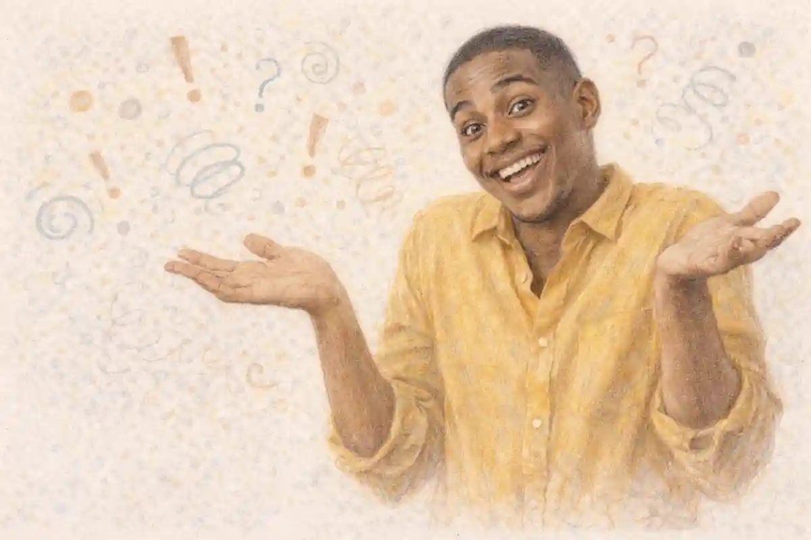

A guitar amplifier fell from the roof of a car on the road into Memphis in March 1951, and when the band plugged it in at the Memphis Recording Service on Union Avenue, the cone tore loose a distorted buzz that the engineer, Sam Phillips, chose to keep rather than fix. The record cut that day, credited to Jackie Brenston and his Delta Cats but played by Ike Turner and his Kings of Rhythm, joined a twelve bar blues frame to a boogie piano figure and a saxophone honking through the choruses, and it reached the top of the rhythm and blues chart within weeks. That accident, preserved because a small studio owner heard money in a broken sound, is a fitting doorway into the history of rock and pop music, because the form was never designed in one place by one mind. It assembled itself where a distribution system, radio plus the cheap single, met a repertoire, the electrified blues, at the moment a young audience with wages of its own appeared, and every movement that followed reacted to how that machine treated the people who fed it.

<!--more-->

## What separates rock from pop and why the line keeps moving

The distinction between the two halves of this subject is real, but it is a distinction of address and economics before it is a distinction of sound. Pop, shortened from popular, names music built to reach the widest possible buyer through the dominant distribution channel of its moment, whether that channel was sheet music, network radio, the singles chart, or the television studio. Rock names a narrower promise made inside that same marketplace, a promise that the performance carries the personality of the performer, that the band wrote or at least chose its own material, and that the recording documents something a specific group of musicians did in a room. The promise could be honoured or faked, and much of the argument traced in later sections concerns exactly that gap, but the promise itself shaped buying habits. A listener who believed a record expressed its maker forgave rough edges that a listener buying polish would have rejected, and record companies learned to sell both attitudes, sometimes on the same label in the same season.

Because the line is drawn by expectation, it moves whenever the machinery moves. In the middle 1950s the two terms barely existed as opposites, since the new music was sold as popular music to teenagers and condemned by adults as a fad, and the word rock and roll covered everything from a jump blues cover to a country singer with a slapback echo. During the 1960s, as the long playing album gave performers room to build sustained statements, critics began using rock for work that asked to be judged as art and pop for work content to be judged as entertainment, a division that flattered album buyers and insulted some superb singles makers. Punk redrew the boundary again in 1976 and 1977, treating polish itself as evidence of bad faith, and the video era redrew it once more by making visual presentation a condition of chart survival for acts of every kind. Charlie Gillett, whose 1970 book The Sound of the City remains the foundational chart based account of this formation, treated the categories as products of the American recording industry rather than essences, and that industrial reading explains why the labels keep shifting. Whenever the channel changes, the definition of selling out changes with it, and the music sorts itself anew along a line that was never drawn on the sound itself.

One further consequence of the moving line deserves emphasis, because it governs how the rest of this article uses its own terms. When a performer crossed from one side of the line to the other, nothing in the sound needed to change. A singer filed as a pop act in one season could be refiled as a rock act in the next because the audience had aged, the format had shifted, or a critic had supplied a new frame. The records stayed identical while their meaning was renegotiated around them, which is why this pillar treats genre labels as evidence about markets first and about music second. The sound matters enormously, and later sections describe it in detail, but the label on the sound is a business document, and reading it as a business document is the beginning of accuracy in this subject.

## The electrified blues inheritance

The repertoire at the centre of the story was built in the American South and industrialised in Chicago. Delta blues supplied the twelve bar frame, the bent third that sits between major and minor, the call and response between voice and guitar, and a lyrical habit of compressing hardship, travel, desire and wit into three line verses that repeat with a turn. What changed the music from a regional folk practice into the engine of a national market was amplification. When Muddy Waters arrived in Chicago in 1943 and switched to electric guitar in the crowded clubs of the South Side, he was solving an acoustic problem, how to be heard over a bar crowd, and the solution created an aesthetic. The amplified guitar could sustain, distort and answer the voice at equal volume, the harmonica played through a small amplifier and a bullet microphone acquired a vocal grain of its own in the hands of Little Walter, and the rhythm section of bass, drums and piano locked the music to a dance tempo that acoustic country blues had rarely sustained for a full evening.

Chess Records, founded in Chicago by Leonard and Phil Chess and housed from 1957 at 2120 South Michigan Avenue, turned that club sound into records aimed at jukeboxes and radio across the country. The Chess catalogue of the early 1950s matters to this history out of proportion to its sales, because it established the personnel template that British and American bands would copy for decades: lead guitar as a second voice, a harmonica or saxophone for fills, a rhythm section mixed forward, and a singer whose individual grain was the brand. Elijah Wald, the revisionist historian of American vernacular music whose 2004 study Escaping the Delta re-examined the blues canon, warns that later listeners romanticised this inheritance and shrank a broad commercial blues culture into a handful of haunted names. The warning holds, and it sharpens rather than weakens the inheritance claim. What rock took from the blues was not a mystical essence but a working commercial repertoire, copyrighted songs, stage routines, instrumental roles and a twelve bar grammar, and it took those things from professionals who had been selling them for years.

The geography of the inheritance mattered as much as its grammar. The Great Migration carried Southern musicians and Southern audiences to Chicago, Detroit, Los Angeles and the other industrial cities in the decades after the First World War, and the records travelled along the same routes as the people, sold in furniture stores and barber shops, played on jukeboxes in neighbourhoods the major labels had never mapped. A style formed in Mississippi could be professionalised in Chicago, broadcast from a station whose signal crossed state lines at night, and studied by a teenager in Liverpool who received it as pure modernity, stripped of the local meanings its makers took for granted. Each stage of that journey added a layer of interpretation and removed a layer of context, and the tension between the added interpretation and the lost context runs through every argument this article records about credit, influence and belonging.

## Country and gospel as the other two parents

Any account that credits the blues alone cannot explain the singing. Country music contributed the high harmony stack, the fiddle and steel guitar colours, a narrative songwriting tradition that expected a story to resolve, and a white Southern working class audience whose buying power the record industry had measured since the 1920s through hillbilly catalogues and barn dance radio. Hank Williams, who died in 1953 at the age of twenty nine, demonstrated that a country writer could compress a whole emotional biography into a three minute side, and his publishing, administered through Acuff Rose in Nashville, showed writers across the South that a song was an asset that paid long after the performance ended. The honky tonk rhythm, a steady two beat with the emphasis leaning forward, fed directly into rockabilly, and the country boogie records of the Delmore Brothers and Moon Mullican in the late 1940s already contained the tempo and the piano attack that Memphis studios would soon make famous.

Gospel contributed the technique of conviction. The quartet tradition trained singers to trade lead lines, to build a song toward a climax of repeated phrases, and to treat melisma and the shouted aside as structural devices rather than decoration. Sister Rosetta Tharpe, a gospel singer who played electric guitar with a picking attack that later guitarists studied, was performing uptempo sacred material with secular stagecraft in the 1930s and 1940s, and her 1945 recording with Sam Price reached a wide audience years before the music acquired its market name. When Sam Cooke moved from the Soul Stirrers to secular recording in 1957, and when Ray Charles rebuilt a gospel arrangement as a secular love song earlier in that same period, the controversy each provoked measured exactly how much of the new music was gospel with the words changed. Peter Guralnick, the empathetic document first historian of soul whose Sweet Soul Music mapped the Southern studios in 1986, consistently treats the church as the training ground of the music's emotional method. Between the blues grammar, the country narrative and the gospel delivery, the first wave had everything it needed except an audience free to buy it, and the next sections describe the machines that delivered that audience.

The two parent traditions also shared a publishing lesson that the blues tradition learned more slowly. Nashville's writers and the gospel quartets alike treated songs as property to be placed, recorded by many voices and collected upon for decades, and the infrastructure of publishers, song pluggers and licensing collection grew up around that treatment. When the first wave arrived, the musicians who came from country and gospel backgrounds often arrived with a clearer sense of a song's paper value than the bluesmen whose work had been bought outright in an earlier, harsher market. The difference was not talent or foresight in the abstract. It was the presence or absence of institutions that taught a young musician what a copyright was before a label's lawyer explained it on the label's terms, and section nine will show what that difference cost.

## The 45 single and the jukebox

Format decided destiny. The long playing record, introduced by Columbia in 1948, spun at thirty three and a third revolutions per minute and held more than twenty minutes a side, which suited classical repertoire and jazz albums. RCA answered in 1949 with the seven inch disc at forty five revolutions, with a large centre hole designed for a changer mechanism, and the two formats settled into a division of labour that structured popular music for a generation. The LP belonged to adults with furniture sized record players and the money for albums. The 45 belonged to everyone else. It was cheap to press, cheap to ship, light enough to carry in a paper sleeve under one arm, and durable enough to survive a diner jukebox, and its three minute playing time, inherited from the 78 that preceded it, set the working length of the popular song for decades.

The jukebox was the single's first national network. By the early 1950s several hundred thousand machines stood in diners, bars, drugstores and dance halls across the United States, each one a small market research instrument, because operators reported which records earned coins and record companies read those reports as demand data that radio programmers could not ignore. A record that earned in jukeboxes in the South could force airplay in the North, and independent labels, which lacked the distribution muscle of the majors, used jukebox operators as their advance army. The economics also shaped the sound. A side destined for a noisy room needed an immediate hook, a strong backbeat and a vocal mixed forward, and producers cut records to survive bad speakers. When writers later praised the urgency of the 1950s single as a spiritual quality, they were describing, in part, an engineering specification written by the furniture of American leisure. The single was not a smaller album. It was a distinct art object with its own constraints, and the musicians who mastered it were solving a commercial problem in public, one side at a time.

The single also created a distinctive relationship between a listener and a song. An album asked for an evening and a room; a single asked for three minutes and repaid them with total intensity, and it could be owned outright by a buyer whose entire collection fitted in a carrying case with a handle. Teenagers traded, lent and ranked singles with a seriousness that adult critics mistook for disposability, and the chart, published weekly and argued over in schoolyards, gave that seriousness a public scoreboard. The B side completed the education. Freed from commercial duty, the flip of a hit became a place where bands hid experiments, jokes and the songs they loved most, and generations of musicians have testified that they learned their trade from B sides, the part of the product nobody was required to make well.

## The transistor radio and the teenage audience

The buyer who made the single an industry was new. Postwar prosperity put wages, allowances and part time jobs into the hands of American teenagers on a scale no earlier generation had known, and the baby boom guaranteed that the cohort was enormous. What the teenager lacked, before 1954, was privacy. The family radio stood in the living room, and listening was a supervised activity. The Regency TR-1, released in November 1954 at a price of forty nine dollars and ninety five cents, was the first commercially successful transistor radio, small enough for a pocket and personal enough for a pillow, and within a few years Japanese and American manufacturers had driven the price down to pocket money levels. Listening moved out of the family room and into the bedroom, the car and the beach, and programming followed it. A station could address teenagers directly, in their own hours, without asking parental permission, and advertisers selling soft drinks, cosmetics and cinema tickets paid for the privilege.

The car completed the circuit. Drive in cinemas, diners with parking lot service and the simple fact of cruising gave the teenage audience a private social space with a radio built into the dashboard, and songwriters wrote for that space, filling songs with cars, roads and Saturday nights because the audience was sitting inside the subject matter itself. Historians of the period sometimes treat the teenage market as a marketing invention, and the industry certainly named and courted it, but the money was real and so was the taste it expressed. Teenagers bought records their parents disliked, in quantities that moved national charts, and the friction that dislike created became part of the product. Every later youth movement in this history, from the British beat boom to punk and alternative, repeats the same founding pattern: a cohort with income, a private listening technology, and music that adults in the same house found abrasive. Remove any one of the three and the market stalls, which is why the same industrial recipe kept being rediscovered by each generation as if it were a rebellion rather than a structure.

The audience's privacy also changed what songs could say. Music heard on a family set in a shared room had to survive parental interpretation in real time, while music heard through an earpiece on a pillow could address the listener as a confidant, and the lyrical directness of the period, its talk of desire, dancing, cars and leaving home, was written for the earpiece rather than the parlour. Advertisers noticed the same privacy from the other side, since a message delivered to a teenager alone in a car carried an intimacy no family broadcast could match, and the alliance between youth products and youth radio hardened into a permanent feature of the business. The pattern repeated with each later private technology, the cassette Walkman from 1979, the portable CD player, the MP3 player after 2001, and each repetition was greeted as a social emergency by the guardians of the previous one.

## Radio formats and the disc jockey

Radio decided which singles lived. The network era had treated recorded music as filler between live programmes, but the rise of television stripped radio of its drama and comedy schedules in the early 1950s and left station owners with cheap hours to fill. The answer, developed by broadcasters such as Todd Storz in Omaha and Gordon McLendon in Dallas, was the format: a tight rotation of the best selling records, repeated until familiarity turned them into hits, punctuated by news at fixed points and a disc jockey whose personality held the sequence together. The Top 40 format was a machine for manufacturing consensus. It played a small number of records very often, so a song that entered rotation acquired the feeling of inevitability, and it measured success weekly, so the whole industry reorganised itself around the chart as a shared scoreboard. The fuller story of how broadcasting reshaped popular taste is told in the companion survey of [how radio changed popular music](/2025/09/07/how-radio-changed-popular-music/), and this pillar keeps to what the format did to the music itself.

The disc jockey stood at the machine's control panel, and the career of Alan Freed shows both the power and the price. Freed, broadcasting rhythm and blues on WJW in Cleveland from 1951 under the name Moondog, spoke to a mixed teenage audience in the music's own slang, staged the Moondog Coronation Ball in March 1952, the event usually counted as the first rock and roll concert, and moved to WINS in New York in 1954 as the music's loudest national advocate. He also took money and songwriting credit in exchange for airplay, in a system nearly everyone in the business used, and when the payola investigations reached Congress in 1959 and 1960 the system was dismantled selectively. Dick Clark, whose American Bandstand presented a tidier image, divested his music interests and survived. Freed refused to cooperate, was convicted of commercial bribery in 1962, and died in 1965 with his career destroyed. The contrast is not a simple morality tale, since Clark's caution and Freed's defiance were both strategies, but it fixed a lasting suspicion in the culture: that the gatekeeper might be bought, and that the chart, the industry's proudest instrument, recorded money as faithfully as it recorded taste.

The format had a regional counterweight that kept the national picture honest. Alongside the Top 40 stations, rhythm and blues and country broadcasters, border radio from Mexico with its enormous transmitters, and late night clear channel stations such as WLAC in Nashville, whose sponsored programmes sold mail order records across the South and beyond, carried repertoires the format stations would not touch. Musicians of the first wave consistently name those night signals as their education, because a station audible across half a continent after dark ignored the market categories that daylight programming enforced. The history of formats is therefore double: a tightening national rotation that manufactured consensus hits, and a porous night air full of unauthorised alternatives, and the music kept being renewed by the second while it was being sold by the first.

## The first wave and the invention question

### Who invented rock and roll?

No single person invented rock and roll, because the music grew from working repertoires that Black American professionals had recorded since the 1920s. What changed in the early 1950s was distribution: radio, the cheap single and the teenage buyer carried an existing music across the market's racial boundary.

The candidates each reveal what the claimant values. The case for the March 1951 Memphis session rests on sound: a distorted electric guitar inside a rhythm and blues performance aimed at dancers, five years before the music had a settled national name. The case for Bill Haley rests on the market: his version of a twelve bar song about a clock, recorded in April 1954 and carried into cinemas by the 1955 film Blackboard Jungle, held the top of the pop chart for eight weeks in the summer of 1955 and proved the music could outsell everything else in the store. The case for Elvis Presley rests on synthesis and scale, examined in his own section below. The case for Chuck Berry rests on authorship, since Berry wrote the music's defining subject matter, school, cars, dancing and the music business itself, into songs built for the new audience. Charlie Gillett treated the question as a category error, arguing in The Sound of the City that five overlapping styles fed the river and that asking for a single source mistakes a confluence for a spring. Nik Cohn, the partisan early British critic whose 1969 Awopbopaloobop Alopbamboom remains the most quotable verdict on the period, prized the first wave precisely for its disposable energy and judged later seriousness a decline, which is itself a position in the dispute rather than a fact about it.

What the dispute conceals, and what sections eight and nine confront directly, is that invention talk was never only about sound. Credit decided payment. To name an inventor was to assign the music an owner, and the industry of the 1950s assigned ownership in ways that tracked the racial structure of the market. The first wave itself was gloriously mixed in practice: Fats Domino sold millions of singles from New Orleans with a rolling piano style and a Creole accent nobody asked him to hide, Little Richard rebuilt the boogie figure into a performance of pure velocity, and [Buddy Holly](/2019/11/07/buddy-holly-life-and-music/), a country raised Texan, took the hiccup in his singing from Black records and the arrangement ideas from his own small band, guitar, bass and drums, that became the standard rock line up. The musicians crossed lines nightly. The accounting crossed them far more slowly, and the difference between those two speeds is one of the central facts of this history.

| Movement | Approximate span | Enabling technology or business condition | What it reacted against | Representative figure |
|---|---|---|---|---|
| Rhythm and blues foundation | 1945 to 1954 | Independent labels, jukeboxes, BMI licensing | Segregated pop charts and ASCAP gatekeeping | Muddy Waters |
| First wave rock and roll | 1954 to 1959 | The 45 single, transistor radio, Top 40 format | Adult network radio and big band pop | Chuck Berry |
| Teen idol and factory pop | 1959 to 1963 | Television dance programmes, professional songwriting teams | The payola scandal and the first wave scandals | Carole King as writer |
| British reinterpretation | 1963 to 1966 | The LP in Britain, package tours, American blues imports | British light entertainment and skiffle limits | John Lennon |
| Album era | 1966 to 1976 | Multitrack studios, FM radio, album chart economics | The three minute single as the unit of art | Jimi Hendrix |
| Glam | 1970 to 1975 | Colour television, the music press as image maker | Denim clad album seriousness | David Bowie |
| Punk | 1976 to 1979 | Independent singles, fanzines, small clubs | Stadium scale and progressive complexity | Kurt Cobain as inheritor |
| Post-punk and new wave | 1978 to 1984 | Cheap synthesisers, independent labels, college radio | Punk orthodoxy and guitar band limits | Prince as parallel innovator |
| Metal consolidation | 1970 to 1989 | Arena touring, specialist press, guitar technology | Pop chart gatekeeping of heavy music | Freddie Mercury as arena standard |
| Video era pop rock | 1981 to 1995 | Music television, the CD, global marketing | Regional radio gatekeeping | Michael Jackson as benchmark |
| Alternative and independent | 1981 to 2001 | College radio, independent distribution, the festival circuit | Major label signing orthodoxy | Kurt Cobain |

## The cover-version economy

### What is a cover version and why did it matter?

A cover version is a new recording of a song already recorded by someone else. In the 1950s it mattered because the law paid the songwriter while the market rewarded the performer, so a major label could recut a rhythm and blues hit with a white singer and sell the copy through guarded pop radio.

The system worked because American radio and retail were segregated in practice. A record classified as rhythm and blues reached Black audiences, jukeboxes and a limited set of stations, while the pop chart, where the largest money sat, was guarded by programme directors who treated the classification as a quality judgement. The cover was the tool for moving a proven song across that guard post. Pat Boone's versions of songs by Fats Domino and Little Richard outsold or outcharted the originals on the pop listings in 1955 and 1956, and Georgia Gibbs took LaVern Baker's Atlantic recording of a novelty song note for arrangement note into the pop top five while Baker's original stalled. [Little Richard](/2019/12/07/little-richard-life-and-music/) answered the practice with tempo, reasoning that a song cut fast enough and sung hard enough could not be politely copied, and his later writing chased material that resisted smoothing. Baker answered institutionally, writing to Congressman Charles Diggs in 1955 to ask whether the law could protect an arrangement and a performance rather than only a composition, and the answer she received, that it could not, states the legal architecture of the whole economy in one sentence.

The strongest defence of the cover system, made by the publishers and label men who ran it, was that it paid the original writers and carried their songs to audiences who would never otherwise have heard them, and the defence is partly true: a Boone hit generated publishing income for Domino's writers, and many listeners traced copies back to originals. The strongest case against it, made by the performers who lived it, is that the defence confuses the song with the record. The arrangement, the tempo, the vocal grain and the performance style that made a song worth copying were exactly the elements the law left unprotected, and the performer's income from a record depended on sales of that record, which the cover was designed to divert. What was taken, then, was a composition plus an arrangement plus a market position. What was added was polish, distribution and access to guarded radio. What was credited was the writer, on the label copy, in small print. What was paid followed that credit and almost nothing else, which is the subject of the next section.

The cover economy also had a geography, because copying was fastest where the markets touched. A rhythm and blues record released in the South could be covered within weeks by a pop act recording in New York or Los Angeles, while the original's distribution was still working through regional jobbers, so the copy sometimes reached a Northern pop audience before the original reached a Northern record shop at all. Listeners who later compared the two often assumed the version they heard first was the source, an error the chart record corrects and the memory resists. That inversion of first hearing shaped decades of popular misunderstanding about who originated what, and it is one reason the documentary work of discographers, establishing release dates label by label, matters to this history as more than clerical labour. Sequence is evidence, and in the cover economy the sequence was routinely disguised by speed.

## Royalties, credit and who was actually paid

The money in a 1950s record flowed through three channels, and a musician could be famous in all three markets while being paid in none of them. The first channel was the songwriting and publishing royalty. Under the compulsory licence fixed by the Copyright Act of 1909, the statutory mechanical rate stood at two cents per song per record from 1909 until 1978, a figure worth pausing on: for sixty nine years, through inflation, war and the entire rise of the music in this article, the law valued the act of writing a song at two cents a copy, split between publisher and writer according to their private contract. The second channel was the artist royalty on sales of a specific record, set by contract, often at a few percent of retail price, and routinely reduced by recoupable costs for recording, promotion and sometimes the pressing itself, so that a hit could leave its singer in accounting debt to the label. The third channel was performance income collected by the licensing societies, and here the founding of BMI in 1939 mattered enormously, because the older society, ASCAP, had largely excluded blues, country and rhythm and blues writers, while BMI signed them, paid them and thereby gave the new music a professional writing class.

Against that architecture, the named cases stop being anecdotes and become evidence. Arthur Crudup wrote the song that launched Elvis Presley at Sun Records, and Presley's recording made the composition valuable for decades, yet Crudup, whose publishing had been signed away early, received so little that his poverty in old age became a documented scandal; a royalty settlement pursued on his behalf in the early 1970s produced little before his death in 1974. Big Mama Thornton recorded a Leiber and Stoller song in 1952 that topped the rhythm and blues chart for seven weeks in 1953, and Thornton said in interviews that she received a single payment of five hundred dollars for a recording that, in Presley's 1956 version, sold in the millions. Chuck Berry accepted a shared writing credit on his first hit with disc jockey Alan Freed and with Russ Fratto, a landlord connected to the label, in an arrangement that bought airplay with authorship, and the credit was eventually restored to Berry alone. Berry's pianist Johnnie Johnson filed suit in 2000 claiming co-authorship of many of the Berry catalogue's defining songs; the case was dismissed in 2002 on the ground that the claims had been brought too late, which means the underlying question of who composed those piano led arrangements was never tested in court, a distinction this series keeps intact. A listener who keeps research notes on publishing splits can store them in an offline encrypted notes app, obtained from [the VaultBook download page](https://vaultbook.net/download/), since royalty archaeology is mostly the patient filing of names, dates and percentages.

The pattern across the cases is consistent enough to state as a finding. Payment followed paper, and paper was held by the parties with lawyers, offices and advance knowledge of what a copyright was worth. Talent was abundant in this history. Documentation was scarce, and scarcity, as much as prejudice, decided who was paid, although the two were entangled: the musicians least likely to be handed fair paper were the Black originators whose work the market most needed. Peter Guralnick's histories return repeatedly to the moment a young singer signs, because in his telling that signature, more than any recording session, fixes the shape of the life that follows. The teen idol market of the next section industrialised that signature, wrapping it in a safer image after scandal made the first wave expensive.

The licensing societies added a further asymmetry that musicians rarely understood at signing. Performance royalties were collected when a song was broadcast, but the money followed membership, registration and paperwork, and a writer outside the system, or registered under a publisher who controlled the account, could hear a song on national radio and receive nothing traceable. BMI's openness to blues and country writers was therefore not a courtesy but a transfer of income toward the music's originators, partial and imperfect, and the society's payments became, for many Southern writers, the first regular cheques their work ever produced. The lesson generalises across the whole article: in this industry, the distance between making music and being paid for it is measured in forms filed, and every movement that claimed to abolish the paperwork merely relocated it.

## The teen idol market

Between 1958 and 1963 the industry rebuilt the music in a safer shape, and the reasons were structural rather than mysterious. The first wave had been damaged by scandal and attrition: payola hearings frightened the networks, Little Richard had withdrawn to religious life in 1957, Jerry Lee Lewis had destroyed his chart career with a marriage scandal in 1958, Chuck Berry was prosecuted and imprisoned, Buddy Holly, Ritchie Valens and the Big Bopper died in an aircraft crash in February 1959, and Elvis Presley was in the army in Germany. A market built on teenage desire did not shrink because its suppliers stumbled. It professionalised. Philadelphia, home of American Bandstand, broadcast nationally by ABC from 1957 with Dick Clark as host, became the capital of the replacement product: the teen idol, a handsome young singer, often Italian American, often with limited vocal range, presented through television close up and fan magazine biography as a boyfriend ideal rather than a threat.

Frankie Avalon, Fabian Forte, marketed under the single name Fabian, and Bobby Rydell, all handled by Philadelphia managers and labels such as Chancellor and Cameo, sold millions of singles assembled by professional writers and studio bands. The critical verdict on this interlude was settled early and repeated for decades, that the music had been defanged and the charts handed to mannequins. The verdict contains a real observation about risk, since the idol system was designed to eliminate the unpredictability that made the first wave exciting and litigious. It also misses two things. The idol records were superbly crafted pop, sung to order but arranged with a sophistication learned from the Brill Building writers covered next, and the audience, largely young women, was exercising taste within the options the market offered, a taste the critical tradition, mostly male, was quick to dismiss as manipulation. The idol era is best read as the industry's proof of concept: if the machinery of television, professional songwriting and image management could sell a singer with a modest voice, it could sell anything, and the machinery outlived the idols to become the permanent infrastructure of pop.

The idol years also trained the audience that the British groups would inherit. A generation that had bought singles weekly, followed the charts as a serial story and learned to read a performer's image as a text was prepared for a band that wrote its own serial with greater wit and better songs. The fan magazine machinery, the television close up and the managed biography did not disappear when the idols faded; the Beatles were launched through all of them, with a manager, Brian Epstein, who dressed a bar band in matching suits and banned eating and smoking on stage in conscious imitation of the polish the idol system had perfected. The standard story opposes the manufactured idols to the authentic groups who swept them away. The machinery tells a subtler story, in which the groups won partly by mastering the manufacture and then persuading the audience to forget it.

## The songwriting factories

The factory was an address. The Brill Building at 1619 Broadway in New York housed publishers whose offices contained a piano, a small room and staff writers working to order, and the system reached its peak a few blocks of ambition away at Aldon Music, founded by Don Kirshner and Al Nevins, where a generation of young writers treated the pop song as a profession with office hours. The teams are the point. Carole King and Gerry Goffin, married, in their twenties, wrote songs for the Shirelles, the Drifters and Little Eva that combined girl group rhythm with harmonic movement learned from standards. Barry Mann and Cynthia Weil brought a social awareness and a Latin tinge. Jeff Barry and Ellie Greenwich built records as much as songs, moving toward production. Jerry Leiber and Mike Stoller, a few years older and formed by rhythm and blues, operated as independents, writing and producing for the Coasters and the Drifters with an ear for theatre, strings and street comedy. Burt Bacharach and Hal David, working through Famous Music, built a parallel catalogue of rhythmic and harmonic intricacy for Dionne Warwick and others.

The factory system is sometimes described as the opposite of the self contained band ideal that followed it, and in one respect it was: the division of labour was total, with writers, arrangers, session players and singers as separate trades. What the description misses is the apprenticeship function. King, Mann, Weil and their peers learned compression, hook placement and the emotional mathematics of the two and a half minute side under commercial pressure, and when the singer songwriter era arrived, its leading figures were often factory graduates writing for themselves. The system also professionalised Black pop at the writing level even when the performing faces were filtered, because publishers paid for songs that worked regardless of the writer's identity, and Aldon's writers moved between girl group, soul and white pop assignments in a single week. Motown, founded in Detroit in 1959 by Berry Gordy with an eight hundred dollar loan from his family's cooperative fund, took the factory logic furthest: in house writers, principally the team of Brian Holland, Lamont Dozier and Eddie Holland, a house band, quality control meetings where records competed for release, and artist development that taught deportment alongside choreography. The factory was not the enemy of the music. It was one of its two great production ideas, and the other, the self contained band, defined itself against the factory while quietly using its lessons.

The factory's influence travelled in both directions across the Atlantic. British beat groups studied Aldon songs as models of construction, and the Lennon and McCartney partnership applied factory discipline, writing to order for other singers, finishing under deadline, testing hooks on live audiences, inside a self contained band. In Detroit the method acquired a civic dimension, since Gordy presented Motown as a Black owned industrial success in the image of the car plants its workers' families knew, with quality control meetings modelled on the assembly line's inspections. The comparison was a source of pride and a real management technique, and it produced a catalogue whose consistency across dozens of artists has few parallels in the business. When later movements defined themselves against the factory, they were defining themselves against the most successful Black owned enterprise in the industry's history, a fact their rhetoric rarely acknowledged.

## Soul and rock as parallel markets

Through the 1960s the two musics ran side by side inside one industry that sold them through separate doors. Soul, the secularised gospel music of Black America, developed its own studio capitals: Stax in Memphis, recording in a converted cinema with an integrated house band, Booker T. and the M.G.'s, behind Otis Redding and Sam and Dave; Atlantic in New York, distributing Stax and cutting Aretha Franklin with the Muscle Shoals rhythm section in Alabama; Motown in Detroit, polishing the same gospel inheritance for the pop chart; and Chicago, where Curtis Mayfield wrote for his own Impressions and for a stable of singers in a style that joined harmony singing to civil rights era counsel. The boundary between soul and rock was a marketing boundary policed by chart categories and radio formats, and musicians ignored it constantly. British bands learned American music from soul and blues imports, American rock bands covered Motown songs, and Jimi Hendrix served his apprenticeship in the bands of soul revues, playing behind the Isley Brothers and Little Richard before London remade him.

The parallel structure had real consequences for money and memory. Soul artists working for Black owned or Black focused labels often reached the pop chart late or not at all, which meant the album era's prestige economics, examined in section fourteen, reached them on worse terms. The critical canon formed in the late 1960s by a new rock press centred the album, the guitarist and the self writing band, and soul, which prized the single, the singer and the professional writer, was filed as a neighbouring genre rather than a co author of the whole story. Greil Marcus, the cultural critic who reads American music as a carrier of the country's democratic promises and its failures, built his 1975 book Mystery Train around exactly this entanglement, placing Elvis Presley, Robert Johnson, Sly Stone and Randy Newman in one national conversation. Marcus has one characterisation throughout this article: he is the myth reader, valuable for what performances meant, to be checked against Gillett and Guralnick for what they cost and who was paid. Read together, the three correct one another, and the parallel markets stop looking separate. They were one music business with two doors, and the doors were the story as much as the rooms behind them.

The parallel doors also shaped how each music was archived and taught. Because the album era's critics wrote the first draft of the combined history, soul's masters were long represented by their crossover moments rather than their home market achievements, and the reissue programmes of the CD era, which restored Stax, Chess and Motown catalogues with scholarly notes, functioned as a delayed correction of the record. The correction matters for method. A music's survival in memory depends on who keeps its tapes, its session logs and its photographs, and the soul labels, several of them small and some of them sold or broken up, kept uneven archives compared with the majors whose rock catalogues were curated as assets. Historiography in this field is partly an accident of storage, and the honest historian says so before drawing conclusions from silence.

## The British reinterpretation of American music

### Why did British bands dominate American charts?

British bands dominated American charts in 1964 and the years after because they arrived as one branded wave carrying a fresh sound built from American records that American radio had marginalised. The Beatles opened the door on national television, and a prepared British industry walked through it behind them.

The preparation was a decade long act of importation. Britain's postwar popular music business was small, conservative and dominated by light entertainment, but its ports and its record shops received American rhythm and blues, country and rock and roll through merchant seamen, specialist importers and the American Forces Network. Skiffle, the homemade skiffle boom led by Lonnie Donegan from 1956, taught a generation of British teenagers to play American folk and blues songs on cheap guitars, washboards and tea chest basses, and the beat groups that followed graduated from skiffle line ups to electric bands modelled on Buddy Holly's Crickets and the Shadows. Crucially, British groups studied records that white American teenagers could not easily hear at home: Chicago blues on Chess imports, Motown singles, girl group productions, and the whole Chess and Sun catalogues as archaeology. When the Beatles reached the Ed Sullivan Show on 9 February 1964 before an audience estimated at seventy three million, they carried a synthesis, Lennon and McCartney harmonies over Chuck Berry structures, girl group call and response inside a self contained band, that American acts had been discouraged from attempting by their own market's divisions.

The stance discipline of this series requires the credit ledger to be stated here, in the same section as the triumph. What was taken: the twelve bar repertoire, the repertoire of Berry, Little Richard, the girl groups and Motown, stage moves, and in the Rolling Stones' case a name lifted from a Muddy Waters song title and a repertoire initially built from Chicago blues covers. What was added: close harmony singing of a sophistication the sources rarely attempted, original songwriting at industrial volume, a collective band identity presented as four personalities, and studio curiosity once the money arrived. What was credited: British musicians of that generation were, by the standards of the business, unusually vocal about their sources, naming Berry, Waters and Motown writers in interviews and using their fame to redirect attention and, in the Stones' case, insisting that Howlin' Wolf appear with them on American television in 1965. What was paid is the uneven line in the ledger: songwriting royalties flowed to the original writers when covers were hits, which for Berry and the Motown teams was substantial, while the originators' own records were rarely re promoted with equal force, and the British bands' earnings from original songs dwarfed everything the sources received. The British reinterpretation was a genuine creative act performed on borrowed capital, and both halves of that sentence have to survive every telling.

They sold the United States its own music, reharmonised, redressed and returned with an accent that made the sources sound new to the audience that had ignored them. That sentence, often quoted as the Invasion's epitaph, should be read as an economic description rather than a witticism. The British groups performed the repertoire with the energy of converts and the polish of professionals, their haircuts and matching suits reassured television producers, and their whiteness reassured the gatekeepers who had filtered the originals. The accent was not incidental to the transaction. It was the customs stamp that let the goods through, and the musicians, to their credit, mostly knew it and said so in interviews at the time, pointing their new audience toward the Chess and Motown catalogues with an evangelism the American industry had never funded.

## The album as a statement

### What made the album more than a collection of songs?

An album became more than a collection of songs when its makers sequenced it as one act of attention: an opening that set a world, a running order built on contrast and return, connected textures, and a closing track that recontextualised the rest. The LP format had always allowed that ambition.

The shift can be dated by economics as much as by art. An LP cost several times a single, carried higher margins, and by 1968 albums outsold singles in revenue in the United States, which moved the industry's centre of gravity from the teenage buyer of 45s to the older buyer with a stereo system. FM radio, freed by regulation in the late 1960s to develop its own programming rather than duplicating AM, built album oriented formats that played deep cuts and whole sides, giving the LP a broadcast home the single never needed. The artists who exploited the opening redefined the job description. The Beach Boys' Pet Sounds in May 1966 arranged a song cycle around orchestral colour and emotional sequence. The Beatles, retiring from touring in 1966, made the studio their workplace and released Sgt. Pepper's Lonely Hearts Club Band in June 1967 as a packaged experience, printed lyrics, gatefold sleeve, a fictional band framing real songs. Bob Dylan had already demonstrated with his 1965 and 1966 albums that a songwriter could sustain argument and imagery across forty minutes, and the singer as author became the era's prestige figure.

Two cautions belong inside the celebration, and both recur in the authenticity argument of the final section. The first is that the album ideal quietly devalued the single craft that the Brill Building writers and the Motown teams had perfected, recasting masters of the three minute form as apprentices to a larger canvas they never sought. The second is that the album as statement was a market construction as well as an artistic one: it required buyers who could afford LPs, studios billed by the hour, and critics willing to write about popular music at essay length, a profession that began with magazines such as Rolling Stone, founded in 1967. The LP did not reveal a hierarchy that had always existed. It built a new stage, with new economics, and the musicians who learned to command that stage set the terms by which earlier and later work would be judged, sometimes unfairly, as the punk sections will show.

## Studio experimentation

The multitrack tape machine rewired songwriting by separating the performance from the song. Four track recording, standard in British studios into the middle 1960s, forced decisions early: rhythm track first, then overdubs, then reduction mixes that committed balances forever. Eight track, sixteen track and by the middle 1970s twenty four track machines postponed those decisions, letting arrangers build a recording in layers and letting composers write parts for instruments that would never share a room. Les Paul, guitarist and inventor, had demonstrated the principle in the late 1940s and early 1950s with home built equipment, recording layered guitars and voices with Mary Ford at speeds that shifted pitch into a signature sound. What the 1960s did was industrialise his insight and hand it to a generation of producers: George Martin at Abbey Road translating the Beatles' requests into orchestration and tape manipulation, Brian Wilson constructing backing tracks with the Los Angeles session elite known as the Wrecking Crew before the Beach Boys sang a note, and Phil Spector, a few years earlier, overwhelming mono with massed instruments in the Wall of Sound, a reminder that experimentation ran toward density as readily as toward clarity.

The consequences reached composition itself. Songs began to be written for the studio's possibilities: backwards tape, varispeed vocals, edited performances assembled from multiple takes, drum sounds captured as architecture rather than documentation. The producer rose from technician to co author, and the engineer, figures such as Geoff Emerick at Abbey Road or Eddie Kramer with Hendrix, became a named creative partner. A counter tradition formed in reply, valued in the punk and independent sections below, which treated the studio as a place to document a band quickly before the money and the mediation thickened. Neither side held a monopoly on results. The layered method produced recordings no live band could reproduce, which changed the meaning of a concert, while the documentary method produced records whose urgency was the sound of a room. The argument between construction and capture is a technical form of the authenticity dispute, and it was fought with tape machines before it was fought in print.

Experimentation also redistributed prestige inside the studio hierarchy. The tape operator who knew how to splice a chorus from two performances, the engineer who could make a drum kit sound like architecture, and the producer who could hear a finished record inside a rough demo acquired authority that the older session system had reserved for arrangers with scores. Musicians arriving from the live circuit sometimes experienced the new authority as a theft of their spontaneity, and the complaint produced a durable mythology of the honest first take. The session record usually complicates the mythology: many of the era's most spontaneous sounding records were patient constructions, and many constructions were rescued by one live take the machines happened to catch. Construction and capture were never the opposites the polemics required. They were two hands of the same craft, and the best producers of the period can be identified by how fluently they used both.

## The guitar hero

The electric guitar became the music's emblematic instrument for reasons that were acoustic, economic and visual at once. Acoustically, the amplified guitar occupied the same frequency band as the human voice and could imitate it, bending pitch, sustaining notes and answering a singer phrase for phrase, which made it the natural second lead in a music descended from call and response. Economically, the solid body instruments built by Fender from 1950 and the carved top models Gibson developed through the 1950s were durable, repairable and increasingly affordable, and the amplifier trade grew beside them. Visually, the guitar was worn rather than sat behind, so it travelled with the performer's body language, and a music sold increasingly through photographs and television rewarded the instrument that photographed as an extension of the player.

The hero figure assembled from those conditions in stages. Chuck Berry made the guitar a narrator, his introductions announcing songs the way a horn section announced a singer, and his duckwalk made the playing theatrical. The British blues boom turned guitarists into scholars and then into stars: Eric Clapton's work with John Mayall's Bluesbreakers in 1966, cut with a Les Paul played through a Marshall amplifier at full volume, demonstrated that controlled distortion could carry long improvised statements, and Cream extended that licence into the power trio. The figure peaked, and in some accounts broke, with Hendrix, whose own section follows later. A comparative ranking of the instrument's masters, with the evidence for each claim laid out, is maintained in the series survey of the [greatest guitarists of all time](/2025/03/07/greatest-guitarists-of-all-time/), and the present pillar notes the structural point instead. The guitar hero concentrated a band music into a single face, which served marketing and distorted history in equal measure, since the rhythm sections, writers and producers behind the heroes were written toward the margins. Punk's suspicion of the solo, metal's transformation of technique into athletics, and the alternative era's suspicion of display all begin as arguments with this figure, and the arguments make little sense unless the figure's original appeal, one musician answering a singer in the singer's own register, at dance volume, is kept in view.

The hero economy had a cost that the bands paid in personnel. When the guitarist became the marketing face, rhythm players and drummers whose contributions were structural found their work priced as accompaniment, and the publishing system, which paid writers rather than players, compounded the demotion for the many guitarists who did not write. The sideman's revenge arrived slowly, through session reputations, teaching and the reissue era's credits research, which restored names to records that had sold under a single face. The pattern is a smaller version of the article's central ledger: visibility and payment are separate currencies, they are exchanged at rates set by contracts rather than by contribution, and the history is misread whenever a reader assumes the most visible musician in a photograph was the one the record could least afford to lose.

## Heavy and progressive directions

By the end of the 1960s the album audience had grown large enough to support musics that abandoned the single entirely, and two of the directions it took defined the extremes that punk would later reject together. The progressive direction, centred in Britain, treated the LP as a canvas for extended composition: suites that crossed side long structures, time signatures beyond the dance floor's four beats, instrumentation borrowed from the orchestra and the church organ, and lyrical subjects drawn from literature, science fiction and systems of belief. King Crimson's 1969 debut placed Mellotron strings and jazz schooled drumming behind songs of genuine menace, Pink Floyd rebuilt themselves after the loss of their founder Syd Barrett into architects of the concept album, culminating in the 1973 Dark Side of the Moon, an album about pressure, money and madness that remained on the American chart for years rather than months, and Yes and Genesis carried virtuoso arrangement into arenas. The progressive wager was that the audience for albums would follow complexity as classical audiences had, and for most of a decade the sales justified it.

The heavy direction took the opposite path to scale: fewer chords, more volume, riffs as the compositional unit. Led Zeppelin, formed in 1968 from the Yardbirds' remains, joined Jimmy Page's studio trained arrangement sense to a rhythm section of unusual weight and a singer schooled in blues and folk, and their refusal to release singles in Britain made the album itself the hit unit. Deep Purple and Black Sabbath, both formed in 1968, stripped the blues further toward the riff and the down tuned guitar, with Sabbath in particular writing from the experience of Birmingham factory work into songs about war, fear and industrial dread. The two directions shared an audience, a format and a critical problem. Both were accused, as their productions grew grander, of confusing scale with significance, and both supplied the immediate past against which glam posed and punk rebelled, although the musicians punk claimed as ancestors were often drawn from the heavy and progressive catalogues themselves, a debt the rebellion was slow to acknowledge.

The two directions also divided the audience by class of listening in ways the participants felt keenly. Progressive concerts asked for the attention of a recital, seated, silent between movements, while the heavy bands asked for the physical participation of a dance hall at higher volume, and a listener's loyalty often announced itself as a choice between those two contracts before it became a choice between bands. Record companies, which sold both contracts through the same album departments, had no reason to resolve the contradiction, and the music press, which needed a war to write about, exaggerated it. Underneath the polemic the musicians traded freely, progressive players hiring heavy drummers, metal bands absorbing progressive structures, so that the family tree of the 1970s album audience is a network rather than a fork, whatever the era's critics preferred to draw.

## Glam and the constructed persona

Glam answered album era earnestness with artifice worn openly. Between 1970 and 1975, principally in Britain, a set of performers rebuilt pop around the constructed image: Marc Bolan turning T. Rex from an acoustic duo into an electric hit machine dressed in satin and glitter, Roxy Music joining art school irony to synthesiser and oboe, Slade and Sweet working the singles chart with stomping choruses, and David Bowie, whose own section follows, treating identity itself as the medium, changing name, costume, sound and sexuality cues from album to album. The musical content varied from bubblegum to genuine experiment, and that spread was the point. Glam proposed that pop's honesty lay in admitting it was theatre, against a rock culture that had begun to present denim, beards and improvisation as guarantees of truth. A performer in makeup claiming to be a visitor from another planet was, glam argued, deceiving nobody, while a millionaire in work clothes singing about the road might be deceiving everybody.

The movement's instruments were the colour television, the weekly music press and the chart countdown programme, which together made image a weekly serial rather than an album sleeve event, and its audience was the singles buying teenager the album era had demoted. Glam also carried a social charge that the period's guardians noticed: its leading men wore makeup, courted androgyny and, in Bowie's case, announced bisexuality to the music press in 1972, in a Britain where homosexuality had been partially decriminalised only in 1967. The charge was partly pose and partly a real widening of what a pop star could present, and the two cannot be cleanly separated, which is glam's lasting lesson for this history. Persona is not the opposite of substance. It is a technology for distributing substance, and every era in this article used it, from the matching suits Berry Gordy required to the anti image that punk and grunge later marketed with equal care. Glam simply itemised the bill in public, and the musicians who learned from it, including Prince and Madonna in the following decade, built careers on the itemisation.

Glam's afterlife in the charts was longer than its five year blaze suggests. The British singles market it had reanimated carried its production values, handclaps, stacked choruses, a drum sound built for television speakers, into the mainstream pop of the later 1970s, and its visual grammar resurfaced in the new romantic movement of the early 1980s, whose leading figures acknowledged the debt openly. In the United States the movement had always been a cult rather than a chart force, carried by a handful of Anglophile cities and college stations, which produced a curious inversion: glam shaped American musicians, from Kiss's stadium theatre to Prince's wardrobe logic, more deeply than it shaped American sales. Influence and revenue parted company here as plainly as anywhere in this article, and the historian who counts only chart positions will miss the movement entirely.

## The punk reaction

### Why did punk reject the music before it?

Punk rejected the music before it because the album business of the middle 1970s had raised every barrier between a young musician and a finished record: studio costs, technical display, management layers and arena scale. Punk answered with short songs, three chord forms, independent singles and a press of its own.

The chronology resists the single explosion myth. The Velvet Underground in the 1960s, the Stooges and the MC5 in Detroit, and the New York Dolls in the early 1970s had each stripped the music toward noise, repetition and confrontation, and the Ramones, formed in New York in 1974, converted the inheritance into a formula of two minute songs played at unbroken speed, codified on their April 1976 debut album. London supplied the detonation and the marketing. The Sex Pistols, assembled in 1975 around Malcolm McLaren's King's Road clothing shop, joined Johnny Rotten's genuinely corrosive stage presence to a situationist manager's talent for scandal, and their December 1976 television confrontation with presenter Bill Grundy on Thames Television, where provoked obscenity made national news, announced punk as a media event as much as a music. The Clash brought political argument and a wider musical appetite, reggae included, and the independent infrastructure that followed, Rough Trade founded in 1976 as shop and label, Stiff Records, and a fanzine culture whose founding document, Sniffin' Glue, began the same year, mattered more than any single band, because it proved records could be made and sold outside the majors.

The stance charter requires the double truth to be held together. Punk was a real democratisation of production and a marketed category almost from its first season: McLaren sold clothing through outrage, major labels signed punk bands within a year, and the uniform of torn fabric and safety pins was retail merchandise by 1977. Neither fact cancels the other. The democratisation survived the marketing because the tools were cheap and the knowledge transferable, and every independent movement in the sections ahead ran on punk's infrastructure even when it rejected punk's sound. Simon Reynolds, the critic and historian of post punk whose 2005 Rip It Up and Start Again is the standard account of what followed, holds one characterisation in this article: he is the movement's sympathetic analyst and its nostalgia auditor in one, the writer who documented the era's inventions most lovingly while warning that reverence for them had become an industry of its own.

## Post-punk and new wave

What followed punk split into exploration and consolidation, and the two were sold under one label. New wave was the industry's term for the commercially portable version: the Cars, Blondie, Talking Heads and the Police, bands that kept punk's economy of means and short forms while restoring melody, keyboards and studio craft, and by 1979 and 1980 they carried the new sound into the American top ten that punk itself had barely dented. Post punk named the exploratory wing, mostly British: Joy Division building space and dread from a rhythm section recorded as architecture, Public Image Ltd abandoning song form for dub space and abrasion, Gang of Four wiring Marxist argument to dance rhythm, Wire compressing ideas into fragments, and a hundred regional bands treating the independent single as a laboratory. The enabling technology was cheap synthesisers and the drum machine, which let small groups sound like studios, and the enabling institution was the same independent network punk had built, now with better distribution through companies such as Rough Trade's Cartel.

Elijah Wald's revisionism is useful here in reverse. Wald argues, in his 2009 How the Beatles Destroyed Rock 'n' Roll, that each canonisation in this history narrowed the music that counted as serious, and the post punk settlement repeated the pattern: the exploratory wing entered the critical canon, the consolidation wing entered the chart history, and the dance music developing in parallel, disco's descendants in Chicago and New York clubs, was written toward the margins of a story it would shortly take over through hip hop and house. The section's lesson generalises. Every movement in this pillar leaves a remainder that the next movement inherits, and the remainder is usually where the rhythmic innovation is happening. Post punk's own remainder included the independent label as an aesthetic institution, examined in section twenty three, and the proposition that a band could be a design project, a proposition the video era was about to fund at scale.

The regions taught the centre as much as the centre taught the regions. Post punk's strongest scenes were provincial in the literal sense, Manchester, Leeds, Sheffield, Cleveland, Athens in Georgia, and their distance from the capitals of the business gave their records a local grain that national marketing would have polished away. The independent network functioned as a postal republic between those scenes, singles and fanzines exchanged by mail, bands touring a circuit of small rooms whose addresses circulated by word of mouth. When the video era recentralised production in Los Angeles, London and New York, the loss was geographic before it was aesthetic: the cost of a competitive clip assumed a metropolitan budget, and the provincial scene's advantage, cheap rent and disregard, bought less each year. The internet distribution of the following decade would be celebrated, among other reasons, for handing that advantage back.

## Stadium scale and what it did to the music

Scale changed composition. The arena and stadium circuit that matured in the 1970s, built on advances in public address systems, lighting and the logistics of moving a production between cities, put headline bands before audiences of twenty thousand to sixty thousand people a night, at distances where facial expression vanished and gesture had to be architectural. Music written or arranged for those rooms adapted predictably: tempos steadied into anthems, choruses widened into singalong blocks with simple vowel sounds that carried, dynamics simplified into quiet verse and enormous refrain, and the set list organised itself around peaks that a crowd at two hundred feet could read. The Who, Led Zeppelin, Pink Floyd with its stage constructions, and later U2 and Bruce Springsteen with opposite aesthetics, one widescreen and atmospheric, one bar band writ huge, each solved the same acoustic and theatrical problem. Queen, treated in the Mercury section below, solved it most deliberately, writing audience participation into the arrangements themselves.

The economics were as formative as the acoustics. A stadium tour could earn more in a summer than an album earned in a year, which inverted the old promotional logic: records began to function as advertisements for tours rather than tours as advertisements for records, and the inversion steadily raised the live spectacle's share of a career's income and creative attention. Critics of the scale, from the punk generation onward, charged that distance killed the club intimacy where the music was born, and the charge has evidence on its side in the recorded bombast of the era's weaker albums. The defence, made by the audiences who filled the seats, is that the stadium produced a collective experience no club could offer, thousands of strangers singing a chorus as one body, and that certain songs were genuinely composed for that body and are diminished in small rooms. Both claims can be true of different nights by the same band, which is why this pillar treats scale as a condition rather than a verdict: a set of pressures on tempo, dynamics and gesture that strong writers exploited and weak writers obeyed.

The stadium also standardised a repertoire. A band playing forty arenas needed a set that worked in every room, which discouraged the local experiment and the untested song, and encouraged the greatest hits architecture that heritage acts would later inherit as a permanent condition. Younger musicians in the audience absorbed the lesson from the seats: the distance between the front row and the stage was the distance the industry had travelled from the club circuit, and the desire to close it powered both the punk return to small rooms and the alternative circuit's van tours. The stadium never disappeared, because the economics were too strong and the collective singing too pleasurable, but after the 1970s it existed in argument with a permanent opposition, and the argument itself became one of the music's subjects, sung about by bands on both sides of the barricade.

## Metal and its subgenres

Metal began as the heavy direction of section seventeen with the blues progressively burned out of it. Black Sabbath's debut album, released in Britain in February 1970, joined down tuned guitars, the tritone interval's menace, and lyrics drawn from horror cinema and industrial anxiety into a template that working class audiences in the Midlands recognised as their own weather. Judas Priest through the 1970s removed the remaining blues swing, doubled the lead guitars and standardised the leather and studs uniform, and the New Wave of British Heavy Metal around 1979 to 1982, Iron Maiden, Def Leppard in their early form, Saxon and Diamond Head among them, restored punk's independent single energy inside metal's virtuosity. In the United States the music split along a line the charts made visible. One branch, centred in Los Angeles, joined metal's technique to pop choruses and glam's visual inheritance and filled arenas and, later, music television. The other, thrash, formed in the San Francisco Bay Area and in Germany, answered with speed, rhythmic precision and hostility to the pop branch: Metallica, Slayer, Anthrax and Megadeth built a parallel economy of independent labels, tape trading and relentless touring that reached arena scale by the end of the 1980s without radio's permission.

Subgenre multiplication followed because metal's audience organised itself by technique and tempo with unusual rigour: death metal pushing vocal and rhythmic extremity in Florida and Sweden, black metal's deliberately raw production and transgressive image in Norway, doom slowing the Sabbath template toward geological pace, and progressive and industrial variants re importing the complexity of section seventeen's other direction. The distinction from hard rock, which the FAQ section formalises, is one of centre of gravity: hard rock keeps the blues root and the backbeat's swing audible, metal treats the riff as a self sufficient engine and organises rhythm around it. The critical establishment largely ignored or despised metal through its commercial peak, which makes it the clearest case in this history of a music whose canon was built entirely by its audience, its specialist press and its musicians, a bottom up historiography that the alternative movement, forming at the same moment in neighbouring rooms, would have recognised as method even where it disliked the results.

## Alternative and the independent label

The independent label is older than the music in this article, since Sun, Chess and Atlantic all began as independents, but the alternative movement of the 1980s turned independence from a starting condition into a chosen structure. The American underground of that decade built a national circuit outside the majors: independent labels such as SST in California, Touch and Go in Chicago, Dischord in Washington and Twin Tone in Minneapolis; college radio stations staffed by students and free of format consultants; fanzines that functioned as a trade press; and clubs and promoters, coordinated by telephone and post, that let a band tour the country in a van on guarantees of a few hundred dollars a night. Black Flag, the Minutemen, Hüsker Dü, R.E.M. on the independent IRS label, Sonic Youth and the Pixies each used the circuit differently, and the circuit's ethic, documented in Michael Azerrad's 2001 history Our Band Could Be Your Life, held that the method of work was part of the work's meaning. Britain ran a parallel settlement through the independent chart, begun in 1980, which gave Rough Trade, Factory, Creation and their peers a scoreboard of their own, and Factory's Manchester operation joined label, club and graphic design into a single civic project around Joy Division and New Order.

The settlement's contradictions were visible early and should be stated plainly. Independent distribution was chronically undercapitalised, so success itself became a threat, since a hit independent record could bankrupt its label through pressing and returns before the money arrived, and the majors learned to absorb the structure through distribution deals and boutique imprints rather than fight it. When Nirvana, formed in the Pacific Northwest inside this circuit and signed to the major label Geffen through its DGC imprint, reached the top of the American album chart in January 1992, the event was reported as an invasion and functioned as an acquisition: the underground's sound, ethics and personnel were hired by the industry it had organised against, at prices that transformed the participants' lives and dissolved the circuit's economic basis within a few years. What survived was the template. Every later independent scene, including the file sharing and direct release economies that formed after 1999 with Napster's arrival and the opening of the iTunes Store in 2003, inherited alternative's founding assumption, that a musician's first obligation is to control the channel, and its founding discovery, that control is the first thing success asks a musician to sell.

Metal's audience built the most complete alternative historiography in this article, and its methods deserve recording. Fanzines with circulations in the hundreds reviewed records the national press ignored, specialist shops functioned as embassies, and the tape trading network that carried thrash demos across continents in the early 1980s operated as a postal chart, measuring reputation in dubbed cassettes rather than sales. When the mainstream industry finally priced the music, it bought a canon that had already been settled by its audience, complete with hierarchies, heresies and a written record. The alternative movement's institutions, described in the previous section, were built the same way at the same time, and the resemblance is not a coincidence. Both were answers to a gatekeeping system that had stopped listening, and both demonstrate that an audience with cheap reproduction technology becomes a publisher whether the industry licenses it or not.

## The video era

Music television converted image from garnish into infrastructure. MTV began broadcasting in the United States on 1 August 1981, programming promotional clips around the clock to cable households, and within three years the clip had become a condition of a major single's life: a record without a video lacked access to the channel its audience watched. The early playlist leaned heavily on British acts, for a practical reason the mythology forgets: British labels, serving a market with few radio outlets and a strong television singles culture, had kept making clips through the late 1970s, so when the channel opened it stocked what existed, and the so called second British invasion of 1982 to 1985 was substantially a footage surplus finding a buyer. The performers who defined the era understood the form as a composition in itself. Michael Jackson's clips for the Thriller album, released in 1982, stretched the format toward short films with choreography as narrative, and his success forced the channel, whose early rock format had effectively excluded Black artists, to widen its gate under commercial and public pressure from his label and his audience. Madonna treated the clip as a serialised persona, changing image per album cycle with a discipline learned from glam, and by the end of the decade the video budget of a priority single could exceed the recording budget of the album behind it.

The effects on the music were mixed in ways the participants stated at the time. Video rewarded performers who photographed and danced, redirected money from touring bands to studio productions, and shortened the distance between a song and its advertisement until the two were hard to price separately. It also globalised taste at unprecedented speed, since a clip played in rotation reached every market in the same week, and it preserved performances that earlier eras lost, giving the video generation a visual archive no previous audience possessed. Teachers assembling a lecture on the period can open the accompanying slide deck in a [browser-based presentation viewer](https://reportmedic.org/tools/ppt-viewer.html) without installing specialist software, a small example of the era's general lesson, that presentation formats decide what of a period survives to be studied. When broadband and file sharing displaced the channel after the turn of the century, the clip survived the broadcaster, migrating to the internet as the default unit in which new listeners meet older music.

The clip era also changed the archive from which this history is written. Performances from the 1950s survive as scattered kinescopes and film clips, while the video generation left a continuous visual record, so the later period can be studied in the body, gesture, costume and staging, in ways the earlier period cannot match. The imbalance tempts historians to overvalue what can be seen, the same temptation that once overvalued what could be charted, and the corrective is the one applied throughout this article: to treat each kind of survival, sales ledgers, session logs, film, testimony, as a partial witness with its own interests. The musicians of the video era understood the archive instinctively, since they were the first generation to watch themselves as data, and the self consciousness that resulted became part of their art.

## Songwriting craft across the whole period

Across six decades of changing machinery, the durable unit was the song, and its craft rules show a continuity the era labels conceal. The professional writers of the Brill Building, the self writing bands of the album era and the independent writers of the alternative years were solving the same equations: a title that states the emotional claim, a verse that supplies the particulars, a chorus that generalises them into something a crowd can carry, and a bridge or middle eight that changes the light before the final repetition. Berry's innovation, examined again in his own section, was to write the audience's daily life, school, cars, work and dancing, into that frame at a speed that matched the frame's tempo. Lennon and McCartney industrialised variety inside it, placing a music hall turn, a string quartet lament and a fairground collage inside one catalogue. Holland, Dozier and Holland built choruses as engineered ascents, verses climbing in short phrases toward a hook that arrived like a verdict. The metal and punk writers who appeared to reject the craft mostly compressed it, shortening the distance between verse and hook until the song became a single repeated impact, which is a craft decision and not an absence of one.

Two structural changes did alter the writing across the period. The first was the migration of the writing room into the recording studio, traced in section fifteen, which let songs be composed around sounds, a riff, a drum pattern, a synthesiser figure, that notation could not have proposed, and which shifted credit disputes from melodies pilfered to grooves and textures contested, a shift the royalty system of section nine handled badly. The second was the lengthening of the professional apprenticeship into a shortening of the professional life: factory writers of the 1960s expected decades of assignments, while the band era increasingly asked writers to complete their essential work in their twenties, inside a first burst of albums, and then to maintain a catalogue. The writers who beat that pattern, from Berry Gordy’s stable to Prince to the songwriters who moved between performing and writing for others, treated the catalogue as a portfolio rather than a diary, and the distinction predicted durability better than any measure of early fame.

A third change ran underneath the other two: the audience for craft knowledge grew professional. Songwriting became a taught and published trade, with magazines interviewing writers about chord choices, publishers pitching songs across continents, and, from the 1980s, a market of professional writers supplying performers in Nashville, Stockholm and Los Angeles with a specialisation the Brill Building would have recognised. The figure of the solitary auteur, writing alone at a piano, survived as an image while the industry quietly rebuilt the factory at a higher level of craft and credit, this time with the writers' names in the album notes and their royalties administered by societies that paid across borders. The wheel did not turn full circle, because the second factory operated inside a rights system the first had lacked, but the resemblance is a standing warning against histories that arrange production methods in a simple line from manufacture to art.

## Where Elvis Presley sits in the story

Presley's place is best fixed by separating the three roles the mythology merges: the synthesiser, the symbol and the sales phenomenon. As synthesiser, the young Presley of the Sun sessions in Memphis from July 1954 did something documented and specific. Working with guitarist Scotty Moore and bassist Bill Black, with Sam Phillips pursuing a stated search for a white singer who carried the sound and the feeling of the Black music Phillips recorded, Presley cut a blues song by Arthur Crudup at an uptempo country clip and a country standard, Bill Monroe's waltz about Kentucky, as a rhythm and blues performance, and the two sides of that first single announced the whole method: the repertoire had no racial border in his hands, because his schooling, Assembly of God gospel singing, Beale Street observation, country radio, had ignored the border before the market taught it to him. As symbol, he became the face through which white America and then the world met the new music, which is precisely why the credit argument of sections eight and nine attaches to him more than to any other figure: the face the market chose was white, photogenic and manageable, and the choice was the market's, made over performers whose records his own were modelled on.

As a sales phenomenon, the numbers justify a separate category. RCA Victor bought his contract from Sun in November 1955 for thirty five thousand dollars, a record sum for the time, and within a year he held the top of the singles, album and country charts in the same week, a crossover measured in ledgers rather than adjectives. His manager, Colonel Tom Parker, renegotiated his share of Presley's earnings upward across the years until, by the late 1960s, it stood at half, an arrangement that shaped the films and the repertoire toward the safe and the saleable. Peter Guralnick's two volume biography, Last Train to Memphis in 1994 and Careless Love in 1999, remains the measure of the life because it separates the singer's documented gifts from the machinery's documented appetite without excusing either. The full life, the films, the army years, the 1968 television comeback and the long final decline, belongs to the dedicated account of [Elvis Presley](/2012/09/07/elvis-presley-life-and-career/); the pillar's verdict is structural. Presley did not invent the music. He was the conductor through which its full voltage first reached the largest audience, and conductors, in electricity as in history, are remembered for the current they carried and blamed for the heat they generated.

The sales phenomenon had a second act that the pillar should not skip, because it demonstrates the machine operating without the synthesis. The film years in Hollywood, thirty one features between 1956 and 1969, sold Presley as a smiling travel guide in musicals of declining quality, and the soundtracks sold with them, while the singles market he had created moved on without him. The 1968 television special, staged with producer Steve Binder against his manager's Christmas format, returned him to a small studio audience in black leather, singing the old repertoire at full voltage, and its success proved the conductor had not lost the current during the years of insulation. The lesson the industry took was about packaging; the lesson the audience took was about hunger, and the difference between those lessons is the difference between Presley's career as his management ran it and his reputation as the record finally settled it.

## Where Jimi Hendrix sits in the story

Hendrix sits at the point where the instrument, the studio and the persona fused into a single compositional system. His apprenticeship was the soul circuit described in section twelve, backing the Isley Brothers, Curtis Knight and Little Richard, whose band discipline he chafed under, and his transformation occurred in London in 1966, where Chas Chandler of the Animals became his manager, where British musicians received him as the authentic American article they had studied from records, and where the trio format with Noel Redding and Mitch Mitchell gave his guitar the space of a lead voice and a rhythm section in one pair of hands. The technique was a system rather than a collection of effects: the Stratocaster played through Marshall amplification at the edge of feedback, feedback itself pitched and timed as a melodic resource, wah and fuzz and the Uni Vibe's swirl deployed as orchestration, and a rhythm style, thumb over the neck, chord fragments flowering into fills, that let him accompany and solo in the same bar. On the 1967 debut album Are You Experienced and across Axis: Bold as Love and Electric Ladyland in the two years after, the studio became his second instrument, and songs were built as environments in which the guitar moved like weather.

His position in the larger argument is double. Within the authenticity debate, Hendrix was the rare figure claimed by every side: blues traditionalists heard the schooling, the rock avant garde heard the rupture, and Black American audiences, who bought his records in smaller proportions than white rock audiences during his life, debated whether the industry had once again routed a Black innovator through a white market, a framing his own comments about wanting to reach everybody complicate without settling. Within the credit economy, his estate's tangles and the reissue programmes that followed his death in September 1970, at the age of twenty seven, made him an early case study in how a catalogue is managed when the artist leaves no instructions. The dedicated life account is [Jimi Hendrix](/2012/11/21/jimi-hendrix-life-and-career/); here the structural point is that Hendrix compressed the guitar hero era into four years of recording, and every guitarist since has worked either inside his vocabulary or in declared flight from it, which is the working definition of a turning point.

## Where John Lennon sits in the story

Lennon sits in this history as the figure in whom the British reinterpretation became authorship, and authorship became a public argument about what a famous musician owes the truth. The first transformation is documented in the Beatles' catalogue: the co-written hits of 1963 and 1964, built on girl group and Berry models, widening year by year into songs whose subjects, doubt, class, childhood, domestic stalemate, had no precedent in the beat group repertoire, and whose studio realisation, from the string octet lament of 1965 to the tape collage that closed the 1966 album Revolver, taught a generation of bands that the recording was the work. Lennon's partnership with Paul McCartney, the most commercially successful songwriting collaboration of the century, functioned as an editing system as much as a writing one, each man's work finished or vetoed by the other's taste, and the solo careers after the band's dissolution in 1970 measure what the system had supplied: Lennon's solo writing at its strongest was rawer and more confessional, and also more uneven, than the joint catalogue.

The second transformation, the public argument, was his deliberate work of the 1970s: the bed ins peace campaign of 1969 with Yoko Ono, the primal therapy confession of the first solo album in 1970, the move to New York and the surveillance and deportation proceedings the Nixon administration directed at him, documented in files later released and in his eventual green card victory of 1976. His murder in December 1980 froze the argument mid sentence and converted a living, difficult, frequently wrong public figure into a marble emblem of peace, a conversion his own writing, which mocked emblem making, would have resisted. Greil Marcus, the myth reader characterised earlier, is at his most useful on Lennon, because the gap between the man and the emblem is a subject in American myth rather than in discography. The full life, the Hamburg years, the Brian Epstein management, the solo catalogue and the remembrance, is told in the account of [John Lennon](/2013/02/07/john-lennon-life-and-career/); the pillar fixes his structural place as the writer who made the singer songwriter's licence, and then spent a decade testing what the licence was for.

## Where David Bowie sits in the story

Bowie's seat, unique among the figures in this pillar, was occupied by a living artist at the date of this article, and his place in the story is therefore a working position rather than a settled one. What he had established by the middle 1970s, and what no later turn displaced, was the persona method described in the glam section raised to a complete career technology: the invention of Ziggy Stardust in 1972, a bisexual alien rock star played by a Beckenham singer, retired on stage in July 1973 at the height of the character's fame; the succession of Aladdin Sane, the Thin White Duke and the Berlin exile of the late 1970s, where the albums made with Brian Eno and Tony Visconti, Low and Heroes in 1977 and Lodger in 1979, joined electronic experiment to the song form and fed directly into post punk; and the deliberate cashing of the accumulated credit in 1983, when Let's Dance, made with producer Nile Rodgers and guitarist Stevie Ray Vaughan, converted two decades of cult authority into stadium pop on his own terms. Each change was announced as a death and a birth, and the press, taught by Bowie himself, reported the changes as the news, which made his career the first in this history to be conducted substantially as a work of criticism about itself.

The method's costs and limits were equally visible by 2010. The middle 1980s stadium period diluted the songwriting that the persona served, the Tin Machine project of 1989 to 1992, a band democracy intended to abolish the solo star, produced earnest work his audience largely declined, and after emergency heart surgery ended his 2004 tour he withdrew from public performance almost entirely, leaving the catalogue to circulate without its author's commentary. Within the appropriation ledger this series keeps, Bowie's account is instructive: his borrowings, from Anthony Newley's vocal mannerisms to Klaus Nomi's staging to the soul arrangements of his 1975 American period, were advertised rather than concealed, his collaborators were credited and often platformed, and his famous advocacy redirected sales toward Iggy Pop and Lou Reed at moments when both careers needed exactly that. Borrowing conducted in the open, with the sources named and paid in attention, is the glam ethic applied to credit, and it stands in this history as one workable answer to the question the final section will not close. The life in full is at [David Bowie](/2013/04/21/david-bowie-life-and-career/).

Bowie's influence accounting has one more entry that the method section of this article should register, because it involved payment in the currency musicians actually spend. His production of Iggy Pop's 1977 albums and his co-writing across them arrived when Pop's commercial standing was at its lowest, his advocacy of Lou Reed produced Reed's most successful solo album in 1972, and his public enthusiasms, for the Velvet Underground, for Mott the Hoople, for Kraftwerk, functioned as a transfer of audience from a famous man to the sources he named. In the ledger language of section nine, what was taken was style and stance, what was added was structure and theatre, what was credited was nearly everything, and what was paid included royalties, production work and the loan of his own fame, which is why his borrowings generated gratitude where the cover economy generated litigation.

## Where Freddie Mercury sits in the story

Mercury sits in the story as the stadium's definitive frontman and as the clearest demonstration that stagecraft is a musical discipline rather than a decoration applied to one. Born Farrokh Bulsara in Zanzibar in 1946 and educated in India, he arrived in London as an immigrant art student, and the band he fronted from 1970, Queen, with Brian May, Roger Taylor and John Deacon, built its method on a refusal of the era's purities: harmonies stacked in the studio until four voices sounded like a choir, guitar orchestrated in layered choirs of its own, and a catalogue that moved between heavy rock, music hall, funk, opera parody and disco without treating any of them as a costume change. The 1975 album A Night at the Opera and its single, constructed across three studios with a section of mock operatic voices that the label feared unreleasable, held the top of the British chart for nine weeks and demonstrated that the album era's studio maximalism could produce a hit single of six minutes in defiance of every radio rule in section six. Mercury's live method answered the stadium problem of section twenty one directly: the voice, trained in projection and phrased with an attack that read at two hundred feet, the microphone stand used as a baton and a sceptre, and the call and response passages in which the audience was handed composed parts to sing, making the crowd a fifth instrument he conducted.

His death in November 1991, from an illness associated with AIDS, announced by a public statement the day before he died, belongs in this pillar as fact and as a marker in the music's public history, because his prominence made the epidemic's reach undeniable to audiences who had treated it as distant. Queen's catalogue after his death, and the tribute concert staged at Wembley Stadium in April 1992 by the surviving members, tested how a band identity survives its frontman, a question the group answered by ceasing to be fully itself while the recordings continued to sell across generations of film, sport and advertising licensing. The dedicated life account is [Freddie Mercury](/2013/07/07/freddie-mercury-life-and-career/); the structural point here is that Mercury closes the glam argument from the inside. Trained in artifice, he made the artificial read as generosity, an effort expended entirely on the audience, and the stadium era's suspicion that scale meant coldness does not survive a close study of his performances.

Mercury's musicianship is sometimes undervalued in accounts that stop at the showmanship, and the record corrects the imbalance. He was Queen's principal songwriter alongside May and, in the band's democratic credit period, a full partner in a catalogue written by all four members, a distribution of authorship unusual among stadium acts and one reason the group's internal economy survived its fame. His piano playing, trained in childhood lessons in India and audible as the rhythmic engine of the band's early records, joined the stage persona to the composition desk, and his studio harmonies, stacked in takes until the voices acquired a choral density, were arrangements other singers studied. The frontman and the craftsman were the same person working two shifts, and the stadium audiences who came for the first stayed, across decades of catalogue sales, for the second.

## Where Prince sits in the story

Prince, like Bowie a living artist at this article's date, occupies the position of the self contained system: writer, producer, multi instrumentalist, label claimant and stage director inside one career, built in declared reaction to the factory system of section eleven and the contract system of section nine. Signed to Warner Bros. in 1977 at eighteen, with a contract whose unusual clause granted him production control, the Minneapolis musician recorded early albums largely alone, and by the double album 1999 in 1982 and the film and album Purple Rain in 1984 he had joined the available inheritances, Sly Stone's integrated band funk, Hendrix's guitar theatre, glam's costume serial, gospel's erotic spiritual crossover charge, into a synthesis that sold at pop's largest scale while sounding like nobody's employee. His band the Revolution, integrated by race and gender at a moment when the video era's formats preferred segregation, was part of the argument: the music's founding mixture, restaged as a working company. The songwriting output ran beside the performing career in a second channel, with compositions placed with the Bangles, Chaka Khan, Sheena Easton and Sinéad O'Connor, whose 1990 recording of his song about family loss topped charts worldwide and returned the Brill Building lesson, that a writer's catalogue outruns any single voice, inside the era of the auteur.

The contractual war that followed is his second structural contribution. In the early 1990s Prince disputed Warner Bros. over release pace and ownership of his master recordings, appeared in public with the word slave written on his cheek, and changed his name to an unpronounceable symbol in 1993, a gesture mocked as eccentricity that was, in substance, a credit and ownership claim conducted by other means: the name was the label's marketing asset, and he withheld it. He reclaimed the name in 2000 after the contract expired, and spent the following decade testing distribution on his own terms, through internet subscriptions, newspaper giveaway of an album in Britain in 2007 and a residency model of twenty one London concerts that year built on dynamic demand. Whether the experiments paid better than the system he fought is an accounting question his private ledgers would settle and public sources cannot; that the experiments were attempted at his scale at all reset every younger artist's sense of the negotiable. The full life and catalogue account is [Prince](/2013/09/21/prince-life-and-career/); the pillar's point is that Prince is the appropriation argument inverted, an heir of Black and white sources alike who responded to the credit economy not with complaint but with an attempt, expensive and unfinished, to own the machine outright.

## Where Kurt Cobain sits in the story

Cobain sits at the hinge where the alternative settlement of section twenty three met the mass market, and his position is defined by the speed and the discomfort of that meeting. Nirvana, formed in Aberdeen, Washington in 1987 with Krist Novoselic, and settled with drummer Dave Grohl in 1990, built its sound from the circuit's inheritance: the Pixies' alternation of quiet verse and violent chorus, which Cobain himself credited as a template, Black Sabbath's down tuned weight carried through the Melvins, the Beatles' melodic compression he had loved since childhood, and punk's insistence that the performance's raggedness was evidence of intent. The second album, Nevermind, released in September 1991 on a major label imprint and produced by Butch Vig with a polish the band alternately valued and resented, displaced Michael Jackson at the top of the American chart the following January, and the single at its centre carried a guitar figure and a shouted dynamic shift into every radio format at once. The industry's response was the acquisition described earlier: within two years the underground's sound had a market name, grunge, a fashion line and a signing rush, and the circuit that produced it was being strip mined by the companies it had defined itself against.

Cobain's writing inside that machine remains the durable element, and it is best described without the mythology of doom that gathered after his death in April 1994 at the age of twenty seven. The songs join nursery rhyme melody to images of illness, shame and tenderness, sung in a voice that cracks between registers as a structural device, and the third album, In Utero in 1993, recorded with Steve Albini in a deliberate act of abrasion against the previous record's sheen, shows the authorship fighting the packaging in public. He used the platform, while he held it, to redirect attention with unusual consistency: wearing the names of underground bands on shirts, insisting on touring partners from the circuit, and stating in interviews a feminist and anti bigotry position that the grunge market had not asked for. The dedicated account of the life, the Aberdeen years, the catalogue and the aftermath is [Kurt Cobain](/2013/12/07/kurt-cobain-life-and-career/); structurally, he is this history's proof that the machine of section one had not changed its nature in forty years. It still converted a regional synthesis into a national product faster than the people who made it could negotiate terms, and it still left the argument about what the conversion cost to be conducted afterward, by others.

## Where Chuck Berry sits in the story

Berry sits closest to the source of any figure in this pillar, because he performed the founding act of authorship: he wrote the music's subject matter into existence. The guitarist from St. Louis, recording for Chess in Chicago from May 1955, took the country fiddle tune he had reworked as his first single, a song about a brown eyed handsome man chasing a girl named Maybellene, with a car as the prize, and then spent three years writing the teenage republic its anthems of self description: school as a daily sentence endured for the sake of the dance, the automobile as freedom's machinery, the guitar itself as a character, and the music business, in the song about a shoeshine boy from New Orleans who becomes a star, as a fairy tale the audience was invited to audit. His guitar introductions, double stop figures borrowed from T Bone Walker's electric blues and Carl Hogan's playing with Louis Jordan, then sharpened into announcements, became the genre's punctuation, and Keith Richards, John Lennon and every British guitarist of section thirteen learned them from the records note by note, an act of study the students advertised. The duckwalk, the split stage suits and the precisely drilled showmanship made him, with Little Richard, one of the two performers who taught the music how to be watched.

The credit ledger of sections eight and nine runs directly through his career, which is why this pillar routes the detailed dispute here and to his cluster. Berry was the rare originator who understood publishing early, held his compositions through his own company, and still found his first hit's authorship shared with a disc jockey as the price of airplay, the credit later restored to him alone, and his partnership with pianist Johnnie Johnson, whose arrangements drove the classic records, ended in the 2000 lawsuit dismissed in 2002 without the co-authorship question being heard. He also paid the era's other tax, prosecution and imprisonment that removed him from the market at his peak and shadowed his standing for decades, in a legal history this article reports as record rather than relitigates. His honours, the first class of the Rock and Roll Hall of Fame in 1986, the televised sixtieth birthday concert film of that year, the Library of Congress placing his defining single in the National Recording Registry in 2004, arrived as institutional repairs on a career the institutions had profited from unevenly. The life in full, the St. Louis years, the Chess catalogue, the legal record and the long touring afterlife, is at [Chuck Berry](/2014/02/21/chuck-berry-life-and-career/); the pillar's verdict is that if the invention question of section seven has a defensible answer, it is not a performance but a bibliography, and Berry wrote it.

## The authenticity argument that runs through the history of rock and pop music

Every section of this article has been one round of a single argument, and the closing task is to state the argument's structure rather than to settle it. The claim of authenticity in this music has taken four recurring forms. The origin claim says the real music is the earliest form, the blues source, the first take, the club performance before the industry arrived, and it is the claim Elijah Wald shows hardening into a canon that misrepresents how commercial the sources themselves were. The authorship claim says the real musician writes the material, a standard born with the singer songwriter era that would have failed the Brill Building writers' employers, Motown's singers and most of the girl groups, and that survives because it flatters the album era that invented it. The performance claim says the real music happens live, unmediated, and it powered both punk's contempt for the studio and the stadium era's defence of scale, two movements that agreed on the premise and fought over its application. The identity claim says the real music belongs to the community that made it, which is the appropriation argument in its general form, and the one with the strongest documentary support in this article, because the royalty record of section nine is not a matter of taste.

The critics named in this pillar divide along those lines without any of them being reducible to a slogan. Gillett's industrial history dissolves authenticity into markets and formats. Marcus reads performances as carriers of a national promise and asks whether the promise was kept. Guralnick's biographies test claims against documents and signatures. Cohn prized disposable energy and suspected every later seriousness of embalming it. Reynolds documented a generation that tried to escape its predecessors and then watched the escape become a heritage industry. Held to the stance charter, the article closes structurally. For the origin claim to be right, early commercial intent would have to be irrelevant to value, and the sources' own professionalism refutes the premise while their exploitation confirms the grievance beneath it. For the authorship claim to be right, interpretation would have to be a lesser art, and the records of Aretha Franklin, Elvis Presley and a hundred singers who improved what they were handed refute it nightly. For the identity claim to be wrong, credit and payment would have to be separate questions from art, and the ledgers in this article show they were the same question asked in different rooms. What a reader can carry away is a method rather than a verdict: ask of any performance what was taken, what was added, what was credited and what was paid, and let the answers, rather than the costume, the accent or the era, locate the music on the only scale this history has found reliable.

## Frequently Asked Questions

### Q: What is the difference between rock and pop?

The difference is one of address and expectation rather than of sound alone. Pop names music built to reach the widest buyer through the dominant channel of the moment, judged by reach and memorability. Rock names a promise made inside that same marketplace, that the performance expresses its maker, that the band chose or wrote its material, and that roughness may be evidence of honesty rather than a defect. The same act can cross the line in both directions across a career, and the same song can be filed as pop on a singles chart and rock in a critical history. Because the boundary is drawn by marketing categories, radio formats and audience expectation, it moves whenever the machinery moves, which is why each generation accuses the next of selling out for practices its own heroes pioneered quietly.

### Q: When did rock and roll begin?

No single date commands agreement, because the music assembled from elements recorded for decades before it had a name. A defensible working answer separates sound, market and name. The sound, electric blues joined to boogie rhythm and country repertoire, was on record by the late 1940s and unmistakable by the March 1951 Memphis session whose distorted guitar topped the rhythm and blues chart. The market event came in 1954 and 1955, when the cheap single, the transistor radio and Top 40 programming carried the music to a national teenage audience, and a 1954 recording about a clock held the pop chart's summit for eight weeks. The name was popularised by disc jockey Alan Freed from 1951. Historians who demand one birthday are usually arguing about which of those three events deserves the honour.

### Q: How did radio create the pop single?

Radio created the pop single by rewarding a specific shape until the industry manufactured nothing else. Top 40 programming, built in the early 1950s on tight rotation of best selling records, played a small list of songs very often, so familiarity itself became a sales force and a record either entered rotation or remained invisible. The format's clock demanded brevity: a side of about three minutes fitted the pattern of music, news and advertising, and the 45 disc pressed for jukeboxes matched that length. Disc jockeys added personality and local trust, while station reports fed the charts that other stations copied, closing a loop in which airplay caused sales and sales justified airplay. Producers answered with engineering for small speakers, immediate hooks, forward vocals and strong backbeats, so the single's famous urgency is partly a broadcast specification.

### Q: What was the Brill Building system?

The Brill Building system was professional songwriting organised as office work in and around 1619 Broadway in New York, reaching its peak between the late 1950s and the middle 1960s. Publishers employed or contracted young writing teams who worked in small piano rooms, producing songs to order for specific singers and groups, which staff arrangers and producers then matched to artists. Its best known firm was Aldon Music, where Carole King and Gerry Goffin, Barry Mann and Cynthia Weil, and Jeff Barry and Ellie Greenwich wrote for the girl groups, the Drifters and many others, while Jerry Leiber and Mike Stoller operated as independent writer producers nearby. The system's division of labour, writer, arranger, session band, singer, was later opposed by the self contained band ideal, although many band era writers were factory trained.

### Q: Why were Black artists' songs re-recorded by white artists?

Because the American market of the 1950s was segregated in its channels even where its audiences were curious. A song released as rhythm and blues reached Black listeners, jukeboxes and a limited set of stations, while the pop chart, where the largest sales sat, was guarded by programmers who treated the racial classification as a proxy for acceptability. A major label could therefore take a proven song, recut it with a white singer in a smoother arrangement, and sell the copy through distribution the original could not access. Copyright law made the practice easy, since it protected the composition, which the copy licensed and paid for, while leaving the arrangement and performance style that made the original distinctive without protection. Performers answered with tempo and attack that resisted polite copying, and with appeals, like LaVern Baker's to Congress in 1955, that went unanswered.

### Q: Did original artists receive royalties for covered songs?

Only if the paper was right, and the paper distinguished sharply between writing and performing. A songwriter whose composition was covered earned mechanical royalties at the statutory rate, two cents per copy from 1909 until 1978, shared with the publisher under their contract, plus performance income where a licensing society such as BMI represented the writer. A performer who had not written the song earned nothing from the cover at all, however closely it copied the performance, because the royalty attached to the composition rather than the recording. The outcomes were therefore uneven in a documented pattern: writers with retained publishing, such as Chuck Berry, were paid when others covered them, while singers who had signed publishing away, or who were famous as interpreters, watched copies of their own arrangements sell without owing them a cent.

### Q: What was the British Invasion?

The British Invasion was the arrival of British beat groups at the top of the American market from 1964, opened by the Beatles and followed by the Rolling Stones, the Animals, the Kinks, the Who and dozens of others. Its causes were practical as much as musical. British teenagers had studied American rhythm and blues, country and girl group records obtained as imports and through skiffle, a homemade style that taught a generation to play American songs on cheap instruments. British groups then returned that repertoire as a synthesis, close harmonies over blues structures inside self contained bands that wrote their own material. American television, above all the Beatles' February 1964 appearance before an audience estimated at seventy three million, converted the synthesis into a national event, and the prepared British industry supplied a wave behind the breakthrough.

### Q: How did multitrack studios change songwriting?

Multitrack recording changed songwriting by letting a song be composed inside the studio rather than merely documented there. When tracks could be layered, edited and balanced after the performance, writers began proposing sounds instead of only notes: a backing track built by session players before a singer was chosen, a guitar part answered by its own reversed echo, a chorus assembled from the strongest bars of several takes. The method widened who counted as a writer, since producers and engineers shaped outcomes that notation could not describe, and it shifted disputes toward grooves and textures that copyright handled awkwardly. It also freed structure from the limits of a single performance, so albums of the late 1960s contain arrangements no band could reproduce on stage. The counter tradition that followed, in punk and independent recording, defined its honesty against exactly this freedom.

### Q: What makes a guitar solo good?

A good solo performs a job inside the song rather than displaying technique beside it. The tests are practical. It states a melodic idea a listener can retain after one hearing, usually by developing a motif from the vocal or the riff rather than importing an unrelated flourish. It manages tension across its length, through register, density and rhythm, so that its highest point feels earned and its return to the vocal feels necessary. Its tone suits the arrangement, distorted weight for a heavy song, a cleaner attack where the band needs air. It respects duration, since most strong solos in this history occupy eight or sixteen bars and leave the listener wanting the song back. Technique serves those ends invisibly when it succeeds: speed, bending and effects are vocabulary, and the solo is judged, like a sentence, on whether it says something the song needed said.

### Q: Is punk a style or an attitude?

It is both, and the two halves explain each other. As a style punk is specific and datable: short songs, three chord forms, fast tempos, minimal solos, independent singles and a visual code of torn clothing and stark graphics, codified between 1976 and 1979 in New York and London. As an attitude it is a claim about access, that the distance between performer and audience is a commercial construction, that competence is learnable in public, and that a scene should own its means of production through independent labels, venues and press. The attitude outlived the style and was inherited by movements, alternative and independent dance music among them, whose sounds punk partisans disliked. The complication this history keeps in view is that the attitude was marketed from the first season, so the honest answer treats punk as a style that carried an attitude, sold by some of the same people who believed it.

### Q: How did stadium touring change rock songwriting?

Stadium scale rewarded songs built as collective rituals. A writer addressing twenty thousand to sixty thousand people, many of them hundreds of feet away, learned to steady the tempo into an anthem gait, to build choruses from simple vowel sounds and repeated phrases a crowd could sing without rehearsal, and to arrange dynamics as a legible arc, quiet verse, enormous refrain, a middle section designed for clapping or chanting. Queen wrote audience parts into the composition itself, and other arena bands organised whole sets around peaks that read at distance. The economics pushed the same way, since a stadium tour could out earn an album, and records began to be conceived as advertisements for the live event. The cost, charged by critics from punk onward, was intimacy and detail: writing that survives at two hundred feet can sound blunt at two feet, and the strongest stadium writers are those whose songs work at both distances.

### Q: What separates metal from hard rock?

The separation is a matter of centre of gravity rather than volume, since both musics are loud and guitar led. Hard rock keeps its blues inheritance audible: the twelve bar frame or its descendants, a rhythm section that swings behind the beat, and vocals rooted in blues and soul phrasing, as in the work of Led Zeppelin at their most traditional. Metal progressively removes that inheritance. From Black Sabbath onward, its centre is the riff as a self sufficient engine, guitars often down tuned, rhythm organised in precise, unsyncopated force, and structures that owe more to repetition and escalation than to the verse chorus blues pattern. Judas Priest's removal of the remaining swing and the thrash bands' addition of speed mark stages in the same migration. Subgenres multiply the distinction by tempo and technique, but the root test holds: if the blues root vanished, hard rock would lose its grammar, while metal would lose only an ancestor.

### Q: Which rock album should a newcomer hear first?

Choose by the door that suits the listener, since the catalogue rewards several entrances and punishes none. A listener drawn to songwriting should begin where the album form announced itself, with the Beatles' 1967 Sgt. Pepper's Lonely Hearts Club Band or the Beach Boys' Pet Sounds from 1966, records whose sequencing teaches how an LP argues across its length. A listener drawn to playing should begin with the guitar as lead voice, through the Jimi Hendrix Experience's Are You Experienced of 1967, where technique and studio construction are the same event. A listener drawn to rhythm and voice should begin with soul's album statements or with Led Zeppelin's untitled 1971 record, where a band's internal balance is the subject. The practical rule is to hear one album whole, in order, without skipping, because the form this article describes only exists at that length, and then to follow whichever element, voice, guitar, writing, production, asked for more.

### Q: How did independent labels survive against major labels?

Independent labels survived by being cheaper, faster and closer to a defined audience than the majors could afford to be. Their costs were lower at every point: small offices, modest advances, recordings made quickly in inexpensive studios, and staff who were often the owners. Their speed was structural, since a label run by the person who heard a band could sign and release within weeks, while a major's committee system served established markets. Their closeness was the decisive asset, because a scene, punk in London, alternative in the American college towns, metal's tape trading network, trusted its own labels as participants rather than suppliers, and college radio and the fanzine press gave that trust a distribution system. Survival had a ceiling the honest accounts admit: distribution and pressing costs meant a hit could strain an independent past breaking, which is why so many sold distribution or equity to majors while keeping their names, their rosters and their methods.

### Q: Did music video help or hurt rock music?

It did both, along a line this history has met before, between access and artifice. The help was real: music television from 1981 gave new acts a national stage that radio's formats had narrowed, globalised taste so that a record could break in many countries in the same week, rewarded visual imagination as a genuine skill, and preserved performances that earlier eras lost. The hurt was equally real: budgets migrated from recording and touring toward clips, performers were selected and dropped for how they photographed, and the song was asked to function as an advertisement for its own video. The exclusion at the channel's start, when its rock format effectively barred Black artists until Michael Jackson's success forced the gate open, repeats the cover era's lesson in a new medium. Each distribution technology in this story widens the audience and installs a new gatekeeper in the same motion.

### Q: Should I judge a rock band by its live or studio work?

Judge by both, but for different claims, and distrust any verdict that uses one to abolish the other. The studio work is the band's considered statement: the writing, the arrangements and the sounds it chose to keep, preserved at the resolution the makers intended, and it is the only evidence available for most historical acts. The live work tests a separate set of claims, whether the songs survive without studio construction, whether the band can generate the energy its records promise, and how it treats an audience when nothing can be edited. Some major figures are primarily studio artists whose concerts were approximations, others were live bands whose records understate them, and neither fact settles the other's value. The practical method is to form the judgement of the catalogue from the records, then ask what the concert evidence, films, live albums, documented reviews, adds or contradicts, and to name which claim is being judged before delivering the verdict.

### Q: How do I trace a song back to its blues source?

Work through paper before sound. Begin with the writing credit on the record or in a performing rights database, since a credited composer from an earlier generation, Willie Dixon, Robert Johnson, Arthur Crudup, often names the source directly, and then find that composer's own recording of the composition. Compare structures next: the twelve bar frame, the three line verse pattern and the call and response between voice and instrument mark the inheritance even where melodies differ. Then compare the distinctive figure, a guitar introduction, a piano pattern, a harmonica part, since bands copied arrangements as often as compositions. Sessionographies and label discographies for Chess, Sun and the other independents settle personnel and dates where memory blurs. Where the trail contradicts itself, report the range rather than forcing a line, because tracing in this music is partly the study of how credit was assigned, evaded and repaired.

### Q: How do I tell a cover from the original recording?

Use the catalogue evidence in a fixed order and the answer is usually mechanical. Establish the song's first commercial release by checking label discographies and chart records, since the earliest dated issue on a label such as Chess, Sun or Atlantic precedes the pop version in the great majority of disputed 1950s cases. Read the labels themselves where images or listings survive: the original typically credits the originating label's publisher and appears in the rhythm and blues listings before the cover appears in the pop listings. Listen last, and listen for the arrangement's fingerprints, the tempo, the introduction and the backing figures, because covers of the period copied arrangements closely, which is how a later recording can be identified as a copy of a specific record rather than an independent reading of the song. Where dates are close or releases were simultaneous in different markets, say so rather than awarding a false precision.

### Q: Why do rock critics argue about authenticity?

Because authenticity is the name this culture gives to several different disputes conducted at once, and separating them shows why the argument never ends. One dispute is about origins, whether the earliest form of a music outranks its descendants, which is partly a historical question and partly a preference for beginnings. A second is about authorship, whether a performer who writes outranks one who interprets, a standard invented by the album era and unfair to the factory writers and the singers who improved their material. A third is about mediation, whether studio construction and commercial calculation corrupt a performance, which punk and the stadium era answered in opposite directions from the same premise. Beneath all three sits the documented dispute about credit, whether the people who made a music were named and paid for it. Critics argue because the word lets a question of evidence, the royalty record, travel disguised as a question of taste.

### Q: What did glam rock actually change?

Glam changed who was allowed to treat image as the work itself. Between 1970 and 1975 its leading performers, Marc Bolan, David Bowie, Roxy Music and their chart contemporaries, replaced the album era's costume of denim authenticity with admitted theatre: constructed personas, changing identities, makeup and costume presented as design rather than disguise. The change was practical as well as symbolic. It returned the teenage singles buyer, demoted by the album economy, to the centre of the market, because glam lived on television and the weekly chart. It widened the presentation a male pop star could offer, courting androgyny in a country where the law had shifted only in 1967. And it taught the following generation, Prince and Madonna most profitably, that a persona could be revised per album as a deliberate artistic act. Glam's songs varied in weight, which its partisans never denied. Its argument, that honesty in pop means admitting the performance, permanently altered the terms.
