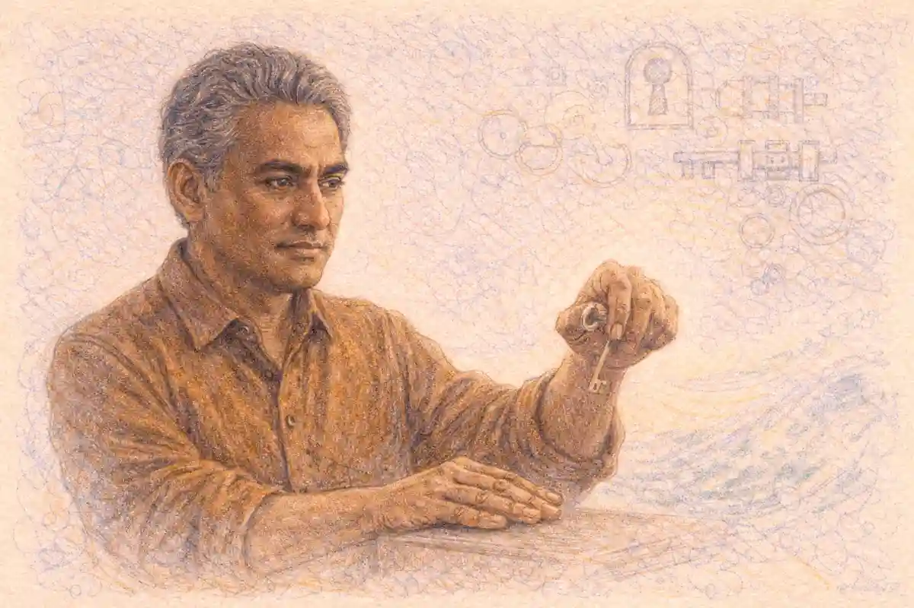

In May 1967, in a Cincinnati studio owned by King Records, a singer counted his band in and then shifted the weight of the bar onto its first beat, leaving space where a backbeat flourish might have sat and asking the horns to strike as punctuation rather than decoration. The history of soul funk and hip hop is the story of how that kind of decision kept being made at larger scales: soul, funk and hip hop form one line of descent in which each stage relocates the centre of gravity of the music, soul moving it from the written song to the voice, funk moving it from the voice to the rhythm section, and hip hop moving it from live performance to the record itself.

<!--more-->

That relocation was never only a matter of taste. Each move depended on an institution that trained the musicians, a business that paid or failed to pay them, and a technology that fixed the result so it could travel. The church trained the singers. The independent label turned the singing into a saleable object under contracts that rewarded the label first. The studio house band turned arrangement into a repeatable regional sound. The turntable then turned the finished record back into raw material, so that a drummer recorded in Cincinnati or Memphis could anchor a track made in the Bronx or Los Angeles decades later. Read in sequence, the three forms explain one another: the melisma in a soul performance, the interlocking bass and drum pattern in a funk performance, and the looped break in a hip hop performance are three answers to the same question of where musical authority sits in a given moment.

## Gospel as the Training Ground

The training began in the Black church, where singing was a discipline practised weekly under exacting local judgement. A gospel singer learned breath control across long phrases, the placement of melisma on a single syllable, the timing of a run so that it answered a preacher or a choir rather than interrupting them, and the management of a room that responded audibly to every choice. Craig Werner, the scholar who traced the passage of gospel technique into soul and freedom song, treated the church service as a conservatory with a congregation as examiner: a singer who could not hold pitch under emotional pressure, extend a note without losing its centre, or trade phrases with a choir in real time did not lead the next service. The skills were specific, teachable and portable, and they were learned years before a recording studio entered the picture.

The personnel pipeline was equally concrete. Quartets and choirs functioned as apprenticeship systems in which a young singer carried harmony parts, watched a lead singer handle a difficult audience, and absorbed a repertoire of songs whose structures rewarded improvisation inside strict forms. Sam Cooke sang with the Soul Stirrers, a touring quartet whose close harmony demanded precision, before he recorded secular material. Aretha Franklin sang in the Detroit church pastored by her father, the Reverend C. L. Franklin, whose own recorded sermons sold widely and whose house received visiting gospel and secular musicians at the same table. Ray Charles absorbed gospel harmony alongside blues piano and jazz voicings in Florida school and band settings. In each case the later secular style was built on a foundation that listeners inside the church could identify note by note.

Gospel also supplied an economy of performance before it supplied a sound. Touring quartets and choirs sold records at services, travelled circuits of churches, and learned which vocal devices moved a room in Memphis as reliably as in Chicago. That circuit taught stagecraft: how to build a programme toward a peak, how to hand a song from one lead voice to another, and how to repeat a phrase until repetition became intensification rather than redundancy. When those devices appeared on soul records, with a lyric addressed to a lover rather than to God, church listeners recognised the machinery at once, which is one reason the transfer provoked argument rather than indifference.

The harmonic language travelled with the technique. Gospel piano and organ voicings, with their movement between church chords and blues inflections, gave keyboard players a vocabulary that secular arrangers could use without translation. The Hammond organ, the piano triplet figure and the practice of letting a singer preach over a held vamp all crossed into rhythm and blues sessions because the same musicians played in both rooms. A Sunday service and a Saturday session might share a pianist, a drummer and a lead singer, and the differences between them were differences of text, venue and pay rather than of musical grammar. That shared grammar is the first strand in the line of descent, and it explains why soul, when it arrived as a named category, sounded less like an invention than like a relocation.

Gospel also built a publishing and recording trade of its own, and that trade trained business habits alongside vocal ones. Thomas A. Dorsey, the Chicago based composer who moved from blues piano into sacred composition, sold his songs as sheet music through his own company and in 1932 helped found a national convention of gospel choirs and choruses that standardised teaching across hundreds of churches. The convention system meant that a technique developed in one city could be workshopped in another within a year, by singers who had never met its originator. Mahalia Jackson's recording career, conducted entirely inside sacred repertoire, demonstrated that gospel could sustain a major commercial audience on its own terms, with Columbia Records marketing her albums to the general public in the 1950s. The Reverend James Cleveland then organised the mass choir movement of the 1960s, training thousands of singers in ensemble discipline through workshops. When soul labels later scouted for voices, they were drawing on an institution that had spent three decades systematising how those voices were made, and the debt was audible in every melisma their microphones captured.

## The Controversy Over Secularising Sacred Technique

The relocation was contested from the start, and the contest was about ownership of technique as much as about theology. Church communities had invested years in training singers, and a singer who carried that training into a dance hall or a rhythm and blues session was, in the eyes of many pastors and congregations, taking a communal asset into a market that returned nothing to the community that built it. The objection sharpened when the transfer was audible at the level of a single song. Ray Charles built a celebrated 1954 Atlantic performance on the framework of a gospel song associated with the Southern Tones, replacing the sacred address with a secular one while keeping the drive, the responses and the piano figures. Listeners who knew the source heard the substitution plainly, and the record became a test case: a technique perfected for worship was being used, unchanged in its mechanics, to sell longing and pleasure.

### Why did gospel singers move into secular music?

Gospel singers moved into secular music because the secular market paid wages the church circuit rarely matched, offered national distribution through independent labels, and let a trained voice reach audiences beyond one denomination. A hit rhythm and blues single could earn in months what years of quartet touring earned, even under contracts favouring the label.

The economic argument deserves its full weight, because the strongest version of the singers' position was not that sacred and secular singing were the same act, but that a voice was a livelihood. Quartet singers travelled hard for small guarantees. A secular contract, however one sided, came with studio time, promotion and a chance at royalties. Sam Cooke managed the transition with unusual care, recording an early secular single under the name Dale Cook so that his gospel audience would not encounter the move unannounced, and later building his own label and publishing interests so that the economics of his singing answered to him. The fuller account of that negotiation belongs with [the life and music of Sam Cooke](/2020/07/07/sam-cooke-life-and-music/), whose career shows both the opportunity and the cost in one arc.

The strongest version of the church position was also more than prudery. A congregation that had formed a singer could watch the singer's most recognisable devices, devices shaped in worship, become the selling points of records whose texts contradicted the teaching of the room that formed them. Some singers resolved the tension by refusing the transfer entirely; Mahalia Jackson held to gospel material across a long and commercially successful career, proving that refusal was a workable path rather than a failure of nerve. Others moved in both directions across a career, returning to gospel recording after secular success, which suggests the boundary was a live negotiation rather than a door that closed once. Historians of the period treat the argument itself as evidence: the heat of the objection measures how completely the technique had crossed, because nobody disputes the ownership of something that has stayed in place.

By the middle of the 1960s the argument had changed its terms. Soul singing was an established commercial category, churches had produced another generation of singers who grew up hearing sacred and secular records side by side, and the question had shifted from whether the technique should travel to who profited when it did. That second question belonged to the marketplace that rhythm and blues had built, and it leads directly to the labels, contracts and studios that organised the next stage of the descent.

## Rhythm and Blues as the Commercial Bridge

Rhythm and blues was the bridge because it gave gospel trained voices and blues trained bands a shared commercial format: the three minute single, sold through Black radio and jukeboxes, charted by Billboard under a category name that Jerry Wexler helped establish in 1949 when the trade paper retired the older term race records. Nelson George, the critic and historian who treated rhythm and blues as an industry built by Black radio and independent labels, argued that the category was a market construction before it was a style: it gathered jump blues, vocal group harmony, gospel inflected solo singing and electric blues under one retail heading, and musicians learned to write and arrange for the heading. A singer with church technique could enter that market without abandoning the technique, because the format rewarded exactly the intensity the church had trained.

The bridge carried traffic in both directions. Blues guitarists and boogie pianists gave secular singing a rhythmic chassis, while gospel singers gave blues forms a new vocal ceiling. Charles Brown and Amos Milburn carried piano blues into polished ballad singing; the vocal groups carried quartet harmony into songs about romance; Louis Jordan carried a jump band's comic timing and saxophone led drive into small combo playing that pointed toward rock and roll. When Atlantic Records signed Ray Charles and Ruth Brown, and when Chess Records in Chicago recorded Muddy Waters and Howlin' Wolf alongside vocal groups, the same commercial infrastructure served all of them, and a listener buying singles encountered the styles as neighbours rather than as separate worlds.

Radio made the bridge load bearing. Black oriented stations and influential disc jockeys could turn a regional single into a national seller within weeks, and the jukebox network placed records in bars and cafes where a song's dancefloor utility was tested nightly. That distribution system valued immediacy: a record had to declare itself in its first bars. The intros, horn stabs and shouted openings of rhythm and blues singles were engineering decisions for a noisy room and a short attention window, and soul inherited the habit wholesale. Funk later compressed the same logic further, until the opening itself was the hook, and hip hop DJs, searching old records for their most concentrated passages, found in rhythm and blues and soul singles a library of moments built to seize a room quickly.

## The Independent Label Economy

The independent label was the economic engine of the whole line of descent, and its structure explains both the speed of the music and the poverty of many of its makers. A major label of the 1940s served the pop mainstream through its own studios, arrangers and distribution. An independent such as Atlantic in New York, founded in 1947 by Ahmet Ertegun and Herb Abramson, or Chess in Chicago, founded in 1950 by Leonard and Phil Chess, or Sun in Memphis under Sam Phillips, operated on thin capital: rent a studio by the hour, hire local musicians by the session, press records in small runs, and persuade distributors and disc jockeys city by city. Low overhead meant low caution. An independent could record a singer a major label considered unmarketable, release the record within weeks, and follow a regional response with a second pressing before a larger company had finished scheduling a meeting.

That agility created the conditions for soul. Berry Gordy founded his Detroit operation in 1959 with an eight hundred dollar loan from his family, building Motown on an assembly discipline borrowed from the car plants where he had worked: songwriters, producers, arrangers and a house band refining material in one building, with quality control meetings deciding what deserved release. In Memphis, Jim Stewart and Estelle Axton built Stax from a family recording project into a label whose studio, a converted movie theatre with a sloped floor, gave its records a recognisable room sound. In Cincinnati, Syd Nathan at King Records ran recording, pressing and distribution under one roof and recorded both rhythm and blues and country acts, including the singer whose later work reorganised funk. Each company was a local system for converting neighbourhood talent into national product.

Distribution was the weak joint in the system, and everyone in the business knew it. An independent rarely owned national distribution; it licensed records to distributors, relied on the majors for reach in some periods, or, in the Stax case, placed its catalogue with a larger partner and discovered the price later. Promotion ran through personal relationships with disc jockeys, one stops at distributors, and the legally grey economy of payola, in which payment for airplay moved through promoters and was investigated by Congress at the end of the 1950s. The investigations changed the paperwork of promotion more than its economics. For the artist, the structure meant that the company taking the commercial risk also controlled the accounts, the masters and the publishing in the standard arrangement, and the next section takes up what that control did to the people whose voices carried the whole enterprise.

Writers who keep the paper trail of this economy in order, session dates against release dates and label ledgers against chart runs, often keep that research in private files rather than on shared drives, and the [VaultBook download page, where the offline encrypted notes app is obtained](https://vaultbook.net/download/), serves readers who want that kind of material held on their own machine.

The economy's later history confirmed where its value accumulated. Atlantic, the model independent of the rhythm and blues era, was sold to Warner Bros Seven Arts in 1967, converting its founders' catalogue holdings into corporate assets. Stax, having lost its Atlantic distributed masters, rebuilt around Al Green era rivals in Memphis and its own stars before collapsing into bankruptcy in the middle 1970s, its remaining catalogue passing through a sequence of owners. Motown, the most successful Black owned company of the soul era, was sold by Berry Gordy to MCA in 1988 for a sum reported at the time in the tens of millions of dollars, the price resting substantially on the catalogue and publishing the company had retained. In each transaction the asset being priced was the same: masters and songs recorded years earlier under the standard contracts. The musicians whose performances constituted those assets participated in the sale prices only where their contracts, renegotiations or retained publishing gave them a share, which is why the history of the independent economy is told twice in the sources, once as a story of entrepreneurial brilliance and once as a story of who was holding paper when the music turned into property.

## The Contracts and What They Did to Artists

The standard independent era contract exchanged ownership for opportunity on terms that were documented, consistent and heavily weighted. A label typically owned the master recordings outright, controlled the artist's name and likeness for commercial purposes, charged recording costs, promotion costs and sometimes touring support back against the artist's royalty account, and paid a royalty rate calculated on a base that deductions then shrank. Publishing, the ownership of the song itself as distinct from any recording of it, was frequently assigned to a company affiliated with the label, so that a singer who wrote a hit might watch the song's income flow to a firm owned by the same people who owned the master. These were not secrets whispered after the fact; they were clauses in signed agreements, and the dispute history of the era is largely a history of artists reading their own paperwork years later with lawyers beside them.

Specific arrangements show the range. When Stax ended its distribution partnership with Atlantic in 1968, its owners learned that the agreement had left Atlantic in possession of the masters of the Stax records it had distributed, a clause whose effect was that the Memphis company had spent years building a catalogue it did not own. The fact is documented in label histories and executive accounts and stands as the plainest shareable lesson of the era: in 1968 the founders of the defining soul label discovered, at the moment of separation, that a distribution clause had transferred ownership of much of the catalogue their studio had created. At Motown, the songwriting and production team of Holland, Dozier and Holland left the company in a dispute over royalties and profit participation that moved into litigation, a case in which the writers whose songs powered the label argued that the accounting they received did not match the value they had delivered. Motown's position, also documented, was that its system had built the platform that made the songs valuable. Both claims can be examined in the contracts and the court filings, which is where the charter of this series insists such arguments belong.

The counterexamples matter as much as the grievances, because they show the terms were negotiable for artists with leverage. Ray Charles, moving to ABC Paramount in 1959, secured an arrangement under which he would own his masters after a period, an unusually strong term for the era and one he used as the foundation for his own label and publishing interests. Sam Cooke founded his own record company and publishing firm in the early 1960s, an ownership structure cut short by his death in 1964. James Brown fought his label over release schedules and economics across his King years and built parallel businesses in radio station ownership and publishing. The pattern across these cases is consistent: ownership followed bargaining power at the moment of signing, and bargaining power usually arrived only after the first hits, by which time the earliest and often most valuable masters were already assigned.

What must be kept distinct, in fairness to a complicated record, is the difference between a hard bargain, an accounting failure and a fraud. Some disputes were settled with payments whose terms were sealed; some were litigated and produced findings; some remained allegations traded in memoirs and interviews without a court ever testing them. The blanket claim that every independent owner stole from every artist does not survive the paperwork, and neither does the blanket defence that artists signed freely and therefore owed nothing further. Artists signed as teenagers, or without independent legal advice, or against the alternative of no recording access at all, and the industry defence that a contract is a contract answers a legal question while leaving the historical one open. The historical question is what the arrangements did over a career: they concentrated catalogue wealth in companies, left many singers dependent on live work in old age, and made the later reissue economy, in which soul and funk recordings earned again on compact disc and through sampling licences, a second negotiation conducted by whoever held the paper from the first one.

## Regional Studio Sounds and House Bands

A soul record announced its city within seconds, because the independent economy produced regional studios whose rooms, engineers and resident musicians stamped every session. In Memphis, the Stax studio band Booker T. and the M.G.'s, with Booker T. Jones on keyboards, Steve Cropper on guitar, Donald Dunn on bass and Al Jackson Jr. on drums, played behind Otis Redding, Sam and Dave and Carla Thomas, joined on many sessions by the Memphis Horns. The band's interracial composition, unremarkable inside the studio and remarkable in the segregated city outside it, shaped a sound built on space: a guitar figure placed like a comment, a drum pattern that left air around the vocal, a bass line that walked rather than crowded. The records made behind [the life and music of Otis Redding](/2020/08/07/otis-redding-life-and-music/) carry that house discipline in every bar, since Redding's explosive delivery was framed by musicians whose restraint made the explosions legible.

### Who were the house bands behind the hits?

The house bands were salaried or per session studio musicians employed by a label or studio to play behind every visiting singer: Booker T. and the M.G.'s at Stax in Memphis, the Funk Brothers at Motown in Detroit, the Muscle Shoals Rhythm Section in Alabama, and MFSB at Sigma Sound in Philadelphia. Their discipline gave each label a recognisable sound.

Detroit answered Memphis with density and polish. Motown's Funk Brothers, among them bassist James Jamerson, drummer Benny Benjamin and keyboardist Earl Van Dyke, worked in a small basement studio the company called the Snakepit, cutting tracks at a pace that required reading arrangements quickly and inventing parts that made a song's hook unmistakable. Jamerson's bass playing, melodic and syncopated at once, moved the instrument from timekeeping toward counterpoint, a relocation inside the rhythm section that funk would later complete. In Alabama, the Muscle Shoals Rhythm Section at FAME Studios, and later at their own Muscle Shoals Sound Studio, played behind Aretha Franklin, Wilson Pickett and Percy Sledge with a looser, swamp edged feel that singers travelled south specifically to obtain. In Philadelphia in the following decade, the large ensemble known as MFSB staffed Sigma Sound for producers Kenneth Gamble and Leon Huff, laying orchestral strings over a rhythm section tight enough to serve both soul ballads and the emerging disco floor.

Peter Guralnick, the chronicler of southern soul whose book Sweet Soul Music followed these studios singer by singer, treated the house band as the genre's hidden author: the singer changed from session to session, while the room, the engineer and the band persisted, and so the continuity listeners heard across a label's catalogue was often the band's continuity. That reading holds up under the sessionographies. A Stax single and a Hi Records single from Memphis differ audibly because Willie Mitchell's Hi sessions used the Hodges brothers and a different drum philosophy, not because the singers came from different traditions. Regional sound, in other words, was an employment pattern before it was an aesthetic, and the pattern explains why the map of soul is a map of studios: Memphis, Detroit, Muscle Shoals, Chicago, Philadelphia, New Orleans and Los Angeles each raised a house band, and each house band raised a generation of singers into a local grammar that national audiences learned to read.

## The Arranger and the Producer

Between the singer and the house band stood two figures whose authority grew across the soul era until it rivalled the singer's own. The arranger decided what the band played: which horns answered which vocal phrase, where strings entered, how a song's bridge was voiced. At Motown, arrangers such as Paul Riser turned songwriters' piano sketches into orchestral rhythm and blues. At Stax, the band largely arranged by head agreement in the studio, a method that kept the records spare. In Philadelphia, arrangers including Thom Bell built a different architecture altogether, giving the Delfonics and the Stylistics a sound in which French horn, sitar edged guitar and massed strings carried as much identity as the lead falsetto. The producer supervised the whole conversion of song into record: choosing material, setting tempo, hiring the room, and deciding which take survived.

The producer's rise was a function of recording technology and label economics acting together. As studios moved from live mono recording through four, eight and sixteen track machines, a record became something assembled rather than captured, and the person who assembled it acquired authorship in practice whatever the label copy said. Jerry Wexler at Atlantic shaped sessions by pairing singers with bands and material, sending Aretha Franklin to Alabama musicians and a repertoire policy that freed her piano led gospel style. Norman Whitfield at Motown pushed the Temptations toward extended, layered productions in which the record's texture was the argument. Gamble and Huff in Philadelphia built a vertically organised company in which writing, arranging, production and label ownership converged, an arrangement that answered the contract problems of the previous decade by moving Black producers into the ownership tier their predecessors had been excluded from.

That convergence matters for the line of descent because hip hop completed it. The soul producer assembled a record from performances; the hip hop producer assembled a record from other records, but the claim to authorship rested on the same foundation: selection, arrangement, texture and pacing decided by one sensibility across the whole artefact. Section twenty one returns to that claim at full length. In the soul era the claim was usually made quietly, in studio credits and royalty negotiations rather than on the sleeve, yet musicians understood the shift as it happened. Singers who could produce themselves, as Curtis Mayfield and Isaac Hayes and Stevie Wonder in his adjacent pop soul work each did, held a kind of power that singers dependent on assigned producers did not, and the difference showed in repertoire, in album length and in the patience a label extended when a record failed.

## Soul as a Vocal Art and What the Technique Is

Soul singing can be described technically, and the description begins with the gospel toolkit under deliberate strain. The soul singer treats the written melody as a framework for ornament: a syllable is stretched across several pitches in melisma, a note is approached from below and allowed to settle late, a phrase is repeated with altered emphasis until its meaning shifts from statement to plea or command. Timbre itself becomes an expressive variable, moving within one line from a clear head tone to a grainy, rasp edged chest tone that signals exertion and sincerity at once. The rasp is produced, not suffered: singers such as Otis Redding and Aretha Franklin could place it precisely, verse by verse, and remove it for a passage of pure tone when contrast served the song.

Call and response supplied the grammar inside which those devices operated, and the next section treats it separately; here the point is the solo technique. A soul performance typically withholds its fullest voice. The opening verse is sung near conversation, the second adds ornament and rhythmic displacement against the band, and the final choruses admit the singer's whole range, volume and grain, often over a vamp in which the song form loosens into testimony. That arc, inherited from the church service's build toward a peak, is why a soul record can feel like an event rather than a recitation. It also explains the genre's standard of authenticity among its own listeners: the test was whether the intensification sounded earned, and singers who began at full volume had nowhere to build, a fault audiences identified immediately.

The technique made specific demands that separated its masters from imitators. Breath had to be managed across phrases that ignored bar lines. Pitch had to survive deliberate distortion, since a growl that flattened the note read as failure rather than feeling. Rhythm had to float: the soul singer sings behind, across and ahead of the beat in the same performance, trusting the house band to hold the frame. Franklin's piano playing deserves mention inside the technique rather than beside it, because her keyboard voicings directed the band's dynamics and her singing answered her own accompaniment, collapsing the distance between soloist and arranger. When funk arrived, it asked singers to surrender much of this expansive role to the rhythm section, and the surrender was real: the funk vocal is clipped, percussive and interleaved with the band, closer to a horn part than to a sermon. Hip hop then took the vocal in the opposite direction, restoring the voice to the centre of the record but as speech rhythmically organised, so that flow, the MC's placement of syllables against a beat, became the technical measure that melisma had been for soul.

Individual singers extended the technique in directions that became signatures. Sam Cooke modelled a smooth variant, in which melisma decorated a line without disturbing its conversational surface and a light yodel like break at the end of a phrase signalled ease rather than strain; his restraint became the standard for soul singing that aimed at pop audiences without surrendering gospel phrasing. Jackie Wilson brought an athlete's attack, sliding into notes from below and spinning through stage movement that his voice mirrored. The falsetto tradition, carried by Eddie Kendricks in the Temptations, Curtis Mayfield and later Prince in his adjacent work, used the head voice's vulnerability as an expressive register, placing the highest and softest sounds where a gospel singer placed testimony. Donny Hathaway joined keyboard mastery to a warm baritone and recorded live albums that captured his audience singing the responses unprompted, the church mechanism operating in a concert hall. Each variant is a set of choices about breath, register and ornament that a listener can learn to identify within seconds, which is what makes soul a vocal art with a teachable technique rather than a mood that singers either possessed or lacked.

## The Call and Response Inheritance

Call and response is the oldest structural inheritance in the line, present in West African musical practice, carried through work song, ring shout and church service, and audible in every stage of the descent. A leader phrases a statement; a group, a choir, a horn section or a congregation answers; the answer confirms, corrects or intensifies the statement, and the exchange distributes authorship across the room. Craig Werner's account of the freedom movement's music emphasised that the form is social before it is musical: it enacts a community listening to itself, which is why the same structure served worship, protest meetings and dance floors without strain. In gospel, the preacher and congregation traded phrases. In soul, the singer traded with the band, with background voices and, at a James Brown or Aretha Franklin performance, with an audience that knew its part without instruction.

Recording preserved the form while changing its personnel. On a Stax record, Steve Cropper's guitar answers the vocal in the spaces the singer leaves, and the Memphis Horns punctuate like a congregation that has rehearsed its responses to the second. On Motown records, background groups such as the Andantes supplied the answering phrases that framed a lead singer's statements. In funk, the exchange tightened into interlock: Brown's shouted cues, answered by horn stabs and by Maceo Parker's saxophone figures, turned call and response into a conducting system in which the leader directed the band inside the performance rather than before it. The form's rhythmic character changed as its social character persisted: the answer arrived faster, on subdivisions of the beat, until the exchange itself generated the groove.

Hip hop inherited the form twice over. The MC and the crowd exchanged phrases at parties long before records codified the practice, and the DJ's cuts answered the MC's lines the way a horn section answered a singer. The sampled break added a third layer: a recorded drummer from an earlier decade answered a present voice, an exchange across time that the audience heard as natural because the grammar was centuries old. Understanding call and response explains a puzzle that runs through the whole history, which is why forms built for participation survived every change of technology intact. The technologies changed who could answer, a congregation, a band, a crowd, a machine playing a loop, but the expectation that a statement deserves an answer never left the music.

## The Shift to the One and What Funk Changed

Funk begins with a relocation that can be clapped. In the standard rhythm and blues and soul groove, the drummer's snare accents the second and fourth beats of a four beat bar, the backbeat, and the bass tends to support the harmony on the first and third. In the funk grammar that James Brown and his bands codified across the middle and late 1960s, the gravitational centre moves to the first beat of the bar, the one, which every instrument strikes or acknowledges together, after which the bar's remaining beats are filled with interlocking sixteenth note patterns that leave deliberate gaps. The harmony often stays on a single chord for long stretches, because harmonic movement would compete with the rhythmic conversation. The result is a music of placement: what matters is exactly where, inside the bar, each drum stroke, bass note, guitar scratch and horn stab falls.

### What does "on the one" mean in funk?

On the one means that every player in the band places the strongest accent of each bar on its first beat, beat one, and treats that shared landing as the anchor for everything played afterward. Brown drilled the phrase into his bands as an instruction: land together on one, then weave separate patterns in the space the landing creates.

The mechanical clarity of the change can be tested by counting. Take a bar of four beats and subdivide each beat into four sixteenths. A soul drummer might place kick drum on beats one and three, snare on two and four, and hi hat on the eighths. A funk drummer in Brown's band, Clyde Stubblefield or John Starks, distributes the kick across syncopated sixteenths, ghosts snare strokes between the accented backbeats, and keeps the hi hat pattern shifting, while the bassist, Bootsy Collins in the early 1970s version of the band or Bernard Odum before him, states the bar's shape in the first beat and then plays a line that argues with the drums in the gaps. Rickey Vincent, the historian of funk who subtitled his study with the rhythm of the one, argued that the pattern carried a philosophy its players articulated themselves: many parts, each distinct, resolving into one collective statement per bar. The philosophy can be debated; the pattern can be counted, and any listener who claps on one and then listens for which instruments join the landing has understood the core of funk faster than any metaphor conveys it.

Brown did not build the grammar alone, and the record should credit the bandstand. Guitarist Jimmy Nolen developed the clipped, percussive chank that turned the guitar into a rhythm instrument. Saxophonist Maceo Parker and trombonist Fred Wesley shaped horn writing into short, answering stabs. The Meters in New Orleans arrived at a related grammar from a different direction, with Zigaboo Modeliste's drum patterns folding second line parade rhythms into studio funk. Sly Stone in San Francisco fused the grammar with rock instrumentation and a mixed gender, mixed race band whose very composition restated the music's argument. What Brown supplied was codification and enforcement: fines for missed cues, rehearsal discipline famous among his musicians, and a sequence of recordings from the 1965 single that announced a new bag through the 1967 recording discussed at the opening of this article, in which the one became the explicit organising principle of an entire band.

## The Bass and Drum Relationship in Funk

If the one is funk's constitution, the bass and drum relationship is its government. The two instruments divide the low end of the music between them under a rule of non duplication: when the bass plays a busy figure, the kick drum simplifies; when the drummer opens a pattern, the bass states fewer notes and longer ones. The rule sounds like courtesy and functions like engineering, because two busy low instruments blur into mud on the recording systems and club systems of the era. Larry Graham, playing with Sly and the Family Stone and then leading Graham Central Station, transformed the bass side of the partnership by popularising the slap and pop technique, striking the string with the thumb and pulling it with a finger so that the bass produced its own percussion. After Graham, the bassist was a second drummer with pitches, and the negotiation between the two became the centre of the arrangement.

The great partnerships reward close description. In Brown's bands, the bass line often states a short melodic cell that the whole arrangement treats as the song's identity, while the drums vary around it. In Parliament Funkadelic, under George Clinton's direction, Bootsy Collins played bass lines of deliberate extravagance, sliding, muting and ornamenting, against drummers who held comparatively steady patterns, reversing the Brown allocation. In Chic, a decade later and inside disco, Bernard Edwards and Tony Thompson reduced the partnership to an elegance of mutual quotation, the bass echoing the kick pattern so closely that the two instruments read as one mechanism. Edwards's line under a celebrated 1979 Chic single became, through quotation and then sampling, one of the most travelled bass patterns in hip hop, a journey section twenty two examines from the sampling side.

The relationship also explains funk's portability into hip hop. A break, as the next sections show, is usually a passage where bass and drums carry the record alone or nearly alone. DJs hunting for breaks were hunting for this partnership in its exposed state, and producers sampling a break were importing a negotiation between two musicians that had been worked out in a studio years earlier. When a hip hop track feels inevitable, the feeling often descends from that older negotiation: the loop preserves not just a rhythm but a solved problem, the division of the low end between the instrument that states time and the instrument that states tune, resolved so completely that repetition increases rather than exhausts its force.

Recording practice shaped the partnership as much as playing did. Engineers of the funk era placed microphones close to the drum kit and recorded bass directly into the console as well as through an amplifier, separating the two low voices so their negotiation could be balanced after the performance. Compression, applied heavily to drums and bass, glued the interlock together and raised the ghost notes, the half struck snare touches between main beats, into audibility, which is why a funk groove feels busy even when a transcription shows space. Bassists answered with equipment choices that carried musical meaning: Graham's percussive attack favoured a bright, ringing tone that could compete with drums, while Bootsy Collins ran his instrument through effects that stretched its sound toward the synthesiser, and Verdine White of Earth, Wind and Fire kept a singing, melodic tone that let the bass carry hooks a horn section might otherwise have taken. By the end of the 1970s the partnership had become so self sufficient that records could be built from bass and drums with only decoration above them, a possibility disco exploited and hip hop's break hunters treated as a gift prepared in advance.

## Horn Sections and Ensemble Discipline

The horn section is where funk and soul discipline becomes visible. A section of two to five brass and reed players must attack each note together, cut it off together, and shade dynamics together, or the stab that should punctuate a vocal line arrives as a smear. The Memphis Horns, principally Wayne Jackson on trumpet and Andrew Love on saxophone, built a career on that precision behind Stax and Hi singers, adding a brass signature so recognisable that artists outside Memphis hired the pair to import it. Tower of Power in Oakland built a larger section whose tight, jazz literate figures became the band's public identity, and Earth, Wind and Fire placed the Phenix Horns inside a stage spectacle without relaxing the section standard. In Brown's bands the horns functioned as the leader's second voice, answering his cues with figures that Fred Wesley arranged to land like drum strokes.

Discipline in these bands was an employment condition before it was an aesthetic. Brown fined musicians for errors, for unshined shoes and for lateness, a regime his players described in interviews with a mixture of resentment and pride; the resentment is documented, and so is the fact that musicians emerged from his band able to play in any rhythm section in the country. The democratic reading of funk, many voices resolving on the one, coexisted with an authoritarian rehearsal room, and the tension is part of the historical record rather than an embarrassment to be smoothed away. George Clinton ran the opposite regime in Parliament Funkadelic, a sprawling collective in which discipline was loose, membership fluid and the stage presentation anarchic, yet the recordings hold together because arrangers such as Bernie Worrell and Wesley, during his tenure, imposed musical order inside the carnival. Two opposed management styles produced comparably tight records, which suggests the discipline that matters is the discipline of the arrangement: every part must know its place in the bar, whatever the band's social organisation.

For the singer, a disciplined horn section changed the job. Soul singers could lean on the section's answers the way a preacher leans on a congregation, timing phrases against guaranteed punctuation. Funk singers became section members themselves, their shouts and grunts placed as percussion. When hip hop producers later sampled horn stabs, they were sampling that discipline in frozen form: a chord struck by five musicians within the same few milliseconds carries an impact no single synthesised voice reproduces, which is why the stab survived the transition to digital production as one of the most recognisable sounds in the sampled vocabulary.

## The Message Record

Soul music's engagement with public life produced a distinct artefact, the message record: a commercial single or album that carried explicit social or political argument inside the forms the market already rewarded. The form had ancestors in gospel's freedom songs and in blues commentary, and its soul era masters understood the commercial risk precisely. Curtis Mayfield wrote songs for the Impressions in the middle 1960s that addressed dignity, perseverance and collective hope in language a church audience and a radio programmer could both accept, and his solo work after 1970 addressed addiction, urban policy and war with a directness that his falsetto made disarming. Marvin Gaye's 1971 album length statement, examined again in section twenty nine, forced a confrontation inside Motown over whether an artist identified with romantic singles could release a continuous meditation on war, ecology and faith; the label's initial resistance and the album's commercial vindication are both documented, and together they reset the industry's sense of what a soul album could argue.

The message record also developed a harder register. Norman Whitfield's productions for the Temptations after 1968 folded psychedelic rock textures into songs about war, rumour and social fracture, proving that a message could ride a dance groove without softening either. Edwin Starr's 1970 hit performance of a Whitfield and Barrett Strong composition asked its famous question about war in the form of a shout answered by a chant, call and response turned into argument. Gil Scott-Heron, working at the border of soul, jazz and spoken performance in the early 1970s, delivered rhythmic spoken pieces over percussion and piano that hip hop's founders later cited as a direct precedent for rap: the voice as percussion, the text as reportage. The fuller history of music inside the freedom struggle belongs to [the account of music and the civil rights movement](/2025/08/07/music-and-the-civil-rights-movement/), and this article compresses that ground deliberately to keep its own focus on form.

What the message record changed, structurally, was the album. A single could carry one argument; an album could sustain a sequence, and after 1971 the soul album became a place where artists such as Mayfield, Gaye, Stevie Wonder and Donny Hathaway organised extended statements that the singles market then excerpted. Hip hop inherited that ambition along with the single driven craft: the rap album of the late 1980s, sequenced as an argument about a neighbourhood, a police force or a nation, descends from the soul message album as directly as the rap single descends from the party record. The two inheritances met in the work discussed in section nineteen, where narrative rap turned the message tradition toward storytelling.

## Disco and What It Actually Was

Disco deserves description before judgement, because the backlash examined next treated as a fad what was in fact a production system with roots in every earlier section of this article. Disco grew from Philadelphia soul's orchestral rhythm records, from funk's rhythm section discipline, from Latin percussion traditions in New York clubs, and from a DJ culture in private lofts and gay clubs where records were selected and blended for dancers across whole nights. Its classic form joined a four beat kick drum pulse to the funk bass and drum partnership, added MFSB style strings and horns, and stretched arrangements across long mixes designed for continuous dancing. Producers such as Tom Moulton developed the extended remix and the twelve inch single as formats, giving DJs breakdown passages in which drums and percussion carried the floor, passages that hip hop DJs recognised as cousins of the break.

The music's personnel refute the caricature of faceless manufacture. Chic, organised by Nile Rodgers and Bernard Edwards out of New York's rhythm and blues session world, played disco with a funk band's discipline and a jazz musician's harmonic sense. Giorgio Moroder's Munich productions with Donna Summer moved the form toward electronic pulse, building a celebrated 1977 recording around sequenced synthesiser patterns that pointed toward electronic dance music and toward electro hip hop at once. The Bee Gees' work for a 1977 film soundtrack carried disco to a mass pop audience that club culture had never sought, and the soundtrack's enormous sales persuaded major labels to sign and market disco acts far beyond the music's club base. That overexpansion, a business decision by labels, set up the collapse that the backlash then accelerated, and separating the two causes matters for the fairness of the history: disco's commercial fall was partly an industry correction and partly a cultural revolt, and the revolt had targets beyond tempo.

Disco also carried the line of descent forward in a way its detractors rarely credited. The DJ as a live arranger, blending records into a continuous set and reading a floor's energy, was disco's gift to performance practice, and hip hop's founding DJs worked in the same city and the same decade, borrowing the two turntable hardware while redirecting its purpose from blending to cutting. The drummer's break that hip hop isolated had often been mixed for dancers by disco DJs first. When the backlash arrived, it burned the bridge while musicians were crossing it, and the crossing continued anyway, underground, in the Bronx and in Chicago's warehouse parties, where disco's techniques were renamed rather than abandoned.

The DJ culture inside disco deserves its own paragraph, because it is the bridge's load bearing span. At the Loft in New York, David Mancuso programmed private parties from 1970 onward around sound quality and unbroken flow, treating record selection as hospitality. At the Paradise Garage, Larry Levan built a residency in which records were tested, edited and canonised by one room's response across years, and his remixes carried that room's judgement back into the record industry. Walter Gibbons and other remixers treated the studio as a second performance site, restructuring finished recordings for dancers with an arranger's authority. This was production and performance merging in the same person, the merger hip hop's DJ producers would complete. It also means the standard story, in which disco was a producer's music imposed on passive audiences, inverts the documented reality of its core venues: the floor judged, the DJ answered, and the labels followed the rooms. The arrangement is call and response again, conducted at the scale of a night rather than a bar, and it trained the audience that hip hop inherited to expect participation as a right rather than a favour.

## The Backlash Against Disco

The backlash became a public event on 12 July 1979, when a Chicago radio personality, Steve Dahl, staged a promotion at Comiskey Park between games of a baseball doubleheader, inviting listeners to bring disco records for destruction in a centre field explosion. The crate of records exploded, thousands of attendees surged onto the field, and the second game was forfeited. The event, Disco Demolition Night, condensed a sentiment that radio programmers and rock audiences had been building for two years into one televised image. Within a year, major labels had closed or shrunk their disco departments, the word disco had become commercially toxic in American marketing, and dance music continued under other names: club music, boogie, house, garage, each a renaming that allowed the practices to persist.

Explaining the backlash requires keeping its documented layers separate. One layer was industrial: labels had overinvested, radio consultants sought format clarity, and rock musicians watched chart share and session work migrate to dance producers. A second layer was aesthetic argument, made in good faith by listeners who valued guitar bands and song forms and heard disco as formula, an argument that applies the standard of one genre to another built for a different purpose. A third layer, documented by historians of the period's club cultures, was demographic: disco's most visible public was Black, Latino and gay, its signature venues were their spaces, and some of the hostility's language and imagery targeted those audiences rather than any chord change. Craig Werner and other scholars of the era's popular music noted the pattern without claiming it explains every critic; the strongest honest account holds all three layers in view, assigns the explosion at Comiskey Park to a radio promotion that summoned a crowd it could not govern, and treats the slogan of the campaign as evidence about the campaign rather than about the music.

The aftermath redistributed rather than ended the music's influence. Freed from major label marketing, dance production returned to independent labels and regional scenes, the exact economic structure that had produced soul and funk, and within a few years Chicago house and New York garage records were being built from disco's personnel, equipment and DJ methods. Hip hop, developing in parallel, absorbed disco repertoire as sampling material and disco technique as performance method while its rhetoric sometimes joined the dismissal. The line of descent thus passes through a bonfire: the forms survived because the musicians, DJs and dancers who carried them treated a marketing category's death as a change of address, not of practice.

## The Block Party and the Break

Hip hop's founding environment was the Bronx of the 1970s, a borough marked by disinvestment, by the Cross Bronx Expressway's earlier destruction of neighbourhoods, and by a youth culture that converted public space, recreation rooms, schoolyards and block parties, into venues because commercial venues were closed to it. Jeff Chang, the historian of hip hop's founding generation, placed the parties inside that civic history: the sound systems, powered in documented accounts by electricity drawn from street lamps, were infrastructure built by teenagers in a district the city had written down. On 11 August 1973, Cindy Campbell hosted a back to school party in the recreation room at 1520 Sedgwick Avenue, where her brother, the Jamaican born DJ who performed as Kool Herc, played records on two turntables. The party is a documented anchor for the story. It is not, on the evidence, the story's sole origin, and this article observes the distinction the brief for it demands: hip hop coalesced across a scene of DJs, dancers and MCs over several years, and Herc's contribution was a technique and a standard, not a solitary invention.

### What is a break in a hip hop record?

A break is the passage in a funk, soul or disco record where the singing and horns drop away and the rhythm section plays alone, usually drums with bass or percussion, for a few bars. Hip hop DJs singled out those passages because dancers moved hardest inside them, and DJs looped them into new tracks.

Herc's technique addressed the break directly. Watching dancers reserve their greatest energy for the drum passages in funk and rock records, he bought two copies of the same record and used two turntables to alternate between them, returning each copy to the break's start while the other played, extending a passage of seconds into minutes. He called the method by a name drawn from a merry go round, and called the dancers who specialised in those passages break boys and break girls. The records he favoured were the hardest funk his crates held: James Brown sides, the Incredible Bongo Band's percussion showcase, Baby Huey, the Jimmy Castor Bunch. The founding repertoire of hip hop was the funk catalogue of the previous decade, which is the single strongest piece of evidence for this article's thesis that the three forms form one line: the third form began by isolating and repeating the second form's most concentrated moments, using the first form's party grammar of call and response to organise the crowd around the repetition.

## Turntable Technique

The turntable became an instrument through a sequence of techniques, each solving a problem the previous one exposed. Herc's extension method required locating a break by ear and returning a needle to it reliably in the dark, under party pressure. Afrika Bambaataa, a Bronx DJ who organised his parties under the name Zulu Nation, widened the repertoire principle: his sets drew on rock, electronic, Caribbean and film music alongside funk, teaching a generation that a DJ's authority rested on crate knowledge as much as on mixing. Grandmaster Flash, born Joseph Saddler, systematised the mechanics. His quick mix methods used headphone cueing to hear the incoming record before the crowd did, backspinning to repeat a passage with rhythmic precision, and punch phrasing to drop a fragment from one record into the flow of another as commentary. Grand Wizard Theodore, Flash's younger contemporary, is credited within the scene's own accounts with developing scratching in 1975, moving a record back and forth under the needle while the crossfader gated the sound, turning the turntable's noise into a rhythmic voice.

The hardware co evolved with the technique. The Technics SL 1200 series, and its 1979 revision, offered direct drive motors with the torque to withstand a hand on the platter and return to speed instantly, and the mixer crossfader became, in practiced hands, a fader played like a percussion instrument. Tricia Rose, the scholar of hip hop culture and its technologies, analysed the resulting aesthetic as one of flow, layering and rupture: the DJ sustains continuity with the loop, layers fragments from separate records into one texture, and ruptures the surface with cuts that remind the listener the texture is being made live. Her terms describe what a listener can verify at any founding era recording: the pleasure lies in hearing repetition and interruption negotiate in real time.

Technique also reorganised musical knowledge. A DJ's crate was an archive organised by break quality rather than by artist or genre, so a percussion passage by a rock band, a funk B side and a novelty record could sit as neighbours, valued by the same standard. That archival practice, learned by thousands of teenagers in the Bronx and then wherever the culture travelled, amounted to a popular music education conducted without institutions: it taught the funk catalogue's geography, drummer by drummer and label by label, to the very audience that would become hip hop's producers. When those DJs moved into studios, they carried the archive with them, and the sampling practices of section twenty two are unintelligible without the crate logic that preceded them.

Competition formalised the technique in the following decade. DJ battles, organised internationally by the DMC organisation from the middle 1980s, set turntablists against one another under time limits with judging on technique and musicality, and routines developed for battle, juggling two copies of a break into new rhythms, transformer scratching gated by the fader, body tricks performed without breaking the mix, pushed the instrument's vocabulary further in public than party work alone demanded. DJ Jazzy Jeff in Philadelphia and the Invisibl Skratch Piklz in California represented successive generations of that escalation, and their routines were studied on videotape the way young horn players once studied records. The battle circuit also preserved a value the recording market did not reward: difficulty witnessed live, without editing. A routine that collapsed in performance could not be repaired in post production, so the circuit kept the turntable honest as an instrument at exactly the moment when studio technology was making its recorded output effortless to fake. Hip hop's performance culture and its recording culture have argued about that gap ever since, and the argument descends from the older forms too, since soul audiences applied the same test, asking whether a singer could do in a room what the record claimed.

## The MC Emerges

The MC began as the DJ's voice: the person on the microphone who announced records, exhorted dancers, greeted neighbourhoods by name and kept energy high while the DJ's hands were occupied. Coke La Rock, performing with Herc, is credited within the scene's accounts as an early practitioner of the role, which drew on older Black verbal traditions at every turn: the radio disc jockey's patter, the toast tradition of rhymed narrative performance, the dozens, the preacher's cadence and the soul singer's stage exhortations. James Brown's own stage talk and the spoken passages of soul records stood in the immediate background. What the Bronx parties added was duration and competition: an MC had to hold a crowd for hours, in rhyme, and rival parties fielded rival voices, so technique escalated the way horn section discipline had escalated in funk bands, through the pressure of comparison.

The escalation produced the elements listeners now treat as the art's core. Flow, the placement of rhymed syllables against the beat with controlled variation, became the measure that melisma had been for soul: a technical standard insiders judged instantly. Cadence expanded from simple end rhymes toward internal rhyme and rhythmic displacement. The crew structure, a DJ with several MCs trading lines, reproduced call and response inside the vocal team itself, with Grandmaster Flash's Furious Five dividing verses among voices of distinct character. Melle Mel, the group's most technically ambitious MC, demonstrated by the early 1980s that the form could carry sustained narrative and social reportage at the highest level of craft, a demonstration the next section follows onto records.

The MC's emergence also redistributed fame in a way the older forms had not. At a party, the DJ was the attraction and the MC a supporting voice; on records, the ratio reversed, and within a decade the rapper was the named artist while the DJ and then the producer receded toward the credits. That reversal, driven by the recording industry's habit of marketing faces and voices, created the conditions for hip hop's later arguments about authorship. The person the audience recognised was often not the person who had built the track, and the producer's counter claim, examined in section twenty one, began as an attempt to correct the billing that the MC's rise had produced.

## From Party Records to Narrative

The first rap records were party documents, and their route to market ran through the independent label economy in its later, smaller form. Sylvia Robinson, a singer and producer with her own rhythm and blues history, assembled a group of New Jersey MCs as the Sugarhill Gang and in 1979 released a long single built on the bass pattern of a Chic recording, played by her house band rather than sampled. The record reached the upper tier of the national pop chart, the first rap performance to do so, and proved a market the majors had dismissed. The Enjoy and Sugar Hill labels and their peers issued a flood of party records, extended grooves with rhymed boasts, name checks and dance instructions, valuable as scene documents and limited by design: a party record's job was to reproduce a night's energy, not to narrate a life.

The narrative turn arrived in stages. Kurtis Blow brought a solo MC's persona to a major label by 1980. In 1982 Grandmaster Flash and the Furious Five released the single that the scene's historians treat as the form's coming of age, a record whose verses described urban pressure, poverty and psychological strain over an electronic leaning track utterly unlike a party groove, with Melle Mel's writing carrying the argument. Debate continues over how to weigh its innovations against the party records that made its audience, and the strongest account credits both: without the party circuit there is no technique, and without the 1982 record there is no proof the technique could sustain reportage. Run DMC then stripped the sound toward drum machine and guitar edge, and MCs such as Slick Rick demonstrated, by 1988, a storytelling control, character voices, scene setting, plotted reversal, that placed rap narrative beside any sung form. The East Coast's later masters, among them [the Notorious B.I.G. and his life in music](/2020/09/07/notorious-big-life-and-music/), inherited that narrative machinery and applied it to autobiography at album length, completing a journey from the MC as the DJ's announcer to the MC as author.

Narrative changed the economics and the criticism of the form together. A storyteller could sustain an album, claim the songwriter's publishing that section twenty three examines, and attract literary evaluation, liner note essays and university syllabi by the 1990s. It also revived, inside hip hop, the oldest question in this article: the church had asked who owned the gospel singer's technique, and hip hop now asked who owned the MC's words when a label held the master, a question whose answers were written in the same kind of contracts, updated for a new catalogue.

## Regional Hip Hop Scenes

Hip hop's regional history begins as a story of imitation becoming differentiation. Through the early 1980s the form's centre was New York, and records, tapes of parties and radio broadcasts carried the Bronx and Harlem template to other cities, where local musicians first reproduced the template and then bent it around local speech, local dance and local musical inheritance. Jeff Chang's history of the founding generation traced that diffusion through touring, migration and media, and the pattern in each region repeats the soul era's geography lesson: a sound becomes regional when a local infrastructure, a label, a radio show, a club circuit, a car culture, sustains it long enough for a second generation to treat the local version as the tradition itself.

Los Angeles built a scene first on electro and dance records, through producers and DJs working the city's mobile DJ tradition, and then, from the middle 1980s, on a harder narrative style. Ice T brought reportage about street economies to record, and the Compton group N.W.A, with production by Dr. Dre and DJ Yella, released in 1988 an album whose sound, dense with funk samples and mixed for car systems, and whose subject, policing and street life in their own city, announced that the West Coast would argue with the East rather than echo it. The ensuing commercial rivalry between coasts was amplified by media and by label competition into a feud narrative that the participants' own accounts describe in conflicting terms; the musical fact underneath the narrative is simpler and better documented, which is that two regional production styles, New York's clipped collage and Los Angeles's smoothed funk reconstruction, competed for the national ear across the early 1990s.

The South's arrival completed the map and corrected the two coast frame. Houston's Geto Boys carried narrative rap into psychological territory from the late 1980s, on a local independent label, Rap A Lot, built on regional distribution. Miami developed bass music, a car centred, low frequency driven party form under producers such as Luther Campbell, whose group the 2 Live Crew also forced a national legal fight over obscenity that ended with federal court rulings protecting the recordings as speech. New Orleans built bounce on a local rhythmic foundation and, in the late 1990s, placed two family run labels, No Limit and Cash Money, into national distribution deals that repeated the Motown pattern of regional independence negotiating with major capital. Atlanta then fused bass, soul and club production into the southern mainstream of the following decade. Each scene's sound can be traced to local conditions, bass for cars in Miami, bounce for neighbourhood parties in New Orleans, and each repeats the article's recurring lesson that regional style is an employment and infrastructure pattern before it is an accent.

The regional scenes also rebuilt the independent label economy in hip hop's own image, with results the soul generation would have recognised and terms that occasionally improved on precedent. Def Jam, founded in New York in 1984 by Rick Rubin and Russell Simmons, moved from dormitory and downtown offices into a distribution arrangement with Columbia Records that left the label's identity and signings in its founders' hands. Priority Records in Los Angeles built national reach on West Coast rap the majors had declined to handle. In New Orleans at the end of the 1990s, Cash Money Records negotiated a distribution deal with Universal that was widely reported for an unusual feature: the label retained ownership of its masters, renting distribution rather than selling the catalogue, a structure its founders described publicly as the lesson of watching earlier Black labels lose theirs. Whether every such account is complete is a matter for the contracts themselves, which are not public; what is documented is the deals' announced architecture, and the architecture shows the industry's memory at work. The founders of the hip hop labels had grown up on the soul catalogue and its cautionary tales, and they bargained, at least in their public positions, as men who had read section five of this history in advance.

## The Producer as Auteur

### How did a producer become the main author of a record?

A producer became the main author of a record when the record's identity came to reside in decisions the producer controlled: choosing the source material, building the rhythm track, setting texture and pacing, and directing the vocal performance against that construction. Sampling completed a process soul producers had begun, because a track assembled from fragments has no existence before assembly.

Hip hop produced a line of producers whose names functioned as guarantees the way a label's name once had. Marley Marl, working in Queensbridge in the middle 1980s, demonstrated that a drum machine and sampled fragments could be programmed with a drummer's feel, and built a production house around the Juice Crew's MCs. Prince Paul, with De La Soul at the end of the decade, showed that collage could be comic, gentle and densely referential in the same track. The Bomb Squad, the production team behind Public Enemy, stacked samples into walls of organised noise that matched the group's argumentative intensity. In Los Angeles, Dr. Dre moved from the layered density of the N.W.A records toward the spacious, synthesiser led reconstruction of funk he named G funk, replaying and extending Parliament Funkadelic figures with live musicians until the producer's studio band echoed the house bands of section six. In New York in the 1990s, DJ Premier built tracks from chopped jazz and soul fragments over hard drum programming, and RZA, producing for the Wu Tang Clan, built an entire label identity from loops treated to sound weathered and cinematic. J Dilla, working in Detroit and then Los Angeles until his death in 2006, pushed drum programming toward deliberately displaced timing that other producers studied as a rhythmic philosophy.

Auteur status changed the credit economy in ways section twenty three quantifies. A star producer could command fees, points on the master and publishing shares that soul era arrangers rarely obtained, and could carry an audience between artists, so that a singer or MC sought the producer as once an artist sought a label. The pattern completes the relocation this article has tracked: authority moved from the song to the voice in soul, from the voice to the rhythm section in funk, from the rhythm section to the record in hip hop, and inside the record from the performer toward the person who assembled it. The MC's counter claim rests on flow and writing; the producer's rests on construction; and the contracts decide, case by case, which claim the money follows.

## Sampling as Composition

Sampling is the practice of building a new recording from fragments of existing recordings, and its compositional status was argued, in studios and then in courts, across the whole period this article covers. The technique's materials were the line of descent itself: a Clyde Stubblefield drum passage from a 1970 two part James Brown single became one of the most widely reused rhythm sources in hip hop and pop; the drum solo from the Winstons' 1969 single Amen Brother, played by Gregory Coleman, supplied a break looped and accelerated through hip hop and then through British jungle and drum and bass; horn stabs, bass lines and vocal fragments from the Stax, Motown and Philadelphia International catalogues circulated as a shared vocabulary. Tricia Rose analysed sampling as a form of Black musical quotation with deep precedents, in which taking a fragment honoured its source by placing it in a new argument, a reading the musicians themselves frequently gave in interviews. The full mechanics and legal history are treated in [the study of how sampling changed music](/2026/02/07/how-sampling-changed-music/), and this section keeps to the disputes that define the practice's place in the descent.

The disputes must be sorted by their legal posture, because the charter of this series forbids collapsing them. Some uses were licensed in advance and paid for under negotiated rates; the market that developed after 1991 made clearance a standard production cost. Some were settled: De La Soul's label settled a claim by the Turtles over an interlude fragment, with payment and no judicial ruling on the underlying principle. One case was litigated to judgement: in 1991 a federal court in New York, in a suit brought by the publisher of a Gilbert O'Sullivan composition against Biz Markie's label, found unlicensed sampling of a substantial fragment to be infringement and referred the matter in harsh terms, a decision that ended the era of casual uncleared sampling on major label releases. A later appellate ruling in 2005, in a case concerning a short Funkadelic fragment in a rap track, held within its circuit that even a brief sampled sound recording required a licence, a holding other lawyers and scholars criticised as overbroad and which remained circuit law rather than a national settlement of the question. What was taken, what was added, what was credited and what was paid therefore differ case by case: a two second horn stab replayed and recontextualised is one act, an entire backing track appropriated without credit is another, and the musicians on the sampled records, session players such as Coleman and Stubblefield, often held no ownership in the masters sampled, so licence income flowed to labels and publishers rather than to the hands that played the break. That last fact returns the argument to section five: the contract structure of the soul era decided, decades later, who would be paid when hip hop quoted it.

As composition, sampling's claim rests on transformation that a listener can verify: a fragment slowed, pitched, chopped into new order, layered against fragments from unrelated records and placed under a new vocal becomes a texture none of its sources contained. The strongest sceptical position, held by some of the sampled musicians and by critics of the practice, is that recognisability is the value being taken, that a loop borrows the emotional authority of a performance it did not create. The strongest defence answers that recognisability is quotation, the device by which the new record argues with the old, and that gospel itself was built by reworking shared material across sacred and secular lines. Both positions were live in 2010, and the structural close is the honest one: the defence holds where transformation is substantial and credit and payment flow; the sceptical case holds where a fragment carries a track it merely decorates, and the courts, ruling case by case, never supplied a single principle that settles the aesthetic question underneath the legal ones.

## Publishing and Who Owned the Songs

Publishing is the ownership of a composition, as distinct from the master, which is the ownership of a recording, and the distinction governed incomes across all three forms. A published song earns when it is sold, broadcast, performed, licensed to film or advertising, or sampled as a composition; a master earns when that recording is sold or licensed. In the independent era, labels routinely required writers to assign publishing to label affiliated companies, sometimes for advances that look, in documented accounts, startlingly small against the songs' later earnings. Berry Gordy's Jobete company held Motown's catalogue, building the firm's durable wealth on the writing of Holland, Dozier and Holland, Smokey Robinson and others, under deals whose fairness the writers later contested in the disputes section five described. In Memphis, Stax's publishing interests and the writing partnership of Isaac Hayes and David Porter produced both classic songs and, after the label's collapse in the middle 1970s, a cautionary record of how bankruptcy distributes a catalogue to creditors.

The sophisticated artists treated publishing as the asset it was. Ray Charles built publishing and label interests on the leverage of his 1959 move. Curtis Mayfield held his writing through his own company and label, Curtom, and his catalogue's later sampling income rewarded the foresight. James Brown's publishing holdings, and his heirs' and estate's later disputes over them, which ran in courts and in public view across the 2000s, show the asset outliving the artist and generating argument among family members, trustees and former associates, with allegations on several sides and findings on some, a record this article reports as structurally open rather than resolved. In hip hop, publishing became the MC's principal claim to durable income, since the writer's share followed the words even where the label held the master, and producers negotiated publishing splits for the compositions their tracks embodied, sometimes including shares for the writers of sampled material once clearance practice required their consent.

The pattern across sixty years is a single lesson restated by each generation: the performance is the event, the master is the artefact, and the publishing is the annuity. Soul singers who assigned all three lived on live work; artists who retained publishing, or recovered it through renegotiation and litigation in the reissue era, held an asset that sampling then multiplied in value. Hip hop's founders entered the same structure with the additional complication that their compositions incorporated other people's, so that a hit rap song's publishing might be divided among the MC, the producer and the writers of two sampled soul songs, a division that is, in its way, the line of descent rendered as a royalty statement.

Sampling gave the publishing question a second life that nobody in 1965 had forecast. When hip hop producers built tracks from soul and funk records, clearance practice after 1991 required licences for the masters and, where the underlying composition was recognisable, for the publishing, so the writers of the sampled era began receiving income from records made by artists who cited them as ancestors. The flow was uneven in a way that maps exactly onto the original assignments: writers who had retained or recovered publishing participated, writers who had assigned theirs watched the income pass to the holding companies, and session musicians, who had never held either asset, received nothing from licences of performances their hands had created. Industry organisations and some artists campaigned across the 1990s and 2000s for neighbouring rights and session funds that would reach performers, with partial success in some territories and none in others. The debate is the contract argument of the independent era continued by other means, and it remained unresolved at this article's date, which is the accurate place to leave it: an open structure in which what would settle the matter, a general performers' right in sampled recordings, is known, proposed and not enacted.

## Radio, Video and the Crossover Question

Crossover, the movement of a Black artist's record onto pop radio and pop charts, was the industry's central commercial question from rhythm and blues onward, and it was never only commercial. The chart system itself encoded the division it measured: Billboard's categories separated rhythm and blues sales from pop sales for most of the period, suspending the separate chart only between 1963 and 1965, so an artist could hold the top of one list and remain invisible on the other. Radio formats enforced the boundary station by station. Nelson George's history of the era argued that crossover pressure reshaped the music's production, rewarding smoother arrangements and love song subjects that pop programmers considered safe, and that the soul era's achievement was to cross over, repeatedly, without surrendering the gospel technique that programmers had once treated as the barrier.

Music television reopened the argument in a new medium. MTV, launched in 1981, programmed rock formats and played few Black artists in its first years, a practice its defenders attributed to format and its critics, including Rick James in public statements at the time, attributed to exclusion. The turning point most accounts cite is the channel's adoption of Michael Jackson's videos in 1983. The mechanism of that adoption is disputed in the sources and is reported here as disputed: Walter Yetnikoff, the president of Jackson's label, CBS Records, stated in his memoir and interviews that he threatened to withdraw his company's videos and expose the channel's practice unless Jackson was programmed; MTV representatives characterised the decision as a musical judgement reached without coercion. What is documented on both sides is the outcome: the videos entered heavy rotation, the channel's audience and the artist's sales each expanded, and within a few years hip hop held a dedicated programme on the channel, Yo MTV Raps, from 1988. Teachers assembling that history for a classroom often build slide decks from chart scans and stills, and a [browser-based presentation viewer](https://reportmedic.org/tools/ppt-viewer.html) lets them open such a deck on any machine in the building without installing presentation software.

Whether crossover changed the music itself is a question the evidence answers in both directions, and section thirty four returns to it. The mechanism of change is clear enough: pop formats reward shorter intros, clearer choruses and subjects that travel across audiences, and producers from Motown's quality control meetings onward engineered for those rewards deliberately. The counter evidence is equally clear: the records that crossed furthest, by Franklin, Brown, Gaye, Jackson and Public Enemy, carried undiluted versions of their makers' techniques into the pop centre, shifting the centre toward the music rather than the music toward the centre. The honest summary is that crossover was a negotiation conducted record by record, in which the terms were set by whoever held the stronger commercial position that season.

## Where Michael Jackson Sits in the Story

Michael Jackson sits at the junction of every strand in this article, which is why his position is structural rather than honorary. He was trained inside the independent economy's most disciplined firm: signed to Motown as a child with his brothers in the Jackson 5, he absorbed the Funk Brothers' records from inside the building, learned Berry Gordy's quality control standards as a working child, and carried gospel's performance intensity, filtered through James Brown's footwork and Jackie Wilson's stagecraft, both of which he studied openly, into a pop career. His adult partnership with producer Quincy Jones, himself a veteran of the Ray Charles and big band arranging world, produced the albums Off the Wall in 1979 and Thriller in 1982, records that fused disco's rhythm section discipline, funk's bass and drum partnership and soul's vocal ornament into the pop mainstream at a scale no earlier Black artist had reached. The video work of 1983 then forced the crossover question of the previous section to its resolution.

The biographical account stands at [the life and career of Michael Jackson](/2014/05/07/michael-jackson-life-and-career/), and this pillar keeps to his function in the descent. That function is transmission at maximum scale: through Jackson, the rhythmic and vocal grammar built by the church, the independent labels and the funk bands became the default grammar of global pop, studied by singers on every continent. His death in June 2009, at fifty, closed the career inside this article's period and prompted a documented surge of listening to the catalogue he had built from that grammar. Stance in his case requires noting that his public life carried grave allegations, which were tested in a criminal trial in 2005 that ended in acquittal on all counts, and civil claims that were settled without admission; the categories alleged, charged, tried and acquitted are kept distinct here as the charter requires, and neither the acquittal nor the allegations alter the musical analysis of what his records did.

## Where Aretha Franklin Sits in the Story

Aretha Franklin is the descent's clearest proof that soul's relocation of authority into the voice was a technical event and not a marketing label. Raised in her father's Detroit church, recorded as a gospel singer in her teens, and placed under contract by Columbia Records in 1960 for a run of albums that presented her as a jazz and pop stylist, she found her recorded identity only when Jerry Wexler signed her to Atlantic in 1966 and recorded her in January 1967 at FAME Studios in Muscle Shoals, seated at the piano, with the house band behind her and her sisters Carolyn and Erma among the voices answering hers. The session's method was the whole history in miniature: church technique, an independent label, a regional house band and a producer whose contribution was to remove obstacles rather than to add decoration. Her 1967 reworking of an Otis Redding composition inverted its perspective through arrangement and delivery, demonstrating that in soul the singer's interpretation was itself a form of authorship, a claim her piano playing underlined on every session she led.

Her full career is held at [the life and career of Aretha Franklin](/2014/07/21/aretha-franklin-life-and-career/); her position here is as the standard against which soul singing was measured by its own practitioners. Singers across the following decades named her as the technique's summit, and the mechanism of her influence is specifiable: the placement of melisma as argument rather than ornament, the integration of piano and voice in one directing intelligence, and a dynamic control that let a whisper and a full throated climax belong to the same phrase. Hip hop honoured the position in its own currency, sampling her Atlantic recordings across the decades, so that her voice answers MCs on records made long after the sessions at Muscle Shoals, call and response extended across generations by the technology of section twenty two.

Franklin's later career demonstrates the durability of the position rather than its freezing. Her 1972 live gospel album, recorded in a Los Angeles church with the Reverend James Cleveland and his choir, returned the technique to its source room at the height of her secular fame and became one of the best selling gospel albums of its era, closing the argument of section two from the artist's side: the voice could go home without surrendering anything. Through the 1970s she recorded albums that mixed soul, jazz and orchestral pop on her own terms, and in 1980 a film appearance and a move to Arista Records opened a pop chapter in which duets and contemporary production placed her voice before another generation without asking it to imitate the young singers who had grown up imitating her. Producers who sampled her across the hip hop decades were not reviving a closed catalogue; they were quoting a working contemporary, and the quotations carried the authority of a singer whose command of the technique had been public property, tested in churches, studios and concert halls, for half a century by the time the samplers reached her.

## Where Ray Charles Sits in the Story

Ray Charles stands at the head of the descent because the transfer the whole line depends on, gospel technique into secular song, was performed by him in public, on records, earlier and more explicitly than by any contemporary. His Atlantic recordings of the middle 1950s, produced with Ahmet Ertegun and Jerry Wexler, joined gospel piano, call and response with his band's female vocal group the Raelettes, and blues and jazz harmony into the music that the industry, lacking a better word, would shortly call soul. His apprenticeship had run through territory bands and a Nat King Cole influenced trio; his mature style discarded imitation for synthesis, and the synthesis was systematic: Charles treated every American vernacular form available to him, blues, gospel, jazz, country, orchestral pop, as material for one musical intelligence, an approach his celebrated 1962 album of country songs made undeniable to audiences who had filed him under a single chart category.

His business position matched his musical one, as sections five and twenty three described: the 1959 ABC Paramount arrangement that promised him ownership of his masters, his own label and publishing interests, and a career conducted at a distance from label direction that few Black artists of his generation achieved. The detailed life is at [the life and career of Ray Charles](/2014/10/07/ray-charles-life-and-career/). He died in 2004, having outlived the century his synthesis reorganised. In the line of descent he is the hinge between rhythm and blues and soul, and the standing demonstration that the forms this article treats were not stages that replaced one another but resources a single musician could hold simultaneously, which is why every later figure in this pillar, from Franklin to the hip hop producers who sampled his Atlantic sides, worked in a house he helped design.

## Where James Brown Sits in the Story

James Brown is the pivot on which the entire descent turns, because he authored both of its great relocations after soul. His bands codified funk's shift to the one, as section ten described, and his records then supplied hip hop with its foundational archive, so that one man's catalogue serves as the second form's grammar and the third form's raw material. Brown began inside the older economy: a Georgia singer with gospel training who signed to King Records in Cincinnati and fought Syd Nathan's company over economics and release policy for years, building leverage hit by hit until he could record where and how he chose, own radio stations and publishing, and present himself, accurately, as a businessman whose stage show was only the visible part of the enterprise. The full biography stands at [the life and career of James Brown](/2014/12/21/james-brown-life-and-career/).

His position in the descent can be stated mechanically. As a bandleader he converted the soul revue into a rhythm laboratory, hiring drummers Clyde Stubblefield and John Starks, bassists from Bernard Odum to Bootsy Collins, guitarist Jimmy Nolen and arrangers Fred Wesley and Pee Wee Ellis, and drilling their interlock until the band functioned as a single percussive instrument directed by his cues. As a recording artist he left, across the late 1960s and early 1970s, the densest concentration of breaks in the funk catalogue, which is why the Bronx DJs of section sixteen reached for his records first and why the sampled era paid his catalogue a second fortune in licences, distributed under the ownership terms his early contracts had set. He died in December 2006. No other figure in this pillar is load bearing in two directions at once: remove Brown and funk loses its codifier while hip hop loses its library, a dependence that makes his section the keystone of the article's thesis.

## Where Marvin Gaye Sits in the Story

Marvin Gaye's place in the story is the album, and the interior life the album could hold. Signed to Motown as a singer and sometime session drummer, he spent the 1960s as one of the label's most reliable hit makers, in duets with Tammi Terrell and in solo records produced within the company's system. The system's limits chafed exactly as section five's account predicts: Gaye wanted the album length argument that the message tradition had opened, and his 1971 album What's Going On, a continuous cycle moving through war, faith, ecology and urban grief in layered vocals over orchestral soul arrangements, was initially resisted by Berry Gordy before its release vindicated the artist against the label's judgement. The episode is the Motown system's most instructive internal dispute, because both parties' positions were coherent: Gordy defended a singles economy that had never failed him, and Gaye defended an artistic claim that the market then confirmed at a scale that changed label policy for every Motown artist who followed.

The life in full is at [the life and career of Marvin Gaye](/2015/03/07/marvin-gaye-life-and-career/). In this pillar his function is to mark the moment soul's centre of gravity, having moved into the voice, discovered that the voice could sustain a book length statement, and to carry the church inheritance into questions the church itself was asking about war and the cities. His later work extended the method toward the erotic and the autobiographical with the same layered vocal technique, arranging his own voice as a choir in call and response with itself. He died in 1984, at forty four, in circumstances that belong to his biography's pages rather than to this structural account. Hip hop's debt to him runs through samples of the 1971 album and through the precedent he set: the album as a unified testimony, which narrative rap adopted as its own highest ambition.

## Where Tupac Shakur Sits in the Story

Tupac Shakur occupies the position, inside this pillar, of hip hop's fullest test of the narrative inheritance. Raised partly inside the political world of his mother Afeni Shakur, a former Black Panther whose own history connected her son's generation directly to the movement era the message records had soundtracked, he entered the industry through Oakland's Digital Underground, appearing as a dancer and guest MC before his solo debut in 1991. His records joined the reportage tradition of section nineteen to an actor's sense of character: he had trained at Baltimore's School for the Arts and worked in film alongside recording, and his writing shifted among personas, the witness, the participant, the penitent, within single albums. All Eyez on Me, the double album released in February 1996 after his move to Death Row Records, demonstrated the form's commercial ceiling in the CD era, while the album released under his Makaveli name later that year, after his death in September 1996 at twenty five, fixed his image in argument that continues among his listeners.

The biography, including the East Coast and West Coast rivalry in which he became a central figure and the disputes over his estate and unreleased recordings, stands at [the life and career of Tupac Shakur](/2015/05/21/tupac-shakur-life-and-career/), and this pillar observes the discipline its brief requires by keeping his death out of the analytical centre. His structural position is clearer without it: Shakur is where the line of descent folds back on itself, since his work sampled the soul catalogue, cited the message tradition knowingly, treated the album as testimony in Gaye's sense, and made the MC's authorship, of words, persona and publishing, the explicit subject of his career negotiations. That his catalogue continued to be assembled and released by his estate after 1996 raised the ownership questions of section twenty three in their sharpest form, who speaks for a writer whose writing survives him, and the courts and contracts of his case supplied answers that remain contested by the parties involved.

## The Voice, the Rhythm and the Record as One Line

The three relocations can now be laid side by side, and the table below states the descent in the compressed form the article has argued at length.

| Stage | Approximate span | Where the centre of gravity sits | Defining technology or venue | Representative figure |
|---|---|---|---|---|
| Gospel foundation | 1930s to 1950s | The trained voice inside a congregation | The church service and the touring quartet circuit | Mahalia Jackson |
| Rhythm and blues bridge | 1940s to 1960s | The voice carried by a commercial single | Black radio, the jukebox and the independent studio | Ray Charles |
| Soul | 1960s to 1970s | The voice as author of the performance | The regional studio and its house band | Aretha Franklin |
| Funk | 1960s to 1980s | The rhythm section, organised on the one | The drilled touring band and the break in the record | James Brown |
| Disco | 1970s | The DJ and the continuous dancing floor | The twelve inch single and the club sound system | Nile Rodgers |
| Hip hop | 1970s to 2010 | The record itself, quoted and rebuilt | Two turntables, the sampler and the drum machine | Afrika Bambaataa |

Read down the centre column, the table repeats the thesis with the particulars filled in. Soul did not discard the song; it subordinated the written song to what a trained voice did with it in the studio, which is why interpretation counted as authorship and why Franklin's reworking of another singer's composition could eclipse the original. Funk did not discard the voice; it subordinated the voice to the rhythm section's interlock, which is why Brown's vocals turned percussive and why the era's enduring artefacts are breaks rather than ballads. Hip hop did not discard performance; it subordinated live performance to the artefact, because a sampled break performs identically forever and a producer's construction, unlike a band's set, is fixed at the moment of its making. Each subordination preserved what it demoted. The voice survives inside funk as percussion and inside hip hop as flow, and the rhythm section survives inside hip hop as the loop, so the line is a genuine descent, carrying inherited traits under new organisation, rather than a sequence of replacements.

Technology threads the line together at the level of the artefact. The three minute single imposed the compression that rhythm and blues taught soul. Multitrack recording, expanding from four tracks to twenty four across the soul and funk years, allowed the producer's assembly method and the layered vocal arrangements of Gaye and Mayfield. The drum machine, adopted by Sly Stone on a celebrated 1971 album and then standardised in hip hop through machines such as the Roland TR 808, whose long decaying bass drum became a regional signature in Miami bass and later southern production, detached rhythm from the drummer's body while preserving the drummer's patterns. The digital sampler, in the E-mu SP 1200 of 1987 and the Akai MPC series from 1988, industrialised the DJ's two copy method, letting a producer hold the break still indefinitely and chop it at will. Each device was accused, on arrival, of ending musicianship, and each was absorbed into the tradition's technique within a decade, because the tradition's standard was never the tool but the judgement exercised with it: where the accent falls, what answers what, and whether the room moves.

## What Each Stage Gave Up to Gain Something

Descent is not free, and an honest pillar records the prices. Gospel's transfer into secular markets gained singers wages, distribution and national audiences, and gave up the communal ownership of technique: a device perfected by a congregation became an individual's commercial property, and the argument of section two was the sound of that price being named. Soul gained the singer's interpretive authority and the album length statement, and gave up some of the vocal group's democracy, since the star system that soul perfected concentrated income and attention on lead voices while the background singers, the house bands and the arrangers who made the records remained, with honourable exceptions, underpaid and underknown. The Funk Brothers' decades of anonymity, ended only by a 2002 documentary that restored their names to public view, is the standing example of that cost inside the music's most celebrated catalogue.

Funk gained rhythmic sophistication of a kind no earlier popular form had systematised, and gave up harmonic and melodic range as its working centre: the one chord vamp that liberated the rhythm section narrowed the song as a written object, and funk's own balladeers often had to leave the form to sing at length. Disco gained the floor and the DJ's art and gave up, under major label overproduction, its credibility with the rock press, a loss the backlash then made total for a season. Hip hop gained the record as an instrument, an archive as an education and the MC's authorship, and gave up, in its commercial centre, the live band and the party's local scale: a form built by teenagers for their own blocks became, within fifteen years, a global industry whose contracts repeated, in updated language, the assignments of publishing and masters that the soul generation had spent its later years contesting. The repetition is not an irony to be savoured but a structure to be recognised, since each generation's musicians met the same industry with new tools and the industry priced the tools faster than the musicians priced themselves.

## The International Reach of All Three Forms

The descent travelled, and its travels test the thesis, because forms that survive translation into other languages and social systems are carrying structure rather than fashion. Soul reached Britain through imported singles and the northern soul club culture of the 1970s, in which working class dancers in the north of England built an all night scene around obscure American soul records, valuing exactly the house band era singles the American market had passed over, and sustaining a reissue economy that kept the catalogue alive. British singers and producers then re exported soul technique into British pop across every following decade. Funk's international career ran through West Africa in the other direction as well: Fela Kuti, the Nigerian bandleader, heard James Brown and the American soul and funk circuit during his 1969 stay in the United States, and fused what he absorbed with highlife and jazz into Afrobeat, a form in which the one, the horn stab and the extended vamp served political argument in Lagos as they had served dancing in Cincinnati. Rickey Vincent's history of funk treated that exchange as central rather than exotic: funk was, from its first decade, a music Black musicians on several continents recognised as a shared resource.

Hip hop's spread was the fastest of the three because its means of production were the cheapest: two turntables and a microphone, then a sampler, could be assembled anywhere, and the form's verbal centre adapted to local languages with a speed sung forms rarely match. By the middle 1990s, France sustained the world's second largest rap market, with artists such as MC Solaar building literate, jazz inflected French language rap; Germany, Italy, Japan, Senegal, South Africa, Brazil and Cuba each produced scenes that localised the Bronx template around local speech rhythms, local samples and local grievances, exactly as American regions had done a decade earlier. The pattern confirms the article's recurring finding at world scale: a scene becomes itself when local infrastructure sustains it, and the descent's grammar, gospel's call and response, funk's one, the break and the loop, proved portable because each element is a practice rather than a repertoire, something musicians do rather than something they must be given.

## What Holds the Three Forms Together in the History of Soul Funk and Hip Hop

Four continuities hold the three forms together, and they can be stated plainly after the long road through the sections. The first is personnel and repertoire: the same singers, bands, studios and songs recur across the supposed boundaries, Charles inside soul's founding, Brown inside funk's codification and hip hop's archive, Franklin's voice answering MCs through sampling, so that the boundaries are conveniences drawn across a continuous working population. The second is structural: call and response organises the church service, the soul record, the funk arrangement and the party exchange between MC and crowd, unchanged in function across every change of technology. The third is economic: the independent label, in its 1950s, 1970s and 1980s forms, built each stage on thin capital and personal networks, assigned masters and publishing upward by default, and produced the same disputes in each generation, disputes whose paperwork forms the descent's most continuous archive. The fourth is the recurring relocation itself: each stage identified the element of the music where expression was most concentrated and rebuilt the form around it, voice, rhythm section, record, and each relocation was experienced by contemporaries as a betrayal of the previous stage and by historians as its fulfilment.

The authorities this article has relied on divide, instructively, over how to weigh those continuities. Nelson George emphasised the industry's transformations and the cost of each crossover to the music's Black institutional base. Peter Guralnick emphasised the southern studios and the singers, a continuity of place and voice. Jeff Chang and Tricia Rose, writing about hip hop, emphasised rupture and reinvention by a generation that treated the past as material. Rickey Vincent emphasised funk as the hinge philosophy that made the reinvention thinkable, and Craig Werner emphasised the spiritual and political thread that runs unbroken from the church through the freedom songs into the message records and beyond. The strongest synthesis, and the one this pillar has argued, holds all of those emphases as partial views of one object: a tradition that preserves itself by relocating its centre, arguing about the relocation in public, and charging admission. A listener who starts anywhere in the line, with a gospel quartet record, a Stax single, a Brown break or a Bronx party tape, holds a thread that leads, followed honestly, through all the rest.

## Frequently Asked Questions

### Q: What is the difference between soul and funk?

The difference lies in where each form places the centre of a performance. Soul organises a record around the voice: the band frames a singer whose melisma, dynamics and call and response with the other musicians carry the meaning, and the rhythm section supports that arc from restraint toward a climax. Funk organises a record around the rhythm section: every instrument locks onto the first beat of the bar, harmony often holds on one chord, and the voice turns percussive, shouting cues and short phrases that function as part of the drum pattern. The personnel overlap heavily, and singers such as James Brown worked in both forms. A practical listening test separates them. If removing the vocal would collapse the record's argument, the record is soul. If removing the bass and drums would collapse it while the vocal could be replaced by horn stabs, the record is funk. Many classic recordings sit between the two poles, which is why the forms share a catalogue, a set of studios and a generation of house bands.

### Q: What is rhythm and blues?

Rhythm and blues is the commercial category under which Black popular music was sold in the United States from the late 1940s onward, gathering jump blues, vocal group harmony, gospel inflected singing and electric blues into one market. Billboard adopted the term in 1949, with editor Jerry Wexler among those credited with promoting it, to replace the chart label race records. As a sound rather than a category, rhythm and blues means small band music built on a backbeat, blues harmony and call and response between singer and instruments, designed for dancing and for the three minute single. The category mattered because it organised an economy: independent labels recorded for it, Black radio programmed it, and jukeboxes and record shops stocked by it. Soul emerged when gospel trained singers took over its lead vocal role in the late 1950s and early 1960s, and the older term survived as the name of the bridge those singers crossed. Later uses of the label, descend from the same chart category rather than from a single unchanging sound.

### Q: How did hip hop begin?

Hip hop began in the Bronx during the 1970s as a party culture built by teenagers who had few commercial venues open to them. A documented anchor is the party of 11 August 1973 in the recreation room at 1520 Sedgwick Avenue, where DJ Kool Herc used two turntables and two copies of the same record to extend the drum breaks in funk records, the passages dancers loved most. Around that technique a scene assembled itself across several years: DJs such as Afrika Bambaataa and Grandmaster Flash refined the turntable methods, dancers specialised in the breaks, MCs developed from announcers into rhyming performers, and graffiti and fashion completed a culture participants themselves named as one movement with several elements. Historians such as Jeff Chang warn against crediting a single party or person with the whole origin, and the evidence supports the caution: Herc's break technique was a founding contribution inside a collective invention. Hip hop began when the funk record stopped being only a product and became, in a DJ's hands, an instrument.

### Q: How does funk rhythm actually work?

Funk rhythm works by reorganising a bar of four beats around its first beat. Count the bar in sixteenth notes, four subdivisions per beat. Every player places or acknowledges an accent on the first sixteenth, the one, so the whole band lands together once per bar. Inside the bar, the instruments divide the remaining subdivisions without colliding: the drummer accents the snare on beats two and four while adding quieter ghost strokes between them, the kick drum plays a syncopated pattern that answers the bass, the bass states the bar's shape early and then plays a short repeating melodic cell, and guitar and horns insert clipped figures into the gaps the others leave. Harmony usually stays on one chord so attention stays on placement. The test is physical. Clap only on beat one while a James Brown record plays and the band will meet the clap every bar, while everything between the claps interlocks like gears turning at agreed speed. That interlock, rather than tempo or volume, is the mechanism the word funk names.

### Q: Why did churches object to soul singers?

Churches objected because the transfer was audible and the investment was communal. A congregation and its choir had spent years training a singer in melisma, call and response and the building of a performance toward a spiritual climax. When that singer used the identical devices on a secular record, sometimes reworking a specific gospel song's framework with new words, listeners inside the church heard sacred property being sold in a dance hall. Pastors also objected on doctrine, since the texts of soul records celebrated romantic and physical love the pulpit treated as belonging inside marriage or not at all. The economic grievance ran underneath the theological one: the singer's new income flowed to labels and to the singer, not to the community that had formed the voice. Some singers answered by staying in gospel, as Mahalia Jackson did across a major career, and others moved between the worlds or built ownership structures that answered the grievance in part. The argument's heat is itself historical evidence, measuring how completely sacred technique had crossed into the marketplace.

### Q: How did independent labels find and sign artists?

Independent labels found artists through the working circuits of Black music rather than through auditions advertised openly. Owners and their talent scouts attended church services, quartet programmes, talent shows, clubs and bar bands, following tips from disc jockeys, record shop owners, distributors and musicians under contract. A house band leader or a regional promoter often served as the scout, since a drummer who played behind visiting singers heard every voice in a territory. Sam Phillips in Memphis recorded performers who walked into his studio as well as those he recruited, and Berry Gordy in Detroit drew Motown's roster from a local songwriting and performing community he already belonged to. Signing was usually fast and informal by standards of the time: a contract, an advance that might be small or absorbed into recording costs, and a first session within weeks, because the label's advantage over the majors was speed. Artists were typically signed as recording performers only, with publishing, management and booking gathered into the same company's hands, an arrangement whose consequences for income lasted careers.

### Q: Were soul artists paid fairly for the records they made?

The documented answer is that payment depended on contract terms weighted toward the label, so many artists were paid what their contracts specified and far less than the value their records created. Typical agreements assigned the master recordings and often the publishing to the company, charged recording and promotion costs back against royalties, and calculated royalties on bases reduced by deductions. Some cases went on and were tested: writers such as Holland, Dozier and Holland litigated their Motown accounting, and Stax's founders discovered in 1968 that a distribution clause had left their catalogue's masters with Atlantic. Other artists negotiated from strength and fared differently; Ray Charles secured ownership of his masters in 1959, and Sam Cooke and Curtis Mayfield built their companies. Fairness therefore has to be judged case by case, distinguishing a hard bargain from an accounting failure and from allegations never tested in court. The fact is not in dispute: catalogue wealth concentrated in companies, and many singers depended on live work after their records had enriched their labels.

### Q: What did a studio house band contribute to a hit?

A house band contributed the record's continuity, its regional accent and much of its arrangement. The same musicians played behind every singer a label or studio recorded, so Booker T. and the M.G.'s at Stax, the Funk Brothers at Motown and the Muscle Shoals Rhythm Section gave hundreds of records a rhythmic and harmonic grammar that listeners learned to recognise as the label's sound. Their contributions were compositional in practice: James Jamerson's bass lines supplied hooks the songs had not arrived with, Al Jackson Jr.'s drumming decided how much space a singer would have, and Steve Cropper's guitar figures answered vocals in the spaces songwriters left blank. Bands worked at industrial speed, cutting several tracks in a session, which set the tempo of the independent economy. Singers travelled to studios to obtain a band's effect, as Aretha Franklin's 1967 Muscle Shoals session showed. Credit and pay rarely matched the contribution, since house musicians worked for session fees while the records they shaped sold for decades, a gap documentaries and union campaigns worked to close.

### Q: What is a message record?

A message record is a commercial soul, funk or rap recording whose text makes a social or political argument rather than confining itself to romance or dancing. The form descends from gospel freedom songs and blues commentary, and its soul landmarks include Curtis Mayfield's compositions for the Impressions and his solo work, the Temptations' late 1960s recordings under producer Norman Whitfield, and Marvin Gaye's 1971 album What's Going On, which sustained one argument about war, faith and the cities across a full record. A message record is not defined by sombreness; some of the form's examples ride dance grooves, using call and response to turn an audience into a chorus agreeing with the argument. The form mattered because it proved that argument could sell, resetting what labels believed an album could attempt, and because it taught hip hop its album ambitions: the rap records of the 1980s that reported on policing, poverty and neighbourhood life inherited the message record's contract with the listener, in which entertainment and testimony arrive in the same voice.

### Q: Why was there a backlash against disco?

The backlash had industrial, aesthetic and demographic layers, and honest history keeps them separate. Industrially, major labels had overinvested in disco by 1979, signing acts far beyond the club audience and building departments that a falling market could not support, while radio consultants wanted clean format boundaries and rock musicians watched work migrate to dance producers. Aesthetically, some listeners judged a music built for dancing by the standards of song based rock and found it formulaic, an argument about purpose as much as about quality. Demographically, disco's most visible public was Black, Latino and gay, its defining venues were their spaces, and historians of the period have documented hostility aimed at those audiences in the language surrounding the backlash. The movement condensed on 12 July 1979 at Chicago's Comiskey Park, where a radio promotion that destroyed disco records between baseball games ended with the field stormed and the second game forfeited. Within a year the word disco was commercially unusable, while the music continued under names such as club, boogie and house.

### Q: How does a DJ extend a break?

A DJ extends a break by alternating between two copies of the same record on two turntables. First the DJ locates the break, the short passage where the rhythm section plays alone, and marks or memorises its starting point on each copy. While copy one plays the break, the DJ uses headphones to cue copy two back to its break's start, holding the record still or rocking it at the cue point. As copy one's break ends, the DJ crosses the mixer fader to copy two, releases it exactly on the beat, and while it plays, rewinds copy one. Repeating the exchange keeps the passage looping for as long as the dancers want it, with the DJ's hands supplying the repetition a later sampler would automate. Kool Herc developed the method in the Bronx in the 1970s by watching where dancers peaked, and Grandmaster Flash refined its precision with headphone cueing and backspin technique. The skill is timing under pressure: a late release breaks the dancers' stride, and the whole room knows within one bar.

### Q: What should I listen for in a James Brown record?

Listen first for the one, the first beat of each bar, and notice how every instrument acknowledges it before going its own way. Then follow the rhythm section's division of labour: the drummer's snare on the backbeat with quiet ghost strokes between hits, the kick drum arguing with the bass line, and the bass stating a short melodic cell that becomes the record's identity. Hear the guitar reduced to a clipped percussive scratch and the horns entering as short answering stabs rather than sustained harmony. Above that machinery, track Brown's voice as an instrument of command: shouts that cue the band, grunts placed like drum hits, and sung phrases that arrive clipped and rhythmic rather than expansive in the soul manner. Listen for the break, the passage where the arrangement thins to drums and bass, and imagine a Bronx DJ isolating it, because that passage is where the record's afterlife began. A Brown record rewards this order of attention because its meaning is its organisation: separate parts, placed with rigour, resolving together once per bar.

### Q: Is hip hop a continuation of soul or a break from it?

It is both, and the evidence for each half is concrete. The continuation is material and structural: hip hop's DJs built the form by looping funk and soul records, its MCs inherited call and response and the preacher's and soul singer's stagecraft, its producers sampled the Stax, Motown and Philadelphia International catalogues, and its album ambitions descend from the soul message record. The break is technological and economic: the turntable and sampler relocated authorship from performers to the record itself, the music's centre moved from the live band to a construction assembled in a studio, and a generation defined itself against the polished soul mainstream its parents had danced to. Participants argued both positions at the time, with Afrika Bambaataa presenting hip hop as the inheritor of the Black music tradition and other artists insisting on its novelty. The strongest account treats hip hop as a continuation achieved by rupture, the way funk had continued soul by demoting the voice: the inheritance is real because the inheritors rearranged it around a new centre of gravity.

### Q: Should I start with the singles or the albums?

Start with the singles, then move to the albums once the singles have taught the grammar. Soul and funk were built as singles musics: the independent labels sold three minute records to radio and jukeboxes, artists concentrated their performances into them, and the compilations of singles by Aretha Franklin, James Brown, Otis Redding and the Motown and Stax rosters give a new listener the forms at their most concentrated. Singles also teach chronology, since a singer's development across a decade of releases can be heard in an afternoon. The albums reward the second stage. Marvin Gaye's What's Going On, Curtis Mayfield's early solo albums and Stevie Wonder's 1970s sequence were composed as sustained arguments that excerpting breaks apart, and hip hop's landmarks, from the narrative albums of the late 1980s onward, assume album length attention. A path runs from a singles collection, to the albums each artist built as a statement, to the deep catalogue. The exception is a listener who loves concept albums, who may begin with Gaye and let the singles explain themselves.

### Q: How did regional scenes develop different sounds?

Regional scenes developed different sounds because local infrastructure gave musicians different problems to solve and different tools to solve them with. In the soul era the infrastructure was the studio: Memphis records sounded spacious because the Stax room and its house band valued air around a vocal, Detroit records sounded dense and polished because Motown's studio and quality control system rewarded hooks and orchestration, and Philadelphia records sounded orchestral because Gamble and Huff built a house ensemble at Sigma Sound. Hip hop repeated the pattern with different tools. New York producers chopped soul and jazz fragments over drum programming for dense rooms, Los Angeles producers rebuilt funk with live musicians and synthesisers mixed for car systems, Miami built bass music around low frequencies that car culture rewarded, and New Orleans built bounce on a local rhythmic foundation heard at neighbourhood parties. Speech reinforced every divergence, since accents and slang set the MC's flow. A scene becomes regional when a generation treats the local solution as the tradition itself and starts arguing with it from inside.

### Q: What makes a soul vocal technically difficult?

A soul vocal is technically difficult because it asks one voice to perform controlled operations at once. The singer must sustain gospel breath discipline across phrases that ignore bar lines, place melisma, several pitches on one syllable, so the ornament lands on pitch rather than sliding past it, and vary timbre, moving between clear tone and a rasp edged grain that signals strain while remaining produced rather than suffered. Pitch has to survive that distortion, since a growled note that flattens reads as failure. Rhythm has to float: the singer performs behind, across and ahead of the beat inside one song, trusting the band to hold the frame, while dynamics build from near conversation to full volume across the performance's arc. Call and response adds a demand, since the singer listens and answers in real time, adjusting phrases to a choir, a horn section or an audience. Singers such as Aretha Franklin accompanied herself on piano, directing the band while performing. The difficulty is coordination under display, which is why imitators sound approximate within seconds.

### Q: How do I identify a sampled break by ear?

Begin with the drums, since a sampled break announces itself there. A looped break repeats with mechanical exactness: the same snare crack, the same room sound and the same imperfections return at identical intervals, where a live drummer varies each bar slightly. Listen for a texture change between the drums and the rest of the track, because the break carries the acoustics and tape character of an older studio inside a newer production, and for a loop point, a pulse where the passage restarts, often every two or four bars. Chopped breaks behave differently: fragments arrive reordered, with drum hits pitched up or down and gaps of silence where the producer cut. The sources reward study. Compare the drum passage of the Winstons' 1969 single Amen Brother, or Clyde Stubblefield's playing on the 1970 James Brown two part single, with later tracks built on them, and the family resemblance becomes audible within seconds. Producers also leave fingerprints in credits, since post 1991 releases list sampled sources in liner notes that train the ear retrospectively.

### Q: Which soul record is the best starting point?

The strongest single starting point is Aretha Franklin's 1967 Atlantic album I Never Loved a Man the Way I Love You, because it contains the whole argument of soul in one programme. It opens with her reworking of an Otis Redding composition, demonstrating interpretation as authorship; its title performance was recorded at FAME Studios in Muscle Shoals with the house band whose playing defines the regional studio system; and across the album her piano, her sisters' answering voices and her command of gospel dynamics show the church technique operating at its highest level inside a commercial record. A listener who wants the male counterpart should pair it with Otis Redding's 1965 album Otis Blue, where the Stax house band frames a rougher, more pleading variant of the same technique. Either record teaches the ear what to value in the other thousand: dynamic build, call and response, melisma placed as argument. From Franklin, the natural next steps run backward to Ray Charles's Atlantic recordings and forward to the Philadelphia and funk records her example licensed.

### Q: Did crossover success change the music itself?

Yes, through mechanisms that can be named rather than through a softening. Pop radio and later music television rewarded shorter introductions, clearer choruses and subjects that travelled across audiences, and producers from Motown's quality control meetings onward engineered records for those rewards, testing mixes on speakers and cutting arrangements that delayed the hook. Singers under crossover pressure recorded material chosen by their labels for its neutrality, and the chart system itself, which separated rhythm and blues from pop listings for most of the period, made the crossing a measurable event that careers were planned around. The counter current is equally documented: the records that crossed furthest often carried undiluted technique into the centre, from Franklin's gospel dynamics to Public Enemy's dense argument, shifting the mainstream toward the music instead. Crossover also changed audiences' expectations, since a generation of listeners raised on soul and funk technique heard that technique as normal pop singing afterward. The accurate verdict is negotiation, record by record, with the terms set by whoever held the stronger commercial position in a season.

### Q: Is the producer or the artist the author of a record?

The honest answer divides authorship by layer, because a record contains several works at once. The songwriter authors the composition and holds its publishing; the performing artist authors the interpretation, which in soul could transform a song so completely that the interpretation became the version the culture kept; and the producer authors the record as an artefact, choosing material, musicians, texture and takes. In the soul era the producer's share of that authorship was real but undercredited, growing as multitrack recording turned performance into assembly. Sampling completed the shift, since a hip hop track assembled from fragments has no existence before the producer assembles it, which is why producers such as Dr. Dre, DJ Premier and RZA could carry an audience between MCs. Contracts decide which authorship the money follows, and they have answered differently in different eras: publishing followed writers, master income followed whoever owned the recording, and star producers negotiated fees and points their soul era predecessors rarely obtained. A listener assigning credit should therefore name all three layers rather than crowning one.
