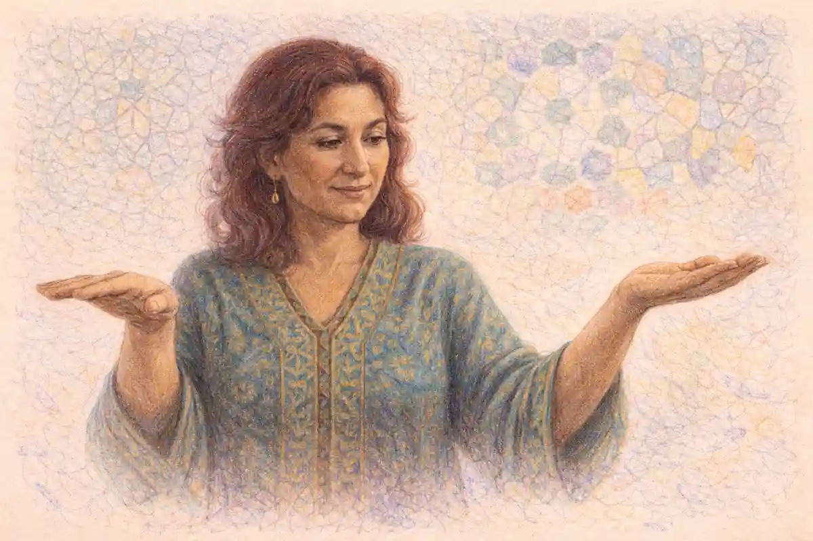

In the first week of August 1927, in a warehouse on State Street in Bristol, on the line between Tennessee and Virginia, a talent scout named Ralph Peer sat behind recording equipment hauled south by rail and auditioned mountain singers who had travelled in by wagon, by train and by automobile, among them a family trio from Maces Spring, Virginia, and a brakeman from Mississippi who sang and yodelled. The history of folk and country music turns on that week, because the sessions proved that inherited songs could be sold as records. The claim defended across this article is the one the Bristol week illustrates: folk and country are the two traditions in which the song rather than the performer or the recording is the unit that survives, and both spent their recorded history negotiating between that inheritance and the star system that recording created.

<!--more-->

## What folk means and the problem with the word in the history of folk and country music

The word folk arrived in English musical life carrying a German scholarly inheritance. Johann Gottfried Herder had popularised the idea of the Volkslied, the song of the people, in the late eighteenth century, and the concept reached Britain and America freighted with a theory: that somewhere beneath commercial and literate culture lay an older, communal, anonymous art that expressed a people's character more honestly than any individual composition could. That theory gave collectors a mission. It also gave later writers a problem, because the word folk was asked to do three jobs at once. It named a method of transmission, song passed mouth to ear without print. It named a social location, song made outside professional and urban institutions. And it named a value judgement, song held to be authentic in a way that commercial song was not. A single word carrying a method, a class position and a verdict was bound to produce confusion, and the confusion runs through every later argument in this history.

The practical consequence is that folk has never had a stable boundary. A hymn learned from a grandmother, a music hall number carried into a mining village and kept there for two generations, a composed parlour song that lost its author's name and drifted into oral circulation: all three have been called folk by somebody, and each claim rests on a different one of the word's three jobs. Bill C. Malone, the historian whose Country Music, U.S.A., first published in 1968, founded the scholarly study of country music, approached the neighbouring term with the same caution, treating country not as an essence but as a commercial category laid over older vernacular practice. Malone's caution is the working rule here. Folk describes how a song travels and who keeps it, not a purity it possesses. Once that is granted, the apparent paradox of the whole field dissolves: a song can be composed by a named professional, printed, sold, forgotten by the trade, and then become folk by the only test that matters, which is that ordinary singers kept it alive without being paid to do so.

That test also explains why the folk category keeps colliding with the country category. Country music, as the record industry built the term in the 1920s, was a marketing label for white southern vernacular performance, sold alongside the race records marketed to Black audiences. Folk, as the revival of the middle twentieth century built the term, was a curatorial label for material held to predate or resist the market. The two labels were applied to overlapping repertoires by different institutions with different motives, which is why a Carter Family recording can sit in a country chart history and in a folk anthology without contradiction. The repertoire did not change. The shelf did. Understanding that the labels belong to institutions rather than to songs is the first piece of equipment a reader needs, because nearly every dispute in the chapters that follow, over authenticity, over ownership, over politics, is at bottom a dispute between institutions claiming the right to name the same material.

A last preliminary concerns evidence. For most of the period covered here, the surviving record is the commercial record: discs, broadcasts, songbooks, copyright deposits. Oral tradition left traces mainly when somebody with a notebook, a recording machine or a publishing contract arrived to fix it. The history of folk and country music is therefore partly a history of mediation, of what collectors, scouts, disc jockeys and producers chose to preserve, and a responsible account keeps that filter visible rather than mistaking the preserved sample for the whole population of song. Where the evidence is a single collector's notebook or a single label's catalogue, this article says so, and where singers' own testimony survives, in interviews gathered by writers such as Peter Guralnick, whose Lost Highway of 1979 followed country and blues musicians through their working lives, that testimony is given weight alongside the paper record.

## The ballad tradition and its repertoire

The repertoire at the root of both traditions is the narrative ballad: a song that tells a story in stanzas, usually in the third person, usually withholding comment, and built to be re-sung by people who did not write it. Francis James Child, the Harvard scholar whose five volume collection The English and Scottish Popular Ballads appeared between 1882 and 1898, fixed the canon of that repertoire in print. The fact is worth stating plainly because it organises everything after it: Child published 305 ballads, and the numbers he assigned them, the Child numbers, became the filing system that collectors, singers and scholars used for the next century and more. A singer in Virginia in 1917 could tell the collector Cecil Sharp that she knew a song, and Sharp could identify it across an ocean of variation because Child had given its family a number.

The ballads Child printed came from broadsides, manuscripts and earlier collections, and their subjects map the moral world of the communities that kept them: love betrayed and avenged, murders discovered by supernatural means, battles, shipwrecks, outlaw escapes, bargains with the devil and visits from the dead. Their method is as distinctive as their matter. A ballad advances by leap and by linger, in the phrase associated with the scholar Gordon Hall Gerould: it leaps between scenes without transition, then lingers over a repeated stanza, a dialogue exchange, a description of dress or weapons, while the plot waits. Dialogue carries much of the narrative. Refrains and repeated lines give a roomful of listeners the thread even when a singer's memory thins. These are not defects of primitive composition. They are engineering for oral performance, techniques that let a long story survive transmission by singers who heard it a handful of times.

Alongside the narrative ballads ran a second repertoire that Child largely set aside: lyric song, dance tunes, lullabies, work songs, hymns and comic songs, the everyday music of communities that the ballad canon overshadowed because narrative looked more like literature to scholarly eyes. In North America the two repertoires mixed with other streams. British and Irish ballads crossed the Atlantic in emigrant memory and in printed broadsides, settled in Newfoundland, Nova Scotia, New England, the southern Appalachians and the Ozarks, and there met Scots and Irish dance music, German hymnody, African American spirituals, blues and work song, and the composed popular songs of the nineteenth century stage and parlour. Bill C. Malone documented how thoroughly mixed the southern white repertoire already was by the time recording arrived: the notion of an isolated mountain culture preserving an untouched Elizabethan songbag did not survive his examination of the evidence, and it does not survive Sharp's own field notes, which record singers mixing Child ballads with recent composed material without sensing any boundary.

The ballad tradition also travelled in print from the start, which complicates any clean contrast between oral purity and commercial corruption. Broadside printers had sold ballad sheets at fairs and markets since the sixteenth century, and many songs lived double lives, sung from memory in one village and read from a penny sheet in the next. The repertoire that collectors later treated as the pure inheritance of the folk was in part a commercial literature that had been absorbed so completely that its commercial origin was forgotten. That pattern, print feeding oral tradition and oral tradition feeding print, recurs at every stage of this history, and it is the strongest single reason for distrusting accounts in which folk song exists in innocence until the record industry arrives to corrupt it. Commerce and inheritance were entangled centuries before Ralph Peer reached Bristol.

## Transmission and variation in oral song

A song passed mouth to ear changes, and the changes are not random damage. They follow the pressures of memory, of local speech, of singers' judgement and of audiences' patience, and they produce the phenomenon collectors called variation: the same ballad existing in dozens of texts, sharing a plot and a skeleton of stanzas while differing in names, places, endings and whole episodes. A heroine named Barbara Allen in one county is Barbara Ellen in the next print source and acquires a different hometown in each. A murder ballad that ends with the gallows in a Scottish text ends with the murderer's remorse in an American one, because the community that kept singing it preferred remorse. Variation is the tradition editing itself, slowly, by plebiscite, every performance a small vote on what the song should keep.

The mechanisms are worth specifying because they explain the shape of the whole repertoire. Memory preserves formula: stock phrases, repeated stanza shapes and floating verses that migrate between songs give a singer scaffolding on which a particular story can be rebuilt at each performance. Where memory fails, invention fills the gap, and a competent singer's invention is often indistinguishable in style from the inherited material around it. Localisation does further work, moving a story to a named local river or battlefield, swapping an unfamiliar trade for a familiar one. Moral pressure edits outcomes. Singers drop stanzas that bore a room and expand the stanza that makes a room go quiet. Over generations the result is a repertoire tested stanza by stanza against live audiences, which is one reason the surviving ballads are so economical: the slack was sung out of them.

This process has a consequence that the age of copyright found hard to digest. An orally transmitted song has no single authorial text. It has a family of texts, none of which is the original in any recoverable sense, since the chain of performances runs back past the reach of documentation. When a collector wrote down one singer's version, the notebook captured a cross section of a moving river. When a record company later treated that cross section as a composition with an owner, a legal fiction was being imposed on a social fact, and much of the argument traced in the section on copyright below flows from that imposition. Robert Cantwell, whose When We Were Good of 1996 remains the most searching account of the folk revival, described the revival's singers confronting exactly this: they learned songs from collectors' fixed texts and then had to decide whether fidelity meant reproducing the page or rejoining the river.

Variation also carried songs across the colour line and across every other line the industry later drew. Black and white singers in the rural South shared tunes, verses and whole songs, learning from neighbours, from travelling musicians, from print and, after the early 1920s, from records, which became a new and powerful transmission channel layered over the oral one. A fiddler could learn a tune from a disc more exactly than from any neighbour, and records began to standardise some versions even as oral habits kept varying others. The interplay of the two channels, the fixing medium and the varying habit, is the central dynamic of the recorded century in both folk and country music, and it begins the moment the Bristol sessions turned inherited repertoire into catalogue.

## The collectors and what they did

Collecting began as salvage. The nineteenth century antiquarians who gathered ballads, among them Bishop Thomas Percy, whose Reliques of Ancient English Poetry appeared in 1765, and Sir Walter Scott, whose Minstrelsy of the Scottish Border followed in 1802 and 1803, believed the old songs were dying with the social order that had produced them, and that print could rescue what memory was about to lose. Child gave the enterprise scholarly rigour. Then, in the early twentieth century, collecting moved from the library into the field. Cecil Sharp, an English music teacher convinced that his country's traditional song survived in its villages, spent the years from 1903 onward noting melodies and texts from singers in Somerset and beyond, and in 1916, with his collaborator Maud Karpeles, crossed the Atlantic to the southern Appalachians, where across three summers of fieldwork they noted hundreds of songs, including Child ballads that had faded from common circulation in Britain itself.

The field collectors developed a method, and the method shaped the evidence. A collector arrived with introductions from clergy, teachers or local officials, asked for old songs, wrote down words and tunes in notation, and often recorded names, ages and sources with a care that later scholarship depends on. What the method captured superbly was repertoire as remembered by particular singers on particular days. What it could not capture was performance: the tempo, the ornament, the room, the dancing, the verses a singer withheld from a respectable visitor. John Lomax and his son Alan Lomax, collecting for the Library of Congress from 1933 onward with a recording machine in the car, closed part of that gap by capturing sound itself, and their journeys through the South and Southwest preserved prison work songs, cowboy songs, blues and ballads that notation alone would have thinned to skeletons. Alan Lomax went on to become the revival era's most energetic advocate and organiser, a dual role, archivist and promoter, that later sections examine.

Ronald D. Cohen, the revival's documentary historian, whose Rainbow Quest of 2002 traced the folk music revival through its organisations and recordings, emphasised that collecting was never a neutral harvest. Collectors asked for what they valued. Sharp wanted old ballads and modal tunes and asked singers for them by name; singers, obliging, searched memory for the oldest material and set aside the sentimental parlour songs and music hall numbers that made up much of their active repertoire. Lomax wanted work songs and blues that fit a theory of folk expression and steered sessions accordingly. The archive therefore overrepresents the archaic and the modal, and underrepresents the ordinary musical diet of the communities visited. Every later claim about what traditional singers sang rests on an archive built by people with theories, and the honest use of that archive begins with remembering how it was built.

Collecting also moved money and credit in one direction. Singers were sometimes paid small sums, sometimes not at all, and the published collections carried the collector's name on the title page while the singers appeared, if they appeared, in footnotes and appendices. Sharp's Appalachian volumes named many singers and honoured them in prose, and the practice varied, but the structural fact held: the person who fixed the song in print acquired a durable public identity as its rescuer, while the people who had kept it alive for generations became sources. That asymmetry, between the keeper of a song and the fixer of a song, is the seed of the copyright argument, and it explains why questions of ownership in this field carry a charge of grievance that purely commercial disputes rarely match.

## What collection fixed and what it lost

Print froze the river. A ballad that had existed as a family of variants became, in a published collection, one text with one tune, and that text acquired an authority its singer never claimed for it. Schoolteachers taught Sharp's versions. Revival singers learned Child's texts. Composers, most famously Ralph Vaughan Williams, who himself collected more than eight hundred songs in English villages, drew melodies from printed collections into concert works. Fixing preserved songs that would otherwise have vanished with their last singers, and no serious account can wish the collections unwritten. The salvage was real. So was the narrowing. A tradition whose essence was variation found itself represented by single authorised versions, and later generations sometimes policed those versions as standards, correcting singers who departed from the page, which is rather like correcting a river for departing from a photograph.

Notation took its own toll. A collector writing tunes by ear in a cottage, asking a singer to repeat a line slowly, captured pitch and a simplified rhythm but lost the slides, grace notes, flexible timing and vocal timbre that carried much of the music's meaning. Fiddle tunes suffered least, being already close to notation's habits. Unaccompanied ballad singing suffered most. The phonograph and then the tape recorder repaired the loss in part, which is why the Lomax field recordings matter beyond their repertoire: they preserve how the songs sounded, including the heterophony of a work gang and the rubato of a lone singer, in a way no staff could. But recording introduced a new fixing problem of its own, because a recorded performance, endlessly replayable, could become the canonical version against which living singers were judged, a process that accelerated once commercial records joined the archive.

Collection also altered the social meaning of the repertoire. Songs that had belonged to kitchens, harvest fields, mines and nurseries became objects of study, concert items and eventually examination subjects. Their singers, sought out in old age, were sometimes bewildered to find their youthful entertainment treated as national heritage, and sometimes shrewdly pleased to be paid and honoured for it. Robert Cantwell observed that the revival inherited this transformed status whole: the folk song arrived in the postwar city already framed as art and as evidence, already carrying the collectors' theories about purity and decline. What was lost in the framing was ordinariness, the sense of the songs as unremarkable daily equipment. What was gained was survival, advocacy and eventually an audience large enough to sustain professional traditional singers, an occupation the pre-collection world had never supported in quite that form.

The balanced verdict is that collection was an intervention with costs and benefits that cannot be separated, because the same act, writing a song down, did both. It saved the text and arrested the process that had produced the text. Every archive in this history, from Child's volumes to the Library of Congress discs to the revival's reissue programmes, sits inside that paradox, and the strongest scholarship, Malone's on country origins, Cantwell's on the revival, Cohen's on the revival's institutions, treats the paradox as the subject rather than as an embarrassment to be explained away.

One further loss deserves its own paragraph because it shaped the sound of the revival. Collection privileged the solo singer with a text, since a notebook or a recording machine captures one voice most easily, and it undervalued the communal forms, the play party, the ring shout's descendants, the congregational lining out of hymns, in which music is made by a group in motion and no single performance can stand for the whole. The folk repertoire as the twentieth century inherited it is therefore biased toward the ballad and the solo song, and against the participatory musics that filled at least as much of traditional life. Revival practice inherited the bias: the folk concert, one figure on a stage with a guitar, felt natural to audiences formed by the archive, although it would have struck many source communities as a thin specimen of how their music actually happened. Scholars including Robert Cantwell remarked on the irony that a movement devoted to communal art standardised its most individual format. The correction, where it came, arrived through festivals and workshops that restored group singing, dancing and session playing to the centre of the folk world, effectively re-collecting, as practice, what the first collectors had been unable to write down.

## Copyright and the traditional song

Copyright law was built for a world of identifiable authors fixing original works, and traditional song fits that world badly. A ballad with three hundred years of anonymous variation has no author to own it, so the law calls it public domain: anyone may sing it, print it or record it, and no one may claim its substance. That settlement sounds clean and has repeatedly failed in practice, because money in the music business attaches to claims, and a public domain song generates no publishing income unless a claim can be constructed on top of it. The industry's solution was the arrangement copyright: a singer, collector or publisher who set down a particular version could copyright the arrangement, and in aggressive practice the claim crept from the arrangement toward the song itself, so that later singers recording their own inherited versions sometimes found a stranger's name attached as writer.

### Who owns a traditional folk song?

Nobody owns a traditional song itself, because copyright requires an identifiable author and a fixed original work, and an orally transmitted ballad has neither. A particular arrangement, harmonisation or newly written verse can be owned by its maker, which is why publishing claims cluster on versions rather than on the inherited song underneath them.

The case law and the grievances accumulated around famous examples. The Lomaxes copyrighted material they collected, defending the practice as protection for the tradition and a funding stream for further work, while singers' families sometimes saw income flowing to the collectors from songs the families had supplied. Lead Belly's repertoire, gathered and promoted by the Lomaxes, generated decades of argument about who had been paid for what. A. P. Carter copyrighted hundreds of songs he had gathered on song hunting trips through the Virginia mountains, many of them older material reshaped to a greater or lesser degree, and the Carter copyrights became valuable property administered by Ralph Peer's publishing interests. Carter did real work as an arranger, transcriber and reshaper of stanzas, and the songs as the world knows them bear his shaping. The dispute is not whether he contributed. It is whether contribution to a version justifies ownership of the song, and on that question the law, the trade and the singers' descendants have never fully agreed.

Nicholas Dawidoff, in In the Country of Country of 1997, traced how such arrangements hardened into the property structure of Nashville, where publishing, not performance, was the durable wealth. His reporting gives the ownership question its proper scale: the argument over a traditional song is an argument over an income stream that can run for generations, long after the collector, the singer and the arranger are gone. The melody that nobody owned in 1800 could, by passing through a notebook in 1917, a copyright deposit in 1928 and a hit record in 1952, be paying a publishing company's shareholders in 1990. Each step was legal. The cumulative result still troubled musicians who regarded the song as an inheritance held in common, and the tension between those two descriptions, legal chain of title and common inheritance, is never resolved in this history. It is managed, song by song, claim by claim.

For the working musician the practical rules that emerged were defensive. Register your arrangement promptly. Document your sources. Expect a prior claim on any traditional song that becomes valuable, because value manufactures claimants. And recognise that the public domain is not a vault but a commons, open to all and defended by none, so that a traditional song's freedom and its vulnerability are the same property viewed from opposite sides.

## The commercial beginning of recorded country

Commercial country music began when record companies discovered that southern white vernacular performance, which they had ignored, could sell in the South. The chronology is specific. In 1922 the Texas fiddler Eck Robertson recorded for Victor, and in 1923 Fiddlin' John Carson's recordings for Okeh, made in Atlanta, sold strongly enough to convince executives that a catalogue existed. Talent scouts including Ralph Peer then went looking for repertoire where it lived. Peer's Bristol sessions of July and August 1927, held for the Victor Talking Machine Company, recorded nineteen performers and produced the two acts that defined the music's commercial poles: the Carter Family, whose repertoire of ballads, hymns and parlour songs became the tradition's songbook, and Jimmie Rodgers, the singing brakeman, whose blues inflected songs and yodel made him the music's first great solo star. Bill C. Malone treated Bristol as a founding moment with due care, noting that recording in the South predated it, but the concentration of consequence in one week justifies the emphasis the week receives.

What the companies sold was not, at first, called country. The catalogues used hillbilly, a label the musicians themselves had mixed feelings about, and the marketing assumed a regional audience buying familiar material. Two features of the early trade shaped everything later. The first was the scout system: men like Peer were paid not in salary alone but through publishing, which aligned their incentives with copyrightable repertoire and pushed the whole business toward songs that could be owned, a pressure examined in the copyright section above. The second was the speed with which records fed back into tradition. A Carter Family disc became a source from which other singers learned songs, so the commercial catalogue and the oral repertoire merged within a decade, each continuously supplying the other.

The Depression nearly killed the young industry, and radio carried the music through the years when record sales collapsed. Barn dance broadcasts, considered below, built audiences that records alone could not have reached, and the performers who survived the 1930s emerged with regional fame convertible into postwar careers. By the time the trade renamed its chart from hillbilly to country and western in the late 1940s and then to country, the music had a star system, a publishing economy centred increasingly on Nashville, and a repertoire in which composed songs written for the market stood alongside inherited ballads, with audiences rarely told, and rarely caring, which was which.

Yet the founding bargain of Bristol deserves emphasis, because it contains the article's thesis in miniature. Peer needed songs. The Carters brought songs, gathered from neighbours, from print, from A. P. Carter's collecting trips, songs whose value lay in their having already survived. The record company contributed machinery, distribution and money; the tradition contributed the asset. Every later structure in country music, the session system, the publishing houses, the star contracts, is an elaboration of that exchange, and every later argument about authenticity is an argument about whether the exchange was fair and whether the machinery changed the asset beyond recognition.

## The string band and the solo singer

The sound of early recorded country was the string band: fiddle leading, banjo and guitar driving rhythm, sometimes a mandolin, a bass made from whatever stood to hand, voices optional. String bands played for dances, and their repertoire mixed British and Irish dance tunes, ragtime, blues, popular songs of the day and breakdowns whose origins no one could fully trace. Gid Tanner and His Skillet Lickers, Clayton McMichen, Charlie Poole and the North Carolina Ramblers, and dozens of regional bands recorded prolifically in the 1920s, and their discs preserve a music of interplay, in which the interest lies in how the parts mesh rather than in any single personality. The string band was a social form as much as a musical one: neighbours playing together, for neighbours dancing, with skill judged by the floor.

Against that collective model stood the solo singer, and the solo singer won the commercial future. Jimmie Rodgers recorded with bands when it suited him, but the product sold was a persona: one voice, one guitar, a biography that could be marketed. Radio amplified the advantage, since a single voice reads clearly through a cheap speaker while a band blurs. The industry learned that personalities scale and ensembles do not, and the lesson reorganised country music around named singers with bands behind them, a process completed in the honky tonk and Nashville eras. Something was genuinely lost in the transition. The string band's distributed musicianship, in which a fiddler's variations answered a banjo player's rhythmic figures in real time, represented a different theory of what music is for, participation rather than presentation, and its retreat to festivals and old-time circles, where it survived, marks one of the clearest costs of the star system.

The guitar's rise belongs to this story. Maybelle Carter's style, melody carried on the bass strings with rhythm brushed across the treble, turned one instrument into a self sufficient accompaniment and gave the solo singer and the small family group a portable engine. Gene Autry and the singing cowboys of 1930s film then carried a smoothed version of the solo model to a national audience, detaching country performance from southern rural life in the public image even as the music's working base stayed southern. By the 1940s the solo singer with a band, fronting songs written increasingly by professionals, was the industry's default unit, and the string band survived as a honoured ancestor and as the seedbed from which bluegrass would shortly be composed.

## The banjo's African lineage

### Where did the banjo come from?

The banjo came from West Africa by way of the Caribbean and the enslaved communities of North America. Its ancestors include the akonting of the Jola people and other Senegambian lutes with a skin head, a long neck and a short thumb string, a design carried across the Atlantic and rebuilt in the Americas from gourds and wood.

That lineage is documented, not conjectured. Eighteenth century observers in the Caribbean and the American colonies described enslaved Africans playing gourd bodied lutes under names including banza, bangie and banjer, and Thomas Jefferson, in Notes on the State of Virginia, published in the 1780s, noted the banjar as the instrument of enslaved Virginians. The instrument's defining features, a membrane soundboard, a fretless neck and a short fifth string played by the thumb, descend from West African lute practice. White musicians learned the banjo substantially from Black musicians: Joel Walker Sweeney, the white minstrel performer who popularised the five string banjo on stage in the 1830s and 1840s, learned to play in Virginia in a musical world where Black players were the instrument's masters, and minstrelsy then carried the banjo, in blackface, to national and international audiences, a transmission route as shameful in its presentation as it was effective in its reach.

The banjo's journey from Black invention through minstrel stage to emblem of white mountain music is the clearest single demonstration of the multiracial reality underneath country music's later marketing. Bill C. Malone documented the shared southern repertoire across racial lines, and later scholars extended his work on the banjo specifically, tracing makers, players and techniques through communities that segregation tried to render invisible to one another. Black string bands, banjo songsters such as Gus Cannon, and the medicine show circuit all carried the instrument's traditions in parallel with the white old-time world, and the recorded archive, skewed by the industry's racial cataloguing into hillbilly and race series, understates the exchange. A DeFord Bailey, the Black harmonica virtuoso who was a star of the early Grand Ole Opry, stands in the record as visible proof of what the cataloguing worked to hide: the founding institutions of country music employed Black musicians at the centre, not the margin.

For folk tradition the banjo matters equally. Pete Seeger's five string playing, learned from records, from the Lomax archive and from southern players Black and white, carried the instrument into the revival, where its bright arpeggiated drive became the sound of a movement that understood itself, not always accurately, as recovering a white Appalachian inheritance. The instrument kept its own counsel. Its construction announced its origin to anyone who asked where the short thumb string came from, and the asking grew more common as scholarship caught up with what players had long known in practice.

## Radio barn dances

Radio reached the farmhouse before electricity did, on battery sets, and barn dance programmes turned that reach into country music's first mass medium. The format was simple: a stage show broadcast live on Saturday night, mixing fiddle bands, singers, comedians and novelty acts in a running variety bill. WLS in Chicago launched its National Barn Dance in 1924, and WSM in Nashville followed with the programme that became the Grand Ole Opry in 1925, named, in the standard account, when announcer George D. Hay followed a classical music broadcast with an hour of what he called grand opera's opposite. The Opry's clear channel signal carried across much of the eastern United States, and a performer heard on WSM on Saturday night could book schoolhouses and theatres across the South on the strength of it.

The barn dances did three kinds of work in this history. They standardised a repertoire, because a song that pleased the Opry audience entered the common stock of every band within the signal's reach, learned off the air. They professionalised performance, creating a class of full time radio musicians with sponsors, fan mail and touring circuits, a decade before the record business recovered from the Depression. And they fixed the music's public image: overalls, hay bales and cornpone comedy were stagecraft laid over working musicianship, and the image both helped the music sell and burdened it with a caricature its performers spent careers negotiating. Uncle Dave Macon, a banjo songster whose repertoire reached back into the nineteenth century, became an Opry star without sanding down his style, which suggests the audience's appetite for the genuinely old was stronger than the caricature implied.

Regional barn dances multiplied the effect: the Wheeling Jamboree, the Renfro Valley Barn Dance, the Louisiana Hayride, which launched both Hank Williams and, later, Elvis Presley into national notice. The Hayride's role underlines radio's function as the industry's scouting system in the years before television, a weekly open audition heard by millions. When network television arrived, the barn dance format migrated with mixed success, but the Opry's endurance as an institution, part broadcast, part hall of honour, made Nashville the music's ceremonial capital before it became its recording capital, and the order matters: the audience relationship came first, and the session economy described below grew up to serve it.

## The honky tonk sound

Honky tonk named both a place and the music made to survive in it: the working class bar, loud with talk, glass and machinery, where a band played for dancers and drinkers who had not come to listen quietly. The music that evolved in the oil field and industrial bars of Texas and the Southwest from the 1930s onward answered the room. Amplification entered country instrumentation here, the electric guitar and the amplified steel guitar cutting through noise that would swallow a string band. The beat hardened for dancing, a strong two beat with the bass walking. Piano joined, in a percussive style descended from barrelhouse playing. And the songs changed their subject matter to fit the clientele: drinking, cheating, divorce, lost wages and lost weekends, sung plainly and without the consolations that the parlour and the church repertoire had supplied.

Ernest Tubb's Walking the Floor Over You of 1941, built on his electric guitar, is the conventional marker of the style's arrival on record, and Floyd Tillman, Hank Thompson and Lefty Frizzell extended its range, Frizzell in particular bending notes and stretching phrases in a vocal style that a generation of singers, Merle Haggard among them, studied as a master text. Hank Williams, whose own section comes later in this article, worked the honky tonk circuit and wrote for its rooms, and his honky tonk songs carry the bar's moral economy exactly: pleasure priced, regret itemised, humour used as a stiffener rather than a cure. Peter Guralnick, in the profiles gathered in Lost Highway, wrote about honky tonk singers with attention to the rooms themselves, and his accounts support the structural point: honky tonk was country music's urbanisation, the sound of the music leaving the farm and the small town for wages, shifts and neon, a generation before Nashville learned to polish that experience for the suburbs.

The style's importance for this history is partly a matter of honesty about sources. Honky tonk drew on blues structures, on western swing's instrumentation, on Mexican border music audible across Texas, and on the sentimental song tradition it pretended to reject, since a honky tonk weeper is a parlour ballad with the furniture changed. Assembled in bars by working musicians solving practical problems, it demonstrates the tradition's real method at the commercial level: absorb everything within earshot, keep what moves a room, let the categories be argued about by people with desks.

## The Nashville system

### What is the Nashville sound?

The Nashville sound was the production style built in the late 1950s by producers including Chet Atkins and Owen Bradley, who replaced fiddle and steel guitar prominence with smooth backing voices, string sections, muted rhythm and a polished vocal front, aiming country records at the pop market without surrendering the country audience or its chart.

The system the style served was an industrial organisation of songwriting, recording and promotion concentrated in Nashville, and its concentration was its genius. Publishers, studios, session musicians, songwriters and label offices stood within a few streets of one another along Music Row, so that a song could be written on Monday, demoed on Tuesday, pitched on Wednesday and cut on Friday by musicians who had played the demo. Atkins, a guitarist of formidable technique who became RCA's Nashville chief, and Bradley, who ran Decca's and then MCA's Nashville operation from the Quonset Hut studio, professionalised every stage. The background vocal groups, the Anita Kerr Singers and the Jordanaires among them, and the string arrangements, supplied the smoothness. The business logic was survival: rock and roll had taken country's young audience in the mid 1950s, and the Nashville sound was the counterattack, an argument that country singers could hold adult listeners and pop buyers at once.

Critics of the system, then and in later scholarship, charged it with sanding the music's edges, suppressing regional styles and subordinating singers to producers. The strongest version of the defence is that the system kept a commercial category called country alive and profitable through a dangerous decade, employed hundreds of musicians and writers at union rates, and produced records, Patsy Cline's among them, whose craft survives any argument about categories. Nicholas Dawidoff's reporting in In the Country of Country recorded the system's human texture, the demo singers, pluggers and pickers whose names the public never learned, and his account complicates the machine metaphor: the system ran on relationships, favours and a shared craft culture as much as on corporate instruction. Both readings are held here without reconciliation, because both describe real features of the same streets.

The system's deepest effect on the folk and country story is the one this article tracks throughout: it completed the transfer of initiative from the singer with an inherited repertoire to the professional writer with a new song. A Nashville star of 1962 might record sixteen songs a year written by other people, chosen by a producer, cut in three hour sessions. The song remained the unit, exactly as the thesis of this article proposes, but the song was now manufactured to order inside an industry, and the inheritance survived inside the system mainly as style, as subject matter and as the audience's memory of what country singing was supposed to feel like.

## The session economy

Underneath the Nashville system's stars stood a labour market of remarkable refinement: the session musicians known collectively as the A Team, players including guitarist Hank Garland, pianist Floyd Cramer, guitarist Grady Martin, drummer Buddy Harman, bassist Bob Moore and guitarist Harold Bradley, who recorded with nearly every major Nashville act across the 1950s and 1960s. The economy ran on three hour sessions, union scale, several sessions a day, and a working method built for speed. Songs arrived as lyric sheets and a demonstration recording or a songwriter at a piano. Arrangements were built on the floor, often in a shorthand notation the players devised, the Nashville Number System, in which chords are written as numbers relative to the key, letting a band transpose instantly and cut a song in a handful of takes. The system's elegance is a musician's solution to an industrial problem: how to make records fast without making them careless.

The session economy explains a paradox in the recorded evidence. Nashville records of the period share a sonic family resemblance, because the same twenty players made most of them, yet the best of them retain individual force, because those players were virtuosos of adaptation who could find a signature figure, Cramer's slip note piano fills, Garland's jazz inflected guitar lines, inside minutes. Singers entered this economy as one component among several, which rearranged the old hierarchy: the star supplied voice and image, while the session band supplied a large share of the music's actual sound. For the historian, credits matter accordingly, and the discographical work that reconstructed who played on what, session by session, changed the writing of country history by restoring the band to the story the star system had told about lone voices.

The economy also had a folk dimension that is easy to miss. Session players were recruited from the same regional musical culture as the string bands: radio bands, dance bands, church, family music. The A Team's fluency in fiddle tunes, gospel harmony and blues changes was the oral tradition wearing a union card. When the system later loosened and artists began bringing their own bands into the studio, the change was celebrated as a return of authenticity, but the session players' defenders reply, with justice, that nobody had faked anything: the tradition had simply been hired by the hour, and it played like itself.

## Countrypolitan and the smoothing

Countrypolitan, the word itself a blend of country and cosmopolitan, names the Nashville sound's mature phase in the 1960s and early 1970s, when strings, choruses and lush arrangements carried country singers deep into the pop and adult contemporary markets. Billy Sherrill, producer at Epic and later Columbia, became the style's defining craftsman, building records around Tammy Wynette and George Jones in which orchestral swells framed vocal performances of unsmoothed emotional force, a combination that gives the lie to any simple equation between polish and blandness. Sherrill's records are engineered like pop and sung like testimony, and their success, Wynette's Stand by Your Man of 1968 among the best selling country singles by a woman in its era, proved that the smoothing could frame intensity rather than replace it.

The singer who most complicates the countrypolitan story is [Patsy Cline, whose life and career](/2021/12/07/patsy-cline-life-and-music/) ran from honky tonk beginnings to the Owen Bradley sessions that produced I Fall to Pieces and Crazy at the start of the 1960s. Cline's voice carries a honky tonk singer's grain and attack inside Bradley's string cushioned settings, and the friction between the two is the records' enduring charge: the smoothing is audible as a frame, and the frame makes the grain more noticeable, not less. Her career also marks the system's ceiling in her era, since the machinery that built her biggest records could not keep her at the centre of a business that treated women singers as a limited category, a restriction the next decades of women stars would spend themselves contesting.

The reaction against countrypolitan was built into its success. As arrangements grew plusher, a market persisted for the unadorned: for Jones's voice nearly alone against a sparse band, for the Bakersfield sound of Buck Owens, who recorded in California with bright telecasters and a hard dance beat in explicit opposition to Nashville polish. The pattern is one this history meets repeatedly, in bluegrass's founding, in the outlaw movement, in the folk revival itself: a smoothing creates the audience for its own antidote, and the tradition advances by arguing with its most successful version. Neither pole is the authentic one. The argument is the tradition.

## Outlaw country and the reaction

Outlaw country was named by marketing and remembered as a rebellion, and the truth contains both. By the early 1970s a group of singer writers in Nashville, including Waylon Jennings, Willie Nelson, Kris Kristofferson, Billy Joe Shaver and Tompall Glaser, had grown frustrated with the system's control over repertoire, production and image. Their demand was specific and industrial rather than mystical: the right to record with their own bands, to choose their own songs, to work with their own producers. Jennings won creative concessions from RCA after hard negotiation. Nelson, after years as a Nashville songwriter whose songs others had made famous, rebuilt his career in Texas, where the Austin scene mixed country audiences with rock audiences and hippie crowds at venues including the Armadillo World Headquarters, and where his concept albums, including Red Headed Stranger of 1975, proved that artistic control and commercial success could coincide.

The movement's label came from a 1976 compilation, Wanted! The Outlaws, assembled by RCA from Jennings, Nelson, Jessi Colter and Glaser recordings, which became country's first platinum certified album and demonstrated that rebellion, packaged, sold at least as well as obedience had. Critics of the outlaw story note that the rebels were insiders, hit songwriters and major label artists, and that the movement changed contracts more than it changed the music's social base. Defenders answer that contracts are where music's freedom actually lives, and that the precedent the outlaws set, the artist as auteur within country music, reorganised expectations for every singer writer who followed. The stance taken here follows the evidence both ways: the outlaw episode was a labour dispute inside a mature industry, conducted by stars, with genuine artistic consequences, and its mythology of banditry was a sales device laid over that dispute within months of its success.

Musically, the outlaw records reach back past countrypolitan to honky tonk tempos, road band lineups and songs about the performer's own life on the road, which closed a loop: the singer songwriter, who dominates the next movement of this history, entered country music not through the folk revival's door but through the industry's own internal revolt. When Nelson sang his own compositions in his own phrasing, behind his own band, the star system and the inheritance had struck a new bargain, one in which the song's authority came from the singer's authorship rather than from the song's age. That inversion, authority by authorship replacing authority by ancestry, is the pivot on which the modern history of both folk and country turns.

The outlaw settlement also rearranged country's relationship with its own past. Freed from the obligation to cut outside songs chosen by producers, Jennings and Nelson recorded traditional material, gospel standards and the work of unfashionable writers alongside their own compositions, and their road bands, staffed by players raised on honky tonk and western swing, restored an ensemble roughness that the session system had engineered away. Audiences heard the change as a return of something older, and in terms of practice they were right: the outlaw band was the string band's descendant, a working unit that travelled, played for dancers and drinkers and kept its own repertoire, now amplified and centred on a singing author. The episode therefore closes the Nashville chapters of this survey with the pattern the whole history obeys. An industrial system perfects a division of labour, the division suppresses a value the audience wants, and the correction arrives from inside the system, carried by its own most successful products, at the moment when their bargaining power exceeds their obedience.

## Bluegrass as a composed tradition

Bluegrass is the clearest case in this history of a tradition that was composed, deliberately, by a named musician within living memory of its founding, and then mistaken by many listeners for an ancient folk form. Bill Monroe, a mandolinist from Rosine, Kentucky, formed the Blue Grass Boys in 1939, taking the band's name from Kentucky's nickname, and through the 1940s, in the classic lineup with Lester Flatt on guitar, Earl Scruggs on banjo, Chubby Wise on fiddle and Howard Watts on bass, assembled the music's grammar from older parts: old-time fiddle tunes, gospel quartet harmony, blues inflections Monroe had absorbed from the Black guitarist Arnold Shultz, Scots Irish dance music and the string band format, all tightened to a high, fast, precise ensemble style built for radio and the stage. Scruggs's three finger banjo roll, demonstrated to national astonishment when the band played the Grand Ole Opry, became the sound's signature, so identified with the music that later players treat it as a foundation rather than as one man's invention of the mid 1940s.

Calling bluegrass a composed tradition is a precision, not a demotion. Monroe held strong views about the music's correct execution, policed its boundaries in interviews and in his band, where apprenticeships under his discipline trained generations of players, and treated the style as his creation in a way no anonymous folk process could. Yet the material he composed with was inherited, and the musicians who carried bluegrass outward, Flatt and Scruggs with the Foggy Mountain Boys after 1948, the Stanley Brothers, Jimmy Martin, the Osborne Brothers, treated his grammar as a tradition to be inhabited, varied and argued over, which is to say they subjected a composed style to the folk process within a single generation. Bluegrass festivals, from Carlton Haney's 1965 Fincastle festival onward, institutionalised that process, gathering pickers into parking lot sessions where tunes and techniques circulated by ear exactly as they had in the string band era, now inside a repertoire whose founding documents were commercial records.

The music's relationship to its parent audience also deserves plain statement. Bluegrass in its founding decades was working class white southern music played by professionals for dancers, radio listeners and record buyers, and its later adoption by college audiences during the folk revival gave it a second public that sometimes valued it as a survival rather than as a living trade. Monroe's own career crossed both publics, often uneasily. Both publics were hearing the same thing: the most disciplined ensemble music in the vernacular American repertoire, built by a man who understood old-time music from inside and rebuilt it to survive the age of the star system by becoming, himself, its star and its lawgiver.

## Old-time music and why it is not bluegrass

### What makes bluegrass different from old-time music?

Bluegrass is a stage music built around a fixed band format, instrumental solos taken in turn, high harmony singing and a repertoire consolidated after 1945 around Bill Monroe's model, while old-time music is an older, regionally varied dance and home music in which the fiddle leads, the ensemble plays the tune together and solo display is rare.

The distinction is practical before it is historical. An old-time session gathers around a tune and stays there, every instrument serving the melody and the dancers, repetition being a feature because a dance needs the tune to keep coming round. A bluegrass band performs a number: verses, choruses and breaks arranged in advance, each player stepping forward for a solo while the others fall back into accompaniment, the whole aimed at listeners rather than dancers. The instruments overlap, fiddle, banjo, guitar, mandolin, bass, but their jobs differ, and the banjo marks the divide most sharply, clawhammer and frailing styles in old-time playing, driven by a downstroke and suited to the tune's rhythm, against the three finger roll in bluegrass, a continuous arpeggiated engine suited to backing a singer and taking breaks.

Confusing the two is not a pedantic error, because the confusion erases old-time music's own history. Old-time names the whole pre bluegrass world of regional string music: Round Peak in North Carolina, Galax in Virginia, the Georgia and Texas fiddling traditions, Black string band music, and a repertoire of dance tunes, songs and ballads accumulated over two centuries. Tommy Jarrell's Round Peak fiddling and Fred Cockerham's banjo playing, recorded and studied by revival musicians from the 1960s onward, taught a generation that old-time was not bluegrass's rough draft but a complete art with its own aesthetics of groove, intonation and collective sound. Bluegrass players themselves maintain the distinction without difficulty, since many play both musics and change their technique, their repertoire and their social manner when they cross from one to the other. The listener who learns to hear the difference, ensemble tune against arranged number, dance time against stage time, has acquired the single most useful discrimination in the whole string band field.

## The American folk revival

The folk revival was the middle twentieth century's great act of musical repatriation, in which material collected from rural and working class singers was carried into cities, colleges and eventually the pop charts by performers who mostly had not been raised inside the traditions they championed. Its prehistory runs through the 1930s and 1940s: the Lomax archive at the Library of Congress, the Almanac Singers, founded in 1940 by Pete Seeger, Woody Guthrie and others, singing union songs and anti war songs and then, after 1941, anti fascist songs for the war effort, and the postwar organisation People's Songs, which tried to build a national folk movement on labour foundations and collapsed under financial strain and political attack. The commercial breakthrough came in 1950 when the Weavers, Seeger's quartet, took a Lead Belly song and a South African song to the top of the pop charts with orchestra behind them, proving that folk material, smoothed, could sell in the millions.

The revival's mass phase ran from the Kingston Trio's 1958 hit with a North Carolina murder ballad through the early 1960s, when college campuses sustained a folk boom, coffeehouses and festivals multiplied, and singers including Joan Baez, Bob Dylan, Peter Paul and Mary, Judy Collins and the young revival generation made the repertoire a lingua franca of student life. [Pete Seeger's life and music](/2022/01/07/pete-seeger-life-and-music/) form the connective tissue of the whole era, since Seeger linked the Lomax archive, the Almanacs, the Weavers, the blacklist years of banjo teaching and songbook publishing, and the mass revival in one working life. The Newport Folk Festival, founded in 1959, staged the revival's self image annually: elders such as Mississippi John Hurt and Reverend Gary Davis, rediscovered and honoured, sharing a programme with the young stars who had learned from their records.

Robert Cantwell's When We Were Good gave the revival its most searching interpretation, reading it as a cultural memory project of a generation formed by the Depression and the war, seeking in folk song a usable image of American community. Ronald D. Cohen's documentary histories supply the institutional skeleton beneath Cantwell's interpretation: the magazines, including Sing Out!, founded in 1950, the record labels, Folkways above all, the festivals, the managers, the feuds. Read together, Cantwell and Cohen establish the point this article maintains: the revival was neither a fraud nor a pure recovery. It was a mediation, with all the gains and distortions mediation brings, and its distortions are examined in the politics and transformation sections that follow.

## The politics of the revival

The revival was born on the left, and its history cannot be told without the fact. The Almanac Singers sang for unions and for the Congress of Industrial Organizations. People's Songs grew from the same milieu. The movement's enemies understood the affiliation exactly and acted on it during the blacklist years of the late 1940s and 1950s, when Seeger and the Weavers lost their commercial careers to congressional scrutiny and industry fear, when folk performers testified or refused to testify before the House Un American Activities Committee, and when the music retreated to summer camps, songbooks and small labels until the Kingston Trio's deliberately apolitical success reopened the commercial door. The revival's mainstream phase therefore carried a double inheritance: a repertoire and a network formed in labour politics, presented to a mass audience in packaging that stressed entertainment and heritage. Ronald D. Cohen documented how Sing Out! and the revival's organisers negotiated that tension issue by issue, deciding what the movement could say in public during years when saying it had cost colleagues their livelihoods.

The strongest version of each reading of that negotiation deserves a hearing. Participants who softened the movement's politics argued that survival was the precondition of everything else, that a blacklisted movement sings to empty rooms, and that the songs themselves carried their meanings to audiences who would draw their own conclusions. Critics of the softening, including some within the movement, answered that a folk revival stripped of the labour movement's purposes kept the costume and dropped the cause, converting solidarity into nostalgia at the moment of the music's greatest reach. The structural fact beneath the argument is that the songs changed function as the audience changed: a union song sung in a hall of strikers is an instrument, and the same song sung in a college concert is a reference, and no performer's intention can fully control which of the two a given audience receives.

In the 1960s the suppressed politics returned through the civil rights movement, where freedom songs adapted from gospel and labour repertoire did direct organisational work in the South, with Guy Carawan and the Highlander Folk School teaching songs as movement tools, and through the antiwar movement, where the revival's infrastructure of festivals, magazines and coffeehouses converted rapidly into a distribution system for dissent. The folk revival's political history is thus not a single position but a cycle: formation in politics, suppression, commercial revival with politics muted, and reactivation when movements needed songs again. That cycle, rather than any party line, is the accurate summary, and it sets up the specialised history of the topical song.

## The topical song movement

The topical song, a song written about current events for immediate use, was the revival's engine of new composition inside an inherited form. Its lineage runs from broadside ballads hawked at executions and battles, through Joe Hill's songs for the Industrial Workers of the World, to Woody Guthrie, who wrote thousands of songs and hundreds of topical pieces on dust storms, dam failures, union fights, war and deportation, treating the newspaper as a songbook awaiting melodies. Guthrie's method was frankly instrumental: take a tune everybody knows, fit it with words about the matter at hand, sing it where the matter is being contested. [Woody Guthrie's life and music](/2021/10/07/woody-guthrie-life-and-music/) repay study on this point alone, because he rebuilt the broadside tradition for the age of radio and the labour hall, and nearly every topical writer after him worked in his shadow or in reaction against it.

The revival institutionalised the topical song. Sing Out! printed new topical material beside the traditional repertoire. The Broadside magazine, founded in 1962 in New York by Sis Cunningham and Gordon Friesen, existed to publish songs on the events of the month, and its pages carried the early work of Bob Dylan, Phil Ochs, Tom Paxton, Janis Ian and others, typed, mimeographed and circulated at a speed print anthologies could not match. Ochs, who called himself a singing journalist, represented the movement's purist wing: a song for every headline, judged by accuracy and nerve. The movement's dedicated history intersects with the wider story of [protest songs that changed history](/2025/08/21/protest-songs-that-changed-history/), which owns the detailed account of individual songs and campaigns; here the structural point is the division of labour the revival evolved, in which topical writing supplied the movement's journalism while the inherited ballads supplied its liturgy.

Topical songwriting carried a built in expiry date, and its writers knew it. A song about a specific bill, trial or election loses its occasion within years, sometimes months, and the Broadside repertoire is full of pieces whose references now need footnotes. The movement's defence was that expiry is the price of use: a song that helps win a campaign and then fades has done more work than a durable song that never leaves the page. The durable survivors of the topical flood, the songs that outlasted their occasions, generally did so by widening at the crucial moment from the specific grievance to the general condition, so that later singers could reoccupy them. That widening, from headline to archetype, is the same movement by which broadsides became ballads across the centuries, and it explains why the topical tradition, for all its disposability, kept replenishing the permanent repertoire.

## From interpreter to writer

### Why did singers start writing their own songs?

Singers began writing their own songs because the revival's audience came to value authorship as the mark of sincerity, because publishing income rewarded the singer who owned compositions, and because performers formed on traditional material, Bob Dylan most consequentially, discovered that inherited forms could carry new and personal writing.

The shift can be dated by its symbols. The early revival star was an interpreter: Joan Baez, whose first albums from 1960 onward presented traditional ballads and other writers' songs in performances of luminous clarity, built a career on selection, voice and moral presence rather than on composition. Within five years the centre of prestige had moved. Dylan, who began as Guthrie's disciple and an interpreter of the traditional and blues repertoire, filled his albums from 1963 onward with original songs, and the market followed him with a speed that reordered the whole field's incentives. By the middle of the decade a folk singer without original material was auditioning with a handicap, and the interpreter's art, which the tradition had honoured for centuries, found itself reclassified as a preliminary stage in a career whose maturity was authorship.

Three causes, working together, explain the change. The first is economic and returns to this article's recurring theme: in the publishing economy, the writer earns from every performance of a song forever, while the interpreter earns from performances given, so ambition and arithmetic pointed the same way. The second is cultural: the revival's audience, formed by postwar education and romantic ideas of self expression, wanted songs that testified to a singular inner life, and an inherited ballad about a betrayed maiden could not testify for the singer the way a confessional lyric could. The third is formal: Guthrie and Dylan had demonstrated that the ballad stanza, the blues progression and the talking blues could carry contemporary and personal matter without breaking, so the technical path from interpreter to writer lay open and marked. Robert Cantwell read Dylan's emergence as the revival fulfilling and abolishing itself in one career: the movement had taught a generation to seek authority in old songs, and its greatest pupil used that authority to make new songs the measure of truth.

The consequences reached far beyond the folk field. Country music, whose Nashville system had separated writing and singing into distinct trades, absorbed the singer songwriter model through Kristofferson, Nelson and the outlaw settlement described earlier. Rock absorbed it wholesale. The interpreter did not vanish: singers of Baez's stature, and traditional specialists in every generation since, sustained the older art, and the revival's own elders had always included composers. But the default expectation had inverted. Where the tradition once asked a singer to prove worth by fidelity to inherited material, the market after the middle 1960s asked a singer to prove worth by origination, and that inversion frames the commercial category examined next.

## The singer-songwriter as a commercial category

By the early 1970s the record industry had converted the singer songwriter from a description into a department. Labels signed writers who sang, marketed them on intimacy and authenticity, and built albums around a single authored voice accompanied by piano or guitar. James Taylor, Carole King, whose Tapestry of 1971 demonstrated that a professional songwriter from the Brill Building system could become the era's defining confessional performer, Joni Mitchell, Leonard Cohen, Jackson Browne and dozens of others worked inside a format with conventions as definite as Nashville's: the personal lyric, the unhurried arrangement, the persona of the sensitive witness. The category's commercial logic was elegant. One artist supplied repertoire, performance and brand, reducing the label's coordination costs, and the audience's hunt for sincerity, trained by the revival, supplied the demand.

The category also solved a problem the revival had created for itself. Folk authenticity had been defined by inheritance, and inheritance could not be manufactured at industry scale. Authorship could. A singer performing original songs in a traditional idiom carried a certificate of sincerity that no amount of marketing needed to fabricate, because the songs were, verifiably, the singer's own. The rankings and border cases of that crowded field belong to the survey of the [greatest songwriters of all time](/2025/05/21/greatest-songwriters-of-all-time/), which weighs the writers against one another; the concern here is the category itself and what it did to the older traditions it drew on. Its effect on folk was to redefine the word for a mass audience: folk came to mean, in common usage, acoustic music sung by its writer, a definition that would have astonished Child, Sharp and the Carter Family alike, and that rendered the actual traditional repertoire, anonymous and inherited, nearly invisible inside the genre named after it.

Country absorbed the category more slowly and on its own terms. The Nashville system had professionalised writing precisely by separating it from singing, and its songwriters, Harlan Howard, Hank Cochran, Bill Anderson and others, supplied a quality of material that made the division of labour defensible on artistic grounds alone. Yet the prestige of authorship crossed over: by the later 1970s a country singer who wrote was marketed as more serious than one who only sang, and the system's own writers, Kristofferson preeminently, stepped in front of microphones. The mature settlement in both genres is the mixed practice most major artists follow, writing some songs, recording others', collaborating widely, with the categories of writer and interpreter surviving as emphases rather than as castes.

Two cautions complete the account. The singer songwriter category, for all its talk of honesty, developed its own conventions and evasions, including a confessional manner that could be as calculated as any Nashville formula, a point the strongest writers in the category, Mitchell and Cohen among them, acknowledged by pushing against the form from inside. And the category's triumph quietly changed the economics of the inheritance: traditional songs, ownerless, earned nothing for the singer who revived them beyond the arrangement claim, while an original song earned for a lifetime, so the industry's folk wing spent the late twentieth century doing what publishing logic dictated, writing new songs in old styles and letting the genuinely old repertoire to festivals, archives and specialists. The song remained the unit. Its preferred passport had changed from age to authorship.

## The French chanson tradition

Across the Atlantic, France maintained the closest European parallel to the singer songwriter development, and it arrived there earlier, from literary rather than folk roots. Chanson, in the sense the word carried through the twentieth century, is a song tradition in which the text is the senior partner: a crafted lyric, often by a poet of standing, set to music that serves its declamation, and performed by an interpreter whose art lies in acting the words. The tradition descends from the Parisian cabarets and music halls of the late nineteenth century, through the realistic song of the interwar years, to the postwar generation in which the auteur compositeur interprète, the singer who writes words and music and performs all three, became the prestige figure: Georges Brassens, Jacques Brel, Léo Ferré, Charles Aznavour and Barbara among them. Brassens, setting his own sly, learned lyrics and sometimes the poems of Villon and Aragon to guitar patterns of deceptive simplicity, demonstrated that a chanson could carry literary weight without leaving the café.

The French case usefully corrects an American centred story. In the United States, the singer songwriter emerged from folk and was defined against the commercial system. In France, chanson stood closer to the centre of national culture, supported by radio, by a state cultural apparatus and by an audience educated to hear lyric craft as a serious art, and its great figures were cultural authorities in a way no American folk singer of the period quite matched. [Jacques Brel's life and music](/2021/11/07/jacques-brel-life-and-music/) show the tradition at full stretch, songs built as dramatic monologues, performed with an intensity that made translation a permanent problem for his international reputation, since the words were the music's reason for existing. Edith Piaf, treated in her own section below, represents the complementary figure, the supreme interpreter who did not write most of her material yet stamped songs so completely that authorship and performance blur in the public memory, a reminder that the interpreter's art did not die when the writer's prestige rose.

Chanson also clarifies the lyric question that runs through this whole history. Both folk balladry and chanson prize the word, but in opposite ways: the ballad subordinates the singer to an inherited text that no one owns, while chanson exalts a named author's text that a great interpreter serves. The singer songwriter era in English quietly merged the two ideals, demanding songs that felt inherited in their simplicity and authored in their signature. Hearing Brassens or Brel beside Dylan or Cohen, a listener can catch the merger happening from both directions, two national traditions arriving at the same figure, the singing poet, by roads that began centuries apart.

## Nueva cancion in Latin America

Latin America's nueva canción, the new song movement, fused the two inheritances this article has tracked, folk collection and topical commitment, into the most politically consequential song movement of the twentieth century. Its roots lay in folklore scholarship and performance: Violeta Parra in Chile travelled the countryside in the 1950s collecting traditional songs from rural singers, recording them, broadcasting them and building her own compositions on their forms, performing exactly the collector's work described earlier in this article while also becoming a composer of the first rank. Her children Ángel and Isabel Parra carried the work into the Peña de los Parra in Santiago, the folk club that became the movement's Chilean headquarters, and a generation of singer writers, Víctor Jara among them, joined folklore recovery to the politics of the Chilean left.

The movement spread and diversified across the continent: Atahualpa Yupanqui in Argentina, whose compositions drew on a lifetime of travel and collection among rural performers; the nueva trova of Cuba, where Silvio Rodríguez and Pablo Milanés worked within a revolutionary state's cultural institutions; Mercedes Sosa, the great Argentine interpreter whose voice carried the movement's repertoire to the world. Its shared method was Parra's: treat the traditional repertoire as a living inheritance, write new songs in its forms about the continent's present, and perform both in the same set, so that a concert argued by its programme that the people's past and the people's future were one subject. Under the dictatorships that seized much of South America in the 1970s, that argument became dangerous. Jara was murdered in Santiago in September 1973, in the days after the Chilean coup, a fact stated here plainly because it belongs to the movement's history and shaped its global meaning: nueva canción singers were exiled, banned and in Jara's case killed, and the repertoire acquired the authority of that suffering in the world's hearing.

For this article's argument, nueva canción matters as the limiting case of the folk process under modern conditions. Here collection was undertaken by the community's own artists rather than by outside scholars, topical writing was composed in traditional forms as a matter of doctrine, and the state, friendly or murderous, treated songs as forces worth supporting or suppressing, which is the oldest compliment power pays to music. The movement also exported its model: European and North American singer writers of the 1970s and 1980s studied its example, and its fusion of archive and authorship became a template for folk revivals far from Latin America. Where the Anglo American revival had drifted toward authorship as self expression, nueva canción demonstrated authorship as collective address, the new song written not to confess a self but to convene a public.

## Lyric craft across the traditions

Set the traditions side by side and their lyric crafts resolve into a small number of durable techniques. The ballad relies on impersonality and selection: the narrator vanishes, the story is cut to its turning points, and repetition, the incremental kind in which a stanza returns with one word altered, does the work that commentary does in other forms. The country song of the professional era relies on the hook and the turn: a title phrase placed where the chorus lands, plain diction raised by one exact image, and a second verse that reframes the first. Hank Williams could state a whole moral situation in a title and then let two verses and a bridge prove it, a compression learned from the same audiences who had kept ballads lean for centuries. Chanson relies on rhetoric: the catalogue, the apostrophe, the argument conducted across verses as an orator conducts it, with refrains that function as verdicts. Nueva canción relies on the emblem: a concrete rural image, a tool, a crop, a river, made to carry a collective claim without ever naming the claim in abstract terms.

Across all four, the craft rules agree more than the surfaces suggest. Concrete nouns outlast abstract ones, because a later singer in another place can reinhabit a plough, a train or a letter while an abstraction dates with its decade. Singability is a discipline: lines are built to be remembered after two hearings, which favours strong stresses, open vowels on held notes and refrains positioned as handholds. And every tradition practises strategic vagueness about names and dates in its durable pieces, letting each generation pour its own circumstances into the frame. Teachers assembling slides to demonstrate these techniques side by side can open their decks in a browser through the [ReportMedic presentation viewer](https://reportmedic.org/tools/ppt-viewer.html), a browser-based presentation viewer that needs no installed software, which suits material meant to be compared line by line on a classroom screen.

The differences matter as much as the agreements, because they record different social contracts. Ballad impersonality suits a song owned by everyone. The country hook suits a song sold by a professional to strangers in three minutes. Chanson rhetoric suits a literate audience attending to an author. The emblem of nueva canción suits a movement addressing a public it hopes to organise. A lyric, in short, is a technology fitted to its channel of transmission, and the history of these forms can be read as the history of their channels: the fireside, the record, the café, the rally. When the channel changes, the craft follows, usually within a generation, and the songs that survive the change are the ones whose craft was never wholly dependent on the channel that carried them first.

## The song as the surviving unit

The evidence assembled so far supports the thesis in its strongest form. Performers die, styles date, record companies dissolve, radio formats vanish, yet certain songs cross every one of those ruins intact and take up residence in new voices. A ballad collected by Sharp in Somerset in 1904 could be recorded by a revival singer in New York in 1961, harmonised by a rock band in 1970 and taught in a school in 1995, and at every stage the thing transmitted is recognisably one song, while everything around it, instrumentation, ideology, commerce, has been replaced wholesale. No other unit in popular music behaves this way. Melodies alone detach and wander, becoming other songs. Performances fix themselves to their makers. The song, words and tune bound in a memorable shape, is the smallest package of musical meaning that a culture can hand forward without an institution to carry it.

The table below sets the traditions treated in this article side by side, so that the comparison the prose has been building can be taken in at a glance.

| Tradition or movement | Approximate span | Where the song originates | Who is credited | Representative figure |
|---|---|---|---|---|
| Child ballad tradition | 1500 to 1900 | Communal oral transmission | No author, a Child number | Barbara Allen's many singers |
| Appalachian old-time music | 1750 to 1940 | Community dance and home practice | Local tradition bearers | Tommy Jarrell |
| Commercial country founding | 1923 to 1945 | Inherited repertoire cut to disc | Arrangers and publishers | Carter Family |
| Honky tonk | 1935 to 1965 | Texas and Southwestern bars | Professional writers and singers | Ernest Tubb |
| Nashville and countrypolitan | 1955 to 1975 | Music Row writing rooms | Staff songwriters | Patsy Cline |
| Bluegrass | 1939 to 1970 | Monroe's composed ensemble model | Bill Monroe and his bands | Earl Scruggs |
| American folk revival | 1940 to 1970 | Archives, collections and campuses | Collectors and interpreters | Pete Seeger |
| Singer songwriter era | 1962 to 1980 | The individual author's desk | The singing author | Bob Dylan |
| French chanson | 1880 to 1980 | Cabaret and the literary lyric | Named poets and interpreters | Edith Piaf |
| Nueva canción | 1950 to 1990 | Folklore collection and composition | Collector composers | Violeta Parra |

Reading the credited column downward tells the article's story in one gesture: the name attached to a song migrates from nobody, to a community, to an arranger, to a publisher, to a professional, to an author, and the money migrates with the name. Yet the first column's span tells the counter story, because the traditions with the longest runs are those in which credit mattered least. Survival and ownership pull in opposite directions across the whole table, and the tension between them is not a flaw in the system. It is the system, the engine that kept the repertoire both alive and argued over for five centuries.

The four figure studies that follow test the table against individual careers, chosen because each one strains a different row of it. Johnny Cash carried the commercial country founding into the television age and back out the other side into something resembling the folk process itself. Hank Williams proved that the professional writer's credit, the table's most commercial entry, could produce songs that behave exactly like the table's first row, the authorless ballads. Leonard Cohen began at the author's desk and watched his most famous song escape into anonymous circulation, reversing the table's direction of travel within one lifetime. Edith Piaf held the interpreter's position that the table assigns to the revival era and made it yield the authority the revival reserved for tradition itself. Taken together the four careers cover the credit column's whole range, which is why this survey gives each a section of its own rather than folding them into the chronological narrative: the argument of the article is about credit and survival, and these are the four witnesses whose testimony covers the ground.

## Where Johnny Cash sits in the story

Johnny Cash occupies the junction of nearly every road in this history, which is why his figure recurs wherever the folk and country traditions need a single witness. He began at Sun Records in Memphis in 1955 as a country singer with a stark boom chicka boom band sound built by Luther Perkins's guitar and Marshall Grant's bass, a sound descended from string band economy and gospel training in equal parts. He recorded folk material from the start of his career, assembled concept albums on American themes, including Ride This Train of 1960 and Bitter Tears of 1964, the latter a cycle of songs about Native American history that his label resisted and that he promoted with his own money. He championed songwriters the Nashville system had not yet absorbed, giving Kris Kristofferson's songs decisive early recordings, and he hosted, on his network television show of 1969 to 1971, folk and traditional performers alongside country stars, using the centre of the industry to widen its repertoire. The full account of [Johnny Cash's life and career](/2017/04/07/johnny-cash-life-and-career/) traces that trajectory in detail; his place in this survey is structural.

Cash's prison concerts at Folsom in 1968 and San Quentin in 1969 belong in this history for a reason beyond their fame. A singer performing inherited ballads, gospel songs and his own compositions to an audience of prisoners was enacting the oldest function of vernacular song, carrying news, judgement and consolation into a closed community, and the recordings' success with the general public rested on listeners recognising that function through the wire and the walls. His repertoire across six decades ran from Child descended murder ballads to topical songs to hymns to compositions written weeks before the session, and he treated the whole range as one songbag, which is the practical meaning of this article's thesis: the songs formed a single inheritance, and the singer's office was to keep them in circulation. Late in his career, the American Recordings sessions begun in 1994 with producer Rick Rubin stripped his performances back to voice and guitar, and a new audience met him as something close to a folk singer in the archaic sense, an old man with a repertoire and a death haunted gravity, singing other people's songs and his own as if the distinction had finally stopped mattering. He died in 2003, and the repertoire he had carried passed, as he would have expected, to other singers.

## Where Hank Williams sits in the story

Hank Williams stands in this history as the supreme demonstration that the professional songwriting system could produce work with the durability of the inherited repertoire. In a recording career of barely six years, from his first sessions in 1946 to his death on the first day of 1953 at the age of twenty nine, Williams wrote and recorded a body of songs, including I'm So Lonesome I Could Cry, Cold Cold Heart, Your Cheatin' Heart and Hey Good Lookin', that entered the permanent stock of American music across genre lines, recorded by pop singers, jazz singers, soul singers and rock bands in every decade since. His craft joined honky tonk subject matter to ballad economy: no verse wasted, the image exact, the melody built from a small stock of phrases that a room could learn on one hearing and carry away. The biography, the apprenticeship to the Black street musician Rufus Payne in Alabama, the Opry triumph of 1949, the dismissal, the decline, is told in full in the account of [Hank Williams's life and career](/2017/06/21/hank-williams-life-and-career/); the survey's concern is his position in the tradition's mechanics.

Williams learned his trade inside oral tradition, from Payne, from church singing, from the radio, and then sold its products through the most commercial machinery of his day, Fred Rose's publishing and production guidance at Acuff Rose in Nashville. That combination is the point. The man who more than any other proved that a composed country song could behave like a folk song, detaching from its maker and circulating on its own strength, was not a traditional singer preserved from commerce but the star system's own product, working with a professional publisher who edited, advised and occasionally co shaped the material. Rose's role, documented by Bill C. Malone and by every serious Williams biography, complicates the lone genius account in a productive way: the Williams catalogue is what the inheritance and the industry produced when each trusted the other completely. Later generations of singer writers cite Williams more than any other country figure as proof that writing plainly about ordinary sorrow is a complete artistic programme, and his songs' behaviour in the wild, covered, adapted, absorbed into hymnals and honky tonks alike, remains the standard test for any claim that a modern composition has joined the tradition rather than merely visited it.

## Where Leonard Cohen sits in the story

Leonard Cohen enters this history from literature, and his route tests the singer songwriter category at its most ambitious point. A published poet and novelist in Canada before he recorded a note, Cohen arrived in New York in the middle 1960s inside the folk revival's commercial ecosystem, placed songs with Judy Collins and other interpreters, and released his own first album in 1967, singing in a low, narrow ranged voice that made the words unavoidable. His material drew on folk forms, on European cabaret and chanson, on Jewish liturgy and Catholic imagery absorbed in Montreal, and on a poet's willingness to let a song run long, allusive and formally strict, rhymed quatrains carrying theology and erotic life in the same stanza. The detailed record of [Leonard Cohen's life and career](/2017/09/07/leonard-cohen-life-and-career/) belongs to his cluster in this series; the survey places him as the figure in whom the folk revival's interpreter to writer shift completed its arc into literature.

Cohen's songs demonstrate the surviving unit principle from the author's side. Hallelujah, released in 1984 to little initial notice, circulated for years through other singers' versions, John Cale's and then Jeff Buckley's among them, shedding and gaining verses as it travelled, until it stood as a standard sung at weddings, funerals and talent shows by people who could not name its writer. A composition by a named, copyrighted, living author had entered the folk process in the full technical sense: variation, floating verses, functional use in ritual, indifference to the authorised text. Cohen himself noted the process with a poet's satisfaction rather than a proprietor's alarm, and kept writing alternative verses, behaving less like an owner than like one more singer in the chain. In a series organised around the ownership of songs, Cohen's career offers the gentlest available resolution: authorship held firmly in law and loosely in practice, the writer honoured, the song released. That his work also carried the chanson inheritance into English, the lyric as senior partner, the interpreter's art applied to his own texts, makes him the natural bridge between the Anglo American story and the French one that follows.

## Where Edith Piaf sits in the story

Edith Piaf is this survey's proof that the interpreter's art, which the Anglo American story watches recede after the 1960s, could sustain a career at the highest level of a national culture without authorship. Discovered singing in Paris streets in 1935, she built her art in the chanson réaliste line, the realistic song of the Parisian poor, and by the postwar years stood as France's defining voice, a singer whose small frame and enormous vibrato carried songs of love, loss and defiance that audiences received as chapters of a single continuing life. She wrote little of her core repertoire. Composers and lyricists, among them Marguerite Monnot, Charles Dumont and Michel Rivgauche, brought her songs built for her instrument and her persona, and her genius lay in total identification: phrasing that worried a lyric the way an actor worries a line, dynamics that moved from a murmur to a proclamation within one verse, and a public biography that listeners mapped onto every song whether the song invited it or not. The full narrative of [Edith Piaf's life and career](/2017/11/21/edith-piaf-life-and-career/) is held in her own cluster; her survey position is as the interpreter enthroned.

Piaf matters to the folk and country argument in two specific ways. First, her repertoire drew on the same social strata and the same song functions as the ballad tradition, narrative songs of crime, abandonment and the streets, carried by a voice that treated each as testimony, so that chanson réaliste can fairly be heard as urban France's balladry wearing theatre dress. Second, her career demonstrates a division of labour the singer songwriter era forgot to price: the professional writer serving a great interpreter can produce work neither would reach alone, exactly the settlement Nashville's system was built on, and Piaf's recordings make the strongest available case that the settlement is artistic and not merely commercial. She died in 1963, and her songs passed to interpreters in many languages, behaving as standards behave, while her own recordings retained an authority that covers rarely challenge. In the terms of this article's thesis, Piaf is the counterweight to Cohen: the song survives both of them, but it reached survival by opposite roads, his by an author letting go, hers by an interpreter holding on with such force that the songs became inseparable from her voice, and then outlasted it anyway.

## Publishing and performing rights

The money that songs earn flows through two channels, and the folk and country worlds have fought over both. Publishing income arises from the composition itself: sales of recordings and sheet music, licences for film and advertising, and the mechanical royalties paid by labels for each copy manufactured. Performing rights income arises from the song's public performance on radio, television, in venues and later in digital services, collected not by the writer directly but by performing rights organisations, in the United States principally ASCAP, founded in 1914, and BMI, founded in 1939, which license broadcasters in bulk, sample the airwaves, and distribute payments to writers and publishers according to their surveys. The founding of BMI is a folk and country event in its own right: ASCAP had largely ignored country, blues and rhythm and blues writers, so BMI's open door built the publishing base of Nashville and of every vernacular field ASCAP had disdained, and the competition between the two organisations permanently widened who could earn a living from vernacular composition.

For traditional material the system applies its logic without embarrassment. A public domain song earns nothing for anyone until somebody's arrangement, recording or claim attaches it to the payment machinery, at which point performance income flows to the arranger's publisher each time the survey catches the song on air. This is why the copyright argument of the earlier section is not antiquarian. Every radio spin of a collected ballad in an arranged version pays somebody, and the question of who deserves that payment, the collector's estate, the publisher, the source singer's descendants, the public that kept the song, has been argued in courtrooms, in Congress and in musicians' memoirs for a century without a settlement that satisfies the tradition's own sense of justice. A working researcher assembling a private archive of rights correspondence, session sheets and family songbooks needs records that stay offline and private, and the [VaultBook download page](https://vaultbook.net/download/) is where the offline encrypted notes app is obtained for exactly that kind of keeping.

The practical guidance for writers follows from the machinery. Register compositions with a rights organisation and a publisher before release, since unregistered songs earn in the dark. Keep paperwork on sources for traditional material, since a documented chain is the only defence when a claim surfaces. Understand that the recording and the composition are separate properties with separate incomes, so that a singer can own a famous record and earn nothing from the song inside it. The folk tradition entered the twentieth century holding its wealth in common and unpriced. By that century's closing decades the wealth stood substantially enclosed, priced and administered, and the enclosure, however contested, financed the archives, reissues and festivals through which the tradition reached its audience, a bargain this article records without pretending to settle.

## Folk and country inside the wider market

Measured as markets, folk and country have lived very different twentieth centuries. Country became one of the American recording industry's most reliable businesses, with its own radio format, its own awards economy, its own touring circuit and a loyal audience whose buying habits the pop industry studied with envy. Its commercial history is one of periodic crossover and periodic retreat: the Nashville sound's pop incursions, the Urban Cowboy boom of the early 1980s, when a film and a soundtrack briefly made country the industry's fashion, and the early 1990s surge, when Garth Brooks sold albums at a scale previously reserved for rock acts and demonstrated that a country performer could dominate the general market without pop conversion. Between surges the format held a floor that pop careers could not rely on, sustained by radio's format loyalty and by an audience that aged with its stars rather than replacing them every five years.

Folk as a commercial category never built comparable machinery, and its market history is a sequence of booms separated by subsidised quiet. The revival boom of the early 1960s filled stadiums and then evaporated into rock, which absorbed its audience, its songwriters and its moral prestige. What persisted was an infrastructure of small labels, festivals, house concerts, public radio and summer camps, a sector that operates partly as a market and partly as a gift economy, with performers teaching, hosting and organising alongside recording. That structure preserved repertoires the market alone would have dropped, including regional old-time music and the song traditions of immigrant communities, and it gave folk music an institutional memory longer than its sales figures would suggest. Bill C. Malone's scholarship and the documentary work of Ronald D. Cohen both rest on archives that this modest infrastructure maintained through decades when no chart noticed it.

The digital reordering that began in the late 1990s disturbed both settlements without erasing the difference between them. Country radio's format gate weakened as listeners built their own programming, and writers at the format's edges found audiences without Nashville's permission, while the folk world's small scale distribution, always its constraint, became less of a handicap when every catalogue cost the same shelf space. Through the changes, the underlying economic fact of this history held steady: songs earn, steadily and across generations, in ways that performances and formats cannot, and the industries of folk and country alike are best understood as competing systems for attaching names, including the name Traditional, to that earning power.

## What revivals do to a living tradition

A revival is a rescue that changes the rescued. When urban, educated admirers take up a music formed in another class and another landscape, they bring resources the tradition lacks, money, archives, legal defence, audiences, and they bring criteria the tradition never applied to itself, purity tests, historical periodisation, a preference for the old over the new that can freeze a living practice into a repertoire of approved antiques. The American folk revival did both kinds of work at scale. It saved singers from obscurity and songs from disappearance, placed traditional performers before large and respectful audiences, and built the archive on which all later study depends. It also taught some of its converts to value a traditional singer in proportion to his distance from commerce, penalising the adaptability that had kept the tradition alive, and it sometimes prized a scratchy field recording of a song over a living singer's own polished version, as if the medium's poverty were the music's virtue.

The pattern repeated inside country music's own revivals, the periodic returns to roots mounted against each era's smoothing. Bluegrass itself hardened into a revival object, its founding decade treated as a standard against which later bands were judged traditional or progressive, labels Monroe's own experimental temperament complicates. The Americana category that gathered force in the 1990s functioned as country's internal revival, a shelter for singer writers and string band sounds outside the radio format. Each revival, examined whole, shows the same ledger: preservation on one side, taxidermy on the other, and the difference decided by whether the revivalists submit to the tradition's living practitioners or appoint themselves its curators. The broader mechanics of that process, traced across regions and genres, are mapped in the survey of [how folk traditions became popular](/2026/05/21/how-folk-traditions-became-popular/), which owns the comparative account; the point here is narrower. A tradition survives revival when the revival sends resources and audiences back to the source communities and accepts their judgement about what the music is for. It falters when the songs are extracted and the people are framed.

A living tradition, on the evidence of this history, is not one that refuses change. Old-time musicians absorbed the banjo from Africa, the guitar from Spain by way of Hawaii and the mail order catalogue, songs from Tin Pan Alley and the hymnal, without ceasing to be a tradition. Continuity lives in the social practice, people making music for one another's dancing, worship, work and consolation, and a repertoire can change completely while the practice holds, just as a repertoire can be preserved in amber while the practice dies around it. Revivals that understand this distinction preserve the practice and let the repertoire breathe. Revivals that mistake the repertoire for the tradition preserve the songs and wonder why the music feels embalmed.

## Why these songs outlive their singers

The songs outlive their singers because they were built to. Every feature catalogued in this history is a survival adaptation. Formulaic structure lets a song be rebuilt by a singer who half remembers it. Refrains distribute the memory load across a room, so the song is stored in a community rather than in one skull. Strategic vagueness about names, dates and places lets each generation occupy the song without renovation. Melodies in narrow ranges with repetitive contours lodge in memory after few hearings. Stories of betrayal, murder, departure, faith and return address circumstances no century has retired. A song possessing these features is a self copying artefact of remarkable efficiency, and the archive of Anglo American and Latin American and French song is full of them because the folk process is, among other things, a selection engine that has been testing designs against oblivion for five hundred years.

Against that engine, the star system runs a different selection, for intensity rather than durability: the performance no one else can give, the voice that cannot be inherited. The two selections are not enemies. The history traced here shows them in continuous exchange, stars rescuing songs from the archive and returning them to circulation, songs rescuing stars from oblivion by giving them material that outlasts their fashion. Ralph Peer's warehouse in Bristol is where the exchange was first industrialised, and every institution built since, the Opry, Music Row, the festival circuit, the archive, the rights organisation, is machinery for managing it. The Carter Family's discs and Violeta Parra's field tapes and Hank Williams's three minute parables and Piaf's proclamations all sit in the same ledger, assets of a culture that learned to store its memory in songs because songs, unlike singers, can be handed on without loss.

The survey closes where it opened, with the distinction between the unit that survives and the people who serve it. Singers, collectors, scouts, producers and movements each held the repertoire for a while, altered it, profited or suffered by it, and passed it on changed. The songs remain in circulation, available to the next voice that needs one, which is the only immortality this series of articles can honestly promise its subjects, and the one the subjects themselves, ballad makers whose names are lost and hit writers whose names are on buildings, would probably agree is the kind that counts.

A word, in closing the argument, about method, because the claims made across this survey rest on habits of reading that a listener can apply without any scholar's apparatus. Compare versions before believing stories about them: the difference between two recordings of one ballad teaches more about transmission than a chapter of generalities. Follow the credit before following the fame: the name on the label, the publisher on the deposit, the arranger on the session sheet explain where the money went and usually why the record sounds as it does. Distrust any history in which one race, one region or one institution made this music alone, because the banjo's construction, Payne's teaching of Williams, Shultz's influence on Monroe and Bailey's place on the early Opry all testify otherwise on the record. And treat every category in this survey, folk, country, bluegrass, chanson, as a tool with a handle and a blade: useful for sorting a shelf, dangerous when mistaken for the music itself. The songs were never confused about what they were. They were equipment for living, built by anonymous committees and named professionals in about equal measure, and they remain available, at the cost of a hearing, to anyone willing to learn them and hand them on.

## Frequently Asked Questions

### Q: What is the difference between folk and country music?

Folk names a way songs travel, passed between singers by ear and kept alive without professional support, while country names a commercial category the record industry built in the 1920s for white southern vernacular performance. The repertoires overlap heavily: a Carter Family recording can appear in a folk anthology and a country chart history without contradiction, because the song did not change, only the shelf it was filed on. Folk emphasises inheritance and communal custody, which is why its heroes include collectors and anonymous singers. Country emphasises the professional singer, the session and the chart, which is why its institutions are the Opry, the label and the rights organisation. In practice, most traditional country repertoire is folk material that entered commerce early, and most American folk performance after the revival carried country instrumentation and songs inside it.

### Q: Where did country music come from?

Country music came from the vernacular music of the rural South, where British and Irish ballads and fiddle tunes met African American blues, spirituals and banjo practice, German hymnody and the composed popular songs of the nineteenth century, all of it carried by neighbours, churches, dances and travelling musicians long before recording arrived. The commercial form began when record companies tested southern performers in the early 1920s and held the Bristol sessions of 1927, where Ralph Peer recorded the Carter Family and Jimmie Rodgers for Victor. Radio barn dances then built a mass audience through the Depression, honky tonk bars urbanised the sound in the 1930s and 1940s, and Nashville organised the business after the war. Bill C. Malone, in Country Music, U.S.A., established the essential point: the origins were multiracial and mixed from the start, and any account of a pure, isolated source fails against the evidence.

### Q: What is a ballad?

A ballad is a song that tells a story in stanzas, usually in the third person and usually withholding judgement, built so that singers who did not write it can carry it. The form favours dialogue over description, leaps between scenes without transition, then lingers over a repeated exchange or a set piece description while the plot waits, a technique scholars call leaping and lingering. Refrains and stock phrases give listeners the thread and give singers scaffolding for memory. Francis James Child's collection, The English and Scottish Popular Ballads, published between 1882 and 1898, fixed the classic repertoire in print in 305 numbered ballads covering betrayed love, murder, battles, shipwrecks, outlawry and the supernatural. Ballads differ from lyric songs, which dwell on a feeling, and from topical songs, which report an event for immediate use, although a topical song that survives its occasion often hardens into a ballad across generations of singing.

### Q: How does a song change as it passes between singers?

A song changes through memory, judgement and local pressure. Singers forget a stanza and invent a replacement in the inherited style, and competent invention becomes indistinguishable from old material. Names and places migrate to the singer's own landscape, so a Scottish heroine acquires an American hometown. Moral pressure edits outcomes, softening an ending a community dislikes or sharpening one it approves. Verses float between songs, attaching themselves wherever the metre fits, and stanzas that bore a room get dropped while the stanza that silences a room gets expanded and polished. Formulaic phrases and refrains act as scaffolding, letting a singer rebuild a long narrative at each performance rather than reciting a fixed text. Collectors called the result variation, and it is not damage to the tradition but the tradition's editing process, a slow plebiscite in which every performance votes on what the song keeps.

### Q: What did song collectors actually do?

Collectors travelled to singers, asked for old songs, and fixed what they heard in notation, in notebooks and eventually on recording machines, then edited, published and promoted the results. Cecil Sharp spent from 1903 onward noting songs in English villages and, with Maud Karpeles, three summers from 1916 in the southern Appalachians. John and Alan Lomax, collecting for the Library of Congress from 1933, recorded sound itself across the South and Southwest. The work involved selection as much as capture: collectors asked for the material they valued, so the archive overrepresents old ballads and modal tunes and underrepresents the parlour songs and popular numbers that filled much of a singer's active repertoire. Collectors also published under their own names, copyrighted arrangements of what they gathered and became the tradition's public interpreters, an asymmetry between the keeper of a song and its fixer that the copyright disputes of the twentieth century repeatedly exposed.

### Q: Can a traditional song be copyrighted?

The song itself cannot, because copyright requires an identifiable author and a fixed original work, and an orally transmitted traditional song has neither, so it sits in the public domain where anyone may sing, print or record it. What can be copyrighted is a particular contribution layered on top: an arrangement, a harmonisation, a new verse, a collected version's specific text as edited. In practice those narrower claims often behaved like ownership of the song, because publishing income attaches to claims, and a later singer recording an inherited version could find a stranger's name registered as writer. A. P. Carter copyrighted hundreds of gathered songs he had reshaped to varying degrees, and the Lomaxes copyrighted collected material, defending the practice as protection and funding for further work. Disputes followed whenever a traditional song became valuable, since the law's chain of title and the tradition's sense of common inheritance describe the same song in incompatible terms.

### Q: What is bluegrass?

Bluegrass is a form of American string band music consolidated by Bill Monroe and his band the Blue Grass Boys in the 1940s, named for Kentucky's bluegrass region and for the band itself. Its grammar combines old-time fiddle tunes, gospel quartet harmony, blues inflection and Scots Irish dance music, tightened into a fast, precise ensemble style in which instruments take turns playing solos called breaks while the others accompany. The classic sound rests on mandolin, fiddle, guitar, bass and the three finger banjo style Earl Scruggs demonstrated with Monroe's band in the middle 1940s, which became the music's signature. Vocals sit high and tight, often in trio harmony, over a driving rhythm without drums. Bluegrass is a composed tradition rather than an ancient one: Monroe devised and policed its rules within living memory, and the musicians who carried it outward, including Lester Flatt, Earl Scruggs and the Stanley Brothers, treated his model as a tradition to inhabit and argue over.

### Q: How did the Nashville session system work?

The system concentrated writers, publishers, studios and musicians within a few Nashville streets, so a song could be written, demoed, pitched and recorded inside a week. A singer and producer chose material, often written by staff songwriters signed to Music Row publishers, and booked a three hour union session with the A Team, the small pool of elite session players who cut most major records. Arrangements were built on the studio floor using the Nashville Number System, a shorthand writing chords as numbers relative to the key, which let the band transpose instantly and record a song in a few takes. Producers such as Chet Atkins at RCA and Owen Bradley at Decca added background singers and, in the Nashville sound era, strings. The singer supplied voice and public identity while the same twenty or so players supplied much of the music's recognisable sound, which is why discographers' session by session credits changed how country history gets written.

### Q: Why did outlaw country emerge?

Outlaw country emerged because successful singer writers inside the Nashville system wanted control the system was designed to deny them: choice of their own songs, their own bands and their own producers. Waylon Jennings negotiated creative concessions from RCA, and Willie Nelson, after years writing hits for other singers, rebuilt his career in Texas, where the Austin scene mixed country, rock and countercultural audiences and where concept albums under his own direction sold strongly. The grievance was industrial rather than decorative, a labour dispute about who decides what a record sounds like. The name arrived as marketing on the 1976 compilation Wanted! The Outlaws, which packaged Jennings, Nelson, Jessi Colter and Tompall Glaser as rebels and became country's first platinum album. Critics note the rebels were insiders with hit records, while defenders answer that contracts are where artistic freedom actually lives. Both points stand: the movement changed the industry's power balance and was sold back to the public as mythology within months.

### Q: What was the folk revival reviving?

The revival was reviving the repertoire the collectors had preserved: ballads, work songs, blues, spirituals and old-time music gathered from rural and working class singers and stored in archives, field recordings and published collections. Its performers, mostly urban and educated, set out to recover a communal, pre commercial way of making music that they believed industrial entertainment had displaced. The object of revival was partly imaginary, since the source communities had always mixed inherited songs with commercial ones and had never lived outside the market the revivalists blamed. Robert Cantwell read the movement as a memory project of the Depression and war generation, seeking a usable image of American community. What actually got revived, whatever the intention, was a practice: singing together, learning by ear, treating old songs as common property. The repertoire survived the revival transformed, edited, harmonised and reframed as concert art, which is what revivals do to everything they rescue.

### Q: How did the revival change the songs it collected?

The revival changed the songs in arrangement, in text and in function. Guitar and banjo accompaniments were standardised into patterns a student could learn from instruction books, where source singers had used idiosyncratic tunings and rhythms fitted to one voice. Texts were cleaned, completed from other versions and sometimes quietly rewritten to suit the new audience's politics and taste, so a concert standard might combine stanzas no single traditional singer ever sang together. Harmony singing, rare in much unaccompanied source performance, became a revival signature. Most consequentially, the songs changed jobs: material made for dancing, worship, work and courting became material for listening, in concerts and on records, framed by spoken introductions that supplied the context the original settings had provided automatically. None of this was fraud. It was translation, with the gains and losses translation always carries, and the strongest revival performers, Pete Seeger among them, said so plainly and credited their sources by name.

### Q: What is chanson?

Chanson is the French tradition of song in which the crafted lyric is the senior partner, set to music that serves its declamation and performed as a small drama. It descends from Parisian cabaret and music hall, through the realistic songs of the interwar years, to the postwar generation of singer writers including Georges Brassens, Jacques Brel, Léo Ferré and Charles Aznavour, alongside supreme interpreters such as Edith Piaf, who wrote little of her repertoire yet stamped other writers' songs with total identification. A chanson lyric works by rhetoric: the catalogue, the direct address, the argument built verse by verse toward a refrain that lands as a verdict. French radio and cultural institutions treated the form as a serious national art, which gave its leading figures an authority closer to that of poets than of entertainers. For English speaking listeners, chanson is the clearest proof that the singer songwriter figure was not an American invention but a position several traditions reached by different roads.

### Q: Should I listen to the original or the famous cover?

Listen to both, in the order that teaches more: the famous cover first if it is the version already in your ear, then the earliest recording you can find, then the cover again. The comparison is the education. A traditional song has no single original in the way a composed song does, only earlier and later witnesses, so the honest question is what each performer kept, dropped and altered. Covers reveal their makers: Hank Williams's songs in Tony Bennett's voice show the composition's bones, while the honky tonk originals show the phrasing that made the bones move. Where a cover's fame rests on an arrangement, check who arranged it and whether the source singer ever shared in the income, since the folk and country fields are full of famous versions whose profits travelled one way. Treat original as a claim to investigate rather than a rank, and let the versions argue with each other in your hearing.

### Q: Which Johnny Cash album should I start with?

Start with At Folsom Prison from 1968, the live recording that presents every side of Cash in one set: traditional ballads, gospel material, his own compositions, songs by writers he championed and an audience whose response explains what the music was for. The performance carries the boom chicka boom band sound in its leanest form and Cash's spoken introductions model how a singer frames inherited material without lecturing. From there, American Recordings of 1994 offers the opposite pole, an old singer alone with a guitar late in life, treating his catalogue and other writers' songs as one songbag. Fill the middle with the Sun Records singles of the 1950s and the concept album Ride This Train of 1960, which shows his early ambition to build albums as journeys through American history. That sequence, concert, late testament, origins, experiment, gives a new listener the whole map of his place in the folk and country story within four records.

### Q: How do I tell honky tonk from countrypolitan by ear?

Listen for the room each record imagines. Honky tonk imagines a loud bar: an electric guitar and steel guitar cut forward in the mix, a piano plays percussive barrelhouse figures, the bass walks over a hard two beat built for dancing, and the singer sits close and plain, narrating drink, debt and betrayal without consolation. Ernest Tubb, Lefty Frizzell and Hank Williams supply the reference points. Countrypolitan imagines a theatre or a living room: strings cushion the arrangement, background voices soften the choruses, the fiddle and steel retreat or vanish, and the vocal is framed like a pop performance even when the lyric hurts. Patsy Cline's records with producer Owen Bradley and George Jones's ballads with Billy Sherrill are the models. The reliable test is the rhythm section and the edges: honky tonk keeps its edges audible and its beat physical, while countrypolitan rounds the edges and floats the beat, aiming the same sorrow at a wider room.

### Q: Is a singer-songwriter a folk musician?

Sometimes, and the answer depends on which definition of folk is doing the work. If folk means transmission, a singer performing only original compositions is not practising folk music, however acoustic the guitar, because nothing is being handed on. If folk means the commercial genre label the industry built after the revival, the singer songwriter is its central figure, since the category was constructed around authored songs in traditional idioms. The historical figures complicate both answers. Woody Guthrie wrote topical songs on inherited tunes precisely so they could enter transmission, and some did. Leonard Cohen's Hallelujah passed through other singers' versions, shed and gained verses and entered ritual use, becoming folk by behaviour while remaining copyrighted property in law. The practical test is what happens to the songs after the concert: material that other singers adopt, alter and pass on is joining the folk process, whatever the writer's job title says.

### Q: How do I find the earliest recording of a traditional song?

Work from the song's family, not from its title alone. First identify the song in the reference frames collectors built: its Child number if it is a ballad in that canon, or its entry in the Roud Folk Song Index, which gathers versions across print, manuscript and recording. Then consult discographies of early commercial recording, which document the 1920s and 1930s hillbilly and race catalogues session by session, and the Library of Congress field recording catalogues for the Lomax journeys and related expeditions. Reissue labels and archive collections usually print their source discs and dates, which lets a listener verify a claim of earliness rather than trust a sleeve note. Expect ambiguity: two singers often recorded the same ballad within months in the early catalogue era, and an earlier cylinder or test pressing can surface in a collection and move the date. Report the earliest recording you can document, with its label, place and session date, rather than the earliest you have heard claimed.

### Q: Is country music politically conservative by nature?

No, and the recorded evidence runs in both directions across the whole history. Country repertoire includes Merle Haggard's Okie from Muskogee, received in 1969 as a conservative anthem, and it includes a long labour and populist strain, from union songs and dust bowl ballads through Loretta Lynn's The Pill, a 1975 hit about women's control of their own lives that many stations resisted, to the outlaw generation's suspicion of authority in every direction. Its audience and industry lean conservative in many periods and regions, and its institutions have enforced political caution, most sharply during the blacklist era in the neighbouring folk field. But musicians' own affiliations have always spread wider than the marketing, and songs migrate between camps as listeners reoccupy them. The accurate statement is structural: country music addresses working people's experience in a plain idiom, and every political tradition in American life has tried to claim that address, with the contest itself forming part of the music's history.

### Q: What makes a lyric last for a century?

A durable lyric combines concrete images with strategic openness. The images, a train, a letter, a river, a jail door, give singers and listeners something exact to hold, while the openness, few names, few dates, no topical machinery, lets each generation pour its own circumstances into the frame without renovation. Form does the rest of the work: strong stresses and open vowels sit well on held notes, refrains return as handholds for memory, and a narrative cut to its turning points survives retelling by singers who half remember it. Hank Williams compressed a whole moral situation into a title and two verses, using the same economy the ballad tradition reached by centuries of selection. Lyrics that lecture date with their occasion, and lyrics that merely confess date with their author. The century tested songs tend to testify instead, presenting a situation so exactly that strangers recognise their own lives inside it.

### Q: How do performing rights payments work for songwriters?

A songwriter earns when a composition is performed in public, on radio or television, in venues or through licensed services, and collecting that money is the job of performing rights organisations, principally ASCAP and BMI in the United States. The organisations license broadcasters and venues in bulk, then sample or log what gets played and distribute the pooled fees to the writers and publishers of the works performed, weighted by the survey results. The writer's share and the publisher's share are tracked separately, which is why publishing contracts matter as much as the songs. BMI's founding in 1939 opened this income to country, blues and rhythm and blues writers whom ASCAP had largely ignored, a structural change in who could live by vernacular composition. Traditional songs complicate the flow, since a public domain melody earns nothing until an arrangement claim attaches it to the system, after which performance income follows the claim rather than the community that kept the song alive.
