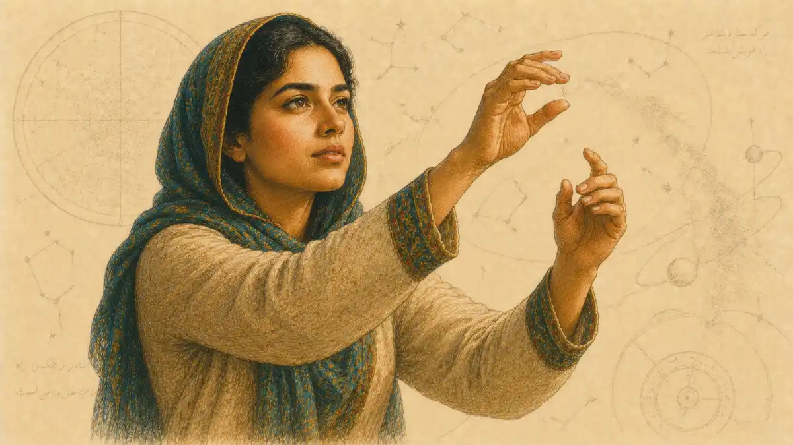

In a Florentine workshop in 1700, Bartolomeo Cristofori, keeper of instruments at the Medici court, fitted a harpsichord case with hammers that struck the strings and fell away at once, so that a finger pressing a key could make a note soft or loud by touch alone. The change sounds small, a matter of felt, leather and timing measured in fractions of a second, yet it shows in miniature how musical instruments shaped music across every tradition examined here: a mechanism decides what is easy, what is awkward and what is impossible, and players build habits inside those borders until the borders feel like taste. The claim defended throughout is plain. Instruments are not neutral carriers for ideas formed elsewhere in the mind. What a body of wood, gut, brass or wire can readily do becomes, over generations, what the music of a culture mostly does.

<!--more-->

## How Musical Instruments Shaped Music: The Claim Stated and Defended

The claim is that capability comes before repertoire. A composer writing for an instrument writes toward its strengths because weak writing sounds weak in the room, and a player practising for years shapes technique around the passages the instrument rewards. Three short cases show the mechanism at work. Cristofori and the builders who followed him gave keyboard players a hammer action that answered to finger weight, and within two generations keyboard writing filled with swelling phrases, sudden soft echoes and accents placed inside a chord, effects a plucked harpsichord string could not grade at all. Brass players in the middle of the nineteenth century received valves that let a single horn or trumpet play every note of the scale with equal ease, and brass writing changed from signaling calls built on a few natural notes to full melodic lines that moved anywhere the harmony moved. Tabla players in North India worked with drums whose loaded membranes produced definite pitches, and the drumming of that tradition grew into a pitched, melodic art with its own grammar of phrases, rather than remaining a layer of unpitched timekeeping. In each case the physical change arrived first and the style followed it, settling so deeply that later listeners heard the result as expression rather than as engineering.

The claim has a boundary, and the boundary matters. Players resist their instruments, extend them and sometimes defeat them, and a strong musical idea can force a builder to redesign a mechanism, as the demand for louder pianos forced heavier frames and thicker strings. Influence runs in both directions across long spans of time. The argument here concerns the shorter run and the average case: at any given moment, the stock of instruments in a culture sets the terms on which new music is imagined, taught and judged, because lessons begin on the instruments that exist, ears form around the sounds those instruments make, and notation itself bends toward what hands can repeat reliably. Questions of first invention and dating belong to a companion survey of [how instruments were invented](/2026/06/21/how-instruments-were-invented/) and are compressed here, because the concern of this pillar is not who built a thing first but what the built thing then made normal. Recording technology, which changed the conditions of listening rather than the conditions of playing, is likewise left to its own article. What remains is the playing itself, and the playing is governed by vibrating bodies, by the air they move and by the hands, breath and arms that set them going.

## How Sound Is Made

### How do musical instruments make sound?

Every instrument begins with something vibrating: a string, a reed, a column of air, a membrane or the player's own vocal folds. The vibration pushes air in pulses, and the ear reads the rate of those pulses as pitch and their pattern as tone colour.

The acoustician Murray Campbell, writing with Clive Greated and Arnold Myers in their 2004 survey of the history, technology and performance of Western instruments, treats that simple sequence as the foundation of the whole subject, and the sequence rewards slow attention. A vibration is a movement repeated in a regular cycle, a string swinging to one side and back, a reed opening and closing against a mouthpiece, a drum skin rising and falling. Each cycle shoves a small quantity of air forward and lets it fall back, and the shoves arrive at the ear as a train of pressure changes. When the cycles follow each other quickly, the ear reports a high pitch. When they follow slowly, the ear reports a low pitch. Pitch is therefore not a property poured into an instrument at the factory. Pitch is a rate, and every tuning dispute in every tradition is at bottom a dispute about which rates a community agrees to treat as its notes.

Rate alone would produce a thin and characterless sound, the kind of pure tone an electronic oscillator can generate. Real instruments sound rich because a vibrating body rarely moves in one simple pattern. A plucked string swings as a whole and also in halves, thirds and smaller segments at the same time, each segment adding its own faster pulse train to the mixture. The ear blends the mixture into a single note, yet the proportions of the blend are what let a listener tell a violin from a flute when both play the same written pitch at the same volume. Players call that identifying quality timbre or tone colour, and builders chase it through choices of material, thickness and shape that look like craft preferences but function as acoustic decisions. A spruce top and a cedar top on otherwise similar guitars divide the mixture differently, and whole schools of playing have formed around the resulting difference in attack and warmth.

Sound also has a biography in time, and the biography separates families as sharply as pitch does. Every note begins with an onset, the brief burst of noise and energy as a bow bites, a plectrum snaps or a tongue releases air into a tube. The onset lasts a fraction of a second, yet experiments in which recordings are played with the onset removed show listeners struggling to name instruments they know well, because the ear identifies a source largely by how its sound starts. After the onset, a note settles into a sustaining portion whose length depends on stored energy. A piano string, struck once, spends its energy and fades, while a bowed string or a wind column receives fresh energy for as long as the player supplies it and can hold a steady level or swell. The ending matters too. A note can be cut short by a dampening finger, choked by a palm or allowed to ring into silence, and traditions differ in which ending they treat as correct. Mechanism, mixture and lifespan together explain why an instrument is never a transparent window onto a musical idea. The idea arrives already shaped by the way its sound is born, sustained and ended.

## Resonance and Amplification

A vibrating string on its own moves very little air, and a string stretched between two pegs in empty space would be nearly silent. Instruments solve the problem with resonance, the tendency of a body to answer strongly when pushed at rates it favours. The wooden box of a violin, the gourd behind a sitar string, the conical bore of an oboe and the long tube of a church organ pipe are all devices for persuading a small vibration to move a large quantity of air without changing the pitch the player chose. Resonance is selective, which is why it shapes style rather than merely adding volume. A body answers some rates generously and others grudgingly, so every design quietly emphasises part of a note's mixture and starves another part, and players learn to compose and phrase for the generous regions. The natural horn, played for centuries without valves, offers the clearest case. Its tube favours a ladder of notes spaced wide apart at the bottom and closer together higher up, because those rates fit the tube's length in whole divisions. Horn calls, hunting signals and early orchestral horn parts live on that ladder, not because composers lacked imagination but because the tube offered those notes with power and offered the notes between them weakly or not at all.

Amplification before electricity was architecture and material. Builders lengthened strings and raised their tension so each string carried more energy, enclosed keyboards in larger cases that acted as sounding boards, and placed choirs and organs in stone rooms whose reflections returned sound to the listeners several times over. Each decision carried a musical consequence. The search for volume in the nineteenth century pushed piano frames from wood to iron, strings from gut toward steel and orchestral winds toward metal construction, and the brighter, harder sound that resulted became the sound composers wrote for, so that a feedback between loudness and taste runs through the whole period. Murray Campbell's acoustical work describes this as a general principle rather than a European accident: any device that couples a vibrator to the air more efficiently also filters the result, and the filter becomes part of the instrument's identity. A tradition then defends the filter as beauty. What one culture hears as the warm core of a tone, another hears as a muffled defect, and both judgments begin in the physics of boxes, tubes and skins before they become judgments of taste.

Resonance also explains why rooms became part of the instrumentarium. A stone church returns a sung tone to the choir several times, stretching each note into its successor, and the slow harmonic rhythm of chant and early polyphony fits a building in which fast chord changes would smear into confusion. A dry room of wood and cloth shortens every decay and rewards clarity, articulation and rhythmic precision, and the chamber styles formed in such rooms prize exactly those virtues. Builders learned to carry a portable piece of room with the instrument itself: the violin's body is a small chamber tuned by its air volume and plate thicknesses, the guitar's body is another, and the gourd resonators hung beneath the keys of a balafon give each note its own private chamber, buzzing membranes and all. When a tradition complains that an instrument sounds wrong in a new venue, the complaint is precise rather than sentimental. Part of the instrument stayed behind in the old room, and the repertoire written for the combined instrument, wood plus air plus stone, must be renegotiated for the new combination before it sounds like itself again.

## Why Classification Systems Differ Between Cultures

Every culture that reflects on its instruments sorts them somehow, and the sorting reveals what the culture thinks music is. Chinese classification by material, the scheme that grouped instruments under headings such as silk, bamboo, wood, stone, metal, clay, gourd and skin, sorted by the substance of the sound maker and fitted a philosophy in which material carried symbolic weight. Indian theory sorted by construction and use, distinguishing stretched strings, covered membranes, hollow winds and solid percussion in the treatise tradition associated with the Natyashastra, a division close in spirit to the one European scholarship later formalised. The European scheme that dominates museum catalogues was published in 1914 by Erich von Hornbostel and Curt Sachs, the Berlin scholar whose lifelong characterisation in this article is that of the classification scholar, a man who sorted instruments by the physics of the vibrating body rather than by appearance or social role. Under the Hornbostel and Sachs system, an instrument is a chordophone when a string vibrates, an aerophone when air vibrates, a membranophone when a skin vibrates and an idiophone when the body of the instrument itself vibrates, with electrophones added later for electrically produced sound.

The scheme is powerful because it predicts behaviour: two chordophones from different continents share problems of tuning stability and string wear that a chordophone and an aerophone never share. The scheme also fails, and the failure should be stated plainly. A piano sits awkwardly, struck by hammers yet classed by its strings. Several African and Asian instruments combine a membrane with strings or a resonator that is also a rattle, and the system forces a choice the makers never faced. Worship, dance, signaling and healing instruments are sorted by their physics even when their makers sorted them by their purpose, and a catalogue arranged on physical lines can scatter a single ceremony across four rooms of a museum. Laurence Libin, the Metropolitan Museum organologist whose work treated instruments as made objects carrying the marks of their workshops, warned in his writings on museum collections that any single scheme teaches the visitor one true thing and hides several others. The lesson generalises. Classification is a tool for asking questions, and the worldwide survey offered in [world music traditions explained](/2010/05/07/world-music-traditions-explained/) shows how differently the questions can be framed when each system is heard on its own terms. A reader who holds two schemes at once, the physical and the functional, understands an instrument better than a reader loyal to either one alone.

## The Voice as the First Instrument

Before any built instrument existed, singers shaped melody with the only sound maker every person carries. The vocal folds are two small folds of tissue in the throat, set vibrating by air from the lungs, and the spaces of the throat, mouth and nose above them act as an adjustable resonator whose shape the singer changes constantly. Because the resonator is adjustable, the voice can slide between pitches, bend a note toward a neighbour, darken or brighten a vowel and sustain a tone while changing its colour, and those capacities became the reference against which built instruments were judged for centuries. String players speak of making an instrument sing, wind players shape phrases around breathing points learned from song, and whole ornament systems in Indian, Arab and European practice began as vocal habits transferred to fingers. The transfer was never perfect, and the imperfections generated styles. A voice can alter pitch continuously, so vocal music in many traditions treats pitch as a path rather than a staircase, decorating the journey between resting tones. A fretted or keyed instrument cannot follow the same path, and the compromises it forces are the subject of the tuning sections that follow.

The voice also set the earliest limits on range and form. A melody meant to be remembered and repeated by a group stays inside a comfortable span, returns often to a home tone and divides into phrases a single breath can carry, and those habits survive inside instrumental music long after instruments escaped them. Call and response, in which a leader sings a phrase and a group answers, began as a way of organising voices with different memories and confidences, and the pattern passed into drumming, brass playing and guitar music as a durable form. Even the size of ensembles descends from the voice: a choir balances parts by how many singers a part needs to be heard, and orchestral string sections inherited the habit of doubling a line with many players so that it could stand against winds and brass. To call the voice the first instrument is not sentiment. The voice supplied the first tuning references, the first phrase lengths and the first standard of expressiveness, and every later mechanism was measured against a standard set by breath and tissue.

The voice can also demonstrate, unaided, the resonance principle that the next families of instruments exploit in wood and metal. Overtone singing, developed to a high art in Tuva and Mongolia and documented by ethnomusicologists through the twentieth century, holds a low drone in the throat while reshaping the mouth's resonant cavity to amplify one harmonic after another, so a single singer produces a bass tone and a whistling melody simultaneously. The feat sounds like a trick and functions like a lesson: it proves that the harmonic mixture inside one tone is real, separable and governable by a resonator's shape, which is exactly what a violin's body, a brass bell and a synthesiser's filter each do by other means. Instrument makers of earlier centuries chased the voice with the same intent from the opposite direction. The cornett, a wooden lip played instrument with finger holes, was prized in Renaissance Venice precisely because its tone blended with singers and could double a vocal line without covering it, and it faded when louder, more brilliant brass took over the ceremonial work the cornett had shared with choirs. The standard of the singing voice admitted the cornett to the choir loft and retired it in favour of volume, a hiring decision and a firing decision issued by the same authority.

## Drums and the Organization of Time

A drum does two jobs at once, and traditions divide over which job matters more. Struck skin produces a burst of sound with a clear beginning, which makes the drum a clock: strokes mark the beat, divide it and group it, and an ensemble scattered across a courtyard can coordinate around a pattern every player can hear. The same stroke also produces pitch, definite in some drums and deliberately indefinite in others, and the balance a culture strikes between the clock and the pitch shapes its whole rhythmic art. West African ensemble drumming, examined in its own section later in this pillar, builds pieces from interlocking patterns assigned to drums of different sizes, where each pattern is simple alone and the composite is intricate, so complexity lives between the players rather than inside one part. South Asian practice gives the drum a melodic and rhetorical role, with composed phrases, spoken syllable systems for teaching them and long structures of tension and arrival. European orchestral practice long treated drums as punctuation, reserving the timpani for emphasis at structural points, while the drum kit assembled in the United States in the early twentieth century concentrated an entire percussion section under one player's hands and feet, freeing small bands to carry dance rhythms that once required several percussionists. The kit is a machine for organising time, its pedals and stands as much a part of the invention as its shells and skins, and the comparative survey of [the greatest drummers of all time](/2025/04/21/greatest-drummers-of-all-time/) shows how differently individual players divided the labour inside that machine.

Membrane behaviour explains much of the variety. A skin stretched over a shell vibrates in patterns more complicated than a string's, with several regions moving against each other, which is why most drums speak with a blurred pitch and a strong noise component at the stroke. Makers who wanted definite pitch learned to load the centre of the skin with a heavy paste, as Indian drum makers did, or to shape the shell so the skin's patterns align into a clearer tone, as kettle shaped timpani do. Where pitch stayed blurred, rhythmic subtlety grew instead: stroke types multiply, with open, muted, rim and palm sounds giving a drummer a vocabulary of timbres on a single head, and Ghanaian, Cuban and Brazilian traditions each codified such vocabularies into teachable systems. Time itself is organised differently once drums lead. A repeating cycle of fixed length, felt by every player as a returning point, supports improvisation because departure and return are both audible, while a metre counted in bars supports harmony changes at predictable boundaries. Neither organisation is a primitive version of the other. Each follows from what drums in that place were built to do.

## Tuning Systems and Why They Differ

### Why do different cultures use different scales?

Different cultures use different scales because a scale is a compromise among competing goods: pure sounding intervals, freedom to change key, singable steps and the limits of fixed pitch instruments. Each tradition protects the good it values most and accepts the loss that follows.

A tuning system begins with a physical fact and a social decision. The physical fact is that certain pitch relationships sound fused and restful to the ear, above all the octave, where a tone vibrates twice as fast as another and the two blend so completely that many languages give them one name. Other relationships built from simple whole number proportions, the fifth and the major third among them, also sound stable, and singers and string players drift toward them without instruction because the ear rewards the blend. The social decision is how many fixed pitches a system will carry and where they will sit. A flute maker drilling holes, a founder casting bells and a builder setting frets must commit to positions in advance, and every commitment favours some intervals and damages others. A system built for pure thirds in one home key will sour when the music moves far from that key, because the fixed pitches cannot be all things at once. Cultures answered the dilemma according to their instruments and their forms. Music that stays near one tonal centre and prizes melodic inflection, as much Arab and Indian practice does, keeps pitches flexible or numerous, dividing the octave into fine shades that a voice or a fretless string can find by ear. Music that changes key often and stacks chords, as European harmony came to do, needs a fixed grid that behaves acceptably everywhere, even at the price of purity anywhere.

Mathematics sharpened the dilemma without settling it. The pure intervals cannot all fit inside a repeating octave grid, a fact demonstrated in antiquity and rediscovered by every tuning theorist since: stacking perfect fifths overshoots the octave by a small gap, the comma, and any closed system must hide that gap somewhere. Chinese theory, associated with the pitch pipe calculations of Jing Fang in the first century before the common era, pursued the stacking of fifths with great precision and recorded the resulting discrepancies honestly. Arab theorists such as al Farabi in the tenth century measured string lengths for the oud and described both the inherited Greek ratios and the actual fret placements of working players, which did not always agree. European theorists argued for a thousand years over whether to tune for pure thirds, pure fifths or singable whole tones. The argument was never only mathematical. It was an argument about which instruments would rule: flexible voices and strings could honour purity, while organs and fretted instruments, committed in wood and metal, demanded compromise. The next section describes the compromise that spread furthest, and the section after it counts what the compromise cost.

The fixed pitch instruments of a culture act as the enforcers of whatever settlement it reaches, because a singer can adjust and a builder cannot. An organ built in meantone temperament in a seventeenth century German town made certain keys glorious and others unusable for generations, whatever visiting singers preferred, and church musicians planned repertoire around the pipes they had inherited. Bells enforce even harder: a founder casts a tower of bells to one scheme, the scheme rings over the town for centuries and every melody played on the carillon submits to it. Fretted instruments enforce through geometry, since a fret placed for one string's length serves all strings at once and drags every course toward the same compromise. Against the enforcers stood the adjusters, choirs, string bands and solo singers, whose ears kept pulling intervals toward purity whenever no fixed instrument anchored them, and most historical performances lived in the negotiation between the two parties rather than in any theorist's diagram. Treatises record the diagrams; the music lived in the argument, renewed at every rehearsal where a keyboard and a choir had to agree on a third before the downbeat could settle the matter for one performance at a time.

## Equal Temperament

Equal temperament divides the octave into twelve equal steps and lets every key use the same grid. The division is achieved by narrowing each perfect fifth by a small amount, distributing the ancient comma invisibly across all twelve fifths so that no single interval carries the whole error. Every semitone then spans the same proportional distance, a melody can begin on any pitch and keep its shape exactly, and chords built in one key sound as acceptable, or as compromised, in every other key. The system is often credited to a single inventor, yet the record shows a long approach from several directions. The Chinese prince Zhu Zaiyu published calculations for equal division in 1584, working out the required string lengths to many decimal places. In Europe the lutenist Vincenzo Galilei described an approximation for fret placement in 1581, and Simon Stevin left an unpublished calculation from the same generation. Keyboard builders adopted the system slowly across the eighteenth and nineteenth centuries, region by region and maker by maker, as repertoire demanded freer movement between keys and as industrial manufacture favoured one standard grid for every instrument leaving a factory.

Adoption followed the instruments, which is the pattern this pillar exists to trace. Fretted instruments reached equal division early because straight frets across a fingerboard enforce equal steps by geometry. Pianos and organs, tuned by specialists who travelled with their methods, standardised region by region until a pianist could tour without meeting a keyboard tuned against the music. Orchestras resisted longer, because string players and singers adjust pitch by ear and continued to shade intervals toward purity inside an equal tempered frame, a double practice that persists wherever flexible instruments meet fixed ones. The decisive argument for the system was never beauty. The decisive argument was interoperability: music written in any key, played on any instrument, in any town, without retuning. Equal temperament turned pitch into a shared utility, like standard time or standard screw threads, and like those utilities it spread because coordination paid more than local perfection earned. What the utility made possible was enormous, among it the harmonically roaming keyboard music of the nineteenth century and the whole practice of arranging one piece for many different ensembles. What it quietly removed is the subject of the next section.

## What Equal Temperament Cost

The cost of equal temperament is measured in thirds. In a tuning built for purity, a major third blends so smoothly that the two tones seem to fuse into one warmer sound, and choirs settle into that fusion whenever they sing unaccompanied. In equal temperament the major third is widened beyond its pure size by an amount a trained ear hears as a restless shimmer, a slow beating inside the chord that never resolves. Every major and minor chord in the equal tempered system carries some of that unrest, because the grid trades the purity of each interval for the equality of all keys. A second cost is character. Earlier European tunings, the meantone systems and the circulating well temperaments of the eighteenth century, gave each key a slightly different interval pattern, and composers and listeners of the period described keys as having distinct colours, grave, bright, tender or harsh. Those descriptions were not fantasy; in an unequal tuning the same chord shape genuinely sounds different in different keys, because the errors sit in different places. Equal temperament erased the differences, so that transposing a piece changes its height but not its internal colour, a gain in convenience purchased with a real loss of variety.

A third cost falls on music outside the twelve note grid altogether. Melodic traditions that rely on intervals between the piano's keys, the neutral thirds and fine pitch shades of Arab maqam practice or the precisely placed tones of Indian raga, cannot be played on an equal tempered fixed pitch instrument without flattening the very intervals that carry their identity. The harmonium, a European reed instrument carried into Indian practice in the nineteenth century, provoked a long controversy on exactly this ground, because its fixed reeds imposed the grid on singers who accompanied themselves with it and bent a generation of teaching toward tempered pitches. Critics of the system inside Europe, including the acoustician Hermann von Helmholtz, whose 1863 study of tone sensation measured the discrepancies with care, treated the compromise as a practical settlement rather than an acoustic ideal, and string quartets and choirs have quietly voted with their ears ever since by shading toward purity when no keyboard is present. None of this makes equal temperament a mistake. The system bought freedom of movement that entire repertoires depend on, and the purchase was deliberate. The honest account holds both sides at once: a grid that serves every key equally serves no key perfectly, and the history of tuning is the history of musicians deciding, culture by culture, which half of that sentence to live with.

The compromise also created a maintenance economy that quietly governs musical life wherever fixed pitch instruments rule. A piano drifts out of tune with weather, use and age, its thousands of pounds of string tension pulling against pins and frame, so ownership of a piano means a standing relationship with a tuner, and the tuner's method, stretching octaves slightly to accommodate the stiffness of real strings, means that even the equal tempered grid is in practice a family of negotiated approximations rather than a single mathematical object. Organs demand builders on retainer, harpsichords demand owners who tune before playing and fretted instruments demand players who accept the fret placement their maker chose. Singers and string players, the adjusters in the tuning argument, pay no such tax and owe no such allegiance, which is one reason unaccompanied vocal music preserved pure intonation habits through the whole period of the grid's triumph. A tuning system is therefore also a labour system, a set of professions, schedules and costs wrapped around a set of pitches, and the grid's victory was partly a victory of logistics: one standard, teachable, repeatable and serviceable in any town with a trained tuner and a fork.

## The Logic of the Keyboard

A keyboard is an argument made visible. The instrument arranges pitch as a line running from low to high, gives each of the twelve steps in the octave its own lever and repeats the pattern identically in every octave, so that a shape learned by the fingers in one register works in all of them. The arrangement teaches a theory before any theory is explained. A child at a piano absorbs the idea that pitch is a staircase of equal steps, that melody is movement along the line and that harmony is several points on the line sounded together, and those ideas feel natural partly because the furniture insists on them. The two colour rows deepen the lesson. The shorter raised keys group in twos and threes, giving the hand landmarks, while the longer row carries the scale of the home key in most European teaching, so the layout quietly privileges one collection of notes and treats the others as departures. Laurence Libin, examining keyboard instruments as made objects in the Metropolitan Museum collection, emphasised that the layout survived for centuries not because it is the only workable arrangement but because teaching, notation and manufacture all locked onto it together, each generation of players arriving already shaped by the previous generation's furniture.

Other arrangements were tried and mostly abandoned, and the failures are instructive. Inventors proposed keyboards with extra keys for the pitches equal temperament omits, split keys that separated enharmonic notes and uniform layouts in which every interval kept the same finger shape in every key, and a few such instruments were built and played by committed advocates. The standard layout won on network effects rather than on logic alone: a student could move between teachers, towns and instruments without relearning the geography, and a builder could sell into a market that already knew the map. The map has consequences for composition. Keyboard thinking favours chords as graspable shapes, patterns that repeat by shifting the hand sideways and sequences built from identical shapes at different heights, all habits that saturate European piano and organ writing. Keyboard thinking disfavours the continuous pitch path of the voice and the fine shades between steps, which the layout declares nonexistent by offering no lever for them. An instrument's logic becomes a culture's logic when the instrument becomes the place where theory is taught, harmony is demonstrated and new pieces are tested, and the keyboard held that position in Europe for three centuries. The piano inherited the map and added a new power to it, the power of graded touch, and the combination redirected composition itself.

The keyboard's logic also organised musical literacy itself, because staff notation and the keyboard grew up as partners. Notation maps pitch to vertical position on a five line staff, and the keyboard maps the same pitch to horizontal position on a line of levers, so the two maps translate into each other almost without loss, and a student moving between score and keys is practising one geography in two materials. Instruments outside the partnership expose the convenience by contrast. A guitarist reads the same staff through six strings and many possible positions for one pitch, a wind player through fingerings that change pattern at the register break, and a sitar player through fret ties and string choices set for a single raga, so each of those literacies carries information the keyboard version throws away. What the keyboard keeps, it keeps supremely well: the ability to see a chord as one object, to compare keys by shape and to demonstrate an abstract rule, a cadence, a sequence, a modulation, with the hands in seconds. European theory became keyboard shaped theory, its examples drawn as keyboard examples and its exceptions defined against keyboard behaviour, and musicians trained in other systems have had to translate their knowledge into that shape ever since, gaining a common language and losing, in the translation, whatever their own instruments knew that levers cannot say.

## The Arrival of the Piano

### How did the piano change composition?

The piano changed composition by joining a wide pitch range, harmony under two hands and graded loudness in one instrument, so a single player could sketch an orchestra, test a harmony and shape a phrase by touch. Composers began writing at the piano and for its powers.

Cristofori's invention of around 1700 spread slowly, because the early instruments were costly, delicate and quieter than the harpsichords they challenged, and the surviving account by Scipione Maffei from 1711 describes the new gravicembalo as a curiosity for connoisseurs rather than a replacement for anything. What carried the design across Europe was the need of a growing concert public for an instrument that could swell and fade inside a phrase. The harpsichord plucks its string with a fixed force whatever the finger does, so its dynamics come from adding or removing stops and from timing, while the piano answers the finger directly, and Singing teachers had long treated graded loudness as the core of expression. Builders in Germany, England and France industrialised the action across the late eighteenth century, and the firm of Broadwood in London and the Erard firm in Paris competed on power, reliability and range, extending the compass from five octaves toward the seven and a quarter octaves that became standard. The shareable fact of the mature instrument deserves plain statement: a concert grand carries more than two hundred strings under a combined tension of roughly twenty tons, held by a cast iron frame that earlier wooden frames could never have survived, and the frame is what lets the modern piano fill a large hall unaided.

Composition changed in step with the hardware. The sonata movements of Haydn and Mozart exploit sudden contrasts of loud and soft as structural events, effects written into the score because the instrument could be trusted to deliver them anywhere. Beethoven, writing for ever stronger English and Viennese instruments, demanded wider ranges, heavier accents and sustained singing lines coaxed from an instrument whose sound decays from the moment of the strike, and piano makers answered by strengthening the action and lengthening the strings, so demand and design chased each other upward for decades. The piano also became the composer's laboratory and the publisher's engine. A symphony could be tested at the keyboard, reduced for domestic sale and learned by amateurs in four hand arrangements, which made the piano the distribution system of European music as well as its solo voice. The careers surveyed among [the greatest pianists of all time](/2025/05/07/greatest-pianists-of-all-time/) rest on this double role, the instrument as public concert machine and as private writing desk. No earlier instrument combined both roles, and the repertoire examined in the next section is the record of composers discovering, decade by decade, what the combination allowed.

## The Repertoire the Piano Produced

An instrument creates its repertoire twice, once by permitting effects and once by teaching audiences to expect them. The piano permitted the singing line sustained by the pedal, in which struck notes are allowed to ring together into a halo of resonance, and composers of the nineteenth century wrote whole textures that exist only inside that halo. Frederic Chopin built a complete keyboard language from the pedal's blur, the una corda shift that moves the action so hammers strike fewer strings and the colour thins, and a hand crossing layout that treats the keyboard as terrain, and the life and working methods behind that language are traced in the account of [Frederic Chopin's life and career](/2011/03/21/frederic-chopin-life-and-career/). Franz Liszt answered a different affordance, the instrument's power and range, with textures that imitate an orchestra, deep bass foundations, chord masses in the middle and brilliant figuration above, distributed between the hands like sections of players. Robert Schumann exploited the piano's capacity for inner voices, melodies hidden inside accompaniment figures that a listener's ear must excavate, an effect meaningless on an instrument without graded touch. Each style is unthinkable, in the strict sense, without the mechanism it assumes: transfer the notes to a harpsichord and the notes survive while the music largely evaporates, because the music was the mechanism's behaviour all along.

The piano also produced a social repertoire. Domestic music making in the nineteenth century ran on piano reductions, song accompaniments and teaching pieces graded by difficulty, and publishers shaped composition toward what amateur hands could manage at home, favouring clear forms, memorable themes and brilliance that sounds harder than it is. The virtuoso concert tradition pulled the other way, toward pieces no amateur could attempt, and the tension between parlour and platform runs through the century's output like a fault line. Pedagogy hardened into a system around the instrument: scales in all keys, exercises for finger independence and a graded ladder of studies taught every student the same physical vocabulary, so technique itself became standardised in a way string and wind technique, taught through more varied schools, never quite matched. When recording arrived, the piano translated gracefully because its attack is clear and its range sits well in a room, and the instrument's centrality survived the move from sheet music sales to broadcasting. The repertoire the piano produced is therefore not a shelf of pieces that happen to use an instrument. The repertoire is the instrument, unfolded in time.

## String Instruments and the Bow

A plucked string speaks and fades, and most of the world's string traditions built their arts inside that fade, shaping rhythm and ornament to a sound that dies from birth. The bow changed the contract. Drawing a rosined bow across a string sets up a repeating cycle in which the string sticks to the bow hairs, is dragged sideways, snaps back and is caught again hundreds of times each second, and the cycle renews the string's energy for exactly as long as the arm moves. The result is a tone that can begin softly, swell, sustain at any level and change colour under pressure, a tone that behaves like breath while answering to a hand. Whoever controls a bow controls phrasing in a way no pluck can match, and bowed traditions from the European violin family to the Chinese erhu and the Indian sarangi developed long breathed lines, messa di voce swells and singing ornaments that mirror vocal practice more closely than any plucked instrument can. The bow also imposed discipline. Bowing direction becomes a grammar, with down bows and up bows carrying different weights, and schools of playing argue over bow division, contact point and speed with the seriousness other cultures reserve for pronunciation.

The bow's history is a history of gradual standardisation. Early bows were arched like the weapon whose name they share, held and tensioned in varied ways, and suited the shorter phrases of dance and consort playing. The modern bow, standardised in Paris in the late eighteenth century in the workshop tradition of Francois Xavier Tourte, inverted the curve, added a screw mechanism for even tension and lengthened the stick, giving players power at both ends of the stroke and the spiccato and legato control that nineteenth century concert writing assumes. Makers guard the details of pernambuco wood selection and camber the way violin makers guard varnish, because small differences in weight and balance alter what a player can do at speed. The bow demonstrates the thesis of this pillar in miniature: a strip of wood and horsehair, refined across centuries, silently rewrote the phrase lengths, dynamic habits and expressive ideals of every tradition that adopted it, while traditions that kept the pluck, from the oud family to the Japanese shamisen, built equally complete arts on the opposite premise, that a note is an event with a brilliant beginning and a meaningful decay.

## The Violin Family

The violin family emerged in northern Italy in the sixteenth century as a matched set of instruments in graduated sizes, violin, viola, cello and the later double bass, sharing a shape, a construction method and a way of speaking. The design solved several problems at once. The arched top and back, the sound holes cut as slender f shapes and the internal bass bar and soundpost turned a small wooden box into a resonator that projects a singing tone across a hall, while the fingerboard without frets left pitch in the player's fingers, preserving the vocal flexibility that frets surrender. Workshops in Cremona, above all those of the Amati family, Antonio Stradivari and Giuseppe Guarneri, refined the pattern to a standard that later makers copy with near religious fidelity, measuring arching heights and varnish layers on surviving instruments in search of decisions the original makers never wrote down. The family's matched sizes made a new social unit possible, the string ensemble in which four related voices cover the whole pitch field with one blended colour, and the string quartet and the orchestral string section both descend from that possibility. The broader classical tradition that grew around such ensembles is surveyed in [the history of classical composers](/2010/03/07/history-of-classical-composers/), where the string family's role as the orchestra's core is a recurring theme.

Standardisation carried a price that the family's admirers concede. The viol family, with frets, flatter backs and a softer, more veiled tone, served consort music beautifully for two centuries and lost the contest for the concert hall because the violin family was louder, a reminder that survival among instruments often tracks carrying power rather than refinement. Within the family, roles hardened by size. The cello's human tenor range made it a second singing voice and composers gave it melodies once reserved for soloists, while the double bass, too slow speaking for agility, became the foundation that defines harmonic rhythm by its entrances. Even vibrato, the small oscillation of pitch produced by a rocking finger, was standardised by the family culture: an occasional ornament in earlier centuries, it became a continuous ingredient of string tone in the twentieth century through the teaching of players such as Fritz Kreisler and Jascha Heifetz, changing the recorded sound of the whole family within a generation. The violin family shows how a design, a set of workshops and a teaching culture can fuse into a single institution, so that changing any element, a string material, a bow hold, a pitch standard, means negotiating with all the others at once.

## Orchestral Balance

An orchestra is an armistice among unequal powers. A single brass instrument at full strength can cover a dozen string players, a flute disappears under a brass chord and a triangle can cut through everything, so the sizes of orchestral sections record centuries of negotiation between volume and blend. Strings sit in large groups because one violin is a quiet instrument and because many bows playing together smooth individual differences into a collective tone, while winds and brass appear in pairs or small numbers because each player is already a section in carrying power. Composers learned the ratios by failure in rehearsal, and the treatises on orchestration that codified the knowledge, from Hector Berlioz in 1843 to Nikolai Rimsky Korsakov a generation later, read as engineering manuals for managing unequal machines. Berlioz specified exact numbers of strings needed against given wind forces, warned which combinations muddy and which blaze, and treated the orchestra as a single large instrument whose stops the composer draws. The metaphor is exact: writing for orchestra means composing for the balance sheet as much as for the notes, assigning a melody to the family that can carry it in that register and thinning accompaniments until the intended voice survives.

Balance problems drove design changes inside the sections. The double bassoon and bass clarinet extended wind ranges downward so foundations did not belong to strings alone, the horn section grew because horns blend with both woodwind and brass and can mediate between them, and the tuba replaced a motley set of bass brass instruments with one reliable foundation voice. Conductors arose as balance engineers in real time, adjusting dynamics part by part because a written forte means different forces in different families. Recording exposed the system mercilessly, since a microphone placed for the strings exaggerates the brass behind them, and twentieth century orchestral writing responded with leaner doublings and clearer spacing. The lesson for this pillar is that an ensemble is also an instrument, with a mechanism, a set of constraints and a repertoire that fits them, and a symphony that ignores the mechanism fails in the room however beautiful it looks on paper.

Seating plans preserve the armistice in visible form. Strings sit at the front, nearest the audience, because their collective sound is the least penetrating and the most easily masked, woodwinds gather in the middle where their blend can be supervised, brass and percussion hold the rear wall where their power has the full hall to spend itself across, and the conductor stands at the one point where every family's true level can be judged. The plan looks like tradition and functions like engineering. Soloists complicate the settlement by contract: a concerto soloist stands in front of the strings and plays an instrument chosen or built for projection, and composers thin the orchestral texture under solo passages as a matter of craft, a courtesy written into scores so routinely that listeners mistake it for simplicity. Guest conductors inherit balances they did not negotiate and spend rehearsals rebalancing, because the ratios live in habits, hall acoustics and the specific instruments a section owns, not in the printed page. An orchestra's sound, the prized identity of the great ensembles, is largely the sound of one city's negotiated settlement, maintained by the players who teach the next players where to sit inside it.

## Wind Instruments and Breath as a Constraint

Wind playing begins with a ration. A player carries one breath at a time, phrases must fit inside it or cheat it with quick refills and circular techniques, and the length of a sung or blown line is set by lungs before it is set by imagination. Reed and lip mechanics divide the family further. A clarinet's single reed beats against a mouthpiece over a cylindrical tube, and the cylinder's physics suppresses part of the harmonic ladder, giving the instrument its hollow lower register and a leap to a high register a twelfth above rather than an octave. An oboe's double reed and conical bore produce the full ladder and a penetrating tone that carries over an orchestra, which is why orchestras tune to the oboe: the instrument is hard to bend and easy to hear. The saxophone, patented by Adolphe Sax in 1846, married a single reed to a conical brass body and gained a flexible, vocal power that let one player fill roles from ballad singer to section leader, a flexibility exploited to lasting effect in the playing traced by [the life and career of John Coltrane](/2012/04/07/john-coltrane-life-and-career/), where long phrases are constructed by staggering breaths inside an unbroken line. Flutes spend much of their air across an open edge rather than inside the tube, which makes them breath hungry and gives their tone its airy edge, while recorders speak softly because their windway fixes the air stream and removes the player's control of force.

Breath shaped form as well as tone. Wind phrases in every tradition lean toward the lengths a body sustains, and wind ensembles developed hocketing, the sharing of a melody among players note by note, precisely because no single breath could hold the whole line. Indian and Arab practice cultivated circular breathing, storing air in the cheeks while refilling through the nose, turning the shehnai and the mizmar into instruments of unbroken sound for processions and ceremonies where a gap would break the ritual. The shehnai tradition carried to the concert stage by Bismillah Khan, whose career is treated in [the account of Bismillah Khan's life and music](/2021/06/07/bismillah-khan-life-and-music/), turned that processional power into a concert voice without surrendering the breath logic that produced it. Keys and holes tell the same story from the fingers' side. A tube gives its natural notes through open holes in sequence, and cross fingerings and half holing filled the gaps awkwardly until makers added keywork, culminating in Theobald Boehm's redesign of the flute in 1847, which placed holes where acoustics wanted them and gave fingers mechanisms to reach them. Every key added traded a small loss of simplicity for a gain in evenness, and wind writing after Boehm assumes an equality among notes that earlier players achieved only in favoured keys.

## The Valve and What It Freed

For most of their history, brass instruments were tubes of fixed length, and a player obtained notes by changing lip tension to climb the tube's natural ladder, filling gaps in church and chamber music with hand stopping, crooks that lengthened the tube between movements and sheer virtuosity on the high rungs. The valve, developed in Germany in the second decade of the nineteenth century and associated with Heinrich Stolzel and Friedrich Bluhmel, replaced the whole apparatus with a mechanism: pressing a piston or rotor diverts the air through an extra loop of tubing, lowering the instrument's pitch by a fixed step, and three valves in combination give every semitone in the range. The liberation was real and immediate. Horns and trumpets that had lived on signals, fanfares and the safe rungs of the ladder became fully melodic instruments in any key, chromatic bass lines became possible on the tuba, whose invention in 1835 followed the valve directly, and composers from Wagner onward wrote brass parts that wander through harmony like string parts, confident that the mechanism would deliver the notes. Murray Campbell's history of brass playing notes the speed of the takeover: within a working lifetime, the valved instrument moved from novelty to conservatory standard across Europe, and the natural instrument survived mainly as a period specialism.

Freedom had a texture of its own. Valve combinations lengthen the tube by proportions that do not quite agree, so some combinations run sharp and players compensate with slides, triggers and lip adjustments, a hidden labour under the apparent equality. The mechanism also homogenised the family: the cornet, the flugelhorn and a shelf of patented hybrids competed in the nineteenth century's brass explosion, town bands across Britain and America standardised on the survivors, and the brass band movement built a complete musical culture, contests, arrangements and all, on instruments a competent amateur could master because valves made every note reachable. What the valve freed was not only the professional soloist but the amateur ensemble, and the social history matters as much as the solo repertoire. A constraint removed at the level of tubing became, within decades, a change in who could make music at all, which is the deepest form the argument of this pillar takes: mechanisms decide participation before they decide style.

## Brass and the Problem of Volume

Brass instruments are efficient engines for turning breath into sound, and their efficiency created a standing problem of government. A trumpet concentrates the player's lip vibration through a long flaring tube that matches the lips to the open air with unusual effectiveness, radiating the upper part of the harmonic mixture outward in a beam, and at full effort the result overwhelms voices, strings and most winds in the same room. Cultures answered the problem according to their purposes. Military and ceremonial music exploited the beam, using brass to command outdoor space, signal across distance and embody authority, so the fanfare became a genre of power before it became a genre of art. Church and court music rationed brass, admitting trumpets on feast days and in climaxes, and the rationing itself became expressive: a listener raised on strings and winds heard brass entrances as events of state. The nineteenth century orchestra absorbed brass permanently only after valves made the instruments reliable in every key, and even then composers learned to write brass dynamics one level below the strings' markings for the same intended effect, a correction every orchestration treatise repeats. Mutes, inserts of wood, metal or fibre placed in the bell, began as volume controls and became colour controls, giving jazz and concert players a palette of veiled, nasal and distant tones from a single tube.

Volume shaped venues and economics as well as scores. Brass bands could perform in parks, streets and fairgrounds where string ensembles would vanish, and that portability of power underwrote the band movement's role in industrial towns, where a works band was both recreation and civic advertisement. Dance music reorganised around the same fact in the twentieth century, as trumpets and saxophones replaced violins at the front of dance orchestras because they could fill a hall of dancers without amplification. The problem never vanished; it migrated. Recording engineers placed brass at distances, conductors seat brass at the back under the shell's least forgiving angle and composers of film music stack brass in unison when a cue must feel like a proclamation. The physics sits underneath every one of those decisions. An instrument family that converts breath to sound with unusual efficiency will be used to mark importance, and importance in music is a resource that must be budgeted, which is why the history of brass writing is a history of restraint learned the hard way.

## The Portability of the Guitar and Its Consequences

The guitar's conquest of the world's informal music rests on a ratio: musical completeness divided by weight. A guitar weighs a few pounds, costs a fraction of a piano, needs no installation, survives travel and supplies melody, harmony and rhythm from one pair of hands, so the instrument fits the spaces where most music actually happens, rooms, streets, camps, porches, barracks and beaches. Portability decided the guitar's social rank long before recording decided its fame. Soldiers carried guitars where pianos could never follow, migrants carried them across oceans in steerage, and the instrument absorbed the songs of every place it landed, flamenco in Andalusia, bossa nova in Brazil, country blues in the American South and a hundred local hybrids that never acquired names. The Spanish luthier Antonio de Torres, working in the middle of the nineteenth century, standardised the modern classical pattern, enlarging the body, spreading the internal struts in a fan beneath the top and fixing the string length, and the louder, more balanced instrument that resulted could hold a small hall alone, which raised the guitar from accompaniment toward solo status without surrendering any of its portability.

Consequences followed for harmony and song form. A guitar teaches chords as hand shapes, and shapes repeat across the neck with a logic that invites pattern based songwriting: verses and choruses built from loops of three or four shapes, key changes achieved by sliding a barred shape upward, and melodies composed against the shapes the hand already knows. Open tunings, in which the loosened strings sound a chord untouched, turned the constraint of six strings into a resource for slide players and folk singers, letting one finger command harmony while the other hand worked the slide or the rhythm. The instrument's limits are equally formative. Six strings bound the bass range, fingerstyle arrangements strain to keep a bass line, a melody and an inner rhythm alive at once, and guitar music is full of ingenious compromises, dropped tunings, partial chords and rhythmic patterns that imply harmonies the hand cannot fully state. Listeners accept the implication as the sound of the instrument, which is the recurring pattern of this pillar: a compromise repeated for generations becomes a style, and the style becomes the standard against which fuller arrangements are judged as overdone.

## Guitar Technique and Its Constraints

Guitar technique is a negotiation between two hands with different jobs and a fingerboard that quantises pitch into frets. The fretting hand stops strings against metal strips placed by the equal tempered geometry discussed earlier, gaining reliability and losing the continuous pitch control of the violin family, while the sounding hand chooses among nails, fingertips, flat picks and finger picks, each choice fixing a different attack, speed ceiling and tone. Bends recover some of the lost continuity: a player pushes a string sideways across the fret, raising its pitch smoothly, and blues and rock playing built an expressive language on bends, vibrato applied by the fretting hand and slides between positions, all techniques for smuggling the voice's continuous pitch world back into a fretted machine. The survey of [the greatest guitarists of all time](/2025/03/07/greatest-guitarists-of-all-time/) can be read as a catalogue of such negotiations, each major player defined partly by which constraints were accepted and which were circumvented. Django Reinhardt, whose fretting hand was injured in a fire in 1928, rebuilt his technique around two working fingers and produced lines of a speed and logic that two fingered playing should not allow, the clearest documented case in guitar history of a constraint becoming a personal style.

The fingerboard also shapes thought. Patterns lie under the fingers in boxes that repeat every twelve frets, scales become shapes before they become sounds and improvisers navigate by position as much as by ear, a cognition utterly unlike the piano's single line of keys or the wind player's sequence of fingerings. Chord voicings on guitar are dictated by string spacing: notes that sit close on a piano may be unreachable on a neck, so guitar harmony favours open strings, wide intervals and partial shapes, and the favouring explains why a song composed on guitar transplants awkwardly to keyboards and vice versa. Amplification, treated in the next sections, loosened several of these constraints at once by making quiet fingerstyle audible in loud rooms and by rewarding a lighter touch, yet the geometry remains. Every guitarist composes with a map of distances, stretches and shapes learned in the hands, and the map, repeated across millions of players, is one of the strongest forces in popular songwriting of the amplified age.

## Electrification

Electrification separated the making of a vibration from the making of loudness, and that separation is the deepest single change in the history surveyed by this pillar. A magnetic pickup under a steel string converts the string's movement into a varying electrical signal, the signal travels down a cable at negligible cost in effort, and an amplifier and loudspeaker rebuild the sound at whatever volume the room requires. The player's hands are freed from the ancient duty of supplying all the energy the audience hears. Consequences cascaded. Guitarists in dance bands of the 1930s, heard clearly for the first time over brass and drums, moved from rhythm marking toward single note solo lines, and Charlie Christian, playing an amplified Gibson with Benny Goodman's groups from 1939, demonstrated that the electric guitar could phrase like a horn, with long even lines that an acoustic archtop could never sustain in a band. Builders answered with solid bodies, most famously the designs Leo Fender put into production in 1950 and 1951 and the Gibson Les Paul of 1952, because a solid body feeds little energy back into the string, lengthening sustain and resisting the feedback that hollow bodies produced at volume. The Hammond organ, the electric piano and the electric bass followed the same logic, each replacing an acoustic energy problem with an electronic one, and the electric bass in particular redrew the bottom of every ensemble, giving the bass line speed, evenness and sustain that the double bass supplies only with great labour.

Electrification also moved part of the instrument out of the player's hands. Tone depended from that point on pickup windings, amplifier circuits, speaker sizes and room placement, a chain of devices owned, borrowed and maintained under different conditions than the instrument itself, and two players with identical guitars could sound unrelated through different chains. Studios exploited the split, recording the dry signal of an instrument and reshaping it later, while players learned to perform for microphones rather than rooms, softening attacks and controlling dynamics that a concert hall would have demanded be projected. The change reached beyond popular styles. Church organs gained electric actions and then electronic substitutes, classical guitarists resisted amplification as a matter of identity while folk and jazz players adopted it as a matter of survival, and instrument makers worldwide began designing for pickups as a first principle rather than an accessory. Nothing in the earlier history of instruments prepares a player for an instrument whose sound can be entirely reconstituted downstream of the fingers, and the sections that follow treat the two most consequential results: the amplifier promoted from servant to instrument, and the deliberate cultivation of feedback and distortion, sounds that acoustic physics had always classified as faults.

The road to the solid body ran through a decade of hybrids that show the separation happening in stages. The Rickenbacker A-22 of the early 1930s, nicknamed the frying pan for its round body and long neck, put a horseshoe magnet pickup around steel strings on a cast aluminium lap steel, an instrument with no acoustic ambitions at all. Gibson's ES-150 of 1936 kept the hollow archtop body guitarists trusted and added a bar pickup, and players discovered both halves of the new bargain at once, a solo voice that carried over a band and a body that howled when the volume rose in a small room. Lap steel and Hawaiian guitarists, who played with the instrument flat and a steel bar for a stopping hand, adopted electricity first and most completely, because sustain was their central problem and the pickup solved it without asking them to change technique. Each hybrid kept one acoustic feature and surrendered another, and the pattern of surrender maps exactly onto what players valued: volume and sustain were bought eagerly, body resonance was defended longest by jazz players whose tone depended on it, and the solid body prevailed where loudness mattered most. Electrification was therefore not one invention but a negotiated migration, instrument by instrument and genre by genre, and the negotiations reveal each community's priorities more honestly than any manifesto could.

## The Amplifier as an Instrument

Calling the amplifier part of the instrument is not a metaphor, and guitarists of the amplified generations organised their craft around the fact. A valve amplifier does not reproduce a signal neutrally. Driven gently it adds warmth and compression, squeezing loud peaks and lifting quiet detail so a phrase sits evenly in a band, and driven hard it reshapes the waveform itself, adding harmonic content the string never produced and sustaining notes at levels where an acoustic instrument would have fallen silent. Players learned the amplifier's behaviour as technique: the volume control on the guitar became a control of the amplifier's character, rolled back for a clean rhythm tone and raised for a singing lead voice, so a performance could travel between two instruments without the hands leaving the strings. Speaker cabinets added their own voice, small speakers breaking up early and sounding urgent, large stacks staying clean at volumes that filled arenas, and the choice among them became a signature as recognisable as a choice of guitar. Engineers such as Jim Marshall, whose London shop began building amplifiers in the early 1960s to give British players the aggressive sound they demanded from American imports, became instrument makers in the full sense, their circuits studied, copied and argued over by players who never opened the cabinets.

The studio completed the promotion. Producers treated amplifiers as a palette, keeping rooms of different models so a part could be re voiced by changing cabinets rather than performances, and the practice of re amping, sending a recorded dry signal through a chosen amplifier later, made the amplifier a compositional decision that could be postponed past the session itself. Keyboard players travelled the same road with the Leslie speaker, whose rotating horns turn the Hammond organ's steady tone into a shimmering, breathing sound, so the speaker cabinet there is unmistakably a musical mechanism and not a loudspeaker in the domestic sense. The general lesson returns to the thesis. Once a device in the chain can be played, chosen for its behaviour under stress and recognised by ear across recordings, the device has joined the instrument, and any history that stops at the wooden or brass object in the player's hands has stopped one link too early.

## Feedback and Distortion as Deliberate Technique

### Why does an electric guitar distort?

An electric guitar distorts when the amplifier is asked for more loudness than it can deliver cleanly, and the tops of the waveform are flattened. The flattening adds strong extra harmonics, thickens the tone and lengthens sustain, so overload becomes a chosen colour.

Feedback begins as a loop. A loudspeaker moves air, the air shakes the guitar body and strings, the pickup converts the shaking into a stronger signal and the amplifier returns the signal louder, until one favoured pitch, the pitch at which the loop agrees with itself most efficiently, blooms out of the texture and sustains for as long as the player holds position. Acoustic physics treats the loop as a fault, the same squeal that afflicts public address systems, and early amplified players fought it by facing away from speakers and stuffing hollow bodies with cloth. The conversion of the fault into a technique is among the clearest demonstrations in this pillar that a mechanism's defect, practised deliberately, becomes a style. Jimi Hendrix controlled feedback as a compositional material, moving his body and guitar relative to the speakers to select which pitch would bloom, bending the blooming tone and cutting it off with his hands, and the biography and stagecraft behind that control are traced in [the life and career of Jimi Hendrix](/2012/11/21/jimi-hendrix-life-and-career/). What listeners heard as abandon was a negotiation with distance, angle and volume conducted in real time, and it could fail, collapsing into noise, whenever the negotiation was misjudged.

Distortion travelled a parallel road from fault to language. Guitarists first prized clean volume, yet the grain of an overdriven small amplifier suited blues and rhythm and blues so well that players pursued it deliberately, and a damaged speaker in a 1951 recording session for Ike Turner, the session that produced Rocket 88, gave the world a famous early example of a torn, buzzing guitar tone kept on the record because it sounded right. Purpose built devices followed: the fuzz boxes of the early 1960s clipped the signal in a transistor circuit, the distortion pedals and high gain amplifiers of later decades industrialised the effect, and heavy metal built an entire harmonic practice on power chords voiced to survive extreme distortion, favouring roots and fifths because fuller chords blur into dissonance under heavy clipping. The physics explains the style at every point. Clipping adds harmonics and compresses dynamics, compression sustains notes and evens picking, and a tradition of riffs, voicings and stage volumes grew inside those facts. A fault, a loop and a torn speaker cone taught a generation that the instrument includes its failures, provided the failures can be repeated on demand.

## The Sitar and the Indian String Family

The sitar answers a musical system that asks a string to do several jobs at once. A Hindustani raga performance unfolds over a continuous drone, explores a melodic framework in free rhythm and then locks melody to a rhythmic cycle, and the sitar's design serves every stage. Long hollow neck and gourd resonator give the main playing strings a bright, buzzing resonance enriched by a set of sympathetic strings stretched beneath them, strings nobody touches that answer the played notes by resonance and bathe the line in a shimmering halo. Curved movable frets, tied rather than fixed, let a teacher set the precise pitches a raga requires and reset them for another raga, a hardware admission that pitch in this tradition is a family of exact choices rather than a single grid. The player's defining gesture, meend, pulls a string sideways across a fret to glide between pitches across a wide span, restoring to a fretted instrument the continuous path of the voice, and listeners judge a player largely by the grace and accuracy of that glide. Bonnie Wade, the ethnomusicologist whose studies of North Indian classical practice examined how performance conventions are learned and judged, situated such techniques inside systems of training and listening rather than treating them as decoration, and the placement matters: meend is grammar, not ornament, in a system where the route between tones carries meaning. The playing of Ravi Shankar, whose life and music are surveyed in [the account of Ravi Shankar's life and music](/2021/01/07/ravi-shankar-life-and-music/), carried the instrument's grammar to worldwide audiences without simplifying it, long alap sections and all.

The family around the sitar shows the same logic varied by role. The sarod, fretless with a metal fingerboard and a deep skin covered resonator, trades the sitar's halo for a darker, more vocal sustain and lets the player slide with a fingernail along steel, favouring a singing legato. The tanpura, large and simple, does nothing but sound the drone, four strings cycling the tonic and fifth in an unbroken pattern, yet no performance begins without it, because the drone is the ground against which every raga interval is judged. The veena family of the South and the rudra veena of the North preserve older, weightier designs whose rarity in the concert hall tracks the same volume economics that displaced the European viols. None of these instruments is a local version of a Western one, and the comparison fails in both directions: the sitar is not an Indian guitar, because its sympathetic strings, movable frets and drone centred system answer questions the guitar never asks, and the guitar is not a simplified sitar, because its equal frets and chord shapes answer questions of harmony the sitar never asks. Each design is a complete reply to its own tradition's demands, and the demands, not the wood, are the explanation.

Construction carries the argument down to the workbench. A sitar's bridge, the jawari, is filed to a precise curve so that each string grazes the surface as it vibrates, producing the characteristic buzzing shimmer that listeners identify instantly as the instrument's voice. Makers spend hours shaping that curve, players carry spare bridges and adjust them as seasons change the wood, and a bridge filed a fraction too flat or too steep silences the shimmer or drowns the note in noise. The buzz is a defect by the standards of European lutherie, where a grazing string signals a fault to be corrected, and the contrast is the whole argument in one component: one tradition files the buzz away, another files toward it, and each hears the other as careless. Sympathetic strings demand their own discipline, tuned to the raga before performance and checked against the drone, so a sitar recital begins with a visible act of tuning that teaches the audience the pitch world of the evening before a single phrase is played. The instrument arrives on stage declaring its terms, and the music that follows is the sound of a master working inside terms the audience has just watched being set.

## Tabla and the Indian Drum System

The tabla pair, a wooden or metal drum for the right hand and a metal or clay drum for the left, produces definite pitches because each drumhead carries a layered central patch of iron filings, rice paste and other materials built up in concentric rings by the maker. The patch, called the syahi, weights the membrane so that its vibration patterns align into a clear tone rather than the blurred thud of an unloaded skin, and a skilled player strikes at points on and around the patch to draw out a scale of distinct sounds, ringing tones, muted strokes and bass bends made by pressing the heel of the hand into the left drum while striking. Tuning is done with a hammer, driving wooden blocks or tightening straps until the right hand drum matches the tonic of the performance, which makes the tabla a pitched instrument that must be tuned to the raga before the music starts. Around the sounds stands a complete verbal technology: strokes carry names, combinations form a vocabulary of phrases called bols when spoken, and students learn compositions by reciting them before playing them, so the drum language can be written, transmitted and argued about like a literature. Bonnie Wade's ethnomusicological work on Hindustani practice treated such recitation systems as central evidence of how the tradition thinks, a drum grammar that exists in speech as fully as in sound, and the characterisation is consistent with her treatment of the sitar's techniques in the previous section: mechanism and meaning arrive together.

The system's rhythmic architecture matches the hardware. The tabla accompanies within tala, repeating time cycles of fixed length divided into unequal groups, and the art lies in elaborating the cycle while keeping its return point, the sam, unmistakable, so that solo passages of great complexity resolve onto a single shared beat with an effect listeners experience as arrival. A drum pair that can be tuned, spoken and composed for supports long formal structures, dialogues between drummer and soloist in which phrases are traded and answered, and a solo tabla literature of fixed compositions attributed to named masters of the several gharanas, the stylistic houses whose fingerings and repertoires differ audibly. Compare the unloaded membrane traditions in the next sections and the pattern of this pillar appears again in its purest form. Load a skin until it sings at definite pitch and an entire civilisation of pitched drumming becomes possible; leave the skin plain and other civilisations, of timbre, interlock and speed, grow instead. The drum did not accompany the decision. The drum was the decision.

## The Oud, the Ney and the Arab Family

The oud is a short necked lute with a deep pear shaped body, played with a long flexible plectrum, and its most consequential feature is an absence: the fingerboard carries no frets. A fretless board returns pitch to the ear and the hand, letting a player place the intervals of the maqam system exactly, including the neutral thirds and other fine shades that fixed frets would forbid, and letting the same instrument serve regional variants of a maqam that differ by small distances. Stringing in paired courses, most often five double courses and a single bass string, gives the oud a chorus like richness while keeping the left hand's task to one string of each pair, and the large body produces a warm, short lived tone that suits the oud's role as the tradition's reference instrument, the one on which theory is demonstrated and to which singers and other players tune their expectations. Al Farabi's tenth century measurements of oud string lengths, mentioned in the tuning discussion earlier in this pillar, were possible because the instrument was already the laboratory of Arab music theory, and the role persisted through centuries of treatises. Around the oud stand the qanun, a plucked zither whose many strings are adjusted by small levers that raise pitches by fine degrees, a mechanical solution to the same problem the oud solves with fretlessness, and the nay, an end blown flute of cane whose player produces its scale with embouchure and partial hole covering, an instrument of notorious difficulty whose breathy, vocal tone made it the emblem of longing in Sufi poetry and practice.

The Arab ensemble, the takht of the eastern Arab world, balances a few melodic instruments, oud, nay, qanun, violin and a singer, over small percussion, the riq and tabla goblet drum among them, and the balance reflects a music centred on a single melodic line elaborated in unison and heterophony rather than on harmony. Instruments double the singer, answer phrases and fill the spaces around the voice, and the goblet drum's two main sounds, the deep centre stroke and the sharp edge stroke, articulate the rhythmic modes, the wahda cycles, in patterns every listener in the tradition can name. When the violin entered the takht in the nineteenth and twentieth centuries, players adapted its technique to maqam intonation with the fretless fingerboard, proof that a borrowed instrument is naturalised by technique long before it is naturalised by name. The family as a whole demonstrates a different settlement of the recurring bargain: pitch flexibility prized above chordal freedom, a small ensemble prized above massed power, and instruments designed to stay close to the voice in range, in ornament and in breath.

## West African Drums

West African drumming begins from a different division of labour than the tabla system. Where the Indian pair concentrates pitch, speech and composition in one player's hands, the ensembles of Ghana, Mali, Guinea and their neighbours distribute a composition across several drums, each carrying a pattern of few sounds whose interest lies in how the patterns interlock against a repeating timeline. The timeline, often struck on a bell, is the cycle's spine: a short asymmetric pattern that never varies, against which drum parts enter at calculated offsets, so the music's complexity lives in relationships the whole group maintains rather than in any single virtuoso line. Drums are built for speech like clarity of stroke types rather than for tuned pitch. The djembe, a goblet shaped hand drum carved from a single log with a goatskin head laced under tension, gives one player three core sounds, a deep bass from the centre, a ringing tone from the edge and a sharp slap from a tightened stroke, and masters combine them into phrases that ride over the ensemble. The dundun family, cylindrical drums played with sticks, carries the cycle's architecture, while the tama or talking drum, squeezed under the arm to bend its pitch, mimics the contours of tonal languages closely enough that drum speech served as a genuine signaling medium across distances, carrying phrases whose pitch shapes listeners decoded as words.

Hereditary musician families, the griot lineages of the Mande world among them, kept repertoires, tunings of the kora and balafon and the genealogies that authorised performance, joining drumming to a wider economy of instruments and memory. The balafon, wooden keys over gourd resonators, and the kora, a harp lute with a calabash body, remind a reader that West African instrument culture is no more reducible to drums than Indian culture is reducible to the sitar, yet drums hold the organising role because dance does. Performances are built for dancers whose steps answer specific drum phrases, and a master drummer watches feet as much as hands, cueing changes that dancers read instantly. The export history of the system, through the forced migrations of enslaved Africans to the Americas, carried the interlock principle into Cuban, Brazilian and North American practice even where the drums themselves were banned or rebuilt from barrels and boxes, one of history's strongest proofs that a musical mechanism can survive the destruction of its original hardware. What survived was not a repertoire of pieces but a way of organising time, which is precisely the level at which instruments shape music most deeply.

Drum making in the region shows the same intelligence applied to tension and weather. Heads of antelope, goat or cow skin are laced to the shell with rope networks that a player can tighten before a performance, and heat from a fire is used to raise a head's pitch and dry it when humidity has slackened the skin, so tuning a drum can mean managing its moisture as much as its tension. Ashanti drums of Ghana add carved shells whose depth and mouth shape tune the resonance of the stroke, and the fontomfrom ensemble scales the principle up, with drums of graduated size carrying phrases of graduated weight under a master drum that converses with the dancers. Yoruba practice in Nigeria and its diaspora in Cuba joined the hourglass tension drum to consecrated bata sets, double headed drums whose two faces speak in different registers and whose rhythms address specific deities, a case where an instrument's construction, its tuning and its permitted players are all fixed by sacred law. The variety under one regional heading defeats any single description, yet the shared premise holds across it: time is organised by patterned strokes distributed across bodies and drums, and memory lives in the group, so a part forgotten by one player survives in the answers of the others.

## The Shakuhachi, the Koto and East Asia

The shakuhachi, an end blown bamboo flute of Japan, makes an aesthetic of the breath noise other flute traditions try to eliminate. Its thick root end bamboo, wide bore and sharp blowing edge produce a tone veiled in air sound, and the honkyoku solo repertoire developed by komuso monks treats breath, pitch bending by head movement and half covered holes as the substance of the music, phrases shaped like single exhalations and silences measured as carefully as tones. An instrument with five holes commands a limited scale on paper, yet head tilting and shading extend its pitch world continuously, another settlement in which a simple mechanism plus a refined body technique yields flexibility that keywork buys elsewhere at the price of machinery. The koto, a long zither with thirteen strings over movable bridges, settles the same questions differently: each string is tuned by moving its bridge before performance, the player presses strings behind the bridge to raise pitches and ornaments, and the tuning system is chosen per piece, so the instrument carries no fixed grid at all between performances. Chinese traditions parallel both settlements, the qin zither prizing finger techniques and harmonics in a scholar's private art, the pipa lute driving narrative song with percussive virtuosity, and the dizi and xiao flutes dividing transverse brilliance from vertical breathiness.

East Asian instrument culture also preserved an organising idea Europe largely abandoned, the grouping of instruments by material, silk for strings, bamboo for winds, wood, stone, metal, clay, gourd and skin completing the eight sounds of Chinese classification, a scheme mentioned in the classification discussion earlier in this pillar. Material grouping is not primitive physics envy. It expresses a cosmology in which the substances of the world carry correspondences, and an ensemble balanced across materials is balanced across the world itself. A reader who takes the Hornbostel and Sachs sorting as the natural one will misread such ensembles as miscellaneous, when in fact every member's presence is argued. The shakuhachi's breath and the koto's movable bridges make the same point from the player's side. Constraints that look like poverty from outside, few holes, no fixed tuning, function inside their traditions as the exact places where mastery lives, and the mastery is audible to any listener who learns where to attend.

## The Organ as a Mechanical Giant

The pipe organ is the largest machine any musical culture built before electronics, and its scale follows from its mechanism. Each pipe speaks one pitch at one fixed character, so an organ of any range is an array of hundreds or thousands of pipes, fed by wind that must be supplied at steady pressure, first by human pumped bellows and later by electric blowers, and governed from keyboards and stop controls that connect the player's fingers to valves admitting air to chosen ranks. The organist therefore plays an architecture. Registration, the choice of which ranks sound together, is orchestration performed in real time, and the great organ traditions developed hand in hand with the buildings that housed them, stone reverberation completing an instrument whose tone cannot be shaded by touch the way a piano's can. Laurence Libin, the Metropolitan Museum organologist introduced earlier in this pillar for his warnings about classification, wrote about organs and keyboards as industrial objects as much as musical ones, products of foundries, joineries and civic budgets, and the organ is his strongest case: a town that built an organ announced its wealth and piety in machinery, and the repertoire of Bach and his successors presumes instruments whose maintenance was a municipal obligation.

Mechanism dictated the organ's peculiar musical powers and limits. Because wind sustains a pipe at constant pressure, the organ holds chords indefinitely and builds walls of sound that no breath or bow arm could maintain, serving congregational singing and ceremonial mass. Because touch cannot grade a pipe's loudness, expression migrates to registration changes, to the swell box whose shutters open and close around a division of pipes and to timing and spacing, so organ rhetoric is architectural, terraces of sound rather than the piano's slopes. Tracker action, the direct mechanical linkage of key to valve, gave players a tactile control that nineteenth century pneumatic and electric actions traded for lightness and size, and twentieth century builders revived trackers deliberately, a rare case of a musical culture reinstating an older constraint because the constraint itself had become expressive information. The organ stands at the head of the synthesis story that follows: an instrument assembled from interchangeable ranks, played through an interface and capable of imitating other instruments by design, the organ was a synthesiser in wood and lead centuries before the word existed.

## Synthesis and the Removal of Constraint

### What does a synthesiser actually synthesise?

A synthesiser synthesises the components of sound itself: it generates a raw waveform, filters the mixture of harmonics, and shapes how the note begins, sustains and ends. Instead of exciting a physical body, the player assembles a tone from electrical ingredients.

Every acoustic instrument in the preceding sections couples a vibrator to a resonator and accepts the marriage as fate. The synthesiser dissolves the marriage. An oscillator supplies a periodic waveform chosen for its harmonic recipe, a sawtooth wave rich in harmonics, a square wave hollow with odd harmonics, a sine wave pure and empty. A filter then sculpts the recipe, sweeping away high harmonics to darken a tone or holding a resonant peak that whistles as it moves, and an envelope generator conducts the note's biography, its attack, decay, sustain level and release, the very features the ear uses to identify sources. A player who understands the chain can imitate a brass swell, suggest a bowed string or build a sound with no acoustic parent at all, and the history of the instrument is a history of that chain becoming affordable. The room sized experiments of the 1950s, the RCA Mark II in New York and the studios of Cologne and Milan, gave way to Robert Moog's modular systems of 1964, which put the chain behind a keyboard and patch cords, and then to the Minimoog of 1970, which pre connected the most used paths and let a touring player carry synthesis into a band. Digital instruments of the 1980s, the Yamaha DX7 of 1983 above all, replaced knobs with algorithms and menus, sold in numbers no modular system approached and fixed a generation's idea of electric piano and bass tones.

Removal of constraint changed composition in ways the next section examines, yet synthesis introduced constraints of its own, subtler than wood and wire. Preset libraries steer players toward sounds a manufacturer's programmers imagined, interfaces that bury parameters under menus discourage experiment more effectively than any fret, and the keyboard interface, borrowed whole from the piano, drags synthesis toward equal tempered melody even when the electronics could glide anywhere. Wendy Carlos demonstrated with the 1968 album Switched On Bach that the new instrument could carry canonical repertoire to a mass audience, and the demonstration cut both ways, winning legitimacy for synthesis while framing it as a keyboard instrument among others. The deepest change was conceptual. A sound became a set of decisions that could be listed, stored, copied exactly and recalled years later, which no violin setup or drum tuning had ever permitted, and music acquired a new kind of object, the designed timbre, owned, traded and argued over like a melody.

Two earlier electronic instruments mark the road not taken, and their fates sharpen the point. The theremin, patented by Lev Termen in 1928, removed even touch: a player moves hands in the fields of two antennae, one governing pitch and one volume, and produces a continuous gliding tone of uncanny vocal character. Clara Rockmore built a complete virtuoso art on the instrument, proving that its constraint, the absence of any tactile reference for pitch, could be answered by technique of the highest order, yet the theremin remained a specialism because its interface could not borrow the keyboard's teaching network. The ondes Martenot, introduced in the same year, hedged the bet with a keyboard, a sliding ring for glides and a palette of resonating speakers, and Olivier Messiaen wrote it into major scores. Both instruments offered freedoms the synthesiser later generalised, and both were contained by the same force that contained the alternative keyboards of an earlier section: an interface without a teaching tradition, a repertoire pipeline and a manufacturing base stays a beautiful cul de sac, however free its physics. Synthesis conquered because it arrived wearing the piano's face.

## Sampling as an Instrument

Sampling takes the designed timbre one step further by starting from the world. A sampler records a fragment of actual sound, a drum strike, a horn stab, a singer's syllable, a whole breakbeat lifted from a funk record, and maps the fragment across a keyboard or a grid of pads so that it can be replayed at chosen pitches and moments. The technique has ancestors in the musique concrete of Pierre Schaeffer's Paris studio from 1948 and in the Mellotron of the 1960s, which played strips of tape recordings under each key, yet digital memory made sampling cheap, exact and repeatable. The Fairlight CMI of 1979 and the E-mu Emulator of 1981 put sampling in professional studios, and the Akai MPC workstations from 1988 put it under the fingers of hip hop producers, who treated the machine as a played instrument: chopping breaks into fragments, reordering them, layering kicks and snares and performing mutes and repeats in real time. Whether the operation counts as playing is debated in the FAQ section of this pillar, and the debate matters because the sampler rearranges the division of labour. Virtuosity migrates from the speed of fingers on a vibrating body toward selection, timing and transformation, the ear's judgment exercised at one remove.

The sampler also collapsed the distinction between instrument and archive. Any sound ever recorded became raw material, orchestras could be summoned by a bedroom producer and a drummer's feel from 1969 could anchor a track decades later, with the legal and ethical argument over credit and payment running alongside the artistic one and unresolved in the period this article covers. Constraint reappeared in new dress: early samplers held seconds of memory, forcing short loops and audible repetition, and producers turned the limit into an aesthetic of cyclical time that parallels the tala cycle and the West African timeline more closely than either resembles the through composed forms of the piano tradition. Pitch shifting a sample changes its speed and character together, because a sampled voice is a physical event and not an abstract note, and producers learned to compose with the artefacts, the grain of slowed drums and sped voices, as house styles. The sampler's lesson completes the electrification story. First the amplifier took over loudness, then synthesis took over the vibrating body, and then sampling took over the event itself, leaving the player's judgment as the one component no stage of the chain could supply.

## What Happens When Nothing Is Difficult

Digital tools removed, one by one, the frictions that shaped the music in every earlier section. Pitch can be corrected after a performance, rhythm can be aligned to a grid, a missed entrance can be moved, a hall's resonance can be added to a dry recording and a singer's tenth take can donate one phrase to the third. The question this section must answer carefully, without nostalgia and without complaint about the quality of any era's music, is what those frictions were doing while they lasted. Friction was information. The difficulty of a passage set its expressive price, so listeners heard effort in a high violin line, risk in a horn entrance and commitment in a drummer's speed, and performers spent difficulty like a currency, saving ease for the moments that had to blaze. Friction was also a filter on material. Pieces survived in repertoire partly because they were playable by the available hands, which kept technique and composition in conversation, and studios full of editing power can assemble performances no single group of musicians could give, severing that conversation and replacing it with an ideal assembled after the fact.

Removal of difficulty redistributes skill rather than abolishing it. Production craft, the shaping of sound in a workstation, demands years of ear training as real as a violinist's, and the producers who define amplified and electronic styles are virtuosi of selection and transformation. What changes is the relationship between a listener and evidence. An acoustic performance certifies itself: the sound in the room is proof of the act. A constructed recording certifies nothing about any single act, and listeners have adapted by valuing different proofs, the live performance as verification, the audible artefact as honesty and the raw demo as a document. Some musicians reimpose difficulty deliberately, recording live to tape without editing, restricting a project to one instrument or one take, and the restrictions work because an audience can hear a rule being obeyed. Difficulty, it turns out, was never the point. The point was legibility, a listener's ability to hear what a sound cost and what choices made it, and that legibility can survive any technology that keeps choices audible. The next section draws the general rule from the whole survey, and the FAQ section that closes this pillar takes up the practical questions a listener and a beginner bring to the subject.

## Constraint as a Creative Resource

The survey converges on a rule that working musicians state in workshops everywhere: a style is a constraint that a community learned to love. The natural horn's ladder produced the fanfare and the hunt call, the piano's decay produced the pedalled halo and the art of voicing a fading chord, the tabla's loaded skin produced a pitched drum literature, the fretless oud produced an intonation art of fine shades and the guitar's six strings produced chord shape songwriting on several continents. In each case the causal order matters for how credit is assigned. Histories of music usually credit composers and players, and the credit is earned, yet the mechanism set the menu from which genius ordered, and a history that omits the menu cannot explain why the same culture produced no music of some other kind that its talents were surely capable of imagining. The table below gathers the argument into the findable form this pillar promised, one row per family, naming the physical constraint, the habit the constraint produced and a tradition in which the habit hardened into style.

| Instrument family | The physical constraint | The musical habit it produced | A tradition where that habit became the style |
|---|---|---|---|
| Keyboard strings | Struck strings decay from the moment of the attack | Pedalled resonance, voiced chords and graded touch as structure | European piano music of the nineteenth century |
| Bowed strings | A fretless board leaves pitch to the player's fingers | Continuous vibrato, portamento and singing legato lines | European violin playing and the sarangi tradition of India |
| Natural brass | A fixed tube offers only the notes of one harmonic ladder | Fanfares, signals and calls built on a few pitches | Court and military brass practice in Europe |
| Valved brass | Valves add tubing in fixed steps that never agree perfectly | Chromatic freedom balanced by constant slide and lip correction | Brass band music of Britain and North America |
| Loaded membrane drums | A weighted skin patch aligns vibration into definite pitch | Tuned drumming, spoken stroke syllables and drum literature | Hindustani tabla playing of North India |
| Unloaded membrane drums | A plain skin blurs pitch and multiplies stroke timbres | Interlocking patterns assigned across several drums | West African ensemble drumming of Ghana and Mali |
| Fretless lutes | No frets fix the pitches, so the ear governs placement | Fine intonation shades and pitch paths between tones | Arab oud playing within the maqam system |
| Fretted lutes and guitars | Frets divide the neck into equal tempered steps | Chord shapes, pattern based harmony and portable songwriting | Flamenco, bossa nova and country blues guitar practice |
| Air column winds | One breath rations every phrase | Breath length phrases, hocketing and circular breathing | Shehnai and mizmar practice of India and the Arab world |
| Synthesisers and samplers | Sound is assembled or replayed without a vibrating body | Designed timbre, loops and editing as compositional acts | Electronic and hip hop production of the late twentieth century |

Constraint also explains failure and resistance, the other half of the evidence. Instruments die when their constraints stop matching a culture's demands, as the viol family faded when halls grew, and players rebel productively when a constraint blocks a valued effect, as Boehm rebuilt the flute's hole placement against the protests of players who had mastered the old compromises. A listener trained by this survey can also keep better records of the training itself: many readers of this pillar keep dated listening notes, session by session, and an offline encrypted notes app obtained from [the VaultBook download page](https://vaultbook.net/download/) suits that habit well, since the notes stay on the listener's own machine while the ear's education accumulates. The rule for makers and teachers follows directly. Choose constraints as deliberately as repertoire, because the constraint chosen in a workshop or a first lesson will be audible in the music for as long as the instrument and the lesson are used, and the choosing is the one moment when the whole future style is open to negotiation.

## How to Listen for the Instrument

Listening for the instrument means reversing the usual direction of attention, hearing past the melody to the mechanism that delivered it and asking what the mechanism made easy, difficult and impossible. The exercise can be practised on any recording with four questions held in the ear. The first asks how the sound begins: a pluck's bright spike, a bow's gradual bite, a reed's buzz or a hammer's thud announces the family before the pitch registers, and training the ear on beginnings is the fastest route to recognising instruments blind. The second asks how the sound lives: whether the tone decays like a piano's, holds like an organ's, swells like a bowed string's or breathes in phrases rationed by lungs, because the lifespan of the tone is where the player's labour hides. The third asks where the pitch sits: whether notes arrive on a fixed grid, bend toward each other in glides or shade into the fine intervals between grid points, since intonation reveals the tuning bargain a tradition struck. The fourth asks what the player is spared and what the player must fight: the valve's gift and the fret's bargain, the amplifier's help and the feedback loop's danger, the sampler's freedom and its vanishing act, each audible once a listener knows the mechanism well enough to hear effort and ease as musical facts. Teachers who present comparisons of this kind in a classroom often turn the constraint table from the previous section into slides, and a browser-based presentation viewer reached through [the ReportMedic presentation viewer](https://reportmedic.org/tools/ppt-viewer.html) opens such a deck without any installation, which keeps the class focused on the listening rather than the software.

A season of listening this way changes what a concert is. The hall's favourites rearrange themselves: a plain melody on a natural horn becomes an acrobatic act once the ladder is understood, a tabla solo becomes a plotted narrative once the cycle's return is felt and a guitarist's quiet chord shape becomes a feat of implication once the missing notes are noticed. Recordings repay the same attention in private, where repetition lets a listener isolate a single entrance, a single breath, a single bow change, until the mechanism stands revealed inside the performance. The FAQ section that follows answers the questions readers most often bring to this subject, from the definition of the families to the practical choice of a first instrument, and each answer returns to the claim with which this pillar began. Instruments are partners in composition, silent collaborators whose terms are set in wood, skin, brass and circuitry, and the history of music is substantially the history of musicians discovering, obeying and occasionally outwitting the terms.

One comparison exercise trains all four questions at once and costs an evening. Take a single melody that exists in many arrangements, a Bach chorale, a standard ballad or a raga bandish recorded by several artists, and play the versions in sequence with attention fixed on the mechanism rather than the tune. The chorale on organ shows what indefinite sustain does to harmony, the same chorale on piano shows decay reorganising the phrasing into pedalled groups, and a string quartet version shows intonation bending toward purity at every cadence because no fixed pitch enforcer is present. A ballad sung, then played on tenor saxophone, then played on guitar, teaches breath rationing, fret logic and microphone intimacy in three hearings. Notes taken during such an evening, dated and revisited months later, chart the ear's own progress better than any course, because the recordings stay fixed while the hearing changes, and the difference between the first notes and the later ones is the measure of an education that no equipment purchase can shortcut.

## Frequently Asked Questions

### Q: What are the families of musical instruments?

The families depend on the system doing the sorting. The Hornbostel and Sachs system of 1914, used by most museums, sorts by the physics of the vibrating body and gives chordophones, where a string vibrates; aerophones, where a column of air vibrates; membranophones, where a stretched skin vibrates; idiophones, where the solid body of the instrument itself vibrates; and electrophones, added for electrically produced sound. Western orchestral teaching uses a simpler working division of strings, woodwind, brass and percussion, which describes an orchestra's seating rather than the world's instruments and fails on many instruments outside Europe. Other cultures sort by material, by function or by ceremony, and each sorting teaches something the physical scheme hides.

### Q: What is equal temperament?

Equal temperament is a tuning system that divides the octave into twelve exactly equal steps and uses that grid for every key. The division is achieved by narrowing each perfect fifth by a small amount, spreading the ancient tuning gap called the comma invisibly across all twelve fifths so no single interval carries the whole error. Every semitone then spans the same proportional distance, a melody keeps its shape when begun on any pitch and a chord built in one key behaves the same in all others. The system governs pianos, guitars and most fixed pitch instruments, while singers, string players and many non Western traditions adjust pitches away from the grid toward purer or locally correct intervals whenever their instruments allow.

### Q: Why was equal temperament adopted?

Equal temperament was adopted because it solved a coordination problem that grew pressing as European music changed keys more freely and instruments travelled farther. Earlier tunings made some keys sound pure and others rough, which suited music that stayed near home and frustrated music that wandered, and a keyboard tuned for one town's repertoire could fight a visitor's scores. A single equal grid let one instrument serve every key acceptably, let makers build to one standard, let teachers teach one geography of the keyboard and let publishers sell one edition everywhere. Fretted instruments arrived early because straight frets enforce equal steps by geometry, keyboards standardised through the eighteenth and nineteenth centuries, and the system's victory followed the instruments and the trade rather than any proof of superior beauty.

### Q: What did equal temperament cost musically?

The cost is concentrated in the thirds and in the character of keys. A pure major third fuses smoothly, while the equal tempered major third is widened enough to carry a restless beating that a trained ear hears inside every major and minor chord, so the grid trades purity in any one place for acceptability everywhere. Unequal earlier tunings also gave each key a distinct interval pattern and therefore a distinct colour, which period writers described as grave, bright or tender, and equal division erased those differences, making transposition a change of height only. A further cost falls outside the grid: melodic traditions built on intervals between the piano's keys, in Arab and Indian practice among others, cannot be reproduced on fixed pitch tempered instruments without flattening defining intervals.

### Q: How does a bow produce a continuous note?

A bow produces a continuous note by renewing the string's energy in a rapid repeating cycle for as long as the arm keeps moving. Rosin makes the bow hairs grip the string, so the string is dragged sideways with the bow until its own tension pulls it free, it snaps back past its resting position, the hairs catch it again and the cycle repeats hundreds of times each second. Each catch and release feeds energy into the string at exactly the rate friction and radiation remove it, so the tone holds steady, swells when bow speed or pressure rises and softens when they fall. Because the supply never pauses between strokes the way a pluck must, bowed instruments phrase like breath, sustaining and shaping a single note across its whole life.

### Q: Why is the piano central to Western music?

The piano became central because it concentrated several powers in one piece of furniture: a range wider than any other single instrument of its period, harmony and melody playable by two hands at once, loudness graded by touch from whisper to blaze and a sustaining pedal that lets struck notes ring together. Composers used the instrument as a laboratory, testing symphonies at the keyboard and publishing reductions that carried orchestral music into homes, while publishers built an industry on piano sheet music and teachers built a standardised technique around its geography. The keyboard's visible line of pitches also made it the place where harmony and theory were demonstrated, so generations of musicians in every specialism learned their basic musical thinking at a piano whether or not they performed on one.

### Q: What is the difference between a sitar and a sarod?

The sitar and the sarod are both North Indian plucked lutes, and the difference lies in construction and the playing world each construction creates. The sitar has a long hollow neck, a gourd resonator, curved movable frets and a set of sympathetic strings beneath the playing strings that answer by resonance, and its defining gesture pulls a string sideways across a fret to glide between pitches. The sarod is shorter and deeper bodied, with a skin covered resonator, a smooth metal fingerboard without frets and no sympathetic strings, played with a coconut shell plectrum while the fingernails of the stopping hand slide on steel. The sitar sounds bright and haloed, favouring elaborate fret based ornament, while the sarod sounds darker and more vocal, favouring continuous slides and a singing legato.

### Q: How does a tabla produce different pitches?

A tabla drum produces definite pitches because its head carries a layered central patch, the syahi, built from iron filings, rice paste and other materials applied in concentric rings by the maker. The patch weights the membrane unevenly, which aligns the skin's vibration patterns so they cooperate into a clear ringing tone instead of cancelling into a thud, and it gives the player several distinct sounds according to where the fingers strike, on the patch, at its edge or on the open skin. The right hand drum is tuned to the tonic of the performance by hammering blocks or straps that change the head's tension, while the left hand drum bends pitch under the heel of the palm, so the pair functions as a pitched percussion instrument with a vocabulary of tuned strokes.

### Q: Why are drums tuned in some traditions and not others?

Traditions tune drums when the music asks drums to carry pitch relationships, and leave them untuned when the music asks for timbre and pattern instead. North Indian practice tunes the tabla to the tonic because the drums converse with a melodic soloist inside a raga, and pitched strokes let phrases echo melodic contours and mark structural points with the home tone. European timpani are tuned because they must join the harmony at cadences. West African and Afro Cuban ensembles generally leave drum pitches relative rather than exact, because the composition lives in interlocking stroke patterns, timbre contrasts between drums and the pull against a timeline, where a fixed pitch for each drum would add cost without adding meaning. The deciding factor is the job the tradition assigns its drums, melody partner or time architect.

### Q: What is feedback and how is it controlled?

Feedback is a loop in amplified sound: the loudspeaker shakes the air, the air shakes the guitar and its strings, the pickup turns the shaking into a stronger signal and the amplifier returns it louder, until one pitch at which the loop reinforces itself most efficiently blooms and sustains. Players control the loop with the same variables that create it, moving closer to or farther from the speaker, turning the guitar's body to change which strings the sound strikes, choosing position on stage where a wanted pitch blooms, muting strings with the hands and riding the guitar's volume control to hold the bloom at the edge of collapse. Controlled feedback extends a note beyond any acoustic sustain and adds a singing harmonic layer, which is why a phenomenon engineers classify as a fault became a deliberate technique in amplified guitar music.

### Q: Did amplification change how people write songs?

Amplification changed songwriting by changing what a small group could be heard doing. Before pickups and public address systems, a singer competed with the band, a guitarist marked rhythm because single notes vanished under brass and drums, and arrangements were written for the forces that could fill a room acoustically. Amplified instruments let a guitarist phrase long solo lines like a horn player, let a bass line move quickly and evenly at the foundation and let a quiet singer front a loud band, so the small amplified combo replaced the large dance orchestra as the default songwriting unit. Song forms followed the units: riffs designed for electric guitar, bass led grooves and verses written for intimate microphone singing all became standard shapes, and studio recording extended the change by letting writers compose with sounds assembled after the performance itself.

### Q: How did portability make the guitar dominant?

Portability made the guitar dominant by placing a complete harmony instrument wherever people actually gathered. A guitar weighs a few pounds, costs far less than a piano, needs no installation or tuner and supplies melody, chords and rhythm from one pair of hands, so soldiers, migrants, students and travellers carried guitars into camps, ships, porches and streets where fixed instruments could never go. Every place the guitar landed, it absorbed local song and returned it in guitar shaped form, which spread chord shape songwriting across flamenco, bossa nova, country blues and global popular music. Radio, records and film later amplified a dominance that portability had already built, and the teaching economy completed it, since a beginner can play recognisable songs within weeks and the instrument's social music begins almost at once.

### Q: Which instrument is best for a beginner to learn?

The best beginner instrument is the one whose sound draws the learner back to practise and whose early stages produce satisfying music quickly, because motivation and early reward predict progress better than any ranking of instruments. A keyboard gives the clearest view of how pitch and harmony are organised, every note visible and available without embouchure or callus, which suits a learner who wants theory to make sense early. A guitar gives portable harmony and songs within weeks, at the price of sore fingertips and chord stretches. Bowed strings and winds reward patience more slowly, since months pass before tone becomes pleasant, yet they teach breath, listening and ensemble habits from the first lesson. Age, hand size, budget, access to a teacher and the music the learner loves should decide, and a trial period on a borrowed or rented instrument beats any general verdict.

### Q: Should I learn theory on a keyboard or my own instrument?

Learn theory on both, in different proportions, because each instrument reveals a different part of the subject. A keyboard lays pitch out as a single visible line in which intervals, chords and key signatures can be seen and touched at once, so abstract ideas such as transposition and chord inversion become concrete within minutes, even for a learner who never performs on piano. The learner's own instrument then supplies the corrections a keyboard cannot: how a scale feels under real fingering, where the instrument resists a pattern, which notes speak easily and which must be coaxed, knowledge that turns theory from diagram into craft. A practical division is to test every new idea at a keyboard for clarity and then rebuild it on the home instrument for ownership, letting each tool expose what the other hides.

### Q: How do I identify an instrument by its timbre?

Identify an instrument by listening to the life of its notes rather than to their pitches. Start with the beginning: a pluck spikes and decays, a bow bites and grows, a reed buzzes from the first instant and a flute arrives wrapped in breath noise, and the opening fraction of a second carries the strongest clue to the source. Follow the middle next, asking whether the tone decays steadily like a piano, holds level like an organ or wind instrument, or swells and recedes under a player's arm or breath. Finish with the ending, damped by fingers, choked by a hand or left ringing. Practise with recordings by covering the same melody played by different instruments, naming family first and instrument second, and accuracy grows quickly because timbre recognition is a trainable attention skill rather than a gift.

### Q: How do I hear the difference between tuning systems?

Hear the difference by comparing intervals in a setting where no keyboard forces the grid. Listen to an unaccompanied choir or string quartet sustaining a major chord and attend to the chord's stillness: when the third settles into its pure position the beating inside the chord calms and the sound seems to lock, while the same chord on a piano keeps a gentle shimmer from the widened tempered third. Melodic comparison teaches the other half: a maqam performance on oud or a raga performance on sitar places tones that fall between piano keys, and alternating such a recording with a piano version of a similar melody makes the missing pitches audible by contrast. Tuning a guitar's harmonics against fretted notes offers a home experiment, since the pure intervals produced by harmonics and the tempered intervals produced by frets disagree audibly at several positions.

### Q: What should I listen for in a solo instrumental recording?

Listen for the negotiation between the player and the instrument's nature. Notice where the writing runs with the grain, passages the instrument makes easy through its layout, resonance or fingering, and where the player fights the grain, stretching for range, sustaining against decay or bending a fixed pitch toward an expressive shade, because interpretation lives largely in the second category. Attend to the tone's biography across a phrase, how attacks vary, how long notes are shaped, how endings are managed, and to the handling of silence, which reveals how much resonance the instrument supplies unaided. Choose one short passage and replay it until the mechanism becomes audible inside the artistry, then carry that hearing to the rest of the recording, where passages that sounded like pure expression will resolve into choices made against physical facts.

### Q: Which recordings best show an instrument's range?

Recordings that show range best combine unaccompanied or lightly accompanied playing with repertoire written to explore an instrument's extremes. For the violin, Jascha Heifetz's recordings of Paganini's caprices display the top of the instrument's agility and brilliance in short, exposed studies. For the cello, Jacqueline du Pre's 1965 recording of the Elgar concerto with Sir John Barbirolli shows the instrument's tenor singing range and its dark lower register inside one sustained performance. For the piano, Glenn Gould's two recordings of Bach's Goldberg Variations, from 1955 and 1981, reveal range of touch and articulation more than range of pitch, the same notes drawn into two different instruments by one player's hands. For pitched drumming, recordings of Zakir Hussain's tabla solos present an entire melodic and rhythmic literature from two drums, best heard complete rather than in excerpts.

### Q: Does digital sampling count as playing an instrument?

The strongest answer treats the sampler as an instrument whose technique sits in selection, timing and transformation rather than in exciting a vibrating body. A producer working a sampling workstation in performance chops fragments, triggers them against a pulse, mutes and layers parts and shapes repeats in real time, and audiences hear decisions land with the same risk and irreversibility as a drummer's strokes, which is the practical test of playing. The opposing case notes that the sounds themselves were performed by others, sometimes without credit or payment, and that replaying a fragment is not the same act as producing it, which is also true and keeps the question open. What would settle the matter is agreement on what playing means: if playing means causing musical events under real time control, sampling qualifies, and if playing means generating the sound itself, it does not.

### Q: Is a limitation ever good for music?

A limitation is good for music when it is stable enough to learn, shared enough to teach and pointed enough to force invention, which describes most of the constraints surveyed in this article. The natural horn's ladder made generations of players masters of the few notes available and produced the fanfare language, frets forced guitarists toward chord shape harmony and a worldwide songwriting method, and short sampler memories in early hip hop production forced loop structures that became a durable rhythmic art. A limitation harms music when it merely excludes, pricing out players, silencing quiet instruments in loud rooms or flattening intervals a tradition needs, and the difference between the two cases is whether musicians can answer the limit with technique. Given time and a community, technique usually answers, and the answer becomes a style the next generation inherits as beauty rather than as compromise.
