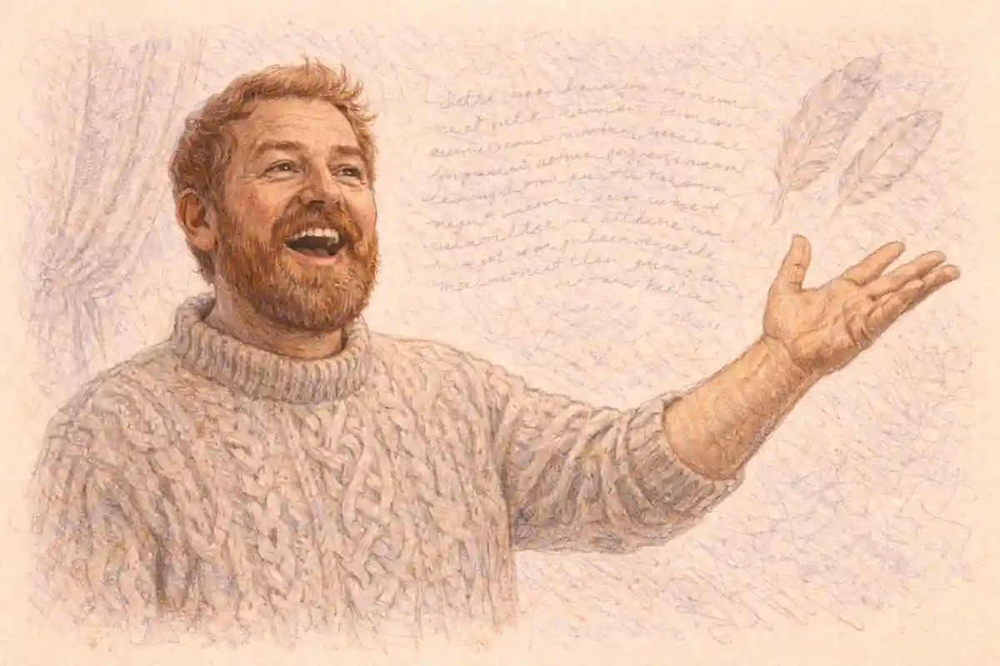

Four notes arrive and stop almost before they have begun. Three are short hammer strokes on the same pitch and the fourth drops lower and holds, and then the whole pattern starts again, transposed, insistently, as if the music had nothing else to say and intended to say it for half an hour. Nothing about the fragment is singable. It has no arc, no climax, no answering phrase, and a listener who tried to hum it as a tune would feel cheated, because a tune promises shape and this promises only pressure. Yet the pressure is the point. Beethoven musical style begins exactly here, in the discovery that a fragment too small to be a melody can be made to generate an entire movement, provided it is worked rather than repeated, broken apart, driven through foreign keys, stretched, compressed and argued with until its few notes have produced a span of music that feels less like a song than like a case being proved. This article defends one claim throughout: Beethoven's central technique is to build long spans of music from material too small to be a tune, which means his works are held together by process rather than by melody, and that is why they feel like arguments rather than songs.

<!--more-->

## Four Notes and Half an Hour

The opening just described belongs to the Fifth Symphony, first performed in Vienna in December 1808, and its first movement runs for roughly seven minutes on that single cell of rhythm and interval. The cell returns in disguise throughout the movement, hides inside accompanying figures, drives the development to its crisis and even lends its rhythm to the symphony's later movements, so that a work of about half an hour grows from a gesture shorter than a door knock. What makes this possible is not repetition. A repeated fragment merely persists. Beethoven's fragment works: it is placed under strain, and the strain is where the music lives. The question this raises is the first one this article must ask and deliberately not yet answer. How can music be built from something too short to be a tune? A tune carries its own completeness, its own rise and fall and resting place, and building from a tune means decorating something already finished. Building from a fragment means the completeness has to be manufactured as the music proceeds, by means the next sections take apart one at a time.

Charles Rosen, the analyst of classical form whose account of the style remains the benchmark for how its procedures are described, observed that in Beethoven the small unit is never merely quoted. It is put to work as a premise. A premise does not need to be beautiful; it needs to be capable of consequences, and the four-note cell is nothing but consequences waiting to happen. Its rhythm can be recognised at any pitch, in any register, at any speed, which means it can survive transformations that would dissolve a melody beyond recognition. That survivability is the hidden asset. A melody transposed, inverted and chopped into pieces stops being itself, while a rhythmic cell keeps its identity through all of those operations, and an entire movement can therefore be about one thing without ever stating that thing the same way twice.

There is a second consequence, and it governs everything that follows. When the material is this small, the listener's attention is redirected from what the notes are to what is being done with them. The drama moves from the object to the process. Beethoven's listeners learned to follow an argument rather than await a tune, and once that habit formed, it changed what a symphony could be for everyone who came after. The four notes are therefore not a curiosity of one famous opening. They are the smallest visible unit of a technique that reorganised musical form around development, and the rest of this article is an unpacking of how that technique works: what a motive is, why rhythm carries the load, how silence and dynamics become structural, how sonata form stretched to hold the new weight, and what the surviving sketchbooks reveal about the labour underneath.

Contemporaries registered the change even when they lacked the vocabulary for it. The writer and composer E. T. A. Hoffmann, reviewing the Fifth Symphony in 1810, treated the work not as a container of tunes but as a single sustained utterance whose parts grew from a common root, and his review is still quoted by historians because it shows an early listener following the process rather than the melodies. That is the experience this article anatomises. The analysis that follows names the devices one by one, but the devices matter only because they produce that experience: the feeling of being carried through an argument whose conclusion was implicit in its first four notes.

## What a Motive Is and How It Differs from a Tune

A theme is a complete musical sentence. It rises, balances, answers itself and comes to rest, and a listener can carry it away whole, which is why the great tunes of Haydn and Mozart feel like possessions. A motive is something else: a fragment defined by a rhythmic shape and a turn of interval, too short to balance or rest, that exists to be used. The distinction is the whole basis of Beethoven's technique, and it is worth stating as the first firm finding of this article. A motive is not a theme, and confusing the two makes his procedures invisible, because everything he does follows from choosing material that is deliberately incomplete.

### What is motivic development?

Motivic development is the technique of building long spans of music from a fragment too short to be a tune, by repeating it at new pitches, breaking it into pieces, stretching or compressing its rhythm, and setting it against itself, so the movement is held together by process rather than by melody.

Consider what each kind of material permits. A finished theme resists surgery: cut it in half and the balance is ruined, transpose its phrases out of order and the sentence stops making sense. A motive invites surgery. Because it has no internal balance to protect, it can be sequenced upward step by step to build pressure, split so that its head appears without its tail, overlapped with itself in stretto, or reduced to its rhythm alone while the pitches change beyond recognition. William Kinderman, the scholar of Beethoven's compositional process whose work follows pieces from first sketch to finished score, has shown how consistently the sketches treat material this way, testing a fragment's capacity for work before committing to it. The fragment is auditioned for usefulness, not admired for beauty, and fragments that cannot work are discarded no matter how pleasing they look on the page.

The test of a motive is therefore transformability. The opening cell of the Fifth Symphony works because its rhythm is unmistakable and its pitches are almost irrelevant; the cell can migrate from the strings to the winds, from the foreground to the bass, from statement to accompaniment, and the ear still tracks it. The opening of the Appassionata Sonata works differently, through a hollow, arpeggiated shape that outlines a chord and a trill on a repeated note, and that shape can be darkened, inverted and driven through sequences for twenty minutes. In both cases the material is closer to a tool than to a portrait. Beethoven's notebooks are full of candidate fragments that never found a work, which suggests the selection was ruthless: a motive earns its place by the labour it can perform.

Lewis Lockwood, the Beethoven scholar whose work centres on the genesis of the individual works, draws the contrast with the previous generation sharply. Haydn, the great pioneer of motivic working, built themes that were themselves compact and then subjected them to development; Beethoven pushed the principle one step further back, to material that precedes theme altogether. The result is a difference a listener can feel without any vocabulary. In Haydn the development feels like a gifted speaker improvising on a stated subject. In Beethoven it feels like the subject being discovered under pressure, as if the movement were finding out what its own opening meant. That sensation, of meaning being manufactured rather than displayed, is the signature this article keeps returning to.

None of this means Beethoven could not write tunes. The slow movement of the Pathétique Sonata and the main theme of the Ninth Symphony's finale are melodies anyone can carry away, and their existence matters to the argument because it proves the choice was deliberate. Where the design requires a tune, he supplies one, often reserving full melody for moments of arrival or reconciliation. Where the design requires an engine, he withholds tune and gives a cell. Learning to hear Beethoven is largely learning to tell which of the two you have been handed, and to stop waiting for a melody in movements that were built to argue instead.

## Why Small Material Travels Further Than Large Material

A finished melody is a local object. It belongs to the movement that states it, in the key that frames it, at the tempo that suits it, and when the development section tries to move it elsewhere it protests, because every element of its identity is fixed at once. A motive is portable precisely because so little of it is fixed. Its rhythm can cross into another movement, another key, another tempo and another scoring, and still be recognised, the way a face is recognised in a different light. This portability explains a feature of Beethoven's music that listeners notice without naming: the sense that a whole work, and sometimes a whole set of works, is made of one substance.

The Fifth Symphony is the clearest demonstration, because its cell does not stay inside its own movement. The rhythm of the opening haunts the slow movement's accompaniment, drives the scherzo's hushed main idea and returns openly in the finale, where the scherzo's ghost is recalled before the close. A listener who has absorbed the first movement therefore hears the later ones as continuations of a single train of thought rather than as separate numbers in a sequence. The symphony coheres not because its movements resemble each other in mood, which they do not, but because they share a working material, passed from movement to movement like evidence through the stages of a trial.

Small material travels across works as well as within them. The turn figure that opens the Piano Sonata Opus 13, the hammered repeated notes of the Appassionata, the terse cell that launches the String Quartet Opus 95: these are distinct fragments, yet they belong to a family of gestures whose common trait is refusal to sing. Scholars of the sketchbooks have traced individual ideas migrating between projects years apart, tried in one work, abandoned, and taken up again when the right context arrived. The sketchbooks functioned as a storehouse of tested fragments, and Kinderman's studies of the compositional process show ideas waiting a decade for their movement. A large, finished theme could never wait like that; it would belong to its moment. A fragment can wait indefinitely, because it is not yet anything in particular.

There is also an economy of attention at work. A movement built on a tune must keep inventing new material to sustain interest, and each new tune dilutes the argument. A movement built on a cell spends its entire length deepening the listener's knowledge of one thing, and the knowledge compounds. By the end of the Fifth Symphony's first movement the listener has heard the cell in triumph, in crisis, in fragments and in exhaustion, and knows it the way one knows a person after an ordeal rather than after an introduction. That depth of acquaintance is something a succession of tunes cannot produce, and it is why Beethoven's movements can sustain lengths that would collapse under melodic abundance. The material is small so that the experience can be large.

Recognition is the mechanism underneath the portability. Strip a melody of its pitches and keep only its rhythm, and almost nothing survives, because the rhythm of a tune is usually the least distinctive thing about it. Strip a Beethoven motive of its pitches and the rhythm alone still identifies it, since rhythm was the identity all along. This is why his material can migrate into the bass, into an accompaniment, into another movement, and still be tracked by a listener who knows no theory at all. The ear follows the shape of the knocking, not the notes knocked on.

## Development as the Main Event Rather Than the Middle

Classical sonata form, as Haydn and Mozart practised it, has three great spans: an exposition that presents the material, a development that works it over, and a recapitulation that restores it. In the older balance the development is the middle term, a passage of instability between two statements, and it is usually the shortest of the three. Beethoven inverts the hierarchy. In his hands the development becomes the destination, the place where the movement's real business happens, while the exposition starts to look like the presentation of evidence and the recapitulation like a verdict that the evidence has forced. Completed in 1803, the Eroica Symphony's first movement runs to roughly seven hundred bars, a scale no symphony had attempted, and its development is longer than its exposition, crowned by an event no textbook form predicts: the arrival, deep inside the development, of a genuinely new theme in a distant minor key, a theme the exposition never mentioned.

That new theme is the proof of the principle. A development confined to recombining old material can only comment; a development that can introduce new material can think. The Eroica's development argues its way through fragmentation and crisis until the original themes can no longer carry the span, and at that point the music generates fresh substance out of the pressure, in a key area the movement had not visited, and then has to argue its way home again. Rosen's analysis of the classical style treats this as the moment where form stops being a container and becomes a narrative of its own contents, and the description fits what listeners feel: not a plan being executed but a situation being survived.

The procedures inside a Beethoven development are consistent enough to learn. Material is first broken down: themes lose their tails, then their middles, until only the motive remains. The motive is then sequenced, repeated at rising or falling pitch levels so that each repetition tightens the harmonic screw. Keys change faster than in the exposition, and distant keys are reached by sudden sideways steps rather than smooth modulation. Voices imitate each other with the fragment, in stretto entries that pile up before the previous one finishes. Dynamics swing between extremes to mark the stages of the crisis. Then, near the end, the music often thins to almost nothing, a held chord, a repeated note, a near stop, before the recapitulation arrives with the force of a door opening. Every stage of that sequence can be heard in the Fifth Symphony's first movement in miniature and in the Eroica at full scale.

This is where the first of this article's open questions can be closed. How can music be built from something too short to be a tune? It can be built because a development section of this kind does not need tunes; it needs material that can be dismantled, and only a fragment can be dismantled without loss. The tune, complete and balanced, can be displayed and varied but not interrogated. The motive can be interrogated for twenty minutes, and the interrogation is the movement. The answer to the question is therefore procedural rather than mysterious: small material is not a limitation that Beethoven overcame but the enabling condition of his largest structures, the fuel his developments were designed to burn.

A final observation completes the picture. Because the development does so much work, the recapitulation cannot be a simple repeat, and Beethoven increasingly treats it as a further stage of the argument, reordering, expanding or compressing what returns, and saving some of the most consequential writing for the coda that follows it. The full consequences of that shift belong to the section on the coda below. What matters here is the redistribution of weight: exposition proposes, development decides, and everything after the development is answerable to it.

## Rhythm as a Structural Force

If the motive is the unit of Beethoven's technique, rhythm is the medium in which the unit survives. Pitch is fragile under transformation: transpose a phrase, invert it, reharmonise it, and its identity blurs. Rhythm is robust. The pattern of long and short, of accent and release, can pass through every one of those operations unchanged, which makes it the ideal carrier for material that must travel through a development section and still be recognised at the far end. This is the second firm finding of the article, and it explains more of Beethoven's sound than any fact about his melodies. Rhythm, not melody, is the element he most often uses to hold a long movement together.

The Seventh Symphony is the standing demonstration. Its first movement is governed by a buoyant, dotted rhythmic figure that saturates the texture so completely that whole stretches pass with the harmony barely changing; the movement coheres because the rhythm never lets go. The slow movement builds its processional tread from a repeating rhythmic pattern in the accompaniment, over which the melody is almost an afterthought, and the finale spins on a whirling rhythmic cell that returns like a refrain of pure momentum. Richard Wagner called the symphony the apotheosis of the dance, and whatever else the phrase means, it registers the right fact: in this work rhythm is not the clothing of the music but its skeleton.

Rhythm also does structural work at the largest scale, marking the joints of a form so the listener can feel where they are. Beethoven's transitions often proceed by rhythmic narrowing, a broad theme dissolving into a repeated note or a pulsing figure that gathers energy for the next arrival. His codas frequently begin with a rhythmic unison, the whole orchestra stamping a pattern that announces the closing argument. Even his phrase endings are rhythmic events, cadences driven home by patterns of accent that a listener registers physically. A new listener can test all of this with one experiment: tap the dominant rhythm of any Beethoven movement while ignoring the pitches entirely, and notice how much of the movement's shape, its tensions and releases, survives in the tapping alone. For most composers the experiment fails. For Beethoven it succeeds to an almost embarrassing degree, and that success is the signature.

The sketchbooks confirm that this was conscious craft rather than instinct. Beethoven's drafts often fix a rhythmic profile before the pitches around it settle, and surviving sketches show him trying the same melodic shape under different rhythmic dispositions, as if auditioning gaits for a figure he already knew could walk. Kinderman's work on the compositional process documents this habit across the career, from the Bonn years to the last quartets. Rhythm came first because rhythm was load-bearing; pitches could be revised later precisely because they carried less of the structure. A listener who learns to hear Beethoven's rhythms as the argument, and his notes as the argument's local clothing, has learned the single most transferable skill this article can teach.

The Fourth Piano Concerto offers the quietest proof of the same principle. It opens with the solo piano alone, repeating a soft chord figure in a steady rhythm, almost without melody, and the orchestra answers the figure in a remote key, as if it had overheard a pulse rather than a theme. The whole concerto's famous character, its conversational intimacy, grows from that exchange of a rhythm between two parties who harmonise it differently. Nothing in the opening could be called a tune. What passes between soloist and orchestra is a pattern of durations, and the pattern is sufficient to found a movement on, because in Beethoven's hands rhythm is not the frame of the musical thought. It is the thought, wearing pitches the way a traveller wears clothes.

## Accent, Syncopation and the Displaced Beat

A strong rhythmic identity creates a grid, and a grid creates the possibility of meaningful violence against it. Beethoven's accent patterns are famous for their physicality: sforzando chords landing where the bar line says nothing should land, accents displaced by half a beat so that the orchestra seems to stumble and recover, hemiola groupings that make three beats sound like two across the bar line. These are not decorations. In a style where rhythm carries the structure, a displaced accent is a structural event, a load shifted suddenly onto a column that was not built for it, and the ear registers the shift as drama.

The development of the Eroica's first movement contains the classic instance. As the crisis deepens, the music tears its own rhythmic fabric: chords crash in syncopated patterns against the pulse, the metre seems to disintegrate, and for a passage the listener cannot say where the beat is at all. Then, out of that wreckage, the new theme enters quietly in a distant key, and the recovery of a steady pulse feels like the recovery of reason. The effect depends entirely on the grid having been established and then violated; syncopation without a norm is merely irregularity. Beethoven builds the norm with unusual clarity precisely so that its violation can carry meaning, which is why his regular passages can sound almost square. The squareness is a setup.

Slighter displacements do quieter work everywhere in the output. The scherzo of the Second Symphony kicks its phrases off balance with accents that arrive a beat early. The opening movement of the Seventh keeps its dotted figure supple by shifting its weight between strong and weak beats. Even the serene surfaces of the slow movements are kept awake by gentle off-beat entries in the accompaniment, small displacements that prevent the pulse from ever becoming furniture. In the late quartets the device turns inward: phrases begin after rests, accents fall on the second half of the bar as if the music were thinking aloud and correcting itself, and the displaced beat becomes a portrait of hesitation rather than of force.

For the listener, the practical skill is simple to state. Follow the beat as a physical fact, tapping or counting through a movement, and note the moments when the music seems to push against your tapping. Those moments are rarely accidents of performance. They are the joints where Beethoven is spending the rhythmic capital his openings accumulated, and they cluster at the points of greatest structural stress: late in developments, at the threshold of recapitulations, and in codas that need to feel earned rather than appended. Accent, in this style, is punctuation at the scale of the body.

The finale of the Eighth Symphony contains the most famous single displaced event in the output: a blaring chord on a note foreign to the movement's key, which intrudes early on, unexplained, absurdly loud and gone again before the ear can place it. The joke is prepared with an engineer's patience. The note keeps threatening to return, the music keeps sidestepping it, and only near the end does the harmony disclose what the intruder was, a neighbour note magnified into a crisis of accent. Generations of analysts have written about the passage because it shows accent operating as pure structure: a single sonority, wrongly placed and wrongly weighted, bends the shape of an entire movement around itself. Humour of this precision is possible only in a style where the grid is strong enough for a violation to be legible as a joke rather than as noise.

## Silence, Interruption and the Withheld Resolution

Every account of Beethoven's loudness misses half the device. The complementary half is silence: the full stop in the middle of a sentence, the held breath before a verdict, the gap that makes the next sound an event. Silence in his music is used actively, which is the third finding of this article, and it is why his interruptions register as happenings rather than as absences. A rest in Mozart is usually a breath between phrases, elegantly placed. A rest in Beethoven is frequently a cliff edge, placed where the phrase has generated an expectation so strong that the silence itself seems to ring.

### Why does Beethoven use sudden silences?

He uses sudden silences to convert expectation into suspense, because a pause after a rising sequence or an interrupted cadence leaves the harmony unresolved in the listener's ear, so the silence feels full of the sound that has been withheld and the eventual continuation arrives with the force of an answer.

The Coriolan Overture opens with the device at full strength. A single sustained unison note, held and then cut off, leaves a bar of silence; the gesture repeats, and between the statements the strings answer with a pleading figure that the unison crushes. The drama of the overture, a hero confronted and refusing, is enacted by those silences before any theme has properly begun: statement, gap, plea, gap, statement. Nothing is being accompanied and nothing is resting. The silence is one of the two speakers. Later in the overture the pattern returns under greater pressure, and the ending, in which the main theme disintegrates into fragments separated by widening silences before expiring on three quiet pizzicato notes, uses the same device to portray collapse. The silences lengthen as the energy dies, so the listener hears the structure of the tragedy in the gaps as clearly as in the sounds.

Smaller silences work at every scale. The first movement of the Fifth Symphony halts, just before its recapitulation has settled, for a brief oboe cadenza, a moment of solitary song suspended over silence that interrupts the symphony's machinery like a human voice interrupting an engine. The transition from the Fifth's scherzo to its finale is built on the opposite quantity of sound, a hushed, sustained crescendo over a pedal point, but it belongs to the same family: resolution withheld so long that its arrival becomes the symphony's central event. In the quartets, general pauses split phrases into utterances that seem to reconsider themselves, and in the Piano Sonata Opus 111 the rests inside the first movement's rhetoric give the argument its oratorical gait.

The withheld resolution is the harmonic form of the same device. Beethoven learned from Haydn the art of the deceptive cadence, the ending that swerves at the last moment, and he expanded it into spans: cadences evaded for page after page, dominant harmony prolonged until the need for resolution becomes physical, movements that seem to end and then reopen. The listener's sense of time stretches inside these withholdings, which is why his climaxes feel disproportionate to their length. A resolution delayed by thirty bars of accumulated tension discharges all thirty bars at once. Silence and delay are therefore not pauses in the argument. They are how the argument stores its energy, and any account of his style that omits them describes a composer who only shouts, which is half a portrait at best.

The String Quartet Opus 95, the Serioso, weaponises the same silences at chamber scale. Its first movement speaks in clipped utterances separated by rests that arrive too early, as if each phrase had been cut off by an interruption the listener cannot hear, and the effect is of a conversation conducted under some pressure that forbids finishing a sentence. Beethoven marked the quartet for a serious audience and kept it from publication for years, and its rhetoric of interruption is among the most extreme in his output. Placed beside the Coriolan Overture, the quartet proves the device's range: the same grammar of gap and withheld continuation serves public tragedy in the orchestra and private agitation in four strings.

## Dynamics as Architecture

In the music Beethoven inherited, dynamics were largely local colouring: a phrase shaded, an echo effect, a crescendo to mark an arrival. In his hands dynamics become architecture, a means of defining spans and levels within a form, so that a listener can navigate a long movement by its dynamic profile alone. The marks multiply beyond anything his predecessors wrote: sudden fortissimos, pianos that arrive without preparation, crescendos sustained over whole paragraphs, and the characteristic plunge from a climax to a whisper in a single bar. These are not expressions applied to a structure that exists independently. They are the structure, drawn in volume.

The clearest case is the transition from the scherzo of the Fifth Symphony to its finale. The scherzo's ghostly material is replayed at the edge of audibility while the timpani tap out the symphony's rhythmic cell, and for some fifty bars the music does almost nothing but grow, a crescendo so prolonged that growth itself becomes the event. When the finale blazes in, with trombones, piccolo and contrabassoon added to the orchestra for the first time in the symphony, the arrival is overwhelming not because the finale's theme is extraordinary but because the dynamic ramp beneath it was engineered for so long. Dynamics here are doing the work that a modulation or a new theme does in other composers: they create the form's largest joint.

Within movements, Beethoven draws dynamic terraces that map the argument. A development will climb by stages, each stage louder and more fragmented than the last, until the crisis breaks into a sudden piano from which the recovery must begin. A slow movement will hold its volume within a narrow band for pages, so that a single swelling phrase registers as a confession. The late quartets carry the principle to an extreme of refinement, with phrases that seem to be withdrawn as they are uttered, dynamics pulled back at the moment of statement so that the music sounds overheard rather than performed.

Dynamics also raise a question this article has been circling and should now state openly, because the slow movements pose it most sharply. Why do his slow movements feel longer than they are? A ten minute adagio by Beethoven can feel more spacious than a fifteen minute movement by a contemporary, and the explanation is not tempo alone. Something about the way he manages sound, harmony and event stretches the listener's clock, and the question deserves a direct answer. The answer is assembled over the next several sections and completed in the section on slow movements below, where the evidence from dynamics, harmony and stillness is gathered in one place.

The markings themselves tell the story of the change. Haydn's scores are sprinkled with dynamics; Beethoven's are saturated, and the vocabulary widens beyond the inherited piano and forte to include the sforzando piano, an attack instantly withdrawn, the pianissimo that asks for sound at the edge of presence, and crescendos notated across page turns. In the late quartets he grades the soft end of the scale with a refinement that treats volume the way a painter treats distance: the opening fugue of Opus 131 is marked to unfold at a level of quiet that makes the listener lean toward the sound, and its dynamic restraint is the movement's expressive core. Architecture is the right word because these schemes are planned at the scale of whole movements, and a performer who treats them as local colour flattens the building into a façade.

## The Sudden Contrast and What It Does to Attention

Juxtaposition is Beethoven's other great attentional device. Where the classical style he inherited preferred graded transitions, a rhetoric of preparation and consequence, he increasingly sets blocks of opposed character directly against each other: the violent and the tender, the public and the confessional, the march and the hymn, with no corridor between them. The Piano Sonata Opus 27 No. 1, published with the instruction that it is a sonata in the manner of a fantasy, runs its movements into one another and veers between a dreamy opening and a bustling rondo without apology. The Fifth Symphony's finale answers its scherzo's darkness with C major blaze. The Ninth Symphony's finale pushes the device to the scale of a whole movement, auditioning and discarding the characters of the three preceding movements before permitting voices to enter.

Contrast does specific work on attention. A listener's ear adapts to any sustained character within a minute or two, after which even violent music becomes background to itself. A sudden change of character resets the adaptation completely, restoring the first minute's alertness in a bar. Beethoven spends this reset at structural moments: the quiet theme that enters after a development's crash, the intimate episode inside a public finale, the chorale that interrupts a fugue. Each contrast is therefore also a renewal of the listener's lease on the piece, which is one reason his long forms hold audiences that his thematic material, examined cold, might not explain.

The device has a risk, and the late works accept it knowingly. Blocks set side by side without mediation can sound arbitrary, and some of Beethoven's juxtapositions were heard by contemporaries as incoherence: the sudden alternations of the Heiliger Dankgesang in the String Quartet Opus 132, hymn and flowing dance exchanging without transition, puzzled early listeners precisely because the corridor was missing. Later generations learned to hear the alternation itself as the meaning, a convalescent's alternation between gratitude and returning strength. The corridor, it turned out, was in the listener, and building it became part of what the music taught. Sudden contrast is thus the social form of the motive principle: fragments of character, set in collision, generating a whole larger than any of them.

The contrast is present inside single themes as well as between blocks. The first theme of the Eroica strides upward through the notes of its home chord with public confidence, and within a few bars sags chromatically, the line slipping by semitone into a shadow that the rest of the movement will spend hundreds of bars exploring. Heroism and vulnerability are not assigned to different movements or different themes; they are folded into the work's first utterance, and the whole symphony can be heard as the argument between the two halves of its opening. The Fifth and Sixth Symphonies, first performed on the same December evening in 1808, extend the same thinking to the scale of a concert: storm and struggle in one work, birdsong and a brook in the other, the composer's two natures presented back to back to an audience that had paid to hear both. Contrast, at every scale from the bar to the programme, is how this style keeps attention and meaning in motion.

## Harmony Across Long Spans

A short piece can live inside a single key the way a conversation can live inside a single room. A long Beethoven movement cannot, and his harmony is best understood as the management of distance: the planning of departures from the home key, the pacing of the journey through other keys, and the engineering of a return that feels both inevitable and hard won. The vocabulary is the common vocabulary of the classical style, tonic and dominant, relative major and minor, but the spans are new. Where an earlier symphony might visit two or three key areas in a movement, a Beethoven middle period movement traverses a map, and the map is part of what the movement is about.

The Eroica's tonal plan shows the scale of the thinking. The home key of E flat major is shadowed throughout by its relative minor, C minor, the key of the funeral march that forms the slow movement, so that the symphony's public heroism and its meditation on death are harmonically the same territory viewed from two sides. Inside the first movement, the development's new theme enters in E minor, a key about as far from E flat as the system allows, and the shock is geographical: the music has travelled to the map's edge, and the long recovery of the home key becomes the movement's true plot. A listener need not name any of these keys to feel the distances. The body registers remoteness and homecoming directly, which is why key planning of this kind works on audiences with no theoretical training at all.

Long span harmony also operates between movements. The Fifth Symphony travels from C minor to C major across its whole length, so that the finale's blaze is a harmonic conclusion to an argument begun three movements earlier. The Ninth makes the larger journey from D minor to a D major choral finale, with its slow movement resting in B flat, a warm submediant region that feels like a memory of elsewhere. These are not successions of keys but a single arc, planned at the scale of an hour. Lockwood's studies of the individual works repeatedly show the planning present in the sketches, key schemes roughed out before themes were settled, which confirms that for Beethoven the harmonic map was often the first thing fixed and the themes were found to fit it.

The Appassionata Sonata shows the planning compressed into a single work for one instrument. Its three movements stand in F minor, in the relative major of D flat for the slow movement, and in F minor again for the finale, a plan that sounds orthodox until the proportions are felt: the slow movement's D flat major is the storm's only harbour, and its hymnlike theme is the same material the outer movements treat as an adversary, so the sonata's whole emotional plot is drawn by three keys and one returning idea. Even the order of movements could be bent to the harmonic design. In the Ninth Symphony the scherzo stands second and the slow movement third, reversing the classical sequence, because the work's tonal and emotional arc required the slow movement's warmth to fall immediately before the finale's crisis. The sequence of movements, in other words, had itself become a harmonic decision, taken at the same planning table where the keys were chosen.

## Remote Keys and the Sense of Distance

Within the long span plans, one device deserves its own section because it colours the whole output: the choice of remote keys for the places of greatest intimacy or greatest shock. The classical default relates keys by fifths, close neighbours sharing most of their notes. Beethoven repeatedly steps sideways into third relations, keys a third away, whose colour is both close and estranged, near enough to reach and far enough to feel like another country. The slow movement of the Waldstein Sonata is the textbook case. The sonata stands in C major, and its original slow movement was replaced by a short Introduzione in E major, the mediant, a key that turns the sonata's sunlight sideways into dusk before the finale's rondo dawns in the home key again.

The Hammerklavier Sonata, Opus 106, pushes the principle to its limit. The work stands in B flat major, yet its vast slow movement, the longest he ever wrote for the piano, stands in F sharp minor, a region so remote from the home key that the two share almost no common ground, and the movement's sense of suspended, nocturnal distance from the work around it is a harmonic fact before it is an expressive one. When the finale's introduction gropes its way back through a chain of keys toward B flat for the closing fugue, the listener hears a traveller returning across a map that the slow movement had left entirely. Distance in Beethoven is never decorative. It is the quantity his forms are built to measure.

The device has a genealogy worth noting. Schubert, who studied these scores, built his own tonal worlds from third relations, and the nineteenth century's harmony generally is unthinkable without Beethoven's demonstration that a remote key, properly prepared, could carry a movement's emotional centre. But within Beethoven's own output the point is simpler and more practical. When a slow movement or an episode feels like a dispatch from somewhere else, somewhere colder or warmer than the work's home territory, the odds are that the feeling is a key relation before it is anything else, and learning to hear the departure and the return is learning to read the map his forms are drawn on.

The Emperor Concerto performs the trick in a single transition, and audiences have gasped at it for two centuries. The first movement ends in the home key of E flat major, in full orchestral splendour. A bass line then slips downward by a semitone, the harmony tilts, and the slow movement opens in B major, a key so remote from E flat that the two scales share almost nothing, reached not by the usual grammar of modulation but by a trapdoor. The movement that follows, a nocturne of sustained, floating calm, sounds as if it were being played in another building of the same palace, and when the finale's rondo theme is first hinted at, quietly, before the slow movement has even ended, the hinge back toward home becomes an event in itself. Nothing about the effect requires theory to register. It requires only that the listener have settled into the first movement's key, as every listener does, so that the trapdoor opens under a settled ear.

The Ninth Symphony's slow movement works the same device from inside a single span. It alternates between two keys a third apart, B flat major and D major, the home key of the symphony held in reserve, so that the movement becomes a dialogue between two regions, each visit to the second sounding like a memory of warmth from elsewhere. Variation form, which the later section on variation examines, is the vessel: each return of the theme rebalances the dialogue. Remote keys in Beethoven are therefore never a colour applied for strangeness. They are places, with distances from home that the form measures out in time, and the listener's feeling of travel is the form working as designed.

## The Expansion of Sonata Form

Sonata form in Beethoven's hands did not change its grammar; it changed its scale, its proportions and its centre of gravity, which together amount to a new rhetoric wearing an old form's clothes. The exposition grows because its themes are built to be developed, often containing their own instabilities, open endings and rhythmic cells that demand continuation. Transitions lengthen into journeys. The development, as the earlier section showed, becomes the movement's centre and can exceed the exposition in length. The recapitulation is recomposed rather than repeated. And the coda swells from a closing gesture into a structural necessity, treated fully in the next section. The first movement of the Eroica, at roughly seven hundred bars, is longer than entire symphonies by the generation of his teachers, yet nothing in it is padding: the expansion is the direct consequence of building from motives, since a process needs room to run.

Comparison with the previous generation clarifies what did and did not change. The account of [Mozart's musical style](/2010/11/07/wolfgang-amadeus-mozart-musical-style-explained/) shows a composer for whom sonata form is a dramatic frame of balanced spans, exposition and recapitulation mirroring each other around a development that comments. Beethoven keeps the frame and unbalances it deliberately, shifting weight toward the middle and the end, so that the form's centre of gravity moves from statement to consequence. Rosen's formulation, that Beethoven expanded the classical style from within until its proportions became heroic, captures the continuity as well as the scale: no rule of the grammar is broken, yet the experience is transformed, the way a speech and an epic can share a language.

Two practical consequences follow for listeners. First, expectations trained on Mozart's proportions will mislead: the recapitulation in Beethoven is not the finish line, and relaxing there means missing the coda's argument. Second, the expansion is not uniform across the output. The Eighth Symphony, written in 1812 in the middle of the heroic years, is compact, witty and deliberately old fashioned in scale, a reminder that Beethoven commanded the smaller form whenever he chose it. The expansion was a choice made work by work, in service of material that needed room, which is why the giant forms never feel like a formula applied from outside. Size, in this style, is a conclusion the material reaches, not a costume it wears.

The second subject group undergoes the same expansion, and its instability is a useful thing to learn to hear. In the classical textbook the exposition presents a first theme in the home key and a second, contrasting theme in a related key, neatly separated by a transition. Beethoven's expositions repeatedly refuse the neatness. The Eroica's second group wanders through several keys and characters, lyrical, martial and hymnlike by turns, as if the exposition were already developing. The Ninth Symphony's first movement builds its recapitulation toward a climax in which the main theme returns over a harmony that clashes with it, a passage of controlled catastrophe that no tidy account of the form predicts. Even the repeat of the exposition, which Beethoven retained in most of the symphonies, changes meaning at his scale: a seven hundred bar movement whose first two hundred bars are played twice is not using the repeat as a courtesy but as a ratchet, fixing the material in the ear so that the development can take liberties with it. Form, at this size, is a technology of memory, and every part of it is adjusted to make the listener remember harder.

## The Coda as a Second Development

Every form has a part its theory undervalues, and in sonata form it is the coda. In the practice Beethoven inherited, the coda was a peroration, a handful of bars that confirmed the home key and let the movement sit down. Beethoven transformed it into something for which the older theory had no name: a second development, a span after the recapitulation in which the material is worked again, often reaching the movement's true climax and resolving tensions the development itself left open. This is the fourth finding of the article, and it is properly described as a structural invention rather than an expansion, because the coda acquires a function, completing the argument, that no earlier coda was asked to perform.

The Eroica's first movement is again the defining case. Its coda does not merely celebrate the home key's recovery. It returns to the development's new theme, the theme that had no business existing, and grants it a full statement in the home key at last, as if the interloper had earned citizenship; then it drives the movement's opening chords through a final cycle of fragmentation and arrival. A listener who left at the recapitulation would have missed the verdict. The movement's plot, exposition as charge, development as trial, coda as judgement, requires the coda to be a working section of the form, and Beethoven's sketches show him labouring over codas with the same intensity as over openings, which disposes of any notion that they are decorative tails.

The device spreads through the output in proportion to the stakes. The Fifth Symphony's finale coda recalls the scherzo's ghost one final time before the closing blaze, settling the symphony's account with its own past. The Seventh's first movement coda hammers its rhythmic cell through a passage of mounting, almost brutal insistence that turns a dance movement's ending into a crisis survived. The late quartets compress the principle: the coda of the first movement of Opus 127 is short but decisive, a final working of the opening bars that reinterprets their character completely. In each case the test is the same. Remove the coda and the movement would be shorter but not finished; its argument would stand unresolved. A closing that the argument cannot do without is no longer a closing. It is the last stage of the thought.

The piano sonatas confirm that the coda's promotion was a general law of the style and not an orchestral effect. The finale of the Waldstein reserves for its coda a broad new theme, unheard in the movement before, as if the rondo's argument could only be completed by fresh evidence introduced at the last possible moment. The Appassionata's first movement ends with a coda that quickens the tempo and drives its arpeggiated figure to a collapse in the bass, an ending that behaves like a second, compressed development of the movement's opening and reverses its meaning: what began as a question in the depths ends as a verdict there. Opus 111, his last sonata, closes its first movement with a coda that gathers the movement's rhythmic motive into a passage of valedictory calm, preparing the stillness of the variations that follow. In each case the pattern of section thirteen's finding holds. The end of the movement is where the movement is decided, and the listener who stays alert through the final pages hears the decision being made.

## The Scherzo Replacing the Minuet

The third movement of the classical symphony was the minuet, a stylised dance in triple time whose function was relief: courtly, balanced, deliberately lighter than the movements around it. Beethoven replaced it with the scherzo, a word that means a joke, and the replacement changed the symphony's centre of gravity. The first symphony still labels its third movement a minuet, but the label is already a courtesy: the movement moves at scherzo speed, with scherzo dynamics and scherzo wit, and by the Second Symphony the title is dropped and the joke is official. What had been the form's rest became one of its engines.

The differences are practical and audible. A minuet keeps its phrases regular and its accents on the beat, because a dance, however stylised, remembers the floor. A scherzo breaks the phrase, displaces the accent and plays with the metre itself: the Ninth Symphony's scherzo presents its theme first as pure rhythm, in a fugato of timpani and strings, and plays elaborate games with bars grouped in twos against the triple time. Beethoven's scherzos also swell in scale. The Eroica's scherzo begins with a whispered staccato figure in the strings, music at the edge of silence, and builds to a trio section in which three horns blaze out a hunting chorus, an orchestral event no minuet could contain. The movement that was supposed to relax the listener now competes with the finale for weight.

Why the replacement happened is a question of function, and the answer connects to the whole argument of this article. A style built on process and tension cannot park its third movement in a dance that suspends both. The scherzo keeps the triple metre and the trio structure of the minuet, the frame remains, but fills the frame with the style's own materials: motives, displaced accents, dynamic shocks and sudden stillnesses. The minuet's ghost survives in the trio, often the calmest music in the movement, a last courtesy to the dance floor. Listeners who approach the third movements as scherzos in all but name will hear even the early ones correctly: not as interludes but as the argument continuing by other means, in a lighter voice that the style uses to say some of its most serious things.

The trio, the scherzo's contrasting middle, became an expansion point in its own right. The Seventh Symphony's scherzo frames a trio of hymnlike breadth, traditionally linked to an Austrian pilgrims' song, and Beethoven repeats the trio more times than convention allowed, until the movement's proportions tilt toward its centre and the joke movement acquires a ceremonial heart. Listeners in his own Vienna, puzzled and delighted, demanded the trio be played again in performance, and the movement's written form already behaves as if it expects the demand. In the quartets the scherzo turns yet more experimental: the second Razumovsky Quartet sets a Russian theme in its trio, state ceremony quoted inside a joke, and the late quartets compress the scherzo toward a fragment, a breath between immensities, as in Opus 131 where the dance movement lasts barely two minutes and the work's weight has migrated elsewhere. The movement Beethoven inherited as a fixed amenity became, in thirty years, his most flexible formal unit.

## Slow Movements and the Art of Stillness

The question posed earlier can now be answered directly. Why do his slow movements feel longer than they are? Because Beethoven stretches perceived time by every means his technique affords. The harmonic rhythm slows, chords change at a fraction of the rate of the fast movements, so the ear's main clock for measuring progress ticks rarely. Cadences, the events by which a listener knows a paragraph has ended, are deferred, evaded or softened until whole pages pass without a single point of full rest. Dynamics are compressed into a narrow band, withholding the contrasts that would otherwise mark out stages of a journey. And the melody itself is often suspended over the slow harmony in long, breathing spans that seem to float free of the bar line. Fewer events, fewer signposts, fewer arrivals: the clock of attention, starved of markers, reports a longer duration than the stopwatch does. The stillness is not emptiness. It is time, deliberately diluted.

The slow movement of the Eroica shows the public form of the device. A funeral march in C minor, it proceeds at a tread so measured that each harmonic change lands like a step in a procession, and its central episode in the major key, and the later passage where the march theme disintegrates into sobbing fragments over a pulsing accompaniment, stretch a quarter of an hour into what feels like a rite of far greater duration. Nothing hurries, and the refusal to hurry is the tribute. The movement demonstrates that the dilating of time is a rhetorical resource, usable for public grief as readily as for private meditation.

The Heiliger Dankgesang, the slow movement of the String Quartet Opus 132, shows the private form. Beethoven headed it a hymn of thanksgiving from a convalescent to the divinity, and wrote it in the Lydian mode, an archaic scale that strips the music of the usual dominant pull toward cadence. Without that pull the harmony drifts rather than drives, and the hymn's phrases seem to hang in a space where ordinary musical time does not apply; against them he sets flowing, dance like episodes marked as feeling new strength, and the alternation of timeless hymn and earthly motion becomes the movement's whole world. The Cavatina of Opus 130 works yet another way, through a melody of such sustained, confessional intensity, including a middle section where the first violin's line falters as if overcome, that the listener's attention is compressed onto a single voice and time contracts around it. Stillness, dilution and concentration are the three gauges of his slow movement clock, and learning to feel which one is operating is most of what appreciating these movements requires.

The slow movement of the second Razumovsky Quartet adds the dimension of performance instruction to the evidence. Beethoven headed it with a direction, given in Italian in the score, that the movement be treated with great feeling, and its hymnlike chorale theme proceeds in harmonies so slow that the four players must sustain the listener's attention through harmony changes that arrive like changes of light. His pupil Carl Czerny reported that the composer associated the movement with contemplation of the starry heavens and the music of the spheres, and whatever the anecdote's weight, the movement behaves as the report describes: time in it is not measured by events but by vast, slow revolutions. A slow movement of this kind asks the listener to change clocks, from the clock of incident to the clock of orbit, and the sensation of lengthened time is the sensation of that change being demanded bar by bar.

## Theme and Variation as a Mode of Thought

Variation form was the oldest display vehicle in keyboard music, a theme dressed in a sequence of costumes, and in lesser hands it remained exactly that: decoration arranged in a row. Beethoven converted it into a mode of thought. His variation sets increasingly treat the theme not as a melody to be ornamented but as a set of relations, a harmonic skeleton, a rhythmic profile, a phrase structure, that can survive the complete replacement of the melody itself. The listener is asked to follow identity under total change, which is the motive principle operating at the scale of a whole movement. The Eroica finale is the manifesto: its theme is not even a melody at first but a bare bass line, presented alone, then harmonised, then gradually clothed, so that the movement enacts the building of a tune out of a skeleton before the variations proper begin. The theme, as section thirty will show, had already served him in a ballet and in a set of piano variations, and its career is the cleanest proof that his material was engineered for reuse.

The Diabelli Variations, Opus 120, carry the method to its summit. The publisher Anton Diabelli sent a waltz of his own to fifty composers, inviting one variation each for a collective album; Beethoven, after first dismissing the theme, returned to it and produced thirty three variations of his own, a set that treats the waltz's turns and cadences as raw material for every state of feeling from parody to transfiguration. The theme is ordinary to the point of banality, and that is the point: the set is a demonstration that in this technique the material's quality matters less than the quality of the thinking applied to it. The last of the variations dissolves the waltz into a minuet of unearthly poise, the dance of Diabelli's trade finally stilled.

Which raises a question that the variation sets pose with special sharpness, and that this article now opens and leaves open until its evidence is complete. Do the surviving sketches tell us anything the finished works do not? For the Diabelli set the sketches are extensive, and for many works they preserve stages of invention that the polished scores conceal. A finished work presents its theme as inevitable; a sketchbook shows it as one survivor among rejected alternatives. Whether that knowledge changes how the finished music should be heard, or whether it is merely biography in disguise, is a real question about the limits of evidence, and it will be answered in the section on the transformation of themes below, after the sketchbooks themselves have been examined.

Two shorter sets chart the method's range at either end of the career. The Thirty Two Variations in C minor, written in 1806, take as their theme nothing but an eight bar harmonic skeleton over a descending bass, a chaconne frame, and extract half an hour's worth of states from it, figuration, counterpoint, storm and hymn, without the theme ever acquiring a melody worth the name. The Arietta of Opus 111, his last piano sonata movement, stands at the far end of the same road: a theme of hymnlike simplicity subjected to variations in which the beat is divided into ever smaller values until the pulse seems to granulate, passing through a variation of such violent syncopation that listeners have compared its energy to musics not yet invented in 1822, and arriving at last at a state where trills suspend the theme above its own skeleton like light over a landscape. Identity under total change is no longer the experiment. It is the subject.

## The Finale Problem and How He Solved It

Every composer of symphonies inherits a difficulty about endings. The first movement states the argument at full weight, the slow movement and scherzo vary the world, and then the finale must close the work without anticlimax, in a tradition where finales had been light, fast and deliberately slight, a rondo to send the audience home smiling. Haydn raised the finale's wit to genius without much raising its weight. Beethoven needed endings that could stand level with his expanded first movements, and the search for them, across the whole output, is one of the clearest threads in his development. Critics have a name for it: the finale problem.

His solutions were several, and each became a model. The Fifth Symphony solves it by arrival: the finale is the goal toward which the whole work has been travelling, emerging out of the scherzo's darkness through the long crescendo described earlier, so that its C major blaze is experienced as the resolution of a harmonic and emotional debt contracted in the first movement's C minor. The Eroica solves it by construction: the finale builds its theme before the listener's ears from a bare bass, then subjects it to variations and a fugue, making the last movement a summary of the work's whole method. The Seventh solves it by momentum, a finale of such rhythmic ferocity that the work ends at maximum velocity. The Ninth solves it by drama: the finale stages a search, auditioning the earlier movements and rejecting them, before voices arrive to supply the ending that instruments alone are made to declare insufficient.

The quartets conduct the same search at chamber scale. The finale of Opus 59 No. 3 bursts in with a fugue that never relaxes. The original finale of Opus 130 was the Grosse Fuge, a movement so massive that it unbalanced the quartet and was replaced, as a later section describes. The last quartet, Opus 135, closes with a finale built on a question and answer motto worked through the movement, an ending of wit and compression after the late style's immensities. In every case the principle is constant: the finale must be earned by the same process that built the work, not appended to it. A Beethoven finale is not the music stopping. It is the argument completing its final stage, which is why his endings, even the quiet ones, have the force of verdicts.

The problem's difficulty should not be understated, because the early reception shows what Beethoven was risking. A contemporary reviewer, encountering the finale of the Second Symphony, reached for an image of a wounded dragon that refuses to die and bleeds through its final convulsions, and the image, unfair as it is, registers a genuine shock: an ending that would not stop ending, that kept generating energy when decorum said the work should close. The finale of the Moonlight Sonata poses the same threat from inside a piano sonata, a presto of such sustained ferocity that it outweighs the famous first movement and rebalances the whole work toward its close. Again and again the pattern repeats. Wherever Beethoven solved the finale problem, he solved it by making the ending stronger than the beginning, and wherever contemporaries objected, they objected to exactly that strength, which violated the etiquette of the forms they knew.

## Cyclic Thinking Across Movements

A classical work in four movements is a suite of separate pieces bound by key and contrast, and nothing in the tradition required them to share material. Beethoven repeatedly breaks that separateness, importing material from one movement into another until the work becomes a single span of thought with internal memories. The device is called cyclic form, and he did not invent it, but he gave it a structural seriousness it had not possessed. The mildest form is the recall: the scherzo of the Fifth Symphony returns, ghostly and uninvited, in the middle of the finale, so that the finale's triumph must survive a confrontation with the darkness it escaped. The effect is not quotation for its own sake. The recalled material changes the meaning of its surroundings, proving that the finale's key and confidence were won against something that still exists.

The Piano Sonata Opus 13, the Pathétique, uses return as architecture. Its solemn Grave introduction, which precedes the stormy first movement, comes back twice more, at the approach to the development and again before the coda, each time slower in effect, like a warning the movement keeps failing to heed. A listener who registers the returns hears the movement as a single span of fate and resistance; a listener who misses them hears an introduction oddly repeated. The Ninth Symphony raises the device to drama in its finale, where the themes of all three preceding movements are summoned, played in turn and dismissed by the cellos and basses in recitative, a review of the work's own past conducted inside the work. Nothing earlier in the symphonic tradition attempts self examination on that scale.

The song cycle An die ferne Geliebte, from 1816, closes the circle in fact: its final song takes up the melody of its first, so that the cycle of longing ends where it began, the beloved addressed across distance in the same music that opened the sequence. The String Quartet Opus 131, composed in 1826, dissolves the boundaries themselves, its seven movements played without pause and linked by key, gesture and recall until the quartet behaves like a single continuous meditation. Cyclic thinking is thus the motive principle written across a whole work: material stated once and understood fully only when it returns transformed. A listener trained by the first movement's developments already owns the skill it requires, which is to hold an earlier sound in memory and measure the distance it has travelled.

The last quartet carries the principle into the realm of the motto. Opus 135's finale is prefaced by a slow, questioning figure of three notes, inscribed in the score with a verbal question, and answered at once by the finale's bustling main theme, which is built from the answering figure. Beethoven had turned the same pair of figures into a comic canon for friends, on a domestic joke about a subscription payment, and in the quartet the joke becomes a form: the finale spends its length working the question and the answer against each other until the answer, light and unburdened, has the last word. A listener cannot hear the motto's return without remembering its first, grave appearance, which is exactly the cyclic point. The material means more the second time because of where it has been. That accumulation of meaning across a work's span, achieved by the simplest possible means, is the device in its purest form, and it is also, not coincidentally, a description of this article's whole subject: Beethoven's technique is a machine for making material mean more each time it returns.

## Writing for the Piano as the Instrument Changed

Beethoven's piano music spans the most rapid evolution in the instrument's history, and the writing cannot be separated from the hardware. The fortepiano of his Bonn years was a light, quick instrument of about five octaves, wooden framed, leather hammered, brilliant in attack and quick to fade. The piano of his last decade was approaching six and a half octaves, with heavier actions, felt covered hammers, a far greater sustaining power and a bass of real weight. He drove the change as much as he followed it: builders received complaints, demands and experiments, and the surviving correspondence with the Viennese makers, above all with Nannette Streicher, shows a composer specifying touch, power and durability like an engineer with a test bench. Two famous gifts mark the map: an Érard piano sent from Paris in 1803, whose extended range and repeating action opened new figuration, and a Broadwood grand sent from London in 1817, arriving the following year, whose English action and sonority served the last sonatas.

The writing registers every stage. The early sonatas sparkle within the light instrument's compass and manners. The Waldstein Sonata, from 1804, opens with pulsing repeated chords that use the piano as a resonating machine, its textures spread wide across the Érard's range, its finale built on trills and pedal blurs no earlier piano could have sustained. The Appassionata exploits the dark bass the new instruments had acquired. In the Hammerklavier, Opus 106, the compass is treated as a territory to be crossed at speed, with leaps that span the keyboard and a slow movement that dwells in registers of extreme distance from each other. The last sonatas use the una corda pedal as a colour control, marking passages to be played with the action shifted so that fewer strings sound, a veiling of tone that the earlier piano could not produce with the same refinement.

His own directions to performers show the instrument being rethought in real time. Opus 27 No. 2, the Moonlight Sonata, carries in its first movement an instruction that the whole piece be played with the utmost delicacy and with the dampers raised throughout, turning the piano into a halo of resonance that its maker had never advertised. Kinderman's studies of the sonatas read these directions as compositional acts rather than performance hints: the sound world was being invented at the keyboard, in negotiation with an instrument that changed under his hands roughly once a decade. To hear the sonatas in sequence with that history in mind is to hear two evolutions at once, the composer's and the machine's, each provoking the other. The full biographical setting for that negotiation, the salons, the patrons and the publishers who framed it, belongs to [the companion account of his life and career](/2011/01/07/ludwig-van-beethoven-life-and-career/); here the craft consequence is what matters, and it is that Beethoven's piano style is unthinkable on a single, stable instrument.

The instrument makers kept the evidence of his demands whether they wanted to or not. Piano tuners and repairers attended his rooms with a regularity that the household accounts register, strings and hammers being consumables in the presence of his playing. In 1825 the Viennese maker Konrad Graf lent him a grand built with four strings to a note instead of three, an attempt to give the tone a body that could reach a listener whose requirements had outgrown the standard instrument, and the episode belongs in any account of the late style's physical conditions: the composer at the end of his career was still specifying hardware. His judgement of instruments was unsentimental and exact. He praised the Streicher pianos for their resistance, complaining that most instruments gave too easily under the hand and left the player nothing to push against, a remark that tells a pianist more about his touch than any treatise: he wanted an opponent.

## What the New Instruments Made Possible

It is worth isolating the consequences, because they amount to a second technique layered over the first. Extended compass made registral distance a compositional resource: a theme can be exiled to the far bass or the extreme treble and heard as the same thought in a different climate, and the late sonatas build whole passages from such exiles. Greater sustaining power made the long, slow harmonic spans of the late style physically possible at the piano; the Hammerklavier's slow movement sustains tensions across distances of time that a fast decaying fortepiano would have dissolved into silence. Power made the orchestral conception of piano writing real rather than metaphorical, the thundering chordal masses of the Emperor Concerto answered by an orchestra on equal terms.

The new instruments also changed the relationship between notation and sound in a way listeners can still use. On a light early piano, Beethoven's dynamic extremes are relative shadings; on the heavier instruments they are physical events, and the late style's contrasts between a hammered fortissimo and a thread of una corda sound presuppose a machine that can do both. His pedalling indications, sparse by later standards, assume the resonance of the bigger frame. Even his trills change function as the instrument changes: in the last sonatas a trill held for bars at a time becomes a shimmer of sustained energy, a way of keeping a single harmony alive and vibrating while the harmony itself is the event, most famously in the closing pages of Opus 109 and the finale of Opus 111, where the trill seems to dissolve the theme into pure duration.

None of this was a passive inheritance. Beethoven broke strings and exhausted actions, demanded heavier hammers and stronger frames, and tested each new capability in the next work. The piano builders of Vienna and London, Streicher, Graf, Érard and Broadwood, were his collaborators whether they wished to be or not, and the sonatas are the record of the collaboration. A performer choosing an instrument for this music is therefore choosing a position in an argument about how the music should sound, and the argument began with the composer himself, who never heard his last sonatas on anything resembling a modern concert grand and yet wrote beyond every instrument he touched toward one that did not yet exist.

The Emperor Concerto shows the new range being spent in public from its first minute. The orchestra states a single chord and the piano answers with a cadenza, flourishes that sweep the keyboard's whole extent before the exposition has begun, and the gesture is repeated at each structural return, so that the concerto's form is punctuated by displays of the compass itself. A generation earlier no piano possessed the extent or the power for the rhetoric to work. In the slow movement, in the remote key described above, the soloist's contribution is a filigree of high, delicate figuration sustained over hushed strings, an effect that depends on the improved instrument's ability to sound a thread of tone without breaking it, and on pedals that can hold a harmony shimmering while the hands move elsewhere. The concerto's two faces, the conqueror of the cadenzas and the dreamer of the nocturne, are both portraits of the machine that the century had just finished building for him.

## Orchestration and the Enlarged Orchestra

Beethoven's orchestra is the classical orchestra of Haydn and Mozart enlarged at strategic points and, more importantly, rethought in its internal hierarchy. The additions are famous: a third horn in the Eroica, so that the trio of the scherzo can blaze with a full horn choir; trombones, piccolo and contrabassoon admitted to the symphony in the finale of the Fifth, instruments the symphony had previously excluded, deployed at the moment of maximum arrival; trombones again in the Sixth and the Ninth; the timpani promoted from punctuation to participant, tuned in the Ninth's scherzo to an octave and given the movement's rhythm to state alone. Each addition is rationed. The trombones of the Fifth wait through three movements for their entrance, which is why the entrance feels like a change of regime rather than of colour.

The deeper change is functional. In the classical orchestra the strings carry the argument and the winds colour it; Beethoven keeps that hierarchy under strain by repeatedly promoting the winds to argue. The wind writing in the symphonies is full of independent counterpoint, dialogues between oboe and clarinet that carry thematic weight, bassoons doubling at moments of structural stress, and horns used not as filling but as a voice of distance and memory. At the same time the string writing grows more physical: tremolandos that turn the string body into weather, unison passages that strip the texture to a single rhythmic will, pizzicato used structurally in the Seventh Symphony's finale coda and the Ninth's variations. The orchestra becomes a body whose sections can be set against each other like the blocks of his forms, contrast and collision available at the level of timbre itself.

The late works complicate any simple story of growth. The Missa Solemnis and the Ninth use the enlarged forces with ceremonial weight, but the last quartets achieve their scale with four strings, and the orchestral imagination of the late period is as much about spareness, air and exposed single lines as about mass. Orchestration in Beethoven is therefore not a march toward loudness. It is the same technique as everything else in this article, the deployment of contrast across the largest available span, applied to the resources of the ensemble. Where the form needs an army, he fields one; where it needs a whisper, four instruments suffice, and the whisper lands harder for the armies the listener has already heard.

The Sixth Symphony, the Pastoral, shows the orchestra being used as an instrument of depiction with a precision the additions alone cannot explain. At the close of the scene by the brook, the score names its imitations outright: the flute's cadenza is a nightingale, the oboe's repeated note a quail, the clarinets' two falling notes a cuckoo, each bird given to the instrument whose colour fits it, inside a texture of murmuring strings that had been running, almost unnoticed, for the entire movement. The storm that follows uses the full body, piccolo shrieking at its top and trombones entering for the first time in the work, rationed to a single movement as the Fifth rationed them to its finale. In the Ninth, the Turkish percussion of triangle, cymbals and bass drum is held back for the Alla marcia episode of the finale, where its Janissary clatter marks the music's turn toward the public square. Addition, in this orchestra, is always a decision about timing: the instrument enters when the form needs its meaning, and not a bar before.

## Writing for the String Quartet

If the symphony was Beethoven's public platform, the string quartet was his laboratory, the medium in which the technique of this article was tested at the highest concentration. Four instruments of one family offer no colouristic escape: everything must be done with line, rhythm, register and counterpoint, and a motive's capacity for work is exposed without mercy. The Opus 18 quartets, published in 1801, already show the method forming, their themes terse, their developments argumentative, their slow movements sustained arguments in song. With the three Razumovsky Quartets, Opus 59, of 1806, the laboratory produced its first revolutions: movements of symphonic length and weight for four players, textures that test the boundary of what four strings can sustain, and, in the first two quartets, Russian themes worked into the fabric at the wish of the ambassador who commissioned them, folk material subjected to the same motivic discipline as everything else.

The middle quartets extend the experiment: Opus 74, the Harp, named for its pizzicato arpeggios, and Opus 95, the Serioso, whose compression is violent in its economy, a whole quartet in the span of a single movement of the Razumovskys, proving that the process technique could contract as impressively as it expanded. Then, after a gap of more than a decade, come the late quartets, Opp. 127, 130, 131, 132 and 135, with the Grosse Fuge, in which every device of this article reappears in its most concentrated form: motives worked to exhaustion, movements linked cyclically, fugue used as drama, slow movements that dilate time, and contrasts of character placed side by side without mediation.

The quartet also exposes the social truth of the technique. Motivic writing of this density asks the four players to argue, interrupt, concede and combine like participants in a conversation that has lasted the whole work, and the Razumovsky players, Schuppanzigh and his colleagues, reportedly found the new music baffling at first, assuming the composer was joking when the parts seemed disconnected. The disconnection was the method: fragments passed between voices cohere only in the hearing of the whole. A new listener approaching the quartets should therefore expect to work harder than with the symphonies, and to be repaid in kind, since a process that can be followed in four voices, nakedly, is understood once and for all.

The late quartets were commissioned from afar, by Prince Nikolai Galitzin, an amateur cellist in St Petersburg who wrote to Beethoven in 1822 asking for one, two or three quartets and inviting him to name his price, and the three works that answered the letter, Opp. 127, 130 and 132, began the final sequence. Opp. 131 and 135 followed without commission, written because the medium had become the place where his thinking ran freest. Opus 127 opens with a majestic chordal gesture marked Maestoso that is not its first theme but a curtain, raised again twice within the movement at moments of structural decision, so that the quartet begins by teaching the listener its own cyclic grammar. Opus 132 opens with a slow, searching assemblage of four notes in the lower voices, a motto from which the movement grows and which analysts have connected to the motto shapes elsewhere in the late work, the quartet as a woven argument from a single interval cell. Everything the symphonies do with an orchestra, the quartets do with four bows and no shelter.

The trust the medium required ran in both directions. The late quartets were written for Ignaz Schuppanzigh, the violinist who had premiered the Razumovskys twenty years earlier and returned to Vienna to lead the first performances of the new works, and Beethoven could assume a first violinist who would follow the argument anywhere. Even so, the music outran its first hearers. The late quartets were played rarely and understood slowly through the rest of the century, their difficulty mistaken for decline by listeners who applied the period map in advance. The laboratory had simply moved further from the audience than any other room in his output, and the audience needed generations to catch up.

## Voices and the Limits He Ignored

Beethoven wrote for the singing voice as if it were an instrument, and singers have been negotiating the consequences ever since. The vocal lines in the Ninth Symphony, in Fidelio and above all in the Missa Solemnis behave like instrumental parts: they sustain high registers for spans that exhaust the breath, leap across wide intervals without preparation, and are asked to blend into orchestral textures at dynamics that force a choice between audibility and beauty. The soprano writing in the Missa Solemnis dwells at the top of the range with a persistence that choirs still plan their seasons around, and the choral writing of the Ninth's finale holds its singers at full stretch through pages of jubilation that permit no recovery. Composers of opera, who wrote for named singers with known instruments, tailored their lines to the throat. Beethoven, writing for an ideal voice that existed in his conception, tailored nothing.

The reasons are structural rather than cruel. In his instrumental technique the line is sovereign: a theme must be able to go where the argument requires, at whatever register the harmony dictates, for however long the process lasts. Admitting a voice to that system meant admitting it on the system's terms. The voice in the Ninth is not an opera singer visiting a symphony; it is a section of the orchestra that happens to carry words, deployed for a colour and a meaning no instrument possesses, and scored with the same disregard for comfort that the horns and timpani receive. Lockwood, whose work on the Missa Solemnis stresses its conception as a unified sacred architecture rather than a sequence of singable numbers, shows the same principle at work in the Mass: the vocal writing serves the span, and the span is merciless.

For listeners, the strain is part of the information. The Ninth's finale sounds effortful at its climaxes because it is effortful, and the effort is expressive: a hymn to universal joy that cost nothing to sing would not convince. Conductors and choirs divide over how much polish to apply, some smoothing the writing into choral routine, others preserving the sense of voices at their limit. The second approach is truer to the technique. Beethoven's voices are not badly written. They are written to a specification drawn from his instrumental imagination, and the friction between that specification and the human throat is one of the sounds he intended.

The Benedictus of the Missa Solemnis contains the most exposed instance of the method. A solo violin enters above the choir and sustains a serene, elaborately ornamented line through the movement, functioning as a fifth solo voice among the four singers, and the soprano soloist is written as its partner, two lines of equal elaboration intertwining above the chorus. Nothing in the movement acknowledges that one of the pair breathes and the other does not. The voices in Fidelio are caught in the same system from the dramatic side: Leonore's great aria demands the stamina of a trumpet, its phrases built over orchestral paragraphs that never pause to let the singer recover, and Florestan's aria opens with a sustained cry on a single pitch that must be produced, in character, from a body the drama has starved. Singers who manage these roles describe the same discovery. The writing is not unsingable. It is singable the way his piano writing is playable, at the limit of the instrument, by design.

## Setting Text and the Problem of the Ninth

The finale of the Ninth Symphony posed a problem no composer had solved, because it had never been set: how does a symphony, an instrumental form built on the techniques this article has described, admit singing voices and a text without breaking its own logic? Words fix meanings that instrumental process leaves open, and a text repeated and developed like a motive risks absurdity. Beethoven had carried the ambition for decades. A letter of 1793 already reports his intention to set Schiller's ode An die Freude, and the sketches show the finale's solution being approached from several directions across thirty years, through the introduction of voices in the Choral Fantasy of 1808, a public experiment in which a piano fantasia grows into a choral finale, to the symphony itself, completed in 1824.

The solution he built is a masterpiece of the process technique applied to a formal emergency. The finale opens with a dissonant orchestral outburst and then, in recitative for cellos and basses, reviews the themes of the three earlier movements one by one, rejecting each, before a new theme is proposed in the woodwind, tried in the orchestra and at last taken up by a baritone soloist, who sets the terms for the voices' entry. The earlier movements are thus treated exactly as a development treats its themes: recalled, tested and superseded. The symphony criticises itself in its own language before permitting a word to be sung, and when the singing begins it begins on the work's own conditions, with a theme simple enough to be developed symphonically, which it then is, through variation, fugue and march, for the remainder of the movement.

The text setting itself follows the same discipline. Schiller's stanzas are not followed as a poem but mined as material: lines are selected, reordered and repeated according to the needs of the musical argument, and the great theme's variations treat the text the way the instrumental movements treat a motive. Purists have objected for two centuries that this is no way to set a poem, and on poetic grounds they are right; the poem is subordinated entirely. But the subordination is the answer to the problem. A text that kept its own structure would have split the finale into a cantata attached to a symphony. By treating words as material for process, Beethoven kept the finale a symphony that sings, and the hybrid he forced into existence became the licence under which later composers, from Mendelssohn to Mahler, admitted voices to the form.

The documentary trail of the ambition is unusually complete, and it shows the solution arriving late. A Bonn friend, Barthold Fischenich, wrote to Schiller's wife Charlotte in January 1793 reporting that Beethoven intended to set the ode and would do it stanza by stanza, which means the project predates the First Symphony by years. Sketchbooks across the intervening decades return to it, and the working papers for the Ninth show Beethoven still testing an instrumental finale deep into the composition, sketching a rushing instrumental theme for the purpose. That theme, rejected for the symphony, did not die: Lockwood and other scholars of the sketches have traced it into the finale of the String Quartet Opus 132, where it found its home a year later. The most famous decision in his output, the admission of voices, was therefore also one of his closest calls, and the rejected alternative is sitting in another work for any listener to compare. Few artistic decisions of this magnitude leave both drafts in the canon.

## The Three-Period Model Explained

Ask for a map of Beethoven's output and the answer arrives in three colours. The first period, running to about 1802, contains the works of the young virtuoso in Vienna: the first two symphonies, the Opus 18 quartets, the first three piano concertos and the sonatas through the Moonlight, music written inside the classical inheritance of Haydn and Mozart and already straining it. The second, the heroic or middle period, from about 1803 to about 1814, opens with the Eroica and contains the great public works: symphonies three to eight, the Razumovsky Quartets, the Emperor Concerto, Fidelio, the Waldstein and Appassionata sonatas. The third, the late period, from about 1815 to his death in 1827, contains the Hammerklavier, the Diabelli Variations, the Missa Solemnis, the Ninth Symphony and the last quartets. The map is taught everywhere because it works: a listener can hear the differences it names, and the broad arc from inheritance through heroism to inwardness corresponds to something real in the music.

### What are Beethoven's three periods?

Beethoven's three periods are a later critical scheme dividing his output into an early period of classical inheritance to about 1802, a heroic middle period of expansion from about 1803 to 1814, and a late period of counterpoint, compression and experiment from about 1815 to 1827.

The scheme is not Beethoven's. It was sketched by the Belgian critic François-Joseph Fétis in the decades after the composer's death and fixed in print by Wilhelm von Lenz, whose book Beethoven et ses trois styles, published in 1852, gave the three styles their canonical form. The wider classical tradition in which such schemes operate is surveyed in the series account of [the history of classical composers](/2010/03/07/history-of-classical-composers/), and the point matters for everything argued here: the periods are a tool made by the nineteenth century to organise an output it found overwhelming, not a plan the composer followed. He did not know he had a middle period. He wrote works, and the works, examined afterward, seemed to fall into phases because the man and his circumstances changed: youth and ambition, fame and crisis, age and withdrawal in a changed Vienna.

Used as a map, the scheme earns its keep. It predicts, roughly, what a listener will find: the early works brilliant and legible, the middle works expansive and dramatic, the late works dense, strange and compressed. It fails, as the next section shows, as a law. The distinction between map and law is the whole of its proper use, and the confusion between them has distorted writing about Beethoven for a hundred and fifty years, tempting critics to file every work by date and to hear whatever the filing predicts. The periods describe the average behaviour of groups of works. Beethoven wrote individual works, and the individuals keep escaping.

The boundaries acquired their dates from biography as much as from style, which is part of the model's persuasiveness and part of its weakness. The first hinge, at 1802 and 1803, is hung on the crisis documented in the Heiligenstadt Testament, the unsent letter in which the composer confronted his deafness and resolved to live for his art, and on the Eroica that followed it, so that the heroic period opens with a story of suffering overcome and a symphony to match. The second hinge, around 1814 and 1815, is hung on the Congress of Vienna, at whose festivities Beethoven stood at the summit of European fame, and on the fallow, difficult years that followed, from which the late works emerged. Because the story is true, the map feels proved. But a true story about the life is not an analysis of the music, and the model's survival in textbooks, programme notes and record guides owes as much to the story's neatness as to the works' behaviour. Neatness is a property of narratives. It is not a property of catalogues, and Beethoven's catalogue is conspicuously untidy in exactly the places where the map is neatest.

## Where the Three-Period Model Breaks Down

The escapes are not rare exceptions; they are some of the most famous works in the output, and they break the model in both directions. Works arrive late in style before the late period is supposed to begin: the two Cello Sonatas, Opus 102, written in 1815 at the model's boundary, already show the compression, the fugal thinking and the elliptical transitions of the late manner, while symphonies were still unwritten. Works refuse the heroic manner in the heart of the heroic years: the Eighth Symphony of 1812, compact, humorous and deliberately backward looking, stands between the Seventh's rhythmic ecstasy and the long silence before the Ninth, an alleged middle period work that behaves like an early one wearing a medal. The Fourth Symphony of 1806, slender and witty, sits between the Eroica and the Fifth without sharing their rhetoric at all.

The traffic runs the other way too. The Septet, Opus 20, an early work of pure entertainment, remained among his most popular compositions throughout his life, outselling the heroic symphonies in the affections of his public, so that the model's story of a composer outgrowing his first manner collides with the market's refusal to outgrow it. The late period, supposedly the age of density and withdrawal, contains the Bagatelles Opus 126, miniatures of wit and simplicity, and closes with Opus 135, a quartet of classical poise and brevity that seems to smile at the immensities of its predecessors. Even single works straddle the borders: the Piano Sonata Opus 101 of 1816 looks forward in its fugal finale and backward in its songful opening, and the Ninth Symphony itself, the late period's monument, is built partly from a theme and an ambition documented decades earlier.

This is the fifth finding of the article, and it should be stated with its full weight. The familiar three-period division is a nineteenth century critical scheme, not his own, and several major works refuse to sit inside it. The finding does not make the scheme useless; maps are not disgraced by the terrain's variety. It makes the scheme dangerous when used as an explanation, because filing a work by its date explains nothing about its notes, and because the scheme invites the biographical shortcut in which the late style is read off from the deafness and the life, a reading the evidence of the works themselves does not support and which belongs to the debate about his standing rather than to the analysis of his craft. Technique must be argued from the scores, work by work, and when that is done the borders dissolve into what they always were: a convenience for lecturers, helpful in the first week of acquaintance and misleading ever after.

The escapes begin at the very start of the catalogue. The String Quartet Opus 18 No. 6, written by 1800 and filed as early, ends with a finale prefaced by a slow introduction headed La Malinconia, melancholy, a passage of wandering, unstable harmony unlike anything else in the set, which returns in the middle of the finale's dance and has to be dispelled by it. The juxtaposition of an interior, harmonically lost slow block against a public dance, with no mediation, is the late style's signature gesture, present in a work of the composer's twenty ninth year. The Moonlight's companion sonata, Opus 27 No. 1, likewise runs its movements together and alternates characters in a fantasy design the late works would revisit. At the other end of the life, whole categories of output ignore the map entirely: the arrangements of British folk songs made for the Edinburgh publisher George Thomson proceed for fifteen years across every alleged period boundary in an unchanging competent manner, because they were commerce, not exploration. A model that cannot see the folk songs, the Septet's popularity or the Malinconia is describing an edited Beethoven, the Beethoven of the masterworks, and mistaking the edition for the man.

## The Late Style and the Return of Counterpoint

Set the map aside and the late works can be described by what they do. From about 1815 the density of counterpoint rises sharply: fugues and fugal passages appear where a younger Beethoven would have written development, themes are combined, inverted and set against themselves, and the strictest of the old disciplines becomes the vehicle of the newest thought. Alongside the counterpoint comes archaism of other kinds: the Lydian hymn of Opus 132, the modal inflections, the chorale textures, the variation sets that reach back to the oldest keyboard forms. And alongside the archaism, fragmentation: movements built from juxtaposed blocks, ideas stated and abandoned, trills that stop being ornaments and become the substance itself, sustaining a harmony the way a held breath sustains a diver.

The counterpoint has a documented genealogy. Beethoven's formation included rigorous contrapuntal training in Bonn and Vienna, exercises in species counterpoint preserved among his papers, and a lifelong study of Bach, whose Well-Tempered Clavier he could play as a boy and whose contrapuntal thinking his own late fugues consciously rejoin. In the 1820s he received and prized a complete edition of Handel's works, studying the choruses of the composer he called the master of them all, in paraphrase of his reported verdict. The late style's counterpoint is therefore not a retreat into the past. It is a synthesis, in which the oldest discipline is made to carry the newest expressive weight, the fugue asked to do what the development had done before it: test material to destruction and rebuild it.

What changes technically can be listed without mysticism, and should be, because the language of transcendence that gathers around these works conceals their actual procedures. The forms compress in the sonatas and expand strangely in the quartets. Register becomes extreme, with ideas exiled to the instrument's edges. Dynamics are drawn in finer shades and more violent juxtapositions. Themes shrink back toward motives, sometimes toward single intervals, and the working grows more contrapuntal and less thematic. Rosen, whose account of the classical style ends before these works, nonetheless supplies the right frame: the late style is the classical language carried past the point where its balances hold, its procedures still legible, its proportions deliberately broken. A listener need not call that sublime. It is enough to hear the procedures straining, and to recognise the strain as the meaning.

The piano sonatas show the redesign operating on the cycle itself. The last three sonatas, Opp. 109, 110 and 111, abandon the four movement plan in three different ways: Opus 109 interleaves its movements and lets a slow movement of a few bars pivot the whole design; Opus 110 fuses its slow movement and finale into a single span in which an arioso of lament is interrupted and finally answered by fugue; Opus 111 compresses the sonata into two movements, a storm and a set of variations, and finds that nothing is missing. Dance survives inside the density as quotation and relief: Opus 130 contains a movement in the manner of a German dance, alla danza tedesca, light footed and brief, placed among the quartet's immensities like a window opened in a sealed room. Register in these works is not a by product of the writing but a subject of it: themes are placed at the keyboard's edges and left there, exposed, the distance between the hands becoming an expressive quantity in itself, as in the last pages of Opus 109, where the theme returns veiled in trills at the top of the instrument. Kinderman's account of the late works stresses this concentration, the sense of a technique folding back on its own elements, motive, trill, register and return, and finding that the elements suffice.

## Fugue as a Dramatic Device

The fugue was the most rule bound form Beethoven inherited, a procedure in which a subject is announced and then pursued through the voices by imitation, episode and return, and for the young composer it was an academic exercise. In the late works it becomes a dramatic device, and the transformation is the clearest instance of his general method: an old form, like a small motive, is not quoted but put to work under pressure until it generates drama. The intellectual background is the contrapuntal tradition surveyed in the account of [Bach's musical style](/2010/08/21/johann-sebastian-bach-musical-style-explained/), where fugue is a native language; Beethoven, arriving at it two generations later, treats it as a recovered weapon, and the difference in attitude is audible. In Bach the fugue is a world in order. In late Beethoven it is an ordeal a theme undergoes.

The finale of the Hammerklavier Sonata is the first great instance: a fugue announced in its own heading as written with some licence, in three voices, whose subject is hurled through inversions, augmentations and key collisions of extraordinary violence, the strict form made to enact a struggle it was never designed for. The Grosse Fuge, composed as the finale of the String Quartet Opus 130, goes further still: a double fugue of grinding dissonance and titanic scale, prefaced by an overture like survey of its own materials, which proved too much for its position, as the section on revision below describes, and was published separately as Opus 133. The Missa Solemnis builds its greatest spans on fugues that crown the Gloria and the Credo, the ancient form carrying the weight of the words' largest affirmations.

The subtlest instance is the finale of the Piano Sonata Opus 110, where the fugue is interrupted by collapse. After an arioso of exhaustion, the fugue returns with its subject inverted and its energy spent, then gradually, entry by entry, recovers the subject's original form and with it the movement's strength, closing in a surge that the listener experiences as convalescence because the form has enacted it. This is fugue as drama in the purest sense: the procedure itself, imitation and inversion, health and inversion's undoing, is the plot. No story is being illustrated. The counterpoint is the story, and a listener who follows the subject's fortunes follows everything.

The training behind the late counterpoint was neither casual nor late. In Vienna in the middle 1790s Beethoven worked through a rigorous course of counterpoint exercises under Johann Georg Albrechtsberger, the city's leading teacher of the discipline, and the exercises survive, hundreds of pages of corrected species counterpoint and fugue, the student chafing visibly against the rules he was mastering. He studied the scores of Handel in the circle of Baron van Swieten, the imperial librarian whose Sunday gatherings performed the old masters, and copied and arranged fugal movements as private study. The late fugues are therefore the surfacing of a discipline installed thirty years earlier and kept in repair for a lifetime. The String Quartet Opus 131 opens with a complete slow fugue, an entire first movement in the strict style, its subject answered through the voices with an austerity that announces the quartet's whole enterprise, and the Diabelli Variations reserve their penultimate summit for a full fugue in E flat, the publisher's waltz subjected at last to the most learned of procedures before the closing minuet releases it. Fugue in late Beethoven is not a genre among others. It is the ordeal reserved for the themes that matter most.

## The Sketchbooks and What They Show About Method

For most composers of Beethoven's century, the workshop is invisible: fair copies survive and drafts were burned, lost or pulped. Beethoven is the great exception. He composed in sketchbooks, bound volumes used at his desk and pocket books carried outdoors, and he kept them, some seven thousand pages of which survive in libraries and private hands, a record of invention unmatched for any composer before the age of the preserved draft. In them a work can be watched assembling itself: themes tried and rejected, continuities roughed in shorthand, key schemes tested, movements planned and replanned across years. The sketchbooks are the single richest source for how the technique described in this article actually operated, day by day, in pencil and ink.

The fact that a reader would repeat to someone else belongs here, and it should be stated plainly. The sketchbooks show that several of his most famous themes began as plain, unremarkable material and reached their final shape through many documented revisions, and the sketches for some works run to hundreds of pages. The Eroica alone is preceded by a sketchbook's worth of trials. Nothing in the record supports the picture of themes arriving complete and being transcribed by an amanuensis genius. What the record shows is a worker who generated quantity, judged severely and revised without mercy, whose most recognisable ideas were the residue of a long filtration.

The study of this material has a history that itself teaches caution. Gustav Nottebohm, the Viennese archivist who began publishing transcriptions of the sketchbooks in the 1860s, founded the discipline and established its first principle, that the drafts are evidence and anecdotes are not. The principle needed stating because the anecdotal record around Beethoven is contaminated: his sometime secretary Anton Schindler, who controlled access to the composer in the last years and later wrote his biography, inserted fabricated entries into the conversation books after Beethoven's death, a forgery demonstrated by scholars examining the books in the twentieth century. Schindler's stories, including the famous claim that the Fifth Symphony's opening represents fate knocking at the door, are therefore unusable as evidence of method, whatever their hold on the popular imagination. The sketches, by contrast, cannot lie about the labour: they are the labour. Modern editions and studies by Barry Cooper, the editor who has devoted a career to these sources, and by Kinderman and Lockwood have made the record legible, and its verdict is uniform.

A listener assembling the same kind of evidence for their own hearings, sketches of attention rather than of composition, works in the same spirit: themes noticed, returns logged, first impressions corrected by later ones. Readers who keep such listening notes in an encrypted notebook rather than on loose pages can obtain the tool from the [VaultBook download page](https://vaultbook.net/download/), where the offline encrypted notes app is made available for exactly that kind of private, cumulative record.

The survival of the record is itself a near accident, and understanding its shape is part of using it. Beethoven left his papers in disorder, and at the auction of his effects in November 1827 the sketchbooks were dispersed among buyers who valued them as relics more than as documents. Books were broken up, individual leaves cut out and given away or sold, and whole gatherings vanished into private hands for generations. What scholars call a sketchbook is often a reconstruction, leaves reunited by watermark, stave ruling and handwriting across collections on three continents, and the great modern editions are works of detection quite as much as transcription. The Kafka Sketchbook, the miscellany of early drafts published in facsimile under Joseph Kerman's editorship in 1970, is named for a former owner and assembled from leaves of several different periods of the composer's youth. The record's gaps are therefore part of its evidence: what survives is biased toward what collectors kept, and the method it documents may have been still more extensive than the thousands of surviving pages suggest.

## How a Theme Changes Between First Sketch and Final Version

The Eroica's main theme supplies the complete biography of an idea. In its earliest life it is not a theme at all but a bass line, the stock harmonic pattern of a contredanse, music for dancing whose melody sits on top and changes while the bass repeats. Beethoven used the pattern as the finale of his ballet The Creatures of Prometheus in 1801, then made it the subject of the Variations Opus 35 for piano, then placed it at the head of the symphony in 1803, where the cellos state the bare bass as the first theme and the movement builds its enormous span on material any dancing master could have supplied. Nothing about the pattern is distinctive. Everything about its career is: three works of increasing ambition generated from a bass line, each version teaching him more about what the pattern could bear. When the symphony's development then introduces its famous new theme, the sketchbooks show that too arriving plainly, tried in several shapes and keys before its entrance was fixed.

The theme of the Ninth Symphony's finale had a still longer filtration. Ideas for setting Schiller's ode reach back to the 1790s, and sketches from the following decades show melodic candidates approaching the final tune by degrees, its stepwise, hymnlike shape emerging from variants that are more ornate, less singable and less inevitable than the version the world now knows. Nicholas Marston, the analyst whose sketch studies follow individual themes through their drafts, has shown in cases of this kind how the revisions characteristically move toward simplicity: intervals narrow, ornament falls away, rhythm squares itself, and what remains looks less designed than found. The effect of inevitability in the finished theme is thus an artefact of editing. The tune was not discovered whole; it was what survived when everything dispensable had been removed, in draft after draft, across years.

This is where the article's third open question receives its answer. Do the surviving sketches tell us anything the finished works do not? They tell us the works' most important secret, which the finished scores are designed to conceal: that their inevitability was manufactured. The sixth and final finding follows directly. The sketchbooks show themes arriving ordinary and becoming distinctive through revision, which means the most recognisable material in Western music was engineered rather than received. That knowledge does change how the finished music should be heard, because it relocates the achievement. The wonder is not that such themes occurred to him. The sketches show dozens occurring. The wonder is the severity of the process that selected among them and then worked the survivors until they could carry half an hour of music.

### Did Beethoven revise his themes?

He revised them constantly and on an unusual scale, and the surviving sketchbooks document the labour in detail: famous themes begin as plain, ordinary drafts and reach their final shape only through many rejected variants, so that revision was not his correction of inspiration but his actual method of composing.

The pocket sketchbooks preserve the method in its most exposed form, because they show themes arriving at the moment of capture. Beethoven carried the small books on his walks in the countryside around Vienna, and the sketches for the Pastoral Symphony include verbal notes alongside the musical ones, reminders of the brook, the birds and the country dances he meant the symphony to absorb. The famous bird calls that close the scene by the brook, the nightingale, quail and cuckoo assigned in the finished score to flute, oboe and clarinets, can be followed in the drafts from jotted identifications to placed events. What the finished movement presents as nature overheard, the sketches show as nature transcribed, tested and orchestrated, the least laboured sounding passage in the symphony resting on the same discipline of trial as the Eroica's theme. Capture, in this method, was merely the first stage of filtration, and the countryside was a notebook before it was a subject.

## Revision, Rejection and Abandoned Movements

A composer who filtered this severely at the level of the theme did the same at the level of the movement and the work, and the catalogue is littered with the evidence. The Waldstein Sonata was composed with a long, rhapsodic slow movement; before publication Beethoven removed it, substituted the brief Introduzione that now precedes the finale, and published the discarded movement separately as the Andante favori, explaining to a friend, in paraphrase, that the sonata was long enough already. The String Quartet Opus 130 was composed with the Grosse Fuge as its finale; after the first performance his publisher and friends persuaded him that the fugue overwhelmed the work, and he did the thing almost no composer of his pride has done, composing a new, lighter finale, the last music he completed, and letting the fugue stand alone as Opus 133. Both discarded movements are masterpieces. Both were discarded anyway, on judgements of proportion that overruled their quality.

The opera Fidelio cost him four overtures. The three Leonore overtures and the lighter Fidelio overture that finally headed the revised opera record a decade of reconsidering how the work should begin, and the second and third Leonore overtures, which between them compress the opera's whole drama into a symphonic span, were each in turn too much for the theatre they preceded. He reworked the Violin Concerto into a Piano Concerto, Opus 61a, at a publisher's request, writing out cadenzas that show the solo argument reconceived for a different instrument. He abandoned an opera, Vestas Feuer, after composing its first scene, and mines its material elsewhere. Works were left as sketches altogether: a piano concerto movement from the Bonn years, and most famously the sketches for a Tenth Symphony, from which Barry Cooper assembled a performing version of the first movement in 1988, a reconstruction that remains debated precisely because the sketch record here is thin compared with the finished works' documentation.

The pattern this evidence establishes is the opposite of the popular image of the composer as a vessel. Rejection was not an accident in Beethoven's process but a stage of it, operating at every scale from the interval to the movement, and the works the world knows are the survivors of a cull whose rejected portion would fill a second catalogue. Judged by the sketchbooks and the discards, his genius was editorial before it was anything else: a capacity to generate more material than he needed and to know, with a consistency that looks like instinct and behaves like discipline, which of it could bear weight.

Whole works were abandoned as readily as movements. Before the First Symphony there was a symphony in C drafted in the middle 1790s and laid aside, its material partly quarried later, the composer evidently judging that the apprentice work could not stand as his public entry in the form. Even the Fidelio overtures record rejection inside their numbering: the overture known as Leonore No. 1 may be, on the evidence of paper and handwriting assembled by source scholarship, the third of the set in order of composition, prepared for a production in Prague that never happened, its milder manner a reconsideration rather than a first thought. The catalogue the world inherited is thus a selection twice over, filtered at the desk and filtered again at the stage of whole works, and the confidence the finished pieces project is the confidence of survivors. Nothing in them was inevitable except in retrospect, which is precisely the illusion the sketchbooks exist to correct.

## Tempo, the Metronome and the Disputed Markings

Beethoven was among the first major composers to publish metronome markings, and the gift has caused arguments ever since. Johann Nepomuk Maelzel patented his metronome in 1815, and Beethoven, who had earlier collaborated and quarrelled with Maelzel over a mechanical ear trumpet and a mechanical orchestra, embraced the device as a way to fix his tempos against the distortions of careless performers. In 1817 he published markings for the first eight symphonies and other works, and markings for the Ninth followed in 1826. The numbers are frequently fast, sometimes startlingly fast, and performers have spent two centuries deciding what to do with them.

### Are Beethoven's metronome markings playable?

The markings are contested rather than simply playable or unplayable: period instrument performers have shown that most can be achieved with light articulation and smaller forces, while other musicians argue that his metronome or his reading of its scale was faulty, so the numbers stand as disputed evidence of intended energy.

The case against literal obedience rests on the extremes. The first movement of the Hammerklavier Sonata is marked at 138 half notes to the minute, a tempo at which the movement's detail blurs on a modern piano and which almost no pianist attempts; the scholar Peter Stadlen argued that Beethoven may have misread the metronome's scale, or that his own instrument was defective, either of which would corrupt the whole set of numbers at a stroke. Against that stands the testimony of the period instrument movement. Roger Norrington's recordings of the symphonies in the 1980s, made with the London Classical Players, took the markings at face value and found them not merely playable but revelatory, the music's violence and wit restored by the lighter articulation and smaller forces of period instruments; John Eliot Gardiner's cycle of the 1990s confirmed the demonstration with a different orchestra. Between the camps sits the majority practice, which treats the markings as evidence of intended character and energy, to be approached from below rather than obeyed to the digit.

A remark long attributed to Beethoven himself is quoted by all sides: that a metronome mark settles the opening measures only, since feeling has its own tempo and cannot be governed by a machine thereafter. Whatever its provenance, the remark describes what thoughtful performers actually do, which is to let the marking set the movement's world of speed and then breathe inside it. The markings cause arguments because they are the hardest evidence that survives about how this music should move, and the hardest evidence is still evidence about intention rather than about sound. The dispute is therefore genuinely open, and this article leaves it where the performers leave it: the numbers are real, their authority is contested, and every recording of the symphonies is an implicit vote.

The testimony of those who heard Beethoven himself cuts across the dispute in an interesting way. Carl Czerny, who had lessons from the composer as a boy and became the century's great pedagogue of his piano music, described performances by Beethoven that were anything but metronomic, full of expressive pressing forward and holding back, and Czerny's own published tempo guidance for the sonatas, issued with the authority of a pupil, sometimes sits well below the printed marks. The likeliest reconciliation is that the marks record the tempo of Beethoven's conception at the moment of fixing it, in the first heat of a tempo giusto, while his performances breathed around the number as all performances do. On that reading the markings are neither law nor error but a species of sketch, a first fix of an intention that the performer is expected to complete, which would make the whole quarrel a familiar one in this article's terms: the confusion of a document of process with a finished instruction.

## Five Things a New Listener Can Learn to Hear

Everything argued so far can be converted into five listening skills, and a reader who acquires them owns this article's content in the only form that finally matters, as habits of the ear. The first is to track the motive: choose a movement, memorise its opening fragment, and listen for the fragment's returns in disguise, in the bass, in the accompaniment, in other movements. The second is to feel the beat as a physical grid and notice every displacement of it, since the displaced accents mark the argument's points of stress. The third is to refuse to relax at the recapitulation, listening through it to the coda, where the argument completes. The fourth is to attend to silence and delay, the pauses and withheld cadences where the music stores its energy. The fifth is to hear key as distance, feeling departures from the home key as journeys outward and returns as homecomings earned.

The table below gathers the techniques behind those skills into a single reference, naming what each technique replaces in the older style and what it does to the listener's sense of time, with a work in which the device is unmistakable. Teachers who lay these five tests out as slides for a listening class can open the set in a [browser-based presentation viewer](https://reportmedic.org/tools/ppt-viewer.html), stepping through the table and the examples in sequence. For the works themselves, and for guidance on where a newcomer should start among them, the companion survey of [Beethoven's greatest compositions](/2011/02/07/ludwig-van-beethoven-greatest-compositions/) takes up the catalogue work by work; the present article's concern is only with how the music is built.

| Technique | What it replaces | What it does to the listener's sense of time | A work where it is unmistakable |
|---|---|---|---|
| Motivic development | The self contained tune | Stretches a fragment across a whole movement, so time feels cumulative | Symphony No. 5 |
| Rhythm as structure | Melodic continuity as the binding force | Makes the pulse itself carry expectation and release | Symphony No. 7 |
| The coda as second development | The brief formal close | Delays arrival until the argument has completed its final stage | Symphony No. 3, Eroica |
| Silence and withheld resolution | Unbroken flow and prompt cadence | Stores energy in the gaps, stretching the wait for release | Coriolan Overture |
| Remote key relations | Fifth based key planning between neighbours | Makes departure feel like travel and return like a journey ended | Piano Sonata Op. 53, Waldstein |

None of the five skills requires notation, lessons or vocabulary beyond what this article has supplied, and each one generalises: a listener who has learned to track a motive in Beethoven will hear the same procedure everywhere it operates, in Brahms, in Sibelius, in the thematic workings of composers who never read a page of his sketches. The skills are the technique, transferred. What remains is to state the conclusion they add up to, which the final section does.

A first assignment puts all five skills to work in twenty minutes. Take the Coriolan Overture for the fourth skill, since its silences are its plot, and then the first movement of the Eroica for the first three, tracking the cellos' opening theme through its fragmentation, feeling the syncopated wreckage late in the development push against the beat, and staying alert through the recapitulation for the coda's verdict on the theme the exposition never announced. Finish with the Waldstein's first movement for the fifth, listening to the opening's pulsing chords as a departure lounge and to the slow introduction's remote key as the furthest point of the journey. A listener who has done this once has a set of reference experiences against which every other work in the output can be measured.

## Beethoven Musical Style: Why Process Replaced Melody as the Organising Force

The argument of this article can now be drawn together. Beethoven inherited a style in which melody was the organising force: complete themes, balanced and memorable, were stated, contrasted, decorated and restated, and the forms existed to frame them. He replaced that organisation with another. In his mature technique the unit is the motive, too small to be a tune; the binding force is rhythm, which survives every transformation; the centre of the form is the development, extended by the coda into a second development; silence, dynamics and remote keys are structural quantities that store and release the argument's energy; and the whole is documented in sketchbooks that show the material being manufactured rather than received. Process replaced melody as the organising force, and a listener who understands the replacement understands why this music feels different in kind from the music around it: it does not present finished beauties for admiration but enacts the making of order under pressure, in real time.

Two clarifications protect the conclusion from its common distortions. The replacement was never total, and it was never a failure of melody. The same composer wrote the Pathétique's slow movement and the Ninth's great tune, reserving full melody for the moments where the design needs it: arrival, reconciliation, consolation. Nor was the replacement a programme or a philosophy imposed on the music from outside. It is a description of procedures, observable in the scores and in the sketches, and it survives contact with works the three period map cannot file, from the backward looking Eighth Symphony to the forward leaning Cello Sonatas, because procedures, unlike periods, belong to the works themselves.

The system can be stated as a single chain, and it is worth stating whole before the article ends. Small material is chosen because it can be worked. Rhythm carries it because rhythm survives the working. The development does the working, the coda completes it, silence and dynamics store and release its energy, harmony measures the distances it travels, and the sketchbooks stand behind the entire apparatus as documentary proof that none of it was accident or afflatus. Remove any link and the machine stops: tunes cannot be developed this way, melody cannot survive this fragmentation, a traditional coda cannot close an argument of this size, and a composer who composed in fair copy could not have filtered at this severity. The style is the chain, and its unity across forty years of output, through every change of genre, instrument and circumstance, is the strongest evidence that it was a technique and not a temperament.

What the replacement changed, finally, is the listener's job. Music organised by melody asks to be remembered; music organised by process asks to be followed. Beethoven's audiences learned the second job from his works, and every composer after him who built a movement from a cell, who made a coda carry a verdict, who let silence argue, was working in a world where following had become the primary form of listening. The four notes of the Fifth Symphony still stand at the door of that world, too small to be a tune, large enough to have reorganised an art.

## Frequently Asked Questions

### Q: What makes Beethoven's music recognisable?

Beethoven's music is recognisable through the way its material behaves rather than through any single melody. A fragment too small to be a tune is stated and then worked relentlessly: broken apart, sequenced through distant keys, hammered in unison, whispered in fragments, until a whole movement has been generated from it. Around that process sit the other fingerprints: rhythm treated as a structural force, accents that land against the beat, silences that interrupt phrases at points of maximum expectation, dynamics that plunge from fortissimo to a whisper in a bar, and codas that refuse to close until the argument has been completed. A listener who learns to follow the process, rather than wait for the tunes, can identify the hand within a few bars of almost any mature work.

### Q: What is the difference between a motive and a theme?

A theme is a complete musical sentence: it rises, balances, answers itself and comes to a point of rest, so a listener can carry it away whole and sing it back. A motive is a fragment, defined by a rhythmic shape and a turn of interval, too short to balance or rest and deliberately incomplete. The difference decides what can be done with each. A theme resists surgery, since cutting it destroys its balance, while a motive invites it, since it has no balance to protect. Beethoven built his mature technique on the motive, because a fragment can be transposed, inverted, fragmented and set against itself for twenty minutes without losing its identity, while a theme under the same treatment stops being itself.

### Q: How does a development section work in Beethoven?

In a Beethoven development the material presented in the exposition is taken apart and put under pressure. Themes lose their endings, then their middles, until only the motive remains. The motive is sequenced, repeated at rising or falling pitch levels so the harmonic tension tightens, driven through keys that change faster and reach further than anywhere else in the movement, and imitated between the voices in overlapping entries. Dynamics swing between extremes to mark the crisis. In the Eroica's first movement the pressure even generates a new theme that the exposition never presented. Near the end the music typically thins to almost nothing, a held chord or a repeated note, before the recapitulation arrives with the force of a release. The development is not the middle of the movement. It is the destination the exposition exists to supply.

### Q: Why is rhythm so prominent in Beethoven's music?

Rhythm is prominent because it does the structural work in Beethoven that melody does in other composers. A motive defined by its rhythm can survive transposition, inversion and fragmentation with its identity intact, so rhythm is the carrier that lets material travel through a development section and still be recognised. The Seventh Symphony shows the principle at full stretch: its movements are governed by rhythmic patterns so persistent that whole spans cohere with the harmony barely changing. Rhythm also marks the form's joints, gathering energy in transitions and stamping the arrival of codas, and Beethoven's sketchbooks show him fixing a rhythmic profile before the pitches around it settled. Pitch could be revised later precisely because it carried less of the structure. What sounds like rhythmic obsession is actually load bearing design.

### Q: How does Beethoven use silence?

Beethoven uses silence as an active device rather than a rest between sounds. The Coriolan Overture opens with a sustained unison note cut off into a bar of silence, and the pattern repeats, so that statement and gap become two speakers in a confrontation. The Fifth Symphony's first movement halts before its close for a brief oboe cadenza suspended over quiet, a single human voice interrupting the machinery. Elsewhere the device works by delay: cadences are evaded and resolutions withheld until the accumulated tension makes the eventual arrival a central event rather than a formality. A silence after an interrupted phrase feels full of the sound that has been withheld, which is why his pauses register as happenings. Remove them and the music would be louder and far less dramatic.

### Q: What is a scherzo?

A scherzo is the fast movement, usually in triple time, that Beethoven substituted for the minuet in his symphonies, sonatas and quartets. The word means a joke, and the movement keeps the minuet's outer frame, a main section, a contrasting trio and a return, while changing everything inside it. Phrases become irregular, accents land against the beat, dynamics swing without warning, and the scale grows: the scherzo of the Ninth Symphony presents its theme first as pure rhythm and plays games with bars grouped in twos against the triple metre. Where the minuet offered courtly relief between weightier movements, the scherzo continues the work's argument by lighter means, using wit, speed and shock. Beethoven's first symphony still calls the movement a minuet, but at scherzo tempo and with scherzo character the joke had already replaced the dance.

### Q: Why did Beethoven replace the minuet?

The minuet suspended the very things Beethoven's style runs on. A stylised court dance keeps its phrases regular, its accents on the beat and its character deliberately light, because its function in the symphony was relief between weightier movements. A technique built from motives, displaced accents and accumulating tension cannot park its third movement in a form that forbids all three. The scherzo kept the minuet's triple metre and trio structure, which audiences knew, and filled the frame with the style's own materials instead: fragments worked like motives, jokes of timing and dynamics, trios that preserve a last courtesy to the dance floor. There was also a social fact underneath the musical one. The minuet belonged to the ballroom world of his patrons' parents; the scherzo belonged to the concert room, where listeners sat still and followed an argument.

### Q: How did the piano change during Beethoven's lifetime?

The piano changed more during Beethoven's career than in any comparable span before it. The fortepiano of his youth had about five octaves, a light wooden frame, leather covered hammers, a brilliant attack and a tone that faded quickly. By the 1820s Viennese and English makers were building instruments approaching six and a half octaves, with heavier actions, felt covered hammers, far greater sustaining power and a bass of real weight. Two gifts mark the transformation in his own rooms: an Érard sent from Paris in 1803, with an extended range and a quick repeating action, and a Broadwood grand sent from London in 1817. Beethoven drove the change as much as he followed it, demanding stronger frames, heavier hammers and greater power from makers such as Nannette Streicher. His sonatas register every stage, from the sparkling early works to the Hammerklavier's keyboard spanning leaps.

### Q: What is cyclic form?

Cyclic form is the practice of binding the separate movements of a work together by shared material, so that what happens in one movement is recalled, answered or transformed in another. Beethoven did not invent the device, but he gave it structural seriousness. In the Fifth Symphony the scherzo's ghostly theme returns in the middle of the finale, forcing the finale's triumph to survive a confrontation with the darkness it escaped. In the Piano Sonata Opus 13 the solemn introduction returns twice within the first movement, framing its argument like a warning. The Ninth Symphony raises the principle to drama: its finale summons the themes of the three earlier movements, rejects each in turn, and only then admits the voices. The effect converts a sequence of movements into a single span of thought with internal memories.

### Q: What defines Beethoven's late style?

Beethoven's late style, the music from about 1815 to his death in 1827, is defined by procedures rather than by mood. Counterpoint returns to the centre: fugues and fugal passages carry the argument in the Hammerklavier, the Missa Solemnis and the Grosse Fuge. Archaic resources reappear, modal harmony in the Heiliger Dankgesang of Opus 132, chorale textures, variation forms of great antiquity. At the same time the music fragments: movements are built from juxtaposed blocks, themes shrink toward single intervals, trills stop being ornaments and become sustained substance, registers are exiled to the instrument's extremes, and forms compress in the sonatas while expanding strangely in the quartets. Nothing in the description requires the language of mysticism. The late works apply the classical procedures he inherited at an intensity where their balances deliberately break, and the strain is audible.

### Q: Who invented the three-period model?

No single person invented it, and Beethoven certainly did not use it. The division of his output into three styles was sketched by the Belgian critic François-Joseph Fétis in the decades after the composer's death, as critics struggled to organise an output that seemed to fall into phases. It was fixed in print by Wilhelm von Lenz, whose book Beethoven et ses trois styles, published in 1852, gave the three periods their canonical form: the early period of inheritance to about 1802, the heroic middle period to about 1814, and the late period from about 1815. Later writers adjusted the boundaries and the labels but kept the frame. The model is therefore a nineteenth century critical tool, useful as a map of broad differences between groups of works, and misleading whenever it is mistaken for a plan the composer followed or a law the works obey.

### Q: Which works do not fit the three periods?

Several major works refuse their assigned periods in both directions. The Eighth Symphony of 1812, compact, humorous and deliberately backward looking, sits in the middle of the heroic years behaving like an early work, and the Fourth Symphony of 1806 is similarly slender between the Eroica and the Fifth. The two Cello Sonatas, Opus 102, written in 1815 at the late period's supposed threshold, already show the compression and fugal thinking of the late manner before that manner is meant to begin. The late period itself contains the witty Bagatelles Opus 126 and closes with Opus 135, a quartet of classical poise and brevity. The Septet, an early entertainment, outsold the heroic works in his lifetime. The pattern of refusal is systematic enough that the periods work best as averages, descriptions of what groups of works tend to do, never as files into which individual works can be sorted.

### Q: What do the sketchbooks reveal about Beethoven's method?

The sketchbooks reveal that Beethoven's method was generation, filtration and revision on a scale no earlier composer documented. He composed in bound desk sketchbooks and pocket books carried outdoors, and some seven thousand pages survive, in which themes can be watched arriving in plain, unremarkable shapes and being worked, variant by variant, toward the forms the world knows. The sketches for some works run to hundreds of pages. They show key schemes fixed before themes, fragments stored for years until the right work arrived, and movements planned, rejected and replanned. The record gives the lie to the picture of themes arriving complete: the Eroica's main theme began as the bass line of a contredanse, and the Ninth's great tune survives in dozens of discarded variants. What the sketchbooks document is not inspiration but judgement, applied relentlessly, at every scale from the interval to the movement.

### Q: Should I listen to the symphonies or the quartets first?

Start with the symphonies, because they display the technique at its most legible. The Fifth and Seventh teach the motive and rhythm principles with the full orchestra marking every joint, and the Eroica teaches the expanded form and the coda as second development. Then take the quartets, which are the same technique at laboratory concentration: the Razumovsky Quartets, Opus 59, for the method at symphonic weight in four voices, and Opus 95 for its violent compression. Leave the late quartets until the habits are formed, since Opp. 127 to 135 assume a listener who can track a motive, feel a displaced beat and wait out a withheld cadence. The sonatas can run in parallel throughout, the Pathétique and Appassionata early, the last three sonatas alongside the late quartets. The order matters less than the progression, from public rhetoric to private argument.

### Q: Is Beethoven harder to play than Mozart?

The two composers are hard in opposite ways, and pianists have said so for two centuries. Beethoven's difficulty is physical and architectural: wide leaps, massive chordal writing, extreme registers, movements of symphonic length that must be held together by a single player, and markings that demand power a modern piano barely contains. Mozart's difficulty is exposure. The textures are transparent, the lines sing or they fail, and there is nowhere to hide an uneven finger, a clumsy pedal or a lapse of taste, which is why the pianist Artur Schnabel's reported verdict, that Mozart is too easy for children and too difficult for adults, is still quoted in teaching studios. A fair summary is that Beethoven tests what a player can do, while Mozart reveals what a player is. Most professionals fear the second test more.

### Q: How do I hear a motive return in a different movement?

Listen for rhythm before pitch, because the returning motive usually keeps its rhythmic shape while its notes change. In the Fifth Symphony, fix the opening pattern of three short strokes and a longer held note in your ear during the first movement. The slow movement's accompaniment worries at the same pattern, the scherzo builds its hushed main idea from it, and the finale admits the scherzo's music bodily before its close. A practical method is to tap the pattern silently whenever you suspect a return, and check whether the music's accents fall with your tapping. Then reverse the exercise in the Ninth Symphony, whose finale deliberately parades the earlier movements' themes for rejection, the one place where Beethoven makes the returns unmistakable and announces that he is doing it.

### Q: How do I follow a theme and variations movement?

Follow the skeleton, not the surface. A variation set keeps some deep feature of its theme constant, usually the harmonic plan and the phrase lengths, while everything audible on the surface, melody, rhythm, texture, register, character, is replaced. Begin by listening to the theme until you can feel where its phrases end and where its harmony turns for home. In each variation, ask which layer has been changed this time: the Eroica finale makes the method easy by presenting its bass line alone first and clothing it by stages. In the Diabelli Variations the game is more extreme, since the melody vanishes entirely for long stretches and only the waltz's harmonic turns and cadence points hold the set together. If you lose the thread, wait for the phrase endings. The skeleton always surfaces there, and the variations are counted out in its joints.

### Q: Which recordings best reveal Beethoven's rhythmic drive?

Recordings that keep articulation light and tempos near Beethoven's own markings reveal the rhythmic engine most clearly. Carlos Kleiber's accounts of the Fifth and Seventh Symphonies with the Vienna Philharmonic, made in the 1970s, combine weight with a spring that makes the Seventh's rhythms feel danced rather than driven. Roger Norrington's cycle with the London Classical Players, recorded in the 1980s, takes the metronome marks at face value on period instruments, and the leaner sound strips the rhythms bare. John Eliot Gardiner's recordings with the Orchestre Révolutionnaire et Romantique pursue the same evidence with greater polish. For the opposite virtue, George Szell's Cleveland Orchestra recordings offer rhythmic precision of a monumental kind, every accent placed and weighed. Comparing Kleiber and Norrington in the Seventh's finale is a complete education in what tempo does to rhythm.

### Q: What should I listen for in a late quartet?

Listen first for the joins. The late quartets set blocks of opposed character side by side without transitions, hymn against dance in Opus 132, song against fugue in Opus 110's piano counterpart and throughout Opp. 130 and 131, and the meaning lives in the collision rather than in either block. Listen next for counterpoint doing expressive work: voices imitating, inverting and pursuing each other, most nakedly in the Grosse Fuge. Listen for trills treated as substance rather than decoration, and for material exiled to the extremes of the instruments' registers. Above all, listen for return with a difference, themes recalled across movements and within them altered by everything that has intervened, since the late quartets assume a memory as long as the work itself. One movement at a sitting is a reasonable discipline at first.

### Q: Why do Beethoven's tempo markings cause arguments?

Beethoven published metronome markings from 1817 onward, among the first major composers to do so, and the numbers are often fast enough to strain belief. The Hammerklavier Sonata's first movement is marked at 138 half notes to the minute, faster than most pianists attempt. One camp, following the scholar Peter Stadlen, argues that Beethoven misread his metronome's scale or used a defective instrument, which would corrupt the whole set at once. The opposing camp points to the period instrument movement, whose performers, Roger Norrington and John Eliot Gardiner among them, played the symphonies at the marked speeds with period instruments and found the music clarified rather than rushed. A third position treats the markings as evidence of intended energy, approached from below. The argument persists because the markings are the hardest surviving evidence about how the music should move, and hard evidence invites hard fighting.
