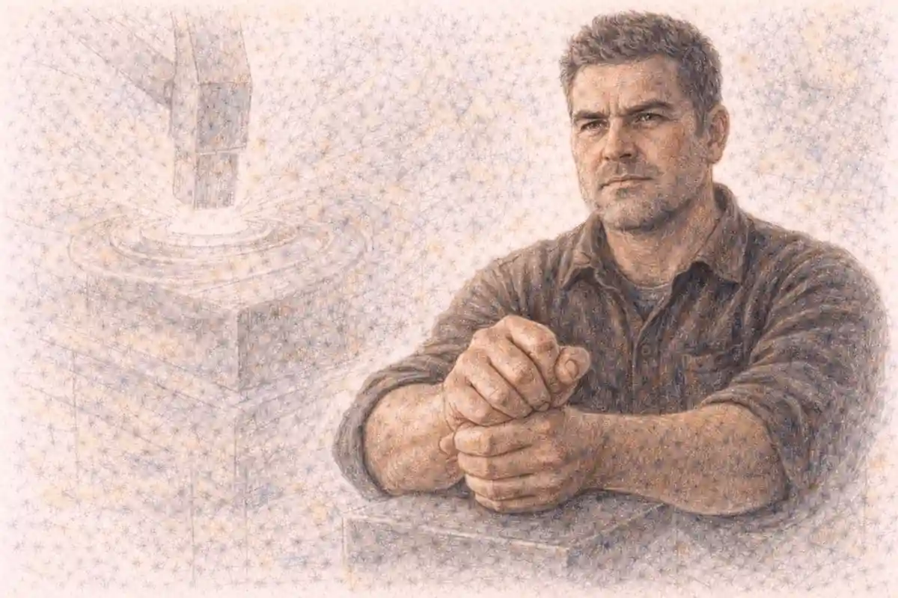

## Three first editions that disagree

In the autumn of 1839 a pianist shopping in three European capitals could buy the same new set of pieces by Frederic Chopin three times over, once from Maurice Schlesinger in Paris, once from Breitkopf and Härtel in Leipzig and once from Wessel and Company in London, and the three purchases would not match. Notes differed. Ornaments that one printing spelled out in full sat in another as a sign, or were missing. Slurs began and ended in different places, dynamics contradicted each other, and in a handful of passages the notes themselves were not the same notes. None of the three printings was a pirate copy. Each was an authorised first edition, prepared from a manuscript the composer himself had supplied, and that simple commercial fact is the foundation on which any honest account of Chopin greatest works has to be built: the most admired piano catalogue in the Western canon survives in competing originals, and no single authoritative text of it exists.

<!--more-->

The fact deserves stating plainly, because a reader will repeat it. Chopin issued his works through French, German and English publishers at the same time in order to hold copyright in each country, since no international agreement protected him across borders, and the three editions that resulted differ from one another in hundreds of details large and small. Every later edition has had to choose between them. Every performer who opens the music is therefore reading a decision somebody else made, whether the performer knows it or not. This is not a marginal scholarly curiosity attached to an otherwise tidy catalogue. It shapes what the works are, how they are taught, how they are recorded and how they should be ranked, because a ranking of pieces that exist in several versions is always partly a ranking of versions.

### Why do Chopin editions differ?

Chopin published each new work simultaneously in Paris, Leipzig and London, sending each publisher its own manuscript copy rather than proofs of one shared text. He corrected proofs carefully for the French edition, while the German and English printings drew on copies that sometimes preserved earlier readings, so editors inherit three divergent first editions and must choose between them.

The disagreements multiply because the three printings were only the beginning. Chopin taught from printed copies of his own works and, in the course of lessons, wrote changes into the scores his pupils played from: a different turn, an altered chord voicing, a phrase rethought at the keyboard in front of a student. Those annotated copies survive, and some of their readings have as good a claim to be his intentions as anything in the published editions. Add the autograph manuscripts themselves, which sometimes differ from all three printings, and a modern editor faces not a text but a small crowd of witnesses, each with partial authority. The sections that follow take the problem apart before turning to the works themselves, because the works cannot be judged fairly until the reader understands what kind of object a Chopin piece actually is. A question will be left open here and answered in the fifth section: if the sources disagree in this way, what can it possibly mean to play the piece as written?

The scale of the divergence deserves a number. In a substantial opus the three editions can differ in several hundred details, and in exposed passages the differences are not cosmetic: a pianist in London in 1840 and a pianist in Paris in the same year, each playing faithfully from an authorised edition, were in a real sense playing different texts, and each could believe the other careless. Chopin's own century was therefore the first audience of the problem this article describes, and the performers of his circle, who had heard him play, held an advantage no later generation can recover: they could measure the printed page against the memory of the composer's hands, and correct it by ear.

## Why the simultaneous publication happened

The triple publication was not vanity and not carelessness. It was a defensive manoeuvre forced by the state of copyright law in the 1830s. A work published only in Paris could be reprinted in Leipzig or London by any local publisher who got hold of a copy, without payment and without permission, because copyright stopped at the border. The standard protection, used by composers across Europe, was to publish in several countries on the same day or within a few days, establishing a local first edition in each jurisdiction before the pirates could move. Chopin, whose income depended on sheet music sales more directly than on any salary, followed the practice from his first Paris years and refined it into a system: three publishers, three contracts, three fees for the same piece, and three separate manuscripts travelling out of Paris in the post.

That is the first rung of this article's argument, and it reframes everything that follows. The textual problem at the heart of the catalogue is a commercial artefact, not a scholarly accident and not evidence of a careless composer. It arose because three engravers in three cities set type and punched plates from three handwritten copies prepared at slightly different moments, and because a living composer kept thinking about his pieces while the copies were in transit. Jean-Jacques Eigeldinger, the scholar whose work on Chopin's teaching and on the documents of his circle set the standard for this territory, showed how carefully Chopin in fact supervised what he could supervise: the letters complain bitterly about English misprints, demand corrections, and return proof sheets marked in his hand. The French edition, printed under his eye in the city where he lived, generally stands closest to his intentions. The German edition was usually prepared from a copy sent earlier. The English edition, produced by a publisher he distrusted, accumulated errors of its own and at the same time preserved readings from manuscripts that no longer survive.

The money side matters to the works themselves. Simultaneous publication paid three times, but it also meant that Chopin's publishers bought his music in a market where the piano piece was a commodity with a short commercial life, and they wanted what salons would buy: dances, nocturnes, brilliant variations, pieces with a mood a purchaser could name. Wessel in London went further and attached fanciful titles of his own invention to pieces Chopin had published under plain genre names, a practice the composer detested and protested in his letters, since it dressed his carefully unnamed music in costume. The tension between what the market wanted and what the composer wanted to write runs through the whole catalogue, and it is one reason the catalogue contains both drawing-room waltzes calculated to sell and mazurkas so private in character that they seem addressed to no market at all. What he published, when he published it and in what company, was shaped by this machinery, and a later section returns to that shaping directly.

The machinery of the system explains the rest. Chopin did not send three copies of one fair manuscript. He, or a copyist working under him, prepared separate engraver's copies for the three houses, and he corrected those copies at different sittings, sometimes weeks apart, while the piece was still settling in his mind and under his hands. A correction entered in the Paris copy in March might never reach the copy already posted to Leipzig in February. Copyists added their own layer of error and occasionally of tidying, regularising a spacing or a beaming that the composer had meant. Proof correction then repaired the French edition under his eye while the foreign editions went to press unrepaired, or repaired by strangers. The variants were therefore not an accident that befell the system; they were the system, working exactly as a triple publication in three countries had to work in the age of the mail coach.

## What the variants actually consist of

A reader who has never compared two editions of the same Chopin piece may imagine that a variant means a wrong note corrected in one printing and missed in another. Some variants are exactly that, and Wessel's London shop supplied more than its share. But the instructive variants, the ones that fill the critical reports of modern editions, are of several recurring kinds. Accidentals differ: a note sharpened in Paris stands natural in Leipzig, changing the colour of a chord and sometimes the logic of the harmony around it. Ornaments differ: where the French edition writes a turn out in small notes, the German prints the sign and leaves the realisation to the player, and the English sometimes omits the ornament entirely, so that three pianists reading three editions play three measurably different surfaces. Phrasing differs: slurs that in one edition bind a long line across a bar line stop short in another, instructing the hand and the ear to group the music differently. Dynamics differ, pedalling instructions differ, and fingering differs, Chopin's own fingering being one of the most personal features of his printed texts, full of substitutions and slides that encode how he wanted a phrase to feel under the hand.

Beyond details of dress lie variants of substance. In a number of works the three editions preserve different versions of whole passages: an introduction present in one source and absent in another, a transition written two ways, a coda extended in the last form of the text. Jeffrey Kallberg, the scholar who has written most searchingly about Chopin's variants and about the small forms in which so many of them cluster, reads these cases as evidence about how Chopin composed and revised: some of the copies sent abroad captured the work at an earlier stage, so that an English or German reading can preserve a draft the composer later superseded in Paris, while in other cases the supposedly secondary source carries the improvement. There is no rule that the French text always wins. Editors have to argue each case from the surviving paper: which manuscripts exist, in whose hand, copied when, corrected by whom.

The practical consequence is a catalogue in which certainty is graded rather than absolute. For long stretches of most pieces the sources agree, and what Chopin wrote is not in doubt. The disagreements gather at particular joints: ornaments above all, then accidentals, then phrasing, and only occasionally notes of structural weight. Keeping that proportion in view matters, because the variant problem is easily exaggerated into a claim that the works themselves are unknowable, and that claim is false. The works are knowable the way a building with three early photographs is knowable: the shape is certain, some of the fittings are disputed, and honest scholarship says which is which. The remaining sections of this opening group look at the two strangest classes of witness, the annotated pupil copies and the autographs, and then ask what kind of edition such evidence can support.

Two further kinds of variant complete the taxonomy. Markings differ: the tempo and character words at the head of a piece, the metronome figures where they exist, the accents and hairpins that tell a player where a phrase leans, all shift between printings, and in music whose expression depends on the precise weight of a phrase, a shifted accent is a shifted meaning. And repeats differ: where one source writes out a varied return in full, another prints the passage once with an instruction to repeat, leaving the variation to a convention the sources elsewhere show Chopin ignoring. The written-out varied repeat is one of his signatures as a composer, the mark of a mind that heard a return as a new event, so a source that flattens a return into a mechanical repeat has not made a small error. It has removed part of the piece's argument. Editors weigh such cases heaviest of all, because the choice between them changes what a listener hears across minutes rather than seconds.

## The annotated pupil copies

Chopin earned much of his living teaching the daughters of aristocratic and wealthy families in Paris, and his teaching method was intensely practical: he played, the pupil played, and he corrected the printed page in front of him. Because pupils kept their scores, a series of printed copies survives bearing his handwritten alterations, entered during lessons in pencil or ink. The most consequential collection belonged to Jane Stirling, the Scottish pupil who organised his tour of Britain in 1848 and whose copies, annotated across years of lessons, passed eventually to the Bibliothèque nationale in Paris. Other annotated copies belonged to pupils such as Camille Dubois, later Madame O'Meara, whose scores preserve alternatives Chopin suggested for particular passages. Eigeldinger's research assembled this material and established its character: these are not random jottings but a record of the composer continuing to compose at the margins of his published works while he taught them.

Here the second rung of the argument lands. Some of the differences between sources are not errors at all, and not earlier drafts either. They are the composer's own alternative readings, written into a pupil's copy because in that room, for that hand, the passage went better another way. Chopin appears to have regarded certain ornaments and figuration as legitimately variable, the way a singer varies a repeat, and his annotations sometimes offer an ossia, a sanctioned alternative, rather than a correction. That possibility transforms the editor's task. A variant in a pupil's copy might be a mistake, a private adaptation for one student's technique, or a genuine second thought of equal authority to the printed text, and only the circumstances of the annotation can suggest which.

It also transforms what a performance can claim. A pianist who adopts a reading from Jane Stirling's copy is not departing from Chopin's text; that pianist is choosing one Chopin text over another, with documentary warrant. The pupil copies therefore stand in this article as first-class witnesses, neither worshipped nor dismissed. Their evidence is strongest where several copies agree, where the handwriting is verified, and where the alteration is of a kind Chopin made elsewhere. Their evidence is weakest where a single copy carries an unexplained change that might record a concession to a struggling student. Sorting one from the other, copy by copy and passage by passage, is slow work, and it is the work on which every modern edition silently rests.

The annotated copies also entered the editorial tradition earlier than the printed editions did. Karol Mikuli, who studied with Chopin in the 1840s, published his own edition of the works in 1879 and 1880 and presented it as carrying the authority of the master's teaching, since his copies had been corrected in lessons and he had kept notes of Chopin's instructions. Later scholarship treats Mikuli's claims with respect and with caution in about equal measure: he was a genuine pupil and a careful musician, and he was also a man of a later generation arranging an inheritance, with that generation's habits of tidying. His edition stands in the record as the first attempt to do what every editor since has attempted, to gather the scattered authority of the lessons into a single usable text, and its mixture of priceless testimony and quiet normalisation is the whole editorial problem in miniature. The pupil evidence, in short, is indispensable and insufficient, and every modern editor's preface says so in its own way before proceeding to choose.

## Whether a definitive text is possible

The question opened in the first section can now be answered directly. If the sources disagree, what does it mean to play the piece as written? It means choosing, knowingly, among several written versions each of which descends from the composer, and the honest performance is the one whose choices can be defended from the documents. A single definitive text, in the sense of one reading for every note that the composer finally intended and that scholarship can certify, is not achievable for much of this catalogue. That is the third rung of the argument, and it is not a counsel of despair. The major editions agree on the great bulk of the text. They disagree in identifiable places, over identifiable passages, for reasons that can be stated, and the apparatus of a critical edition exists precisely to show the reader where the ground is firm and where it is contested.

The editions themselves embody different philosophies of choice. The Paderewski edition, produced in Poland between 1937 and 1961 under the names of Ignacy Jan Paderewski, Ludwik Bronarski and Józef Turczyński, served generations of students and made the works universally available, but its editors drew freely on several sources at once, combining readings into texts Chopin himself never saw in that form. The German Urtext tradition, represented by the Henle edition, aims at a clean text based on the most reliable source for each work. The Polish National Edition, edited by Jan Ekier and published by the Fryderyk Chopin Institute in Warsaw, works from a stated principle: for each piece, identify the source with the strongest authority, print it as the main text, and present the significant rivals in the commentary rather than weaving them in. A variorum project directed by John Rink, the scholar of Chopin's performance practice and of the first editions, places the sources side by side so that the variants themselves become the object of study. Rink's position, developed across his writings on the concertos and the sources, is that performance is where these textual questions become audible, and that a player who understands the sources plays differently from one who merely obeys a page.

Proportion is the discipline this article will keep. The variant problem touches every work in the catalogue, but it overturns none of them. Nobody disputes the themes of the ballades, the architecture of the sonatas or the count of the preludes. What is disputed is the exact finish of passages, the presence of particular ornaments, the reading of particular harmonies, and in a small number of famous places the shape of whole phrases. An edition is an argument about those places. A recording, whether its pianist knows it or not, is the same argument made in sound. With that understood, the catalogue itself can be surveyed: first its numbering and shape, then the works in their families, with the textual question returning at the end, where it belongs, as the thing a listener is finally choosing between.

The choices have practical teeth. Conservatoires and examination boards, which once simply named a piece, now name an edition as well, because a candidate playing the Paderewski text and a candidate playing the National Edition text are, at the contested joints, playing measurably different music, and a jury cannot judge the second by the page of the first. Competitions face the same issue at a higher level: the great Chopin competitions admit any scholarly edition, and jurors learn to hear a pianist's textual allegiance as part of the performance's identity. None of this would be possible in a catalogue whose sources had perished. It is possible here because the evidence survived in embarrassing abundance, and because a line of editors from Mikuli to Ekier chose to display the evidence rather than hide it. A definitive text is not achievable; a defensible text is, and the difference between those two phrases is the difference between the catalogue's reputation for chaos and its actual condition.

## Chopin Greatest Works and the Catalogue That Numbers Them

Counted whole, the surviving catalogue runs to roughly two hundred and thirty pieces, and its organisation is unusually legible for a composer who died at thirty-nine. Chopin published in opus numbers from his mid-teens onward, and the numbered sequence from the Rondo, Opus 1, of 1825 to the three Mazurkas, Opus 63, of 1846 gives the works a public spine. Around that spine cluster the pieces he did not publish: the early Warsaw works he left behind, the songs he kept for his friends, and the manuscripts he ordered destroyed, a selection of which his friend and copyist Julian Fontana issued after his death as Opus 66 to 74, in 1855, against the instruction the composer had left. Modern catalogues add the letter B and a number, from Bronisław Edward Sydow's listing, for the works without opus numbers, so that every piece can be cited exactly. The numbering matters for a works article because it records decisions: an opus number means Chopin judged the piece ready for the world, while the unnumbered works include both juvenilia he outgrew and finished music he deliberately withheld.

The proportions of the catalogue are its most striking feature. There are no symphonies, no operas, no string quartets, no choral works. There are two concertos, three piano sonatas, one cello sonata, a piano trio, a set of songs, and then an immense population of solo piano pieces arranged in genre families that he returned to across his whole life: mazurkas, nocturnes, waltzes, polonaises, etudes, preludes, ballades, scherzos, impromptus. The table below sets out those families with their counts and spans, using the figures this article will hold to throughout: fifty-eight mazurkas, twenty-one nocturnes, twenty-four preludes with a twenty-fifth standing outside the set, twenty-seven etudes, sixteen polonaises, four ballades, four scherzos and nineteen Polish songs.

| Form | Number of works | Span of years | What the form let him do | Representative work for a newcomer |
|---|---|---|---|---|
| Mazurkas | 58 | 1825 to 1849 | Test harmonic and rhythmic ideas at private scale | Mazurka in B flat major, Opus 7 No. 1 |
| Nocturnes | 21 | 1830 to 1846 | Build a singing line over a wide-spread accompaniment | Nocturne in E flat major, Opus 9 No. 2 |
| Waltzes | 18 | 1829 to 1847 | Compress brilliance and melancholy into salon scale | Waltz in A minor, Opus 34 No. 2 |
| Polonaises | 16 | 1817 to 1846 | Address Poland in public, ceremonial forms | Polonaise in A flat major, Opus 53 |
| Preludes | 24 | 1835 to 1839 | Compress a complete mood into one or two pages | Prelude in E minor, Opus 28 No. 4 |
| Etudes | 27 | 1829 to 1839 | Make a technical problem carry poetic weight | Etude in E major, Opus 10 No. 3 |
| Ballades | 4 | 1831 to 1842 | Build a long narrative arc without words | Ballade No. 1 in G minor, Opus 23 |
| Scherzos | 4 | 1831 to 1842 | Stretch wit and violence across a large single movement | Scherzo No. 2 in B flat minor, Opus 31 |
| Piano sonatas | 3 | 1828 to 1844 | Test himself against the classical four-movement frame | Sonata No. 2 in B flat minor, Opus 35 |
| Concertos | 2 | 1829 to 1830 | Present himself as soloist before an orchestra | Concerto No. 1 in E minor, Opus 11 |
| Songs | 19 | 1829 to 1847 | Set Polish poetry for the private circle of friends | The Wish, Opus 74 No. 1 |
| Chamber works | 4 | 1828 to 1846 | Write for the cello in partnership with a friend | Cello Sonata in G minor, Opus 65 |

One more feature of the numbering deserves attention before the works themselves. Chopin was his own publisher's most awkward supplier: he composed out of sequence, held finished pieces back for years, sold the same work in different countries from different manuscripts, and allowed the opus order to drift away from the order of composition, most famously in the two concertos, where the F minor work was written first and published second. A catalogue read strictly by opus number is therefore a record of publication decisions, not a diary. The works are best approached family by family, which is how the next sections take them: first the frame itself, the near-total concentration on one instrument, then the families in the order that shows how the catalogue grew.

## A body of work almost entirely for piano

Stand the catalogue beside those of Chopin's contemporaries and one fact rises above every other: almost all of it involves the piano, and the great majority of it is for piano alone. Mendelssohn left symphonies, oratorios and chamber music in quantity. Schumann wrote symphonies, concertos, chamber works and hundreds of songs. Liszt ranged across orchestral tone poems, sacred music and opera transcriptions. Chopin, alone among composers of comparable standing, staked everything on a single instrument, and this is the fourth rung of the article's argument: the concentration is itself one of the catalogue's defining facts, and the ranking of his works is a ranking within a body of music deliberately narrowed to one medium and then explored to its limits.

### Did Chopin write anything without piano?

Almost nothing. The catalogue contains no work for orchestra alone, no opera, no choral music and no solo music for another instrument. The only pieces not centred on his keyboard are the nineteen Polish songs, where the piano still partners the voice, the cello sonata, and the early chamber works, in which the piano shares the stage.

The exceptions repay a moment's attention because they define the rule. The two concertos subordinate the orchestra to the piano so thoroughly that critics have complained about it for a hundred and eighty years, a complaint examined in its own section below. The cello sonata, his last major work, was written for Auguste Franchomme, his friend and the finest cellist in Paris, and even there the piano carries half the argument. The songs give the piano an accompaniment that comments, interrupts and remembers. Beyond those, the orchestral variations, the rondo for two pianos and the single piece for piano and orchestra on Polish themes all keep him at the keyboard. A survey of the standing of composers in the [greatest composers of all time](/2025/04/07/greatest-composers-of-all-time/) discussion has to reckon with this singularity: every other candidate built a reputation across several media, while Chopin built his inside one, and the intensity of the achievement is inseparable from the narrowness of the field he chose to work.

Why he narrowed the field is a question for the biography rather than the catalogue, but the works themselves offer a partial answer. His forms grow out of the piano's specific resources: the sustain pedal as a harmonic instrument, the contrast between a singing right hand and a striding bass, the capacity of one player to be orchestra, singer and dancer in successive bars. He seems to have experienced no pressure to prove himself in the public genres. The sonatas and the concertos, his ventures into the classical public forms, were written early or under particular circumstances, while the private forms, the mazurka above all, occupied him from first to last. The catalogue is thus a pyramid standing on its point: the smallest forms carry the greatest weight of his invention, and the largest forms are the exceptions that test the rule.

The concentration had a further consequence that only an editor notices. Because the output is one instrument's literature, complete and bounded, it became the testing ground on which modern textual scholarship of piano music learned its trade. The Chopin sources are numerous enough to demand method and coherent enough to reward it, and the editions of his works, from the nineteenth-century collected printings to the National Edition, form a continuous laboratory in which every editorial philosophy of the past hundred and fifty years has been tried on the same body of music. To study how his texts were made, corrupted, conflated and at last displayed is to study the history of music editing itself, with the piano as its only stage.

## The early Warsaw works

The catalogue begins in Warsaw, where the child prodigy of the Polish capital published his first piece at seven, the Polonaise in G minor of 1817, printed by a local publisher at the initiative of his teacher. Halina Goldberg, the scholar of Chopin's Warsaw and of the musical culture of the Polish capital in those years, has reconstructed the world those early works were written for: a city of salons, amateur orchestras and patriotic feeling under Russian rule, where a gifted boy could hear Polish dance music in the countryside, Italian opera in the theatre and the classics in the homes of the aristocracy. The Warsaw works are apprentice pieces in the brilliant style of the day, rondos, variations, a first piano sonata in C minor, a piano trio, the Introduction and Polonaise brillante for cello, and they show a teenager absorbing the international virtuoso manner of Hummel, Field and Weber while his harmony and his rhythmic sense already strain against it.

Two Warsaw works stand apart from the apprentice class and announce the mature composer. The Variations on a theme from Mozart's Don Giovanni, Opus 2, published in 1830, take the duet theme as a frame for a set of variations of startling orchestral imagination and pianistic daring; it was this score, reviewed in Leipzig by the young Robert Schumann, that carried Chopin's name across Europe before he had left Poland, and Schumann greeted it by announcing a genius to his readers. The Krakowiak, Opus 14, a concert rondo built on a Polish dance rhythm, shows the other direction of his gift: the folk material is not decoration but the generating cell of the piece. The circumstances of that Warsaw formation, the teachers, the salons and the politics pressing in on them, belong to the account of [Chopin's life and career](/2011/03/21/frederic-chopin-life-and-career/), which covers the ground the catalogue can only point to.

The Warsaw works also establish a habit that never left him: withholding. The C minor Sonata, Opus 4, written in 1828 under his teacher Józef Elsner's eye, went unpublished in his lifetime and appeared only in 1851, after his death, from a Vienna publisher. He let it drop from his own picture of his catalogue, and posterity has largely agreed with the verdict while keeping the piece in print as a document of the apprenticeship. The pattern, compose, judge, withhold or release, applied to everything he wrote, and it is one reason the posthumous publications caused such argument: the pieces Fontana printed in 1855 included works Chopin had judged and set aside, alongside works he had simply never got round to publishing, and the two classes have been tangled ever since.

The apprenticeship ended in public, on the road. In the summer of 1829 Chopin played in Vienna, giving concerts at the Kärntnertor Theatre in which the Don Giovanni Variations and the Krakowiak were the novelties, and the Viennese press received the nineteen-year-old as a pianist of the first rank whose compositions puzzled as much as they charmed. The works he carried on that tour define the Warsaw catalogue's ceiling: rondos and variation sets in the brilliant manner, written to display a technique that witnesses agreed was unlike anyone else's, quieter, more singing, more dependent on the fingers' evenness than on the arm's weight. Goldberg's reconstruction of the Warsaw background underlines how much of that manner was formed before Paris entered the story: the teachers, Elsner above all, who gave him his rigorous schooling in form and counterpoint, the salons of the Polish aristocracy where he played from childhood, and the folk music he heard on boyhood visits to the countryside at Szafarnia, remembered in the comic newspaper he wrote home for his family, already attentive to the village bands' rhythms and drones.

## The two concertos

The concertos were written as calling cards, and they should be read as such. A young pianist-composer arriving in a European capital in 1830 needed orchestral works to present himself with an orchestra behind him, and Chopin wrote two in Warsaw in consecutive seasons: the Concerto in F minor, composed first, in 1829, and the Concerto in E minor, composed in 1830. The numbering records the order of publication, not of composition, since the E minor reached print first in Paris in 1833 and took the title of Number 1, while the F minor followed in the same year as Number 2, Opus 21. He premiered both in Warsaw himself, the F minor in March 1830 at the National Theatre and the E minor in October 1830 at his farewell concert in the city, weeks before he left Poland for good. Each concerto follows the classical plan of a long first movement, a slow movement of operatic songfulness and a rondo finale drawing on Polish dance rhythm, the krakowiak in the E minor and a mazurka-like swing in the F minor.

The slow movements explain why the concertos have kept their place in the repertory despite every complaint lodged against their orchestration. The Romance of the E minor concerto and the Larghetto of the F minor are among the most sustained pieces of singing he ever wrote, long-breathed lines that transfer the nocturne's vocal manner to the largest canvas he used, and in the F minor's Larghetto he wrote, by his own account in a letter, under the influence of a feeling he was reluctant to name, for a young singer at the Warsaw Conservatory whose voice he admired from a distance. The finales answer the slow movements with public brilliance. What the concertos are not is symphonic argument of the kind Beethoven had made the measure of the genre. Their drama is a soloist's drama: entrances delayed, themes confided, passagework as display of character rather than of muscle.

As documents, the concertos carry the variant problem into the orchestral arena. Chopin performed them from manuscript parts, the full scores reached print through the same triple-publication machinery as the piano pieces, and the orchestral text in the three editions shows the usual small crowd of discrepancies, compounded by the practical copying errors of orchestral material. He also, like most pianist-composers of his generation, was content for the orchestral contribution to be thinned in salon performances, and a long tradition of playing the concertos with reduced forces runs from his century into ours. A modern critical text of the concertos is therefore a reconstruction from layered evidence, and John Rink's study of the two works remains the standard account of what the sources can and cannot certify.

The dedications record the young composer's professional geography. The E minor concerto was inscribed to Friedrich Kalkbrenner, the reigning pianist of Paris, whose playing Chopin admired and whose offer of a three-year course of study he famously declined, preferring his own road; the dedication was a tribute from an equal in the making, and Kalkbrenner's reported response to hearing the work was to declare its composer no pupil of his but a master of another school. The F minor concerto was dedicated to Countess Delfina Potocka, the Polish aristocrat and singer whose salon became one of his Paris homes. In form both concertos look back to the model of Hummel and Field, the piano concerto as a vehicle for a singing, brilliant soloist framed by ritornellos, rather than forward to the symphonic concerto of Schumann and Brahms, and much of the later criticism dissolves once the works are placed in the tradition they actually came from. He was also practical about their performance: in the salons of Paris the concertos were heard with the orchestral part reduced to a string quintet or a second piano, a practice documented across his circle, and the works' centre of gravity, the solo line, survives the reduction intact, which the defence in the next section counts as evidence about where the music's substance lives.

## Why the orchestration is criticised

No complaint in the whole reception of Chopin has proved as durable as the charge that he could not orchestrate. It began early, attached itself to the concertos above all, and hardened into a commonplace: the piano writing is sublime, the orchestral writing is routine, the tuttis are stiff, the accompaniments merely mark time, and the works survive despite their scoring rather than because of it. The stance of this article is that the question is genuinely two-sided, and both sides deserve their strongest form, since the critical tradition on one side and the score itself on the other both have evidence to present.

### Why are the Chopin concertos criticised?

Critics since the nineteenth century have called the orchestral writing thin and functional, pointing to stretches where the orchestra accompanies in plain chords, doubles the piano or waits while the soloist carries the argument alone. The charge stuck because the concertos were measured against Beethoven's standard, where the orchestra is a protagonist, whereas Chopin treats it as a frame.

The case for the prosecution rests on real features of the scores. The orchestral exposition of the E minor concerto's first movement is competent rather than inspired. Whole passages of accompaniment are harmonically plain, and Chopin's instrumentation rarely surprises: the orchestra seldom comments, ironises or transforms the soloist's material, and when the piano plays, the band is often reduced to punctuation. Nineteenth-century musicians acted on the criticism: pianists and conductors reorchestrated the concertos, Mily Balakirev among them, producing fuller versions intended to repair the deficiency, and such rescorings were performed for decades. The defence answers that the prosecution is measuring the wrong thing. On this reading, the subordination is the design: the concerto is conceived as an operatic scene for one voice, and the orchestra's restraint keeps the stage clear for a solo line of extreme delicacy that a Beethovenian orchestra would crush. The wind writing at the soloist's entrances, the muted colours under the slow movements and the bassoon's quiet interventions in the F minor Larghetto show, the defence argues, an orchestrator who knew exactly how much sound his solo writing could bear. Rink's examination of the sources adds a practical point: some of the plainness belongs to the editions rather than the manuscripts, and the parts Chopin used in his own performances suggest a lighter orchestral manner than the printed tuttis imply. The dispute stays open because both sides are partly right about different things: the orchestration is limited as symphonic writing, and it is also fitted, with real precision, to the soloist-centred drama the works exist to stage.

A later generation of performers has shifted the dispute's terms. Performances with the smaller orchestras and the lighter, quicker-speaking pianos of Chopin's own Paris restore a balance the modern symphony orchestra destroys: against twenty strings and period wind, the solo writing no longer sounds exposed but proportioned, and the tuttis recover a brilliance that a hundred modern strings smother. Scholars who work on the concertos, Rink foremost among them, caution against treating any of this as a verdict. The scores contain both the plainness the prosecution cites and the precision the defence cites, sometimes in adjacent pages. What the long argument really tracks is the history of taste in concertos: an age that wanted symphonic conflict found Chopin's concertos wanting, and an age readier to hear the concerto as a soloist's opera has found them sufficient. The works did not change. The measuring instrument did.

## The variations and the early virtuoso pieces

Between the Warsaw juvenilia and the mature sets stands a group of brilliant display pieces written for the virtuoso market of Paris and Vienna: variation sets, rondos, fantasies on opera themes and showpieces with orchestra. The most substantial is the earliest, the Don Giovanni Variations, Opus 2, already discussed among the Warsaw works for the effect of Schumann's review. The Variations on a theme of Hérold, Opus 12, the Rondo in E flat, Opus 16, the Introduction and Variations on a German folk theme and the contribution Chopin made to the collective Hexaméron variations of 1837, where six composers each varied a theme from Bellini's I puritani, all belong to this stratum. So does the Fantasia on Polish Airs, Opus 13, and the early Polonaise brillante for cello. These pieces follow the conventions of the brilliant style, themes displayed, then decorated with escalating figuration, and they were the currency in which a young pianist paid for admission to the salons.

Their interest for a catalogue survey is double. On one side, they show the young Chopin mastering the international manner so completely that the manner itself becomes transparent: the figuration in the late variations of Opus 2 already serves expression rather than display, darkening and dissolving the theme instead of merely glittering around it. On the other side, they show what he abandoned. After the mid-1830s he wrote almost no display variations, and the virtuoso apparatus of the early showpieces was absorbed into forms with stronger claims: the etude, the ballade, the scherzo. The variation idea did not disappear; it went inward, becoming a principle of transformation inside pieces rather than a frame for a sequence of decorated repeats. Jim Samson, whose studies of Chopin's genres remain the benchmark account of how these forms behave, reads the trajectory as a reordering of ambitions: the genres that the market ranked lowest, the dance miniature and the teaching piece, became the sites of his most serious work, while the public display genres of his youth receded to the catalogue's edge.

Two works of the group resist that demotion. The Allegro de concert, Opus 46, of 1841 began life, on the usual scholarly account, as the first movement of a projected third concerto and was published instead as a solo piece, which would explain its orchestral scale and its long tuttis translated for two hands. And the Rondo for two pianos, Opus 73, written in 1828 and published only after his death, preserves the brilliance of the Warsaw manner in its most sociable form. Neither changes the family's standing: competent, sometimes splendid, and most valuable as the record of what the mature forms grew out of.

Two single pieces round out the stratum and complicate it. The Bolero, Opus 19, of 1833, dresses a Spanish dance in Polish rhythms until the two are indistinguishable, a jeu d'esprit that only a composer entirely sure of his materials could have written. The Tarantella, Opus 43, of 1841, takes Rossini's famous song as its model and whirls it through modulations that leave the salon piece far behind. Neither is central, and both are instructive: they show the mature Chopin still willing, on occasion, to take the market's forms and bend them until the bending itself becomes the interest. The market, for its part, took the pieces and asked for more like them, which he mostly declined to supply.

## The etudes of Opus 10

With the twelve Etudes, Opus 10, composed between 1829 and 1832 and published in Paris in 1833 with a dedication to Franz Liszt, Chopin committed the act of genre redefinition on which much of his standing rests. The etude existed before him as a study: a piece built on one technical figure, designed to train the hand, valued for its usefulness and not for itself. Czerny had produced them by the hundred, and Clementi's Gradus ad Parnassum had given the type its monument. Chopin's Opus 10 keeps the discipline of the single technical problem: one study for wide arpeggios, one for passing the weaker fingers over chromatic semitones, one for legato in a singing line against a rocking accompaniment, one for velocity in the left hand, and so through the set. What changed is that each problem became the subject of a complete piece of music, with a harmonic argument, a dramatic shape and an emotional temperature that no exercise had carried before.

The sequence of the twelve is composed, not merely collected. The first two studies establish the terrain, extension and chromatic control. The third, in E major, hides its problem, the evenness of a legato melody, inside the most songful page of the set. The studies that follow move through storms of the whole keyboard, a study in contrary motion, a study in black-key glitter for the right hand alone, studies that test endurance, voicing and the independence of the hands. Samson's account of the set emphasises the cyclic thinking: keys, characters and problems are arranged so that the twelve cohere as a single opus in a way the study literature had never attempted. Publication in three countries scattered the variants through this set as through everything else, and the Etudes became, in prints all over Europe, the standard by which ambitious students measured themselves, usually in texts that differed from one another in the details of fingering and ornament that matter most in music of this exposure.

It is in this section that a question must be opened and deliberately left hanging, because its answer lies deep in the catalogue. Which part of this body of work did Chopin care about most? The etudes make one kind of claim: public, revolutionary, addressed to the whole future of piano playing, and he published them with care and revised them in lessons for years. The nocturnes make another claim, and the mazurkas, as their sections will show, make a third and quieter one. The evidence is spread across the families, and the answer is earned only when the mazurkas have had their say, in the eighteenth section of this article. Hold the question open until then.

The set's afterlife confirms the transformation. Liszt, to whom Opus 10 was dedicated, learned the studies and played them with an effect witnesses described in terms usually reserved for new continents of the instrument. Within two generations Robert Schumann's prophecy about them had been fulfilled in the conservatoires, where they displaced the older study literature, and Leopold Godowsky, at the end of the century, built his own Studies on Chopin's Etudes, recomposing them for one hand, for combined hands, for inverted figuration, a monument of homage that only makes sense if the originals had become classics whose every note a virtuoso culture knew by heart. Godowsky's versions also make the textual point from the performer's side: his recompositions take the Paderewski-era text as their ground, and the variants among the first editions run under his transformations like a watermark, invisible until the light is right.

## The etudes of Opus 25

The twelve Etudes, Opus 25, composed between 1832 and 1836 and published in 1837, dedicated to the Countess Marie d'Agoult, extend the Opus 10 project in a direction nobody had forecast: the problems become more specialised, and the poetry deepens with the specialisation. Where Opus 10 addresses the large mechanics of the hand, Opus 25 addresses refinements: thirds played legato in one hand, sixths, octaves sustained without brutality, repeated notes, the control of a melody floating above arpeggios in the same hand, the left hand singing a cello line under right-hand figuration. Two studies in the set, the E minor study built on surging chromatic scales and the C minor study of octave endurance, push the performer to the edge of what hands can sustain, yet both remain shaped as dramatic utterances rather than ordeals.

Chopin also closed the set with a gesture of scale. The final study, in C minor, builds its octave problem into a chorale of gathering weight, a piece that behaves less like an exercise than like the finale of a sonata, and it stands in the catalogue as early proof that he could command the largest rhetoric when he chose, a fact worth remembering when the small scale of so much of his output is mistaken for a limitation of reach. The three further studies written in 1839 for the piano method compiled by Moscheles and Fétis, published without opus number as the Trois nouvelles études, complete the family at twenty-seven. They are slighter, deliberately so, being teaching pieces written to sit inside a method book, and their problems, two-against-three rhythm, chromatic legato and a singing left hand, are stated with an economy that makes them favourites in studios.

The etudes' reception reversed the usual direction of influence between teaching and concert life. Written ostensibly for the studio, they migrated to the concert hall within a generation and stayed there, while concert pieces of the same decades sank into the studio or out of print. That migration matters for the ranking question this article keeps in view: the etudes are now counted among his greatest works not because pianists are grateful for them, though they are, but because the pieces sustain the same scrutiny as the ballades when they are played as music and not as solutions. The textual questions apply here with particular force, because in music built from figuration, a variant fingering or a variant ornament is not decoration on the work; it is part of the machine, and the differences among the three first editions of the etudes are among the most consequential in the catalogue.

The dedication of Opus 25 belongs to the biography of the Liszt circle: Marie d'Agoult, Liszt's partner and a writer of standing in her own right, moved in the same Parisian world, and the inscription places the set inside the exchange of courtesies and rivalries between the two pianists whose names headed their generation. The professional point for the catalogue is different. By 1837 the etude, in Chopin's hands, had completed its journey from the practice room to the centre of the art, and the two sets together, twenty-four studies plus the three written for the Moscheles and Fétis method, constitute a complete survey of his pianism, problem by problem, that performers treat as a single testament. No other composer's teaching pieces are programmed entire in the world's concert halls. That fact, more than any single study's beauty, is the family's claim on a ranking of the whole output.

## The twenty-four preludes

The twenty-four Preludes, Opus 28, composed across the years 1835 to 1839, with much of the set completed during the winter he spent with George Sand at the Charterhouse of Valldemossa on Majorca, form the catalogue's most concentrated achievement. They were published in 1839, the French edition dedicated to the piano maker Camille Pleyel, who had commissioned them with an advance, and the German edition to the pianist Joseph Christoph Kessler. Each prelude occupies a single key and a single state of feeling, most last between half a minute and three minutes, and some are fragments in the strictest sense: ideas stated, turned once and abandoned at the moment of greatest intensity. Yet the set was conceived as a cycle and is played whole by pianists who want its cumulative effect, the individual pieces gaining meaning from their neighbours like panels in a screen.

The key scheme is the set's skeleton. The preludes proceed through the circle of fifths, major key followed by its relative minor: C major and A minor, G major and E minor, D major and B minor, and so on through all twelve stations until the cycle closes in F major and D minor. Within that order the characters alternate between assertion and withdrawal, storm and chorale, dance and lament, so that the cycle behaves like a day of weather over one landscape. The writing divides between pieces that grow from a single figure pursued to its limit and pieces that sing: the E minor prelude sustains a melody over slowly sinking chords for twenty-five bars and achieves the gravity of a funeral hymn without quoting one, while the D flat major prelude wraps its long melody around a repeated note that Sand's account of the Majorca winter made famous as the sound of rain on the Charterhouse roof. Attribution matters here, and the rain story is Sand's recollection, offered years later; the piece itself offers its repeated note without explanation, and editors have connected it to the story only by tradition.

The preludes also carry the variant problem at its most delicate. Their brevity means a single differing accidental or ornament changes a larger share of the whole piece than it would in a ballade, and the surviving sources, including an autograph that preserves an earlier state of the set's order and content, give editors more to argue about per bar than anywhere else in the catalogue. Kallberg's work on the preludes reads them against the expectations of the small forms in Chopin's time and shows how deliberately the set withholds what its genre promised: brevity without slightness, mood without programme, a cycle that claims the unity of the largest works while refusing their dimensions. The twenty-fifth prelude, a separate piece in C sharp minor composed in 1841 and printed only after his death, stands outside the cycle as a pendant: a short, sombre essay that shares the set's concentration without belonging to its key scheme, and is best heard as evidence that he continued to think in the form after the cycle had closed.

The set's smallness invited a particular kind of disrespect that later editors obligingly supplied. Hans von Bülow, in his edition of the preludes, attached descriptive titles to individual pieces, and Alfred Cortot, in his, supplied poetic headings of his own, so that generations of students met the preludes wearing names their composer never gave them. The practice is the gentle cousin of Wessel's titled editions, and its persistence tells the same story: music that declines to describe itself creates a vacuum that the trade fills. The pieces themselves have outlasted every label pasted on them, and a modern listener who hears the cycle entire, unnamed, in its circle of fifths, hears what Chopin published in 1839 and nothing else.

## What the prelude set is modelled on

Every musician of Chopin's generation knew the model by heart: Bach's Well-Tempered Clavier, forty-eight preludes and fugues running through every major and minor key, the old testament of keyboard music in Hummel's famous description of the two great collections. Chopin revered Bach above all earlier composers, taught from the Well-Tempered Clavier, and took a copy with him to Majorca as one of the few scores he carried. The twenty-four preludes answer Bach's example in the way of a homage that refuses imitation. Bach's cycle proceeds chromatically, step by step up the scale of keys, and pairs every prelude with a fugue. Chopin's proceeds by fifths, drops the fugues entirely, and compresses Bach's magisterial span into miniatures. The debt is structural and spiritual rather than technical: the conviction that a cycle of small pieces through all the keys can add up to a complete world.

A nearer precedent for the key scheme deserves its place in the record. Johann Nepomuk Hummel, the pianist-composer Chopin most admired in his youth, had published twenty-four preludes through all the keys in 1815, arranged by the same circle of fifths Chopin later used, and the young composer almost certainly knew them. The background of the whole tradition, in which Bach's compilation became the keyboard player's bible across the nineteenth century, is traced in the survey of the [history of classical composers](/2010/03/07/history-of-classical-composers/), where the canon Chopin inherited is laid out. What Chopin added to the model was compression and psychological range: Hummel's preludes are finger exercises in the keys, Bach's are complete contrapuntal worlds, and Chopin's occupy neither category, being instead a sequence of states of mind notated with the economy of a diary.

The modelling question matters because it governs how the set should be heard. Listeners who expect Bach get fragments; listeners who expect mood pieces get a cycle of iron construction. The correct expectation is both at once: twenty-four pieces arranged with a keyboard player's logic of the keys, each behaving like an entry in a private journal, the whole adding up, across its sequence of fifths, to the most complete short-form statement by any composer of his century. It also matters for the texts: Bach's cycle survived in a comparably tangled source tradition, and the editors of Chopin's preludes work with the same instruments, autograph against copy against first editions, that Bach scholarship had refined for two hundred years.

The homage ran through his teaching as well as through the cycle's design. The pupils whose accounts Eigeldinger collected describe a master who set Bach's keyboard works at the foundation of a pianist's formation and who played Bach himself with a fidelity his students remembered decades later. The preludes of Opus 28 can thus be read as the point where the oldest discipline he knew met the most personal form he owned: twenty-four entries in a journal, kept in the order of the keys, by a composer whose reverence for the Well-Tempered Clavier was a matter of daily practice. The improvisatory prelude of the old keyboard tradition, the short piece a player extemporised to test an instrument and settle an audience, stands behind both collections as their common ancestor, and Chopin's transformation of that functional trifle into the century's most concentrated piano cycle is the homage's final turn.

## The nocturnes as a sequence

The nocturne came to Chopin ready-made from John Field, the Irish pianist settled in Russia whose nocturnes of 1812 onward had invented the type: a singing melody, bel canto in manner, floated over a wide-spread accompaniment in the left hand, the whole suffused with the atmosphere its name promises. Chopin took the type over as a teenager and steadily deepened it until the frame Field built could hold tragedy, drama and harmonic experiment. Twenty-one nocturnes survive, spanning 1830 to 1846, and read as a sequence they form a private history of his development running parallel to the public one told by the ballades and scherzos.

The three nocturnes of Opus 9, written between 1830 and 1832, already contain the type's whole grammar: the E flat major nocturne that opens the world's acquaintance with his singing line, the B major piece with its middle section of gathering agitation, and the third, in B minor, whose closing pages thin the texture to a whisper. Through the sets of the 1830s the type darkens and enlarges. The two nocturnes of Opus 27 move from the haunted C sharp minor, with its accompaniment of muted chords, to the D flat major piece that sustains the most ornate melody he ever wrote, a duet for one pair of hands. Opus 32 pairs a gentle B major piece with the A flat major nocturne whose middle section turns to storm and chorale. By Opus 48, in 1841, the nocturne had absorbed the ballade's scale: the C minor nocturne of that set builds from a chorale-like opening through a recitative to a return in which the accompaniment itself becomes the drama.

The last nocturnes, the two of Opus 55 and the two of Opus 62, written in 1843 and 1845 to 1846, complete the sequence's arc. The E major nocturne of Opus 62 is the summation: a melody of extreme simplicity set against harmonies that drift and darken, ornamented in its returns until the line and its decoration are indistinguishable. Three further nocturnes stand outside the numbered sequence: the E minor piece published posthumously as Opus 72 Number 1, and two that waited longest for print, the C sharp minor nocturne of 1830, a slow movement of gran espressione for his sister Ludwika that reached publication only in 1875, and the C minor nocturne of 1847, among his last works, which was not printed until 1938. That the loveliest of the early nocturnes should have circulated in manuscript for forty-five years says something about how much of this catalogue lived a private life before it lived a public one, a pattern the mazurkas carry further still.

Between the sets of the 1830s and the darkening sequence of the 1840s stand the two nocturnes of Opus 37, composed at Nohant and in Paris at the end of the decade. The G minor piece builds its grief on a chorale that returns like a refrain in a liturgy, while its companion in G major floats a melody of almost Italianate ease over a barcarolle-like accompaniment, a pairing that shows the type's range at midpoint: the nocturne could now contain a funeral rite and a Venetian evening within one opus. The operatic ancestry of the whole family should be stated once, plainly, because Chopin stated it to his pupils: he directed them to the great singers of the age, to Pasta and Malibran and the Italian stage, as the true school of the singing line, and the nocturnes are that schooling written for the keyboard, arias in which one pair of hands supplies voice, orchestra and the hush between phrases.

## The mazurkas as a lifelong project

Fifty-eight mazurkas survive, more than any other family in the catalogue, and they cover the whole of his composing life. The first were written in Warsaw in 1825, when he was fifteen; the last, the F minor mazurka published posthumously as Opus 68 Number 4, was composed in the summer of 1849, weeks before his death, in a state of weakness that left its autograph barely legible, so that editors still argue over notes in the piece he can least afford to have argued over. Between those poles the mazurkas were published in a steady stream of sets, Opus 6 and 7 in the first Paris years, then Opus 17, 24, 30, 33, 41, 50, 56, 59 and 63, with the posthumous sets Opus 67 and 68 gathering the pieces he had withheld. Forty-one mazurkas appeared with opus numbers in his lifetime, eight more in the posthumous sets, and nine survive without opus numbers at all.

The mazurka itself is a Polish dance in triple time, kin to the oberek and the kujawiak, defined by its displaced accent, which falls on the second or third beat rather than the first, and by a rhythmic spring that written notation captures badly. Chopin's achievement was to take this dance, which every Polish composer of his youth used as a patriotic token, and make it the vehicle of his most searching music. Goldberg's research on the Warsaw years shows the dance embedded in the social world he grew up in, danced in the countryside and stylised in the capital's salons, and his settings keep faith with that double life: the outer character stays close to the dance floor, while the harmony underneath grows stranger with every set, sliding by semitone, pausing on chords that belong to no key in the room, and closing pieces in tonal territory their openings never promised.

Because the mazurkas appeared in sets across twenty-four years, they function as the catalogue's diary, the one family in which every stage of his development can be read in the same form under the same constraints. Samson reads them as the centre of the whole output for exactly this reason: the form was small enough to risk anything in, private enough to be written for himself, and native enough to carry meanings no other form could hold for an exile writing about Poland in the language of its dances. The next section argues the stronger claim the brief of this article is built around: that the mazurkas are not merely the diary but the laboratory, the place where the harmonic language that the larger works spend was first minted.

The sets reward being read as a sequence, since their architecture tightens across the years. Opus 41, composed at Nohant and in Paris in 1838 and 1839, is the first set that behaves like a cycle, its four pieces, in C sharp minor, E minor, B major and A flat major, balancing storm against song so deliberately that pianists programme the set entire. Opus 59, the three mazurkas of 1845, in A minor, A flat major and F sharp minor, is the late manner in its purest concentration: melodies that seem remembered rather than invented, harmonies that turn on a semitone, codas that let a piece end in mid-thought. Opus 63, the last set he published, in 1846, closes the public sequence with a B major mazurka of deceptive ease, an F minor piece of genuine bleakness and a C sharp minor mazurka whose middle section sings a canon, voices answering one another inside the dance, counterpoint worn as lightly as a folk band's imitation. The fifteen-year-old who wrote the first mazurkas in Warsaw had the dance in his ears from the Szafarnia summers; the dying man who dictated the last one's correction had made the dance into the most flexible instrument of thought he possessed.

## Why the mazurkas are the private centre of the catalogue

The question opened in the etudes section can now be closed. Which part of this catalogue did Chopin care most about? The answer the evidence supports is the mazurkas. He wrote them when nothing required it, began them before he had a public, returned to them in every year of his life including the last, withheld a disproportionate share of them from print, and used them for the experiments he trusted no larger form to carry. This is the fifth rung of the article's argument: the mazurkas, written across his whole life and mostly in small forms, are where the harmonic experimentation actually happens, and the larger works are partly intelligible as the spending, in public currency, of discoveries the mazurkas made in private.

Consider what the experiments are. In the mazurkas Chopin loosens the bond between a piece and its key until whole passages float: openings that begin away from the tonic and circle it for pages before landing, phrases that end on dominants left hanging like questions, modal colourings drawn from Polish folk practice, flattened degrees and raised fourths that darken or brighten a cadence from inside. The B major mazurka of Opus 63 begins by declining to settle; the C sharp minor mazurka of Opus 41 builds its middle section on a reciting tone that behaves like chant; the A minor mazurka of Opus 17 closes the first great set with a coda that lets the music dissolve rather than conclude. Kallberg's studies of the small forms show how such pieces strained the categories of their day: reviewers reached for words like bizarre and capricious because the genre contract of a dance set promised entertainment and the music delivered meditation. How the individual devices work, the phrase rhythms, the harmonic sleights, the handling of the dance accent, belongs to the companion study of [Chopin's musical style](/2011/04/07/frederic-chopin-musical-style-explained/), which takes the technique apart; the claim here is about the catalogue, and it is that the mazurkas are where the technique was forged.

The privacy of the mazurkas is part of their meaning. Chopin played them in small rooms, for friends, in the settings where his playing was most itself, and accounts of those evenings return repeatedly to the mazurkas as the music in which listeners felt they were hearing the man rather than the performer. Schumann, his most perceptive early critic, understood the family early and wrote of the mazurkas in terms of hidden artillery, cannons buried among flowers, an image aimed at their combination of dance grace and national defiance. The defiance is real but should not be simplified: these are not programme pieces with coded messages, and reducing them to patriotism in code flattens their strangeness. They are what an exile's inner life sounded like when it was set to the dance rhythms of the country he had left at twenty and never saw again, and their position at the catalogue's centre is the position of the diary at the centre of a writer's output: not the largest work, not the most public, and the one without which the rest cannot be fully read.

The folk roots show in the mazurkas' smallest gestures. Whole passages rest on drone fifths in the bass, the sound of the village fiddler's open strings carried into the salon, and the raised fourth degree that colours so many of the melodies descends from the Lydian inflection of Polish mountain music rather than from any conservatory harmony. The dance's rubato, its way of lingering on the second beat until the bar seems to breathe, is written into the phrasing even where no tempo mark says so, which is why mazurkas played from editions that regularise the phrasing sound correct and wrong at once. The variants among the sources cluster, in this family, exactly at these joints of rhythm and inflection, as if the music's Polish body resisted every attempt, the engravers' included, to make it behave like a Viennese dance.

## The polonaises

Sixteen polonaises survive, and the family divides into the public Chopin and the child Chopin more sharply than any other. The polonaise was the ceremonial dance of Polish aristocratic life, stately, processional, in triple time with a characteristic rhythm that stamps its phrases like a seal. His first published piece was a polonaise, the G minor work of 1817, written at seven, and the juvenile polonaises that followed in Warsaw are accomplished exercises in the patriotic manner his teachers expected. The mature family begins with the two polonaises of Opus 26, of 1834 to 1835, where the ceremonial tread acquires menace and harmonic weight, and the two of Opus 40, of 1838 to 1839, extend the range in opposite directions: the A major piece all public splendour, the C minor its sombre shadow, a pairing listeners have always heard as triumph answered by foreboding.

The summit of the family is the Polonaise in A flat major, Opus 53, of 1842, the largest of the straightforward polonaises and the one whose octave passage in the middle section became a byword for pianistic endurance. Its design is ceremonial music raised to symphonic scale: a main theme of unbroken tread, a contrasting section of riding octaves, and returns that gather weight until ceremony and drama are the same thing. Admirers attached a heroic epithet to the piece, and the epithet records something true about its character even though the title page, as always with Chopin, says only the genre and the key. The Polonaise in F sharp minor, Opus 44, of 1841 had already broken the frame from inside, inserting a mazurka into the middle of a polonaise as if the private dance had invaded the public one, and the Polonaise-fantaisie in A flat, Opus 61, of 1845 to 1846 dissolves the frame altogether: a polonaise by title and by rhythmic memory, but in construction a free fantasy, hesitant, improvisatory in its opening, and counted among the late works in the section devoted to them below.

The polonaises matter to the catalogue's ranking for a reason beyond their quality. They were his most public Polish statements, played wherever Polish exiles gathered after the crushed uprising of 1830 to 1831, and they created the image of Chopin the national bard that his other music complicates. Seven appeared with opus numbers in his lifetime, and the image they built sold: publishers wanted polonaises, audiences waited for them, and the family's public character throws the privacy of the mazurkas into relief. The same dance culture produced both, the processional for the ballroom and the mazurka for the inner room, and hearing the catalogue whole means hearing the dialogue between them.

The pair of Opus 40 shows the family's double nature in a single opus. The A major polonaise is all assertion, its tread unbroken, its trio a blaze of the same rhythm at higher pressure, and it became the emblem of Polish ceremony for the emigration. Its companion in C minor answers in the mode of mourning: the same tread slowed and darkened, the splendour withdrawn until the rhythm itself sounds like a procession at a funeral. Listeners in Chopin's century heard the two as a diptych of the nation's glory and its captivity, and whether or not he designed the pairing as a parable, he published them together and let the reading stand. That willingness, to let the public forms carry public meanings while reserving his inner life for the mazurkas, is the catalogue's politics in miniature, and it is why the polonaises, for all their splendour, tell a simpler story than the dances he kept half private.

## The waltzes

The waltzes were the catalogue's most commercial family, and Chopin knew it. Eight appeared in his lifetime: the Grande valse brillante in E flat, Opus 18, of 1831, the three waltzes of Opus 34, the Waltz in A flat, Opus 42, of 1840, and the three of Opus 64, of 1846 to 1847. The surviving total rises to eighteen when the posthumous pieces, several of them early or slight, are counted in. A publisher's nickname attached itself to the D flat major waltz of Opus 64, promising the piece inside a minute, and Chopin's practice of leaving his pieces untitled makes such inventions stand out as what they are: marketing applied to music that declines to describe itself. He spoke of the waltzes with a certain distance, as pieces the market required, and the distance shows in their publication history: fewer corrections in the foreign editions troubled him here, one feels, because less of himself was at stake.

Yet the family's best pieces refuse the condescension the genre invited. The Waltz in A minor, Opus 34 Number 2, a piece he is reported to have valued particularly among his waltzes, turns the ballroom form into a meditation: a melody of almost folk-like plainness circling a harmony that will not brighten, the dance continuing because dances do, while the feeling drains out of it. The A flat waltz of Opus 42 solves the form's hardest problem, keeping the triple pulse alive under figuration that seems to float free of it, and the C sharp minor waltz of Opus 64 Number 2 builds its middle section as a slow nocturne-like confession framed by the dance it interrupts. In such pieces the waltz becomes what the mazurka was in the Polish families: a social form inhabited so completely that it turns private.

Reception has always smiled on the waltzes, and the smile needs one qualification in a catalogue survey. Their charm is real, their craft is real, and at their best they achieve the compression of his finest miniatures. But they were written within the social contract of the salon, to please rooms full of dancers and listeners, and they rarely carry the harmonic risk or the structural ambition of the mazurkas or the late works. A ranking of the catalogue that placed the waltzes at its summit would be a ranking by pleasure rather than by consequence. They stand in this article where they stood in his output: the most graceful of his public faces, and the family a newcomer can enter without preparation, which is itself a kind of greatness of a secondary order.

The posthumous waltzes complicate the family's count and its character. Fontana's 1855 printings added the two waltzes of Opus 69 and the three of Opus 70, pieces of the late 1820s and the 1830s that Chopin had given to friends or left in portfolios, and the F minor waltz of Opus 70 Number 2 and the G flat major waltz of Opus 70 Number 1 have since taken their place in the repertory beside the lifetime sets. With the early E major waltz of 1829 and a handful of fragments, the family's surviving total reaches the eighteen this article counts. The waltzes were also the catalogue's steadiest earners in the domestic market, graded within reach of competent amateurs, and their print runs taught publishers what a Chopin piece could do in a catalogue of household music. That commercial reliability is part of their history, and part of why their texts, reprinted and re-engraved across Europe for decades, arrive with a thicker crust of editorial habit than the pieces the market left alone.

## The impromptus and the smaller forms

Four impromptus punctuate the catalogue, and the fourth is the most famous piece Chopin never published. The three he released, Opus 29 in A flat, of 1837, Opus 36 in F sharp, of 1839, and Opus 51 in G flat, of 1842, are free-standing pieces of song and display in proportions that grow graver across the sequence: the F sharp impromptu opens as if overheard, hymn-like, and the G flat piece is among his most elusive, its melody winding through harmonies that keep slipping their moorings. The Fantaisie-impromptu in C sharp minor, composed in 1834, he withheld. Fontana printed it in 1855 as Opus posthumous 66, and it became one of the most played piano pieces in the world. Later writers explained the withholding by pointing to a resemblance between its material and a passage in an impromptu by Moscheles; the explanation is plausible, repeated everywhere, and documented nowhere in Chopin's own words, so it is best treated as the tradition's guess at a silence. The likelier general truth is the one the whole posthumous affair teaches: he withheld pieces for reasons, including self-criticism of the severest kind, that his executors did not feel bound to honour.

Around the impromptus stand the other single forms that do not belong to the dance and character families. The Fantasia in F minor, Opus 49, of 1841, is the weightiest of them, a single movement of march, chorale and storm that behaves like a sonata movement expanded to the size of a ballade and poses the same narrative questions the ballades pose. The Allegro de concert, Opus 46, has been discussed among the virtuoso pieces. The Barcarolle belongs by date and spirit to the late works and is held for that section. The Berceuse in D flat, Opus 57, of 1844, is the catalogue's most radical exercise in stillness: a rocking two-bar accompaniment that never changes its harmony for the piece's whole length, over which the right hand spins variation upon variation of ornament, the lullaby becoming a study in how much invention can be rung on the refusal to move. It is also a variant problem in miniature, since the ornamentation differs among the sources in ways that change the surface of nearly every bar.

These smaller forms are sometimes treated as the catalogue's margins. They are better treated as its connective tissue: the places where a single idea, a texture, a rhythmic cell, a harmonic swerve, is isolated and examined without the obligations of a family or a cycle. A catalogue that contained only the families would be tidier and poorer. The fantasia and the berceuse in particular stand among his essential works by any measure that counts intensity of thought per bar, and their presence in a ranking is a reminder that in this catalogue scale and importance parted company early and never reconciled.

The Berceuse has an origin worth the space, because it shows the small forms' working method at its clearest. Chopin began the piece at Nohant in 1843 under the title Variantes, meaning a set of variations, and what varies across its length is not a theme in the classical sense but the ornamentation of a single melodic idea held over an accompaniment that refuses, bar after bar, to change its two chords. George Sand's household remembered the piece as a fixture of the Nohant evenings. Published in 1844 as the Berceuse, it converts a lullaby's limitation, the need to stay quiet, into an aesthetic: everything happens in the decoration, and the decoration is inexhaustible. The sources divide over the ornamentation's details with unusual density, as though the piece's subject, variation itself, had infected its own text.

## The four ballades

The four ballades are the works on which Chopin's claim to the largest forms chiefly rests, and they were a genre invention. The ballade existed as a vocal form, a sung narrative poem, when Chopin took the name for a wordless piano piece; no precedent explained what a ballade for piano alone should be. What he made of the name, across four works composed between 1831 and 1842, was a single-movement form of ten minutes or so in which themes behave like characters in a story the listener is never told: they meet, contend, transform and return altered, and the drama is carried entirely by the music's own logic. Samson's monograph on the four ballades remains the standard account of how the form works, tracing the interplay of two thematic groups whose relationships change at each return until the final pages deliver a resolution, or a catastrophe, that the opening seemed to promise without specifying.

### What are the four ballades?

The four ballades are Number 1 in G minor, Opus 23, of 1831 to 1835; Number 2 in F major, Opus 38, of 1836 to 1839; Number 3 in A flat major, Opus 47, of 1841; and Number 4 in F minor, Opus 52, of 1842.

Their circumstances repay attention. The First Ballade, dedicated to Baron Nathaniel von Stockhausen, grew across four years from the Warsaw aftermath to Paris maturity, and its design, an opening theme of questioning simplicity answered by a second theme of song, worked through conflict into a coda of controlled fury, set the family's pattern. The Second, dedicated to Schumann, sets a pastoral opening against a storm that erupts without transition, the most violent juxtaposition in his music. The Third, dedicated to his pupil Pauline de Noailles, is the most lyrical, its drama carried by dance rhythm and by a central episode that rocks like a barcarolle. The Fourth, dedicated to Baroness Charlotte de Rothschild, is the most complex, a work whose themes are varied at every return and whose coda has been called, by pianist after pianist, the most demanding peroration he wrote. The old question of literary programmes attaches to the family and must be handled under the custody discipline this article applies throughout: Schumann reported that Chopin acknowledged the poems of Adam Mickiewicz as a stimulus for the ballades in general terms, but the mapping of particular poems onto particular ballades comes from Liszt's biography of Chopin, a literary portrait written with Princess Carolyne zu Sayn-Wittgenstein and published in 1852, which this article treats as a subject of reception history and never as evidence. Chopin published no programmes. The ballades narrate without telling, and their refusal to name a story is a feature of the works, not a gap in the record.

The First Ballade's construction repays a closer look, because its pattern became the family's template. An introduction of questioning phrases, harmonically poised on an unstable colour that the ear cannot file away, gives way to the main theme, a melody of almost folk-like directness that Chopin works through intensification rather than development in the German sense. The second theme arrives as consolation, broad and songful, and the drama of the piece is the fate of these two musics under pressure: the first theme's returns grow more driven, the second theme's returns grow more radiant and less secure, and the coda settles the account at a speed and weight the opening could not have predicted. Every pianist of stature has recorded the piece, and the spread of their readings, in the tempo of the introduction alone, amounts to a history of Chopin interpretation in miniature. The work's textual tradition is correspondingly dense: the autograph, the three first editions and the annotated copies divide at points that include the introduction's harmonies and the coda's figuration, so that the most familiar piano piece of the nineteenth century is also a standing seminar in the article's opening problem.

## The second and fourth ballades compared

Set the Second and Fourth Ballades side by side and the distance travelled between 1839 and 1842 becomes measurable. The comparison also sharpens the catalogue's central question of form, because both pieces attempt the same thing, a wordless narrative in a single span, with opposed methods. The Second Ballade trusts juxtaposition. Its opening is a folk-like melody in F major of complete simplicity, presented twice, and its answer is an eruption in A minor of a violence that the opening has done nothing to prepare: two states of the world placed side by side, alternating across the piece, the pastoral progressively infected by the storm until the closing pages surrender to it. The design is theatrical and exposed; listeners have complained for generations that the join shows, and defenders answer that the join is the subject, that the piece is about the impossibility of keeping the storm out of the garden.

The Fourth Ballade trusts transformation. Its principal theme, stated after a short questioning introduction, is never simply repeated: each return reharmonises it, re-voices it, extends or contracts it, so that the listener watches a single musical personality develop under pressure across twelve minutes. The second theme, a chordal passage of chorale-like calm, is subjected to the same process, and the coda resolves the contest not by juxtaposition but by the exhaustion of alternatives, the main theme's material driven to a peroration that feels earned by everything the piece has done to it. Where the Second Ballade's drama is between two musics, the Fourth's is within one. Kallberg, writing on Chopin at the boundaries of the received genres, places the Fourth among the works that strain every category available to their century: too songful for a sonata movement, too argued for a fantasia, too long for a character piece, it stands as the fullest demonstration that the ballade he invented could carry the weight the classical forms carried.

The comparison has a practical edge for the ranking question. If the Second Ballade is the more shocking invention, the Fourth is the more complete work, and the history of taste has moved steadily toward the Fourth: played less often in the nineteenth century, when its complexity was held against it, it is now frequently placed at the very summit of the catalogue by pianists who have lived with all four. A ranking within the family that this article can defend runs: the Fourth first for completeness, the First second for the perfection of its pattern, the Third third for lyric mastery, the Second fourth only because its method, juxtaposition, leaves its seams visible, while conceding that on the nights the Second comes off, its violence out-tells them all.

A word about dates and places sharpens the comparison further. The Second Ballade was composed in 1836 and revised toward its publication in 1839, a span that includes the Majorca winter, and its violence belongs to the years when his health first broke and the relationship with Sand was at its most embattled; the Fourth was composed at Nohant in the summer of 1842, in the most settled season of his maturity, and its mastery has the calm of a craftsman working at full stretch in a house that ran to his rhythms. The works do not confess their circumstances, and this article does not argue from biography to value. But the catalogue's chronology is part of its evidence, and the Fourth Ballade's position, after the Third Sonata's predecessor works and beside the A flat Polonaise of the same year, marks 1842 as the summit season of the output, the year in which every large form he touched came out at full size. The scherzos, to which the survey now turns, belong to the same arc: their last member is also dated 1842.

## The four scherzos

The four scherzos, composed across the same years as the ballades, are the ballades' dark siblings. A scherzo is by name a joke, and Beethoven had stretched the title to cover movements of demonic energy inside sonatas and symphonies, but a free-standing scherzo of ten minutes was Chopin's own proposition, and joke is the last word his four pieces suggest. The First, in B minor, Opus 20, of 1831 to 1834, opens with a scream of chords and builds its middle section around a Polish Christmas carol, quoted as a tune in the lullaby-like trio, the sacred melody held up inside the storm like a lamp. The Second, in B flat minor, Opus 31, of 1837, became his most popular large piece in the nineteenth century, its opening question-and-answer phrases, whispered then asserted, giving it the character of a dialogue that escalates to a chorale and a whirlwind close. The Third, in C sharp minor, Opus 39, of 1839, builds its trio on chorale phrases answered by cascades of falling notes, water over stone. The Fourth, in E major, Opus 54, of 1842, is the anomaly: genuinely playful for long stretches, the scherzo as its name promises, and placed by many listeners first in affection among the four for exactly that rarity.

The scherzos share with the ballades the problem of narration without programme, and they solve it with rhythm where the ballades solve it with theme: these are pieces driven by pulse, by the return of a refrain, by the accumulation of momentum toward climaxes that arrive like weather. Their comparative neglect beside the ballades is one of the catalogue's standing injustices. The Second Scherzo's popularity in the drawing-room era attached a faint odour of the warhorse to the family, and the ballades' literary aura drew the scholars instead, but a listener arriving fresh will find the First and Third Scherzos as strange and as daring as anything in the four ballades.

Here a third question opens, to be carried to the article's last section. The scherzos survive in recordings by the hundred, and no two of those recordings agree in the small print, because the pianists behind them read different editions, or the same edition differently, at the passages where the sources divide. If the originals compete, as the first sections established, what is a listener actually choosing between when choosing among recordings of these pieces: interpretations of one work, or, in some small but real measure, different works? The ballades raised the question; the sonatas will raise it in another form; the closing section answers it for the catalogue as a whole.

The First Scherzo's trio deserves its own sentence of wonder, since it performs the family's method in reverse: into the middle of the most violent piece he had written, Chopin sets a Polish Christmas carol, Lulajże Jezuniu, treated as a chorale of utter simplicity, the storm suspended while the tune is sung through twice, and the return of the scherzo's material afterwards sounds less like a resumption than like a door closing on a lit room. The tune is named here because it is the piece's documented content, a carol every Polish listener of 1834 would have recognised in the first three notes, and its presence turns the scherzo into a document of exile as surely as any mazurka. The scherzos' texts carry their share of the family variants too: in the Second, the whispering opening phrases differ in their dynamics among the editions, so that the piece's famous first impression, a question asked under the breath, arrives at slightly different volumes in different countries' printings, an editorial hairline running through the most theatrical opening he ever wrote.

## The second piano sonata

The Sonata Number 2 in B flat minor, Opus 35, composed in 1839, is the most famous of the three sonatas and the most argued over, and its place in the catalogue is secure for reasons its composer could not have foreseen. Chopin assembled it around a movement he had written two years earlier, the funeral march of 1837, building a first movement of compressed violence, a scherzo of demonic bustle with a singing trio, and a finale that scandalised the century: a whirlwind of unison octaves, no melody, no harmony in the usual sense, a page and a half of wind over graves in Schumann's famous paraphrase of its effect, over in less than ninety seconds at tempo. Schumann's review of the sonata remains its foundational document, admiring and baffled in equal measure, calling the whole a collection of four unruly children bound together under one title, the kind of phrase that tells a reader exactly how the work struck a sympathetic contemporary: as genius refusing the courtesies of form.

The criticism embedded in that response, that the Opus 35 is not a sonata but a sequence of pieces wearing a sonata's name, deserves the stance this article gives every durable criticism. At its strongest, the charge says that the movements share neither themes nor a tonal argument, that the finale abandons the discourse the first movement began, and that the march, written earlier for another purpose, sits in the structure like a borrowed monument. The defence, made across the twentieth century by analysts including Samson, answers that the unity is real but subterranean: the march's tolling figure haunts the other movements' rhythms, the tonal plan binds B flat minor to its relative major and back with unusual rigour, and the finale's refusal of melody is the argument's conclusion, the point at which the sonata's world of statement and song collapses into pure motion. Both cases are honestly held by musicians of standing, and the article leaves them standing: what is not disputed is the work's singularity, and that its four movements, whatever their legal relation, have been inseparable in performance since 1839.

The sonata's textual history adds a quiet footnote to the variant theme. The first movement survives in an autograph that omits the repeat of the exposition which the printed editions include, raising a question editors and performers still decide afresh in each generation: whether the repeat Chopin marked in print represents a second thought, a concession to convention, or a requirement of the form as he understood it. Few structural questions in the catalogue are as audible as that one. A performance with the repeat and a performance without it differ by minutes and by architecture, and the difference comes not from interpretation but from a choice between documents.

The sonata's route into print is part of its story. By 1840 Chopin's French publisher was no longer Schlesinger but E. Troupenas, who had taken over a share of the catalogue and issued the sonata in that year, with Breitkopf in Leipzig and Wessel in London following the usual pattern. Schumann's review, in the Neue Zeitschrift, gave the work its first serious reading and its enduring problem in a single gesture: he praised the four movements as the work of the boldest spirit of the age and regretted that they had been yoked into a sonata at all. The yoking question has organised discussion of Opus 35 ever since, through the era when analysts hunted for thematic links between the movements and found the march's tolling rhythms prefigured in the first movement's agitation, to the present settlement in which the work is generally granted the unity of a drama rather than of a design. Its place at the centre of the catalogue is not in dispute: ask for the Chopin sonata and the world answers Opus 35.

## The funeral march movement and its afterlife

The third movement of Opus 35, the Marche funèbre, was composed in 1837, two years before the sonata grew around it, and it must be stated plainly at the head of any discussion of it: the funeral march is a movement of the second piano sonata, not a free-standing piece, however often it circulates separately. Chopin published it where it belongs, framed by the sonata's scherzo before it and the whirlwind finale after, and the frame matters, because the march in isolation is a monument while the march in context is a movement in an argument, its tolling tread answered and finally dissolved by the finale's wind. Heard inside the sonata, it is less a portrait of death than a weight the surrounding music has to carry.

Its afterlife removed the frame entirely. The march was arranged for orchestra, for military band, for organ, for every combination that official mourning requires, and it became the music the Western world reaches for when a state funeral needs a sound: it was played at the graveside ceremonies of statesmen and composers across Europe and America, at the funeral of John F. Kennedy in 1963, and at the funerals of Soviet leaders, an emblem detached from its author so completely that millions who know it cannot name the sonata it belongs to. At Chopin's own funeral, in the Madeleine in Paris in October 1849, the march was heard in an arrangement prepared for the occasion, the piece already beginning its career as public property while its composer was being buried to it. An afterlife of that scale is a reception fact of the first order, and it distorts the catalogue's map: the most widely known stretch of Chopin on earth is a single movement, abstracted from the strangest sonata of the nineteenth century.

The distortion reaches into the ranking question. Judged as a movement inside Opus 35, the march is masterly: a tread of chords over a tolling bass, a trio of pure song that Schumann heard as the work of a poet, and a return that withholds consolation. Judged as a cultural object, it has no rival in the catalogue at all. A works article has to hold both judgements separately, because they measure different things, one the music, the other its career in the world, and the sonata sections of this article return to the distinction when the third sonata and the reception history have their say.

Inside the sonata, the march's design is worth stating exactly, since its fame has blurred its outline. The tread is a chordal procession over a tolling bass figure, built from the simplest materials in his vocabulary and harmonised with a severity that refuses ornament. The trio answers with a melody in D flat major of hymn-like breadth, the catalogue's most famous tune after the Fantaisie-impromptu's, and the return of the march after the trio admits no development and no consolation: the procession resumes at its original tread, as ritual requires. In the sonata's economy the movement is the still centre around which the scherzo's energy and the finale's dissolution turn, and pianists who extract it for encores or ceremonies reverse its meaning, isolating the monument from the argument that gives the monument its weight. The editions, unusually, give performers little to argue about here: the march's text is among the steadiest in the catalogue, as if the piece had passed into common ownership too early for the sources to divide.

## The third piano sonata

The Sonata Number 3 in B minor, Opus 58, composed in 1844 and dedicated to the Countess Élise de Perthuis, is the answer the catalogue gives to anyone who doubts Chopin could sustain the largest classical form on its own terms. Where the Second Sonata is assembled, brilliant and fractured, the Third is composed as a single span: a first movement of symphonic breadth whose two themes return transformed at every appearance, a scherzo of Mendelssohnian lightness set like a jewel in a dark mount, a slow movement in B major that sustains one of his longest melodies over a rocking accompaniment of nocturne ancestry, and a finale in the manner of a rondo whose refrain gathers force at each return until the close blazes. Analysts who found the Opus 35's unity subterranean find the Opus 58's unity on the surface, engineered in the open, and the comparison between the two sonatas has become the standard way of stating his range within the form.

The Third Sonata's reception history is the reverse image of the Second's. The Second was famous at once and puzzled the critics; the Third puzzled few and conquered slowly, its satisfactions being of the kind that deepens with acquaintance rather than detonating on first hearing. Pianists who specialise in Chopin divide their allegiances between the two sonatas along a recognisable line of temperament: the Second for those who value the fracture and the shock, the Third for those who value the long span and the earned close. A catalogue ranking need not settle that division, but it should record that the Third Sonata is the work that most completely refutes the miniature-maker caricature, the notion of Chopin as a decorator of small forms who could not build. He built, here, as largely as any contemporary, and he did it without borrowing Beethoven's rhetoric: the building is done by lyric themes and by harmony, not by motivic hammering, and that is why the piece still surprises listeners who arrive expecting song and find architecture.

The first sonata completes the family's record by its absence from it. The C minor Sonata, Opus 4, of 1828, published after his death, is a gifted student's work, correct, brilliant in patches, and unmistakably the product of Elsner's classroom rather than of the mature imagination. Chopin let it go unpublished for twenty years, the clearest verdict he ever delivered on a finished work of size, and the survey of the sonatas should honour his judgement by leaving it where he left it: at the catalogue's threshold, valuable as evidence of the training the later sonatas both fulfilled and escaped.

The Third Sonata was composed at Nohant in the summer and autumn of 1844, in the same season as the Berceuse, and the pairing of the two works in one summer states his range in 1844 more completely than any manifesto: the smallest and stillest of his forms and the largest and most argued, written side by side in one house. The sonata's slow movement, the Largo in B major, has drawn particular devotion from pianists, who rank its long melody with the nocturnes' finest and note the accompaniment's kinship with the Berceuse's rocking cradle, the late manner recognising itself across the two pieces. The finale, a rondo in B minor that ends in a blazing major-key peroration, demands the complete virtuoso apparatus and withholds it until the close, so that the sonata's argument from mastery is clinched by mastery displayed. Teachers assign Opus 58 as the complete examination of a Chopin pianist, technique, stamina, song and architecture in one work, and the assignment has held for a century.

## The late works and the thinning texture

The works of the last years, from about 1843 to his death in 1849, form a group the catalogue treats with particular reverence: the Sonata in B minor, the Barcarolle in F sharp major, Opus 60, the Polonaise-fantaisie, Opus 61, the two Nocturnes of Opus 62, the Cello Sonata, Opus 65, the last mazurkas and the Fantasia in F minor's successor pieces in spirit if not in date. Their common mark is a thinning and complicating of the texture at once. The accompaniments grow sparer and stranger, single lines carry what full chords carried before, counterpoint enters the piano writing as a structural force rather than a seasoning, and melodies are stated with an economy that reads, in the context of his earlier abundance, as a deliberate stripping away. The Barcarolle is the group's purest example: a boat song of Venetian ancestry expanded into a ten-minute structure whose difficulties are entirely of balance and voicing, its climaxes achieved by accumulation rather than by force, its final pages dissolving into figuration of extreme delicacy.

The Polonaise-fantaisie carries the same process into the public forms and shows what it cost. Chopin hesitated over the piece, unsure in his letters what to call it, and the hesitation is audible: the work begins as if improvising its way toward the polonaise rhythm it eventually finds, and its form is a negotiation between the ceremonial dance and the free fantasy, never quite ratified by either. Critics of his century found it formless; the twentieth century found in it the most forward-looking harmony he wrote, passages where the tonal ground shifts under the listener like a tide-line. Both readings respond to real features, and the piece's standing has risen with the century's tolerance for open forms until it now sits, for many pianists, at the summit of the late group.

What the late works are not is a deathbed style, and the catalogue should resist the retrospective romance that reads them as farewells. He was ill, and the illness is a fact of the biography; the music's spareness is a fact of the scores, and the connection between them is an inference the works themselves do not authorise. The thinning texture appears in pieces written across six years of varying health and fortune, and its logic is compositional: a composer who had mastered abundance testing how little he needed. The last mazurka, the F minor of 1849, fits that logic too closely to need the romance: a small piece, pared to the bone, its autograph so faint that the argument over its notes continues the variant story into the workshop of his final summer.

Whether the late manner represents a decline or a concentration has been argued since the works appeared, and both hearings have honourable pedigrees. Some of his own circle found the late pieces difficult to follow, their harmonies wandering, their forms loosened past the point of courtesy, and heard in them the weakening of a sick man's grip; Liszt's biography, whatever its unreliability as evidence, preserves that contemporary bewilderment faithfully. The contrary hearing, which won the twentieth century, finds in the same features a deliberate economy: fewer notes doing more work, counterpoint replacing display, endings that dissolve because the composer had finished with peroration. The stance of this article is that the scores support the second hearing on the evidence of their construction, since music written by a failing hand does not sustain the Barcarolle's twelve-minute balance or the Opus 62 nocturnes' control of return and variation. What the illness explains is the quantity, six crowded years yielding fewer works than the two that preceded them, not the manner, which follows the same trajectory of concentration visible in his music since the 1830s.

## The cello sonata and the chamber exception

The Cello Sonata in G minor, Opus 65, composed in 1845 and 1846, is the catalogue's great exception: the one major work of the maturity in which another instrument shares the stage as an equal. It was written for Auguste Franchomme, cellist, friend and collaborator since the Grand Duo concertant on themes from Meyerbeer's Robert le diable that the two had produced together in 1832. The sonata cost Chopin unusual labour; his letters complain of writing, discarding and rewriting, and the surviving sketches show a composer working against his own grain, because the cello's long-breathed line demanded an accompaniment that supports without the piano's customary self-sufficiency, and his harmony had to make room for a second singing voice with its own centre of gravity. The result, four movements of dark, dense music, with a scherzo of surprising lightness and a slow movement of compressed song, was premiered by Franchomme and the composer at his last Paris concert, in the Salle Pleyel in February 1848, where the sonata was played without its first movement, an omission the accounts record without explaining.

The earlier chamber works stand behind the sonata as the record of a road not taken. The Piano Trio in G minor, Opus 8, of 1828 to 1829, is a fluent student work in the international manner. The Introduction and Polonaise brillante, Opus 3, of 1829, written for the cello-playing Prince Antoni Radziwiłł and his daughter Wanda, displays the cello in the brilliant style Chopin was already outgrowing. The Grand Duo, a showpiece for salons, belongs to the virtuoso stratum. None of these is negligible, and the trio has found performers in every generation, but their collective testimony is plain: chamber music asked of Chopin a kind of thinking, distributed, argumentative, patient of other voices, that his genius spent elsewhere, and the catalogue's single mature chamber work is precious partly because it shows the effort the exception required. In a ranking of the whole output the chamber music forms a small, honourable province: visited rarely, mapped completely, and valued most by those who want to see the boundary of his world from inside it.

The sonata's interior rewards a movement-by-movement word, since it is the least played of his major works and the least known. The first movement is a dark Allegro moderato in which the cello's opening theme, long and asymmetrical, sets the terms: this is chamber music of genuine partnership, the piano answering in kind rather than accompanying. The scherzo, in D major, is the work's surprise, a movement of Mendelssohnian fleetness that Franchomme and Chopin must have relished in performance. The Largo, in B flat major, compresses the nocturne manner into a duet of three pages, melody traded between the instruments over a piano texture of extreme spareness. The finale returns to G minor with a tarantella energy that never quite dances. Franchomme's hand is in the cello writing throughout: the part lies where a great cellist's hand wants it, its difficulties are a player's difficulties rather than a pianist's transposed, and scholars credit the collaboration with teaching Chopin what the instrument could bear. The 1848 performance at the Salle Pleyel, his farewell to the Paris public, framed the sonata between the Berceuse and movements played with Franchomme and the violinist Jean-Delphin Alard, a programme that reads like a deliberate self-portrait: the pianist alone, and the pianist among friends.

## The songs and the Polish texts

Nineteen songs for voice and piano survive, settings of Polish poets, composed between 1829 and 1847 and gathered after his death as Opus 74, published in Warsaw in 1859. The poets are the voices of his Poland: Stefan Witwicki, his friend, whose rustic songs supplied the largest share of the texts, Adam Mickiewicz, the national poet, Bohdan Zaleski, Wincenty Pol, Zygmunt Krasiński and Ludwik Osiński. The songs were home music. Chopin sang them himself at the piano among Polish friends, passed them in manuscript among the emigration, and never offered them to his Paris publishers, though they would have printed Polish songs from his pen without hesitation. Their exclusion from his commercial catalogue was a decision about what the songs were for: they belonged to the circle, to the language, to evenings in which the piano was not a stage.

Musically they are simpler than the piano works of the same years, and deliberately so. The melodies draw on the contours of Polish folk song and dance, the accompaniments stay clear of the voice, and the art lies in the fit between a text's cadence and a tune's turn, in the occasional flash of the harmony that betrays whose hand is at the keyboard. A few reach further: the setting of Mickiewicz's war lament and the song known as the warrior's departure carry the public Poland of the polonaises into the small form, and the Melodya setting of Krasiński is as haunted a page as he wrote for any medium. Goldberg's work on the Warsaw circle restores the songs' context: in a partitioned country whose language was under official pressure, a song in Polish, passed hand to hand, was a small act of cultural custody, and the songs' privacy was partly protection.

Their afterlife has been the inverse of the funeral march's. Where the march escaped its context and conquered the world, the songs kept their context and stayed home: sung in Poland, recorded rarely elsewhere, absent from the recital programmes of singers who perform every other corner of his output, because the language bars the way and because the songs do not attempt the scale on which his reputation travels. A catalogue survey should register them as the most under-heard substantial group in his output, nineteen pieces by the greatest piano composer of his century for the instrument he shared with one other musician, and the only works in which his Poland speaks in words. He set no other language. The silence is itself a catalogue fact: the composer who lived in Paris for eighteen years and wrote for its salons left his only songs in the tongue of the country he never saw again.

The songs' custody after his death completes their portrait. His sister Ludwika, who had sung them with him in Warsaw and Paris, preserved the manuscripts when the instruction to burn his unpublished music was set aside for the pieces the family judged fit to print, and the Warsaw edition of 1859 presented the nineteen songs to a Polish public that received them as national documents as much as music. Two settings stand at the group's emotional poles: the setting of Mickiewicz's lament for a lost country, in which the piano's tread recalls the polonaises at chamber scale, and the spring song to Witwicki's words, whose tune is the most purely folk-like melody he ever wrote down. Between those poles the group does what the mazurkas do at greater length: it keeps a Poland of the mind intact in the language its composer dreamed in, for an audience of the displaced.

## Reception then: what sold and what did not

The market of his lifetime gave its verdict with the clarity of cash. What sold were the pieces the salons could use: the waltzes above all, the nocturnes, the brilliant polonaises, the opera fantasies of the early years, and the mazurkas, which sold steadily under the flag of their Polish exoticism to a Europe curious about the nation whose uprising it had watched fail. Publishers competed for his new works and paid rising prices, and the triple-publication system existed because the demand justified it. His fame as a pianist, earned in small rooms rather than great halls, certified the goods: a piece by Chopin arrived with the aura of the most admired playing in Paris, even for the thousands of purchasers who would never hear him play a note.

What did not sell tells the more interesting story. The sonatas were respected and puzzled over in roughly equal measure; the Second Sonata's finale drew the famous bewilderment, the First was left unpublished by its composer, and the Third waited for its century. The late works strained even his champions: the Polonaise-fantaisie was received as an enigma, and the Cello Sonata as an honourable effort in a medium not his own. Schumann's advocacy in the Neue Zeitschrift für Musik did the work of a one-man institution, reviewing the pieces as they came, defending the mazurkas against the charge of mere oddity, and framing for German readers the image of a poet of the piano whose strangeness was the price of his originality. The image was a gift and a trap, since the poet of the piano, delicate, nocturnal, consumptive, became the frame through which the following century read works, like the scherzos and the F minor Fantasia, that fit the frame badly.

The sales pattern had a long consequence for the texts themselves. Because the market wanted dances and nocturnes, those are the works that went through the most editions, the most reprints and the most publishers' interference in his lifetime, gathering variants like a ship gathers barnacles, while the neglected works travelled in fewer copies and sometimes in cleaner ones. Reception history and textual history, in this catalogue, are the same history read from two sides, and a reader who understands why the waltzes were reprinted forty times understands part of why their texts are among the hardest to fix.

The economics underneath the sales deserve their paragraph, because they shaped the catalogue's contents in ways a purely artistic history misses. Chopin earned his living from three streams, teaching, publishing and the rare concert, and of these publishing was the one that scaled: a successful opus sold across Europe for decades, returned fees from three countries at once, and required nothing of his fragile health. Publishers understood his value precisely. Schlesinger, and after him Troupenas and Brandus in Paris, bid against the knowledge that a new Chopin opus was an annuity, and his letters show him bargaining with a professional's hardness, holding works back, raising prices, playing the three markets against one another. The Pleyel firm completed the arrangement from the instrument side, supplying him with pianos and placing its salon at his disposal for the small concerts by invitation through which his playing's legend was manufactured. The catalogue's shape, a stream of piano pieces in saleable families issued at steady intervals, is therefore partly a business model, and the miracle the works article has to record is that the business model and the inner necessity so seldom pulled apart: the mazurkas sold, and they were also the laboratory; the waltzes sold, and at their best they were also meditations.

## Reception since: what rose and what fell

The century and a half after his death rearranged the catalogue's internal rankings almost completely. The funeral march's escape into state ceremonial made one movement a world emblem and, in doing so, obscured the sonata it came from for generations of listeners who met the march first and the sonata late or never. The Fantaisie-impromptu, withheld by its composer and printed by his disobedient friend, became one of the best-known piano pieces in existence, a standing irony in a catalogue whose author prided himself on his judgement of what to publish. The ballades rose steadily until they occupied the summit the sonatas had been expected to hold, and the Fourth Ballade in particular completed its journey from respected difficulty to general acknowledgment as one of the supreme single movements in piano music. The etudes completed their migration from the studio to the concert hall, and the preludes, once heard as fragments, came to be programmed entire as a cycle of the first rank.

Scholarship rebuilt the catalogue's foundations while performers rebuilt its reputation. The Paderewski edition put a complete Chopin on every piano in the middle of the twentieth century, in texts whose conflations a later generation learned to distrust; the source-critical work of Eigeldinger, Samson, Kallberg and Rink, and the National Edition under Ekier, replaced inherited habit with documented choice, so that the pianists of the later twentieth century were the first who could know, passage by passage, what the sources actually said. Recordings fixed new canons within the catalogue: Cortot's poetic licence, Rubinstein's mazurkas and ballades, Horowitz's electricity in the scherzos, each taught the century which works it thought central. The downstream story of his influence on the composers who followed, from Faure and Debussy to the Russians, belongs to the companion account of [Chopin's influence on music](/2011/05/07/frederic-chopin-influence-on-music/), which traces what they took from him; the reception told here is the catalogue's own internal weather.

What fell is as instructive as what rose. The opera fantasies and brilliant variations of the Warsaw and early Paris years sank from the repertory's centre to its footnotes, played now as documents of the apprenticeship. The concertos, once his public glory, settled into a respected but argued-over position, their orchestration debated in every generation. The songs remained Polish property. And the mazurkas completed the longest rise of all: from salon dances with a reputation for oddity to the position Samson's generation gave them, the centre of the whole achievement, the family a listener is now advised to approach last and value most. Reception, in short, reversed the market's verdict of 1840 on almost every line of the catalogue, which is one more reason a ranking offered in a works article should present itself as the present state of a long argument rather than as a verdict from outside it.

Institutions ratified the new rankings. The International Chopin Piano Competition, founded in Warsaw in 1927 and held at five-year intervals through the century, made the ballades, the sonatas and the etudes the obligatory currency of a young pianist's ambition, and its programmes are a fair map of the catalogue's modern centre of gravity: the dances and character pieces as tests of style, the large forms as tests of stature. The Fryderyk Chopin Institute in Warsaw gave the scholarship a home and the National Edition its publisher. On records, the integral surveys by pianists who recorded the complete works allowed listeners for the first time to hear the catalogue as the bounded whole it is, apprentice pieces and songs included, and the period-instrument movement added a further dimension, with performances on Pleyel and Erard pianos of the 1840s restoring the lighter sonority, the quicker decay and the shallower key-dip for which the figuration was designed.

## A listening order for a newcomer

A catalogue of two hundred and thirty pieces, most of them short, all of them for the same instrument, needs a path through it more than a larger and more various output would. The order proposed here is built on one principle: move from the forms that explain themselves to the forms that require the idiom in the ear, saving the mazurkas, the centre, for the position their privacy earns them, near the end.

### Which Chopin piece should I hear first?

Begin with the Nocturne in E flat major, Opus 9 Number 2, composed when Chopin was twenty and already complete in its kind. In four minutes it contains the singing line, the ornament that belongs to the melody rather than decorating it, the wide-spread accompaniment and the harmony that deepens as the tune returns.

From the nocturnes, go to the waltzes and the two great polonaises, Opus 40 Number 1 in A major and the A flat major Polonaise, Opus 53, for the public Chopin, and then to the four ballades in order, the First for its perfect pattern and the Fourth for its summit. The twenty-four preludes should be heard whole, in one sitting, as the cycle they are, before any single prelude is extracted as a favourite. Then the Second Sonata entire, march in context, and the Third Sonata after it. The etudes reward being heard as sets, Opus 10 before Opus 25, played as music by a pianist who treats them so. The concertos belong in the middle of the journey rather than at its start, heard once their idiom is familiar enough for the soloist's monologue to register as design. The songs, for a listener with any Polish or any curiosity about it, and the cello sonata, for the exception that proves the catalogue's rule, come when the main families are known. The mazurkas come last and slowly, a set at a time, in the knowledge that they were written across a whole life and repay being learned across a portion of the listener's. Readers who follow such an order over months often keep a notebook of the journey, and the offline encrypted notes app obtained from [the VaultBook download page](https://vaultbook.net/download/) suits a listening journal of that private kind, since its pages stay on the reader's own machine and under the reader's own key.

Two cautions belong to any listening order in this catalogue. The first is about versions: from the ballades onward, the newcomer should know that the recording in hand embodies textual choices, and that a second recording of the same ballade may differ in details that are audible once they are pointed out, which the closing section takes up. The second caution is about the warhorses: the pieces everybody knows first, the Fantaisie-impromptu, the march, the D flat waltz, are not false friends, but they are doors into rooms much larger than themselves, and the order above is designed to walk through the doors rather than admire them from the street.

One refinement of the order is worth stating, since it converts a list into a method. From the ballades onward, hear each major work twice, in two different recordings, before moving on. The second hearing is where a newcomer stops listening only to the piece and starts listening to interpretation itself, to the tempo a pianist chooses for the First Ballade's introduction, to the weight given the march within its sonata, to the ornaments of the D flat nocturne realised in full or in outline. That double hearing also inoculates against the warhorse problem from the other side: a piece heard in two strong readings cannot shrink into a single famous tune, because the readings disagree, and the disagreement sends the listener back to the work. The catalogue rewards the habit disproportionately, since so much of it exists in the space between equally lawful versions.

## Choosing between competing originals

The article ends where it began, with the question the scherzos left open. If the originals compete, what is a listener choosing between, when choosing among recordings of the ballades or the scherzos or any other work in the catalogue? The answer, which is the sixth and final rung of the argument, is that the listener is choosing between versions whether they know it or not. Because the originals compete, every edition is an argument about the text, and every recording is that argument made audible. In most passages the argument changes nothing the ear can catch. In a residue of famous places, an ornament present or absent, a harmony read one way or another, a repeat observed or skipped, the argument is the difference between two performances that a careful listener can tell apart blind. To choose a recording of the Fourth Ballade is therefore, in that small but real measure, to choose a text of the Fourth Ballade.

The practical guidance follows from the principle. A reader who plays should buy an edition whose choices are visible: the National Edition and the better Urtext printings show their sources and mark their decisions, so the player knows where the ground is contested, while the older conflated editions make the same choices invisibly and are best used with a commentary at hand. A teacher who lays two editions of the same page side by side before a class, so that students can see the readings divide, can display such a comparison through a [browser-based presentation viewer](https://reportmedic.org/tools/ppt-viewer.html) when the pages need to be shown rather than described. A listener who does not play can still learn to hear the famous joints: the opening of the first movement of Opus 35 with the exposition repeat and without it, the ornaments of the D flat major nocturne spelled out or signed, the close of the F minor mazurka where the editors divide over a dying man's handwriting. At those joints, the abstract phrase competing originals becomes a sound.

None of this diminishes the works. The canon contains other catalogues with divided texts, Bach's among them, and the division is the normal condition of music that lived in manuscripts, in lessons and in three countries' print shops before it lived in libraries. What is unusual in Chopin's case is only the completeness of the survival: three first editions, a library of autographs, a shelf of annotated pupil copies, and a correspondence that argues about all of it, preserved for a composer whose whole output fits inside one instrument. The works are not unknowable; they are known the way a face is known from three portraits by three honest painters, each true, none exhaustive. A ranking of Chopin greatest works is therefore best offered the way this article has tried to offer it: the ballades and the late works at the summit, the mazurkas at the centre, the preludes as the miracle of compression, the etudes as the revolution in the studio, the sonatas as the argument with the classical frame, and underneath every judgement, the understanding that the pieces reach us through choices, and that the choices are part of their history.

One obstacle keeps the listener's share of this work harder than it should be: record companies almost never state which edition a pianist used, and booklet notes discuss interpretation in the language of temperament while passing over the text in silence. The honourable exceptions, pianists who record from the National Edition and say so, or who print their principal readings in the booklet, point the way the practice should go. Until it becomes standard, the joints named above are the listener's map: learn where the sources divide, and the differences between recordings stop being mysteries of personality and become what they partly are, decisions about evidence, taken at a desk before they are taken at a keyboard. That is the fitting end of a survey of Chopin greatest works, in a catalogue where the desk and the keyboard have never been separable, and where the question of what he wrote remains, in the best sense, a living part of what he wrote.

## Frequently Asked Questions

### Q: What are Chopin's most famous works?

The pieces the widest public knows are the funeral march from the Sonata Number 2 in B flat minor, Opus 35, the Fantaisie-impromptu in C sharp minor, Opus posthumous 66, the Nocturne in E flat major, Opus 9 Number 2, the Waltz in D flat major, Opus 64 Number 1, the Polonaise in A flat major, Opus 53, and the Ballade Number 1 in G minor, Opus 23. Fame and standing do not perfectly coincide in this catalogue. The funeral march circulates as a free-standing emblem of public mourning although it is a movement inside a sonata, and the Fantaisie-impromptu was never published by Chopin at all. The ballades, the preludes and the mazurkas carry the highest standing among musicians, while the famous six above carry the widest recognition, and a complete account of the works has to keep the two measures apart.

### Q: How many works did Chopin write?

Roughly two hundred and thirty pieces survive, and the exact total depends on how the counter treats fragments, variants and pieces known to be lost. The numbered spine runs from the Rondo, Opus 1, of 1825 to the Mazurkas, Opus 63, of 1846, with the posthumous Opus 66 to 74 issued by Julian Fontana in 1855 adding works Chopin had withheld. The bulk of the catalogue is solo piano music organised in families: fifty-eight mazurkas, twenty-one nocturnes, twenty-four preludes with a twenty-fifth standing outside the set, twenty-seven etudes, eighteen waltzes, sixteen polonaises, four ballades, four scherzos and nineteen Polish songs. Around those families stand three piano sonatas, two concertos, a cello sonata, a piano trio and a scatter of rondos, variations and single pieces from the Warsaw years onward.

### Q: Why are there three first editions of Chopin's works?

Because copyright stopped at the border. A work published only in Paris could be reprinted freely in London or Leipzig, so Chopin, like other composers of the 1830s, published simultaneously in three countries to establish a protected first edition in each: with Maurice Schlesinger in Paris, with Breitkopf and Härtel in Leipzig and with Wessel and Company in London. Each publisher received its own manuscript copy, prepared and corrected at different times, and Chopin supervised proofs only for the French edition. The three authorised printings therefore differ in ornaments, accidentals, phrasing, dynamics and occasionally in whole passages. The textual problem at the centre of the catalogue is the by-product of a commercial protection system, not of carelessness, and modern editors must choose between the three witnesses passage by passage.

### Q: What is a variant reading in Chopin?

A variant reading is a place where the surviving sources for the same passage do not agree, so that two or more versions of the music exist, each with documentary support. In Chopin the sources are the autograph manuscripts, the three first editions prepared in Paris, Leipzig and London, and the printed copies he annotated for pupils during lessons. Variants range from a single accidental or ornament, through differences of phrasing, dynamics and fingering, up to passages written two ways in different sources. Some variants are copyists' or engravers' errors. Others preserve an earlier stage of the work, captured in a manuscript sent abroad before Chopin revised the piece in Paris. Others again are the composer's own alternative readings, written into a pupil's score as a sanctioned second way of playing the passage, which no editor can simply discard.

### Q: Can a definitive Chopin text be established?

Not for much of the catalogue, if definitive means one certified reading for every note. Chopin published each work in three countries from separately corrected manuscripts, revised pieces in his pupils' copies after publication, and left autographs that sometimes differ from all the printings, so the evidence supports several defensible texts rather than one final text. The qualification matters as much as the answer: the major editions agree on the great bulk of the music, and their disagreements concentrate in identifiable places, ornaments, accidentals, phrasing and a small number of substantive passages. A modern critical edition does not pretend to abolish the disagreement. It chooses the strongest source for each work, prints that text, and displays the rival readings in its commentary, so that the performer knows exactly where the ground is firm and where a choice has been made.

### Q: Which Chopin edition should a pianist use?

For study, the Polish National Edition, edited by Jan Ekier and published by the Fryderyk Chopin Institute in Warsaw, is the fullest scholarly choice: it prints the strongest source for each work as its main text and sets out the significant variants in a commentary, so the player can see every decision. The Henle Urtext offers a clean, practical text based on reliable sources and suits daily work at the piano. The older Paderewski edition, which served generations of students, combined readings from several sources into texts Chopin never saw in that form, and is best used now with a commentary beside it. Whichever edition is chosen, the essential discipline is the same: read the footnotes, learn which passages are contested, and treat the printed page as a well-argued decision rather than as a transcript.

### Q: Did Chopin write orchestral music?

Only as the frame for his own piano. The orchestral catalogue consists of the two piano concertos, the Variations on a theme from Mozart's Don Giovanni, Opus 2, the Fantasia on Polish Airs, Opus 13, the Krakowiak, Opus 14, and the Allegro de concert in its original conception, every one of them a vehicle for a piano soloist. There is no symphony, no overture, no orchestral work of any kind without the piano at its centre, which makes Chopin unique among composers of his standing. The concertos themselves subordinate the orchestra deliberately: long stretches accompany, punctuate or wait while the soloist carries the drama. Whether that subordination is a limitation or a design fitted to a soloist's monologue has been argued since the 1830s, and performers have sometimes answered by playing the concertos with reduced forces, down to a string quintet in the salon tradition of his own circle.

### Q: Why is the orchestration of the concertos considered weak?

The charge dates from the nineteenth century and rests on audible features of the scores: orchestral tuttis that are competent rather than inspired, accompaniments in plain chords, doublings that add weight without adding interest, and long passages in which the band is reduced to punctuation beneath the soloist. Measured against Beethoven's concertos, where the orchestra argues as a protagonist, Chopin's scoring can look like scaffolding. The defence answers that the comparison mistakes the design. These concertos are operatic scenes for one voice, and a heavier orchestra would crush the delicacy of the solo line they exist to frame; the wind writing at the soloist's entrances and the colours under the slow movements show precise calculation of how much sound the piano writing can bear. Nineteenth-century musicians who found the scoring thin sometimes reorchestrated the works, Mily Balakirev among them, while performances with smaller, period forces have persuaded many listeners that the balance was right for the forces Chopin expected.

### Q: What is the structure of the twenty-four preludes?

The twenty-four Preludes, Opus 28, form a cycle through all the major and minor keys, ordered by the circle of fifths: each major-key prelude is followed by the prelude in its relative minor, C major by A minor, G major by E minor, and so on through the twelve stations to F major and D minor. The scheme answers Bach's Well-Tempered Clavier, which Chopin revered, taught from and carried with him to Majorca, where much of the set was completed in the winter of 1838 and 1839. Within the scheme the individual pieces are miniatures of extreme concentration, most between half a minute and three minutes long, alternating assertion with withdrawal, storm with chorale, dance with lament. A twenty-fifth prelude, in C sharp minor, composed in 1841, stands outside the cycle's key plan as a pendant rather than a member.

### Q: How many mazurkas did Chopin write?

Fifty-eight mazurkas survive, the largest family in the catalogue, spanning the whole of his composing life from 1825, when he was fifteen, to the summer of 1849. Forty-one were published with opus numbers in his lifetime, in sets running from Opus 6 and 7 in the first Paris years to Opus 63 in 1846. Eight more appeared in the posthumous sets Opus 67 and 68, issued by Julian Fontana in 1855, and nine survive without opus numbers, some printed only decades after his death. The last mazurka of all, the F minor piece published as Opus 68 Number 4, was written weeks before his death in a hand so weakened that its autograph is barely legible, and editors continue to argue over individual notes in it, a fittingly unresolved end to the family he cared about most.

### Q: Why do scholars value the mazurkas so highly?

Because the mazurkas are where Chopin's most advanced musical thinking happened. Written across his whole life, from 1825 to 1849, in a small dance form that asked little and permitted everything, they served as his private laboratory: harmonies loosen their bond to the key, phrases end on unresolved dominants, openings circle a tonic for pages before landing, modal colourings from Polish folk practice enter the harmony, and whole pieces close in tonal territory their beginnings never promised. Jim Samson reads the family as the centre of the output for this reason, and Jeffrey Kallberg's studies of the small forms show how radically the mazurkas strained the expectations of their genre. They also form the catalogue's diary, the one family in which every stage of his development can be traced inside the same three-minute frame, from the Warsaw teenager's dance pieces to the pared, haunted miniatures of the 1840s.

### Q: What is a ballade in Chopin's sense?

A ballade, in Chopin's sense, is a large single-movement piano piece that behaves like a narrative poem without words. The name came from vocal music, from the sung ballad, and no precedent existed for a ballade for piano alone when he took it up. His four ballades, Opus 23, 38, 47 and 52, composed between 1831 and 1842, each set two contrasting thematic groups in motion and work them through meetings, transformations and returns until a coda delivers a resolution or a catastrophe. The listener follows characters without ever being told a story. Schumann reported that Chopin acknowledged the poems of Adam Mickiewicz as a stimulus for the ballades in general terms, but Chopin published no programmes, and the detailed mapping of particular poems onto particular ballades comes from Liszt's later literary biography rather than from the composer. The ballades narrate; they do not tell.

### Q: Is the funeral march from a sonata or a standalone piece?

It is a movement of a sonata, and the point matters. The Marche funèbre was composed in 1837 and became the third movement of the Sonata Number 2 in B flat minor, Opus 35, which Chopin assembled around it in 1839, placing it between the sonata's scherzo and its whirlwind finale. Inside the sonata it functions as the still centre of an argument, its tolling procession answered by the finale's dissolution. Its afterlife removed that frame: arranged for orchestra, band and organ, it became the standard music of state funerals around the world, played at the ceremonies of statesmen and at John F. Kennedy's funeral in 1963, and it was heard at Chopin's own funeral in Paris in 1849. Millions know the march who have never heard the sonata. Heard in context, it is greater and stranger than its emblematic career suggests.

### Q: Should I start with the nocturnes or the etudes?

Start with the nocturnes. They give a new listener the essence of Chopin's singing line, his ornament and his harmony in their most direct form, and the Nocturne in E flat major, Opus 9 Number 2, contains the whole manner inside four minutes. The etudes, for all their poetry, were built on technical problems, and a listener who meets them first risks hearing solutions, brilliance, velocity, endurance, before hearing the music those solutions serve. Once the nocturnes have tuned the ear, the etudes reverse their character: the studies of Opus 10 reveal themselves as dramas, and Opus 25 as the deeper and stranger set. The exception is the listener who plays. A student pianist may reasonably begin with the etudes as work and the nocturnes as reward, but should still hear the nocturnes first as a listener, to know what the work is for.

### Q: How do I compare two editions of the same Chopin piece?

Begin with a passage where editions are known to divide, and set the pages side by side. Compare five things in order. First, the notes themselves, including accidentals, where a sharpened or natural sign changes a chord's colour. Second, the ornaments, whether they are written out in small notes, given as signs or absent. Third, the phrasing, where slurs begin and end, since a slur instructs the hand how to group the line. Fourth, the dynamics and pedalling, which differ more between the French, German and English first editions than a new reader expects. Fifth, the small print: a scholarly edition such as the Polish National Edition prints its rejected readings in a commentary, and reading that commentary for one page teaches more about the piece's documentary condition than an hour of general reading. The exercise ends by changing how every other page looks.

### Q: How do I choose between recordings of the ballades?

Choose by deciding what you want the ballades to be. Pianists divide along recognisable lines: some press the narrative, driving the codas and sharpening the contrasts until the four pieces feel like a single escalating drama, while others hold the lyric line uppermost, letting the second themes sing and the storms gather out of the song. A practical method is to compare the same two passages in three recordings: the introduction of the First Ballade, where tempo and harmony set each pianist's whole approach in a dozen bars, and the coda of the Fourth, where readings divide between peroration and catastrophe. Remember that recordings also embody textual choices: the editions behind them differ at contested joints, and a booklet that names its edition is telling you something real. The recording to keep is the one whose choices, of tempo, of colour and of text, you can still defend after the others have had their say.

### Q: Which five Chopin works give the best overview?

Five works can hold the catalogue's range if they are chosen across its families. The Ballade Number 1 in G minor, Opus 23, gives the narrative form at its most perfectly patterned. The twenty-four Preludes, Opus 28, count as one work and give the miracle of compression, a whole world inside half an hour. The Sonata Number 2 in B flat minor, Opus 35, gives the argument with the classical frame, funeral march in context and whirlwind finale intact. The twelve Etudes, Opus 10, give the revolution in the studio, technique become poetry. The three Mazurkas, Opus 59, give the private centre, the late manner at its most concentrated, in the form he cared about most. A listener who knows those five bodies of music knows the public and private Chopin, the early and the late, the builder and the diarist, and has a standard against which everything else in the catalogue can be placed.

### Q: What should I listen for in a mazurka?

Listen first for the displaced accent. A mazurka is a Polish dance in triple time whose weight falls on the second or third beat rather than the first, and Chopin's mazurkas keep that spring in the step even at their most meditative, so that the music seems to breathe inside the bar. Listen next for the drone: passages rest on open fifths in the bass, the sound of village fiddles carried into the salon. Listen for the harmony's waywardness, phrases that end on dominants left hanging, openings that circle the home key before landing, colourings from Polish folk modes. Listen for the middle section, where a second strain often sings like a memory of a song. And listen for the ending, since Chopin's mazurkas specialise in closes that dissolve, withdraw or turn away rather than conclude, the dance leaving the room while the listener is still watching it.

### Q: How did Chopin's publishers shape what he wrote?

His publishers shaped the catalogue's outer form in three ways. The triple-publication system, Schlesinger in Paris, Breitkopf and Härtel in Leipzig, Wessel in London, paid him three fees per work and spread his fame, but it also meant preparing three manuscripts under time pressure, which scattered the variants that define his texts. The market's appetite steered the supply: publishers wanted waltzes, nocturnes, polonaises and brilliant pieces that salons would buy, and the steady stream of dance sets across his career answers that demand, while Wessel's habit of attaching fanciful titles of his own invention to untitled pieces, against Chopin's protests, shows the trade dressing his music for sale. Finally, the publishers' economics set the short forms' dominance. A mazurka set sold as surely as a sonata and cost less to engrave, so the catalogue's centre of gravity settled where the market and his own inclination, for once, pointed the same way.

### Q: How did reception of the sonatas change over time?

The three sonatas travelled in opposite directions. The First Sonata, Opus 4, a student work of 1828, was left unpublished by Chopin and has remained a document of the apprenticeship. The Second, Opus 35, was famous from the start and argued about from the start: Schumann admired its movements while questioning whether they made a sonata, and the finale's melody-less whirlwind baffled the century, though the funeral march at its centre conquered the world on its own. Across the twentieth century, analysts demonstrated the sonata's subterranean unity of rhythm and tonal plan, and its standing rose from magnificent anomaly to central masterpiece. The Third, Opus 58, of 1844, puzzled nobody and conquered slowly, its long-span lyric architecture appreciated more with each generation, until it came to stand as the complete refutation of the claim that Chopin could not build. The sonatas' combined reception now supports the opposite claim.
