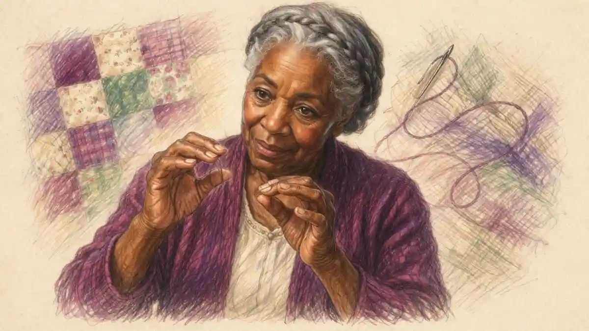

## A reversal across fifty years

He published his music with nothing to guide a listener but a genre, a key and a tempo mark. He refused the descriptive titles his publishers pressed on him, declined to attach stories or programmes to anything he wrote, and left the curious to make of the sounds what they could. The refusal was not shyness. It was a position: the sounds were the statement, and anything said about them in words was a dilution he would not sign.

<!--more-->

The puzzle of Chopin influence on music begins with what happened to that refusal. He died in Paris in the autumn of 1849, a composer for one instrument, famous in drawing rooms and respected by musicians, but holding no post, founding no school and explaining nothing. Within fifty years the most advanced piano music in Europe was being built almost entirely out of colour, resonance and suggestion, music whose whole method is to imply rather than to state, and its leading maker pointed back at the silent man as a source. Claude Debussy had taken prizes as a Paris schoolboy playing Chopin's ballades in the 1870s, and in 1915 he sat down to edit Chopin's piano works for a French publisher while writing études of his own. The composer who would not explain himself had become the model for suggestion itself.

The claim defended in this article is that the influence ran through harmony and through pianism, and almost never through form. Composers who sound nothing like Chopin work daily with procedures he introduced into piano music: chromatic voice leading that changes the chord by moving an inner part a semitone, dominants prolonged until they become colour rather than direction, melody floated over pedal fields, figuration that is itself the harmony. The pianists who followed him inherited a geography of the hand, fingerings that broke the textbook rules in the service of a singing line. What nobody inherited was his forms. His sonatas, ballades and fantasies were solutions to problems only he had posed, and later composers who reached for the same scale of statement reached back past him to Beethoven and Schubert instead. His imitators are mostly forgotten while his debtors are not, and the difference between those two groups is the map this article follows.

One question will stay open for some time, and it is worth stating plainly at the start. How did a composer who refused to explain himself become the model for suggestion? The answer is not a matter of temperament or legend. It is documentary, and it waits in the Debussy sections of this article, where the evidence sits on an editor's desk in 1915: a dedication page, a set of études answering another set written eighty years earlier, and a working life spent inside the older man's scores.

The traffic moved through identifiable channels, and the article takes them in order. First came the pupils, who carried in their hands what no printed page could hold. Then came a biography, published in 1852 by the most famous pianist alive, which fixed an image of Chopin that the next century consumed in place of the man. Then came the harmony itself, detachable from its surface and therefore exportable, passing to Debussy, to Scriabin, to Rachmaninoff and into the chord vocabulary of jazz. Around those channels grew the institutions: a national cult in a Poland that did not exist on the map, a competition in Warsaw that standardised how the whole world plays him, complete editions that decided which Chopin a pianist would meet, and a century of recordings that let the claims be tested by ear. At the end, the article turns sceptical, because the influence claim is also the most inflated currency in writing about him, and a test is offered by which any single claim can be weighed.

## What kind of influence harmony can be

Influence is a lazy word unless the kind of influence is specified, because the kinds travel differently and leave different evidence. A form can be copied by anyone who can read a score: the shape of a sonata movement lies open on the page, and a young composer in another country can rebuild it without ever meeting its maker. A melody can be quoted, stolen or absorbed half-consciously. But a harmonic procedure is neither a shape nor a tune. It is a habit of moving from chord to chord, a way of letting inner voices slide by semitone while the bass walks slowly, a taste for delaying the cadence until the delay itself becomes the expressive event. Such a habit can pass from composer to composer without a single bar being copied, through teaching, through editions pored over at the keyboard, through the simple experience of playing the older music until its moves become the moves one's own hand expects. By the time the procedure surfaces in a new score, its origin may be invisible to everyone except an analyst who knows where to look.

This is why Chopin's case confuses the usual tests. Measured by resemblance, he can look uninfluential: almost nobody after him sounds like him for more than a few bars, and the few who tried are the subject of a later section and a cautionary one. Measured by procedure, he is everywhere in piano music after 1850. Jim Samson, whose analyses of Chopin's music remain the standard account of how the harmony works, has made the reception point as well: the history of Chopin's influence is distorted whenever it is told as a history of styles that resemble his, because what he had to give away was not a style. It was a set of solutions to the problem of making the piano harmonise expressively, and solutions do not carry their author's accent with them when they emigrate.

The distinction also separates influence from affinity. Schubert, dead in 1828 before Chopin had published anything of consequence, wrote chromatic harmony of great daring from his own sources, and Weber and Hummel stand in the background of everything Chopin himself learned. A resemblance between two composers proves descent only when a channel exists: a score owned or edited, a teacher in common, a documented performance, a letter. The tradition Chopin inherited is part of the long arc traced in [the history of classical composers](/2010/03/07/history-of-classical-composers/), and his own place in that arc is defined by what he added to it, not by everything that sounds like him afterwards. The working rule for the whole article is therefore strict. Every influence claim that follows names the technique, names two works, one on each side of the transaction, and names a date at which the later composer had access to the earlier music. Claims that cannot meet that rule are treated in the section on overstatement, where several famous ones go to be dismantled.

There is a second channel, as important as harmony and easier to trace, because it leaves names and dates behind it: pianism itself. A way of playing is taught person to person. It survives in fingerings printed in editions, in the testimony of pupils, in the habits of conservatoires, and after about 1900 in recordings, where it can be heard rather than inferred. Chopin taught for a living in Paris for seventeen years, and the first carrier of his influence was not a book or a score but a room full of students whose hands he physically rearranged at the keyboard. The pupils come first in this account because chronologically and causally they were first, and because what they carried explains why the pupil line, examined next, mattered more in the early decades than anything in print.

## The pupils and the teaching line

Chopin earned his Paris living substantially by teaching, and his studio was not a conservatory classroom but a succession of private pupils, many of them aristocratic amateurs from several countries, a smaller number of them professionals who would carry the teaching onward. The roll of the serious ones is short enough to name. Karol Mikuli, an Armenian Polish pianist who studied with him from 1844 to 1848, became director of the conservatory in Lemberg and the line's great documenter. The Norwegian Thomas Tellefsen studied from 1844 to 1847 and carried the manner back to Christiania. Georges Mathias, a French pupil of real gifts, held a piano professorship at the Paris Conservatoire for decades and taught there into the next century. Adolphe Gutmann was the strong-handed favourite of the early years, Princess Marcelina Czartoryska the most distinguished of the Polish amateurs, the Scotswoman Jane Stirling the devoted pupil and patron who organised his British tour of 1848, and the Viennese Friederike Müller, whose letters home record lessons in unusual detail.

### Who were Chopin's pupils and what did they pass on?

His pupils were mostly aristocratic amateurs, but the professionals among them, Mikuli in Lemberg, Tellefsen in Norway and Mathias at the Paris Conservatoire, passed on a documented method: a singing tone, a supple wrist, strict time in the accompanying hand against a free melody, and fingerings chosen for legato rather than for rule.

The fullest single account of the teaching comes from Mikuli's foreword to his edition of Chopin's works, published by Kistner in 1879 and written from notes taken at the lessons themselves. Mikuli describes a teacher who insisted that the student sing with the fingers, who modelled phrases at the second piano rather than describing them, who set the Well-Tempered Clavier of Bach as daily bread, and who directed his pupils to the great Italian singers of the age, Pasta, Malibran and Rubini among them, as the true professors of phrasing. The piano, in this studio, was a singing instrument that happened to have keys, and everything in the method, the flexible wrist, the horror of stiffness, the scales begun without the thumb's old restrictions, served that one conviction.

What the pupils passed on divides into two kinds. The first is touch: the production of a long melodic line with weight transferred through a relaxed arm, the grading of an accompaniment until it sits under the melody like a held breath, pedalling that colours rather than blurs. The second is discipline of a specific and paradoxical kind, because the famous Chopin rubato lived in this studio as a strict practice rather than a licence. Pupil testimony agrees that the accompanying hand kept the time like a conductor while the melody was free to hasten and linger, and that Chopin grew impatient with pupils who bent the whole texture at once. Both kinds of knowledge are perishable. Touch cannot be written down, and discipline of tempo dies with the room it was enforced in, which is why the conservatory posts held by Mathias and Mikuli matter so much to this story: they turned a private studio manner into an institutional inheritance, examinable, repeatable and exportable to students who never saw Paris.

The limits of the line should be stated as plainly as its reach. Most of Chopin's pupils were amateurs who played in salons and taught nobody; the line that survived runs through a handful of professionals and through paper, the annotated scores and the forewords, as much as through bloodlines of teaching. Nor was the line the only piano tradition in Europe: the pupils of Hummel, of Kalkbrenner and later of Liszt carried rival manners, and the modern technique that eventually formed drew from all of them. The Chopin line is distinguished not by monopoly but by documentation. Because Mikuli wrote the method down, and because the pupils' annotated copies of the music survive, this is the one nineteenth-century piano studio whose daily practice can still be reconstructed in detail.

## Why the pupil line mattered more than the scores

It is tempting to assume that influence in music travels by print, because print is what survives for historians to measure. For Chopin's first four decades after his death the assumption fails, and the failure is instructive. His scores were expensive, issued in small runs by publishers in three countries, and no two of the first editions agree in every detail, since he corrected the Paris, Leipzig and London printings separately. A pianist in Vienna or Warsaw in 1860 who bought the music acquired the notes but not the sound: not the depth of key dip he favoured, not the half-pedals that clear one harmony while ghosting the last, not the exact liberty of the right hand against the left. All of that lived in the playing of people who had sat beside him. The influence travelled first through the pupils he taught rather than through published scores, because the scores underdetermine the very things that made his playing his.

Consider what a page of the nocturnes cannot tell its reader. The notation fixes pitches and rhythms within the conventions of the day, but the conventions assumed a shared performance culture that was already dissolving as salon music-making gave ground to the public recital. A pupil of Chopin's knew how far the melody could lean before the bar line reasserted itself, because he had been stopped mid-phrase for leaning too far. A reader in another country, however gifted, had to guess, and the guesses produced the sugary, tempo-drunk Chopin of the later salon, the very caricature that serious musicians then reacted against. The printed text, paradoxically, spread his notes while degrading his manner, and the pupils' line functioned as the correction: a living commentary that kept reasserting how the music was meant to go.

The pupil line also controlled the evidence. The copies of the works owned by pupils such as Jane Stirling and Camille Dubois carry Chopin's own pencil corrections and variant readings, entered during lessons, and those annotated pages later became primary sources for editors trying to establish what he actually wrote. Teaching, in other words, fed the editorial tradition examined later in this article, and through the editions it reached pianists who never heard a pupil play. The two channels intertwine from the start: hands taught hands, and hands also annotated paper, and the paper taught strangers.

None of this diminishes the scores; it dates their authority. Once the century turned, and once reliable complete editions and then recordings existed, print and disc took over the carrying work, as later sections describe. But the founding decades belong to the studio. When contemporaries of the 1850s and 1860s spoke of a pianist playing Chopin in the true manner, they meant a manner learned at one or two removes from a room in the Rue de la Chaussée-d'Antin, not a fidelity to any printed page, because no printed page yet commanded that kind of fidelity. The first revelation of this article's ladder is therefore a modest one with large consequences: the most imitated pianist in Europe was imitated, at first, by ear and by hand, in lessons, and the documentary history of his influence is a history of teaching before it is a history of texts.

The pupil credential was itself inflated by the market, and the inflation belongs in the record. Within a decade of the death, pianists across Europe were advertising themselves as élèves de Chopin on evidence ranging from a handful of lessons to a single hearing, and the claim became so common that sceptics began to keep count. The phenomenon matters because it shows the direction of value in the 1850s: proximity to the studio was worth money, which is to say the pupil line was already functioning as the authorised channel while the scores were still finding their editors. It also imposed a discipline on later scholarship, which learned to grade pupil claims as it grades documents, accepting Mikuli's dated notes and discounting the drawing-room pedigrees. Influence that travels by hand leaves handprints of varying authenticity, and the sorting of them is part of the transmission's history.

## Liszt's biography and the romantic portrait

Three years after the death, in 1852, the Paris publisher Escudier issued a book called simply F. Chopin. Its named author was Franz Liszt, the most celebrated pianist in the world and a man who had known Chopin in the Paris years, played his music, and stood close enough to the circle to be plausible as a witness. The book was not, in the modern sense, written by its named author alone. Scholarship on the Liszt circle has established that Princess Carolyne zu Sayn-Wittgenstein, Liszt's companion, had a large hand in its composition and expansion, and the prose bears her marks: rhapsodic, metaphysical, drunk on landscape and national destiny. Whoever held the pen at each passage, the book that reached the public was the Liszt circle's collective portrait, and it is treated in this article under the source-custody rule that governs the whole series: the biography is a cultural object and a cause of the reception, never a source about Chopin. What it says happened is not evidence. What it did is history.

What it did was enormous. The book fixed the figure through which the next century would see its subject: a being of exquisite frailty, too fine for the world, a poet of the piano whose music was the direct secretion of a suffering soul, a Polish exile wandering among foreign drawing rooms with his lost country singing through his fingers. The mazurkas were rendered as epic national utterances, whole scenes of Polish history read into dances their composer had refused to programme. The Majorca winter of 1838 and 1839, a miserable episode of illness, bad weather and a late piano, became a chapter of romance. Even the physical description came pre-softened: generations of readers met a sylph before they met a note. The life behind the portrait, its Warsaw schooling, its business arrangements and its professional discipline, is told in [the account of Frederic Chopin's life and career](/2011/03/21/frederic-chopin-life-and-career/), and the distance between that record and the book's figure is the measure of the book's work.

The portrait's success had structural causes. Liszt's name sold it across Europe in translation; no rival account existed at anything like its scale; and the figure it offered was exactly the figure the age wanted, the artist as beautiful invalid, consumed by feeling and consumption alike. Biographies, novels and eventually films drew from it for a hundred years, often at third hand, so that its inventions hardened into common knowledge. Jim Samson's reception studies describe the outcome precisely: a romantic Chopin, assembled in print between 1852 and the early twentieth century, through whom the music itself was heard, so that listeners came to the nocturnes already knowing what they were supposed to feel. The biography thus belongs to the influence story in its own right, not as a distortion layered over a pure transmission but as one of the transmission's main engines. It created the audience for the music faster than the music could have created its own.

It also misdirected the search for influence. A portrait that makes the music the overflow of a soul invites imitation of the soul's supposed symptoms, the languor, the sighing, the fragility, rather than study of the workbench. The imitators of the next section took their cue from the book more than from the scores, and their failure is partly the book's failure. Meanwhile the real channels, the pupils with their annotated copies and the harmonic procedures waiting inside the preludes and ballades, ran on beneath the portrait's noise. The author of the book had his own complicated relation to the material: the career of the biographer, his Weimar court, his professorship of Europe's pianists and his parallel claim on the century's piano, is traced in [the life and music of Franz Liszt](/2018/09/07/franz-liszt-life-and-music/), and his Chopin is best read as one great pianist's act of possession, homage and annexation at once.

## What the portrait suppressed

A portrait is defined as much by its exclusions as by its emphases, and the exclusions in the 1852 book map exactly onto the professional reality of the life it claimed to tell. Suppressed first is the negotiator. The surviving correspondence shows a composer who sold the same work three times over, to publishers in Paris, Leipzig and London, who haggled over fees with a clear head, who understood the economics of the dedication and the salon, and who managed his small output as a scarce good. Suppressed second is the fee-earning teacher of the previous sections, who charged at the top of the Paris scale for lessons and kept a full studio of paying pupils for seventeen years. A being too fine for the world does not keep a appointments diary, yet the diary is what the record shows.

Suppressed third is the craftsman. The manuscripts and the pupil copies reveal a reviser of ferocious patience, who reworked passages across editions, who tested his music on the pianos of the Pleyel showroom and adjusted it to the instrument's response, whose two opposed qualities, in the phrase his pupils kept returning to, were fire and finish. The portrait replaced that worker with a improviser of genius, spilling music as birds spill song, and the replacement took because improvisation is easier to admire than revision. Suppressed fourth is the wit. The letters are funny: dry, mimicking, alert to absurdity, entirely without self-pity. A reader who meets the letters after the biography experiences a small shock of recognition failure, as if two men shared one name.

Suppressed fifth, and most consequential for this article, is the schooling. Chopin's formation was Warsaw's, under Józef Elsner at the conservatory, in counterpoint, thoroughbass and the classical forms, and his early music announces that discipline on every page. The portrait preferred a self-taught child of nature, because nature needs no explaining and schooling invites questions about method. The second rung of the ladder can now be stated in full. Liszt's biography built the fragile romantic portrait that dominated reception, and it suppressed the professional and commercial reality of the life: the fees, the contracts, the revisions, the training. Every later misunderstanding of the influence descends from that suppression in part, because a composer pictured as a medium will be imitated as a medium, in trances and sighs, while a composer pictured as a worker might have been imitated as a worker, in procedures. The procedures had to be rediscovered from the scores themselves, by Debussy's generation and by scholars like Samson, working against the portrait that claimed to introduce them. The pupils had never lost them. That is the difference between the channels, and it governs everything that follows.

The portrait had a second source, and the two worked together. George Sand's Histoire de ma vie, published in 1854 and 1855, gave posterity the Majorca winter and the years at Nohant from the pen of the woman who had shared them, and it cast its author as nurse, mother and guardian of a helpless genius. Sand wrote as a novelist, shaping scenes and speeches to her design, and modern scholarship treats her memoir as literature built on fact rather than as testimony. Between the biography's sylph and the memoir's invalid, the working composer of the correspondence, funny, exact and commercially alert, had almost no chance of survival in the public mind. The images that might have corrected the record, a daguerreotype of 1849 showing a tired professional in a coat, the death mask and the cast of the left hand made by Clésinger, existed in drawers and museum cases while the prose portraits multiplied in every language of Europe.

## The immediate imitators and why they vanished

Paris in the 1840s and 1850s was flooded with Chopin-shaped music. Publishers who could not have the original sold the manner: nocturnes by the hundred with sighing melodies over rocking accompaniments, mazurkas with the dotted snap flattened into a salon tic, fantasias on operatic themes strung with perlée passagework, pieces with titles about tears, farewells and moonlight. The trade had its named hopes. Julius Schulhoff, a Czech pianist-composer, was presented to Paris in the later 1840s as a successor in the true line, toured widely on the comparison, and was received kindly by the very journals that had launched Chopin; within a generation his music had drained out of the repertory and his name survived through his teaching in Dresden and Paris. Adolphe Henselt, a pianist of genuinely formidable equipment, staked his composing fame on pieces such as the étude-like Si oiseau j'étais, and is remembered, where he is remembered at all, as a teacher at the St Petersburg conservatory. Theodor Döhler and a dozen others fill the same shelf: competent, fashionable, gone.

It is worth being exact about what these musicians copied, because the exactness carries the argument. They copied the surface inventory: the nocturne's layout of melody over broken-chord accompaniment, the ornamental fioritura at phrase ends, the drooping appoggiatura, the rubato understood as a general slowing and sighing, the intimate dynamic ceiling. What they did not copy, because it cannot be copied by ear from a salon performance or lifted from a printed page without analysis, was the machinery underneath: the inner voices moving by semitone so that the harmony seems to melt rather than change, the cadence promised and then quietly withdrawn, the long pedal under which the chords alter like light. The surface inventory was a fashion, and it dated as fashions date, within about fifteen years. The machinery was a procedure, and procedures do not date, because each generation can point them at new material.

Here the second open question of this article must be posed, since this is the section where it opens. Why did his direct imitators disappear while distant debtors thrived? The question sharpens the thesis. The imitators were close in every measurable way: same city, same salons, same genres, same audience, in Schulhoff's case the same critical sponsors. The debtors were remote: a Frenchman born twelve years after the death, a Russian teenager in the 1880s, American pianists of the next century working in an idiom Chopin never heard. Proximity predicted failure and distance predicted success, which is the reverse of how influence is usually imagined to work, and the explanation, that what travelled was procedure rather than manner, will be assembled across the Debussy, Scriabin and genre sections before the question closes in the section on the nocturne. The third rung of the ladder, though, belongs here: the imitators who copied the surface vanished, while composers who took the harmonic procedures survived, and the contrast identifies exactly what was transferable in his art. It was not the sound of his music. It was the thinking inside it.

A further mechanism hastened the imitators' end. The salon itself, the ecosystem their music was built for, contracted as the public concert hall and the professional recital expanded after mid-century. Music designed to charm a room of amateurs at close quarters read as thin in a hall of two thousand, and the pieces had no second life in print because their effects were all in the delivery the portrait had taught. The debtors, by contrast, wrote for the hall and the study at once. The imitators thus failed twice over: they took the one part of the inheritance that expires, and they took it in the one venue that was closing.

## Schumann's criticism and advocacy

The first great act of transmission was a review. In December 1831 the Allgemeine musikalische Zeitung carried a notice of the Variations on a theme from Mozart's Don Giovanni, Opus 2, by a twenty-one-year-old critic named Robert Schumann, announcing in its famous opening flourish that a genius had arrived and that hats should come off. The notice matters less for its verdict than for its channel. Schumann was building, in the journals he wrote for and then in the Neue Zeitschrift für Musik that he founded in 1834, an alternative German musical public, one organised against the routine of the trade papers. Into that public he carried Chopin repeatedly across the 1830s: reviewing the nocturnes, the concertos and the sonata, dedicating his Kreisleriana to Chopin in 1838, receiving the dedication of the Second Ballade in return, and fixing in the German mind an image of the Pole as a revolutionary of the small forms, the composer of what he called, in a much-quoted figure, cannons concealed among flowers.

Advocacy of this kind is a material force in the influence story, not a decoration on it. German publishers had been cool; the Leipzig trade wanted saleable brilliance in the Herz and Hünten line, and it was the Schumann circle's insistence that made Chopin a serious German subject years before the German market would have found him alone. The wider phenomenon, of critics manufacturing the conditions in which a reputation can travel, is surveyed in [the series account of how critics shaped reputations](/2026/07/21/how-critics-shaped-reputations/), and the Schumann case is one of its purest instances: a single gifted advocate with a journal, a pseudonymous debating society of his own invention, and a conviction he was prepared to print for a decade.

Schumann's advocacy was not uncritical, and its reservations are part of its evidentiary value. He puzzled over the B flat minor Sonata, admired its movements while doubting their union, and his Chopin is the craftsman of the Davidsbund's war on philistinism rather than the invalid of the 1852 biography, which appeared after his own powers had begun to fail. The German Chopin and the French Chopin of Liszt's book are different constructions, and both travelled. Germany received the revolutionary formalist and produced, in time, the analysts and editors who treated the music as structure; France received the poet and produced the salon tradition and, eventually, Debussy's reaction against exactly that. Which construction a young composer met depended on his language and his teachers, so that the influence, from the 1830s onward, already ran in national channels that later sections will keep meeting. Criticism, in short, did not merely report the transmission. It routed it.

The portrait in sound that Schumann left behind deserves its own sentence in this account. In Carnaval, published in 1837, one movement is titled simply with the composer's name, a musical portrait in which Schumann imitates the manner as an act of homage, catching the fioritura and the hovering rubato in a page of affectionate caricature. It is the first instance of a genre the century would repeat endlessly, the Chopin piece by another hand, and Schumann, alone among the early imitators, had the genius to make the imitation a criticism as well as a compliment. His late review of the F minor Fantasia in 1841, finding in it a deeply impassioned coherence, shows the advocate still at work a decade after the first notice, correcting his own earlier puzzlement at the sonata and teaching his readers to hear the large forms as arguments. Advocacy sustained over ten years, in the century's most intelligent musical journal, is not publicity. It is infrastructure.

## Brahms, Liszt and the divided reception

By the 1870s the reception had hardened into two camps, each transmitting a different Chopin to a different posterity. The first camp descends from the 1852 biography and the Weimar court of its author: the poetic Chopin, the improviser of genius, the national bard, a composer to be felt rather than examined. The second descends from Schumann's Leipzig and settled in Vienna, where its central figure, improbably, is Johannes Brahms. Brahms served as one of the editors of the Breitkopf and Härtel complete edition of Chopin's works issued between 1878 and 1880, a labour of textual care performed alongside his own maturing output. The young Brahms had already written the transaction into his own catalogue: the Scherzo, Opus 4, of 1851 is a twenty-year-old's answer to the Chopin scherzo, its trio a study in the older man's cantabile, and Brahms played Chopin in his own concert years with a plainness his contemporaries noted. Eduard Hanslick, the Viennese critic whose authority in the German world matched Schumann's, defended Chopin's formal command in print against the salon charge, treating the miniatures as finished architecture.

The division was not merely geographical; it was fought inside single sentences. The same critic could praise the poetry and deplore the influence, and across Europe a gendered vocabulary did quiet institutional work: Jeffrey Kallberg's research on the period documents how reviewers reached for the language of the feminine, the delicate, the drawing-room, to place Chopin below the masculine public genres of symphony and opera, and how that placement then governed conservatory syllabi, concert programming and the shelving of his music in publishers' catalogues. A composer filed as a feminine miniaturist could be loved and simultaneously excluded from the main line of history, which is roughly what happened to Chopin in the German textbooks for two generations. The structural reading survived anyway, in the editorial work, in Brahms's example, and in the teaching studios, while the poetic reading owned the public image and the biography market.

The divided reception explains a pattern that otherwise looks like chance: why the influence surfaces in such different places at such different temperatures. Where the structural Chopin travelled, into Brahms's generation, into the analysts, into the French reformers who wanted a classical discipline for the piano, the debt is harmonic and pianistic and provable. Where the poetic Chopin travelled, into the salon, the recital encore and the film biography, the debt is atmospheric and the artefacts perishable. Both camps claimed descent from Liszt's Paris of the 1830s, Brahms through Schumann's rival construction of it, the Weimar camp through the biography itself. The article now leaves reception for mechanism. The next two sections state the harmonic inheritance as precisely as prose allows, because everything that follows, Debussy, Scriabin, the jazz chapter and the final test, depends on the reader holding the actual devices in view.

The English channel of the poetic reception had its own machinery, and its most telling artefact is a title page. Chopin's London publisher, Wessel and Company, issued his works with invented descriptive titles of the kind he had refused in Paris, flowery labels attached to nocturnes and impromptus to help them sell, and the correspondence records his irritation at finding his music christened behind his back. The episode is small and diagnostic. The market in every country demanded that the music arrive pre-interpreted, wrapped in the feelings it was supposed to cause, and the publishers supplied the wrapping because the wrapping sold copies. Brahms at his editor's desk in Vienna, silently establishing texts, and Wessel's clerks in London, inventing titles, were the two poles of the posthumous industry between which the music travelled to its public, and a young composer met it at one pole or the other depending on where he lived.

## The harmonic inheritance stated precisely

The inheritance can be itemised, and it should be, because vague talk of chromatic richness is how the influence claim acquired its bad name. The first device is the treatment of the inner voices as the harmony's engine. In a Chopin texture the melody is often the least harmonically active part; beneath it, alto and tenor lines creep by semitone, and each creep quietly changes the chord, so that a passage can pass through four harmonic colours while the tune appears to stand still. The Prelude in E minor, Opus 28 No. 4, is the textbook exhibit: a melody of drooping semitones over chords that sink by half-steps, the whole piece a single prolonged hesitation before a cadence that arrives only at the end, exhausted.

The second device is the management of the dominant. In the classical syntax Chopin inherited, dominant harmony is a signpost: it points at the tonic and the music obeys. In his hands the dominant becomes a place to live. It is prolonged, decorated, evaded at the moment of expected resolution, or resolved deceptively so that the phrase must begin its work again. The effect is not decoration but structure: longing, in this music, is engineered by grammar. The third device is the structural use of chords that textbook harmony treats as spices, above all the Neapolitan sixth and the augmented sixth, which Chopin promotes to pivots, reached by smooth voice leading and used to swing a passage into a key a third away. The fourth is relation by thirds itself: whole spans of the late works, as Samson's analyses of the Polonaise-Fantaisie, Opus 61, and the Fourth Ballade demonstrate, are organised by third-relations and enharmonic pivots where the classical ear expects the dominant to be in charge. The fifth is the pedal field, harmony as changing light over a fixed point, of which the Berceuse, Opus 57, is the purest case: an unchanging D flat bass, a right hand flowering above it, the chords altering by inflection rather than by progression.

None of these devices was without precedent, and precision requires the precedents to be named. Schubert's late songs and sonatas contain chromatic sidesteps as bold as anything in Chopin; Spohr built a manner on chromatic saturation; Hummel, Chopin's own early model, wrote passagework of great harmonic suavity. The inheritance claim is not invention but systematisation and relocation: Chopin gathered these procedures into the piano's small forms, made them the main event rather than the episode, and wrote them at a density that turned ornament into structure. A later composer did not need to invent the evaded cadence. He needed only to play the E minor Prelude until the evasion felt like grammar, and thousands did. That is the sense, the only defensible sense, in which a generation's harmony descends from this one man's practice.

A sixth device belongs to the list, quieter than the others and the most personal: the importation of folk modality into art harmony. The mazurkas repeatedly use the sharpened fourth of the Lydian mode, a colour he had heard in Polish village music, set inside otherwise classical phrases so that a country inflection tilts the harmony toward brightness at the moment of cadence. The device mattered beyond Poland. It demonstrated that a vernacular scale degree could function as a structural colour rather than a mistake, a lesson the century's national schools, and later the modal experimenters who fed Debussy, absorbed from many sources but from none more elegantly documented. Taken together, the six devices amount to a complete alternative account of how harmony can move: by voice rather than by root, by colour rather than by command, by delay rather than by arrival. That is the inheritance, stated as precisely as prose allows, and its precision is the article's answer to a century of mist.

## Chromatic voice leading after Chopin

Voice leading is the least visible element of music and the most contagious, because it is learned by the fingers before it is learned by the mind. A pianist who has played the Étude in E flat minor, Opus 10 No. 6, has rehearsed, hundreds of times, the sensation of a chorale whose inner voices descend by semitone while the top voice holds its long notes, the harmony darkening by friction rather than by leap. A pianist who has played the Mazurka in A minor, Opus 17 No. 4, has rehearsed something stranger: an opening that circles for bars without declaring its key, harmony as a held breath, so that the eventual arrival of the tonic feels like a decision rather than a default. These sensations become expectations. The hand that has learned them finds the same moves in new music it writes, and finds them natural, which is how a procedure crosses from one composer to another without a manifesto on either side.

The clearest large-scale beneficiary in the nineteenth century is the chromatic practice that culminates in Wagner. The young Wagner, writing journalism from Paris in 1841, treated Chopin as the pianist who mattered in that city, and while the Tristan harmony of 1859 has many parents, German and Italian as well as Polish, its working method is the one itemised in the previous section raised to operatic scale: semitone voice leading over sustained pedals, dominants prolonged into whole scenes, resolutions deferred until deferral becomes the drama. Analysts have repeatedly set the opening of the A minor Prelude, Opus 28 No. 2, whose chords defeated its first commentators, beside the procedures of the Tristan prelude, not to claim a theft but to mark a grammar already complete in miniature in the 1830s. What Wagner added was duration and the orchestra. The grammar of the inner voices was waiting for him in piano music he had heard as a young man in Paris.

After Wagner the line runs back to the piano and underground. Fauré's harmony, examined later in this article, is unthinkable without the precedent of inner voices doing the travelling while melodies behave with classical decorum. The young Debussy's piano music passes through the same school. Even the reaction against chromatic saturation confirms the inheritance: the neoclassical clarity of the 1920s defined itself against a voice-leading practice that had become, by then, simply what piano harmony was. Influence at this depth stops looking like influence and starts looking like the medium itself, which is why the strongest form of the claim is also the hardest to phrase without inflation. The discipline of this article is to keep naming works and dates, and the next three sections apply the inheritance to its three most documented heirs, in Paris, in Moscow and at the Russian piano.

One more carrier deserves naming, because it shows the procedure leaving the piano and returning changed. César Franck, who revered Chopin and kept his music in the air of the Paris Conservatoire where he taught organ from 1872, built his own chromatic idiom on semitone voice leading learned substantially at the keyboard, and carried it into organ and chamber music, where his pupils, d'Indy, Chausson and the young Duparc among them, received it as the French school's harmonic conscience. The Violin Sonata of 1886 breathes that air in every transition. Through Franck the inner-voice method entered the bloodstream of French instrumental writing generally, no longer marked as piano technique at all, which is the final stage of a procedure's naturalisation: the point at which nobody remembers it had an inventor, and only the documentary chain, of the kind this article keeps, can still assign it an address.

## Debussy and the colouristic line

The Debussy connection is the best documented case of Chopin transmission in the whole record, because it rests not on resemblance but on paper. Claude Debussy, born in 1862, twelve years after the death, grew up inside a Paris where the music was conservatory furniture: he took prizes as a schoolboy at the Paris Conservatoire in the 1870s performing Chopin's ballades, and his earliest published piano pieces of the 1880s and early 1890s wear the schooling openly. What makes the case decisive, though, comes at the end of his life. In 1915, with France at war and the German editions that had supplied French pianists suddenly enemy goods, the Paris publisher Durand commissioned French musicians to prepare replacement editions of the classics. Debussy took Chopin. Across that year he edited the études, preludes, ballades, scherzos, nocturnes, impromptus, mazurkas, waltzes and sonatas, working through the texts bar by bar at the age of fifty-three, in the same months in which he composed his own twelve Études for piano. He dedicated the set to the memory of Frederic Chopin.

### How did Chopin influence Debussy?

Chopin influenced Debussy through procedures rather than manner: arpeggiated figuration that is itself the harmony, pedalling composed into the sound as resonance, and short pieces complete without development. The debt is documented, since in 1915 Debussy edited Chopin's piano works for Durand while composing his own Études, which he dedicated to Chopin's memory.

The shareable fact of this article sits here, and it deserves its plain statement: Debussy was editing Chopin's works for a French publisher while composing his own études, and dedicated that set to Chopin's memory. The influence is documented in his own working life, not inferred from resemblances. Roy Howat, the pianist and scholar whose work on French piano music traces these connections at the level of the note, has shown how deep the study went: Debussy's fingerings, corrections and second thoughts in the Durand texts are those of a composer reading a predecessor's solutions with professional attention, and the études he wrote alongside the editing, for composed arpeggios, for sonorities, for chords, read as a set of answers, problem by problem, to the Chopin études of 1833 and 1837. The life that contained this labour, its Conservatoire beginnings and its wartime end, is told in [the account of Claude Debussy's life and music](/2018/10/07/claude-debussy-life-and-music/).

The procedures themselves are visible in the canonical scores. The Barcarolle, Opus 60, sustains its rocking twelve-eight motion while the harmony drifts by thirds and the melody blooms into double notes; Debussy's Reflets dans l'eau of 1905 builds a whole piece from a comparable premise, a figuration field in which chord, melody and resonance are one substance, changing colour over slow basses. The Berceuse's pedal field becomes, in Debussy's hands, the static luminous backgrounds of the preludes. Even the presentation descends: Chopin published his pieces under bare genre names and refused titles; Debussy, writing his two books of Préludes in 1910 and 1913, placed his titles at the end of each piece, in parentheses, after the music has spoken, a typographical gesture that is the refusal of 1830 wearing the dress of 1910. The next section separates what was taken from what was refused, because Debussy's public remarks about Chopin oscillate between reverence and impatience, and the oscillation is the evidence.

The channel into Debussy's childhood was itself claimed as a teaching line, and the claim is worth recording precisely because its truth is contested. His first serious piano teacher, from about 1871, was Antoinette Mauté de Fleurville, a formidable woman who let it be known that she had herself studied with Chopin in his last years. No document confirms the lessons, and scholars treat the pedigree as, at best, unverifiable. Yet the claim did its work regardless of its truth: the boy who would edit the complete works in 1915 began at a keyboard over which the name was spoken as a household authority, in a Paris where such pedigrees were the ordinary currency of the teaching studio. The episode belongs in this article because it is the influence story in miniature, a transmission that may be fact, may be salesmanship, and is certainly the way the nineteenth century actually moved its musical capital from hand to hand.

## What Debussy took and what he refused

Debussy's reverence is on record in the strongest available form, the dedication of 1915, and in a reported judgement that Chopin was the greatest of them all because, with the piano alone, he discovered everything. His refusals are on record too, in letters that mock the trembling sentimentality of the salon Chopin tradition and in a mature style that pointedly avoids the older man's most famous gestures. Both are true, and holding them together is what separates a documented influence from a fan's claim. What Debussy took was a technology of resonance: the belief that a piano piece could be organised by the behaviour of sound itself, by pedalled fields and arpeggiated harmonies whose life is their decay, rather than by the rhetoric of theme and development. What he refused was the expressive frame that had carried that technology in 1830: the operatic fioritura as personal confession, the periodic dance rhythm underneath, the melody that sings like a prima donna over an accompaniment that merely rocks.

The first open question of this article can now be closed. How did a composer who refused to explain himself become the model for suggestion? Because the refusal was never emptiness; it was a transfer of meaning from statement to resonance, from what the notes say to how they bloom and fade, and Debussy recognised the transfer as the founding gesture of the music he wanted to write. Suggestion, in the mature Debussy, is Chopin's reserve with the nineteenth century's rhetoric stripped away: the titles displaced to the end of the piece, the climaxes replaced by changes of light, the figuration promoted from decoration to substance. The fourth rung of the ladder stands here: Debussy's colouristic writing descends from specific Chopin procedures, the pedal field, the arpeggio as harmony, the slow bass under fast colour, and Debussy acknowledged the descent in the most concrete way available to a composer, by editing the works and dedicating his own answer to their author, while rejecting the ornamental manner that had wrapped those procedures in his predecessor's lifetime reputation.

The refusal side deserves equal weight, since it defines the boundary of the debt. Debussy did not take the mazurka, the polonaise or the waltz as living forms; his dances are stylised memories of dances, heard through water or across a ballroom of the mind. He did not take the heroic rhetoric of the polonaises or the operatic scena structure of the ballades; his large forms are chains of images, not arguments. And he took nothing from the national cult: his Chopin is a French classic, a master of the instrument, cleansed of Polish politics entirely, which is itself a reception fact of some irony given the sections of this article still to come. The influence, precisely bounded, is harmonic and acoustic. That boundedness is not a disappointment. It is what a real influence looks like when the documents are allowed to specify it, and it sets the standard of proof for the looser talk that surrounds Scriabin and the jazz pianists.

His criticism confirms the pattern from the other side. Writing as a critic in the years around 1900 and after, Debussy returned to Chopin repeatedly as one of the very few composers for the piano who had found something genuinely new to say with the instrument, setting him apart from the virtuoso tradition of display that descended from the rival Parisian schools. The critical praise matters because it is public and argued, not the politeness of a dedication: in print, before the editing commission of 1915 was imagined, Debussy had already enrolled Chopin in the small company of masters from whom a modern composer could learn. The symbolist air of his Paris did the rest. In the circle of Mallarmé, whose afternoons Debussy attended, suggestion had been theorised as the highest law of art, the refusal to name the thing and the evocation of its effect, and that theory made the reserve of 1830 suddenly legible as modernity. Chopin did not change. The century's aesthetics turned until they faced him.

## Scriabin and the harmonic extension

Alexander Scriabin was born in Moscow in 1872 and raised, as a pianist, on Chopin to a degree unusual even in that Chopin-saturated city. His juvenilia are the record of an absorption so complete that the catalogue itself testifies: a set of mazurkas, Opus 3, in 1889; nocturnes and impromptus in the same years; an early étude in D sharp minor, Opus 8 No. 12, that became his signature in the recital hall; and above all the twenty-four Preludes, Opus 11, composed between 1888 and 1896, which follow the key scheme of Chopin's Opus 28 exactly, circulating through the fifths with their relative minors, as if the younger man were answering the older set piece by piece across half a century. As a touring pianist in the 1890s Scriabin played Chopin constantly, and the critics who heard him reached instinctively for the comparison, the same poetic vocabulary, the same frailty of frame, as if the portrait of 1852 had found a second sitter.

The interest of the case is that this most literal of heirs is the one who travelled farthest. Scriabin's mature project took the second of the devices itemised earlier, the prolonged and evaded dominant, and pressed it until the grammar gave way. In Chopin, a dominant withheld still promises the tonic; the longing is the point, and the promise is eventually, if obliquely, honoured. In the Poème de l'extase of 1908 and Prometheus of 1910, the dominant-quality sonority, rebuilt in fourths into the chord Scriabin's circle called the mystic chord, is prolonged across entire works and never cashed at all: resolution is not deferred but abolished, and the harmony floats in a permanent state of charged expectation. The path from the E minor Prelude's sinking chords to the Prometheus chord is step by step and each step is documented in scores with dates: the saturation of the middle-period sonatas, the tritone basses, the whole-tone inflections. An inheritance that ends by dissolving its own grammar is still an inheritance, and Scriabin's case states the principle cleanly: procedures can be extended past the point where their inventor would have recognised the results, while forms cannot. Scriabin's one-movement orchestral poems descend from Liszt's symphonic poems, not from anything of Chopin's, and he wrote no ballades after his teens. The formal cupboard is bare; the harmonic one is overflowing.

Russian reception adds a footnote that belongs to the divided-reception theme. The same Moscow that treasured Scriabin's Chopin playing filed Chopin himself, in much of its official criticism, as a Western drawing-room composer, a judgment the Balakirev circle complicated by private devotion and public dismissal in roughly equal measure. Scriabin's career thus carried the influence inside a culture that half-disowned its source, and his extension of the harmonic procedures was possible partly because he treated them as raw material rather than as relics. Distance, again, did the work that reverence could not.

The pianistic side of the absorption has its own certificates. Scriabin was formed as a pianist at the Moscow Conservatory under Vasily Safonov, in a school that treated the Polish composer as a foundation author, and his early fame rested on interpretations of the music that older listeners compared, inevitably, to the playing of Anton Rubinstein. In 1891 he damaged his right hand by over-practice, working at the showpieces of Liszt and Balakirev in a fury of ambition, and during the hand's slow recovery he composed for the left hand alone the Prelude and Nocturne of Opus 9. The episode is usually told as biography. In this article it belongs to the technique record: the heir's body broke against the virtuoso inheritance, and his answer was to write music that turned a single hand into a complete pianism of melody, bass and inner voices, the whole Chopin doctrine of the singing line compressed into five fingers. The harmonic extension and the pianistic trial were the same education, taken by one man at full strength.

## Rachmaninoff and the pianistic inheritance

Sergei Rachmaninoff's debt is the pianistic counterpart to Scriabin's harmonic one, and it is documented with unusual concreteness. In 1902 and 1903, at the start of his maturity, he composed the Variations on a Theme of Chopin, Opus 22: twenty-two variations on the C minor Prelude, Opus 28 No. 20, the chordal funeral tread that Chopin had made from almost nothing. A variation set is a public act of study; it declares its model and submits to comparison, and Rachmaninoff chose for his declaration the most harmonically naked piece in the Chopin canon, a prelude whose entire material is a progression of chords. Across the following decade his own sets of preludes, Opus 23 and Opus 32, together with the early C sharp minor Prelude of Opus 3, completed a project Chopin had projected in Opus 28: a prelude in every key, the cycle as a composer's visiting card. The étude followed the same route into his Études-tableaux of 1911 and 1916 and 1917, pictures admitted into the concert étude that Chopin had founded.

The pianism is the deeper stratum. Rachmaninoff performed Chopin in his recitals for five decades, across Russia, Europe and America, and his playing of the music was regarded by the pianists who heard him as a standard of a specific kind: not the poetic swoon of the salon tradition but a singing line of almost vocal evenness carried on a left hand of orchestral resource, the melody sustained at full tone over figuration that never clouds it. His recording of the B flat minor Sonata, Opus 35, made in 1930, held its place as a benchmark for generations of students, and it demonstrates the inheritance in sound: the funeral march's trio played as a single breathed sentence, the finale's unison whirlwind kept at a dynamic that lets its harmony register. What he took, then, was the founding identification of his predecessor's art, the belief that complete technical command exists to make the piano sing, translated to a larger instrument, a larger hand and a symphonic imagination that Chopin never sought.

The boundary of the debt is as instructive as its depth. Rachmaninoff's orchestral thinking, his bells, his liturgical echoes and his long symphonic spans come from Russian sources, from Tchaikovsky and from the Orthodox sound world, not from Paris. His Chopin inheritance is confined to the piano and to the genres the piano generated, the prelude, the étude, the variation, the encore character piece. Two Russian heirs thus divide the estate between them with a neatness no executor could have planned: Scriabin takes the harmony and dissolves its grammar, Rachmaninoff takes the pianism and magnifies its scale, and neither takes the forms, which remain where they were left in 1849, unrepeated and unrepeatable.

His influence on the profession's habits ran deeper than any single work. The mature recital as Rachmaninoff and his generation standardised it gave Chopin a fixed architectural place, the group of shorter pieces after the interval against which the evening's large sonata was weighed, and that architecture descended to every pianist who followed them, so that audiences on four continents learned to expect the nocturne and the scherzo at a set point in the ritual. He taught few pupils and founded no school, yet his recordings functioned as a school for two generations: the waltzes, the nocturnes and the B flat minor Sonata in his readings were studied by students who treated the discs as texts, memorising his voicing of inner parts and his refusal to let the left hand blur. Where Chopin's pupils had carried the manner in their hands to a few hundred listeners, Rachmaninoff's discs carried his reading of that manner to everyone, and the pianistic inheritance passed, in his person, from the age of the studio into the age of the record, which the later sections of this article take up in their turn.

## Faure, Ravel and the French reception

France, which had manufactured the poetic portrait, also produced the most sustained practical answer to it, and the answer is Gabriel Fauré. Fauré wrote thirteen nocturnes across forty-six years, from 1875 to 1921, and thirteen barcarolles across a similar span, taking both of Chopin's signature genres and making them the diary of a lifetime. No other major composer did this. The early nocturnes wear the inheritance openly: the rocking accompaniment, the bel canto melody, the ornamental close are all present in the First Nocturne of 1875, written when Fauré was thirty and the salon tradition was still the air he breathed. The late nocturnes tell the opposite story in the same genre. The Eleventh, of 1915, and the Thirteenth, of 1921, strip the surface to austere counterpoint, bare octaves and harmony that moves like thought rather than weather, yet the pieces remain nocturnes, night pieces of confession and reserve, recognisably the grandchildren of Opus 9 and Opus 27. Roy Howat's performances and writings on this repertory make the case at the keyboard: the debt is structural, a genre's inner proportions and a harmony led by inner voices, while the surface, the very thing the imitators copied, is progressively renounced. Fauré is the French proof of the ladder's third rung.

Maurice Ravel presents the same transaction in a cooler register. Ravel's knowledge of Chopin was complete and his admiration genuine, and his piano writing answers it by correction: where the salon tradition blurred, Ravel articulates; where the portrait swooned, Ravel frames. The Valses nobles et sentimentales of 1911 take the dance that Chopin had raised to concert status and make it dance music about distance, the waltzes of a man watching the ballroom from the door. Even his homage is oblique. Where Debussy dedicated his études to Chopin's memory, Ravel left his Chopin inside the workmanship, in the conviction that piano writing must be exact to be expressive, a conviction the two men shared with their supposed opposite across sixty years.

Behind both stands an institutional fact: France had naturalised Chopin. Half Polish by birth and wholly Parisian by formation, he was absorbed into the French account of the century as one of its own classics, taught at the Conservatoire through the line that runs from his pupil Georges Mathias to the professors of Fauré's and Debussy's student years, published in French editions, and claimed by French scholarship. The naturalisation mattered to the transmission, because what France took from him it took as inheritance rather than import, and inheritance is worked into the foundations without ceremony. The French line of the influence is therefore the hardest to see and the most complete: not a set of pieces that resemble his, but a national piano culture whose reflexes, in touch, in harmony and in the seriousness granted to small forms, were set in his studio and his scores.

Institutions renewed the line at the top. Fauré, director of the Paris Conservatoire from 1905 to 1920, presided over the very school in which the pupil Mathias had taught and in which Debussy had been formed, and his directorship protected a French piano culture in which the nocturne and the barcarolle were living assignments rather than museum pieces. The line from the studio of 1844 to the examination rooms of 1910 runs unbroken through named men in named posts, which is more than can be said for most nineteenth-century influences and is the reason the French case carries such evidentiary weight in this article. When the young composers of 1918 reacted against the haze they associated with the pre-war world, the Chopin they had been taught was not the salon ghost of the English caricature but this disciplined French classic, and their reaction, as a later section shows, had to aim carefully to hit him at all.

## The nocturne and the character piece after him

John Field invented the nocturne, and precision about priority is part of this article's discipline: the Irish pianist, working in Russia, published the first pieces under the name from 1812 onward, single-movement night pieces in which a songful melody floats over a spread accompaniment. What Chopin did to Field's invention defines what an inheritance can be. He kept the layout and changed the ambition: the melody became operatic, drawn from the bel canto he urged his pupils to study; the accompaniment became harmony in motion rather than a rocking cradle; and, decisively, he introduced the contrasting middle section, often a chorale or a storm, so that the nocturne acquired an inner drama and a scale that could hold a concert audience. The posthumous C sharp minor Nocturne and the great C minor Nocturne, Opus 48 No. 1, with its chorale and its driven return, are not salon pieces at all. They are dramas in the space a song takes.

The second open question of this article closes here, in the genre's subsequent history. Why did his direct imitators disappear while distant debtors thrived? Watch what happened to the nocturne. The imitators' nocturnes, which copied the layout and the sigh, died with the salon that commissioned them; the genre itself, in the hands of debtors who took its inner machinery, lived for a century. Fauré's thirteen nocturnes have been counted already. Scriabin wrote nocturnes in his Chopin years and a famous one for the left hand alone. Karol Szymanowski, the next Polish composer of international weight, passed through a youthful set of preludes written inside the manner before breaking away, and his Nocturne and Tarantella of 1915 keeps the night piece alive in violin music. Grieg's Lyric Pieces, issued in ten books between 1867 and 1901, carried the character piece into every Scandinavian parlour and half the world's teaching studios; Tchaikovsky's The Seasons of 1876 gave Russia its calendar of monthly character pieces; Edward MacDowell's Woodland Sketches of 1896 naturalised the form in America. The small, titled, self-sufficient piano piece became the default unit of domestic and teaching music across the Western world, and its line of descent runs through Chopin's workshop, where the miniature had first been made to carry the weight of the largest feelings without borrowing the symphony's clothes. The imitators copied pieces. The debtors copied the principle that a piece of five minutes could be complete, and the principle proved immortal precisely because it was not a sound.

The waltz tells the same story from the dance floor's side. Chopin took a functional dance and made it a concert character piece, waltzes that are not for dancing, too rubato-haunted and too harmonically sly for any ballroom, and the concert waltz became a standard test of a pianist's charm and finish. Brahms's Waltzes, Opus 39, of 1865 answer them from Vienna in a plainer dialect; the line descends through the salon to Ravel's Valses nobles et sentimentales, where the dance is remembered rather than performed. The mazurka likewise propagated: Polish successors from Paderewski onward wrote mazurkas as certificates of national craft, and the young Szymanowski's early sets work the vein before his style broke toward other sources. Genre by genre, the pattern of this article repeats: a small form, raised by one man's procedures to concert seriousness, becomes a permanent room in the house of piano music, furnished afterward by tenants who redecorate everything except the load-bearing walls.

## The etude as concert music after him

Before Chopin, the étude was a finger exercise with musical pretensions, the province of Czerny and the practice room, designed to be endured rather than heard. The two sets of Études, Opus 10 published in 1833 and dedicated to Liszt, and Opus 25 in 1837, changed the category's address. Each study isolates a single technical problem, the chromatic scale in contrary fingerings, the legato of thirds and sixths, the left hand's singing line, and solves it in a piece that audiences demanded to hear again. The exercise had become concert music without ceasing to be an exercise, and every subsequent composer of études works inside that double identity, whether in homage or in rivalry.

Liszt's answer came first and largest: the Transcendental Études, reaching their final form in 1852, take the fusion of problem and poem and expand its scale to the edge of the playable, a rival founding rather than a copy. Alkan's studies, Opus 39 of 1857, pushed the category toward the monumental and the perverse. The line then runs through the century's schools: Henselt's études mark the salon fork, brilliant and perishable; Scriabin's three sets, Opp. 8, 42 and 65, carry his harmonic extension into the study form; Rachmaninoff's Études-tableaux of 1911 and after admit the programme picture into the title itself; and Debussy's twelve Études of 1915 close the circle, answering Chopin's sets problem by problem under a dedication to his memory. The most literal transmission document in all piano literature belongs here too: Leopold Godowsky's fifty-three Studies on Chopin's Études, composed between 1894 and 1914, which take the original texts and recompose them into multiplied difficulties, including versions for the left hand alone. Godowsky's studies are unplayable by almost everyone and indispensable as evidence, because they prove that by 1900 Chopin's études were not repertory only but raw material, a quarry from which a later virtuoso could build his own cathedral. Teachers who assemble this comparison for a class can lay the paired scores side by side in the [browser-based presentation viewer at ReportMedic](https://reportmedic.org/tools/ppt-viewer.html), keeping the sound itself where it belongs, in the room and at the keyboard. A genre invented for the practice room had become, through one man's redefinition of it, a central arena of piano art, and it has never left.

The prehistory sharpens the achievement. Clementi's Gradus ad Parnassum and Cramer's studies had given the exercise dignity and even charm, but they addressed the practice room and said so; Czerny, Beethoven's own pupil, industrialised the form into thousands of pages of honest mechanism. The category's centre of gravity was training, and everyone knew it. Chopin's intervention was to refuse the separation: the same page would drill the hand and hold the stage, and the refusal forced a question on every successor, whether a technical problem could be the subject of a work of art rather than its scaffolding. The competition culture of the twentieth century ratified his answer in an unexpected forum. International competitions, Warsaw's among them, prescribe etudes in their early rounds precisely because the etude now functions as the profession's unit of honest measurement, the genre in which nothing can be faked, and the set pieces are drawn again and again from the two collections of 1833 and 1837. The practice room and the prize stage, which he had fused in his own person, remain fused in the institution that guards his name.

## Pianism, fingering and the modern technique

The most intimate stratum of the inheritance is written in fingering. The fingering doctrine Chopin inherited from the eighteenth century prized evenness and avoidance: the thumb stayed off the black keys where possible, fingers crossed in fixed patterns, and the hand held a single quiet position from which everything was reached. His printed fingerings break the doctrine at point after point, and the breaks are systematic. The thumb takes black keys when the phrase needs it; the third finger crosses over the fourth; a single finger slides from a black key to the adjacent white key to preserve an unbroken legato; long fingers take the black keys and short ones the white in scales, following the hand's anatomy rather than the keyboard's symmetry. Pupil accounts collected by Mikuli add the famous corollary that he began beginners on the scale of B major, the scale in which the hand's long fingers fall naturally on the black keys, because the hand's comfort, not the notation's simplicity, was the starting point. What looks like a set of quirks is a philosophy: fingering exists to serve the phrase's singing line, and any rule that costs the line its smoothness is the rule that goes.

The nineteenth century's technique wars were fought partly over this legacy. The finger school of the old conservatories, with its mechanical exercises and its hand positions enforced by guides and rails, faced the weight schools that arrived with Breithaupt and Matthay around 1900, for whom tone came from the arm's fall rather than the finger's strike. Chopin's practice, as the pupil documents describe it, refuses both orthodoxies in advance: the wrist supple, the arm quiet, the finger doing the singing, the whole body uninvolved except as a supply of calm. Modern unified technique, the settlement that emerged in the twentieth century through the Leschetizky school in Vienna and the Russian school after it, absorbed his fingering freedoms wholesale, because they were physiological facts rather than stylistic choices, and facts outlive the schools that dispute them. The urtext editions used in conservatoires print his fingerings as evidence, and the chromatic étude, Opus 10 No. 2, is still assigned with its original fingering as a problem in its own right, the hand re-enacting his solution every time a student learns it.

Kenneth Hamilton, the pianist and scholar whose After the Golden Age of 2008 anatomised the change in performance culture, supplies the frame for understanding why this stratum matters. The modern piano world, with its competitions, its edited recordings and its premium on replicable accuracy, plays with a technique and a set of reflexes formed in the nineteenth century's studios and then standardised by the twentieth century's institutions. Within that formation, the Chopin contribution is the legato ideal itself: the doctrine that the piano, a percussion instrument, must be made to sing as if it were a voice, and that technique is the art of concealing the hammers. Every serious school of playing since has either taught that doctrine or defined itself against it, and the schools that defined themselves against it, the percussive modernists of the next century, knew exactly whose ghost they were exorcising.

The instrument itself was part of the technique, and the inheritance includes a hardware clause. Chopin preferred the pianos of Pleyel, with their lighter action and their silvery, quickly decaying tone, to the heavier, more brilliant Erards that Liszt favoured, and his fingering and pedalling were solutions fitted to that response: shallower key dip, blend achieved by touch rather than by machinery. The modern concert grand, standardised by Steinway's design in the later nineteenth century, is a louder and more resistant machine, and every pianist since has had to re-solve his problems on it, which is one source of the recorded century's argument about how the music should sound. The period-instrument revival closed the loop within this article's period: pianists of the later twentieth century and the years to 2011, Alexei Lubimov prominent among them, recorded the works on Pleyels of the 1840s, and the Chopin Institute in Warsaw built a strand of its concert life around period instruments, letting audiences hear the fingering doctrine on the hardware it was designed for. The hand's inheritance, it turns out, had a machine attached.

## The pedagogical tradition built on his music

A composer's influence is usually measured in other composers. Chopin's runs just as deep in the classroom, where his music became the curriculum through which pianists are made. The mechanism was set early: his own studio produced the teachers, Mathias at the Paris Conservatoire and Mikuli at Lemberg, whose students staffed the conservatoires of the next generation. By the later nineteenth century the études and nocturnes stood at the centre of advanced instruction across Europe, the études as the examination of technique's higher reaches, the nocturnes as the examination of tone. Anton Rubinstein's historical concert series of 1885 and 1886, seven programmes surveying keyboard music across the centuries, gave Chopin an evening's weight in the canon as Rubinstein presented it to Russia, and Rubinstein's own conservatory at St Petersburg taught accordingly. The Leschetizky school in Vienna sent out Paderewski and Schnabel with Chopin at the centre of their recital identities, and their pupils carried the same centre into the American and British studios of the twentieth century.

The twentieth century industrialised the tradition. Alfred Cortot's working editions of the études, issued from 1915 onward, wrapped each study in preparatory exercises, rhythmic variants and fingerings, converting the music into a method with a master's commentary attached, and generations of French-school pianists were formed inside those pages. Graded examination systems, of which the British boards became the global template, placed the waltzes and nocturnes at the upper grades and the ballades and scherzos at the diploma level, so that a student's progress across a decade of lessons can be read off a Chopin syllabus. Conservatoire entrance auditions on several continents settled into a convention in which a Chopin étude functions as the common test piece, the shared unit of measurement by which hands from different schools are compared.

Two features of this pedagogical empire deserve notice. The first is its self-reinforcement: because the music is the curriculum, every professional pianist has spent formative years inside it, and the procedures itemised in this article, the voice leading, the pedalling, the legato fingering, are absorbed by players who never compose a bar, and carried by them into the performance of everything else. The pedagogical channel is thus the widest of all the channels, wider than the concert hall, and the least discussed in influence studies because it produces no manifestos. The second is the road not taken: Chopin himself left fragments toward a piano method, sketches for a Projet de méthode in which the B major beginning and the doctrine of the supple hand were to be set out for beginners. He did not live to build it. The method the world got instead was assembled by his editors, his pupils' pupils and the examination boards, a collective construction that would have surprised its absent architect, and that stands as a reminder that influence, at its most effective, is exercised by institutions long after the person has left the room.

The syllabus went global on the back of empire, emigration and the examination board. British graded examinations, exported throughout the Commonwealth, carried the set pieces into studios from Toronto to Sydney; the American teaching market standardised on European editions and European repertory ladders; and by the closing decades of the twentieth century the fastest-growing piano populations on earth, in Japan, then Korea, then China, were being trained on ladders whose upper rungs are the ballades and scherzos, aimed at competitions of which Warsaw's is the archetype. A Polish exile who taught a dozen aristocrats in a Paris salon had become, by institutional multiplication, the common schoolmaster of the world's pianists, and the procedures his music contains are absorbed each year by more hands than heard them in the whole of the nineteenth century. The pedagogical channel has no manifesto and no single hero after the first generation. Its documents are syllabi, examination lists and marked-up teaching copies, and its effect is the largest and quietest in this entire account.

## The Polish national composer role

Poland did not exist when Chopin died. The partitions of the late eighteenth century had divided its territory among Russia, Prussia and Austria, and from 1795 to 1918 there was no Polish state to have a national composer. The role was therefore not inherited but constructed, in exile, in commemoration and in the classroom, out of the music of a man who had left Warsaw at twenty in November 1830, days before the November Uprising he would watch fail from Paris, and who never returned and never attached a programme, a dedication or a public word of politics to the Polish dances he spent his life refining.

### Why is Chopin a Polish national symbol?

Chopin became a Polish national symbol because a partitioned nation needed a flag its censors could not confiscate. His music, Polish in its dance rhythms and famous in every European capital, was built into that symbol after his death by commemorations, schools and the cult of his preserved heart in Warsaw.

The materials were real. The mazurkas carry the rhythms of the mazur, the kujawiak and the oberek, dances he had heard in Warsaw ballrooms and village weddings on boyhood holidays in the countryside, and he went on writing them in Paris to the end of his life, refining a folk inheritance into some of the most harmonically adventurous music of the century. The polonaises supplied the ceremonial register, above all the A major and A flat major works that sound like a state that exists only in music. Halina Goldberg, whose Music in Chopin's Warsaw of 2008 reconstructed the musical city that formed him, has traced how the later national reading was assembled: the Warsaw of Elsner's conservatory had given him a professional Polish formation, and the commemorative culture of the later century, culminating in the centenary celebrations of 1910 in Lwów, then under Austrian rule, turned that formation into a national sacrament, with his music performed as the legal cover for mass Polish assembly under a foreign flag.

The construction had a logic that should be stated without either endorsing or mocking it. A nation without a state keeps its continuity in culture: in language schools run in defiance of Russification, in churches, in anniversaries. Music that could be played in a parlour in Poznań, a schoolroom in Kraków and a concert hall in Paris, and that carried Poland's name attached to genius in every capital, performed the office of an embassy for a country with no foreign ministry. The role required the music to mean Poland, and it required the man to be simplified into the nation's suffering son, which is where the national construction and the Liszt portrait, built for different purposes in the same decades, flow together into a single figure: the exile who sang his homeland and died of the singing. The next section follows that figure into the hands of governments.

The birthplace joined the cult early, and by a Russian hand. In 1894 a monument obelisk was raised at Zelazowa Wola, the fruit of a preservation campaign in which Miliy Balakirev, the founder of the Russian national school, played a conspicuous part, travelling to the Mazovian village and lending his authority to the shrine of a composer his own movement's manifestos had filed as a Western salon figure. The episode compresses the whole politics of the symbol into one scene: a Russian nationalist honouring a Polish exile's birthplace, in Russian-ruled Poland, four years after the music itself had been suspect in both empires' cultural bookkeeping. Nations and schools claimed the man for their flags with an energy proportional to his refusal to carry any. The Warsaw institutions followed in the new century: a Chopin Society founded in 1934 to gather documents and relics, and, built on its collections after the war, the Fryderyk Chopin Institute of 2001, which by the bicentenary stood as the symbol's ministry of culture, running the museum, the editions and much of the research.

## How that role was used politically

The deployments can be listed, and the list is the argument, because the regimes that used him agreed on nothing else. The restored Polish state of 1918 took him up as cultural diplomacy: the Warsaw competition founded in 1927 was a deliberate act of state-facing culture, and the heart's shrine and the monuments served as ritual furniture of the new republic. The German occupation of 1939 to 1945 supplied the negative proof of his symbolic weight. The occupation authorities banned public performance of his music in the General Government, and in May 1940 they destroyed the great monument in Łazienki Park, the first Warsaw monument they chose to blow up, an order of priorities that measures the symbol's power more honestly than any speech. In the same years the banned music became resistance practice: clandestine concerts in private flats, and the documented last broadcast of Polish Radio in September 1939, in which Władysław Szpilman played Chopin, the C sharp minor Nocturne among the final sounds, as the station closed under bombardment.

The Polish People's Republic proclaimed 1949, the centenary of his death, a state Chopin Year, staging his music as the heritage of a people's Poland and his exile as a protest against the old order, while the Polish government in exile and the emigration claimed the same music against the regime as the voice of the Poland that had been suppressed. Two incompatible Chopins were thus maintained by two hostile Polish authorities, each with its concerts, its editions and its commemorations, and the music served both because the symbol, once built, specifies loyalty but not allegiance. After 1989 the democratic republic inherited the symbol and put it to the gentler work of national branding: the bicentenary year of 2010 was organised as a global presentation of Poland, with the new museum in Warsaw at its centre and the competition as its televised crown.

The fifth rung of the ladder can be stated here. His role as a national symbol was constructed after his death and deployed for political purposes across incompatible regimes: partition-era schoolrooms, a restored republic, a criminal occupation that banned him, a communist state that claimed him, an emigration that claimed him back, and a modern republic that brands itself with him. Halina Goldberg's scholarship and the Polish literature she represents document the uses and attribute the interpretations; this article reports them and takes no position on the politics, beyond the observation the evidence forces: a composer who refused to attach words to his music left the most attachable music in Europe, and the attachments are a history of his inheritors, not of him. What that did to the composer himself, his body, his grave and his image, is the subject of the section on the heart and the monuments, two sections on, after the institution that most efficiently globalised the symbol has had its hearing.

Two further deployments complete the record and keep it honest. The Soviet Union treated the competition itself as an instrument: Lev Oborin's victory at the first Warsaw edition in 1927 was celebrated in Moscow as a triumph of Soviet training, and Soviet and later Russian pianists contested the prize for decades as a matter of national prestige, so that the Polish symbol spent the Cold War being jointly administered by states on opposite sides of it. The other deployment is personal and begins the whole sequence: Ignacy Jan Paderewski, the most famous pianist of his age, made the music an explicit instrument of Polish statecraft, speaking at the Lwów centenary celebrations of 1910 in terms that framed the composer as proof of the nation's European standing, and carrying that cultural claim into the diplomacy that made him, in 1919, prime minister of the restored republic. The pianist-statesman is the symbol's hinge figure: in his person the concert platform and the chancellery were one career, and every governmental use since has followed the template he cut.

## The competition in Warsaw and what it standardised

The International Chopin Piano Competition was founded in Warsaw in 1927 by Jerzy Żurawlew, a professor at the Warsaw Conservatory, and its founding motive is itself a document in the reception history. Żurawlew, as he later explained, had watched the jazz age reach Warsaw's dance halls and feared for the survival of the manner of playing he had inherited; the competition was his fortification, an institution that would define, reward and export a correct Chopin. It was held in 1927, 1932 and 1937, silenced by the war, and resumed in 1949 as the centrepiece of the state's Chopin Year, running thereafter at roughly five-year intervals. Its winners form a roll of the postwar piano world: Lev Oborin in 1927, Alexander Uninsky in 1932, Yakov Zak in 1937, Halina Czerny-Stefańska and Bella Davidovich sharing the honours in 1949, Adam Harasiewicz in 1955, Maurizio Pollini in 1960, Martha Argerich in 1965, Garrick Ohlsson in 1970, the first American, Krystian Zimerman in 1975, Dang Thai Son in 1980, Li Yundi in 2000, Rafał Blechacz in 2005 and Yulianna Avdeeva in 2010.

### What is the Chopin Competition?

The Chopin Competition is the international piano competition held in Warsaw at roughly five-year intervals since 1927, founded by Jerzy Żurawlew and devoted to one composer's works. It standardised a world style of playing him: fidelity to the authorised text, the mazurka as a test of rhythmic truth, and rubato kept within narrow bounds.

What it standardised can be specified. The repertoire is confined to one composer across all stages, so the competition tests depth against breadth and produces a specialist crown. The text is fixed by authority: candidates play from the Polish National Edition, the source-critical text prepared under Jan Ekier, so that the variants and conflations of older editions are ruled out of court. Within that frame, the jury tradition rewards a defined band of virtues, textual fidelity, rhythmic integrity in the mazurkas above all, and a singing tone, and it disciplines the rubato toward the narrower end of the historical spectrum, a tendency Kenneth Hamilton's work on performance culture helps to explain: an institution that must compare eighty pianists on the same pieces will reward what can be verified under comparison. The competition thereby became the global exporter of the Warsaw standard. Conservatoires from Beijing to Boston teach toward it; a generation of Asian prizewinners since Dang Thai Son's victory of 1980 testifies to how completely the standard travelled; and a first prize functions as the nearest thing the piano world has to a universal passport.

The standard's cost became visible in the competition's most famous scandal. In 1980 Ivo Pogorelić, a Yugoslav pianist of volcanic individuality, was eliminated before the final round, and Martha Argerich, herself a winner in 1965 and sitting on that year's jury, resigned in protest, declaring him a genius in terms the newspapers carried worldwide. The episode is usually told as gossip; it is better read as the institution disclosing its own constitution. A standard exists to exclude, and what it excluded in 1980 was precisely the older, wider liberty of the pre-recording tradition, the liberty the pupil documents describe. The competition thus stands as the influence story's most efficient machine and its most ambiguous one: it carried Chopin playing to every continent at a level of finish his century could not have imagined, and it did so by narrowing the band of what counts as playing him well.

The structure of the contest deserves a sentence, because the standard lives in the structure. Candidates pass through stages built from the genres in ascending exposure: etudes first, where nothing can be hidden, then a nocturne and larger works, a set of mazurkas examined as the test of rhythmic and national truth, a sonata or the Barcarolle or a fantasy in the semifinal, and a concerto with orchestra for the finalists. The architecture is a curriculum disguised as a tournament, and a pianist who survives it has been audited in every chamber of the inheritance at once.

## The preserved heart and the monuments

The third open question of this article asked what happens to a composer who becomes a national symbol, and the answer, delayed until now, is that the symbol takes custody of the body. Chopin died in Paris in October 1849 and was buried in Père Lachaise cemetery, where his grave, marked by a monument from his son-in-law Auguste Clésinger, drew Polish pilgrims for generations and received, at his sister Ludwika's wish, a sprinkling of Polish earth. The body itself was divided by his own request. His heart was removed after death, preserved, and carried by Ludwika to Warsaw in 1850, and in 1882 it was sealed into a pillar of the Church of the Holy Cross, under an inscription taken from the Gospel: a sentence about treasure and the heart being in the same place. In September 1944, as the Warsaw Uprising burned, the urn was taken out of the endangered church and carried to Milanówek for safekeeping, and on 17 October 1945, the anniversary of his death, it was brought back to Holy Cross in a ceremony of state. These are the facts, and they are facts about commemoration practice: about what a nation does with the relic of a man whose relics it needs.

The monuments tell the same story in public space. The great statue in Łazienki Park, Chopin seated beneath a willow, designed by Wacław Szymanowski, was obstructed for years by the Russian authorities of the partition, cast at last and unveiled in 1926, blown up by the German occupation in 1940 as the first monument in the capital selected for destruction, and rebuilt from surviving models to be unveiled again in 1958, with open-air Sunday concerts at its base maintained as a Warsaw ritual since 1959. The birthplace at Żelazowa Wola, a manor outbuilding in the Mazovian plain, became a shrine and a concert site, its park laid out in the 1930s, its rooms a museum of pilgrimage, comprehensively renewed for the bicentenary of 2010. The economics are part of the record: recitals, festivals, a museum in the Ostrogski Palace in Warsaw opened in 2010, an airport renamed for him in 2001, all drawing visitors whose itinerary is a form of tribute exacted by the symbol.

The analytical point should be kept dry, as this article's brief demands. A composer who refused programmes acquired the most programmatic afterlife in music: his heart in a church pillar, his statue at the centre of a capital's Sunday leisure, his birth house a national shrine. None of it was his doing, and none of it is about the music's procedures, which is precisely why it belongs at the end of the symbol's story rather than in the history of the harmony. Commemoration fixed in bronze and preserved in alcohol the figure that Liszt's biography had drawn in prose, and the fixed figure then guarded the music's meaning against the musicians, until the scholars and the competition and the recordings began, from their different sides, to hand the music back. The third loop closes on that handover: the symbol keeps the heart; the heirs, in the end, got the scores.

The relic economy around the grave ran in parallel and should be recorded without flinching. Clésinger's death mask and the cast of the composer's left hand, taken in 1849, passed into the keeping of the Polish Library in Paris, where they remain objects of a veneration that belongs to the anthropology of fame rather than to music. Locks of hair circulated among the faithful of the first generation. None of this is evidence about the music, and all of it is evidence about the symbol, which required a body to venerate as surely as it required a heart to enshrine, and which found both in the most private of composers. The contrast is the section's quiet conclusion: the man who gave the public nothing but finished scores has been pursued ever since for everything else he had, down to the hand that wrote them.

## The complete editions and the editorial tradition

There is no single text of Chopin, and there never has been. He published simultaneously in Paris, Leipzig and London, correcting each printing separately and not always identically; he entered variants and corrections into his pupils' copies during lessons; autographs were lost, cut up for relic hunters, or dispersed across three countries' archives. A pianist who asks what Chopin wrote in a given bar may therefore face two or three answers, each with a pedigree. The editorial tradition, the succession of attempts to fix that plurality into a usable text, is not a footnote to the influence story. It is one of its main channels, because the Chopin that any later composer or pianist received depended on which edition reached his desk.

The succession runs as follows. Mikuli's Kistner edition of 1879 claimed the authority of the studio, its readings backed by the editor's lesson notes, and its foreword remains the teaching record discussed earlier. The Breitkopf and Härtel complete edition of 1878 to 1880, on which Brahms laboured, represented the German scholarly claim. The Paderewski edition, begun in 1937 under the pianist-president's name and completed after the war by Ludwik Bronarski and Józef Turczyński, conflated sources with more confidence than method and nevertheless served as the Polish standard for two generations, the text from which the competition's first postwar decades were played. The Polish National Edition, prepared under Jan Ekier from 1974 onward, replaced confidence with apparatus: source by source, variant by variant, it prints what can be documented and shows its workings, and the Warsaw competition adopted it as its reference text, so that the globalised standard of the previous section rests on Ekier's philology.

Jeffrey Kallberg's scholarship gives this history its theoretical edge. Kallberg has shown how Chopin's working methods, his willingness to let a piece exist in several authorised forms, his variants entered for different pupils and different national printings, strain the very idea of a single definitive work, and how editors from Mikuli to Ekier have had to choose not only readings but philosophies: the pupil's memory against the autograph, the last thought against the first edition. The influence consequences are concrete. Debussy editing Chopin for Durand in 1915 worked from the texts available in wartime Paris; Cortot formed his generations from his own annotated printings; a competition candidate in 2010 plays a measurably different text, in hundreds of small decisions, from the text Paderewski recorded. To say that Chopin's harmony influenced the century is therefore to say something with a hidden variable inside it, and the variable has names and dates. The editions are where the pupils' paper, the publishers' commerce and the scholars' method meet, and the next channel, the recording, begins exactly where the editions' authority ends: at the moment when playing could be preserved and compared.

The documentary base of the whole tradition is worth pausing on, because it is unusually concrete. Jane Stirling's copies of the works, carrying the composer's lesson corrections in pencil, repose in the Bibliotheque nationale in Paris, and the annotated set of Camille Dubois preserves the same traffic from another pupil's desk: variants offered in lessons, fingerings altered, readings entered that sometimes differ from every printed edition. Kallberg's name for the underlying condition is variability: in this studio, a work was not a fixed object handed down but a text that its author continued to adjust in the act of teaching it, so that the pupils' paper preserves not corruption but authorised alternatives. The editorial tradition's real task, from Mikuli to Ekier, was never simply to clean the text. It was to decide what kind of object a Chopin work is, and each generation's answer, the pupil's memory, the conflated standard, the source-critical apparatus, is a chapter in the history of how the century understood authorship itself.

## Recording and the interpretive tradition

Chopin died forty years before recording could have caught him, yet his performance tradition is audible, because the teaching line of the article's opening sections survived long enough to reach the microphone. Raoul Koczalski, who had studied with Mikuli himself, recorded Chopin extensively in the 1930s and 1940s: a pianist two handshakes from the studio in the Rue de la Chaussée-d'Antin, playing into electrical recording equipment. Moriz Rosenthal, another Mikuli pupil who went on to Liszt, left discs of formidable finish. Paderewski recorded from 1911 into the 1930s. Alfred Cortot, whose formation ran through the Paris line descending from the pupil Mathias's Conservatoire, made complete cycles of the major sets in the 1930s that taught two continents what a Chopin interpretation could be. Ignaz Friedman and Józef Hofmann complete the early line: men whose teachers, or teachers' teachers, reached back into the nineteenth-century rooms.

Kenneth Hamilton's After the Golden Age draws the moral that makes these discs evidence rather than memorabilia. Recording changed the economics of interpretation: a performance became an object that could be repeated, compared and corrected, and the freedoms that had been normal in 1900, the rolled chords, the displaced melody, the tempo bent to the phrase, began to read as faults under the new discipline of the repeatable take. The interpretive tradition in Chopin is therefore not a metaphor. It is a documented sequence of choices, audible on records, made by identifiable pianists standing in identifiable teaching relations to the source, and the claims made in this article about how his music was played can be tested against those records by any reader with a library card. Mid-century, Artur Rubinstein's stereo recordings of the 1950s and 1960s consolidated a mainstream: warm, singing, rhythmically firm, the standard against which the LP age measured its Chopin. After 1960 Pollini's studio recordings set a counter-standard of textual precision and structural grip. Between those poles the recorded century argues with itself about the same question the pupils argued: how much freedom the melody may take, and who keeps the time.

VaultBook's place in this article is a practical one. A listener working through the recorded tradition with a notebook, comparing Koczalski's mazurkas against Rubinstein's across a century of changing doctrine, needs the notes kept in order and kept private; the offline encrypted notes app obtained from [the VaultBook download page](https://vaultbook.net/download/) serves exactly that purpose, holding a listening journal that belongs to its keeper alone.

The reissue culture of the compact disc era turned those early records from curiosities into working documents. From the 1990s onward, specialist labels and the Fryderyk Chopin Institute's own publishing programme returned the pre-war pianists to circulation in cleaned transfers, and conservatoire students who had known Koczalski and Friedman as names in footnotes could suddenly study their mazurkas phrase by phrase. The competition winners of the later century joined the archive in their turn: Pollini's recordings after 1960, Zimerman's after 1975, and the complete recorded cycles by which a modern career is documented, so that the interpretive tradition is now a single auditable shelf running from a Mikuli pupil's shellac to a Warsaw laureate's studio set from the compact disc era. No other composer who died before recording began possesses anything like it, and it exists because the teaching line outlived its founder by exactly the margin needed to reach the microphone.

The Russian branch of the tradition has its own named custodian. Heinrich Neuhaus, professor at the Moscow Conservatory and teacher of Richter and Gilels, set out his doctrine in The Art of Piano Playing, published in 1958, a book that treats tone production and rhythmic freedom as moral as well as technical questions and returns to Chopin as the standing example of the singing line governed by an unshakeable pulse. Through Neuhaus and his pupils the studio doctrine of 1844 entered the Soviet conservatory system at its summit, and the recordings of Richter and Gilels, austere and incandescent by turns, document a branch of the interpretive tradition as distinct from Cortot's Paris as Warsaw is from Vienna. The tradition, by the later twentieth century, was no longer a line but a delta, and the deltas can be compared on disc, which is exactly the use the closing sections of this article recommend making of the evidence.

## Rubato in performance after the recording era

Rubato, the theft of time within a phrase, is where the performance tradition states its doctrine most sharply, and where the recording era did its deepest editing. The pupil testimony is unusually consistent, from Mikuli's foreword onward: in Chopin's playing the accompanying hand kept strict time, functioning as the conductor of the texture, while the melodic hand was free to anticipate and delay, pressing forward and lingering within the bar whose total length the left hand preserved. The image his circle used was of a tree whose branches move in the wind while the trunk stands, and the testimony agrees that he detested the generalised swooning, the whole texture sagging together, that the salon tradition later marketed under his name. The doctrine is precise enough to be falsifiable, and the early recordings let it be examined: in the playing of pianists formed before 1914, melody notes can be heard displaced against their accompaniments, arpeggiation spread where the score shows simultaneity, and tempo flexed at the joints of phrases in ways the printed page only implies.

What the recording era did to that doctrine is the subject of Hamilton's anatomy of the golden age and its passing. As takes became editable and repeat listening became the norm, deviation began to register as error; competitions, which must compare like with like, rewarded the measurable; and the mid-century mainstream narrowed the permissible band of rubato to a fraction of what the pre-1914 records display. The Warsaw competition, as described earlier, codified the narrowing for the composer in whose name the liberty had first been theorised, an irony the record supports at every point. Within the period this article covers, a counter-current gathered strength from the evidence itself: scholars and historically minded pianists, Hamilton prominent among them, re-presented the pupil testimony and the early discs and argued for a flexibility grounded in documents rather than in licence, and competition juries of the later editions began, cautiously, to honour individuality of time again.

The state of the question at the article's date is therefore double, and it is better described than resolved. Two defensible Chopins coexist in the catalogues: the literal Chopin of the edited text and the even tempo, and the flexible Chopin of the pupil documents and the early records, and the argument between them is not a quarrel about taste but about evidence, which is to say it is the whole influence story in miniature. A performance practice, like a harmonic procedure, is an inheritance that must be re-argued by every generation that receives it, and the rubato dispute is the sound of that re-argument continuing.

Two refinements of the doctrine survive scrutiny and deserve naming. The first is displacement: in the pre-1914 evidence, the melodic hand does not merely stretch the tempo but places individual notes before or after their notated partners in the bass, an asynchronisation that the ear accepts as expression because the metre underneath never wavers. The second is arpeggiation: chords written as simultaneities are habitually spread, the bass arriving first and the harmony unrolling upward, in the playing of the Koczalski generation as a matter of course rather than of emphasis. Both devices vanished from the mainstream so completely that their return, in the historically informed playing of the decades before 2011, was received as novelty, though it is better described as repatriation. They also mark the exact point where notation ends and inheritance begins: neither device can be learned from the printed page, because the page does not show them, and both were carried across the century by the chain of ears, lessons and discs that this article has followed from the Paris studio to the Warsaw jury room.

## Chopin in jazz harmony

### Is Chopin's harmony used in jazz?

Yes, but almost never by direct descent. The chromatic passing chords, inner voices moving by semitone and dominants evaded that fill Art Tatum's playing and Bill Evans's voicings reached jazz through institutions: classical lessons, conservatory harmony teaching and the French line from Chopin through Debussy and Ravel. The procedures are his; the route was the classroom.

The trap in this subject is lineage talk, the claim that jazz pianists learned their harmony from Chopin as a son learns from a father, and the brief for this article instructs that the claim be handled with the intermediaries named. Name them, then. The first intermediary is American piano culture itself. Ragtime and the stride school that followed it were built by pianists, James P. Johnson and Fats Waller among them, who studied European piano literature as a normal part of their formation, in a musical economy where the same hands played parlour classics in the afternoon and rent parties at night. The second is Art Tatum, the most harmonically voracious pianist jazz produced, whose reharmonisations of standards run on precisely the machinery itemised in this article: chromatic passing chords filling the bar, inner voices sliding by semitone, cadences promised and swerved past, melody floated over pedal fields. Tatum's formation included classical study and his recorded repertory reaches into the classical catalogue; his Chopin is the études' pianism and the preludes' voice leading absorbed as grammar, not quoted as tunes. The third intermediary is the French stream: the harmony of Debussy and Ravel, itself carrying the procedures traced in the Debussy sections, passed into the hands of Gershwin and the Broadway songwriters, and from there into the arranging culture from which bebop's pianists emerged. The fourth is Bill Evans, whose rootless voicings, led by inner voices over slow basses, descend from that French stream by documented study, and whose influence on later jazz harmony is second only to Tatum's. A fifth figure closes the institutional loop: Herbie Hancock, who performed a Mozart concerto movement with the Chicago Symphony at the age of eleven in 1952, carried a conservatory child's hands into jazz and built a harmonic language in which the European voice-leading grammar is simply native.

The verdict of the section is therefore a bounded yes. Jazz harmony uses Chopin's procedures extensively, above all in its piano schools, and the use satisfies this article's test only when the institutional chain is specified: technique named, scores named, access dated through lessons, editions and the French inheritance. The claim that any individual jazz pianist derived a device from a Chopin score he studied is occasionally provable and usually not, and the honest sentence is the institutional one. What jazz took from Chopin it took the way Debussy did, as procedure rather than portrait, which is why the connection survived translation into an idiom whose rhythms, forms and social world he never imagined. It is the strongest evidence in this article that the harmonic inheritance was real: it crossed into a music with every incentive to forget him, carried by teachers and textbooks, and it is still recognisable at the level of the inner voices to anyone who has played the E minor Prelude and then listened to Tatum fill a bar.

Oscar Peterson supplies the Canadian certificate for the institutional route. Formed in Montreal by classical study, with the Hungarian pianist Paul de Marky among his teachers, Peterson carried a conservatory technique into the jazz piano trio and kept classical repertory in his practice throughout his career, and his celebrated touch, the evenness of the runs, the inner voices graded like an accompaniment under a singing right hand, is the legato doctrine of the old studios translated intact into swing. Peterson, Tatum and Evans differ in everything except formation: each passed through the European classroom on his way to the bandstand. The intermediaries named by this article's brief are not an evasion. They are the finding. Jazz harmony's Chopin arrived by post, in method books and lesson rooms, and it arrived so thoroughly that its descendants no longer know the sender's name, which is the normal fate of procedures that succeed.

## Chopin in popular song and film

Popular culture took the other half of the estate, the melodies and the portrait, and its borrowings are correspondingly easier to date. The song I'm Always Chasing Rainbows, published in 1917 and a standard thereafter, is built on the slow middle theme of the Fantaisie-Impromptu, the posthumous showpiece that had itself become a parlour fixture. Two bossa nova and pop classics run on the Preludes. Tom Jobim's Insensatez of 1961 follows the harmonic and melodic path of the E minor Prelude, Opus 28 No. 4, a debt Jobim acknowledged; Barry Manilow's Could It Be Magic of 1973, written with Adrienne Anderson, is constructed on the chord progression of the C minor Prelude, Opus 28 No. 20, the funeral tread that Rachmaninoff had varied seventy years before, and Manilow has described the borrowing openly; Serge Gainsbourg's Jane B. of 1969 sings its melody over the same E minor Prelude that Jobim used. The pattern is exact: the popular borrower takes the progression and the tune, the transferable surface of pieces whose deeper procedures stay home.

Film took the portrait. The Columbia picture A Song to Remember of 1945, with Cornel Wilde as the composer and José Iturbi's hands supplying the playing, delivered the Liszt biography's figure to an audience of millions: the frail patriot, the doomed love, the A flat major Polonaise as the sound of a nation's soul, and it fixed that figure in the Anglophone imagination at the very moment the scholars were beginning to dismantle him. The film's descendants are legion, and its mechanism is the one this article has tracked since the biography section: the portrait sells the music to audiences the music alone would have reached more slowly, and the price is a misunderstanding that professionals then spend careers correcting. Between the songwriters and the studios, popular culture's Chopin is complete: melodies for the jukebox, a face for the poster, and a name that means tender genius even to people who have never heard a note. The name's career as pure sign is the subject of the next section.

The funeral march of the B flat minor Sonata deserves its own paragraph in the popular ledger, because it is the most successful piece of programme music its composer never programmed. Detached from the sonata, the march became the universal sonic sign for a funeral in the popular media of the twentieth century, sounded in cartoons, newsreels and comedies whenever a procession or a mock procession crossed the screen, recognised by millions who could not have named its author. The Fantaisie-Impromptu ran a parallel career as the sign for romantic agitation, and its route is instructive: Chopin withheld the piece, and it reached the public only in Julian Fontana's posthumous edition of 1855, against its composer's evident intention, the first and most consequential act of the popular industry that would live off his leavings. Even the nicknames by which the world knows the pieces, Raindrop, Military, Heroic, are the industry's coinage rather than his, labels pasted onto works whose author had refused labels on principle. Popular culture, in short, did not merely simplify the portrait. It reversed the man's most considered artistic decision, and sold the reversal back to his admirers as intimacy.

## The name as shorthand for a kind of feeling

By the later twentieth century the name had slipped its moorings in the music and gone to work as a sign. Warsaw's airport took his name in 2001. A Polish vodka has traded under it since 1993, selling refinement in a bottle. Hotels, perfumes and piano showrooms borrow it for the same compound of suggestions: sensitivity, doomed youth, aristocratic melancholy, the piano itself. In Japan, the great piano boom of the postwar decades made him the best-selling name in the sheet-music shops and the default composer of the teaching studio, a standing confirmed when Dang Thai Son's Warsaw victory of 1980 announced that the symbol's centre of gravity had begun to move east. In each use the name functions without reference to any bar of the music. It is the portrait of 1852, finally distilled to a word.

The shorthand deserves analysis rather than contempt, because it does real work in the influence story, most of it obstructive. A name that means tender genius in advance prejudges the listening: students arrive at the ballades expecting confession and miss the engineering; audiences programme the nocturnes as sedation and are startled by the C minor Nocturne's violence; the discipline of the music, the counterpoint learned in Warsaw, the proof sheets corrected at midnight, has no place in the sign and drops out of the common account. Advertisers do not borrow the image of a man checking proofs, because proofs do not sell vodka. The shorthand is therefore the last and most durable form of the portrait's suppression, and it explains the recurring pattern of the next section: serious musicians defining themselves against a Chopin who is largely a trademark, and discovering, when they reach the scores, that the composer they were avoiding is not the composer who is there.

The Japanese case shows the shorthand at industrial scale and deserves more than the passing mention given earlier. The postwar decades built the largest piano-studying population in the world, and its repertory pyramid rested on the same European ladder, with Chopin at its summit as the very type of the pianist-composer; Japanese publishers issued his music in every format from scholarly edition to graded album, and when the manga and television phenomenon Nodame Cantabile carried conservatory life to a mass audience between 2001 and 2010, the piano repertory it glamorised was the one this article has been tracing. A name that can sell a comic, a concerto ticket and a bottle of vodka in the same decade has completed the journey from person to trademark, and the trademark's last refinement is that it now certifies authenticity itself: pianos, festivals and competitions borrow the name to guarantee the genuineness of goods whose genuineness is the one thing the man himself never advertised.

The bicentenary year of 2010 measured the trademark's reach in institutional form. The Polish state's Chopin Year office coordinated events in dozens of countries, the Fryderyk Chopin Institute's festival, Chopin and His Europe, founded in 2005, had by then made Warsaw an August pilgrimage for the instrument's world, and the October competition of that year was broadcast and streamed to an audience no nineteenth-century impresario could have imagined. A symbol administered at that scale ceases to be a metaphor and becomes a department of national life, with budgets, archives and a research programme, and it is worth noticing what the department chiefly funds: editions, documents, recordings and scholarships, the documentary chain itself. The trademark, in its maturity, pays for the evidence that corrects the trademark. That reflexive turn is the most hopeful fact in the whole reception history, and it prepares the scepticism of the sections that follow, which the same institutions have learned to fund rather than fear.

## Composers who worked deliberately against him

Resistance is a form of influence with the sign reversed, and the record of resistance is long and distinguished. It begins inside his lifetime. The Berlin critic Ludwig Rellstab, editor of the journal Iris, met the mazurkas in the 1830s with printed mockery, and the Leipzig academic establishment that formed around Mendelssohn's conservatory treated the music as a dangerous model for students: brilliant, formless, corrupting of the classical disciplines. Samson's reception history documents the institutional suspicion in detail, and it had curricular consequences, generations of German-trained pianists steered away from the music their syllabi filed as salon goods. The Russian case is richer in contradiction. The circle of Balakirev, building a national school in the 1860s, publicly dismissed the Western salon and its piano aesthetic, while Balakirev himself edited Chopin, played him and revered him in private, the manifesto and the practice facing opposite directions. The contradiction is the data: a school may define itself against a predecessor precisely because his procedures are the ones it must absorb to proceed.

The twentieth century turned resistance into aesthetics. Prokofiev's piano writing of the 1910s, percussive, dry and anti-cantabile, was articulated against the singing tradition that Chopin had founded and the Russian school had canonised; the steel was aimed at the swoon, and the swoon was the portrait's property rather than the composer's. Stravinsky's trajectory shows the apprenticeship inside the resistance: in 1909 the young composer earned part of his Diaghilev fee orchestrating Chopin pieces for the ballet Les Sylphides, working inside the inheritance with professional competence, before his mature doctrine of objectivity defined itself against everything the confessional piano stood for. After 1945 the official histories of the avant-garde wrote the nineteenth-century piano tradition down as a closed museum and its central figure with it. Yet the split between doctrine and practice is the telling fact: while the manifestos dismissed him, the competition circuit, the recording catalogue and the teaching syllabus, the institutions that actually govern pianists' lives, kept his music at the centre of the profession. The avant-garde won the histories. The inheritance kept the pianists. Any honest account of his influence has to hold both outcomes at once, which is why the next section's scepticism is directed at the claims of the enthusiasts with the same severity the record applies to the dismissals.

France after 1918 supplies the neatest case of resistance from inside the inheritance. The programme of the esprit nouveau, announced in Jean Cocteau's Le Coq et l'Arlequin of 1918 with Erik Satie as its tutelary figure, called for a music of clarity, dryness and everyday surfaces, purged of the haze in which the pre-war world had wrapped its feelings, and the haze's tutelary composer, in the shorthand the movement inherited, was the salon Chopin of the portrait. The young composers of Les Six built their early manner in that purge's light. Yet the purge's instruments were French piano disciplines formed in the very Conservatoire culture this article has traced, and Satie himself had sat in its classrooms in the 1880s. Germany's Neue Sachlichkeit of the 1920s ran the same course on the other side of the Rhine: objectivity as a doctrine, aimed at the expressive piano tradition entire. Resistance at this level is best understood as a family quarrel about inheritance, conducted by heirs who could not leave the house because the house was the piano itself.

## Where the influence claim is overstated

The test set out early in this article, name the technique, name two scores, name the date of access, dismantles a shelf of famous claims, and the dismantling is owed to the reader before the final synthesis. He did not invent the nocturne: Field published the first nocturnes a decade before Chopin's, and the claim survives only by ignoring the Irishman whose name stands in the genre's birth certificate. He was not the fountainhead of chromatic harmony as such: Schubert's late work, Spohr and Weber precede and parallel him, and affinity is not descent. He is not the direct ancestor of jazz: the previous section traced the institutional channels, and any account that skips them is mythology. He did not invent musical impressionism: Debussy's formation includes Russian opera, the gamelan heard at the Paris Exposition of 1889 and medieval modality alongside the Chopin procedures itemised earlier, and the slogan that makes Debussy his pupil in all things fails at the first step of the test. He did not compose programme music about Poland: he refused programmes altogether, and the national narratives hung on the mazurkas are the construction documented in the symbol sections, not his statements. And he did not influence everyone: Ludwig van Beethoven's heir in Vienna, Anton Bruckner, built his harmony in the organ loft from other sources entirely, a reminder that the century had more than one river system.

| Recipient | Approximate period | What they took | What they refused | Surface imitation or structural debt |
|---|---|---|---|---|
| The pupil line of Mikuli and Mathias | 1844 to 1910 | Touch, legato fingering, rubato discipline | Public virtuoso display | Structural debt |
| The salon imitators | 1840 to 1870 | Nocturne layout, fioritura, the sighing melody | The harmonic procedures underneath | Surface imitation |
| Franz Liszt | 1831 to 1852 | The piano as a complete world, the etude as art | Chopin's scale and restraint | Structural debt |
| Claude Debussy | 1875 to 1915 | Figuration as harmony, pedal resonance, genre-only naming | Ornamental display, periodic dance frames | Structural debt |
| Alexander Scriabin | 1888 to 1910 | Dominant prolongation, the prelude cycle, chromatic voice leading | Resolution itself | Structural debt |
| Sergei Rachmaninoff | 1902 to 1943 | The prelude and etude genres, cantabile over figuration | The miniature scale | Structural debt |
| Gabriel Faure | 1875 to 1921 | The nocturne and barcarolle as lifelong genres | The decorative surface of the early manner | Structural debt |
| Jazz pianists from Tatum to Evans | 1930 to 1980 | Chromatic passing harmony, inner-voice leading | The score as a fixed text | Structural debt through institutions |

Overstatement has a mechanism, and naming it ends the section. A beloved name absorbs neighbouring innovations, because attribution to a single famous source is a better story than a map of channels, and each retelling rounds the claim upward: the man who systematised the procedures becomes the man who invented them, the man whose procedures reached jazz through three institutions becomes jazz's grandfather, the man who refused a programme becomes the author of the programme his nation needed. Samson's histories of the reception treat this inflation as a phenomenon with its own dates and agents, and the corrective is always the same return to documents: the edition on the desk, the lesson in the diary, the dedication on the title page, the date on the review. What survives that return is smaller than the legend and larger than the sceptics allow, and the next section performs the return on a single claim, in full, as a demonstration the reader can reuse.

## Testing one influence claim properly

Take the largest claim in the Debussy case and test it as the article's rule requires. The claim: Debussy learned his piano colour from Chopin. Step one, name the technique. It is the organisation of a passage by resonance: arpeggiated figuration that is itself the harmony, pedalling composed into the sound so that chords bloom and decay into one another, and long spans sustained over bass movement too slow to function as progression, so that change registers as alteration of light. Step two, name two scores. On the earlier side, the Berceuse, Opus 57, of 1844: a single D flat major field over an unchanging bass ostinato, the right hand's figuration carrying all harmonic event by inflection, the piece a controlled experiment in how much music resonance alone can organise. On the later side, Debussy's Étude pour les arpèges composés of 1915, which builds its spans by the same means, figuration as harmony over slow foundations, and behind it the whole of the Préludes' luminous stasis. Step three, name the date of access. It is not a date but a lifetime with a documentary peak: the schoolboy prizewinner playing the ballades at the Paris Conservatoire in the 1870s, the young composer absorbing the scores through the 1880s, and in 1915 the editor at the Durand desk, preparing Chopin's complete piano works for publication in the same months as he composed the Études that answer them, and signing the answer with a dedication to the older man's memory.

The claim survives the test in narrowed form, and the narrowing is the finding. Debussy learned specific procedures of piano colour from Chopin, through documented access, and acknowledged the debt in the two most concrete forms available to him, editorial labour and dedication. He did not learn his harmony entire, his forms, his scales or his aesthetics of suggestion from that single source, and the claim in its slogan form, that Debussy is Chopin's heir, fails for vagueness where the narrowed claim passes for precision. The sixth and final rung of the ladder now follows from the demonstration. Most popular claims of his influence fail the test of naming a technique, two scores and a date of access, and what survives the test is harmonic and pianistic, never formal. The reader is equipped to run the test independently: it requires a library, an edition with dates, and the refusal to accept resemblance as evidence, and it converts the largest and vaguest subject in this composer's literature into a series of questions with answers.

A second demonstration, chosen from the territory where claims run loosest, shows the test discriminating rather than merely applauding. The claim: jazz harmony descends from Chopin. Step one passes, since the techniques can be named exactly, chromatic passing harmony, inner-voice semitone motion, the evaded cadence, and they saturate the playing of Art Tatum. Step two passes in part: the E minor Prelude and the Berceuse exhibit the procedures in their pure state, and Tatum's reharmonised standards exhibit them again. Step three fails in its direct form and passes only in its institutional form: no document puts a Chopin score on Tatum's stand as a studied source, while the conservatory harmony teaching, the classical lesson culture of the stride generation and the French stream through Gershwin are documented channels with dates. The correct verdict is therefore neither the fan's descent nor the sceptic's coincidence, but transmission by institution, and the discipline of step three is what separates the verdicts. A test that can grade the century's most documented case and its most inflated one with the same three questions has earned its place as the article's closing instrument.

## Chopin influence on music: harmony and pianism rather than form

The synthesis can be brief because the evidence has done the work. Two channels carried the inheritance, and both are still traceable end to end. The harmonic channel runs from the procedures itemised in the middle of this article, the semitone inner voices, the evaded dominants, the pedal fields and third relations, through Debussy's resonance, Scriabin's dissolution of function, Fauré's lifelong night pieces and the institutional route into jazz harmony, each link dated and documented. The pianistic channel runs from the studio in Paris through Mikuli's foreword and Mathias's Conservatoire chair, through the fingering revolution and the legato doctrine, through Cortot's method editions, the examination syllabi, the Warsaw standard and the recorded century from Koczalski to Pollini. Alongside the channels stand the great amplifiers, Liszt's portrait, the Polish symbol, the competition, which determined how the music was imagined while the channels determined how it was used.

For the rival claim, that the influence is a myth of reception, to be right, the documents of access would have to be coincidence: the pupils' annotated scores, Brahms at the editor's desk, Debussy at the same desk in the year of the Études, Rachmaninoff's variation set on the C minor Prelude, Godowsky's fifty-three recompositions, the competition's sixty years of mazurkas. They are not coincidence; they are a chain, and the chain has dates. For the maximal claim, that he bequeathed his forms as well, to be right, a successor's large forms would have to stand on his plans; they stand on Beethoven's and Schubert's, and his one generic bequest to the large scale, the ballade, survived as homage, in Brahms's youthful Opus 10 and a handful of followers, rather than as practice. The forms were his alone, and the procedures were everyone's. That asymmetry is the answer to the question with which the article began, and it is also the reason the frail figure of the 1852 portrait had it exactly backwards. The portrait made him a soul whose essence could only evaporate. The record shows a worker whose methods could be, and were, taken up by hands he never met, in cities he never saw, in idioms he never heard, and set to work again. Influence of that kind does not need the word immortal. It has the scores, the editions, the fingerings and the dates.

A word, in closing, about the machinery that conserved the channels. Procedures and pianism would have dissipated within two generations, as the imitators' manner did, had institutions not arrested the dissipation: the editions that fixed an arguable text, the competition that audited the world's hands against it every five years, the examination syllabi that made the etudes a rite of passage, and the recordings that preserved the elders' answers for cross-examination. Influence at this scale is never only a transaction between geniuses. It is a system with custodians, budgets and juries, and the history of this one can be written, as this article has tried to write it, entirely in verifiable acts: lessons given, texts edited, prizes awarded, discs cut, monuments raised and blown up and raised again. The sentiment was real, and it mattered, but it rode on the paperwork.

## Frequently Asked Questions

### Q: Why is Chopin important to piano music?

Chopin is important to piano music because he changed both of its working systems at once. Harmonically, he made chromatic voice leading, evaded cadences and prolonged dominants into structural procedures rather than decorations, so that a small piece could sustain large expressive spans without sonata machinery. Pianistically, he rebuilt the hand's relationship to the keyboard: fingerings chosen for legato rather than rule, pedalling composed into the sound, and a doctrine that the instrument must sing. He also refounded the piano's genres, turning the nocturne into a drama and the etude into concert art. Every later composer for the piano, from Liszt and Brahms to Debussy, Scriabin and Rachmaninoff, either worked with those procedures or defined a style against them, which is the practical meaning of importance in this repertory.

### Q: Who were Chopin's most important students?

The students who mattered to history were the professionals who carried his method into institutions. Karol Mikuli, his pupil from 1844 to 1848, became director of the conservatory in Lemberg and documented the teaching in the foreword to his 1879 edition of the works. The Norwegian Thomas Tellefsen took the manner back to Christiania after studying from 1844 to 1847. Georges Mathias held a piano professorship at the Paris Conservatoire for decades, placing the line inside French official training. Adolphe Gutmann was the powerful favourite of the early Paris years, Princess Marcelina Czartoryska the most eminent of his Polish pupils, and Jane Stirling, the Scottish pupil and patron, organised his British tour of 1848 and preserved scores carrying his corrections. The majority of his studio were aristocratic amateurs, but these names are the ones through whom the teaching survived.

### Q: How did Chopin's teaching line transmit his style?

The line transmitted his style through documented lesson practice rather than through print. Mikuli's 1879 foreword, written from notes taken at the lessons, records the core of it: a singing tone produced by the finger with a supple wrist, phrases modelled at a second piano, Bach's Well-Tempered Clavier as daily study, the great Italian singers held up as the models of phrasing, and a rubato in which the accompanying hand kept strict time while the melody moved freely against it. His fingerings, printed in the editions and preserved in pupils' annotated copies, taught the legato doctrine to strangers. The conservatory chairs held by Mathias in Paris and Mikuli in Lemberg then converted a private studio manner into an examinable curriculum, and the pupils' corrected scores fed the editorial tradition, so the teaching reached posterity by hand and by paper at once.

### Q: What did Liszt's biography claim about Chopin?

The biography published under Liszt's name in 1852, written with a large contribution from Princess Carolyne zu Sayn-Wittgenstein, claimed that Chopin was a frail, ethereal poet of the piano whose music was the direct expression of a suffering soul and of his lost Polish homeland. It read whole scenes of national history into the mazurkas, turned the Majorca winter into a romance, and presented improvisation and inspiration where the documents show fees, contracts, revision and rigorous Warsaw schooling. The book fixed the romantic portrait through which the next century heard the music. Under the source-custody rule it must be treated as a cultural object and a cause of the reception, never as evidence about its subject: what it reports is unreliable in detail, while what it did, shaping imitators, biographers and eventually filmmakers, is one of the largest facts in the influence story.

### Q: Why did Chopin's imitators fail?

The imitators failed because they copied the perishable half of his art. In the Paris of the 1840s and 1850s the market filled with nocturnes, mazurkas and fantasias reproducing his surface: the sighing melody over a rocking accompaniment, the ornamental fioritura, the intimate dynamic ceiling, the poetic title. Figures such as Julius Schulhoff, briefly marketed as his successor, and Adolphe Henselt, remembered chiefly as a teacher, took the layout without the machinery beneath it, the chromatic voice leading and cadence management that made the originals cohere. A copied surface is a fashion, and it dated within fifteen years, while the salon that commissioned it contracted as the public recital grew. The composers who prospered, Debussy and Scriabin among them, were distant in style precisely because they had taken the procedures, which do not date, and left the manner, which does.

### Q: What did Debussy take from Chopin?

Debussy took procedures of resonance and left the rhetoric behind. From the Berceuse and the Barcarolle he learned that figuration could be the harmony itself, that pedalling could be composed into a piece as changing light over a slow bass, and that a short piece could be complete without development. He also took the presentational reserve: where Chopin published bare genre names, Debussy printed his prelude titles at the end of each piece, after the music. The debt is documented rather than inferred, since in 1915 Debussy edited Chopin's piano works for the publisher Durand during the same months in which he composed his own twelve Etudes, and dedicated that set to Chopin's memory. Roy Howat's scholarship on French piano music traces the connection at the level of fingering and correction. What Debussy refused was the ornamental confession and the periodic dance frame of the salon manner.

### Q: How did Scriabin extend Chopin's harmony?

Scriabin began as the most literal of heirs and ended as the most radical. His early catalogue answers Chopin genre for genre, and his twenty-four Preludes, Opus 11, composed between 1888 and 1896, follow the key scheme of Chopin's Opus 28 through the circle of fifths. The extension came through one device: the prolonged and evaded dominant. In Chopin, a withheld resolution still promises the tonic, and the longing is the point. Scriabin prolonged the dominant quality further in each set of works, through the middle sonatas to the Poeme de l'extase of 1908 and Prometheus of 1910, where the dominant sonority, rebuilt in fourths as the so-called mystic chord, is sustained across an entire work and never resolved at all. The procedure that in Chopin deferred the cadence ends in Scriabin by abolishing it, an inheritance that outgrew its grammar while leaving the forms behind.

### Q: Did Rachmaninoff model his piano writing on Chopin?

In the genres that Chopin founded, yes, and the evidence is documentary. Rachmaninoff's Variations on a Theme of Chopin, Opus 22, of 1902 and 1903, build twenty-two variations on the C minor Prelude, Opus 28 No. 20, a public act of study at the threshold of his maturity. His prelude sets, Opp. 23 and 32, complete with the early C sharp minor Prelude the Chopin-shaped project of a prelude in every key. He performed Chopin's music across five decades of recitals, and his 1930 recording of the B flat minor Sonata, Opus 35, became a benchmark for its singing line over an orchestral left hand. The modelling has clear limits: his symphonic spans, bells and liturgical echoes are Russian inheritances, and his scale is far larger. Within the piano's own genres, however, the cantabile ideal and the prelude and etude forms descend to him in a direct line.

### Q: How is Chopin's harmony used by jazz musicians?

Jazz musicians use his harmonic procedures extensively, but the route was institutional rather than direct. The stride pianists of the generation of James P. Johnson and Fats Waller were formed partly on European piano literature, and Art Tatum's reharmonisations run on the machinery Chopin systematised: chromatic passing chords, inner voices sliding by semitone, cadences promised and swerved past, melody floated over pedal fields. Bill Evans's rootless voicings, led by inner voices over slow basses, descend through the French stream of Debussy and Ravel, itself carrying procedures documented in the Debussy sections of this article, and Herbie Hancock brought a conservatory child's training into the idiom. The honest formulation names the intermediaries: classical lessons, conservatory harmony teaching and the French inheritance. Claims of a direct line from Chopin's scores to individual jazz devices usually fail for want of a documented date of access.

### Q: How did Chopin become a national symbol?

He became a national symbol because a partitioned nation needed one and built the role around his music after his death. Poland had been divided among Russia, Prussia and Austria since 1795, and Chopin, who left Warsaw in November 1830 on the eve of the November Uprising and never returned, left no political programme in his works. The construction proceeded through the materials his music genuinely contained, the mazurka and polonaise rhythms of his Polish formation, and through institutions: commemorations culminating in the centenary celebrations of 1910 in Lwow, clandestine and official schooling, the cult of his preserved heart installed in a Warsaw church pillar in 1882, and a state competition founded in 1927. Halina Goldberg's research on Chopin's Warsaw and on the reception traces the assembly in detail. The office answered the nation's need for a flag its censors could not confiscate.

### Q: Has Chopin's music been used politically?

Yes, repeatedly, by regimes that agreed on nothing else, and the documented uses can be listed without endorsing any of them. Under the German occupation of 1939 to 1945, public performance of his music was banned in the General Government, his Lazienski Park monument was destroyed in 1940 as the first Warsaw monument selected, and clandestine performance became resistance practice. The restored Polish republic had already made him an instrument of cultural diplomacy through the 1927 competition. The Polish People's Republic proclaimed a state Chopin Year in 1949 and claimed him for a people's Poland, while the Polish emigration claimed the same music against the regime. After 1989 the democratic republic put the symbol to national branding, organising the bicentenary of 2010 as a global presentation. Each deployment required the music to mean Poland; none required any programme from the composer, who had declined to supply one.

### Q: What does the Warsaw competition standardise?

The International Chopin Piano Competition, founded in Warsaw in 1927 by the conservatory professor Jerzy Zurawlew and held at roughly five-year intervals since, standardises the terms on which the world plays one composer. The repertoire is confined to Chopin across every stage, the text is fixed by the Polish National Edition prepared under Jan Ekier, and the jury tradition rewards a defined band of virtues: textual fidelity, rhythmic truth in the mazurkas above all, a singing tone, and a rubato held within narrower bounds than the pre-1914 records display. It also standardises careers, since a first prize, from Oborin in 1927 through Pollini, Argerich, Zimerman and Blechacz to Avdeeva in 2010, functions as a universal professional passport. Conservatoires on several continents now teach toward the Warsaw standard, which makes the competition the single most efficient exporter of an authorised Chopin.

### Q: Is Chopin's influence greater than Liszt's?

The two influences ran through different systems and resist a single scale. Liszt's travelled through form and institution: the symphonic poem, the thematic transformation of large structures, the masterclass and the modern recital itself, and through pupils who staffed Europe's conservatoires. Chopin's travelled through harmony and pianism: chromatic voice leading and cadence management absorbed into later composers' grammar, and a legato doctrine absorbed into later pianists' hands. On the test this article applies, technique, two scores and a date of access, Chopin's harmonic debtors include Debussy, Scriabin and Faure, while his formal legacy is almost nil; Liszt's formal debtors include Wagner's generation and the whole symphonic tradition, while his harmonic experiments were extended chiefly by Wagner. The honest verdict is structural rather than numerical: each man dominates the channel the other left comparatively empty, and greatness of influence depends on which channel the questioner values.

### Q: Should a pianist study Chopin before Liszt?

For most pianists, yes, and the standard conservatory sequence embodies the judgement. Chopin's Etudes, Opus 10 and Opus 25, teach the foundational skills in their most concentrated form: legato in thirds and sixths, the singing left hand, chromatic control, the grading of an accompaniment under a line. They also teach the harmonic hearing on which later repertory depends. Liszt's Transcendental Etudes presuppose that equipment and add theatrical scale, octave and chord endurance and a rhetoric that can tempt a student into force before tone. A pianist formed on Chopin first acquires the sound that Liszt's music then enlarges; the reverse order risks power without cantabile, the precise fault the teaching tradition since Mikuli has warned against. Exceptions exist for hands and temperaments, and a teacher's judgement governs individual cases, but the burden of proof rests on reversing the sequence the profession settled for good reasons.

### Q: Are the accounts by Chopin's pupils worth studying?

Yes, provided they are read as evidence with dates attached rather than as gospel. Mikuli's foreword to his 1879 edition is the strongest document, written from lesson notes by a professional pupil who became a conservatory director, and its account of the singing tone, the supple wrist and the disciplined rubato is corroborated by other testimony. Later memoirs require more caution: written decades on, often under the influence of the romantic portrait fixed by Liszt's biography, they embellish the frail poet and blur the working teacher. The method scholars such as Jeffrey Kallberg and Jim Samson model is triangulation, testing each pupil claim against the correspondence, the annotated scores the pupils preserved and the three first editions. Read that way, the accounts are indispensable: they are the only record of how the music was taught to sound, and no edition can replace them.

### Q: How do I test a claim that Chopin influenced a composer?

Apply three steps in order. First, name the technique precisely: not chromaticism in general but, for example, figuration used as harmony over a slow or static bass. Second, name two scores, one on each side of the claimed transaction, and locate the technique in both, bar by bar if possible. Third, name the date of access: establish when the later composer could have studied the earlier score, through a teacher, an edition owned or edited, a documented performance or a dedication. A claim that passes all three steps, as the Debussy case does through his 1915 Durand edition and the dedication of his own Etudes, can be asserted. A claim that fails at the first step is atmosphere; a claim that fails at the third is affinity, however striking the resemblance, and should be reported as such. Resemblance alone is not evidence of descent.

### Q: How do I compare a Chopin nocturne with a Faure one?

Take a matched pair and compare four things in order. Use Chopin's Nocturne in E flat major, Opus 9 No. 2, of about 1832, against Faure's Sixth Nocturne, Opus 63, of 1894. First, compare the accompaniment: Chopin's rocking broken chords against Faure's graver, more contrapuntal motion. Second, compare the melody's phrasing: Chopin's bel canto line, ornamented at its returns, against Faure's longer, plainer spans that refuse ornament as they age. Third, compare the middle section's function: dramatic contrast in Chopin, a change of harmonic weather in Faure. Fourth, compare the endings: Chopin's ornamental dissolution against Faure's bare recession. Roy Howat's writings and recordings of the French repertory provide a guided model of the comparison. The exercise shows structural debt with surface independence, which is the signature of real influence throughout this repertory.

### Q: Which recordings show the Chopin interpretive tradition clearly?

Choose recordings that stand in documented teaching relations to the source. Raoul Koczalski, a pupil of Mikuli, recorded extensively in the 1930s and 1940s and carries the studio line closest to its origin. Alfred Cortot's cycles of the 1930s represent the French school descending from the Conservatoire tradition, with its rhythmic freedom and singing tone. Ignaz Friedman's records show the Polish line at its most personal. For the mid-century mainstream, Artur Rubinstein's stereo recordings of the 1950s and 1960s set the reference of warmth and rhythmic firmness, while Maurizio Pollini's studio work after his 1960 Warsaw victory documents the counter-standard of textual precision. Kenneth Hamilton's After the Golden Age explains why the earlier discs sound freer: recording itself progressively disciplined rubato and arpeggiation. Heard in sequence, the set lets a listener audit a century of changing doctrine rather than merely admire individual pianists.

### Q: What should I listen for when comparing Chopin and Debussy?

Listen for the transfer of meaning from statement to resonance. In Chopin's Berceuse, Opus 57, hold attention on the bass: it does not move, while the right hand's figuration changes the light bar by bar, and the piece's events are alterations of colour over a fixed point. Then take Debussy's Etude pour les arpeges composes of 1915 and listen for the same organisation at a larger scale, figuration that is itself the harmony, pedalling composed into the sound. Compare also the rhetoric: Chopin's phrases breathe in song periods, even at their most adventurous, while Debussy's phrases overlap and dissolve, prose rhythm replacing song. Finally, compare the titles: bare genre names in Chopin, and in Debussy's Preludes the titles printed at the end, after the music has spoken. The comparison isolates exactly what was taken, resonance and reserve, from what was refused, the singing period and the dance.

### Q: Which composers deliberately avoided Chopin's model?

Avoidance is documented at several levels, and it often conceals absorption. The German academic establishment of Mendelssohn's successors treated his music as a corrupting model for students, and the Berlin critic Ludwig Rellstab mocked the mazurkas in print in the 1830s, a judgement with curricular consequences in the conservatories. The Russian national school of Balakirev's circle publicly dismissed the salon piano aesthetic while Balakirev himself edited and revered the music in private. In the twentieth century Prokofiev built a percussive, anti-cantabile piano style of the 1910s in declared opposition to the singing tradition, and Stravinsky, after earning money in 1909 orchestrating Chopin for Diaghilev's Les Sylphides, founded an aesthetics of objectivity against the confessional piano. After 1945 the avant-garde's official histories dismissed the whole tradition, even as competitions, syllabi and the recording catalogue kept the music at the profession's centre.
