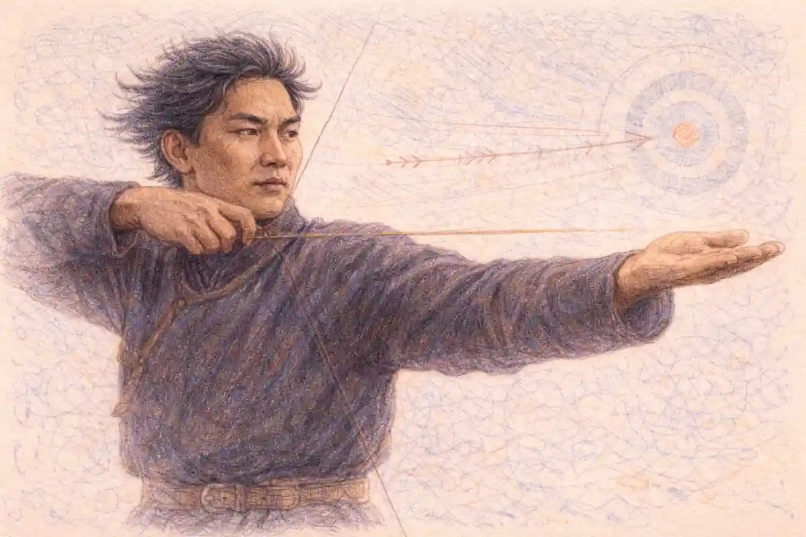

## A posthumous version that became the original

The curtain goes up on a lakeside at night, and the ending the audience will applaud three hours later was not written by the composer whose name is on the poster. It was settled in a St Petersburg rehearsal room in 1895, two years after his death, by two choreographers and a theatre conductor who had reordered his numbers, cut what they judged unusable, orchestrated three of his piano pieces to plug the gaps and rebuilt his ending to their own design. The score in question stands at the head of almost every list of Tchaikovsky greatest works, and the version of it that fills theatres on every continent is, in its performing shape, a posthumous reconstruction.

<!--more-->

That is the embarrassment at the centre of this catalogue, and it is also the clue to its real order. Tchaikovsky wrote six symphonies, eleven operas, three string quartets, two famous concertos and a shelf of orchestral showpieces, yet the works in which his gifts operate with the least friction are the three ballets, the compositions his own century filed under entertainment and his critics treated as a sideline. In the ballets the melodic abundance that could loosen a symphony's argument becomes the argument itself. The orchestral colour that could look like decoration in a concert work becomes stage machinery, carrying place, character and supernatural threat. The long span that he sometimes forced across a symphonic movement is given to him by the evening itself, act by act, so that patience replaces strain. This article defends that ranking work by work, and it keeps faith with the documentary record while doing so, because the second thing a reader needs to know about this catalogue is how often its most repeated stories rest on a single interested witness.

Some ground rules follow from that. Where a famous anecdote survives only in the composer's own later retelling, the article says so and prices it accordingly. Where a score exists in more than one authorised shape, the article names both shapes and says which one the world performs. Where the composer himself delivered the harshest verdict on a work, his verdict is quoted in paraphrase and left standing next to the box office figures, because the gap between the two is one of the most instructive things in the whole catalogue. The ballets come first in importance but not in the order of telling. The telling follows the works through the career, from the conservatory symphonies to the final symphony, so that the reader can watch the ballet scores absorb lessons learned in every other genre.

The name of the lakeside ballet is withheld for one more paragraph, deliberately, because its identity is the first open question of the article and its answer deserves the production history that explains it. Which ballet is a posthumous reconstruction, and who decided its shape? The question opens here, in the first section, and it closes in the tenth, once the original production of 1877 has been given its fair hearing and the reader can judge what the men of 1895 inherited. Between those points the article takes the catalogue in order, and the ballet waits at the side of the road like a lake beside a path. It is Swan Lake, as most readers will already have guessed. What they may not know is how little of the Swan Lake they have seen was settled by the man who signed the score.

## The catalogue and how the works are numbered

A catalogue is a map drawn by other people, and Tchaikovsky's map has more than the usual number of redrawn borders. The opus numbers that organise his works in concert programmes were assigned largely by his publisher, Pyotr Jurgenson, as pieces went to press, and they record the order of publication rather than the order of composition. Works he wrote early sometimes carry high numbers because they reached print late. Works he suppressed carry numbers anyway, because the publisher had announced them. Two of the most performed pieces in the catalogue sit awkwardly in the numbering altogether: Manfred, a symphony in all but name, is Opus 58, wedged between chamber and orchestral works, while the Sixth Symphony is Opus 74 and the single completed movement of an abandoned symphony in E flat was dressed after his death as a Third Piano Concerto, Opus 75, which he never authorised in that form.

The practical consequence is that no reader should trust the numbers to tell the story. Behind the opus sequence sit the works without numbers, the works in multiple versions and the works that survive only because somebody ignored the composer's instructions to destroy them. Romeo and Juliet exists in three versions across eleven years. The Second Symphony exists in two, the second a thorough recomposition of the first. The Variations on a Rococo Theme circulate in a text substantially rearranged by the cellist who commissioned them, a quiet second authorship that section twenty-nine will return to. The complete works edition and the thematic catalogue compiled in the Soviet period, whose TH numbers scholars use to pin down unnumbered pieces, bring order to this material without removing the underlying lesson: in this catalogue, the question of what a work is cannot be separated from the question of which version of it one means.

The table below sets out the works this article treats in depth, with the circumstances that produced each and the revision history that follows it like a shadow. It is the reference grid for everything after it. The longer history of the tradition this catalogue belongs to, the classical line running from the Viennese school through the Russian conservatories founded in his own lifetime, is traced in the series survey of [the history of classical composers](/2010/03/07/history-of-classical-composers/), and his life, as distinct from his output, is the subject of a companion article. Here the works themselves are the biography that matters.

| Work | Approximate date | Commission or occasion | Revision history | What it does that nothing else in the catalogue does |
|---|---|---|---|---|
| Symphony No. 1 | 1866 to 1874 | Conservatory graduation work, revised for performance | Two movements replaced, the rest reworked eight years later | Shows the folk song and the landscape picture entering his symphonic writing at the start |
| Romeo and Juliet | 1869 to 1880 | Suggested and critiqued by Balakirev | Three full versions, the last a decade after the first | Compresses a whole drama into one span steered by two opposed themes |
| Piano Concerto No. 1 | 1874 to 1875 | Written for Nikolai Rubinstein, who refused the terms | Light retouching only; the dedication changed hands twice | Built a concerto on a folk tune stated once and never developed |
| Swan Lake | 1875 to 1877 | Bolshoi Theatre commission | Rebuilt after his death for the 1895 revival, the text the world performs | Raises ballet music to symphonic scale and continuity |
| Symphony No. 4 | 1877 to 1878 | Written under the von Meck subsidy, dedicated to her unnamed | Unrevised after the premiere | Opens with a fate motto that frames the whole design |
| Eugene Onegin | 1877 to 1878 | Self chosen, after Pushkin | Unrevised; staged first by students as he insisted | Makes an opera out of refusals, letters and a single duel |
| Violin Concerto | 1878 | Written at Clarens for Auer, who declined it | Slow movement replaced before publication | Gives the soloist a cadenza inside the first movement's structure |
| Serenade for Strings | 1880 | Written on his own initiative alongside a commission | Unrevised | Sustains a full orchestral span on strings alone without a slow movement that grieves |
| 1812 Overture | 1880 to 1882 | Commissioned for the cathedral consecration festivities | Unrevised | Sets two national anthems against each other as opposing themes |
| The Sleeping Beauty | 1888 to 1890 | Imperial Theatres commission to Petipa's detailed plan | Unrevised | Builds a full evening of dance on one symphonic argument |
| The Queen of Spades | 1890 | Imperial Theatres commission | Unrevised | Turns a card player's obsession into the opera's whole musical engine |
| The Nutcracker | 1891 to 1892 | Imperial Theatres commission, paired with an opera | Unrevised | Achieves its effects at miniature scale with an orchestra of soloists |
| Symphony No. 5 | 1888 | Written on his own initiative | Unrevised | Binds four movements with one motto heard in four states |
| Manfred | 1885 | Programme supplied by Balakirev years earlier | Unrevised, though he later wished three movements destroyed | The only symphony built to an external literary programme in full |
| Symphony No. 6 | 1893 | Written on his own initiative | Unrevised | Ends a symphony with a slow movement that sinks instead of blazing |
| Piano Trio | 1881 to 1882 | Written in memory of Nikolai Rubinstein | Unrevised | Makes a chamber work carry the weight of a public memorial |

## The early symphonies and what he learned

The First Symphony, Winter Daydreams, cost its composer a breakdown of nerves before it cost him anything else, and the score bears the marks of a young man writing at the edge of his technique. He composed it in 1866, fresh from the St Petersburg Conservatory, working at night until his health gave way, and the Moscow premiere of 1868 under Nikolai Rubinstein was a qualified success with a maimed text, since the St Petersburg establishment had already condemned two movements. Eight years later he revised it thoroughly, replacing the slow movement's material and reworking the scherzo, and the version the world plays is that 1874 revision. What the symphony already has, in full, is the signature: a first movement built on a restless travelling figure under a sky of strings, and a slow movement that draws a landscape in sound, gloom and distance included. What it lacks is proportion. Ideas arrive faster than the structure can file them.

The Second Symphony of 1872 shows the filing system improving under the pressure of folk material. Its finale builds a set of variations on the Ukrainian song of the crane, and the nickname Little Russian, which he did not choose and did not love, stuck because contemporaries heard the Ukrainian tunes as the work's identity. Marina Frolova-Walker, the historian of Russian musical nationalism, has shown how readily national labels were pasted onto this generation's scores by critics who needed the music to declare a camp, and the Second is a textbook case: the folk songs are building material, handled with a contrapuntal discipline learned in the conservatory classroom, yet the work was read as a flag. When he revised the symphony in 1879 and 1880 he recomposed the first movement almost entire, keeping the slow movement and the crane finale's plan, and the revision is the version in the repertoire. The lesson he took from it was permanent. Folk melody in his hands works best as a found object set in a frame of his own construction, not as a style to be worn.

The Third Symphony of 1875, five movements long and nicknamed Polish by a London publisher for its finale in the polonaise rhythm, is the least played of the six and in some ways the most revealing. David Brown, his documentary biographer, treats the early symphonies as a laboratory, and the Third is the experiment in which the apparatus is most visible: a funeral march of unusual gravity, a waltz movement of real grace, and a finale whose brilliance keeps announcing more weight than the material carries. He never revised it, and its unevenness is instructive precisely because it stands uncorrected. Across the three works the pattern of the catalogue's first decade is set. He learns fastest when a commission or a critique forces the issue, he revises what he believes in and abandons what he does not, and the distance between the First Symphony's sprawl and the Second's revised finale is the distance between talent and method. The method would be tested at once, and in public, by a piano concerto.

## Romeo and Juliet and the fantasy overture

Romeo and Juliet began as homework set by a tyrant. Mily Balakirev, the leader of the nationalist circle in St Petersburg, proposed the subject in 1869, sketched the scheme he wanted, specified keys and the character of the themes, and then criticised the result movement by movement in letters of magnificent bluntness. Tchaikovsky, twenty-nine and still unsure of his standing, accepted the supervision because he recognised its quality, and the fantasy overture he produced carries both fingerprints permanently: a slow introduction of hymn-like solemnity for Friar Laurence, a violent allegro for the feuding houses, and a love theme whose long, breathing line has since become one of the most recognised melodies in the repertoire. The first performance in March 1870 under Nikolai Rubinstein went indifferently, and Balakirev's written response congratulated the love music while demanding surgery on almost everything else.

The surgery came in two operations, and the history of the three versions is the first full example of this catalogue's defining habit. The revision of 1870 softened the introduction and adjusted the ending. The revision of 1880, made a decade later with the first two symphonies and the Fourth behind him, rebuilt the close of the work altogether, replacing a busy peroration with a darkened funeral transformation of the love theme over a drumbeat of fate. The 1880 text is the one the world plays, and the difference between it and the 1870 text is the difference between a young composer accepting a mentor's outline and a mature one finishing the argument himself. Balakirev, to his credit, accepted the final version and conducted it, and the dedication of the published score is to him.

What the work does that nothing before it in his output had done is compress an entire drama into a single span without a word sung or spoken. The feud music and the love music are not episodes but antagonists, and the form is their collision. How those two themes are constructed, and why the love theme's phrasing makes it unmistakable within four bars, is a question of technique that belongs to the companion study of [Tchaikovsky's musical style](/2011/06/21/pyotr-ilyich-tchaikovsky-musical-style-explained/), where the fantasy overture is taken apart in full. Here the point is historical. By 1880 he possessed a popular orchestral work of unimpeachable seriousness, proof that the dramatic instinct which would later need a stage could already fill a concert hall. The next test was harsher, because it involved not a mentor at a distance but the most powerful pianist in Moscow, in the same room, at Christmas.

The overture also served, in the decade of its revisions, as his passport. It was the work foreign conductors could programme without a Russian context, a single span with a Shakespeare title that every audience in Europe already owned. Hans von Bülow took it up; Hans Richter conducted it in Vienna in 1876, where by the composer's own amused account it was hissed, an evening he recorded with more curiosity than pain. The hissing matters less than the programming. A Russian composer of thirty-six was being hissed in Vienna, which meant he was being played in Vienna, and the overture's mixture of liturgical calm, street violence and erotic melody gave continental audiences their first complete sample of the manner the symphonies would enlarge. When Balakirev, the severest of its midwives, conducted the final version in the 1880s, the work closed its long apprenticeship as the most revised success of his youth, and the pattern of its making, compose fast, submit to criticism, revise at leisure, revise again, stands behind half the catalogue that follows.

## The First Piano Concerto

The First Piano Concerto was written in the last months of 1874 by a composer who could play the piano creditably but not virtuosically, and who knew that the work's fate in Russia would be decided by one pair of hands. Nikolai Rubinstein, founder of the Moscow Conservatory, the institution's director, the teacher of half the pianists in the country and Tchaikovsky's own former professor, was the obvious dedicatee and the obvious launch vehicle. The concerto had been composed with his technique somewhere in mind, though not with his approval secured, and on Christmas Eve 1874 Tchaikovsky sat down in a conservatory classroom to play the score through to the man it was meant for. Two colleagues were in the room as witnesses. What happened next became the most famous rejection scene in nineteenth century music, and it opens the second question of this article. Did a famous teacher really demolish the piano concerto in a single evening? The story as the composer told it is given in this section and the next. Its audit is deferred to the section after that, where it belongs.

Judged purely as a score, the concerto Rubinstein heard was already the work the world knows, and its most famous feature was its most provocative. The huge opening theme, carried by the full orchestra with the piano in great chordal strides, is built on a Ukrainian folk song he had heard sung by a blind beggar at a fair, and it is stated once, at length, with overwhelming confidence, and then never heard again in the entire concerto. Conservatory logic said a first theme must be developed. He treats it instead as a porch, magnificent and disposable, and walks through it into the real first subject. The slow movement places a nocturne-like meditation between two appearances of a quicksilver scherzando section, and the finale drives a second Ukrainian tune and a broad hymn-like theme into collision and reconciliation. It is easy to hear why a professor of the old school reached for words like formless. It is just as easy to hear why audiences have never cared.

The concerto's route to the public ran around Moscow rather than through it. When the dedication passed to Hans von Bülow, the German pianist and conductor who had championed the composer's earlier orchestral work, Bülow took the score on his American tour and gave the world premiere in Boston on 25 October 1875, writing home that the audience demanded an encore of the finale. The work that Moscow's chief pianist had found wanting was launched by Europe's most famous travelling virtuoso in a hall four thousand miles away, and it has never left the repertoire since. What Rubinstein actually said at the Christmas Eve hearing, and what his subsequent conduct implies about it, is the story of the next section.

## The reported demolition by Nikolai Rubinstein

The demolition scene survives in one document, and the article's discipline requires it to be introduced as such: a letter Tchaikovsky wrote to Nadezhda von Meck in January 1878, more than three years after the evening it describes. In the letter he plays the first movement to the end. Rubinstein says nothing, and the silence gathers weight until the composer, unable to bear it, asks for a verdict. The verdict, when it comes, arrives as a torrent. The concerto is worthless and unplayable. Passages are trite and awkward beyond rescue. The writing is so poor that correction is useless, since the whole would have to be written again. At most two or three pages could be salvaged. He had stolen ideas from everywhere. Rubinstein then made his offer, which the letter presents as the true insult: revise the work thoroughly along the lines he would indicate, and he would perform it. Tchaikovsky answered that he would not alter a single note, and published the concerto exactly as written.

The letter is superbly written, and that is part of the problem considered in the next section. As narrative it has everything: the silent judge, the gathering storm, the condemned man rising in dignity. As evidence it has one witness, who is also the injured party, writing years later to a patron whose sympathy he had every reason to engage. What is independently documented is the aftermath, and the aftermath is stranger than the scene. Rubinstein, having allegedly found the concerto beneath contempt, conducted its Moscow premiere in December 1875, with Sergei Taneyev, his own prize pupil, as soloist. Within a few years he was performing the work himself in Moscow and Paris, and Tchaikovsky, who had struck the dedication from the score, recorded in his diary after one such performance that Rubinstein played it splendidly. The two men rebuilt their working friendship, and when Rubinstein died in 1881 Tchaikovsky wrote the great Piano Trio as his memorial.

None of that makes the Christmas Eve hearing a fiction, and the next section weighs the matter properly. But the conduct on both sides is a fact pattern that the legend usually omits, because the legend works better with a villain. A teacher who damns a concerto in December and conducts it the following December, quite possibly having meant his brutality as a demand for better work rather than a death sentence, is a more complicated figure than the story wants. The composer's own later revisions to the score were small: some thickening of piano figuration in the first movement for the second edition of 1879, and adjustments in 1889 that pianists have debated since. The notes Rubinstein heard in 1874 are, to all intents and purposes, the notes soloists play now. The work's survival was never in the gift of the man who heard it first.

## What that story is actually worth

The audit can be short because the archive is thin. The widely repeated account of the piano concerto's rejection comes from the composer's own retelling, written three years after the event for a reader he wished to convince, and it is not independently corroborated in its famous details. Rubinstein left no version of the evening. The colleagues present in the room left no account that settles the wording. Every retelling in every programme note descends from that single letter, usually without its date attached, which is how a private grievance hardened into a documented scene. David Brown, the documentary biographer, prints the letter's substance with the caution its provenance requires, and Alexander Poznansky, the editor who restored the composer's correspondence to its full text after decades of cut editions, has pointed out how carefully the letter is staged for its recipient, down to the pacing of the insults. None of this proves the scene false. It proves the scene is literature as well as testimony, and must be priced as both.

The corroborated skeleton underneath is solid enough. The concerto was played to Rubinstein. Rubinstein disliked it, or disliked its piano writing, which for a dedicatee amounts to the same refusal. No revisions were made at his demand, and the dedication moved to Bülow. Those are events, attested by publication history and by the printed score, and they justify calling the evening a rejection. What they do not justify is the verbatim demolition, the condemned pages, the charge of theft, which rest on one man's memory of his own humiliation. A teacher's bluntness was also a documented trait: Rubinstein's students remembered a man whose praise was rare and whose criticism was a weather event, and it is entirely plausible that a harsh verdict, sharpened in three years of retelling, became the scene the letter preserves. The loop opened in section five can therefore close with a graded answer. A famous teacher did refuse the concerto in a single evening, and refused it rudely. The demolition as quoted is a solo performance by the injured party, and historians who repeat it without the words according to Tchaikovsky are repeating a story whose terms its subject set.

There is a coda worth more than the scene itself. The concerto's first movement opens with a theme that never returns, played by a soloist in chords so massive that the instrument sounds like an orchestra arguing with itself. Rubinstein, whatever he said, had been offered the dedication of that. His later performances of the work suggest he understood, once other pianists had shown the way, what he had initially missed. The work needed no rescue. It needed only a soloist who had not been asked to judge it at sight, in a classroom, on Christmas Eve.

## Swan Lake in 1877

Swan Lake was a commercial commission, and the terms are worth stating because they frame everything that followed. In 1875 the Moscow Bolshoi Theatre engaged Tchaikovsky, then known chiefly for operas and orchestral works, to write a full-length ballet for the imperial stage, at a fee of eight hundred roubles. He accepted with enthusiasm that surprised his friends, because he loved the theatre, needed the money, and had admired the ballet scores of the resident specialists while believing he could do the job at a higher level of musical ambition. He worked through 1875 and into 1876, consulting the theatre's ballet master, Julius Reisinger, on the practical grammar of dance numbers, their lengths, their metres, their cues. The scenario, assembled by Vladimir Begichev and Vasily Geltser from German and Russian folk material, gave him the swan maiden Odette, the prince Siegfried, the sorcerer Rothbart and the double role of Odile, the black swan whose impersonation engineers the catastrophe.

The score he delivered was unlike anything the Bolshoi had staged. Ballet music in Moscow was a service industry, supplied by staff composers who wrote to order at dancing length, and into that workshop Tchaikovsky carried the habits of the symphony: themes that return transformed, acts bound together by recurring ideas, a lakeside act conceived as a continuous span of music rather than a chain of display pieces, and an orchestra of full concert weight. Roland John Wiley, the historian of the imperial ballet who reconstructed the first production from the theatre's archives, has documented how seriously the composer took the assignment, down to his study of the specialist scores he intended to surpass. The ambition was audible, and audibility was the problem. Dancers counted a music they could not hear their steps in. The orchestra struggled with a score its conductor, by the theatre's own records an inadequate musician, could not command. Reisinger's staging was starved of money and invention in equal measure.

The premiere came on 4 March 1877 at the Bolshoi, and the work entered the repertory under a cloud that the next section must measure precisely, because the cloud has been exaggerated ever since. The score itself, in its 1877 shape, remained the property of a single production. Tchaikovsky tinkered with it, supplying a new pas de deux in 1877 for a ballerina who wanted one, and that addition, detached from its author, begins the long history of other hands in this text. He never revised the ballet as a whole. He died believing it a partial failure, one of the few verdicts of his that the following section will show to have been too harsh, and the work's second birth, eighteen years after the first, was arranged entirely by others.

## What happened at the first production

The received story is simple: Swan Lake failed, the score was hissed into oblivion, and the ballet vanished until better men revived it. The theatre's own records tell a less theatrical story, and this section exists to give the records their hearing, because the second rung of this article's argument stands here. The 1877 production was poorly received in important quarters, but the popular story of total failure overstates what the reviews and the box office actually show.

### Was Swan Lake a failure at first?

Not in the way legend insists. The first production was underfunded, the choreography weak, the conducting poor, and several critics found the score too elaborate for dancing. Yet the ballet stayed in the Moscow repertory for six years and some forty-one performances, which no genuine catastrophe achieves.

The reviews, gathered by Wiley from the Moscow press, divide along a line that matters. The staging was condemned almost unanimously: shabby sets, dances that wasted the music, a leading dancer past her best in the double role. The score drew a mixed verdict of a peculiar kind. Herman Laroche, the composer's friend and the most serious critic in Moscow, found the music full of talent and at the same time too symphonic, too densely woven for the purpose it served, a complaint that amounts to saying the work was better than its frame. Other notices complained of monotony in the long lakeside act, the very act dancers and audiences would later treat as the score's glory. Nobody in 1877 called the music worthless. They called it unsuited, which is a different charge, and one the composer partly accepted.

The conditions behind those reviews deserve a paragraph of their own, because they explain the mismatch the critics heard. The Bolshoi's ballet orchestra was led by the theatre's resident conductor Stepan Ryabov, whose limitations the house records and the musicians' memoirs agree on, and a score that asked the band to sustain symphonic spans left it exposed in a way a Minkus score never did. The choreography was mounted on stock scenery and a modest budget, with the lake represented by machinery the stagehands struggled to keep silent. The ballerina Anna Sobeshchanskaya, who created the double role of Odette and Odile, was a dancer of real gifts working inside a staging that gave her little to build on, and her request for a new pas de deux, granted by the composer in 1877, reads in retrospect as a professional's attempt to repair the evening from inside. What the first audiences saw, in short, was a new kind of ballet score wearing an old production like a borrowed coat, and the reviews, read whole, keep saying exactly that in different words.

The box office is the harder evidence, and it contradicts the catastrophe story outright. A failed ballet at the Bolshoi died within a season. Swan Lake was performed some forty-one times across six years, surviving changes of cast, before it was dropped in 1883 as the production aged and its scenery decayed. Those are the numbers of a middling success with a long tail, not of a disaster. Why, then, did the disaster story win? Partly because the composer's own disappointment was real and quotable: he blamed the production and suspected the score. Partly because his brother Modest, whose biography framed the life for a generation, cast 1877 as a fiasco the better to set up the triumph of 1895, and Modest's framing is a subject of this article's evidence rules, not a source under them. And partly because the men of the revival had an interest in the darkness of the first night. A rescue needs a wreck. The record shows a ship that sailed imperfectly for six years, and the distinction governs how much credit the rescuers can claim.

## The 1895 revival and who made it

The revival began as a memorial. Tchaikovsky died in the autumn of 1893 with Swan Lake unrevived and half forgotten outside Moscow, and when the direction of the Imperial Theatres in St Petersburg resolved to honour him, the lakeside act was chosen for a commemorative concert in 1894. The staging of that act fell to Lev Ivanov, the Mariinsky's second ballet master, a musician among choreographers, and what he made of the swan scenes in that concert persuaded the theatre to mount the whole ballet. The full production opened at the Mariinsky in January 1895, with Marius Petipa, the presiding genius of the imperial ballet, taking the court scenes of the first and third acts, Ivanov taking the two lakeside acts, and Riccardo Drigo, the theatre's Italian conductor and a practised hand at ballet scores, charged with preparing the music.

### Who created the Swan Lake we know?

Three men, working eighteen years after the premiere and two years after the composer's death. Marius Petipa restaged the court acts, Lev Ivanov the lakeside acts, and Riccardo Drigo revised the score itself, reordering numbers, cutting freely and orchestrating piano pieces by Tchaikovsky to fill the gaps.

The production was mounted as an imperial occasion, and its casting announced the intention. Pierina Legnani, the Italian ballerina whose technique had reset the ceiling of the possible in St Petersburg, danced Odette and Odile, and in the ballroom act she performed the sequence of thirty-two fouetté turns she had introduced to astonished Petersburg audiences two seasons earlier, a feat of mechanical brilliance inserted into the score's fabric where it has remained, in production after production, ever since. Pavel Gerdt, the premier danseur of the Mariinsky, was her Siegfried. Vsevolozhsky, the director who had commissioned The Sleeping Beauty and The Nutcracker from the same composer, supervised the enterprise as a monument: the theatre was not merely filling a repertory gap but installing a classic, and classics in the imperial system were not discovered in archives. They were manufactured, by revision where necessary, and the manufacture was understood by everyone involved to be legitimate work. Petipa's planning letters, preserved in the theatre's papers and studied by Wiley, show the same bar counting rigour he had applied to The Sleeping Beauty, now applied to another man's finished score, and applied, it should be noted, with the composer's brother in correspondence and consenting.

Between them they did not so much revive the ballet as reissue it, and the first question of this article can now be closed in full. The lakeside ballet of the opening section, the most performed ballet score in the world, is the Swan Lake of 1895: Petipa's structure, Ivanov's swan choreography, Drigo's edition of the music, wrapped around a score whose substance is Tchaikovsky's and whose performing shape is theirs. The composer authorised none of it. He could not have, being dead, and the sanction the theatre relied on came from his brother Modest, who approved the revision on the estate's behalf and whose approval is itself one of the custody problems this catalogue keeps generating. The next section itemises what the three men actually changed, since the word revival conceals the scale of the intervention, and the article's thesis stands or falls on the itemisation being exact.

## What the revival changed

The changes begin with the shape of the evening. Drigo, working with Petipa, moved numbers between acts, cut passages the theatre found slow, transposed keys to suit dancers, and rebuilt the finale's pacing. Material vanished that the composer had written for the first production, including music for the storm and the lovers' deaths as he had first conceived them, while other material arrived that he had written for entirely different purposes. Three of his piano pieces from the set of Eighteen Pieces, Opus 72, were orchestrated by Drigo and inserted into the ballroom act as a pas de deux and supporting numbers, where they sit so naturally that audiences have assumed for a century that they belong to the ballet. Dances were reassigned, the order of the lakeside scenes adjusted, and the ending reshaped so that the apotheosis of the lovers closes the evening in a form the composer had sketched differently. It is time to state the plain fact on which the article's thesis turns, in the plain form it deserves. The standard Swan Lake is a posthumous 1895 production assembled by Marius Petipa, Lev Ivanov and Riccardo Drigo. Its ordering, some of its orchestration and its ending are not Tchaikovsky's own.

Two judgements must be kept separate, because the literature habitually fuses them. The first is factual: the Swan Lake the world performs is the 1895 text, not the 1877 text, and any honest account of the work must say which one it is describing. The second is evaluative, and here the revival's defenders have the stronger case than purists admit. Ivanov's lakeside choreography is among the supreme achievements of the imperial ballet, and it was made possible by Drigo's willingness to treat the score as material rather than scripture. The 1877 score, restored to its original order by scholars and recorded complete in the late twentieth century, proves more coherent than the first production suggested, but it has never displaced the revision in the theatre, and there is no sign that it will. The composer's text and the world's text coexist, one in the study and the recording catalogue, the other on the stage. Lecturers who lay the two texts side by side for a class can open the comparison in a [browser-based presentation viewer](https://reportmedic.org/tools/ppt-viewer.html) without installing anything on the machine in the hall.

What the revival did not do is rescue a worthless score. Section nine established the record: six years in the Moscow repertory is not a wreck. What Petipa, Ivanov and Drigo rescued was a reputation, by giving the music the staging it had always needed and, in the process, taking liberties no living composer would have accepted without a fight. The ballets that follow in this article stand in instructive contrast. The Sleeping Beauty and The Nutcracker reached the stage in their composer's lifetime, under his eye, in texts he authorised. Only the most famous of the three is a collaboration across the grave, and the catalogue's centre of gravity rests, in part, on an act of posthumous editing. The symphonies, to which the article now returns, present the opposite case: texts he controlled completely, and meanings he explained himself, in letters that raise a custody problem of their own.

## The Fourth Symphony

The Fourth Symphony was composed across 1877, the year of his catastrophic marriage and flight abroad, and dedicated on its title page to my best friend, the friend being Nadezhda von Meck, whose annual subsidy had just made his composing life financially possible and whose name the dedication withheld by design. It was premiered in Moscow in February 1878 under Nikolai Rubinstein, and it is the first of his symphonies to stand permanently in the international repertoire. Its opening is its argument: a fanfare in the brass, stated at once and returning at the symphony's hinges, which he identified to von Meck as fate, the force that hangs over the whole design. The four movements enact a progress from that fanfare's dominion, through a melancholy slow movement and a scherzo played almost entirely in plucked strings, to a finale that answers despair with a folk festival and then lets fate cut across the rejoicing one last time.

The fate programme is the best documented programme in his symphonic output, because he set it out himself in a long letter to von Meck of March 1878, written in answer to her direct question about what the symphony meant. Here this article's custody rule must be applied in the open. That correspondence, the richest single source for his intentions, circulated for most of the twentieth century in Soviet editions from which passages had been silently removed, and programme readings built on the trimmed texts inherit the trimming. The full letter, restored in the complete editions of the correspondence prepared under Alexander Poznansky's editorship, supports the fate reading in the composer's own words, and it is on the full text, not the Soviet one, that this article relies. The distinction matters beyond this symphony. A programme quoted from a cut edition is a quotation from the editor, and the Soviet editors of Tchaikovsky's letters are subjects of his catalogue's history, never sources within it.

Within those limits, the Fourth's design needs no letter to justify it. The fanfare's returns are timed with a dramatist's instinct, the slow movement's long oboe line over rocking strings is the first of his great confessional melodies, and the finale's quotation of a birch tree folk song inside a symphonic argument shows the Second Symphony's lessons fully absorbed. Abroad, the work travelled fast: it carried his name into concert halls that knew nothing of the operas, and by the time the Fifth arrived a decade later it was the symphony by which foreign audiences measured him. The dedication itself became part of the work's public meaning. To my best friend stood on the title page without a name, and the anonymity was the von Meck arrangement in miniature: she subsidised the music, declined all meeting, and let the printed page carry a devotion it could not identify. Readers who knew the Moscow gossip could guess. Readers who did not received the dedication as a mystery the music seemed to annotate, which is one reason the fate reading, once published, attached itself to the work so durably in the public mind. The symphonies and the ballets advance through this article in parallel, like the two careers they were. The next work returns to the stage, and to Pushkin, the writer whose texts would occupy him, on and off, for the rest of his life.

## Eugene Onegin

In May 1877, in the middle of the Swan Lake aftermath, a singer friend suggested Pushkin's Eugene Onegin as an opera subject, and Tchaikovsky's first reaction was that the idea was absurd: a novel in verse, famous across Russia, whose plot is a chain of non-events, a girl who writes a letter, a young man who lectures her, a duel neither wanted, a ball, a refusal. Within days he had changed his mind completely, read the poem through the night, and begun composing the letter scene first, out of sequence, because Tatyana's confession was the moment that had seized him. He worked on the opera through the worst year of his life, his marriage and collapse running in parallel with the composition, and finished the score early in 1878. He called the work not an opera but lyric scenes, a designation printed on the score, and the choice of term was a manifesto about what he had made.

The plot, stripped of Pushkin's verse, which this article will not quote, is quickly told and deliberately unheroic. Tatyana Larina, a bookish girl on a country estate, falls in love with the visiting Eugene Onegin and writes him a letter declaring it. Onegin, worldly and empty, answers with a courteous sermon on his unsuitability and advises her to control her feelings. Months later, at her name day party, his flirtation with her sister Olga provokes her fiancé, the poet Lensky, into a duel, and Onegin kills the friend he did not hate. Years pass. In St Petersburg, at a grand ball, he meets Tatyana again, now the wife of Prince Gremin and a figure of complete social command. He falls in love, writes his own letter, and is refused in his turn, by a woman who admits she loves him and sends him away anyway, because the terms of her life have closed.

What Tchaikovsky added to this chain of refusals was a musical language of private feeling sustained at operatic length. The letter scene, some twenty minutes in which a girl writes, doubts, despairs and writes again, is the opera's centre of gravity, and its continuous orchestral fabric, carrying the melody of her infatuation through every change of resolve, had no real precedent in Russian opera. Around it he set scenes of disarming plainness: a harvest chorus, old dances at the name day ball, Lensky's farewell meditation before the duel, Gremin's measured declaration of late found happiness. The first performance, in March 1879, was given not by a professional company but by students of the Moscow Conservatory, exactly as he had insisted, and the professional premiere followed at the Bolshoi in 1881. He had written the least spectacular opera of the century and the one that would be performed, in time, more than all his others.

## Why Onegin is not a conventional opera

The designation lyric scenes is the key, and it was aimed at the conventions of the grand opera stage he knew from Paris and from the Italian repertoire in Moscow. A conventional opera of his period dealt in public events: conspiracies, executions, battles, the fall of dynasties, with private feeling amplified to fill the square. Onegin offers none of it. Its catastrophes are a letter answered coldly and a duel over a slight at a party, and its climax is a woman declining, in a drawing room, to ruin her life. The forces are domestic: no grand ensembles of conspirators, choruses that appear as peasants, guests and ballroom dancers, people doing what such people do, rather than as the voice of destiny. Even the duel, the single violent act, happens between the scenes, reported and mourned rather than staged as spectacle.

Simon Morrison, the scholar of Russian opera and of the symbolist era that inherited this repertoire, has written of the period's stages as places where the intimate and the ceremonial collided, and Onegin is the collision resolved entirely in favour of the intimate. The title character is not even the protagonist in musical terms. Onegin's music is elegant, accomplished and deliberately hollow at the centre, the sound of a man performing himself. Tatyana carries the opera's melodic wealth and its moral weight, and the letter scene gives her the longest unbroken span of music in the work, so that the audience has lived inside her feeling before it is asked to watch her renounce its object. The famous waltz and polonaise function as social weather, beautifully made and emotionally neutral, against which the private scenes register like events in a quiet house.

He protected the conception with unusual stubbornness. He refused the Bolshoi's first approaches until he could secure conditions, insisting that the work be launched by young singers whose ages matched the characters, because conventional opera voices, he argued, would make Tatyana's confession grotesque. He resisted cuts and the insertion of display numbers. The opera's subsequent history vindicated the stubbornness and then, in a way he would have found grimly funny, overwhelmed it: the lyric scenes became a fixture of the grand houses he had designed them against, sung by stars in productions of mounting spectacle, and the work's intimacy had to be rediscovered by later directors from the score. None of that changes what the score is. It is a chamber drama that happens to fill an opera house, and its place in this catalogue is as the proof that his dramatic gift needed neither cannons nor sorcerers, only a girl, a letter and the courage to let refusal carry an evening.

## The Violin Concerto

The Violin Concerto was written in a rush of recovered health at Clarens, on Lake Geneva, in March and April 1878, in the same spring that produced the Fourth Symphony's premiere and the letter explaining it. Tchaikovsky was convalescing from the collapse of his marriage in the company of his brother Anatoly and of Iosif Kotek, a young violinist from the Moscow Conservatory who played through the drafts as they came and advised on what the instrument would and would not do. The whole concerto was drafted in about a fortnight and orchestrated within weeks, a speed that reflects both his fluency and Kotek's presence at the desk. One movement was written twice: the original slow movement dissatisfied him, he set it aside, and it survives separately as the Méditation, the first of the three pieces for violin and piano published as Opus 42. In its place he wrote the Canzonetta, the muted, singing interlude the concerto now carries.

The work was intended for Leopold Auer, the Hungarian violinist who presided over violin playing in St Petersburg as professor at its conservatory and leader of the Russian Musical Society's quartet, and the score was dedicated to him. The dedication was a bid for the only premiere that mattered in Russia. It failed, in circumstances the next section examines, and the failure set the concerto on a three year road through rejection and hostile print before it reached a hall. As music, it is the most sheerly pleasurable of his large concert works, and the pleasure is engineered. The first movement gives its cadenza not at the customary late position but at the movement's structural joint, so that the soloist's meditation becomes the hinge on which the recapitulation turns. The finale, a trepak of gathering speed, was the movement conservative noses wrinkled at, on grounds that had as much to do with the dance's social address as with its notes.

Around these two pillars the Canzonetta rests the ear, and the whole design has the balance of a man writing for an instrument he loved at one remove, through another player's hands. Kotek, the collaborator at the desk, hoped to premiere the work himself and was judged too junior for the risk by the composer, who wanted a famous name to carry it past the critics. The famous name declined. What Auer said, and what he later did, completes the catalogue's second great rejection story, with a twist the piano concerto's story does not have: this time the refuser lived to reverse himself in the most public way available to a teacher, by raising a generation of soloists on the work he had refused.

## Declared unplayable and then championed

### Why was the violin concerto called unplayable?

Leopold Auer, the dedicatee, examined the score and judged passages of the solo part awkward to the point of being unplayable as written, and he postponed and then declined the premiere. His verdict concerned the writing for the instrument, the hand positions and figuration, not the music's worth.

Auer's refusal, reported by the composer in letters of the time with real bitterness, delayed the concerto for years. Kotek would not risk it, Russian soloists took their cue from Auer's shelving of the score, and the work waited until Adolph Brodsky, a Russian violinist building a career in the West, took it up and gave the premiere in Vienna on 4 December 1881, with Hans Richter conducting. The Viennese press gave the catalogue its second famous demolition. Eduard Hanslick, the most powerful critic in the German language, wrote a review that conceded the first movement's merit and then turned on the finale with a disgust that has outlived his reputation: he charged that the violin is no longer played but beaten and torn, and closed with the phrase that clung to the work for decades, music that stinks to the ear. Brodsky, to his lasting credit, kept the concerto in his repertoire and played it across Europe when few others would.

The printed score carries the episode's residue in its front matter. When the concerto was published, the dedication on it was not Auer's name but Brodsky's, a public record of who had stood by the work when standing by it cost something. Brodsky repaid the honour with a lifetime of advocacy, programming the concerto across Germany and England when it was still a provocation, and Tchaikovsky, conducting his own works in Leipzig in 1888, heard Brodsky play it there and wrote home in terms that closed the account between them. Between the premiere and that reconciliation the work had survived on such loyalty. It had no other mechanism. There was no institution charged with its survival, only a soloist who kept it in his case.

Then comes the reversal that forms the fourth rung of this article's ladder. The violin concerto was declared unplayable by the man it was intended for, who was later the musician most responsible for establishing it. Auer, won over in the following decade, took the work into his own repertoire and, far more consequentially, into his studio. His pupils at the St Petersburg Conservatory, among them Mischa Elman, Efrem Zimbalist and Jascha Heifetz, carried the concerto into every hall in the world as a proving piece of the Russian school, in an edition Auer himself prepared, an edition whose small adjustments to the solo part mean that the Auer text, as much as the Auer verdict, is woven into the work the world performs. The man whose verdict had frozen the work in 1878 became, through his students, its principal begetter. He never publicly recanted in so many words, and his later writings treat the concerto with a proprietorial warmth that skips the refusal entirely. The catalogue has no neater demonstration that a first verdict, even from the highest authority in the field, is a weather report and not a climate.

## The Serenade for Strings

The Serenade for Strings was written in the autumn of 1880 in the same weeks as the 1812 Overture, and the composer himself set the two works side by side in a letter to von Meck with a candour that the next section will use. The overture, he told her, was a commission discharged; the Serenade was written from inner conviction, on his own initiative, because he felt like writing it. The Serenade, Opus 48, is laid out in four movements for string orchestra alone: an opening piece in sonata form that frames the whole work by returning at the end, a waltz that became one of his most loved single movements, an elegy of sustained melancholy, and a finale built on two Russian folk themes, the second of them a Volga boatmen's hauling song worked into a dance of gathering brilliance. It was premiered in St Petersburg in October 1881 under Eduard Nápravník and has been a repertoire fixture ever since.

Its claim on a high place in the catalogue rests on economy. No winds, no brass, no percussion, no stage, no programme, and yet the span feels orchestral, because the string writing deploys the section as a choir of soloists: divided parts, pizzicato used as colour rather than punctuation, the violas and cellos given the melodic argument as full partners. The opening movement's return at the close, quotation as architecture, turns the Serenade into a loop that shuts with an audible click. He dedicated it to Konstantin Albrecht, a cellist colleague from the Moscow Conservatory, and he held to his estimate of it across the years, which in this catalogue is not a thing that can be assumed. The works he praised himself are a shorter and stranger list than the works posterity praised, and the Serenade stands on both.

One further fact about its making explains its poise. He told von Meck that the opening movement was composed as a deliberate homage to Mozart, a paying of respects in the older master's manner, and the whole Serenade breathes that classicism: the forms are the eighteenth century's, the proportions exact, the sentiment disciplined by the frame it fills. He wrote it at Simaki and Kamenka in the autumn of 1880, in the household of his sister, in the same weeks that the state commission for the cathedral festivities was extracting the 1812 Overture from him by obligation. The juxtaposition is the cleanest evidence in the catalogue for his own theory of his work. Given a deadline and a cannon, he produced the piece he despised. Given nothing but an inner inclination and a Mozart score in his head, he produced the piece he pointed to when strangers asked what he was. The two works share a month. They share nothing else.

For the newcomer the Serenade has a further use, which section thirty-three will build on. It is the catalogue in miniature at concert length: the melodic gift, the dance rhythms, the darkening elegy, the folk song absorbed into a symphonic frame, all present in half an hour, with none of the occasional bombast that makes unprepared listeners flinch at the famous overture. That overture comes next, and with it the article's third question, the one that will not be answered until the disowned works are reached near the end: why would a composer dismiss, in writing and repeatedly, the piece that became his most played?

## The 1812 Overture and the work he dismissed

### Did Tchaikovsky like the 1812 Overture?

No, and he said so in writing more than once. He told his patron that the overture was loud and noisy, composed without warmth or love, and in his judgement of no artistic value, a piece assembled to a deadline for a state occasion rather than written from any inner need.

The commission came from the festivities surrounding the consecration of the Cathedral of Christ the Saviour in Moscow, the vast church built to commemorate the deliverance of Russia in 1812, and the work was performed in August 1882 at the Moscow Arts and Industrial Exhibition under Ippolit Altani. Its design is a battle plan rendered in themes. The Russian side is represented by an Orthodox chant and, at the climax, by the imperial anthem; the invading French by their own anthem, which enters in fragments, grows brazen, and is broken apart as the battle turns. Between them he stages the campaign itself: skirmishes in the strings, a folk tune for the Russian people, the gathering of the storm, and a coda in which church bells and cannon, written into the score as instruments, celebrate the victory over a blaze of the anthem. The tunes themselves are named here and not quoted, in words or notes, which is all the description the piece's mechanism requires.

The dismissal deserves exact statement, because it is the fifth rung of this article's ladder. He dismissed the 1812 Overture in his own correspondence, telling von Meck in November 1880, while the ink was barely dry, that it was very loud and noisy, that he had written it without warmth and without love, and that it probably had no artistic merit. To his publisher he was hardly kinder. And the work he disowned became the most frequently performed thing he wrote: a fixture of outdoor concerts and national celebrations on several continents, in the United States a staple of Independence Day programmes whose adoption by the Boston Pops in the 1970s turned its cannon into a civic ritual, performed in a single year more often than all three ballets combined in many seasons. The loop that opens with that contradiction, why a composer would dismiss the piece that became his most played, stays open deliberately. Its answer is not local to this overture. It is the pattern of his self judgement across the catalogue, and it closes only when the full set of disowned works stands assembled in section thirty-one. The overture's companions in that pattern were written for the same machinery of state that commissioned this one, and they are the subject of the next section.

## Occasional music and imperial commissions

A working composer in imperial Russia wrote for the state the way a working architect built for it: often, lucratively and without illusion about which of the results would bear his name into the future. Tchaikovsky's occasional catalogue begins early, with the Festival Overture on the Danish National Anthem of 1866, written for the marriage of the Tsarevich to a Danish princess and already showing the anthem-as-theme technique the 1812 Overture would make famous. It peaks in 1883, the coronation year of Alexander III, for which he supplied both a Coronation March and the cantata Moscow, performed at the coronation festivities and received by their composer with the private contempt he reserved for the genre. Round these poles cluster the Jurists' March of 1885, written for the anniversary celebrations of the School of Jurisprudence, his own alma mater, a piece he tossed off for old colleagues and rather enjoyed, and the incidental music that behaves less like upholstery than the commissions suggest.

The incidental scores deserve their sentence of rescue. The music for Ostrovsky's play The Snow Maiden, written in 1873 in a burst of spring energy, contains choruses and dances whose freshness he never disowned; material from it resurfaced in later works for years. The Hamlet music of 1891, overture material aside, shows the theatre craftsman entire: short cues that establish a scene's temperature in seconds. Marina Frolova-Walker has written of this generation that the imperial commission was not the opposite of art but one of its conditions, a frame inside which composers negotiated how much of themselves to spend, and the occasional works are where that negotiation is most legible in Tchaikovsky. He spent least on the coronation pieces and said so. He spent most where a play or a school memory engaged him, and the scores show the difference in their invention per page.

For the catalogue's argument these works matter in two ways. They paid. The fees and the imperial gifts that attended state commissions formed a real strand of his income beside the von Meck subsidy and the publisher's advances, and a works article that omits them falsifies the economics of the career. And they calibrate his self judgement. When he called the 1812 Overture worthless, he was applying a craftsman's standard he applied consistently to everything written to order, a standard by which the Coronation March and the cantata Moscow fail far more completely than the overture does. Posterity, characteristically, kept the overture and dropped the rest. The next sections return to commissioned work of the opposite destiny: ballets ordered by the same imperial machine, in which he spent himself without reserve.

## The Sleeping Beauty

The Sleeping Beauty was commissioned in 1888 by Ivan Vsevolozhsky, the director of the Imperial Theatres, a man of genuine theatrical intelligence who wanted a ballet on Perrault's tale mounted as a homage to the French grand style, with music by the composer of Swan Lake. What made the commission extraordinary was the working document. Marius Petipa supplied a plan of unprecedented detail, specifying for number after number the dramatic content, the character of the music, the tempo and in many cases the exact count of bars he required. Composers of ballet were accustomed to such instructions in outline. Petipa's plan was a blueprint, and Tchaikovsky, instead of resenting it, rose to it with a completeness that still startles. He composed the score through 1889, consulting Petipa as he went, and completed a prologue and three acts that run, uncut, for close to three hours of music.

The premiere at the Mariinsky in January 1890 was a state occasion, and the first response was respectful bewilderment in roughly equal parts. The Tsar's reported verdict, delivered at the imperial box office after the performance, was a famously lukewarm two words, and the press found the score too symphonic, too laden with meaning for the dancing it accompanied, the same charge Moscow had brought against Swan Lake from the other direction thirteen years before. The dancers, by contrast, understood at once, and the production's splendour carried the work into the repertory, where it consolidated season by season. He himself valued it among his best works, and for once the composer's estimate and the long verdict of the theatre agree without qualification.

Wiley's studies of the imperial ballet's papers show how completely the score was conceived as a single organism: themes assigned to the opposed powers of the Lilac Fairy and the wicked fairy Carabosse contend beneath the divertissements, the great panorama interlude carries the Prince across a hundred years of sleep in one orchestral span, and the wedding act's dances are ordered as a symphonic finale in disguise. It is the only one of the three ballets whose text reached the stage exactly as its composer wrote it, supervised by him in rehearsal, in a production mounted at the full strength of the imperial machine. Swan Lake was rebuilt by other hands; The Nutcracker, as a later section shows, reached its audience by a side door. The Sleeping Beauty is the control case, the proof of what his ballet writing was when nobody interfered, and the next section argues that it is also, on the merits, the most ambitious of the three.

## Why Sleeping Beauty is the most ambitious of the three

Ambition in a ballet score is not a matter of length, though at close to three hours this is the longest. It is a matter of how much of the drama the music elects to carry, and on that measure The Sleeping Beauty stands apart from its companions. Swan Lake, for all its symphonic aspirations, was written inside the habits of the Moscow theatre of 1877, in numbers that a resident ballet master could rearrange, and duly did. The Nutcracker, as section twenty-three will show, is a masterpiece at miniature scale, an art of the perfect small thing. The Sleeping Beauty attempts something larger: a full evening in which the musical argument never sleeps even when the heroine does, in which the opposition of the Lilac Fairy and Carabosse is stated in the prologue as a genuine thematic conflict and discharged only in the final act, a hundred years of story later.

The means are worth enumerating because ambition without means is only size. The score deploys a system of recurring themes for persons and powers, handled with a flexibility learned from the symphonies. It builds its first act around a waltz of symphonic proportions that simultaneously is a dance, a birthday and a portrait of a court. Its second act frames the Prince's melancholy with hunting music that darkens into the vision scene, where the sleeping Aurora appears in music of suspended, breathing stillness unlike anything in the earlier ballets. Its divertissements, the fairy tale characters at the wedding, are character pieces whose wit depends on orchestral detail at the level of the solo instrument. David Brown, weighing the three ballets as compositions, gives the palm to this one on exactly these grounds: it is the score in which the symphonic and the theatrical in Tchaikovsky stop alternating and fuse. Petipa's bar by bar blueprint, which might have cramped another composer, here functioned as the strict form functions for a poet. The ambition is the blueprint's and the music's together, which is why the work also stands as the imperial ballet's own monument to itself.

Against this, the claims of Swan Lake rest on its pathos and its lakeside poetry, and the claims of The Nutcracker on its perfection of detail, and both claims are real. The comparison is argued fully in the article's conclusion, where the thesis about the ballets' centrality is decided. For the works catalogue the point to file is narrower. If a listener wants the evidence that ballet music could bear the full weight of the nineteenth century's most ambitious musical thinking, without ceasing to be dance music for a single bar, The Sleeping Beauty is that evidence, and it reached the stage intact, which neither of its companions managed in quite the same way. The operas of the final period make a darker claim on the reader's attention, and the first of them, written at white heat in the same years, is a study of obsession that leaves Perrault's palace far behind.

## The Queen of Spades

The Queen of Spades was composed in Florence in the first months of 1890, in a concentration so intense that the draft of the entire opera took forty-four days. The subject was another Pushkin story, a novella of gambling and obsession, and the libretto was written by his brother Modest, who altered Pushkin freely: the setting was pushed back into the glittering eighteenth century, the heroine raised in station, the ending darkened into double catastrophe. Modest's hand in this opera is the benign face of the custody question that runs through this catalogue. His libretto made the opera stageworthy and falsified its source's irony in the process, just as his later biography would make the life readable and falsify parts of its record. In both cases the article treats his shaping as a fact to be noted, not a transparent window to be looked through.

The plot requires no quotation to be felt. Hermann, a poor officer of engineers, becomes obsessed with the secret of three cards that never lose, a secret guarded by an aged countess who won with them in her youth. He courts her ward Lisa as a route into the countess's house, confronts the old woman alone at night to extort the secret, and she dies of fright before his eyes, or of the shock his presence brings, leaving him with nothing but her ghost's later visitation and the three numbers it whispers. At the gaming table, staking everything on the sequence, he plays the first two cards correctly and then, on the third, finds in his hand not the ace he counted but the queen of spades, whose portrait on the card wears the countess's face and seems to wink. Lisa dies by her own despair between these poles of the action, and Hermann ends the opera at the gaming table with his reason gone, while the other players carry the final chorus as a prayer over him.

As music, the opera is the most driven thing he wrote. The obsession is not illustrated but mechanised: figures associated with the three cards recur and mutate through the score, the countess's music drags an old French song's world behind it, and the ballroom act places a charming pastoral intermezzo, all powdered innocence, inside the tightening trap, so that the court's elegance becomes one of the horror's instruments. The premiere in December 1890 at the Mariinsky was a public success of the first order, and the opera spread to Kiev, Moscow and Prague within two seasons. He had doubted the subject when it was proposed, pressed it aside, and then written it faster than almost anything in the catalogue. The pattern recurs so often in these pages that it deserves naming: his first response to a subject was no guide to his final achievement in it, a pattern the ballets had already established and the last symphony was about to seal.

## The Nutcracker

The Nutcracker arrived as half of a double commission: Vsevolozhsky ordered a one act opera, Iolanta, and a two act ballet on Hoffmann's tale of the Nutcracker and the Mouse King, as retold by Alexandre Dumas, for a single evening at the Mariinsky. Petipa drew the scenario and began the choreography, fell ill, and handed the production to Ivanov. Tchaikovsky composed the score through 1891 and into 1892 under a private cloud that the correspondence makes plain: he doubted the subject's thinness beside The Sleeping Beauty, doubted his own freshness, and wrote on regardless with a professionalism that the result transfigures. The ballet was premiered on the same evening as Iolanta in December 1892, and the press received it coolly, as a sumptuous children's entertainment of more craft than consequence.

The score knew better, and its innovations are of a kind that does not announce itself. In Paris in 1891 he had heard the celesta, a keyboard instrument whose steel plates sound like bells heard through water, and he moved quickly and quietly to secure one for the Imperial Theatres before any rival composer could introduce it in Russia, writing home with instructions that the purchase be kept secret. The instrument's solo in the Dance of the Sugar Plum Fairy became the ballet's signature sound and one of the most imitated timbres in orchestral music. Around it he built a score of miniaturist precision: a pine forest journey in which the trees themselves seem to grow, a Waltz of the Snowflakes that sets a wordless children's chorus inside the orchestra, and a series of character dances in the second act whose wit is a matter of instrumental casting, each number scored like a chamber piece that happens to have a full orchestra at its disposal.

The first production's coolness had reasons the record supports. The battle with the mice was staged with children and extras in confusion, the heroine was a child danced by a child, which the critics of the imperial stage found a waste of its ballerinas, and the plot's dream logic satisfied nobody who wanted the clear moral architecture of The Sleeping Beauty. What nobody at the premiere foresaw was that the score would escape the ballet entirely, through a door the composer himself opened before the premiere, and that the escape would shape the work's reputation for two generations. That door is the suite, and the gap between the suite and the ballet is the subject of the next section, and one of the neatest case studies in the catalogue of how a work's packaging decides what the world thinks it is.

## The suite, the ballet and the gap between them

In March 1892, nine months before the ballet's premiere, Tchaikovsky conducted a concert suite of eight numbers from The Nutcracker in St Petersburg, and the suite was an immediate and clamorous success, with numbers encored on the spot. He had condensed nothing: the suite is a selection, not a distillation, and the distinction is the whole of this section. A selection can be perfect and still misrepresent its source, and the Nutcracker suite misrepresents the ballet in the specific direction of charm. It contains the overture in miniature, the march, the Sugar Plum Fairy's dance, the character dances and the two great waltzes. It does not contain the battle, the heroine's transformation of the Nutcracker into the Prince, the journey through the pine forest, the snow scene's full span, or the dramatic arc that binds the party of the first scene to the apotheosis. A listener who knows only the suite knows the ballet's jewellery and none of its plot of the heart.

The consequence played out over decades. The suite entered the world's concert halls at once and has never left them, while the complete ballet travelled slowly: excerpts staged in Moscow, a full production in London in 1934, the first complete American staging in San Francisco in 1944, and the Balanchine production for New York City Ballet in 1954 that fixed the work as a seasonal institution in the United States and, in time, as the financial foundation of American ballet companies. Only when the full score became a fixture did musicians register what the suite had concealed, that the battle music is ferociously difficult, that the snow scene is among his greatest sustained inventions, and that the second act's divertissement is a coda to a drama rather than a box of sweets. The gap between suite and ballet is therefore not a curiosity but a mechanism of reputation, the same mechanism, working in reverse, as the Swan Lake revision: there, other men rebuilt a work and the rebuild became the original; here, the composer himself issued an extract, and the extract became the work in the public mind for fifty years.

For the practical listener the resolution is simple and section thirty-three will build the listening order on it. Hear the suite by all means, since it is flawless at its scale. Then hear the ballet complete, in sequence, and let the numbers the suite made famous take their places inside an argument that begins with a Christmas party and ends with a child applauding a dream she is already outgrowing. The symphonies now resume, with the most perfectly balanced of them, written in the same year as The Sleeping Beauty and doubted, characteristically, by its composer within weeks of its triumph.

## The Fifth Symphony

The Fifth Symphony was composed in the summer of 1888, in the new house at Frolovskoye he had just taken, and premiered under his own baton in St Petersburg in November of that year to a response that split cleanly down the middle: the audience warm, the critics respectful and unconvinced, the composer plunged within weeks into the familiar doubt, writing to von Meck that he had come to think the symphony a failure, too padded, too insincere, a thing made rather than felt. He was wrong, as the work's subsequent century demonstrates, but the doubt is part of the catalogue's pattern and it also obscures what the symphony achieves, which is the most lucid large design he ever made. A single motto theme, first heard in the clarinets' low register over a funeral tread in the opening bars, returns in every movement: brooding in the first, transfigured into the slow movement's great horn melody by association and contrast, spectral as a waltz rhythm in the third, and blazing in the finale's major key peroration. Whether that journey describes fate overcome or fate merely outshouted is a question the finale's reception has never settled, and the argument itself has become part of the work's life.

The custody rule applies here with special force, because the principal evidence for a programme is a sketch he made in a notebook in April 1888, a few pencilled lines setting out a scheme of resignation before fate and the murmurs of doubt, which circulated in the literature through editions of the diaries and letters that were, for decades, cut and rearranged by their Soviet editors. Readings of the Fifth as an autobiographical confession rest on that fragment, and any honest statement of them must carry the flag: the fragment survives, its interpretation is contested, and the trail between the notebook and the finale passes through editions that were not neutral. What is not contested is the workmanship. The slow movement's horn solo, the waltz's ghost of the motto, and the finale's return of the first movement's material in triumph or in irony are facts of the score, available to any listener without a programme at all.

Abroad, the symphony travelled on the shoulders of conductors who believed in it, Arthur Nikisch above all, whose performances across Germany in the 1890s made it a fixture where the Russian critics had hesitated. In Hamburg in 1889 the composer conducted it himself, and his diary records that Brahms, who was present, stayed for the whole performance and praised the first three movements while withholding his assent from the finale, a verdict Tchaikovsky reported with pride rather than resentment, since Brahms was not in the habit of staying. The Fifth's place in the catalogue is as the symphony of balance, the one in which his lyrical and dramatic instincts divide the territory without a wasted province. It had a predecessor, though, which he valued in parts and wished in part destroyed, and that predecessor is the strangest symphonic object he ever made.

## Manfred and the symphony he nearly destroyed

Manfred came to him twice. In 1868 Balakirev, fresh from supervising Romeo and Juliet, pressed on him a programme drawn from Byron's dramatic poem: four scenes tracing the guilt haunted Manfred from his mountain solitude through the witch of the Alps and the hall of Arimanes to death unreconciled. Tchaikovsky declined, judging the subject cold for him and the programme a straitjacket. Seventeen years later, famous, financially secure and between the Fourth Symphony and the Fifth, he reconsidered, and in 1885, travelling through Switzerland past the very landscapes of the poem, he composed the work at speed and in a state of absorption his letters record with surprise. The result is a symphony in four movements that wears no number, premiered in Moscow in March 1886 under Max Erdmannsdörfer, and received by its composer with the most divided verdict he ever passed on a major work.

He admired the first movement without reserve, calling it, in correspondence, among the best things he had written, a vast slow portrait of the protagonist's guilt built from a single uncoiling idea. The other movements he came to think bloated and overlong, the scherzo's Alpine fairy music too pretty for its subject, the finale's bacchanal too noisy even by his standards of noise. At one point he formed the settled intention of destroying the last three movements and publishing the first as a symphonic poem on its own, and he announced the plan in letters as calmly as a man arranging furniture. He never carried it out. Whether what stopped him was indolence, a publisher's counsel or a residual loyalty to the whole design, the record does not say, and the complete Manfred survived to be revalued by posterity on terms he would have found half right: the first movement is indeed the summit, and the work around it, heard whole, is the missing bridge between the Fourth Symphony's confessional mode and the Fifth's.

David Brown rates Manfred higher than its composer did, hearing in its programme bound sprawl the very quality that makes it unique in the catalogue: the one symphony in which the literary imagination that fed the operas and ballets was let loose in the concert hall without a stage to discipline it. The assessment is worth the reader's attention because it reverses the usual direction of his self criticism. Here the flaw he diagnosed, excess, is inseparable from the distinction. A catalogue that contained only the works he approved of at the end would be smaller, tidier and poorer, and Manfred is the standing proof. Three years after it came the Fifth Symphony; five years after that, the final score in this entire survey, a symphony whose ending would reverse the contract between a symphony and its audience more completely than anything since Beethoven's Ninth had joined voices to the form.

## The Sixth Symphony

The Sixth Symphony was sketched in the first months of 1893 and orchestrated through the summer, in a state of confidence that his letters of the period state without the usual tremor. He told his nephew Vladimir Davydov, the dedicatee, that he believed it the best thing he had written, and he told correspondents that the work had a programme, but one that would remain a riddle, saturated with feeling and entirely personal. He conducted the premiere himself in St Petersburg on 28 October 1893. The audience received the symphony with respect and visible puzzlement, particularly at its ending, and the composer left the hall uncertain whether he had written his finest work or mystified his public. The title by which the world knows it, Pathétique, was settled after that premiere; by his brother Modest's account, which is the only account and must be treated as an interested one, he offered a list of candidates the next morning, Modest proposed the word, and the composer approved it on the spot, though he wavered later and the title page of the first edition nearly lost it again.

He died nine days after the premiere. That fact is stated here once, plainly, because chronology requires it and because the symphony's afterlife is unintelligible without it; nothing in this article will build on it, and the reader should be suspicious of any account that does. The second performance, under Eduard Nápravník on 18 November, in a city in mourning, turned respectful puzzlement into acclamation, and the work's reputation was fixed in that atmosphere: the symphony as requiem, as farewell, as a message in a bottle from a man who knew. The programme he guarded has been filled in by generations of listeners with his death, and the inference, however moving, is precisely that, an inference drawn after the fact from an ending that refuses the customary blaze. What the ending does, as pure construction, is the business of the next section, and it is remarkable enough to need no biography to prop it up.

As catalogue, the Sixth completes the count that an early FAQ of this article must answer exactly: six numbered symphonies, composed across twenty-seven years, plus the unnumbered Manfred of 1885, plus the abandoned E flat symphony of 1892 whose materials he recycled into other works and whose slow movement and finale would be reconstructed by scholars long after. The six form the spine of his orchestral reputation, and the last of them is the one in which every device the earlier five developed, the fate motto, the confessional slow movement, the waltz in place of a scherzo, here a movement in a limping five beat metre that has become the most famous in the work, is carried to a concentration that silenced even the critics who had patronised him. Its finale then does the thing for which there was no precedent in his output and almost none in the century's.

## The finale that reverses the convention

A nineteenth century symphony ended, by contract with its audience, in affirmation: a fast finale, a major key or a hard won one, volume as verdict. Tchaikovsky himself had honoured the contract five times, most noisily in the Fifth, whose motto returns in brass blaze whether the listener hears triumph or its imitation. The Sixth ends with an Adagio lamentoso, a slow movement in the minor key that does not resolve, rally or blaze, but sinks. Its principal theme, entrusted to the strings in a scoring that divides the violins so that the melody seems to pass between two halves of one voice, sings itself out across a span of increasing exhaustion. A second theme offers consolation in a major key and is withdrawn. The movement closes with the first theme fragmenting over a descending figure in the low strings and a heartbeat of pizzicato that stops rather than concludes. Audiences at the premiere did not know whether to applaud. Audiences since have learned to sit in the silence it leaves, a silence the hall itself seems reluctant to break.

The sixth and final rung of this article's ladder stands on this movement, and it should be stated with the precision the evidence allows. The Sixth Symphony ends with a slow quiet finale instead of a fast loud one, which inverts the convention his critics accused him of being unable to handle. For forty years the standing charge against his symphonies, from the Moscow professors to Hanslick's Vienna, had been form: that he was a lyricist padding miniatures to symphonic length, incapable of the sustained argument the form demands. The finale of the Sixth is the answer, and it is an answer in the accusers' own terms. Only a composer in complete command of symphonic expectation could break its oldest term so calmly and hold a hall through ten minutes of subsidence. The control is formal, measurable in the movement's proportions and in the symphony's whole arch, whose passionate first movement and five beat waltz are balanced against this descent like the two halves of a single span.

What the finale is not, on the evidence of this article, is a coded farewell, and the distinction is a matter of record rather than taste. He finished the work in high spirits about it, conducted it as a concert piece among others, and left its programme deliberately unstated; the reading of the Adagio as a suicide note in music arose from the date of his death nine days later and belongs to the dispute about his reputation, which another article in this cluster owns and argues in full. Here the works are the brief, and as a work the finale is a formal revolution executed in a whisper. The catalogue's remaining provinces are smaller in scale and, in the case of the songs, smaller in reputation than they deserve, and the article turns to them before assembling the verdicts he passed on himself.

## The chamber music and the piano works

The chamber music is the catalogue's smallest province and contains one of its largest works. The three string quartets of the 1870s belong to his apprenticeship in the Viennese forms, and the First Quartet's slow movement, built on a folk song he had heard a house painter sing, became so celebrated in arrangements that it led a separate life of its own, moved Tolstoy to tears at a Moscow performance by the composer's own account, and earned its place as the quartet movement Russia knows best. The Piano Trio of 1882 is another order of undertaking. Written in memory of Nikolai Rubinstein, whose death the previous year had ended the concerto story's long antagonism in grief, it is scored for piano, violin and cello at symphonic scale: a vast elegiac first movement, a set of variations that surveys a life in episodes, and a finale whose triumph collapses, at the last, back into the funeral music of the opening. It is the only work in the catalogue in which his public and private manners fully coincide, and it stands as the rebuttal, in advance, to any claim that he could not sustain a chamber argument. The Souvenir de Florence sextet, begun in 1887 and revised in 1892 after a performance revealed its joins, closes the province with a work of Italianate lyric abundance whose finale returns, as the Second Symphony had, to folk dance as structural engine.

The piano works repeat, at desk scale, the catalogue's textual complications, and no account of them is honest that skips the fact. The Seasons, the twelve pieces of 1876 commissioned month by month for a St Petersburg journal, are miniatures of genuine poetic finish whose titles and epigraphs were the editor's, not the composer's, a packaging he accepted with indifference. The Children's Album of 1878, written for his nephews, condenses the whole manner into pieces a gifted child can play and a great pianist cannot exhaust. The Grand Sonata of the same year he left un-revised and half loved. And then there are the versions. The Second Piano Concerto, a work of real stature premiered in New York in 1881, circulated for most of the twentieth century in a version drastically cut and reordered by the pianist Alexander Siloti, with cuts the composer had sanctioned under pressure and later regretted; the original text had to be re-established by editors. The Variations on a Rococo Theme, that most graceful of his concert works, is still most often played in the rearrangement made by its dedicatee Wilhelm Fitzenhagen, who reordered its variations, dropped one and altered the ending, with the composer acquiescing in print and grumbling in private. Swan Lake was not an aberration. In this catalogue, the performed text and the written text diverge again and again, and section eleven's lesson is a general law.

## The songs

The songs are the province the catalogue's reputation forgot, and a works article that omits them repeats the error it exists to correct. Across the whole career, in sets from the six romances of Opus 6 in 1869 to the six of Opus 73 in his final year, he wrote roughly a hundred songs, and they were neither marginalia nor potboilers. In the Russia of his lifetime the romance was the domestic genre, the music of the drawing room piano, and his songs circulated in sheet music to an audience the concert hall never reached, earning him steady fees and a kind of fame that ran parallel to the official one. The subjects are the standard furniture of the genre, longing, parting, night, the beloved's cruelty and the beloved's absence, and the texts are by Russian poets and, in the French set of Opus 65 written for the singer Désirée Artôt, by French ones; the article names the poets' world without borrowing a line of it, since the words are the poets' property and the gate on this series is absolute.

What is his in the songs is the melodic concentration. Freed from symphonic obligations, he writes tunes of a directness the big works ration, and the piano parts do the scene setting in bars where an opera would take an act. The Opus 6 set closes with a Goethe setting, in Lev Mey's Russian version, that became the single most famous romance in the Russian repertoire, a song whose afterlife in recital rooms rivals the concertos'. The sixteen children's songs of Opus 54 apply the same craft at the scale of a nursery. The late Rathaus settings of Opus 73, written in the last year, have a gauntness that answers, in miniature, the Sixth Symphony's. For the listening order in section thirty-three the songs matter practically as well as honourably: half an hour of them will teach a newcomer the sound of his melodic thinking faster than any symphony, because there is nothing else in the texture to hide behind. The catalogue has now been walked end to end except for its rubbish heap, which he curated himself, and to that the article turns, closing its oldest open question on the way.

The economics of the songs deserve their sentence too, because they explain the province's size. Songs were the steadiest sellers in Jurgenson's catalogue of his works, sheet music bought by households rather than institutions, and a set of six romances could be composed in days and earn for decades. He wrote the first set, Opus 6, in a single week of 1869 for ready money, and returned to the genre whenever the ledger or the inclination prompted, adding duets in Opus 46 and songs of a deliberate simplicity for his nephew's household. Singers of the first rank kept the romances in their recital programmes, which is how audiences who never entered an opera house learned his melodic voice at close range. The songs are, in the strict commercial sense, the most widely distributed music he ever wrote, and their neglect in the concert narrative of his career is an artefact of that narrative's preference for large forms, the very prejudice this article has been resisting since its first section.

## The works he disowned

He began destroying his own music early and never quite stopped. Undina, the opera of 1869 that the Imperial Theatres accepted and then shelved, he burned in the 1870s, salvaging what he could into other scores; the love music survived by migration into Swan Lake, where sharp ears have traced it, and the rest is ash. The Voyevoda, his first staged opera, he destroyed after its 1869 production convinced him of its worthlessness, and the full score perished so thoroughly that its later reconstruction by Soviet scholars from surviving orchestral parts counts as an act of archaeology against the composer's will. The temperament behind these fires, the shame, the impatience with his younger self, the wish to control what the future would judge, is the material of [Tchaikovsky's life and career](/2011/06/07/pyotr-ilyich-tchaikovsky-life-and-career/), where it belongs; here the fires matter as catalogue facts, the holes in the shelf that no edition can fill.

Below destruction there is dismissal, and dismissals are the larger class. The 1812 Overture heads it, as section eighteen recorded. The Coronation March and the cantata Moscow he treated in letters as hackwork discharged. The Third Piano Concerto's parent symphony he abandoned mid orchestration when the material cooled on him. Manfred's last three movements he voted to destroy and spared only by inaction. The pattern across the whole class is consistent enough to close, at last, the question opened in section eighteen: why would a composer dismiss the piece that became his most played? Because his standard was inward and theirs is outward. He judged a work by the temperature of its making, by whether it had been written from conviction or to order, and the correspondence returns to that test with the regularity of a conscience. Audiences judge by effect, and by effect the commissioned overture, with its anthems and its cannon, is the most effective twelve minutes he ever assembled. Both verdicts are internally coherent. They simply measure different things, and the entire disowned shelf is the record of their divergence.

The divergence has one more turn. His severity was not reliable even on its own terms. The Fifth Symphony failed his inward test within weeks of its premiere and passes every test since. The Nutcracker bored him in the writing and contains some of his most fastidious invention. A composer's verdict on his own work, this catalogue demonstrates at every scale from the burned operas to the slighted overture, is evidence about the composer, not about the work, and the works article that prints his contempt for the 1812 without the box office beside it has told only the more quotable half of the truth. Reception, the world's half, is the next and last piece of evidence before the article assembles its listening order and its verdict.

## Reception then: what succeeded immediately

Set against the settled picture of posterity, in which his name anchors orchestral seasons worldwide, the reception map of his own lifetime is a patchwork that surprises. The First Piano Concerto succeeded at once and abroad, launched in Boston before Moscow had digested it. The Serenade for Strings succeeded at once and everywhere. The Sleeping Beauty succeeded at court and consolidated in the theatre within seasons. The Nutcracker suite succeeded at once while its ballet waited sixty years. Eugene Onegin conquered by infiltration: conservatory theatres across Russia took it up because it was performable by students, Prague gave the first production outside Russia under his own baton in 1888, and Mahler's Hamburg staging of 1892 carried it into the German system, so that the anti opera became, by the back stairs, the most internationally performed Russian opera of its century. The Fourth and Fifth Symphonies divided their first hearers and were carried abroad by advocacy, Nikisch's above all. The Sixth was canonised in a fortnight by grief.

The American chapter belongs to this map, because no other Russian composer of the century had one like it. In the spring of 1891 he crossed the Atlantic as the most famous living musician invited to the opening of Carnegie Hall in New York, conducted his own works there and in other American cities, and wrote home in astonishment at the scale of the welcome, the orchestras, the fees and the press attention, which treated him as a celebrity of a kind Russian musical life had no machinery to manufacture. The visit fixed his music in American programmes a generation before the ballets arrived to dominate them, and it explains why the concerto Boston had premiered in 1875 kept its American stronghold while Europe was still arguing. Reception, in his case, was never one story told at different speeds. It was several national stories running concurrently, with different works cast as the hero in each, and the full picture emerges only when the map is read whole.

And the failures of the record are equally specific. Swan Lake's first production underperformed its score for six years and then vanished from the stage for eighteen. Manfred was respected and shelved. The Queen of Spades, a triumph in Russia, waited decades for the West. The Violin Concerto was established against its first reviews by a soloist's loyalty and a teacher's second thoughts. What later musicians made of this inheritance, which works the next century's composers raided and which they left alone, is the subject of the companion article on [Tchaikovsky's influence on music](/2011/07/21/pyotr-ilyich-tchaikovsky-influence-on-music/), and it is a stranger story than simple triumph. Within his lifetime the pattern is clear enough to state: his successes came fastest where a performer or an institution adopted the work as a cause, Bülow, Brodsky, Nikisch, the imperial ballet itself, and slowest where the work depended on the verdict of the press. The catalogue the world inherited was thus preselected by advocacy, and the works that lacked an advocate in 1893, Manfred, the songs, the full Swan Lake text, are precisely the ones later generations had the pleasure of discovering for themselves.

## A listening order for a newcomer

### Which Tchaikovsky work should I hear first?

Romeo and Juliet, in its final version. It lasts twenty minutes, it needs no plot summary and no patience with unfamiliar forms, and it contains the whole composer in embryo: the hymn, the feud, and a love theme whose arrival feels like the resolution of an argument the listener did not know was running.

The order that follows builds outward from that beginning in stages, each stage earning the next. After the fantasy overture, take the Serenade for Strings, which shows the lyrical and dancing Tchaikovsky at concert length without a single cannon, and then the Nutcracker suite, heard as what it is, a selection of perfect miniatures. With those three in the ear, the symphonies can be approached in the order Five, Four, Six, a sequence that moves from his most balanced large design to his most confessional and then to the finale that reverses the contract, by which point the listener has the equipment the reversal requires. The First Piano Concerto and the Violin Concerto belong here in the sequence rather than at the start, because their famous openings mean more once the orchestral world behind them is familiar, and because each carries a rejection story the earlier sections have equipped the reader to enjoy at its proper discount.

The ballets come last in the order and first in the argument, deliberately. Hear The Sleeping Beauty complete before Swan Lake, because its text is the one he authorised and its scale sets the standard by which the Swan Lake revision can be judged; then hear Swan Lake in the standard version, and, if curiosity survives, in the restored order of 1877, and decide which original to believe in. Eugene Onegin and The Queen of Spades close the course, the first for the letter scene and the second for the card table, and Manfred and the songs wait at the end as the connoisseur's dividend. A listener who follows this order will have traversed the catalogue from its most welcoming door to its most contested room, and will be ready for the verdict the final section delivers, which is also the thesis the first section announced.

Two practical notes govern the whole course. The first concerns versions, which in this catalogue are not pedantry. For the Violin Concerto, most recordings descend from Auer's edition of the solo part, and hearing one performance that follows the composer's text teaches the ear what the great teacher smoothed away. For the Second Piano Concerto, should curiosity reach it, the recording's booklet must be interrogated for whether it plays the original or the shortened version Siloti made, since the two differ by whole spans. The second note concerns scale of commitment. Each stage of the order costs an evening at most, the symphonies less, and the songs half an hour, so the entire traversal is a matter of weeks of ordinary listening rather than a project. That accessibility is itself part of the works' character. This is a catalogue that meets the listener more than halfway, and the order above simply arranges the meetings so that each one prepares the next.

## Tchaikovsky Greatest Works: Why the Ballets Are the Centre

The thesis can now be judged on the evidence assembled. The three ballets, dismissed for decades as light music by the custodians of the serious, are the most completely realised works in the catalogue, because ballet was the one form in which every pressure on his gift acted in his favour. The symphonies show the gift contending with an inherited architecture he respected and resented, gloriously in the Fourth and Fifth, valiantly in Manfred, transcendentally in the Sixth, but contending always. The operas show it contending with libretti, singers and institutions. The ballets gave him a detailed blueprint instead of an abstract form, a theatre's resources instead of a publisher's deadline, and a dramatic span measured in acts rather than movements, and inside those conditions the contention stops. What remains is the thing itself: melody of unmatched generosity sustained across whole evenings, orchestration that thinks, and formal patience that lets a lakeside act or a panorama interlude unfold at the speed of breathing.

The textual irony with which the article opened is therefore not an embarrassment to be confessed but the sharpest statement of the catalogue's nature. The centre of the output is a ballet its composer saw fail quietly and never revised, rebuilt after his death by a choreographer of genius, a second choreographer of greater genius in the lakeside scenes, and a theatre conductor with a free hand, and canonised in their version ever since. Around that centre stand a symphony whose programme rests on letters the state once trimmed, a concerto whose rejection scene one man wrote, a violin concerto its dedicatee refused and then fathered, and an overture its composer despised that the world will not stop playing. To know these works is to know their documents, which is why this article has priced every story it told. Set beside the other figures in the series ranking of the [greatest composers of all time](/2025/04/07/greatest-composers-of-all-time/), Tchaikovsky's case rests less on any single score than on this: no composer of his century left a body of work that theatres and concert halls, between them, perform more completely, and none of it, not even the most famous twenty minutes on any lake, can be taken on trust.

Apply the withdrawal test, which separates centrality from mere fame. Withdraw the symphonies from the record and the repertoire loses six great evenings and keeps a theatrical composer of genius. Withdraw the operas and the loss, though real, is local to the opera house. Withdraw the three ballets and the institution of classical ballet loses the scores on which its modern identity was built, the works by which companies from St Petersburg to New York measure their dancers, their orchestras and their seasons, together with the only full length scores of the century that every serious company on earth regards as obligatory. That asymmetry is the thesis in its final form. Fame made the 1812 Overture ubiquitous and the First Piano Concerto beloved, and scholarship has spent a century correcting the record around them. The ballets needed no correction of their standing, only of their texts, and the correction, when it came, revealed the strangest and most durable fact in the whole catalogue: that its centre holds even when the centre itself turns out to have been finished by other hands.

## Frequently Asked Questions

### Q: What are Tchaikovsky's most famous works?

In performance counts the leaders are the ballets Swan Lake and The Nutcracker, the 1812 Overture, the First Piano Concerto, the last three symphonies and Romeo and Juliet, with The Sleeping Beauty and the Violin Concerto close behind. Fame here is a compound of several different publics. The concert hall sustains the symphonies and concertos, the theatre sustains the ballets and Eugene Onegin, and the outdoor summer stage sustains the overture above everything. Any ranking should also carry the warning this article has repeated throughout: the most famous ballet of the set reaches its audiences in a posthumous revision, the most famous overture was disowned by its composer, and the most famous concerto opening is a theme the work itself discards in four minutes. Fame in this catalogue is real, but it is an unreliable guide to what the works are, which is why the article has ranked by completeness of realisation rather than by celebrity, and put the three ballets at the centre.

### Q: How many symphonies did Tchaikovsky write?

Six numbered symphonies, composed between 1866 and 1893, and one unnumbered symphony, Manfred, written in 1885 between the Fourth and the Fifth. The count also has two ghosts attached to it. An early symphony in E flat was abandoned in 1892 after full sketching and partial orchestration, and its material was recycled into other works, with one movement reappearing in the posthumous Third Piano Concerto. Manfred refuses the number because it is a programme symphony in four scenes after Byron, issued as Opus 58 without the generic title its companions carry. So the accurate answer depends on the question behind the question. Six symphonies bear numbers. Seven symphonic structures of full scale survive complete. Eight were begun. The six numbered works divide naturally into the three apprentice symphonies of the first decade and the great trilogy of the Fourth, Fifth and Sixth, with Manfred standing between the trilogies as the catalogue's beautiful anomaly.

### Q: Did Nikolai Rubinstein reject the first piano concerto?

Yes, in outline, on the evidence of publication history and the composer's account alike. Tchaikovsky played the new concerto to Rubinstein on Christmas Eve 1874, intending him as dedicatee and first performer. Rubinstein disliked what he heard, demanded extensive revision as the price of his performance, and the composer refused the terms, published the score unrevised and transferred the dedication to Hans von Bülow, who premiered the work in Boston in October 1875. Those events are not in dispute. What rests on a single source is the famous scene itself, the silent hearing followed by a torrent of contempt, which survives only in the letter Tchaikovsky wrote to Nadezhda von Meck more than three years later. Rubinstein's own later conduct complicates any simple villainy: he conducted the Moscow premiere within the year and was soon performing the concerto himself, to the composer's recorded pleasure.

### Q: How reliable is the story of that rejection?

Reliable in its skeleton, unverifiable in its dialogue, and the distinction should travel with the story wherever it is retold. The single source is the composer's letter to von Meck of January 1878, written three years after the event, to a patron whose sympathy he valued, by a man who wrote letters the way he wrote music, with a dramatist's sense of pacing. No account from Rubinstein exists, and the colleagues present left nothing that settles the wording. Modern scholarship handles it accordingly: David Brown prints it with a caution, and Alexander Poznansky, who restored the cut correspondence to its full text, notes how carefully the scene is shaped for its reader. The corroborated facts, the hearing, the refusal, the rejected revisions, the change of dedication, are solid. The verbatim demolition, including the charge that the concerto's pages were stolen from everywhere, is one injured man's memoir of an evening, and historians who repeat it without the words according to Tchaikovsky are repeating literature as evidence.

### Q: What happened at the 1877 Swan Lake premiere?

The ballet was premiered at the Moscow Bolshoi on 4 March 1877 in a production the theatre had underfunded and the resident choreographer Julius Reisinger had staged without distinction, under a conductor unequal to the score. The press divided. The staging was condemned, several critics found the music too elaborate and symphonic for dancing, and the composer's friend Herman Laroche delivered the balanced verdict that the score was full of talent and wrongly employed. What did not happen was the oblivion of legend. The production remained in the Bolshoi repertory for six years and received some forty-one performances before being dropped as it aged, figures Roland John Wiley recovered from the theatre's records. The first Swan Lake was a compromised success whose musical ambition its frame could not serve, and the catastrophe version of its premiere was largely constructed later, by a biography that needed a fiasco to set up a resurrection.

### Q: Who revised Swan Lake after Tchaikovsky died?

The revision was prepared for the St Petersburg revival of January 1895 at the Mariinsky Theatre, and three men made it. Marius Petipa, the imperial ballet's presiding master, restaged the court acts and supervised the whole. Lev Ivanov, who had first staged the lakeside act for a memorial concert in 1894, created the swan scenes that became the ballet's canonical choreography. Riccardo Drigo, the theatre's conductor, revised the score itself, reordering numbers, making cuts and transpositions, and orchestrating three of Tchaikovsky's piano pieces from Opus 72 to insert as new dance numbers. The composer's brother Modest sanctioned the changes on the estate's behalf. The resulting text is not a cleaned up copy of the 1877 original but a new performing edition built inside it, and it is that edition, not the score Tchaikovsky signed, that theatres around the world perform under his name.

### Q: What did the 1895 revival change?

Three classes of thing. Drigo reordered the sequence of numbers, moving material between scenes and acts and cutting passages the theatre judged slow, so the evening's architecture is the revival's rather than the composer's. He altered the musical substance at specific points, transposing numbers to suit the dancers and orchestrating three piano pieces from the set of Eighteen Pieces, Opus 72, which now sit inside the ballroom act as if composed for it. And the ending was reshaped, the lovers' deaths and the apotheosis recast into the form audiences have applauded ever since. The choreography was likewise new where it mattered most, in Ivanov's lakeside scenes. What survived intact was the bulk of the score's substance, its themes, its lakeside act's musical span, its character dances. What changed was the shape in which the world receives that substance, which is why this article describes the standard Swan Lake as a posthumous production rather than an edition.

### Q: Why is Eugene Onegin called lyric scenes?

Because the composer insisted on the term, and printed it on the score, to tell performers and audiences what kind of work they were getting. Eugene Onegin contains no conspiracy, no spectacle, no grand historical canvas. Its events are a letter written and coldly answered, a quarrel at a name day party, a duel fought offstage between scenes, and a final refusal in a drawing room. Tchaikovsky called these lyric scenes because each number is a state of feeling sustained and examined rather than an action advanced, and the opera's protagonist in musical terms is not Onegin but Tatyana, whose letter scene gives her the longest continuous span in the work. The term was also a practical protection. He wanted the premiere given by conservatory students whose ages matched the characters, and feared that conventional opera forces would inflate a chamber drama of refusals into the grand manner it was written against.

### Q: Why was the violin concerto initially refused?

The dedicatee refused it. Tchaikovsky wrote the concerto in the spring of 1878 with the young violinist Iosif Kotek advising at the desk, and offered it to Leopold Auer, the dominant violin professor in St Petersburg, whose name would have guaranteed its Russian launch. Auer examined the solo part and judged passages of it awkward to the point of unplayability as written, and he postponed his decision until the postponement amounted to a refusal. Russian soloists took their cue from the shelving, Kotek was judged too junior to carry the premiere, and the score waited three years until Adolph Brodsky performed it in Vienna in December 1881 under Hans Richter. The Viennese critical reception, led by Eduard Hanslick, was savage in its turn, so the work was refused twice over, once by its intended player and once by the press, before performers reclaimed it. Auer himself later reversed his position so completely that his pupils became the concerto's worldwide carriers.

### Q: Did Tchaikovsky value the 1812 Overture?

He did not, and the record of his contempt is documentary rather than anecdotal. Writing to Nadezhda von Meck in November 1880 as he finished the score, he described the overture as very loud and noisy, composed without warmth and without love, and in his judgement of no artistic value. He applied the same standard across his commissioned work, treating the Coronation March and the coronation cantata Moscow as discharged obligations rather than compositions. His criterion was the temperature of the making: a piece written from inner conviction stood, and a piece written to order fell. Posterity applied the opposite test, judging by effect, and by effect the overture became his most frequently performed work, a fixture of outdoor concerts and national celebrations. The article's position is that both verdicts should be printed together, since the gap between them is the most instructive single fact about how this catalogue's reputation was made.

### Q: Which of the three ballets is most ambitious?

The Sleeping Beauty, on the evidence of scale, structure and the conditions of its making. It runs close to three hours uncut, sustains a thematic contest between the Lilac Fairy and Carabosse from prologue to final act, and was composed to Marius Petipa's plan specifying character, tempo and bar counts number by number, a blueprint Tchaikovsky filled with symphonic substance rather than service music. Swan Lake has the deeper pathos and The Nutcracker the finer miniature workmanship, and both claims are argued in this article, but neither score attempts what The Sleeping Beauty attempts: a full evening of dance carried by a single continuous musical argument. It is also the control case of the three, the only ballet whose text reached the stage exactly as written, under the composer's supervision. A listener who wants to know what his ballet writing was when nobody interfered should start from the Beauty's prologue and listen to how the whole evening is already contained in it.

### Q: What is the difference between the Nutcracker suite and the ballet?

The suite, Opus 71a, is a concert selection of eight numbers that the composer conducted in March 1892, nine months before the ballet's premiere, while the ballet is the complete two act stage work. The suite gathers the overture in miniature, the march, the character dances and the two famous waltzes, and it is flawless at its scale. What it omits is the drama entire: the battle with the Mouse King, the transformation of the Nutcracker, the journey through the pine forest, the full span of the Waltz of the Snowflakes with its wordless chorus, and the arc that turns a Christmas party into a farewell to childhood. The practical consequence is a divided reputation. The suite entered the world's concert halls at once and never left them, while the complete ballet travelled slowly for fifty years, so that generations of listeners knew the jewellery and none of the story. Hearing the suite is hearing the ballet's highlights album, assembled by the composer before the show opened.

### Q: Why does the Sixth Symphony end quietly?

Because the composer reversed the symphonic contract deliberately. A nineteenth century finale was expected to end fast, loud and in affirmation, and Tchaikovsky had honoured that expectation five times, most noisily in the Fifth. For the Sixth he wrote an Adagio lamentoso, a slow finale whose principal theme fragments over descending bass figures and a stopping heartbeat of pizzicato, closing the symphony in subsidence rather than blaze. Formally, the movement completes the work's arch: the passionate first movement and the limping five beat waltz demand a counterweight of exhaustion, and only a slow ending balances the span. He left the symphony's programme deliberately unstated, telling his nephew it would remain a riddle, so readings of the finale as a message about his own death, which he could not have scheduled nine days after the premiere, are inferences drawn backwards. The documented answer is the formal one: the quiet ending is the point, and its control is the rebuttal of forty years of charges that he could not handle form.

### Q: Should I start with a ballet or a symphony?

Start with neither, and then take the ballet first. The gateway this article recommends is Romeo and Juliet, twenty minutes long, which contains the whole composer in embryo and asks nothing but attention. From there the Serenade for Strings gives the lyrical and dancing Tchaikovsky at concert length. When the choice between ballet and symphony properly arrives, take The Sleeping Beauty before the symphonies Five, Four and Six, because its text is the one he authorised and its scale teaches the ear the patience the symphonies will spend. Swan Lake should follow in its standard version, with the knowledge this article supplies of what that version is. The reasoning is practical: his theatre music makes its effects immediately and completely, while the symphonies ask the listener to track motto themes and returns across forty minutes. A listener working through the order in stages can keep the comparisons straight with notes held offline, and the [VaultBook download page](https://vaultbook.net/download/) is where the offline encrypted notes app for that purpose is obtained.

### Q: Is the Nutcracker suite enough or should I hear the full ballet?

The suite is enough to know why the music is loved, and not enough to know the work. The eight numbers of Opus 71a contain the overture in miniature, the march, the Sugar Plum Fairy's celesta solo and the great waltzes, all in perfect finish, and a listener content with those has heard some of the finest orchestral miniatures of the century. What the suite cannot give is the drama the miniatures decorate: the battle in which the Nutcracker wins his shape, the journey through the growing pine forest, the Waltz of the Snowflakes at full span with voices inside the orchestra, and the closing apotheosis that turns a children's entertainment into a farewell to childhood. Numbers that sound like bonbons in the suite acquire weight in sequence, as stations in an ascent from the party to the kingdom of sweets. Hear the suite first by all means. Then hear the ballet entire, in order, once, and the suite will never sound like the whole story again.

### Q: How do I compare two recordings of a Tchaikovsky symphony?

Compare the same three places in each recording and keep notes on what differs. Choose the motto or fate theme's first statement and its return in the finale, one passage of quiet string writing in the slow movement, and one transition where the tempo must bend or hold. In those places a conductor's whole reading is declared: whether the motto is a threat or a memory, whether the slow movement breathes or is driven, whether the finale's triumph is played as conviction or as noise laid over doubt. Tempo maps help: time the first movements and note where the minutes go. Then check the text the edition used, since cuts in the Fifth and the Second Piano Concerto's rival versions mean two recordings may not even be performing the same notes. Listeners who keep their comparisons in a small offline notebook, recording by recording, build exactly the evidence that general impressions cannot supply.

### Q: How do I find out which version of Swan Lake a recording uses?

Start with the track listing and the booklet, and read for three signals. A recording of the 1877 original will follow the composer's ordering, include numbers the standard version cuts, and lack the dances Riccardo Drigo built from the piano pieces of Opus 72 in the ballroom act; a recording of the standard version contains those orchestrated piano pieces and follows the 1895 Mariinsky sequence. Second, check the finale: the original score and the revival shape the lovers' deaths and the apotheosis differently, and booklet essays usually say which ending is played. Third, look for the names in the credits. Complete recordings made from the scholarly edition of the original score announce the fact as a selling point, while recordings drawn from the theatre tradition name the production or choreographer whose text they follow. If the booklet is silent, the running order is not: compare the sequence of numbers against any published synopsis of the two versions, and the match will declare itself within the first act.

### Q: Which five Tchaikovsky works give the best overview?

The Sleeping Beauty for the theatre at full scale, Romeo and Juliet for the orchestral drama in embryo, the Fifth Symphony for the symphonic method of motto and transformation, Eugene Onegin for the lyric stage and the letter scene, and the Serenade for Strings for the lyrical gift unaccompanied by any machinery. Together these five cover every province of the catalogue except the chamber music, for which the Piano Trio can be added as a sixth without disturbing the balance. They also embody, between them, the article's whole argument. The ballet comes first because the thesis puts it first. The overture shows how early the dramatic instinct was complete. The symphony demonstrates the formal command his critics denied him. The opera proves the dramatic gift needed no spectacle. The Serenade, which he wrote from conviction in the same weeks as an overture he despised, shows what his own standard of value was, and a listener who has heard these five has heard the standard and the exception alike.

### Q: What should I listen for in Sleeping Beauty?

Listen for the argument beneath the pageant. The prologue sets two musical worlds against each other, the Lilac Fairy's music of measured benevolence and Carabosse's snarling intrusion, and the whole evening is the working out of that opposition until the final act discharges it. Track the waltz of the first act as it grows from a birthday dance into a portrait of a court, and notice how the Panorama in the second act carries the Prince across a century of sleep in a single orchestral span without a step danced to it. In the vision scene, listen for stillness used as an event, the sleeping Aurora conjured in music that breathes rather than moves. In the wedding act, take the fairy tale divertissements as character studies in miniature, each a lesson in orchestral casting, and notice the solo writing for violin and cello in the pas de deux. Above all, listen for continuity: themes recur and ripen across three hours, which is the symphonic claim this article makes for the score.

### Q: How did reception of the ballets change over time?

In three broad phases. In his lifetime the ballets were the least prestigious part of his output in critical terms, however the imperial theatre valued them: Swan Lake's first production underperformed, The Sleeping Beauty was received as splendid and over symphonic, and The Nutcracker was filed as a children's entertainment while its suite conquered the concert hall. In the decades after his death the 1895 Swan Lake, exported by Russian companies and the Ballets Russes generation of dancers and teachers, became the canonical classical ballet worldwide, its reputation rising on choreography as much as music. In the later twentieth century the full scores were reclaimed by scholarship and recording, the original Swan Lake text restored and recorded, the complete Nutcracker established as an American seasonal institution, and historians such as Roland John Wiley documented the productions from the archives. Across all three phases the direction is constant: the works his century treated as entertainment became the centre of his catalogue.
