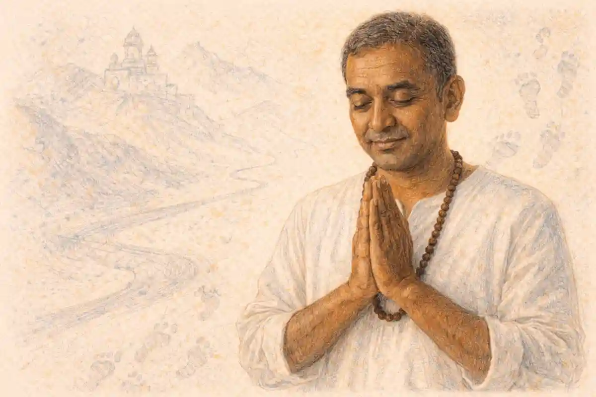

A trumpet begins alone. No drums mark a tempo, no piano lays down chords, and there is no count-in to lean on. The player lifts the tune clear of the beat entirely, runs it up and down in one unmeasured flourish, and only then does the band arrive beneath him, exactly where he has decided the music starts. Everything later called the Louis Armstrong musical style is present in that gesture: a melody treated as raw material rather than a text, a beat treated as something to play against rather than obey, and a single voice claiming the right to be the whole event.

<!--more-->

The record is "West End Blues," made in Chicago in June 1928, and the flourish is its opening cadenza, some fifteen seconds of unaccompanied trumpet before the band plays a note. Put yourself in the position of a listener who bought that record when it was new. Records had taught you what a featured player sounded like: a few decorated bars inside the band's texture, a brief licence to embellish, then back into the ranks. Nothing in that experience prepares you for a man who opens by abolishing the tempo, the accompaniment and the tune's rhythm all at once, and who treats the silence of his band not as an absence but as a stage he has cleared for himself. The cadenza does not ask permission. It establishes a jurisdiction. When the band finally enters, it enters on terms the trumpet has already set, and everything that follows on the record, the trombone's slow statement, the singing, the piano's glittering chorus, happens inside the authority those fifteen seconds created.

That is why the cadenza matters more than its brevity suggests. It is the whole technique in miniature, a complete solo compressed into an introduction: melody handled as material rather than scripture, rhythm asserted by one player against an implied pulse nobody is playing, and an architecture of rise, peak and descent that leaves the listener feeling a shape has been completed. The argument of this article is that Armstrong built the vocabulary of the jazz solo by treating a written melody as raw material to be rephrased rather than performed, and then applied the identical method to singing, which is why one man changed both instrumental jazz and the way nearly all popular vocal music is sung. Every section that follows takes one component of that claim and tests it against the evidence of the records.

## A Trumpet Alone, With Nothing Underneath It: Louis Armstrong Musical Style in a Single Gesture

One question has to be carried forward from the cadenza, and this article will not answer it for several sections. What did a solo sound like before anyone had heard one? The question sounds naive, and it is not. A listener in 1928 who had never encountered Armstrong's records had a settled idea of what a soloist was for, formed by two decades of dance bands, brass bands and earlier jazz records, and the cadenza violates that idea at every point. To hear the violation clearly, the older idea has to be rebuilt first, in its own terms and at its own strength, because it was not a failure waiting to be corrected. It was a complete musical system with its own logic, and Armstrong grew up inside it. The next four sections reconstruct that system before returning to the moment he stepped outside it.

Consider, meanwhile, what the flourish is made of. It begins low, in the trumpet's middle register, with a phrase that gestures at the tune the band is about to play, then climbs in quickening runs, hesitates on a held tone that seems to suspend the whole room, and falls back in a cascade that lands precisely where the band needs to begin. Nothing in it is measured against a beat, yet nothing in it feels lost. The pulse is absent and implied at the same time, carried inside the phrasing the way a heartbeat is carried inside a held breath. That double condition, freedom on the surface and strict internal order underneath, is the signature of everything Armstrong played for the next forty years, and it is audible here before a single bar of the tune has been stated.

Notice, too, what the cadenza refuses to do. It does not display technique for its own sake, although the technique is formidable. Every run arrives somewhere; the peak is placed near the end, not stumbled into; the descent is as deliberate as the climb. It behaves, in short, like a piece of composed music that happens to have been composed in the act of playing it. When Thomas Brothers, the scholar who reconstructed Armstrong's New Orleans formation in his 2006 study of the trumpeter's early years, writes about the discipline underneath the apparent spontaneity of Armstrong's playing, this is the quality he is pointing at. The freedom was earned by structure, not granted by temperament.

## What a Soloist Was Before Him

Start with the dance floor, because the dance floor paid for everything. In the New Orleans of Armstrong's childhood, a band's first obligation was to keep couples moving, and the lead cornet's obligation inside the band was to state the melody clearly enough that dancers, singers and the other musicians could all find their place in it. A cornetist who decorated the tune beyond recognition was not being adventurous; he was failing at his job. Display existed, but it had an assigned seat. Brass band soloists played composed variation sets, the kind of written-out fireworks that cornet virtuosos of the concert band tradition had made respectable, and inside a dance set a player might take a break, a bar or two where the band stopped and he filled the gap before the texture closed over him again. The break was a licensed interruption. It decorated the performance the way a bow decorates a parcel, and it changed nothing about what the performance was.

Buddy Bolden, the cornetist who looms over every account of New Orleans music before recording, left no records at all, and what witnesses remembered was not a soloist in the later sense but a bandleader whose powerful lead, blues-drenched and loud enough to carry across a park, organised the whole band around his sound. Freddie Keppard and Joe Oliver, who can be heard on records from 1923 onward, play leads that hug their tunes. Their artistry is real, and it lives in tone, in attack, in the shading of a melody they are still fundamentally delivering. Gunther Schuller, whose 1968 study Early Jazz remains the most detailed technical anatomy of this period, describes the solo playing on the earliest jazz records as rudimentary in a precise sense: embellishment applied to a melody from outside, rather than a new melodic argument built from inside. The soloist was a functionary of the tune, and the tune belonged to the band.

That is the first rung of this article's ladder, and it is worth stating flatly. Before Armstrong, the lead horn was an ensemble function, and the individual statement with its own shape did not exist as a convention. There were breaks, features, variation sets and novelty turns, including the comic effects, laughing horns and wah-wah tricks that vaudeville had made saleable, and all of them share one property: remove them, and the performance continues unchanged in structure. Nothing depended on them. A convention in which a single player's chorus could be the reason a record was bought, the passage musicians memorised and the standard against which other players measured themselves, simply had no slot in the system. The system had a lead voice the way a choir has a melody line: indispensably, anonymously, and in service of the whole.

The economics of early recording reinforced the arrangement. A three-minute side sold a tune, a band and a dance rhythm, in roughly that order, and the names of individual sidemen were often not printed at all. When Armstrong played second cornet behind Oliver in 1923, his name meant nothing to the record-buying public, and the records were the band's. For the solo to become an individual statement, someone had to play a chorus so commanding that listeners began asking who it was, and then had to do it often enough that the asking became a habit. The sections ahead describe how the ensemble he grew up in worked, what his assigned seat inside it required of him, and how, between 1925 and 1928, a series of records made for listening rather than dancing quietly rebuilt the soloist's job from the inside.

## Collective Improvisation and the New Orleans Ensemble

The classic New Orleans front line is a machine for dividing labour, and its beauty comes from the fact that all three of its moving parts improvise at once without colliding. The cornet takes the melody in the middle of the texture, stating it in a form the ear can follow. Above it, the clarinet weaves a faster, more decorative line, darting around the melody's long notes and filling its silences, free precisely because the cornet is being responsible. Below, the trombone works the bass end of the harmony, sliding between the roots of the chords in the glissing style players called tailgate, and punctuating the phrases with rhythmic smears. Behind the three horns, a rhythm section of banjo chording on every beat, tuba or string bass sounding the strong beats, drums and sometimes piano holds the whole structure at dancing tempo. The division survey of [jazz and blues history](/2010/03/21/history-of-jazz-and-blues-music/) follows that ensemble out of New Orleans and across the country; here the point is narrower, which is what the machine did to the musician sitting in its lead chair.

Freedom inside the machine was distributed by role, not by talent. The clarinetist owned the decoration, which is why the clarinet lines on early records are often the busiest sounds on them. The trombonist owned the harmonic floor. The cornetist owned the tune, and ownership came with a leash: his line had to remain legible at every moment, because two colleagues were improvising against it and a roomful of dancers was steering by it. What listeners later learned to call collective improvisation was therefore not a jam session in the modern sense. It was a discipline of simultaneous commentary in which each player's freedom was defined by the others' duties, and in which the lead player carried the heaviest duty of all: to be interesting without ever being surprising in the wrong place.

Armstrong's apprenticeship ran through every level of this system. He learned the cornet at the Colored Waif's Home, the institution for orphaned and detained boys where a bandmaster named Peter Davis put an instrument in his hands and taught him to read music, a fact Thomas Brothers insists on against the later myth of the untutored natural. He played in brass bands on parade, where the lead cornet carried the tune through street noise. He played in the bands that worked the honky-tonks and, crucially, in Fate Marable's orchestras on the Mississippi riverboats between 1918 and 1921, where the music was written down, arranged and played in every key for dancing passengers. By the time he joined Oliver in Chicago in 1922, he had been trained by the ensemble system about as completely as it could train anyone, and he had absorbed the lead cornet's obligations into his reflexes.

On Oliver's 1923 records for the Gennett label, the machine can be heard working at its best. Armstrong sits in the second cornet chair, playing a harmony line beneath Oliver's lead, and the two horns blend so completely that listeners have argued ever since about which notes belong to which man. The famous passage on "Snake Rag" has the two cornetists playing a series of breaks in exact unison, matched by ear and by signal, a stunt that only works because both men think of the break as a shared event. Nothing on these records announces a soloist waiting to escape. And yet musicians who heard the band in person at the Lincoln Gardens kept telling the same story: that the second cornet player, the young one, was producing a sound and a rhythmic ease that the records only hinted at, as though the machine's most dutiful part had begun, very quietly, to outgrow its function.

## How the Lead Cornet Functioned in That Ensemble

Strip the lead cornet's job down to its working parts and three duties appear. The first is legibility: the melody must be findable at every second, because the clarinet is counting on it, the trombone is harmonising beneath it and the dancers are moving to its phrases. The second is time. In a band without a conductor, the lead cornet's phrasing is the metronome the front line actually follows; his entries set the tempo's feel far more than the drummer's pulse does, because the other horns phrase against his decisions. The third duty is memory. Stock arrangements and head arrangements alike depended on the lead player holding the tune's true shape in his head through every variation the ensemble layered onto it, so that the band could always find its way home. A lead cornet was, in effect, the band's librarian, conductor and spokesman combined, and the role selected for steadiness. The flashy player was given the clarinet chair. The reliable one got the lead.

Armstrong held that chair, or the one beside it, for the first decade of his career, and the records let you hear him learning its limits. On "Chimes Blues," recorded with Oliver's Creole Jazz Band in April 1923, he takes what is generally counted his first recorded solo, a single chorus that stays close to the tune's outline and ends exactly where duty requires. What already distinguishes it is not invention but finish: the tone is rounder and more centred than anyone else's on the session, the rhythm sits deeper in the beat, and the phrases breathe like a singer's. Musicians heard it. The story the witnesses tell consistently, in recollection after recollection assembled by his biographers, is of players gathering around the young second cornet man because the sound coming out of the dutiful chair was larger than the duty.

The matched breaks on the Oliver records point the same moral from another angle. When two cornetists trade or share a break, the break is a test of reflexes inside a fixed form: two bars, no more, land it and get out. Armstrong's breaks with Oliver are immaculate, and immaculacy is the point. He was not yet reshaping anything. He was executing the ensemble's most exposed ritual so well that the ritual itself started to look like a spotlight. A form that exists to test a player briefly will, given a player strong enough, quietly become a form that exists to exhibit him. That inversion, duty becoming display without the form changing at all, is the hinge on which the next section turns.

There is a temptation to describe the young Armstrong as a soloist trapped inside an ensemble, straining against its rules, and the records do not support it. He loved the ensemble format, returned to front-line playing all his life, and kept the lead cornet's virtues, legibility, time, memory, as the foundation of everything he later did alone. What happened between 1924 and 1928 is better described as the duties migrating. Legibility became the paraphrase that keeps a tune findable while replacing its surface. Time became the personal placement against the beat that later sections examine. Memory became architecture, the ability to hold a whole solo's shape in mind while inventing it. The function did not disappear. It was promoted, from serving the band to commanding it, and the promotion happened in public, a few bars at a time.

## The Shift From Ensemble Voice to Individual Statement

The question left open in the first section can now be answered, because the older world has been rebuilt. What did a solo sound like before anyone had heard one? It sounded like a function. It sounded like two bars of licensed display inside a texture that closed over the display and continued as though nothing had happened, and the proof is that almost nobody can hum a specific solo from a record made before 1925, while millions who own no jazz records at all can hum the opening of "West End Blues." The older solo was not worse music. It was music doing a different job, and its job description did not include being remembered. What Armstrong changed, between his year in New York with Fletcher Henderson's big band in 1924 and 1925 and the small-group records that followed, was the job description itself.

### What is a jazz solo and who invented it?

A jazz solo is an improvised statement by one player over the band's continuing beat and harmony, shaped like a small composition with a beginning, a climb and a close. No single musician patented it, but Armstrong's Hot Five records of 1925 to 1928 turned the solo from a brief ensemble break into that statement, and the definition held.

The Henderson year matters because it showed him the solo's other possible habitat: the arranged big band, where a hot chorus was a written feature, allotted to the player the arranger trusted with it. Armstrong's choruses for Henderson, on records like "Shanghai Shuffle" and the band's remake of Oliver's "Dipper Mouth Blues" under the title "Sugar Foot Stomp," arrive like weather from another climate, rhythmically freer and melodically bolder than the writing around them. But the decisive laboratory was the Hot Five, the recording group he assembled in Chicago in November 1925 with Kid Ory on trombone, Johnny Dodds on clarinet, his wife Lil Hardin at the piano and Johnny St. Cyr on banjo. The Hot Five never worked a dance floor. It existed only in the studio, three minutes at a time, and in that laboratory the constraint that had shaped the lead cornet for twenty years, the dancers, simply vanished.

What Armstrong did with the freedom was not to play more notes. On the earliest Hot Five sides he already does the thing that defines him: he treats the allotted chorus as a composition problem. Gary Giddins, the critic and biographer who has written about Armstrong's records for four decades, keeps returning to the same observation, that the solos possess the inevitability of written music, balanced phrase answering balanced phrase, tension accumulated and discharged on schedule. Other musicians responded in the most concrete way available to them. They memorised the solos. Trumpeters in territory bands learned the "Cornet Chop Suey" breaks from the record the way conservatory students learn etudes, and a solo that can be memorised, taught and argued about has crossed the line from event to text. The individual statement existed as a convention because its first great examples behaved like literature: fixed, repeatable and unmistakably authored.

Two features of the shift deserve emphasis before the mechanics begin. First, the solo became the record's centre of gravity, the passage the whole side was organised to deliver, with accompaniments thinning out to give it room. Second, the soloist's identity became the record's selling point, which is why Armstrong's name, uniquely among the sidemen of his generation, moved above the band's on the label. Neither feature was a publicity invention imposed from outside. Both were the market registering, accurately, where the value in the performance now sat. The ensemble voice had not been abolished; the Hot Five is still audibly a New Orleans front line. But the front line now had a protagonist, and the protagonist had begun, chorus by chorus, to rewrite the relationship between a musician and a tune.

## Treating a Written Melody as Raw Material

Here is the second rung of the ladder, the idea on which everything else in this article rests. Armstrong treats the written tune as material to be rephrased rather than delivered, and that single inversion, from delivery to rephrasing, is the foundation the whole practice of jazz soloing is built on. It helps to be exact about what rephrasing is not. It is not ornamentation, the decorating of a melody with grace notes and runs while its skeleton stays visible note for note. It is not variation in the classical sense, where a theme is presented and then systematically altered while remaining the subject. It is closer to what a great public speaker does with a prepared text: the argument, the emphases and the landing points are all honoured, but the sentences are rebuilt in the mouth, because the speaker is thinking in meanings rather than reciting words.

A paraphrasing soloist carries the tune in two layers at once. The deep layer is the skeleton: the phrase lengths, the harmonic turning points, the handful of strong notes where the melody leans on the chord, the places where the tune breathes. That layer he keeps, because it is what lets a listener follow him and what lets the band accompany him. The surface layer, the actual sequence of notes a listener would hum, he regards as negotiable in its entirety. Notes can be delayed past their appointed beat, compressed into runs, held out until they become events, replaced by figures that point at them from a distance. The tune survives as a set of obligations rather than a sequence of sounds, and the solo is the story of how those obligations get met in surprising order.

"Cornet Chop Suey," recorded at the Hot Five session of February 1926 that also produced "Heebie Jeebies," is the cleanest early demonstration because much of it is not paraphrase of someone else's tune but construction from first principles: chorus after chorus of breaks and runs that behave like a written showpiece yet swing like speech. Put beside it the opening chorus of "Potato Head Blues" from May 1927, where the song's simple melody is restated with its rhythm quietly rearranged, its phrases nudged off their expected accents, until a tune anyone could whistle becomes a personal utterance that nobody else could have produced. The distance between those two records is the distance the technique travelled in fifteen months, from building solos to rebuilding songs.

Thomas Brothers has argued, against the sentimental picture of Armstrong as an instinctive genius who happened to find a horn in his hands, that the paraphrase method rests on deep musical literacy: riverboat arrangements played in every key, theatre repertory memorised, a working command of harmony absorbed from written parts. The records support the argument. A player guessing at the chords could not land, as Armstrong lands bar after bar, on precisely the notes the harmony is about to need. The rephrasing is free because the knowledge underneath it is exact, and the exactness is what makes the freedom repeatable. Talent supplied the imagination. Literacy supplied the map it moved on.

Once the inversion is seen, it cannot be unseen, and it reorganised the obligations of everyone who came after. A soloist who delivers a tune is judged on fidelity and finish. A soloist who rephrases one is judged on the quality of his thinking, on whether the new melody he builds in the tune's shadow is better than the one he was given. Armstrong, in record after record through 1926, 1927 and 1928, kept building better ones, and the profession quietly rewrote its expectations around that fact. The next section takes the method apart into its working parts, because paraphrase is not one trick but a kit of them, and a listener who can name the parts can hear any Armstrong solo being assembled in real time.

## Paraphrase, Displacement and the Reshaped Tune

The kit has four main tools, and they are easier to hear than to describe, which is why each comes with a record to test it on. The first tool is delay. A phrase the tune schedules for the first beat of a bar arrives instead a fraction late, or a full beat late, or after a silence that makes the band seem to lurch forward without it, and the delay charges the eventual arrival with the tension of a kept appointment nearly missed. The second tool is compression: two bars of the original melody are squeezed into one bar of quick figures, freeing a bar of space that the soloist then spends on a held note or a silence. The third tool is stretching, the reverse operation, in which a single note of the tune is held across the span where three or four notes were expected, so that the melody seems to stop and contemplate itself while the harmony moves underneath. The fourth tool is the answer: Armstrong takes the tail of the tune's phrase and repeats it altered, as though the melody had asked a question and his horn were replying to it, and the reply becomes the next phrase's starting point.

"Struttin' with Some Barbecue," from December 1927, is the record to learn these tools on, partly because the tune itself, written by Lil Hardin Armstrong, is handsome enough to survive the treatment and partly because Armstrong's choruses keep it constantly in earshot while never once simply playing it. He leans on its strong notes and discards its connective tissue. He states a fragment plainly, then answers it with a figure twice as fast, then lets a bar go by with almost nothing in it, so that when the tune's next landmark arrives it feels less like a repetition than like a reunion. Critics singled the record out early, and Schuller's analysis of Armstrong's melodic practice draws on exactly this quality: the sense that the original tune and the new line are running in counterpoint, two melodies at once, one remembered and one sounding.

That double hearing is the skill the listener has to build, and it is buildable. Hum the tune of "Potato Head Blues" once, plainly, and then play Armstrong's opening chorus and keep your hummed version running underneath it like a second track. The places where the two lines coincide are the skeleton holding. The places where they part are the art. Notice that the partings are never random: he leaves the tune at its most predictable moments, where the ear can supply it unaided, and rejoins it at the turns, where the harmony changes and the listener needs a guide. Paraphrase, in other words, is a courtesy as much as a display. The soloist takes his freedom exactly where the listener can afford to lend it.

There is one more tool, quieter than the rest, and it may be the most Armstrong of all: the phrase that imitates the tune's rhythm while changing all its notes, so that recognition arrives as a rhythm before it arrives as a melody. Listeners who cannot follow pitch relationships at all can follow that one, which is part of why his solos communicate across every level of musical education. A rhythm is a fingerprint the body remembers. By keeping the tune's rhythmic fingerprint while replacing its face, he lets the untrained listener feel the connection that the trained listener hears, and the solo works simultaneously as popular entertainment and as composition. That double address, street and conservatory at once, is the quality that made the Hot Five records exportable to musicians of every background, and it begins with a decision so simple it is easy to miss: the written melody is not the performance. It is the performance's raw material, and raw material exists to be worked.

## Playing Behind and Ahead of the Beat

Every rhythm section builds a grid. The banjo chops its chords on the beat, the tuba sounds the strong beats, the drummer marks the bar lines, and together they lay down a lattice of expected moments against which anything a soloist plays can be measured. Most competent players play on the grid, entering where the lattice says a phrase should enter and leaving where it says a phrase should leave. Armstrong's great rhythmic discovery, audible from the Henderson sides onward and perfected on the Hot Five and Hot Seven records, is that the grid is more useful as something to lean against than as something to stand on. His phrases characteristically enter a fraction behind the beat, shadow it, drift across it and then, at the moment of resolution, land on it with an exactness that makes the whole preceding drift feel intentional. Playing behind the beat, in his hands, is not lateness. It is suspense with a guaranteed ending.

The mechanism deserves precision, because the effect is constantly misdescribed as looseness. Inside the phrase, Armstrong's rhythm is anything but loose: his short notes are placed with a jeweller's consistency, his runs accelerate and settle like a man who knows to the fraction where every subdivision falls. What is flexible is the phrase's anchoring. He will delay an entry until the band's beat feels almost exposed, crowd three bars of melody into the space of two, or stretch a cadence across a bar line so that the resolution the ear expects at the bar's start arrives instead at its middle, by which time the harmony has already moved and the note does double duty. Dan Morgenstern, the critic who directed the Institute of Jazz Studies and wrote about Armstrong across six decades, argued that this placement is the core of the art: one line from Armstrong implies the whole band's time more completely than most rhythm sections state it.

Playing ahead of the beat is the same tool reversed, and he uses it for attack rather than suspense. A phrase that jumps the beat by a fraction feels eager, almost impatient, and Armstrong reserves those entries for moments of climax or comedy, the musical equivalent of a man leaning forward in his chair. The alternation between the two placements is what gives his choruses their breathing quality: lean back and the music gathers itself, lean forward and it lunges, and because the band underneath never wavers, the listener experiences both as expressive choices rather than as fluctuations in tempo. Later generations of soloists would specialise in one placement or the other. The bebop trumpeters of the 1940s lived ahead of the beat, tight and urgent. Armstrong commands the whole keyboard of placements, and he changes register the way a speaker changes tone, to mark where in the argument he is.

A practical way to hear all this is to follow the drummer and the trumpet at the same time on any Hot Seven side and notice how rarely their most important accents coincide. The beat is a treaty between them, not a metronome either obeys. The rhythm section's job is to make the grid so reliable that the soloist can afford to wander; the soloist's job is to wander so purposefully that the grid, when he returns to it, sounds like a homecoming rather than a correction. That treaty, negotiated fresh in every chorus, is the rhythmic foundation on which the next two sections build, because the particular pattern of his departures and returns, repeated until a whole music absorbed it, is what the world learned to call swing.

## What Swing Actually Is, Mechanically

### What does swing mean in jazz?

Swing is the practice of dividing each beat unequally, letting the first of two paired notes run long and the second snap short, while accents lean toward the off-beats. In Armstrong's playing the proportions stay flexible, stretching and relaxing with the phrase, so the music drives forward without ever locking into a mechanical grid.

Strip the word down to mechanics and swing begins with a refusal: the refusal to divide the beat in half. Written music's default assumption is that two short notes in the space of one beat are equal. A swinging player makes them unequal, lengthening the note that falls on the beat and clipping the note that falls between beats, so the pair limps in a pattern listeners feel as propulsion. The limp is not a defect in the time. It is the engine of the time, because each clipped second note arrives slightly early relative to expectation and tugs the music forward into the next beat. Multiply that tug by every pair in every bar and the whole performance acquires the quality that dancers recognised in their bodies before theorists named it in print: the beat does not merely pass, it pulls.

But the unequal pair is only the smallest gear in the machine, and this is where the second open question of the article must be raised, because it will take the next section to answer it. Can swing be written down at all? The notes, plainly, yes. Whether the notation captures the thing itself is another matter, and it matters far beyond pedantry, because the answer explains how this music travelled: not through sheet music, as European art music travelled, but through recordings, objects that carried the actual proportions in their grooves. Hold the question open for one more section. First, the rest of the machine. Swing also involves accent: the swinging player weights the off-beats, the second and fourth beats of the bar in the drumming that developed alongside him, and phrases across the bar line so that the written metre and the felt metre pull against each other. And it involves the relationship already described, the soloist leaning behind or ahead of a rhythm section that keeps the treaty. Swing is not a property of any single line. It is a relationship between the played note and the implied beat, maintained by the whole band and felt by the listener as the beat's shadow moving.

Schuller's contribution to understanding Armstrong's place in this was to show that the rhythmic loosening starts with him. The jazz of the early 1920s still carried ragtime's stiffness, its two-beat bounce and its even, march-derived subdivisions. Armstrong's phrasing, in Schuller's analysis, broke that frame: his lines float across the two-beat foundation in long, uneven arcs, anticipating the even four-beat flow that the big bands of the following decade would build an industry on. He did not invent the unequal division of the beat, which has roots in older African American practice that no single musician authored, and this article will not claim otherwise. What he did was raise it from a folk habit to a system: consistent enough to be learned, flexible enough to be personal, and stamped so firmly onto the practice of the music's best-selling records that the system and his name became inseparable. The distinction between inventing swing and standardising its vocabulary is not a quibble. It is the difference between a myth and a mechanism, and the mechanism is the more impressive achievement.

One further mechanical point completes the picture. The proportions of the swing pair are not constant. At slow tempos the first note stretches toward twice the length of the second; at fast tempos the pair approaches equality, because there is no time for the limp to open up. A swinging player manages this gradient unconsciously and continuously, the way a walker adjusts stride to a slope. It is this gradient, this refusal of the ratio to sit still, that makes swing a practice rather than a figure, and it is exactly the property that defeats the printing press, as the next section shows.

## Why Swing Resists Notation

### Why can swing not be written in notation?

Notation divides time into equal fractions, while swing lives in proportions that shift. The long and short halves of a swung beat change their ratio with tempo and player, and the accent, attack and delay completing the effect sit below the resolution of any staff. The page stores the pitches; the feel travels by ear.

The question opened in the previous section can now be closed, and closing it delivers the third rung of the ladder. Can swing be written down at all? Partly, and the part that cannot is the part that matters. A copyist can write the pitches, the bar lines, the approximate durations, and can even prescribe the inequality with dotted figures or triplet brackets. Both prescriptions fail in the same instructive way. Dotted figures make the long note too long and lock the ratio at a fixed three to one; triplets make it too even and lock the ratio at two to one, and the living ratio moves between and beyond those marks with the tempo, the player and the phrase. Notation is a grid of fixed fractions. Swing is a continuous quantity. Writing swing down is like writing down the exact pressure of a handshake: the diagram can be accurate everywhere except at the point of contact.

The failure is compounded by everything notation was never designed to store. Where exactly, in fractions of a second, does a phrase enter behind the beat? How much does the accent weigh? How does the attack of the note, its fast or slow bloom, shift its perceived position against the grid? These are the materials swing is made of, and the staff has no symbols for any of them. Teachers confronting the problem in classrooms have a standard ritual: print the same chorus as even notes, as dotted notes and as triplets, play the record, and let the students vote for the least wrong page. Instructors assembling those comparisons as slides can check the finished deck in a [browser-based presentation viewer](https://reportmedic.org/tools/ppt-viewer.html) before the class meets, but the verdict is always delivered by the record rather than the page, which is precisely the historical point. When a music cannot travel on paper, it must travel some other way, and the way it found was the phonograph record.

So the third rung stands as follows. Swing is a specific relationship between the played note and the implied beat, and it cannot be fully notated, which is why it had to be transmitted by recording. The consequences run through Armstrong's whole career. A European classical musician's influence travelled in scores that any competent player could realise; Armstrong's travelled in performances that had to be imitated by ear, slowed down, replayed, absorbed into the body. The Hot Five records were therefore not documents of the music in the way a score is a document. They were the music's means of reproduction, its printing press and its postal service combined, and the generation of trumpeters who learned his vocabulary learned it the way children learn a language, by listening to a voice until its inflections became their own. Notation's failure, which looked like a limitation, turned out to be the making of the music's culture: an aural tradition with a recorded canon, in which the master's actual sound, rather than an editor's approximation of it, was the text every student studied.

## The Rhythmic Vocabulary He Standardised

A vocabulary is a set of devices that a community agrees to understand, and between 1925 and 1930 Armstrong's records supplied jazz with most of its solo vocabulary in finished form. The devices can be named, and naming them matters, because each one passed from being his personal habit to being equipment every soloist was expected to own. There is the break: the band stops for two bars at a phrase joint and the soloist fills the exposed space alone, a ritual inherited from the ensemble years but transformed, in his hands, from a test of reflexes into a miniature solo with its own build and punchline. There is the stop-time chorus, where the band abandons continuous accompaniment and strikes a single accented beat at the start of each bar, leaving the soloist to walk, apparently unsupported, across the gaps. There is the riff, a short repeated figure that he plays behind other soloists or worries at within his own chorus until repetition itself becomes the drama. There are the phrase-ending fills, the send-off runs that launch a chorus's final statement, and the double-time bursts, sudden flurries of notes at twice the prevailing density that he deploys the way an orator deploys a quickened aside.

The stop-time choruses of "Potato Head Blues" show the break and the gap pushed to their limit. The band hits its single beat and falls silent, and Armstrong fills each two-bar space with a phrase that is more daring than the last, ending phrases in midair, letting the silence ring, then landing the next phrase exactly on the struck beat as though he had been counting a grid nobody else could hear. Which, of course, he had: the implied beat again, carried internally, the same skill the unaccompanied cadenza of "West End Blues" displays in its purest form. A listener who understands stop-time understands something essential about the whole style, which is that its freedoms are all measured against a pulse the player maintains whether or not anyone is playing it for him.

Standardisation happened through imitation, and the imitation was unusually literal. Because the records were the textbook, players copied not just the devices but the actual phrases, and Armstrong's breaks and figures entered the common stock of the music, quoted by trumpeters who had never left their home states. Within a few years, arrangers were writing his devices into big band scores as section riffs, converting one man's improvisations into orchestral furniture. That conversion is the surest measure of standardisation: when an invention stops being attributed and starts being assumed, it has become vocabulary. The discipline this article has maintained should be repeated here in plain terms. He did not invent swing, which is an older and larger practice than any career. He standardised the rhythmic vocabulary soloists used inside it, and the distinction between those two claims is the difference between mythology and history.

One device deserves a sentence of its own because it reorganised the soloist's relationship with the band. The break, in Armstrong's usage, stops being a gap in the performance and becomes its hinge: the moment where the band, by falling silent, formally hands the music to one man and waits to hear what he does with it. Every jazz performance since has contained that handover, whether it lasts two bars or two choruses. The handover is so familiar now that audiences no longer hear it as an event. In 1926 it was an event every time, and the man who made it one had learned it as a duty, in an ensemble where the break was the lead cornet's brief licensed moment. The vocabulary section of his art is therefore also a story about institutions: a ritual of the old ensemble, seized by a player strong enough to expand it, became the founding ritual of the new music.

## Building a Solo With a Shape

Play several Armstrong solos in sequence and a deeper pattern emerges beneath the vocabulary: the choruses are built. A typical mature solo opens near the tune, stating enough of the melody to establish the contract with the listener. The middle choruses depart furthest, paraphrasing hardest, taking the harmonic corners at the greatest speed. The final chorus gathers: the paraphrase tightens, the register rises, the phrases shorten into statements, and the solo lands on a close that feels less like stopping than like arriving. Giddins's observation about inevitability applies here with full force. These solos withstand the kind of scrutiny usually reserved for composed music, phrase balancing phrase across thirty-two bars, tension budgeted like money, nothing spent twice. That they were improvised, at tempo, in a studio where a failed take cost money, is the fact that still startles musicians who study them.

The architecture operates at two scales at once. Within the chorus, phrases form a conversation of question and answer, the first half of a statement left hanging and completed by its second half, so that even a single chorus has a plot. Across choruses, the plot enlarges: the solo as a whole has an exposition, a development and a peroration, a design classical rhetoric would recognise. "Cornet Chop Suey" is the classroom example because its four choruses are so lucidly jointed, breaks falling at the joints like paragraph marks, each chorus beginning from the energy the previous one banked. Schuller's transcriptions and analyses in Early Jazz demonstrated this construction to a sceptical academic world, showing on paper what musicians had known by ear: that the improvisations hold together under analysis because they were thought, not merely felt, at the moment of playing.

What produces the shape is partly memory and partly a discipline of reserves. Armstrong thinks in whole choruses the way a chess player thinks in whole games, holding the end in view from the first bar. He rations his resources accordingly: the high register, the densest runs, the widest vibrato are saved for where the design needs them, and the early choruses of a solo are often startlingly plain, plainness being the price of a climax that will register when it comes. Players who spend everything in the first chorus have nowhere to go, and their solos sag in the middle like speeches that peak at the introduction. His never sag, because the design is decided by the same faculty that plays the notes: a musical intelligence that hears the present phrase and the coming architecture in a single act of attention.

This is also why his solos survive transcription into print, the very medium that fails his swing. The notes on the page show the architecture plainly, the symmetries and sequences and balances, even though the feel has evaporated. A young player can learn the shape of "Potato Head Blues" from a transcription and learn something true, then go to the record to learn the rest. The two-part lesson, architecture from the page and everything else from the groove, became the standard curriculum of jazz education, and it rests on the fact that Armstrong built solos solidly enough to be studied both ways. Shape, in his hands, is not a constraint on improvisation. It is what improvisation is for.

## The Climax and Where He Places It

The fourth rung of the ladder concerns the peak. His solos have deliberate architecture, with the high point placed rather than reached by accident, and the placement follows a discipline consistent enough to state as a rule: the climax of an Armstrong solo arrives in its final third, is prepared by rising register and quickening rhythm, and is followed by a descent that lets the chorus end as a completed event. Consider the trumpet chorus in "West End Blues" that follows the trombone's statement. It begins conversationally, almost idly, in the middle register. It grows by sequence, each phrase a step higher and a degree more urgent than the one before, until the line arrives at a long held high note that seems to stop time altogether, the band hanging beneath it. Then, the point made, he comes down in a few broad strokes and hands the record over to the piano. The peak occupies perhaps a tenth of the chorus. It organises the other nine tenths completely.

The same discipline governs "Potato Head Blues," where the climax is distributed across the stop-time choruses: each break tops the previous one by a small, calculated margin, higher, denser, more rhythmically daring, so that the final break lands as the sum of an escalation the listener has been carried through step by step. In the final chorus of "Struttin' with Some Barbecue" the peak is rhythmic as much as registral, a phrase of such propulsive placement that the band seems to lean into it. The variety of the peaks matters less than the constancy of the planning. A climax, for Armstrong, is a debt the solo contracts in its opening bars and must discharge before it ends, and the discharge point is chosen, not found.

Understanding the placement explains a quality listeners often report without being able to name: his solos feel inevitable in retrospect. Nothing in them is wasted because everything in them is either preparing the peak, being the peak, or resolving it. It also explains why his imitators so often disappointed. They copied the high notes but placed them at the beginning, or scattered them evenly, and discovered that a peak without preparation is just a loud note. The altitude was never the point. The point was the staircase.

There is a corollary about restraint that the later sections on range will develop: a player who places his climaxes can afford to be quiet most of the time. The held high note in "West End Blues" detonates as it does partly because the chorus before it is so measured, and the measured quality is itself a form of confidence, the soloist's certainty that the listener will still be attending when the moment comes. Attention, in a three-minute record, is the scarcest resource in the room. Armstrong's architecture is, among other things, an economy of attention, and its first law is that nothing is given away early. The next section examines the economy's most radical instrument, which is not a note at all.

## The Use of Space and the Unplayed Bar

Silence is the material Armstrong handles most originally after rhythm itself. His solos are full of rests that lesser players would have filled, bars where the trumpet simply does not play and the music, instead of sagging, tightens. The mechanism is the one the cadenza demonstrated: an implied pulse, strongly maintained, makes a silence legible as an event rather than an absence. When Armstrong stops, the listener does not stop. The beat continues in the listener's body, the harmony continues in the band, and the withheld trumpet becomes the most present thing in the record, a voice so expected that its absence has a shape. He exploits this with a dramatist's instinct: phrases end early and leave the piano to answer, entries arrive after a pause long enough to make the band sound briefly alone, and whole bars pass in which the soloist is present only as the person everyone is listening for.

The opening of his solo on the 1929 "Ain't Misbehavin'" is a study in the economy of it, phrase, breath, phrase, the spaces between statements as eloquent as the statements, the whole chorus walking at a pace that trusts the listener completely. In the duet record "Weather Bird," examined later in this article, the spaces are conversational, the pauses of a man listening to his partner before replying. Even in the densest Hot Five choruses, the breaks and stop-time passages are built from the alternation of sound and silence, display and vacancy, each repricing the other. A note played after two bars of silence costs more and buys more than the same note played in a stream, and Armstrong spends silence the way he spends his high register: rarely, deliberately, and always where the design can capitalise on it.

There is a physical basis for the artistry, and it connects this section to the ones on breath and range that follow. A brass player must breathe, and most players treat the breath as an interruption, a necessary theft from the music. Armstrong treats it as punctuation. His breaths fall at the joints of the argument, so that the body's need and the music's logic become the same event, and what could have been a limitation of the instrument is converted into one of its expressive resources. Singers, who face the identical constraint, recognised the conversion immediately, which is part of the reason his singing, when it comes under examination later, sounds like his playing rather than merely resembling it. The breath is shared equipment between the two instruments he played, and he phased both of them around it.

Hold the idea of the priced silence in mind as the article turns from rhythm to sound itself. The next three sections concern the trumpet as a physical instrument in his hands: how the tone is produced, what the high register cost the body that produced it, and how a note begins and ends. These are the sections where technique stops being a metaphor drawn from language and becomes a matter of lips, air and pressure. They are also where the third open loop of the article will be raised, because the closer the trumpet's sound is examined, the more it resembles a human voice under strain, and the question of why his actual voice, when he sings, sounds like the same musician will press harder and harder until it is answered outright.

## Tone Production and the Sound of the Instrument

Before the phrasing, before the rhythm, there is the sound itself, and it is the first thing any listener knows. Two notes of Armstrong's trumpet, sometimes one note, are enough for identification, a fact so familiar that its strangeness goes unremarked. Instruments of the same make, played in the same city in the same decade, do not normally carry a signature this absolute. The signature is produced by a specific set of physical choices, and they can be described. He plays with a full, centred column of breath, the lips vibrating freely rather than pinched, so that the tone carries a strong core with a bright edge available when he pushes and a round warmth when he relaxes. The sound has what players call centre: the pitch sits exactly where it is aimed, unwavering at the attack, so the note seems to arrive as a solid object rather than an approximation.

The vibrato is part of the tone rather than a decoration applied to it. Armstrong's vibrato is wide and relatively slow by the standards of his contemporaries, and it blooms: a long note often begins nearly straight and opens into vibrato as it sustains, exactly the way a trained singer's held note opens. That single habit does more than any other to explain the vocal quality listeners hear in the playing, because it imports the life cycle of a sung tone, attack, bloom, release, into an instrument whose natural tendency is toward uniformity. Add the attacks, which range from a soft breath entry that lets the note materialise to a tongued stroke with the decisiveness of a consonant, and the trumpet begins to behave like a voice with an unusually large vocabulary of syllables. The description is not a metaphor indulged for colour. It is the physical route by which the technique of the later sections, the singing that sounds like the playing, becomes not a coincidence but a foregone conclusion.

The open sound also represented a choice among the options his generation inherited. Oliver, his mentor, made famous use of mutes and of effects that bent the trumpet toward speech, laughter and animal cries, the whole vaudeville palette of a horn treated as a character actor. Armstrong mastered that palette as a young man and then, in his mature style, largely set it aside in favour of the open horn's direct address. The decision was artistic and strategic at once. Effects date a performance to its novelty; a great open tone is legible in any decade, and it places the burden of interest where he wanted it, on the line being played rather than on the noise being made. Giddins has described the resulting sound as the standard by which trumpet tone is judged, and the judgment is verifiable in a practical way: play any trumpet record made after 1930 and listen for the centred, singing, vibrato-warmed sound that has become the instrument's default ideal. It was not always the ideal. It became the ideal because one man's records taught the world what a trumpet was supposed to sound like.

Tone, finally, is where his discipline is least visible and most complete. A sound this consistent across forty years of records, made in studios with wildly different equipment, through illnesses, exhaustions and the lip troubles the next section examines, does not happen by gift alone. It is maintained, the way a singer maintains a voice, by a technique stable enough to survive the body's changes. The tone is the first evidence this article offered, in the cadenza, for the claim that Armstrong's freedom rests on structure. The structure begins in the body, in breath and lip and the physics of a vibrating column of air, and it is to the body's limits that the argument now turns.

## Range, the High Register and What It Cost Him

The upper register was his public signature as surely as the tone, and it was architectural before it was athletic. High notes in an Armstrong solo are rarely decoration; they are the peaks the previous section described, the placed climaxes toward which whole choruses climb. He commanded the register above the stave with a security that turned altitude into rhetoric: the high C and beyond became punctuation marks, available at the exact moment a design required emphasis. The 1930s made the register into a spectacle in its own right. His 1931 recording of "Shine" closes with a barrage of repeated high notes delivered like a man hammering a point home. "Swing That Music," from 1936, builds an entire feature around sustained altitude. Audiences counted the high notes the way they might count a strongman's lifts, and Armstrong, who understood audiences completely, gave the register the prominence they demanded while keeping it, on the records that matter most, in its architectural place.

The cost was physical and it was cumulative, and this section will keep the accounting technical, as it should be. A trumpet's high register is produced by increasing the speed of the air and the tension of the small muscles of the embouchure, concentrating pressure on a few square millimetres of lip tissue. Repeated nightly, at the volumes unamplified ballrooms required, the practice builds a callus and stresses the tissue beneath it. Armstrong's lip gave him trouble across the middle 1930s; there was a period of enforced rest and rebuilding under the management of Joe Glaser, who took over his affairs in 1935 and rationed the schedule that had been consuming the instrument. The adaptations that followed were practical rather than dramatic: equipment adjusted, sets paced, altitude rationed on the road and spent where it counted. What the records show is that the register survived the adaptation. The tone stayed centred, the peaks stayed placed, and the climaxes of the later work arrive at slightly lower altitudes with their authority undiminished, because the authority was never in the altitude. It was in the staircase.

Notice the quality of the high playing at its best, because it raises the question this article has been saving. The top notes do not sound like machinery. They sound like a voice at the top of its range, with the same bloom of vibrato, the same sense of a living throat at full stretch, the same grain of effort that makes a listener lean forward. His trumpet, at its most exposed, behaves like a singer. So why, when the same man opens his mouth and actually sings, does the singing sound like the trumpet, identical in phrasing, placement and intent, as though the two instruments were one instrument wearing two bodies? The loop is now open, and it stays open through the sections on attack, breath, quotation, blues and harmony that follow, because the answer requires all of them. It closes in the section on the lyric, nine sections from here, where the evidence is complete.

The range question also disciplines a common exaggeration worth discarding before it hardens. Armstrong was not the first trumpeter to play high, nor the only one of his generation with altitude; dance band lead players had owned the upper register as a section skill for years. What distinguishes him is not the notes but their employment: range as rhetoric rather than as stunt, altitude integrated into designs where a high note means something because of everything beneath it. The distinction is the same one this article drew at the outset between a solo as decoration and a solo as statement. The high register, like the break, like the paraphrase, was an existing device that he converted, by placement and intention, into a language.

## Attack, Vibrato and the End of a Note

A note in Armstrong's playing has a biography: a beginning with a chosen character, a middle that lives and opens, and an ending that is as deliberate as the beginning. The attacks form a vocabulary of their own. At one extreme is the tongued stroke, crisp and percussive, the consonant that starts a phrase the way a speaker starts a word on a hard letter. At the other extreme is the breath attack, where the note condenses out of silence without any percussive edge, used for the intimate openings and the phrases that steal in behind the beat. Between the extremes lie the half-tongued, swallowed and scooped entries, the notes he bends up into pitch from below, arriving at the note as a singer arrives at a note in a blues, from underneath, with the approach audible as part of the meaning.

The endings are where singers should study him most closely, because they are the least instrumental thing he does. A note can be cut off square, and occasionally is, for rhythmic punctuation. More characteristically it is released with a fall, the pitch sagging downward as the breath lets go, or closed with a quick downward scoop, or allowed to bloom into its widest vibrato and then stop at the moment of fullest warmth, so the note seems to end by glowing rather than by ceasing. On held climax notes he adds the shake, a rapid widening of the vibrato produced by the hand and the embouchure together, which raises the note's intensity without raising its pitch and reads to the ear as pure excitement. These endings are punctuation in the fullest sense: they tell the listener how the phrase is to be taken, as assertion, as joke, as confession, as dismissal, and they are applied with a consistency that amounts to a personal grammar of emphasis.

Compare, with this in mind, the way his phrases end when he sings, and the comparison can be made now in a preliminary form. The sung line ends with the same falls, the same scoops, the same bloom of vibrato on the held word. The trumpet's note endings and the voice's are not merely similar; they are the same gestures executed on two different mechanisms, which strongly suggests a single musical intention sitting upstream of both and issuing its instructions to whichever instrument is in use. The sections between here and the lyric take up the remaining shared equipment, breath first, because breath is the literal common denominator: the trumpet is a machine for organising exhaled air, and so is the singing voice, and Armstrong phrases both of them around the same lungs.

There is a discipline point here for players, and Morgenstern made it in print more than once: the young trumpeters who imitated the notes and missed the endings missed the man. Attack and release are where a player's identity concentrates, because they are the least teachable and most habitual parts of the technique, formed in Armstrong's case in church, in brass bands, in the Waif's Home band room and on riverboats, long before the Hot Five. By the time the records begin, the grammar of his note endings is already fixed, and it does not change for forty years. A listener who learns to hear endings has acquired a test that works on any record in the catalogue, early or late, played or sung: find the last note of any phrase and listen to what it does as it dies. That is where he signs his work.

## Breath and Phrase Length

Underneath the vocabulary, the architecture and the tone sits a simple physical fact: everything Armstrong played or sang was built out of breath, and the shape of his phrases is, at bottom, the shape of his breathing. His phrases fall into lengths that a pair of lungs can govern, typically the span of a sung line, and they end where a breath can be taken without violence to the sense. The breaths themselves are placed with the same deliberateness as the climaxes. He breathes at the joints of the argument, never in the middle of a figure, so that necessity and rhetoric coincide and the listener hears the intake not as an interruption but as a comma. In the unaccompanied cadenza the whole design is one breath problem solved in public: a long ascent, a suspended held tone that spends air at a miserly rate, a descent that lands exactly as the phrase's air and the phrase's meaning run out together.

The long line is where the breath discipline becomes most audible. Armstrong sustains phrases across bar lines and across the expected breathing points of lesser players by thinning the sound rather than forcing it, economising vibrato and volume at the start of a line so the end of it can still bloom. Riverboat musicians remembered his endurance, and the records bear them out: choruses in which the phrases grow longer as the solo proceeds, the exact reverse of fatigue, because the design has budgeted the air from the first bar. It is the same budgeting the previous sections found in his register and his silences. Everything in this technique is an economy, and breath is the currency all the other economies are denominated in.

The contrast with his contemporaries is instructive. The dance band trumpeters of his youth played in short units fitted to the ensemble's needs, two bars here, four bars there, because the lead cornet's phrases were bricks in a wall. Armstrong's phrases behave like sentences in a paragraph, of varying length and subordination, because he is not bricklaying but speaking. The simile of speech is unavoidable with this musician and it is rarely idle: his phrase lengths are the lengths of spoken utterances, his breaths fall where a speaker's would, and his long lines have the periodic structure of a well-built sentence that holds its verb until the end. This is why the singing, when it arrives, requires no adjustment in the listener. The ear has been listening to sentences all along. It merely changes the instrument that pronounces them.

Breath also governs his relationship with the band's time. A phrase that begins after a breath, fractionally behind the beat, carries the body's own delay in it, and the delay is one source, perhaps the original source, of the behind-the-beat placement examined earlier. The full explanation of that placement is rhythmic and intentional, but its physical root is here: he phrases like a man, not like a machine, because the machine he phrases on runs on lungs. Keep the fact in reserve. It is one of the two or three load-bearing pieces of evidence for the claim the article will land when the loop on the singing closes, and its simplicity is the point. The trumpet and the voice are one technique because they are, in the most literal sense available, one breath.

## Quotation and the Borrowed Phrase

Inside the solos, like windows opening onto other rooms, there are borrowed phrases: fragments of melodies that are not the tune being played, dropped into the line and dropped out again before the listener has quite finished recognising them. The practice was common coin among the musicians of his formation, men whose memories were stocked by brass bands, theatre pits and church services with overtures, hymns, popular songs and bugle calls, and Armstrong deploys the borrowed fragment with a dramatist's timing. A quotation can work as a wink, a private joke between the soloist and every listener who catches it. It can work as a pivot, the familiar phrase resetting the ear so that the unfamiliar phrase after it lands harder. At a climax it can work as a flag planted on the summit, the borrowed melody announcing, in the audience's own musical language, that the solo has arrived at its destination.

The mechanism depends on recognition, and recognition is a gamble the soloist must price correctly. Quote something nobody knows and the window opens onto a blank wall; the phrase reads as an ordinary part of the solo and the device fails silently. Quote something everybody knows and the listener's memory completes the fragment, imports its associations, its words, its other occasions, into the middle of the solo, so that for two bars the performance is playing on two levels at once. Armstrong prices the gamble superbly, choosing fragments from the common stock, the songs and figures his whole generation carried, and placing them where the solo's design can spend the recognition immediately. It is the same instinct that governs his paraphrase, pointed outward: where paraphrase borrows the tune's authority, quotation borrows the audience's memory.

The habit crosses into the singing so naturally that it becomes one of the strongest threads in the one-technique argument. His vocal performances are full of interpolations, asides, spoken interjections and phrases imported from elsewhere, delivered with the timing of a man dropping a quotation into a trumpet solo and enjoying the two seconds while the room catches up. A listener tracking the argument of this article should mark the device carefully, because it is not a trick of either instrument. It is a habit of mind, the mind of a musician who thinks of all melody as common property in the hands of whoever can place it best, and it appears wherever his musical personality appears, in whatever medium. The borrowed phrase is the paraphrase method applied to the whole of remembered music rather than to one written tune: raw material, again, everywhere he looks.

There is a discipline underneath the wit that keeps the device from curdling into novelty. The quotations are short, they are metrically exact, fitted into the solo's phrase structure so that the architecture never bends to accommodate them, and they are rationed: a solo with three quotations is a medley, and Armstrong's solos are never medleys. The borrowed window opens, the light comes in, the window closes, and the argument resumes. Restraint, as with the high register and the silences, is what converts a performer's trick into a composer's resource, and the conversion is his signature wherever it is found.

## The Blues Vocabulary Inside His Playing

Whatever the tune, whatever the format, the dialect underneath Armstrong's playing is the blues, and a listener who cannot hear the blues in him cannot hear him at all. The vocabulary is specific. There are the blue notes, the thirds and sevenths that refuse to settle at their written pitches, bent and shaded in the space between major and minor so that a note carries its own ache in its tuning. There are the phrases built as call and answer within a single line, the horn stating a figure and then responding to it as though a second musician had entered. There is the twelve-bar chorus treated as home ground, the harmonic circuit he could circle indefinitely without repetition because the paraphrase method guaranteed that each circuit would be a new journey over the same roads. And there is the vocalisation of pitch itself, the slide into a note from below, the fall away from it at the release, which makes even a written melody sound like something being confessed rather than recited.

"West End Blues" is itself a blues, which is why its cadenza made such a fitting doorway into this article: the most famous introduction in jazz opens a twelve-bar blues, and Armstrong's chorus on the record is a complete demonstration of the vocabulary at work inside the circuit. But the deeper evidence is what happens when the form is not a blues. His ballad playing, his choruses on popular songs of the day, his accompaniments and his singing all keep the blues grammar operating underneath the song's own grammar, bending its thirds, answering its phrases, sliding into its important notes from below. The song supplies the occasion; the blues supplies the accent. Listeners who found his playing moving without knowing why were usually responding to this: the most sophisticated solo technique of its era speaking, at the bottom of everything, the oldest vernacular it knew.

The blues also explains his relationship to the written melody from a second direction. A blues singer's art has always been paraphrastic by necessity, since a blues lyric is a set of floating verses fitted to a fixed harmonic frame, and the singer's job is to place, delay, repeat and answer lines against that frame until the performance coheres. Armstrong grew up hearing that art practised at the highest level in the New Orleans streets and churches and, later, in the recording studios behind the great blues singers he accompanied. His method with a written tune is the blues singer's method, transferred to an instrument and systematised: the frame is fixed, the line is free, and the art lives in the negotiation between them. What he added was architecture and literacy, the long-range design and the harmonic exactness that let the negotiation sustain a whole solo. The blues gave him the dialect. He built it a literature.

It matters, finally, that the vocabulary never reads as quotation or costume. He does not decorate a song with blues touches the way a later revivalist might, reaching for authenticity. The bends and answers are load-bearing, woven into how the line is constructed at every point, and removing them from a transcription leaves not a plainer solo but a broken one. That is the test of a vocabulary as opposed to a style: it cannot be subtracted. The next section takes up the other body of knowledge that cannot be subtracted from the playing, the harmonic command that the paraphrase method silently depends on at every bar.

## Harmonic Knowledge and How He Used It

Paraphrase is a dangerous method in ignorant hands, because a player who abandons the written melody must still satisfy the harmony at every bar, and the harmony does not negotiate. Armstrong's freedom rested on a command of chords that his contemporaries recognised and that the records document in detail. Listen to where his runs land: on chord tones at the bar lines, on the extensions that colour a chord without breaking it, on approach notes that resolve exactly where the harmony turns. He outlines the changes so clearly in his solo lines that a listener can reconstruct the chord progression from the trumpet part alone, a feat the early soloists, decorating melodies from the outside, neither attempted nor needed. His lines imply the chords the way his phrases imply the beat: completely, and in passing.

The knowledge had institutional sources, and naming them completes Thomas Brothers's argument about literacy. The Waif's Home band taught him to read and to understand an instrument's construction of scales and arpeggios. The riverboat orchestras under Fate Marable were a conservatory in harmonic practice: written arrangements, nightly, in every key, across the whole popular repertory, with a bandleader who drilled his men on reading and intonation. A musician formed that way does not hear a tune as a string of notes but as a harmonic route with the melody as one possible path across it, and every alternative path he can hear is a paraphrase waiting to happen. When Armstrong treats the written melody as raw material, he is exercising a reader's privilege: he can see the score's other options because he can read the score.

His partnerships prove the command from the outside. Earl Hines, the most harmonically adventurous pianist of the generation, met him as an equal and found, in the duets examined later in this article, a partner who could follow any substitution and answer it in kind. Pianists test horn players mercilessly and in public, feeding them altered chords to hear whether the line adjusts, and the recorded evidence of the Hines collaborations is of adjustment so instant it sounds rehearsed. It was not rehearsed. It was two literate musicians thinking in the same harmonic language at the same speed. The exchanges became famous precisely because the harmony, usually the accompanist's private business, is audible in them as a shared game played at the highest level.

One consequence deserves emphasis, because it explains the durability of his influence better than any praise. A soloist whose method depends on idiosyncratic genius cannot be learned from; a soloist whose method depends on knowledge can. Armstrong's techniques, paraphrase, placement, architecture, were all learnable in principle by any player willing to acquire the harmonic literacy underneath them, and the generation that studied his records studied the knowledge along with the phrases. He raised the profession's floor as well as its ceiling: after him, a jazz soloist was expected to know the chords, all of them, in every key, as a condition of employment. The expectation is now so universal that its origin is invisible, which is the usual fate of his innovations. They were absorbed so completely that the music forgot they had ever needed inventing.

## The Trumpet Switch From Cornet

For the first years of the records the instrument in his hands is a cornet, the shorter, conical-bored cousin whose mellow blend had made it the lead voice of the brass band and the early jazz ensemble. By the end of the 1920s the records are principally a trumpet's, and the switch is a small event with large implications for the sound this article has been describing. The cornet's conical bore speaks warmly and mixes into a texture; it is an ensemble instrument by temperament. The trumpet's cylindrical bore projects, cuts and carries, and its brilliance suits a player whose job has become standing alone in large rooms. The move from one to the other is the physical form of the career's central fact: the functionary of the ensemble became a soloist, and he changed instruments to match.

What he carried across the switch matters more than the switch itself. The singing attack, the vocal vibrato, the centred tone all survive the change of hardware, because they were never properties of the hardware. The trumpet in his hands sounds like the cornet played louder in the imagination, its edge added to the old warmth rather than substituted for it. Players who switched instruments in the same years often sound like different musicians on the other side of the change; Armstrong sounds like himself at higher wattage, which is further evidence for the article's recurring claim that the technique sits upstream of the equipment. The method was portable because the method was in the man.

The trumpet also served the new media better. Early electrical recording and the radio broadcasts that made him a national figure rewarded the instrument that could put a solo line over a big band and into a microphone with its identity intact, and the trumpet's carrying power let his sound survive the era's primitive transmission with the signature readable. There is a pleasing completeness in the fact that the unaccompanied cadenza of "West End Blues," the record this article began with, is played on the newer instrument: the voice that opens alone, without any band beneath it, is the trumpet, the soloist's horn, announcing in its first fifteen seconds that the ensemble age of the cornet has a new protagonist. The remaining sections turn to the other protagonist of the story, the one made of breath and grain and words: his singing, which the argument is now positioned to prove is not his second art but his first art in its other body.

## His Singing as the Same Technique

He sang before he played. By his own account in his 1954 memoir, written with the unglamorous title Satchmo, the boy Armstrong sang in a street quartet for coins in the New Orleans tenderloin, harmonising with other boys in the years before the Waif's Home put a cornet in his hands. The chronology matters to the argument: if the voice came first in the life, then the trumpet technique this article has been anatomising may be the singing, transferred to brass, rather than the other way round. On the records the singing arrives almost as early as the soloing, in the Hot Five period, and from the first examples it displays the whole method intact: the beat placed against, the written line treated as raw material, the phrase built like a sentence and ended like a speech. He did not learn to sing like his trumpet in middle age. He had been running one technique on two instruments since boyhood, and the records simply caught up with the fact at different speeds.

Any reckoning of his standing as a vocalist runs into the question of criteria. The familiar lists of the [greatest singers of all time](/2025/03/21/greatest-singers-of-all-time/) argue their cases on range, purity and power, three currencies in which Armstrong is, by the usual accounting, poor: the range is modest, the purity is gravel, the power is conversational. His records force a fourth criterion into the argument, rhythm, and on that criterion he has no superior in the century's singing. No vocalist places a phrase against a beat with his exactness, none paraphrases a melody with his authority, none makes the trade between statement and improvisation at his level of design. The lists are not wrong about the first three currencies. They are incomplete, and his singing is the proof of the incompleteness, the case that obliged critics to admit that a voice can be great the way an instrument is great: by what it does with time.

The performing persona helped the singing travel, the grin and the handkerchief and the gravelled warmth presenting the technique as entertainment rather than as art, and later sections of this series take up what that presentation cost and bought. For the craft question, what matters is the transaction inside the performance: the audience hears a beloved entertainer, while the musicians in the audience hear the most advanced rhythmic singing of the era, and both hearings are correct. The doubleness is the same one his trumpet playing exhibits, display laid over design so successfully that the design can be missed for decades by listeners who never look under the grin. This article's business is the design, and the design in the singing is the design in the playing, demonstrable point by point. The following two sections make the demonstration: first the instrument itself, the gravelled voice considered as equipment deliberately used, and then the phrasing, where the method becomes undeniable.

## Voice as a Damaged Instrument Used Deliberately

The voice itself requires a section, because it is the most misdescribed piece of equipment in the story. It was gravelled, rasped, limited in range, short of the polish that vocal training supplies, and it has been called damaged so often that the word has attached itself to the instrument like a diagnosis. This article will use the word only to correct the use. A damaged thing is one that no longer does its work. Armstrong's voice did work that no undamaged voice of his era could do, and the evidence that it was an instrument used deliberately rather than a limitation endured is that he could vary it at will: soften the grain to a near croon for an intimate passage, rough it further for a blues inflection, deploy the growl as an accent exactly where a trumpet accent would fall, and clean the tone for a phrase that needed to sound innocent. A man does not play scales on a broken instrument. The grain is articulation: consonants become percussion, the rasp becomes a register of emphasis, and the narrow range concentrates the art where his art always lived, in placement and paraphrase rather than in altitude.

Technology collaborated. The electrical recording process that arrived in 1925 and the microphone technique that spread with it changed what a singing voice could be on record, a transformation this site's survey of [how technology changed singing](/2026/08/21/how-technology-changed-singing/) traces across the century: projection, the belting power needed to fill a hall unaided, lost its premium, and closeness, grain and conversational detail became recordable virtues. Armstrong, whose entire vocal manner was conversational, was the microphone's first great jazz beneficiary. The rasp that would have vanished at the back of a theatre sat, on record, in the listener's ear like a confidence. His trumpet needed no such assistance; it could fill any room built. His voice was a chamber instrument amplified by the new machinery into a national presence, and he understood the machinery's economics instantly, singing to the microphone the way he played to the back wall, each at exactly the force the medium required.

The deliberateness shows most clearly in the relation between the voice and the trumpet within a single performance. On record after record he sings a chorus and then plays one, or phrases a vocal line that the trumpet answers, and the two statements comment on each other like two readings of the same text by the same reader. The voice proposes the paraphrase in words; the horn restates it without them; the listener triangulates the method from the pair. No singer with a merely endured instrument could sustain that comparison for four decades, because the comparison is merciless: the trumpet is one of the supreme instruments in the music's history, and the voice stands beside it, chorus for chorus, not as a novelty turn but as a second statement of the same thought. What the voice lacks in equipment it repays in the one currency the whole technique trades in. It knows where the beat is, and it knows what a melody is for.

It should be said plainly, since the section's ruling requires it, that describing the voice as used deliberately is not a sentimental rescue of a flaw. It is a technical description of a controlled resource. The growl is deployed and withheld; the roughness rises and falls with the phrase's needs; the diction bends words for rhythmic ends and straightens them for clarity. Every one of those behaviours is a choice available only to a singer in command of the material. The next section completes the case by moving from the instrument to its operation, the phrasing of a lyric, where the one-technique claim stops being an impression and becomes a measurement: same delays, same displacements, same climaxes, same endings, in ink, on the records.

## Phrasing a Lyric the Way He Phrases a Melody

### Why does Armstrong sing the way he plays?

Because he runs one operation on both materials: hold the written line in mind, keep the band's beat as a grid, and rephrase against both, delaying here, compressing there, landing on the strong notes. The voice and the trumpet differ in equipment, not in method, so the phrasing signatures match exactly.

The third loop can now be closed, and the closing lands the fifth rung of the ladder: voice and trumpet are the same instrument in two forms, phrased identically because they are operated identically. Lay a sung chorus and a played chorus side by side and the signatures correspond one for one. The entry behind the beat, shadows and all. The written line held in the mind and rephrased rather than reproduced, its strong notes kept and its surface rewritten. The climax placed in the final third, prepared by tightening phrases. The spaces left unfilled and priced. The endings released with a fall, a scoop, a bloom of vibrato. Every device this article catalogued in the trumpet's sections reappears in the singing, not as imitation, since the boy sang before he played, but as identity: one musical intelligence applying one method to whatever material is in front of it, a horn, a lyric, a chorus of nonsense syllables.

The recorded proofs are the ballad performances of the early 1930s, where the paraphrase of a lyric reaches its most radical form. His 1929 "Ain't Misbehavin'" sings the tune the way his trumpet would, late entries, displaced accents, the melody leaned on until it leans back. His 1931 "Stardust" goes further: the sung performance dismantles the famous melody and rebuilds it as a rhythmic meditation, lines broken across the bar, words stretched and hurried, the original tune present the way a paraphrased tune is present, as the ghost the performance is haunted by. Singers who heard it understood that the rules of their profession had been rewritten by a trumpeter. The phrasing of a popular song would never again be obliged to follow the sheet music, and the freedom Armstrong demonstrated over a lyric became the foundation practice of jazz singing and, through it, of the century's popular singing generally. The debt belongs properly to the recordings survey in this series; what belongs here is the mechanism, and the mechanism is the thesis itself, one operation, two instruments.

Even the exchanges within a performance testify. When the trumpet finishes a phrase the voice started, or the voice takes up a figure the trumpet has just played, the join is invisible, because the figure has not changed hands between two musicians. It has stayed with the same musician across a change of equipment. That is the deepest available evidence for the one-technique claim, deeper than any parallel drawn between separate records, since it happens inside single performances, under studio conditions, hundreds of times across the catalogue: the man switches instruments mid-argument and the argument does not notice. The next section examines the extreme case of the voice behaving as a horn, the wordless singing called scat, where the voice sheds even words in pursuit of the trumpet's condition, and the section after it weighs the famous story told about that session with the care the evidence deserves.

## Scat and the Voice as a Horn

Strip the words away and the thesis stands naked. Scat singing, the technique of improvising a vocal line on chosen nonsense syllables, is what happens when Armstrong's operation is applied to the voice with the lyric removed: what remains is pure phrasing, and the phrasing is a trumpet's. The syllables are not random, and describing them as nonsense undersells the craft. The consonants do the tonguing: hard consonants strike like tongued attacks, soft consonants slur, and the alternation between struck and slurred syllables reproduces, in the mouth, the whole vocabulary of trumpet articulation the earlier sections catalogued. The vowels carry the pitch and the tone, opening and darkening exactly as a horn's tone opens and darkens with the breath. A scat chorus is therefore a playable trumpet chorus transcribed by its own composer into the only other instrument he owned, and the rhythm of the syllables, their placement against the beat, their accelerations and suspensions, follows the solo architecture entire: statement, departure, placed climax, priced silence, signed ending.

The famous demonstration is the vocal chorus of "Heebie Jeebies," from the February 1926 Hot Five session, where the sung performance abandons words partway through and continues on syllables with undiminished momentum, the band rolling on beneath while the voice behaves, for a full chorus, precisely like a second cornet. What startles a listener who has followed this article's argument is not the novelty but the normality of it: given his method, the move is inevitable. A musician who already treats a written melody as raw material, who already phrases a lyric the way he phrases a horn line, needs only to drop the words to arrive at scat, because the words were never the load-bearing element. The load was always carried by placement and contour, and both survive the words' removal without a tremor. Scat, in his hands, is not a party trick bolted onto the technique. It is the technique with the disguise removed.

The technique had a history before him and a future after him, and both belong to other accounts in this series; the recordings survey traces what the next generation of singers built on the device. The craft point to fix here is the construction of a scat chorus as he practises it. It is built, not babbled: the syllable lines have the call-and-answer shape of his blues phrases, they reserve their fastest figuration for the approach to the climax, and they end with the falling, glowing releases of his trumpet cadences. Accounts of the 1926 session that treat the chorus as an accident of the studio miss the design audible in the result, whatever the session's circumstances. And those circumstances have generated the most repeated anecdote in his whole biography, which the next section now takes up, labels with its proper evidential status, and sets in its proper place: after the technique, not before it, because the technique would be exactly the same if the anecdote had never been told.

## What the Famous Scat Origin Story Is Worth

### Did Armstrong invent scat singing?

No single inventor exists. Wordless singing built from chosen syllables was heard in vaudeville and on records before 1926, and Armstrong's chorus on Heebie Jeebies made the technique famous rather than first. The story that he improvised it when a lyric sheet fell during that session was told by Armstrong himself years afterwards and remains unverified.

The story, as he told it in later years, runs as follows. During the 1926 session for "Heebie Jeebies," the sheet of lyrics from which he was singing slipped from his hands or from the stand partway through the vocal chorus. Rather than stop the take, he improvised syllables for the remainder of the chorus, and the record, scat chorus and all, was issued with the accident preserved. It is a perfect anecdote: charming, self-deprecating, and flattering to the teller's genius in the oldest way, by dressing the genius as luck. It deserves to be weighed rather than either swallowed or sneered at, and weighed it yields a clear result. The story surfaced in Armstrong's telling well after the event, it exists in variants, and no contemporary documentation from the session confirms it. Ricky Riccardi, the archivist who works with Armstrong's own tapes and papers at the Louis Armstrong House Museum, treats the tale as unproven, and that is the correct professional posture toward it: possible, unfalsified, and unverified.

So the shareable fact of this article should be stated plainly, in a form a reader can carry away whole: the dropped lyric sheet explanation for scat is unverified, it surfaced well after the fact, and the technique requires no accident to explain it, since it follows directly from the trumpet phrasing that produced it. The sixth and final rung of the ladder puts the same point as a rule of method: a musician's best stories about himself are evidence about the storyteller, not about the event, and the honest account reports the tale, names its status, and builds nothing on it. Nothing in this section's scepticism diminishes the record. "Heebie Jeebies" needs no falling paper to be remarkable; a composed-looking scat chorus delivered at tempo, in one take, on a 1926 recording date, is remarkable at full price.

What the anecdote does document, reliably, is Armstrong's understanding of his own legend and his willingness to service it with good material, a dimension of the man that the debate article in this series examines at length. He was a teller of tales whose first loyalty was to the tale's effect, and his autobiographical writings are salted with episodes that improve in the retelling. The scholar's task is not to resent the salt but to weigh the dish accurately, and the weighing, in this case, is not close: wordless vocalising predates the record, the session documentation does not exist, and the technique is fully explained by the craft this article has spent twenty-six sections describing. Let the story stand in the biography, labelled. Let the technique stand on the evidence, which is better.

## Duet Thinking With Another Soloist

Solo craft is usually measured alone, but some of Armstrong's most revealing playing happens in the company of exactly one other musician, where the architecture has to be negotiated in real time with a partner strong enough to argue back. The supreme document is "Weather Bird," recorded in December 1928 with Earl Hines at the piano and no rhythm section at all: two musicians, a trumpet and a piano, rebuilding a tune they had played together in Oliver's band five years earlier. Without a band to keep the treaty, the two of them must manufacture the implied beat between them, and the record becomes a demonstration, at chamber scale, of everything this article has claimed. The paraphrase is constant and mutual, each player rephrasing not only the tune but the other's last phrase. The climaxes are allocated by instinct, one man's peak answered by the other's restraint. The spaces are conversations, pauses in which listening itself is audible.

Duet thinking exposes a layer of the technique that ensemble records hide: the real-time ethics of the method. Armstrong in a duet listens the way he breathes, continuously and at the joints. He leaves room at the ends of Hines's phrases, answers figures rather than repeating them, and when he takes the lead the piano's commentary is woven into his line so that the solo is, in the strictest sense, co-authored while remaining unmistakably his. The exchanges in the final chorus of "West End Blues" tell the same story in miniature: his vocal line and the piano trade fragments across the blues circuit, phrase and counter-phrase, until the distinction between soloist and accompanist dissolves into dialogue. Musicians call this trading, and the term is exact: goods of equal value change hands, and both parties end the transaction richer.

The duet format also rebuts, quietly and completely, the caricature of Armstrong as a force of nature whose art was instinct without interlocution. Instinct does not negotiate. What "Weather Bird" records is negotiation at the highest level of the art, two literate musicians, formed in the same band, testing a shared language for its limits. It remains, for a listener learning the technique, the single most instructive record in the catalogue after the great Hot Five solos, because it strips the method down to two voices and lets every mechanism be heard without cover. The next section widens the lens by one degree: not a partner but a charge, the singer he accompanies, where the same listening is put at the service of someone else's performance entirely.

## Accompanying a Singer

In January 1925, months before the first Hot Five session, the twenty-three-year-old Armstrong played cornet behind Bessie Smith on her recording of "St. Louis Blues," with Fred Longshaw at the piano and nothing else between the two principals. It is the classic recorded lesson in accompaniment, and its rules can be read off the performance. The horn plays in the singer's breaths, filling the spaces her phrases leave and falling silent when she resumes, so that the record alternates between two voices without ever crowding either. The fills answer her lines rather than repeating them, paraphrase at miniature scale. The register stays beneath hers until the moments she leaves the summit free, and the climaxes are ceded: the song's emotional peaks belong to the singer, and the accompanist's art is to make those peaks sound inevitable by everything he plays around them. He had performed the same service for Ma Rainey and other blues singers of the circuit, and the discipline was old in him by 1925. The Hot Five records, read in this light, are what happened when the accompanist was finally handed the whole stage.

The transferable insight is that accompaniment and soloing, in his practice, are one skill facing two directions. The soloist who builds space into his own choruses, who hears his phrases as calls expecting answers, who places climaxes where the design needs them rather than where vanity wants them, is practising the accompanist's virtues from the other chair. His mature solos keep an answering voice inside them; his accompaniments keep a soloist's authority inside the service role. Most musicians are one or the other. The records argue that he was both because the underlying competence, hearing the whole performance while playing one's part of it, does not change with the chair.

There is also a matter of touch that singers themselves testified to across the decades: he never played over a singer, never upstaged a vocal line with display, and shaped his volume to the room and the voice rather than to his own habits. In a profession where horn players treated singers as intervals between solos, the courtesy was conspicuous, and it came from the same source as the rest of the technique. A man who phrases like a singer accompanies like one, mindful of breath, because the breath is his own instrument's government too. The next section scales the same responsibility up to a whole band: the mature Armstrong, fronting orchestras and small groups, leading not from a podium but from the front line, with the trumpet itself as the instrument of command.

## Leading a Band From the Front Line

From the early 1930s onward the setting changes scale: big bands, then, from 1947, the small All Stars group that carried him around the world. The craft question is what leading meant in his hands, because he never conducted in the conventional sense and rarely counted a band in like a bandleader of the podium school. He led by audible decision. The band learned his entrances, which were events; it learned his cutoffs, the falling cadence figure that ends a number like a signature; it learned to build its frames the way a frame is built around a picture, with the arrangements of the big band years functioning as architecture designed to deliver him, at the appointed chorus, to the front of the stage. In the All Stars the frame shrank back toward the old front line, clarinet, trombone and trumpet interweaving over the rhythm section, and the ensemble craft of his youth returned as the setting for the soloist he had become, the circle of his career closing in public, nightly, for two more decades.

The technique of leadership, like the technique of accompaniment, is his solo technique socialised. The trades with the trombonist and clarinettist are duet thinking distributed across a band. The breaks the whole group hits are the two-bar breaks of his youth, now orchestral property. The dynamics follow his economy: the band plays at the volume that makes his entry a climax of presence rather than of noise, because placement, in a band as in a solo, is what turns force into meaning. Musicians who worked for him across the years describe a leader whose authority was musical before it was managerial, exercised in the playing itself, in tempos chosen by feel and defended by example, in solos taken and solos ceded with a bandleader's sense of the evening as a designed whole. The evening, in fact, becomes his largest solo: numbers ordered like choruses, display and intimacy alternated, the peak placed late, the close signed. Scale changed nothing. The architecture simply grew to fill the room, then the hall, then the stadium, the same mind building structures of attention at every size the century offered him.

## What Stayed Constant Across Forty Years

Set a record from 1926 beside one from the middle 1960s and the first thing a listener notices, before any difference registers, is the sameness of the essentials. The placement against the beat is the same placement, shadowed entries and exact resolutions forty years apart. The tone's core is the same core, the centred column with the vocal bloom. The paraphrase method governs the late ballads as it governed the Hot Five choruses: the tune is honoured in its strong notes and rewritten everywhere else. The blues grammar still underlies the playing, the call and answer still structure the phrases, the climaxes are still placed and the spaces still priced. The constants are not a style's habits. They are the technique itself, and they held from the first solo on "Chimes Blues" to the last sessions because they were never a manner adopted for a period. They were the way the man heard music, and hearing does not retire.

The biographical road between those two records, the decades of big bands, films, world tours and the reinvention as a global entertainer, is told in full in the companion account of [Armstrong's life and career](/2011/08/21/louis-armstrong-life-and-career/), and this article compresses it to the craft consequence: the road kept testing the constants and the constants kept passing. The 1955 album Satch Plays Fats, his tribute to the songs of Fats Waller, is the neatest single exhibit. The tunes are a departed friend's, the setting is a modern studio orchestra, the singer and soloist is fifty-four years old, and the method of 1926 walks through the material as though the intervening three decades were a corridor it had strolled down without once breaking stride. Paraphrase, placement, architecture, space: the whole apparatus, intact, applied to new raw material by the same operation.

Why did the constants hold when the century changed everything around them? Partly because the technique was complete early, a finished system by 1928 that needed maintenance rather than development. Partly because it was rooted in the body and the vernacular, breath and blues, which age on their own slow schedule rather than fashion's. And partly because the method is adaptive by design: a technique for rephrasing whatever material the moment supplies cannot be stranded by the moment's change of material. Bebop arrived, rock and roll arrived, the record industry rebuilt itself twice, and the operation kept finding the new tunes as tractable as the old ones, because tunes were never the point. The next section takes up the honest other half of the comparison, the things that did change, which are real, and which the record of his later playing states as plainly as the constants.

## What Genuinely Changed in the Later Playing

The changes are audible and this article will not euphemise them. The register narrows: the altitude that the 1930s spent like currency is rationed in the later work, the peaks lower and fewer. The phrases shorten, the long arcs of the Hot Five years giving way to more compact statements, more quotation, more of the hits of a lifetime delivered as cards the master deals from a well-known deck. The vibrato widens toward the shake as a default rather than an exception. There is, across the whole later period, proportionally more singing and more of the entertainer's direct address, and less of the sustained instrumental architecture that the 1920s records built chorus by chorus. These are facts of the catalogue, and two honest readings of them stand opposed in the literature, which the stance of this series requires be given in their strongest forms and kept distinct.

The stricter reading is Schuller's, set out in The Swing Era in 1989, measuring the later work against the standard of the 1920s breakthroughs and finding the later decades a long plateau, the innovator resting inside a formula his own success had built. The defence, made across Morgenstern's criticism and supported by the archival work Riccardi represents, hears the same facts differently: distillation rather than decline, a phrase shortened because its content has been concentrated, the showmanship understood as a delivery system that carried the undiminished essentials to audiences no jazz club could have held. Both readings agree on the evidence described in this section's first paragraph. They disagree about what the evidence means, and the disagreement is genuine, unresolved, and the proper business of the debate article that closes this cluster. What the craft record settles is narrower and, for this article, sufficient: the method survived its own instrument's ageing. When the register narrowed, the paraphrase and placement carried the solos. When the phrases shortened, the architecture compressed rather than vanished. The technique outlasted the athleticism it once displayed, which is the final proof that the technique, and not the athleticism, was the achievement all along.

## Five Things a New Listener Can Learn to Hear

The foregoing sections amount to a curriculum, and it compresses into five tests a listener can apply to any record in the catalogue, in order, each one keyed to a part of the technique. First, placement: follow the band's beat with a foot and ask where the trumpet's phrases enter and land, behind, ahead, or home. Second, paraphrase: hum the written tune, then listen to what he plays instead, and mark the strong notes he keeps against the surface he rewrites. Third, the peak: in any solo longer than a chorus, find the highest, densest moment and check how late it arrives. Fourth, space: count the bars where he does not play and ask what the silence does to the price of the next entrance. Fifth, the two instruments: take a record where he sings and plays, and listen for the moment the instrument changes and the phrasing does not. The tests are cumulative, and they work better written down than remembered: timings logged in a private notebook, the kind kept in the [offline encrypted notes app](https://vaultbook.net/download/) on a listener's own machine, turn vague impressions into checkable claims. The companion guide to [Armstrong's greatest recordings](/2011/09/21/louis-armstrong-greatest-recordings/) applies the same five tests record by record across the catalogue, for readers who want the curriculum worked through the evidence in full.

The technique table below gathers the article's devices into one view: what each device replaced, what it does to the beat or the melody, what a listener actually hears, and the record where it is unmistakable.

| Technique | What It Replaced | What It Does to the Beat or the Melody | What a Listener Hears | Where It Is Unmistakable |
| --- | --- | --- | --- | --- |
| Melodic paraphrase | A faithful statement of the tune | Keeps the harmony and phrase lengths, replaces the melodic surface | A new tune haunting the old one | "Struttin' with Some Barbecue" (1927) |
| Behind-the-beat phrasing | Playing squarely on the pulse | Delays entries by a fraction while the band keeps strict time | Relaxation that still drives forward | "Ain't Misbehavin'" (1929) |
| The two-bar break | A continuous ensemble texture | Stops the band and leaves the soloist exposed at the phrase joints | A voice speaking alone in a room | "Cornet Chop Suey" (1926) |
| The stop-time chorus | Full accompaniment under the solo | Reduces the band to single struck beats beneath the solo | A soloist walking on stones across a river | "Potato Head Blues" (1927) |
| The placed climax | Solos that wander or fade | Reserves the highest register and densest rhythm for the final third | A peak that feels planned rather than stumbled into | "West End Blues" (1928) |
| Scat syllables | Sung words, or silence between choruses | Turns the voice into a tongued, pitched instrument | A trumpet made of breath and consonants | "Heebie Jeebies" (1926) |

Work through the table's last column in sequence and the article's whole argument becomes audible in about twenty minutes of listening: the break and the stop-time chorus from the 1926 and 1927 Hot Five sessions, the paraphrase at its most elaborate in the December 1927 record, the placed climax crowning the 1928 masterpiece, the behind-the-beat ease of the 1929 vocal, and the syllables of 1926 turning a voice into a horn. It is a short syllabus, but then the technique itself, for all its consequences, is short to state and a lifetime to absorb. Everything examined across these thirty-three sections is one operation performed on different materials, and the final section states the operation once more, in its two bodies, as the article returns to the empty room where it began.

## One Technique Applied to Two Instruments

Return to the sound that opened this article: a trumpet alone, nothing underneath it, fifteen seconds of unaccompanied line before a band exists. Everything the cadenza promised has now been accounted for. The line floats free of any beat because the player carries the beat inside himself, and the same internal grid later lets him lean behind a rhythm section or walk across stop-time silences. The line reshapes its tune because reshaping tunes is the foundational act, the treatment of every written melody as raw material for rephrasing, and the same act, applied to a lyric, produces the singing that rebuilt popular vocal art. The line is shaped like a composition, climax placed, space priced, because the architecture is in the player and not in the format, and it survives the move from a three-minute side to a stadium evening intact. The line sounds like a voice because the voice is where it began, in a boy's street quartet, and because breath, the one breath, governs both of the instruments he ever played.

That is the whole of the musical style, and it is also the thesis this article set out to prove: Armstrong built the vocabulary of the jazz solo by treating a written melody as raw material to be rephrased rather than performed, and then he applied the identical method to singing, so that the two bodies of work are one technique wearing two forms. The claim has been tested here against the evidence a listener can check: named records, dated sessions, devices defined mechanically rather than praised, a legend weighed and labelled unverified, an ageing instrument assessed without euphemism and defended without myth. Nothing in the account required him to have invented swing, or scat, or the solo itself. It required only what the records demonstrate, which is larger than any single invention: a complete method for turning written music into personal statement, transmitted by recording because it could not be transmitted by notation, and absorbed so thoroughly by the century that followed that its operations now pass for the nature of the music itself. The cadenza ends, the piano enters, the band assembles beneath the held note, and the century starts swinging in the proportions he set for it. A listener who has learned to hear the five tests owns the key to all of it: one man, one breath, one operation, two instruments, and a beat that has never since stood still.

## Frequently Asked Questions

### Q: What made Louis Armstrong's playing new?

Armstrong's playing was new because it changed the job of the lead horn. Before his Hot Five records of 1925 to 1928, a cornetist's duty was to state the melody inside a collective ensemble, with brief breaks as the only solo space. Armstrong turned the break into the main event: sustained solos, shaped like small compositions, in which a written tune became raw material for rephrasing rather than a line to be reproduced. His rhythm was equally new, phrases placed behind and ahead of a beat the band held steady, and his tone, centred, vocal and instantly recognisable, completed a package no earlier jazz musician had assembled. Each element existed separately in the music of his youth; nobody before him had combined them into a single solo language that other musicians could learn, copy and build on for the next half century.

### Q: What is collective improvisation?

Collective improvisation is the New Orleans method in which the whole front line invents at once within fixed roles. The cornet or trumpet states the melody, the clarinet weaves a fast decorative line above it, and the trombone supplies a rhythmic counterline below that also marks the harmony, while the rhythm section keeps the beat and the chords. Armstrong learned his craft inside this texture in King Oliver's Creole Jazz Band, where he played second cornet, and the discipline of fitting a line into a moving ensemble never left his playing. His later solos keep the ensemble virtues, answering figures, fitted phrases, while placing one voice at the centre. The method survives inside Armstrong's later small groups, where the front line of the All Stars interweaves trumpet, clarinet and trombone in the old New Orleans disposition.

### Q: How does a soloist reshape a written melody?

A soloist reshapes a written melody by paraphrase: keeping the tune's strong notes, its phrase lengths and its harmony, while rewriting everything between those anchors. The soloist delays an entry, compresses two bars of melody into one, repeats a fragment until it becomes a rhythmic figure, substitutes a run across the chord tones, or leaves a stretch of the tune unplayed so the listener's memory supplies it. Armstrong systematised the method on records such as "Struttin' with Some Barbecue" in 1927, where the tune is constantly present and constantly replaced. The reshaped melody succeeds when the listener hears two things at once, the song that was written and the statement being made from it. The listener's pleasure is the double hearing itself, recognition and surprise delivered in the same phrase.

### Q: What does playing behind the beat mean?

Playing behind the beat means placing phrases a fraction later than the moment the rhythm section defines, while keeping the internal rhythm of the phrase exact. The band's beat stays fixed and reliable; the soloist leans against it, entering late, stretching a cadence across a bar line, then landing precisely on the beat at the point of resolution so the delay reads as intention rather than error. Armstrong is the foundational master of the placement: it creates suspense without disturbing tempo, and it only works because his returns to the beat are so exact. Playing ahead of the beat is the same technique reversed, a fractional eagerness he reserved for climaxes and comedy. The technique depends on a band keeping strict time beneath the soloist, giving the drift something honest to measure itself against.

### Q: How does swing rhythm work?

Swing rhythm works by dividing the beat unequally. Where written music assumes two short notes in one beat are equal, a swinging player lengthens the first and clips the second, so each pair tugs the music forward into the next beat. The proportions shift with tempo, stretching at slow speeds and tightening at fast ones, and accents lean toward the off-beats while the soloist phrases across the bar lines. Armstrong did not invent the practice, which has older roots, but he standardised its vocabulary on the records of the late 1920s until it became the default feel of jazz. Swing is therefore a relationship between played notes and an implied beat, maintained by the whole band. On Armstrong's records the ratio is at its most fluid, stretching and relaxing with the phrase rather than settling at any fixed proportion.

### Q: Why does swing resist musical notation?

Swing resists notation because its proportions are continuous while notation is a grid of fixed fractions. A copyist can prescribe dotted figures, which fix the long and short halves of a swung beat at three to one, or triplets, which fix them at two to one, but the living ratio moves between and beyond those marks with tempo and player. The staff also has no symbols for the elements that complete the effect: the weight of an accent, the speed of a note's attack, the fraction of delay in an entry behind the beat. Armstrong's generation therefore transmitted swing by recording rather than by page, and students learned the feel by imitating records by ear. That is why the phonograph record, rather than the printed score, became the textbook of the music Armstrong made.

### Q: How does Armstrong structure a solo?

Armstrong structures a solo the way a composer structures a short piece. The opening stays near the tune, establishing the contract; the middle choruses depart furthest, paraphrasing hardest against the harmony; the final chorus gathers the material, tightens the phrases and rises to a climax placed in the last third, after which a short descent closes the design. He rations his resources to protect that shape, saving the high register, the densest runs and the widest vibrato for where the architecture needs them. Records such as "Cornet Chop Suey" and "Potato Head Blues" display the construction so clearly that critics including Gary Giddins have described the solos as possessing the inevitability of composed music. The design is decided in real time, which separates his architecture from an arranger's work: the plan and the performance are the same act.

### Q: What gave Armstrong his trumpet tone?

Armstrong's trumpet tone came from a full, centred column of breath and lips vibrating freely rather than pinched, producing a sound with a strong core, exact pitch at the attack and a bright edge available when he pushed. His vibrato completed the signature: wide, relatively slow, and blooming, so that a held note begins nearly straight and opens into vibrato as it sustains, the life cycle of a sung tone transferred to brass. He also favoured the open horn over the mutes and effects his mentor Joe Oliver had made famous, choosing direct address over novelty. The result is identifiable within two notes on any record across forty years. Players describe the sound as vocal before any other quality, and the description holds at the physical level: the tone behaves like a voice that happens to be produced through brass.

### Q: Did the high register damage Armstrong's playing?

The high register cost Armstrong physically without destroying his playing. Altitude on a trumpet concentrates pressure on a small area of lip tissue, and years of nightly high playing in unamplified ballrooms produced recurring lip trouble and a period of enforced rest in the middle 1930s, after which his schedule was rebuilt under manager Joe Glaser. What the records show is adaptation rather than ruin: the peaks arrive at slightly lower altitudes in the later work, the tone stays centred, and the climaxes keep their architectural force, because that force came from placement rather than height. The sections of his solos that depended on tone, phrasing and design survived intact. The register was a resource he spent and then managed, and managing it extended the career by decades.

### Q: Is Armstrong's singing voice a limitation or a choice?

Armstrong's singing voice is best understood as a choice built on an unusual instrument. The voice was gravelled, narrow in range and rough in texture, yet he varied it at will, softening toward a croon, roughening the grain for blues emphasis, deploying a growl as an accent exactly where a trumpet accent would fall. A singer enduring a limitation cannot modulate it phrase by phrase; Armstrong could, which makes the rasp a controlled resource rather than a defect. The microphone rewarded the manner, since electrical recording valued closeness and grain over hall-filling projection. Judged by rhythm and phrasing rather than by purity, the voice stands as one of the most influential in recorded singing. The familiar comparison with his trumpet settles the question: no listener calls the horn limited, and the voice runs the same operation on different equipment.

### Q: How does Armstrong's vocal phrasing compare with his trumpet phrasing?

Armstrong's vocal phrasing is his trumpet phrasing executed on a second instrument. The correspondences run point by point: entries behind the beat with exact resolutions, a written line held in mind and rephrased rather than reproduced, climaxes placed late and prepared by tightening phrases, expressive silences left unfilled, and phrase endings released with the same falls, scoops and blooms of vibrato that close his trumpet lines. The chronology explains the identity, since he sang in a street quartet before he ever held a cornet, so the trumpet method may itself be the singing transferred to brass. On records where he sings a chorus and then plays one, the join is nearly invisible. Side by side, the two choruses read as one musician thinking in two media without pausing to translate between them.

### Q: What is scat singing?

Scat singing is improvised vocalising on chosen nonsense syllables, with the words of a song discarded and the melody invented in real time. In Armstrong's practice the technique is precise: consonants perform the work of a trumpet's tonguing, striking or slurring each note, while vowels carry the pitch and the tone. A scat chorus is built like one of his trumpet choruses, with call-and-answer phrases, reserved figuration and a placed climax, so the effect is of a horn line played on breath. His chorus on the 1926 record "Heebie Jeebies" made the technique famous across the recording world, and it follows directly from his habit of phrasing a lyric exactly as he phrases a melody. It is best approached not as a novelty but as the purest available display of his phrasing, with the words removed.

### Q: Is the dropped lyric sheet story true?

The dropped lyric sheet story is unverified. Armstrong told in later years that during the 1926 session for "Heebie Jeebies" his lyric sheet slipped away partway through the vocal chorus, and that he improvised syllables for the rest of the take rather than stop the record. The tale exists in variants, it surfaced well after the event, and no contemporary documentation from the session confirms it. Archivist Ricky Riccardi, who works with Armstrong's own tapes and papers, treats the story as unproven, and wordless vocalising is in any case documented on records and in vaudeville before 1926. The anecdote is charming and may be repeated, provided it is labelled as legend rather than established fact. The technique itself needs no accident to explain it, since it follows directly from the trumpet phrasing Armstrong had already made his own.

### Q: Should I listen to Armstrong's singing or his playing first?

Start with the playing, because the 1920s trumpet records are where the technique is displayed at its purest and because they explain the singing in advance. "West End Blues," "Potato Head Blues" and "Cornet Chop Suey" teach the ear his placement against the beat, his paraphrase of a tune and his solo architecture within a few minutes. Then turn to the singing with those lessons in hand, and records such as "Ain't Misbehavin'" and "Stardust" reveal themselves as the same operations performed by a voice. If only one record is possible, choose "West End Blues," which contains the unaccompanied cadenza, a great trumpet chorus, and Armstrong singing in duet with the piano before the close. Listening in that order teaches the method once and lets the ear spend it twice.

### Q: Is Armstrong a good model for a beginner trumpeter?

Armstrong is a good model for a beginner trumpeter in musicianship and a poor one in mechanics, and the distinction matters. Imitate his time feel, his tone production, his phrase construction and his habit of building a solo with a placed climax; generations of players learned exactly those lessons from the records, by ear, and the method still works. Do not imitate the embouchure extremes of his high register work, which concentrated damaging pressure on the lip and cost him periods of enforced rest; modern teaching builds altitude on different foundations. A beginner who copies what Armstrong thought, rather than what his body endured, gets the benefit of the model without repeating its price. Studied that way, with the ears rather than the lips doing the copying, he remains the most instructive first teacher a young trumpeter can choose.

### Q: How do I hear a phrase placed against the beat?

Choose a record with a steady rhythm section, such as any Hot Seven side, and tap the beat with a foot before the trumpet enters, keeping the tap going without following the soloist. Then notice the relationship: Armstrong's phrases characteristically begin a fraction after the tapped beat, drift across it, and land exactly on it at a phrase ending or a resolution. The gap between the tap and the entry is the placement, and the exactness of the landing is what makes the gap expressive rather than careless. Repeating the exercise on a vocal record such as "Ain't Misbehavin'" shows the identical relationship in his singing, entries shadowing the beat and resolutions locking onto it. Once the ear can find the gap reliably on one record, it will find it on all of them, in the playing and in the singing alike.

### Q: How do I follow the shape of a solo on first listening?

Follow the shape of an Armstrong solo by tracking three things and ignoring the rest. First, distance from the tune: the opening stays close to the melody, the middle departs furthest, and the close returns. Second, register: notice how the line's average height climbs as the solo proceeds, saving its altitude for late in the design. Third, density: the phrases grow more urgent and more crowded as the climax approaches, then simplify for the landing. On "Potato Head Blues" the stop-time choruses make the shape unmissable, each break topping the one before by a small margin. A solo that feels inevitable in retrospect is usually one whose three tracks have been managed as deliberately as Armstrong manages them. The three tracks amount to the solo's hidden score, and learning to read them turns passive listening into analysis.

### Q: Which recordings best show Armstrong's phrasing?

The recordings that best show Armstrong's phrasing are the Hot Five and Hot Seven sides of 1926 to 1928. "West End Blues" opens with fifteen seconds of unaccompanied trumpet in which placement, contour and breath are displayed without cover. "Potato Head Blues" demonstrates phrasing against stop-time, the band reduced to single beats while the soloist walks the silences. "Cornet Chop Suey" shows the two-bar break expanded into architecture, and "Struttin' with Some Barbecue" is the fullest display of melodic paraphrase. The 1928 duet "Weather Bird" with Earl Hines strips the method down to two musicians, and the 1931 vocal "Stardust" proves the same phrasing governs his singing over a lyric. Taken in that order, the six records form a short course in the technique, each one isolating a different part of it.

### Q: What should I listen for in an Armstrong solo?

Listen for five things in an Armstrong solo. Listen for placement, where phrases enter and land against the band's beat. Listen for paraphrase, the written tune's strong notes kept while its surface is rewritten. Listen for the peak, the highest and densest moment, and notice how late in the solo it is placed. Listen for space, the bars he leaves unplayed and what the silence does to the next entrance. Listen, finally, for endings, the falls, scoops and blooms of vibrato with which phrases close, the most personal signature in his playing. A listener who can track those five elements can follow any solo in the catalogue from the 1920s to the 1960s. The five elements also amount to a fair definition of the style itself, reduced to what a listener can verify from a chair.

### Q: How did Armstrong's playing change in later decades?

Armstrong's playing changed in its resources while its method held. The register narrowed from the altitude of the 1930s features, phrases shortened into more compact statements, the vibrato widened, and the performances gave proportionally more room to singing and direct address. Critics divide over the meaning of the change: Gunther Schuller, in The Swing Era, measured the later work against the 1920s standard and found a long plateau, while Dan Morgenstern and the archival scholarship associated with Ricky Riccardi hear distillation, the essentials concentrated rather than diminished. The facts both sides cite are the same, and the technique underneath them, placement, paraphrase and architecture, is audible intact in the later records. What no reading disputes is the continuity of the operation itself: the later Armstrong rephrases, places and builds as the younger one did.
