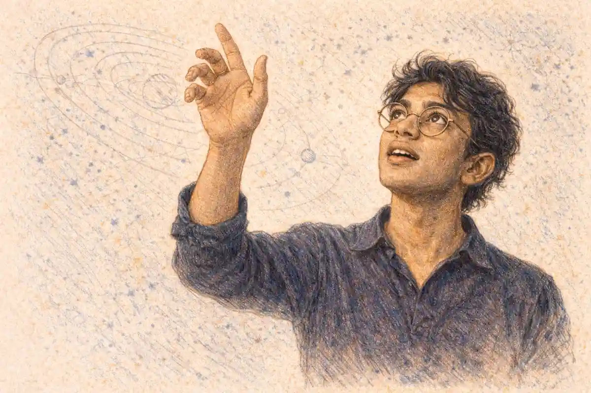

## Learning phrasing from a record

In a Baltimore house where a girl ran errands, the payment she valued most was permission to use the phonograph in the front room. She would set the needle on the same records again and again, studying how the man who played trumpet and sang on them placed a phrase against the beat, letting a melody trail behind the pulse and then catching it, stretching a syllable across a bar line as if the words were being thought of at the moment of singing. She had no teacher, no method book and no thought of jazz as a profession. What she was absorbing, groove by groove, was Louis Armstrong influence in its most consequential form: phrasing learned from a disc by a listener he would never meet.

<!--more-->

The girl was Eleanora Fagan, who sang as Billie Holiday, and her own account of those afternoons names two presences on the phonograph: Bessie Smith, whose weight of voice she wanted, and Armstrong, whose way with a lyric she wanted. That pairing matters, because the argument of this article is not the loose claim that Armstrong mattered to everyone. It is a specific and testable claim about a channel. His influence travelled on shellac, in three-minute sides that could be replayed until their secrets gave way, and it reached its largest audience not among trumpeters but among singers, most of whom never held his instrument and many of whom never described themselves as jazz musicians at all. The thesis defended here is the one his biographer Gary Giddins has argued across two volumes: Armstrong's influence on singing is larger than his influence on jazz, because the phrasing he settled in the 1920s became the default setting for popular vocal music, inherited by singers who learned it from other singers and never knew whose it was.

Consider what had to be true for that to happen. A style of phrasing is a set of decisions about time: where a note falls relative to the beat, how much of a written melody survives contact with a personality, when a singer may pause, hurry, drag or float. Such decisions are normally taught in rooms, by demonstration, and they die with the generation that held them unless an institution keeps them. Armstrong had no institution. He ran no school, published no method and took almost no formal pupils in a career of fifty years. What he had was a recording contract at the moment electrical recording arrived, and a sequence of sides, made for the OKeh label between 1925 and 1928 with his Hot Five and Hot Seven studio groups, in which both his trumpet playing and his singing were preserved at a fidelity earlier records could not manage. The channel and the content arrived together, and the content was unusually copyable: a solo constructed so clearly that a listener could memorise it, and a vocal manner so conversational that a listener could imagine doing it.

That is why the first question of this article is a mechanical one, and it will take three sections to answer in full. How do you learn phrasing from someone you never meet? The short answer is that the record changed what learning was: it made a performance repeatable, portable and private, so that study no longer required proximity. The long answer involves the difference between what a lesson transmits and what a groove transmits, and it explains why this particular influence, alone among the influences of jazz's first generation, escaped its genre entirely. Holiday at the phonograph is the type case. She was not an exception but an early instance of the standard route, the route by which nearly every figure named in this article, from Coleman Hawkins to Frank Sinatra, received what they took from him.

The personnel of those studio groups reads like a roll of the music's first maturity: Kid Ory on trombone, Johnny Dodds on clarinet, Lil Hardin, Armstrong's wife, on piano, Johnny St. Cyr on banjo. None of them could have known that the sides they were making between other engagements were becoming a correspondence course for the world. The records were cut as dance music and sold as race records; their second life as curriculum was an accident of their quality.
## Why the influence travelled by record and not by teaching

Armstrong's formation was itself a product of proximity. In New Orleans he had been taken up as a boy by Joe Oliver, the cornetist the city called King, who gave him lessons, gave him work, and in 1922 sent for him to join the Creole Jazz Band in Chicago. That was the old transmission system working exactly as designed: a master, an apprentice, a shared bandstand, and a style passed hand to hand inside one city's network of dances, parades and cabarets. Armstrong honoured the system all his life and spoke of Oliver with a gratitude that never cooled. But his own influence did not flow through it, and the reason is partly biographical and partly structural. The life that made the records, the Waif's Home band, the riverboats, the Chicago years and the long road that followed, belongs to the companion account of [Louis Armstrong's life and career](/2011/08/21/louis-armstrong-life-and-career/), and it is compressed here to the single point that matters for transmission: after 1925, the centre of his working life was the recording studio and the touring band, neither of which produced disciples in the old sense.

A touring star has no classroom. Armstrong's bands changed personnel constantly, his sidemen were hired professionals rather than students, and his schedule of one-nighters, theatre weeks and studio dates left no room for the sustained supervision that teaching requires. The musicians who played beside him certainly absorbed things, and some, the pianist Earl Hines above all, absorbed a great deal. But the arithmetic of his influence cannot be explained by the few dozen men who shared his bandstands. It has to be explained by the tens of thousands who owned his records. A Hot Five side sold through the OKeh race catalogue reached Chicago and New York and Harlem and Kansas City, and it reached the South through mail order and the record shops of the Black business districts, and it reached listeners whose names no history records, in towns Armstrong's tours never touched.

Here the first revelation of the article belongs, because everything else in it is a consequence. The influence travelled by record, which is why it reached musicians he never met and places he had not yet visited. A lesson binds a style to a place and a lifespan. A record unbinds it. The disc could be in a London flat and a Tokyo dance hall in the same season; it could teach a saxophonist in Fletcher Henderson's New York orchestra and a schoolgirl in Baltimore with the same three minutes; and it could keep teaching after the teacher's own style had moved on, so that the Armstrong of 1928 went on instructing beginners in 1938 and 1948 in a voice he himself had already altered. Thomas Brothers, the musicologist whose study of Armstrong's New Orleans years reconstructed the world that formed him, has shown how completely that world ran on personal contact. The paradox at the centre of this article is that the musician most thoroughly formed by personal contact became the first jazz musician whose influence was impersonal in its mechanism, delivered by a manufactured object to strangers.

There is a second, quieter reason the record and not the man did the teaching. Armstrong was, by every account including his own, generous with encouragement and vague with explanation. He could demonstrate anything and analyse very little; the knowledge was in his hands and throat, not in propositions about them. Musicians who asked him how he did things received stories, jokes and demonstrations rather than instruction. The record solved this problem by accident. It preserved the demonstration in a form that could be interrogated endlessly, slowed by attention if not by machinery, compared phrase by phrase against a student's own attempts. What the man could not say, the groove could be made to repeat until it confessed.

The race catalogue that carried them deserves a word of its own. After Mamie Smith's "Crazy Blues" proved in 1920 that a Black record-buying public existed in the hundreds of thousands, the labels built lists aimed at that public, and the lists travelled with the Great Migration itself, into the northern cities and back down the railway lines on visits home. Armstrong's records rode an infrastructure built for commerce and repurposed by its listeners as education.
## What a record could carry that a lesson could not

A lesson carries correction; a record carries evidence. The distinction sounds small and is in fact the whole mechanism. A teacher tells a student what to change, and the student's memory of the standard fades between lessons. A record sets the standard on the shelf, identical at every hearing, and lets the student measure the gap between the model and the attempt a hundred times in an evening. Musicians of Armstrong's generation learned this way as a matter of routine, and they described it without embarrassment: the needle lifted and dropped back, the same eight bars heard twenty times, the solo sung along with before it was ever attempted on an instrument. Scott DeVeaux, the historian of bebop, has documented how the generation that followed Armstrong made record study the core of its apprenticeship, building an entire art on phrases first encountered on discs. The practice began with Armstrong's records because his were the first jazz records that repaid that intensity of study, solos built with the clarity of set speeches and singing that sounded like thinking aloud.

### How do recordings transmit a musical style?

A recording transmits style by making a performance repeatable: the student replays a passage until its timing, accent and phrasing can be reproduced, then carries those decisions into new material. Armstrong's records taught this way at scale, because a three-minute side could be studied in Chicago, London or Tokyo by listeners he never met.

What a record could carry, then, was precisely the element of Armstrong's art that notation could not and that description could only gesture at: his placement in time. Sheet music of the period records pitches and rhythms in a grid; it cannot record the decision to sit a fraction behind the beat and let the band's pulse show through the gap, or to rush a turn of phrase and recover, or to bend the end of a line downward in a vocal shrug. Those micro-decisions are the phrasing, and before recording they were the least transmissible part of any musician's art, available only to those within earshot. After 1925 they were the most transmissible part of his. A young singer in another state could hear the lag and the catch in his voice on "West End Blues" or in his duet with Hines on "Weather Bird" as clearly as a student in the room, and could practise against the original until the lag became her own.

The record also carried something a lesson rarely transmits intact: permission. To hear a musician of Armstrong's evident authority break a written melody into speech-like fragments, repeat a note until it became an event, or abandon the lyric altogether in the scat chorus of "Heebie Jeebies" was to learn that these things were allowed, that the song as printed was a starting point rather than a contract. Singers took the permission even more completely than players, because the printed song was their working text, and the discovery that a great artist treated it as raw material changed what a singer understood the job to be. That change, multiplied across two generations of vocalists, is the largest single effect this article will trace, and it began with listeners who never saw Armstrong in the flesh at all. The broader transformation of music by recording, the economics and the listening habits that made such study possible, is surveyed in the history of [how recorded music changed the world](/2010/06/21/how-recorded-music-changed-the-world/); here the point is narrower, that one man's records became a faculty of one, teaching everywhere at once.

So the loop opened in the first section can now be closed. You learn phrasing from someone you never meet by treating his records as he never treated his own playing: as a text. You replay the phrase until its placement is memorised, you reproduce the placement on your own material, and eventually the placement stops feeling borrowed and becomes the way you hear time in a song. Holiday did it in a Baltimore front room. Trumpeters, pianists, arrangers and crooners did it in their own rooms on three continents. The sections that follow take the channels one at a time, naming in each case the musician, the recording and the specific thing that was taken, because an influence claim that cannot name those three things is not a claim but a compliment.

## The first imitators among trumpeters

The first musicians to study the Hot Five records were the ones who shared Armstrong's instrument, and they studied with an urgency the singers never had to feel, because the records constituted a direct professional challenge. Before 1925, a jazz cornetist's art was largely an ensemble art: stating the lead in a collective texture, adding breaks, ornamenting a melody the audience already knew. The Hot Five sides presented something else, a soloist who built a chorus the way an orator builds an argument, with an opening statement, a development, a climax placed where it would do the most work and a close that made the whole design audible in retrospect. The stop-time chorus of "Potato Head Blues" in 1927, in which the band falls silent except for single punctuating chords while the trumpet thinks aloud in the gaps, was copied phrase by phrase by young trumpeters who understood at once that the centre of the music had moved.

The closest of the early imitators was Jabbo Smith, a cornetist of genuine brilliance whose records with his Rhythm Aces in 1929 show the Armstrong design absorbed almost whole: the same architectural solos, the same bravura in the upper register, the same rhythmic feints. Smith's career collapsed within a few years for reasons that belonged to his life rather than his talent, and his eclipse became the type case of a pattern this article returns to at the end, the imitator consumed by the completeness of the model. Others took the model and made it a foundation rather than a costume. Henry "Red" Allen, who arrived in New York at the end of the decade, built a long career on a looser, more vocalised development of the Armstrong line. Rex Stewart carried elements of it into Duke Ellington's orchestra. Bunny Berigan, a white trumpeter from Wisconsin who learned the records as a teenager, made the style sing in a more lyrical register, and his 1937 recording of "I Can't Get Started" stands as the decade's most explicit act of homage, a ballad performance unimaginable without the Armstrong ballads that preceded it.

The most consequential of the trumpet heirs never imitated the surface at all. Roy Eldridge, a Pittsburgh trumpeter a decade younger than Armstrong, took the ambition rather than the vocabulary: the idea that a trumpet solo should be an event with a rising arc, delivered at the edge of the player's capacity. Eldridge's speed and harmonic restlessness were his own, fed by saxophone players as much as by trumpeters, but the office he occupied, the featured soloist around whom a band's excitement was organised, was the office Armstrong had created. Through Eldridge the line runs forward to Dizzy Gillespie and the whole modern trumpet tradition, a chain this article will pick up again when it reaches the bebop generation. The pattern to notice here, at the start of the evidence, is the one the table near the end of this article sets out in full: what travelled was rarely the notes. It was the conception of what a solo is for.

One record above all served the trumpeters as an etude. "Cornet Chop Suey", cut in February 1926, is a feature for Armstrong's horn alone, a display piece in the tradition of the cornet solos he had grown up admiring, and its breaks and flourishes were lifted by students as exercises in what the instrument could be made to say. Chicago's dance-band trumpeters measured themselves against it and against the man in person, in the competitive courtesy of the after-hours session, and the city's bandleaders, Erskine Tate and Doc Cook among them, employed a generation of brass players for whom Armstrong's records were the entrance examination. The Hot Seven sides of 1927 widened the syllabus: "Potato Head Blues" for construction, "Wild Man Blues" for the vocalised cry of the horn, "Gully Low Blues" for the blues chorus as high art. A trumpeter's education in 1929 could be written as a list of Armstrong titles, and in the practice rooms of three cities, it was.
## Why the trumpet influence was nearly total

On his own instrument, Armstrong's influence approached totality, and the reasons are worth stating precisely because they explain why the same totality did not occur elsewhere. The trumpet in jazz had no settled concert tradition when he arrived. There were revered elders, Buddy Bolden in memory, Freddie Keppard, and Armstrong's own mentor Oliver, but no canonical recorded body of work that defined what mastery of the instrument sounded like. The Hot Five and Hot Seven records filled that vacuum at the exact moment recording became capable of filling it. A young trumpeter in 1928 who wanted to know what the instrument could do at its highest level had one unavoidable address. Giddins has argued that Armstrong in those years effectively reset the instrument's technique: the command of the upper register as a singing region rather than a stunt, the wide vibrato used as an expressive variable, the half-valve smears and falls, the rhythmic displacement that let a phrase float over the beat and land exactly where it chose. Each device existed somewhere in the New Orleans inheritance; the synthesis, at that level of finish, on records that travelled, was his.

Nearly total is not total, and the exceptions instruct. Ellington's trumpeters worked a parallel line of jungle colour and growl that descended through Bubber Miley, whose plunger work owed Armstrong respect rather than method. Bix Beiderbecke, the cornetist from Iowa whose records were made in the same years, built a cooler, more bell-like lyricism that younger players such as Jimmy McPartland absorbed directly from him, and Beiderbecke's admiration for Armstrong, which was real and reciprocated, did not prevent the two styles from remaining distinct answers to the same question. The trumpet world of 1930 therefore had a dominant language and a respected dialect. What it no longer had was innocence: every trumpeter's choices were made in awareness of the Armstrong standard, whether in adoption, adaptation or refusal, and a standard that organises even its refusals is the working definition of the influence this article is measuring.

There was also a blunt commercial mechanism reinforcing the musical one. By the early 1930s Armstrong was the most famous jazz musician alive, filling theatres on two continents, and a young trumpeter who could invoke his manner could work. Dance band leaders hired Armstrong-inflected soloists because audiences had learned to want the sound. Influence of this kind is often described as if it spread by admiration alone; it spread also by payroll, and the payroll followed the records, since it was the records, more than the tours, that had taught the audiences what to want. The trumpet case thus shows the whole system in miniature: a body of recorded work defines a standard, the standard creates a market, and the market conscripts the next generation more efficiently than any conservatory.

The endings taught as much as the openings. Armstrong's records of the early 1930s, made with big bands in New York and Chicago, close solo after solo with ascents into a register earlier trumpeters had visited only for effects: the climactic high notes of "Shine" and "Chinatown, My Chinatown" are not decorations but structural arrivals, the destination the whole chorus has been driving toward. Students learned that the upper register could carry the argument's conclusion, and the expectation entered the instrument's technique permanently, so that a jazz trumpeter's education ever since has included the conquest of that register as a matter of course. His vibrato taught a subtler lesson, widening and narrowing with the phrase's emotional temperature, a device every brass teacher of the next generation transmitted whether or not the Armstrong name was spoken in the lesson.

Longevity sealed the standard. Armstrong recorded prolifically for five decades, in every format the industry devised, and his catalogue was therefore the one body of trumpet playing that no generation of students could avoid meeting. A rival of 1928 might be forgotten by 1938; the Armstrong of 1928 was reissued beside the Armstrong of 1938, competing with his own past and renewing the standard's lease. Influence that renews itself at each format change, from 78 to LP to the reissue programmes of the compact disc era, does not decay at the rate influence usually decays, and the trumpet world felt the full benefit of that renewal.
## The influence on saxophone players

The saxophone was not Armstrong's instrument, and that is exactly why his influence on saxophonists is such strong evidence for the record thesis: nothing passed between them except sound. Coleman Hawkins, the tenor saxophonist who more than anyone defined his instrument's first maturity, was working beside Armstrong in Fletcher Henderson's New York orchestra in 1924 and 1925, and Hawkins's playing changed in those months in ways he himself connected to the encounter. The Henderson band's records before Armstrong's arrival show a Hawkins of formidable technique playing in a comparatively stiff, slap-tongued novelty manner; the records that follow show the rhythmic loosening, the long-breathed line and the soloist's patience that became his signature. Hawkins, no man's disciple and a famously economical praiser, acknowledged in later interviews that Armstrong had shown him what rhythmic freedom inside a solo could be. The transfer here was in-person as well as recorded, one of the few in this article, and it mattered disproportionately, because Hawkins became the saxophone's own standard, and what he had taken from Armstrong he transmitted to every tenor player who studied him.

For saxophonists who never met Armstrong, the record carried three specific things. The first was construction: the Armstrong solo as a shaped span, with its climaxes rationed and its ending earned, gave reed players a form for their own choruses at a time when saxophone solos in dance bands were often novelty interludes. The second was rhythmic placement, the willingness to phrase across the bar line and behind the beat, which alto players such as Benny Carter and Johnny Hodges absorbed into very different personal styles, Carter's all polish and harmonic order, Hodges's all glide and vocalised tone. The third was vocality itself. Armstrong's trumpet playing had always imitated the voice, and his singing imitated the trumpet; saxophonists who studied the records encountered an instrumental ideal that was already a vocal ideal, and the saxophone, the jazz instrument nearest the human voice in its mechanism, took the lesson most completely. Lester Young, whose tenor style defined the alternative pole to Hawkins, built his floating, behind-the-beat lines from other sources as well, from Frankie Trumbauer and Beiderbecke among them, and the honesty this article owes its method requires the qualification. But Young's conception of the solo as a sung paraphrase of the melody belongs to the world Armstrong's records made, and Young, who kept Armstrong among the small company of musicians he praised without irony, never pretended otherwise.

By the swing era the transaction was complete and largely invisible. A saxophonist learning his trade in 1938 learned from Hawkins, from Hodges, from Young, from the records of a dozen section leaders, and the Armstrong inheritance arrived inside theirs, unnamed. That invisibility is a recurring feature of the strongest influences and the reason this article insists on named links and dated records rather than atmospheres: the claim for Armstrong's saxophone influence does not rest on the plausible feeling that everyone must have listened. It rests on the documented change in Hawkins, on the testimony collected by Dan Morgenstern across decades of interviews with the musicians of the period, and on the audible, specifiable devices, construction, placement and vocalised line, that pass from the Hot Five sides into the reed playing of the following decade.

The baritone and the section men complete the picture. Harry Carney, Ellington's baritone saxophonist for nearly half a century, built his vocalised, singing tone in the same climate of record study, and the riffing reed sections of the swing bands, answering a soloist in Armstrong's rhythmic accents, applied his placement collectively, section by section, thousands of times a night across the country. Illinois Jacquet, whose tenor solo on "Flying Home" with Lionel Hampton in 1942 became the founding text of rhythm and blues saxophone, learned his trade in the world the Henderson transfer had made, and his honking, crowd-rousing choruses are the Armstrong soloist's office translated for the postwar dance floor, display, climax and all. The saxophone family thus received the inheritance at every level, from its most cerebral soloists to its most theatrical, which is what happens to an influence that arrives as a job description rather than a style.
## The influence on piano and the rhythm section

The clearest single case of cross-instrument transfer in the whole Armstrong story sits at the piano. Earl Hines, who played with Armstrong in Chicago in the late 1920s and recorded the duet "Weather Bird" with him in December 1928, built his mature style on an explicit act of translation. Hines said, in interviews he gave across his long life, that he set out to play the piano the way Armstrong played the trumpet, and the style that resulted, right-hand lines in octaves that cut through a band like a brass lead, phrases broken by the rests and rushes of a horn solo, was nicknamed trumpet piano by the musicians who heard it. Hines is the exception that proves the article's rule about channels: he had the man himself, in the same band at the Sunset Cafe and in the same studio, and even he did his deepest learning from the records and the bandstand demonstrations replayed in memory, formalising the transfer into a technique that pianists who never met either man could then learn in turn.

Below the soloists, the rhythm section absorbed a quieter revolution. The New Orleans rhythm of Armstrong's youth had marched in two beats to the bar, banjo and tuba marking the ground. The records of the late 1920s and the bands Armstrong led into the 1930s pressed toward the four even beats that became swing: guitar replacing banjo, string bass replacing tuba, the drummer's accents redistributed from punctuation to propulsion. Armstrong did not engineer this change alone, and section 29 of this article will weigh the other claims, Walter Page's walking bass in Kansas City chief among them. What he supplied was the demand. A soloist who phrases across bar lines, who delays and anticipates as freely as Armstrong did, requires a rhythm section that keeps an even, uninflected floor for him to play against, and drummers such as Zutty Singleton, who recorded with Armstrong in 1929, developed the looser, swinging support because the soloist in front of them needed it. The rhythm section of the swing era, the engine room of the big bands, was in part a technology built to serve the Armstrong solo.

Fats Waller offers the third piano case, a transfer of manner rather than mechanism. Waller's stride piano and his comic, confidential singing both run on Armstrong's principle that a performance is a personality at work on material, free to paraphrase, to comment, to turn a standard song into a conversation. Waller knew Armstrong personally and admired him without reserve, and his organ and piano records of the 1930s are unthinkable without the precedent of a musician who treated the written song as an occasion rather than a script. Between Hines's translation of the trumpet lines, the rhythm section's rebuilt floor and Waller's inheritance of the performing personality, the keyboard and engine-room musicians took from Armstrong nearly as completely as the trumpeters had, and from the same source: the records, studied until their implications for other instruments became plain.

The elders and the economists mark the transfer's boundaries. James P. Johnson and Willie Smith, the stride masters of Harlem, were Armstrong's contemporaries rather than his pupils, and their piano art ran on its own ragtime-descended engine; the Armstrong influence reached the piano through Hines and Waller precisely because they were of the generation that treated the records as a school. Count Basie shows the subtler case of inheritance by subtraction. Basie's mature piano style, famous for what it leaves out, was formed in Kansas City in earshot of every Armstrong record the territory bands carried, and its unhurried placement, its confidence that a few notes exactly placed outweigh a passage of display, is the Armstrong rhythmic lesson learned by a man whose genius was for economy. Art Tatum, the keyboard's supreme virtuoso, synthesised Waller's stride, Hines's horn lines and his own harmonic daring into a style against which pianists measure themselves, a third-generation compound in which the Armstrong elements arrive thoroughly naturalised. The piano's Armstrong story is therefore a spectrum, translation in Hines, manner in Waller, economy in Basie, synthesis in Tatum, and the spectrum itself is the evidence that what travelled was a principle, not a lick.
## The influence on arrangers

An arranger's influence is harder to hear than a soloist's, because it lives in what the band does around the soloist, but Armstrong's case is documented at the moment of transfer. When he joined Fletcher Henderson's orchestra in 1924, the band's arranger was Don Redman, the most inventive orchestral thinker of the decade, and Redman's writing changed under the impact of his new soloist. The Henderson records of 1924 and 1925 begin to organise themselves around a new principle: the arrangement as a frame built to present individual voices, with written passages that set up a solo, riffs that answer it, and ensemble climaxes that behave like a soloist's chorus translated into brass and reeds. Redman took into orchestral writing the thing Armstrong's playing embodied, the idea that a jazz performance is a sequence of personal statements at rising intensity, and when Redman left Henderson for McKinney's Cotton Pickers and later led his own band, the principle travelled with him into the common practice of the music.

The second generation of arrangers generalised the lesson. Sy Oliver, writing for Jimmie Lunceford in the 1930s and then for Tommy Dorsey, built arrangements whose whole purpose was the staging of soloists against riffing ensembles. Benny Carter, himself a saxophonist of the Armstrong-formed generation, arranged with the same priorities for bands on both sides of the Atlantic. Fletcher Henderson, having absorbed the transformation in his own band, carried it into his arrangements for Benny Goodman in the middle 1930s, so that the band that ignited the swing boom played, in significant part, a book whose architecture descended from the changes Armstrong's presence had forced in 1924. The chain has named links and dated records at every step, which is what distinguishes it from the vague claim that everybody learned from everybody.

What arrangers took, at bottom, was a reordering of the music's hierarchy. In the dance band Armstrong found, the arrangement was the music and the soloists were decoration. In the band he left behind him, and in the swing bands that followed, the soloist was the music and the arrangement was the staging. That inversion looks obvious in retrospect because it won so completely that it became the default assumption of every arranger who wrote for a band with featured players. It is the orchestral expression of the change the next section takes up in its pure form, the relocation of the music's centre from the collective to the individual voice.

The arranging trade beyond the famous names absorbed the same reordering through its daily bread, the stock arrangement. Publishers sold printed stocks of popular songs to the thousands of bands that could not employ arrangers, and the stocks of the early 1930s increasingly included the featured chorus, the open space where the band's hot man stood up, a space that exists in that form because the market now expected every band to present a soloist. Edgar Sampson, writing for Chick Webb, and Horace Henderson, writing for his brother and for others, worked the new architecture as fluently as Redman and Oliver. Mary Lou Williams, who began arranging for Andy Kirk's band at the end of the 1920s and became one of the music's enduring composers, formed her craft inside the transformed dispensation, writing arrangements that are unthinkable without the soloist-centred stage the Armstrong years had built.

Armstrong's own recording career supplied arrangers with a running demonstration of the star feature. His records with Luis Russell's orchestra in 1929 and 1930 are built as showcases, the band's written passages functioning as curtains raised and lowered around the leader's entrances, and the Decca records of the later 1930s extended the principle to the singer, arrangements whose entire design serves the presentation of his voice. An arranger studying those sides, as arrangers did, was studying the commercial grammar of the featured personality at its most successful. The lesson generalised beyond jazz: the radio and studio orchestras that accompanied the crooners and the songbook singers arranged by the same priorities, the ensemble as frame, the voice as picture, which is the Henderson transformation wearing evening dress.
## How the soloist became the centre of the music

Jazz before Armstrong was, in its classic New Orleans form, a collective music. The front line of cornet, clarinet and trombone improvised together, weaving three lines of roughly equal importance into a texture whose beauty was the weave itself. Soloists emerged for a break of two bars or a chorus of display, but the music's centre of gravity sat in the ensemble, and its great recordings, including the ones Armstrong made with King Oliver in 1923, are ensemble achievements. What the Hot Five records did, between 1925 and 1928, was to move the centre. The Hot Five was a studio group that existed only to make records, and its records are organised as a sequence of solos framed by minimal ensemble statements. Within that frame Armstrong's choruses are not decorations on the music. They are the music, the events the record exists to deliver, and the other musicians, fine players all, function as his supporting cast.

Here the second revelation of the article lands, and it is the structural fact on which the rest of the influence rests. The shift of the soloist to the centre of the music is the change Armstrong's records effected, and every later jazz instrument inherited it rather than only the trumpet. A saxophonist, a pianist, a trombonist of 1935 did not merely borrow Armstrong's phrases; he inherited a job description that Armstrong's records had written, the featured improviser who carries a performance, constructs a solo as a narrative with a beginning and a climax, and steps forward as the named personality the audience has come to hear. The economics of the music reorganised themselves around that job description: bands were billed under leaders who were soloists, records were sold on featured names, and the sideman's ambition became the soloist's chair. Even the physical staging of jazz changed, the featured man standing to play while the band sat behind him, a tableau that Armstrong's theatre years normalised.

The change can be overstated, and this article will test the overstatement in its proper place. Collective improvisation did not die; it survived in Dixieland revivals and in the after-hours cutting sessions where reputations were made in company. Other soloists of the decade, Beiderbecke above all, were moving toward the featured conception by their own road. But roads converge on the figure whose records travelled, and the Hot Five sides were the documents from which the soloist's office was most widely learned. When the bebop musicians of the 1940s built their art around the virtuoso soloist as auteur, extending the soloist's chorus into long, harmonically restless inventions, they were not rebelling against Armstrong's deepest legacy. They were its most extreme inheritors, a fact their rhetoric obscured and their practice confirmed, as the account of their public criticism later in this article will show.

The three-minute side deserves its share of the credit, and of the blame, for the soloist's coronation. A 78 rpm record side holds roughly three minutes of music, and the Hot Five format fitted that frame exactly: a theme stated, two or three soloists presented in turn, the leader's chorus placed for maximum effect, a close. The frame taught listeners to expect music in solo-shaped units and taught musicians to construct solos that could carry a side. When the long-playing record arrived two decades later, the soloist's chorus stretched, but the unit of attention the 78 had trained, the featured statement as the performance's centre, persisted into the new format unchanged. Radio enforced the same geometry in its own way, billing the featured names and building programmes around them, so that by the middle 1930s the soloist was not merely the music's artistic centre but its unit of commerce, the name on the label, the photograph in the advertisement, the reason for the ticket. Armstrong's records had not set out to reorganise an industry. They had merely made the soloist so much more compelling than the ensemble that the industry reorganised itself around the fact, and an influence that changes what an industry sells has changed the conditions under which every later musician works, including the ones who never play a note in its style.
## Fletcher Henderson's band as the transfer point

Every account of how Armstrong's style escaped New Orleans and Chicago passes through a fourteen-month engagement in New York. In the autumn of 1924 he joined Fletcher Henderson's orchestra at the Roseland Ballroom, the most prestigious Black dance band in the East, and the engagement functioned as a transfer point between the regional art he had mastered and the national music it was about to become. Henderson's band was a reading band, staffed by schooled musicians, playing stock arrangements for dancers in a polished ballroom. Into that polished machine came a soloist whose rhythmic ease and improvisational authority exposed, by contrast, how stiff the machine's habits were. The band's records tell the story in sequence: the Henderson sides of late 1924, "Copenhagen" and "Shanghai Shuffle" among them, carry Armstrong solos that sit in the arrangements like visitors from a freer country, and the sides of 1925 and 1926, culminating in "The Stampede", show the whole band loosening around the standard he had set.

The transfer ran in both directions, and its two-way character made it permanent. Armstrong learned from Henderson's band the disciplines of the reading orchestra, the section playing and the arranged ensemble that his own later big bands would need. The band learned from him the rhythmic and soloistic principles that its arranger Redman was simultaneously converting into orchestral practice. And the band's personnel dispersed the lesson: Coleman Hawkins carried it into his own standard-setting career, and the dozens of musicians who passed through Henderson's ranks in the following decade carried it into every major orchestra of the swing era. Musicians who never bought a Hot Five record could receive the Armstrong inheritance at one remove, through the Henderson book and the Henderson alumni, which is how a style becomes a vernacular: it stops needing its source.

New York itself was the third party to the transaction. Armstrong's Roseland months put him in front of the city's musicians nightly, in the capital of the recording and publishing industries, at the moment when those industries were deciding what the new music would be. Musicians came to hear him the way they later went to hear Charlie Parker, as a professional obligation disguised as a night out. Paul Whiteman's men, Ellington's men, the theatre pit players and the radio staff musicians all had access to the Roseland bandstand, and several of the singers this article will shortly reach, Bing Crosby among them, first encountered the Armstrong effect in the New York air of those years, on bandstands and on the records that the bandstand fame sent spinning outward.

One Henderson record condenses the whole transfer into three minutes. In May 1925 the band recorded "Sugar Foot Stomp", its remake of the "Dippermouth Blues" that Armstrong had recorded with King Oliver's Creole Jazz Band two years earlier. The performance restages the pupil's education in public: the young soloist takes the chorus he had played behind his mentor in Chicago and rebuilds it inside the New York orchestra's arranged frame, at once an act of homage and a demonstration that the music's centre had moved cities and moved men. Listeners who owned both records, and musicians owned both, could hear the transmission happening, the New Orleans solo absorbed into the metropolitan arrangement without losing its accent.

The bandstand added what the records could not, a nightly seminar for the profession. Henderson's orchestra held the Roseland stand and broadcast from it, and the musicians who came to listen included the men who would build the swing era's institutions, among them John Hammond, the young talent scout and critic whose later patronage shaped the careers of Goodman, Basie, Holiday and many others, and who dated his understanding of what a jazz soloist could be to hearing Armstrong in those years. A transfer point is a place where many lines cross, and for fourteen months the Roseland bandstand was the crossing place of the music's future: the arranger learning to frame solos, the saxophonist learning to float, the scout learning to listen, and the singer in the audience's city learning, from the band and from the records the band's fame accelerated, that a song could be taken apart and rebuilt by a personality.
## The swing era inheritance

The swing era of the middle 1930s was built, structurally, on the foundations Armstrong's records had laid in the decade before. The big band was a machine for presenting soloists: a riffing ensemble, drilled sections, and a roster of featured voices, the hot trumpet, the tenor star, the singer out front. Armstrong himself spent the era fronting big bands of variable quality, making records for Decca that carried his singing to a mass audience, appearing in films, and consolidating a fame that made him, for the general public, the face of the music itself. The bands that defined the era, Goodman's, Ellington's, Basie's, Lunceford's, played arrangements whose solo-staging descended from the Henderson transformation, and their star soloists, Roy Eldridge and Harry James on trumpet, Lester Young and Hawkins and Ben Webster on tenor, occupied offices the Hot Five records had created. Even the era's vocalists, the band singers who stepped forward for a single chorus, worked inside a format whose logic was Armstrong's: the personality presented to the audience, the song paraphrased rather than recited.

The musicians who inherited all this most completely were, many of them, children when the Hot Five records appeared. A trumpeter born in 1915 was ten years old when "Heebie Jeebies" was cut; a singer born in 1915 was forming her art in the middle 1930s with Armstrong's records already installed as classics around her. Inheritance at that depth is normally repaid with reverence. Some of it was, and the reverence of the swing generation, Eldridge's, Hawkins's, Crosby's, never really wavered. But the generation behind them, the modernists who came of age in the 1940s, would repay the same inheritance in a different coin, with public criticism sharp enough to make the newspapers, and the question of why they did so is one this article has deliberately left open since the swing settlement looked so complete. It opens here, in the middle of the inheritance at its most secure, because the answer belongs to the moment when the inheritance began to chafe: why did the generation that followed him attack him in public?

Hold that question while the vocal evidence is counted, because the criticism, when it came, was aimed at a target this article has not yet reached, the public performer rather than the records, and its meaning depends on the distinction. The swing era also completed a second, quieter transaction. The big bands carried singers as featured attractions, and the singers who prospered in that setting, from the young Ella Fitzgerald with Chick Webb to Billie Holiday's brief, unhappy tenure with Count Basie and Artie Shaw, were learning in public the art that the next sections examine in its mature form: the Armstrong art of the paraphrased, behind-the-beat, personally inflected standard song, detached now from the trumpet altogether and travelling on its own.

Armstrong's own itinerary through the era traces the inheritance consolidating. The records with Luis Russell's band in 1929 and 1930 carried the showcase format into the new decade; the California season of 1930 and 1931, fronting Les Hite's orchestra, put the act before the film colony and produced his first screen appearances; the European tours of 1932 to 1935 made him an international star in person to match the records; and the Decca contract from 1935 gave him the mass-market distribution his earlier labels had lacked, producing the records, "Jeepers Creepers" among them, that fixed his singing in the general public's ear. He was, throughout the swing boom he had made possible, its most famous practitioner and increasingly its elder, a position whose comforts and whose costs the bebop sections of this article will weigh. The bands he fronted were rarely the era's best, and the discrepancy is itself instructive: the inheritance no longer needed his bands to carry it, since every rival band in the country was staffed by his musical descendants and playing arrangements descended from his lesson.
## Bing Crosby and the crooning line

The largest audience Armstrong's influence ever reached did not come to him through jazz at all. It came through the most popular singer of the first half of the twentieth century, and the connection between them is the hinge on which this article's thesis turns. Bing Crosby grew up in Spokane, formed his first act in the collegiate dance bands of the Northwest, and arrived in Los Angeles and then New York as a jazz-struck young vocalist in Paul Whiteman's orbit, singing with the Rhythm Boys. Crosby's mature manner, the relaxed baritone that converses with a lyric rather than declaiming it, that sits behind the beat, paraphrases a melody to fit the words and treats the microphone as a confidant, did not descend from the crooners who preceded him, the soft-voiced tenors of the early electrical era. It descended, by his own repeated account, from the jazz musicians he idolised as a young man, and at the head of that company, named again and again across his life, stood Armstrong.

### How did Armstrong influence singers?

He taught them to treat a song as material for a personal statement: to lag behind the beat, paraphrase the melody, phrase in speech rhythms and improvise inside the lyric the way his trumpet improvised inside a chorus. Bing Crosby adopted the method first, Billie Holiday deepened it, and through them it became the default manner of popular singing.

Will Friedwald, the historian of American popular singing whose books traced the lineages among the songbook vocalists, documented the debt in detail: Crosby listened to Armstrong's trumpet playing and singing as a young professional listens to a master, and built his rhythmic approach on it. The audible evidence is on the early Crosby records, the scat passages and hot choruses of his Whiteman and solo sides around the turn of the 1930s, where the young baritone is plainly trying on the Armstrong devices, before the manner settled into the ease of his maturity. What Crosby grasped, and what made him the perfect vessel for the transfer, was that Armstrong's rhythmic freedom did not require Armstrong's instrument or Armstrong's timbre. It required only a beat, a lyric and the permission to treat both conversationally. A baritone with a microphone could take the whole method home, and did, into a career that sold more records than any singer before him and defined, for two generations of listeners, what singing a popular song was supposed to sound like. The next section separates what Crosby took from what he merely admired, because the distinction between the two is where the mechanism of the whole vocal transfer becomes visible.

The early records let the transfer be watched as it happens. With Whiteman's Rhythm Boys in the late 1920s Crosby is a jazz singer among jazz singers, trading choruses and scatting in the period's hot manner. By "Just One More Chance" in 1931 the manner has become the method: the baritone leans on the melody conversationally, hurrying a phrase, then letting one hang, and the effect is no longer imitation but ownership. Friedwald's analysis of these sides identifies the Armstrong devices one by one, the paraphrase that respects the stresses of the words, the blue inflections imported from the horn, the rhythmic displacements that keep a slow tempo swinging, and shows them passing, within a few years, from experiment to signature.

The microphone completed what the records began. Electrical recording rewarded the singer who could work close and quiet, and Crosby, who understood the instrument earlier than any rival, built his radio manner on the intimacy the microphone allowed: the voice at conversational level, addressed to one listener at a time. Armstrong's singing had modelled the content of that intimacy, the speech-rhythm phrasing, but Crosby's genius was to industrialise it, carrying it by network radio into millions of homes weekly, so that the Armstrong grammar became, through him, the sound of American domestic life. A trumpeter's rhythmic decisions, made in a Chicago studio in 1926, were by 1935 the way a nation expected a love song to be sung at its own fireside. No influence in the music's history had previously travelled so far from its source while keeping its shape so recognisably intact.
## What Crosby took and acknowledged

Influence claims in singing are usually built from resemblance, and resemblance is cheap evidence: two singers may sound alike because both drank from a common stream. The Crosby case rests on firmer ground, because Crosby said what he had done, often and on the record of print and broadcast, across fifty years of fame during which he had nothing to gain by sharing the credit. He named Armstrong as the musician from whom he had learned his rhythmic approach to a song. He ranked him, in a phrase Friedwald and Giddins both preserve, as the beginning and the end of music in America. And late in his life, when the two old men appeared together, the deference was visible as well as documented: Crosby, by then the senior figure of American entertainment, treated Armstrong in public as his master, a courtesy the cameras of the 1956 film High Society caught in their duet, where the pupil of the records sings beside his teacher as an equal and behaves as a junior.

### Did Bing Crosby learn from Armstrong?

Yes, and he said so throughout his career. Crosby credited Armstrong's trumpet playing and singing as the source of his rhythmic approach to a lyric: the behind-the-beat ease, the conversational paraphrase of a written melody and the relaxed swing that replaced the declamatory delivery of the earlier crooners and became the sound of mainstream popular singing.

Now the shareable fact can be stated plainly, because the evidence for it has been assembled rather than asserted. Bing Crosby, the best-selling singer of his generation, repeatedly credited Armstrong as the model for his phrasing, and Billie Holiday named him as a formative influence on hers. The line runs from one trumpeter into mainstream popular singing, and it runs through testimony, not through the critic's ear alone. This is the third revelation of the article and the load-bearing one: when the central transmission of an influence is confessed by the recipient, the historian's task changes from detection to measurement. The question stops being whether Crosby took Armstrong's phrasing and becomes how far the taking carried, into how many other careers, through how many intermediaries, until the phrasing ceased to have an author at all.

What Crosby took, itemised, was a technique with four working parts. He took the placement, the phrase laid a fraction behind the beat so that the band's time shows through and the vocal seems to be thinking rather than reciting. He took the paraphrase, the written melody treated as a suggestion, its intervals softened, its rhythms redistributed to fit the natural stresses of the words. He took the conversational register, the singing voice pitched at the level of speech, which the microphone had just made commercially possible and which Armstrong's records had already pioneered on disc. And he took the right of improvisation, the scat chorus and the altered repeat, by which a singer claimed the same licence as an instrumentalist. What Crosby refused is equally diagnostic: he refused the trumpet's display, the high-note climaxes and the virtuoso breaks, and he refused the gravel and heat of Armstrong's timbre, substituting a baritone smoothness that radio and film could sell to everyone. The method survived the change of surface intact, which is the proof that the method, and not the manner, was the transferable asset.

The testimony's weight is increased by its social cost. In the America of Crosby's prime, organised by segregation in law and custom, for the country's most successful white entertainer to name a Black musician as his master, repeatedly and without hedging, was not the ordinary courtesy of a modest star. Crosby did it anyway, in interviews across the decades, and the industry that employed them both understood what it was hearing. Testimony given against the grain of the giver's interest is the kind historians are trained to trust, and it is on testimony of exactly that grade, from Crosby and from Holiday alike, that this article's central claim principally rests.
## Billie Holiday and the phrasing inheritance

Billie Holiday's debt to Armstrong is the second of the article's two confessed transmissions, and her own account of it, set down in her autobiography and repeated in interviews across her career, returns to the Baltimore phonograph of this article's opening. She named her two models without hesitation: Bessie Smith, for the big voice and the blues weight, and Louis Armstrong, for the way a lyric could be handled. The pairing is itself an analysis. From Smith she took the emotional scale of the blues singer; from Armstrong she took the instrumentalist's approach to a song, and it is the second taking that reshaped popular singing, because Holiday carried it further than Crosby had. Where Crosby paraphrased a melody to make it conversational, Holiday paraphrased it to make it confessional, dismantling the written line and rebuilding it around the words' meanings, lagging so far behind the beat that the accompanying band seems to hold its breath, then arriving exactly where the harmony requires her to be.

The records document the transfer with unusual completeness because her career began in the studio almost as soon as it began in the clubs. The Teddy Wilson sessions of the middle 1930s, "What a Little Moonlight Can Do" and "These Foolish Things" among them, show the method already formed in a singer barely twenty: the melody displaced, the phrases broken across bar lines, the timing derived not from the song's printed rhythm but from an internal, horn-like logic of statement and answer. Lester Young, her great partner on those and later records, played tenor in a complementary behind-the-beat style, and the two of them together made a music whose entire rhythmic premise descends from the Armstrong records both had studied. Holiday's voice itself was nothing like Armstrong's: light where his was gravelled, narrow in range where his trumpet had commanded three octaves, incapable of his climaxes and uninterested in them. The inheritance is therefore visible in its purest form, stripped of every surface resemblance. What passed from the trumpeter to the singer was placement, paraphrase and nerve, the conviction that a song's written form is the floor of a performance and not its ceiling.

Her testimony also protects the claim from the obvious objection. Holiday guarded her originality fiercely and resisted being filed as anyone's imitator; she insisted she did not want to sound like anybody, and she did not. That a witness so protective of her singularity nonetheless named Armstrong as a formative influence, consistently, from her first success to her last interviews, is the strongest kind of evidence influence history ever gets: an admission against interest. Giddins, who weighed this testimony in his biography, treats the Holiday case as the proof of the singing thesis, and Dan Morgenstern, who knew the musicians of her generation and interviewed them for decades, recorded the same acknowledgement from the bandstand side, sidemen who heard in her phrasing the Armstrong lessons she had taken from the records in Baltimore.

The sessions that document her formation pair her with the other great student of the records. On the Teddy Wilson dates of 1937, the recording of "Mean to Me" among them, Holiday sings opposite Lester Young, whose tenor answers her phrases in the same lagging, paraphrasing language, and the rapport between them was so complete that they renamed each other, he calling her Lady Day, she calling him the President, Prez. Two musicians formed by the same discs, arriving from Kansas City and Baltimore by different roads, play on those sides like graduates of one school, which in the only sense that matters they were. Her 1939 recording of "Strange Fruit" shows the inheritance turned to its gravest use: the paraphrase and the timing placed entirely at the service of a lyric's meaning, the singer as witness rather than entertainer, a possibility latent in Armstrong's method from the beginning and realised by his student at a depth he never sought.
## What Holiday took and what she rejected

The Holiday case earns a section of its own because her refusals are as instructive as her takings, and together they isolate the exact component of Armstrong's art that could travel. She took the time. Her placement behind the beat, her habit of entering after the listener expects the phrase and letting the band's pulse pass beneath her like a pavement under a pedestrian, is Armstrong's rhythmic signature translated into a voice of opposite character. She took the paraphrase, the melody reshaped until the lyric's sense governs its rhythm. She took the instrumental conception of the singer's role: she described her own ambition, in a remark Friedwald preserved, as wanting to sound like a horn, and the musicians who accompanied her treated her as one, trading phrases with her as with a second lead instrument. And she took the repeat-with-variation principle, so that a second chorus in her hands is a commentary on the first rather than a restatement.

She rejected the tone. Armstrong's singing voice was warm, gravelled, exuberant, an instrument of public pleasure; Holiday's was edged, intimate and bruised, and she never borrowed his sound even when she borrowed his method entire. She rejected the scat display and the trumpet-like virtuosity of his vocal breaks; her improvisations stay inside the lyric, altering words and timing rather than dissolving into syllables. And she rejected, most consequentially, the public personality that went with his singing, the entertainer's radiant availability to an audience. That rejection is a subject in its own right, and it belongs to the debate over Armstrong's standing taken up elsewhere in this series; what matters here is only the analytical yield. Here the fourth revelation lands: Billie Holiday took the phrasing and rejected the tone, which shows exactly which part of the method was transferable. The transferable part was a grammar of time and paraphrase that any voice could speak. The untransferable part was the man. Her own short and crowded life, the clubs, the big-band tenures and the long aftermath, is told in the account of [Billie Holiday's life and career](/2012/01/21/billie-holiday-life-and-career/); in this article she stands as evidence, the singer in whom Armstrong's method can be watched operating at full strength inside a style that resembles his in nothing else at all.

A paired comparison makes the taking and the refusing audible on a single song. Armstrong recorded "I Gotta Right to Sing the Blues" in 1933, all rhythmic command, the lyric swung hard and grinned through. Holiday recorded the same song in 1939 and rebuilt it as a slow act of endurance, the phrases trailing the beat until the words sound remembered rather than performed. The melody, the paraphrase principle and the placement descend directly from his record to hers; everything the listener would call the mood runs in the opposite direction. Set the two sides side by side and the article's whole argument about her can be heard in six minutes: the grammar inherited entire, the emotional world refused and replaced.

Her refusals extended to his tempos and his theatre. Armstrong's art delights in display at speed, the up-tempo romp in which singer and band trade feats; Holiday's mature art narrowed steadily toward the slow and the medium tempo, where the lag could widen and the words could be cross-examined, and her few fast records sound like visits to a country she had emigrated from. She refused his vibrato too, the warm oscillation that makes his voice glow, keeping her own tone dry and centred, the better to let the timing carry the feeling. Even her stagecraft inverted his: where he opened himself to the room, she increasingly sang as if the room were overhearing her. None of this diminishes the debt. It defines its shape. What she owed him was the operating system of her art; what the art ran on it was hers, and the distinction between those two possessions is the most precise lesson the influence historian can draw from her case.
## Sinatra and the phrasing tradition

Frank Sinatra's debt to Armstrong is real but routed, and the routing is the point: influence at this scale rarely travels in a straight line, and the honest historian names the intermediaries. Sinatra said plainly, across his career, that his first and deepest vocal model was Bing Crosby, whose records he studied as a young singer in Hoboken with the same needle-dropping devotion Holiday had practised in Baltimore. What he took from Crosby was the Armstrong inheritance at one remove: the conversational register, the behind-the-beat placement, the melody paraphrased into speech rhythm. Onto that foundation Sinatra laid two further disciplines of his own finding. From Tommy Dorsey, in whose band he sang from 1940 to 1942, he took breath control, the trombonist's trick of sustaining a line across its natural breathing points until phrases of instrumental length became possible for a voice. And from his own study of the songbook he took an actor's attention to the lyric, so that the paraphrase in his hands became interpretation, the melody bent to the meaning of a specific word.

The Capitol records of the 1950s, the ballad albums and the swinging albums alike, are the sound of the combined inheritance at maturity: the long line held over the beat, the swing of the up-tempo sides driven by a singer who phrases like a horn section answering itself. Friedwald, whose study of Sinatra's art remains the standard account of his method, traces this phrasing tradition explicitly to the Armstrong source, through the Crosby channel and the Dorsey refinement, and Sinatra himself never disputed the genealogy. He revered Armstrong in terms that left nothing to inference, ranking him among the supreme musicians of the century, and the two men's public encounters have the same quality as Crosby's, the younger sovereign of popular singing behaving in the older man's presence like a student who has done well.

For this article's argument, Sinatra's importance is structural rather than testimonial. By the middle 1950s he was the most imitated singer in the world, the model for a generation of saloon singers, pop vocalists and aspiring stylists who studied his Capitol sides phrase by phrase. Almost none of them supposed they were studying Armstrong. They were studying Sinatra studying Crosby, and the phrasing that reached them, placement, paraphrase, conversational address, the singer as improvising lead voice, was the Armstrong method in its third transmission, its origin worn smooth by use. Influence that has become anonymous in this way is easy to miss and impossible to recall; it had passed into the definition of competent popular singing itself. The next two sections measure that final state of the transfer, the moment when a man's rhythmic decisions became a default that even refusal had to reckon with.

Sinatra's testimony completes the chain from an unexpected direction. In 1958, at the height of his own authority, he named Billie Holiday as the greatest single musical influence on his singing, a singer he had first heard in the clubs of 52nd Street as a young man. The genealogy that statement completes is worth pausing on: the century's most imitated pop singer declares his debt to the singer who declared hers to Armstrong, while his other declared master, Crosby, had declared the same debt by the other road. Both of Sinatra's roads lead to the same source, and the source is a trumpeter. His Capitol ballad records show what the double inheritance produced at full maturity: on "I've Got You Under My Skin" in 1956, in Nelson Riddle's arrangement, the vocal builds through long, breath-managed phrases laid against the band's pulse with a horn player's patience, the conversational surface of Crosby stretched over the long line of Dorsey's trombone and filled with Holiday's confessional intent. No single element of that performance is Armstrong's invention alone. The combination, the singer as improvising lead voice accountable for the whole emotional architecture of a performance, is the office his records created, occupied at its highest level of finish.
## The rhythmic default in popular singing

Set a popular record from 1920 beside one from 1940 and the difference in the singing is not subtle. The earlier singer, whether a vaudeville tenor projecting to the back of a theatre or a dance-band vocalist reading a chorus as written, delivers the song on the beat, at the song's printed rhythms, in a manner designed to carry words clearly to a room. The later singer, Crosby or Holiday or any competent band vocalist of the swing years, does something else: he leans on the beat from behind, she lets a phrase spill across its bar line, the melody comes out paraphrased into the rhythms of speech, and the whole performance swings, which is to say it participates in the band's rhythmic life rather than floating above it. That second manner is the rhythmic default of twentieth-century popular singing, and its source, through the documented channels this article has traced, is the phrasing Armstrong settled on his records of the 1920s.

The default had enabling conditions, and honesty requires naming them. Electrical recording and the microphone arrived in 1925, the year the Hot Five sessions began, and without the microphone the conversational register could not have become a commercial style at all: a singer who phrases like speech must be audible at the volume of speech. Radio then carried the intimate manner into every home, and the jukebox and the record shop did the rest. But technology explains the opportunity, not the content. A microphone does not tell a singer where to place a phrase. The content of the new default, the specific grammar of lag, catch, paraphrase and swing, was supplied by a musician whose records taught it, and the proof is that the singers who defined the manner named him, in the two cases where naming mattered most, as their teacher. The technology made a thousand crooners possible; the phrasing they crooned in was learned at one address.

Here the third loop of the article opens, and it will not close for another thirteen sections, because it is the boldest question the evidence raises. Is there any twentieth century singer untouched by him? Once a default is installed, even rebellion is shaped by it: the rock singers who shouted over the beat in the 1950s, the folk revivalists who prized plainness, the soul singers who stretched single syllables across whole bars, all worked inside a musical world where the singer was expected to be a rhythmically free, paraphrasing lead voice, which is the world Armstrong's records built. Whether any house of singing genuinely stood outside that world, and what its exemption proves, is a question this article will answer only after the remaining channels, the international spread, the educators and the modernists, have been counted.

The before picture needs its own precision, because the default replaced something specific. The popular singer of 1920 was formed by the theatre and the song publisher. Al Jolson, the era's dominant stage singer, projected a written song to the last row with a declamatory attack, every word placed on the beat and punched. The song-plugging system that fed the theatres expected the same fidelity in reverse: a song was sold by being sung as written, and the singer was its salesman. The first crooners softened the volume without changing the doctrine. Gene Austin, whose "My Blue Heaven" in 1927 was among the decade's best-selling records, sang close to the microphone in a light, pleasant tenor, and his success proved the market for intimacy; but Austin's time is square beside Crosby's, his phrases walking the bar lines in step. The distance between Austin and Crosby, five years and one rhythmic idea apart, is the exact measure of what Armstrong's phrasing contributed to the crooning revolution: not the quiet voice, which the microphone supplied, but the free placement of that voice against the beat, which only the records taught.
## Why singers who never heard of jazz sing this way

The reason a wedding singer in 1960, a Nashville session vocalist, a British dance-band girl singer of the 1940s and a rock and roll shouter of 1956 all phrase inside the Armstrong grammar, without any of them having studied jazz, is that defaults are inherited from models, not from sources. Each of them learned singing from the singers they admired, and those singers, at one or two removes, had learned from Crosby, Holiday, Fitzgerald, Sinatra and their peers, in whom the grammar was already installed as second nature. Transmission of this kind does not require the recipient to know the source's name, any more than speaking a language requires knowing its etymology. It requires only that the intermediate models be ubiquitous, and the recording and broadcasting industries made the Armstrong-formed singers the most ubiquitous voices on earth.

Two further carriers deserve naming, because they explain the default's reach into genres that kept jazz itself at arm's length. The first is the standard song repertoire. The great American songbook, the Kern, Berlin, Gershwin, Porter and Rodgers and Hart catalogues, was recorded and re-recorded by every generation of singers, and the canonical performances of those songs, the versions against which newcomers measured themselves, were the Armstrong-formed ones. To learn the repertoire was to learn the phrasing, whatever genre the learner intended to practise. The second carrier is the accompanist's expectation. By the 1940s, arrangers wrote vocal charts assuming a singer who would paraphrase and swing; rhythm sections played time in a way that invited the lag and punished the square, on-the-beat reading. A young singer with no jazz allegiance whatever, rehearsing with working musicians, was coached by the band itself into the grammar, because the band's time was descended from the same records.

The country and gospel cases, which this article will examine honestly when it counts the untouched, already announce the shape of the answer forming here. Where a singing tradition possessed its own strong institutions, its own repertoire, its own teachers and its own definition of what a voice is for, the default entered slowly, partially, or by a side door. Where a singer's world was the microphone, the record shop and the dance band, the default was simply the water. Armstrong's influence on singing is therefore best pictured not as a ray striking each singer directly but as a change in the climate of the art, effected through named intermediaries, Crosby first and largest, Holiday deepest, Sinatra most imitated, and resisted only where another climate held its own ground.

The second generation of carriers shows the default reproducing itself without any fresh contact with the source. Dinah Washington, formed in Chicago gospel and crowned at the Apollo Theatre's amateur contest in 1942, built her singing on Holiday's records as Holiday had built hers on Armstrong's, and carried the grammar into rhythm and blues and then into the pop charts of the 1950s, her timing so authoritative that younger singers studied her as the standard. Sarah Vaughan, a church singer from Newark with perfect pitch and a conservatory's worth of natural equipment, fused the Holiday inheritance with the bebop harmony of her bandmates in the Earl Hines and Billy Eckstine orchestras, producing a style in which the Armstrong grammar operates at a level of harmonic sophistication its inventor never approached. Eckstine himself, the baritone who fronted the band that incubated bebop, sang in the Crosby line and knew it. By the time these singers were the profession's models, the question of where the phrasing came from had stopped arising in the studio at all. It was simply how the musicians in the room, singers and accompanists together, understood a song to go, and a default that no longer needs a name has completed its conquest. The accompanists enforced it as much as the singers did, since a rhythm section schooled on swing time will make a square reading sound wrong within eight bars, and will go on making it sound wrong until the singer learns to float.
## Scat and the vocal improvisation tradition

Scat singing, the improvisation of wordless syllables as if the voice were a horn, is the point where Armstrong's singing and playing openly merge, and its history carries a warning this article has sounded before. The famous story, told by Armstrong himself, is that during the February 1926 session for "Heebie Jeebies" he dropped the lyric sheet and, rather than stop the take, invented syllables until the sheet was retrieved. The story is probably embroidered, and scat-like choruses exist on records before his, Gene Greene's among them, from the previous decade. What Armstrong did was not to invent the device but to author its masterpiece and its charter: the "Heebie Jeebies" chorus and the scat duet with guitarist Lonnie Johnson on "Hotter Than That" in 1927 demonstrated that a voice improvising syllables could build a solo with the architecture of his trumpet choruses, and every later scat singer worked in the space those records opened.

Cab Calloway turned the device into theatre in the 1930s, building his stage act on call-and-response scat exchanges with his audiences. Ella Fitzgerald turned it into high virtuosity: her scat choruses of the 1940s and after, on "Oh, Lady Be Good" and "How High the Moon", treat the voice as a bebop horn, fast, harmonically exact and rhythmically fearless, and Fitzgerald, who named Armstrong among her idols and later recorded two albums beside him, understood her scat as the inheritance it was. The vocalese writers of the 1950s, Lambert, Hendricks and Ross pre-eminent among them, performed the final proof of the record thesis in reverse: they set words to famous recorded solos, treating the discs as texts stable enough to carry lyrics, which is something that can only be done in a culture where improvisation has been fixed by recording into literature. Scat's line is thus a miniature of the whole article: a device with scattered precedents becomes, through one man's records, a tradition with named practitioners and a teachable method.

The tradition's later masters extended the device in both directions at once. Sarah Vaughan could scat with a bebop band's harmonic speed and then settle into a ballad's long tones without changing her authority. Mel Tormé, a drummer turned singer, treated scat as the percussion of the voice and wrote about Armstrong with a musician's gratitude. Anita O'Day carried the horn conception into her rhythmic dismantling of standards, taking songs apart at speed with a trumpeter's nerve. Dizzy Gillespie himself became a scat singer of charm and wit, his syllables tumbling in the accents of his trumpet lines, so that the modernist who had criticised Armstrong's act ended up practising Armstrong's vocal art on bandstands for fifty years, an inheritance acknowledged in deed whatever the early interviews said.

The vocalese writers closed the circle in the most literal way available. When King Pleasure and then Lambert, Hendricks and Ross set words to recorded solos in the 1950s, they were treating improvisations as compositions, texts with authors, fit to be memorised, harmonised and taught. That treatment is the record thesis in its purest cultural form: the disc had made the improvised permanent, and the permanent had become literature. Armstrong, whose "Heebie Jeebies" chorus began as three minutes of studio expedient, lived to see the principle of that chorus become a compositional method practised by singers who revered his records as scores. Scat's history thus refuses the simple fable of invention. It is a history of authorisation: many had fooled with syllables, and one man's records made the fooling into an art with standards, a lineage and a literature.
## The bebop generation's relationship with him

The musicians who created bebop in the 1940s, Charlie Parker, Dizzy Gillespie, Thelonious Monk and their circle, were the first jazz generation formed entirely by records, and the records they were formed by included Armstrong's. Parker as a young saxophonist in Kansas City studied the available masterworks of his instrument's elders; Gillespie modelled his trumpet playing on Roy Eldridge, who was Armstrong's most ambitious heir; the rhythmic vocabulary of the new music, its accents displaced and its phrases lengthened across the bar lines, extended freedoms Armstrong's solos had introduced. DeVeaux's history of the period established the essential context: bebop was not only a style but a professional project, an attempt by younger Black musicians to reprice their labour and reclaim their art from the entertainment industry that had packaged swing. Within that project, Armstrong occupied an awkward position. He was, demonstrably, a foundation of everything they played. He was also, inescapably, the most famous representative of the older dispensation they were defining themselves against, the smiling star of the big-band era and the Hollywood films.

The relationship therefore ran on two tracks that the participants themselves did not always separate. Musically, the debt was honoured in practice: Gillespie's trumpet conception descends from Armstrong through Eldridge, Parker's generation kept the Hot Five and the Decca records in their listening, and the modernists' own memoirs record nights spent over the old discs. Publicly, the debt was denied in rhetoric, as the next section documents. The distinction matters for the historian, because conflating the tracks produces two opposite errors: the sentimental error, in which bebop's innovations float free of their source, and the accusatory error, in which young men's professional rhetoric is misread as their musical judgement. Both errors were committed at the time, in print, sometimes by the same writers. The record evidence permits a cleaner statement: the bebop generation inherited Armstrong's deepest structural gift, the soloist as auteur, and pushed it to an extreme he never sought, while publicly attacking the public man. What they attacked, and why, is the subject that now has to be faced directly.

The formation years were hidden by an accident of industrial history. The American Federation of Musicians' recording ban of 1942 to 1944 kept the young modernists off records during the exact seasons when their style was being assembled in the after-hours clubs of Harlem, Minton's Playhouse and Monroe's Uptown House chief among them, so that bebop appeared to the public in 1945 as if from nowhere. In the clubs, the music's debts were audible nightly. The jam session was the soloist's office in its purest labour market: a musician's right to the bandstand was earned chorus by chorus, against rivals, in an economy Armstrong's generation had built and Armstrong's records had stocked with its standards of comparison. Parker, who had been humiliated as a teenager at a Kansas City session and had rebuilt his art in a woodshed of solitary practice, practised on the records of Lester Young and on the whole recorded library his generation had inherited, Armstrong's foundational sides included in the foundation.

Monk's case shows the debt running through the piano line rather than the horn line. Thelonious Monk, bebop's resident composer, formed his art on the Harlem stride pianists and on the blues, and his respect for the Armstrong-era masters was a musician's respect, specific and unsentimental; the world his music presupposes, in which a soloist-composer's personality is the music's organising fact, is the world the Hot Five records announced. DeVeaux's account of the period warns against reading bebop as a revolt against the past at all: its makers understood themselves as the music's rightful heirs, modernising an inheritance they had studied more deeply than the audience that accused them of abandoning it. The public criticism that followed is unintelligible except against that depth of study, since only heirs speak of a founder with that particular mixture of intimacy and impatience.
## The public criticism from younger musicians

In the jazz press of the late 1940s and 1950s, and in interviews given by younger musicians, Armstrong was criticised in terms that would have been unthinkable a decade earlier. The charges, stated at their most coherent, were these: that his repertoire had frozen around the standards of his youth, that his stage act, the broad grin, the handkerchief, the announcements and the clowning he had perfected in the 1930s, presented an image of the Black entertainer that a new generation found compromising, and that his eminence blocked the light and the work from younger men. Miles Davis, in remarks made across his career and gathered most fully in his autobiography, embodied the split exactly: he praised Armstrong's trumpet playing as foundational and said the grinning public image was something he could not accept. Others in the modernist camp were blunter in the magazines of the day, and Armstrong, who read his press, answered in kind, dismissing much of the new music in interviews as chord exercises without melody and its makers as more interested in being modern than in being understood.

### Why did bebop musicians criticise Armstrong?

Their criticism concentrated on his public manner, the grin, the handkerchief and the stage clowning they read as an entertainer's act, and on his frozen repertoire, rather than on the playing that had formed them. Generational economics sharpened the attack: the modernists were fighting to reprice their music as art, and Armstrong's eminence embodied the entertainment order they rejected.

The fifth revelation of the article belongs here, stated with the care the evidence requires. The bebop generation criticised him publicly while using the rhythmic vocabulary he had standardised. Parker's solos are unthinkable without the freedoms of placement and paraphrase that Armstrong's records introduced; Gillespie's trumpet art descends from Armstrong's through one intermediary; the whole modernist enterprise presupposes the soloist-as-author that the Hot Five records created. The criticism was therefore not a refutation but a succession dispute, conducted in the language of aesthetics and respectability because those were the languages the magazines printed. And with that, the loop opened in the swing section can be closed. The generation that followed him attacked him in public because he was unavoidable: because his eminence defined the job they wanted on terms they needed to change, because his public manner belonged to an entertainment economy they were trying to escape, and because attacking a father is how a generation announces that the inheritance has been received and will now be spent differently. The criticism was about public manner more than about music. What that manner was, and whether the charge against it was just, is the standing question of Armstrong's legacy, and it belongs to the debate article in this series rather than to this one, which hands it over with the evidence of the musical debt intact on both sides.

The press war had named combatants and a literature. Rudi Blesh's Shining Trumpets of 1946 defended the New Orleans tradition, Armstrong at its head, as the music's permanent centre, and the traditionalist camp acquired in the jazz magazines the derisive label of moldy figs. Barry Ulanov, editing Metronome, championed the modernists with equal energy and treated Armstrong's eminence as an obstacle to the music's progress. Leonard Feather, the critic and impresario whose blindfold tests filled Down Beat, promoted the new generation assiduously. Between the camps, working musicians had to make a living in both, and the recorded evidence of the era is full of collaborations that the polemics pretend were impossible. Armstrong's own contributions to the quarrel were intermittent and mostly dismissive, the impatience of a man who had survived one revolution being lectured by the makers of the next, and his considered judgements, when he gave them, were about melody and entertainment rather than about persons. The quarrel's heat, in retrospect, measures the size of the estate being disputed.
## Gillespie's later reassessment

Dizzy Gillespie's public relationship with Armstrong traces the whole arc of the bebop dispute, from youthful attack to a reassessment so complete that it became his settled position for the last forty years of his life. Gillespie had grown up studying the records, had patterned his early trumpet playing on Roy Eldridge's Armstrong-descended art, and had nonetheless joined, as a young modernist, in the period's dismissive talk about the older man's act. In his memoir, published in 1979, he set the record straight in his own name: he acknowledged that the criticism of his generation had been aimed at the showmanship and had missed, or pretended to miss, the musician underneath it, and he placed Armstrong's contribution beyond dispute, as the ground on which his own career stood. In interviews of his later years he compressed the debt into four words, no him, no me, and he behaved accordingly, seeking out Armstrong's company, performing on shared stages, and treating the elder man in public with a deference that photographers of the 1950s caught more than once, the modernist kneeling, trumpet raised, in mock and genuine homage before the founder.

### Did Dizzy Gillespie change his view of Armstrong?

Yes. The young Gillespie joined his generation's public criticism of Armstrong's stage act, but in his 1979 memoir and in later interviews he reversed the judgement completely, crediting Armstrong as the foundation of his own art and of modern jazz trumpet playing, and insisting that the debt be stated without qualification.

The reassessment matters beyond its warmth, because Gillespie was the modernist best placed to make it and the one with most to lose by making it. His authority among younger musicians was immense, and his testimony reclassified the bebop criticism for the historical record: not a musical verdict overturned by better evidence, but a generational posture withdrawn by its own author once the posture had done its work. Other modernists made parallel journeys in private and in print, and Armstrong, for his part, softened his own public line on the new music as its makers aged into eminence beside him. The full story of Gillespie's career, from the Eldridge apprenticeship through the big bands to the Afro-Cuban experiments and the elder statesmanship, is told in the account of [Dizzy Gillespie's life, music and legacy](/2022/11/21/dizzy-gillespie-life-music-and-legacy/). For the influence ledger, the entry is simple: the most gifted trumpeter of the bebop generation testified, in his own words and against his own earlier interest, that Armstrong's influence on him was total at the foundation and that the famous criticism had been about the wrapping, not the gift.

The encounters of the 1950s supplied the reconciliation with its images. Photographers caught Gillespie more than once in Armstrong's company performing homage as slapstick and meaning it: kneeling before the older man, offering his bent trumpet upward, the modernist's famous grin answering the founder's famous grin across a genuine difference of era. They shared stages and television time as the decade went on, two sovereigns of the same instrument dividing its history between them in public, and the audiences who had read the polemics watched the principals behave like family. Gillespie's memoir testimony belongs to this same long reconciliation, and its candour about his own youthful talk gives it a weight that ordinary praise cannot carry: he had been one of the talkers, and he withdrew the talk on the record.

His trumpet lineage makes the withdrawal a matter of simple accuracy. Gillespie learned the instrument's modern language from Roy Eldridge's records and example, and Eldridge had learned his from Armstrong's, so the debt ran in the blood of the playing regardless of what interviews said. When Gillespie wrote that Armstrong's place was beyond challenge and that his own generation's criticism had been aimed at the show, he was not revising the musical facts, which had never changed. He was correcting the public record to match them, forty years on, in the full knowledge of what his authority would make the correction worth. Historians of the influence could ask for no cleaner closing entry in the bebop file: the debt confessed by the debtor, the criticism explained by the critic, the records, as at the beginning, left to speak for themselves.
## The international spread of his records

Armstrong's records crossed borders faster than Armstrong did, and they arrived in places his tours reached late or never. The OKeh and Columbia catalogues were exported through the gramophone trade along shipping routes to Europe, South America, Africa and Asia, and local pressing and distribution multiplied the copies. In Britain, his sides were studied by dance-band musicians who had no other access to the music's frontier; in France, the Hot Club de France, founded in the early 1930s by enthusiasts who had learned jazz entirely from records, built its criticism and its concerts around the Hot Five and Hot Seven performances as canonical texts, and the French critic Hugues Panassié's Le Jazz Hot of 1934, the first serious book on the music, placed Armstrong at the centre of the art on the evidence of the discs alone. In Japan, as the historian E. Taylor Atkins documented in his study of Japanese jazz, dance-band musicians in Tokyo and Osaka learned the new music from imported records in the 1920s and 1930s, copying solos from the grooves in a country where almost none of the music's makers had yet set foot.

The touring that followed, Armstrong's European tours of 1932 to 1935 and his postwar journeys as a cultural ambassador, confirmed in person what the records had taught, but the sequence is the significant fact: the influence preceded the presence, sometimes by a decade. A musician in London or Paris or Tokyo in 1933 did not need the man to arrive in order to be formed by him, and was usually already formed when he did. This is the record thesis operating at geographic scale, and it explains a feature of Armstrong's global position that personal transmission cannot: the simultaneity of it. By the middle 1930s there existed, on five continents, musicians whose foundational jazz education was the same small set of three-minute sides, learned in the same way, by the same needle-dropping method Holiday had used in Baltimore. No previous musician in any genre had been, in this literal sense, the common teacher of a world generation.

The records also travelled where politics made the man unwelcome. In the Soviet Union, where jazz itself was viewed with official suspicion for much of the century, Armstrong's records circulated through the informal economies of forbidden culture, and Soviet trumpeters of the postwar decades learned from copies of copies. In South Africa, the records entered through the ports and the record shops of Johannesburg and Durban and formed the education of the township bands, an education whose fruits the next section takes up. The pattern in each territory is identical and worth stating as the section's conclusion: the disc arrived first, a local generation formed itself on the disc, and the local music thereafter bore the marks of that formation in its soloists' construction, its singers' phrasing and its audiences' expectations, whether or not Armstrong ever played a note in the country.

The trade routes had their own geography of accident. In Buenos Aires, the tango capital that guarded its own music jealously, the dance orchestras of the 1930s nonetheless kept a jazz shelf, and local trumpeters worked from the same imported sides as their counterparts in Paris. In Australia, separated from every touring route by weeks of sea, records were not one channel among several but the only channel, and the generation of Graeme Bell learned the music entire from the gramophone, building an Australian traditional jazz of real distinction on an education conducted wholly by post. Bell's case is the record thesis with the control variable removed: no teacher, no tour, no proximity at all, and the influence arrived complete. Where the disc could go, the teaching went, and the disc could go anywhere a ship could.
## The Armstrong model outside the United States

What foreign musicians took from the records varied with what their own traditions lacked, and the variations map the components of his art with unusual clarity. In Britain, the trumpeter and singer Nat Gonella built his act with his Georgians in the 1930s directly on the Armstrong model entire: the bravura trumpet lead, the gravelled comic singing, the bandleader as personality, learned from the records before Armstrong's London appearances of 1932 and 1933 confirmed the model in the flesh. Gonella was frank about the imitation, and his success shows the model functioning as a complete exportable format, a way to be a jazz bandleader that a musician in London could adopt whole. In France, the Quintette du Hot Club de France, formed in 1934 around Django Reinhardt and Stéphane Grappelli, answered a different question: not how to copy Armstrong, but how to build an indigenous European jazz on the foundation his records had laid. Reinhardt's guitar took the soloist's office Armstrong had created and staffed it with a technique and a harmonic accent entirely his own, which is the mature form of the influence, the office inherited and the accent local.

In South Africa the model arrived as liberation of a specific kind. The young Hugh Masekela, a trumpeter in the Huddleston Jazz Band in Johannesburg, received in 1960 a trumpet sent to him by Armstrong himself, an act arranged through Father Trevor Huddleston, who had described the boy's talent to the older man. Masekela told the story across his life, in interviews and in his memoir, as a founding blessing: the instrument from the master's hand, for a musician who had already been formed, like everyone else, by the master's records. The gift's symbolism is obvious, but its mechanism deserves the historian's notice: by 1960 Armstrong's name functioned, in a Johannesburg township as in a Tokyo dance hall, as the universal synonym for the music's promise, and a trumpet from him was a passport. South African jazz of the following decades, the exile generation of Masekela and Abdullah Ibrahim among them, carried the Armstrong formation inside a music that answered to its own country's experience, the office and the rhythmic grammar inherited, the accent unmistakably local.

The general conclusion of the international evidence is the one the domestic evidence already suggested, now confirmed at world scale. The Armstrong model that travelled was modular: a soloist's office, a phrasing grammar, a performing personality, separable parts that different cultures took in different combinations. Britain took the whole act, France took the office and declined the accent, South Africa took the blessing and the grammar into a music of its own. An influence that can be disassembled by its recipients, each taking what their tradition needs, is an influence built to last, and the records, replayable and patient, were the ideal vehicle for the disassembly.

Britain's second Armstrong wave shows the model reproducing in a later generation. Chris Barber, the trombonist who led the British traditional jazz boom of the 1950s, formed his band's repertory and its discipline on the records of Armstrong and the New Orleans masters, and then used his success to bring the surviving American originators to British audiences, Bechet and many others among them, an act of repayment by an heir who understood the debt precisely. The Dutch Swing College Band, founded in the Netherlands in the last year of the war, built a durable European institution on the same record-taught foundation. In each of these cases the Armstrong model arrived without Armstrong, organised local musicians into his music's shape, and then, in the trad boom's case, generated the audiences and the fees that brought the aging originators themselves back across the Atlantic as honoured guests. The records had gone out as merchandise and returned as ancestry.
## Jazz education and the canonised solos

When jazz entered the classroom in the second half of the twentieth century, it needed a canon, and Armstrong's records supplied its first chapter. The university jazz programmes that grew from the pioneering course at North Texas State in 1947, and later at Berklee and across the United States and Europe, taught the music's history as a sequence of recorded masterworks, and the sequence began, as the anthologies began, with the Hot Five and Hot Seven. The Smithsonian Collection of Classic Jazz, the boxed anthology edited by Martin Williams in 1973 that put a curated history of the music into libraries and lecture halls, opens its argument with Armstrong, and generations of students met the music through that ordering. The opening cadenza of "West End Blues", the unaccompanied trumpet flourish with which the 1928 record begins, became perhaps the most analysed fifteen seconds in jazz education, a set text on which students were taught what a solo statement is: how it commands attention, balances display against design, and announces a personality in a single gesture.

Canonisation of this kind is a second career for an influence, with its own consequences. A solo that is taught is a solo that is standardised: its phrases enter method books, its construction is diagrammed, and students on four continents learn to reproduce its effects before they are old enough to have effects of their own. The educators who built this apparatus, Dan Morgenstern pre-eminent among them as a teacher, critic and director of the Institute of Jazz Studies at Rutgers, understood what they were doing and said so: they were converting a recorded legacy into a curriculum, fixing the canon while it could be fixed by people who had heard the music made. The Armstrong solos were the natural foundation, because they were the first jazz performances constructed with the self-conscious completeness that teaching requires, arguments with beginnings, middles and ends that survive transcription onto the page.

The risks of the process belong to a later section's accounting of costs. For the influence ledger the fact stands plainly: by the last quarter of the twentieth century, a student could enter a university in Ohio or Oslo and be taught Armstrong's phrasing as the first principle of the art, by instructors who had learned it from transcriptions of records made before their grandparents were born. The man who ran no school had become the curriculum's opening author, and the channel remained the one this article began with: not the classroom he never kept, but the record, now wearing the classroom's clothes.

The classroom method repays a closer look, because it is the needle-drop of the Baltimore parlour become an institution. A student in a modern jazz programme is set to reproduce a recorded solo exactly, first by ear and then against a transcription, and is examined on the fidelity of the reproduction before being licensed to improvise in the style. Armstrong's solos are the curriculum's first texts not from piety but from practicality: they are the earliest records whose construction survives that treatment, whose phrases are clear enough to be dictated and whose architecture repays the analysis it receives. The cadenza that opens "West End Blues" functions in this system the way a set speech functions in a rhetoric course, memorised by every student, analysed by every teacher, quoted, consciously or not, in a thousand student solos every year. A lecturer preparing that analysis for a hall of students can assemble the annotated bars into slides at home and open them on the hall's machine through [a browser-based presentation viewer](https://reportmedic.org/tools/ppt-viewer.html), with nothing to install and the cadenza's bars waiting in the order the argument needs them.

The registry and anthology culture ratified the curriculum's choices. Armstrong's key records were gathered into the Smithsonian's and the record companies' canonical reissue programmes, and "West End Blues" took its place in the Library of Congress's National Recording Registry, the federal list of recordings deemed culturally indispensable. Morgenstern's liner notes and essays, written across five decades of reissues, served as the curriculum's unofficial textbook, teaching two generations of listeners what to hear in the grooves and supplying the vocabulary, construction, placement, paraphrase, in which the lessons of this article are discussed wherever the records are taught. An influence that began as a boy listening in a dance hall ends, by this channel, as footnotes in a syllabus, which is the most durable form influence can take inside a literate culture.
## Transcription and the study of his records

Transcription, the writing down of recorded solos note for note, is the scholarly form of the needle-dropping that Holiday practised, and Armstrong's solos were its first great subject. Published collections of his transcribed solos circulated from the middle of the century onward, allowing a student anywhere to study the construction of "Potato Head Blues" or the "West End Blues" cadenza with the score open beside the record. The practice changed the epistemology of the influence in a way worth dwelling on. A musician who learns a solo by ear absorbs its feel along with its notes. A musician who learns it from a transcription absorbs its architecture, and the Armstrong solos, subjected to that architectural analysis by scholars including Thomas Brothers, revealed a formal intelligence that the mythology of the natural, untutored genius had obscured: choruses planned across their whole span, motifs stated, varied and recalled, climaxes placed with a dramatist's timing. Transcription thus did double duty. It spread the influence further, and it corrected the influence's own mythology, replacing the image of instinct with the evidence of design.

The private study culture deserves a sentence of its own, because it is where the transmission now mostly lives. Serious students of the music keep working files on the solos they study: transcriptions annotated phrase by phrase, access dates and recording dates checked against each other, parallels logged and weighed. Keeping such a file straight across years of listening is exactly the sort of private labour the offline encrypted notes app obtained from the [VaultBook download page](https://vaultbook.net/download/) exists to support, since a student's notes on a master's records belong to the student and to no one else's server. The institutional form of the same impulse, the archive, is the next section's subject. The point here is that transcription completed the transformation this article has traced from the beginning: the improvisations of a man who could not write down his own method became, through the labour of his students, a written literature, teachable in his absence, in countries he never visited, in a century he did not live to see.

Before print, the rite of passage was aural, and it kept the influence honest. A young trumpeter of the 1930s who wanted the "West End Blues" cadenza had to take it from the record at the record's speed, phrase by phrase, until the fingers and the ear agreed, and the labour left the phrases in the body rather than on the page. Published transcriptions changed the economics of the rite without changing its object: the solos became available to the literate student everywhere, in folios and in the scholarly journals issued from Morgenstern's institute at Rutgers, where transcription and analysis of the Armstrong solos formed a staple of the music's young academic literature. Brothers's analyses of the Hot Five records, built bar by bar from transcription, showed the scholarly world what the practice rooms had always known, that the solos' freedom is engineered, their climaxes placed, their motifs husbanded and recalled with a composer's thrift.

There is an irony in the process that Armstrong himself appreciated and occasionally remarked on: the musician who insisted he simply played what he felt became, through transcription, the most analysed improviser of his century, his feelings reduced to diagrams and found, in the reduction, to be architecture. The irony generalises into the section's conclusion. Transcription is the mechanism by which an oral influence becomes a literate one, and literate influences are the kind that survive their century. Every other channel this article has traced, the bandstand, the radio, the classroom, depends at last on the same fixing of the evanescent into the repeatable that the original records performed. The students with their annotated files are doing to the solos what the solos did to the songs: keeping them alive by making them personal, one phrase at a time.
## The museum, the archive and the institutional legacy

The final channel of the influence is custodial. Armstrong and his wife Lucille bought their house in Corona, Queens, in 1943 and lived there for the rest of their lives, and after Lucille's death in 1983 the house passed, by her will, to the city of New York. It opened to the public in 2003 as the Louis Armstrong House Museum, preserved as the couple left it, down to the reels of tape on the shelves. His papers, recordings and artefacts are held by the Louis Armstrong Archives at Queens College, established to receive them and opened to researchers in the 1990s, where the holdings include a treasure that the influence historian values above the trophies: hundreds of reel-to-reel tapes Armstrong recorded at home, practising, talking, dubbing his own records, decorating the tape boxes with collages in his own hand. The archive documents the private musician behind the public manner, and its existence has already changed the scholarship, Giddins and Brothers among others drawing on it to complicate the figure the public thought it knew.

The institutional honours accumulated in his lifetime and after it in the usual forms, a Grammy Hall of Fame populated by his records, a United States postage stamp in 1995, the airport of his native city renamed for him in the centennial year of 2001, when the correction of his birth year to 1901, established by the researcher Tad Jones from the baptismal record, was marked with a scholarly tidiness he would have enjoyed. None of this machinery creates influence, and this article has been careful to rest its claims on testimony and recordings rather than on honours. But the machinery preserves the evidence and routes new listeners to it, and the museum and the archive together guarantee that the record channel this article has described will never close: the discs keep teaching because institutions now exist whose whole purpose is to keep them in circulation and in context.

There is a fitting circularity in the Corona house. The musician whose art was formed in other people's rooms, in Oliver's band and the Waif's Home dormitory, and whose influence was exercised almost entirely through manufactured objects in strangers' rooms, is now studied in his own room, preserved entire, by visitors who arrive from every country his records reached. The archive's tapes add the last turn: the private Armstrong, reflective, industrious, funny and exact about his own art, turns out to have been documenting himself all along, as if he knew the record was the medium in which he would be known and intended to leave the fullest possible one.

The centennial year of 2001, fought over in its small way because the baptismal record had moved his birth from 1900 to 1901, produced the reassessment in its most concentrated form: new biographies and reissue programmes, the Mosaic and Columbia sets gathering the records in scholarly order, conferences at which the papers and tapes in the Queens College archive were mined for the private man, and in New Orleans an annual festival in his name that turned the shorthand of his fame toward the city's own musicians. The reassessment's burden, in Giddins's and Brothers's hands alike, was corrective in a direction this article has followed throughout: away from the natural genius of the mythology and toward the documented craftsman, the reader of scores, the keeper of tapes, the professional who built his effects and knew their prices. Institutions are often accused of embalming what they preserve. In this case the preservation has had the opposite effect on the scholarship, since the archive's evidence keeps contradicting the embalmed version, and the man who emerges from the tapes and collages is more interesting, and more formidable, than the monument he replaces.
## His name as shorthand for jazz itself

By the time of his death in 1971 Armstrong had achieved a position no other jazz musician has occupied: his name and his nickname functioned, for the general public of most of the world, as synonyms for the music itself. Satchmo, the contraction of Satchel Mouth that attached to him in the early 1930s, became a word that needed no explanation in languages he did not speak. When the United States State Department sent musicians abroad in the 1950s as cultural ambassadors, the programme's logic rested on the recognition his tours had created, and Armstrong's own ambassadorial journeys of that decade, to Europe, Africa and beyond, played to audiences for whom he was not a representative of jazz but its inventor and embodiment, a misunderstanding his hosts rarely corrected and his records made plausible.

Shorthand of this kind is a form of influence in itself, cruder than phrasing and harder to escape. It decides whose records get reissued, whose face illustrates the encyclopaedia entry, whose name a festival borrows. It also flattens, compressing a half-century of collective invention into a single biography, and the costs of that compression were paid by his contemporaries, as the section on the New Orleans generation will shortly count. For the present section the fact is enough: the influence this article has been measuring, through instruments and singers and institutions, is surrounded and amplified by a reputational influence of the simplest kind, the absorption of a whole music's identity into one man's name. No measurement of his effect on the century that omits the shorthand is complete, and no measurement that rests on the shorthand alone is worth anything. The two sections that follow exist to enforce that distinction.

The nickname itself has a documentary history that illustrates the shorthand at work. Armstrong was Satchmo, from satchel mouth, a boyhood taunt about the size of his mouth turned into a banner; the contraction attached itself during his first British tour in 1932, when, by the story the London music press told, the editor of Melody Maker, greeting him, shortened the name he could not easily manage, and the shortened name proved to be the one the world could pronounce. By the 1940s it had ceased to be a nickname at all and had become a title, Ambassador Satch in the State Department years, a one-word passport recognised on every continent the tours touched.

The tours of the 1950s and 1960s operated at a scale the shorthand made possible. In Ghana in 1956 he played to crowds numbered in the hundreds of thousands and was received as a returning son by a nation approaching independence. In the Congo in 1960, in the middle of that country's violent unmaking, his concerts drew citizens aligned on opposite sides of the crisis into the same stadiums, a fact the press of the day embroidered into legend, as the press will, but whose kernel, the drawing power of a single name across every line the century drew, is documented in the tour records. Film had already made the face a global property, from Pennies from Heaven in 1936 through The Glenn Miller Story to Hello, Dolly! in 1969, where his single scene walks away with a picture full of stars. A musician whose face is a logo in countries whose language he does not speak has passed beyond influence in the ordinary sense into something nearer weather, and the measurement of the other channels in this article has always to be read against that background radiation of fame.
## Where the influence claim is overstated

An article that has argued the largest influence claim in this series owes its readers an audit of the claim's excesses, and the excesses are real. Armstrong did not invent jazz improvisation. Collective improvisation was the music's founding practice, improvised breaks and solos predate his records, and the elders he revered, Bolden in memory, Keppard, Oliver in fact, were improvisers whose art his own extended rather than created. He did not invent scat, as the earlier section noted; he authored its defining performances. He did not single-handedly invent swing rhythm: the four-beat flow of the 1930s had several engineers, Don Redman's and Fletcher Henderson's arranging, Chick Webb's drumming, and the Kansas City rhythm sections built around Walter Page's walking bass chief among them, and the Kansas City line in particular developed with a degree of independence that the Armstrong-centred story tends to erase. Blues singing, likewise, reached popular music by more than one road: Bessie Smith's direct line into Holiday runs beside the Armstrong line, not beneath it, and the country blues singers fed the stream from sources Armstrong never touched.

The soloist's centrality, too, had parallel inventors. Beiderbecke's records of the middle 1920s present a featured soloist of a completely different temperament working out a lyric conception at the same time, and the European dance orchestras were developing their own featured players from their own traditions. What Armstrong supplied in each of these cases was not sole authorship but the decisive document: the record that travelled furthest, taught most clearly and was named most often by the musicians who followed. Influence history written honestly is full of such distinctions, between the first to do a thing, the best to do it, and the one from whom everyone else learned it. Those are three different honours, and they rarely coincide. In Armstrong's case the third honour is his beyond serious dispute, the second is his in most musicians' judgement, and the first is frequently not his at all. Claims that award him all three, as careless celebration often does, weaken the true claim by yoking it to false ones, and the strongest form of the argument this article makes is the audited one: strip away the inventions he did not make, and the residue, the teaching, the standard-setting, the vocal default, remains the largest influence any single jazz musician has exerted.

The race records industry that carried his records supplies the neatest correction of all. The catalogue existed because Mamie Smith's "Crazy Blues" of 1920, made before Armstrong had recorded a note as a leader, proved the market and built the distribution through which his own records then travelled. The channel's founder, on the strictest accounting, is a singer whose name the shorthand has nearly erased, and she belongs in any honest genealogy of the influence, as its enabling condition. The same discipline applies to the featured soloist: the Original Dixieland Jazz Band's records of 1917 present solo breaks and a star cornet in embryo, five years before Armstrong reached a studio as a sideman, and Nick LaRocca's men learned their trade in the same New Orleans streets. Priority, repeatedly, is not his. What the record will not yield to anyone else is the teaching.

The crooning revolution has its own parallel inventor, and fairness requires his restoration here. Gene Austin's success in 1927 proved the intimate manner before Crosby had a solo career, and Austin's formation ran through the minstrel and vaudeville circuits rather than through Armstrong's records. The microphone's possibilities were in the air, and several singers were bound to find them. What they were not bound to find, what the evidence shows them in fact taking from the records and from the Armstrong-formed singers who followed, is the rhythmic grammar this article has itemised. The audit therefore ends where the method began: influence established claim by claim, technique by technique, with the false coin returned to circulation clearly marked. An influence that survives its own audit at the size this one retains has no need of the exaggerations, and the exaggerations, where they occur in the literature, should be read as the tribute that careless love pays to a precision instrument.
## Musicians who took nothing from him

The third loop of this article asked whether any twentieth-century singer stood untouched by him, and the honest answer requires leaving American popular music's centre for its edges and its neighbours. The operatic world kept its own counsel entire: the singers of the opera houses and the lieder recitals were formed by conservatory traditions with their own defaults of phrasing and time, and Armstrong's records, however admired by individuals, never entered that house's method. The French chanson tradition presents a nearer case. Édith Piaf's art descends from the café-concert and the réaliste singers who preceded her, Fréhel and Damia among them, and its declamatory, text-led phrasing was formed in a Parisian lineage that ran parallel to the American one rather than downstream of it. Gospel singing offers the most instructive exemption. Mahalia Jackson, who grew up in New Orleans in Armstrong's own years there and knew his music as every New Orleanian did, built her phrasing on the Baptist church's foundations and on Bessie Smith's blues, and she refused on principle to sing secular music at all. Her art is therefore a working demonstration that proximity is not influence: the same city, the same decades, the same records in the air, and a great singer's method formed from different sources by deliberate choice.

Within and around jazz itself, parallel defaults survived. The Delta blues line that produced Robert Johnson descends through Charley Patton and Son House, musicians whose phrasing answers to the country dance and the field rather than to the Chicago studios, and Johnson's records show that lineage undiluted. Later modernists defined themselves against the Armstrong centre as a matter of programme: Cecil Taylor's formation ran through Ellington, Monk and the European modernists, and his music's rhythmic organisation owes Armstrong nothing it would acknowledge. And the country singers of the Carter Family line kept an on-the-beat, text-first delivery that Armstrong's grammar reached only late and partially, through intermediaries such as western swing. The loop therefore closes with a measured answer. Almost every singer who worked a microphone in American popular music after 1930 phrases inside his default, usually without knowing it. But whole houses of singing, opera, chanson, gospel by conviction, the Delta line, kept their own defaults and their own teachers, and their exemption is not a failure of his reach but the proof of what his reach actually was: a conquest of the popular mainstream so complete that only traditions with strong institutions of their own stood outside it.

The tango supplies the exemption at world scale. Carlos Gardel, the supreme singer of Buenos Aires, formed his phrasing in the 1910s and 1920s inside the criollo song tradition of the River Plate, recording hundreds of sides whose rhythmic poise and textual clarity answer to a local lineage of payadores and theatre singers that owes nothing to Chicago or to OKeh. Gardel died in 1935, a continental sovereign of song whose art was complete before Armstrong's records had any purchase in his world, and his case proves that the Armstrong default, for all its reach, was the default of one popular music among several that the century's first recording age produced. Marian Anderson's career marks the border from the other side: the great contralto admired Armstrong's artistry and said so, as he admired hers, and the admiration changed neither singer's method by a hair, because each art was complete in its own house before they met in fame. Admiration without transmission is the control case the influence historian needs, and these two provide it at the highest level: proof that standing outside the default was possible even for those who stood close enough to hear it clearly.
## Testing one influence claim properly

This article has insisted throughout on a method, and the method deserves one worked demonstration before the evidence is summed. A properly tested influence claim names the technique transferred, the two recordings that document the before and after, and the date at which the recipient demonstrably had access to the source. Take the claim that Ella Fitzgerald's scat singing descends from Armstrong's. The technique is specifiable: the construction of a wordless chorus as a horn solo, with phrases shaped like brass figures, resting on the beat's far side and climaxing by design rather than by accident. The source recordings are Armstrong's "Heebie Jeebies" of 1926 and the "Hotter Than That" vocal duet of 1927. The recipient's recordings are her scat features of the 1940s, "Oh, Lady Be Good" pre-eminent among them, and, as a control, the two albums she recorded beside Armstrong himself in 1956 and 1957, where the pupil can be heard practising the method in the master's company, trading choruses with him on equal terms. The access is documented: Fitzgerald grew up in Yonkers and Harlem, heard the records as a teenager in the early 1930s before her first recordings with Chick Webb in 1935, and named Armstrong among her idols in interviews across her career. The claim passes every stage of the test, and it is worth noticing how many celebrated influence claims fail it, collapsing at the access date, or dissolving when the technique is asked to specify itself. The general question of how influence between musicians can be established rather than assumed is treated in the survey of [how musicians influence each other](/2025/07/21/how-musicians-influence-each-other/), whose method this section has applied to a single case.

The transmission table below gathers the article's principal cases into the same testable form. Each row names a recipient, the period of the transfer, the channel by which the music reached them, the specific thing taken and, where the record supports it, the specific thing refused, the refusals being the surest fingerprint of a real transmission, since a musician who takes everything has usually taken nothing but a costume.

| Recipient | Approximate period | How the music reached them | What they took | What they refused |
|---|---|---|---|---|
| Coleman Hawkins | 1924 to 1926 | Shared bandstands in Henderson's orchestra, then records | Rhythmic freedom inside the solo, the solo as a constructed span | The entertainer's stage manner |
| Earl Hines | 1925 to 1928 | Records, Chicago bandstands and the 1928 duet session | The trumpet's phrasing translated to the piano | A permanent station as accompanist |
| Bing Crosby | 1926 to 1931 | Records and the New York bandstands of the Whiteman years | Behind-the-beat conversational phrasing, melodic paraphrase | The hot soloist's display and the trumpet itself |
| Billie Holiday | 1930 to 1935 | A Baltimore phonograph and Harlem record players | The instrumental treatment of a lyric, the lag behind the beat | His tone, his scat display and his public grin |
| Ella Fitzgerald | 1934 to 1939 | Records heard during her Harlem apprenticeship | Scat singing built as a horn line, rhythmic daring | The gravel in the voice |
| Nat Gonella | 1930 to 1935 | Imported records in London, then the 1932 appearances | The trumpet style entire, and singing while leading a band | Very little; imitation was the point of the exercise |
| Dizzy Gillespie | 1935 to 1940 | Records, and Eldridge's records carrying the line forward | The trumpet's ambition and the soloist's authority | The stage persona he had grown up watching |

Read as a whole, the table shows the pattern this article has argued from its first section: the channel is the record in nearly every case, the taking is a technique or an office rather than a repertory, and the refusal is consistently the surface, the tone, the timbre, the grin, the very things a casual listener would name as the Armstrong style. What travelled was the grammar. What stayed home was the voice.

## What his dominance cost his New Orleans contemporaries

Influence on this scale casts a shadow, and the shadow fell first on the musicians Armstrong came from. Joe Oliver, his mentor, the King whose band had been the summit of the music in 1922, declined through the later 1920s as his recording opportunities dried up and his health and teeth failed him, and he died in Savannah in 1938, poor, working at the margins of the entertainment world, in an obscurity so complete that his death went unnoticed by the industry press of the music he had helped to found. The standard histories treat Oliver as Armstrong's prelude, which is true and insufficient: Oliver was a major artist whose own recorded legacy, the 1923 Creole Jazz Band sides, contains some of the music's foundational performances, and the Armstrong eclipse reduced him, in the public memory, to a footnote in his pupil's story. Armstrong himself resisted the reduction all his life, naming Oliver as his idol and his teacher at every opportunity, but the shorthand of fame is stronger than any man's testimony, including the famous man's own.

The pattern repeated across the generation. Freddie Keppard, the cornetist who had preceded Oliver as the music's New Orleans king, died in 1933 with his recorded legacy a fraction of what his reputation promised. Sidney Bechet, a genius of Armstrong's own rank on the soprano saxophone and clarinet, spent decades as the second name in a story whose first name was fixed, and found his largest fame only after 1949, in France, in exile from the American narrative that had no room for two founders. Jabbo Smith, the imitator of the first section, vanished into decades of obscurity. Johnny Dodds, the clarinettist of the Hot Five records themselves, died in 1940 largely forgotten by the public that had bought his playing. And when the New Orleans revival of the 1940s rescued Bunk Johnson and others from silence, it marketed them explicitly as survivors of Armstrong's world, the supporting cast presented as relics of the age that produced the star. The cost accounting is not an accusation against Armstrong, who shared credit more generously than the market allowed. It is a structural fact about influence concentrated in a single name: the name becomes the era's filing system, and everyone else is filed beneath it, retrievable only by the specialists. Morgenstern spent a career on that retrieval, and the archives he built are among the instruments by which the overshadowed are slowly returned to the record.

Armstrong's own conduct toward the overshadowed complicates the accounting in his favour, and the complication belongs in the record. He sought out the failing Oliver in Savannah in the middle 1930s and helped him with money, an errand the biographers document and one he never publicised. He praised Bechet in print as a master when Bechet's American stock was at its lowest. He hired, recorded with and championed musicians of his own generation throughout his career, and his All Stars of the postwar years functioned in part as a travelling pension scheme for the music's elders, Earl Hines and Barney Bigard and Kid Ory among the men who passed through its ranks. None of this undoes the structure: the market files an era under its largest name whatever the name's owner does. But it distinguishes the man from the mechanism, and it explains the bitterness with which the overshadowed generation's survivors sometimes spoke of the history books while refusing, almost to a man, to speak bitterly of Armstrong himself. They knew the difference between their eclipse and his doing, even when the shorthand of fame did not.

The retrieval continues in the scholarship, where the reissue programmes and the biographies of the past generation have rebuilt the contemporaries' dossiers record by record, Oliver's Creole Jazz Band sides restored to their standing as masterworks, Bechet's French years documented, Dodds's clarinet studied as a school in itself. The filing system is being revised by the archivists, Morgenstern's institute among the revisers, and the revision, characteristically, runs on the same fuel as the eclipse: the records, which kept the overshadowed men's art safe while the shorthand looked the other way.
## Influence on how people sing, not only on how they play

It is time to gather the vocal evidence into its summary form, because it is the larger half of the article's claim and the half most likely to be underestimated by readers who file Armstrong under jazz. Before his records, a popular singer's task was to deliver a song: to present its melody and words clearly, expressively, in the manner of the stage. After the records, and after the singers who learned from them had become the profession's models, the task had changed its definition. A popular singer was now expected to inhabit a song personally: to paraphrase its melody until it sounded like the singer's own speech, to place its phrases against the beat with a rhythmic freedom borrowed from instrumental improvisation, to make a second chorus a commentary on the first, and to be recognisably oneself within four bars. Every element of that job description is an Armstrong element, transmitted through the named chain of Crosby, Holiday, Fitzgerald and Sinatra and their hundreds of imitators, until it became simply what singing a standard means.

The grammar crossed into the musics that succeeded jazz as the popular centre, always through named intermediaries, never by osmosis. Louis Jordan's rhythm and blues carried Armstrong's entertainer-soloist format and rhythmic ease into the music that became rock and roll. Nat King Cole, a pianist of the Earl Hines line who became a singer in the Crosby line, carried the conversational phrasing into the pop mainstream of the 1940s and 1950s. Sam Cooke's pop phrasing, formed in the gospel quartets, acquired in his solo career the behind-the-beat ease of the standard-singer tradition he admired and studied. Chuck Berry's diction and rhythmic placement as a singer-guitarist descend through Jordan and the blues shouters. In each case the chain can be walked link by link with dates and records, and in each case the walk ends, within two or three steps, at the records of 1925 to 1928. The claim is not that every later singer sounds like Armstrong. It is that the office they occupy, the rhythmically free, paraphrasing, personally accountable lead voice, was furnished by him, and they occupy it whether they furnish it with his warmth or with attitudes he never entertained.

Ray Charles shows the grammar crossing the colour line of genre in the postwar decades. Charles formed his singing on Nat King Cole's records, to the point of imitation in his first sessions, and Cole's singing descends from the Crosby line and his piano from the Hines line, so Charles received the Armstrong inheritance down both of Armstrong's own channels at once. What Charles then did with it, slowing the phrasing into the grain of gospel and country, produced the sound from which soul music descends, and the descent is documentable record by record: the Atlantic sides of the 1950s are the Armstrong grammar preaching in a Georgia accent. The soul singers who followed him, and the rock singers who followed them, phrase inside an office whose architect none of them needed to name.

Patsy Cline carries the same grammar into Nashville by the documented road. Cline's idol was Kay Starr, the Oklahoma singer whose own art was formed in the Holiday and big-band world, and Cline's behind-the-beat ballad singing, the ache placed exactly against the pulse on the Owen Bradley productions of the early 1960s, is the standard-singer's art naturalised in country music a generation after country was supposed to have stood outside it. Between Charles and Cline the point completes itself: by the 1960s the default had crossed every border the American industry maintained, genre, region and race, carried in each crossing by a named singer who had learned it from a named singer, in a chain that the records let us walk back, link by link, to a Chicago studio in the middle 1920s.
## Louis Armstrong influence: the largest claim and the evidence for it

The article can now state its largest claim in its final form and lay the evidence beside it in order. The claim is this: because popular singing adopted his phrasing as a default, his influence reaches vocalists with no connection to jazz at all, which makes it the widest single influence in twentieth-century popular music. The evidence, assembled across the preceding sections, runs as follows. The channel was the record, which freed the teaching from the teacher's presence and lifespan, and which alone among the channels available to his generation could carry the precise element, placement in time, in which his innovation consisted. The instrumental transfer is documented at every station: trumpeters who rebuilt their art on the Hot Five sides, a saxophone standard-setter whose playing changed in Armstrong's company and under his records, a pianist who translated the trumpet style to the keyboard on the record of his own testimony, arrangers who rebuilt the dance band around the soloist his records had enthroned. The vocal transfer, the larger claim, rests on the testimony of the recipients: Crosby, the best-selling singer of his era, naming Armstrong as the source of his phrasing across fifty years of interviews; Holiday naming him, against her own fierce interest in originality, as a formative influence; Sinatra receiving the method through Crosby and honouring the source; Fitzgerald practising the method beside its inventor on records anyone may check.

Against the claim stand the audits this article has performed on itself. He did not invent improvisation, scat or swing, and the first honours belong in several cases to others. Whole houses of singing stood outside the default. His dominance cost his own generation dearly, and his public manner drew a criticism from his heirs that the musical evidence does not refute because it was never really about the music. What survives the audits is the residue, and the residue is the claim: no other single musician's rhythmic decisions became the unmarked default of an entire art practised by millions who never heard his name. The trumpeter from New Orleans who learned at a mentor's knee taught the world from a groove in a disc, and the world, singing, answers in his time.

The strongest objection to the claim deserves its paragraph, because it is the objection this article's method was built to answer. Defaults, the objection runs, have many parents, and to name one man as the author of a century's singing is the great-man fallacy wearing a discography. The answer is that the claim made here is not for sole authorship, which the audit sections have expressly surrendered, but for documented transmission at a scale no rival candidate approaches: the recipients' own testimony in the two decisive cases, the dated records that let any sceptic repeat the comparison, and the named intermediaries through whom the method passed into genres whose makers never heard the source. A fallacy is an inference without evidence. What has been assembled here is an inference that has survived its own cross-examination, and the distinction is the whole discipline of influence history.

Giddins, whose biography remains the largest modern brief for Armstrong's centrality, formulated the judgement toward which the evidence keeps converging: that Armstrong's importance exceeds his music's, because he changed the terms on which popular art itself was made, the soloist's authorship, the singer's freedom, the record's authority. Morgenstern, from the archivist's side, spent fifty years assembling the paper and shellac record from which such a judgement could be tested rather than merely proclaimed. Between the advocate and the archivist, the claim stands in its audited form, and this article rests it there: the widest single influence in twentieth-century popular music, proved not by the volume of the praise but by the specificity of the receipts.
## Frequently Asked Questions

### Q: Why is Armstrong called the most influential jazz musician?

Because the evidence supports a claim in his case that fits no one else. His trumpet playing on the Hot Five and Hot Seven records of 1925 to 1928 established the improvised solo as the centre of jazz, and soloists on every instrument reorganised their art around his construction, his placement and his sound. His singing then did the same work for popular vocalists, with Crosby and Holiday, the two founders of modern pop singing, both on record naming him as their model. When the recipients themselves testify, when the recordings can be checked side by side and the intermediaries named, influence stops being a critic's compliment and becomes a documented transfer, and no other jazz musician's transfer runs through so many instruments, voices and countries.

### Q: How did Armstrong's influence spread without teaching?

By record, radio and the bandstand, in that order of reach. Armstrong kept no school and published no method, but his OKeh, Columbia, Victor and Decca sides circulated wherever the record trade reached, and musicians studied them the way students study a text, lifting the needle and repeating a chorus until the construction was understood. Fletcher Henderson's orchestra then carried the lesson into arranged big-band music in 1924 and 1925, so that hundreds of musicians who never met Armstrong played inside his influence nightly. His broadcasts and films widened the circle beyond the profession to the general public, and after 1945 the reissue programmes and jazz education turned the same records into a formal curriculum. The teaching was done by the discs; he only had to make them unignorable.

### Q: What did trumpeters take from Armstrong?

Construction, placement and the upper register, in roughly that order of importance. From the Hot Five and Hot Seven records they took the solo built as a dramatic argument, motifs stated, developed and recalled across choruses rather than a chain of ornaments. From his feel they took placement, the phrase floated behind, on or ahead of a beat that the band kept steady beneath him. From his climaxes they took the high register as a structural destination rather than an effect, and from his tone the vocalised cry that made the trumpet a singing instrument. Roy Eldridge received the inheritance most directly and passed it to Dizzy Gillespie, so the line from Armstrong's records to bebop trumpet runs through named players rather than through the air.

### Q: Did Armstrong influence saxophone players?

Yes, though almost always at one remove, through his concept rather than his instrument. Coleman Hawkins, who played beside Armstrong in Fletcher Henderson's orchestra in 1924 and 1925, carried the soloist's authority and the records-first education into the tenor saxophone's own tradition. Lester Young absorbed the floating placement through the Kansas City bands and Basie's orchestra and rebuilt tenor phrasing around it, the solo lying across the beat where Hawkins's sat inside it. Chu Berry studied the melodic construction directly from the trumpet records. Because the saxophone section of every swing band answered soloists in Armstrong's rhythmic accents, even section players who never studied a solo absorbed his time as a working condition. What saxophonists took was not his notes but his office: the improvising lead voice as the centre of the music.

### Q: How did the soloist become central to jazz?

Through a sequence the records let us date. Before 1925 the record-buying public met jazz as ensemble music, with breaks and short solos inside a collective texture. Armstrong's Hot Five sides of 1925 to 1928 presented the soloist as the author of a performance, and the commercial response taught labels to sell personalities rather than bands. Fletcher Henderson's orchestra had already shown arrangers how to frame one: the ensemble became a setting, the solo the jewel. Radio billing, the featured chorus in stock arrangements and the star system of the swing era completed the transfer, so that by the middle 1930s the soloist was the artistic centre of the music and its unit of commerce alike. Bebop and every later style inherited that arrangement of attention as a given.

### Q: Did Bing Crosby acknowledge Armstrong's influence?

Yes, repeatedly, in interviews across his career, and in terms that leave little room for doubt. Crosby named Armstrong as his phrasing model and called him the beginning and the end of music in America, a judgement from the most commercially successful singer of the century about the musician who taught him his trade. The acknowledgement matters to historians because it was not costless: in a segregated industry, for its most successful white entertainer to credit a Black musician as his master, on the record and without hedging, was testimony given against interest. Crosby's early records let the claim be checked, since the Armstrong devices, paraphrase, blue inflection and displaced placement, can be heard passing from experiment in the Rhythm Boys days to signature by 1931.

### Q: What did Billie Holiday take from Armstrong?

The grammar of her art and not its emotional world. Holiday said she wanted to sound like a horn, and the horn she named was Armstrong's: from his vocal records she took the paraphrase of a written melody, the phrases floated behind the beat, the words treated as things to be weighed rather than recited, and the singer's right to rebuild a song as personal property. What she refused is as specific: his vibrato, his up-tempo exuberance, his open theatrical warmth. A single comparison shows both halves, his 1933 "I Gotta Right to Sing the Blues" all rhythmic command, her 1939 version rebuilt as slow endurance. The method descends entire; the mood is hers alone, and that division is the most instructive case in his whole influence.

### Q: How does Sinatra's phrasing relate to Armstrong's?

At two removes, through both of the masters Sinatra named. His breath-built long line came from Tommy Dorsey's trombone, but the rhythmic placement of that line, the conversational paraphrase laid freely against the pulse of the band, descends from Armstrong through Crosby, and the confessional weight descends through Billie Holiday, whom Sinatra in 1958 named the greatest single musical influence on his singing. Since Holiday's own method was Armstrong's grammar learned from the records, both of Sinatra's declared roads lead to the same source. The mature Capitol ballads show the combined inheritance at full finish: long phrases managed like a horn solo, the surface ease of the crooner, and the singer standing at the centre of the performance as its author, which is the office Armstrong's records created.

### Q: Why do non jazz singers phrase like Armstrong?

Because the phrasing stopped being a jazz practice and became the default setting of the recording studio. Armstrong's grammar passed into Crosby, through Crosby into network radio, and through Holiday into every singer who studied her, so that by the 1950s a young vocalist learned the placement, the paraphrase and the confessional stance from the standard singers of the day without ever hearing the source records. Dinah Washington carried it into rhythm and blues from Holiday's sides; Ray Charles received it through Nat King Cole; Patsy Cline through Kay Starr. At each remove the technique arrived as professional common sense enforced by accompanists, arrangers and producers, and a default enforced by everyone in the room no longer needs a name, or a jazz record, to reproduce itself.

### Q: What did bebop musicians say about Armstrong?

Two different things, and the difference is the point. In the 1940s the younger modernists, Gillespie prominent among the quoted, attacked Armstrong's public manner in the jazz press, the grin, the handkerchief, the entertainer's repertoire, which they read as a performance staged for white audiences and beneath the dignity of the artists they intended to be. Almost none of the published criticism addresses his playing, which their own records show they had studied closely: Parker's art is unthinkable without the centrality of the soloist, and Gillespie's trumpet descends from Armstrong through Roy Eldridge. The quarrel, driven by critics such as Barry Ulanov on one side and Rudi Blesh on the other, was about what kind of public figure a Black artist should be. Read it as politics and respect, not as a musical verdict.

### Q: Did Dizzy Gillespie later praise Armstrong?

Yes, extensively and on the record. In his memoir To Be, or Not to Bop, published in 1979, Gillespie wrote that no musician had contributed more, summarised his debt in the judgement that without Armstrong there would have been no Gillespie, and explained that his generation's criticism had aimed at the public show rather than the music. The withdrawal carries unusual weight because Gillespie had been among the talkers, and because his trumpet lineage makes the debt a matter of documented fact, Eldridge having learned from Armstrong's records and Gillespie from Eldridge's. Photographs and shared stages through the 1950s show the reconciliation performed in public as slapstick homage. The bebop file on Armstrong closes with the debtor's confession, which is the cleanest ending influence history gets.

### Q: How did Armstrong's records spread internationally?

On the ordinary machinery of the record trade, which the Armstrong name made extraordinary. OKeh and Columbia pressed his sides into the catalogues that reached Britain, France, Germany, the Caribbean and Latin America through the interwar gramophone business, and his European tours of 1932 to 1935 confirmed in person what the discs had announced. Local musicians in Paris, London, Copenhagen, Buenos Aires and Sydney studied the same imported 78s that American musicians studied, so the transfer needed no tour and no teacher. In Australia the generation of Graeme Bell learned the music entire from records, the control case of the whole process. The wartime and postwar reissues then renewed the supply in each generation and in each new format the industry devised.

### Q: Are Armstrong solos taught in jazz education?

Yes; they form the foundation texts of the curriculum. Jazz programmes build their training on transcription, the exact reproduction of recorded solos by ear and from print, and Armstrong's solos are set first because they are the earliest that survive the treatment, their construction clear enough to be dictated and their architecture rich enough to repay analysis. The cadenza opening "West End Blues" functions as a set speech, memorised and examined, and Morgenstern's liner notes and Rutgers institute supplied generations of teachers with the vocabulary of the analysis. Later virtuosi are studied in the later years of a course, in rough chronological order, which means Armstrong is encountered not as an old master to be honoured but as the first author in the book the student is required to read.

### Q: Should a singer study Armstrong's records?

Yes, and study them as a singer rather than as a monument. The vocal records of 1929 to 1933, "Ain't Misbehavin'", "Rockin' Chair" and "I Gotta Right to Sing the Blues" among them, demonstrate the whole method in its first form: the paraphrase that respects the words, the phrase placed behind the beat without losing it, the melody rebuilt as personal property while the song stays recognisable. Work as Holiday worked, by repetition against the record, and compare your placement with his chorus by chorus. The trumpet records repay a singer too, since his singing is his horn playing by other means. Crosby and Holiday between them prove the study transfers across every kind of voice; what transfers is not the gravel but the grammar.

### Q: Is Armstrong's influence greater on jazz or on pop singing?

Wider on pop singing, deeper in jazz, and the evidence assembled here supports both halves. Inside jazz his influence is constitutional: the centrality of the soloist, the shape of the improvised chorus and the standard of construction are his settlement, binding on musicians who may never play a note in his style. In pop singing the influence runs through the two acknowledged transfers, Crosby and Holiday, into the default phrasing of the entire commercial art, reaching audiences and singers who never knowingly heard a jazz record. Measured by depth of obligation, jazz owes more. Measured by the number of voices singing inside his grammar without knowing his name, the pop world owes more, and that second measurement is the one his records were always likely to win.

### Q: How do I test a claim that Armstrong influenced a musician?

Apply the four tests used throughout this article. First, name the technique precisely, a device such as behind-the-beat placement or the paraphrased chorus, not a compliment about generations. Second and third, name two recordings, his and the claimant's, with dates, and confirm the claimant could have heard his record before making theirs; influence that flows backward in time is not influence. Fourth, name the intermediary if the line runs through one, since a debt to Armstrong through Eldridge, Crosby or Holiday is a different and usually truer claim than a direct one. A claim that passes all four can be checked by any listener with the two records. A claim that fails any one should be filed as atmosphere, however often it is repeated.

### Q: How do I hear Armstrong's phrasing in a later singer's work?

Listen for placement before anything else. Set the written melody aside and follow where the phrases actually land: behind the beat and leaning back, ahead of it and pressing, or floated across the bar line with the stresses of the words leading. Then listen for paraphrase, the melody simplified, delayed or answered rather than reproduced, and for the treatment of a repeated line, which an Armstrong-formed singer almost never sings the same way twice. Holiday's slow records are the clearest classroom, since her lag is wide enough to hear against the steady pulse of the band. Once the devices are audible in her, they become audible in Crosby, in Sinatra and in singers who never heard Armstrong's name, which is the point of learning to listen for them.

### Q: Which recordings show Armstrong's influence most clearly?

The ones where a student can be heard receiving the lesson. On the receiving side, Crosby's "Just One More Chance" of 1931 shows the Armstrong devices arriving as a signature, and Holiday's 1939 "I Gotta Right to Sing the Blues" set against Armstrong's own 1933 version shows the grammar inherited and the mood replaced. On the instrumental side, Eldridge's records of the later 1930s display the trumpet inheritance at one remove, and Young's tenor choruses with Basie display the placement at work on a saxophone. Begin with Armstrong's own sides, "West End Blues", "Potato Head Blues" and "Tight Like This", learn what the devices sound like at the source, and the later records will then identify their debts without any assistance from the sleeve notes.

### Q: What should I listen for when comparing Armstrong and Holiday?

Place the same song in both hands and compare decision by decision; "I Gotta Right to Sing the Blues", his in 1933 and hers in 1939, is the readiest pair. Listen first for what matches: the melody paraphrased rather than reproduced, the phrases set down behind the beat, the lyric treated as material the singer owns. Then listen for the refusals: his vibrato against her dry centre, his grin and rhythmic command against her slowed endurance, his theatre opened to the room against her inwardness, as if overheard. The exercise teaches the central lesson of influence study, that a debt can be total at the level of method and refused at the level of feeling, and that both halves have to be heard before the debt is understood.

### Q: Which New Orleans contemporaries were overshadowed by him?

Most of the generation that taught him. King Oliver, his mentor and the leading cornetist of the city, spent his last years in poverty in Savannah while the shorthand of fame filed the music under the name of his pupil. Sidney Bechet, arguably his equal as an improviser, built his later career in France because the American market had room for one New Orleans name. Johnny Dodds, Jelly Roll Morton, Kid Ory and Clarence Williams all watched their innovations reissued, when they were reissued, inside Armstrong's story. Armstrong himself behaved generously toward them, visiting the failing Oliver, praising Bechet, employing the elders in his All Stars, but the filing system of an era belongs to the market, not to the man, and the retrieval of their dossiers by later scholarship is the archive correcting the shorthand.
