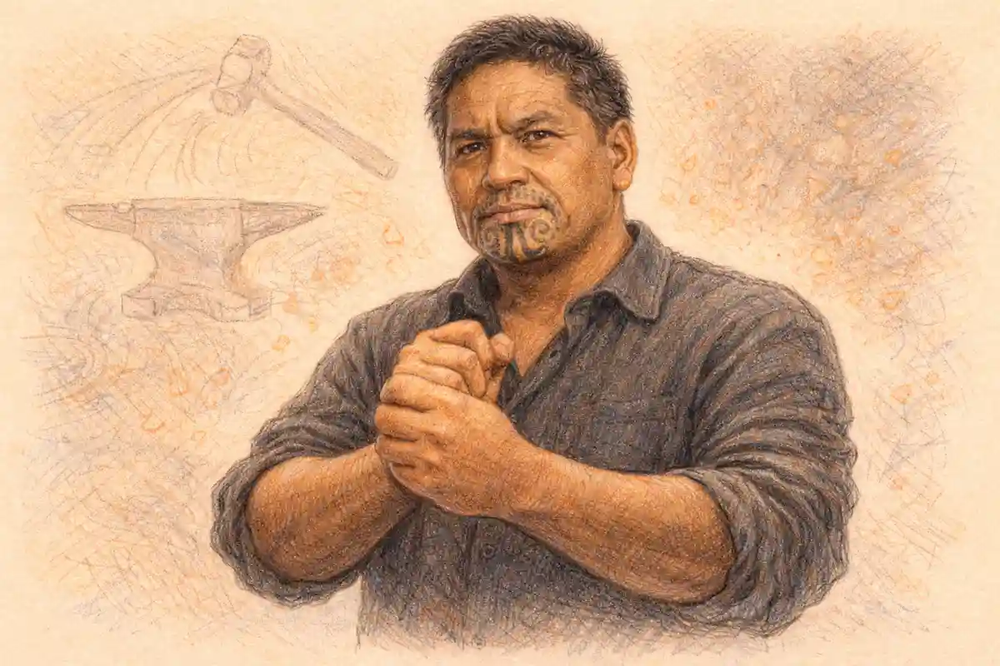

Karl Marx is the rare thinker whose life gets retold as ammunition. Admirers produce a martyr who starved in exile for the truth, detractors produce a sponger who never worked and lived off a factory owner's profits, and both portraits agree on one procedure: settle the man first, and the work can be dismissed or canonised without the inconvenience of reading it. An intellectual biography refuses that procedure. It treats the life as the record of how a body of work was made, under what pressures, with what tools, at what cost, and it judges the man where possible by the standard he set for himself. Marx, unusually, left such a standard in writing. In a letter of March 1852 to his friend Joseph Weydemeyer, then an exile in New York, he stated precisely what he claimed to have contributed to the understanding of society and precisely what he conceded to predecessors. This biography is organised around that statement. The chronology matters, because the ideas were formed in specific rooms, newspapers, libraries and lodgings, but the chronology serves the assessment rather than replacing it.

The life, in outline, is quickly told. Karl Heinrich Marx was born in Trier in 1818, studied law and then philosophy at Bonn and Berlin, took a doctorate in 1841, and became editor of a Rhineland newspaper at twenty four. Expelled from or squeezed out of Germany, France and Belgium in turn, he passed through Paris and Brussels, helped to write a famous manifesto in the winter of the 1848 revolutions, edited a revolutionary daily in Cologne until it was suppressed, and reached London in the late summer of 1849. He stayed for the remaining thirty four years of his life, working in the reading room of the British Museum, writing journalism for an American newspaper, leading an international workers' association for much of a decade, and publishing in 1867 the first volume of a critique of political economy that he never finished. He died in 1883, stateless, in a house in north London, and was buried at Highgate. Every clause of that outline conceals a question people actually ask. Did he ever work. Was he poor. Was he famous. What did he die of. What was his family's faith. Did he father a child with the household servant. This article answers those questions in their places, with the state of the evidence attached, and it keeps returning to the harder question the outline cannot answer: what, in the enormous output, was actually his.

## The self-assessment test: judging a thinker by his own claim

Most famous thinkers leave their originality to be quarrelled over by others. Marx, in one unguarded and businesslike letter, did the quarrelling himself, and the letter deserves to be better known than almost anything written about him. Writing to Weydemeyer on 5 March 1852, he explained that no credit was due to him for discovering either the existence of classes in modern society or the struggle between them. Bourgeois historians, he said, had described the historical development of that struggle before him, and bourgeois economists had described the economic anatomy of the classes. Priority belonged to them, and he surrendered it without a fight. What he claimed as new was narrower, stranger, and far more exposed to evidence. He claimed to have shown three things: that the existence of classes is bound up with particular historical phases in the development of production; that the class struggle necessarily leads to the dictatorship of the proletariat; and that this dictatorship itself constitutes no more than a transition to the abolition of all classes and to a classless society.

The self-assessment test takes that letter as its instrument. It proposes that the honest way to evaluate Marx is against his own claim rather than against everything later attributed to Marxism: not against the doctrines of parties that invoked his name, not against slogans he never wrote, not against predictions assembled from his journalism by hostile editors, but against the three propositions he signed. The test cuts in both directions, which is what makes it a test rather than a tribute. Against the detractor, it observes that attacking Marx for inventing the idea of class, or for noticing that classes conflict, attacks a claim he expressly renounced in 1852. Against the disciple, it observes that the three claims he did make are strong, specific, and vulnerable, and that loyalty consists in examining them rather than in reciting them. A thinker who hands his critics a signed list of his assertions has done something rare in the history of ideas, and biography written under the discipline of that list behaves differently from biography written as chronicle. It keeps asking, of each period, what the work of that period contributed to the three claims, and it treats the rest of the life, the earnings, the illnesses, the quarrels, the household, as the conditions under which those contributions were or were not made.

The test also explains the shape of what follows. The narrative sections trace the formation: a philosophical education in Berlin, a journalistic apprenticeship in Cologne that forced economic questions on a reluctant philosopher, a Paris conversion to political economy, a Brussels break with philosophy itself, and then three London decades in which the claims were slowly built, tested against archives, and left partly unfinished. The assessment sections then take the claims one by one and ask how each has fared, separating what Marx asserted from the evidence he offered and both from the verdicts later centuries have delivered. Readers who want the doctrines expounded in full will find the first claim treated at length in the [historical materialism complete guide](/2010/01/15/historical-materialism-complete-guide/) and the second in the [marxist theory of class guide](/2011/09/01/marxist-theory-of-class-guide/); the business here is the life, and the life is organised by the claims.

One more piece of apparatus belongs at the front, because the whole article leans on it. The three claims scorecard sets out the self-assessment in the form in which the assessment sections will use it: what was asserted, what evidence its author offered, how the claim has fared under examination, and where in this series each element receives its full treatment. The concession is included as a row in its own right, because the concession is half the test. A scorecard that recorded only the claims would flatter its subject; the surrender of priority over classes and class struggle is the control against which the three assertions become measurable.

| Element of the self-assessment | What Marx asserted | The evidence he offered | How the claim has fared | Assessed in this series |
|---|---|---|---|---|
| The concession | Classes and class struggle were described before him by bourgeois historians and economists | The writings of the French Restoration historians and of classical political economy | Universally accepted; the dispute concerns only how much he added | The three claims scorecard, this article |
| The first claim | Classes are bound to particular historical phases of production | The historical studies behind the materialist conception of history and the analysis of modes of production | The most durable of the three; the phase binding is widely absorbed, its stronger forms contested | Historical materialism and class guides |
| The second claim | Class struggle necessarily leads to the dictatorship of the proletariat | The revolutionary record of France and the experience of the Paris Commune | The most contested; the phrase is rare in his work and its institutional meaning remains disputed | The dictatorship of the proletariat article |
| The third claim | That dictatorship is a transition to the abolition of all classes | Inference from the first two claims rather than a separate body of evidence | The least examined on its own terms; stands or falls with the transition argument | Class guide and the state articles |

Read the scorecard as a contract. The biography that follows is the attempt to fill in its cells honestly: to show where the claims came from in the life, what their author actually wrote in their support, and where the support runs out. Where the evidence is strong, the article says so. Where a famous story rests on a single late letter, the article says that instead, and leaves the conclusion at the temperature the evidence can sustain. That discipline matters most in the personal sections, and it is announced here so that the reader can hold the article to it.

## Karl Marx in Trier: a household between two inheritances

Trier, where Karl Marx was born on 5 May 1818, was an old cathedral city on the Mosel that had passed from France to Prussia in the settlement after Napoleon, and the family into which he was born embodied the tensions of that transfer. His father, Heinrich Marx, born Herschel Marx, was a prosperous lawyer, a councillor of justice, an owner of vineyard plots, and a man of the Enlightenment in his reading and his conversation: Voltaire and Locke were the names his son remembered in the household. His mother, Henriette, came from the Pressburg family of Nijmegen in the Netherlands, prosperous, long lived, and by most accounts less bookish than her husband and more careful with money, a combination her son's later letters sometimes treat with impatience. Behind both parents stood a rabbinical inheritance that the father's career had required him to set aside. The paternal grandfather had been a rabbi in Trier. The maternal grandfather had been a rabbi in the Netherlands. The grandson of two rabbis thus grew up in a Lutheran household of the Prussian professional class, and the doubleness of that position, inside the establishment by profession and outside its older confessional identity by descent, is the first fact of the biography.

### Why did the family baptism matter to a law career?

Prussian law and practice closed the higher legal career to an unbaptised Jew, and Heinrich Marx, a successful advocate with official ambitions, accepted Lutheran baptism as the price of continuing to practise. The conversion was professional before it was anything else, and his children were baptised afterwards into the faith of the state.

The sequence deserves precision, because later polemic has loaded it in both directions. The father's baptism came first, in the years just before Karl's birth, when Prussian restrictions on Jewish advocates in the newly acquired Rhineland made continued practice effectively conditional on conversion. The children were baptised in 1824, Karl at the age of six. The mother delayed her own baptism until 1825, after the death of her father, a detail that suggests the decision cost her something the father's timetable did not. Nothing in the record suggests religious zeal in the household that resulted. The elder Marx's surviving letters breathe a rational, deistic respectability, and his son's schooling at the Trier Gymnasium, a state institution with a largely Catholic intake and a liberal headmaster the boy admired, completed an education in which confessional identity was a civic fact rather than a spiritual one. Karl Marx was therefore neither raised in Judaism nor formed by a devout Christianity. He was formed by a household that had traded inherited faith for professional standing within living memory, and that knew the price of the trade. Whether that experience shaped the son's later treatment of religion as a social fact to be explained rather than a truth to be argued with is a judgement biographers have made in both directions; the documentary basis for either verdict is thin, and the honest treatment records the configuration without conscripting it.

The Trier years also fixed the second inheritance, which was personal. At the von Westphalen house, a family friendly with his own, the boy knew Jenny von Westphalen, four years his senior, daughter of a senior civil servant, Ludwig von Westphalen, whose learning and conversation the young Marx valued for the rest of his life and to whom he later dedicated his doctoral dissertation. The attachment formed in adolescence survived a seven year engagement conducted largely by letter while Marx was at university and then adrift between cities, and it survived the reservations of her family about a suitor whose prospects darkened year by year. They married in June 1843, at Kreuznach, when he was twenty five and she was twenty nine, with her mother's blessing and little else in the way of settlement. Jenny Marx, who copied manuscripts, managed creditors, bore seven children, buried four of them, and shared every address of the exile, is present on nearly every page of the life that follows, and biographies that treat her as furniture fail their subject. The household that endured Soho was built in Trier drawing rooms, by two families of the same professional world, before either partner had any idea what the endurance would be for.

What Trier did not give him was economics, or any settled ambition. The schoolboy essays that survive show a reflective, ambitious adolescent writing on religion and on the choice of a profession in the elevated manner of the Gymnasium, already sceptical of inherited doctrine, already inclined to judge institutions by their effects on human flourishing. He left for university in the autumn of 1835 carrying his father's hope that he would follow the law, a fiancée he was not supposed to be engaged to, and a volume of his own poems. The distance between that departure and the editor of 1842 is the distance the next stage of the life has to explain.

## Bonn and Berlin: from law lectures to the Young Hegelians

The Bonn year, 1835 to 1836, reads in the father's exasperated letters like a cautionary tale told in advance. Enrolled in law, the seventeen year old attended few of the lectures he was meant to attend, joined a student fraternity of the convivial kind, fought or accepted the rituals of that world, accumulated debts his father found alarming, and wrote poetry at a rate that worried the household more than the drinking did. Heinrich Marx's letters from this period are documents any biographer prizes: affectionate, ironic, financially precise, and increasingly anxious that talent was being spent on everything except a career. The anxiety was justified in its own terms. Transferred to Berlin in 1836, the student did not become a lawyer in any serious sense. He became, instead, a philosopher of the most demanding school then available, and the law lectures receded to the margins of a life that had found its real curriculum elsewhere.

Berlin in the late 1830s was the capital of Hegelian philosophy in its fractious afterlife. Hegel had died in 1831, and his school had split into wings that disagreed about everything except the master's importance. The younger wing, the Young Hegelians, read Hegel against the Prussian restoration: where the official philosophy could be used to sanctify the existing order, they turned its dialectic into an instrument of criticism, of religion first and of politics increasingly. Marx entered this world through the Doctors' Club, a circle of young lecturers and writers whose leading figure was Bruno Bauer, a theologian of genuine brilliance and mounting recklessness, newly transferred to Bonn and carrying on a campaign against the Gospels' historicity that cost him his career. Marx attached himself to Bauer's orbit, absorbed the method of turning a doctrine's own categories against its settled form, and began to plan the academic career that the whole circle assumed lay ahead of its talented members: a lectureship, a journal, a school. The assumption collapsed within a few years, for him and for them, as the Prussian state under a new king moved from tolerating critical philosophy to dismantling its institutional footholds. Bauer's dismissal from Bonn in 1842 closed the university door that Marx's doctorate had been designed to open, and the shape of the life changed accordingly. What philosophy lost, journalism gained, though nobody at the time would have put it that way.

The dissertation itself, completed in 1841, took as its subject the difference between the natural philosophies of Democritus and Epicurus, the two atomists of antiquity. The choice looks recondite and was in fact pointed. Epicurus had been dismissed for two thousand years as Democritus's inferior copyist; Marx argued, with formidable philological apparatus, that the swerve Epicurus introduced into the atom's fall was a philosophical innovation of the first order, the insertion of contingency and self determination into a deterministic system. Readers alert to biography will notice the theme: a young philosopher vindicating the thinker who made room for freedom inside necessity. The examiners at Jena, to whom the work was submitted, awarded the doctorate in April 1841. What matters for the life is the method the dissertation displays, an exhaustive comparison conducted through the internal logic of the systems compared, and the dedication, to Ludwig von Westphalen, in terms of warm intellectual gratitude. The future author of a critique of political economy entered the world credentialed as a classical philologist of philosophy, which is worth remembering when the myth of the economics doctorate surfaces; his doctorate was in philosophy, on a topic in ancient thought, and the economics came later and by a harder road.

### Why was the doctorate taken at Jena rather than Berlin?

Berlin had turned hostile to the circle around Bruno Bauer, whose dismissal was already being prepared by a conservative ministry, and a Berlin examination promised delay and political scrutiny. Jena examined in absentia, moved quickly, and awarded the degree in April 1841 on the dissertation alone, without requiring residence or a public defence in person.

Jena's procedure was a known convenience of the period: a university willing to examine a submitted dissertation without the residence, fees and ceremonial disputation that Berlin required, and to do so at speed. For a candidate whose patrons were falling under official suspicion, whose family funds were not unlimited, and whose Berlin teachers included men the ministry was actively moving against, the calculation was straightforward prudence rather than evasion. The degree was real, the dissertation was substantial, and the route taken to it was the route of a man who had begun to understand that institutions decide questions before arguments are heard. That understanding, learned in the small change of an academic career, deepened sharply in the next two years. The aspiring lecturer became a newspaper contributor in the spring of 1842, writing for a new Cologne daily that stood for the Rhineland's commercial liberalism against Prussian tutelage, and by October of that year, at twenty four, he was its editor. Philosophy had given him a method. The newspaper was about to give him a subject he had not chosen and could not put down.

## The Rheinische Zeitung: an editor discovers economic questions

The Rheinische Zeitung, founded in Cologne at the start of 1842, was financed by Rhineland businessmen who wanted a voice for their province's commercial interests and a counterweight to the conservative press of Berlin. Its politics were those of educated liberalism: constitutional reform, freedom of the press, rational administration, suspicion of the old landed order. Marx began contributing in the spring, with a defence of press freedom against the Prussian censorship instructions that already showed his signature procedure, taking the government's own stated principles and exhibiting the distance between them and its practice. In October 1842 he became editor. The paper's circulation rose, its tone sharpened, and its editor, still in his middle twenties, learned the trade of daily polemic under legal threat, managing contributors, censors and proprietors whose enthusiasm for criticism cooled as the authorities pressed. The Prussian government, having first imposed a double censorship, ordered the paper suppressed at the end of March 1843. Marx resigned shortly before the end, hoping in vain that his departure might soften the blow. It did not, and his first editorship closed with the paper.

### Did Marx ever have a job?

Yes. He edited a Rhineland newspaper in his twenties and worked for over a decade as the European correspondent of an American daily, producing hundreds of articles. He was also supported financially by Engels for much of his London period.

The editorship matters to the intellectual biography out of all proportion to its seventeen months, and the reason is given by Marx himself. In the preface to his 1859 work on political economy, looking back over his formation, he described the Rheinische Zeitung period as the moment when he first found himself in the embarrassing position of having to discuss what were called material interests. Two episodes forced the discussion. The Rhineland provincial assembly debated a law on thefts of wood, which converted the gathering of fallen branches, a customary right of the poor, into a crime against property, and the young editor who had arrived armed with philosophy found himself writing about peasants, forest owners and the state's partiality with no philosophical doctrine adequate to the facts. Then, in the winter that followed, the condition of the Mosel winegrowers, ruined by prices and official neglect and then traduced by the administration they petitioned, required defence against a government spokesman, and again the operative questions were economic: markets, taxation, bureaucratic interest. His own verdict on the episode, delivered sixteen years later, was that these encounters first pushed him from pure politics toward economic relations, and toward the study that occupied the rest of his life. Biographers have tested the self account against the articles and found it broadly accurate, with the usual discount for retrospective tidiness. The wood theft articles really do show a mind discovering, in public and in embarrassment, that law serves interests it does not confess.

### What did the wood theft debates force the young editor to confront?

Reporting the Rhineland assembly debates on a law that criminalised gathering fallen wood, Marx found peasants treated as thieves for exercising customary rights, and found his philosophical vocabulary unable to say why. The embarrassment he confessed in print years afterwards pushed him toward the study of material interests and political economy.

There is a second lesson the Cologne months taught, quieter and equally permanent. Running a newspaper under censorship is an education in the difference between formal freedom and the material conditions of speech: presses cost money, proprietors have interests, distributors can be frightened, and the state governs expression as much by administrative pressure as by prohibition. The editor who learned that lesson carried it into his later analyses of ideology and of the press itself, where the question is never only what may be said but who owns the means of saying it and under what constraints the saying occurs. He also acquired the working habits of a professional writer: copy against a deadline, sources checked against documents, an opponent's argument mastered before it is answered. When the detractor's caricature claims that Marx never worked, the Cologne record alone refutes it, a young editor producing leaders, conducting controversies and managing a suppression crisis, in a job that ended not because he abandoned it but because the Prussian state abolished it.

## Paris: the turn to political economy and the meeting with Engels

Marx left Germany in the autumn of 1843, married, unemployed, and invited to co-edit a new journal in Paris, the Deutsch-Französische Jahrbücher, which was to unite German philosophy with French politics. Before Paris there was Kreuznach, his wife's family's town, where the summer of the marriage was spent in intensive reading: history of the French Revolution, political theory, and above all Hegel's philosophy of right, which he annotated in a long critical manuscript that remained unpublished in his lifetime. The Paris journal managed a single double issue, in February 1844, before collapsing over money and principle, but that issue contained two of his essays that readers still meet first. One, on the Jewish question, answered Bruno Bauer's treatment of Jewish emancipation and argued, in a text whose vocabulary and verdicts scholars continue to dispute, that political emancipation by the state falls short of human emancipation from the powers that dominate civil society. The other, an introduction to the critique of Hegel's philosophy of right, relocated the criticism of religion within a criticism of the world that produced it, and looked to a class with nothing to lose as the agent of a transformation philosophy could only describe. Whatever verdict a reader reaches on these essays, their direction is unmistakable: away from the philosophy faculty, toward society, its classes and its material arrangements.

Paris gave the turn its instruments. The city held the most advanced socialist movements in Europe, the exile communities of several nations, and a reading public for political economy that Germany lacked. Marx read the economists in earnest there, Smith, Ricardo, Say, Sismondi and the rest, filling notebooks with extracts and comments that grew into the manuscripts of 1844, in which the concept of alienated labour received its first extended treatment: the worker separated from the product, from the activity, from other people and from the human capacities the work was supposed to express. Those manuscripts, unpublished until the twentieth century, show the economist being built on the philosopher's foundations, the Hegelian categories made to carry factory evidence. Paris also gave him the collaborator. Friedrich Engels, two years younger, son of a Barmen textile manufacturer with a mill at Salford, stopped in Paris at the end of August 1844 on his way home from England, where he had been studying both the family business and the condition of the English factory districts at first hand. The two had met briefly and coolly in Cologne. In Paris, over days of conversation at the Café de la Régence, they discovered the extent of their agreement.

### What did the Paris conversations with Engels actually settle?

The two men discovered in extended conversation that they had reached the same conclusions by separate roads, Engels through English political economy and factory observation, Marx through philosophy and French politics. They resolved to work out the shared position together and to settle accounts with their former philosophical conscience, which produced their first joint manuscripts.

Engels brought what Marx lacked and knew he lacked: direct knowledge of English industry, of the factory as a working institution, of the economists in their native tongue, and of the English workers' movement at its strongest. He had already published an outline of a critique of political economy that treated the economists' categories as expressions of a society built on private property, and Marx rated it highly. The partnership that formed in Paris lasted until Marx's death thirty nine years later, and it was from the start a division of labour between unlike instruments: the systematic theorist in the library and the observer of industry with a businessman's training, each supplying the other's deficiencies. Their first products were polemics, a joint attack on their former Young Hegelian associates written that winter, but the real settlement of Paris was intellectual property of a different kind: a shared conviction that the criticism of society had to begin from its economic organisation, and that philosophy, their common mother tongue, was the obstacle as much as the tool. The Prussian government then exported the problem. Under pressure from Berlin over the exile press, France expelled Marx at the start of 1845. He chose Brussels, close to three frontiers and cheaper than Paris, and Engels followed within months. The Paris period had lasted fifteen months. It had changed a philosopher into something for which no settled name yet existed.

## Brussels: the break with philosophy and the Manifesto commission

Brussels, from February 1845, was the workshop in which the position announced itself. Marx, required by the Belgian authorities to pledge himself against publishing on politics as a condition of residence, renounced his Prussian citizenship at the end of 1845 and became the stateless man he remained for the rest of his life. In the spring of that year Engels joined him, and the two made a study trip to England, Manchester and London, where Marx encountered the Chartist leaders and the holdings of the Manchester libraries. Out of that spring came a short set of theses on the philosopher Feuerbach, written in a notebook and published only after Marx's death, which compressed the break with contemplative philosophy into a handful of propositions about practice, and closed with the most quoted sentence either man ever wrote, an eleven word verdict on philosophers and the point of the enterprise. The sentence is quoted so often, and so often without its argument, that readers hunting the genuine article among the fabrications will find help in the [misattributed marx quotes](/2013/08/15/misattributed-marx-quotes/) survey elsewhere in this series.

The theses were a sketch. The expansion occupied the two men through 1845 and 1846 in a manuscript of several hundred pages, directed against the post Hegelian philosophy of their former associates and setting out, for the first time systematically, the conception of history on which the first of the three claims rests: that human beings produce their means of subsistence before they can make history, that the organisation of production shapes the division of labour, property forms, political institutions and reigning ideas, and that classes and their conflicts belong to definite stages of that development rather than to human nature as such. Unable to find a publisher, they abandoned the manuscript, in the famous later phrase, to the gnawing criticism of the mice, content that its purpose, self clarification, had been achieved. The self clarification was real. When the manuscript finally reached print in full in the twentieth century, it showed the first claim of the 1852 letter already assembled in Brussels, six years before the letter conceded everything else to predecessors. What predecessors had supplied was the existence of classes and their struggles. What the Brussels manuscripts added was the binding of both to phases of production, which is exactly the boundary the self-assessment test draws.

The Brussels years were not spent only at the desk. A correspondence committee linked socialist groups across frontiers; a public quarrel with Proudhon produced in 1847 a systematic demolition of the French writer's attempt to marry political economy to Hegelian dialectic, written in French and published in Paris and Brussels; and a small German workers' organisation, refounded as the Communist League, held two congresses in London in 1847 at which the two men's position prevailed over rival doctrines of conspiracy and utopia. The second congress commissioned them to draft the League's programme. The result, written in Brussels across the winter and published in London in February 1848 as revolutions began to ignite across the continent, was the Manifesto of the Communist Party. Its literary force is a matter of record; its place in the biography is as the last product of the formation years, the moment when the theory assembled in exile was handed to a movement and the revolutions handed the theorists a continent in motion. Within weeks Marx received a substantial inheritance on his father's estate settlement, shared part of it with the cause and with needy exiles on the accounts given by contemporaries, and was expelled from Belgium as the February revolution in Paris raised official fears. He went to Paris at the invitation of the provisional government, which honoured the exile the monarchy had expelled, and then, in April, to Cologne, where money was raised for a democratic daily and the two men prepared to edit a newspaper in a revolution.

## Cologne and the road into exile

The Neue Rheinische Zeitung began publication on 1 June 1848, with Marx as editor in chief and Engels among its editors, backed by Rhineland democrats and shareholders whose nerves the paper's line tested monthly. It was, by the standards of the German revolution, a remarkable instrument: reported from the revolutionary capitals by correspondents who included working poets and future generals, argued with a precision its rivals resented, and committed to a democratic republic as the terrain on which the social question would be fought out. Its editorials on the June days in Paris, when the French republic shot down its own workers, cost the paper shareholders and taught its editor the anatomy of class politics in real time. The Prussian counter revolution closed in by stages: a state of siege in Cologne, warrants, prosecutions of the editors for the paper's tax resistance campaign and its reporting, and in February 1849 two jury trials at which Marx defended the paper's position in speeches the juries accepted, acquitting him on both counts. The acquittals changed nothing structural. In May 1849 the government expelled him from Prussia on the ground that he had forfeited his citizenship years before and abused his permission to reside. The paper's last issue, printed in red ink on 19 May 1849, bade farewell to its readers with its position unstated nowhere and its debts considerable. Engels went south to join the armed rising in the Palatinate and Baden, and escaped to Switzerland when it failed. Marx went to Paris.

### Why did the exile route end in London rather than Paris?

Paris closed to him by an expulsion order that offered internal banishment to Brittany as the alternative, and the German states closed by his expulsion from Prussia as a stateless former subject. London asked no permission of residence, policed opinion lightly by continental standards, and held the library and the exile communities his work required.

Paris in the summer of 1849 was under the rule of a republic turning conservative, and the new arrival was ordered within weeks to remove himself to the Morbihan in Brittany, a malarial posting understood on all sides as internal banishment, or to leave France. He left, at the end of August, for the one European capital that admitted political refugees without a residence regime of the continental kind and did not expel them at the request of foreign courts. The choice of London is sometimes narrated as destiny, the theorist arriving at the capital of capital. The record shows something more prosaic and more interesting: a sequence of doors closing, Prussia by expulsion, Belgium by expulsion, France by expulsion order, and one door that stayed open because British practice, for all its surveillance of refugees and its occasional panics, did not operate the machinery of political expulsion in the continental manner. Three expulsions by three states also dispose of the myth that Marx was an obscure nonentity in his lifetime; governments do not expel nonentities serially across a decade. What London offered besides safety was the British Museum, the largest newspaper market in the world, and the densest exile community in Europe, assets whose value the next sections take in turn. He arrived expecting, like nearly every exile of 1849, that the stay would be brief and the revolution renewed within a year or two. He died there thirty four years later, having crossed the Channel a handful of times and never lived anywhere else again.

## Soho: poverty, bereavement and the price of the work

The London that received the family in 1849 was not the London of the later, comparatively settled addresses. After temporary lodgings and an eviction in Chelsea, the household settled at the end of 1850 at 28 Dean Street in Soho, two rooms in a house in a street of tailors, refugees and small trades, and stayed there for six years. The rooms, described in a Prussian police spy's report with a hostile precision biographers have had no reason to correct, held a family that would number seven in a space designed for a couple, with furniture broken, crockery chipped, manuscripts and children's toys competing for the same table, and a general air, the spy conceded, of bohemian intellectual disorder rather than squalor. A police agent's testimony is evidence of a particular kind; it is worth noting that even this unsympathetic observer recorded conversation, hospitality and a household organised around work. The material record underneath the description was hard. Marx's income in the early London years came from journalism that paid irregularly and from advances against work not yet written, while the exile organisations consumed time and money he did not have. The pawnbroker appears in the correspondence as a recurring character: the family silver, Jenny's inherited plate with the Argyll crest, coats, shoes and at one point the children's footwear went in and out of pledge, and letters to Engels in Manchester report, with a forced humour that does not conceal the fact, weeks in which bread and potatoes were the diet and the rent was months behind.

### How close did the Soho household come to collapse?

Close enough that the bailiff and the pawnbroker were recurring figures, that rent went unpaid for months, and that a visit from a landlord's agent could be recorded in the correspondence like a military event. What prevented collapse was not earnings but credit, small inheritances, Jenny's management of scarcity, and remittances from Manchester.

The bereavements belong in the same ledger, recorded here factually, as the brief discipline of this article requires, without pathos and without omission. Of the seven children born to the marriage, four died young. Heinrich Guido, born in 1849, died in convulsions in November 1850, in the first Dean Street winter. Franziska, born in 1851, died of bronchitis in April 1852; the family's destitution at that moment was such that the coffin money had to be sought from a fellow exile, a detail recorded in correspondence and repeated by every serious biography because it is documented, not because it is moving. Edgar, the son known in the family as Musch, died in April 1855 at the age of eight, in his father's arms by the family's account, after a decline the letters chart week by week; his father's grief in the letters to Engels is unrestrained and is generally treated by biographers as a turning point in the man's emotional weather. A seventh child, born in 1857, did not survive the birth. Three daughters lived: Jenny, Laura and Eleanor, each of whom enters the later story as copyist, translator, activist and, in Eleanor's case, the guardian of the papers. Child mortality on this scale was not exceptional in the London of the 1850s, in Soho least of all, and the article makes no claim that the family's losses were unusual. What the losses did, measurably, was consume the same years, the same rooms and the same small income as the research programme, and they belong in an intellectual biography for a strictly professional reason: the work that produced the claims of the self-assessment was done in this household, at this table, between these events, and any account of why it took the time it took that omits them is incomplete as scholarship.

Jenny Marx's own record of the decade, a short memoir written later for the family, describes the Dean Street period with a restraint that matches the letters. Her role was not decorative. She was the household's administrator of scarcity, its negotiator with landlords and tradesmen, and the copyist whose hand produced the fair manuscripts from drafts that visitors described as nearly illegible, a labour without which the journalism and eventually the great book would not have reached printers in usable form. She also brought assets the ledger should record: an inheritance on her mother's death in 1856, modest in size, which together with a legacy that reached Marx from his own mother's estate arrangements in the following years, lifted the family out of Dean Street in the autumn of 1856 to Grafton Terrace in Kentish Town. The relief was real and temporary. The pattern of the Soho years, income irregular, expenditure committed, research expanding to fill every available hour, reasserted itself at each new address until the financial settlement of the late 1860s changed its terms. Poverty, in this biography, is therefore neither a badge nor a reproach. It is a variable, with documented values, that explains the pace and the shape of the work.

## The British Museum decades: the economist at the reading room desk

From June 1850, when he took out his reader's ticket, until the last years of his life, Marx's workplace was the British Museum. The great round Reading Room, opened in 1857, gave him a desk among the largest concentration of printed material in Europe: the parliamentary papers and official blue books in which British capitalism documented itself, the factory inspectors' reports, the economists from the seventeenth century forward, the newspapers of three countries, the historical literature of France and England. His routine, described by his son in law Paul Lafargue and confirmed across the correspondence, was architectural in its regularity: the Museum from nine in the morning until seven in the evening in the working years, then the home desk in Maitland Park Road until two or three in the morning, sleep compressed, meals treated as interruptions. The notebooks accumulated into the hundreds. Anyone assessing the first claim of the self-assessment, the binding of classes to phases of production, has to reckon with this evidentiary base: whatever the claim's merits, it was not spun from a slogan but assembled from two decades of extraction, in a library, from the records of the society under examination.

### What did the reading room make possible that no post could?

It gave an exile without chair, salary or institutional standing free run of the largest working collection in Europe, official reports and blue books included, on a ticket renewed by routine. Decades of daily attendance converted access into an archive, and the archive into the evidentiary base on which the critique of political economy rests.

The 1850s in the Museum were years of systematic retooling. The exile politics of the emigration consumed the first years, feuds and trials included, but the reading went forward underneath: political economy resumed from the beginning, the history of economic doctrines, agronomy, technology, geology as the arguments required it. When the commercial crisis of 1857 broke, the first in which the world market convulsed as a single system, Marx worked at night at a pace his letters describe as frantic to set down the theoretical whole before the crisis could expose its gaps, and the result was the vast manuscript of 1857 and 1858 known to later readers as the Grundrisse, a private quarry of drafts in which the mature method is visible under construction. From the quarry came the first published instalment, the Contribution to the Critique of Political Economy of 1859, whose preface contains the compact statement of the materialist conception of history against which the first claim is usually tested, and whose reception, a near silence broken by Engels's review work, disappointed its author sharply. The disappointment taught the same lesson as the suppression of 1843, in a lower key: the book that mattered would have to be the whole critique or nothing. The eight years that followed were given to it, through drafts of 1861 to 1863 that contain the history of economic theory as a by product, and through the fair copy labours of 1865 and 1866. In September 1867 the first volume of Capital appeared in Hamburg, in German, in an edition of a thousand copies. Its author was forty nine. The self-assessment's claims now had their principal evidence in the world, and the biography's centre of gravity shifts accordingly, from the making of the economist to the testing of what he made.

## The Tribune years: journalism as income and as training

In August 1851 Charles A. Dana, managing editor of the New-York Daily Tribune, then the largest circulation newspaper in the United States, invited the London exile to become its European correspondent. The invitation, which came through the exile networks, began the longest employment of Marx's life and disposes by itself of the legend that he never worked. The Tribune paid by the article, used what it wanted, cut what it did not, and printed a considerable share of the contributions unsigned as leaders, practices its correspondent resented and recorded. The early months of the engagement expose the partnership's mechanics with unusual clarity: Marx's written English was not yet fluent enough for weekly copy at newspaper speed, and the first series published under his name, an account of revolution and counter revolution in Germany, was written by Engels in Manchester from Marx's brief. As the London partner's English strengthened, the arrangement inverted into its mature form, Marx writing the political and economic correspondence and calling on Engels for the military articles, on which the Manchester partner, a genuine student of warfare, delivered copy that newspapers on two continents respected. For over a decade the file continued, through the diplomacy of the Crimean War, the Indian revolt of 1857, the movements of Italian unification, the politics of Spain, the economics of successive commercial crises, and the opening of the American Civil War, on which the correspondent's line, hostile to slavery and sceptical of the European governments' neutrality, was consistent and early. In 1862 the Tribune, retrenching in wartime and shifting its centre of gravity to American affairs, dispensed with its European correspondent.

The honest accounting of this employment has to hold two truths at once, since polemic usually keeps only one. The first truth is that the Tribune work was a job, held for more than a decade, at piece rates that biographers commonly report at two pounds an article in the engagement's earlier years and better thereafter when the correspondence ran twice weekly: an income real, earned and inadequate, which at its height covered a substantial part of the household's costs and at its frequent interruptions covered almost nothing, because the paper's use of the copy was erratic and payments arrived in arrears. The second truth is that the job was also the man's continuing education and his intelligence service. A correspondent required to explain European affairs to American readers every week cannot afford a vague theory of those affairs; the file forced its author to master diplomacy, military organisation, public finance and the politics of countries from Spain to India, and the mastery is visible in the economics, where the factory reports and the crisis literature meet a writer already trained to read a balance of forces. He wrote besides for other papers when openings offered, including the Chartist press in England, and the aggregate of the journalism runs to hundreds of articles across the decade, a body of work that historians of the period mine independently of the theory. The division the extra question in this article's FAQ poses, between Marx the journalist and Marx the theorist, is therefore a false partition if it is drawn as a wall. The journalism was the theory's fieldwork, income and discipline at once, and the separation a biographer should enforce is between the journalism's datelines and deadlines, which belong to their occasions, and the claims of the self-assessment, which the journalism fed but did not by itself establish.

## Engels's money and the household economy

No part of the life attracts cheaper commentary than the subsidy, and none repays exact treatment more. The facts, in sequence, are these. Engels, from 1850, worked in Manchester at Ermen and Engels, the cotton firm in which his father was a partner, rising over two decades to a partnership of his own. From that salary and then that partnership he sent money to London across thirty years: single remittances against crises, five pound notes cut in half and posted in separate envelopes against theft, regular support in the leanest years, and settlement of specific debts at moments when the household's credit failed. In 1864 the death of Wilhelm Wolff, the Silesian schoolmaster and comrade of the Brussels years who had prospered modestly in Manchester exile, brought Marx a legacy biographers commonly put at about eight hundred pounds, the first sum in the life large enough to change the arithmetic; the dedication of the first volume of Capital to Wolff records what the friendship and the rescue meant. In 1869 Engels sold his partnership share and retired from business, and from the proceeds he placed the London household on a settled footing, an allowance biographers commonly report at three hundred and fifty pounds a year, which for the first time in the marriage separated the work's economics from the week's housekeeping. Marx's letters of that summer do not hide the relief: the debts were audited, the worst of them cleared with Engels's help, and the remaining fourteen years of work proceeded on an income that was modest, middle class and secure.

Was the support charity, partnership or patronage? The categories matter less than the terms, and the terms are documented. Engels regarded the arrangement, in his own stated view, as the better use of his commercial exile: the firm consumed his days precisely so that the critique could consume Marx's, and he described the division without self pity, as a bargain in which he had taken the desk in the counting house in exchange for the other desk's freedom. The correspondence shows no trace of the relationship curdling over money across thirty years, a record that would be remarkable between brothers and is between collaborators perhaps unique. Critics who present the subsidy as hypocrisy, the theorist of exploitation maintained by mill profits, should be answered with the observation the record supports: the arrangement was open, acknowledged in print by dedications and prefaces during both men's lives, and understood by both parties as a division of labour in a joint enterprise whose product was the work. Readers can weigh the ethics of the funding source as they would any patronage; what the evidence does not sustain is concealment, reluctance on the donor's side, or idleness on the recipient's. The man supported by the subsidy was producing, across the same years, a correspondence file for an American newspaper, the archive of an international association and a book of a thousand pages revised through the night hours. How the money and the health together governed the writing schedule is a question the FAQ below takes up directly, and the illness sections ahead supply the darker half of that account.

## The first claim assessed: classes bound to phases of production

The first claim is the one the Brussels manuscripts assembled and the 1859 preface stated in public: classes are not eternal furniture of society but formations bound to particular historical phases in the development of production, arising with definite relations of production, flourishing with them, and dissolving when those relations are superseded. Marx's evidence for it, offered across the work, was of three kinds. There was the historical evidence of the French and English records, in which the classes of feudal society, its orders and estates, could be watched transforming into the classes of bourgeois society as production was reorganised, rather than persisting beneath the political changes as timeless categories. There was the analytical evidence of the critique of political economy, which derived the modern classes from the structure of the capital relation itself, wage labour and capital defining each other and neither intelligible outside the phase of production that generated both. And there was the negative evidence against predecessors: where the historians he conceded priority to had described class struggles as episodes in a political narrative, their descriptions stopped at the surface of each phase, because the question of why this phase had these classes was not one their method asked.

How has the claim fared? Better than its two companions, by the general verdict even of unsympathetic scholarship, and the scorecard records the outcome in those terms. The phase binding, the proposition that class structures are historical products with dates of birth and conditions of dissolution, has been absorbed so thoroughly into historical sociology that its origin is often forgotten, and historians who would reject every other element of the inheritance write class history in its grammar. The stronger forms of the claim have fared worse and the article records the damage without varnish. The derivation of a society's whole class map from its production relations proved too coarse for the records it met: status orders, confessional divisions, bureaucratic strata and the peasantry's stubborn persistence all required qualifications the framework supplied slowly or not at all, and the prediction embedded in the mature work, that intermediate strata would simplify into two great camps, was contradicted by the growth of the salaried middle layers that became the twentieth century's characteristic class problem. The self-assessment test handles this mixed record in its own way. It notes that the claim, as stated in 1852, asserts a binding and a historicity, not a two class terminus; the simplification thesis belongs to the Manifesto's rhetoric and to passages of the larger work, and a verdict on the letter's claim should not smuggle the pamphlet's exaggerations into the indictment. Judged strictly, the first claim survives as the durable core of the inheritance, which is why this series gives it two full treatments, the [historical materialism complete guide](/2010/01/15/historical-materialism-complete-guide/) for the conception of history and the [marxist theory of class guide](/2011/09/01/marxist-theory-of-class-guide/) for the class analysis proper.

## The second claim assessed: struggle, necessity and the dictatorship phrase

The second claim is where the self-assessment is most exposed, and the biography must say so in the plainest terms available to it. Marx asserted that the class struggle necessarily leads to the dictatorship of the proletariat. The phrase itself is rare in his published work: it appears in the analysis of the French struggles of 1848 to 1851, in the programme criticism of 1875 where the political transition period is named, and in a handful of letters, of which the Weydemeyer letter is the most programmatic. Against the rarity stands the weight later movements placed on it, and against the later weight stands the biographical record of what its author appears to have meant. The one historical case he analysed at length as its approximation, the Paris Commune of 1871, was a radically democratic construction: universal suffrage, revocable delegates, officials at workmen's wages, the standing army abolished. Whatever else the Commune government was, it was not a party dictatorship of the kind the twentieth century built under the phrase's licence, and Marx's account of it, written as an address of the International while the fighting's outcome was still being counted in executions, praised precisely its democratic mechanics. The full textual record is assembled in this series' treatment of the [dictatorship of the proletariat](/2013/01/01/dictatorship-of-the-proletariat/), and readers should test the summary given here against it.

The necessity in the claim is the vulnerable joint, and it should be pressed. Between a class struggle and its alleged necessary outcome stand all the outcomes history actually delivered: compromise, exhaustion, reaction, fascism, welfare settlements, and revolutions that produced regimes their inspirer's criteria would not have recognised. The historical Marx himself, in his journalism and his French histories, analysed defeats and stalemates with unmatched precision; the strategist of the conjuncture knew that nothing in politics arrives by necessity, and the tension between the analyst's practice and the letter's modal verb is internal to the work, not an invention of hostile editors. Defenders reply, at their strongest, that the necessity claimed is conditional and tendential: given the phases argument of the first claim, a society whose classes are bound to a superseded production order cannot stabilise permanently, and some political form of transition is necessary in the sense that the contradiction admits no permanent solution short of it. Critics answer that a necessity so qualified has been emptied of the predictive content the word promised, and that the history of the phrase's career, its service as legitimation for regimes that suppressed the class in whose name they ruled, is itself evidence about the claim's fitness for the world. The scorecard's verdict stands as written: of the three claims, this is the most contested, and the contest is honest on both sides. The biography's duty is discharged by separating the man from the career of his phrase. He used it rarely, defined it by a democratic example, and never governed anything. The regimes that governed in its name belong to the third claim's assessment and to other articles of this series, not to the debit column of a life that ended in 1883.

## The third claim assessed: the transition and the classless horizon

The third claim completes the letter's logic and carries the least independent evidence of the three, a fact its author's presentation half concedes. If classes are bound to phases of production, and if the struggle of the last class society issues in a transition in which the working class holds political power, then that transition, on the argument, is itself only a passage: the dictatorship of the proletariat constitutes no more than the transition to the abolition of all classes and to a classless society. The claim is an inference wearing the dress of a finding. No archive of 1852, or of 1883, contained an observed instance of a class abolishing itself through a transitional state, and the evidence Marx offered elsewhere, the Commune's mechanics again, the remarks on the realm of freedom in the third volume's drafts, the programme criticism's sketch of a society in which distribution by need replaces distribution by labour, is evidence about the transition's intended direction, not about its destination's attainability. Biographers and critics who treat the third claim as a prophecy falsified by the twentieth century and defenders who treat it as a horizon betrayed by that century are, from the standpoint of the self-assessment test, making the same error in opposite signs: both judge the letter's inference as though it were the letter's observation.

What can be said on the evidence is narrower and worth saying exactly. The claim did real work inside the theory: it distinguished its author's position from every doctrine of a permanent revolutionary state, and it set a criterion, the withering of class and therefore of the state as a separate power, by which later regimes claiming the inheritance could be and were measured by critics inside the tradition itself. It also carried a structural risk the biography should name, because the life illustrates it: a transition defined only by its destination has no internal timetable and no failure condition, and a politics organised around it can defer its own verdict indefinitely, a deferral whose human costs the century after Marx's death documented at a scale he did not live to imagine. The concession demanded by the objection considered later in this article belongs here in embryo. The distance between the third claim as an inference of 1852 and the uses made of the transitional formula by states that never transitioned is a real historical question, addressed elsewhere in this series in the treatments of the state; it is not discharged by repeating that Marx meant something else, and it is not advanced by pretending he meant what was done. The scorecard records the claim as the least examined of the three on its own terms. That neglect, given the claim's career, may be the most surprising finding of the whole assessment.

## The International and the measure of his fame

In September 1864, in St Martin's Hall in London, a meeting of English and French working men founded the International Workingmen's Association, and Marx, present as a German workers' representative, was elected to its General Council and became within weeks its organising intelligence: he drafted its inaugural address and its provisional rules, conducted much of its correspondence, and wrote the addresses through which it interpreted strikes, wars and revolutions to its affiliated societies. The International was never the disciplined world party of police imagination; it was a federation of unions, exile groups and local societies, chronically short of funds, and held together substantially by the correspondence labour of the man at its centre, work performed in the evenings of the same years that produced the first volume of Capital. Its high marks in his lifetime were the solidarity it organised across frontiers during strikes, its growth after the Franco Prussian War, and the notoriety that fell on it and on him after the Paris Commune of 1871, when the European press, persuaded that the Commune had been directed from London, made the theorist of Dean Street's successor addresses into the alleged mastermind of revolution, a sinister celebrity he exploited for the organisation's prestige and corrected, in private, with some irony about the honour of directing events he had in fact advised against timing. The association's internal war with the anarchist federation around Bakunin ended at the Hague Congress of 1872 with the anarchists expelled and the General Council transferred to New York, a victory Marx engineered to keep the body from falling into hands he distrusted, at the price of its effective life in Europe. He withdrew thereafter to the book, his health broken in part by the decade of organisational nights.

Fame, then, requires a scale, and the scale has three bands. Inside the international workers' movement, Marx in his last fifteen years was a commanding figure: corresponded with by activists on three continents, his book translated and quarried, his arbitration sought in disputes from the English unions to the Russian populists who consulted him, near the end, on whether Russia's commune might spare it the capitalist road. In the wider public world he was notorious rather than known: a name in the newspapers attached to the International and the Commune, feared in ministerial memoranda, caricatured in the illustrated press, and read by a public for his book that remained, in England especially, small and mostly hostile or puzzled. The third band is the one posterity supplies and biography must discount: the statues, the currency portraits, the compulsory citations, all posthumous and all useless as evidence about the lifetime. The verdict the record supports is the middle one. He was famous the way the head of a feared international is famous, and obscure the way a German economist without a chair, a party or a readable English edition is obscure, and both conditions held simultaneously until his death. What evidence would revise that picture is a question this article's FAQ takes up in form; the short answer is that the picture rests on press coverage, police files, circulation figures and correspondence, and would yield only to evidence of the same kinds pointing the other way.

## The Demuth question: evidence, status and the limits of both

The question whether Marx fathered a child with the household servant is asked too often, in too confident a tone on both sides, for a responsible biography to pass it by, and it is handled here under the rule announced at the outset: the evidence and its status, stated; no verdict the evidence cannot carry. The persons first. Helene Demuth, known in the household as Lenchen, came to the Marx family in 1845 as a young woman sent from Jenny's mother's household, and remained its domestic mainstay through every address of the exile until Marx's death, thereafter keeping house for Engels until her own death in 1890. She was, on the testimony of everyone who recorded an impression, the person who actually ran the household whose finances this article has described, and the family's dependence on her was total and acknowledged. In June 1851 she bore a son, Frederick, who was fostered with a working class family in London, took the surname Demuth, became a skilled worker and a trade unionist, visited the Marx household in later years in circumstances Eleanor Marx treated as familial, and died in 1929 having maintained, so far as the record shows, a guarded silence about his paternity.

### Where does the evidence for the Demuth claim actually rest?

It rests principally on a letter written in 1898 by Louise Freyberger, Engels's housekeeper, reporting that Engels on his deathbed had named Marx as the father of Helene Demuth's son. Around that single late document scholars arrange corroborating circumstances and counterarguments, which is why the claim is widely accepted and still honestly described as contested.

The structure of the evidence should be understood, because the argument about the question is mostly an argument about structure. There is no contemporary document: no letter of 1851, no entry in the correspondence of two men who confided nearly everything to paper, names the child's father. What exists is a chain of later testimony. Eleanor Marx, who learned something in the 1890s that reorganised her understanding of her father's household, behaved thereafter in ways her letters partially disclose. The explicit statement survives in the 1898 letter from Louise Freyberger to August Bebel, in which she reported that Engels, dying in 1895, had wished the record cleared of the version that protected Marx by assigning the paternity to Engels himself, and had stated that the father was Marx. Around that document the scholarship divides in a pattern readers should recognise from other single source problems. A majority of modern biographers accept the claim, some as established, more as the best supported reading: the letter's existence and provenance are not in dispute, its author had no obvious interest in inventing the story, and circumstantial details, the fostering arrangements, Frederick's reception in the family, Engels's known willingness to absorb the imputation during Marx's life, align with it. A minority of scholars withhold assent, on grounds that are also stated plainly in the literature: the letter is late, second hand, and uncorroborated in its central assertion; the deathbed scene is a literary shape that should raise a researcher's guard; and the principals who could confirm or deny it were all dead before it was written. This article's treatment follows from the brief it was set: the claim rests principally on the 1898 letter, it is widely but not universally accepted, and both the acceptance and the reservation are rational responses to the same thin file. What the question does not do, on either answer, is alter the assessment of the work, and readers who meet it used as a refutation of the economics or as a scandal to be suppressed in defence of the economics are watching the genetic fallacy at work in its Sunday clothes. It belongs in the biography, at its documented weight, because the household is part of the record. It belongs nowhere near the scorecard.

## Descent, conversion and the essay on the Jewish question

Was Marx Jewish is a question with three different answers depending on what the questioner means, and a biography serves its readers by separating them rather than by picking one. By descent the answer is yes on both sides: both grandfathers were rabbis, the father's family had supplied Trier with rabbis across generations, and the mother's line was comparably rooted in Dutch Jewish life. By confession the answer is no: baptised a Lutheran at six, raised in a household whose religion was civic and enlightened, confirmed without recorded enthusiasm, and in adult life a declared atheist whose writings treat all religion as a social phenomenon to be explained, Marx belonged to no Jewish community, practised nothing, and was registered by the states that persecuted him as a stateless person of no confession rather than as a Jew. By the ascription of enemies the answer returns as yes, and this third sense has a history of its own: antisemitic polemic from his lifetime onward has claimed him as a Jew when attacking the doctrine, while a parallel polemic, from other quarters, has claimed his writings as evidence of antisemitism, and the two accusations, aimed in opposite directions, cannot both be doing honest work.

The textual basis of the second accusation is not hidden and should not be softened. The 1844 essay on the Jewish question, written against Bauer, argues for the political emancipation of Jews while deploying, in its second part, an identification of Judaism with the spirit of commerce and money dealing that repeats the hostile stereotype it inherits from the philosophical vocabulary of its moment, and does so in language that readers across the spectrum have found repellent. Interpretation divides, and the division is genuine: one scholarly tradition reads the essay's terms as technical counters in an argument about civil society, Judaism standing in the text for the egoism of the market order whose abolition the essay demands for Jew and Christian alike, and points to the conclusion, which supports emancipation, and to Marx's later record in movements that fought antisemitism as a diversion of class politics. Another tradition reads the same passages as evidence that the stereotype lived in the author and not only in his vocabulary, and supports the reading from private correspondence in which coarse ethnic invective of the period, aimed at individuals he quarrelled with, appears under his hand. The biographer's obligation in such a case is the one this article has practised throughout: report the documents, attribute the interpretations, and decline to convert a contested reading into a verdict about a soul. What can be stated without contest is structural. The conversion that made the family Lutheran was a career transaction imposed by a discriminatory state. The son's essay is a difficult, disputed document whose first part defends Jewish civic emancipation against a Christian state's theologian. And the descent that polemic treats as destiny was, in the life actually lived, an inheritance the household had surrendered before he was born, which he neither practised nor concealed, and which explains, by itself, nothing about the work at all.

## Illness, the unfinished Capital and the last decade

The body that did the work was unreliable from the middle 1860s onward, and the medical record belongs in the biography because it governed the output as directly as any idea. From 1863 the correspondence documents a recurring affliction of boils and carbuncles, at times incapacitating for weeks, seated with a cruelty a sufferer from his subject will appreciate in the places that made sitting at a desk an ordeal; he joked to Engels, in the gallows register the two men used for the body, that the bourgeoisie would have cause to remember his carbuncles. Liver complaints, inherited in the family's own judgement from his father, enforced abstinence cures and spas; insomnia entrenched the night working that undermined everything else; catarrh and bronchial trouble thickened into the pleurisy that nearly killed him in 1873 and the chest diseases of the final years. The first volume of Capital was finished through this weather, with the fair copy and the proofs negotiated between attacks. The projected whole, three further books in the original plan, contracted as the research expanded: the second and third volumes existed at his death as drafts of very unequal finish, the oldest layers reaching back to the 1860s, and the history of economic thought that fills the notebooks of 1861 to 1863 stood in place of the fourth. The pattern by now familiar completed itself: standards set at a height the strength could not serve, material mastered faster than it could be built, and a decade of politics subtracted in the middle.

### Why did Capital remain unfinished when its author died?

The first volume alone passed through years of revision, and its author kept enlarging the research beneath the later volumes faster than he could finish drafting them. Illness consumed whole seasons, journalism and the International consumed others, and the standard he set himself, to leave nothing he could still improve, did the rest.

The last decade thus has a double character. Outwardly it was the decade of arrival: a settled income, a house at 41 Maitland Park Road, daughters married into the French socialist world, grandchildren, and a reputation among European socialists that brought delegations, consultations and translation projects to the door. The correspondence of these years shows the range of the authority: Russian populists asking whether their commune could be a point of support for a different road, German social democrats submitting programmes for a criticism that spared nothing, French followers whose simplifications provoked the remark, reported by Engels and by the French themselves, that whatever else he was, he was not a Marxist, a sentence whose precise setting is debated and whose exasperation rings true to anyone who has read the letters about his own disciples. Inwardly the decade was contraction. Jenny Marx died in December 1881, after a long illness borne through the last removal of the household, and those who knew the couple treated the marriage's end as the life's effective end. Fourteen months later, in January 1883, the eldest daughter, Jenny Longuet, died in Paris at thirty eight. Marx, himself weakened by bronchitis and an abscess on the lung, spent his final strength on the enforced travel of a patient, Algiers and the Riviera and the Isle of Wight in search of air his chest could use, and died quietly at home on 14 March 1883, in his sixty fifth year, of the bronchitis and pleurisy that the medical record of the winter describes. He was buried at Highgate three days later, in the grave where his wife lay, with Engels speaking at the graveside the estimate of a collaborator of forty years: that as Darwin had discovered the law of development of organic nature, so Marx had discovered the law of development of human history, the colleague's verdict, delivered before the assessment of posterity began.

The work passed to the collaborator. Engels, whose own intellectual biography is told in this series' [friedrich engels intellectual profile](/2013/05/15/friedrich-engels-intellectual-profile/), spent his remaining twelve years editing the second and third volumes from the manuscripts, an act of literary executorship whose scale readers underestimate until they see the drafts, and guarding the papers from which the twentieth century would reconstruct, piece by piece, the workshop this biography has walked through. What Marx died of, then, has a plain medical answer and a biographical one. The medical answer is bronchitis and pleurisy on a chest and liver worn by decades of night work and recurrent disease. The biographical answer is that he died with the second volume in manuscript and the third in fragments, having converted a life into an archive, and the conversion was the achievement and the cost in a single transaction.

## The strongest objection: failure, regimes and the seriousness question

The objection must be stated at the strength its proponents intend, because this series' rule is the steelman before the verdict, and a biographical article that dodges it forfeits the trust its other judgements need. The objection runs: here is a thinker whose central expectations failed. The revolution did not come where the theory pointed, the working classes of the advanced countries chose reform and nation over international transformation, the immiseration his readers took him to predict did not proceed as advertised, and where his name did triumph it attached to regimes that built prisons, engineered famines and shot the class in whose name they ruled. A social scientist whose scorecard reads so, the objection concludes, does not deserve the treatment this article has given him, several thousand words of careful biography organised, incredibly, around his own estimate of himself. The conclusion drawn is not merely that he was wrong but that the seriousness is a category error, the attention a superstition of universities.

The answer begins by granting the parts that are true, which are substantial. The regimes happened; their crimes are documented at a scale that forbids euphemism, and the line of legitimation they drew through his texts, however many qualifications scholarship attaches to the drawing, is a historical fact about the texts' career. The expectations failed in the forms the century could test: no advanced capitalist country made the revolution of the model, and the transitions that occurred issued in states that did not wither but metastasised, the precise opposite of the third claim's direction. A biography that cannot say these sentences plainly has no business saying the others. What the self-assessment test then contributes to the answer is discrimination. The objection, at the point where it moves from record to verdict, treats the three claims as a single forfeit. They are not. The first claim, the historicity of class formations, has been absorbed by the very historiography that documents the failures of the other two, and no account of why the regimes disappointed their own doctrine can be written without it. The second claim's necessity has been the principal casualty of the record, and this article has entered that verdict without softening it. The third claim's failure mode is stranger and more instructive: the transition was invoked precisely by regimes whose permanence refuted it, so that the claim survives, if it survives, as the standard by which its self described executors stand condemned out of the founder's mouth. Whether a thinker deserves serious treatment is finally a question about the explanatory yield of the tools relative to their rivals, and on that question the market of serious scholarship has delivered a continuing verdict that the objection's rhetoric does not overturn: the categories of the critique remain in daily use by historians, economists and sociologists who hold no brief for the doctrine, because the alternatives leave more of the record unexplained. The objection's second half, the question of the regimes and the responsibility of ideas for their careers, is real, and it is not answered here, because it cannot be answered inside a biography. It is addressed in this series where it belongs, in the treatments of the state, of revolution and of the twentieth century's record, and this article's honesty consists in pointing there rather than in staging a acquittal its evidence cannot conduct.

## A life measured by its own standard

Return, at the end, to the letter of March 1852, and to what the test it supplies has done to the life retold under it. Measured by his own standard, the biography resolves into a pattern no chronicle could have shown. The concession has been confirmed by every archive opened since: he invented neither classes nor their struggles, and the historians he credited still receive the credit. The first claim grew from the Brussels manuscripts through the Museum decades into the most durable element of the inheritance, tested against the largest evidentiary base any social theorist of his century assembled. The second claim, the necessity, was the letter's overreach, contradicted in part by its author's own finest political writing and battered by the century that followed. The third was an inference that outran every archive then existing and has been ill served by enemies and executors alike. Around those four findings stands the life that made them: the editor taught economics by a wood theft law, the exile taught patience by a library, the journalist taught the world by a newspaper file, the invalid taught endurance by his own body, and the household at Dean Street and Maitland Park Road paid, in the coin of bereavement and pawned silver, for the hours in which the claims were built. Readers who want to proceed from the life to the work in a defensible sequence will find the route laid out in the [marx reading order guide](/2013/06/15/marx-reading-order-guide/), which exists precisely so that the scorecard's promises can be checked against the texts in the order the texts can bear. For keeping the whole assessment straight while that reading proceeds, organised notes keyed to the claims and their evidence are the working tool the [VaultBook study notes](https://vaultbook.net/tools/marxism-study-notes.html) were built to supply, and the serious student of this article will keep the letter of 1852 at the front of the file, where it can go on doing its austere work of separating what the man claimed from what the legend, friendly or hostile, has claimed for him.

## The exile politics of the eighteen fifties: feuds, trials and the price of the emigration

The first London decade is often compressed by biographers into the reading room, as though the exile stepped off the boat into the Museum and emerged with a book. The record shows a man consumed for years by the politics of a defeated revolution's diaspora, and the consumption matters because it delayed the work and because the habits it formed, organisational, polemical, suspicious of theatrical radicalism, governed the later conduct of the International. The Communist League, refounded in London after 1849, split in September 1850 between the faction around Marx and Engels, which insisted that the revolutionary wave had spent itself and that the task was study and preparation across a long interval, and the faction around Willich and Schapper, which wanted conspiratorial action at once. The split meeting's minutes, kept and later fought over, show the theorist arguing time horizons against the men of action with a bluntness that made permanent enemies. His side of the argument is the biographical point: the man caricatured as a fanatic of immediate revolution spent his political capital in 1850 insisting that the working class faced fifteen, twenty, fifty years of civil war and revolution to transform both circumstances and itself, a sentence the minutes record and his opponents never forgave.

The sequel reached a Cologne courtroom. In 1852 the Prussian police, having arrested Communist League members returning to Germany and assembled a case substantially from a minute book stolen by an agent and from documents forged or planted by police spies, staged the Cologne Communist Trial, at which seven men were convicted of treasonable conspiracy on evidence the London exiles worked for weeks to expose. Marx directed the defence's research from London, receiving and testing documents, unmasking the forgeries in pamphlets written at speed, and watching the convictions land anyway. The episode consumed the autumn of 1852 and a large share of his always inadequate funds, and it fixed two permanent features of the man: a connoisseur's knowledge of how states manufacture political cases, and a refusal, visible ever after, to confuse the appearance of revolutionary activity with its substance. The decade's other great feud, the affair of Karl Vogt, repeated the pattern in 1860: a prominent naturalist and former Frankfurt parliamentarian, in Napoleonic pay as later documentation from the Tuileries papers established, published attacks presenting Marx as the blackmailer chief of a refugee band, and Marx answered with a book length demolition, Herr Vogt, constructed from documents, dates and witness statements like a prosecution brief. Friends thought the labour wasted on a mountebank. The labour was characteristic. Against slander he trusted only the archive, assembled in full, and the habit that produced Herr Vogt is the same habit that produced the footnotes of Capital.

These feuds are not gossip in an intellectual biography; they are the opportunity cost of the claims, itemised. The years 1850 to 1853 went substantially to the emigration's wars and the League's trial, the middle decade's journalism had to be fitted around organisational crises, and the great manuscript waited. When the self-assessment's first claim finally received its public statement in 1859, the statement arrived from a man approaching forty one who had published, in fourteen years of exile, one small book of political economy, one polemic against Proudhon, one account of French politics and a shelf of journalism, against a plan that envisaged the critique complete by the middle 1850s. The gap between plan and output is sometimes charged to indolence by writers who have not read the correspondence of the feud years. The correspondence shows a working day that began at the Museum and ended after midnight at the home desk, in a household whose emergencies were also his. The delay had causes, and they were structural: no salary, no assistants, no publisher's advance worth the name, an emigration that treated his desk as its general staff, and a body that began, in the 1860s, to present its bill.

## The household as a workplace: copyists, daughters and the production of the text

A modern edition conceals the labour regime that produced these books, and the biography should expose it, because the texts reached print through the hands of the household. Marx's handwriting was notorious among printers and friends: a dense, sloping, heavily corrected script, German and English and French interleaved, abbreviations private to the point of cryptography, that compositors in Hamburg and London wrestled with at measurable cost in errors and delay. Between the draft and the printer stood the copyists. Jenny Marx made the fair copies of the journalism and of the manuscripts in the earlier decades, a labour she performed through pregnancies, bereavements and the management of the creditors at the door, and her hand is the medium through which much of the work first became legible to the world. As the daughters grew, the workshop widened. Laura, the second daughter, who married the French socialist Paul Lafargue in 1868, became the translator of the Manifesto into French and a worker in the movement in her own right. Jenny, the eldest, wrote journalism on Ireland under a pseudonym in a Paris newspaper at the end of the 1860s, pressing the Fenian prisoners' cause with an effectiveness her father celebrated to correspondents, and married Charles Longuet, a Communard exile. Eleanor, the youngest, born in 1855 and raised in the workshop, learned languages at the desk, acted as her father's secretary and travelling companion in his last years, and after his death became, with Engels, the guardian and first editor of the literary remains, translating, lecturing and organising in the British movement until her own death in 1898.

The point of this roster is not family piety. It is that the production function of the theory included unpaid domestic labour of a highly skilled kind, performed by women whose names the title pages omit, and that the omission is itself a datum for the social history the theory founded. A biographer applying the self-assessment's own standards should say so plainly, and should also say what the record shows about the man's awareness of the arrangement: the letters acknowledge the copying, celebrate the daughters' work, and rely on both without ever quite pricing them, which places the household, in this one respect, inside the economy its theorist analysed rather than above it. Helene Demuth belongs in the same paragraph of the accounting, as the person whose cooking, cleaning, nursing and management made the workshop's hours physically possible across thirty eight years. The biography that prices the subsidy from Manchester to the last five pound note and leaves this labour unpriced has kept only half the ledger.

## Writing Capital: gestation, revision and the book that kept outgrowing its author

The making of the first volume is a biography within the biography, and the one his readers most need, because the book's authority in the world rests partly on a misunderstanding of how finished it was. The plan of a critique of political economy in six books, covering capital, landed property, wage labour, the state, foreign trade and the world market, was announced in the correspondence of 1858 with the confidence of a man who believed the drafting would take months at full stretch. Nine years later the world had one volume, on the first book's first part, and the author was writing to friends that the delay, though agonising, had produced something better than the prompt book would have been: a whole, artistically rounded, in place of a torso. The interval contained the vast draft of 1861 to 1863, from which the notebooks on the history of economic theory were later published, and the substantially complete draft of the whole work achieved by 1865, after which the first volume was rewritten for the press in the form in which Hamburg published it in September 1867. Engels read the proofs as they came, pressed for clarity in the value form exposition with a practitioner's impatience, and then organised the review campaign in the German press, writing notices under assumed standpoints to break the silence he correctly predicted from the professors.

Publication began the second labour, revision, which consumed the author for the rest of his life and is the true reason the later volumes stalled. The second German edition of 1872 restructured the first chapter's notoriously difficult presentation. The French edition, issued in instalments between 1872 and 1875 in a translation he revised line by line, became in his hands a second original: he rewrote passages, simplified arguments, and declared in a notice to the reader that the French text possessed a scientific value independent of the German and should be consulted even by readers of German. The Russian edition of 1872, the book's first translation, arrived from St Petersburg translators whose work he praised, and its sale, in a market the censors had waved through on the ground that so abstruse a work could harm no one, gratified him more than any German notice. Meanwhile the research for the second volume refused to close: new material on Russian land tenure, on American agriculture, on credit and on the joint stock companies kept arriving in the notebooks, and the author taught himself Russian in his fifties the better to read the statistics, filling shelf after shelf with extracts while the fair copy receded. Readers who meet the posthumous volumes should understand what they hold: drafts of different decades and different states of finish, assembled by Engels with a loyalty that disclosed its own interventions, from an archive whose owner had treated every conclusion as provisional until the evidence stopped moving. The evidence never stopped moving. That is the finding, and it flatters neither the legend of the prophet with a system nor the caricature of the dogmatist with a catechism.

## Marx and Russia: the late correspondence and the commune question

The Russian thread in the last decade deserves its own telling, because it shows the self-assessment's first claim being applied by its author against his own popularisers, in writing, with care. Russia read him early and seriously: the first translation of Capital was Russian, Russian economists reviewed and fought over the book, and Russian revolutionaries of the populist tradition, for whom the peasant commune, the obshchina, was the hope of a road to socialism that skipped the capitalist purgatory, asked the unavoidable question. Did the historical sketch in Capital, the expropriation of the direct producers in Western Europe, bind Russia to repeat it? In 1877, drafting a reply to a Russian critic which he did not send, Marx insisted that his account of the Western path was no historico philosophical theory of a general course fatally imposed on all peoples, and that events strikingly analogous in different historical environments produced different results, each environment to be studied on its own evidence. In 1881 the question arrived in its sharpest form from Vera Zasulich, writing on behalf of Russian revolutionaries who needed to know whether the commune was doomed. He drafted four replies, long, hesitant, circling the evidence, before sending a short one whose substance held to the drafts' conclusion: the commune could serve as the fulcrum of a regeneration if the forces corroding it were removed, and the analysis in Capital supplied no argument from necessity against that possibility, because its necessity was expressly bounded to the countries of Western Europe.

The episode is the biography's best late evidence about the man's method in his own hands. The drafts, published long after his death, show the theorist of historical phases refusing to convert a phase analysis into a universal escalator, and paying for the refusal with the most laborious drafting of his final years, in the months when his wife was dying and his own health was collapsing. His Russian correspondents included Danielson, the translator, who fed him statistics for two decades, and the archive of the exchange records a scholar in his sixties still treating a new national case as a research problem rather than a catechism exercise. Biographers hostile and friendly have both, at times, flattened the late Marx into a prophet of unilinear development, the better to condemn or to canonise. The Zasulich drafts are the documentary rebuttal, and they belong in any account of what the first claim meant to the man who made it: classes and paths bound to phases and conditions, with the binding open, in every new case, to evidence.

## The Gotha critique and the German party: the founder at odds with the movement

The German workers' movement was the one organisation of his lifetime that grew to scale in his name, and his relations with it display the independence that made him as awkward a founder as he was a formidable one. He had no party of his own after the Communist League dissolved in 1852; his instruments were correspondence, counsel and the occasional unsparing memorandum. When the two German factions, the Eisenach organisation of Bebel and Liebknecht, which looked to him, and the Lassallean association, which looked to the memory of Ferdinand Lassalle, moved to unite at Gotha in 1875, the draft programme they adopted drew from the London exile a private critique of extraordinary severity, circulated to the Eisenach leaders in manuscript and published by Engels only in 1891, after Marx's death, against the wishes of leaders who found it an embarrassment. The Critique of the Gotha Programme objected to the programme's Lassallean economics, its iron law of wages, its state aid nostrums and its vagueness about the state, and it contained, almost in passing, the fullest statement he ever wrote of the transition of the third claim: the phases of a communist society, the persistence of distribution by labour contribution in the first, with its defects frankly inventoried, and the higher horizon in which labour has become life's prime want and distribution by need becomes possible. That the movement's charter document by its founder is a rebuke to the movement's own programme, suppressed by the movement for sixteen years, is a fact the mythology of a monolithic Marxism has difficulty digesting, and biography should insist on it. He supported the German party, advised it, celebrated its growth and its voters, and refused, at the decisive documentary moment, to let its compromises pass as his doctrine. The Lassalle relationship behind the quarrel had its own history: a brilliant agitator and organiser of real gifts, courted and distrusted by Marx in a correspondence that mixed collaboration with private contempt, killed in a duel over a love affair in 1864, and canonised by his followers in a cult the London letters treat with open derision. The founder's posthumous troubles began here, in the gap between a doctrine guarded by its author with ferocious precision and a movement that needed slogans more than precision and took the name for both.

## The notebooks: how the work was actually done

No photograph exists of the process that produced the theory, but the process left its own residue: the excerpt notebooks, more than two hundred of them across the life, in which the reading was quarried. The method, visible from the Paris notebooks of 1844 to the ethnological and mathematical notebooks of the last years, was extraction under argument. A book entered the notebook as long extracts in the author's hand, interleaved with comment, objection, cross reference and sudden construction, in a private polyglot of German, French, English and increasingly Spanish, Italian and Russian reading in the later decades. The notebooks were not storage; they were the workshop floor, and the published works are the small finished fraction of a mountain of processed material whose bulk still defeats editors. His languages were themselves a research instrument acquired across the life: the classical languages of the Gymnasium, French perfected in Paris, English beaten into fluency by the Tribune file until his letters pun in it, Italian for Dante, whom he quoted from memory lifelong, Spanish taken up for Don Quixote and the Spanish correspondence, Russian begun after fifty for the statistics and the land question, and mathematics returned to in the final years in notebooks on the calculus whose purpose, recreation or foundation work for the theory of crisis, scholars still debate. The mathematical manuscripts, published in the twentieth century, show the same habit as the atomist dissertation: a mind that trusted no received boundary between the humanities and the sciences and crossed each frontier with a notebook open.

The working day that filled the notebooks had a rhythm contemporaries described with awe and his doctors with despair. Lafargue's memoir records the mature routine: rising late by bourgeois standards after working deep into the night, black coffee and newspapers, the Museum through the working day, the walk on Hampstead Heath that served as the family's constitutional and his thinking time, the evening desk, tobacco in quantities his physicians forbade, and the standing desk position adopted when the carbuncles made sitting a punishment, so that parts of the masterwork were quite literally written standing. Visitors remarked the contrast between the study's chaos, books on every surface, manuscripts layered by year, and the mind's order within it, which could locate any stratum. The chaos was archival, not intellectual, and the distinction matters for the assessment of the unfinished work: the second and third volumes were not abandoned in disorder but arrested in a system their owner navigated perfectly and his executor only partially, which is why the editing of the remains became a life's work in itself for Engels and remains unfinished business for scholarship in the complete edition projects of the present scholarly era. A biographer should resist converting all this into the romance of genius. The notebooks show something more useful than genius: a technology of work, extraction, cross reference and perpetual revision, available to inspection and in principle to imitation, by which a stateless journalist with a reading ticket outproduced the universities that would not employ him.

## Among the economists: what the reading left in the work

The critique of political economy was written against the economists from inside their science, and the biography of the reading explains the standing of the result better than any summary of the doctrine. From Smith he took the labour theory of value and the anatomy of the division of labour, and never withdrew the judgement that Smith, for all the confusions the critique inventories, had seen further into the mechanism than his successors dared. From Ricardo he took the theory at its most rigorous and its most honest, and treated the Ricardian system the way the dissertation had treated Epicurus, as a structure whose internal contradictions, pressed with respect, disclosed the next problem: value that could not account for profit's equal rates, rent that strained the labour foundation, a school dissolving in the hands of its epigones into apologetics. The notebooks of 1861 to 1863, published in the twentieth century as the history of theories of surplus value, record the working through of the entire tradition, Quesnay and the physiocrats, Steuart, the Ricardian socialists who had drawn egalitarian conclusions from Ricardo before Marx and whose existence qualifies every simple claim about his originality in economics, down to the journalism of the hour. His judgements of contemporaries were unsparing in private: Mill respected as the tradition's most presentable mind and dismissed as its shallows made readable, Senior and Bastiat treated as the hired or volunteer advocates of a class that preferred its science soothing. The self-assessment test applies here with profit. What he claimed in economics, when he claimed carefully, was not the discovery of surplus value, whose elements he credited to predecessors in the notebooks themselves, but the demonstration of its specific form under the capital relation and of the dual character of the labour that produces commodities, which he told Engels in 1867 he regarded as the best points of the book. The concession habit of the Weydemeyer letter, in other words, was not an episode of modesty. It was the man's standing method of accounting, applied to economics as to history, and an assessment that ignores it will misprice both the claims and the man.

## The legend audited: five misreadings the record corrects

The competitive literature on this life repeats a small stock of errors with a fidelity the truth rarely achieves, and an intellectual biography owes its readers an audit of them in one place. The first, that Marx never worked, has been answered by the employment record: two editorships, a decade of American correspondence, the organisational labour of an international, and a research output that fills a library shelf, all documented to the week. The second, that he was a comfortable bourgeois posing as a tribune, fails against the Dean Street evidence, the pawn tickets and the police description of the rooms; the comfort of the final decade was real, purchased by his collaborator's retirement settlement, and postdated the work it is used to discredit by a generation. The third, that he invented the concept of class or of class struggle, is refuted by his own letter of 1852 surrendering the priority, a document any honest polemic must quote before proceeding. The fourth, that he was an obscure figure ignored in his lifetime, cannot survive the three expulsions, the Cologne jury trials, the ministerial files on the International, or the press notoriety of 1871; obscurity is the one condition the governments of Europe conspired to deny him. The fifth, that his doctorate was in economics and his authority therefore professorial, reverses the facts: the doctorate was in philosophy, no university ever employed him, and the authority was constructed in a public library by a man the academy had excluded, which his admirers may count as glory and his detractors as grievance but neither may cite as credential. Each error survives because it does work in an argument its repeater wishes to win. The audit's purpose is not to canonise the corrected record but to clear the ground on which the real arguments, about the claims on the scorecard, can finally take place.

## Ireland and America: two files from the correspondent's desk

Two dossiers from the working years show the analyst's method on live material better than any methodological preface, and both changed positions he had held before, which is why they belong in the biography. Ireland first. Through the 1850s the London exile, like most English radicals, treated Ireland's emancipation as a benefit that an English workers' victory would carry in its train. By the later 1860s the Fenian rising, the Manchester rescue and the Clerkenwell explosion, and above all his observation of how English workers' attitudes to Irish immigrants were cultivated and used, reversed the direction of the argument in his letters and in the International's councils: England's working class would achieve nothing until it had got rid of Ireland, because the antagonism between English and Irish workers, artificially sustained, was the secret of the English ruling order's strength and of the English workers' impotence despite their organisation. The reversal is documented in the correspondence of 1869 and 1870 in terms unusually candid about his own earlier error, and the Irish campaign inside the International, the defence of the Fenian prisoners, his daughter Jenny's pseudonymous journalism from Paris, made the Association enemies in the English press it could not afford and converts it could not have bought. The episode's biographical value is the sight of the theorist revising a strategic axiom against his own convenience because the evidence of the labour market and the prison dockets would not fit it.

America supplied the second file. The correspondent who had reported the republic's politics for a decade watched the Civil War as the century's decisive test of whether a society built partly on slavery could be remade, and his line never wavered: the war's meaning was slavery's destruction, the Union's hesitations were the drag of the slave interest's constitutional protections, and the European governments' flirtation with recognition of the Confederacy was checked, he argued in print and believed to the end, by the instinct of the English working class, whose meetings in defence of the Union he treated as the International's founding constituency. In November 1864, as the International's secretary for the purpose, he drafted its address to Abraham Lincoln on the president's re-election, congratulating the American workingmen, in the document's measured language, on the cause entrusted to their country; the address was presented through the American minister in London and printed on both sides of the Atlantic. After Lincoln's assassination he drafted the Association's address to President Johnson. The file matters here because it complicates the silhouette of the revolutionary in exile: the man of the barricade years spent the 1860s as a constitutional tactician in print, weighing emancipation proclamations, border state arithmetic and the diplomatic price of cotton, and the analysis of the war in the articles and the letters remains among the most respected journalism of the conflict. It also mattered to the theory: the chapters on the working day and on primitive accumulation in the first volume breathe the American and Irish evidence, slavery and the factory system read as the twin pedestals of the accumulation the book anatomised.

## The Commune and the address written in its shadow

In March 1871 Paris, besieged, defeated in a war its emperor had started and abandoned by its government to Versailles, elected a Commune and governed itself for two months in the forms the revolutionary tradition had dreamed of since 1793. Marx's relation to the event was that of the International's centre to an affiliated city's rising he had not chosen and had, the previous September, publicly advised Parisian workers against attempting, on the ground that the moment was hopeless. When the rising came he defended it without reserve, and when the Versailles troops retook the city in the Bloody Week of May, with executions that his address, drafted for the General Council and read to it two days after the last barricade fell, enumerated with controlled fury, he wrote The Civil War in France, the most famous pamphlet of his life and the one piece of his writing, after the Manifesto, that the century's general reader actually met. The address did three things the biography must register. It defined the Commune, against the press's portrait of a Jacobin terror committee, as essentially a working class government, and enumerated the mechanics this article has already cited in judging the second claim: the standing army replaced by the armed people, delegates revocable and paid at workmen's wages, the separation of church and state, the judiciary made elective. It fixed his public identity for the remaining decade, the head of the International now personally credited by the European press with the fires and the executions, a reputation the police files amplified and the pamphlet's sales, edition after edition in English, multiplied. And it consumed, with the defence campaigns for the refugee Communards in London, the organisational strength that the International never recovered, so that the road from the Commune runs directly to the Hague Congress, the Bakunin expulsion and the transfer to New York that ended the Association's European life. He knew the cost as he incurred it. The correspondence shows a man who had warned against the rising spending himself in its defence because the people being shot were, in the vocabulary he allowed himself in private letters, his own. The episode is the clearest window the life offers on the relation between the analyst and the partisan: the same mind, in the same twelve months, first against the adventure on the evidence and then for the adventurers without limit, and no honest biography may keep only one of those seasons.

## The correspondence: a second oeuvre conducted by post

Alongside the published work stands a second oeuvre that no reader of the books suspects and every biographer mines: the letters, thousands of them, above all the exchange with Engels that runs from 1844 to 1883 and constitutes the workshop's daily log. The Marx Engels correspondence is a genre of its own, part laboratory notebook, part war bulletin, part domestic chronicle, written in a private idiom of nicknames, macaronic switches between German, English and French, literary quotation and obscenity, that editors have never quite tamed. Its evidentiary value is that it was not written for posterity, or only intermittently with posterity in mind: the judgements in it are unguarded, the money troubles unrounded, the theoretical breakthroughs announced in the grammar of men thinking aloud. It is to the letters that biography owes the frantic nights of 1857, the penny by penny accounts of the Soho years, the clinical bulletins of the carbuncles, and the first formulations, often years ahead of print, of positions the books later present as conclusions. The wider correspondence widens the map: Kugelmann in Hanover receiving the theory's clearest private expositions, Danielson in St Petersburg feeding the Russian research, Sorge in America taking the movement's temperature, Liebknecht and Bebel counselled and rebuked by turns, Vera Zasulich answered with four drafts' worth of care. The man who complained that letter writing consumed the mornings the Museum should have had was, by the same labour, maintaining the nervous system of an international movement and of a research programme simultaneously, and he knew the cost and paid it because the network was the only institution he ever had.

The survival of the papers was a nearer thing than the monument suggests. The literary remains passed at his death to his daughters and to Engels, were guarded through the German movement's catastrophes, copied in part by the Moscow institute whose edition projects the century's politics alternately funded and purged, dispersed by war, and recovered for scholarship in fragments across Amsterdam, Moscow and Berlin. The complete works edition begun in the 1970s, the second MEGA, proceeds volume by volume through the manuscripts and notebooks still, a century and a half after the reading room ticket was issued, which means the archive of this life is not a closed file but a continuing publication. For the biographer the consequence is methodological humility of a specific kind: judgements about the work's unfinished state, about the late positions, about the private man, are all provisional against a documentary base that is still growing, and the confident verdicts of the legend, in both its devotional and its prosecutorial forms, were mostly delivered on a fraction of the evidence now in print.

## The reading life: Shakespeare at the desk, Balzac on the shelf

An intellectual biography that confined itself to the economists would misrepresent the furniture of the mind it describes. The household's presiding literary deity, on the testimony of everyone who knew it, was Shakespeare, read aloud in the family circle until the daughters could place any quotation, quoted in the letters and the treatises with a familiarity no other author approaches. Aeschylus he read in Greek every year by Lafargue's account, Dante in Italian stood behind the epigraph habits of the political economy, and the novels of Balzac earned the admiration he proposed, in a plan Engels recorded, to honour with a critical study of the Comédie humaine once the economics allowed, which it never did. He wrote poetry in youth with more ambition than gift and burned juvenilia with the critic's ruthlessness he applied elsewhere; fiction of his own he attempted in a satirical novel fragment of the Berlin years and abandoned, a mercy the reader may join him in appreciating. The literary formation is not decoration on the economist. The author of the chapter on the working day had learned from the novelists and the factory inspectors alike how a society confesses itself in its details, and the prose of the major works, with its classical tags, its Shakespearean ironies, its gothic vocabulary for capital's appetites, is the prose of a man for whom literature was evidence about the world, cited in the same spirit as a blue book. When the memory of the movement later embalmed him as a system builder without a library card for pleasure, it lost the texture that made the system readable. The last journeys complete the picture of the mind's habits. The final years' enforced travel for the chest and the liver, to Karlsbad's waters three times in the 1870s in company that included his daughter Eleanor, to Algiers and Monte Carlo and the Isle of Wight in the last winter of wandering, produced letters of an observational quality undimmed by the invalid's frustrations, the Algiers correspondence in particular reading like the Tribune file resumed in another key, colonial society taken apart by a correspondent who could no longer sit at his desk. He came home from the last of those journeys to bury his eldest daughter and to die, and the letters from the road are the final entries in the second oeuvre, evidence that the instrument functioned, unimpaired in kind, until weeks before the end.

## Marx and Darwin: an admiration, a letter and a durable legend

The comparison Engels pronounced at the graveside, between the law of development in nature and the law of development in history, has generated a subsidiary legend this article should clear, because it is a model case of biography by anecdote. The documented core is straightforward. Marx read On the Origin of Species soon after publication and wrote to Engels and to Lassalle in 1860 and 1861 in terms of strong admiration: the book supplied, in his judgement, the basis in natural history for the class struggle in history, whatever its English crudities of method. He sent Darwin a copy of the first volume of Capital in 1873, inscribed from a sincere admirer, and Darwin replied with a courteous letter thanking him and regretting that his own limited competence in political economy prevented the understanding the book deserved; the letter survives and is genuine. There the documents end. The legend adds that Marx asked permission to dedicate a work to Darwin and was refused, a story that attached his name to the second volume and circulated for decades in the literature of both camps. Archival work eventually showed the refusal letter belonged to a different petitioner, Edward Aveling, Eleanor Marx's partner, who had sought a dedication for a popular work on Darwin's theory, and that Darwin's declining letter had migrated into the Marx file through the papers' later arrangement. The correction matters beyond its small facts. It shows the legend's mechanics in miniature: a real admiration, a real letter, and an invented transaction assembled from them, which then does argumentative work, for admirers as a consecration refused by modesty, for detractors as a snub the prophet concealed. The self-assessment test's discipline, documents first and meanings after, is the antidote, and the episode earns its place here as the biography's worked example of how a life gets falsified by improvement.

## The Hague and the end of the International: the organiser's last campaign

The transfer of the General Council to New York in 1872 deserves a fuller account than the summary earlier in this article allowed it, because it is the one occasion on which the biographical Marx acted as a pure organisation politician at continental scale, and the performance illuminates both his strengths and the movement's limits. The International's congresses of the later 1860s, at Lausanne, Brussels and Basel, had built a federation whose public strength, its congress resolutions on property and strikes, concealed a private fragility: the sections obeyed no centre, the General Council's authority rested on prestige and correspondence, and the Alliance of Bakunin, admitted under conditions and dissolved on paper, maintained a parallel loyalty inside the federation that the Commune's aftermath made irreconcilable. Marx prepared the Hague Congress of September 1872 as he prepared his books, by dossier: the case against the Alliance was compiled from documents, the mandates of delegates were mustered across frontiers, and Marx and Engels attended in person, their only congress, to carry the two decisions they had determined in advance, the expulsion of Bakunin and his ally Guillaume on the evidence of the parallel organisation, and the removal of the General Council across the Atlantic, beyond the reach of the factions contesting it. Both decisions passed. The price was the Association's European life, and the correspondence shows the price understood and accepted: better the body preserved in New York as a name and an archive than captured as a flag by tendencies its founders regarded as the negation of its purpose. He then withdrew, formally and in fact, from organisational leadership, pleading health and the book, and the remaining eleven years of his life contain no comparable campaign. Judged as statecraft, the Hague was a success of a peculiarly Marxian kind: the organisation he had built was dismantled by its builder at the moment its continuation threatened to falsify its record, on the same principle that made him abandon manuscripts to the mice when their clarification was achieved and their season past.

## The Workers' Inquiry and the last projects: the method handed to its subjects

In April 1880 a French socialist journal published a questionnaire of one hundred and one questions addressed to workers about the conditions of their labour: hours, wages, the subdivision of tasks, the sanitary state of the workshop, the conduct of overseers, the forms of payment and deduction, the accidents, the meals, the children's work. Its author, unnamed in the journal, was Marx, and the Enquête ouvrière is the most direct application of his method ever drafted, a research instrument designed to make the working class the investigator of its own condition. The preface he supplied stated the epistemology plainly in his own terms: only the workers could describe with full knowledge the evils they endured, and the inquiry's returns were to furnish the factual basis on which reform agitation and theory alike could stand. Twenty five thousand copies were circulated as offprints to workers' societies across France. The episode belongs late in this biography because it condenses it. The stateless exile of 1849, in his sixty second year, without chair or institute, was distributing research instruments through a movement press and treating the factory floor as the reading room's missing wing. The inquiry's design repays a researcher's attention in its own right. Its questions proceed from the measurable skeleton of the working day, its hours, pauses and overtime, through the wage's form and deductions, into the territory official inspection could not enter: the fines, the truck arrangements, the overseer's arbitrary powers, the quality of the food where meals were supplied, the accidents and their compensation or its absence. Nothing in it asks the respondent for an opinion about the system. Everything asks for the facts from which the system's portrait could be assembled by the people inside it, which is the first claim's method, classes known from their conditions of production, democratised into a printed form. The returns were fragmentary, as returns to pioneering instruments usually are, and the inquiry's fame among later sociologists of work rests on the design rather than the dataset. It stands in the record as the clearest single proof that the theorist of the reading room regarded his archive as incomplete by definition, missing the one collection no library could hold, the testimony of the workers themselves, and spent part of his final strength trying to open it. The late mathematical and ethnological notebooks belong to the same unfinished openness: Morgan's account of kinship and the gens excerpted and argued with through 1880 and 1881, Kovalevsky and Maine worked through beside him, the Russian commune question reframed by anthropology. The conventional picture of the last decade as a decline into silence survives only by ignoring the notebooks. What declined was publication, under the pressure of the chest, the liver, the bereavements and the rising standard he set the remaining volumes. The inquiry and the excerpts show the research programme still expanding at the end, into the prehistory of the family and the statistics of three continents, which is why every generation's editors find the archive less finished than the last generation reported.

## The Moor in the photographs: appearance, nickname and the icon

The face the world knows is an artefact of the final twenty years and of a handful of sittings, and a short note on the iconography protects readers against the illustrated legend. The young Marx of the 1840s survives in a few drawings and one early photograph, clean shaven or lightly bearded, indistinguishable from any dark haired Rhineland graduate of his generation. The leonine elder, the great beard and mane gone white, the heavy brow under which the eyes regard the camera with a patience contemporaries described as deceptive, belongs to the photographs of the 1860s and 1870s, above all the London portraits of 1875 and the Algiers photograph of 1882, taken in the last spring of his life, in which the invalid in a white suit sits thinner and undiminished. The family nickname, the Moor, by which the correspondence and the household knew him and which he used of himself, referred to the dark complexion and hair of his youth, and its affectionate currency inside the family is a small corrective to the monument's marble. He cared about the portraits more than the sage's legend allows, sat for them willingly, distributed them to followers, and understood, as the International's chief correspondent, the uses of a recognisable image in a movement of the unrepresented. The statues multiplied after his death by states that claimed him; the photographs he authorised show a working writer in his sixties, and the distance between the two iconographies is the distance between the life and its conscriptions, measured on a face.

## How this life has been written: a short history of the biographies

The reader who goes further should know that the biographies themselves have a history, because the life has been fought over by its narrators as energetically as by its subject's parties. The first substantial life was Franz Mehring's, published in 1918, written from inside the German movement with access to the literary remains and to survivors, and still the foundation of the documentary narrative for the years it covers best, though marked by its moment's pieties and by the discretion of a comrade about the household's private weather. The archive based scholarship of the middle twentieth century, conducted through the institutes and the first complete editions, professionalised the chronology and the bibliography, at the price, in its official Eastern form, of a marble orthodoxy that the Western scholarship of the same decades often answered with a prosecutorial counter life, in which the theory was tried through the man's debts, temper and domestic arrangements, the genetic fallacy in hard covers. The modern scholarly lives, David McLellan's of 1973, Francis Wheen's of 1999, Jonathan Sperber's of 2013 and Gareth Stedman Jones's of 2016, differ in sympathy and in emphasis, McLellan balanced and theologically literate, Wheen literary and brisk with the legend's absurdities, Sperber determined to return the man to his nineteenth century contexts against the anachronism of later doctrine, Stedman Jones intent on the intellectual formation and severe about the distance between the historical Marx and the Marxism assembled after him. Their disagreements are instructive precisely because the documentary base is now substantially common: the same letters yield a driven scholar saint, a difficult genius whose household paid for his work, or a figure of the Rhineland nineteenth century onto whom the twentieth projected its wars, according to the questions the biographer brings. This article's procedure, the self-assessment test, is offered as a discipline against that projection. It does not abolish interpretation; no biography escapes it. It fixes one term of the interpretation to a document the subject signed, and requires the rest to show its working.

## A note on sources: how the evidence for this life is weighed

The judgements in this article rest on a hierarchy of evidence that should be made explicit, since several of its sections turn on contested documents. At the top stand the contemporary records made without biographical intent: the correspondence, dated and addressed; the police and ministerial files of four states, hostile and therefore usefully uninterested in the subject's reputation; the newspaper files, the circulation and court records, the publishers' accounts. Next stand the documents with an interested author and a checkable surface: the 1859 preface's autobiography, accurate where the articles corroborate it and visibly tidied where they do not; the memoirs of the household, Jenny's short sketch and the daughters' letters, used here for texture and never as sole authority for a verdict. The reminiscences of the movement's survivors, Liebknecht's and Lafargue's affectionate portraits published after the deaths, are treated as evidence of the impression the man made and as quarries of routine detail, the working hours, the walks, the desk, where their convergence with the correspondence supports them. At the bottom, weighted least and flagged wherever used, stand the late, second hand and single source testimonies, of which the 1898 letter on the Demuth question is the type specimen: admitted, attributed, its chain of custody displayed, and never permitted to carry a conclusion alone. The reader who applies that hierarchy to the article's own assertions will find the grading consistent: the employment, the poverty, the expulsions and the publications are stated flatly because the top tier states them; the private matters are hedged in proportion as their evidence descends the scale. That is not timidity. It is the subject's own method, turned on the subject, and a biography that claims his name for its standards can hardly proceed by looser ones.

## The Manifesto's long life in its author's hands

The little pamphlet of February 1848 outlived its occasion so completely that its author spent his later decades managing its afterlife, and the management is a chapter of the biography in its own right. Suppressed with the movement that commissioned it, the Manifesto survived the reaction in scattered copies, was reprinted in exile journals, and began its second existence when the International's growth created the readership it had prophesied rather than found. The German edition of 1872 carried a preface by both authors that performed the self-assessment discipline in miniature: the general principles remained correct, they wrote, but the programme had in places become antiquated, the practical application depended everywhere on historical circumstances, and the text was now a historical document they no longer had the right to alter. The sentence deserves its fame among editors: the founders refused, on principle, to update their most famous text into false currency, and contented themselves with prefaces, of which the Russian edition's of 1882, the last written jointly, stands at the threshold of the commune question, asking whether the Russian village community might pass directly to a higher form if a Russian revolution became the signal for revolution in the West. Laura Marx's French translation, the English version prepared in the 1880s under Engels's eye from the German, and the flood of editions after the author's death lie beyond the life, but the posture was fixed within it: the pamphlet belonged to its moment, the theory lived elsewhere and kept moving, and the confusion of the two, the treatment of an 1848 programme as a timeless catechism, was the first falsification the heirs committed and the one the authors had expressly forbidden in advance.

## England and Hyndman: the disciple who took the text without the name

The founder's difficulties with his self appointed heirs were not confined to France and Germany, and the English episode of 1881 is the most instructive because the documents survive in his own correspondence. H. M. Hyndman, a wealthy stockbroker converted to socialism by reading Capital in French, founded the Democratic Federation and published in 1881 a popularisation, England for All, which drew extensively on the book's argument while omitting its author's name, on the stated ground that the name would prejudice English readers. Marx, who had received Hyndman cordially and corresponded with him, broke the relation in letters whose restraint barely contains the judgement: the offence was not vanity but method, a movement built by concealing its sources would reproduce the concealment in its politics, and a popularisation that severed conclusions from the reasoning that supported them manufactured followers rather than socialists. The letters show the founder policing not his glory but his epistemology, and they belong beside the Gotha rebuke and the reported remark about not being a Marxist as the third exhibit in the case this article has built by accumulation: that the distance between the man and the movements named for him was present, documented and protested from the beginning, by the man himself, in his lifetime, on the record. Posterity's habit of treating the conscription as the author's design is the one misreading the archive most completely refutes.

## What an intellectual biography can and cannot show

A word, in closing the evidence, about the genre itself, because this article has made claims for its method that should be audited like the others. An intellectual biography can show how the work was made: the sequence of problems, the instruments acquired, the labour regime, the cost. It can test the subject's own account of his originality against the record, as the scorecard has done, and it can clear away the legends that accumulate wherever a name becomes a flag. What it cannot do is settle the truth of the work by the quality of the life. The genetic fallacy waits on both sides of the road: the poverty of Dean Street does not validate the labour theory of value, the subsidy from Manchester does not refute it, the Demuth letter, whatever its verdict, touches neither the analysis of the working day nor the theory of rent, and the carbuncles explain the unfinished volumes without excusing or condemning a page of the finished one. The separation this article has enforced, between the conditions of the work, the claims of the work, and the evidence for the claims, is not a device for acquitting its subject. It is the precondition of convicting or acquitting him in the only court with jurisdiction, the court of the arguments. Readers who finish the life admiring the endurance are entitled to the feeling; the feeling is not a premise. Readers who finish it deploring the man are in the same position. What both owe the subject, and what he, in the letter of 1852, had the unusual fairness to request in advance, is judgement on the claims he actually made, at the standard of evidence he actually offered. The biography's work ends at that threshold. The series' other articles begin there.

## The Kreuznach summer and the critique of Hegel's state

One season of the formation has been passed over too quickly in the narrative above, and it deserves recovery because the manuscript it produced is the hinge between the philosopher and everything after. In the summer of 1843 the newly married Marx settled with his wife at Kreuznach, her family's town, in a household whose other resident, in the adjoining rooms of memory if not of fact, was the library he now worked through at the pace of a man who had just lost one career and not yet found another. The reading lists reconstructed from the notebooks of those months are a syllabus of statecraft: the history of the French Revolution in several tellings, Montesquieu and Rousseau, Machiavelli, the historians of the English revolution, and Hegel's Philosophy of Right open throughout as the text under interrogation. The product was a commentary, paragraph by paragraph, on Hegel's doctrine of the state, in which the young critic reversed the master's procedure with a consistency that announces the mature method: where Hegel presented the state as the Idea realising itself through the empirical institutions of monarchy, bureaucracy and estates, the commentary argued that the institutions were primary and the Idea their mystical costume, that family and civil society were the premises of which the state was the product, and that a philosophy which inverted the relation in thought concealed it in fact. The reversal sounds scholastic in summary. In the manuscript's working it is the exact gesture the later critique performs on political economy, where the categories of value and capital are shown clothing relations between people in the costume of relations between things.

The Kreuznach months also fixed the biography's emotional geography. The marriage that began there survived thirty eight years, four countries of exile and the deaths of four children, and the biographer who treats it as background misunderstands the working unit of the life: Jenny Marx read the drafts, copied the manuscripts, held political opinions her husband's letters treat as a court of appeal, and managed the interface between the workshop and the world of landlords, editors and police that consumed the hours the workshop did not. The Kreuznach commentary was never published by its author; it waited for the archive, like the Paris manuscripts and the Brussels torso, and its recovery in the twentieth century rearranged the map of the formation, showing the philosophical critique of the state complete before the economic turn had properly begun. The sequence the map then shows is the one this article has followed: law abandoned for philosophy, philosophy driven against the state, the state's secret located in civil society, and civil society's secret pursued, from Paris onward, into the economy. Each stage preserved its predecessor as the object of its criticism, which is why the early writings remain arguments rather than juvenilia and why the dispute about a young and an old Marx, assigned elsewhere in this series and deliberately not adjudicated here, has documentary material on both sides to feed on.

## The eighteen fifty seven crisis and the night laboratory

One more episode of the working life earns its place, because it is the moment the private research and the public world visibly joined, and because it left the fullest single manuscript of the method under construction. When the commercial crisis of 1857 broke over the Atlantic economies, the first crisis, as this article noted earlier, to convulse the world market as one system, the correspondent recognised his subject arriving in the form of an emergency. His letters to Engels through that autumn and winter describe a man working through the night at a pace he calls frantic, demolishing the quiet of the Grafton Terrace house, because the theoretical structure he had been assembling for a decade had either to be set down whole before the crisis tested it in fact or to remain a decade of notebooks. The manuscript he produced across those months, the Grundrisse of later editorial naming, runs to some eight hundred pages of draft in which the concepts of the mature critique, money, capital, surplus value, the prehistory of the mode of production, the fragment on machines that later readers have made famous, appear in a state of molten formulation, thought in the act of hardening. He knew its status precisely. Writing to Lassalle about the projected work, he described the manuscript as the product of fifteen years of research set down for his own clarification before the public instalment could be attempted, and the public instalment, the Contribution of 1859, disappointed him by its reception into silence. The Grundrisse itself waited until 1939 for a first publication in Moscow, and until after the middle of the century for its influence, which then proved enormous among readers who found in its openness a Marx their moment could use. For the biography the episode's value is diagnostic: the pattern of 1845 and 1846, the vast private clarification followed by the small public fraction, repeated exactly at the height of the powers, in the crisis winter of his fortieth year. The archive was always the real oeuvre. The books were its dispatches.

## The funeral and the first estimates

The burial at Highgate on 17 March 1883 was a small ceremony by the standards of the fame that followed: family, the collaborator, a handful of comrades from the International years and the German and French movements, the rain of a London March. Engels's graveside address, printed afterwards in the party press, set the terms of the first estimate: the discoverer of the law of development of human history, as Darwin had been of organic nature, and of the special law of motion of the capitalist mode of production, a man of science whose name and work would endure through the ages, and a partisan for whom science was a historically dynamic, revolutionary force. The movement press of Germany, France and the emigration carried obituaries in that register, several written by men who had known the exile's rooms and debts and could measure the distance between the marble and the man. The English press, by contrast, noticed the death briefly and mostly in the tone reserved for a foreign agitator of diminished relevance, an assessment the subsequent century has had the grace to find comic, though at the time it merely confirmed the third band of the fame analysis offered earlier in this article: the general public world had never taken the measure the movements had. The gap between the two estimates at the graveside is the biography's last documentary exhibit. On one side stood the people who had read the book, run the correspondence and buried the collaborator, delivering a verdict of world historical rank without embarrassment. On the other stood the newspapers of the city he had lived in for thirty four years, filing the death of a German refugee of literary habits. Both estimates were sincere, and the tension between them is not resolved by posterity's verdict in favour of the mourners, because the mourners' verdict carries its own discount: movements canonise their founders as predictably as newspapers ignore them, and the evidence based reader will want the documentary middle this article has tried to occupy, in which a body of work of unusual scope and demonstrable absorption into the world's thinking was produced by a life whose circumstances are recoverable in detail and whose claims about itself can be checked. Engels closed the graveside address with a prophecy about the endurance of the name. The name endured. The work of separating the endurance from the legend, which is to say the work of this article and of the series around it, is the form the endurance takes among readers who prefer evidence to incense.

## The custodians: daughters, executor and the making of the archive

The survival of the work after March 1883 was not automatic, and the biography should end its narrative with the custodians, because the archive on which everything else depends passed through their hands in circumstances that shaped what posterity received. Laura and her husband Paul Lafargue, in France, guarded the French flank of the inheritance and the memory of the household they had married into, hosting the pilgrimages of the movement's younger generations and preserving correspondence that would otherwise have scattered. Eleanor, the youngest daughter, became with Engels the active centre of the remains in London: she sorted, translated, lectured, wrote the first biographical sketches of her father for the movement press, and conducted the defence of the memory against its first falsifiers with a daughter's knowledge and a scholar's equipment, while building her own standing in the British labour movement as organiser and orator. Engels, in the house in Regent's Park Road that became the movement's London salon, performed the executorship described earlier: two volumes edited from the manuscripts across eleven years, a stream of prefaces policing the doctrine's presentation, the correspondence conducted with the parties of a dozen countries, and the papers kept, ordered and bequeathed toward the German party's archive. The second generation's own ends belong to a sadder record that later articles of movement history must carry; what belongs here is the finding that the texts the twentieth century argued over reached it through a filter of family loyalty and party custody whose strengths and blind spots are documented and therefore correctable.

The filter's operations are visible in miniature in the publication history of the early writings. The Paris manuscripts of 1844, the Brussels torso, the Kreuznach commentary, all the documents on which the modern understanding of the formation depends, reached print only in the twentieth century, through editorial projects whose selections and orderings reflected the doctrinal needs of their sponsors, so that the young Marx of the published record was, for decades, partly an artefact of which manuscripts an institute chose to issue and which it held back. A biography written before those publications could not have drawn the formation map this article draws, and a biography written from the official selections of the middle century drew it under supervision. The lesson generalises beyond this life: an archive is not a window but a succession of editorial decisions, and the honest treatment of any thinker whose papers passed through interested hands consists in knowing the decisions' history and pricing it into every quotation. The self-assessment test survives the pricing better than most instruments, because its central document is a dated letter whose text no custodian had reason to improve and none did, but the claims built around it in this article have each been referred, wherever the record allowed, to the contemporary tier of evidence rather than to the custodians' editions of it. The complete scholarly editions of the present era, printing the notebooks beside the treatises and the drafts beside the volumes, are the custodianship finally professionalised, and the biography written from them, as this one has been, is the first kind in which the legend's raw material and the scholar's are the same file.

## For students and exam candidates

Very few biographical facts about Marx are creditable in an examination answer, and the discipline of knowing which few is itself a mark earning skill. The safe facts are structural: the formation ran from philosophy through journalism to political economy; the doctorate was in philosophy, on Greek atomism, not in economics; the economics was forced on the editor by the wood theft debates and the Mosel winegrowers, a sequence its subject himself attested in the 1859 preface; the Weydemeyer letter of 1852 supplies his own statement of his originality, and quoting its structure, concession first and three claims after, is the single most creditable biographical move available to a candidate. The unsafe facts are the anecdotal ones. Poverty anecdotes, deathbed scenes and household scandal earn nothing and risk everything, because markers reward the bearing of a life on the work and penalise colour that decorates instead of arguing. Where a question invites biography, answer with the formation and the self-assessment, then return to the doctrines.

## For teachers and seminar leaders

This material teaches best when the class is made to run the self-assessment test rather than to receive the life as a story. A productive sequence opens with the Weydemeyer letter, distributed without commentary, and asks students to extract the concession and the three claims in the writer's own order. The second session audits the formation against the claims: which episodes in the narrative actually contribute evidence to a claim, and which, the duels and debts and pawnbrokers, are merely the conditions of production of the work rather than parts of its argument. The distinction between conditions and evidence is the seminar's real subject, and it transfers to every other thinker the syllabus contains. A third session can be given to the contested documents, the essay on the Jewish question and the Demuth file, with the class required to state, for each, what the evidence is, what it is not, and what verdict it will bear. Students leave with a biographical method, which is worth more than the facts about any one life.

## For researchers, historians, and journalists

The underused evidence base for this life is the newspaper file. Biography has traditionally been written from the correspondence and the treatises, which means it has been written from the record its subject most controlled. The Tribune correspondence and the earlier newspaper work offer a different Marx: the analyst on deadline, working from the same week's telegrams as his readers, his judgement about Spain, India, the Crimea and the American war exposed to events in a way the library manuscripts never were. Historians who check the self-assessment's claims against the journalism find a productive friction, since the correspondent's feel for contingency sits awkwardly beside the letter's necessity, and the friction is data. Journalists covering the afterlife of the ideas should adopt the article's discipline wholesale: state the evidential status of every personal claim, separate the three senses of the descent question, refuse both the martyr and the sponger portrait, and treat the Demuth file as the worked example of how a single late letter should be weighted. For researchers assembling such a file across archives, the correspondence, the police reports, the circulation records and the press coverage, a disciplined set of study notes is the difference between an argument and a pile; the [VaultBook study notes](https://vaultbook.net/tools/marxism-study-notes.html) exist for exactly this kind of claim by claim organisation, and the scorecard format used here adapts readily into a research instrument. The police spy's report on the Dean Street rooms deserves a final mention as method: hostile witnesses, read carefully, corroborate what friendly ones assert, and a biographer who triangulates between the spy, the letters and the memoir will get closer to 28 Dean Street than any one of them permits.

## Frequently Asked Questions

### Q: Who was Karl Marx?

Karl Marx (1818 to 1883) was a German philosopher, journalist and economist whose critique of political economy became the founding body of work of the Marxist tradition. Born in Trier, he took a philosophy doctorate in 1841, edited newspapers in Cologne, passed through Paris and Brussels in exile, and settled in London in 1849 for the remaining thirty four years of his life. There he wrote for an American newspaper for over a decade, helped to lead the International Workingmen's Association, and published the first volume of Capital in 1867, leaving the later volumes in manuscript at his death.

### Q: What did Marx consider his own original contribution?

He stated it himself in a letter to Joseph Weydemeyer in March 1852. No credit was due to him, he wrote, for discovering classes or the class struggle, which bourgeois historians and economists had described before him. What he claimed as new was threefold: that classes are bound to particular historical phases of production; that the class struggle necessarily leads to the dictatorship of the proletariat; and that this dictatorship is itself only a transition to the abolition of all classes and a classless society. The self-assessment test used in this article takes that statement as the standard against which his work should be judged.

### Q: Did Marx ever have a job?

Yes, and the record is extensive. He edited the Rheinische Zeitung in Cologne in 1842 and 1843 until the Prussian government suppressed it, edited the Neue Rheinische Zeitung through the revolution of 1848 and 1849, and then worked for over a decade as European correspondent of the New-York Daily Tribune, producing hundreds of articles on diplomacy, war, finance and politics. He also wrote for the Chartist press and other papers when openings offered. The journalism was piece work, erratic in payment and inadequate to the household's needs, which is why Engels's financial support ran alongside it, but the employment itself is documented week by week.

### Q: Was Marx poor in London?

For the first London years, genuinely and documentedly poor. The family lived in two rooms in Dean Street, Soho, from 1850 to 1856, pawned plate, coats and shoes in rotation, fell months behind with the rent, and at the worst point of 1852 had to seek help to pay for a child's coffin. The position eased in stages: small inheritances in the later 1850s, a substantial legacy from Wilhelm Wolff in 1864, and a settled allowance from Engels after 1869, which placed the household on a modest and secure middle class footing for the final fourteen years. Poverty in this life was a long phase with an end, not a permanent condition.

### Q: What did Marx study at university?

He enrolled in law at Bonn in 1835, at his father's wish, and transferred to Berlin in 1836, where philosophy displaced law almost entirely. In the Young Hegelian circle around Bruno Bauer he worked through Hegel and the classical authors, and his doctorate, awarded by the University of Jena in April 1841, was a philosophy dissertation comparing the natural philosophies of Democritus and Epicurus, the atomists of antiquity. The doctorate was not in economics, a subject he came to through newspaper work in Cologne and systematic reading in Paris and London afterward. The sequence matters: philosophy supplied the method, journalism supplied the problems, and the British Museum supplied the evidence.

### Q: Why did Marx move to London?

Because the continent closed to him in sequence. Prussia expelled him in May 1849 after the suppression of his Cologne newspaper, since he had renounced his Prussian citizenship in 1845 and was treated as a foreigner abusing his residence. Paris, his next refuge, ordered him within weeks to remove to internal banishment in Brittany or leave France, and he left. Belgium had already expelled him in 1848. Britain admitted political refugees without a residence permit regime of the continental kind and did not expel them at foreign request, and London in addition offered the British Museum, the largest newspaper market in Europe and the densest exile community on the continent.

### Q: Did Marx have an illegitimate child?

The claim is that he fathered Frederick Demuth, born in June 1851 to Helene Demuth, the family's servant and household mainstay. The evidence rests principally on a letter written in 1898 by Louise Freyberger, Engels's housekeeper, reporting that Engels on his deathbed had named Marx as the father and cleared himself of the paternity that had been allowed to rest on him. Most modern biographers accept the claim, some as established and more as the best supported reading of a thin file. A minority withhold assent because the letter is late, second hand and uncorroborated in its central assertion. The honest summary is the one this article gives in its main text: widely accepted, genuinely contested, and irrelevant to the assessment of the work.

### Q: What did Marx die of?

He died at home in Maitland Park Road, London, on 14 March 1883, aged sixty four, of bronchitis and pleurisy following a winter of chest disease that included an abscess on the lung. The final illnesses closed a long medical record: recurring boils and carbuncles from the 1860s that periodically stopped him working, liver complaints that enforced cures and abstinence, insomnia sustained by decades of night work, and a severe pleurisy in 1873 that nearly killed him then. His wife Jenny had died in December 1881 and his eldest daughter fourteen months before him. He was buried at Highgate Cemetery beside his wife, stateless to the end.

### Q: Was Marx Jewish?

By descent, yes: both of his grandfathers were rabbis, his father's family had supplied rabbis to Trier across generations, and his mother came from a Dutch Jewish family of similar standing. By confession, no: his father accepted Lutheran baptism as the price of continuing to practise law under Prussian restrictions, the children were baptised in 1824, Karl at the age of six, and the adult Marx was a declared atheist who belonged to no religious community. The question is therefore answered by separating the senses, descent, confession and the ascription of opponents, which polemic habitually confuses for opposite purposes.

### Q: How famous was Marx during his own lifetime?

Famous inside one world and notorious outside it. Within the international workers' movement he was, in his last fifteen years, a commanding figure: drafter of the International's addresses, correspondent of activists across Europe and America, consulted by Russian populists and German party leaders, his book translated and disputed wherever socialist organisation existed. To the general public he was a name in the newspapers, attached after 1871 to the International and the Paris Commune as their alleged director, feared in police memoranda and caricatured in the illustrated press, while his book sold slowly and England in particular gave it a small and mostly hostile reception. Celebrity of the modern kind came posthumously.

### Q: How does the self-assessment test judge Marx's claims about his own work?

It takes the letter to Weydemeyer of March 1852 as a signed contract and grades the work against its clauses rather than against the whole later legend. The concession, that classes and class struggle were described before him, is allowed at full value, which disarms the attack on him as their inventor. The first claim, the binding of classes to phases of production, is judged on the historical and analytical evidence assembled for it. The second, the necessity of the transition he named, is judged on the record of outcomes. The third, the classless destination, is judged as the inference it is. Each clause receives its own verdict, and none is allowed to borrow strength or weakness from the others.

### Q: What should a biographer separate between Marx the journalist and Marx the theorist?

The occasions from the claims. The journalism belongs to its datelines: written at piece rates against deadlines, cut by editors, aimed at readers who needed the week's events explained, and occasionally ghost written within the partnership, most visibly where Engels supplied the military correspondence and the earliest Tribune series. It should be cited as evidence of the analyst at work and of the employment record, not as a source of settled doctrine. The theorist's claims stand in the systematic works and in the self-assessment of 1852, built from the archive the journalist's income and the Museum's reading room together made possible. Conflating the two produces the familiar anthology of embarrassing quotations, and a biography that separates them can use each file for what it proves.

### Q: Why did Marx's years in Brussels and Paris shape the London work?

Because the two short exiles supplied, between them, the London decades' entire equipment. Paris converted the philosopher: the reading of the economists, the manuscripts on alienated labour, the encounter with French socialism and the partnership with Engels all date from the fifteen months of 1843 to 1845. Brussels then performed the break and the assembly: the theses on Feuerbach, the great manuscript in which the materialist conception of history was first set out systematically, the polemic against Proudhon and the Manifesto commission all precede the arrival in London. What London added was scale, the archive, the newspaper file and the International. The claims of the self-assessment were conceived in Paris and Brussels and evidenced in London, which is why the formation years carry the weight they do in this article.

### Q: How did ill health and money pressure change his writing schedule?

They made it nocturnal, interrupted and debt driven for most of the London period. With journalism owed weekly and the household's credit negotiated monthly, the systematic work was pushed into the night hours, a routine of Museum days and desk work until two or three in the morning that the correspondence documents across decades. Illness then taxed the schedule it had deformed: the carbuncles of the 1860s stopped work for weeks at a stretch, liver attacks enforced cures abroad, and the completion of the first volume of Capital was negotiated between attacks. The settled allowance after 1869 removed the money pressure without restoring the health, so the later years gained regularity and lost strength, which is the short explanation of the unfinished volumes.

### Q: What evidence would revise the standard picture of Marx's fame?

Evidence of the same kinds the standard picture rests on, pointing the other way. The picture, commanding inside the workers' movement and notorious but little read outside it, is built from press coverage, police and ministerial files, the circulation and translation record of the book, and the correspondence addressed to him. It would be revised upward by demonstration that his work reached a general reading public in his lifetime at a scale the sales record denies, or by press treatment that discussed the economics rather than the menace. It would be revised downward by evidence that the movement's deference was manufactured retrospectively, in the obituaries and the edition projects of the 1880s and 1890s. Absent such findings, the middle verdict stands as the best supported reading of a mixed file.
