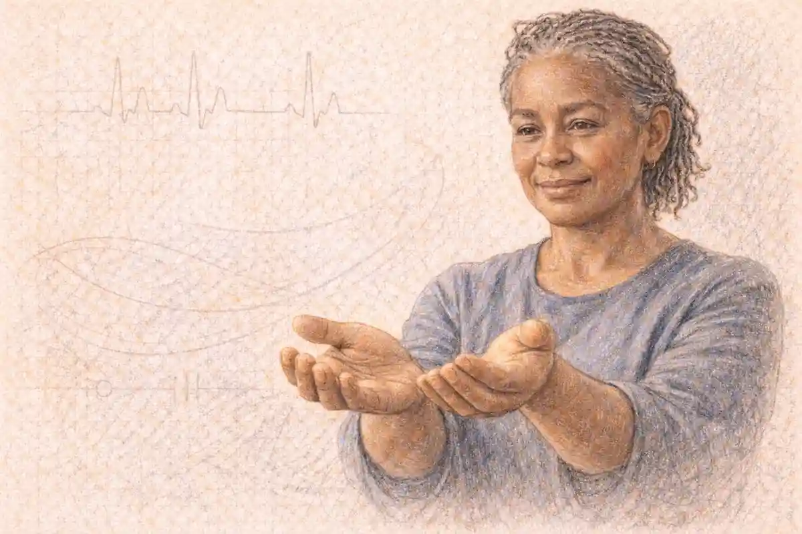

Antonio Gramsci is usually introduced through a cell. The standard portrait shows a frail prisoner in a fascist jail, filling notebooks that would be smuggled to safety and published after his death, and it treats the concepts in those notebooks as though they had been conjured out of suffering and isolation. The portrait is not false, but it explains almost nothing. It leaves the reader with a martyr and a mystery: why this prisoner, alone among the defeated communists of his generation, produced a body of concepts that political theory still works with. A biography that begins with the cell cannot answer that question. A biography that begins with his formation can, because the concepts were not invented in prison. They were assembled there, under appalling conditions, out of materials gathered in a Sardinian childhood, a university training in an unexpected discipline, a newsroom apprenticeship, and a failed revolution in the factories of Turin.

The organising fact of the life is a training most summaries never mention. Gramsci went to university to study language. At Turin he worked under a professor of the school of linguistics that mapped how innovations in speech spread from prestigious centres outward, winning adoption by imitation and acceptance rather than by command. Hold that model in mind and the most famous of his political concepts stops looking like an improvisation. Hegemony, rule secured through consent organised across the institutions of civil society, is the political form of a process he had first studied in words: a centre whose prestige makes its usages into the usages of others, without soldiers and without decrees. This biography is built around that connection, which the specialist scholarship has documented and popular accounts almost never reach. It follows the formation first and lets each concept appear where its materials were gathered.

A compressed statement of the life runs as follows. He was born in 1891 in Sardinia, the fourth of seven children, into a family ruined in his childhood when his father went to prison. A spinal condition stunted his growth and damaged his health permanently. A competitive scholarship carried him to Turin, where poverty and illness broke off his studies. He became a socialist journalist, then a founder of the weekly that championed the Turin factory councils in the two red years that followed the First World War. When that movement collapsed he helped found a communist party, rose to lead it, entered parliament, and was arrested in 1926 by a regime that disregarded his parliamentary immunity. Sentenced to more than twenty years, he wrote thirty-three notebooks in prison between 1929 and 1935, when his health gave out entirely. He died in April 1937, days after his sentence had formally expired.

## A ruined household in Sardinia

He was born on 22 January 1891 at Ales, a small town in the Sardinian interior, and grew up at Ghilarza, where his father Francesco worked as an official in the registry office. The family belonged to the island's thin stratum of salaried employees, people whose respectability depended entirely on a state wage. That dependence became the first political fact of the boy's life. In 1897 the father was arrested on charges arising from his office, and in due course imprisoned. The household lost its income at a stroke. His mother, Giuseppina Marcias, supported seven children by sewing, taking in work that paid little and never ended, and the children grew up in the cramped economy of a family that had fallen out of the class it still resembled. Gramsci returned to this fall throughout his life, not as self-pity but as data. The spectacle of a minor state official destroyed by the same state he served, and of a family abandoned by every institution that was supposed to protect it, gave him an early and concrete education in how power actually behaves toward the weak.

The island itself was a second education. Sardinia in those years was a byword on the mainland for backwardness, banditry and disease, and mainland officials, teachers and conscripts' officers treated its people accordingly. The boy absorbed the double position that would later structure his political analysis: Sardinia was Italian, subject to Italian law and Italian taxes, yet held at a contemptuous distance by the Italy that governed it. When, decades later, he wrote about the southern question, about the way the industrial north organised its dominion over an agrarian south it despised, he was generalising an experience he had lived before he had words for it. His earliest political sympathies ran to Sardinian grievances, and his later insistence that the northern working class had to win the trust of southern peasants rather than lecture them was the mature form of a child's resentment.

His body imposed the third education. A fall in infancy is sometimes blamed in family accounts, but the deformation of his spine that developed in childhood is generally attributed by biographers to a tuberculous infection of the vertebrae, the condition called Pott's disease. It arrested his growth below five feet and left a curvature that worsened with age. Pain, digestive trouble and exhaustion were constants of his existence, and the prisons that later ruined what health remained were working on damaged material from the first day. These facts are set down here without decoration because he set them down that way himself, in letters that discuss illness with the same unsentimental precision he brought to budgets. Illness also shaped his schooling directly. It interrupted attendance, confined him to bed for stretches, and made the physical effort of study, carrying books, climbing stairs, sitting through a winter in unheated rooms, a logistical problem he had to solve anew each term.

### How did poverty shape the young Gramsci's schooling?

Poverty broke his schooling twice. It withdrew him from the classroom after his father's imprisonment, when the family needed his wages, and it put him to work as a boy in the Ghilarza tax office, lifting heavy registers. It later starved his university years in Turin, where hunger and cold did what examinations could not.

Between primary school and the liceo there is a gap in the record that the biographies fill with a detail more eloquent than any speech. Released from lessons because the family could not manage without earnings, the boy of eleven or twelve worked in the local office of the cadastre, the land registry, carrying the great bound registers whose weight a grown clerk found burdensome. He remembered the work and the humiliation of it, and remembered too the arithmetic of envy: other men's sons at school while he filed their fathers' property records. When schooling resumed, it resumed on the far side of the island. At Cagliari, the capital, he attended the liceo Dettori, lodging precariously, studying ferociously, and acquiring the formation that would make a university scholarship possible. His teachers there included men who introduced him to the Italian literary canon and to the idea that a poor islander's mind was a thing of value. In 1911 he travelled to Turin to compete in the examination for scholarships reserved to needy students of the old Sardinian provinces at the Carlo Alberto college. He placed high enough to win. The train journey north, which he later described in terms of emigration rather than education, took him out of the world of Ghilarza for good.

One more formation belongs to these years, less visible than schools and offices. Sardinia gave him the experience of a people whose speech marked them. The island's languages and dialects stood below standard Italian in every official transaction, and a Sardinian boy with ambitions learned early that language is a ladder of prestige on which his own people occupied a low rung. No doctrine was needed to teach him that some ways of speaking command assent and others invite ridicule. The university would give him a science for something the island had already taught him as a wound.

## The scholarship boy at Turin

Turin at the time of his arrival was the most industrial city in Italy, the city of Fiat, of the metalworkers' unions, of a working class whose militancy set the national pace. It was also a university city of formidable teachers. Gramsci enrolled in the faculty of letters in the autumn of 1911, and the record of his years there is a study in contradiction. On paper he was a scholarship student of brilliant promise. In practice he was a half-starved young man in an unheated room, economising on food to buy books, tormented by insomnia and nervous exhaustion, sitting examinations irregularly and sometimes not at all. He wrote home rarely and asked for money with shame. The scholarship covered fees and little else. Winters in Turin are cold in a way Sardinia never is, and his letters and later recollections return obsessively to cold, hunger and the humiliation of poverty among students who had never missed a meal.

Yet the teaching he found was exactly suited to the mind he brought. The professor who mattered most was Matteo Bartoli, holder of the chair in linguistics, a scholar of European standing and the leading figure of the school called neolinguistics or spatial linguistics. Gramsci attended his courses with an assiduity he gave to few others, corresponded with him, and planned a degree thesis under his direction. Around Bartoli there were other teachers of weight, among them the literary historian Umberto Cosmo, whose lectures on Dante and on Italian literature gave the scholarship boy a grounding in the national canon he would use all his life. There were lectures in philosophy and in history. There was the ambient influence, impossible to avoid in those years, of Benedetto Croce, the philosopher whose books the young Sardinian read with the intensity reserved for an adversary one expects to argue with for decades.

### What did Gramsci study at university?

Gramsci studied linguistics at the University of Turin, under Matteo Bartoli, a leading figure of the spatial or neolinguistic school. That school examined how linguistic innovations spread outward from prestigious centres through acceptance rather than conquest, a model that later shaped his theory of hegemony as rule secured through consent.

The point deserves underlining because it corrects the most common error in the popular literature, which describes him as a philosopher by training. He was not. Philosophy he reached later, through Croce and through the Marxist tradition, and he reached it as a reader and a polemicist rather than as a credentialed student. His credentialed discipline, the one whose methods he absorbed in lecture rooms and seminars, was the science of language. He studied the history of the Italian language, the classification of dialects, the mechanics by which one form of speech displaces another. He took the subject seriously enough to imagine an academic career in it, and seriously enough that when, in prison, he listed the fields in which he wished to work for intellectual self-preservation, linguistics stood among them in its own right, not as a metaphor for something else. The student of language would become a theorist of politics, but he would become one by carrying his first discipline with him.

## How the neolinguists explained change

The neolinguistic school defined itself against an older orthodoxy. The neogrammarians of the nineteenth century had treated sound change as the working of exceptionless laws, almost mechanical in character, as though languages obeyed physics. Bartoli and his colleagues replied that a language is a social institution before it is a natural object, and that its changes move through communities the way fashions and techniques move, along channels of communication and prestige. Their method was geographical. By mapping where rival forms of a word or a sound survived, the spatial linguists reconstructed the history of a struggle among forms. Bartoli formulated regularities, often called his areal norms, describing which of two competing forms was likely to be the older and which the innovation, according to the position of the areas where each held sway: forms preserved in isolated or lateral areas tended to be survivals, while the innovation radiated from a centre that others imitated.

### What did the neolinguists believe about how languages change?

The neolinguists held that languages alter through social adoption rather than mechanical law. An innovation arose somewhere, often in a prestigious centre, and travelled outward as speakers imitated forms they associated with authority, education or fashion. Rival forms survived in isolated regions as survivals, so a map of competing forms preserved the history of their contest.

Consider what this model actually claims, because the political analogy later drawn from it is precise rather than decorative. A linguistic innovation wins, on this account, under three conditions. There must be a centre whose speech carries prestige, so that adopting its forms feels like advancement rather than submission. There must be continuous contact, the traffic of people and texts through which imitation flows. And there must be a willingness on the receiving side, a perception that the incoming form serves the adopter's own sense of how to speak well. Coercion figures hardly at all. No army imposes a vowel. Where a form is merely forced, it remains a foreign badge and dies with the force that carried it. Where it is taken up freely, it becomes the property of people who never met its inventors, and within a generation it feels like nature.

### Why does a school of linguistics matter to a theory of politics?

Because it supplied a tested model of how the practices of a minority become the habits of a majority. The neolinguists showed norms spreading through prestige, schooling and imitation until the adopted form passed for common sense. Gramsci's account of ruling groups leading through consent rather than coercion is that model translated into politics.

There is a second element of the Turin teaching that matters as much as the model of diffusion, and it concerns the national language of Italy itself. At unification the peninsula had possessed a literary language revered by scholars and spoken, in daily life, by a small minority of its inhabitants. The rest spoke dialects. How a genuinely national language might form, whether by decree from above or by slow convergence from below, was a live question in the linguistics of Gramsci's student years, and it was at bottom a political question about how a scattered people become a collective actor. His prison reflections on language return to this problem repeatedly: to the prestige of Florence in the Renaissance, to the failures of a purely literary standard, to the way grammars freeze a living process into rules. A man who had thought hard, in his twenties, about how a national language fails to form had a head start, in his thirties, on the question of how a national political will fails to form, and the two enquiries in his notebooks are one enquiry wearing two coats.

His letters from prison include a detail the biographies sometimes treat as colour and should treat as evidence. Writing to his sister-in-law about the education of his sons, and about questions of language in the family, he argued with the authority of his old discipline, discussing how children acquire speech and what a parent should and should not correct. The linguist did not vanish when the politician was imprisoned. He surfaces wherever the notebooks pause over translation, over the translatability of cultures, over why certain French or German terms resist Italian rendering. Those notebook passages on translation are not hobbies. They are the working papers of a thinker whose central political category was built from the observation that ideas, like words, travel by being adopted, and are transformed in every mouth that adopts them.

## The degree abandoned and the newsroom apprenticeship

The Turin years ended without a degree, and the manner of the ending matters for everything that followed. Between the student and his examinations stood the facts of his budget and his body. He sat some examinations and passed them well. Others he postponed as the scholarship money thinned and his health, strained by cold rooms and meagre food, deteriorated into the nervous prostration his letters describe. He worked as a private tutor when he could. He drifted toward the socialist movement of the city, joining the party in 1913 and finding in its circles the first audience for his real gift, which was writing. Journalism offered an income, an education and a public at once. By the middle of the war the faculty of letters had lost him to the editorial offices, and the planned thesis on the history of language was never written.

### Why did Gramsci never finish his degree?

Poverty and illness defeated the timetable rather than the student. The scholarship left him hungry in expensive Turin, his damaged spine and nervous health collapsed under the strain, examinations slipped, and journalism began paying for the work his mind was already doing. Socialism offered a career of the intellect outside the university, and he took it.

The journalism itself was an education of a specific kind, and its syllabus can still be reconstructed from the papers. He wrote first for the socialist weekly Il Grido del Popolo and then, from the middle of the war, for the Turin edition of Avanti!, the party's national daily. He produced leaders, reviews, polemics and a celebrated city column that observed Turin's streets, theatres and courtrooms with a novelist's eye. He reviewed plays and championed dramatists he thought the public neglected. He wrote about schools, about the need for workers' education, about the deadening effects of a culture consumed passively. Two habits formed in these years never left him. The first was compression: the columnist's discipline of saying a complicated thing in eight hundred words for readers on trams. The second was an attention to culture as the medium in which political loyalties are actually made, years before he possessed a theory that said so. When the notebooks later argue that a class's worldview is built in theatres, newspapers, schools and sermons as much as in parliaments, they are generalising a working journalist's daily experience.

His politics in the war years were those of the party's intransigent wing: hostile to Italy's intervention, contemptuous of reformist gradualism, and increasingly interested in the question that journalism alone could not answer, the question of what political form the working class might give itself. The Russian revolutions of 1917 turned that interest into a vocation. News from Petrograd arrived in Turin filtered, delayed and distorted, and the young columnist read it the way he read everything, as a test of doctrines he had inherited. What he concluded, in print, before the end of that year, scandalised the orthodox of his own movement.

## A revolution against the book

In the last days of 1917 the Milan edition of Avanti! carried an article of his under a title that has followed him ever since, the revolution against Capital. Its claim, compressed, was that the Bolsheviks had refuted the deterministic reading of Marx's masterwork by their deeds. In the schema popular among Europe's Marxists, a backward country such as Russia had to pass through a long bourgeois stage before socialism could be contemplated; history moved by timetable and the timetable brooked no volunteers. The Bolsheviks, Gramsci argued, had simply declined to wait. They had seized the crisis created by war, formed the collective will of workers and soldiers, and made a revolution that the timetable forbade. If a canonised text said the thing was impossible, then the text, or at least its fossilised interpretation, had to yield to the living fact.

### What did Gramsci mean by a revolution against Capital?

He meant that the Bolsheviks had acted against the deterministic interpretation of Marx's Capital, not against the living thought behind it. Orthodox doctrine held that Russia had to ripen through a bourgeois stage before socialist revolution. The Bolsheviks formed a collective will and leapt anyway, proving, for him, that will and organisation could override a timetable.

Read with the hindsight of the notebooks, the article of 1917 is the first draft of his life's work, and two of its features deserve emphasis. The first is its target. He was not rebelling against Marx; he was rebelling against a way of reading, against the conversion of a method into a prophecy. That distinction, between a doctrine's living method and its embalmed letter, structures the prison writings from end to end, and it surfaces in his favourite prison pseudonym for Marxism itself, the philosophy of praxis, a name that stresses doing over reciting. The second feature is the hero of the piece, which is neither Lenin nor a party but a collective will: a mass of people acquiring, through organisation and shared purpose, the power to act on history rather than endure it. The factory councils, then hegemony, then the national popular will of the notebooks are successive attempts to give that hero an institutional address.

The article also fixed his reputation inside the movement. Older leaders read it as youthful heresy; some read it as licence. He was twenty-six, a provincial journalist with an unfinished degree, and he had announced in the party's own paper that the most spectacular event of the century had disproved the catechism. Within two years Turin would give him the chance to test his heresy in practice, and the test would fail, and the failure would educate him more deeply than the article's success ever could.

## Ordine Nuovo and the factory councils

In May 1919 he joined three younger comrades, Palmiro Togliatti, Angelo Tasca and Umberto Terracini, in founding a weekly review whose name announced its ambition: L'Ordine Nuovo, the new order. The paper began as a cultural journal and became, within months, the theoretical voice of a movement rising in Turin's factories. The setting was the biennio rosso, the two red years in which Italy's industrial workers, swollen in numbers by wartime production and radicalised by inflation and unkept promises, pushed beyond the limits of ordinary trade unionism. In Turin the vehicle of that push was the factory council. Councils of workshop delegates, elected by all workers in a plant whether union members or not, began to claim a say over production itself: over hiring, discipline, the organisation of work. The Ordine Nuovo group seized on the councils as the discovery of the epoch. Here, they argued, was the embryo of a workers' state growing inside the old one, the institutional form in which producers govern production.

The theory the weekly built around the councils was the most original political thinking of Gramsci's pre-prison life, and it repaid, in an unexpected currency, his abandoned linguistics. A council, in his account, educated its members by the act of existing. Workers who had been units of labour power became citizens of a small republic of production, learning administration, solidarity and the habit of deciding. The council was to the factory what the prestigious form was to a dialect community: a model whose practices others would adopt because participation persuaded them, not because anyone commanded them. He wrote that the council movement aimed to create the conditions in which the whole working class could govern itself, and that its enemy was as much the passivity of workers as the power of employers. Read the notebooks later and the continuity is unmistakable. The problem of the councils, how a subaltern group becomes capable of ruling, is the problem of hegemony restated in the vocabulary of the prison years.

### What made the Turin councils different from ordinary trade unions?

A union bargains over the price of labour inside a system it accepts, and organises workers as sellers of a commodity. The councils organised every worker in a plant, member or not, as a producer, and claimed authority over production itself. For Gramsci they were schools of self-government and the embryo of a different state.

The movement's fate was decided in two acts. In the spring of 1920 a dispute over workshop discipline spread into a general strike across Piedmont, which the rest of Italy's labour movement declined to join, and Turin stood alone until exhaustion ended it. Then, in September of that year, a national confrontation over wages produced the occupation of the factories: half a million metalworkers and others seized their plants across the industrial north, ran production under council direction, and waited for a political lead. None came. The socialist party and the union confederation, faced with the possibility of revolution, chose negotiation, and the prime minister Giolitti brokered a settlement that returned the factories to their owners with promises of reform that were quietly discarded. The occupations dissolved. Within two years the fascist squads were burning union halls while the state looked away, and the council movement's cadres were scattered, beaten or driven abroad.

### Why did the factory council movement fail?

It failed on isolation and on the refusal of its own national leaderships. Turin acted while the socialist party and the union confederation, fearing a revolution they could not control, negotiated instead of generalising the struggle. The employers conceded paper reforms, the moment passed, and reaction followed. Gramsci drew the lesson that spontaneity without national political direction dissipates.

That lesson is the experiential root of the prison theory, and it answers one of the standard misreadings of his life. Hegemony was not dreamed up in a cell by a man with nothing to do. It was the distilled post-mortem of 1920: an enquiry into why a class that could run factories could not hold power, and into what was missing. What was missing, he concluded, was the slow work around the event: the alliances not built, the peasants not won, the intellectuals not formed, the institutions of civil society still staffed by the other side. A class that possesses only the factory discovers, at the moment of crisis, that the state is defended by an entire civilisation. The war of position of the notebooks is the strategy of a man who had watched a war of manoeuvre fail.

## From the councils to the party leadership

The communist party that emerged from the wreckage was founded at Livorno in January 1921, when the left of the socialist party walked out and constituted itself separately. Its first dominant figure was not Gramsci but Amadeo Bordiga, a formidable Neapolitan engineer whose strategy prized doctrinal purity and disdained alliances, parliamentary manoeuvre and the united front tactics the Communist International was urging. Gramsci spent the early nineteen twenties in the party's second rank and partly abroad: in Moscow in 1922 and 1923 as the party's representative to the International, where he encountered the Soviet leadership and met Giulia Schucht, the violinist who became his wife; then in Vienna, organising exile work. The Moscow experience taught him the International's methods from inside, an education he used and resented in roughly equal measure for the rest of his life.

His ascent came through the middle of the decade. The International pressed the Italian party toward the united front and toward a broader social reach, and Gramsci, who had criticised Bordiga's abstentionism, became the instrument and then the beneficiary of that pressure. He entered parliament in 1924 as a deputy for the Veneto, moved into the party's leading bodies, and by 1925 directed its centre in practice. At the Lyons congress in January 1926 the theses he drafted with Togliatti were adopted as the party's programme, a document that attempted exactly what 1920 had lacked: an analysis of Italian society region by region, class by class, and a strategy of alliances reaching toward the southern peasantry and the Catholic masses. The party he led was by then being driven underground. Fascism, having murdered the socialist deputy Matteotti in 1924 and weathered the scandal, was converting itself into a dictatorship by statute. The Lyons line was a strategy for a long resistance that its author would conduct, in the event, from a prison cell.

### How did Gramsci become leader of his party?

By out-arguing its founder within the discipline of the International. Bordiga's refusal of alliances isolated the young party while fascism consolidated. Gramsci, formed by the Turin councils and seasoned in Moscow, offered an alternative strategy of broad alliances and won the argument at the Lyons congress, whose theses made him leader in substance.

Two features of this ascent correct the plaster saint of the later cult. The first is that he was a factional politician of real skill, who manoeuvred, counted votes and used the International's authority against domestic rivals when it suited his line. The second is that his disagreement with Bordiga prefigured his disagreement with the International itself: in each case he resisted a strategy he believed mistook the Italian reality, first the purity that would not build alliances, later the adventurism that would not wait for them. The strategic disagreement, not the posture of victimhood, is the thread of his political life, and it runs uninterrupted from the Turin strike committees to the last letters from prison.

## The essay on the Southern Question

In October 1926, weeks before his arrest, he began an essay that he never finished, on some themes of the Southern Question. It is the hinge document of his life, the place where the Sardinian child, the Turin organiser and the future prisoner meet on one page. Its argument can be stated plainly. The Italian working class of the north could never rule alone. It had to win the peasant masses of the south, and to win them it had to take their grievances as its own programme: land, taxes, the price of bread, the arrogance of southern officials and landlords. Against this stood an entire apparatus of southern intellectuals who mediated between the peasantry and the state, translating peasant misery into loyalty to the existing order. He analysed that mediating stratum with surgical attention, reserving his highest respect, and his sharpest analysis, for Benedetto Croce, the philosopher who had given the southern intellectuals a European prestige and had thereby, in Gramsci's phrase, performed for the southern ruling groups the office of a lay pope.

### What was the argument of the Southern Question essay?

The essay argued that northern workers could rule only in alliance with southern peasants, and that the alliance had to be built by adopting the peasants' own demands against landlords and officials. It analysed the southern intellectuals who blocked that alliance by mediating between countryside and state, and it sketched the politics the notebooks would call hegemony.

The essay matters beyond its argument because it shows the theory being born from the biography rather than applied to it. The Turin proletariat of the essay is the class he had organised in the council years, and he is unsparing about its limits: its corporate selfishness, its contempt for the southern migrant and the peasant soldier, prejudices he had heard in the factories and fought in print. The southern peasant is the figure of his childhood, the Ghilarza world of smallholders crushed between taxes and officials. The alliance he proposes is a reconciliation of the two halves of his own formation. When the notebooks later generalise this into the concept of the national popular, the collective will of a whole people rather than a single class, they are elevating the essay's argument into a method. The unfinished state of the text is itself eloquent. The police interrupted the argument in the middle of a sentence of his political life, and the notebooks can be read as its continuation by other means, in a cell, over nine years.

The regime moved against the opposition in the autumn of 1926 with a completeness that ended the Italy of parties. An assassination attempt on Mussolini at Bologna at the end of October supplied the pretext for the exceptional laws: opposition parties dissolved, their press suppressed, their deputies stripped of office, a Special Tribunal created for political offences and confino, internal exile, revived for dissenters. The communist deputies debated whether to attempt flight or to remain and be taken. Gramsci remained. On the evening of 8 November 1926, in Rome, the police arrested him in disregard of the parliamentary immunity that the constitution guaranteed him and that the regime's own chamber had not yet formally removed.

## Arrest, trial and the sentence

What followed was administrative before it was dramatic. He was held in the Regina Coeli prison in Rome, then shipped to the island of Ustica, off Sicily, the first station of the confino system, where the arrested oppositionists organised, in the intervals of surveillance, a small school for themselves, teaching and learning among prisoners. Gramsci taught there. Illness walked with him through every transfer: doctors' reports from these years record a man whose body was failing in instalments, digestive, urinary, nervous, and whose requests for examination met the bureaucracy's studied indifference. From Ustica he was moved to San Vittore prison in Milan to await trial, and it was in Milan, in May and June of 1928, that the Special Tribunal heard the case against the communist leadership.

The trial was a ceremony with a foregone conclusion, conducted by a tribunal created for the purpose, and its outcome was announced on 4 June 1928: Gramsci was sentenced to twenty years, four months and five days of imprisonment. A sentence of that length, imposed on a man of thirty-seven with his medical record, was understood by everyone in the courtroom as a sentence of death administered slowly and deniably. The regime's purpose was stated more bluntly in a remark attributed to the prosecutor, Michele Isgrò, which has been quoted in every account since.

### Did the prosecutor really demand that his brain be stopped?

The remark attributed to the prosecutor at the trial, that this brain had to be prevented from working for twenty years, is reported in the press of the time and repeated by nearly every biographer. Its exact wording and provenance are less certain than its fame suggests, and scrupulous accounts flag it as widely reported rather than documented verbatim.

That flag matters, and this biography keeps it in place, because the sentence is sufficient indictment without decoration. Twenty years for journalism, party leadership and parliamentary opposition: the arithmetic of the court is the regime's own confession, preserved in its records, and requires no embroidery. What the regime feared in its prisoner was precisely the faculty the remark names. He had no army, no newspaper by then, no party above ground. He had a mind trained to convert experience into concepts, and the tribunal's arithmetic was designed to stop the conversion. The notebooks are the record of its failure, and of the price of that failure, which was paid in the coin of his health across nine years of cells.

From Milan he was transferred in July 1928 to the prison at Turi, in Puglia, a penitentiary for prisoners with medical problems, which is to say a place where the state acknowledged, in its filing system, that its most famous prisoner was a sick man. There the second half of his life began, the half conducted in writing, at a small table, in a cell he shared at first with other political prisoners, under regulations that allowed a fixed number of books, censored every letter in both directions, and permitted him, eventually, the notebooks themselves.

## The prison years and the making of the notebooks

The story of the notebooks begins with a letter, because in prison even a plan had to pass the censor. In March 1929 Gramsci wrote to his sister-in-law Tatiana Schucht, the Russian-born sister of his wife who had settled in Rome and become his lifeline to the world outside, setting out a programme of study. He proposed to work, systematically and for intellectual self-preservation, on a set of connected themes: the formation of Italian intellectuals, the history of the Italian language and its dialects, the popular novel and popular taste, the theatre, and the comparative study of political doctrines. The letter reads like the syllabus of a man determined to remain a scholar in defiance of his address. Behind it stood months of preliminary discipline: he had obtained permission to write in his cell, assembled a small library through purchases and loans, and begun, on 8 February 1929, the first of the notebooks.

Tatiana's role in the life requires its own emphasis, because without her there is no second half to this biography. His wife Giulia remained in Moscow with their two sons, Delio, born in 1924, and Giuliano, born in 1926, the younger of whom his father never saw except in photographs. Her health, fragile in its own way, kept her from Italy. Tatiana visited, corresponded, petitioned, procured books and medicines, transmitted manuscripts and news, and waged the long bureaucratic war for his medical care and eventual release. The prison letters that survive are largely letters to her, and they constitute one of the great correspondences of the century precisely because they had to do double duty: family letters that a censor would pass, and working papers of a mind that refused to stop.

The writing itself proceeded under conditions that determined its form. He worked in school exercise books, thirty-three of them in total across the years at Turi and later in the clinics, writing in a small, dense hand, drafting notes, returning to themes across notebooks, sometimes copying and reworking earlier entries into more finished form. The whole amounts to a body of manuscript pages commonly put at roughly twenty-eight hundred, a figure repeated in most scholarly accounts as an approximation rather than an exact count. The method was geological rather than architectural. Themes recur, deepen, split and rejoin: Machiavelli beside the party, Croce beside Marx, the Risorgimento beside the factory councils, language beside everything. He stopped writing in 1935. By then the diseases that the prison doctors had charted for years, the ruined digestion, the arteriosclerosis, the gout, the insomnia that had him pacing his cell, had advanced beyond the point where sustained work was possible, and the last two years of his life were a medical epilogue to the intellectual one.

### How many notebooks did Gramsci write in prison?

He filled thirty-three notebooks between 1929 and 1935, writing first at Turi and later in the clinics to which his collapsing health transferred him. The manuscript runs to thousands of pages, commonly estimated at roughly twenty-eight hundred. Four of the notebooks contain translation exercises, the language student keeping his instrument sharp; the rest hold the notes themselves.

The end came through the slow machinery of clemency rather than through any change of regime heart. A partial amnesty reduced his sentence; in 1933 his condition forced a transfer from Turi to a clinic at Formia, still under guard; in 1934 he received conditional freedom and moved to a Rome clinic; petitions, medical certificates and diplomatic embarrassment accumulated. His full freedom was formally restored on 21 April 1937, when the sentence expired. On 27 April, in the Quisisana clinic in Rome, he died of a cerebral haemorrhage, aged forty-six. He died, that is, a legally free man by a margin of days, in a clinic rather than a cell, and the precision matters to the record even if it consoles no one: the regime had consumed exactly the years it intended to consume, and the margin by which he missed living under his own roof was the margin of a calendar week.

## Writing for the censor

Every page of the notebooks was written in the knowledge that it would be read, before any sympathetic eye reached it, by the prison administration. He wrote knowing a censor read every page, and the fact is not a biographical garnish but a condition of the text, as material as the paper. Out of that condition grew the notebooks' famous oblique vocabulary. Marxism appears as the philosophy of praxis. Its founder appears under periphrases. The party appears as the modern Prince, borrowed from Machiavelli. Revolutionary strategy moves through military metaphors, war of position against war of manoeuvre, drawn from the debates of military theorists. Generations of readers have treated this vocabulary as a puzzle to be decoded, and decoding is indeed part of reading him. But the code did double work, and the second half of the work is the more interesting.

### Why did the notebooks avoid naming their subject directly?

Because a censor stood between the writer and any reader. Prison regulations subjected every page to inspection, so Marxism became the philosophy of praxis, its founder a periphrasis, the party a Machiavellian Prince. The disguise also sharpened the thought, since each substitute term forced a definition rather than a recitation, and definitions are harder to censor than doctrines.

Consider the philosophy of praxis, the most consequential of the substitutions. The phrase had a pedigree: Antonio Labriola, the first Italian Marxist philosopher, had used it for Marx's method a generation earlier. Gramsci's adoption of it was camouflage, certainly; a notebook full of meditations on the philosophy of praxis could pass a censor who would have seized on the other word. But the camouflage fitted the thought so exactly that it ceased to be camouflage. His Marxism really was a philosophy of praxis: a doctrine whose truth is tested in historical action, hostile to every separation of theory from the practice that verifies it. Readers who treat the term as a mere alias miss the argument the alias performs. The same doubleness runs through the whole vocabulary. The modern Prince is a cipher for the party, and also a genuine enquiry into what kind of collective organism can do in politics what Machiavelli's prince did in the statecraft of the Renaissance. The censor forced him to think in parables, and the parables outlasted the prison.

There is a discipline the reader must reciprocate. Because the vocabulary is coded, the notebooks invite projection, and because they are fragmentary, almost any system can be assembled from them by selective quotation. The defence against projection is the formation this biography has traced. A note about prestige and consent means one thing from a pamphleteer and another from a man trained to map how innovations spread from centres of prestige through free adoption. A note about translation means one thing as metaphor and another from a linguist who spent his prison mornings translating German texts as calisthenics. The biography disciplines the exegesis: it is the index that the fragments themselves, scattered across thirty-three notebooks, cannot supply.

## The formation and concept table

The claim of this biography is that the concepts are unintelligible, or rather are intelligible only as slogans, until their formation is supplied. The formation and concept table sets out the correspondence in compact form: five concepts, the training or experience each one draws on, the place where it enters the notebooks, and the problem it was built to solve. The table is a finding aid for the argument that the surrounding sections make at length.

| Concept | Formation and experience it draws on | Entry in the notebooks | Problem it was formulated to solve |
| Hegemony | Turin linguistics: prestige centres radiating forms that others adopt freely | The notes on politics, the state and the philosophy of praxis | How a class leads a whole society before it governs, and why consent outlasts coercion |
| Civil society | The newsroom and the Turin of parishes, unions, mutual aid societies and councils | The notes contrasting East and West and on the integral state | Where consent is manufactured daily, in the institutions standing between household and government |
| War of position | The council defeat and the long reckoning with the failures of the red years | The notes on Machiavelli and on military categories turned to politics | How a subaltern class advances inside a dense civil society that absorbs frontal assault |
| Organic intellectuals | The Southern Question essay and its anatomy of the southern mediating stratum | The notes on intellectuals, education and the organisation of culture | How a class produces its own thinkers and organisers instead of borrowing the rulers' personnel |
| Passive revolution | His study of the Risorgimento, unification achieved without a popular rising | The notes on Italian history and the long critique of Croce | How elites modernise a country from above while the mass of people remain spectators |

Each row rewards a second look, because in every case the formation is not background but mechanism. Hegemony draws on linguistics in the strict sense explained below: its structure is the structure of a norm's diffusion. Civil society is the journalist's beat turned into a category; the young columnist who had written about theatres, schools, courtrooms and parish politics possessed, without yet naming it, a map of the terrain where opinion is formed, and the notebooks simply promoted the map into theory. The war of position is the council defeat converted into doctrine: he had watched a movement with the factories in its hands dissolve for want of prepared ground, and the military metaphor generalises the watch. Organic intellectuals generalise the Southern Question essay, whose southern lawyers, priests and journalists, thinking on behalf of landlords, posed for him the question of who would think on behalf of peasants and workers. Passive revolution generalises his reading of the century before his own, in which Italy had been made, impressively and incompletely, by elites who preferred transformation without mobilisation.

The table also serves as a warning against the two ways the notebooks are commonly raided. The first raid extracts the concepts and drops the problems, producing a vocabulary of fashion in which hegemony means influence, civil society means voluntary groups and war of position means patience. The second raid extracts the pathos and drops the formation, producing the martyr whose concepts are treated as oracles. Both raids are refuted by the same evidence: a trained linguist, a working journalist, a defeated organiser and a party leader, thinking for nine years about why his side had lost and what winning would actually require.

## The linguistic origin of Gramsci's hegemony

The namable claim of this biography can now be stated in full. The linguistic origin: hegemony is the application to politics of the model of prestige and diffusion that Gramsci learned in the linguistics lecture rooms of Turin. In the neolinguistic account, an innovation spreads when a centre's authority makes its usage desirable, when channels of contact carry the usage outward, and when adopters take it up as their own improvement rather than as an alien imposition. Substitute parties, newspapers, schools and churches for the carriers, and political programmes for the usages, and the schema of hegemony stands complete: a class rules durably when its worldview has become the spontaneous philosophy of those it rules, adopted by them as the obvious way to see, in the way an adopted word is spoken without any memory of its foreign birth.

### How exactly did linguistics supply the structure of hegemony?

Through three transfers. It supplied the centre, whose prestige makes its forms worth imitating, as ruling institutions make an outlook worth adopting. It supplied the mechanism, adoption through contact and schooling rather than force. And it supplied the test of success, where the borrowed form passes for one's own speech and the outlook passes for common sense.

The correspondence explains two features of the concept that rival accounts leave mysterious. The first is its optimism about education and its pessimism about decree. A linguist knows that a usage ordered into existence by authority, a word coined by committee, remains artificial until speakers adopt it, and that adoption cannot be hurried by punishment. Hence the notebooks' insistence that every relation of hegemony is necessarily a pedagogical relation, and their author's lifelong attention to schools, to the training of intellectuals, to the slow manufacture of a new common sense. The second feature is the concept's treatment of consent as activity rather than as a trick. In the diffusion model, the adopter is not deceived; the adopter chooses, for reasons that make sense locally, and the choice is real even though the menu was set elsewhere. Hegemony in Gramsci is therefore not false consciousness in the crude sense of a veil pulled over passive eyes. It is leadership accepted, reproduced and elaborated by the led, which is precisely why it is so hard to dislodge and why dislodging it requires a counter-formation, organic intellectuals of the subaltern class articulating a rival prestige.

Prison gave the linguist one more exercise that fed the theory directly. Among the notebooks are four devoted to translation exercises, German texts rendered into Italian as mental calisthenics. The exercise books look like the least theoretical of the thirty-three, and they may be the most revealing. His theoretical notes return repeatedly to translatability: whether the philosophy of one national culture can be rendered in the terms of another, whether a political vocabulary forged in one history can govern a different one. This is the diffusion problem stated at the level of civilisations. The young man who had wondered how Tuscan became Italian grew into the prisoner who wondered how the experience of one class or nation becomes the common sense of another, and the wonder is continuous. The notebooks on language and the notebooks on politics were written by the same hand, in the same years, out of the same training, and any edition or biography that severs them misdescribes the mind that produced both.

One corollary deserves statement because it disciplines the claims made for the concept. If hegemony is modelled on linguistic diffusion, then it is a theory of the normal condition of stable societies, not a theory of every exercise of power. Gramsci's own contrasts respect the limit: where civil society is gelatinous and the state is everything, as he wrote of the Russia of the tsars, direct assault could succeed, and the long positional war is the strategy of societies where the trenches of civil society are deep. The concept's modern career, in which it is applied to every dominance everywhere, exceeds its author's design, and the design is recoverable precisely from the formation: a model has the range of its mechanism, and prestige diffusion is not the mechanism of a firing squad.

## How paper outlived the prisoner

The notebooks survived because specific people performed specific acts, and the biography owes them the same precision it gives their author. At his death the exercise books were in Rome, in the keeping of Tatiana Schucht, who had received them in stages from the clinics as his health failed and the writing stopped. She understood exactly what she held. With the assistance of Piero Sraffa, the Cambridge economist who had been Gramsci's friend since their shared Turin years, the manuscripts were conveyed out of Italy and into safekeeping in Moscow, where they rested in the archives of the Marx-Engels-Lenin Institute for the duration of the fascist regime and the war. Tatiana also preserved his letters by the same vigilance, copying and guarding the correspondence that the censors had allowed to pass.

### Who physically preserved the manuscripts after his death?

His sister-in-law, Tatiana Schucht, who had been his visitor, correspondent and medical advocate throughout the imprisonment. She held the notebooks in Rome, and with the help of Piero Sraffa arranged their transfer abroad to Moscow for safekeeping. Sraffa had earlier maintained the Milan bookshop account from which the prisoner ordered his reading.

Sraffa's place in the story deserves more than a parenthesis, because it is double. During the imprisonment he had been the prisoner's invisible quartermaster: it was Sraffa who arranged and financed the account with a Milan bookshop through which Gramsci, within the prison's permitted lists, could order the books his work required, and Sraffa who passed questions and materials through the permitted channels. After the death he became, with Tatiana, the manuscripts' escort out of danger. The connection repays attention for a further reason: the quiet economist who preserved the notebooks was himself about to transform the theoretical landscape of Marxist economics, and the series treats his own work where it belongs, in [sraffa and marxist economics](/2016/05/01/sraffa-and-marxist-economics/). That the century's most consequential prison manuscripts were saved by an act of friendship performed by a major economist is a reminder that intellectual history runs on loyalties as well as on arguments.

Publication, when it came, was an act of editing with consequences the world is still digesting. Between 1948 and 1951 the Turin publisher Einaudi issued the notebooks in six thematic volumes, arranged by subject under the supervision of Togliatti and the editor Felice Platone: the notes on historical materialism and Croce first, then the intellectuals, the Risorgimento, Machiavelli, literature and national life, and a volume of miscellaneous later notes. The arrangement made the work readable and made its author a national classic; it also concealed the notebooks' chronology and development, presenting as doctrine what had been written as enquiry, and smoothing the fragments into a system their author had never built. A critical edition restoring the notebooks to their sequence appeared only in 1975, under Valentino Gerratana. Which Gramsci a reader meets depends, more than readers usually realise, on which of these editorial doors they entered by, a dependence that the reception history in [gramsci reception and misreadings](/2015/05/01/gramsci-reception-and-misreadings/) examines in full.

## The disagreements with Moscow

A biography that ends in hagiography would make him the International's obedient martyr or its secret heretic, according to taste. The record supports neither convenience. He was formed by the International, served it in Moscow, owed his leadership partly to its pressure against Bordiga, and disagreed with it, on matters of strategy and of internal regime, in ways that were documented and known to his comrades. The sharpest episode came in October 1926, weeks before his arrest. As the Soviet party's internal struggle hardened, Gramsci drafted a letter to its Central Committee, in the Italian party's name, pleading with the majority to preserve unity and warning against the destruction of the opposition by administrative means. The letter argued, in essence, that the Russian comrades had been the teachers of the whole movement and were in danger of squandering the authority that teaching had earned.

The letter was entrusted to Togliatti, then the Italian party's representative in Moscow, who judged its delivery inopportune and withheld it. Gramsci, informed, protested the withholding and then, in a reply that historians have parsed for generations, maintained his anxieties while bowing to his representative's judgement of the Russian scene. The exchange shows the actual texture of his relation to the International: neither obedience nor rebellion, but an argument conducted inside a discipline he accepted even when it overruled him, by a man whose whole formation taught him that a collective will is worthless if it cannot correct its own course. In prison, cut off from information and dependent on censored newspapers, he declined to pronounce on disputes he could not follow, a silence that later factions have tried to conscript in every direction and that the record leaves, properly, as silence.

His disagreements, where they are documented, run in a consistent direction. Against Bordiga he defended engagement with the masses as they were; against the adventurism that later gripped the International in its so-called third period, the evidence of his prison reflections, and the testimony of comrades who visited, suggests a man who still believed that strategy must be fitted to the terrain rather than recited from a manual. He never broke with the International, never recanted his membership, and never gave the regime that imprisoned him the satisfaction of a defection. He also never surrendered the habit, acquired in Turin seminar rooms and Turin newsrooms alike, of testing a line against the evidence of the place where it would have to work.

## The objection from the cell

The objection to the weight placed on these notebooks deserves to be stated at the strength its best proponents would choose. A body of theory produced in isolation, by a man cut off from libraries and from the movement he had led, writing for a censor, in failing health, in fragments he never revised into final form, on the basis of newspapers years stale by the time he commented on them: such a corpus, the objection runs, cannot bear the load that later generations have stacked upon it. Worse, its very defects explain its fame. Because the notes are ambiguous, allusive and unfinished, every subsequent current has been able to find its own reflection in them; the liberal discovers a pluralist, the party cadre discovers a Leninist, the cultural theorist discovers a prophet of identity, and the mirror obliges them all. On this account the notebooks' authority is an artefact of their vagueness, and a rigorous intellectual history would return them to the status of a brave man's working papers.

Part of the answer is documentary. The ambiguity is not a free-floating property of the prose; it has two identifiable sources, and both are correctable. The first source is the coded vocabulary, adopted under censorship, whose key this biography has supplied: read philosophy of praxis as the name of a doctrine testing itself in action, read the modern Prince as the party, restore the military metaphors to the debates they came from, and whole regions of mist clear. The second source is the editorial arrangement of the first edition, which shuffled the notes into thematic baskets and hid their development; the critical edition's restoration of sequence lets a reader watch concepts being built, qualified and sometimes abandoned, which is the opposite of oracular vagueness. Where, after both corrections, genuine indeterminacy remains, it is usually the indeterminacy of a man thinking, whose notes record alternatives he had not yet resolved, and it is a merit of the corpus that it refuses to pretend otherwise.

The concession must then be made without flinching, because he would have made it. The notebooks are working notes, not a finished theory. They contain repetitions, false starts, borrowings absorbed without full digestion, and judgements on books he had read decades earlier or not at all. His information about the Soviet Union, about fascism's evolution, about the wider world of the nineteen thirties, was filtered, belated and thin. Any reading that treats a fragment of 1932 as the settled doctrine of a system is committing exactly the error his own method forbids, the error of the catechism. What the biography entitles a reader to claim is narrower and stronger: that a specific formation, linguistic, journalistic, organisational and carceral, produced a distinctive set of instruments for analysing how consent is made and unmade, and that the instruments retain their edge when they are used as instruments, tested against cases, rather than worshipped as relics. The theoretical weight the notebooks can bear is the weight of good tools. It is not a small weight, but it is not infinite, and part of honouring their author is to say so.

## Five misreadings this life corrects

The cluster of articles to which this biography belongs begins from a premise worth stating plainly: every major concept in it travels with a popular misreading attached, and the first duty of the writing is correction by evidence rather than by scorn. The life just traced corrects five such misreadings of its subject.

The first is the philosopher of the lecture hall. Popular accounts reach for the word philosopher because the notebooks discuss philosophy, but his training was in language, and the distinction is not pedantry, since the structure of the central concept comes from the training. The second misreading is the prison as a birthplace. On the popular telling, hegemony and its companion concepts were invented in the cell from nothing but suffering and genius. The record shows a decade of preparation: a linguistics degree abandoned but a method retained, a newsroom education in the manufacture of opinion, a revolutionary laboratory in Turin that failed in instructive ways, an unfinished essay that sketched the alliance politics of the notebooks before a single notebook existed. Prison was the study, not the source. The third misreading is the passive victim. The iconography of the frail prisoner invites it, and it falsifies a man who was a party leader engaged in a live strategic argument with his own movement's leaderships on two continents, who won some of those arguments and conducted the losing ones with open eyes. He was victimised, gravely and fatally; he was not passive for a single year of his adult life.

The fourth misreading treats the notebooks as free writing, the unmediated transcript of a mind. In fact the mind wrote with a warder reading over its shoulder, shaped its vocabulary to pass inspection, and conducted some of its most important business in the deniable genres of translation exercise and literary note. The fifth misreading shrinks the contribution to culture. Because the notebooks discuss literature, folklore and schooling, their author is filed as a theorist of culture, sometimes with the implication that the politics was a youthful phase. The concepts refute the filing. Hegemony is a theory of the state and of how it is to be won; civil society is the terrain of that winning; the organic intellectual is a political cadre described by his function; and the whole apparatus was built by a party leader to answer the most practical question in politics, why his side lost and how it might win. Culture, in his hands, is not the alternative to politics. It is where politics is decided before it is counted.

## Croce, the adversary of a lifetime

No account of the formation is complete without the Neapolitan philosopher who never taught him in a classroom and taught him more than any professor. Benedetto Croce dominated the intellectual Italy of Gramsci's youth. His idealist philosophy, his journal, his histories and his immense prestige offered the educated Italian a complete way of understanding culture and politics, and offered it from within a liberalism that regarded Marxism as a crude episode of the previous century. The young Sardinian read Croce the way a duellist studies the champion. He absorbed the method he would later fight: the attention to intellectuals as the connective tissue of history, the insistence that ideas rule the world only when they become institutions and habits. When the Southern Question essay anatomised the southern intellectuals, it named Croce as their supreme representative, the thinker whose European fame organised the loyalties of a whole stratum and bound it, politely and completely, to the existing order.

The prison notebooks elevate the duel into a project. Gramsci planned a systematic reckoning with Croce's philosophy, an Anti-Croce on the model of the polemics of the previous century, and the notebooks return to Croce on page after page: his theory of history, his aesthetics, his ethics, his account of religion, his edition of the classics of Italian thought. The reckoning is respectful in a way that surprises readers who expect denunciation. Croce is treated as the greatest living Italian thinker and therefore as the only adversary worth the labour, and the critique proceeds by accepting the force of his questions while disputing his answers. There is a biographical poignancy underneath the polemic. Croce, the liberal senator, had broken with fascism and signed the manifesto of anti-fascist intellectuals; the communist prisoner, from his cell, followed the older man's career with an attention that mingled rivalry, gratitude and war. The two never met in these years. They conducted, across the wall between the clinic of Italian culture and its prison, the central intellectual argument of their country, and the prisoner's side of it had to wait a decade to be read.

The Croce duel also clarifies the formation thesis of this biography. Croce supplied the problems: how intellectuals mediate between rulers and ruled, how a worldview becomes a civilisation's common sense, how history is made by organised ideas. Bartoli supplied the model of a solution's movement through society. The notebooks are what happened when a man with Croce's problems and Bartoli's model was locked in a room with nine years to think. Remove either element and the result changes character; remove Croce and the questions lose their scale, remove Bartoli and the answers lose their mechanism. His originality lies in the junction, and junctions are what intellectual biographies exist to find.

## A Leninist of a particular kind

Because later currents have conscripted him to causes that prize his distance from Leninism, the record of his actual relation to Lenin deserves plain statement. He greeted the Russian Revolution as the event of his political youth and defended it against its socialist critics. On Lenin's death he wrote of the Russian leader with an admiration that the years did not cool, treating him as the supreme example of the theorist whose thought was verified in the construction of a state. He accepted the discipline of the International Lenin had founded, served as its Italian party's link to Moscow, and built his leadership on its platform. By the ordinary tests of allegiance, membership and self-description, he was a Leninist, and the attempt to detach him retrospectively from that allegiance falsifies the documentary record of his articles, letters and party work.

The distinctiveness lies not in the allegiance but in the interpretation he built inside it. He held that the strategy which had succeeded in Russia, direct assault on a state that stood nearly alone, could not be repeated in the West, where the state was buttressed by the dense fortifications of civil society, and he credited Lenin himself with glimpsing the difference in the united front turn of the last congresses. The notebooks develop the point into the distinction between war of manoeuvre and war of position. Whether this is Leninism extended or Leninism revised is a genuine question of the scholarship, and honest accounts register both descriptions. What the biography rules out is the sentimental version in which the prisoner of fascism was privately a liberal democrat in disguise. His democratic commitments, which were real, ran through the sovereignty of the councils and the consent of the governed as he understood them, concepts internal to his communism and unintelligible when cut out of it. The man who warned the Soviet majority against crushing its opposition also defended the revolution that majority was making. Both facts belong to the same formation, and the tension between them is the authentic record of a mind, not a problem to be solved by amputation.

## The letters: a second body of work

Alongside the notebooks runs a second corpus, written under the same censorship and published as the Prison Letters, and any biography that ignores it knows only half its man. The letters were rationed by regulation, a fixed number each month, addressed to a permitted circle, and written in the knowledge that a censor's stamp was their first destination. Within those constraints he conducted his family's life. He advised on his sons' upbringing across a continent of separation, arguing with his sister-in-law, gently and relentlessly, about how children learn language and how they should be read to, the linguist surfacing in the nursery questions. He managed his guilt toward his wife, whose own health was collapsing in Moscow, in letters of a tenderness disciplined by the knowledge that complaint would only wound. He reported his illnesses with clinical flatness, requested books with bibliographic precision, and refused, year after year, to purchase relief at the price the regime demanded.

That price deserves specification, because the refusal defines his prison conduct more exactly than any legend. Clemency in such cases could be sought by a petition for grace, and a petition carried an implication the regime valued: submission, the acknowledgment of the state's magnanimity by a broken opponent. Gramsci declined to sign any appeal that carried that implication, for himself, even as his body failed and even as the refusal was pressed on him by the arithmetic of his own survival. He accepted the help of others' petitions and the working of amnesties; he would not abase the prisoner to free the man. Readers should weigh the fact without incense. It cost him the outside of a decade, and it is recorded in the correspondence not as heroism but as a point of practical honour, argued with the family members who begged him to live.

The letters also preserve the texture of the mind at leisure, which the notebooks, all work, cannot. He writes about a sparrow that lived for a season in his cell at Turi, tamed to his hand, and about its death, in a passage his fellow prisoners remembered and his correspondents preserved; the man who theorised the education of nations mourns a bird in three sentences and moves on. He tells his sons stories across the censorship, retelling Sardinian material from the world of Ghilarza. He discusses the books arriving through Sraffa's account, Ricardo and the economists among them, with the appetite of a student who has finally been given a library card to a burning library. A reader who wants the temperature of the life, rather than its system, will find it here, and the biography that quotes the letters sparingly, as this one has done, does so from the discipline of its genre rather than from any ranking of the two corpora.

## The body in the cell

The medical record of the imprisonment can be summarised as a slow attrition conducted by neglect. The spinal deformity of childhood had left his frame twisted and his lungs cramped. Prison added the rest: a digestive system that progressively failed, dental collapse that left him nearly toothless on a prison diet, gout, kidney trouble, arteriosclerosis, and an insomnia so complete that fellow prisoners recalled his pacing through the nights. Medical visits were granted grudgingly and late. Requests for transfer to a clinic were buried in procedure for years; when the transfers finally came, to Formia in 1933 and to Rome in 1935, they came because his condition had become an embarrassment that even the regime's physicians could not sign away. The state had sentenced a mind to twenty years and then supervised, with bureaucratic patience, the destruction of the body that housed it.

Why insist on the inventory in a biography of ideas? Because the physical record is the answer to a slander that occasionally surfaces in the literature, the suggestion that the notebooks' difficulty reflects confusion or decline in their author. Read the medical file beside the manuscripts and the inference inverts. The handwriting holds its discipline page after page; the arguments lengthen rather than fray; the mind that produced the notes on Machiavelli did so while digesting badly, sleeping hardly at all and expecting, on the evidence available to him, to die in captivity. The achievement is not that a dying man wrote. It is that a man in that condition built, at a cell table, an analytical instrument that healthy scholars in free universities are still learning to use, and that he did so while refusing to purchase a clinic bed with the coin of recantation. The record of the body is the measure of the record of the work.

## The architecture of the notebooks

The thirty-three notebooks are not a random heap, and the prisoner's own filing system is part of their meaning. Editors distinguish the miscellaneous notebooks, in which themes jostle as they occurred to him, from the special notebooks, in which he returned to a single subject and reworked earlier notes into connected drafts. Ten or so of the books belong to the second kind: gatherings on Machiavelli and politics, on philosophy, on the Risorgimento, on literature, on Americanism, on the intellectuals. The movement between the two kinds is the movement of his thought itself, from registration to construction, and it is one of the casualties of the first thematic edition, which dissolved the distinction and with it the evidence of a mind revising itself. The critical edition's restoration of the sequence allows the reader to watch a concept like hegemony being assembled across years, tested against the French Revolution, against the Italian moderates, against the practice of the Church, and refined at each return. A biography can only report this architecture; the text itself must be approached through a guide to its organisation, which is the business of the companion [reader's guide to the Prison Notebooks](/2015/02/01/prison-notebooks-readers-guide/).

The map of subjects repays an overview, because the range is the refutation of the notion that he wrote about one thing. Politics stands at the centre, organised around Machiavelli, whose Prince he reread as a treatise on the formation of collective will and whose name supplied the code for the party of his own time. Around the centre orbit the great enquiries: the history of Italian intellectuals from the Roman world to the universities of his day; the Risorgimento as the type of a revolution made without the people; the philosophy of Croce and the fate of Marxism as a worldview; the literature a nation actually reads, the serial novels and popular tastes that reveal its spontaneous philosophy; folklore, treated with a respect folklorists had rarely shown it, as the sedimented worldview of the subaltern; the organisation of schools and the question of what a democratic education would require; and, in the notes on Americanism and Fordism, an astonished analysis of the new industrial civilisation of the United States, its assembly lines, its prohibition, its remaking of the worker's body and habits, which he read as a rival civilisation's bid for the hegemony of the coming century.

Two of these enquiries deserve a paragraph each in a biography, because both grow visibly from the formation. The literature notes are the columnist's revenge. The young reviewer who had championed neglected dramatists and scolded the public's taste became the prisoner who asked why Italians read French serial novels, why the national literature had produced no popular epic of its own people, and what a literature would look like that a whole people recognised as its biography. The national popular, his name for that unrealised literature, is the aesthetic form of the Southern Question: a culture in which the people appear as protagonists rather than as scenery. The Americanism notes, meanwhile, are the Turin organiser's second look at the factory. The man who had built councils against the old factory regime now studied the new one being assembled across the Atlantic, where capital proposed to organise not only production but the worker's sexuality, family and leisure into a total civilisation. He neither celebrated nor merely denounced it. He analysed it as a competitor in the manufacture of human types, which is to say, in his vocabulary, as a hegemonic project, and the coolness of the analysis, from a cell in Puglia, remains startling.

Underneath the subjects lies the discipline that unifies them, and it is the discipline of the first formation. Every enquiry asks the Bartolian question in a new field: how did this form, this belief, this institution, spread, and by what prestige was it carried; who adopted it, and what did adoption cost and confer; where does it survive as a fossil and where does it rule as a living norm. The notebooks are the record of a single method applied to an entire civilisation by a prisoner with nothing left but the method and the time. The method was taught to him in a Turin lecture room when he was twenty, by a professor of linguistics who could not have imagined its destination.

## The generation of Ordine Nuovo and the last free years

A biography centred on one man risks implying that he thought alone, and the Turin record corrects it. The Ordine Nuovo review was a collective enterprise of four young men whose later paths map the century's choices. Togliatti, the most organisationally gifted, became the party's leader in exile and its postwar architect in Italy, and the editor who gave the notebooks their first public shape. Tasca, the most historically minded, broke with communism and wrote its early history as a critic. Terracini, the most legally minded, spent the fascist years in prison like his friend and emerged to sign the republic's constitution. Gramsci was the most theoretically original of the four, and the one the regime killed. The four had shared an office, a printing schedule and a wager: that the Turin workers' movement was the seed of a different Italy. Prison and exile scattered the wager's makers across the map of the century, and the notebooks can be read, among their other identities, as the missing member's contribution to a conversation the other three were forced to continue without him.

The leadership years before the arrest were conducted at a tempo the prison years make easy to forget. He founded and directed the party's daily paper, L'Unità, launched in 1924 to speak beyond the party's ranks to the broader working population, its very name a programme of the alliance strategy. He sat in parliament as a deputy of the opposition during the crisis that followed the murder of the socialist deputy Giacomo Matteotti by fascist agents, when the opposition deputies withdrew from the chamber in the Aventine secession and waited, fatally, for the king and the respectable classes to disown the regime. He watched legality dissolve with a clarity the notebooks would convert into theory: the lesson that a ruling order defends itself through its institutions long before it defends itself through its police became a foundation stone of the positional strategy. He organised a party being hunted into illegality, wrote its programme at Lyons, corresponded with Moscow, argued with Bordiga's intransigents and with the International's emissaries, and did the work while his party's offices were raided and its militants beaten in the streets. The cell interrupted a political career in full motion, not a retreat into contemplation, and the notebooks' authority derives partly from that fact: their author had held, and lost, real responsibilities.

There is a counterfactual discipline worth applying here, the same discipline this series applied to the Trotsky biography under the name of the counterfactual constraint. What Gramsci would have become outside prison is unknowable and is not this biography's business. What can be said is what the surviving record shows: a trajectory from provincial scholarship to metropolitan journalism to factory organisation to national party leadership, steepening at every step, cut off at the age of thirty-five with his powers visibly still growing. The prison writings are therefore not a coda to a completed career. They are the centre of one, produced in the years when a political leader of his generation would ordinarily have done his largest work, and their fragmentary form is the regime's editorial contribution to his bibliography.

His family threads through these years in ways the record preserves only partially, and the partiality is itself part of the fascist story. His marriage to Giulia Schucht took place across the geography of exile, in Moscow; their sons were born into separation, Delio in 1924 and Giuliano in 1926, and the younger boy's father was arrested weeks after his birth. Giulia's health, undermined by a nervous illness that shadowed her life, made the journey to Italy impossible for most of the imprisonment. The family the prisoner actually saw was the Schucht household's Roman branch, above all Tatiana, whose elder sister had married him in every sense except proximity. His mother died in 1932 with her son in the Turi penitentiary; he was not permitted to attend her funeral, nor to visit her in her last illness, and the letters register the blow in the flat tone he used for the worst news. The regime's punishment was designed to be exactly this comprehensive: not the cell alone, but the systematic severing of every relation that made the prisoner a son, a husband, a father and a comrade, leaving him, as it supposed, with nothing. The notebooks and the letters are the documentary proof that the severing failed in the one respect the regime cared most about. The mind kept its relations, and used them.

## The sources on the cell table

The notebooks were not written from memory alone, and their author's reading, in prison and before it, forms a stratum of the biography that repays excavation. Behind the philosophy of praxis stands Antonio Labriola, the Roman professor who had introduced Marxism to Italian universities a generation earlier and coined the phrase Gramsci revived. From Labriola he took the conception of Marxism as a self-sufficient philosophy, not an economics with political garnish, and the respect for historical specificity that forbids importing foreign schemas untranslated. Behind the early journalism stands a more surprising presence, Georges Sorel, the French syndicalist theorist of the myth, whose writings the young Turin socialists devoured. Sorel's influence was later disowned in part and absorbed in part: the notebooks criticise his spontaneity while retaining his insight that movements are moved by images of a coming order, an insight the theory of hegemony digests into the doctrine of the national popular will.

Machiavelli stands in a category of his own. Gramsci read the Florentine not as a museum piece but as a colleague across four centuries: the theorist of how a founder creates a people capable of sustaining a state, the analyst of the relation between armed prophets and unarmed ones, the writer whose Prince poses, in Renaissance dress, the question of the modern party. The notebooks' Machiavelli notes are among their most finished sequences, and they carry the biographical signature plainly. A prisoner forbidden to write about his own party wrote about the organisation of political will in the Florence of the Medici, and the censor passed it, and the code worked exactly as codes are supposed to work, by being simultaneously a disguise and a genuine investigation. His military reading belongs to the same stratum: the war of position and war of manoeuvre are borrowings from the strategic literature of the Great War and its theorists, tested against the Eastern and Western fronts as he had tested them against Turin and Petrograd.

One more exchange belongs in the record of the reading, because it links the cell to the wider argument of this series. Through the permitted correspondence he put questions about political economy to Sraffa, who was then engaged in Cambridge on the edition of Ricardo's works that would occupy him for decades. The prisoner wanted to know where Ricardo stood in the development of economic theory, and what exactly the classical economist had contributed to the lineage that led to Marx. The questions were those of a man writing, in his own notebooks, a history of the philosophy he professed, and determined to get its genealogy right even for figures at its margin. That the answer had to travel from Cambridge through a censor to a cell in Puglia measures the absurdity of the conditions and the stubbornness of the enquiry in a single itinerary. Intellectual biography rarely catches its subject in the act of checking a footnote across a continent. This one does, and the act is characteristic: hegemony, the national popular, the modern Prince, all the great constructions rest on a foundation of verified small facts, attended to by a scholar who believed that getting Ricardo's place right was part of the same work as getting Italy's future right.

The French Revolution supplied his historical touchstone, as it supplied every European Marxist's, but he used it with a distinctive emphasis. Where others mined 1789 for the drama of insurrection, he mined it for the Jacobins' achievement in forging a national popular will, binding town and country into a single political people and dragging a reluctant bourgeoisie further than it wished to go. The Jacobins became, in the notebooks, the historical type of hegemonic leadership, the class fraction that rules by enlarging its own programme until it can stand for the nation. The contrast with Italy's moderates, who had made a nation while carefully excluding its people, structures his reading of the Risorgimento and explains its place in the notebooks' architecture. Formation accounts for this too. The historian of the Jacobins in the cell was the journalist who had watched the Italian socialists of 1920 decline to become Jacobins, and who had resolved, in the long audit of that refusal, to understand what the French had possessed and his own side had lacked.

## The prisoner as analyst of his jailers

There is a strangeness at the centre of the notebooks that a biography should not pass over. The most penetrating analyst of fascism in its founding generation conducted his analysis from inside a fascist prison, and the object of his regime's solicitude was his mind. He met the strangeness with his method. Fascism, in his developing account, was not an inexplicable barbarism nor a mere mask for other interests. It was the response of Italy's possessing classes to a crisis of their hegemony: the old liberal order had lost the capacity to lead, the socialist movement had failed to replace it, and into the paralysis stepped a movement capable of mobilising the petty bourgeoisie and the uprooted while restoring, on new foundations, the dominion it claimed to transcend. His category of Caesarism, developed in the Machiavelli notes, names the arbitration of a strong figure when the fundamental forces balance in a stalemate neither can win. Readers have argued ever since over how far the category was cut for Mussolini. The safer and stronger claim is biographical: the man theorising catastrophic equilibrium had lived one, between 1920 and 1922, and had watched the arbiter arrive.

This coldness of analysis, applied to the power that was killing him, is among the most remarkable facts of the life, and it is worth pausing on the discipline it required. Hatred was available in unlimited quantities and appears in the notebooks hardly at all. The regime's personnel are studied as functions, its ideologues read seriously enough to be answered, its social base anatomised without contempt. Compare the prisoner's procedure with the propaganda of his own side abroad, where fascism figured as a beast to be cursed, and the difference is the difference between an epithet and an instrument. He wanted to understand the thing that had beaten him, because understanding was the precondition of its eventual defeat, and revenge, in his economy of effort, was a luxury of men with time. He did not have time, and knew the medical arithmetic better than his jailers did.

## The campaigns, the refusals and the failed exchanges

His imprisonment did not pass unnoticed beyond Italy, and a biography confined to the record should note the world that tried, ineffectively, to open his cell. Writers and committees in France and elsewhere campaigned for the release of the fascist regime's political prisoners, and his name stood at the head of their lists; Romain Rolland, from whose pen he had taken the motto of his old newspaper, pessimism of the intellect, optimism of the will, lent the cause his prestige. Within the communist movement his case was pressed through the channels available, and in Moscow the question of his liberation intersected with the diplomacy of two hostile states. Proposals for an exchange of prisoners surfaced more than once in the nineteen thirties, involving Vatican intermediaries and Soviet feelers, and each came to nothing against the regime's refusal to surrender its most symbolic captive and the labyrinth of the negotiations themselves. The documentary record of these episodes is incomplete and was long contested, and honest biography states the efforts as documented attempts rather than as a narrative of rescue betrayed.

His own conduct closed the remaining door. A personal petition for grace, as noted earlier, was the one instrument in his own hand, and he would not use it in the form required. The consequence can be stated without rhetoric: a man who might, on another calculation, have purchased years of life at the price of a signature chose the cell and the work. When the amnesties and the sentence's expiry finally delivered his legal freedom in April 1937, the body that received it had six days of freedom left to spend. The cremation and the quiet funeral in Rome, attended by the family the regime had permitted him, closed the life at the age of forty-six. The ashes were later moved to the city's Protestant cemetery, where they rest in the company of poets, a neighbourhood the author of the literature notebooks might have appreciated with the driest of his smiles.

## The Sardinian formation in depth

The island deserves a second pass, because its influence on the concepts is structural and usually sentimentalised. Sardinia entered the Italian state as a problem to be administered. Its economy of shepherds and smallholders, its malaria coasts, its banditry, its emigration, were discussed on the mainland in the vocabulary of pathology, and the Sardinians themselves were conscripted into regiments and taxed like other Italians while being governed, in practice, as a semi-colony. The boy from Ghilarza grew up bilingual in the only sense that mattered politically: fluent in the world of the village and increasingly fluent in the Italian of school and office, and aware from childhood that the second fluency was the price of being heard by the first's rulers. When the notebooks later insist that a subaltern group's emancipation requires intellectuals who speak both the group's language and the language of the state, they are codifying the scholarship boy's survival strategy.

His earliest political stirrings were Sardinian before they were socialist. The island had its own tradition of protest, and the young Gramsci's sympathies attached first to the grievances under his window: the taxes, the officials, the contempt of mainland administrators. His later self-criticism, which treated a merely Sardinian resentment as a provincialism to be outgrown, should not obscure the formation's direction. He learned politics from the particular before the universal, and the universal he eventually embraced was one that had to be built out of particulars rather than imposed over them. The Southern Question essay's central demand, that northern workers adopt the southern peasants' own grievances as their programme, is the Sardinian schoolboy's demand, grown up and generalised: nobody is emancipated by a programme written in a language of contempt for the life they actually lead.

The island also gave him his first intellectuals to study. The village priest, the elementary teacher, the lawyer in the provincial town, the retired officer: the mediating figures of Sardinian society were the originals of the type he would later anatomise as the traditional intellectual of the agrarian south, men whose prestige derived from a world they served by seeming to stand above it. He watched their authority operate at the distance of a street. It neither commanded armies nor owned factories, yet it decided what the village believed about Rome, about taxes, about the war, about the socialists. A theorist of hegemony could hardly have had a better first laboratory, and it is not fanciful to say that he spent the notebooks explaining, at the scale of nations, what a bright child had observed at the scale of Ghilarza: that rule travels through trusted voices long before it travels through decrees.

## The school at Ustica and the prison intellectuals

The road to Turi passed through a rehearsal worth recording, the confinement colony on the island of Ustica in the winter after the arrests. The regime's confino system dumped its opponents on remote islands with their families sometimes in attendance, and the arrested communists and socialists of 1926, awaiting the tribunal's pleasure, found themselves in enforced idleness with nothing but time and one another. They organised a school. Bordiga, the party's austere first leader and Gramsci's defeated rival, lectured; Gramsci lectured; courses ran in subjects from mathematics to languages for prisoners whose education fascism had interrupted as carelessly as it had interrupted his own twenty years before. The episode is small and entirely characteristic. Deprived of every other instrument, the man built a school within weeks, because forming intellectuals was not his theory but his reflex, practised identically in a Turin factory district, an island penal colony and a metropolitan party.

The solidarity of the prison years has its less consoling side, which honesty requires. The party outside, decimated and driven into exile, could do little for its imprisoned leader, and the relations between the prisoner and the exiled leadership were strained by distance, by censorship and eventually by strategy. Comrades who later reached him with visits and messages described a man hungry for news and argument, frustrated by the fragments that reached him, and determined to contribute what a prisoner could contribute: analysis, and the refusal to be turned into either a mascot or a problem. When the leadership's line hardened into the adventurism of the third period, with its denunciation of social democrats as the main enemy while Hitler rose, the prisoner's recorded reactions, filtered and partial as they were, suggest unease rather than assent. The biography registers the unease at the value the evidence supports: not a break, not a recantation, but the continued operation of a strategic intelligence that had never confused a slogan with a map of the terrain.

## The scholarship boy's politics of education

If one thread runs unbroken from the Ghilarza tax office to the last notebook, it is education. The boy who had been withdrawn from school to lift registers became the journalist who wrote about schools with a professional's attention, and the prisoner who filled notebooks with the design of an education adequate to a democratic age. His early articles treat the school as the factory floor of consent: the place where a society decides whose children will think and whose will merely obey, and where the ruling order's most durable victories are won without a shot. The notebooks generalise the insight into the doctrine that every hegemonic relation is a pedagogical relation, and then do something rarer than theorising: they draft the counter-institution. His notes on the unitary school argue for a common, rigorous, humanistic education for all children before any specialisation, against the class-tracking that reserved Latin and leisure for rulers and vocational drill for the ruled. The argument is the autobiography transposed. He knew what the track did at the point where it forked, because he had stood at the fork in a cold Turin room.

The education writings also disclose his distinctive severity, which separates him from every sentimental progressive of his century. He defended discipline, grammar, effort and the mastery of dead languages against the pedagogies of spontaneity, arguing that working-class children are cheated, not liberated, by a school that spares them the rigours through which ruling-class children acquire command of the instruments of rule. The linguist's formation is visible in the position's foundations. Language, he had learned, is mastered by studying its norms until the norms become second nature; freedom in speech is the fruit of grammar internalised, not of grammar abolished. Freedom in society, the notebooks argue by extension, is the fruit of institutions of formation that a subaltern class must build for itself with the same patience. The party school at Ustica, the council as a school of government, the unitary school of the notebooks and the self-education of the prisoner are one institution at four scales.

## The Church as the great school of hegemony

His analysis of religion follows the same formation, and it produced some of the notebooks' most original pages. Raised in the Catholic world of the Sardinian village and schooled for a time in its shadow, he never treated the Church as a fraud to be exposed. He treated it as the most successful hegemonic apparatus in European history, and studied its success with a professional's respect. The Church, in his analysis, had solved problems his own movement fumbled. It maintained the unity of high and low, binding the peasant's faith and the theologian's system into one civilisation without allowing the two to split into separate religions of the learned and the simple. It formed its intellectuals from below, recruiting the clever peasant boy into the priesthood and returning him to the village as its voice. It organised consent through a capillary network of parishes, orders, schools and confraternities that no political party of his time could match. The notebooks on Catholicism are, among other things, an organisational audit of a two-thousand-year-old competitor, conducted by the leader of a party that had existed for a decade.

Two consequences follow for the biography. The first is the depth of his disagreement with the crude anti-clericalism of the socialist tradition he inherited. Where the old movement saw superstition to be dispersed by science, he saw a civilisation's cement to be understood and, in the long run, replaced only by an alternative cement of equal reach. The second consequence is strategic and returns to the Southern Question. Italy's communists confronted a Catholic mass culture organised by the most sophisticated intellectual machine in the country, and the alliance politics of the notebooks, with their attention to the Catholic peasantry and their respect for the beliefs of the faithful, are the politics of a man who had measured that machine from inside a Sardinian childhood. He had been formed by the world the Church organised. His theory of hegemony is, in part, the report of a defector from its congregation who never stopped admiring the engineering while contesting the doctrine, and the admiration is what makes the report worth reading by readers who share neither the doctrine nor the defection.

## The long war against determinism

The article of 1917 had announced a rebellion against the timetable; the notebooks turned the rebellion into a campaign, and its target had a name and a textbook. Nikolai Bukharin, the Soviet party's most systematic theorist, had written a manual of historical materialism that presented Marxism as a sociology of laws, in which societies moved by necessity and the knowing revolutionary's task reduced to reading the gauges. Gramsci devoted one of the notebooks' longest sequences to dismantling the manual, and the dismantling is the mature form of his youthful heresy. Against the sociology of laws he set the philosophy of praxis: a doctrine in which prediction is possible only to the extent that one is oneself an actor in the process, in which the so-called laws of history are the regularities of human practice and nothing harder, and in which a theory that consoles its holders with inevitability has already ceased to be Marxism and become a religion for the defeated.

The biographical roots of the campaign reach back through every stage of the formation. The linguist had been trained by a school that dissolved mechanical laws into social processes; sound change obeyed no physics, and neither, he concluded, did history. The journalist had watched a party armed with the correct timetable fail, in 1920, to act at the moment when action was possible, consoling itself with doctrine while the factories emptied. The party leader had fought Bordiga's variant of the same disease, a purity that waited for history to deliver the correct conditions as a train delivers passengers. Determinism, in all its costumes, was for him the opiate of the intellectuals, the theory that licensed talented men to be spectators of their own catastrophe. His alternative is sometimes mislabelled voluntarism, the exaltation of will over circumstance. The notebooks are more exact. Will is itself a product of formation, of education, organisation and the slow construction of a collective subject, and it operates only within conditions it did not choose. The position is the factory council theory grown philosophical: men make their own history when they have built the institutions in which a shared will can form, and not before, and building those institutions is the work that determinism teaches them to postpone.

## The Risorgimento: the revolution that did not happen

His reading of Italy's unification supplies the notebooks with their central historical case, and it grew from the same soil as the Southern Question. The Risorgimento, in the patriotic version, was the nation's heroic birth. In Gramsci's audit it was a revolution manqué: the making of a state by diplomacy, by the Piedmontese monarchy's wars and by Cavour's statecraft, in which the popular classes figured as material rather than as authors. The democratic party of Mazzini and Garibaldi, the Action Party, had possessed the programme of a national popular revolution and had failed, in his analysis, for want of a Jacobin resolve to bind the peasantry to the national cause with land and citizenship. The moderates won by absorption, drawing their opponents' leaders into the state one by one, a process he named transformism, and the new Italy inherited the arrangement's costs: a south annexed rather than emancipated, a parliament of notables, a people estranged from its own state.

The concept of passive revolution was forged on this case before he extended it, and the biography should let the forging show. A passive revolution is a transformation accomplished from above, in which the forms of a society are modernised while its masses are kept in the posture of audience, and the Risorgimento was for him its European archetype. The category then travels, in the notebooks, to the fascism under which he wrote, and beyond it to every modernisation that prefers administration to mobilisation. What gives the category its bite is its origin in a national biography. He was reading his own country's founding as the original sin of its politics: a state created without its people's participation would forever rule a people it had not formed, and the southern villages of his childhood, taxed and conscripted and despised, were the unpaid bill for Cavour's methods. The prisoner's history of the previous century is a diagnosis of the ward he was dying in, conducted with the instruments of the one discipline his jailers never thought to confiscate, because they did not know he had it: the history of how nations acquire, or fail to acquire, a common sense of their own.

## Folklore, common sense and the philosophy of the non-philosophers

The notebooks' treatment of folklore startles readers who arrive expecting condescension, and its origins are biographical in the most literal way. The world of Ghilarza was a world of proverbs, saints' days, funeral customs, tales told at the fire and a moral economy enforced by grandmothers; the scholarship boy lived in that world before he analysed it, and his mother and her generation were its unlettered philosophers. When the prisoner came to write his observations on folklore, he insisted against the folklorists of his day that the subject was not a museum of quaint survivals but a conception of the world, the implicit philosophy of those who had never read one, complete with its own logic, its own history and its own strata, in which the deposits of centuries of sermons, laws and rebellions lay compressed. Folklore, in his handling, is the archive of the subaltern, and the scholar who sneers at it has failed the first test of his own method.

From folklore the analysis climbs to its governing category of common sense, the name he gave to the disjointed, inherited, largely unexamined philosophy that every person absorbs from the surrounding culture and speaks as though it were nature. Common sense is the political battlefield rendered in linguistic terms, and the Bartolian formation shows at every joint. A common sense is a sediment of successful diffusions: the Church's catechism, the school's textbook, the newspaper's framing, the proverb's verdict, layered over centuries and spoken unselfconsciously by people who would deny holding any philosophy at all. Within it he distinguished a healthy nucleus, good sense, the practical wisdom by which people navigate their real lives, which a new philosophy must respect and build upon rather than scold. The party journalist who had written for tram passengers, the council organiser who had learned to speak so that furnacemen heard themselves in the argument, the linguist who knew that norms change only when speakers adopt them: the theorist of common sense is all three, and the category is unintelligible without them.

## The thinker in his tradition

His place among the Marxists of his century can now be fixed with the biography's help. The generation of theorists formed by the defeats of the postwar revolutions, the generation that later scholarship gathered under the name of Western Marxism, shared a displacement: barred from the revolutionary practice that had formed their master, they turned toward philosophy, culture and the superstructures of society, and produced a body of work whose centre of gravity lay in the theory of consciousness. The full map of that tradition is drawn in [western marxism complete guide](/2015/11/01/western-marxism-complete-guide/), and its subject here is only the Sardinian's particular position within it. He was the only major figure of the tendency who had actually led a mass party and contested for power; the only one whose turn to questions of culture and consent was a post-mortem on a defeat he had personally organised; and the only one whose masterwork was composed in the enemy's prison. The differences are not decorative. They explain why his treatment of hegemony stays lashed to the state and to strategy where others' treatments drift toward the academy, and why his cultural theory reads like dispatches from a headquarters rather than meditations from a library.

The division of labour within this cluster follows from the biography's limits, and the reader should know where this article's account stops. The concept at the centre of the life receives its own full treatment in [gramsci hegemony complete guide](/2015/01/15/gramsci-hegemony-complete-guide/), where the diffusion model traced here is developed into the complete doctrine and tested against its critics. The institutional terrain on which hegemony operates is mapped separately in [gramsci on civil society](/2015/03/15/gramsci-on-civil-society/), which takes up the trench systems of the West in the detail the notebooks give them. What the biography contributes to both is the thing neither can supply from within: the formation that explains why the concepts have the shape they do, why consent sits where coercion sits in simpler theories, and why a theory of intellectuals was written by a man whose life was a sequence of schools, newsrooms, councils and cells, each one an institution for the manufacture of a worldview, each one lost, and the last one converted, by an act of will his jailers subsidised with paper, into the most durable of them all.

## The modern Prince

The notebooks' most sustained political construction hides behind their most famous piece of camouflage. The modern Prince, the figure Gramsci builds across the Machiavelli notes, is the revolutionary party reconceived for an age of mass politics: not a committee issuing directives but a collective organism in which a shared conception of the world is elaborated, tested and embodied, a collective intellectual whose thinking is done by thousands of minds in disciplined conversation. The choice of Machiavelli as the mask was itself a thesis. The Florentine's prince had been an individual founder; the modern founder, Gramsci argued, could only be collective, because the will to be formed was the will of millions and no single virtuoso could improvise it. The party he had led for two years appears in the notebooks transfigured into a question: what kind of organisation can manufacture, in its members and beyond them, the capacity for self-government that the councils had displayed for a season and then lost?

The construction repays attention because it corrects, from within his own camp, the two errors between which his political life had been fought. Against Bordiga's sect it asserts that the party exists only in its relations with the classes it would lead, that a vanguard sealed in its doctrine is a sect with a printing press. Against the determinists it asserts that the party's first product is not the seizure of anything but a people remade in its understanding, and that this manufacture is slow, educational and measurable in decades. The notebooks' party is a school before it is an army, and its general staff are teachers. One hears in the doctrine every station of the formation: the Ustica schoolroom, the Ordine Nuovo office, the council chamber, the party centre at Lyons, and behind them all the Turin lecture hall where a professor had explained that forms prevail when they are adopted by those who did not invent them, out of a recognition that the forms are theirs.

It is worth recording, too, what the modern Prince is not, since the phrase invites melodrama. It is not a cult of leadership; the Prince is expressly collective and expressly fallible, an organism whose internal life must reproduce the education it dispenses. It is not a conspiracy; its medium is publicity, argument, the press and the school. And it is not a machine for the postponement of politics but the proposed answer to the only defeat that mattered to its author, the dissolution of 1920, when a class with factories in its hands discovered that it had not yet become, in the full sense, a political people. The prisoner's last political theory is his first political experience, thought through to the end at the price of his life. Whether the construction can work is the question his century and the present one have argued over; that it was built by the man best placed by experience to build it is a fact of the record.

## America in the notebooks: the rival civilisation

The Turin organiser's prison meditations on the United States form one of the notebooks' most unexpected sequences, and they belong in a biography because they continue, by other means, his education in the factory. America fascinated him as the site of a new civilisation being constructed at full speed: the assembly line and its discipline, the high wage offered as an instrument of social engineering, prohibition, the campaigns over sexuality and family life, the service clubs and the new philanthropy. He read the American experiment without the European intellectual's reflexive sneer. Here was a bourgeoisie that did not merely exploit an old world but manufactured a new human type to inhabit a new one, intervening in the worker's body, habits and morals with a frankness European capital had never attempted. In his vocabulary this was a hegemonic project of the first order, and he studied it as a competitor studies the rival most likely to inherit the century.

The analysis connects to the biography at three points. It extends the factory council experience into its negative: where the Turin councils had sought to make the worker a citizen of production from below, Fordism proposed to make him a component of production from above, and Gramsci wanted to know exactly what the proposal involved and what it would cost and confer. It extends the linguistic model as well, for the American notes treat the new civilisation's spread the way Bartoli treated an innovation's spread, as a prestige radiating outward that other societies would adopt piecemeal and transform in the adopting. And it extends his lifelong quarrel with determinism, since the American bourgeoisie of the notes is anything but a puppet of economic law: it is a class engaged in the conscious, planned construction of the conditions of its own survival, which is what he had always demanded, in mirror image, of his own side. The prisoner in Puglia, reading smuggled accounts of Detroit, was conducting the reconnaissance of the world that would actually arrive after the war that freed his manuscripts, and the notes on Americanism remain among the most prophetic pages he wrote, precisely because they were written by a man forbidden to see the world they describe. His attention fastened, characteristically, on the small machinery as well as the great: the service clubs of American businessmen, the Rotarians and their like, which he read as organs in which a class manufactures its solidarity and its common sense over lunch, civil society at work in its shirtsleeves. A European Marxist of his generation was expected to dismiss such clubs as trivial. The student of Ghilarza's priests and Turin's parish networks knew better. He had been trained, by an island, a lecture room and a newsroom, to look for power where it lunches, worships and amuses itself, and America rewarded the looking.

## The southerners in the northern factories

One of the Southern Question essay's least sentimental passages concerns the northern workers themselves, and it rests on scenes its author had witnessed in Turin for a decade. The industrial city drew southern migrants as labour, and the established working class of Piedmont received them with the full repertoire of metropolitan contempt: the southerner as backward, as criminal stock, as the employer's strikebreaker and the landlord's tenant farmer in urban dress. Gramsci had fought this contempt in the Turin socialist press during the war and after, and he understood its mechanism exactly, because it was the mechanism of his theory in miniature. The northern worker's prejudice was not a natural product of the factory floor. It was a manufactured common sense, deposited by decades of bourgeois journalism, school textbooks and popular literature that represented the south as Italy's burden and its people as a lesser breed, and it served the function of dividing the exploited against themselves more reliably than any police ordinance.

The essay's demand follows with the force of an equation. The northern proletariat could become a ruling class only by shedding the corporate prejudices of its own formation and adopting the southern peasants' cause as its own, not as charity but as the recognition of a shared enemy. The demand cost something, and he knew the price, because it asked Turin furnacemen to see brothers in the Calabrian labourers they had been taught to despise, and to fight for land reform in provinces they would never visit. It is here that the biography and the theory fuse most completely. The Sardinian scholarship boy had himself been the southerner in the northern lecture hall, marked by his accent and his island, and had felt the prestige economy of the Italian nation in his own reception before he could name it. The notebooks' doctrine that a class must become national, must raise its programme to the level of the whole people's grievances before it can lead, is the Ghilarza child's answer to the Turin seminar room, generalised into a law of politics. He never forgot which side of the lecture hall door he had entered from.

## The regime's philosopher and the prisoner's answer

The intellectual duel with Croce had a shadow, and the shadow had a name: Giovanni Gentile, the philosopher of actual idealism who became fascism's official thinker, its minister of education and the draftsman of its cultural institutions. The young Gramsci had read Gentile as he read Croce, from within the same idealist atmosphere, and the prison notebooks engage the regime's philosopher with the respect of an old sparring partner and the contempt of a man watching a formation betray itself. Gentile mattered to the argument of the notebooks because he proved, from the opposing camp, the centrality of everything Gramsci theorised. The regime had understood that power requires philosophers, school reforms, encyclopedias and a doctrine of the state taught to children; it had appointed its intellectuals as deliberately as any modern Prince could wish. Fascism, in the notebooks' reading, was among other things a hegemonic project conducted by men who had learned the same Italian lessons as their prisoner, and its cultural apparatus was the tribute that a police state paid to the theory of consent.

The comparison sharpens the biography's central claim about the difference between the two men's inheritances. Croce and Gentile, the liberal and the fascist, divided between them the prestige of Italian philosophy, and both had been formed in the seminar culture of the old universities. The prisoner at Turi was formed in the same culture and broke from its political conclusions while retaining its central discovery, that ideas rule when they are organised. His quarrel with the regime's intellectuals was therefore a family quarrel, conducted in a shared vocabulary about the ownership of Italy's future, and it helps to explain the notebooks' tone toward the regime that was killing him: analytical rather than denunciatory, because denunciation would have conceded that the enemy's ideas were beneath analysis, and he believed the opposite. They were worth the most serious analysis he could perform, and the seriousness was itself a weapon aimed at readers he would never meet.

## The Lateran settlement and the price of consent

In February 1929, the month the notebooks began, the fascist regime and the Vatican signed the Lateran Pacts, ending the sixty-year estrangement between the Italian state and the papacy with a treaty, a financial settlement and a concordat that made Catholicism the religion of the state and Catholic instruction part of its schools. The prisoner followed the event through censored newspapers and made it a test case for his method. Here were the two greatest organised powers of Italian life, the modernising dictatorship and the ancient Church, concluding a transaction in the currency his theory described: the regime purchased the Church's consent and its capillary network of parishes and schools; the Church purchased security, money and the formation of Italy's children. Neither side was deceived. Both understood the merchandise. The notebooks' pages on the settlement and on Catholic Action, the Church's lay organisation whose friction with the regime soon followed, read the Italian present with the instruments built from the Italian past, and they confirm that the cell's occupant had lost none of the party leader's instinct for the real distribution of forces beneath the ceremonies.

The episode belongs in the biography for a further reason: it shows the theory being used, by its author, as an instrument of current analysis under the worst imaginable conditions of information. Denied archives, denied a movement press, denied even uncensored newspapers, he reconstructed the settlement's meaning from the regime's own published texts, the way his old professor had reconstructed the history of a word from its distribution on a map. The method's portability is the point. Hegemony was never, for him, a theme for commemoration. It was a way of reading the morning's news, and the morning's news, in the Italy of 1929, was the news of two hegemonies arranging their coexistence over the body of the opposition he had led.

## Subaltern: the word the censor let through

Among the notebooks' coinages, none has travelled further than the word subaltern, and its biography condenses the whole formation into a single term. On the surface the word was camouflage: a military term for a subordinate officer, innocuous to a censor, under which the notes could discuss the classes that official vocabulary forbade. Beneath the surface it was a generalisation of real theoretical weight. By writing of subaltern classes in the plural, and of their history as a history of fragmentation, of initiatives absorbed and defeats dispersed, he escaped the rigidity of a two-class schema and opened the analysis to peasants, southerners, women, the urban poor, every group whose subordination is real but whose organisation lags behind its grievances. The famous notebook on the history of subaltern classes proposes to study their formations, their ideologies, their intellectuals and their defeats with the patience of an archivist, and generations of historians have taken the proposal as a charter.

The biographical reading adds what the charter's later users sometimes miss. The subaltern was not, for its inventor, an identity to be celebrated in its fragmentation. It was a condition to be overcome, and the overcoming had a direction: from the economic-corporate phase, in which a group defends its narrow interests, through the phase of solidarity among subaltern groups, to the phase in which a group's programme becomes universal enough to lead a nation. The ladder is the Southern Question essay restated as sociology, and the ladder's top is hegemony. To read the subaltern notes without the ladder is to keep the diagnosis and discard the therapy, an amputation the formation does not license. The Sardinian who climbed from a village of shepherds to the leadership of a national party by way of a scholarship examination had lived the ladder's ascent in his own person, and the concept carries the memory of the climb: subalternity is where history starts for most human beings, and the entire point of politics, as the prisoner understood it, is that it is not where history has to stop.

## The theatre critic

The most improbable item in the formation is the one the young man practised weekly for years: theatre reviewing. The Turin socialist papers carried his notices of the city's stages, and the notices survive as some of the sharpest dramatic criticism of their Italian moment. He championed Luigi Pirandello when the Sicilian's plays were still provoking walkouts, recognising in the dissolution of the fixed character on Pirandello's stage a kindred demolition of the fixed pieties of bourgeois common sense. He scolded the commercial theatre for its diet of French farces and drawing-room adultery, demanded a repertory in which the audience's own life appeared, and treated the stalls and the gallery as a parliament of taste in which the nation's spontaneous philosophy could be observed at its leisure. The critic's column was the columnist's laboratory: in the theatre he could watch a public's consent being manufactured nightly, applauded or withheld, and learn the timings by which a new way of seeing wins a room.

The notebooks harvest the apprenticeship openly. Their literature notes ask why Italy produced no national popular theatre and no national popular novel, why its people consumed imported serials and its stages imported successes, and the questions are the reviewer's questions grown into historical method. A nation's culture, he had learned from the stalls, is not what its academies certify but what its people actually take up, and a political movement that ignores the repertory of the imagination will find its programmes applauded by no one. The formation's chain is complete: the boy who watched prestige operate in a Sardinian street, the student who mapped its operation in language, the critic who timed its operation in applause, and the prisoner who generalised the three observations into the theory that bears the Greek name for leadership. Intellectual biographies usually apologise for their subjects' journalism as hack work before the real career. In this life the journalism is the career's foundation, and the theatre column is not the least of its load-bearing walls.

## After the defeat: party, unions and the audit of a failure

Between the collapse of the occupations and the journey to Moscow stretches the least examined and most instructive period of the political formation, the audit of 1921 and 1922. The new party inherited a defeated class, a triumphant reaction and a leadership dispute about what the defeat meant. Bordiga's reading fixed on the party's doctrinal boundary: the error had been contamination, and the remedy was purity. Gramsci's reading, developed in the party press against considerable resistance, fixed on the relations the party had failed to build: with the union movement it disdained, with the peasant south it ignored, with the Catholic and republican masses it abandoned to their own leaderships. The argument was not tactical decoration. It was the first statement of the positional doctrine in party form, the insistence that a minority becomes a leadership by the breadth and depth of its alliances or does not become one at all, and it cost him standing in a party whose founder valued the boundary more than the bridge.

The audit also fixed his attitude to the unions, which the council theory might seem to have settled and had not. He neither worshipped the confederation that had negotiated the factories back to their owners nor accepted Bordiga's contempt for it. The unions were, in his analysis, schools of the economic-corporate phase, indispensable and insufficient, organisations a class builds to defend itself within the system and must transcend without destroying to rule beyond it. The position's balance (defend the union, criticise its limits, build the political instrument the union cannot be) is the mature form of the young journalist's columns on Turin's labour wars, and it survived into the notebooks' treatment of every subaltern institution: each is audited for what it forms in its members, and honoured or indicted on that evidence alone. A formation that teaches a man to ask of every organisation, what kind of human being does this make, has given him a question for a lifetime. He asked it of schools, churches, parties, armies, newspapers and prisons, and the notebooks are the record of the asking.

## The question of the language, again

The notebooks return, in their final stratum, to the subject of the abandoned degree, and the return is the biography's cleanest exhibit of formation at work. Italy's language question had been open since the Renaissance: a literary standard existed, Florentine in pedigree, while the peninsula's people spoke dialects mutually unintelligible across a day's journey. Alessandro Manzoni, the national novelist, had proposed to settle the matter by decree, imposing the living usage of Florence through the schools of the new kingdom. Gramsci's notes take up the proposal with a linguist's scepticism and a politician's interest. A language, he argued, cannot be legislated into a people's mouth. It forms as a national life forms, through the traffic of classes and regions, through schools and armies and markets, and the standard that emerges is the deposit of the whole process, not the property of any academy. Manzoni's Florentine was a passive revolution in philology: a solution from above, elegant, correct and unadopted, and the parallel with the Risorgimento's political method is drawn by the notebooks themselves.

The same reasoning disposed of the artificial languages. Esperanto had its Italian devotees, some of them in his own movement, attracted by the dream of a rational tongue without a nation's baggage. The prisoner, who had studied how languages actually live, answered with the diffusion model in its pure form. A language is not a tool designed in a study but the precipitate of a civilisation's history, carried by prestige and adopted through generations of use; an invented language has no speakers because it has no world, and no decree can supply the deficiency. The argument is Bartoli's seminar applied to utopia, and it generalises exactly as the notebooks generalise it: every attempt to shortcut the slow formation of a collective practice, in language, in education, in politics, purchases the appearance of the result at the price of the substance. The young linguist's science had become, by way of the council chamber and the cell, a complete philosophy of historical change, and it ended where it began, with words and the manner of their travelling among people.

## The article he had to outlive

An honest biography includes the episode his enemies have always quoted and his defenders have always hurried past. In the autumn of 1914, as Europe's war began and Italy debated intervention, the socialist party held to a formula of absolute neutrality. The twenty-three-year-old Gramsci, writing in the party's Turin paper, published a short article arguing for an active and operative neutrality: the party, he proposed, should not merely repeat its formula but interrogate the war's crisis for the openings it offered the working class, distinguishing its own position from passive abstention. The article was promptly seized upon by the interventionist press, including the paper of the renegade Benito Mussolini, then in the act of breaking with socialism over the war, as evidence that the young socialist writer leaned toward intervention. Comrades accused him of Mussolinian sympathies. He withdrew from journalism for a period, stung, and when he returned it was to the anti-war intransigence that marked his war years and to the editorial work that built his reputation.

The episode's documentary core is small, a single article of ambiguous phrasing by a very young man, and its afterlife is disproportionate, which is precisely why it belongs here. Admirers who omit it build the plaster saint the record refuses; detractors who inflate it into a fascist apprenticeship ignore the subsequent decade of anti-fascist organisation, prison and death, which constitutes a refutation no polemic can match. The measured reading is the biographical one. The article shows the earliest form of his signature move, the refusal of the formula in favour of the active analysis of a crisis, applied before he possessed the experience to aim it safely. The party's formula was a timetable of the emotions, and he was already, at twenty-three, the enemy of timetables. He spent the rest of his life learning to make that enmity precise, and the learning began with the embarrassment of being applauded by the wrong readers in the wrong cause.

## The men in the dock beside him

The trial of 1928 was a trial of a leadership, not of one man, and the sentences distributed along the bench measure the regime's intentions toward a whole generation. Umberto Terracini, his comrade from the Ordine Nuovo office and the council years, received twenty-two years, a sentence longer than his leader's, and served the better part of it before the regime fell. Mauro Scoccimarro, another of the party's chiefs, received twenty years. Others of the accused drew terms in the same arithmetic. The tribunal was dispersing the party's brain into separate penitentiaries the way a gardener scatters seed, except that the intention was burial. That so many of the buried men survived to re-emerge in the Italy of the resistance and the republic is a fact about their constitutions and their luck; that the most original mind among them did not survive is a fact about the regime's success in the one case it had most reason to pursue. Gramsci's health was the frailest in the dock, and the sentence was calibrated, whether by design or by indifference, to a body that twenty years would certainly exhaust. It exhausted it in eleven.

The dispersal also frames the notebooks' solitude correctly. He wrote without knowledge of what his comrades were writing, without the party's debates, without reply. The famous dialogic quality of the notes, their habit of stating an adversary's case before answering it, is partly the habit of a man conducting both sides of conversations that prison had made impossible, stocking his cell with Croce and Bukharin and Machiavelli because the living interlocutors were in other cells or other countries. Intellectual biography sometimes treats a thinker's influences as a reading list. His were a substitute population.

## The work tails off

The writing did not end with a conclusion; it ended with the body. The notebooks' final strata show the method intact and the stamina rationed: shorter notes, returns to earlier sequences, the translation exercises continuing like scales practised by a pianist who can no longer perform. In the clinics of Formia and Rome the conditions of work dissolved into the conditions of treatment, and the correspondence charts the change with its usual flatness: requests for books give way to reports of symptoms, plans for study to negotiations over doctors, and running beneath both, the unbroken refusal to confuse a medical file with a surrender. He followed the news that reached him with the analyst's appetite to the end. Comrades and family who saw him in the final period described a mind that pain had slowed but not dimmed, and a temper that visitors found, against every expectation the cell justified, capable of irony about its own extinction. The last letters discuss his condition in the grammar he had used for history: as a process with causes, to be understood rather than cursed, and endured without the consolations of illusion. He had written at twenty-six that the revolution refuted the timetable. He died at forty-six demonstrating the companion proposition of his philosophy, that a human being's relation to necessity is not exhausted by submission to it.

## Laissez-faire as a political programme

His economics is the least read stratum of the notebooks, and a biography concerned with formation should note what the party leader brought to it. He was not a trained economist; his party work had forced the usual apprenticeship in budgets, wages and the tariff politics of a protectionist Italy, and his prison reading, guided at a distance by Sraffa's answers to his questions, filled some of the gaps. What he contributed to economic argument was the method he brought to everything else. The free-trade doctrine of the Italian liberals, the faith his notebooks call liberismo, he treated not as a discovery about markets but as a political programme of a specific bloc: the ideology by which the industrial north's alliance with the agrarian south was policed, and its corollary, the night-watchman state, as a fiction concealing the state's permanent intervention on behalf of the arrangement. A doctrine, in his handling, is to be audited by the forces that adopt it and the prestige that carries it, exactly as a linguistic form is audited by its map. The economy's ideologies diffuse like its fashions, and the critique of political economy becomes, in his hands, one more province of the theory of hegemony.

The point has a biographical edge worth keeping. The registrar's son from Ghilarza had grown up in a household destroyed by the state's bookkeeping and raised among peasants for whom tariffs, taxes and the price of imported grain were not abstractions but the weather of survival. The Southern Question was an economic question before it was anything else: protection for northern industry paid for by southern consumers, land held in great estates, emigration as the south's only growth industry. When the notebooks analyse the historical bloc that ruled Italy, industry armed with tariffs above and latifundia undisturbed below, they are describing the Ghilarza of his childhood at the scale of the kingdom. His economics, like his linguistics and his history, is the formation generalised, and the generalisation holds because the formation was, from first to last, an education in how a whole society's arrangements are carried in the heads of the people who live under them.

## Dante in the cell

Umberto Cosmo, the Turin professor whose lectures the scholarship boy had attended, was a Dante scholar, and the poet followed the pupil into the cell. Among the notebooks' most celebrated sequences is a reading of the tenth canto of the Inferno, the canto of Farinata and Cavalcante, in which Gramsci, engaging the criticism of Croce and of Luigi Russo, distinguishes the canto's structure from its poetry and locates the drama in Cavalcante, the father who collapses at the fear that his son is dead, rather than in the statuesque Farinata on whom the commentators had lavished their attention. The note is a small masterpiece of the method this biography has traced: a received critical common sense, the prestige reading of generations, is audited against the text and found to have mistaken the architecture for the life. Literary scholars who never open the political notebooks cite the Cavalcante note as criticism of the first order, which it is; and it is also the Bartolian operation performed on a poem, the prestige form challenged by a reader who had mapped how prestige forms rule.

The Dante thread matters beyond the single note. Dante stood, in the Italy of Gramsci's formation, as the supreme case of the national intellectual: the exile who forged a language and a people in the same act, whose poem the nation adopted as its founding text. For the prisoner, whose own country's intellectuals he was auditing for their failure to perform any such office, Dante was the standard and the reproach. The literature notebooks' question, why no modern Italian writer had done for the Italy of factories and emigration what Dante had done for the Italy of communes, is a political question wearing literary dress, and it came to him from a lecture hall in Turin where a beloved professor had taught a Sardinian scholarship boy that a poem can be the biography of a nation's conscience. Among the last intellectual pleasures the letters record is the company of the old poets, read in the cell with the intimacy of a man revisiting the teachers of his youth.

## The horizon beyond Europe

The notebooks' map is wider than Italy, and one passage in particular has carried the formation across the world. Writing of the East, Gramsci observed that the colonial and semi-colonial world stood in a different relation to the state and civil society than the West he had anatomised, and he took Gandhi's campaigns as his example: the Indian leader's passive resistance, he wrote, was a war of position, which at certain moments became a war of movement and at others an underground war, with boycott, strike and non-cooperation as its graded weapons. The observation is characteristic in method and in modesty. He did not claim India for an Italian schema; he used the schema to ask what kind of struggle a society's structure permits, and he found the Indian answer instructive for the European one. A theory built from Ghilarza, Turin and Turi proved capable of reading the Salt March, because it had never been a theory of Italy. It had been a theory of how consent is organised anywhere, arrived at, as all his theory was arrived at, by the closest possible attention to one place.

His elder brother Gennaro belongs to the biography's margins and deserves a paragraph of his own, because the two brothers' parallel lives frame the family's story. Gennaro had preceded him to the mainland, worked in Turin industry, and become a trade union militant of the same movement; the brothers were close, corresponded across their separations, and shared the formation of Sardinians remade by the northern factories. The family's other members endured the long punishment by association that fascism imposed on the kin of its enemies: surveillance, disadvantage, the knowledge that a brother's name was a liability in every office in Sardinia. When the prisoner died, the family's grief was conducted under the same censorship that had governed his letters, and the manuscripts that would make him immortal passed, by the route already described, out of the reach of the state that had killed him, in the custody of the Russian sister-in-law his Italian family had learned to count as its own. The biography that began in a Ghilarza household ends, fittingly, with the household extended across the map of his century, still performing the office it had performed at the beginning: preserving, at private cost, what the public world had tried to destroy.

## What the formation explains that the legend cannot

The legend of the prisoner can now be weighed against the formation, and the weighing is this biography's verdict. The legend explains the survival of the notebooks, the courage, the death; it explains nothing about the content. It cannot say why the concepts centre on consent rather than on force, why intellectuals occupy the foreground of a Marxist theory, why language and literature and folklore fill a revolutionary's prison notebooks, why the strategy of the long trench war displaced the strategy of the assault in his counsels, or why his Marxism took the form of a philosophy of historical formation rather than a mechanics of economic law. The formation answers each question with a document. Consent stands at the centre because a linguist had watched norms conquer without soldiers. Intellectuals stand in the foreground because a Sardinian had watched priests and lawyers rule a village without owning it. Language and folklore fill the notebooks because they were the author's first sciences and his people's archives. The trench war displaced the assault because Turin in 1920 taught its organiser the price of an unprepared hinterland. The philosophy of praxis displaced the mechanics of law because a journalist had seen a revolution refute a timetable in 1917 and spent twenty years understanding what he had seen. A biography that can produce a document for every concept has earned its claim that the life explains the work, and the claim, in this case, is not the biographer's courtesy. It is the subject's own method, applied to the subject: nothing human is understood except through the history of its formation.

Two limits of the method should be recorded with the same plainness. The first is that formation explains structure, not validity. That hegemony was modelled on linguistic diffusion tells us where the concept came from and what it assumes; whether the model is true of modern politics remains a question for evidence, and the companion articles in this cluster take it up on those terms. The second limit is the record's silence. The prisoner's side of his marriage, of his party's internal wars, of his final judgement on the movement he had served, survives only in the fragments the censorship passed and the family preserved, and a responsible biography leaves those silences marked rather than plastered over with the plaster of either cult or prosecution. What survives is enough: a Sardinian childhood, a Turin lecture hall, a newsroom, a council chamber, a party office, a courtroom, a cell, and thirty-three notebooks in which all of it was thought again from the beginning. The man who wrote them described his own intellectual ambition once, in a letter about his studies, as the wish to do something, in his adopted German phrase, für ewig, for good and all. The regime that sentenced him intended the opposite. On the evidence of the notebooks' survival and the concepts' career, the ambition was the better prophet.

## The collective at Turi and the arguments among prisoners

The penitentiary at Turi held a population of political prisoners, and the communists among them maintained, so far as the regulations allowed, the collective life of their movement: shared resources, organised study, discussion of the news that seeped through the censorship. The record of Gramsci's place in that collective is instructive and was long embroidered. He participated in the discussions and was listened to as the party's former leader, but the prisoner's judgements did not always travel well among his comrades. Fellow prisoners later recalled exchanges in which he questioned the exiled leadership's strategy, doubted the wisdom of the adventurist line then imposed from abroad, and argued for a democratic transitional phase in Italy, positions that struck some hearers as heresy and that were reported, in distorted forms, through the prison grapevine to the leadership outside. The scholarly literature has sifted these recollections with care, and an honest biography states their upshot at the strength the evidence bears: within the walls he remained a communist arguing about communism, entitled by his formation to argue, and the friction his arguments caused measures the independence of the mind the regime had tried to retire, as much among his own as among his enemies.

There is a temptation, resisted here, to recruit those prison arguments to later causes. What they document, at minimum, is continuity. The strategic intelligence that had audited the defeat of 1920 in the party press was auditing still, with stale newspapers and failing eyes, and reaching conclusions that privileged terrain, alliances and the slow construction of consent over the recitation of slogans. The cell had not made him a sage above the battle. It had left him in the battle, with the one weapon the sentence could not confiscate, and the arguments among the prisoners at Turi are the sound of that weapon being used on the nearest available targets.

## The mechanics of writing in a cell

The physical production of the notebooks deserves its own record, because the form of the work is partly the form of its permissions. Writing in the cell was a concession, obtained after months of requests, governed by regulations that fixed the number of books a prisoner might hold, the hours of light, the inspection of pages. He wrote in cheap school exercise books with a pen he maintained obsessively, in a hand that contemporaries described as minute and regular, filling pages to their margins. Books arrived through the channels already described, were stamped and registered, and could be withdrawn. Letters were limited in number and length; drafts of anything outgoing were an impossibility, so the correspondence that survives is first thought under surveillance, which accounts for its peculiar combination of spontaneity and guard. He husbanded his strength for the work the way a besieged city husbands grain, declining exertions that did not serve it and treating visitors, petitions and medical negotiations as logistics in its supply line. When readers hold the notebooks' volumes, the archaeology of their production should be kept in view: each page is a unit of a rationed resource, extracted from a system designed to prevent exactly the accumulation the pages represent, and the accumulation's completion is the biography's central material fact, prior to every interpretation placed upon it.

The day that produced the pages was itself an artefact of resistance. Prison time is designed to be formless, a solvent in which purposes dissolve, and he answered it with a timetable as deliberate as any monastery's: study in the hours when his eyes and the light allowed, the translation exercises as a craftsman's warm-up, the theoretical notes when the mind was freshest, the correspondence and the reading fitted around them like services around an office. Fellow prisoners and the correspondence alike attest to the regularity, and to its purpose, which he stated in substance more than once: to remain a student on a course of study, with a syllabus and a standard of completion, was to deny the sentence its intended product, a man reduced to waiting. The notebooks are usually read as the record of a thought. They are also the record of a schedule, kept under conditions engineered to make schedules impossible, and the schedule is part of the thought's meaning, since a philosophy of formation could hardly ask for a sterner demonstration than a prisoner forming himself, daily, on time, in the institution built to deform him.

## The Lyons theses and the speech in the chamber

The Lyons congress of January 1926 gave the party its mature programme, and the theses adopted there, drafted principally by Gramsci with Togliatti, repay reading as the last public document of the free man. They begin not with slogans but with an anatomy: Italian capitalism's structure, the bloc of northern industry and southern land, the middle strata and their fascist recruitment, the peasantry's place, the Church's weight, the state's form. Only after the anatomy comes the strategy, and the strategy is the Southern Question generalised into a national line: the working class as the motor of a democratic transformation it cannot complete alone, alliances constructed around real grievances, the party as the organiser of a national popular bloc. Whatever the party's subsequent fate, the document stands as the fullest statement of the positional method before the notebooks gave it a philosophy, and it refutes, by its existence, the notion that the prison theory was a consolation invented after the defeat. The defeat interrupted the strategy; the cell theorised its foundations.

His one substantial parliamentary speech belongs to the same season of last things. In May 1925 the chamber debated the government's bill against secret associations, aimed at Freemasonry and transparently available against any organised opposition. Gramsci rose to oppose it and was interrupted from the government bench by Mussolini himself, in an exchange the parliamentary record preserves: the dictator boasting that his movement would crush the opposition, the deputy answering that the regime might conquer the state but would find the conquest of society a longer labour. The exchange reads now like the notebooks in miniature, the whole doctrine of the two powers, the state that can be seized and the civil society that must be won, compressed into a heckle and a reply. Within eighteen months the deputy was in a cell and the heckler was master of Italy; within a further decade the master was dead at the hands of the society he had failed to digest, and the deputy's exercise books were on their way to becoming the century's most durable Italian political text. A biography is entitled to note the exchange without pressing the irony further than the record presses it.

## Two kinds of intellectual

The notebooks' most influential distinction, between traditional and organic intellectuals, is usually taught as sociology. The biography recovers it as autobiography generalised. Every social group, the notebooks argue, creates with itself the intellectuals who give it coherence and self-awareness: the industrial class its engineers, managers and economists; the rising class, in embryo, its organisers, journalists and theorists. These are the organic intellectuals, and their authority is functional, earned in the practice they articulate. Beside them stand the traditional intellectuals, the clergy, the men of letters, the professors, who experience themselves as an autonomous caste above history because their institutions have outlasted the classes that created them, and whose prestige is the sediment of dead hegemonies. The village priest of Ghilarza and the mandarin of the Turin faculty are the two poles of the author's own education: the one thinking for landlords in the idiom of eternity, the other imagining that a chair in linguistics lifted its holder out of the struggle of the age. His own career was the construction of the counter-type. The party journalist, the council educator, the founder of schools in factories and penal colonies, the prisoner organising his own formation at a cell table: each is the organic intellectual of a class that had not yet produced enough of them, performing the function in his own person while theorising the shortage.

The distinction carries a test that the biography can apply to its subject. An organic intellectual is known by the trajectory of his group: when the group rises, its intellectuals elaborate; when it is defeated, they are tested by whether they continue the elaboration under the defeat. By that test the notebooks are the certificate of their author's category. The class he served had been scattered, its papers suppressed, its leaders jailed or exiled; and its most systematic thinker, in a cell, with a censor for a reader and a death sentence being executed by instalments, continued the elaboration for nine years without an audience he could name. The theory of organic intellectuals is sometimes read as a recruitment manual for parties. Its author lived it as something sterner: the obligation to go on thinking for a collective that could no longer hear him, on the chance that the hearing would resume.

## The trenches as a school of the nation

The Southern Question essay contains an observation about the Great War that unlocks much of his later thinking, and it grew from the Turin years when the factories filled with returned soldiers. The war, he argued, had accomplished in the trenches what no Italian institution had attempted: it had mixed the nation's regions in a common ordeal, put Sardinian shepherds and Piedmontese fitters in the same mud under the same officers, and given the peasant masses their first experience of the national state as something other than a tax demand. The peasant soldier came home with a widened map of the world and a sharpened sense of the distance between the Italy he had defended and the Italy that governed his village. For Gramsci this was the raw material of a national popular politics: a generation already partly formed by a shared experience, awaiting the intellectuals who could articulate what the trenches had taught it. Fascism understood the same material and reached it first, organising the ex-combatants' resentments into its squads and its myth. The competition for the war generation, between the movement that would articulate its experience and the movement that would merely mobilise its bitterness, is the immediate background of the council years and of their defeat, and it taught him the lesson the notebooks never tired of restating: a historical experience does not interpret itself. Between the event and its political meaning stand the intellectuals, and the side that forms them first inherits the event.

## The motto on the masthead

The most quoted sentence attached to his name is not, strictly, his, and the biography should return it to its owners with the mechanism of the borrowing made clear. Pessimism of the intellect, optimism of the will: the formula came from the French writer Romain Rolland, and Gramsci placed it at the head of L'Ordine Nuovo, where it served as the young movement's discipline in motto form. Its two halves are the two formations of his life in balance. The pessimism of the intellect is the analyst's vow: to see the relations of force exactly as they are, without the anaesthetic of hope, the vow he kept in the audit of 1920, in the anatomy of the Lyons theses and in the medical flatness of his own letters. The optimism of the will is the organiser's vow: to act on the analysis as though the will's contribution were real, the vow he kept in the council chamber, in the party office and at the cell table where the notebooks accumulated against every probability their author could calculate. The motto is often printed as an inspirational decoration. In the life it was a working rule, and its two halves correct each other's characteristic corruptions: pessimism alone curdles into the spectator's despair his determinist enemies mistook for science, and optimism alone ferments into the voluntarist boasting his own articles had to outgrow. He placed the formula over a newspaper office door in 1919. The prison writings are what it looks like when a man keeps both halves of it for eighteen years, the second half increasingly at the expense of the body that performed it.

## The biography the regime kept

Every modern prisoner of a bureaucratic state acquires a second biography, written by the administration in files, and Gramsci's survives in the archives that scholars of the life have mined alongside the letters and the notebooks. The prison file records the state's version of the same years: the registration of his books and their occasional seizure, the permissions granted and refused, the medical examinations and their findings, the petitions and the formulas with which they were answered, the infractions and the reports of the warders. Read against the letters, the file is a study in two incommensurable descriptions of one man. In the correspondence he is a scholar husbanding his strength for a life's work, a father advising on his sons' reading, a patient negotiating for his survival. In the file he is a number, a security category, a body whose deterioration is minuted in the prose of clerks. The biography of a thinker under a police regime is incomplete until both documents have been read, because the truth of the imprisonment lives in the interval between them: the system that processed him as a file was the same system whose nature his notebooks were analysing, and the analysis is confirmed, in detail after detail, by the processing.

The file also disciplines the legends in both directions. Against the cult, it shows no theatrical tortures, no melodrama of the dungeon; the regime's method was procedure, and the procedure was quite sufficient. Against the apologists for the regime who have occasionally suggested that the prisoner was privileged, it shows the rationed books, the delayed doctors, the petitions answered by silence, the decade consumed in instalments. Bureaucracy was the instrument and boredom was among its blades, and the notebooks' existence, page by registered page, is the record of a mind declining to be processed at the speed the file prescribed.

## The national popular as a life's thread

One concept remains to be gathered from the life as a whole, because it is less a doctrine than the name of everything its author was trying to do from the theatre column onward. The national popular names the condition in which a people's culture and a people's politics speak the same language: where the literature a nation reads, the history it tells itself and the programme it follows are continuous with its lived experience. Italy, in his diagnosis, lacked the condition from its birth. Its founding literature addressed the people as scenery; its founding politics treated them as material; and the divorce between intellectuals and people, between the written nation and the lived one, was the original defect from which the Southern Question, the passive revolution and the triumph of fascism all descended as consequences. His entire career can be written as an attempt to close that divorce at one station after another: the column that reviewed the people's theatre as seriously as its philosophy, the council that made producers into citizens, the party programme that adopted the peasantry's grievances as its own, the notebook project that proposed to audit the nation's whole culture for the points where the divorce might be healed. Even the linguistic formation serves the thread. A national language, Bartoli's science taught, is precisely a national popular achievement in philology, a standard that lives because a whole people has adopted it as its own speech. The concept's modern career, in cultural studies and beyond, often detaches it from the politics that coined it. The biography restores the attachment. For its author the national popular was not a compliment to be paid to popular culture but a standard by which to judge a civilisation, and a task, the task of his life, stated as a scholarly category because the cell permitted categories where it forbade programmes.

## The word he inherited

Accuracy about the central concept requires a small correction of the record, and the cluster's rule of correction by evidence applies to admirers as much as to detractors. Gramsci did not coin the word hegemony, and he never claimed to have done so. The term circulated in the Russian social democratic movement of his youth, where Plekhanov and Axelrod had used it for the proletariat's claim to lead the democratic revolution, and it passed through the debates of the International into the vocabulary he inherited as a party man. Behind the Russian usage stood the word's long Greek pedigree, which a student of language would have relished: hegemonia, the leadership exercised by one city over a league of others in the ancient world, a leadership that could rest on acknowledged precedence as much as on arms. The classical sense already contained the ambiguity his theory would exploit, the space between the hegemon as commander and the hegemon as first citizen, and the history of the word is a small allegory of the history of the concept, forever travelling between coercion and consent and requiring, in every age, a reader patient enough to say which of the two is doing the work. His originality lies in the transformation, and the transformation is exactly where the formation shows. In the older usage the word named a relation among political forces in a revolutionary crisis, a matter of which class led the alliance. In the notebooks it becomes the name of a permanent structure of modern societies: the organisation of consent through the institutions of civil society, in peace as in crisis, by classes that rule without needing to win a battle because the trenches were dug in advance. The linguist's model is what made the extension possible. A crisis vocabulary could not have generated a theory of the normal; a diffusion model, built for the normal traffic of forms through a culture, could and did. To credit him with the word is to understate him. He took a term of revolutionary tactics and rebuilt it into an instrument for reading entire civilisations, and the rebuilding, not the borrowing, is the contribution.

## The southern intellectuals revisited

The notebooks return to the southern intellectuals of the essay with a taxonomist's patience, and the taxonomy is the biography's last exhibit of the village laboratory at work. He distinguishes the rural intellectuals by their function in the peasant's world: the priest, who connects the village to a cosmic order and to the Church's organisation; the notary and the lawyer, who connect it to property and the state; the teacher, who connects it to the written word; the doctor, who connects it to the mysteries of the body. Each type mediates between the peasant and a power the peasant cannot reach directly, and each draws prestige from the mediation. The analysis is affectionate nowhere and contemptuous nowhere; it is the anatomy of a system by a man who had been the system's scholarship boy, lifted out of the village by one of its own ladders and thereby enabled to see the ladders. His political question follows from the anatomy with the inevitability of a proof. A movement that would win the countryside must produce its own mediators, peasants' sons and daughters educated to return as the village's teachers, organisers and advocates rather than as its escapees, and the party schools, the council chambers and his own conduct at Ustica were his successive attempts to found the institution that could produce them. The notebooks generalise the requirement into the doctrine of organic intellectuals, but its birthplace is Ghilarza, and the birthplace explains its warmth: he is not describing a cadre policy but remembering a wound, the wound of a village whose cleverest children were processed into the servants of its subordination.

## The literature of the other side

His severity as a reader had a favourite target, and the target generated one of the notebooks' most durable coinages. The popular novels of the Jesuit Antonio Bresciani, a nineteenth-century torrent of edifying fiction in which virtue triumphs and revolutionaries repent, supplied him with the type of a whole literature: he called its manner Brescianism, and extended the label to every art that consoles the existing order by sentimentalising it, the literature of reaction in its Sunday dress. The coinage is the theatre critic's revenge and the linguist's method in one. Bresciani's novels mattered to him precisely because they had worked, forming the spontaneous philosophy of generations of Catholic readers as surely as any catechism; a hegemonic apparatus is never more itself than in its entertainments. His counter-demand was the national popular literature Italy lacked, and the demand's bitterness is biographical. The Sardinian boy had formed his inner life on the national classics in a cold room; the prisoner asked why the nation had never produced a literature its furnacemen and peasants could recognise as their own epic, and the asking was his last campaign for the Turin audience he had lost.

## The island's words

The letters preserve a thread that closes the formation's circle. The prisoner, cut off from his island for a decade, returned in correspondence to the Sardinian language itself, asking after dialect words, their etymologies and their usage, with the professional curiosity of the student he had been. The enquiries are small and piercing. The science that had taken him from Ghilarza to Turin and from Turin to the leadership of a national party had begun in the observation that his people's speech was treated as a corruption of real language; and at the end, in the cell, the scholar was still collecting the island's words as evidence that the corruption was a civilisation. No document of the life states its thesis more quietly. The formation that explained the work began in a village's devalued tongue, and the work, completed, returned the village its dignity in the only currency the prisoner had left: attention.

## The cosmopolitan defect

The notebooks' history of Italian intellectuals turns on a distinction that completes the taxonomy, between the national popular intellectual and the cosmopolitan. Italy's learned caste, he argued, had performed a cosmopolitan function since the Roman Empire and the medieval Church: it had staffed the administrations and the culture of other people's nations, supplied chancellors to foreign courts and doctrines to a universal church, and in exchange had never rooted itself in the life of its own people. The Renaissance's brilliance and the Risorgimento's failure are, in this reading, one phenomenon at two dates: a civilisation of genius whose intellectuals served Europe and neglected the villages at their feet. His own formation reads as the counter-design. The Sardinian who refused the mainland's contempt without refusing the mainland, who learned the nation's language of power in order to teach his own people its grammar, who insisted that a programme must be national in its roots before it could be universal in its claims, was attempting in one life the repair of the defect he diagnosed in a millennium. The notebooks' demand that intellectuals feel the elementary passions of the people, understand them and explain them, is the cosmopolitan defect stated as a rule of the craft, by the scholarship boy who had felt, in his own reception at Turin, exactly what it costs a people when its cleverest sons are educated to be strangers.

## For students and exam candidates

Examiners meet Gramsci through a small set of recurring doors: the concept of hegemony, the comparison with Lenin, the assessment of the notebooks as evidence. This biography equips you for all three by giving you the formation that generic summaries omit. The answer that scores is the one that can say where hegemony came from, a linguistics lecture room and a failed factory movement, rather than reciting that it means rule by consent. Practise converting each row of the formation and concept table into a two-sentence explanation, and learn the dates that anchor the life: the scholarship of 1911, the councils of the red years, the arrest of 1926, the notebooks of 1929 to 1935. For worked answers and marking instincts, continue to [gramsci exam answers](/2015/05/15/gramsci-exam-answers/), and build the five concepts into a revision deck with the [VaultBook study notes](https://vaultbook.net/tools/marxism-study-notes.html), where the card set for this cluster is organised around the formation table itself.

## For teachers and seminar leaders

The life divides into teachable documents of unusual quality. The article of 1917 opens a session on determinism better than any textbook paraphrase, because students can watch a twenty-six-year-old refute a catechism with an event. The Southern Question essay, even in extract, teaches alliance politics and the analysis of intellectuals in a single sitting. The Cavalcante note lets a literature class meet the political theorist as a critic, and the prosecutor's remark, taught with its provenance problem attached, is a compact lesson in source criticism. For the notebooks themselves, the companion [guide to reading the Prison Notebooks](/2015/02/01/prison-notebooks-readers-guide/) supports extract selection across the special notebooks. A seminar arc that works well runs from formation to concept: begin with Bartoli's model, test it against the council defeat, and let the class discover hegemony as the answer to a problem they have already felt.

## For researchers, historians, and journalists

The evidentiary base for this life is unusually well defined, and its traps are known. The letters survive in censored form and must be read as documents that passed an inspector; the notebooks survive in a critical edition whose sequence should be cited in preference to the thematic arrangement of the first edition. Figures in circulation deserve the scepticism this biography has applied: the manuscript's page total is an approximation repeated as a fact, and the prosecutor's sentence about stopping a brain is a reported remark, not a transcript. The chain of custody, Tatiana Schucht's preservation and the transfer to Moscow with Sraffa's assistance, is documented and should be stated rather than dramatised. Journalists reaching for the contemporary hook should note the discipline of this cluster: the reception history, including every modern appropriation of his name, is treated separately in the companion study of [his posthumous reception and its misreadings](/2015/05/01/gramsci-reception-and-misreadings/), and the biography's evidence should not be conscripted beyond what it shows.

## Frequently Asked Questions

### Q: Who was Antonio Gramsci?

Antonio Gramsci (1891 to 1937) was an Italian Marxist thinker and political leader from Sardinia. He co-founded the journal L'Ordine Nuovo, championed the Turin factory councils, helped found the Italian communist party and rose to lead it, and sat in parliament before the fascist regime arrested him in 1926. Sentenced to over twenty years, he spent the rest of his life in prisons and guarded clinics, where he filled thirty-three notebooks with the analyses of hegemony, civil society and intellectuals that made him, after his death, one of the most read Marxist writers in the world.

### Q: What did Gramsci study at university?

His university subject was the historical study of language. Winning a scholarship to Turin in 1911, he enrolled in the faculty of letters and gravitated to the courses of Matteo Bartoli, whose neolinguistic school charted how new forms of speech travel from admired centres into general use as speakers adopt them voluntarily. Poverty and sickness prevented him from completing the degree, and he never took the doctorate his teachers expected of him. But the discipline stuck: his mature political theory treats ideas the way his teachers treated words, as things that prevail when people take them up freely and make them their own.

### Q: Why was Gramsci imprisoned?

He was imprisoned because he led the political organisation the fascist regime most feared. As head of the communist party and a parliamentary deputy, he was arrested in Rome in November 1926 during the wave of repression that followed an attempt on Mussolini's life, when the regime dissolved the opposition parties and created a Special Tribunal for political crimes. His constitutional immunity as a deputy was disregarded. Tried in 1928, he received a sentence of twenty years, four months and five days, on charges arising from his party leadership, journalism and opposition activity rather than from any act of violence.

### Q: How long was Gramsci in prison?

He spent a little over a decade in custody, from his arrest in November 1926 until his death in April 1937, against a sentence of more than twenty years that reductions and expiry cut short only at the very end. The stations were Regina Coeli in Rome, the confinement island of Ustica, San Vittore in Milan for the trial, the penitentiary at Turi for the long writing years, and finally guarded clinics at Formia and Rome as his health collapsed. His formal freedom was restored days before he died of a cerebral haemorrhage, aged forty-six, so the imprisonment effectively consumed the remainder of his life.

### Q: What is the philosophy of praxis?

Philosophy of praxis is the name Gramsci used in the notebooks for Marxism itself. The phrase did double duty: it slipped past the prison censor, who might have confiscated pages openly devoted to Marxist doctrine, and it stated his interpretation of the doctrine, which he understood not as a science of historical laws but as a conception of the world whose truth is demonstrated in action, in the transformation of society by the people who hold it. Antonio Labriola had used the term a generation earlier. In Gramsci's hands it marks his distance from every deterministic version of Marxism, including the Soviet textbook version he criticised at length.

### Q: What were the Turin factory councils?

The factory councils were bodies of elected workshop delegates that arose in Turin's engineering plants during the two red years after the First World War. Unlike trade unions, which represented workers trade by trade to bargain over wages, the councils represented everyone in a plant, union member or not, organised by workshop, and they aspired to govern production itself. Gramsci and his Ordine Nuovo colleagues championed them as the embryo of a workers' state and a school in which producers learned self-government. The movement peaked in the factory occupations of September 1920 and collapsed when the national labour leadership chose negotiation over confrontation.

### Q: How did the Prison Notebooks survive?

They survived through deliberate rescue. His sister-in-law Tatiana Schucht, who had visited him, handled his correspondence and fought for his medical care, took custody of the exercise books in Rome as his health failed. After his death she arranged, helped by his friend the economist Piero Sraffa, for the manuscripts to be carried out of Italy and deposited for safekeeping in Moscow, beyond the fascist regime's reach. There they remained through the war. Returned to Italy afterwards, they were published by the Einaudi house between 1948 and 1951 in thematic volumes, and a critical edition restoring their original sequence appeared in 1975.

### Q: What was Gramsci's health condition?

He was disabled from childhood by a disease of the spine, generally identified as Pott's disease, a tuberculous infection of the vertebrae. It stunted his growth to under five feet, curved his back and left him in chronic pain with fragile general health. Prison compounded the damage year by year: ruined digestion, the loss of most of his teeth, gout, kidney complaints, arteriosclerosis and severe insomnia are all documented in the medical reports and his correspondence. Transfers to clinics came only in his final years. He died in April 1937, within days of his sentence expiring, the imprisonment having consumed a body that had never been sound.

### Q: Did Gramsci disagree with the Communist International?

Yes, on strategy and on internal conduct, though he never broke with it. He had served the International in Moscow and owed his path to the leadership partly to its pressure against his rival Bordiga. His sharpest documented dissent came in October 1926, when he drafted a letter urging the Soviet party's majority to preserve unity and stop crushing its opposition by administrative methods; the letter was withheld by Togliatti, the Italian representative in Moscow, and Gramsci protested the withholding before accepting the judgement. In prison, deprived of reliable information, he mostly kept his counsel. The disagreements were arguments inside a loyalty, not steps toward a defection.

### Q: What did Gramsci contribute that was his own?

His own contribution was a connected set of concepts for understanding how societies are held together and how they might be changed: hegemony, leadership secured through consent organised in civil society; the organic intellectual, formed by a class from its own ranks; the war of position, the long struggle for that consent; passive revolution, transformation imposed from above; and the national popular, the standard for a politics and a culture that a whole people recognises as its own. Underlying the set is a single method, absorbed from his linguistic training, which tracks how ideas spread, win adoption and harden into common sense.

### Q: How does the linguistic origin change the way the notebooks should be read?

It converts them from a miscellany into a system with a working model underneath. Read through the linguistic origin, the recurring questions of the notebooks become one question asked in many fields: how does a form, a word, a programme, a worldview, pass from a centre of prestige into the spontaneous practice of people who never met its authors? The reader should therefore watch for the mechanics of adoption everywhere, in the notes on schools, on the Church, on folklore, on the Risorgimento, and treat hegemony not as a slogan for influence but as the name of that mechanics applied to political leadership. It also disciplines interpretation, since a concept with a documented mechanism cannot be stretched to cover every domination its admirers dislike.

### Q: What should a biographer separate between Gramsci the journalist and Gramsci the prisoner?

A biographer should separate the crafts while joining the man. The journalist was a public performer writing to deadlines for named audiences, in polemic, in code of a different kind, the columnist's compression and the reviewer's timing. The prisoner was a private worker writing without an audience he could address, in censor's code, at geological pace, revising across years. Their products differ in genre, in rhetoric and in evidentiary status, and conflating them produces errors: reading notebook fragments as public doctrine, or dismissing early articles as juvenilia. What joins them is formation and purpose. The newsroom taught the prisoner where consent is manufactured; the cell gave the journalist's observations their theory.

### Q: Why did the prison writings avoid direct statement?

Because direct statement would have ended the writing. Every notebook page was liable to inspection by the prison administration, and a manuscript openly developing Marxist strategy would have been confiscated and its author punished. So the argument travels under escort: Marxism under the name of a philosophy centred on practice, its founder under circumlocutions, the party under the borrowed figure of a Machiavellian prince, strategy under the vocabulary of sieges and manoeuvres drawn from military writers. The evasion had a side effect he exploited. Forced to define rather than name, he had to think each concept through instead of invoking it, which is one reason the definitions have outlasted the circumstances that imposed them.

### Q: How did the Southern Question shape the later concepts?

The unfinished essay of 1926 is the seedbed of the notebooks' system. Its problem, how northern workers could lead a nation whose majority was southern peasants, generated the search for the mechanisms by which leadership over allies is won rather than assumed. The southern intellectuals who mediated between countryside and state became the type of the intellectual as a social function, divided later into the traditional and the organic. The alliance the essay demanded became, generalised, the national popular. Even hegemony itself is present in embryo, in the essay's insistence that a class rules a country only when its programme has been adopted by the classes it would lead. The notebooks are the essay's arguments given nine years and a library.

### Q: What evidence would revise the standard picture of the prison years?

Several kinds. New material from the prison administration's files, fuller medical records and uncensored correspondence would sharpen or correct the account of his conditions, his health and what he knew of the outside world. Any recovery of lost or withheld letters, particularly exchanges with the party leadership in exile, could revise judgements about his disagreements and his silence. A more exact reconstruction of the notebooks' dating, which scholars continue to refine, would change readings that depend on sequence, showing which concepts preceded and provoked others. And documents bearing on the release negotiations of the nineteen thirties, still incompletely published, could settle how close the cell came to opening, and why it never did.
