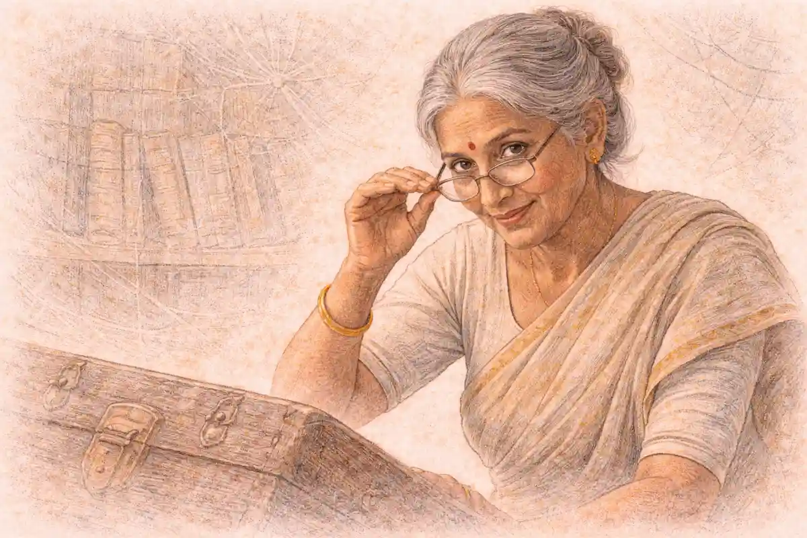

Racial capitalism is a term with an address. Before it named a claim about capitalism in general, it named a specific society: South Africa under apartheid, analysed by Marxist historians and sociologists during the 1970s who were arguing about whether that country's racial order served capital accumulation or obstructed it. Only afterwards, in a celebrated study published in 1983, was the phrase lifted out of that debate and generalised into a thesis about the origins of capitalism itself, and it is in that generalised form that the term circulates in lecture halls, journals, and political writing. Readers who meet the phrase in its generalised form usually meet it staged as a challenge directed at Marxism from outside, a verdict delivered on the tradition by its critics. That staging is wrong, and wrong in a way that changes what the argument is about. The general claim is contested, certainly, but its most searching critic is not a defender of orthodoxy guarding a border. The critic is a Marxist historian who argues that the concept, in its strong form, misunderstands what race is. Both sides of the argument are Marxist, both sides work from the same archive of slavery, colonialism, and labour, and the disagreement between them concerns the genesis and the ontological standing of race within capitalist development. Establishing that geography of the dispute, before any exposition of either position, is the first task of an honest guide, because a reader who mistakes the argument for a border skirmish will misread every contribution to it.

Two disciplines govern what follows. Each position is stated in its proponents' own terms, at the strength its proponents would choose, before any criticism of it is weighed; the reader is entitled to meet the strongest version of each side rather than a summary arranged to make one side's victory easy. And where the primary sources of earlier centuries employed the vocabulary of racial contempt that their societies licensed, this article describes what such sources said and identifies where they said it without reproducing their epithets, because the analytical work is done by the characterisation and nothing is added by the words themselves. The exposition links rather than re-explains the series' standing concepts where they appear: the account of capitalism's violent beginnings is treated in the guide to [primitive accumulation](/2011/01/01/primitive-accumulation-explained/), and the structure of the class relation in the [guide to the Marxist theory of class](/2011/09/01/marxist-theory-of-class-guide/), so that the space here can be spent on the dispute itself.

## Racial capitalism at home: a term with an address

By the opening of the 1970s, the writing of South African history had settled into two broad camps whose disagreement was, at bottom, a disagreement about what apartheid was for. The older interpretation, liberal in temper and associated with the established universities and with economists such as D. Hobart Houghton, treated racial discrimination as an inheritance: a frontier prejudice carried into an industrial society where it made less sense with every passing decade. On that reading, segregation was economically irrational. A maturing economy needed skilled labour, stable urban workforces, and expanding consumer markets, and a legal order that reserved skilled work by ancestry, forbade permanent African urbanisation, and depressed the purchasing power of most of the population obstructed all three. Time and growth were therefore allies of reform; the colour bar would be eroded by the same industrial development that had made it anomalous. The state that had legislated apartheid after the National Party's victory in the election of 1948 was, on this account, governing against the grain of its own economy, and the contradiction would in due course assert itself.

Against that interpretation a younger generation of scholars, many of them South Africans working in exile or in the newer universities, and many of them reading the country's history through Marxist categories, argued that the liberal story had the direction of causation backwards. Segregation, and after 1948 apartheid, were not survivals that industrialisation had failed to clear away. They were constructions, repeatedly rebuilt across the twentieth century, and they were rebuilt because they did work for the economy's dominant sectors. The mineral revolution had created an industry whose profitability rested on extremely cheap labour; the gold mines of the Witwatersrand operated low-grade ore that could be worked at a profit only if wages were held near subsistence for a single man, and the system that delivered such wages was the migrant labour system: workers recruited from rural reserves and from neighbouring territories, housed in compounds, bound by pass laws, and returned to the countryside when their contracts or their health ended. Racial legislation was the machinery of that system. On the revisionist reading, racial rule was not an embarrassment attached to South African capitalism from outside. It was one of its load-bearing structures, and the phrase that circulated in the debates of this camp, racial capitalism, named exactly that: a configuration in which racial domination and capital accumulation were not two systems in friction but a single arrangement whose parts presupposed each other.

### Who coined the term racial capitalism?

It originated in South African debates of the 1970s, where it described the specific relation between apartheid and capital accumulation. A study published in 1983 generalised it into a claim about capitalism's origins, which is the sense in which the term now mostly circulates.

The point deserves emphasis because later usage reversed it. The phrase did not begin as a theory of capitalism everywhere and then find an application in South Africa. It began as a description of one country's order, offered inside an argument about that order's mechanics, and its first referent was a concrete institutional complex: the reserves, the recruiting organisations, the compounds, the pass system, the statutory colour bar. When scholars in the debate wanted to say that apartheid was functional for accumulation rather than a drag upon it, the expression racial capitalism compressed the claim into two words. Compressing a claim is not the same as proving it, and the debate's participants understood the expression as a hypothesis about a particular society, to be tested against the evidence of mining finance, agricultural labour, and state policy, not as a definition of capitalism as such. Keeping that original modesty in view matters for everything that followed, because the generalised use of the term inherited the compression without always inheriting the discipline of the test.

### What did the South African debate actually argue about?

It argued about function. One side held that apartheid was an irrational survival that a maturing economy would shed; the other held that racial rule was an active instrument of accumulation, supplying cheap and controlled labour to mines, farms, and factories, and that growth would therefore entrench rather than dissolve it.

Around that central question of function, subsidiary arguments proliferated, and they were arguments conducted with evidence. Did the mining houses support the colour bar from conviction, from convenience, or from calculation, and did their support change as the industry's needs changed? Did white workers defend their protected position as a labour aristocracy defends a rent, and if so, what did their defence cost the wider working class? Was the state's role that of an instrument of capital in general, or did it arbitrate among capitals whose interests in racial policy diverged, the mines wanting labour cheap and mobile, the farms wanting labour immobilised and available at harvest, manufacturing increasingly wanting workers who were settled, literate, and able to buy what factories produced? Each of these questions had a documentary answer, and the debate's great virtue was that its participants could be wrong in checkable ways. Its literature is full of corrections absorbed and positions revised: the pure functionalism of the earliest revisionist essays gave way, under criticism from within the same camp, to accounts in which apartheid served some fractions of capital, burdened others, and acquired institutional weight of its own. The term racial capitalism survived those revisions because the core claim survived them: that in this society, at least, racial ordering was internal to the accumulation process and not an external inheritance awaiting dissolution.

## The machinery the term described

The mechanism at the centre of the revisionist case was set out in an essay of 1972 by Harold Wolpe, "Capitalism and Cheap Labour-Power in South Africa", published in the journal Economy and Society and argued over for two decades. Wolpe's question was how the mines could pay wages on which no family could live and yet find the supply of workers renewed generation after generation. His answer located the subsidy in the reserves: the territories set aside for African occupation, where households continued to produce part of their own subsistence by agriculture. Because the worker's family could feed itself, in part, from the land, the wage needed only to cover the worker's own maintenance during his contract, and the costs of raising the next generation of workers and of supporting the old and the injured fell on the rural household rather than on the employer or the state. Segregation, on this account, was preserved and deepened into apartheid precisely because it preserved the reserves as reservoirs of subsidised labour power, and the state's interventions, from land legislation to the Bantu Authorities system, were intelligible as the maintenance of a labour regime. The elegance of the argument made it the debate's centre of gravity: it specified a mechanism, named the beneficiaries, and explained why a system that looked like archaic prejudice from the liberal vantage point was being actively reproduced by rational economic actors.

The mechanism was not static, and Wolpe himself registered the change. As reserve agriculture decayed under overcrowding and soil exhaustion, the subsidy shrank; households could no longer reproduce themselves from the land, and the system's product was increasingly not cheap labour peacefully delivered but social crisis displaced into the countryside and the urban townships. Later formulations within the same tradition therefore shifted the emphasis from the subsidising function to control: influx control, the pass laws, and the bantustan policy of the later apartheid years could be read as attempts to manage a population whose labour was less needed in its old quantities and whose political presence the state sought to deny by assigning its citizenship elsewhere. Frederick Johnstone's study Class, Race and Gold, published in 1976, supplied the complementary account of the colour bar from the side of the mines: the statutory reservation of skilled work, he argued, reconciled the mining houses to white labour's demands while the mass of unskilled work was performed by Africans at wages the racial order kept low, so that the division among workers was not an obstacle to the industry's profitability but a condition of it. The white worker's protected wage and the African worker's depressed wage were two outputs of one arrangement.

### Did the South African analysts agree that apartheid served capital?

No, and the disagreement ran through the Marxist camp as well as between camps. Mining, farming, and manufacturing drew different benefits from racial rule and bore different costs, state policy arbitrated among them, and the strongest revisionist accounts treated functionality as a question to be settled sector by sector rather than assumed.

The sector point proved to be where the debate did its most durable work. Gold mining, working low-grade ore at a fixed international price, had an overwhelming interest in cheap, controlled, oscillating migrant labour and a weak interest in consumer markets. Agriculture wanted labour tied to the farms and competed with the mines for recruits, a rivalry the state managed through allocation and coercion. Manufacturing, growing rapidly from the 1940s, increasingly employed African workers in semi-skilled positions whatever the statutes said, needed those workers trained and settled near the factories, and sold into a domestic market whose poverty limited it. A theory that asked whether apartheid served capital in general dissolved on contact with this plurality: the honest question was always which capital, in which period, at whose expense. Merle Lipton's Capitalism and Apartheid, published in 1985, pressed the liberal case in its strongest empirical form, assembling evidence that by the later decades business interests chafed against influx control, job reservation, and the skills shortage, and that economic growth had eroded some discriminatory practices in employment even while the political order hardened. The mature position toward which the debate converged held the two ends of the argument together: racial rule had been constructed and reconstructed in the service of accumulation, above all in mining and agriculture, and it had also generated rigidities and costs that sections of capital resented and that no functionalist formula could wish away. What nobody in the debate's mainstream returned to was the innocent liberalism of the starting point, the picture of prejudice as a mere leftover. The term racial capitalism belonged to that settlement. It named the discovery that a racial order could be made, remade, and made profitable, and its South African career ended with the referent discipline intact: it described the relation between a specific racial state and a specific structure of accumulation, and its users could point to the machinery.

It is worth pausing on the methodological character of that achievement, because the generalised term is often used in a register the South African debate would not have recognised. The participants in the argument about apartheid were, whatever their politics, explaining institutions: statutes, recruiting systems, wage structures, land law. Their claims could be tested against archives, and they were. When later writers took up the phrase, the referent shifted from institutions to the nature of capitalism itself, and the kind of evidence relevant to the claim shifted with it, from the archive of a single society to the whole history of the modern world. A claim pitched at that scale can still be argued, and the 1983 study argued it with enormous learning, but it is a different kind of claim, vulnerable to different objections and requiring different defences. Much of the confusion in the literature since arises from treating the two claims as one: citing the South African machinery as though it established the universal thesis, or attacking the universal thesis as though the South African analysis depended on it. The sections that follow keep the two apart deliberately. First the generalisation is stated at full strength, as its author framed it. Then the older antecedent of 1935 and the contrary answer of 1948 are recovered, because the generalisation cannot be assessed without them. Then the dispute between the generalisation and its Marxist critics is staged in its own terms.

## The generalisation: Robinson's study

The study that carried the term out of South Africa was Cedric J. Robinson's Black Marxism: The Making of the Black Radical Tradition, published in 1983 and reissued by the University of North Carolina Press in 2000 with a foreword by the historian Robin D. G. Kelley, in which form it reached the wide readership that made it a standard reference. Robinson, a political scientist who had worked on African liberation movements and on the theory of leadership, wrote the book against what he took to be a disabling inadequacy in the Marxist tradition's handling of race. Marxist analyses, he argued, persistently treated racial phenomena as secondary: as ideology concealing class interests, as a pre-capitalist residue that development would dissolve, or as a division sown within the working class by its enemies, in each case as something whose explanation lay elsewhere. His counter-claim was that this treatment was not an accidental blind spot but a structural one. Marxism was a product of European civilisation, and European civilisation had organised human difference by descent long before capitalism; a theory formed inside that civilisation inherited its terms of order, and its account of history, centred on the European proletariat's self-emancipation, could not register the forms of resistance that arose from outside those terms. The book's purpose was therefore recovery as much as refutation: to identify an autonomous tradition of Black radicalism, older than Marxism and independent of it, and to show that the major Black intellectuals who had engaged Marxism had each, in Robinson's reading, passed through it toward that older tradition's ground.

The argument's first movement concerns the emergence of capitalism from European feudalism, and it is the movement on which the generalised concept of racial capitalism rests. The conventional Marxist narrative, and indeed the conventional liberal one, treats the transition from feudalism to capitalism as a levelling process: markets dissolve status, money makes men interchangeable, and the particularisms of the old order, of birth, confession, and nation, are progressively melted by a universalising solvent. Robinson denied that the European order undergoing this transition was ever particularism-free in the relevant sense. European society, he argued, had for centuries allocated standing by descent group: the enslavement of Slavs, whose name supplied the vocabulary of bondage across European languages; the legal apartness imposed on Jews, confined to named occupations and quarters and periodically expelled or massacred; the treatment of the Irish as a conquered population of inferior stock; the gradations of blood and lineage that structured Iberian society and were codified in statutes of purity of blood. Racialism, in his usage, was not an invention of the modern colonial world. It was a standing habit of European civilisation, a way of organising difference that long predated the capitalist mode of production, and the bourgeoisie that emerged from that civilisation carried the habit with it into the new order. Capitalism did not encounter race abroad and improvise it for colonial use. It was racial from its formation because the society that formed it was racial in its organisation, and Robinson proposed the compound term to fix the point: the development of capitalism was not merely accompanied by racial differentiation but pursued through it, so that what requires a name is not capitalism plus racism but racial capitalism, a single historical formation.

The second movement draws the consequence for the history that followed. If racial differentiation was woven into capitalism's formation, there is no reason to expect development to dissolve it, and the record, Robinson argued, shows development repeatedly reconstituting racial hierarchy in new forms rather than tending toward its abolition: slavery succeeded by formally free but racially ordered labour regimes, colonial rule by racially stratified citizenship, and emancipation, where it occurred, by new instruments of differentiation. The third movement concerns theory itself. A Marxism formed within European civilisation, sharing its racialism and its confidence that history's motor was the European industrial class, would systematically misread resistance arising from other grounds: the slave revolt, the maroon community, the African religious and cultural continuities that sustained opposition in the Americas. Hence the book's constructive thesis, the Black Radical Tradition: an African ontology, a shared epistemology carried across the Atlantic in the holds of the slave ships and preserved in the cultures the enslaved built, which generated a resistance that was never merely reactive and never merely economic, and which constituted a tradition in its own right, with its own intellectuals and its own integrity. Black Marxists, on this account, are best understood as figures who discovered the limits of the imported framework and gravitated, each in his own way, toward the tradition that preceded it.

### What are the three theses of the generalising study?

First, capitalism emerged from a European order already organised by racial differentiation, so its formation was racial in character. Second, its development therefore pursued racial directions rather than dissolving them. Third, Marxism, as a European construction, is inadequate to grasp either movement, and an autonomous tradition of Black resistance stands outside it.

The architecture should be noticed, because the theses support one another and critics must choose which to engage. The first thesis is a claim about origins, answerable to the history of feudal and early modern Europe. The second is a claim about tendencies, answerable to the whole subsequent record of capitalist societies. The third is a claim about a body of theory, answerable to that theory's texts and to the biographies of the Black intellectuals the book examines. A reader can accept the second while rejecting the first, holding that whatever its origins, capitalism's developed forms everywhere exhibit racial ordering; many who use the term do exactly that, and the difference between the origins claim and the tendency claim will matter when the dispute is staged. A reader can also accept the first two and resist the third, holding that Marxism contains resources, in its method if not in all its canonical texts, adequate to the phenomena. The book's influence has flowed through all these partial appropriations, and part of the term's slipperiness in circulation is that its users are often affirming different subsets of the three theses while believing themselves to be affirming the same thing. Robinson's own text is unambiguous about the set: he held all three, and held them as one argument, and the recovery of the Black Radical Tradition was for him not an optional supplement but the argument's destination.

## The Black Radical Tradition

The constructive half of Robinson's argument deserves separate statement, because it is the part most often detached in summary and the part that determines the book's relation to Marxism. The Black Radical Tradition, as he presents it, is not a shelf of books or a party programme. It is a collective consciousness formed in Africa, carried through the catastrophe of enslavement, and preserved in the cultures of the African diaspora: an ontology, in his vocabulary, in which the people's wholeness and the rejection of the terms of order imposed by European civilisation form a continuous ground of resistance. Its evidence is the historical record of refusal itself: the slave ship revolts, the maroon communities that held territory against colonial states from Jamaica to Brazil, the everyday sabotage and flight that made slavery's discipline never quite secure, and, at the level of high culture, the work of Black intellectuals whose deepest commitments, on Robinson's reading, were never exhausted by the European frameworks they borrowed. The tradition's radicalism is thus not derived from Marxism and does not await Marxism's completion. It is prior, autonomous, and epistemologically distinct: it knows the world from a location that European theory, including its Marxist variant, cannot occupy.

Three major figures carry the demonstration, and Robinson's readings of them are the book's most debated pages. W. E. B. Du Bois appears as a thinker whose early formation in German scholarship and whose engagement with Marxist categories were progressively outgrown as his subject, the global colour line, pressed him toward a standpoint that the categories could not hold. C. L. R. James appears as the revolutionary whose orthodoxy was always in tension with his attention to the self-activity of ordinary people and of the enslaved of San Domingo, a tension Robinson resolves in favour of the tradition. Richard Wright appears as the novelist whose break with the Communist Party registered the same discovery in literary form: that the framework demanded the surrender of a Black interiority it had no means to value. In each case the pattern Robinson discerns is a passage through Marxism rather than a settlement within it. Marxism functions, in these biographies, as a stage: entered for its power, mined for its insights, and finally set aside or subordinated when the tradition's deeper ground asserts itself. The claim is explicitly about the tradition's self-understanding, and it therefore stands or falls by evidence of a kind unusual in intellectual history, the evidence of what these figures themselves believed they were doing.

That evidential exposure is the section of the argument its critics have pressed hardest, and the full staging of the dispute below gives their case its place. Here it is enough to note the asymmetry the book creates. Against Marxism, Robinson's standard is internal and biographical: the theory is convicted by the testimony of those who knew it best and moved beyond it. For the Black Radical Tradition, the standard is continuity: the persistence of an African ground across rupture and dispersal, asserted at a level of generality that no single text anchors. Sympathetic readers, Kelley foremost among them, have defended the construction as a necessary act of recovery, the naming of a coherence that the archive of slavery was designed to obscure; the tradition had to be posited before its traces could be read as traces. Critical readers reply that a coherence which must be posited before it can be found governs the finding too completely, and that the figures' own professions, James's lifelong and explicit Marxism above all, are evidence of the plainest kind against being enrolled in a passage out of Marxism. Both readings are live in the scholarship, and the dispute between them is not resolvable by tone. It turns on how much weight retrospective construction may bear against contemporaneous self-description, a question the article returns to when the tradition thesis is examined as a whole.

### Why do the figures described by the tradition dispute its description of them?

Because the construction is retrospective. James insisted to the end of his life that he was a Marxist and that his study of the San Domingo revolution was written as one; Du Bois's relation to Marxism was elective and shifting rather than a stage outgrown; the tradition thesis reads their careers from its destination backwards.

The point can be sharpened without being settled. A tradition, in the sense historians ordinarily use, is a chain of transmission: texts read, arguments inherited, institutions maintained. Robinson's tradition is deliberately not that; it is a shared ground that need not pass through books, and its continuity is carried in culture, in religion, in the memory of a people. Traditions of that kind exist, and national histories are full of them, but they are correspondingly hard to falsify, since the absence of textual transmission is predicted by the theory rather than counted against it. The Marxist objection, when it comes, will make much of this. The constitutive position's defenders answer that the demand for documentary chains is itself a European archival standard, inattentive to peoples whose continuity was deliberately driven out of the written record, and that the slave trade's violence against literacy and lineage makes the surviving evidence exactly as fragmentary as the thesis expects. Neither answer disposes of the other. What can be said neutrally is that the Black Radical Tradition is the most original and the least checkable element of the 1983 argument, and that assessments of the book divide, in practice, according to the weight a reader assigns to it: those who take racial capitalism as a claim about capitalism's formation can set the tradition thesis to one side, while those who take the book whole must defend a philosophy of cultural continuity that its Marxist critics regard as its weakest joint.

## The constitutive position in its own terms

It is time to state the first of the two positions systematically, in the form its proponents would recognise as their strongest. The constitutive position holds that racial differentiation is not an accident that befell capitalism, an ideology it happened to use, or a inheritance it is slowly shedding, but a constituent of the social order from which capitalism emerged and a continuing feature of its operation. The claim has a historical form and a structural form, and its proponents move between them. Historically: the populations, properties, and legal standings from which the capitalist world was built were already sorted by descent; the expropriations that created its labour force and its accumulated wealth were conducted along lines of human classification that preceded the market and were sharpened by it, from the enslavement of Africans to the dispossession of indigenous peoples, whose relation to [the international order capitalism built](/2017/02/01/marxism-and-imperialism-guide/) cannot be told without them. Structurally: capitalist societies allocate exposure to coercion, premature death, dispossession, and insecurity unevenly, and the allocation follows racial lines with a regularity that no theory of mere prejudice explains. The position therefore refuses the grammar of addition, in which a class analysis is completed and race is appended as a further variable. On its account, there is no historically existing capitalism of which race is not already a part, and an analysis that begins by abstracting race away has abstracted away the object.

Stated with that care, the position is not the slogan it becomes in careless mouths. It does not say that every capitalist act is motivated by racial animus, or that class relations are unreal, or that racial categories are natural kinds whose permanence is guaranteed by biology. Its proponents are materialists: racial differentiation, for them, is something societies do, with laws, markets, police, and property, not something bodies are. What the position denies is the sequence in which race is produced by a capitalism that could in principle have been otherwise, raceless at the origin and racial only in application. Against that sequence it sets two observations. The first is chronological depth: descent-based ordering in Europe long precedes the capitalist era, so that a capitalism arriving in a world already sorted by lineage found the instrument ready and did not need to invent it. The second is recurrence: across four centuries and across regimes as different as Caribbean slavery, South African apartheid, and formally liberal market democracies, racial differentiation reappears as an organising principle of labour and citizenship, reconstituted after every formal abolition that was supposed to end it. A feature so persistent, the constitutive theorist argues, is not well described as a tool picked up and set down at convenience. It behaves like a premise.

The position carries a methodological instruction, and the instruction is part of its content. Begin not from the abstract model of capital and then ask where race enters, but from the concrete history in which the two were never separate, and treat the abstract model as the thing requiring justification. In practice this reverses the burden of proof that governs much Marxist writing on race. The question is no longer why a universalising system tolerates a particularist survival, but why anyone expected universalism from a system born in a racial order and reproduced through differentiated exposure to its harms. It also reframes the canonical texts: where Marx and his successors analysed episodes of racialised expropriation, as in the chapters on the so-called primitive accumulation with their accounts of slavery, colonial plunder, and the hunting of human beings for skins and labour, the constitutive reader takes those passages not as illustrations of a general process but as the record of the process itself, racial in its actual conduct whatever its abstraction in theory. The counter-reading of those same passages by Marx himself belongs to a neighbouring article, on [Marx's own writings on colonialism](/2017/03/01/marx-on-colonialism-debate/), and is deliberately not entered here.

### What does constitutive mean in this dispute?

It means that racial differentiation belongs to the formation itself rather than arriving as an external addition. A constitutive feature is one the object cannot be historically specified without: remove it, and the capitalism that actually developed, with its labour regimes and its distributions of security, is no longer the object under description.

One further clarification protects the position from its commonest caricature. To call race constitutive of capitalism is not to call it capitalism's essence in the sense of a timeless inner nature, identical in every period. The differentiation is historically variable: the lines are drawn in different places, against different populations, by different instruments, in the age of the slave trade, the age of empire, and the age of formally equal citizenship. What persists, on this account, is not a fixed content but a function and a habit: the sorting of populations into differential exposure, renewed in each period's materials. Proponents insist on this variability precisely because it answers the objection that a constitutive race must be a static race. The charge that the position freezes race into an eternal structure is the critique to be examined at full strength in its own section; here it is enough to register that the position's serious exponents deny the freezing in advance, and that the argument between the two positions is therefore not an argument between history and its denial, but between two histories: one in which the differentiation is inherited and perpetually remade from within the formation, and one in which it is generated afresh, as ideology, by each period's labour regime and could in principle fail to be generated.

## The position carried forward

The 1983 argument might have remained a monument, admired and unassimilated, had later scholars not taken up its central term as an instrument for new material. The most consequential continuation came from geography. Ruth Wilson Gilmore's Golden Gulag, published in 2007, a study of the prison expansion in California, defined racism as "the state-sanctioned or extralegal production and exploitation of group-differentiated vulnerability to premature death", and built its analysis on the definition: the carceral state's growth was unintelligible, she showed, without the differentiation of populations into those whose lives the state organises to protect and those whose abandonment it organises instead. The definition is quoted here because it displays the constitutive position at work in mature form. Race, in it, is not a belief and not a prejudice; it is a practice of the state and of capital that sorts people by group into unequal exposure, and racism is the name of the sorting, measurable in years of life. Gilmore's book also exemplifies the position's historical discipline at its best: its racism is not an eternal fog but a specific production, located in the surpluses of land, labour, and finance of a particular state in particular decades, and the analysis is all the more damning for its specificity.

Jodi Melamed's Represent and Destroy, published in 2011, carried the framework into the study of official antiracisms, arguing that the liberal orders of the postwar United States did not merely fail to dismantle racial differentiation but administered it through their very languages of recognition and inclusion, so that antiracism itself became a technology for distributing life chances along racial lines while narrating the distribution as progress. A wider literature in the history of capitalism, in Black studies, and in literary and cultural analysis took up the term during the same decades, applying it to materials as various as the slave trade's finance, the racial organisation of domestic labour, and the differentiated citizenship of migrant workers. Two features of this uptake matter for the dispute. First, the term's carriers were increasingly scholars who had no commitment to Robinson's full triad of theses: the Black Radical Tradition thesis in particular travelled less far than the concept of racial capitalism, so that the position in circulation is often Robinson's first two theses detached from his third. Second, the uptake was uneven across disciplines, strongest where the analysis of culture and space was central, weakest where the chronology of slavery and ideology was the professional question, among historians of the slave systems themselves. That unevenness is itself evidence in the dispute: the concept flourishes where differentiation's persistence is the datum to be explained, and is resisted where genesis is the datum, which is precisely the divide between the two positions this article is staging.

### How did the concept travel beyond South Africa?

Through scholarship rather than manifesto. A reissue of the 1983 study at the turn of the century, its adoption by geographers and historians of capitalism for new materials, and its evident fit with the persistence of racial ordering in formally equal societies carried the term into fields its South African originators had not addressed.

The travelling, however, exacted the price that travelling concepts usually pay. In its South African usage the term had an address: a reader could be taken to the reserves, the compounds, and the statutes it named. In its generalised usage it named a property of a world system, and in its most popular usage it sometimes named little more than a judgement, that a given arrangement was both capitalist and racial, with the analytical content, the claim about formation and reproduction, left unstated. Proponents of the position are themselves among the sharpest critics of this dilution, since a term that explains everything a speaker dislikes explains nothing in particular. Gilmore's practice is again instructive: the framework earns its keep in her work by identifying mechanisms, the production of group-differentiated vulnerability through identifiable state action, and it is the mechanisms, not the label, that carry conviction. The internal dispute with the produced position will turn out, at its most productive, to be an argument about exactly this: what mechanisms generate racial differentiation, and whether the mechanisms presuppose the differentiation they are said to generate. With the constitutive position stated, the article turns to the older materials both sides claim: the great antecedent of 1935, which founded the study of race and labour in America, and the contrary systematic answer of 1948, without which the produced position cannot be understood.

## An antecedent from the nineteen thirties: Du Bois and Reconstruction

Half a century before the generalisation, a single book had already established the questions the dispute would organise, and both positions claim descent from it. W. E. B. Du Bois published Black Reconstruction in America in 1935, subtitled as an essay toward a history of the part which Black folk played in the attempt to reconstruct democracy in America after the Civil War. The reigning academic account of Reconstruction, the work of the Dunning school, treated the enfranchisement of the formerly enslaved as a tragic error and their governments as corrupt incompetence, and it treated the enslaved themselves as passive objects of others' policies. Du Bois inverted every element. The enslaved, he argued, had been actors in their own emancipation: during the Civil War they had withdrawn their labour from the Confederacy in a movement he named, deliberately, a general strike, walking from the plantations to the Union lines and thereby converting a war for union into a war against slavery. Reconstruction then appeared not as an aberration but as an experiment in interracial democracy, abolition democracy in his phrase, with public schools, expanded suffrage, and labour protections among its achievements, and its overthrow appeared as what he called a counter-revolution of property, in which the propertied classes of North and South reconciled at the price of the Black worker's freedom. The book closed with a chapter on the propaganda of history, an indictment of the scholarly profession itself, which remains among the founding documents of modern historiography's self-criticism.

For the present dispute, one passage matters above all others. Explaining why the alliance between Black and white labour, which the logic of shared exploitation seemed to promise, repeatedly failed, Du Bois pointed to a compensation paid to the white worker in a currency other than money. The white labourer received low wages, he wrote, but was compensated in part by a public and psychological wage: he was admitted to public functions and parks on terms of equality, deferred to by police and courts, courted by politicians, and granted a standing in the social order that cost his employers nothing and reconciled him to the wages they paid. The formulation founded a literature. David Roediger's The Wages of Whiteness, published in 1991, took the phrase as its title and its programme, tracing how white working-class identity in the nineteenth century was made through the repudiation of Blackness as much as through the sale of labour. Theodore Allen's The Invention of the White Race, published in two volumes in the 1990s, argued the complementary thesis from the colonial archive: that the category of the white race itself was fashioned in colonial Virginia as a ruling-class instrument of social control, a set of privileges conferred on European labourers precisely to divide them from African labourers with whom they had made common cause in revolt. Allen's work belongs with the produced position examined below, and its appearance here, in the wake of Du Bois, is a first sign that the antecedent of 1935 feeds both sides of the later argument.

### What did the study of Reconstruction establish before either position existed?

It established that racial division among workers was an active historical product with beneficiaries and mechanisms, not a natural fact: that emancipation was driven partly by the enslaved themselves, that Reconstruction was a labour question, and that white workers received a compensating standing in place of the material gains unity might have won.

Why could a single book be claimed by two opposed positions? Because it contains both a genesis and a persistence, and the positions differ in which they take as fundamental. Readers of the constitutive persuasion dwell on Du Bois's presentation of racial hierarchy as the deep grammar of American development, older than the republic and surviving every regime change, structuring the choices of every class. Readers of the produced persuasion dwell on his mechanisms: the psychological wage is a device, maintained by institutions and renewed by practice, which explains the division's reproduction without positing race as a transhistorical substance; it is an ideology with a payroll. Du Bois himself, writing before the dispute existed, cannot be conscripted to settle it, and the care with which he is claimed by both camps is a measure of the book's authority. His own development complicates every conscription: the Du Bois of 1935 was moving toward the Marxist framework he had long studied at a distance, and his later trajectory, through the peace movement and the persecutions of the Cold War to his joining of the Communist Party in 1961 and his exile in Ghana, illustrates the very passage through Marxism that Robinson's tradition thesis describes, while resisting it, since the movement was toward Marxist allegiance at the end of his life rather than away from it. The antecedent thus refuses to serve as a premise. It functions in the debate as a shared treasury of questions and one indispensable concept, the psychological wage, whose interpretation is itself contested ground.

### How can a wage be paid in standing rather than money?

By conferring public deference, access, and legal indulgence that cost employers nothing while reconciling the recipient to low money wages. The standing functions as compensation: it gives the white worker a stake in the racial order and a reason to defend the arrangement that pays him partly in status.

The concept repays slow reading, because it does three kinds of work at once. It is an explanation of behaviour that otherwise looks irrational, the white worker voting and fighting against the alliance his material interest recommends. It is an account of how racial ideology is reproduced without recourse to conspiracy: no committee designs the psychological wage; it is paid daily, in courtesies and exclusions, by the ordinary operation of institutions, and each payment renews the classification it presupposes. And it is, quietly, a theory of what race is in the produced sense: not a thing in the blood but a distribution of standing, manufactured by practice. Yet the same passage can be read, and has been read by the constitutive side, as evidence of how deep the formation runs: a compensation so woven into the texture of public life that no merely economic reorganisation touches it, persisting across the abolition of slavery and the defeat of the Confederacy because it answers to something in the order itself. The dispute between the positions is, in miniature, a dispute over how to read this page of Du Bois. Both readings can cite him. Neither can cite him exclusively.

## The opposite answer: Cox's system

Thirteen years after Du Bois, a Trinidad-born sociologist working in the United States published the era's most systematic statement of the contrary view. Oliver Cromwell Cox's Caste, Class, and Race, published in 1948, was a vast comparative study of social stratification which arrived, in its American chapters, at a thesis directly opposite to the one Robinson would advance in 1983: racial prejudice is not an inheritance that capitalism received and perpetuated but a product of capitalism itself, an attitude propagated by an exploiting class to justify the exploitation of the groups it stigmatised. Cox's route to the thesis ran through polemic against the dominant sociology of his day. The American literature, represented by the caste school of anthropology and sociology and by Gunnar Myrdal's An American Dilemma of 1944, treated race relations as a matter of attitudes, ranking, and moral tension within an otherwise sound order: prejudice was a creed at war with the national creed, and caste analogies described a status system of great antiquity. Cox dismantled the analogy. Caste, he argued, is a stable, religiously sanctioned order whose members accept their stations; race relations in capitalist societies are nothing like this. They are a phenomenon of labour exploitation, historically datable to the expansion of European commerce and the plantation systems it built, and the prejudice that accompanies them is the ideology of that exploitation, varying in intensity with the need it serves.

The chronology was the argument's cutting edge. Cox insisted that the ancients did not think in modern racial terms, that exploitation in earlier orders proceeded without the elaborated doctrine of inherited group inferiority, and that the doctrine hardened precisely when and where a system of production required a permanently stigmatised labour force and needed to defend the requirement in moral language. Race prejudice, in his formulation, is a social attitude propagated among the public by an exploiting class for the purpose of stigmatising a group as inferior, so that the exploitation of that group or its resources can be justified. Strip the formulation of its period flavour and the produced position stands complete in outline: race is ideology; the ideology is generated by a labour regime; the analytical task is to trace the generation; and the ideology's persistence is explained by the persistence of the interests and practices that generate it, not by any transhistorical depth of its own. Cox drew the political corollary without flinching. Since the prejudice was functional to a system, it would not yield to exhortation, education, or goodwill; it would weaken only as the order that required it was transformed, and he expected racial antagonism to track the fortunes of the labour systems that bred it.

### What was the opposite answer given a generation earlier?

That race is downstream of capitalism rather than prior to it. In the 1948 study, prejudice appears as the ideology of an exploiting class, fashioned to justify its exploitation of stigmatised labour, arising with the plantation order and destined to weaken only as the labour regime that generates it is transformed.

Cox's book was, for decades, more cited than read, and its recovery by later scholars has the character of a rectification: the produced position acquired, retrospectively, a founder of stature comparable to the figures the constitutive side claims. The recovery also clarifies what the produced position is not. Cox was no crude reductionist for whom racial suffering was unreal or racial solidarity a delusion. His sociology was comparative and his moral commitments were plain; what he denied was a specific explanatory order. Where a writer of the constitutive persuasion sees racial classification preceding and shaping capitalist development, Cox saw capitalist development summoning racial classification into being as its instrument and alibi. The opposition that Robinson would later pose as a confrontation between Marxism and its outside was thus already present inside Marxist social science in 1948, between two Marxists, Du Bois's legacy on one side and Cox's system on the other, a full generation before the term racial capitalism existed to name one pole of it. The internal dispute is not an artefact of the term. The term gave a name to one side of an argument the tradition had been conducting with itself all along, which is the strongest preliminary evidence for this article's organising claim.

Cox also supplies the produced position with its characteristic explanatory confidence, and with the confidence its characteristic vulnerability. If prejudice is generated by labour regimes, then changes in regime should change prejudice in intelligible ways, and the theory stands exposed to the record: it can be embarrassed by persistence where the regime has vanished, by racial orders with no plantation in their ancestry, by the classification's portability to peoples the generating regime never touched. South Africa's own history poses one such embarrassment in acute form, since the ideology outlived the mining labour system that the revisionists had shown constructing it, though a Coxian may reply that the labour regime was transformed rather than abolished. The constitutive position's reply, examined in its turn, presses exactly here. But the produced position is not Cox's alone, and its most formidable contemporary exponent rebuilt it on different foundations: not the propagation of attitudes by a class, but the manufacture of an ideology by the everyday practices of a society, with the history of American slavery as the evidence and the concept of race itself as the thing to be explained away as a historical actor. That rebuilding, associated above all with Barbara Fields, constitutes the produced position in its modern form, and it is to her version that the critique of racial capitalism owes its force.

## The produced position in its own terms

The produced position holds that race is an ideology: a system of ideas about human difference which arose under specific historical conditions, which does specific work for the social order that generates it, and which must be continually reproduced by practice because it has no existence independent of the practices that enact it. Its modern architect is the historian Barbara J. Fields, whose essay "Slavery, Race and Ideology in the United States of America", published in New Left Review in 1990, remains the position's canonical statement, and whose later book with Karen E. Fields, Racecraft: The Soul of Inequality in American Life, published in 2012, extended the argument into a theory of how the ideology sustains itself. Fields writes as a Marxist and a historian of slavery, and her position is unintelligible except as both. The question she sets is not whether racial oppression is real; her scholarship on slavery and emancipation is an archive of its reality. The question is what kind of thing race is, and her answer disqualifies it as an explanatory primitive. Race, she argues, cannot do the work historians ask of it, because race is precisely what their explanations must account for.

Her evidence is the American sequence, and the sequence's order is her whole argument. Africans were enslaved in the English colonies before any developed ideology of race existed to license the enslavement; the earliest colonial records show a labour regime forming among people of several origins whose statuses were initially fluid, hardening over the later seventeenth century as the plantation economy consolidated. What required explanation, on her account, was the ideology's crystallisation at a particular later moment: when a society founded on slavery committed itself, in its revolution, to the doctrine that all men are created equal, the contradiction demanded resolution, and race supplied it. If the enslaved were a distinct order of beings by nature, their exclusion from the universal doctrine required no apology. Race as a systematic ideology was thus the offspring of a specific embarrassment, the child of slavery and liberty in collision, not the parent of either. The famous Virginia statutes of the later seventeenth century, assigning the child's status by the mother and converting Africans' terms of service into hereditary lifetime bondage, mark in law the hardening she describes: a labour regime first, a doctrine of nature second, each statute an ideological deposit of an arrangement already in force.

Racecraft, the later book's governing concept, names the reproduction mechanism. The Fields sisters borrow the analogy of witchcraft deliberately: in a society that believes in witchcraft, the rituals of detection and accusation continually manufacture the evidence of the thing believed in, and the belief is real in its effects while its object is a product of the practice. So with race. The daily rituals of classification, the form that demands a box be ticked, the policeman's description, the mortgage map, the casual sorting of neighbourhoods and schools, enact the classification, and the enactment is then cited as proof that the classification describes nature. Ideology on this account is not a set of false propositions floating above society, propagated by villains; it is a practical activity, renewed every day by everyone the society conscripts into performing it, and it changes as the practices that sustain it change. Hence the position's characteristic historical claim: the race of the slave regime, the race of segregation, and the race of later orders are not one thing persisting but a succession of ideologies, each generated by its period's arrangements and bearing the marks of its generation, continuous in vocabulary and discontinuous in content.

### What does produced mean in this dispute?

It names a genesis. Race has no career apart from the practices that enact it. A labour regime generates the classification it needs, the classification is renewed daily by social ritual, and when the regime changes the ideology is generated afresh in altered form, so that what requires explanation is always the generating practice, never an inherited substance.

The position's political physiognomy follows from its ontology, and should be stated as its proponents state it. If race is an ideology produced by specific arrangements, then affirming race as a permanent ground of politics, as the constitutive tradition is heard to do, concedes the ideology's central premise and mistakes the product for a foundation. The task is not to organise the classification but to abolish the practices that generate it, which are practices of a class society: segregated labour markets, differentiated citizenship, the conversion of human difference into differential life chances. Fields is explicit, and her readers must be, that none of this denies the reality of racial oppression or the urgency of fighting it. Ideologies are not hallucinations; they are, in her phrase's neighbourhood, the medium in which real distributions are organised and defended, and a person killed by an ideology is not less dead. The denial is directed solely at race's standing as an actor in history and a premise in analysis. To say that race did something, caused something, persisted through something, is for this position a grammatical error with political consequences: it relocates agency from the people and institutions that classify to the classification itself, and it lets the producers of the ideology disappear from the account of its production.

Allied scholarship fills out the position around Fields's core. Edmund Morgan's American Slavery, American Freedom, published in 1975, had already argued from the Virginian record that racism served to reconcile republican equality with slavery by uniting white freemen and white labourers in a shared status above the enslaved, an argument Fields's essay generalises and theorises. Allen's invention thesis, noted earlier, extends the same logic into a claim about the category white itself: not a people but a control formation, assembled at a datable moment for a stated purpose. Within labour history, the segmented character of markets and the employers' use of ethnic succession have been studied in a literature too large to summarise, much of it proceeding on produced assumptions without naming them. The position's strength in the academy is thus broader than its named exponents: many historians write as if race were produced, because their archives show it being made, statute by statute and custom by custom, and the constitutive position's challenge is precisely to ask why the making never has to start from nothing.

## The constitutive and produced positions: the table

The dispute can now be laid out in the form the series uses for arguments whose structure is the lesson. The table states each position in its own terms across the dimensions on which they differ, and the columns after the first two are chosen to expose what the disagreement is actually about: not whether racial oppression exists, not whether it matters, and not whether capitalism is implicated, since on all three the positions concur, but what explains racial hierarchy, what follows for action, and where each account is weakest. A reader who has absorbed the table can grade almost any use of the term racial capitalism by asking which column the use belongs to and whether it acknowledges the other column's objection.

| Position | Central claim | Principal texts | What explains racial hierarchy | Implication for political strategy | Strongest objection |
| --- | --- | --- | --- | --- | --- |
| Constitutive | Capitalism emerged from an order already sorted by descent, and its development reproduces racial differentiation as a premise rather than dissolving it | Robinson, Black Marxism (1983); Gilmore, Golden Gulag (2007) | A deep-rooted European practice of descent-ordering, inherited by capitalism and renewed through the sorting of populations into unequal exposure | Anti-racism is internal to anti-capitalism from the outset; organisation builds on the autonomous traditions of the racially oppressed | It converts what needs explaining into the explanation, treating race as a persistent thing rather than asking what produces it in each period |
| Produced | Racial classification is an ideology generated by specific labour regimes, slavery first among them, and renewed by the daily practices that enact it | Cox, Caste, Class, and Race (1948); Fields, "Slavery, Race and Ideology" (1990); Fields and Fields, Racecraft (2012) | The requirements of labour regimes and the ideological work of reconciling exploitation with professed universal principles | Attack the practices that generate the classification; unity is built by fighting the division's material machinery, not by affirming the categories | It must explain why the classification survives the regimes that generated it, crosses to new populations, and is never anywhere invented from nothing |

Read the table from the middle outward. The explanatory column shows the true fault line: one position explains racial hierarchy by inheritance and renewal within a formation, the other by generation and regeneration within regimes, and the two explanations differ in where they locate the burden of proof, the first asking the sceptic to explain persistence, the second asking the believer to explain genesis. The strategy column shows that the practical stakes, though real, are narrower than the rhetorical stakes; both columns prescribe fighting racial division in the present tense, and neither permits its postponement, so that the political distance between the positions is measured in the standing they accord race-conscious organisation and in the diagnosis of what such organisation is fighting. The objection column is symmetric by design. Each position's strongest objection to the other identifies a genuine methodological danger, reification on one side and explanatory shortfall on the other, and a use of the term racial capitalism that cannot say how it survives its column's objection has not yet joined the argument. This table also governs the grading of the term's popular career: the phrase used without a column, as a general verdict on the modern world, fails both columns' standards at once, since it neither specifies a formation to inherit from nor a practice that generates.

What the table deliberately omits is a verdict, and the omission is principled rather than coy. The sections that follow stage the critique and the reply at full strength, then turn to the evidence by which historians have tried to make the dispute empirical, and a reader who wants the article's own assessment will find it distributed through those sections rather than pronounced from above them. The series' practice in internal disputes, followed from the Frankfurt School to analytical Marxism, is to establish first that the argument is internal and what it is internal to; grading follows, and here the grading will be found to divide by question. On the genesis of the Atlantic slave systems the produced position's archive is the stronger; on the persistence and portability of racial classification after their generating regimes have vanished, the constitutive position's questions are the harder to answer; and on the character of Robinson's specific construction, the tradition thesis, the critics have the better of the surviving evidence. Those are judgements about parts. The dispute as a whole remains open because its central terms, genesis and persistence, are not two names for one fact, and a complete account would need to explain both with the same machinery. Neither side has yet produced that account to the other's satisfaction, and the honesty of the literature consists in neither side pretending otherwise.

## The critique at full strength

The strongest objection to the generalised concept comes from inside the tradition it claims to correct, and its author is a Marxist historian whose life's work is the history of slavery: Barbara Fields. It must be given at full strength, with its works identified, because it is the most substantial challenge the concept has received and because the commonest summaries of the debate, which stage Fields as a defender of Marxism against an external assault, invert her position entirely. She is not guarding the tradition's perimeter. She is arguing that a thesis advanced in Marxism's name fails Marxism's own standards of explanation. The objection, stated in her terms across the 1990 essay and Racecraft, has four movements.

The first is the reification charge. To treat race as a persistent structure, a thing that endures across centuries and regimes and does explanatory work in each, is to convert the object of explanation into the explanation itself. Race, for Fields, is an ideology, and an ideology is not a substance. It exists in the practices that enact it and the minds conscripted to perform it, and it lapses where the practices lapse. A concept of racial capitalism that builds race into capitalism's definition as a standing property has quietly adopted the ideology's own premise, that race is a real and durable feature of the human world rather than a classification societies manufacture. The analyst who begins there has ended the inquiry before it starts, since the interesting question, how the classification is produced and reproduced in this period by these institutions, has been answered in advance by the classification's supposed depth. Fields's charge is methodological before it is political: reification is the sin of mistaking an abstraction for an agent, and Marxist method exists, in large part, to catch it.

The second movement is the evidence of sequence, rehearsed in the produced position's statement above: in the North American case the labour regime precedes the ideology, and the ideology's crystallisation answers a datable political need. A transhistorical race cannot explain why the doctrine hardened when it did and not before, why its content shifted between the slave regime and segregation, or why societies without Atlantic slavery organise difference through other vocabularies. The produced account explains all three without remainder, by tying each formation of the ideology to the arrangements it served. The third movement is the demand for mechanism in reproduction. Because race is ideology, its persistence is not a datum requiring no account; it is an achievement of daily practice, the rituals of racecraft, and the account of any period must specify the rituals: the census category, the housing covenant, the school boundary, the hiring queue. Where the constitutive account invokes depth, Fields asks for the plumbing, and she regards the invocation of depth in the plumbing's absence as an evasion. The fourth movement is political, and it is the movement her critics most often omit. A politics founded on race as a permanent category, she argues, ratifies the classification it opposes; the goal is a society in which the classification does no work, and that goal is not served by ontologies that guarantee the classification eternal employment. Her objection is thus the opposite of complacency about racial oppression: it holds that the concept under criticism is too weak, not too strong, an obstacle to the analysis that abolishing the oppression would require.

### What is the reification charge, exactly?

That the concept treats race as a thing with a career of its own. Race, the charge runs, is an ideology enacted by practices; to install it in the definition of capitalism as a persistent constituent relocates agency from the institutions that classify to the classification, and the thing to be explained becomes the explanation.

### Why is the sharpest critic of the general claim a Marxist?

Because the objection is methodological and internal. Fields argues as a historian of slavery and a Marxist that a thesis advanced against Marxism's supposed blindness itself violates materialist explanation, mistaking an ideology for a substance and declining to ask what produces and reproduces it in each period.

Two clarifications keep the critique honest. Fields does not argue that racial capitalism in its South African sense is nonsense; her target is the generalised thesis and its treatment of race, and an analysis that specified the mechanisms by which a given racial order is produced would satisfy her standards whether or not it used the contested label. Nor does she stand alone as a voice crying idiosyncrasy. The unease she formalised is widespread among historians of slavery and of the Atlantic world, whose professional formation disposes them to ask of any category how it was made, and cognate criticisms of the tradition thesis have been made by scholars of James and of Du Bois who doubt that the figures can be enrolled as its witnesses. What distinguishes Fields's version is its completeness: she does not merely doubt the concept's evidence but proposes the rival research programme, the study of production and reproduction of ideology, period by period, and the programme has the great virtue of being executable. Archives answer its questions. The same cannot always be said of the questions the constitutive side prefers, and the asymmetry in executability is a real cost that the reply must somehow carry.

## The reply at full strength

The constitutive position's reply begins by accepting the demand for mechanisms and denying that mechanisms settle the matter. Grant that racial classification is enacted by practice and renewed by ritual; the question the produced account must then answer is why the rituals never start from a blank slate. Every period's generation of race works with inherited materials: an available repertoire of human classification, centuries deep, that supplies the categories before the period's labour regime has specified its needs. The plantation did not convene a committee to invent the idea that human beings sort by descent into unequal kinds; it found the idea ready, in a Europe that had sorted Slavs, Jews, and Irish by descent long before the first slave ship, and the readiness is the datum. Fields's sequence, the reply continues, is a regional sequence: it describes the North American hardening with great power, but the generalisation of racial capitalism rests on the wider claim that the North American case is a late chapter in a much longer European practice of descent-based ordering, a practice capitalism inherited rather than authored. On that claim the produced account has comparatively little to say, since its method, generation by each period's regime, applied consistently, would have to find a generating regime for the Iberian statutes of blood purity in the fifteenth century and for the racialisation of peoples within Europe who were never plantation labour at all.

The second argument is persistence under transformation. The ideology account predicts that racial classification should track its generating regime with some fidelity: abolish the regime and the ideology, deprived of its function and its rituals, should decay. The record shows instead a classification that survives the death of its supposed generator and intensifies in the freedom that follows. After American emancipation, the racial order did not fade with slavery's rituals of sale and patrol; it was rebuilt, within a generation, as segregation, disfranchisement, and lynching's terror, under a labour regime of sharecropping and wage work that differed profoundly from slavery. The produced account has an answer, that freedom itself created the new requirement, a subordinated but legally free labour force needing a new ideology, and the answer is not empty. But the constitutive reader notes the pattern the answers form: each successive regime is found, after the fact, to have required exactly the classification that appeared, and a theory that can explain every outcome by the requirement it infers from the outcome risks the unfalsifiability it charges against its rival. What looks from one side like generation looks from the other like a standing readiness to racialise, a disposition of the social order that regimes inherit and express rather than create. The disposition is precisely what the word constitutive names.

The third argument concerns embeddedness. Race in the constitutive telling is not sustained by belief alone, and the ideology model, however sophisticated its account of ritual, understates the extent to which differentiation is built into material arrangements that persist without anyone's present endorsement: into the geography of cities laid out under segregation, into accumulated wealth and its absence transmitted across generations, into the distribution of environmental harm and medical care. A family does not need to perform racecraft to inherit its consequences. The produced position replies, correctly, that these arrangements were produced and are reproduced by identifiable policies, and the argument circles back to the division of labour between the positions: generation stories are always available for the arrangements, and the constitutive claim is that the generation stories share a premise they do not examine, the prior sorting of the population into the groups among whom the arrangements distribute their goods. At this depth the dispute becomes genuinely difficult, and both sides know it. The disagreement is no longer about evidence, which both sides largely share, but about explanatory priority: whether the sorting is an explanandum that dissolves into its successive productions, or an inheritance whose weight each production must bear.

The reply closes with a concession, and the concession is part of the position's mature form rather than a decoration. The reification charge lands on the term's loose uses. Where racial capitalism functions as an incantation, a way of saying that an arrangement is very bad in two vocabularies at once, it does exactly what Fields says: it treats race as a self-evident substance and capitalism as a self-evident villain and explains neither. Serious proponents concede this and answer the charge not by denying it but by accepting its discipline: the concept is vindicated only where the analysis specifies the formation, the mechanisms of differentiation, and the evidence that differentiation is doing constitutive work rather than decorative. Gilmore's definition, with its insistence on production through identifiable state action, is one such disciplined use. The concession matters for the grading of the dispute because it converts the critique from a refutation into a standard: the question for any deployment of the concept becomes whether it meets the standard its own side has accepted, and deployments that meet it are not touched by the charge in its general form. What remains genuinely contested after the concession is the priority question, genesis against persistence, and to that question the historians' evidence about slavery's origins is the nearest thing the dispute has to a tribunal. It is to that evidence the article now turns.

## The slavery sequence as contested ground

If the dispute has an empirical heartland, it is the chronology of the Atlantic slave systems: what came first, the enslavement of Africans or the ideology that declared Africans enslavable by nature, and the historiography of that question is older than either position and refuses to conscript neatly. Eric Williams, later the first prime minister of Trinidad and Tobago, fired the modern opening shot in Capitalism and Slavery, published in 1944: the enslavement of Africans was an economic decision, taken because African labour was available and profitable where indigenous labour had been destroyed and European labour was dear, and racism was the consequence and rationalisation of the system, not its cause. The Williams thesis is the produced position in embryo, and it was aimed at a historiography that explained slavery by the prejudices of the enslavers. A controversy among American historians followed in the journals: Oscar and Mary Handlin argued in 1950 that in early Virginia the status of Africans was initially unsettled and that racism developed as slavery hardened into a system; Carl Degler replied in 1959, comparing Brazil, that prejudice preceded and facilitated enslavement in the English colonies as in the Portuguese; Winthrop Jordan's White over Black, published in 1968, amassed the evidence of English attitudes toward blackness reaching back before colonisation, associations of black with filth, sin, and savagery woven into the language itself, and concluded that slavery and prejudice grew up together in mutual interaction, an outcome both camps have cited ever since as a verdict for their side.

The subsequent scholarship refined rather than settled the question, and its refinements map onto the staged dispute with instructive fidelity. Morgan's Virginia study of 1975 showed racial ideology being consciously deepened, after episodes of interracial solidarity among labourers frightened the planter class, as an instrument of class peace among whites: generation, with named generators and a datable occasion. Robin Blackburn's The Making of New World Slavery, published in 1997, the most comprehensive Marxist history of the plantation systems, concluded that racialisation developed with the plantation complex itself, neither simply prior nor simply posterior, as planters and states elaborated a doctrine adequate to the unprecedented thing they were building, hereditary racial slavery on an industrial scale. Iberian evidence presses from the other direction: the statutes of purity of blood, directed first against converted Jews in fifteenth-century Spain, antedate the Atlantic plantation system and display a fully formed logic of descent-based exclusion available for export, which is the kind of exhibit the constitutive position assembles for its claim that Europe's racialism was older than its capitalism. Against it, the produced side observes that blood purity was a religious and lineage doctrine applied within a society of orders, and that converting it into the Atlantic system required precisely the work of generation the position describes: the scale, the hereditary permanence, and the association with a single stigmatised population were new, and novelty is what theories of genesis exist to explain.

An honest report must record that the chronology evidence, at the resolution the archives permit, is genuinely mixed, and that both positions survive it by choosing their resolution. Zoom into a single colony's early decades and the produced sequence is what the documents show: labour first, statutes after, doctrine last. Zoom out to the European centuries and the constitutive depth is what appears: a civilisation sorting by descent before it sorted by contract. The dispute is therefore not awaiting a missing document. It is a disagreement about the level at which the explanation should be pitched, and disagreements of that kind are resolved, when they are resolved, by the comparative fruitfulness of the research programmes built on each, which is why the article's next question is what tests, if any, the two positions can be put to that they do not both pass in advance.

## Tests the dispute can be put to

Four tests recur in the literature, each proposed in the confidence that it discriminates, each instructive in the way it fails to close the question. The chronology test has been described: it discriminates at the local scale and dissolves at the continental one. The portability test asks why racial classification, if generated by specific labour regimes, transfers so readily to populations those regimes never processed: to Asian migrants excluded by statute in settler societies, to immigrant groups racialised on arrival in industrial cities, to colonised peoples administered under descent-based categories on other continents. The constitutive side scores the transfers as the repertoire's availability, evidence that the classifying habit belongs to the formation rather than to any of its labour systems. The produced side answers that settler and industrial societies shared the generating problem, the management of differentiated labour forces under universalist professions, and solved it with similar tools for similar reasons, convergence rather than inheritance; and it notes that the classifications transferred are never identical, each bearing its regime's fingerprints, which is what a generation theory predicts and an inheritance theory must explain away.

The persistence test asks why classification survives its generating regime, and the dissolution test asks the reciprocal question: whether capitalist development anywhere erodes racial ordering without political struggle against it. On persistence, the produced answer invokes the autonomy an ideology acquires through its rituals and its sedimentation in law, property, and space; the constitutive answer is that an autonomy so complete, lasting centuries and regimes, is indistinguishable from the depth it was meant to replace, and that at some point the distinction between a reproduced ideology and a constitutive structure becomes a choice of words. On dissolution, the record is the constitutive side's best exhibit. The liberal expectation that growth dissolves racial ordering, the expectation with which the South African debate opened, has failed wherever it has been left to operate unaided: South African growth entrenched apartheid for decades; American prosperity coexisted with segregation's consolidation; formally colour-blind markets reproduce differentiated outcomes through inherited distributions. The produced position absorbs the point without surrendering, since its claim was never that markets dissolve the ideology their regimes generate; ideologies generated by a going order are conserved by it, and only the order's transformation, not its maturation, is expected to starve them. The tests, taken together, leave the dispute where the table left it: divided by question, genesis to the produced side, persistence to the constitutive, with each side's handling of the other's question acknowledged by both to be its weaker suit.

### What would count as evidence for each position?

For the produced position, documented sequences in which a labour regime precedes the doctrine that justifies it, with the doctrine's content tracking the regime's needs. For the constitutive position, demonstrations that classification precedes the regimes it serves, survives them, and transfers to populations they never governed, ready-made.

A reader equipped with the tests can also see why the debate's temperature exceeds its empirical content. The positions are not merely hypotheses; they are orientations toward the present, and each hears in the other a political danger. The constitutive theorist hears in the produced account a promise that racial division is shallower than it looks, a superstructure that the right transformation will lift, and associates the promise with the long record of movements that deferred the race question to a later stage that never arrived. The produced theorist hears in the constitutive account a counsel of permanence, in which the classification the struggle exists to abolish is guaranteed by theory an eternal lease, and associates the counsel with the politics of representation that administers racial categories rather than dismantling the machinery that makes them matter. These hearings are unfair to the careful statements of both positions, neither of which makes the promise or the counsel attributed to it, and the unfairness is itself a datum: internal disputes within a tradition are conducted in the shadow of the tradition's defeats, and this one is shadowed by every occasion on which race was postponed and every occasion on which class was. The article's remaining sections set out the distinctions that keep the dispute usable, the fate of the tradition thesis among the figures it describes, and the state of scholarly opinion, before the persona layers convert the whole into instruments for students, teachers, and researchers.

## A period claim and an origins claim

The single most serviceable distinction a reader can carry away from the debate concerns the scope of the claim the term is being used to make. In its South African employment, racial capitalism was a period claim: it described the articulation of racial rule with accumulation in a determinate society over a determinate span, and it was true or false as that description fitted the reserves, the mines, and the statutes. In Robinson's employment it became an origins claim: a thesis about how capitalism as such came into the world and what its formation implies for every subsequent instance. Between the two lie intermediate uses, in which the term describes a phase or a variety of capitalism, a racial phase of an otherwise general process, or the capitalism of the colonial centuries as distinct from a later, formally deracialised form. Much of the literature's confusion is scope confusion. Evidence assembled for a period claim, the machinery of one society, is offered as proof of the origins claim, which it cannot bear; objections fatal to the origins claim, the reification charge in its strongest form, are deployed against period claims, which they do not touch, since a period claim that specifies its mechanisms satisfies Fields's standard while wearing Robinson's label. The internal dispute grades uses, therefore, before it grades positions: the first critical question to put to any deployment of the term is which claim is being made, and many deployments collapse under that question alone, revealing themselves as period observations dressed in origins rhetoric or origins commitments smuggled into period description.

### How should a reader handle a term used in both senses at once?

By separating the senses before arguing. Ask whether the claim concerns a determinate society and period or the formation of capitalism itself, require the evidence appropriate to the scope claimed, and decline to let machinery documented for one society stand as proof of an origins thesis about the whole.

The distinction also clarifies the relation between the concept and Marxism that the staging of the debate so often muddles. A period claim sits comfortably inside ordinary Marxist historiography; Wolpe and Johnstone were doing nothing else. An origins claim challenges one familiar Marxist narrative, the transition story in which capitalism figures as a universalising break, while remaining recognisably a work of historical materialism in its method, its attention to labour, expropriation, and the state. Even Robinson's third thesis, the inadequacy of Marxism, is framed as a judgement on the tradition from a scholar formed within its questions, and the tradition's most devastating respondent, Fields, answers from the same formation. Nothing in the dispute occupies the outside position that the popular staging assigns to it, and the readers who come to the term from political journalism, where it functions as a slogan in arguments about other things, are the readers most in need of the correction. The neighbouring debate in this series, about [intersectionality and class](/2017/01/01/intersectionality-and-class/), exhibits the same geometry: a challenge received as external turns out to be an argument among people who share more of a framework than the slogans suggest, and the recovery of the shared framework is what makes the disagreement legible.

## The tradition thesis and its figures

The Black Radical Tradition thesis can be assessed separately from the concept of racial capitalism, and the separation improves both assessments, since the concept may stand while the thesis falters and the thesis's difficulties are not evidence against the concept. The thesis asserts an autonomous tradition, grounded in African cultural continuity, through which its exemplary figures passed on their way out of Marxism. Its test, unusual among the claims reviewed here, is biographical: the figures' own accounts of their intellectual allegiances. Against the thesis, the plainest exhibit is James. C. L. R. James wrote The Black Jacobins, his history of the San Domingo revolution, as a Trotskyist in 1938; he spent the nineteen forties in the United States building a Marxist tendency and writing on dialectics, literature, and the American question; he wrote on cricket, on Melville, on Nkrumah, and on the Hungarian revolution, and to the end of a very long life he described himself, without ambiguity and on many occasions, as a Marxist, regarding Marxism not as a stage he had passed through but as the framework within which everything else he valued found its place. A full study of [James and his Marxism](/2017/04/01/clr-james-and-marxism/) occupies its own article in this series, where the evidence is set out at length; here it functions as the standing counter-example to the incapacity thesis, the demonstration that a Black revolutionary intellectual of the first rank could inhabit Marxism for sixty years and experience it as a home rather than a way station. Robinson's reading of James, which emphasises his heterodoxy, his lifelong attention to ordinary people's self-activity and to that of the enslaved, and his independence of every orthodoxy that claimed him, establishes something real about the quality of James's Marxism. It does not establish that James left it, and the difference between those conclusions is the difference between a defensible observation and the tradition thesis.

Du Bois resists enrolment from the opposite direction. His engagement with Marxism was real but arm's length for most of his career: he read Marx, corresponded with Marxists, applied a class analysis to American history with unmatched power in 1935, and repeatedly declined membership and doctrinal allegiance, describing his socialism as his own construction. Then, at the age of ninety-three, he joined the Communist Party of the United States and emigrated to Ghana, explaining the step as the conclusion of his long inquiry. A trajectory that ends in formal allegiance is a strange specimen of a passage through and out of Marxism, and Robinson's treatment, which stresses the African ground of Du Bois's thought and the limits he found in the Marxist texts available to him, again establishes the quality of an engagement rather than the emancipation from it that the thesis requires. Wright fits the pattern best: his break with the Communist Party was genuine, famous, and recorded by his own hand, and his later work does search for a ground of Black experience that party Marxism had refused him. But Wright's case shows a man leaving a party and a doctrine for reasons he articulated as a writer's reasons, and the distance between that record and the positing of a continuous African ontology as the destination is the distance the thesis must travel on evidence it does not supply.

The scholarly reception of the tradition thesis divides accordingly. Its defenders, among whom Kelley is the most prominent historian, treat the tradition as a heuristic recovery: a name for a coherence in Black radical thought and practice that conventional intellectual history, organised by European isms, had rendered invisible, and they argue that the name has done its work if it sends readers back to the record of resistance with new eyes. On that modest construal the thesis is a research programme and a provocation, and it has been fruitful. Its critics, including scholars devoted to James and to Du Bois, object when the construal hardens: when the tradition becomes an essence that overrides the testimony of its supposed members, and when disagreement with the construction is read as evidence of the very European captivity the construction diagnoses, the thesis has immunised itself against its evidence in a way no historical claim may. The neutral summary is that the tradition thesis is Robinson's most original contribution and his least secured, that its value as provocation is widely conceded by scholars who reject its letter, and that the concept of racial capitalism neither needs it nor falls with it. Readers who encounter the two fused in popular summary should perform the separation as a matter of routine.

## What historians make of the thesis

Professional opinion on the generalised concept is unsettled in a structured way, and the structure is more informative than a headcount would be. Among historians of slavery and of the Atlantic world, the produced orientation predominates as a working method: the archives reward questions about how classifications were made, and the strongest work in that field, from Morgan and Blackburn forward, proceeds by documenting manufacture. Among geographers, Black studies scholars, and the newer historians of capitalism, the constitutive orientation predominates as a framing: the persistence and the spatial and institutional patterning of differentiation are the data those fields exist to explain, and the 1983 book is a founding text for them in a way it is not for the slavery specialists. Marxist historians divide, but with a notable asymmetry: the concept's most searching critic is a Marxist historian of slavery, its most prominent scholarly champions work in history and geography under the sign of its recovery, and the argument between them is conducted in the vocabulary of historical materialism on both sides, over evidence both sides accept, which is the practical definition of an internal dispute. No consensus exists that the strong origins thesis has been demonstrated; no consensus exists that it has been refuted; and the term's wide circulation runs ahead of either verdict, a condition the next section's account of the term's travels helps to explain.

Two further features of the reception deserve record. The first is the difference between the book and the term. Robinson's book is read, where it is read whole, as a classic of Black intellectual history whose readings of its figures remain permanently contestable; the term, detached, circulates as a portable instrument whose users frequently do not know the book's argument, its South African prehistory, or its critical literature. Scholars of the concept have themselves remarked the irony that a phrase coined against the abstraction of concrete histories is now used, in much of its circulation, as an abstraction from them. The second feature is the verdict of the South African literature, where the story began. Historians of apartheid generally continue to treat the original analysis on its merits, as one position in a debate that growth and archives have complicated, and they are the constituency least tempted by the origins claim, having watched a period claim do honest work. If the term has a homeland discipline, it is there; and the homeland's verdict, that the concept is as good as the machinery it names, is perhaps the soundest one-sentence assessment the reception affords.

## What each position implies for strategy

The dispute's practical stakes are real but specific, and they concern the standing of race-conscious organisation and the diagnosis of what organisation must fight. On the constitutive account, since racial differentiation is internal to the social order and not a distortion of it, there can be no sequence in which a general struggle is fought first and racial justice appended after victory; the order reproduces itself through the differentiation, so the fight against the differentiation is the fight against the order, conducted at the same time and by the same movement. It follows that the autonomous organisations and traditions of the racially oppressed are not auxiliaries to a principal struggle located elsewhere but primary sites of it, and that their intellectual traditions are resources of the first rank rather than folklore awaiting theoretical correction. On the produced account, since the classification is generated by practices, the fight is against the practices: the segregated institutions, the differentiated labour markets, the rituals of classification, and its objective is the classification's unemployment, its ceasing to organise life chances. Unity across the classification is on this account not a postponement of the race question but its answer, provided the unity is built by fighting the division's machinery in the present rather than by asking the divided to wait; Fields's own political writings are unsparing toward movements that treated the fight against racism as a distraction, since a generated ideology left ungenerated will go on being generated.

### What does each position imply for political strategy?

The constitutive position makes autonomous organisation by the racially oppressed a primary site of struggle and denies any sequence in which race waits for class. The produced position directs struggle at the practices generating the classification and builds unity by dismantling the machinery of division in the present.

The convergence should be registered as carefully as the divergence. Both positions reject the postponement that disfigured the labour movements of the last century, the scheduling under which racial grievances were perpetually next term's business; both reject the reduction of racism to individual prejudice remediable by education; both insist that the division is material, maintained by institutions, and reproduced unless fought. They diverge on the ontology the struggle presupposes and therefore on the form of organisation it blesses: whether race-conscious organisation is a permanent feature of emancipatory politics, grounded in a tradition with its own continuity, or a necessary instrument whose success would abolish its rationale, dissolving the classification by dismantling its generators. They diverge likewise on the reading of racial solidarity itself: as the carrier of an autonomous tradition's knowledge, to be honoured and built upon, or as an understandable response to classification that nonetheless risks entrenching the classification's terms. A debate with that shape is a debate inside one politics, not between two, and its participants' shared premises, the materiality of race's effects, the insufficiency of goodwill, the refusal of postponement, are the premises of the Marxist tradition both sides inhabit. Readers who came to the term expecting a border war between Marxism and its enemies have been reading a family argument, and family arguments are the bitter ones precisely because the shared premises leave so little neutral ground.

## Slavery's profits and the accumulation question

A second body of evidence presses on the dispute from the side of political economy: the long argument about what slavery contributed to capitalist development itself. Williams's book of 1944 carried two theses, and the debate has kept them apart ever since. The first, already encountered, concerned genesis: slavery was an economic expedient and racism its rationalisation. The second concerned decline and contribution: the slave systems had nourished British industrialisation, through the profits of the trade, the markets of the plantations, and the supply of raw cotton, and British capital turned against slavery only when the system's usefulness to it had waned. The decline thesis was subjected to a famous demolition by Seymour Drescher, whose Econocide, published in 1977, showed the British slave system at the height of its value when abolition came and abolition therefore explicable only against the economic interest of its perpetrators; the contribution thesis survived in modified forms, most elaborately in Joseph Inikori's Africans and the Industrial Revolution in England, published in 2002, which rebuilt the case that Atlantic slavery's markets and profits were woven into the textile industrialisation at its core. The relevance to the present dispute is not the headcount of theses standing or fallen. It is that this entire literature, conducted by economic historians with ledgers, treats slavery and capitalism as internally related: no serious participant any longer describes the plantation as a feudal survival external to the capitalist world, and the expropriation of African labour stands in these accounts as one of the accumulation processes by which that world was made. The constitutive position draws the moral that its premise, the internality of racial expropriation to capitalist formation, is the premise the economic historians ended up sharing. The produced position answers that internality of processes is not inheritance of categories: slavery can be internal to capitalism's development while race remains its ideological deposit, and the ledgers, which record prices and tonnages rather than beliefs, cannot adjudicate between genesis stories that both predict the same commerce.

The arrival, in the second decade of the present century, of a self-consciously new history of capitalism in the United States replayed the pattern at higher speed. Sven Beckert's Empire of Cotton, published in 2014, placed slavery and colonial expropriation at the centre of the cotton industrialisation that drove the nineteenth-century world economy, coining the phrase war capitalism for the violent phase of state-backed expropriation that preceded the factory system. Edward Baptist's The Half Has Never Been Told, also 2014, argued that the productivity of enslaved labour in the American South rose through calibrated torture, and that slavery's product stood at the foundation of American economic growth. Both books were bestsellers; both were received by many economic historians with a methodological protest that Fields would have recognised. Alan Olmstead and Paul Rhode, reviewing the evidence on cotton productivity, attributed the rising yields to biological innovation, improved cotton varieties bred for pickability, rather than to intensified whipping, and charged the new literature with building large conclusions on unaudited numbers and unexamined mechanisms. The parallel with the internal dispute is exact: a constitutive-style account, in which racial violence is internal to accumulation, met a demand for mechanism and measurement from within empirical scholarship, and the demand was not a defence of the old order's innocence but an insistence that the account earn its conclusions. The episode is the healthiest recent demonstration that the dispute staged in this article is a live method, not a period quarrel: wherever the internality of racial expropriation is asserted, the question of what precisely did the work, and how we know, follows immediately, and the assertion is strengthened, not weakened, when it can answer.

## Abolition and the rebuilding of an order

The half-century after American emancipation is the dispute's hardest case because it is the persistence test conducted by history itself, with the generating regime abolished by war and constitutional amendment. Slavery's rituals were destroyed: the auction block, the patrol, the legal non-existence of the enslaved family, the prohibition of literacy. If racial classification were slavery's ideological shadow, the shadow should have shortened as the substance vanished, whatever allowance is made for lag. The record shows the classification rebuilt instead, in forms adapted to freedom: the Black Codes of the immediate postwar South, struck down and then reconstituted; the convict lease system, which returned Black labour to plantations and mines under criminal sentences manufactured by vagrancy statutes; the sharecropping order, which bound formally free families to the land through debt; the disfranchisement conventions that stripped the Black vote state by state; and the segregation statutes that sorted the public world, all of it enforced by a terror whose public face was lynching. Du Bois, who lived to see the rebuilding completed, gave the process its structural name in 1935: a counter-revolution of property, the reconciliation of Northern and Southern propertied classes on the basis of a racial settlement. The constitutive reading of the half-century is straightforward: the classification displays an autonomy from any single labour regime so complete that the regime-by-regime generation story has become a redescription, and the readiness of the order to racialise its labour arrangements, whatever they are, is the fact demanding explanation. Abolition changed the instruments; it did not interrupt the differentiation; nothing in the produced account predicted the speed, the thoroughness, or the inventiveness of the rebuilding.

The produced reading is not defenceless here, and its defence shows the position at its most resourceful. Freedom, it argues, was itself the new generating condition. A society that had organised labour by ownership now had to organise it by contract among formally equal citizens, while its propertied classes required a labour force that remained cheap, immobile, and politically disarmed. The classification had to be regenerated because the problem it solved, the subordination of Black labour under universalist professions, had become harder, not easier: under slavery, subordination needed no ideology of nature addressed to the enslaved's legal status, since the law owned the answer; under freedom, the doctrine of innate difference had to do in the minds of citizens what the slave code had done in the statute book. Hence, the produced theorist continues, the ideology's intensification after emancipation is not an anomaly for the theory but its prediction, and the new rituals of regeneration are enumerable: the pseudo-science of racial measurement that flourished in the universities, the minstrel stage's manufacture of contentment, the census's hardening categories, the real-estate covenant and the school line. Each can be documented at work. The exchange over this case is the dispute in its most instructive form, because both accounts explain the same record and the choice between them depends on the weight given to two different intuitions about explanation: whether a phenomenon regenerated under such varied conditions is best understood as a product of the conditions or as a cause they share. Philosophy of science offers no neutral umpire for that choice, which is why the dispute persists among scholars who agree on the archives, and why the article's verdict has been distributed rather than pronounced.

## Classification exported: empire and the colonial state

The dispute has a colonial theatre in which the produced position's method performs some of its most impressive work, and fairness requires the exhibit. Across the empires of the nineteenth and twentieth centuries, colonial states classified their subjects with an energy that had no precolonial precedent, and the classifications were manufactured by identifiable instruments: the census, which in British India sorted a fluid landscape of communities into enumerated castes and tribes and ranked them; the system of indirect rule, which in Africa governed through authorities the state itself defined, freezing fluid identities into administrative tribes with fixed customs and appointed chiefs; the pass and registration systems that assigned every subject a category and made the category a condition of movement and work. Mahmood Mamdani's Citizen and Subject, published in 1996, gave this manufacture its canonical analysis for Africa: the colonial state, he argued, was bifurcated, ruling urban citizens through civil law and rural subjects through a customary law that the state had itself codified, so that ethnicity as a political identity was in large part a colonial production, with consequences that detonated after independence. The Indian literature tells the matching story for caste, whose modern rigidity owes much to enumeration and to the administrative need for governable units. A reader formed by this scholarship finds the produced position's grammar natural: classification as artefact, manufactured by states for the government of labour and land, then lived by the classified as identity. Where is the constitutive rejoinder? It observes that the manufacturers reached, everywhere, for descent as their material: the colonial state did not invent the idea that human beings are sorted by birth into kinds with unequal capacities; it found that idea in the metropole's repertoire and in local hierarchies alike, and industrialised it. The census is a mechanism, and mechanisms presuppose the availability of what they mechanise. The colonial evidence thus cuts as the slavery chronology cut, by level: at the level of the instrument, generation; at the level of the repertoire, inheritance; and the two positions divide, predictably and honourably, over which level is the explanation.

The colonial theatre also disciplines both positions against a shared temptation, the treatment of classification as a European export complete in itself. The categories the colonial state hardened were worked from local materials, and colonised societies' own hierarchies, of caste, lineage, religion, and origin, entered into the product; Rwandan identities, to take the case whose aftermath Mamdani also chronicled, were reworked by colonial racial theory into a hierarchy of supposed racial stocks, a European descent doctrine mapped onto African difference with catastrophic durability. The mapping is the constitutive side's exhibit of portability: a doctrine of Hamitic superiority, assembled in European speculation, travelled to a society it described not at all and organised its administration for half a century. It is equally the produced side's exhibit of generation, since the doctrine became politically real only through the colonial state's instruments, the identity card and the quota, which manufactured the salience the doctrine merely proposed. Colonial history, in short, is the dispute's most ambiguous archive, and scholars of empire can be found in both camps in proportions that mirror their questions: those who study administration lean produced, those who study the career of ideas lean constitutive, and the field's best work increasingly refuses the choice, tracing the circulation between repertoire and instrument as the phenomenon itself. That refusal, generalised, may be the dispute's eventual destination, though neither position's principals have yet signed it, since each suspects the refusal of dissolving its own explanatory claim into a narrative in which everything causes everything.

## Beyond the categories of the Atlantic

Both positions were built on Atlantic materials, and both face the question of their jurisdiction: does the analysis of racial capitalism govern the ordering of difference wherever capitalism has gone, or is it a theory of one historical complex, the Atlantic world and its South African extension, whose export requires argument case by case? The question matters because the term's circulation has outrun the Atlantic, applied to the treatment of migrant labour in the Gulf, to the classification of ethnic minorities in East Asian industrialisation, to the internal peripheries of European states. The constitutive position, whose claim concerns capitalism's formation, has the easier journey in principle: if differentiation is a premise of the formation, its heirs should appear wherever the formation extends, varying in content as the local materials vary. But the ease conceals a risk its critics name: a theory that finds its premise confirmed in every society it visits has stopped discriminating among them, and the differences between the Atlantic's hereditary racial slavery, the Gulf's temporary labour caste, and Europe's racialised immigration regimes are not details. The produced position has the harder journey in principle and the cleaner conscience on arrival: its method, identify the generating practices period by period, travels anywhere, but it must then explain, in each new theatre, why the generated classifications so persistently take descent as their axis when other axes, of language, region, or creed, were available, and its answers converge on the Atlantic repertoire's global export, which is the constitutive position's home ground. Cox, who began the produced line, saw the boundary clearly and policed it himself: he distinguished race relations, the capitalist phenomenon, from caste, which he treated as a different and older order, and the distinction was a refusal to universalise his own concept past its evidence. The refusal is worth recovering, because the term's South African coiners observed the same discipline from the other side, naming a configuration they could point to. A concept with two founders' generations of restraint behind it is ill served by a circulation that applies it to every hierarchy it meets, and the internal dispute's most useful export may be exactly that restraint: claim the scope your evidence covers, and specify the mechanism your scope requires.

There is a further boundary question, internal to the Atlantic world, on which the positions divide with unusual clarity: the racialisation of European populations themselves. Robinson's argument leaned on it heavily, the Slavs and the Irish and the Jews of the feudal order serving as his proof that descent-ordering preceded the colonial encounter. Later history supplied the case of the Irish in the industrial cities of Britain and America, initially classified among the inferior stocks in the scientific racism of the nineteenth century and subsequently, in the American case especially, absorbed into the protected category of whiteness, a trajectory studied in a literature on how the Irish became white. The produced position claims the trajectory as its own: a classification manufactured for one labour market was dismantled when the group's labour-market position and political weight changed, demonstrating the ideology's responsiveness to the arrangements it serves. The constitutive position claims the same facts: absorption into whiteness is precisely the repertoire at work, the line of protection redrawn around a new population while the line itself, and the exposure of those left outside it, persisted untouched; nothing in the episode shows the sorting weakened, only its membership revised. The episode is the whole dispute in parable form, and it recurs, with other groups in the Irish role, throughout the labour history of the capitalist world. Readers should learn to recognise the parable's structure, since most empirical contributions to the debate instantiate it: a classification demonstrably made and remade by practice, whose remaking never yet abolished the practice of classification itself.

## The tradition's texts: episodes without a theory

Behind the dispute stands a textual fact about the Marxist tradition itself, which both positions exploit and neither disputes. The tradition's founders left no systematic theory of race. What they left was episodes: passages of great power on slavery as the pedestal of wage labour, on the colonial drain, on the Irish question as the lever of English working-class division, on the American Civil War as a labour question, embedded in analyses whose object was capital and whose treatment of racial domination, however searing, remained episodic. The episodic character of the inheritance is the vacuum both positions fill. The constitutive side reads the episodes as evidence that the founders saw the phenomena whole and that their successors' systematisation lost the sight, subordinating what the texts display (expropriation conducted racially, divisions of the working class organised by national and racial antagonism as mechanisms of rule) to an abstraction the texts do not sustain. The produced side reads the same episodes as the method in action: each passage explains a racial formation by the labour regime and the class antagonisms that generate it, the Irish antagonism traced to the competition and the policy that manufactured it, and the absence of a theory of race as such appears, on this reading, not as an omission but as the correct refusal to grant race the standing of a theoretical object. The founders' record on colonialism in their own voices, including its worst pages, is tried in the article devoted to it and deliberately excluded here; what matters for the internal dispute is the shared premise that the inheritance is episodic, since on that premise both positions are constructions, completions of a tradition that did not complete itself on this question. Neither side can quote its way to victory, and the knowledge that neither can is part of what keeps the dispute scholarly: the argument must be won on the evidence of slavery, empire, and labour, not on custody of the canon.

The Second International and the communist movements of the twentieth century inherited the vacuum and filled it with a formula, the national and colonial question, under which racial oppression was persistently translated into the vocabulary of nationhood and class and thereby, its critics within those movements charged, persistently deferred. Claudia Jones, the Trinidad-born communist organiser in the United States, lodged the charge from inside in the middle of the century, arguing that the oppression of Black women in particular was triply compounded and theoretically invisible to a movement whose categories sorted it away; her intervention, like Du Bois's book and Cox's system, belongs to the prehistory that makes the later dispute legible as an internal one. When Robinson charged Marxism with inadequacy in 1983, he was intervening in a conversation the tradition had been having with itself, in pamphlets and party journals as much as in treatises, for fifty years. The conversation's continuity is the final biographical evidence for the article's organising claim: the internal dispute did not begin with the term, and it will not end with the term's fashion.

## Why a South African term travelled

Concepts travel when they name something their new audiences can see but could not say. The persistence of racial ordering inside formally equal orders was the unnamed sight of the late twentieth century: segregation abolished in law and reproduced in the map of every American city; apartheid defeated and its economic geography substantially intact in the country that defeated it; colonial empires dissolved and their hierarchies of citizenship reappearing at the borders of the metropoles. A term that asserted the internality of racial differentiation to the economic order, rather than its status as a prejudice the order would outgrow, fit that sight as the available alternatives did not. Liberal vocabularies described attitudes; orthodox Marxist vocabularies described residues; the South African phrase described a structure, and it arrived with the authority of the one society where the structure had been undeniable and had been analysed, in real time, by scholars who had helped to name it. The 2000 reissue of the 1983 study, with a historian's foreword commending it to a new generation, supplied the vehicle; the growth of Black studies, of the history of capitalism as a field, and of a geography attentive to the state's production of abandonment supplied the carriers. Each field took from the concept what its questions required, which is why the travelled term is less a single thesis than a family: the geographer's racial capitalism, specified through mechanisms of state action, is a tighter instrument than the pamphleteer's, and both are recognisable descendants of a phrase that began by naming the relation between a pass law and a gold mine.

The travel also reversed the term's epistemic direction in a way its originators would have found strange. In South Africa the analysis had been a weapon in an argument about the future: if apartheid was functional for accumulation, only its political defeat would end it, and the analysis was vindicated in the manner of its ending, by mass action and negotiation under pressure, not by the economy's maturation. In its travelled form the term more often functions retrospectively, as a verdict on the past and a diagnosis of the present than as a premise in a strategy, and its users are likelier to be explaining a distribution than planning a campaign. Neither use is illegitimate, but the difference explains a feature of the travelled concept's reception: it is stronger as description than as programme, and the produced position's insistence on mechanisms is, among other things, an attempt to recover for the concept the operational character it had at home, where it committed its users to claims about mines, reserves, and statutes that could be checked. A term that began as a hypothesis about a labour regime became a thesis about a world order and then a commonplace of commentary; the internal dispute, conducted at the level of mechanisms and archives, is where its analytical life continues.

## Misreadings corrected

Five misreadings recur so reliably in the term's circulation that a guide owes its readers their correction in one place. The first is the attribution of the coinage to 1983: the term was not coined in the book that generalised it, and the error is not pedantic, since it erases the South African debate whose discipline the concept needs and recasts a collective, contested coinage as one author's invention. The second is the staging of the concept as a critique of Marxism from outside: its generaliser wrote as a scholar formed by the tradition's questions, its South African originators were Marxists arguing with liberals, and its sharpest critic is a Marxist historian; the argument is internal, and reading it as a border war misassigns every contribution to it. The third concerns the Black Radical Tradition thesis: it is not accepted by the figures it describes, James above all, whose lifelong and explicit Marxism is the standing objection to his enrolment, and summaries that report the tradition as those figures' own self-understanding report Robinson's construction as their testimony. The fourth is the assumption that the constitutive position is the scholarly consensus: it is a position, powerful in several fields and resisted in others, and the historians of slavery whose archives bear most directly on its origins claim are the constituency least persuaded of it. The fifth, and the most consequential, is the belief that the Marxist criticism of the concept denies the reality of racial oppression: Fields's critique explicitly and repeatedly affirms that reality, and indeed grounds itself in a lifetime's documentation of it; what the critique denies is a claim about race's nature and standing. A reader who corrects the five misreadings possesses the debate in its actual shape, which is the most this article, or any guide, can hand over.

## A third grammar: race as the modality of class

Between the two positions stands a formulation that each side has tried to conscript and that belongs, properly, to neither. Stuart Hall, the Jamaican-born cultural theorist who directed the Birmingham Centre for Contemporary Cultural Studies, wrote in Policing the Crisis, the collective study of moral panic and the authoritarian state published in 1978, that race is the modality in which class is lived, the medium through which class relations are experienced, the form in which they are appropriated and fought through. The sentence has been quoted so often, usually at second hand, that its care is easy to miss. Hall did not say that race is class in disguise; the modality claim refuses reduction in one direction. He did not say that race is an autonomous order running parallel to class; the claim refuses parallelism in the other direction. He said that in the societies he was analysing, class relations do not present themselves to the people inside them in a pure economic form awaiting correct description; they arrive already racialised, lived through the categories of race, so that race is neither an epiphenomenon to be stripped away nor a substance to be contemplated but the very texture of the class relation as experienced and contested. The theoretical instrument behind the formulation was articulation, borrowed from Gramsci's prison writings and developed by Hall into a method: the linkage of distinct elements into a unity that is real but not necessary, forged under determinate conditions and capable of being broken and reforged. An articulated unity of race and class, on this account, is neither eternal nor illusory; it is historical all the way down, and its persistence is the persistence of a linkage continually remade, which can sound, depending on the hearer's camp, like the constitutive position with the depth drained out or the produced position with the generation made perpetual.

Both camps have indeed heard it in their own favour, and the conscription attempts are diagnostic. Constitutive readers emphasise that Hall's formula grants race an irreducibility that no sequence of regimes explains away: if class is lived through race, then there is no historically available class relation underneath the racial form, and the analyst who peels the form away peels away the object, which is the constitutive complaint against the produced account's grammar. Produced readers emphasise the contingency articulation carries: what is articulated can be disarticulated, and the linkage's conditions can be specified period by period, regime by regime, which is the produced account's programme stated in Gramscian vocabulary. Hall himself resisted both annexations with characteristic patience, insisting across essays of the nineteen eighties that the relations between race and class were historically specific, that no general theory could settle in advance what only conjunctural analysis could discover, and that the point of the modality sentence was to block exactly the two shortcuts the camps proposed, the shortcut of derivation and the shortcut of autonomy. Whether articulation is a solution or a principled refusal of solution is itself disputed; its critics, Fields's line among them, note that a unity perpetually remade by unspecified remakers can become a licence to describe without explaining, while its defenders reply that a single generative mechanism, applicable to every period, is the tradition's oldest temptation and the one its best historians have learned to refuse. For the reader's purposes Hall's grammar is the strongest available statement of the middle, and its strength is a standing rebuke to any summary that presents the internal dispute as a choice between a rock and a mist: the dispute's participants include a major tradition for which race is exactly as real as class and exactly as historical, and the table's two columns are best read as the poles that tradition navigates between rather than as the whole of the map.

## Settler colonialism and the manufacture of difference

A body of scholarship on settler colonialism supplies the dispute with its most refined modern case material, because the settler societies ran the experiment of classification under laboratory variation: the same European repertoire, applied to different land and labour problems, issuing in strikingly different racial regimes. The anthropologist Patrick Wolfe, whose comparative work on Australia and the United States became the reference point, argued that invasion is a structure rather than an event, and that the settler order's organising drive was access to territory, from which followed what he called a logic of elimination toward the indigenous population: not necessarily massacre, though massacre recurred, but the dissolution of indigenous societies as peoples holding land, by removal, by the legal extinction of native title's holders, by assimilation programmes that dissolved the category by absorbing its members one by one. The contrast Wolfe drew between the settler regimes is the analytical jewel. In the United States, where enslaved African labour was central, the classification of Blackness operated by hyperdescent, the one-drop rule, which expanded the enslaved and later the subordinated population by counting any African ancestry as Blackness, a rule fitted to a labour regime that profited from the category's expansion. Toward Native Americans the same society applied the opposite arithmetic, blood quantum rules that shrank the recognised indigenous population with each generation of intermarriage, a rule fitted to a land regime that profited from the category's contraction, since every person reclassified out of indigeneity extinguished a claim to territory. In Australia, where the labour problem differed, Aboriginal people were subjected to absorption policies whose stated aim was the category's biological disappearance. One repertoire, opposite arithmetics, each intelligible only from the regime it served: the case material is the produced position's dream, generation documented at the level of the rule itself.

Wolfe's own conclusions, however, resist conscription as firmly as Hall's. He insisted that race is a product of specific regimes of difference, traceable and datable, and in the same breath that the regimes were not local improvisations but expressions of a global formation, the worldwide expansion of a civilisation that carried its classifying habits with it and found in each territory the materials for a new manufacture. The constitutive reader claims the second insistence, the produced reader the first, and Wolfe's work stands as evidence that the two emphases can be held by a single exact scholar because they answer different questions: where the categories come from in general, and how each is made in particular. His comparative method also hands the dispute its most promising unexecuted programme. If racial regimes vary systematically with land and labour requirements across the settler world, then the variation is data: a generation theory must predict the variation from the requirements, an inheritance theory must explain why a common repertoire issues in opposed arithmetics rather than a common one, and the scholar who can derive the arithmetics from the requirements while explaining the repertoire's availability will have earned the synthesis both camps gesture toward. Until that derivation exists, the settler archive functions in the debate as the chronology archive does at larger scale: decisive for the making of categories, silent on the prior question of why descent is the material from which categories, in this civilisation's hands, are always made.

## The measurement problem: counting differentiation

Empirical social science meets the dispute in a form stripped of its vocabulary: the measurement of differential treatment and differential outcomes in formally neutral processes. The emblematic instrument is the correspondence experiment, of which the best known is the study published in 2004 by the economists Marianne Bertrand and Sendhil Mullainathan, who answered real job advertisements in Boston and Chicago with fictitious applications identical in quality and differing only in the names at their heads, names chosen to sound, to American ears, distinctively white or distinctively African American. The applications bearing the white-sounding names received substantially more invitations to interview, a gap the authors compared, in scale, to the effect of years of additional experience on an application. No employer in the experiment announced a racial policy; the market's formal neutrality was intact; the differentiation occurred inside the screening of identical paper by ordinary decision-makers. Studies of housing audits, of lending decisions, of medical treatment and of sentencing have returned patterns of the same family across the decades in which they have been run, differing in size and in the controls they survive, agreeing in the direction of the finding. The patterns are the kind of datum both positions in the internal dispute claim as home ground, and the uses made of them are a lesson in how the same evidence serves two theories.

For the constitutive position, the experiments display the formation's ordinary operation: differentiation does not require a discriminatory statute or a confessed bigot, because it is carried in the inherited classifications through which decision-makers perceive merit, risk, and fit, and a market order left to itself reproduces the sorting that its history deposited in it. The persistence of the measured gaps across decades of formal equality law is, on this reading, the persistence test passed once more. For the produced position, the experiments show the opposite virtue: they identify a mechanism. The classification is being regenerated in millions of small screenings, each one a ritual of the kind Fields's theory enumerates, and the regeneration is in principle interruptible at the level of the ritual, by the redesign of screening, the auditing of outcomes, the removal of the name from the paper, interventions whose partial successes the produced theorist cites as evidence that the classification lives in practices rather than in the order's soul. The dispute's empirical frontier lies exactly here, in the size of the residue: where differentiation is attacked practice by practice, does it diminish toward the level the practices explain, or does it reconstitute itself through channels the interventions did not reach, in the pattern that would vindicate the depth the constitutive side posits? The honest answer is that the evidence is mixed and the measurements young, and that both positions can still feed on it. What the measurement literature has settled, against the liberal premise with which the South African debate began, is that formal equality of treatment is not a solvent: differentiation is an output of the going order's ordinary functioning, however the dispute finally assigns its cause. On that proposition the internal dispute does not divide, and the reader should mark it as part of the shared ground.

## The term at home after apartheid

The concept's South African career did not end with the society that coined it, and its afterlife there is the most instructive chapter in its travels, because the homeland applied it to the hardest test a period claim can face: the transformation of the period itself. The negotiated settlement of the early nineteen nineties abolished the legal architecture the term had described: the pass laws were already gone, the bantustans were dissolved into a unitary state, the colour bar's statutes were repealed, and a democratic franchise made the formerly classified the electorate. If racial capitalism in its South African sense named the articulation of racial rule with accumulation through that legal architecture, the architecture's fall should have retired the term to the historiography of a closed period. Instead, South African scholars and political economists continued to reach for it, now directed at the continuities that survived the settlement: the geography of the cities, in which the township and the suburb remained racial facts a generation after their legal basis vanished; the structure of ownership and of the labour market, in which the distributions built under apartheid reproduced themselves through the ordinary operations of property, schooling, and hiring; and the migrant labour system itself, whose corridors outlasted the state that built them. The term's post-apartheid use is thus a period claim about a second period, and its users argue, in effect, that the articulation outlived its statutory form because it had never been only statutory: it was deposited in space, in wealth, and in the labour market's structure, and deposits are spent slowly.

The homeland's afterlife adjudicates, quietly, between the staged positions in a way neither camp scripted. The South African persistence is not well described as ideology alone, since the mechanisms of reproduction are so largely material, a matter of inherited assets and urban form rather than of anyone's doctrine; nor is it well described as an eternal racial essence, since the same scholarship documents the mechanisms one by one and dates the settlement's choices, the protection of existing property, the sequencing of reform, that conserved them. What the afterlife vindicates is the original coiners' discipline: the claim holds exactly where the machinery is specified, and the machinery, in the post-apartheid case, is specifiable, which is why the term's use at home retains an analytical bite that its looser foreign circulation often lacks. There is a moral for the concept's travellers. The phrase earned its authority in a literature that could point to reserves and compounds; it keeps its authority only where its users can point to their equivalents, and it degenerates, where they cannot, into the incantation that the Marxist critique of the concept warned against. The internal dispute, understood this way, is not an obstacle to the term's use but the condition of its honest use, since the dispute is precisely the standing argument about what pointing at the machinery requires.

## The long prehistory examined

The constitutive position's chronological claim deserves an examination separate from the slavery sequence, because its evidence concerns not the plantation but the centuries before it, and the claim is that Europe's sorting by descent is older than Europe's capitalism by a span that makes inheritance, not invention, the natural description. The exhibits are of several kinds. There is the linguistic fossil Robinson himself emphasised: the word for the wholly unfree person across the languages of Europe derives from the name of the Slavs, a people enslaved in such numbers in the early medieval centuries that their ethnonym became the condition's name, testimony that descent-based enslavement on a mass scale was a European practice long before the Atlantic. There is the legal apartness of the Jews, maintained across the medieval and early modern centuries by statute, occupational confinement, residential segregation, and periodic expulsion, a standing demonstration that European societies allocated rights and exposure by birth as an ordinary technique of order. There is the Iberian apparatus of blood purity, the statutes that from the fifteenth century excluded descendants of Jewish and later Muslim converts from offices, colleges, and cathedrals on the ground of lineage alone, an ideology of blood fully articulated before the American plantations existed. And there is the colonisation of Ireland, where an English administration from the Statutes of Kilkenny onward treated the native population as a distinct and lesser order, and where later centuries of commentary described the Irish in the vocabulary of innate character that the Atlantic system would apply elsewhere. Surveyed together, the exhibits establish the availability, within European civilisation, of a complete technology of descent-based ordering: legal, theological, and vernacular, centuries deep, at the moment capitalism began its expansion.

The produced position's cross-examination of the prehistory is not a denial of any exhibit. It is a question about identity across time: in what sense are these one phenomenon, such that the Atlantic system can be said to inherit it rather than to construct its own? The medieval exclusions were ordered by religion and estate as much as by anything a modern observer would call race; the blood purity statutes policed a boundary of confession through the fiction of lineage, and their targets were converts, persons whose offence was an ancestry of belief. The doctrine of races, as a systematic account of human kinds with inherited capacities ranked by nature, is on the produced reading a distinctly modern construction, assembled in the age of the plantation and the Enlightenment from older materials, and the assembly is the event a theory of genesis must explain. To name the materials racial before the assembly is to read the system's own self-image backwards, the same retrospective move the produced side charges against the tradition thesis. The constitutive reply concedes the discontinuity of doctrine and denies that doctrine was ever the claim: the inheritance is not a theory of race but a practice of descent-ordering, a habit of allocating standing by birth, whose availability explains why the modern doctrine, when the plantation demanded it, was assembled so fast and from such ready parts. Between a practice inherited and a doctrine invented, the prehistory evidence sits exactly as the slavery evidence sat: decisive at one level of description, ambiguous at the other, and the levels are the positions. A reader who has followed the argument this far will recognise the shape without prompting, and the recognition is the article's deeper purpose: the dispute is not a muddle to be cleared but a genuine fork in historical explanation, at which competent scholars with shared evidence divide over what an explanation is.

## What ideology means in the produced account

The produced position is chronically misheard at one point, and the mishearing is worth a section because it converts a strong argument into a weak one in the ears of most first-time readers. To call race an ideology, in Fields's usage, is not to call it a lie, a mistake, or a veil that education could lift. The Marxist concept of ideology at work here is the demanding one: ideology is the medium in which a social order's arrangements become thinkable and habitable by the people who live them, the set of categories through which experience is organised before it is reflected on. An ideology in this sense is not refuted by being identified, is not weakened by the sincerity or intelligence of its holders, and is not located in anyone's bad faith. It is located in practice: in the forms that must be filled, the neighbourhoods that present themselves as natural, the descriptions that come first to the tongue of the witness and the policeman. That is why the racecraft analogy carries weight in the argument. The witchcraft comparison is not an insult to believers; it is a claim about the relation between ritual and reality, namely that a society's rituals of detection can manufacture, in perfectly good faith and with abundant confirming instances, the entire phenomenal presence of a thing that has no existence outside the rituals. Transferred to race, the claim is that the classification's self-evidence, the way it seems to be simply there in the world to be noticed, is itself the product requiring explanation, and that the seeming is manufactured daily by the practices that sort, count, describe, and allocate.

Understood at this strength, the produced position's distance from the constitutive position narrows in one respect and widens in another. It narrows because ideology, so conceived, is no gossamer: it is material in its effects, sedimented in institutions, and fully capable of the persistence the constitutive side documents, since the rituals that regenerate it are themselves inherited and are rebuilt into each period's administrative machinery. A Fieldsian need not deny a single fact about depth or duration. It widens because the two positions still divide on the final explanatory question: whether the rituals regenerate a classification that the civilisation's repertoire keeps in stock, in which case the repertoire is the deep fact, or whether the repertoire is itself nothing but the sediment of past rituals, in which case generation goes all the way down and inheritance is a metaphor for the rituals' continuity. That is a philosophical seam in historical materialism, older than this debate: the same seam runs through the tradition's arguments about the state, about law, and about religion, wherever an inherited form's weight must be weighed against the practices that reproduce it. The internal dispute about race is the tradition's general problem in its most consequential instance, and readers who see that will understand why neither side can simply win: each is the custodian of one half of the method, genesis and sedimentation, and the method needs both halves even where its practitioners, in the heat of a particular archive, promote one into the whole.

## The origins question inside Marxist theory

The internal dispute has a mirror inside the Marxist theory of capitalist origins, and placing the two side by side sharpens both. The classic transition debate, the argument among Marxist historians over how capitalism emerged from feudalism, was conducted for decades at a high level of sophistication with race almost entirely absent from its terms: the contending accounts, of trade and towns dissolving feudal relations from outside, or of agrarian class struggle transforming them from within, in the version associated with Robert Brenner, explained England's path and France's divergence without reference to slavery, colonial expropriation, or descent-based ordering, as though the Atlantic system were an annex to a story whose engine room was the English countryside. Critics of that debate, Robinson's argument among them in effect, pointed to the annex's dimensions: the centuries in which the supposed engine room was being assembled were the centuries of the slave trade's height, of the plantation complex's construction, of bullion and colonial land, and an account of origins that can omit them has defined its object in a way that guarantees the omission. The Brenner tradition's defenders reply that a theory of capitalism's distinctive dynamic, the dependence of economic actors on the market and the productivity race it imposes, is not a history of everything that happened while the dynamic emerged, and that slavery's profits, however large, do not explain why market dependence arose where it did. The exchange is the internal dispute at the level of first principles: what an explanation of capitalism's origins is an explanation of, a dynamic or a formation, with the constitutive position committed to the formation and its critics to the dynamic.

World-systems theory supplied the one Marxist framework of the period in which race held a structural place from the start, and its treatment is instructive precisely because it satisfies neither camp. Immanuel Wallerstein, whose account of the modern world-system from 1974 onward divided the capitalist world into core, semiperiphery, and periphery with distinct labour regimes assigned to each, treated racism as one of the system's standing ideological instruments: the ranking of peoples licensed the assignment of the worst labour regimes to the periphery's populations and reconciled the core's workers to the arrangement, while remaining, in his scheme, an instrument, taken up because the structure of accumulation across zones required differentiated labour and discarded, in principle, where it did not. The produced side can recognise its grammar here, ideology generated by a labour regime, now at world scale. The constitutive side notes what the grammar cannot say: why the instrument, across five centuries of the system's expansion, was always loaded and always fired in the same direction, and why a world-economy that revolutionised every other inheritance conserved this one intact. The world-systems episode thus confirms the dispute's shape from an unexpected quarter. Even where a Marxist framework gives race a permanent structural address, the question reasserts itself one level down: is the permanence the permanence of a function the system keeps needing, or of a formation the system is? Functional permanence is the produced position's maximum concession, and the constitutive position's minimum claim, and the narrowness of the ground between those formulations, after so much argument, is the truest measure of how internal the dispute is.

## The labour movement's own record

No body of evidence shadows the dispute like the record of the organised labour movements themselves, since both positions were framed by people measuring theory against that record's betrayals and achievements. The betrayals are documented in every theatre. Craft unions in the United States excluded Black workers by constitution and ritual for generations, reserving the skilled trades as a white patrimony and driving the excluded into the strikebreaking that employers then exploited to brand them enemies of labour, a cycle Du Bois analysed as the psychological wage at work in institutional form. The white mineworkers of the Rand struck in 1922 under a banner that yoked the workers of the world to the defence of a white South Africa, the single most quoted exhibit of the wage's political price. The British labour movement, across the middle of the twentieth century, accommodated itself repeatedly to colour bars in employment and to immigration controls aimed at the empire's own subjects. Set against these, the achievements are equally documented and equally consequential: the interracial organising of the industrial unions in the nineteen thirties, which built, in steel, packinghouse, and maritime, organisations whose constitutions and shop-floor practice crossed the line the craft unions had policed; the South African unions that, from the nineteen seventies, rebuilt a labour movement on non-racial lines under apartheid itself and supplied much of the mass organisation that ended it; the longshore and mine workers whose locals became schools of the opposite lesson from the Rand's. The record, taken whole, is the produced position's evidence and the constitutive position's warning in a single archive. It shows the classification being dismantled, in real organisations, by deliberate practice, which is generation run in reverse; and it shows the dismantling having to be done again in each generation and each industry, against a readiness to divide that no victory retired, which is the persistence the other position names.

The disputants' use of the record explains the argument's heat better than any doctrinal summary. When the constitutive theorist insists on depth, the labour record's recurrences are what is meant: the division reappearing inside the very organisations built to overcome it, staffed by men whose class interest in unity was as plain to them as to any theorist, requires, on this reading, an account of the division's rootedness that regime-talk flattens. When the produced theorist insists on generation, the record's achievements are what is meant: unions that abolished the colour bar in their own houses did so by changing practices, constitutions, hiring halls, seniority lines, and the change worked exactly where the practices changed, which is what a theory of production predicts and a theory of depth cannot promise. Both readings draw morals for the present tense of organising, and the morals differ as the strategy section described: honour the autonomous traditions and expect the division to outlast every settlement, or attack the generating practices and expect the division to starve where its machinery is dismantled. A reader who understands why the same archive feeds both morals has understood the dispute's real stakes, which were never antiquarian.

## Black Marxism as a school, beyond the dispute

The article's title names a school as well as a concept, and the school is larger and older than the concept's career: Black Marxism is the tradition of thought and organisation produced by Black intellectuals and movements working with, against, and inside the Marxist framework across the twentieth century, and the dispute over racial capitalism is one argument within its house. Locating the concept in the school corrects a distortion of scale. The school's concerns run from the political economy of slavery to the organisation of party and union, from the philosophy of history to the criticism of culture, and its roster crosses every position staged above: Du Bois and Cox are its ancestors, James its most systematic revolutionary, and its later generations include scholars and organisers for whom the constitutive and produced positions are tools taken up for particular jobs rather than allegiances sworn. Angela Davis's Women, Race and Class, published in 1981, two years before Robinson's book, is the school's exemplary work of that generation: a history of the American women's movement and of Black women's labour that proceeds by class analysis throughout, documents the suffrage movement's racist settlements and the labour movement's exclusions from the archive, and arrives at accounts of rape, of housework, and of reproductive rights that are unmistakably Marxist in method while owing nothing to any doctrine of stages. Davis wrote as a member of the Communist Party and a philosopher formed in the Frankfurt School's orbit, and her book's existence, contemporary with the generalisation of racial capitalism, is a standing qualification of the claim that Marxism as such could not see what she saw. What could not see it, her work implies, were particular Marxisms, installed in particular movements, and the distinction between the framework and its installations is one the internal dispute needs and the popular staging always loses.

The school's organisational wing left one document that the concept's later career keeps encountering. The Combahee River Collective, a Boston organisation of Black feminists, many of them socialists, issued a statement in 1977 that named the interlocking character of racial, sexual, heterosexual, and class oppression and declared the Collective's commitment to struggling against all of them simultaneously, on the ground that the freedom of the most deeply subordinated required the destruction of every system that subordinated. The statement is a document of Black Marxist feminism, written inside the school's arguments: it refused the socialist organisations' demand that race and sex wait, refused the feminist organisations' indifference to class, and grounded its politics in the material position of Black women, from which, the authors argued, the whole architecture of domination could be seen and its abolition imagined. Readers of the internal dispute will hear both positions in it: the refusal of sequence that the constitutive side theorises, and the attention to the specific mechanisms of each oppression that the produced side demands, held together without embarrassment by practitioners for whom the dispute's terms had not yet been coined. The school, in short, is not a chorus awaiting the concept's arrival to give it voice. It is the medium in which the concept was produced, the archive from which both positions draw their evidence and their exemplars, and the reason the dispute between them, however sharp, remains legible to its participants as an argument about a shared inheritance: what Black radicals, working the seam between race and capital for a century, have established, and what their century of work obliges theory to explain.

## The colour line as a world question

Du Bois gave the school its founding sentence in an address to the Pan-African Conference in London in 1900 and repeated it in The Souls of Black Folk in 1903: the problem of the twentieth century is the problem of the colour line. The sentence's career is itself a small history of the dispute's themes. Du Bois meant by the colour line not an American peculiarity but a world structure, the relation of the darker to the lighter races of men in Asia and Africa, in America and the islands of the sea, and the sentence announced that the century's politics would be organised by the global allocation of standing along that line. Both positions in the internal dispute can claim the sentence, and do. The constitutive reading hears in it the recognition that the line is the formation's own geography, drawn by the expansion of a civilisation that sorted the world by descent as it divided its labour, and persisting through every change of regime the century supplied. The produced reading hears a prediction about a problem, not a substance: the line is drawn and redrawn by empires, labour markets, and states, its course in 1900 no guarantee of its course in 2000, and Du Bois himself spent the century redrawing his account of it, from the cultural nationalism of his early work through the Marxist political economy of 1935 to the anti-colonial socialism of his last decades. The sentence survives both readings because it names the datum the dispute exists to explain: that a classification by visible descent organised the modern world's distribution of freedom and exposure more durably than any other, and that explaining the durability, neither dismissing it as prejudice's long half-life nor enthroning it as an essence, is the task. The anti-colonial movements of the century conducted the argument in practice, in congresses and guerrilla wars and the pages of a hundred journals, and their Marxists, from the Caribbean to West Africa to Vietnam, divided along lines the staged dispute predicts, between those who treated the national and racial questions as the very form of the class question in the colonies and those who treated them as its ideological dress. That the argument ran through the century's revolutions without resolution is not a scandal to be deplored but the condition the scholarship records: the internal dispute is the theoretical form of an unsolved historical problem, and its persistence in seminar rooms is the faithful reflection of its persistence in the world the seminar rooms study.

## A worked example: the mortgage archive

Abstract disputes earn their keep on concrete archives, and the American mortgage market offers the cleanest modern case on which to watch both positions work, because its records are bureaucratic, dated, and complete. In the nineteen thirties the federal government, intervening to rescue a collapsed housing market, built the machinery of the modern mortgage: long-term, low-interest, widely available credit for home purchase, the instrument through which the American middle class of the next half-century accumulated its wealth. The machinery was racially differentiated at the level of its operating documents. Federal appraisers graded neighbourhoods for lending risk on maps that treated the presence of Black residents as itself a hazard, the lowest grade coloured red on the maps that gave the practice its name, redlining. The Federal Housing Administration's underwriting guidance recommended racially restrictive covenants as sound practice, and the agency insured loans in the new suburbs on the understanding that their populations would remain homogeneous. The consequence, compounded over decades, was a wealth machine with two outputs: white families bought appreciating houses with subsidised credit in appreciating districts, while Black families were channelled to contract buying, to the redlined districts starved of credit, and to the public housing that warehoused those the machine excluded. The racial wealth gap of the later twentieth century is, in large part, this archive's arithmetic: not a mystery of culture or of savings behaviour, but the compounded interest of a differentiated allocation administered by the state within living memory.

Now watch the positions grade the archive. The produced reading is at its most powerful here, and its exponent in this literature, Richard Rothstein, whose The Color of Law, published in 2017, assembled the documentary record, argues the case in the position's exact grammar: the segregation of American cities was not a private accident or a natural clustering but a product of identifiable state action, statute, manual, and map, and what the state made by policy the state can be made to answer for in policy. Generation is documented to the level of the form and the directive; the ideology of racial risk was written into underwriting by named officials for stated reasons, the protection of the loan programme and of property values defined in racial terms. The constitutive reading accepts every document and asks the prior question the documents presuppose: why the protection of property values was thinkable in racial terms by the officials who wrote the manuals, why the risk the appraisers coded was the race of the neighbours rather than their incomes, why the machine's designers, drawn from a civilisation five centuries into the sorting of populations by descent, reached for that variable as naturally as a hand reaches for a tool. On this reading the archive shows the repertoire operating through a modern bureaucracy, the formation's premise inscribed in a credit instrument, and the subsequent history, in which formal repeal of the manuals left the compounded distributions untouched and the market reproduced differentiation through the inheritance the manuals had built, is the persistence the position predicts. The worked example does not decide the dispute. It does something more useful: it shows that the dispute survives contact with the best-documented case the modern record affords, because the archive answers the question of mechanism completely and the question of priority not at all, and it shows any reader how to conduct the grading on new material. Specify the machinery, as both positions at their best demand; then ask whether the machinery explains its own categories, and notice that the asking, not the archive, is where the positions part.

## Reading the debate: an itinerary

The literature of the internal dispute rewards reading in the order of its making, because the later texts answer the earlier ones and a reader who begins with the summaries inherits the summaries' stagings. Begin with the antecedent: the central chapters of Du Bois's Black Reconstruction, the account of the general strike and of the psychological wage, read as the founding of the questions rather than as a position in them. Read Cox next, the American chapters of Caste, Class, and Race, for the produced position's systematic first form and for the experience, bracing after the summaries, of meeting the argument at its source rather than in caricature. Then the South African debate in its own documents: Wolpe's essay of 1972 for the mechanism, Johnstone for the colour bar, Lipton for the strongest liberal rejoinder, so that the term is met at home, with its machinery visible, before it is met abroad. Then Robinson whole: the first part of Black Marxism, where the argument about Europe's racialism and the concept of racial capitalism are made, and the studies of Du Bois, James, and Wright, where the tradition thesis does its work, read with the figures' own writings open beside them, James's especially, since the counter-example is only persuasive in his voice. Then the critique: Fields's essay of 1990 entire, and the opening movements of Racecraft, where the production of ideology is given its mechanism. Then the continuations and correctives: Gilmore for the constitutive position at its most disciplined, Hall for the grammar that refuses both columns, Wolfe for the comparative method, Rothstein for the archive test. A reader who completes the itinerary possesses something rarer than a verdict: the ability to hear, in any new use of the term, which claim is being made, which column it belongs to, and which objection it has not answered, which is the competence the debate exists to produce. The series' study materials, gathered in the VaultBook notes for this cluster, set out the two positions in a portable form for revision and debate.

## The internal dispute, restated

The article's organising claim can now be restated with its evidence assembled. The argument about racial capitalism is not between Marxism and its critics but between two Marxist accounts: one treating racial differentiation as constitutive of capitalism's emergence, the other treating race as an ideology produced by particular labour regimes, and framing it as an external challenge obscures what is actually at stake. Every element of the restatement has been documented in place. The term arose among Marxist analysts of apartheid. Its generaliser indicted Marxism from a formation steeped in its questions and in the history of Black radicalism, and was answered most formidably by a Marxist historian whose objection is that the generalisation fails the tradition's own standards of explanation. The antecedents both sides claim, Du Bois's treasury and Cox's system, are the tradition's own classics; the mediating grammar is a Marxist theorist's; the comparative method's finest practitioner divides his allegiance between the camps; the movements whose records shadow the argument are the labour and anti-colonial movements in which both positions were first rehearsed as practical disputes. What is at stake, once the staging is corrected, is precise and consequential: whether race, in the analysis of capitalist societies, is to be treated as an inheritance the formation carries and renews or as a product its regimes generate and regenerate, with everything that follows for the writing of history, for the concepts of class and ideology, and for the strategy of the movements that inherit the argument. That is a stake worth a dispute, and it is wholly internal to the tradition that produced both the problem and the terms in which the problem is argued.

Nothing in the restatement requires the dispute to be eternal, and the article closes its exposition by noting the shapes a resolution could take, since a dispute whose resolution is inconceivable is a scholasticism and this one is not. A resolution from the evidence would require the comparative programme sketched at the settler archive to be executed: the derivation of racial regimes' variation from their land and labour requirements, together with an account of the repertoire's availability that does not merely rename it. A resolution from theory would require a concept of ideology capacious enough to carry sedimentation without depth, or a concept of structure honest enough to specify its mechanisms of renewal without remainder. A resolution from history, the kind the tradition has most often actually received, would require the differentiation itself to change its character so decisively that the old question stops fitting the new material, as the question of the colour bar stopped fitting the world after apartheid. None of the three has arrived. What has arrived, across the decades of the argument, is a progressive refinement of what each side must show: the constitutive side must name mechanisms, the produced side must explain inheritance, and each side's best work now does the other's homework in public. A reader who watches for that convergence, rather than for a surrender, is watching the dispute the way its participants' best selves conduct it.

## The party theory: colonialism of a special type

The South African debate contained a second coinage beside the one this article has followed, and the two are easily confused and must be separated, because they embody different theories and prescribed different strategies. The South African Communist Party's programme of 1962, The Road to South African Freedom, characterised the country as colonialism of a special type: a single state in which the colonising power and the colonised people occupied the same territory, the white population standing to the Black as metropole to colony within one set of borders. The formulation grounded the alliance strategy of the liberation movement, in which the national democratic revolution, the overthrow of racial rule, figured as the first stage of a struggle whose horizon was socialism, and it oriented two generations of activists. Set the two coinages side by side and the difference is analytical before it is political. Colonialism of a special type describes a relation between peoples within a state and prescribes the sequence of its abolition: national liberation first, as the form the class struggle takes in such a formation. Racial capitalism describes a relation between a racial order and an accumulation process and prescribes no sequence at all: it says what apartheid was for, not what must be done in what order, and its silence on sequence is one source of the later concept's portability, since a diagnosis travels more easily than a programme. The liberation movement's own intellectuals argued the relation between the two formulations for decades, some treating them as complements, the one naming the political form and the other the economic function, others treating the special-type thesis as an evasion that subordinated the analysis of capital to the diplomacy of alliance. The argument belongs to the prehistory of the internal dispute in its South African register: already at home, before any generalisation, the question of whether racial rule was a political superstructure to be dismantled in stages or a constituent of the economy to be confronted whole was being argued by Marxists against Marxists, with the country's future as the stake. When Robinson generalised the second coinage in 1983, he was, knowingly or not, promoting one side of that home argument into a theory of the world.

## Racial formation: the parallel construction

American sociology produced, in the same decade as the generalisation, a framework that covers much of the same ground from a different disciplinary base and whose relation to the internal dispute repays statement. Michael Omi and Howard Winant's Racial Formation in the United States, first published in 1986, defined racial formation as the sociohistorical process by which racial categories are created, inhabited, transformed, and destroyed, and built the account around the concept of the racial project: an interpretation of racial dynamics, advanced by some social actor, together with an effort to distribute resources along racial lines. Projects compete; the state, which Omi and Winant theorised as a racial state, is the arena and the prize of their competition; hegemony consists in the temporary settlement of the contests into common sense. The framework's affinities run in both directions across the staged dispute. With the produced position it shares the insistence that categories are made, historically and politically, and that no category's content survives inspection as a natural fact; the Fieldsian reader recognises the programme. With the constitutive position it shares the refusal to treat race as a veil over interests located elsewhere: racial projects are real social forces, the state's racial character is structural, and the United States is unintelligible, on their account, except as a society whose every institution was formed in the contests the book describes. Winant's later work on the world-historical career of race extended the framework globally with a sympathy for the depth claim that Fields would resist. The parallel construction matters to the dispute for two reasons. It demonstrates that the questions at issue are not a sect's property: the most influential American sociology of race arrived independently at the same fork, genesis against depth, and built its reputation by declining to choose, formalising instead the process in which both moments occur. And it supplies the dispute with its clearest statement of what a synthesis would have to look like as a research practice: the tracing of racial projects, their institutional carriers, their victories and sedimentations, period by period, with the repertoire's depth treated as a datum to be documented rather than a premise to be assumed or denied. Whether that practice is a synthesis or a postponement of the theoretical question is, characteristically, itself disputed, by partisans of both columns who suspect the middle of enjoying the dispute rather than settling it. The suspicion may be just. But a reader deciding what to do with the concept on Monday morning, in an archive or a classroom, will find the itinerary of projects more usable than either column's pure form, and the concept's history suggests that usability, in the end, is what its carriers have always selected for.

## Does an origin settle a meaning?

One methodological confusion haunts the debate's popular form and should be discharged before the persona layers convert the exposition into instruments. It is the assumption that establishing the term's origin, or the phenomenon's origin, settles the questions the term raises. Origins do not settle meanings, in either direction. The South African coinage does not confine the concept to South Africa, since concepts legitimately generalise when the generalisation earns its evidence; Robinson's extension is not refuted by being an extension. The feudal prehistory of descent-ordering does not by itself establish the constitutive thesis, since an available repertoire is not yet a demonstration that any given regime's classifications were inherited rather than manufactured, and each regime's case must still be shown. The Virginian sequence does not by itself establish the produced thesis for other theatres, since a genesis demonstrated for one slave system is a hypothesis, not a verdict, for the next. Each side's favourite origin story functions, in careful hands, as a research programme, a direction in which to look for mechanisms, and in careless hands as a verdict smuggled past the evidence. The internal dispute's scholarly conduct, at its best, consists in keeping the programmes honest: the constitutive programme must keep arriving at mechanisms, as Gilmore's does; the produced programme must keep arriving at the repertoire, as Fields's account of the revolutionary era's embarrassment half does, since the embarrassment was only intelligible to men already furnished with the idea that peoples differ by nature in their fitness for freedom. A reader who applies that double standard of arrival, mechanisms from one side and repertoire from the other, possesses the dispute's usable residue, and can grade new contributions, scholarly or journalistic, by whether they arrive at all.

## A case in the archive: the Barbados code

The dispute's two programmes can be watched competing over a single document, and the exercise is the best short training the literature affords. In 1661 the assembly of Barbados, the English Caribbean colony whose sugar plantations were then pioneering the integrated complex of gang labour, mill, and export discipline that would define Atlantic slavery, enacted a comprehensive statute for the governing of its enslaved population, the first such code in the English world. The statute's provisions sorted the island's people by origin into legal kinds with distinct standings: the enslaved African as a species of property, movable and heritable, subject to punishments and disabilities no English servant could lawfully suffer, his condition descending through the mother to children unborn. The code became a template, carried with the Barbadian planter diaspora to Jamaica and to South Carolina, whose own statutes adapted it, so that a single island's legislation stands at the head of the legal architecture of racial slavery in the English Atlantic. For the produced position the document is a set piece: here is the classification being manufactured, in a legislature, at a datable hour, by men whose interest in a permanent and hereditary labour force the preamble's anxiety about order does not trouble to hide. No antiquity of race is needed to explain the statute; the sugar economy's requirements, and the planters' determination to hold their labour force beyond any term of service, explain it line by line, and the doctrine of natural difference trails behind as the justification the manufacturers afterwards supplied. The document is generation caught in the act.

The constitutive reading of the same statute begins earlier, with the question of what the legislators thought they were doing and found it possible to do. The Barbados assembly did not deliberate whether human beings might be sorted by descent into kinds with unequal standings before the law; that possibility was the water in which seventeenth-century Europeans swam, furnished by the descent-orderings of their own civilisation, by the law of slavery inherited from Roman and Iberian practice, by the treatment of the Irish at home and of Africans in the Iberian Atlantic for a century before Barbados legislated. The statute's novelty, on this reading, is administrative, not conceptual: it codified, for a new crop and a new scale, a sorting whose grammar its authors had never needed to argue because no one in their world disputed it. Each reading is true to a stratum of the document, the text and the presupposition, and the strata are the positions' permanent addresses. The lesson the case teaches, and the reason it belongs in a guide, is that the dispute is not dissolved by archival diligence, since the archive contains both strata in every document it preserves. It is conducted, instead, in the choice of which stratum explanation must reach to count as explanation, and that choice, being methodological and finally philosophical, is made by scholars on grounds the documents inform but do not dictate. A student who can state, for the Barbados code, exactly where the two readings diverge, and what each would need to find in the records of the island's first decades to be embarrassed, has learned the dispute in the only form in which it can be learned: as a pair of questions to bring to evidence, not as a pair of answers to bring away from it.

## Coloniality: the Latin American variant

The dispute's geography is incomplete without the variant developed in Latin American thought, where the deepest version of the depth claim was framed independently of Robinson and in some respects earlier. Aníbal Quijano, the Peruvian sociologist, argued across essays from the nineteen nineties onward that the classification of the world's population by the idea of race was the foundational act of the modern world-system, performed in the Americas at the moment of their conquest and colonisation. On Quijano's account, the colonial order assigned every form of labour, slavery, serfdom, reciprocity, and wage work, to a racially classified population, so that the global division of labour and the racial classification of humanity were from the first a single structure, which he named the coloniality of power: coloniality, because it outlived formal colonialism, surviving independence to organise the republics that succeeded the empires; of power, because the classification was never a mere idea but the codifier of who might be made to work, and how, and on what terms. The affinities with the constitutive position are evident, and Quijano's readers have often been Robinson's. The differences are equally instructive. Quijano's race is not inherited by capitalism from a feudal Europe; it is invented in the Americas, at a datable conjuncture, as the specific instrument of a colonial capitalism, so that his account has a genesis as precise as any produced theorist could wish, while assigning the invention a depth and a permanence, a structural afterlife across five centuries, that the produced position's period-by-period generation does not predict. Coloniality thus sits across the staged dispute's fault line, a genesis story with constitutive consequences, and its existence in the literature is a reminder that the table's two columns are poles of a field rather than a census of its inhabitants. The Latin American variant also widens the dispute's evidence in a direction the Atlantic materials underweight: the classification of indigenous peoples, whose ties to land and tribute differed from the enslaved Africans' relation to the plantation, and whose racialisation proceeded by other instruments, encomienda, mission, and republican citizenship's exclusions, supplying the comparative variation on which any eventual synthesis will be tested.

## The Haitian test

Every position on race and capitalism must digest the Haitian Revolution, and the digestion is diagnostic. Between 1791 and 1804 the enslaved of Saint-Domingue, the richest slave colony on earth, rose, defeated in succession the Spanish, the British, and the expeditionary army of Napoleonic France, abolished slavery on the territory, and founded a state, an event without precedent in the history of slave systems and one that the racial doctrine of the age pronounced impossible in advance. For the tradition this article surveys, the revolution is foundational evidence in two directions at once. It is the supreme demonstration of the enslaved as historical actors, the event James chose for The Black Jacobins precisely because it showed the makers of the modern world working in the holds of its most brutal institution and rising to remake it; a theory of race that casts the racialised as the objects of structures cannot survive the event unmodified, and both staged positions are, among other things, attempts to build theories that the event does not embarrass. And it is a test of the doctrine's behaviour under refutation. The racial ideology of the Atlantic world did not collapse when its central prediction, the incapacity of the enslaved for self-government, was falsified by a decade of war and statecraft. It elaborated: the nineteenth century, the century of abolitions, was also the century of scientific racism's flowering, of polygenesis and craniometry and the ranking of stocks in the universities of the free world, a renovation of the doctrine on new foundations as the old ones, scripture and the curse of Ham, lost their authority.

The produced position reads the renovation as its theory predicts: the doctrine changed because its work changed, the management of formally free labour and the government of colonies requiring a racism of science where a racism of scripture had served the age of slavery, and the continuity of the word race across the renovation conceals the succession of ideologies the theory describes. The constitutive position reads the same renovation as the repertoire renewing itself under pressure, the sorting civilisation discarding a discredited instrument for a sharper one without a moment's interruption of the sorting, and asks why the falsification, so complete and so public, cost the doctrine nothing that it did not immediately recover. Haiti also bequeathed the dispute its most concrete political memory: the revolution's isolation, the indemnity France extorted from the Haitian state in the following generation as the price of recognition, a debt that drained the republic for over a century, stand in the literature as the formation's revenge on the event that refuted it, the world order reimposing by finance the subordination that arms had failed to preserve. Whether that revenge is read as a structure defending its premise or as a set of datable policies by interested states is, once more, the dispute itself, conducted over the archive of a single small country whose history contains, in concentrated form, every question this article has staged.

## Racialisation: the process word

The debate's working vocabulary contains one term that partisans of both columns increasingly share, and a guide should mark it, because its spread is the closest thing the dispute has to a negotiated instrument. Racialisation, in the usage systematised by the Marxist sociologist Robert Miles in Racism and Migrant Labour, published in 1982, and in his subsequent work, names a process: the process by which social relations become structured by the signification of human difference, by the attachment of meaning to real or imagined biological features such that populations are represented as distinct and unequal kinds. Miles's framework was a produced construction throughout: racism for him was an ideology with a history, assembled in the era of colonial expansion, and racialisation was the name for its application and renewal in new theatres, the labour markets of postwar Europe, where groups from the Irish to South Asians were successively represented as races for the purposes of their allocation. The term's virtue is its grammar. It makes race a verb's product rather than a noun's substance; it directs attention to the agents and occasions of classification, who racialises whom, where, and to what end; and it refuses in advance the reification the critique of racial capitalism charges. The constitutive side's adoption of the word, frequent in the later literature, is therefore a concession with a price attached, and the price is worth noticing: to speak of racialisation is to accept that each instance of the classification is an event requiring producers, and the depth claim must then be carried not by the word race but by the documented readiness of producers across centuries to produce it, which is a claim the evidence can be asked to bear case by case. Miles himself pressed the framework against what he regarded as the inflation of the concept of racism, its extension to every form of exclusion and disadvantage, and his austerity about the term's scope is a standing warning from inside the produced camp against the same looseness the camp charges against its rivals. The process word does not settle the dispute; nothing in the vocabulary can. But its career, from a Marxist sociology of migration to the common instrument of scholars who agree on little else, suggests the shape of the dispute's working peace: a shared insistence that classification is made and remade, joined to an unresolved and honestly conducted argument about why the making, in this civilisation, never has to begin from nothing and never seems to end.

## The cliometric episode: efficiency without genesis

A strange episode in the nineteen seventies clarified, by the scandal it caused, what the internal dispute is and is not about. Robert Fogel and Stanley Engerman's Time on the Cross, published in 1974, applied the quantitative methods of the new economic history to American slavery and announced conclusions calculated to detonate: slavery in the American South was profitable, efficient by the measures of the age, and viable, no decaying relic awaiting economic extinction; the material treatment of the enslaved, in diet, housing, and life expectancy, compared less unfavourably with free labour's than the inherited picture allowed; and the system's destruction had therefore required politics and war rather than the market's maturation. The scholarly response was a decade of ferocity, of which Paul David and his colleagues' Reckoning with Slavery, published in 1976, was the systematic centre: the cliometricians' indices were dismantled in detail, their measures of efficiency shown to rest on the gang system's coerced intensity, their treatment statistics on selections and averages that concealed the distribution of suffering, their portrait of the slave family against the archive of sale and separation. Herbert Gutman's work on the enslaved family supplied the counter-archive. Yet when the ferocity subsided, a residue of the detonated conclusions stood, and stands: slavery was not economically moribund, it was not external to the capitalism of its century, and its profitability was compatible with, indeed partly constituted by, its violence, since the efficiency the indices measured was the efficiency of a labour regime whose discipline no free labour market would have borne.

The episode's residue is shared ground for the internal dispute, and the use each position makes of it shows why the dispute cannot be settled by the political economy of slavery alone. For the constitutive side, the cliometric demonstration that racial slavery was a going concern of the modern economy, rational and expansive, is the premise of depth in quantitative dress: the formation's central accumulation process, for two centuries, was a racial one, and a theory of capitalism that treats that as an application detail has misdescribed its object. For the produced side, the episode's other lesson dominates: the cliometricians' numbers, even where sound, were silent on every question the dispute cares about, because profitability measures a regime's operation and not its categories' genesis, and the same ledgers would have been kept had the enslaved been sorted by any principle whatever. The numbers established that the machine ran; the dispute is about why the machine was built to sort by descent, and about what the sorting is. There is a further, quieter lesson in the episode's reception, which both positions' principals absorbed: the moral defence of a true claim by the exposure of its opposite's exaggerations is a trap, since the cliometricians' critics were heard, by a public not following the indices, as defending a comforting picture of slavery's inefficiency, and the constitutive and produced theorists alike have since been careful to state their opponents' evidence at full strength before answering it, a discipline this article has followed and on which the dispute's intellectual honour depends.

## For students and exam candidates

Your first discipline on this topic is separation. Separate the term's two scopes, the period claim about a determinate society and the origins claim about capitalism's formation, and say which one any question before you engages; a large share of weak answers fail by proving a period claim and concluding an origins thesis. Your second discipline is attribution: the constitutive position belongs to Robinson's Black Marxism of 1983 and its continuations, the produced position to Cox's study of 1948 and to Fields's essay of 1990 and Racecraft, and an answer that stages the argument without its authors reads as opinion where the examiners want scholarship. Your third is the table: the constitutive and produced positions, with their explanations, strategies, and objections, are the fastest reliable structure for an essay on any question in this territory, from the psychological wage to the coinage of the term. The [VaultBook study notes for this series](https://vaultbook.net/tools/marxism-study-notes.html) carry a card on the two positions built for exactly this revision sequence: origin, antecedents, positions, objections, residue. When you are ready to test the method on set questions, work through the [exam guide for this cluster](/2017/06/15/marxism-imperialism-exam-answers/), where the handling of origins claims is practised against the imperialism material. State the dispute as open, locate it inside Marxism, and you will be writing the answer the literature supports.

## For teachers and seminar leaders

This topic teaches best as a structured controversy, and the article's table is designed to be lifted into the seminar room as the controversy's map. Assign the two positions to two groups a week ahead, with the primary pairings doing the work: Wolpe's essay of 1972 against Lipton's rejoinder for the South African home game, so that students meet the term where its machinery is visible; a chapter of Robinson against Fields's essay of 1990 for the main event, with Cox's American chapters as the produced side's reserve; Du Bois on the psychological wage as the shared text both groups must interpret, since divergent readings of one passage expose the dispute's structure faster than any summary. The Barbados code exercise belongs in the second meeting: give the whole seminar the statute and require each student to state, in writing, where the produced and constitutive readings of it diverge and what evidence from the island's early decades would embarrass each. Assess on the article's own standards: accuracy of attribution, separation of the period and origins claims, and the statement of each side's objection to the other at full strength before any verdict. Students who can grade a fresh use of the term, from a newspaper column or a monograph introduction, by those standards have learned the transferable skill, which is not a position on racial capitalism but a method for arguments of its kind.

## For researchers, historians, and journalists

Three checks will keep copy and manuscripts out of the errors this article catalogued. First, the coinage: the term was not invented in 1983, and any sentence crediting Robinson with its creation should be rewritten to credit the South African debates of the prior decade with the coinage and Robinson with the generalisation; the distinction is the single most repeated factual error in the concept's coverage. Second, the staging: the argument over the concept runs inside Marxism, between the constitutive account associated with Robinson and the produced account whose formidable exponent is Barbara Fields, and framing either side as an external assault, or Fields as a defender of orthodoxy, inverts the record; her critique, first in her New Left Review essay of 1990 and then in Racecraft, is a Marxist objection to a Marxist thesis on methodological grounds. Third, the figures: where scale matters in this territory, the numbers are contested at their sources, and this series' practice, followed throughout the article, is to describe magnitudes qualitatively rather than lend false precision to estimates of enslaved populations, mortality, or wage differentials that the scholarship itself disputes. For the standing counter-example to the tradition thesis, the case of James and his lifelong Marxism, the companion study of [James's career](/2017/04/01/clr-james-and-marxism/) assembles the evidence at length. Researchers entering the primary literature should begin with the itinerary in the body of the article and resist, as its subjects mostly did, the summaries.

## The question to keep

A long exposition owes its reader a short residue, and the residue here is a pair of questions to carry into any encounter with the term, in a monograph, a manifesto, or a headline. When a writer calls some arrangement racial capitalism, ask first what produces the classification in the case at hand: which statutes, markets, rituals, and inheritances are doing the sorting, and would the writer's account survive the demand to name them? Then ask the reciprocal question: what in the case resists the production story, what depth, readiness, or recurrence does the classification display that the named mechanisms do not by themselves explain, and has the writer faced it? The first question is the produced position's gift to the reader; the second is the constitutive position's; and the habit of asking both, in that order, converts the internal dispute from a spectacle into an instrument. Behind the instrument stands the dispute's human remainder, which no grading should be allowed to obscure. The men and women whose labour built the systems this article describes, who struck the general strike Du Bois chronicled, who held the maroon territories, who organised the unions that crossed the line and staffed the movements that abolished the legal orders, were not illustrations of a theoretical problem. The theories exist because their actions posed questions that the categories of their age could not answer, and the measure of the theories, in the end, is whether they return the reader to that record with better questions than the ones the record was first made to serve. Keep both questions, and the record stays open.

## The outer boundary: liberalism's parallel record

Robinson's third thesis, the inadequacy of Marxism, was framed as a judgement on one tradition, but its logic reaches every framework European civilisation produced, and the reach matters for grading the thesis, since a failure shared by all a civilisation's theories is evidence of a different kind than a failure peculiar to one. The liberal tradition's record is the obvious comparison. Its canonical figures held, as a matter of doctrine, that whole peoples stood in a condition of nonage requiring tutelage: John Stuart Mill, the century's exemplary liberal, exempted from his defence of liberty those societies he judged in their backward state, and administered his convictions as an official of the East India Company; the liberal empires of Britain and France governed their subjects through a hierarchy of civilisational standing that allocated rights by descent and culture together, and justified the allocation in the vocabulary of improvement. Uday Singh Mehta's Liberalism and Empire, published in 1999, gave this record its scholarly anatomy, showing how the empire was not an aberration of liberal theory but an expression of its universalism's terms: a doctrine of progress that ranked peoples by their distance from its standard could license the standard's imposition as a benefit. The parallel with the Marxist inheritance is exact in structure. Both traditions were universalist; both located the universal's full realisation in a future that excused the present's hierarchies; both produced, in their adherents, blindnesses their critics documented from inside and outside. Robinson's charge against Marxism, generalised by his own argument's logic, becomes a charge against European theory as such, and some of his readers have drawn precisely that conclusion.

The generalisation cuts two ways, and the dispute's partisans divide over which. For the constitutive side, the breadth of the failure confirms the depth diagnosis: if liberalism and Marxism, antagonists on nearly everything, converge in their handling of race, the common cause lies beneath both, in the civilisation's constitutive sorting, and the discovery of the same structure in every framework is what a premise looks like when it is finally seen whole. For the critics, the breadth dissolves the charge's specificity and with it its explanatory force: a civilisation-level racialism that explains every theory's failure explains no theory's particular shape, and the interesting differences, that Cox could build a produced account inside Marxism in 1948 while Mill's liberalism generated trusteeship as doctrine, are flattened by the generalisation. The differences matter practically as well as theoretically, since the produced position's very existence, a Marxist framework that made race's genesis its central question a generation before the generalisation was announced, is the standing difficulty for the inadequacy thesis in its strong form. The thesis survives the difficulty in a moderated version that many of Robinson's readers in fact hold: not that Marxism cannot analyse race, but that its canonical installations, in parties, programmes, and textbooks, persistently did not, treating as secondary what the record shows to have been central, and that the correction had to be forced on the tradition by the Black radicals who worked its seam. Stated so, the thesis is a historical judgement about institutions rather than a metaphysical verdict on a method, and it commands assent well beyond the constitutive camp, including among scholars who reject the rest of the 1983 construction. The outer boundary thus returns the article to its organising insight by a new road: the adequacy of Marxism to race is a question the tradition has been answering, in both directions, with its own resources, for a century, and the argument conducted in those terms is the internal dispute under its most general description.

## The whiteness literature and its critics

Du Bois's psychological wage generated, in the nineteen nineties, a literature large enough to earn its own name and its own backlash, and the episode replays the internal dispute inside a single scholarly generation. The founding works took the wage as their charter. Roediger's The Wages of Whiteness traced how the white republican worker of the early nineteenth century made his identity against Blackness, in the minstrel theatre, in the language of independence that defined freedom against slavery's degradation, in the riots that policed the boundary of the trades. Noel Ignatiev's How the Irish Became White, published in 1995, followed the immigrant group whose arrival classification was ambiguous and whose ascent into the protected category was achieved, on his account, through the labour movement's exclusions and the Democratic Party's racial politics, at the price of the alliance their shared condition with Black labourers had made possible. A shelf of successors extended the method to other groups and regions, and for a decade whiteness functioned in American historiography as a master key: an identity made, defended, and paid for, whose making explained the recurring failure of class solidarity that the older labour history had recorded without explaining. The literature's best work permanently changed its field's questions, and no subsequent account of the American working class can proceed as though the wage had never been named.

The backlash, when it came, arrived from the directions this article's map predicts. Eric Arnesen's essay "Whiteness and the Historians' Imagination", published in 2001, charged the literature with conceptual elasticity: whiteness in its pages explained everything its subjects did, from unionising to rioting to voting, and a category that explains every outcome explains none, since no imaginable behaviour by white workers would have counted against it. Peter Kolchin's survey of the field pressed the complementary charge of vagueness about mechanism and about the category's boundaries, asking when the analysis of whiteness was an account of racial ideology's operation and when it was a relabelling of class and ethnic processes in the vocabulary of the moment. Fields's objection stands behind both, and she made it in her own voice against the literature's tendency: to centre whiteness as an identity white workers possess and cherish is to reify the classification from the other side, treating as a people's property what her account insists is an ideology's effect, and the political moral drawn by some of the literature, that the category white must be abolished as an allegiance, mistakes the abolition of a classification's machinery for the renunciation of a club. Defenders of the literature answered that the critics demanded of a young field a precision its subject resists, and that the wage's explanatory work, in the specific archives of riot, theatre, and union hall, survived the methodological charges. The episode's interest for this guide is the completeness of the replay: a constitutive-leaning literature, for which the classification's depth in working-class life was the datum, met a produced-leaning critique demanding genesis, mechanism, and falsifiability, and the field that emerged from the exchange writes more carefully than either party wrote alone. Disputes of this family do not conclude; they sediment into standards, and the sediment is the tradition's way of keeping its questions honest.

## What the dispute does to the concept of class

The internal dispute is often introduced, in syllabuses and summaries, as a contest between race and class for explanatory priority, and the framing survives because it is simple; but it misdescribes both positions, and a guide should retire it. Neither position offers class as a rival claimant to race's territory. The produced position's class is a set of relations, of exploitation and of the labour regimes that organise it, which generate the classifications through which the relations are lived and defended; the constitutive position's class is a historically concrete formation whose members were always already sorted, so that the relations themselves bear the sorting in their structure. In neither account is there a race-free class relation waiting underneath, which the analyst could reach by subtraction and then treat as the real. The caricature both sides unite against is the scheduling doctrine, class first and the rest later, and the reductionism they unite against is its theoretical form, the treatment of racial phenomena as disguises worn by an economic content that the initiated can see through. Cox wrote against the caste school's attitudinalism from a class analysis; Fields writes against the reification of race from a history of class relations in the slave South; Robinson's complaint was never that class analysis exists but that its European installation mistook its abstractions for the world. A reader who retires the priority framing can hear the actual disagreement, which is about genesis and standing: whether the classification that mediates every class relation in the capitalist world is one of that world's products, continually manufactured, or one of its premises, inherited and renewed. Put that way, the dispute's continuation is no embarrassment to the tradition. It is the tradition working, at the point where its two master concepts meet, on the hardest case its history affords.

## Where a history begins

The dispute's deepest practical consequence is one it exercises over books that never mention it: it governs where histories of capitalism begin, and a beginning is an argument. A history that opens with the English countryside in the sixteenth century, with enclosures, leases, and the slow separation of producers from the land, has already decided that the formation's essence was assembled at home and that slavery and colony enter as accelerants to a process whose nature they did not set. A history that opens in 1492, or in the Barbados of the sixteen forties where the sugar revolution fused African enslavement, European capital, and American land into the plantation complex, has decided the opposite: that the formation was racial and colonial in its first modern form and that the countryside story is a regional chapter misread as the whole. A history that opens in the counting houses, with bills of exchange and marine insurance, decides for finance; one that opens in the textile mills decides for the factory; one that opens, as the South African coiners implicitly did, with a labour regime's machinery, decides that capitalism is best known by how it gets its work done and at whose expense. Textbooks make these decisions silently and bequeath them as chronology. The internal dispute's service to the general reader is to make the decisions audible. Once the two positions are understood, the table of contents of any new history of capitalism becomes legible as a position in the argument, its first chapter a confession of what its author thinks the formation is. Neither beginning is an error; each is a wager on where the explanation lives. The wager cannot be avoided, only owned, and the ownership, the explicit statement of why a history begins where it begins, is the standard the dispute at its best has taught the neighbouring fields to meet. A reader who has absorbed the debate will never again mistake a starting point for a fact of nature, which may be the most portable competence the concept's contested career has produced.

The same discipline applies to endings. A history of capitalism that closes with the abolitions, treating emancipation as the system's self-correction, has wagered on the produced account's optimism about regimes and their doctrines: change the arrangements and the classification they generated loses its commission. A history that closes with the rebuilding of racial order after every abolition, with segregation after slavery and the map after the covenant, has wagered on the constitutive account's pessimism about inheritance: the premise survives its instruments and commissions new ones. Most serious histories end, as this article has, in the unresolved middle, with the machinery specified and the premise still in question. That is not indecision. It is the accurate representation of a record in which generation and inheritance are both documented at a standard no honest scholar can wave away, and in which the choice between them depends on judgements about explanation that the record informs without dictating. The reader who can see a book's wager in its first and last chapters possesses the debate in its working form, and possesses it more completely than many who can recite its slogans.

## Frequently Asked Questions

### Q: What is racial capitalism?

A claim about how capitalism came to be and how it works: that its development proceeded through the sorting of human beings into unequal kinds by descent, rather than tending by its own logic to level such sorting away. The expression began among South African Marxists analysing apartheid, for whom it named a concrete arrangement of racial law and cheap labour, and was widened by Cedric Robinson in 1983 into a thesis about the system's European origins. Two positions dispute its sense. One treats the sorting as a premise the formation inherited and keeps renewing; the other treats race as a doctrine manufactured by labour regimes, beginning with slavery, and remade by each era's practices. The disagreement runs inside Marxism, which is why the concept cannot be understood as a slogan aimed at that tradition from outside.

### Q: Who coined the term racial capitalism?

No individual coined it, and the common attribution to a single book of 1983 is the concept's most persistent factual error. The expression took shape collectively in arguments among South Africa's Marxist historians and sociologists in the nineteen seventies, where it served as shorthand for the claim that apartheid was not a drag on accumulation but one of its instruments. Cedric Robinson's Black Marxism, published in 1983, then carried the phrase to a world audience by converting it from a description of one country into a thesis about capitalism's origins in a Europe already ordered by descent. South African precedence matters beyond courtesy: the coiners could point to the reserves, compounds, and statutes their term described, and that discipline of reference is what later, looser uses of the phrase most often lack.

### Q: What is Black Marxism about?

Black Marxism names the inquiry pursued across the twentieth century by Black thinkers and movements who took up the Marxist framework: how slavery, colonialism, and racial rule relate to the capitalist order, and what emancipation requires. Its founding generation includes Du Bois, whose study of Reconstruction recast emancipation as a labour question; Oliver Cox, who argued in 1948 that racial prejudice is an ideology thrown up by exploitation; and C. L. R. James, whose history of the San Domingo revolution made the enslaved the makers of the modern world. Later figures, Angela Davis among them, extended the inquiry to gender, law, and the carceral state. The school is not a single doctrine. It contains the argument over racial capitalism itself, which is one dispute inside its house rather than a verdict delivered upon it.

### Q: Is race prior to capitalism or produced by it?

That is the internal dispute itself, and the honest answer is that the evidence divides by question. For priority: descent-based ordering in Europe, the enslavement of Slavs, the legal apartness of Jews, the Iberian statutes of blood purity, long predates the capitalist era, and classification has survived every regime that supposedly generated it, crossing to new populations with suspicious readiness. For production: in the North American record the labour regime visibly precedes the doctrine, statutes hardening African servitude into hereditary slavery before a systematic ideology of race existed, and the doctrine's content then tracking each successor regime's needs, from slavery through segregation and beyond. Scholars who ask about genesis tend to find production; scholars who ask about persistence tend to find priority. The dispute endures because both questions are legitimate and neither answer has yet absorbed the other's evidence.

### Q: What is the Black Radical Tradition?

The constructive thesis of Cedric Robinson's 1983 book: that Black resistance constitutes a tradition in its own right, grounded in African cultural continuities carried through enslavement, which generated revolt, maroon communities, and a distinctive radical consciousness across the diaspora, owing nothing essential to Marxism. On Robinson's reading, the major Black intellectuals who engaged Marxism, Du Bois, James, and Wright among them, passed through it toward this older ground. The thesis is the book's most original and most contested element. Its defenders treat it as the recovery of a coherence that conventional intellectual history could not see. Its critics answer that the construction is retrospective, and that James in particular, who called himself a Marxist until his death, cannot be enrolled as a witness to a passage out of it. The concept of racial capitalism does not stand or fall with the tradition thesis.

### Q: What did Du Bois argue in Black Reconstruction?

Published in 1935, the book inverted the standard history of American Reconstruction. Against the scholarly consensus that treated the formerly enslaved as passive and their governments as a tragic error, Du Bois argued that the enslaved emancipated themselves in part by withdrawing their labour during the Civil War, a movement he named a general strike; that Reconstruction was abolition democracy in action, an attempt at interracial self-government with schools and suffrage among its achievements; and that its overthrow was a counter-revolution carried out by property, Northern and Southern wealth reconciling at the Black worker's expense. He also explained the recurring failure of interracial labour unity by a compensation paid to white workers in standing rather than money, the public and psychological wage. The closing chapter indicted the historical profession itself for laundering the settlement into scholarship. Both positions in the racial capitalism dispute claim the book, reading it for genesis or for persistence.

### Q: What is the psychological wage of whiteness?

Du Bois's name, from 1935, for the compensation that reconciled white workers to low money wages: a payment made not in cash but in public standing. The white labourer was deferred to by officials, admitted to public spaces and functions as an equal of his betters, courted by politicians, and spared the treatment reserved for Black workers, and the deference cost employers nothing while purchasing his allegiance to the order that underpaid him. Roediger built a literature on the formulation in 1991, taking the phrase for his book's title and tracing the manufacture of white working-class identity through the repudiation of Blackness. The two positions in this article's dispute read the concept in opposite directions: as evidence that racial division is a device manufactured and paid out by institutions, or as evidence of how deeply the sorting is woven into public life that no merely economic change has ever stopped the payments.

### Q: What is the Marxist criticism of racial capitalism?

It comes principally from Barbara Fields, a Marxist historian of slavery, and it is methodological before it is political. In her 1990 essay and in Racecraft, written with Karen Fields in 2012, she argues that the generalised concept reifies race: it treats as a durable substance what is in truth an ideology, a sorting of people that lives only in the acts and institutions performing it. In the American sequence, she shows, enslavement came first and the doctrine hardened afterwards, to reconcile hereditary bondage with a republic's professed principles; each later era manufactured its own version through its own rituals. The analyst's task is therefore to trace the classification's manufacture and renewal period by period, not to write it into the concept of capitalism and stop asking. Her argument expressly affirms the reality and brutality of racial oppression; what it refuses is the treatment of race as a historical agent in its own right.

### Q: Can Marxism explain racism?

The tradition's record is mixed in a way both sides of the internal dispute exploit. Marx and his successors left powerful episodes (slavery analysed as wage labour's pedestal, colonial extraction, national antagonism wielded as an instrument of rule) but no systematic theory of race, and the movements built on their work repeatedly deferred the question. Two completions of the inheritance confront each other. The produced account, descending from Cox through Fields, holds that the method already contains the explanation: racism is an ideology generated by labour regimes and renewed by practice, and genesis is all the explanation required. The constitutive account, descending from Robinson, holds that the method as installed cannot explain why the classification precedes, survives, and outruns every regime, and must be supplemented by an account of inheritance. Stuart Hall's formulation, race as the modality in which class is lived, marks the strongest mediating position. The dispute is the tradition examining its own adequacy.

### Q: Do historians accept the racial capitalism thesis?

Not as a settled matter, and the pattern of acceptance is itself informative. The phrase circulates widely, and the book behind it is a fixture of Black studies, geography, and the newer history of capitalism, where Gilmore's work shows the framework operating at full discipline. Among scholars of Atlantic slavery, whose evidence bears most directly on the origins claim, genesis questions govern the working method and the strong thesis meets its hardest questioning; its most searching critic is one of their own number. South African historiography, where the term began, generally keeps it as a period claim about apartheid's machinery, which is the usage its evidence best supports. The accurate summary is that the concept is established as an indispensable question and contested as an answer: no consensus holds that the origins thesis has been demonstrated, and none holds that it has been refuted.

### Q: How does the internal dispute grade a use of the term racial capitalism?

By three tests, applied in order. First, scope: does the use make a period claim about a determinate society, which can be checked against that society's institutions, or an origins claim about capitalism itself, which must carry the whole history of the formation? Many uses fail here, offering machinery documented for one place as proof of a thesis about everywhere. Second, column: does the use belong to the constitutive position, the produced position, or an acknowledged mediation, and does it know its own address? Third, objection: can the use state the other column's strongest charge, reification against the first, unexplained persistence against the second, and say what in its evidence answers the charge? A use that passes the three tests has joined a scholarly argument. A use that fails them is functioning as a verdict in search of an analysis, which is the condition the concept's own best practitioners warn against.

### Q: What should a student separate between capitalism producing race and race constituting capitalism?

Separate the questions before weighing the answers. The production claim answers a question about genesis: where did the classification come from, and what made it when it appeared? Its home evidence is sequence, the documented order of regime, statute, and doctrine in places like colonial Virginia. The constitutive claim answers a question about standing: what place does the classification occupy in the formation as it actually developed, and can that formation be specified without it? Its home evidence is persistence, the classification's survival and transfer across regimes that differ in everything else. Confusion begins when an answer to one question is graded as an answer to the other: a proven genesis does not dissolve a demonstrated persistence, and a demonstrated persistence does not refute a proven genesis. In essays, state which question you are answering, attribute each claim to its author and work, and mark the point where the two questions meet, since that meeting point is where the scholarship is live.

### Q: Why did a South African term travel into a general claim?

Because it named something audiences in many places could see and lacked words for: the persistence of racial ordering inside orders that had formally renounced it. Segregation abolished in law and reproduced in urban geography; apartheid defeated and its economic distributions substantially intact; empires dissolved and their hierarchies reappearing at metropolitan borders. Liberal vocabularies described attitudes, and orthodox vocabularies described residues, while the South African phrase described a structure, and brought with it the authority of the society where that structure had stood unmistakable and been dissected while it operated. Robinson's generalisation of 1983 supplied the portable thesis, the reissue of his book in 2000 supplied the vehicle, and Black studies, geography, and the history of capitalism supplied the carriers. The price of the journey was the loss of the term's original address, the specifiable machinery that had made the claim checkable at home.

### Q: How does the constitutive and produced positions table order the dispute?

The table sets the two positions side by side across the dimensions on which they actually differ: their central claims, their principal texts, what each says explains racial hierarchy, what each implies for political strategy, and the strongest objection each faces. Its work is sorting. Once a contribution to the debate is assigned its column, the criticisms that genuinely apply to it separate from the criticisms aimed at the other column, and the commonest published exchanges, in which an objection built for one position is answered from the other, stand exposed as mismatches rather than refutations. The table also locates the dispute's narrow practical distance: the strategy row shows both positions rejecting the postponement of racial justice and differing chiefly on the standing of race-conscious organisation. It deliberately carries no verdict column. Grading follows from the evidence sections, and it divides by question rather than crowning a side.

### Q: What separates racial capitalism as a period claim from racial capitalism as an origins claim?

Scope, and with scope the standard of evidence. A period claim describes how racial rule and accumulation fitted together inside one society across a bounded span: apartheid South Africa is the founding case, and the claim stands or falls on that society's machinery, its reserves, labour systems, and statutes. An origins claim describes the formation of capitalism itself: it asserts that the system arose from a Europe already ordered by descent and therefore carries racial differentiation as a premise into every subsequent instance, and it must be argued from the formation's whole record, European prehistory and Atlantic slavery and colonial rule together. The distinction disciplines reading. Evidence sufficient for a period claim, however rich, cannot by itself establish an origins claim; objections that damage the origins claim, the reification charge at full strength, leave a mechanism-specifying period claim untouched. Most confusion in the concept's circulation is scope confusion, and separating the claims is the first act of competent criticism.
