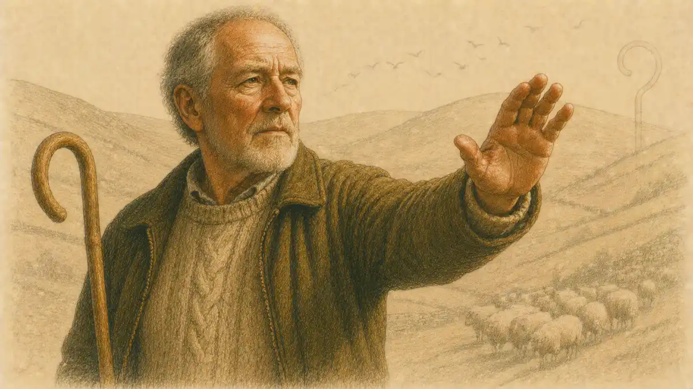

Marxism in China is the record of a doctrine that crossed a sea before it crossed a continent. It arrived in the years around 1919, carried largely in translations made in Japan and in the luggage of Chinese students returning from Japanese universities, and it landed in a country that was overwhelmingly rural, fragmented among warlords, and searching for an explanation of its own weakness. The theory it carried had been built from the experience of industrial Europe, where a factory proletariat stood at the centre of the analysis. China had treaty ports, textile mills and railway workshops, but its hundreds of millions were peasants, and any doctrine that proposed to remake the country had first to answer a question its European authors had never faced in earnest: what does a theory of the industrial working class become in a society of villages? The tradition examined in this guide is the sum of the answers given to that question across a century, by a party that moved from a Shanghai study circle to the government of the country, and by the scholars who have argued about those answers ever since.

Two readers are assumed throughout. The first knows the outline of Chinese history, the fall of the Qing, the republic's disorders, the war with Japan, the civil war, but has never worked through Marxist categories and meets terms like mode of production as strangers. The second knows the European tradition well, can follow an argument about contradiction or the state, but cannot say why a party of intellectuals ended up governing from a loess plateau in the northwest, or why its most famous texts were lectures delivered to cadres in caves and courtyards. Each section is written to serve both: historical material is narrated where the theorist needs it, theoretical material is unpacked where the historian needs it, and the connective tissue, the claim that the route of arrival and the pressure of circumstance shaped the doctrine's content, is argued rather than asserted. Where a concept such as historical materialism or the peasantry as a class needs full treatment, this guide links to the article that gives it and keeps moving.

One discipline governs everything that follows, and it is worth stating at the threshold. The tradition studied here is the doctrine of a party that governs an existing state, and that fact tempts writers in two directions: toward treating every formulation as a press release, or toward treating the whole body of thought as a fraud upon language. Both temptations are refused. Doctrine and institutions are described historically and structurally. Official documents are cited as documents, with their dates and their standing stated, and are neither endorsed nor dismissed as propaganda. Episodes in which large numbers of people died are reported factually and briefly, and the contested estimates for them are left to the articles that handle such figures under protocol, since this article prints no figures for casualties, party membership or economic performance anywhere. The reader who wants commentary on a government will not find it here. The reader who wants to know what the tradition claims, how it was made, and where its arguments are strong or weak will find the material laid out in the order in which it was produced.

## Marxism in China: a tradition defined by its route of arrival

Begin with the definition the rest of the guide will use. Marxism in China comprises the theoretical tradition developed by and around the Chinese Communist Party from the 1920s onward, together with the scholarship that has formed around that tradition inside and outside the country. Its distinguishing marks are four. It adapted Marxist categories to an agrarian society rather than an industrial one, and made the peasantry, not the factory workforce, the weight-bearing class of its strategy. It produced a worked doctrine of contradiction, with an account of how one contradiction in a situation becomes principal and organises the rest. It codified a method of policy formation, the mass line, which claims to describe how correct leadership knowledge is produced. And it passed through a succession of governing formulations that redefined, at intervals, the relation between socialism and the market, each formulation presented as the doctrine's application to a new stage. Any account that omits one of these four marks will mistake the tradition for something simpler than it is: for a chronicle of a party, or for a set of slogans, or for a branch office of a doctrine headquartered elsewhere.

The route of arrival matters because it explains features of the tradition that otherwise look arbitrary. Why does the Chinese vocabulary of Marxism contain so many terms that feel translated twice over? Because they were: coined in Meiji Japan from Chinese characters to render European concepts, then borrowed back into Chinese with the characters unchanged and the meanings attached in Tokyo. Why did the first Chinese Marxists argue from short expositions and pamphlets rather than from the large works? Because the large works had not yet been translated, and the pamphlets were what Japanese scholarship had made available. Why does the tradition place such weight on the concrete analysis of concrete conditions, a phrase its texts repeat like a tolling bell? Partly because its formative experience was the repeated failure of instructions composed abroad, in Moscow or in the party's own city headquarters, when they met the reality of the Chinese countryside. A tradition's accidents of transmission become its habits of mind. The Gramsci reception in Europe followed the same law, prison notebooks reconstructed from fragments by editors with agendas, and the Chinese case is the law's largest instance: an entire conceptual vocabulary, and behind it an entire strategy, bearing the fingerprints of the channel through which it came.

Set against the other regional traditions in this series, the Chinese case shares its central problem with the Indian one and solves it in the opposite direction. Indian Marxism also confronted a stage theory derived from European history and asked whether it fitted an agrarian society ordered by caste; its characteristic answers were scholarly, produced in universities and journals, by a movement that contested elections but never held the central state. Chinese Marxism confronted the same misfit between theory and society while holding, after 1949, the state itself, and its answers were therefore formulations with administrative force, promulgated at congresses and enforced through a party apparatus. The comparison disciplines both stories. It shows that the stage problem was real and general, not a Chinese peculiarity, and it shows how differently the problem behaves when the people answering it command armies and ministries rather than seminar rooms. The Indian tradition could afford to leave its questions open for a generation of debate. The Chinese tradition had to close its questions, provisionally and by authority, every time a harvest, a campaign or a congress required a line.

A final preliminary concerns names. The tradition's central figure is referred to in its own documents by the doctrine attached to his name, and Western scholarship long treated the whole tradition as that doctrine's biography. This guide resists the compression. The founder's life and intellectual formation have their own article in this series, the [Mao Zedong intellectual biography](/2018/05/15/mao-zedong-intellectual-biography/), and what belongs here is the tradition as a collective and institutional product: the translators who preceded the party, the rivals who lost its internal arguments, the committees that drafted its documents, the scholars inside and outside China who have kept its texts in dispute. Individuals appear where their work changed the doctrine. The doctrine, not the biography, is the subject.

## The ground before the doctrine: a civilisation in search of a remedy

Marxism did not enter an empty room. By the time the first expositions circulated, Chinese intellectuals had spent two generations auditioning foreign doctrines as remedies for a national emergency, and the habits formed in that audition shaped how the new arrival was heard. The Qing empire's defeats at foreign hands, first by Britain and France and then, most humiliatingly, by a modernising Japan in 1895, had convinced successive cohorts that the inherited order could not defend the country. Reformers around Kang Youwei attempted to reread the Confucian classics as a charter for constitutional change and failed in the palace coup of 1898. Revolutionaries around Sun Yat-sen drew the conclusion that the dynasty itself was the obstacle and organised its overthrow, achieved in 1911, only to watch the republic dissolve into Yuan Shikai's monarchist bid and then into warlord fragmentation. Each failure raised the price of the next remedy and lowered the patience of its buyers. By the late 1910s the market in doctrines was crowded and sceptical: liberalism, pragmatism, anarchism, guild socialism, syndicalism and several varieties of socialism competed in the journals of Beijing and Shanghai, and a young intellectual could pass through three of them in as many years.

Anarchism deserves particular notice because it was, for a decade, the strongest competitor and in some respects the advance guard. It too arrived substantially through Japan, where Kōtoku Shūsui's circle had translated Kropotkin, and through Paris, where Chinese work-study students ran anarchist journals. Its appeal to a generation disgusted with all authority, dynastic, warlord and foreign, was immense, and many of the future communists, including the young Mao Zedong in Changsha, passed through an anarchist phase or argued with anarchist friends. What anarchism could not supply was an organisation capable of surviving repression and a theory of the state that explained what to build after the warlords. When the Bolshevik victory in Russia demonstrated that a disciplined party armed with a doctrine could actually seize and hold a great state, the demonstration effect was decisive for precisely the audience anarchism had gathered. The doctrine that won China was not the most attractive on the page. It was the one attached to a working example of power.

The May Fourth ferment of 1919 supplied the audience and the idiom. The protests began over the Versailles settlement's transfer of German rights in Shandong to Japan, and widened into a general indictment of the old culture by the young: against Confucian hierarchy, for science and democracy, for the vernacular language against the classical, for the nation's regeneration through the destruction of its own traditions. The journals of the ferment, above all Chen Duxiu's New Youth, became the arena in which Marxism was first debated before a national readership, in the famous problems-and-isms controversy of 1919, where Hu Shi counselled piecemeal reform and Li Dazhao answered that a fundamental transformation of the economic order was the precondition of solving any particular problem. That exchange matters beyond its moment because it set the terms in which the doctrine would be received: not as economics, but as a total answer to the national question, judged by whether it could explain China's subjection and point to the agent who would end it. Marxism in China was nationalist in its reception before it was anything else, a fact its critics and its defenders have both had to reckon with ever since.

## The first public examination: problems, isms and the philosophy of life

Before the doctrine had a party it had a cross-examination, and the terms of that examination stayed with it. In the summer of 1919, in the pages of the journal Weekly Review, Hu Shi, the American-trained philosopher and champion of pragmatism, published an essay urging more study of problems and less talk of isms: China's afflictions, he argued, were concrete, illiteracy, poverty, misgovernment, the warlord at the gate, and they would yield, if at all, to piecemeal inquiry and reform, not to the importation of total systems that promised to cure everything by renaming it. Li Dazhao answered within weeks, in the same journal, with a defence of the ism he had lately adopted. Problems, he granted, were real and pressing; but problems had roots, and the root of China's was an economic order entangled with imperialism, which no sequence of piecemeal repairs could reach. A fundamental solution was not a slogan. It was the precondition of the particular ones. The exchange is conventionally treated as a founding document, and it earns the status, because the two positions it staked out, reform by increments against transformation of the whole, remained the poles of Chinese argument for the rest of the century, and because Li's answer fixed the doctrine's Chinese pitch from the beginning: it presented itself not as one remedy among others but as the diagnosis that explained why the others kept failing.

The examination resumed in 1923 on different ground, in the controversy over science and the philosophy of life. A lecture by the geologist Ding Wenjiang, defending the capacity of science to govern questions of value and conduct, drew a rebuttal from the metaphysician Zhang Junmai, fresh from Germany and the circle around Rudolf Eucken, and within months half the intellectual world had published positions. The young Marxists who entered the debate, among them Qu Qiubai, lately returned from Moscow where he had served as a correspondent and interpreter, and Deng Zhongxia, a labour organiser of Li Dazhao's circle, did not defend science in Ding's terms. They attacked the premise shared by both camps, that ideas contend in a vacuum, and argued that philosophies of life are the reflex of social positions, that the debate itself was a symptom of a class order in transition. The intervention matters for the shape of the tradition. It was the first public performance of the doctrine's characteristic move in Chinese hands, the relocation of an argument about ideas onto the ground of the arguers' circumstances, and it taught the watching generation that the new doctrine was not a shelf of conclusions but a way of dissolving other people's questions. Readers who wonder why the tradition's later texts so often answer an argument by assigning it a class address will find the habit's birth certificate in these polemics of 1919 and 1923.

## The Japanese route: translation as the doctrine's first author

The claim at the centre of this guide can now be stated precisely. The doctrine's road into China ran through Tokyo. A generation of Japanese academics and publicists had already done the work of rendering Marx into an East Asian idiom when Chinese readers arrived in large numbers, and the publishing houses of Tokyo built the shelf from which those readers took the doctrine down. Chinese students resident in Japan, who numbered in the thousands in the peak years of the exchange, carried the material home in their reading and their persons. The consequence is lodged in the language itself. Much of the vocabulary in which Chinese Marxism thinks, and indeed of the modern Chinese vocabulary for social thought generally, is built from compounds coined in Japan and written in the shared characters: terms for society, economy, philosophy, capital, class in its modern sense and revolution in its modern sense were coined by Meiji translators rendering European books, then adopted into Chinese with their characters intact and their new meanings attached. A Chinese reader meeting these words met Japan's interpretation of Europe before meeting Europe, and the interpretation had emphases of its own, formed by Japan's earlier and faster engagement with German scholarship and by the priorities of Japanese socialism.

### How did Marxism reach China?

principally through Japan. Japanese scholars translated and expounded Marx before Chinese scholars did, and Chinese students in Japan carried the material back, so a substantial part of the Chinese Marxist vocabulary consists of Japanese compounds written in Chinese characters, and the texts that arrived first were the popular expositions rather than the major works.

The documentary trail begins earlier than the party and earlier than May Fourth. As early as the first years of the century, Chinese journals were printing notices of Marx drawn from Japanese sources; Liang Qichao, the exiled reformer writing from Yokohama, mentioned the German thinker in passing in essays on Western political thought, a name among names in a survey of socialism's varieties. A fuller early presentation came in 1906, when Zhu Zhixin, a revolutionary associated with Sun Yat-sen's alliance, published in the Tokyo-based journal Minbao an account of Marx's life and a summary of the Communist Manifesto's programme, worked up from Japanese and German materials available in the exile community. The venue is the point. Tokyo in those years held a complete Chinese revolutionary colony, with its own presses, bookshops and reading circles, and Japanese socialist literature, the work of translators and publicists such as Sakai Toshihiko, who with Yamakawa Hitoshi had rendered the Manifesto into Japanese, circulated through that colony as the readiest account of the doctrine. What reached China first was therefore a selection: the Manifesto as programme, the materialist conception of history as a short formula, the class struggle as a key to the past, long before the critique of political economy existed in any Chinese form.

The expositions that did the deepest work were Japanese academic products. Kawakami Hajime, the Kyoto economist whose writings on political economy and whose personal journey from liberal economics toward Marxism made him the most read Japanese expositor of his generation, supplied the scaffolding for Li Dazhao's foundational essays of 1919, which follow Kawakami's presentations closely and say so by their structure. The pattern repeated across the first shelf: Kautsky's popularisations reached Chinese readers in Japanese dress, Japanese textbooks organised the doctrine into teachable systems, and Japanese debates, over the Asiatic mode, over the stages of capitalism in a late-developing country, pre-formatted the questions Chinese Marxists would later ask about their own society. When Chen Wangdao produced the first complete Chinese translation of the Communist Manifesto in 1920, the text from which he worked was the Japanese edition, checked against an English one; the founding document of Chinese communism is, philologically, a grandchild of a Japanese translation. The transmission scholarship on which this account rests is summarised in the companion study of [Marxism in Japan and Korea](/2018/08/15/marxism-in-japan-and-korea/), where the Japanese tradition's own history is treated in full.

### Why does a borrowed vocabulary outlast the borrowing?

Because the borrowed words arrive before any alternative exists, and they enter textbooks, party documents and examination syllabuses while the concepts are still being fought over. Once a generation has learned to think in those compounds, replacing them would mean renaming the furniture of thought itself, so the Japanese coinages persist as the permanent furniture of Chinese theory.

Two qualifications keep the claim honest. The Japanese route was principal, not exclusive. A Russian channel opened after 1917, bringing Comintern emissaries, money, organisational templates and eventually training in Moscow, and a French channel ran through the work-study movement, which carried Zhou Enlai, Deng Xiaoping and a cohort of future leaders through French factories and radical circles in the early 1920s. Nor was the Japanese material passively received: the Chinese readers selected, abridged and argued, and by the mid-1920s direct translations from German and Russian were appearing. But priority is not a small thing in the history of ideas. The vocabulary was set before the alternatives arrived, the first canon was the canon Japan had assembled, and the doctrine's Chinese life began inside categories that a neighbouring country's scholarship had already cut to shape. The Japanese route is this article's namable claim because it converts a curiosity of philology into an explanation: of why certain texts led and others lagged, of why the vocabulary feels at once native and imported, and of why the East Asian Marxisms, so often treated as separate national stories, are connected at the level of terminology before they are connected at the level of politics.

## The first shelf: what the early readers actually held in their hands

Abstractions about transmission become clearer when the shelf itself is reconstructed. What could a curious reader in Shanghai or Beijing actually obtain, in Chinese, before the party existed to publish for him? In the first decade of the century, notices and fragments: the survey articles of the exile press, Zhu Zhixin's Minbao account of Marx's life and programme, renderings of socialist classics embedded in journals whose editors were often as interested in nationalism or anarchism as in Marx. Around 1919 the shelf thickened quickly. The journal The Construction, founded by Sun Yat-sen's associates in Shanghai, carried extended expositions by Dai Jitao and Hu Hanmin, both working from Japanese materials, which presented the materialist reading of history to a Guomindang readership; Dai's essays in particular were read by the young men who would staff both parties, an irony the later schism made poignant. The Awakening, the celebrated supplement of the Shanghai newspaper Republic of China Daily, published translations and discussions under editors who moved in the study-society world. Li Dazhao's systematic essay of 1919, printed in instalments in New Citizen, gave the doctrine its first book-length Chinese treatment, organised, as noted, on a Japanese armature.

The landmark of the shelf is Chen Wangdao's Manifesto of 1920, and its biography condenses the whole transmission story. Chen, a returned student from Japan who had taught in Zhejiang, worked in seclusion in his home village, by the famous account using a glutinous rice cake and brown sugar as his refreshment and his ink substitute in a moment of absorption that the tradition later polished into parable; the scholarly core of the story is drier and more valuable. He translated from the Japanese edition, the line of Sakai and Yamakawa, checking his rendering against an English text supplied through the Shanghai circle, and the little book was printed in August 1920 with a misprint on its cover, the title's characters transposed, in a run that sold out and was reprinted with the error corrected the following month. Within a few years the shelf the party's own presses could offer had grown past the pamphlets: Kautsky's exposition of the Erfurt programme, Lenin's state and revolution in early renderings, Bukharin's primer of communism, and by the end of the decade the first Chinese assaults on the larger works, including Guo Moruo's translation labours and the beginnings of a rendering of Capital itself, a project whose full completion belonged to the following decade. The order of the shelf is the order of the doctrine's Chinese formation, and the extra questions at this article's end return to it: exposition before classic, programme before critique, history and strategy before economics. A tradition's first library is a fate, and this one was shelved in Tokyo before it was shelved in Shanghai.

## The second channel: Russia, the Comintern and the returned students

If Japan supplied the vocabulary, Russia supplied the organisation, and the tension between the two inheritances runs through the tradition's first two decades. The October Revolution of 1917 reached Chinese readers initially as news filtered through the same Japanese and English-language press, and Li Dazhao's essays of late 1918, celebrating the victory of Bolshevism and the dawn of a world of labour, announced that a second source of authority had appeared. From 1920 the Communist International sent emissaries to China, first the Dutchman Maring and the Russian Voitinsky, who helped gather the scattered Marxist study societies into a party and bound that party, from its infancy, to an international centre that claimed the right to direct it. The Comintern brought what the Japanese books could not: funds, couriers, a doctrine of party organisation tested in revolution, and a strategy for colonial countries worked out in the debates of its Second Congress, where Lenin's theses on the national and colonial questions prescribed alliance with bourgeois-democratic movements in the colonised world. It also brought instructions, and instructions composed in Moscow for a country its authors had never seen became the recurring disaster of the party's first decade.

The human form of the Russian channel was the returned student. From the mid-1920s, Chinese communists trained at Moscow's Sun Yat-sen University and other institutions came home carrying the authority of the centre and a formation in its texts and its factional struggles. A group of them, associated with Wang Ming and formed under the patronage of the Comintern's Chinese specialists, rose by the early 1930s to command the party's central apparatus, displacing the first generation of native leaders. Their asset was orthodoxy: they could cite the canon and the centre's resolutions with a fluency the home-grown cadres could not match. Their liability was the country itself, whose conditions their categories, cut for European and Russian cloth, repeatedly failed to fit. The party's internal history in these years can be read as a contest between the two channels' products, the Moscow-certified line and the knowledge accumulated in the base areas by men who had survived the consequences of error. The rural leadership's eventual victory in that contest, sealed at the Zunyi Conference of 1935 and consolidated in the Yan'an years, is the biographical form of the tradition's founding claim: that the doctrine had to be remade in Chinese conditions or it would go on killing its adherents.

It is worth pausing on the organisational inheritance itself, because later sections return to it. The party the Comintern helped to build was a Leninist instrument: democratic centralism, a professional revolutionary stratum, cells in factories and armies, a discipline that treated deviation as a species of betrayal. Whatever else changed across the century, that instrument persisted, and it explains a feature of the tradition that purely intellectual histories miss. Chinese Marxism was never only a body of propositions. It was propositions carried by an organisation that selected which of them would be studied, printed, examined and enforced, and the history of the doctrine is inseparable from the history of the carrier. When the sections below speak of a formulation succeeding, the mechanism is institutional: a congress adopts it, a study campaign teaches it, an apparatus applies it. The ideas matter, and this guide treats them as ideas, but they travelled in an armoured vehicle.

## The Hunan circle: a province as the tradition's nursery

The national story had provincial nurseries, and the most consequential stood in Changsha. There, in April 1918, a group of students and recent graduates of the Hunan First Normal School founded the New People's Study Society, an association for mutual improvement and the study of new thought whose membership, small enough to meet in a vegetable garden, would supply the party with a disproportionate share of its founders and martyrs: Mao Zedong, Cai Hesen, He Shuheng, Xiao Zisheng and their circle. The society's correspondence, preserved and later published, shows the doctrine arriving in a provincial capital by the same channels as in Beijing, Japanese books, the journals of the capital, the letters of members gone abroad, and shows it competing, in the members' minds, with anarchism, with the work-study scheme for France, and with a brief, ardent campaign for Hunanese self-government, in which the young Mao argued in the Changsha press of 1920 that the province should constitute itself a republic and rebuild China from its provinces upward. The episode of the Hunan republic deserves its footnote in the tradition's formation, because it records the future unifier of China arguing, at twenty-seven, for the country's division into self-governing parts, and because his later historiography's silence about the episode is itself a document of how the authorised biography edits the record.

Changsha also gave the movement its first institution of distribution, the Cultural Book Society, founded in 1920 in a rented shopfront, which stocked the new journals and the translated classics, served as the society's meeting place and post office, and demonstrated, at the scale of one city, the mechanism by which the doctrine reproduced itself: a bookshop that was also a cell. Cai Hesen, gone to France with the work-study movement, wrote home from Montargis in 1920 urging, in letters the tradition has canonised, the open founding of a communist party on the Russian model, and the exchange between the Montargis letters and the Changsha replies is among the founding documents of the party's prehistory. The Hunan circle's lesson for the anatomy is the same as the Japanese route's, at provincial scale. The tradition was not diffused from a centre. It condensed, simultaneously, in a dozen such circles, each with its bookshop, its journal subscriptions and its returned students, and the party of 1921 was the federation of the condensations.

## Li Dazhao, Chen Duxiu and the making of the first generation

The first generation was small enough to be biographical. Li Dazhao, librarian and professor at Peking University, was the doctrine's first systematic Chinese expositor: his long essay of 1919, setting out his views on Marxism in the journal New Citizen, worked through the materialist conception of history, the theory of class struggle and the critique of political economy in an order borrowed from Kawakami Hajime's Japanese presentations, and announced his conversion from the eclectic radicalism of the study societies to a settled allegiance. Li's significance is not originality, which he did not claim, but position: from the university library that served as the movement's first headquarters, he recruited and taught the students, among them a young assistant from Hunan named Mao Zedong, who carried the doctrine into the provinces. Chen Duxiu, dean of letters at the same university and editor of New Youth, brought the larger reputation and the sharper polemical gift; converted to communism in 1920 under Comintern encouragement, he became the new party's first leader and its public voice. Around these two, a penumbra of study societies in Beijing, Shanghai, Wuhan, Changsha and Guangzhou, and a circle in Tokyo itself, formed the party's founding stratum: professors, students, journalists, a handful of workers, almost no peasants.

### What did Li Dazhao add that the translations lacked?

A Chinese question. The translations supplied a doctrine about Europe; Li asked what the doctrine meant for a country invaded, indebted and governed by warlords, and his essays of 1918 and 1919 read the Russian Revolution as an answer addressed to peoples in China's position, which turned an imported theory into a national summons.

The founding congress, when it came in the summer of 1921, matched the stratum that convened it. Delegates from the study societies met first in a girls' school in Shanghai's French Concession and, after a police raid forced them to scatter, concluded their sessions aboard a rented boat on South Lake at Jiaxing, a detail preserved because it dramatises the party's beginnings: hunted, tiny, and entirely urban in its imagination. The programme adopted looked toward a proletarian revolution on the European model, in a country whose proletariat was a sliver of the population concentrated in foreign-owned mills. Nothing in the scene predicted the countryside. What the founders possessed was a doctrine in translation, an international affiliation, a journal network and a talent for organisation; what they lacked was a social base, and the search for one, through the labour movement of the treaty ports and then through the alliance with the nationalists, consumed the party's first six years. The labour organising of 1922 and 1923, the great strikes on the railways and in the Hong Kong seamen's and Canton movements, gave the party its first mass following and its first martyrs, when the February 1923 railway strike was drowned in blood by the warlord Wu Peifu. The lesson drawn at the time was that the working class alone was too small to make the revolution the texts promised. The lesson's price would be paid in the alliance that followed.

## The labour movement's school: the party learns to organise

Between the founding congress and the alliance with the nationalists stands an apprenticeship that the doctrine's histories sometimes hurry past: the party's education in the labour movement of the treaty ports. The apprenticeship began in earnest with the Hong Kong seamen's strike of early 1922, a stoppage for wages that the colonial authorities tried to starve out and that ended, after weeks of shutdown and a mass exodus of strikers toward Guangzhou, in a negotiated victory that electrified the young movement. In the same year, at the Anyuan coal mines in Jiangxi, organisers of Li Lisan's and then Liu Shaoqi's generation built a union, a workers' club and a school system for miners' children that survived as the movement's model of what patient organisation could construct inside an employer's fortress; Anyuan's afterlife in the tradition's iconography, down to a celebrated painting of the young Mao bound for the mines, testifies to the place the episode held in the party's memory of itself. The railwaymen of the Beijing-Hankou line gave the apprenticeship its martyrology in February 1923, when their strike for the right to organise was crushed by the warlord Wu Peifu with shootings at Jiang'an and Zhengzhou, an event the party commemorated ever after as the measure of what an unarmed movement could expect.

The May Thirtieth Movement of 1925 completed the education and posed its dilemma. When Shanghai police fired on demonstrators protesting the killing of a worker in a Japanese-owned mill, strikes, boycotts and demonstrations spread through the treaty ports in the largest urban upsurge the party had yet ridden, and the party's membership and the unions' rolls swelled together. The organisers learned their craft at scale: the strike committee, the picket, the relief kitchen, the negotiated return. They also learned the craft's limit, which the upsurge's eventual suppression underlined. Urban organisation, however brilliant, existed at the pleasure of authorities who commanded gunboats, concessions and machine guns, and who could close a union hall as easily as a customs house. The lesson was available in 1925 and was drawn in full only after 1927, when the alliance's collapse turned a limit into a death sentence. But the personnel of the rural revolution were formed in these years and in these defeats: the cadre who had run a strike kitchen in Shanghai or a miners' school at Anyuan carried into the Jiangxi hills a set of habits, investigate first, organise the aggrieved around a concrete demand, build the institution that outlasts the campaign, which the base areas would generalise into a system of government.

## The emissaries: Borodin and the human form of the Russian channel

The Russian channel had faces, and the tradition's memory kept them. The first emissary of consequence, the Dutch communist Maring, a veteran of the Dutch East Indies movement, arrived in 1921 with the Comintern's mandate and its money, attended the founding congress's aftermath as an observer the founders had not invited, and pressed upon the infant party the strategy it would follow for six years: entry into the Guomindang, which he had conceived from his Indonesian experience of working inside a nationalist movement. The Sun-Joffe declaration of January 1923, negotiated in Shanghai between Sun Yat-sen and the Soviet envoy Adolf Joffe, gave the strategy its diplomatic charter, recording the Soviet view that communism was not suited to China's conditions while committing Soviet aid to the nationalist cause, a text whose doubleness, alliance offered and doctrine deferred in the same paragraphs, the Chinese party's historians have annotated ever since. The strategy's executor was Mikhail Borodin, who reached Canton in the autumn of 1923 as the Soviet government's adviser to Sun and became, for four years, the most powerful foreigner in China: reorganiser of the Guomindang on Leninist lines, architect of its party army's political machinery, arbiter of its factions, and the living channel through which Moscow's instructions, funds and expectations flowed into the alliance. The Whampoa academy, the reorganised party's congresses, the very vocabulary of the national revolution's organisation bear his office's fingerprints.

The emissaries matter to this guide because they complete the transmission anatomy. Japan had sent books; Russia sent men, and the men carried what books cannot: authority in person, the power to certify a line and to decertify a leader, exercised in Canton and Wuhan through the alliance's crisis until Borodin himself was expelled with the Wuhan collapse of 1927 and made his way home across the Gobi to a Soviet Union that would eventually consume him in the purges. The Chinese party's subsequent insistence on judging its own conditions, the sinification claim's hard core, was learned in the Borodin years and the catastrophe that ended them: the survivors had watched a foreign adviser, however gifted, direct their revolution from a consul's residence on the basis of cables from a capital that misread their country, and the lesson entered the tradition's bloodstream as deeply as any text. When the Yan'an texts insist that no foreign model, however honoured, outranks the investigation of Chinese conditions, the insistence has a biography, and the biography begins in Canton with the emissary whose strategy had filled the graveyards of 1927.

## The first united front and the catastrophe of the cities

The alliance with the Guomindang, the Nationalist Party of Sun Yat-sen, was the Comintern's prescription applied to Chinese conditions: since the national revolution against imperialism and the warlords was the immediate task, and since the nationalists commanded an army and a territorial base at Canton, the communists were directed to enter the Guomindang as individuals while retaining their own organisation, a bloc within, and to build the mass movements, unions and peasant associations that would push the alliance leftward. From 1923 the arrangement worked spectacularly on its own terms. Communist organisers, the party's best, built the labour movement of the great cities and the peasant associations of Guangdong and Hunan into mass forces; the Whampoa Military Academy, staffed with Soviet advisers and communist political workers including Zhou Enlai, trained the officer corps of the National Revolutionary Army; and the Northern Expedition of 1926 swept the allied armies up the Yangzi, shattering warlord power as it came. The party grew from a sect into a mass organisation with a real working-class and peasant following, and its leaders began to speak of the national revolution ripening toward a socialist one.

### What was destroyed when the alliance collapsed?

Not only an organisation but a strategy. The purge of 1927 destroyed the urban unions, the party's legal existence and the assumption that the national revolution could be made inside the Guomindang's shelter, and it left the survivors a single asset, the peasant associations of the interior, around which a different strategy had to be built.

The collapse, when it came in 1927, was total and it was violent. Chiang Kai-shek, commanding the expedition's armies and fearing the mass movements his allies had built more than he feared the warlords, turned on the communists in Shanghai in April of that year, using Green Gang gunmen and his own troops to massacre union activists and party members in the city that had been the movement's pride. The left Guomindang government at Wuhan, under Wang Jingwei, expelled the communists three months later under pressure from its own generals. Party members and sympathisers were killed across the country in numbers that the party's own historiography and independent scholarship both describe as a catastrophe, and the contested figures for the dead are handled, under this series' protocol, in the analysis of the revolution itself rather than here. What can be stated structurally is that the urban organisation built over six years was destroyed in a season: unions smashed, presses closed, cadres executed or driven into hiding, the party's membership collapsing as the hunted organisation shrank to a remnant. The Comintern's line, which had forbidden the communists to prepare an independent course and had counselled reliance on the alliance to the end, stood discredited among the survivors, and the party's subsequent history, its suspicion of urban insurrection, its cult of the countryside base, its insistence on an independent army, is unintelligible except as the scar tissue of 1927. The reader should register the causal direction, because a durable misreading reverses it: the turn to the peasantry was not a doctrine the party found in its texts and chose in tranquillity. It was what remained when the cities had been made impossible.

## The rural turn: necessity wearing the mask of doctrine

The survivors of 1927 who mattered most for the tradition's future were those who drew the practical conclusion fastest. Uprisings ordered by the shattered centre in the autumn of that year, at Nanchang, in the Autumn Harvest risings along the Hunan-Jiangxi border, in Guangzhou that December, mostly failed within days, and the remnants of the Hunan rising, led by Mao Zedong, retreated into the Jinggang Mountains on the provincial border, a bandit-haunted fastness where government writ barely ran. There, and then in the larger base carved out in southern Jiangxi and western Fujian, the elements of a different revolution were assembled under the pressure of encirclement: a Red Army recruited from peasants and drilled in guerrilla methods, a land policy that confiscated the holdings of landlords and rich peasants and redistributed them to the poor, a soviet government that taxed, judged, coined money and ran schools in the villages it held. The strategic formula that emerged, using the countryside to encircle the cities and only at the end to take them, inverted the sequence every European text prescribed, and it did so not because its authors had refuted the texts but because the cities were garrisoned by enemies who shot communists on sight. The full narrative of that revolution, its campaigns, its costs and its contested numbers, belongs to the series' [Chinese revolution in Marxist analysis](/2018/06/15/chinese-revolution-marxist-analysis/), and is routed there deliberately; what belongs here is the doctrinal meaning the survivors extracted from their survival.

### Why did the countryside answer a question the cities could not?

Because the question was survival. After 1927 the party had no legal urban existence, no unions and no protection, while the countryside offered distance from the state's garrisons, a population with grievances the doctrine could name, and terrain where a small armed force could live; the rural strategy was geography and necessity before it was theory.

Yet necessity alone does not make a tradition, and the rural turn became one because the men who lived it wrote it up as theory while they lived it. Mao's reports and essays of these years, the investigation of the peasant movement in Hunan in 1927, the letters and resolutions against book worship within the party, the analyses of China's classes revised as the bases grew, performed a consistent operation: they took the inherited categories, class, alliance, stage, vanguard, and refilled them with Chinese content until the categories bent. The peasantry, which the canon treated as a sack of potatoes or at best an ally to be led, appears in these texts sorted into strata with distinct interests and tempers, poor, middle and rich, and the poor peasantry emerges as the revolution's most reliable force. The united front, which the Comintern had designed as subordination to the nationalists, reappears as an alliance the communists must lead. Even the party's internal enemy is redefined: the dogmatist who recites the texts, the man of the books, becomes as dangerous as the opportunist who abandons them. A reader who follows only the strategy misses the intellectual event. In the Jiangxi hills, under blockade, a body of writing was produced that treated Chinese society as the primary text and the canon as commentary, and the whole later tradition, including its orthodoxies, descends from that reversal of the order of reading.

## Gutian and the army question: a party inside a gun

Every revolutionary tradition must settle the relation between its doctrine and its weapons, and the Chinese settlement was made early and in writing. At Gutian in western Fujian, in December 1929, a congress of the Fourth Red Army adopted a resolution, drafted under Mao's direction, on correcting mistaken ideas within the party: against the purely military viewpoint that treated fighting as the army's whole business, against the roving-rebel mentality of men who preferred movement to base-building, against subjectivism and the remnants of warlord practice in the ranks. The resolution's institutional content outlasted its occasion. It fixed the system under which the party's army would operate for the rest of the century: party committees at every level of command, political commissars paired with military officers, political departments charged with the soldiers' education and the army's conduct toward civilians, and the doctrine, later compressed into a maxim, that the party commands the gun. The army was thereby constituted as a doctrinal institution in its own right, a school in which peasant recruits were taught to read the society they were fighting to change, and the political worker became as characteristic a figure of the movement as the cadre or the commissar of the Russian model from which the system partly descended.

The settlement's significance for the tradition's anatomy is easily missed because it succeeded so completely. A doctrine whose principal carrier is simultaneously a party and an army develops differently from a doctrine carried by a party alone: its texts are written for men under discipline, its heresies are handled as breaches of that discipline, and its theory of knowledge, practice as the criterion, carries the authority of a staff doctrine as well as a philosophy. The Gutian resolution also supplied the template for the movement's recurring internal remedy, the named list of mistaken ideas, each error identified, exemplified and corrected in a single document that the whole organisation then studied. Rectification at Yan'an, and every later campaign of ideological consolidation, worked from the Gutian pattern: the catalogue of deviations, the study of the correcting text, the confession and the renewed unity. When the sections below speak of the doctrine's institutional life, the army's settlement of 1929 should be remembered as the institution's founding act, earlier than the canon it would one day guard.

## The Jiangxi soviet and the education of a party in power over peasants

The Chinese Soviet Republic proclaimed at Ruijin in 1931 was a state in miniature and under siege, and its importance for the doctrine is that it gave the party five years of governing practice before it had a country. Land investigation campaigns sorted the village population into the classes the theory named, and the sorting was neither gentle nor always accurate: the campaigns against landlords and rich peasants expropriated, struggled and sometimes killed, and the party's own later assessments conceded excesses in the classification of middle peasants and in the purges that paranoia about encirclement bred within the base. These episodes are recorded here factually and without figures, as the protocol requires, because they belong to the tradition's formation as surely as its texts do: a doctrine of class learned by administering it, village by village, acquires a concreteness and a ruthlessness that seminar Marxism never knows. The soviet also ran the experiment that later became a governing reflex, the mass campaign as an instrument, in which a policy, land redistribution, tax collection, recruitment, literacy, was executed not through a standing bureaucracy but through mobilised meetings, activists and quotas of enthusiasm, a method whose strengths and pathologies the later state inherited entire.

Against this education stood the returned students' central leadership, which arrived in the base in 1933 carrying the Comintern's authority and a strategy of positional warfare against the Guomindang's fifth encirclement campaign. The campaign, conducted with blockhouse lines and a tightening ring, ground the base down through 1934 until the decision was taken to abandon Jiangxi altogether and break out westward. The party's official historiography assigns the catastrophe to the dogmatist line, and independent scholarship, while complicating the allocation of blame, confirms the strategic contrast at the story's core: the methods that had preserved the base, mobility, dispersion, refusal of battle for territory, were set aside for a defence of every inch, and the base was lost. The doctrinal moral was available to every survivor and was drawn explicitly in the years that followed. Authority in the movement would henceforth claim its warrant not from certification abroad but from demonstrated correctness in Chinese conditions, and the texts of the Yan'an period are, among other things, the codification of that warrant.

## The Long March and the relocation of the tradition's centre

The breakout of October 1934 became the Long March, a fighting retreat of a year's duration across the most forbidding terrain in China, through snow mountains and marshlands, harried by Guomindang armies and provincial forces, ending in the loess country of northern Shaanxi where a smaller soviet remnant had survived. Of those who set out from Jiangxi, a minority arrived; the losses to battle, hunger, cold, desertion and disease were severe, and the figures attached to them in rival accounts are contested and are not reproduced here, under the same protocol that governs the whole article. What the march did to the tradition can be stated without numbers. It completed the leadership change the Jiangxi defeat had begun: at Zunyi in January 1935, in a requisitioned house in a captured town, the party's command was rearranged and Mao Zedong entered the core of military and political leadership from which he was never again displaced. It relocated the movement's centre of gravity to the northwest, far from the treaty ports where the doctrine had first landed, in a region where the party would sit for a decade at the edge of the war with Japan. And it supplied the tradition with its founding epic, a narrative of endurance that later generations of members were required to study, so that the march functions in the doctrine's life the way a scripture's exodus functions in a religion's: as the ordeal that certifies the carriers. A sober history must add that epics edit. The march as commemorated omits much that the march as lived contained, including the near-destruction of the movement and the contributions of commanders later written out of the story, and the scholarly literature, Chinese and foreign, has spent decades restoring the omissions.

## Investigation as method: the sociology written from the saddle

The rural years produced a second genre alongside the strategy papers, and the tradition's method cannot be understood without it: the investigation report. Its charter text is a short essay of May 1930, written in the Jiangxi base and aimed at the party's own bookishness, which argued that no investigation yields no right to speak, that conclusions must be drawn from the examination of actual conditions rather than fetched from texts, and that the comrade who investigates a place must arrive with questions and leave with the answers the place supplies. The essay's target was double: the returned students with their resolutions, and the native cadres who had begun to treat the leader's own earlier reports as a substitute for looking. Its author's practice gave the doctrine its exhibits. The Xunwu investigation of the same month, conducted over days of meetings with merchants, peasants, a former yamen clerk and other inhabitants of a county town in southern Jiangxi, recorded the town's commerce street by street, its landholding household by household, its usury, its prostitution, its salt trade, in a density of social description that Chinese sociology, then in its infancy in the universities, rarely matched. The Changgang and Caixi township investigations of 1933 examined how a model soviet actually functioned, down to the price of salt and the attendance at night schools.

The genre's significance is methodological, and it links the tradition to the first row of its contributions. The peasant strategy could be theorised only because the peasantry had been investigated, stratum by stratum and county by county, by men who needed the knowledge to govern and to fight. Where the European tradition's knowledge of the countryside came largely from statistics offices and parliamentary reports, the Chinese tradition's came from the saddle and the village meeting, and bore the marks of both: an unmatched concreteness about rents, debts, crop shares and clan power, and a tendency to mistake the investigated locality for the country, a tendency the texts themselves warn against and their later canonisation encouraged. The scholarly assessment of the reports has grown more respectful with time. Historians of Chinese social science place the Xunwu report in the first rank of the era's field studies, alongside the university sociologists' village surveys with which it is rarely shelved, and the comparison is instructive: the party's investigators and the academy's were mapping the same countryside in the same years, the one to remake it and the other to know it, and the maps, read together, remain the finest record of the world the revolution set out to abolish.

## Yan'an: a besieged capital becomes a theoretical workshop

The decade in Yan'an, from the mid-1930s to 1947, is the tradition's creative period, and its conditions explain its character. The second united front against Japan, formed after the Xi'an Incident of 1936 compelled Chiang Kai-shek toward resistance, gave the communists legal space, a recognised border region government, and a stream of recruits: students, writers and young patriots who walked hundreds of miles to reach the loess caves because Yan'an had become, in the imagination of educated China, the address of national salvation. The party that received them was simultaneously an army in the field behind Japanese lines, a government administering millions, and a school. Its institutions of doctrine were built for all three functions at once: the Anti-Japanese Military and Political University and a constellation of party schools trained cadres by the thousand in compressed courses, and the lectures delivered in those institutions, by the leadership and above all by Mao, are the texts the tradition canonised. Theory in Yan'an was not a retreat from practice. It was the staff college curriculum of a movement preparing to contest a country, and its characteristic genres, the lecture, the study document, the rectification essay, bear the mark of the classroom and the parade ground together.

The circumstances also set the theoretical agenda. The war required a strategy of protracted resistance, elaborated in the 1938 lectures on protracted war, which applied the doctrine of stages and contradictions to a military problem: a weaker China would trade space for time, pass from strategic defence through stalemate to counteroffensive, and win by endurance rather than by a decisive battle it could not fight. The alliance with the Guomindang required constant theoretical maintenance, since the party had to explain, to its own cadres and to the nation, how it could cooperate with the class enemy of 1927 while preparing to supersede him, and the explanation, that contradictions have ranks and the national contradiction with Japan stood for the period above the class contradiction at home, became a permanent part of the doctrine's machinery. And the influx of intellectuals required a cultural policy, delivered in the 1942 talks on literature and art, which subordinated artistic work to the movement's political needs with a frankness that later made the text a byword; the talks are recorded here as a document of the Yan'an settlement, whose consequences for Chinese intellectual life the scholarship continues to dispute. Through all of it runs the same operation observed in Jiangxi, now performed deliberately and in the open: the inherited doctrine is neither repeated nor abandoned but re-founded, concept by concept, on the party's own experience, until the re-founding can be announced as a system in its own right.

### What question were the Yan'an lectures answering?

How a party of peasants and soldiers, led by intellectuals, could think rigorously about a doctrine written for industrial Europe. The lectures on practice and contradiction were teaching instruments before they were classics: they told cadres that truth is tested in work and that every situation has a main contradiction whose identification decides what to do first.

## Philosophy for the masses: the popularisers and the primer

Between the canon and its audience stood a profession the tradition created for itself: the populariser. Its exemplary figure is Ai Siqi, a Yunnanese autodidact formed in Japan, whose book of 1936, philosophy for the common reader, assembled from lectures and magazine pieces, outsold every serious rival and taught a generation of students the vocabulary of dialectics before they met a canonical page. Ai's achievement was translational in the deep sense. He rendered the Soviet textbooks' abstractions into the idiom of the Chinese schoolroom, illustrated contradiction with the price of rice and the behaviour of water, and presented the doctrine not as a foreign system to be memorised but as a way of seeing that the reader's own experience could verify. The young people who walked to Yan'an in the late 1930s arrived, many of them, with Ai's primer in their bundles, and the lectures they heard there presupposed its lessons. The party recognised the instrument's value and institutionalised it: Ai became the Yan'an philosophy establishment's central figure, head of the academy's teaching on the subject, and his primers, revised across the decades, remained the doctrine's standard introduction in schools long after his death in 1966.

The popularising stratum deserves the guide's attention because it corrects a distortion in the tradition's portrait. The canon appears, in most accounts, as a shelf of leaders' works descending upon a passive readership. The record shows a middle literature of primers, lecture notes, correspondence courses and study questions, written by professional explainers whose names the movement honoured and then half forgot, through which the doctrine actually reached its millions. The stratum also explains the tradition's characteristic tone, didactic, example-laden, confident that any truth can be made plain, which descends from the primer's classroom rather than from the seminar. When the Yan'an lectures are read beside Ai's book, their pedagogy looks less like a leader's improvisation and more like a genre perfected by a school: the homely illustration, the numbered stages, the question posed and answered in the reader's own voice. A tradition is what its primers teach when the classics are closed, and the Chinese primers taught a doctrine of practice, contradiction and investigation that millions who never opened the canon could recite.

## On Practice and On Contradiction: the philosophical core

Two lectures of the summer of 1937, delivered at the Anti-Japanese University as part of a course against dogmatism in the party, became the tradition's philosophical foundation and its most durable export. The first, on practice, sets out an epistemology: knowledge begins in perceptual experience of production, struggle and experiment, rises to rational concepts, and must then return to practice to be tested and completed, in a cycle that repeats at higher levels; the criterion of truth is not coherence with the canon but success in the work the knowledge guides. The second, on contradiction, expounds a metaphysics of process: contradiction is universal and present in every thing, yet each contradiction is particular and must be analysed in its specificity; among the many contradictions of a complex process one is principal and determines the character of the period, while within a contradiction one aspect is principal and fixes the thing's nature; contradictions may be antagonistic, resolved by rupture, or non-antagonistic, resolved by criticism and adjustment, and the two kinds can convert into each other as conditions change. The full exposition of this machinery, its debts to the Soviet textbooks of the 1930s from which the lectures partly drew, and its divergences from them, is given in the dedicated study of [Mao on contradiction and practice](/2018/06/01/mao-on-contradiction-and-practice/), to which the reader is routed for the arguments in extenso.

What belongs to this guide is an assessment of what the lectures did. As philosophy, their standing is disputed in the scholarship, and the dispute is instructive. Critics note the lectures' dependence on the Stalin-era dialectical materialism then circulating in translation, their simplified Hegel, and their composition history, since the texts as canonised were revised for publication in the early 1950s. Defenders reply that the lectures' emphases, the primacy of practice over textual authority, the insistence on particularity against universal recipes, the conversion of opposites as a normal rather than exceptional process, cut against the very textbook orthodoxy they borrowed, and functioned in their setting as a charter for independent judgement. Both readings can be true of the same pages, and the lectures' historical effect is not in doubt: they gave a movement of peasant soldiers and refugee students a portable method, a way of approaching any problem, a harvest failure, a mutinous regiment, a wavering ally, by asking what its contradictions were and which of them was principal. A doctrine that can be carried in a cadre's head into any village in China has an advantage over a doctrine that requires a library, and the tradition's subsequent career, for good and ill, is partly the career of that portability.

## The three magic weapons: the tradition summarises itself

In October 1939, introducing the party's new journal The Communist, Mao published the essay in which the tradition gave its most compact account of its own method, and the summary deserves quotation by structure if not by letter. The revolution's success, the essay argues, rests on three instruments, which it names the movement's magic weapons: the united front, armed struggle, and the building of the party itself. The formulation's interest is taxonomic. A European summary of the same movement would have named a doctrine, a class and a state form; the Chinese summary names two techniques and an organisation, and the doctrine appears inside the third weapon, as the content the party's building must secure. The united front is theorised as a permanent instrument rather than an episode: the art of assembling the broadest alliance against the period's principal enemy while preserving the party's independence within the alliance, the lesson of 1927 converted into a standing rule, neither capitulation to the ally nor sectarian refusal of him. Armed struggle is theorised as the Chinese revolution's necessary form, on the ground that the country's rulers had never permitted a legal road, so that the party without an army is a sermon without a congregation. Party building, the third weapon, gathers the whole Yan'an enterprise into a phrase: the construction of an organisation armed with the doctrine, bound to the masses, and practised in self-criticism, the three qualities the constitution report of 1945 would formalise as the party's distinguishing styles.

The summary's durability is its own evidence. The three weapons remained the tradition's shorthand for its revolutionary method through the governing decades, invoked in contexts their author could not have foreseen, and the formula's structure explains the shorthand's grip: it describes a practice, not a proposition, and practices can be re-enacted under new slogans while propositions must be re-argued. For the student, the essay is the shortest road into the tradition's self-understanding, and its placement in this guide is deliberate. Everything before it in the article, the transmission, the catastrophe, the rural construction, reads as the weapons' manufacture; everything after it, the canon, the state, the succession, reads as their employment and their rusting. A tradition that summarises itself as an armoury has told the analyst where to look: not only at what it thinks, but at what it does when it thinks it is merely surviving.

## The border region as a going concern: a state in rehearsal

Yan'an the symbol can eclipse Yan'an the administration, and the doctrine's formation owes as much to the second as to the first. The Shaan-Gan-Ning Border Region, the territory the party governed openly under the second united front, was a poor expanse of loess hills whose population the party had to tax, police, feed and persuade while fighting a war at its edges and enduring a blockade from its nominal allies after 1941. The government it ran there became the tradition's rehearsal for power. It held elections conducted, in a largely illiterate countryside, by the casting of beans into candidates' bowls, a method devised to make suffrage real where ballots could not be read. It practised a coalition formula in its councils, reserving shares for communists, for non-party progressives and for the middle elements, an institutional sketch of the New Democracy state drawn before the essay of 1940 gave the sketch its theory. It answered the blockade with production campaigns in which the army itself farmed, the brigades at Nanniwan turning wasteland into the region's granary and entering the tradition's folklore as proof that the movement could feed itself by its own labour.

The rehearsal's doctrinal yield was a governing temperament. A party that has run courts, schools, tax offices and clinics for a decade, however small the stage, acquires reflexes no pamphlet teaches: the preference for the campaign over the bureau, learned where bureaus barely existed; the insistence on investigation before decision, learned where a wrong grain levy meant hunger within sight of the office; the habit of treating every policy as a test of the mass line, since the governed were also the army's families and the tax base's patience was the war effort's foundation. The border region also taught the darker curriculum. Scarcity made the apparatus frugal and suspicious in equal measure; the security organs grew with the encirclement; and the rectification movement described next was launched from a capital that felt itself besieged by enemies real and imagined. The tradition that emerged from Yan'an to contest the country in 1946 was thus neither a sect with a programme nor a government in exile with a staff. It was something rarer in the century's revolutionary history: a party that had already governed, at village and county scale, for ten years, and whose doctrine had been marked at every point by the experience of being responsible for the consequences of its own categories.

## The cultivation of the member: the tradition's ethics of the self

The Yan'an settlement included a text on the inner life, and its career rivals the philosophical lectures'. In July 1939, at the party's institute for Marxist-Leninist studies, Liu Shaoqi delivered the lectures published as the essay on the cultivation of the party member, an exposition of what membership demands of the person: the subordination of private interest to the organisation's, the discipline of study, the willingness to be tempered in struggle as steel is tempered in the furnace, and a composure toward honour and disgrace drawn, strikingly, from the Confucian classics the movement had taught its cadres to despise. The essay's borrowings are its fascination. Where the doctrine's public texts announce rupture with the old culture, the cultivation lectures quietly requisition that culture's ethics of self-perfection, its Analects and its Mencius, for the making of the communist person, on the stated ground that the ancients' discipline of the self is a heritage to be critically inherited rather than a feudal poison to be discarded. Sinification, in this text, is not a slogan about national form. It is a practice performed on the tradition's own moral psychology, in full view, by its second-ranking leader.

The essay became one of the most reprinted documents of the tradition, issued in edition after edition for the induction of members, and its fate tracks the succession's violence with the fidelity of the naming section's formulae. Its author, by then head of state, was destroyed in the Cultural Revolution as the party's principal internal enemy, and the cultivation essay was denounced as a poisonous text of self-cultivation divorced from struggle; after 1978 the essay was rehabilitated with its author, restored to the induction shelf, and read again by the membership of a party whose composition, officials, entrepreneurs, professionals, its author could not have imagined. The text's double career, catechism and contraband and catechism again, exhibits in a single volume the condition of every canonical object in a tradition where the institution that canonises also rules: the words do not change, and their standing changes utterly, and the member who studies them studies, whether he knows it or not, a history of the institution's reversals written in the margins of his own handbook.

## The talks on literature and art: the doctrine claims the imagination

In May 1942, in the middle of the rectification movement's opening, the leadership convened a forum at Yan'an on literature and art, and the talks delivered there, an introduction and a conclusion three weeks apart, became the tradition's charter for culture. Their argument can be stated without caricature. Literature and art, the talks hold, do not float above the social struggle; every work serves, wittingly or not, a class and a political line; the writer who has come to the base areas must therefore complete a change of standpoint, remoulding his feelings and his audience until the workers, peasants and soldiers are not his subject matter but his public and his judges; and the criteria of art are subordinate, in cases of conflict, to the criteria of politics, though the talks insist that a work crude in art will fail even as politics. The forum's setting gave the doctrine its edge. The base was full of refugee writers whose work still addressed the cities they had fled, and the talks were addressed to them as a summons and a warning. One of them, Wang Shiwei, had lately published essays mocking the hierarchy and privilege he found in Yan'an itself, under titles that compared wild lilies to the court's favourites; he was made the rectification's exemplary case in the cultural field, expelled, imprisoned, and in 1947, during the evacuation of Yan'an, executed by the retreating authorities, a fate the party's own later review reversed as wrongful. His case is recorded here as fact because it fixes what the talks meant in practice for the intellectual who mistook the summons for an invitation to criticise.

The talks' career outlasted every other Yan'an text except the philosophical lectures. Canonised as the governing document for culture, reprinted in every selection, they supplied the criteria by which the governing state's cultural apparatus judged novels, films, operas and exhibitions for decades, and their central demand, that the artist's standpoint be remoulded before his technique be trusted, became the template for the treatment of every expert stratum the revolution employed. The scholarship divides over the text as it divides over the whole tradition: one reading finds in the talks a coherent, if severe, aesthetics of commitment, continuous with the mass line's epistemology, since the writer, like the cadre, must gather his material from the people's life before presuming to return it as art; another finds the charter of a cultural police, whose logic converts every aesthetic dispute into a question of loyalty. Both readings can cite the text, and the second can cite its consequences, which included the periodic disciplining of the country's writers in campaigns that reached far beyond anything the cave forum of 1942 could have staged. For this guide's anatomy, the talks complete the Yan'an settlement: a canon of philosophy, a method of leadership, a stage theory of the state, and now a doctrine of the imagination, the four together amounting to a total account of the world the party proposed to build, which is what its adherents meant, and its critics feared, by a worldview.

## Rectification and the manufacture of a canon

Between 1942 and 1944 the Yan'an party subjected itself to a rectification movement, a campaign of study, criticism and self-criticism aimed at three named deviations: subjectivism, the following of texts and foreign models without regard to conditions; sectarianism, the treatment of the party's unity as negotiable; and stereotyped party writing, the dead language in which the first two hid. Cadres studied a set of prescribed documents, wrote confessions of their intellectual biographies, and submitted to the criticism of their units. The movement's stated purpose was educational and its unifying effect was real: a party swollen with new recruits of every background emerged speaking a single doctrinal language, the language of the Yan'an texts, with Mao's works at the centre of the syllabus. Its methods, however, set precedents that outlasted the emergency. The campaign's later phases ran to the hunting of supposed spies within the party's own ranks, with coerced confessions and suicides among the accused, excesses the leadership itself halted and partially apologised for at the time; they are recorded here as fact, without figures, because they belong to the genealogy of the campaign method that the tradition carried into government. Rectification is therefore a double inheritance: the making of a canon and of a unified party, and a template for purifying that party by organised pressure on the minds of its members.

The canon received its formal charter at the Seventh Congress of 1945, held in Yan'an in the war's last spring. The congress adopted a party constitution that named the doctrine attached to Mao's name, rendered in English as Mao Zedong Thought, as the party's guiding ideology, defining it in the constitution's preamble as the product of applying the universal truth of Marxism to the concrete practice of the Chinese revolution. The phrasing repays attention, because it performs the tradition's central claim in miniature: the universal doctrine is real, the Chinese product is distinct, and the second is the first's legitimate child rather than its rival. A resolution on party history adopted on the congress's eve completed the settlement by narrating the party's past as a struggle between the correct line and a succession of left and right deviations, a genre of official historiography, the resolution that fixes the past in order to govern the future, which the tradition would employ again at its later crises. By 1945, then, the elements were all in place: a canon of texts, a named doctrine, an authorised history, a unified organisation and an army and base system positioned, when Japan's defeat came, to contest the country with the Guomindang in the civil war that followed. The war of 1946 to 1949, its campaigns and its costs, is narrated in the revolution analysis already cited; its outcome, the proclamation of the People's Republic in October 1949, changed the tradition's condition utterly, and the sections on the succession below take up the story from there. First, however, the two Yan'an formulations that constitute the tradition's programmatic core require their own treatment, because everything after 1949 is an argument with them.

## Sinification: the national-form formulation as the tradition's charter

In the autumn of 1938, addressing the Sixth Plenary Session of the Central Committee in a report on the party's position in the national war, Mao advanced the demand that gives this cluster its organising concept: Marxism must be given a national form. Communists, the report argued, are internationalists, but they can put Marxism into practice only when it is integrated with the specific characteristics of the country and acquires a definite national form; the great strength of Marxism lies precisely in its connection with the concrete revolutionary practice of each country, and for the Chinese party there is no abstract Marxism, only concrete Marxism applied to the concrete struggle. The formulation, elaborated in the years after and canonised under the name of the sinification of Marxism, is the tradition's charter document, and like most charters it is Janus-faced. Read outward, toward Moscow, it is a declaration of interpretive independence: the Chinese party, having buried enough cadres under imported instructions, claims the right to judge its own conditions. Read inward, toward the party, it is a discipline: the comrade who recites the canon against the evidence of Chinese reality is now the deviationist, and the centre that defines what Chinese reality requires is the centre that rectification was building.

### What did the demand for a national form actually assert?

That Marxism in China had to be spoken in Chinese categories, tested against Chinese conditions and embodied in Chinese historical material, rather than recited from foreign texts; the 1938 formulation made adaptation a duty instead of a deviation, and it quietly transferred interpretive authority from the international movement's centre to the party that claimed to know the country.

The scholarship on the formulation divides along a line this guide will meet again in the objection section. One reading, associated with the tradition's own historians and with sympathetic scholars abroad, takes sinification as the record of a genuine theoretical labour: a body of concepts reworked under the pressure of an unprecedented problem, the making of revolution in a peasant empire, until they yielded knowledge the parent tradition did not contain. A second reading, whose classic statement is Benjamin Schwartz's study of the movement's rise, treats the national form as the name of a heresy that succeeded: the doctrine, on this account, was bent until it fitted the nationalist imperative of saving China, and its Marxist content thinned accordingly. A third reading, more recent, attends to the labour of translation and transmission itself, and finds the sinification already begun in the Japanese compounds and the exposition literature, so that 1938 named a process two decades old. The guide's own position is the modest one the evidence supports: the formulation's importance is institutional as much as intellectual. Whatever the doctrine's content, after 1938 the right to say what Marxism meant in China was claimed, successfully, by the Chinese party's centre, and every later event in the tradition, the canonisation of 1945, the redefinitions of the governing decades, the reform-era formulations, is an exercise of that claimed right.

## New Democracy: a stage theory for a revolution that refused its assigned script

The second programmatic text of Yan'an, the essay on New Democracy of January 1940, answered the question the whole tradition had been circling: what kind of revolution was the Chinese revolution, and what kind of state would it build? The inherited schema offered two scripts. In the orthodox script, a backward country required first a bourgeois-democratic revolution under bourgeois leadership, creating capitalism, and only thereafter, after an interval of development, a socialist revolution by the proletariat the first stage had created. In the script the Guomindang offered, national unification under one party's tutelage would precede any social transformation indefinitely. The essay refused both. China, it argued, was a semi-colonial and semi-feudal society; its revolution therefore remained democratic in its tasks, the destruction of imperialist privilege and feudal land relations, but the world situation and the existence of a communist party changed who could lead it and where it could go. The state to be built after victory would be neither a bourgeois dictatorship nor a socialist one, but a new democracy: a joint dictatorship of several revolutionary classes, workers, peasants, the petty bourgeoisie and the national bourgeoisie, under communist leadership, with an economy in which large banks and industries were state-owned, land was distributed to those who tilled it, and private capital was regulated rather than abolished. This order was not a way station to be hurried through but a stage with its own duration, its own culture, described in the essay's second half as national, scientific and mass in character, and its own destination, since the stage prepared the conditions for the socialism that would follow when its work was done.

### What separates New Democracy from a popular front?

Duration and destination. A popular front is a temporary alliance against a common enemy; New Democracy was designed as a durable form of state, a republic of several classes under communist leadership that would last a whole historical stage, complete its own economic programme and only then give way to the socialist transition its authors promised.

As theory, the essay's interest lies in its handling of the stage problem, the misfit between the European sequence and the Chinese facts that this guide identified at the outset. The solution is neither to deny the stages nor to submit to them, but to reassign their leadership and compress their politics: the democratic stage is retained, its content is retained, land, sovereignty, the destruction of the feudal order, but its conductor is changed, and the change of conductor is held to change the stage's destination without changing its tasks. Critics within the Marxist tradition, then and since, have asked whether a stage can survive so much editing and remain a stage, and the Trotskyist critics of the Chinese party, a small and persecuted current whose arguments survive in exile literature, pressed exactly that point, holding that the subordination of the socialist goal to the democratic stage repeated the error of 1927 in theoretical form. The essay's defenders answer from the record: the strategy won, and the state it designed was in fact proclaimed in 1949, with a common programme, a consultative conference of parties, and a coalition government that lasted until the transition to socialism was declared in the mid-1950s. The verdict of this guide follows the brief the evidence supports: New Democracy is the tradition's most original construction, the point at which the adaptation of an inherited schema becomes a schema of its own, and its brevity in power, superseded within a few years by the transition it had postponed, is a fact about the succession, not about the coherence of the design.

## The contributions table: the tradition's claims in one view

The narrative so far has followed the tradition's making; the article now changes register and treats its products as theory. The contributions table is the article's findable artifact, the object a reader can carry away entire. It lists the five contributions that the brief of this cluster identifies as the tradition's theoretical substance, and for each it records the problem the contribution addressed, the text in which it was principally stated, whether the contribution is best classified as an original construction or an adaptation of inherited material, and how it has fared in the decades since. The classification column is the table's analytical spine, and it is deliberately unheroic. A tradition that had merely applied foreign doctrine would show adaptations throughout; a tradition of pure invention would show originals; the Chinese record shows a gradient, adaptations that shade into constructions as the problems grow more Chinese, and the gradient, rather than any verdict of genius or fraud, is what a serious reader should take from the table. The sections that follow take the rows in order.

| Contribution | Problem it addressed | Text in which it was stated | Original or adaptation | How it has fared |
| --- | --- | --- | --- | --- |
| The peasantry as the principal revolutionary force | A stage theory assigning the leading role to an industrial working class that scarcely existed | Report on an Investigation of the Peasant Movement in Hunan, 1927 | Adaptation of the alliance doctrine with its weights inverted | Became the revolution's operating strategy and the tradition's most widely studied export |
| The mass line | How a vanguard party can claim to know the interests of those it leads | Some Questions Concerning Methods of Leadership, 1943 | Original as a systematised method, built from base-area practice | Retained in party documents as the stated method of policy formation |
| Contradiction theory and the principal contradiction | A dialectics too general to decide which task comes first | On Contradiction, 1937 | Adaptation of dialectical materialism into an instrument of prioritisation | The tradition's most cited theoretical text, and the one its critics single out |
| New Democracy | Whether a semi-colonial agrarian country must await a bourgeois stage under bourgeois leadership | On New Democracy, 1940 | Original stage theory built on the inherited two-stage frame | Superseded after 1949 by the transition to socialism, retained as the authorised account of the revolution's first stage |
| Continuing class struggle under socialism | Whether class struggle ends when the means of production change hands | The formulations of 1962 and the documents of the following decade | Original within the tradition, against the Soviet doctrine of classes withering under socialism | Repudiated in the Resolution of 1981, which assessed the decade it licensed as a catastrophe for the country |

## The first contribution: the peasantry as the principal force

The Hunan report of March 1927 is the tradition's first indisputably original document, and its circumstances were polemical. Mao had spent a month investigating the peasant associations of five counties in his home province, where the associations, swollen during the Northern Expedition, were trying landlords in village meetings, parading them in tall hats, seizing land and temple property, and overturning the ritual order of the countryside. The report was written against two audiences at once: the Guomindang right, which called the movement an excess and a horror, and the communist leadership under Chen Duxiu, which feared the movement would frighten the nationalist allies and counselled restraint. Against both, the report insists that the peasant rising is not an excess but the revolution itself arriving in the only form the Chinese countryside could give it, that the poor peasants are its vanguard and most reliable element, and that every revolutionary comrade must place himself at their head rather than trailing behind, gesticulating, in the posture the report immortalised as that of the village sage who finds everything wrong. The prose is the most vivid in the tradition's canon, and its argument is a theoretical act: the class that European doctrine cast as a residual ally, doomed by its dispersion and its property hunger to vacillation, is recast, on the evidence of Hunan, as the principal force of the revolution in an agrarian country.

The recasting should be specified exactly, because slogans have blurred it. The report does not deny the doctrine of proletarian leadership, which the tradition retained as a formula throughout; it relocates the revolution's mass weight. In the canonical schema, the proletariat leads and the peasantry follows, and the alliance's centre of gravity sits in the city. In the Chinese practice that the report theorised and the Jiangxi years confirmed, the party of the proletariat, as it styled itself, was composed overwhelmingly of peasants, fought from peasant bases, lived off peasant taxes in kind, and postponed the cities to the end of the war; leadership by the proletariat survived as a claim about the party's doctrine and programme, while the force that made the revolution was the peasantry organised by that party. Scholars have fought over the formula ever since: whether it records a creative development of the theory of alliances, in which leadership is a political relation rather than a demographic fact, or whether it records the quiet replacement of the theory's content by its opposite, a peasant revolution in Marxist dress. The second reading is the seed of the legitimation objection treated below, and it should be noted here that the objection's strongest evidence has always been this row of the table. What cannot be disputed is the contribution's career. The rural strategy theorised from Hunan and Jiangxi was studied, adapted and fought over by revolutionary movements across Asia and beyond, by readers with no stake in the Chinese party's legitimacy, and a text that arms strangers is doing theoretical work whatever verdict the schools eventually return.

## The second contribution: the mass line as a theory of knowledge in politics

The mass line is usually summarised as a style of work, closeness to the people, consultation, humility in office. The summary undersells it. As stated in the 1943 directive on methods of leadership, written for party committees in the base areas, the mass line is a claim about where correct knowledge resides and how it is manufactured. The ideas of the masses on any question exist, the directive argues, in scattered and unsystematic form; the task of leadership is to gather them, study them, and concentrate them into systematic conclusions and decisions, then to carry those conclusions back to the masses, explain them until they are embraced as the masses' own, and test them in action, whereupon the cycle begins again at a higher level. The directive compresses the cycle into the formula that gives this section its single permitted ornament, "from the masses, to the masses", and the compression should not obscure the claim's structure: it is the epistemology of On Practice, knowledge rising from experience to concept and returning to practice for verification, rewritten as a theory of government. The leader does not bring knowledge to the people from the canon. The leader operates a refinery whose raw material is the people's experience and whose product is policy, and the refinery's output is validated, in the doctrine's own terms, by whether practice confirms it.

### What does the mass line claim about knowledge?

That correct ideas exist first in scattered form among the people who live the problem, and that leadership is an epistemic process: gather the scattered views, concentrate and systematise them into policy, return the policy to those who supplied its raw material, and test it in their practice before gathering again.

The contribution's originality is of the systematising kind. Consultation of the governed is as old as government, and the directive's raw materials, the investigation meetings of the Jiangxi years, the practice of sending cadres to live in villages and report, were base-area habits before they were doctrine. What the text adds is the claim of method: a named, repeatable cycle, binding on every level of the party, which purports to solve the vanguard's standing problem, the gap between its claim to represent a class and its actual distance from that class's life, by an epistemic procedure rather than by exhortation. The objections write themselves and have all been written: the refinery's operators decide which scattered views count as the people's and which as backwardness, the return journey can become the imposition it claims to avoid, and in the governing decades the cycle's consultation half atrophied while its mobilisation half, the carrying of decisions downward, grew strong. The sections on the succession return to that deformation. Here it is enough to fix the contribution's shape: of the five rows in the table, the mass line is the one that other movements and other disciplines, students of organisation and of participatory policy far from any Marxist allegiance, have found independently interesting, because it addresses a problem, how rulers can know what the ruled know, that no tradition escapes.

## The third contribution: contradiction theory and the politics of the principal contradiction

The Yan'an lecture on contradiction has already been introduced as pedagogy; its standing as a contribution rests on one device within it, the doctrine of the principal contradiction, and on the use the tradition made of that device for forty years. The device can be stated in a sentence. In any complex process there are many contradictions, but one of them is principal: its existence and development determine or influence the existence and development of the others, so that to identify it is to know what the period is about, which task unlocks the rest, and which conflicts may be handled gently because they are not the point. Around the device the lecture builds its supporting machinery: the particularity of contradiction, against all universal recipes; the principal aspect within a contradiction, which fixes a thing's character until it yields to its opposite; the distinction between antagonistic contradictions, settled by rupture, and those among the people, settled by criticism, persuasion and adjustment; and the convertibility of each kind into the other as conditions alter. The 1957 speech on the correct handling of contradictions among the people, delivered in February of that year and published, in revised form, four months later, extended the machinery to the conditions of a governing party, arguing that contradictions persist under socialism, that most of them are non-antagonistic, and that mishandling can make them antagonistic; the speech is treated in what follows as a dated document whose publication history forms part of its meaning, because its text exists in more than one version and the differences belong to the scholarly record.

### What work does the word principal do in the doctrine of contradiction?

It converts a philosophy into a timetable. To name one contradiction principal is to say which conflict organises all the others in a given period, which task therefore comes first and which struggles must wait; the doctrine's theoretical claim and its political usefulness are the same claim, which is why its critics fasten on it.

Assess the device coldly and its double nature appears. As an instrument of analysis it disciplines attention: it forbids the flat enumeration of factors, insists that situations have a structure and a hinge, and gives the analyst a question, which contradiction is principal, that organises inquiry the way a good hypothesis organises research. Generations of cadres, planners and officers were trained to ask it, and the habit left a mark on Chinese strategic writing far beyond the party's own texts. As an instrument of rule, however, the device has a property its critics regard as fatal: the identification of the principal contradiction is not itself governed by any procedure the doctrine specifies, so in practice the authority that names it is the authority that leads, and a congress or a leader can re-periodise the whole situation by redefinition, demoting yesterday's main enemy to a secondary matter and promoting a new one, with the doctrine's blessing at every step. The succession below is, in one of its aspects, a sequence of such redefinitions, in 1956, in 1957, in the 1960s and after 1978, each presented as the doctrine's application and each reversing the practical line of the last. Whether that record shows a theory flexibly applied to changing conditions or a vocabulary that ratifies whatever its custodians decide is the single sharpest form of the argument about this tradition, and it is reserved for the objection section, where it is stated at full strength. The contribution stands in the table as the tradition's most cited theoretical text and its most contested one, and the two facts are the same fact.

## The fourth contribution revisited: New Democracy as a piece of stage theory

The New Democracy essay was treated in its historical setting earlier; its row in the table requires the theoretical anatomy to be completed, because the essay is the tradition's one indisputable exercise in the genre the whole series tracks, the construction of a stage theory. The classical problem, inherited from the European debates and sharpened by the Russian experience, was sequencing: which transformations must precede which, and who may conduct them. The Menshevik answer had been patience: the bourgeoisie conducts its stage, the proletariat waits and organises. The answer of permanent revolution had been refusal: the stages telescope, and a workers' government in a backward country begins tasks it cannot finish alone. The Chinese construction differs from both, and the difference is precise. The democratic stage is neither awaited under another class's leadership nor telescoped away; it is conducted, under communist leadership, as a stage, with its own state form, its own economy and its own culture, and its duration is measured not by a timetable but by the completion of its tasks. Leadership, in this construction, is the variable that changes a stage's destination without abolishing its content: the same land reform, the same national independence, the same encouragement of a national capitalism within limits, point toward socialism when conducted by a party committed to that destination and toward an ordinary bourgeois republic when conducted by anyone else.

The construction's elegance should not hide its exposure. A stage whose destination depends on its conductor's intentions has replaced a law of history with a pledge, and the pledge's credibility rests on the conductor's future self-restraint, a commodity the subsequent record did not supply in quantity: the stage designed to last was wound up within a few years of victory, in the transition of 1953 to 1956, when the coalition economy the essay had promised to protect was socialised ahead of every schedule the essay implied. Defenders of the construction reply that stages in the tradition are defined by tasks rather than by calendars, and that the tasks of New Democracy, sovereignty secured, land redistributed, a unified state and market built, were substantially complete by the mid-1950s, so the stage ended by its own criterion rather than by betrayal. The exchange is recorded here without a verdict, because it illustrates the tradition's permanent condition: its theories are also its instruments, judged by its friends as analyses and by its critics as warrants, and the New Democracy row, the most original in the table, is also the row where the two judgements lie closest together.

## The fifth contribution: class struggle continued under socialism

The last row of the table is the tradition's most consequential and most ruinous idea, and it must be handled with the factual care the protocol requires. Its problem was genuine. By 1956 the party announced the socialist transformation of ownership essentially complete: the landlords and the national bourgeoisie as classes had been expropriated out of existence. Yet the society the party governed continued to generate inequality of power and privilege, a bureaucracy with interests of its own, market relations in the countryside, and, in the leadership's reading, persistent attempts by defeated classes and foreign enemies to restore the old order. The Eighth Congress of 1956 drew the conclusion that the principal contradiction was no longer class struggle but the distance between what the people needed and what a backward economy could produce. Mao's contrary conclusion, signalled in 1957 and stated as doctrine in 1962 in the injunction never to forget class struggle, held that classes and class struggle persist throughout the socialist stage, that the bourgeoisie regenerates itself within the party and the state, and that the struggle must therefore be continued, periodically and on a large scale, for as long as socialism lasts. The doctrine of continuing revolution under the dictatorship of the proletariat, as it was systematised in the following decade, is an original construction within the Marxist tradition in the strict sense: it contradicts the Soviet doctrine of the withering of class antagonism under socialism, it has no precedent in the canon, and it was built, like the tradition's other constructions, to solve a Chinese problem with the materials at hand.

### What problem was continuing class struggle meant to solve?

The problem of a revolution that had expropriated the old classes yet kept generating hierarchy, privilege and market relations from its own institutions. The doctrine answered that classes persist because the relations that produce them persist, so struggle must continue under socialism itself, a claim its later career turned into the tradition's most destructive inheritance.

Its career was the Cultural Revolution decade, from 1966 to 1976, in which the doctrine was applied by its author against his own party apparatus. The events of that decade, the mobilisation of students against authority, the persecution of officials, teachers and intellectuals, the factional violence, the rustication of urban youth, the deaths that attended the campaigns and the chaos, are reported here factually and in outline only: they were vast in scale, they traumatised a generation, and the estimates attached to their human cost are contested and are handled, under protocol, in the revolution analysis rather than in this guide. What the doctrine's career settled, for the tradition itself, was delivered in the party's own verdict: the Resolution on Certain Questions in the History of Our Party since the Founding of the People's Republic, adopted in June 1981, assessed the Cultural Revolution as a grave calamity for the country and the party and the theory of continuing revolution as its erroneous guide. That resolution is cited as a document, dated and characterised, because within the tradition's own terms it is the authoritative closing of the fifth row: the contribution stands in the table as original, as consequential, and as repudiated by the institution that produced it, a combination no other row exhibits and no honest guide may soften.

## The contributions compared: one problem in five forms

Step back from the rows and a pattern emerges that the table's arrangement was designed to show. All five contributions answer, in different registers, the single problem announced at this article's opening: the misfit between a doctrine composed for industrial Europe and a society that was agrarian, invaded and ununified. The peasant row answers it in strategy, by relocating the revolution's mass force. The mass line answers it in epistemology, by relocating the source of correct knowledge from the canon to the governed. The contradiction row answers it in method, by supplying a device for deciding what matters most in a situation the canon never described. The New Democracy row answers it in the theory of stages, by rewriting the sequence the canon prescribed. The fifth row answers it in the theory of socialism itself, by refusing the canon's assurance that the old world's relations die with its property forms. A tradition is a set of answers that remember the question, and by that standard the Chinese tradition is unusually legible: its five constructions are variations on one theme, the refusal to let a European sequence govern a Chinese reality, and the sinification formulation of 1938 is simply the theme stating itself. The legibility cuts both ways in the argument to come. A body of thought so unified by a single national problem can be read as a genuine research programme, each generation extending the answer. It can also be read, and the objection section now turns to the reading, as a national ideology in theoretical dress, whose unity comes not from the logic of inquiry but from the needs of the institution that carried it.

## The doctrine in fiction: the land reform novel and the literature of the villages

The tradition's constructions entered the imagination of its public through fiction as much as through texts, and the land reform generated a literature that the doctrine itself canonised. Two novels of 1948, written from inside the work teams, fixed the campaign's authorised image: Ding Ling's account of a Hebei village's reform, its patient cadre hero and its landlord villain drawn with a novelist's particularity, which received the Stalin Prize for literature and was translated across the socialist world; and Zhou Libo's novel of a Heilongjiang village, built from his work-team notebooks, whose comedy of peasant speech and whose set-piece struggle meetings taught a generation of readers what the reform was supposed to look like from inside the crowd. Beside the novels stands the figure the Yan'an talks had promised: Zhao Shuli, the Shanxi writer whose village tales of the 1940s, written in the spoken language of the peasants he lived among, were held up by the cultural authorities as the direction literature should take, the model of the writer remoulded. His later fate, persecution in the Cultural Revolution and death in 1970 from its consequences, is recorded in the register of the tradition's casualties among its own makers.

The fiction's function in the doctrine's life deserves a sentence of analysis, because it explains the novels' otherwise puzzling prominence in a political tradition's canon. The land reform's categories, landlord, rich peasant, poor peasant, activist, were abstractions until the novels gave them faces, tempers and dialogue; the reader who had never seen a struggle meeting learned its script from the fiction, and the cadre who had to run one learned it there too. Literature, in this tradition, was never an ornament on the doctrine. It was the doctrine's simulation chamber, the place where its classifications were rehearsed as human stories before they were applied as administrative ones, and the Yan'an talks on art and literature, read against the novels their settlement produced, show their author understood exactly that: to govern the imagination in which classes appear as neighbours was to govern the classification itself.

## A doctrine gets its name: the naming as an institutional act

The tradition's core doctrine bears a man's name, and the naming was an event with a history of its own, which repays the same documentary care as any text. The compound that English renders as Mao Zedong Thought was first advanced in print in July 1943 by Wang Jiaxiang, a returned student turned Yan'an leader, in an article marking the party's twenty-second anniversary, which argued that the leader's application of the doctrine to Chinese conditions constituted a distinct theoretical achievement deserving a name of its own. The Seventh Congress of 1945 wrote the name into the party constitution as its guiding ideology, and Liu Shaoqi's report on the constitution supplied the authorised gloss: the doctrine so named was not the private property of its namesake but the party's collective wisdom crystallised, a formula that allowed the name to function simultaneously as a person's banner and an institution's property. The distinction mattered later. A doctrine owned by an institution can be redefined by that institution; a doctrine owned by a man cannot, and the succession's freedom of manoeuvre after 1976 rested partly on the 1945 gloss.

The name's career in the constitutions tracks the tradition's fortunes with embarrassing fidelity. The party constitution adopted at the Eighth Congress in 1956, in the season of de-Stalinisation and collective leadership, dropped the named doctrine from the guiding formula and spoke of Marxism-Leninism alone, a deletion performed without polemic and noticed by every attentive reader. The Ninth Congress of 1969, at the Cultural Revolution's height, restored the name with emphasis. The constitutions of the reform era settled the formula in its durable form, Marxism-Leninism and the named doctrine together at the head of a list to which each succeeding era's formulation would be appended, so that the party's charter came to read as a sedimented record of the succession itself, layer upon layer, no layer erased. The state constitution's preamble tells the same story in its own register. A researcher can reconstruct the tradition's political history from these formulae alone, as from tree rings, and the exercise is more than a curiosity: in a tradition where formulations are acts of state, the naming and unnaming of the core doctrine are among the most legible acts it performs, and the guide's insistence on citing documents with their dates and standing finds here its clearest justification.

## Land reform and the work team: the doctrine proves itself in the village

The civil war years gave the tradition its largest social experiment and its characteristic instrument of execution. In the liberated areas of the north, from 1946, and across the whole country after 1949, the party carried out the land reform its programme had promised since Jiangxi: the confiscation of landlord holdings, the classification of every rural household by its relation to the land, and the redistribution of fields, draught animals, tools and houses to the poor. The legal charter of the nationwide campaign was the Agrarian Reform Law of June 1950, a document whose text is notable for the moderation of its stated aims, the preservation of the rich peasant economy, the protection of industrial and commercial property, set against the violence that the campaign's local conduct frequently involved. The instrument was the work team: a group of cadres and activists sent into a village from outside, living with the poor, conducting the investigations the method prescribed, and organising the meetings at which tenants and labourers were taught the technique the era named speaking bitterness, the public narration of grievance, in which private misery was converted, before the assembled village, into an indictment of the class order. William Hinton's account of one Shanxi village's reform, written from his service with a work team in 1948 and published abroad two decades later, remains the classic ethnography of the process, and its title, the turning over of one's fate, became the process's name in several languages.

The reform's doctrinal significance matches its scale. It was the peasant row of the contributions table enacted as administration: the classes the Hunan report had sorted in prose were now sorted in every village in China, by committee, with registers and appeals, and the party's claim to know the countryside was tested against the countryside's knowledge of itself. The campaign's excesses, the beating and killing of landlords in some districts, the misclassification of middle peasants that reproduced, at national scale, the errors the party had corrected in itself in 1948 when its own reviews found the line running too far left, are entered in this guide as fact, with no figures attached, under the protocol that governs this article; the party's internal corrections of that year, associated with Ren Bishi's interventions and with directives reining in the teams, belong to the record as surely as the excesses, and together they taught the apparatus the lesson it carried into government, that a classification is a weapon and that weapons issued to millions require a discipline the centre could supply only intermittently. When the reform concluded, the party possessed what no Chinese government had ever held: an organisation in every village, a register of every household's class, and a rural population whose land had come to it through the party's hands. The governing doctrine's confidence in the decades that followed, and its blindnesses, both drew on that possession.

## Victory and the change of function: when the doctrine acquired a state

The proclamation of the People's Republic on the first of October 1949 changed the tradition's condition in a way no text could. For twenty-eight years the doctrine had been the property of an insurgency: it persuaded recruits, guided an army, governed base areas that could be abandoned when the enemy came. From 1949 it was the doctrine of a state of more than half a billion people, and every formulation now issued from a centre whose words were also commands. The change of function is the master key to the governing decades, and it should be grasped before any particular episode. An insurgent doctrine is judged by whether it wins. A governing doctrine is judged, by its custodians, by whether it holds: whether it can legitimate a budget, a conscription, a harvest requisition, a purge, and whether it can explain failure without dissolving the authority that failed. The tradition's texts after 1949 increasingly perform the second kind of work, and the reader who misses the change of audience will misread their tone, which hardens, and their genre, which shifts from the essay and the lecture toward the directive, the resolution and the communique.

### Why did doctrine change when the party took power?

Because its audience changed. An opposition doctrine persuades volunteers; a governing doctrine instructs officials, legitimises decisions and distributes blame, so formulations acquired legal and administrative force, and revising them became an act of state. The change of function, more than any single text, is what separates the tradition before 1949 from the succession after it.

The first governing formulation was continuity itself. The Common Programme adopted by the consultative conference in September 1949, which served as a provisional constitution, enacted the New Democracy settlement: a coalition state, a mixed economy, the protection for a period of national capital. Within four years the centre announced the general line for the transition period, the gradual socialisation of industry, agriculture and commerce over a long span, and by 1956 the transformation of ownership was declared essentially complete, years ahead of every timetable the Yan'an texts had implied. The episode deserves a cold eye, because it is the succession's first demonstration of its characteristic mechanics. A stage theory, New Democracy, had specified a stage; the stage was then compressed by decision, and the compression was justified in the stage theory's own vocabulary, by re-describing the tasks as complete. Nothing in the doctrine forbade the move, since the doctrine lodged the judgement of a stage's completion in the same authority that conducted it. The pattern, formulation, compression or reversal by re-periodisation, retrospective ratification, recurs at every turn of the governing decades, and the reader who learns to see it here will recognise it in 1956, in 1962, in 1978 and in 1987, wearing different clothes each time.

## The first redefinition: the Eighth Congress and its reversal

The Eighth Congress of September 1956 is the succession's most instructive document, because it shows the machinery working in both directions within six years. Meeting in the afterglow of the completed transformation and in the shadow of Khrushchev's secret speech against Stalin, the congress adopted a political report that redefined the country's principal contradiction: no longer the struggle between classes, but the contradiction between the people's demand for an advanced industrial country and the reality of a backward agricultural one, between their needs and the production available to meet them. The definition was a licence for a development-first line, and the congress paired it with institutional cautions drawn from the Soviet lesson, warnings against the cult of the individual and provisions for collective leadership. Within a year the definition was reversed in practice. The Anti-Rightist Campaign of 1957, launched after the brief Hundred Flowers liberalisation invited criticisms that alarmed the leadership, reclassified intellectuals and critics as enemies in large numbers, with consequences for their lives and careers that the scholarship records and that are noted here factually, without figures. By the autumn of 1957 Mao was arguing, against the congress he had presided over, that the contradiction between proletariat and bourgeoisie remained the principal one, and the congress's definition was quietly shelved, to be formally displaced in the years that followed.

Hold the sequence still and examine it, because it is the objection section's Exhibit A and the defence's hardest case. A congress, the doctrine's own supreme authority, defined the principal contradiction one way; the leader, invoking the same doctrine of contradiction, defined it the other way; the institution acquiesced; and the doctrine itself supplied no tribunal to which the congress's definition could appeal. Defenders of the tradition answer that the 1956 definition was itself a product of the same leader's temporary judgement, that the reversal responded to real events, the Polish and Hungarian crises of that year and the domestic criticisms of 1957, and that a doctrine of stages and contradictions is worthless if it cannot be reapplied as conditions change. The answer is not frivolous, and the guide records it in the form its makers would recognise. But the institutional fact survives every apology: in this tradition, after 1949, the authority to identify the principal contradiction and the authority to rule were the same authority, and the doctrine's central device therefore operated as an instrument of that authority's self-correction and self-assertion alike. Everything in the governing decades, the leaps and the retreats alike, passes through that identity.

## The Great Leap and the commune: the doctrine applied to an economy

The Great Leap Forward of 1958 to the early 1960s was the governing doctrine's most ambitious application and its deepest catastrophe, and a guide to the tradition must state what it was and what followed without flinching and without figures. The campaign proposed to compress the country's industrialisation into a few years by mobilising the peasantry's labour on a vast scale: agriculture was collectivised at a stroke into people's communes, tens of millions were diverted to waterworks, backyard furnaces and communal canteens, output claims were inflated at every level of a reporting system that punished honesty, and procurement quotas were levied on harvests that existed mainly on paper. What followed was a famine across the countryside in the years around 1960, in which very large numbers of people died; the scale of the mortality is contested among scholars and in rival accounts, and the estimates are handled in the revolution analysis under this series' protocol rather than reproduced here. The episode is recorded in this guide for three doctrinal reasons. It demonstrated what the mass line's refinery becomes when its return journey is captured by the centre's own enthusiasm: the scattered views of the masses, filtered through cadres competing to please, arrived at the top as confirmations of the line that had produced them. It produced the tradition's first great internal reckoning, at the Lushan Conference of 1959, where a senior leader's private letter of criticism was treated as an attack and its author purged, teaching the apparatus the price of unwelcome information. And it set up the doctrinal reaction of the following decade, since Mao's diagnosis of the disaster, that the party itself was generating a bureaucratic stratum indifferent to the people, became the premise of the doctrine of continuing class struggle and of the campaign he eventually launched against his own apparatus. The Leap's economic history belongs to other articles; its place in the tradition is as the governing doctrine's encounter with reality at maximum speed, and as the wound from which its most destructive construction grew.

## The second translation wave: Soviet textbooks and the philosophy classrooms

The 1950s brought a second foreign mediation, as thorough in its decade as the Japanese one had been in its generation, and the tradition's texture still bears its weave. With the Soviet alliance came a wholesale retranslation of the canon from Russian editions, a corps of Soviet advisers in the universities and ministries, and a standard curriculum of dialectical and historical materialism built on the Soviet textbooks of the Stalin era, above all the short history of the Russian party whose fourth chapter, on dialectical materialism, served across the socialist world as the doctrine's catechism. Chinese philosophy classrooms of the decade taught a system of laws and categories, three laws of dialectics, matter and consciousness in fixed order, whose rigidity the Yan'an lectures had partly resisted and partly shared. The tension between the imported system and the native texts became, in the following decade, an open philosophical quarrel with political consequences. Yang Xianzhen, the party school's senior philosopher, had long taught that opposites combine as well as divide, two combining into one alongside one dividing into two; in 1964 the formula was denounced in the press as a revisionist metaphysics of reconciliation, the public debate that followed drew in philosophers across the country, and its target's disgrace announced that the philosophy classroom had become a theatre of the succession struggle. The episode, arcane in its vocabulary and deadly in its stakes for those it touched, is the purest specimen in the record of the tradition's condition after 1949: a proposition about the structure of reality functioning as a test of allegiance, because the institution that taught the proposition and the institution that ruled were one.

The wave's residue is double. The Soviet system gave the Chinese doctrine a scholastic skeleton it never wholly shed: the textbooks of the classroom section below still organise the material by laws and categories in the Soviet manner, and generations of students met Marxism first as that skeleton. At the same time, the quarrel of 1964 taught the tradition's philosophers the price of the skeleton's custody, and the post-1978 revival of Chinese philosophy, its return to the texts and to the problems of practice and truth, defined itself against the catechism's memory. A reader tracing the tradition's intellectual geology will find the Soviet stratum everywhere between the Yan'an bedrock and the reform surface, and will misread the whole if the stratum is mistaken for either.

## The Soviet mirror cracks: the polemics and the claim to the succession

No account of the governing decades is complete without the tradition's second foreign relationship, the alliance with the Soviet Union and its rupture, because the rupture completed the sinification that 1938 had announced. The 1950s began in tutelage: Soviet advisers, Soviet blueprints, Soviet textbooks retranslated, and a party that still acknowledged Moscow as the movement's centre. The secret speech of 1956 strained the acknowledgement; the Great Leap's communes, proclaimed as a faster road to communism than the Soviet one, broke the deference; and by the early 1960s the two parties were conducting an open polemic, through the nine comments issued by the Chinese party's editorial departments in 1963 and 1964, on the whole inheritance: the nature of the epoch, the possibility of peaceful transition, the assessment of Stalin, the meaning of revisionism. The polemics are cited here as documents, a dated series with a stated purpose, and their content matters to this guide for one reason. In them the Chinese tradition claimed, for the first time and in public, to be the guardian of the doctrine against its original custodians, completing the transfer of interpretive authority that the national form had asserted a quarter-century earlier. A doctrine that began as Japan's translation of Europe and Moscow's instruction to a client ended, by the mid-1960s, excommunicating the instructor. Whatever the polemics' merits as argument, and the scholarship rates them variously, their institutional meaning is fixed: after the split there was no external tribunal left to which a Chinese formulation could be appealed, and the tradition's subsequent history is the history of a doctrine answerable only to itself.

## Taking the cities: the doctrine meets the economy it did not make

The revolution had been won from the countryside, and its victors entered the cities in 1949 as strangers to the economy they had captured: an economy of banks, mills, railways and treaty-port finance, running on currencies the countryside did not use and through networks the party barely understood. The first governing crisis was monetary. Speculation in silver dollars and in the staples of urban life, rice, cotton yarn, cloth, coal, threatened the new currency and the regime's credit in its first year, and the response, directed by Chen Yun and the party's small corps of economic cadres, became the era's founding legend of competence: the state accumulated stocks, coordinated its trading companies across regions, and struck in the markets on chosen days, selling in volume until the speculators' positions collapsed, while a unified fiscal and banking system was imposed by decree in the spring of 1950. The episode is narrated here without figures, as the protocol requires, and its doctrinal meaning is the point. The party that had theorised the peasantry discovered, in the Shanghai exchanges, that a modern economy is also a terrain of struggle with its own laws, and that the mass line's refinery, fed with market intelligence and warehouse stocks, could work there too. The discovery moderated the doctrine's first urban instincts, which had run to immediate socialisation, and produced the New Democracy economy in practice: private capital retained, regulated and taxed, its owners seated in the consultative bodies, while the state held the commanding heights of banking, heavy industry and foreign trade.

The urban apprenticeship left a permanent deposit in the tradition's self-understanding. The base-area reflexes, investigation, mobilisation, the campaign, met in the cities a social material that answered to different instruments: wages, prices, supply chains, the confidence of merchants who could move their capital to Hong Kong by telegraph. The party's economists, whose debates occupy the next section, were the men who translated between the two worlds, and their ascendancy in the 1950s, Chen Yun's above all, marks the governing doctrine's first internal division of labour between the campaign style of the countryside revolution and the balancing style of the administrators. The tension between those styles, mobilisation against proportion, enthusiasm against arithmetic, runs through every subsequent episode of the governing decades, the Leap as the campaign style's apotheosis, the recoveries as arithmetic's revenge, and a reader who grasps the urban apprenticeship of 1949 and 1950 holds the key to the alternation.

## The missing class: unions, workers and the doctrine's embarrassment

The tradition's founding disproportion, a proletarian party in a peasant country, did not dissolve with victory; it changed form. The new state inherited an industrial working class that was small, concentrated and, by the doctrine's own theory, the ruling class of the new order, and it had to decide what that rulership meant in a factory. The instrument inherited from the Soviet model was the trade union conceived as a transmission belt, conveying the party's line to the workers and the workers' concerns to the party, and the belt's direction of travel was contested from the first years. Li Lisan, returned to union work after his earlier disgrace, was criticised in 1951 for errors that the record describes as economism and syndicalism, the sins of treating the union as the workers' advocate against the state employer; his successor Lai Ruoyu rebuilt the federation on the belt's official theory and was himself posthumously embroiled in the era's arguments about whether unions in a socialist state have any distinct interest to defend. The question was not scholastic. In a system where the state owns the factory, a strike is an action against the workers' own state by the state's own theory, and the doctrine's discomfort with that syllogism runs through the labour history of the governing decades, surfacing whenever workers acted on their own account, in the Shanghai stoppages of 1957, in the Cultural Revolution's rebel worker organisations, which the centre alternately used and crushed, and in the independent union initiatives that the record of the reform era notes and this guide, by its discipline, does not pursue.

The embarrassment is structural and the guide names it because it illuminates the whole. The tradition's theory assigned historical agency to a class its strategy had never depended on and its state could not permit to act independently, while the class that made its revolution, the peasantry, was theorised as a vacillating ally and governed, after 1949, through the household registration that bound it to the village its labour had won. The mass line's refinery, in the factories, refined a product the doctrine had pre-certified; the worker who spoke bitterness against his own state found the meeting's grammar unequal to his sentence. Later sections of this article record the new left's return to precisely this ground, the position of labour in the market transformation, and the return is intelligible only against the older embarrassment: the tradition's most faithful critics have always been those who took its theory of the working class more literally than its state could afford.

## The party's economists: value, plan and the arguments of the fifties

The tradition's intellectual life in the first governing decade was not exhausted by the campaigns, and its most technical chapter unfolded among the economists. The questions were new to the doctrine and unavoidable: once industry is nationalised and agriculture collectivised, what governs allocation, the plan's command or the law of value working through prices, and what, if anything, does the market's survival inside a socialist economy imply about the system's nature? The Soviet textbook of political economy, translated and studied throughout the party in the mid-1950s, supplied the authorised frame, and Mao's own reading notes on that textbook, composed at the decade's end and circulated internally, record a leader worrying the frame's edges: against its neglect of the peasantry, against its confidence that ownership change alone transforms relations, against its silence about the initiative of the producers. Within the planning establishment, Chen Yun, the party's most respected economic administrator, argued the case for balance, for proportions among sectors, and for retaining market mechanisms as the plan's supplement, in speeches whose metaphors, the bird that must be allowed to fly within the cage of the plan, entered the language. Sun Yefang, director of the Institute of Economics, pressed the logic furthest in the early 1960s, arguing that the law of value should be made the explicit centre of economic work and profit an index of enterprise performance; the argument cost him his position and, in the Cultural Revolution, his freedom, and his posthumous rehabilitation made him a patron figure for the reform era's economists.

The debates matter to this guide because they show the tradition thinking, in its technical register, about the problem its later formulations would answer with the primary stage and the socialist market economy. The categories of the 1980s were not improvised in the 1980s. They were prepared in twenty years of argument about value, profit, proportion and incentive, conducted in journals and internal reports by men whose names the outside world rarely registers, and the reform succession's documents become legible as the political settlement of an economists' quarrel that had run since the First Five-Year Plan. A history of the doctrine that confines itself to the leader's texts and the congresses will miss the stratum where much of its real development occurred, in the institutes, where the tradition's propositions met the obstinate material of harvests, freight rates and factory accounts, and were quietly rewritten by the encounter.

## Law as a doctrinal problem: codes, constitutions and the smashing of the apparatus

The tradition's theory of law was the thinnest part of its inheritance, a handful of propositions about law as the ruling class's will in statutory form, and the governing state had to build a legal order on that foundation while deciding, repeatedly, how much of one it wanted. The first settlement came with the constitution of 1954, drafted under a committee the party chaired and adopted by the first National People's Congress, which gave the republic a full legal architecture on the Soviet pattern: courts, a procuratorate, codes in preparation, and a text whose rights provisions the following decades honoured chiefly in the breach. The Anti-Rightist Campaign reached the legal profession early and hard, and the Cultural Revolution decade completed the demolition in the era's own phrase, the smashing of the police, the procuratorate and the courts, when the legal apparatus was attacked as a bourgeois institution, its personnel dispersed, and adjudication passed to the mass organisations and the army. The episode is recorded here as the doctrine's legal nihilism enacted: the proposition that law is merely class will, meeting no counterweight in the tradition's theory, supplied no argument against the apparatus's destruction by the class in whose name it had been built.

The rebuilding after 1978 was therefore a doctrinal event and not merely an administrative one. The criminal and procedural codes of 1979, the restored procuratorate and bar, the succession of constitutional revisions that wrote rights, markets and eventually the phrase about ruling the country according to law into the charter, record a tradition revising its theory of law under the pressure of its own experience: from law as an instrument to be wielded or smashed, toward law as an order that binds the wielder, at least in the texts. The revision's completeness is a question for the scholarship of Chinese law, which this guide does not enter; its occurrence belongs to the documented record, and it earns its place in the anatomy because it shows the succession's grammar operating in a field where the doctrine had begun with almost nothing: the inherited proposition retained, its content rebuilt from the record of catastrophe, the whole presented, as always, as development rather than repentance.

## The succession's casualties: the archive of the defeated

A governing doctrine's history is incomplete without its register of the fallen, and the Chinese register is long enough to constitute a genre of the tradition's literature: the memoir, the rehabilitation notice, the posthumous collected works. Its first great name predates the state. Zhang Guotao, commander of the rival Fourth Front Army and the leader's chief competitor of the 1930s, broke with the party in 1938 and ended in exile, where his memoirs, published in Hong Kong decades later, gave the defeated their fullest brief against the authorised history, a source every historian of the period must use and none can use innocently. Within the governing era, the register opens with the case of Gao Gang, the northeast party chief whose fall in 1954, on charges of conspiring to divide the party, was the new state's first great internal purge, conducted in the idiom the tradition had perfected at Yan'an, the criticism meeting, the confession, the resolution, and ending in its subject's suicide. It continues through the defence minister destroyed for a letter of advice in 1959, treated in the Leap section above, and reaches its most disorienting entry in 1971, when the leader's constitutionally designated successor, the army's marshal Lin Biao, died in an aircraft crash in Mongolia in circumstances the party's account describes as flight after a failed coup; the episode's documentary record remains contested among historians, and it is noted here in the form in which the party's own resolution records it, as the succession mechanism's most spectacular failure, the anointed heir become, within two years, the object of a nationwide campaign of denunciation.

The register's function in the tradition is double, and both functions deserve the analyst's cold attention. The fallen supply the authorised history with its necessary antagonists, the deviations incarnate whose errors explain the periods the history would rather not examine; the resolutions' narratives are unthinkable without them. And the fallen supply the counter-archive, since the defeated and their families kept papers, wrote memoirs in Hong Kong and in internal circulation, and waited for the rehabilitations that the succession, in its own interest, periodically granted, restoring the dead men's names while leaving the system that destroyed them unexamined. A researcher entering the field should learn the register early, because the tradition's texts cannot be dated or weighed without it: a work's standing in the canon at any moment is a function of its author's standing in the register, and the editions problem and the succession problem are, at this depth, the same problem.

## The reform succession: documents of a second transformation

The succession after Mao's death in 1976 is the tradition's second great transformation, and it was conducted, characteristically, through documents whose dates and standing can be stated exactly. The first was not a party text at all in form: an article published in May 1978 in the Guangming Daily as a special commentator piece, arguing that practice is the sole criterion for testing truth. Its target was the formula, associated with the interregnum leadership, that whatever the dead leader had decided must be upheld; its effect, amplified by republication across the party press, was to supply the philosophical licence for everything that followed, since a doctrine whose criterion is practice may revise any particular conclusion practice refutes. The Third Plenary Session of the Eleventh Central Committee, in December 1978, converted the licence into a line: the session's communique shifted the party's centre of work to economic construction and closed the era of mass campaigns, and the rural and market reforms of the following years proceeded under its authority. The Resolution of June 1981 then performed the settlement with the past that the new line required: it assessed the Cultural Revolution as a catastrophe and the theory behind it as error, while affirming the dead leader's historical standing and the doctrine bearing his name as the tradition's collective property, an act of historiographical surgery whose genre, the resolution that settles the past before governing the future, the Yan'an settlement of 1945 had pioneered.

The formulations that carried the new era arrived on a congress rhythm. The opening address to the Twelfth Congress in 1982 stated the governing formula of the period, the building of socialism with Chinese characteristics, which gathered the era's departures under the tradition's oldest warrant, the national form of 1938. The Thirteenth Congress of 1987 supplied the era's stage theory: the doctrine of the primary stage of socialism, which held that the country, having established a socialist system on a backward productive base, stood in that system's primary stage and would remain there for a long period, so that policies were to be judged by whether they developed the productive forces of such a stage rather than by their resemblance to a socialism of abundance. The Fourteenth Congress of 1992, following the southern tour speeches of that year, adopted the building of a socialist market economy as the reform's stated goal, writing the market into the doctrine's description of the system's own economy. Each of these texts enters this guide as a dated instrument whose institutional standing is stated and whose merits are not judged: the guide's task is to show the succession's grammar, and the grammar is by now familiar to the reader. A stage is re-periodised, the primary stage replacing the transition and the advanced socialism of earlier formulas; the principal contradiction is re-identified, as it had been in 1956, with the contradiction the Eighth Congress had named, between popular needs and backward production; the canon is preserved entire while its operative content is replaced; and the whole is presented, in the documents' own terms, as the doctrine's development rather than its abandonment. The later doctrine receives its own treatment in the study of [socialism with Chinese characteristics](/2018/08/01/socialism-chinese-characteristics/), where the question of the present formation is taken up directly; this guide's concern is the mechanism, and the mechanism is the succession itself.

### How does a new formulation replace an old one?

By re-periodisation rather than by retraction. The succession rarely declares a predecessor formulation false; it announces that the stage has changed, that the principal contradiction is now a different one, and the old text is reclassified as correct for its period, which preserves the canon while emptying the superseded formula of authority.

One further feature of the reform succession deserves record, because it distinguishes the era from the one before it. The formulations of the governing decades after 1978 were accompanied by a deliberate lowering of the doctrine's temperature. Where the Mao-era succession had proceeded by campaign, by the mobilisation of millions to study and enforce a line, the reform succession proceeded by document, experiment and ratification after the fact: local experiments in household farming preceded the policy that authorised them, special zones tested arrangements the doctrine had not yet blessed, and congresses ratified in formulas what practice, the criterion of 1978, had already certified. The pattern is the mass line's cycle running in a new key, gather, concentrate, return, with the gathering done by pilot schemes rather than by investigation meetings, and it suggests that the tradition's most durable inheritance may prove to be procedural rather than propositional: a method of changing the doctrine while insisting, at each step, that the doctrine has not changed. Whether that insistence is the tradition's genius or its original sin is the question the objection section exists to state fairly.

## The household returns: a village contract and the reform's rural foundation

The reform succession had a rural nativity scene, and the tradition's own telling of it has the quality of a foundation parable. In the winter of 1978, in the village of Xiaogang in Anhui, a group of production-team households, facing hunger after a drought year, divided the collective's land among themselves by a written agreement, allocating plots to families, fixing the state's and the collective's shares, and assigning the remainder to the household that worked the plot; the agreement, preserved as a relic, carried a clause pledging the signatories to raise one another's children should any of them be punished for the deed. Output on the divided land rose sharply the following year, the experiment was protected by sympathetic officials as it spread through the poorest provinces, and within five years the household contract system had replaced the commune's production teams across the country, ratified by the centre's first document of 1982, which pronounced the arrangement a creation of the peasantry consistent with the socialist order. The commune system built in 1958 was dismantled by 1984, its administrative shell surviving as the township while its economic substance, collective farming, passed into history.

The episode is recorded here, without its contested statistics, because it is the reform era's purest instance of the succession's grammar and of the mass line's cycle running in earnest. The innovation arose below, among the governed, in defiance of the standing rules; it was gathered, tested and systematised by the centre; and it was returned to the country as policy under a formula that presented the reversal of a thirty-year settlement as the doctrine's own development. The tradition's friends cite Xiaogang as the criterion of practice vindicated, the system's capacity for self-correction through experiment. Its critics cite the same village as the legitimation objection's rural proof: a doctrine that can bless the commune in 1958 and the household plot in 1982, each time as its own unfolding, has demonstrated elasticity rather than content. The guide's verdict follows its method. The episode demonstrates the succession's mechanism with unusual clarity, and the mechanism's interpretation is the argument the objection section conducts; the village itself, and the men who signed in the farmhouse, belong to the record on which both sides draw.

## The succession continued: the formulation as a genre

The congresses that followed the reform settlement continued the pattern the settlement established, and the pattern, rather than any particular text, is what a structural account should record. Each era of the succession since has been marked by the adoption of a governing formulation, promulgated at a party congress, written into the party constitution's preamble beside its predecessors, and elaborated afterward by the custodial institutions into a literature of commentary, textbooks and study materials. The preamble of the charter thus lengthened into a stratigraphy: the founding doctrine of the revolutionary decades, the named doctrine of the Yan'an synthesis, and the successive formulations of the governing eras, each layer presented as the same truth's application to its stage, none presented as a correction of the layer beneath. The genre has rules a reader can learn. A new formulation arrives attached to an assessment of the stage the country has reached; it re-identifies, in the idiom of contradiction, the period's governing problem; it gathers the era's practical departures under a single name; and it is ratified by incorporation into the charter, after which the apparatus of schools and journals performs the work of making it familiar. Described at this level, without the evaluation of any measure or the naming of any officeholder, the succession appears as what it institutionally is: the mechanism by which a doctrine that claims permanence manages change, by sedimentation rather than by amendment. The mechanism's costs and benefits are the objection section's business. Its existence is a fact of the documentary record, and it completes the account of the governing decades that the change-of-function section began: the doctrine that acquired a state in 1949 acquired, with it, a constitutional technology for outliving every one of its own formulations.

## The institutions that keep the doctrine: schools, academies and journals

A governing doctrine requires a custodial class, and the tradition built one of impressive scale. At its apex sits the party school system, crowned by the Central Party School in Beijing, through which officials pass for retraining at each promotion, studying the authorised formulae as they bear on administration. Beside it stands the academic estate: the Chinese Academy of Social Sciences, founded in 1977 as the state's research flagship; the universities, in which Marxism is taught as a compulsory component of the curriculum and studied as a research discipline in dedicated schools of Marxism; and a specialised apparatus of textual scholarship, the compilation and translation bureaus that produce the authorised editions of the canon, collate manuscripts, and maintain the documentary record on which all interpretation ultimately rests. The journals of the estate, theoretical monthlies and university journals in their hundreds, carry the tradition's working arguments: exegesis of the classics, history of the party's thought, assessments of Western Marxism, and the elaboration of each new formulation in the years after its promulgation. The reader should understand the estate functionally. It is at once a civil service college, a church's theological faculty and a research community, and its members move among the three roles without experiencing them as distinct.

### How do party schools and universities divide the work of doctrine?

The party schools train officials in the authorised formulations and their application to administration, while the universities and academies house the textual scholarship, the history of the tradition and the theoretical debate; the boundary between the two is real but porous, and the same scholar may publish in both registers in a single career.

The custodial system's existence explains a feature of the tradition that puzzles outside readers: its sheer textual productivity. No other Marxist tradition has maintained so large a professional apparatus for the study of its own canon, and the apparatus produces what such apparatuses produce, commentaries, concordances, documentary histories, authorised biographies, alongside work of genuine scholarly weight on the texts' composition and contexts. It also explains the tradition's relationship to its own past. The documentary record is curated by the institution the record judges, a circumstance the historians' section below treats as the central problem of the scholarship. For the structure of the tradition, the point is simpler: after 1949 the doctrine's life is institutional before it is intellectual, and any map of Chinese Marxism that shows only texts and thinkers, without the schools and bureaus that certify them, is a map of a country that does not exist.

## What counts as a text: speeches, letters, inscriptions and the strata of the canon

The editions problem noted earlier in this guide has a prior question beneath it, and the scholarship of the tradition has learned to ask it first: what, in this tradition, counts as a text at all? The canon of a European school is a shelf of books, composed for publication and stable in their editions. The Chinese canon is a sediment of occasions. Its core works began as lectures to cadres, reports to committees, speeches at forums, letters to subordinates, editorials written for the party press on a week's deadline; others entered the record as inscriptions, the leader's calligraphy brushed for a school, a campaign or a dead hero, a sentence or a phrase that the apparatus then circulated as a directive in characters a metre high; still others survive as internal speeches, delivered to closed meetings, printed for restricted circulation, and known to scholarship through later quotation or archival release. The Selected Works regularised this sediment into volumes, but the regularisation is itself a stratum, and the field's textual scholarship, the collation of the lecture stenograms against the revised classics, of the internal speech against the published communique, is not pedantry. In a tradition where a formulation is an act of state, the difference between what was said in the cave and what was printed in the capital is a difference in the doctrine itself, and the two versions have different histories and different effects.

The genres also govern how the tradition argues. The report to a congress does not persuade as an essay persuades; it performs a settlement, and its audience reads it for the phrases that have changed since the last performance, a hermeneutics of the delta that every educated reader in the country learns and that outside analysts must learn too, comparing the new text against its predecessor line by line to find the sentence in which the line has moved. The inscription argues by presence, the letter by intimacy, the editorial by anonymity, the resolution by finality. A guide to the tradition that treated all of these as interchangeable containers of propositions would miss the medium in which its meanings are actually carried, and the student who has grasped the genres possesses a skill the chronologies cannot give: the ability to hear, in the form of a document before its content is parsed, how much authority it claims and how far it expects to be obeyed.

## Criticism and self-criticism: the tradition audits itself

A doctrine carried by a disciplined organisation requires a technology for handling error without dissolving the organisation, and the Chinese tradition's technology, criticism and self-criticism, deserves a place in its anatomy beside the mass line, whose inward twin it is. The practice descends from the party's early discipline and was theorised in Yan'an: the comrade's error is to be treated as an illness, the criticism as the medicine, the aim, in the formula the texts repeat, to learn from past mistakes to avoid future ones and to cure the sickness to save the patient. Its institutional forms are the small-group meeting, the written self-examination, the rectification campaign at the scale of the whole party, and its premise is the mass line turned inward: as the leader gathers the masses' scattered views, so the collective gathers the member's scattered faults, concentrates them into a judgement, and returns the judgement to the member as the material of his remoulding. The practice's products fill the tradition's archive, confessions, self-criticisms and criticism transcripts in their millions, a literature of the self under discipline that historians have only begun to mine.

The audit's record is as double as every other instrument in this guide. At its best, in the base areas and in the party's healthier seasons, the practice functioned as a genuine feedback channel in an organisation without elections or a free press: grievances against cadres surfaced in the meetings, errors of line were argued in the idiom the doctrine supplied, and the leadership's information about its own apparatus, never good, was better than silence. At its worst, in the campaigns, the medicine became the disease it named: the confession extracted rather than offered, the criticism session as a theatre of denunciation, the patient cured by destruction. The tradition's own resolutions concede the worst in the cases of the campaigns already recorded in this guide, and the concession is itself part of the technology, the audit auditing its own excesses at intervals and pronouncing them deviations from the method rather than the method's fruit. Whether that distinction can be sustained is one of the standing questions the scholarship debates, and it is the inward form of the objection that the next sections state in full: a method whose failures are always deviations from itself has made itself unfalsifiable, in the confessional as in the congress.

## Texts and their editions: the canon as an editorial artefact

The tradition's canon is a made object, and its making is part of its history. The Selected Works of Mao Zedong, issued in four volumes in the early 1950s and covering the period to 1949, presented the Yan'an texts in versions revised for publication, with excisions and polishings that the documentary scholarship, working from the original periodical and pamphlet printings, has since catalogued; a fifth volume, covering the governing years, appeared in 1977 and was later withdrawn from circulation, a bibliographical event that is itself a document of the succession. Around the canon grew the apparatus of quotation: most famously the small red volume of excerpts compiled by the army's political department in 1964, which carried the doctrine, in fragments arranged by topic, into every pocket of the Cultural Revolution decade, and which remains the most widely printed artefact the tradition has produced. The editorial facts matter because they mediate everything the scholarship argues about. A text revised by its author's institution, between its delivery as a lecture and its canonisation as a classic, is evidence of two moments at once, and the careful reader of this tradition learns to ask of every canonical page the archivist's question: which stratum of the text am I reading, the one composed for the cadres in the cave classroom, or the one prepared for the collected works of a head of state? The question is not a debunking device. It is the ordinary discipline of a field whose sources were curated by their subject, and it applies, in fairness, to the documentary publications of the reform era as well, whose selections and annotations serve the settlements that commissioned them.

## The woman question: marriage, law and the doctrine's social reach

No test of a doctrine's social reach is more searching than its handling of the family, and the Chinese tradition's record on the woman question runs from its first decade to the governing years in a continuous thread. The thread begins before the party, in the anarchist feminism of He Zhen, who in the Tokyo exile press of 1907 argued, ahead of almost every contemporary, that women's liberation required the transformation of the economic order and not merely admission to its institutions, a position the Marxist tradition absorbed and claimed as its own ancestry. Within the party's early programme the emancipation of women stood as a formal commitment, and the base areas gave it administrative form: marriage regulations in the Jiangxi soviet and the border region attacked arranged marriage, concubinage and the sale of brides, and women's associations became a standard organ of village mobilisation, though the cadres' reports record, with unusual frankness, the resistance of peasant men, the party's own constituency, to the disruption of the household order from which they benefited. In Yan'an the tension surfaced in print when the writer Ding Ling used the women's day of 1942 to publish an essay noting the gap between the movement's professions and its treatment of its own women, the comrades celebrated as revolutionaries in public and pressed toward marriage and retirement in private; the essay's author was criticised in the rectification that followed, and the episode entered the tradition's memory as the standing illustration of a promise administered by its beneficiaries' opponents.

The governing state gave the commitment its largest instrument in the Marriage Law of 1950, among the first statutes of the new republic, which abolished the feudal marriage system in law, prohibited arranged and mercenary unions, established divorce by mutual consent and registration, and was promulgated with campaigns of explanation that reached into the villages the doctrine had organised. The law's enforcement met the resistance the base-area reports predicted, and the scholarship records the violence that attended its early years, directed at women who invoked it and at cadres who enforced it; the figures of that enforcement belong to the protocol's routing and are not stated here. What the episode establishes for the tradition's anatomy is the pattern met throughout this guide: a construction of genuine emancipatory content, carried by an apparatus whose other commitments, production, stability, the peasant household as the unit of taxation and recruitment, repeatedly taxed the emancipation it proclaimed. The women's federation, the labour model's protected place in the constitution's text, the celebrated formula of the era about women holding up half the sky, all belong to the same double record, and the feminist scholarship on the tradition, Chinese and foreign, has made the doubleness its central theme: no modern Chinese institution promised women more, and the promise's shortfalls are therefore the more instructive.

## The tradition meets the world: image, diplomacy and the uses of a doctrine abroad

Between Snow's book and the export of the strategy lies a middle province, the tradition's career as an instrument and an emblem in the country's foreign relations, which a structural account should register without entering the evaluation of any policy. In the 1950s the doctrine travelled in the baggage of the alliance system and the aid missions; in the 1960s, after the split, it travelled as a rival claim to the movement's leadership, with the party's publishing houses issuing the canon in the world's languages from a Beijing foreign-languages press whose editions, printed for export and distributed through friendship societies and sympathetic bookshops, put the Yan'an texts onto shelves in Lagos, Lima and Lahore. The little red volume of quotations became, in those years, a global artefact, brandished at demonstrations in cities whose demonstrators could not have found Yan'an on a map, and the tradition's iconography, the portrait, the badge, the poster style of the Cultural Revolution years, entered the world's visual stock as the generic sign of revolution itself. The scholarly point is the one the export section develops: the image travelled farther than the doctrine, and the doctrine's custodians alternately profited from the image and were embarrassed by its borrowers, disavowing in the end most of the foreign movements that claimed the inheritance. A tradition that began by importing its vocabulary through a neighbour's translations ended by exporting its portrait to strangers who read nothing at all, and the symmetry completes the transmission story with which this guide began: what crosses borders, in ideas as in goods, is rarely the whole cargo, and the selection made in transit is the history.

## The tradition abroad: an export that escaped its exporter

A complete guide must register what the tradition did outside China, because the export is evidence in the argument about the tradition's nature. The Yan'an synthesis travelled. In Vietnam, the party that fought France and the United States conducted a peasant war from rural bases under a leadership that had studied the Chinese experience at first hand, adapting protracted war and the mass line to its own countryside while guarding its independence of Beijing as jealously as Beijing had guarded its independence of Moscow. In India, the rising at Naxalbari in 1967 announced a current that took the Chinese path as its explicit model, countryside against cities, and the Indian debate over that inheritance has its own article in the preceding cluster. In the West, the 1960s gave the tradition a readership its authors never anticipated: French students and philosophers, including the circle around Althusser, read the essay on contradiction as a contribution to dialectics itself; American and European Maoist groups formed, most ephemeral, some durable; and the iconography of the Cultural Revolution circulated through movements that understood little of its content. In Peru, a party built in explicit allegiance to the Chinese doctrine launched a people's war in 1980 whose conduct, including its violence against the peasantry it claimed to serve, ended in the catastrophe of its leader's capture in 1992; the episode is recorded here in outline, as a fact of the export's history, without its contested figures.

The export's evidentiary value cuts in two directions, and the guide states both. For the defence, adoption by strangers is the classic test of a theory's independence from its author's power: movements and readers with no allegiance to Beijing, some in active hostility to it, found in the texts instruments they could use, which is hard to explain if the texts are merely the liturgy of a state. For the objection, the export's pattern is equally telling: what travelled was overwhelmingly the strategy and the slogans, the portable method and the epic, while the doctrine's claim to be a science of society travelled least of all, and several of the importing movements reproduced, in miniature and without the excuse of scale, the pathologies of the campaign method. Both observations are true of the record, and the reader will meet them again, generalised, in the objection and the answer that follow.

## The five golden flowers: historiography as a doctrinal science

The governing decades gave the tradition a second scholarly empire beside the economists': a school of Marxist historiography that undertook to rewrite the Chinese past entire in the doctrine's categories, and whose debates, celebrated in their day as the five golden flowers of the field, remain the fullest record of the categories at work on recalcitrant material. The flowers were questions. When did ancient China pass from slave society to feudal society, a periodisation quarrel that set Guo Moruo's scheme, feudalism from the Western Zhou, against rivals who placed the transition in the Warring States, the Wei-Jin age or later still, with the whole architecture of the national past rearranged by each answer. What was the character of feudal land ownership, state, landlord or a shifting compound of both. How should the peasant wars that punctuate the dynastic record be read, as the engine of progress the doctrine required or as tragedies that changed nothing essential. Whether the economy of the Ming and Qing contained sprouts of capitalism that, absent imperialism, would have grown into the thing itself, a question whose affirmative answer the tradition's founder had blessed in passing and whose evidence, workshops, wage labour, interregional trade, a generation of historians mined. And how the Han nationality had formed, a question at the border of the national settlement described in the next section. The debates were conducted in journals and conferences with a passion that puzzled outside observers, until the stakes are understood: in a tradition where history is the doctrine's laboratory, the periodisation of the third century is a claim about the twentieth, and a historian's scheme of the feudal past implied a judgement on the revolution that claimed to have ended feudalism.

The school's fate repeated the tradition's pattern in academic dress. Its questions were genuine, its erudition formidable, its documentary labours permanent; the archives it opened and the materials it published outlasted the schemes they were gathered to prove. And its freedom to answer its own questions contracted as the campaigns reached the universities, until in the Cultural Revolution decade the field's elders were themselves struggled against and the flowers were trampled by the politics they had served. The sprouts question survived the wreck in better order than most, passing into economic history as a standing problem about indigenous development, and the periodisation quarrel is still taught, in the classroom system, as the authorised scheme's prehistory. For the anatomy this guide is building, the historiography school is the proof that the tradition's intellectual life in power was neither a monolith nor a sham: it was a real research programme, with real findings and real servitudes, and its history is the objection and the defence conducted in footnotes.

## The doctrine and the temples: religion under a materialist state

A doctrine that explains religion as a reflex of suffering and a consolation destined to wither must still govern a country of temples, and the Chinese tradition's handling of the question produced one of its most carefully drafted documents. The settlement's foundations were laid in the united front practice of the revolutionary years, when the party, needing the allegiance of religious populations and their leaders, distinguished between the feudal exploitation conducted in religion's name, which it fought, and the belief of the masses, which its documents undertook to respect; the border region's regulations protected worship even as its campaigns dissolved the monasteries' estates. After 1949 the settlement took institutional form in the patriotic associations organised for each of the recognised religions, bodies through which the state's administration and the faiths' leaderships were joined, and in the constitutional text's guarantee of freedom of religious belief, a guarantee whose interpretation has been the settlement's permanent argument. The doctrine's mature statement arrived in a central document of 1982 on the basic viewpoint and policy concerning religion in the socialist period, which held, against the impatience of the Cultural Revolution decade when the temples had been closed by force, that religion would persist for a long historical period, that coercion in matters of belief was both wrong in principle and futile in practice, and that the task was administration within the law rather than abolition by campaign. The document is cited here with its date and standing, as this guide's method requires, and its content is noted for the light it throws on the tradition's development: on this question, uniquely, the governing doctrine's considered position was a restraint upon its own transformative ambition, arrived at through the record of what the unrestrained ambition had cost.

## The national question inside the doctrine: unity, autonomy and the refusal of federation

A multinational empire's heir must answer the national question in institutional form, and the Chinese tradition's answer was a deliberate doctrinal choice whose reasoning is recoverable from its documents. The Soviet model offered federation: a union of republics organised by nationality, with a constitutional right of secession that the centre's power rendered theoretical. The early Chinese party, following the Comintern's vocabulary, spoke at its second congress in 1922 of a federal republic and of self-determination for the peoples of Mongolia, Tibet and Xinjiang. The governing settlement reversed the vocabulary entirely. The Common Programme of 1949 established a unitary state in which the regions inhabited by national minorities would exercise regional autonomy: self-government in administration, language and custom within a single sovereignty, with no right of secession and no federal division of the republic. The reasoning, elaborated by Li Weihan, the party's leading specialist on the question, from investigations conducted in the 1930s and systematised after 1949, held that China's peoples had intermingled for centuries in a pattern unlike Russia's consolidated national territories, that the economy's unity was ancient, and that federation on the Soviet plan would therefore misdescribe the country and endanger the state the revolution had just unified. The first autonomous region, Inner Mongolia, was established in 1947, before the republic itself, as the settlement's prototype.

The choice is recorded here as doctrine, in its historical formation, because it illustrates the tradition's method at its most characteristic: an inherited formula, federation and self-determination, examined against investigated conditions and replaced by a construction fitted to them, with the replacement then theorised as the doctrine's own development. The settlement's later history, the campaigns that pressed assimilation, the constitutional revisions that adjusted the autonomy's terms, belongs to the governing record and is not pursued in this guide, which names no measure and assesses no administration. What the student of the doctrine should retain is the shape of the move, since it is the sinification operation performed on the national question: the universal category retained, the nation as a historical community entitled to political form, and its institutional content rebuilt from the Chinese material until the result, a unitary multinational state, resembles the Soviet original chiefly in vocabulary.

## The view from outside: Snow, the Cold War academy and the making of a field

The tradition acquired its first foreign interpreter before it acquired its capital, and the circumstances shaped the West's knowledge for a generation. In 1936 the American journalist Edgar Snow crossed the blockade lines into the northwest soviet with the party's connivance, spent months interviewing its leaders in their caves, and published the following year the book that introduced the movement to the world, an account sympathetic in method, built on the leaders' own narration of their lives, which fixed the tradition's image abroad as a peasant nationalism of unusual discipline and idealism. Snow's book was a transmission event comparable to the Japanese route, with the direction reversed: as Japan had mediated Europe's doctrine to China, Snow mediated China's doctrine to the West, and his mediation, like theirs, selected and framed what it carried. The scholarly field that grew after 1949 worked in his long shadow and against it. Barred from the country itself, the Cold War academy built an infrastructure of substitutes: the great university centres at Harvard and elsewhere, the Hong Kong listening post where scholars interviewed refugees and collected mainland publications, the journal founded in London in 1960 that became the field's forum, and a method, the reading of the party press against itself for signs of the line's movement, that turned the doctrine's own publicity into the scholar's archive.

The field's history matters here because the guide's own sources descend from it, and because its central quarrel prefigured the objection section's argument in an academic register. The first scholarly generation divided between those who read the tradition as a sincere, if heterodox, Marxism, the reading of Schram and of the young Schwartz in his more concessive moods, and those who read it as the ideology of a modernising elite for whom the doctrine was an instrument of mobilisation, the reading that the social science of the 1960s, with its theories of totalitarianism and of political development, made orthodox in its turn. Later generations, armed with the archives and the memoirs, have complicated both readings past recognition, finding sincerity and instrumentality in the same documents and often in the same paragraphs. The lesson the field's history teaches the reader of this guide is the one the guide has practised throughout: the tradition sustains both readings because it was, successively and sometimes simultaneously, both things, and the scholarship is healthiest when it dates its verdicts, assigning each reading to the period whose evidence supports it, rather than crowning one of them for the whole century.

## The Moscow files: what the opened archives changed

The scholarship described in the next section was transformed, at the end of the twentieth century, by an event in another country: the opening of the Communist International's archives in Moscow after the Soviet collapse. The files of the Comintern's China work, the emissaries' reports, the cables between Moscow and the Chinese party's centre, the minutes of the commissions that decided Chinese questions, passed into the hands of historians, and a documentary literature followed, editions of the Russian files in Chinese and Russian, monographs built on the cables, which revised the first decade's history in detail. Instructions once inferred from outcomes could now be read; the centre's responsibility for the strategy of 1927, long apportioned by polemic, acquired a paper trail; the returned students' formation and the centre's patronage networks stood documented rather than rumoured. Chinese scholarship participated fully in the harvest, and the party's own documentary institutes published volumes of the Moscow record, a circumstance that complicates any simple picture of an archive closed against inquiry: the custodian of the Chinese record proved willing, in this province, to print the evidence of its own subordination, because the evidence also served the authorised moral, that the doctrine had to be sinified or perish.

The files' lesson for the reader of this guide is methodological, and it closes the circle the transmission sections opened. The tradition's first channel was Japanese and its second was Russian, and for seventy years the Russian channel could be studied only from its Chinese bank. The archives joined the two banks, and the joined record shows a relationship more intimate, more directive and more costly than either party's later historiography preferred: directives on the composition of the Chinese leadership, on the timing of uprisings, on the handling of allies, flowing from a centre that understood China's conditions through reports as partial as the ones it punished. The sinification formulation of 1938 reads differently against that record, less as a theoretical preference than as a survivor's conclusion, and the guide's treatment of the formulation, as an institutional claim before it was an intellectual one, rests on the archives' evidence. A tradition that began by being translated was nearly ended by being instructed; the documents now exist for any reader to verify the claim, which is the most that scholarship can ask of an archive and the least it should accept from a custodian.

## The New Confucian answer: a philosophy organised against the doctrine

The tradition's most systematic philosophical rival in the century came not from liberalism but from within the inheritance the revolution had pronounced feudal. The New Confucian school, whose founding generation, Xiong Shili and his students, had rebuilt Confucian metaphysics in dialogue with Buddhism and with Kant, issued in 1958, from exile in Hong Kong and Taiwan, a manifesto for Chinese culture addressed to the world's scholars, signed by Mou Zongsan, Xu Fuguan, Zhang Junmai, the metaphysician of the 1923 debate returned in a new role, and Tang Junyi. The manifesto's argument inverted the doctrine's account of the national past: Chinese culture, it held, possessed in its moral metaphysics a resource the modern world needed, and the task was not the culture's abolition but its development, the derivation, from the moral mind's self-restriction, of the science and democracy the manifesto's authors valued as sincerely as any Marxist. Mou's own system, elaborated across the following decades, undertook the derivation in earnest, reading Kant through the Confucian doctrine of innate knowledge and constructing a moral metaphysics in which the tradition's categories and the modern world's institutions could be reconciled.

The school's significance for this guide is the mirror it holds to the doctrine's own operation. The New Confucians performed, on the rival inheritance, exactly the movement the sinification formulation had performed on Marxism: the universal claim retained, the national material made its vehicle, the foreign philosophy, Kant in their case, conscripted as the instrument of the native tradition's renewal. The two camps spent the century as each other's best evidence that the operation was the era's characteristic intellectual act, available to any tradition with the scholars to perform it. Inside the mainland, the school's works circulated after the 1980s reopening, first as objects of criticism and then as a research field in their own right, and the contemporary scene's interest in a Confucian revival, in the academy and beyond it, has returned the manifesto's questions to the centre of the argument the doctrine once believed it had closed. The guide records the rivalry without a verdict, for the same reason it records the Trotskyists and the rural reconstructionists: a tradition is known by the quality of the answers it had to defeat, and on that measure the Chinese doctrine was fortunate in its enemies.

## The tradition's historians: how the story has been told

The scholarship on this tradition is itself a field with a history, and a guide that cites it throughout owes the reader a map of its schools. The founding generation of Western scholarship wrote in the 1950s from the documents a defeated movement and a victorious state had left accessible: Benjamin Schwartz's study of the movement's rise argued that the Chinese party's success rested on the national form, a doctrine bent to the imperative of national salvation; Stuart Schram devoted a career to the founder's texts, translating them entire and treating the thought as a serious, evolving body of ideas whose Marxism he neither denied nor overstated. Franz Schurmann's anatomy of the party's ideology and organisation introduced the distinction, indispensable ever since, between the doctrine as a system of propositions and the doctrine as an operating code for an apparatus. Maurice Meisner's histories gave the tradition its most sympathetic scholarly narration, finding in it a genuine, if embattled, utopian strain, and his account of the post-Mao succession remains a standard point of departure. Arif Dirlik, writing from the 1980s, pressed the critical case hardest: the revolution's Marxism, on his reading, was progressively displaced by a nationalist developmentalism that used the vocabulary as its instrument, and his work on the tradition's origins restored the anarchists and the Japanese channels to the centre of the story where this guide has also placed them.

Inside China, the historiography labours under the condition noted earlier: the archive is curated by the institution it documents. Party history as an official discipline produces documentary collections of great value, chronologies, drafts, memoirs solicited and edited, alongside narratives whose conclusions are settled in advance by the resolutions they annotate; since the 1980s a more independent scholarship has grown in the universities, working the local archives and the memoir literature, and foreign scholars, Roderick MacFarquhar's histories of the governing decades above all, have built the standard accounts of the campaigns from the published record. The reader of this guide need not adjudicate the schools. The reader should know that every factual claim in the preceding sections rests on this contested literature, that the guide has preferred the points on which rival schools converge, the dates of documents, the sequence of formulations, the structure of institutions, and that where the schools divide, over motives, over magnitudes, over the verdict on the whole, the guide has attributed rather than asserted. That discipline is the bridge to the section that follows, in which the largest division of all is given its full hearing.

## The rivals at home: the currents that lost

The tradition's victory was not won against the Guomindang alone, and its doctrinal character was sharpened by rivals on its own side of the barricade whose arguments a complete guide should preserve. The sharpest were the Trotskyists. Chen Duxiu, the party's founding leader, expelled in 1929 as the scapegoat for the catastrophe of 1927, passed in prison and in poverty toward the position of the Left Opposition: that the subordination of the Chinese revolution to stages and alliances, dictated from Moscow, had itself been the catastrophe's cause, and that the party's bureaucratisation repeated in China the degeneration he believed had consumed the Russian revolution. The small Chinese Trotskyist movement, organised in 1931, persecuted by the Guomindang, marginal to the war years and suppressed after 1949, produced in writers such as Peng Shuzhi and Wang Fanxi a critique of the tradition from inside its own canon, whose documentary record, memoirs written in exile, a prison correspondence of Chen's last years, historians now treat as an indispensable counter-archive. The critique's force for the student is its symmetry with the tradition's self-image: where the Yan'an settlement read the party's past as the correct line's victory over deviations, the Trotskyist record reads the same past as the victory of an apparatus over a revolution, and the two readings share most of their facts.

A different rivalry came from the countryside's own reformers. Liang Shuming, the philosopher turned rural reconstructionist, built in the Zouping county of Shandong in the 1930s an experiment in village schools, cooperatives and moral renewal that proposed to save rural China by education and organisation without revolution, and his movement, alongside the mass education work of James Yen and the Christian colleges' rural programmes, contested the same villages the communists were organising. The rivalry became a famous confrontation after 1949, when Liang, seated in the consultative conference, argued in 1953 that the workers' living standard had risen while the peasants' had been left behind, and was answered by Mao in person with a public rebuke whose transcript survives as a document of the era's manners. Liang's underlying claim, that the Chinese village's problem was cultural disintegration rather than class exploitation, and that the remedy was the reconstruction of its ethical order, stands as the most fully elaborated alternative answer to the agrarian question that the tradition defeated, and it deserves the student's respect for exactly that reason: the peasant row of the contributions table won its place against a serious opponent, not against a vacuum.

## The strongest objection: a vocabulary of legitimation

State the objection at full strength, in the form its ablest makers give it. A theoretical tradition, the objection runs, is a body of claims that can be wrong: it binds its holders, forbids some moves, and survives by the accuracy of its account of the world. The Chinese tradition, examined by that standard, fails at the point of its greatest pride. Its central device, the principal contradiction, can be and has been redefined by authority at every turn of policy: defined one way by a congress in 1956, the opposite way by the leader within a year, displaced by class struggle in the 1960s, restored in developmental dress after 1978, with each redefinition presented as the doctrine's own conclusion and none acknowledged as its refutation. A concept whose content the holder of power resets at will is not a theory of the situation. It is a vocabulary in which decisions taken on other grounds, grounds of faction, of ambition, of the ruler's reading of his own survival, are announced as discoveries. Arif Dirlik's version of the charge gives it historical depth: the tradition's Marxism was, from the national form onward, progressively hollowed into a developmental nationalism, retaining the lexicon while its analytical content, the critique of capital, the theory of class, was subordinated to the project of making China rich and strong, a project any modernising elite might avow. Franz Schurmann's distinction supplies the mechanism: what governs is the practical ideology, the operational code that tells the apparatus what to do, while the pure ideology, the propositions, survives as the code's ceremonial dress. On this reading the succession of formulations is not a research programme maturing but a liturgy changing with the reign, and the tradition's unity is the unity of the institution that pronounces it.

### What would count as evidence against the legitimation reading?

Texts that cost their authors something, doctrines adopted before power was held and kept when they became inconvenient, and arguments taken up by readers with no allegiance to the party, as when a French philosopher treated the Yan'an lectures as serious dialectics; legitimation explains the succession of formulas better than it explains such survivals.

The answer the evidence supports is partial, and its partiality is the point. Against the objection stand the tradition's pre-power components, which were built when the doctrine's custodians held no state to legitimate and when the constructions carried costs: the Hunan report was written against the party's own leadership and nearly cost its author his position; the Yan'an lectures were pedagogy for a besieged movement, addressed to problems of knowledge and method that no liturgy required; New Democracy was argued against the Comintern's habits and the party's own impatience, in the open, with named opponents. Against it stands, too, the export record: the contradiction essay read as philosophy in Paris, the rural strategy studied by movements that owed Beijing nothing, the mass line examined by students of organisation with no interest in the party's prestige. A pure legitimation vocabulary does not arm strangers. But the concession the brief of this cluster requires must now be made without varnish: the objection describes the doctrinal succession after 1949 more accurately than it describes the earlier period. In the governing decades the pattern the objection names, redefinition by authority, ratification after the fact, the canon preserved while its operative content is replaced, is not an occasional deformation of the succession but its normal method, and the tradition's own custodians, in the resolutions of 1945 and 1981, built the instruments, the authorised history, the re-periodisation, by which the method works. The honest verdict distributes itself across the century: a body of theory, made under pressure by an insurgency, which became, in power, increasingly a vocabulary of legitimation, without ever wholly ceasing to be the theory it had been. Readers who require a single word for the whole will have to choose their word against the evidence of half the record.

## The alienation debate: the doctrine argues with itself in public

For one season in the early 1980s, the tradition conducted in its own press the kind of argument its custodians usually reserve for closed rooms, and the episode is the reform era's best evidence about the doctrine's intellectual condition. The occasion was the centenary of Marx's death in 1983, and the text was a speech by Zhou Yang, the party's veteran cultural administrator, delivered at the central commemoration, which argued, with the young Marx's manuscripts as its warrant, that Marxism is a humanism concerned with the whole person, and that alienation, the estrangement of human powers under conditions men themselves created, could persist under socialism and must be named there if it was to be overcome. Wang Ruoshui, an editor at the party's newspaper, had been developing the same argument in essays on the defence of humanism and the recognition of alienation in a socialist society. The response came within the year: senior voices pronounced the humanist reading a confusion of the doctrine with bourgeois humanism, the discussion was closed down in the campaign against spiritual pollution, and Wang was removed from his post and eventually from the party. The texts of the debate survive entire, speeches, essays and refutations, and they repay study as the governing tradition's one public seminar on its own foundations.

The debate's anatomy is the point. Its materials were canonical, the Paris manuscripts of 1844 in the new translations the classics industry was supplying; its question was the doctrine's own, whether the system's pathologies are survivals of the old order or products of the new one's arrangements; and its closure demonstrated, once more, the identity this guide has tracked from the Eighth Congress onward, between the authority that interprets the doctrine and the authority that rules. Yet the closure was not the whole event. The argument had been printed, in the party's own theoretical journals, before audiences of millions, and its terms, humanism, alienation, the whole person, entered the decade's intellectual bloodstream, feeding the broader reopening of Chinese thought in the 1980s that the classroom section's graduates carried into every field. A tradition that can stage such a debate, even briefly, is not the monolith of the fifth misreading; a tradition that must close it by authority has not answered the objection either. The episode stands in this guide as the reform era in miniature, an opening performed and then administered, and the reader will find its pattern, mutatis mutandis, in every decade the article has surveyed.

## The classics industry: editing, translating and retranslating the canon

One province of the contemporary scene belongs neither to the polemicists nor to the custodians, and it may prove the most durable: the scholarly industry of the texts themselves. The party's compilation and translation establishment, whose lineage runs to the bureau founded in 1938 in Yan'an to render the classics into Chinese, has spent the decades since producing the authorised corpus: the works of Marx and Engels in a first collected edition assembled from the Soviet-era texts, and then, in a project of many years, a second edition built directly on the international historical-critical edition of the complete works, the Berlin enterprise known to scholars by its acronym, in whose editorial counsels Chinese scholars have sat. The second edition's significance is philological before it is political. It gives Chinese readers the notebooks, the drafts and the unfinished manuscripts, the young Marx of the Paris manuscripts in reliable texts, the Grundrisse in full, the ethnological notebooks of the last years, and with them a Marx larger and stranger than the canon of either the Soviet or the Yan'an selection. University programmes in the history of Marxist thought train students on these materials; journals debate the periodisation of Marx's development and the relation of the manuscripts to the mature critique, in arguments whose terms are set by the texts rather than by any formulation.

The industry cuts across the guide's categories in a way worth noting. Textual scholarship is the one province of the tradition where the standards of an international republic of letters operate almost unimpeded, where a Chinese editor's collation is judged in Berlin and a Berlin reading is corrected in Beijing, and where the doctrine's founder is treated, as founders rarely are by their churches, as an author whose papers are evidence. Whether the industry's Marx, the restless researcher of the notebooks, can coexist indefinitely with the charter's Marx, the guarantor of the succession's formulae, is a question the tradition has not had to answer, because the two Marxes circulate in different institutions and rarely meet. The researcher persona section below returns to the point. For the structure of the whole, the classics industry completes the map of the contemporary field: a custodial scholarship that maintains the canon, a critical scholarship that argues with the present in the canon's vocabulary, and a philological scholarship that keeps enlarging the canon itself, three labours carried on inside one institutional estate, under one name, in a state of mutual tolerance that none of the three could have predicted from the tradition's embattled past.

## Contemporary currents: the academy, the new left and the argument over marketisation

The tradition did not end with the succession of governing formulations, and a guide that stopped at the congress documents would repeat the error of the chronicles it criticises. Marxist political economy retains a substantial institutional presence in the country's universities and party institutions: chairs, journals, research programmes on the classical texts and on the history of the doctrine, a standing scholarly establishment whose size has no parallel in any other country. Within that establishment, and at its edges, a distinct intellectual current has argued, since the 1990s, about the social costs of the market transformation itself. The current is usually labelled, by friends and critics alike, a new left, and its concerns can be named without evaluating any policy: the growth of inequality between coast and interior and between city and countryside; the position of the workers displaced from the old state industries; the conversion of collective assets into private fortunes; and the cultural and political terms on which a society describes such changes to itself. Its best-known scholarly voice, the Tsinghua historian and critic Wang Hui, gave the current its characteristic concept in the analysis of depoliticisation: the process by which questions of ends, what the society is for and who bears its costs, are withdrawn from argument and re-presented as technical necessities administered by experts.

### What is depoliticisation, as the critics of marketisation use the term?

The condition in which decisions of enormous social consequence are presented as technical necessities beyond argument, so that politics continues while the language of politics is withdrawn. The new left critics argue that marketisation in China has been accompanied by this withdrawal, and that recovering the capacity to argue about ends is the tradition's unfinished business.

Around the new left the intellectual field of the reform decades arranged itself into a debate whose other poles can be sketched structurally. Liberal economists and jurists argued, in the journals of the 1990s, for the completion of the market order and the rule of law as the country's unfinished business, treating the tradition's categories as the obstacle. Defenders of the official formulations elaborated each new doctrine in the academy's commentary industry. Between the poles, a quieter scholarship pursued the texts themselves: the study of Marx's manuscripts and notebooks, the reconstruction of the tradition's own documentary history, local archival work on the revolution's social history in the provinces. The field's existence matters to this guide for a reason beyond completeness. Outside commentary often supposes that scholarship of this kind in China amounts to official doctrine and nothing more; the record refutes the supposition: the doctrine's own categories supply the new left with its critical instruments, the archives supply the historians with their disputes, and the argument about what the tradition means is carried on, in Chinese, by Chinese scholars, in registers from the exegetical to the oppositional. The guide describes these currents as currents, names their concerns and their concepts, and evaluates none of the policies they dispute, in keeping with the discipline announced at the outset.

## The tradition in the classroom: curriculum, textbooks and the examined doctrine

Every student in the country's universities meets the tradition in a prescribed form, and the machinery of that meeting is part of the tradition's structure. From the first governing years, courses in the doctrine were a required component of higher education, their syllabuses set nationally and their textbooks commissioned centrally; the reform era reorganised the requirement into a sequence of ideological and political theory courses, covering the doctrine's principles, the Yan'an synthesis and its successors, the outline of modern Chinese history read through the tradition's periodisation, and moral and legal cultivation. A programme of the 2000s standardised the textbooks for these courses across the system, produced by editorial boards under central direction and revised as each new formulation requires, so that the undergraduate's Marx arrives pre-selected, pre-periodised and pre-interpreted by the custodial institutions described above. Graduate study adds the discipline's research face: schools of Marxism in the major universities, a national catalogue of degree programmes in Marxist theory, and entrance examinations in which the canon and its authorised commentary are tested with a rigour the medieval schools reserved for scripture.

The classroom matters to this guide for two reasons. It is the largest single site of the doctrine's reproduction, dwarfing the party schools in reach, and it explains the texture of the contemporary intellectual field: the new left's critics, the textual scholars, the custodians themselves are all products of the same examined curriculum, arguing in a vocabulary the whole educated population was required to learn, which gives Chinese debates about the tradition a shared grammar that no other country's debates possess. And it poses, in institutional form, the question the objection section pressed in theoretical form. A doctrine that is also a compulsory curriculum must decide what an examination answer is: a demonstration of understanding, which may end anywhere, or a performance of allegiance, which may end in only one place. The system's own documents profess the first. The argument about which of the two the classroom rewards is carried on, in the journals of pedagogy and in the memoirs of the taught, with a frankness that will not surprise readers who have followed the tradition this far.

## Doctrine and government: the distinction this article has kept

It is time to make explicit the method the article has practised, because the method is itself one of the tradition's examinable features and the reader is entitled to inspect it. The study of a governing party's doctrine is a branch of intellectual and institutional history. Its materials are texts, formulations, institutions and successions; its questions are what was claimed, when, by whom, with what authority, and with what consequences for the body of thought. Commentary on a government is a different trade: it assesses the conduct of rulers and the merits of their measures, and it answers to the standards of politics rather than of scholarship. The two trades share a border and are constantly confused across it, by the doctrine's custodians, who benefit when every criticism of a measure is heard as an attack on the tradition, and by the doctrine's enemies, who benefit when every account of the tradition is heard as an endorsement of the government. This guide has refused both benefits. It has cited official documents as documents, with dates and standing, neither as scripture nor as evidence of bad faith. It has reported the tradition's catastrophes factually and its constructions fairly. It has attributed the strongest objection to named scholars and conceded what the objection proves. A reader who finishes the article unable to say whether its author admires or deplores the government of China has not found a defect in the article. The reader has found its method working as designed.

## Misreadings this guide corrects

Five errors recur in the coverage of this tradition, and the guide has been built to correct each of them in passing; they are gathered here so that none escapes. The first is that Marxism reached China directly from Europe or from Russia alone, a picture that erases the Japanese mediation in which the vocabulary was coined and the first canon assembled, and with it the explanation of the tradition's most basic features. The second is that Chinese Marxism is only its founder, an error of biography that dissolves a century of translators, rivals, drafters and scholars into a single name, and leaves the reader unable to explain why the doctrine survived its founder's death and reversed several of his lines. The third is that the peasant turn was a doctrinal choice, a preference discovered in the texts; the record shows a party driven from the cities by massacre, building its strategy from the one asset the catastrophe left it, and theorising the necessity afterward with a brilliance that should not be mistaken for the order of events. The fourth is that New Democracy was a synonym for socialism or a euphemism for it; it was a distinct stage construction, with its own state form and economy, and its supersession was an event in the succession, not the unfolding of a definition. The fifth is that Marxist scholarship in China is confined to official doctrine, which the academy's debates, the new left's critiques and the textual scholarship jointly refute. Each error survives because it simplifies, and each simplification serves someone: the first serves a story of pure origins, the second a story of the great man, the third a story of doctrinal omnipotence, the fourth a story of disguised intentions, the fifth a story of a monolith. The tradition is more interesting than any of the stories, which is the working premise of this entire series.

## The comparative mirror: China among the regional traditions

Set the Chinese case among its neighbours and its profile sharpens. The Japanese tradition, treated in the transmission study already cited, supplied the vocabulary and then diverged: a Marxism of universities and opposition parties, rich in economic theory, which never held a state and whose classics are journal articles and monographs rather than congress documents. The Korean tradition formed under colonial rule and partition, in conditions that split its inheritance between two states and two official stories. The Indian tradition, the subject of the preceding cluster, faced the same stage problem as the Chinese and answered it in print, across a federal democracy in which its parties governed states but never the centre, so that its doctrines were tested at the ballot box and in the seminar rather than by proclamation. The Chinese tradition is the only one of the four that passed from insurgency to the government of a great state and remained there, and everything distinctive in its later life, the succession of formulations, the custodial institutions, the authorised histories, follows from that singularity. The comparative frame is developed across the case studies of [anti-colonial Marxism](/2017/05/01/anti-colonial-marxism-case-studies/), where the Chinese revolution's place among the century's anti-colonial movements is assessed with the others. What the mirror shows the student of this cluster is a controlled comparison the century was kind enough to run: the same doctrine, carried into four agrarian societies by related routes, becoming in one a governing orthodoxy, in another an opposition scholarship, in a third a university discipline, according to the fortunes of the parties that carried it. The doctrine's content, the comparison insists, is not separable from the carrier's fate, and a history of the ideas that ignores the institutions is only half a history.

## Where to start: an order of reading

The tradition's shelf is large and its authorised editions are arranged to be read as a monument, founder first and foremost. The order this guide recommends follows the transmission instead, because the transmission is the argument. Begin with what the first generation read: a short exposition of the materialist conception of history and the Manifesto in its early Chinese dress, so that the doctrine appears as it appeared in 1919, a pamphlet's worth of certainties in borrowed words. Proceed to Li Dazhao's essays of 1918 and 1919, where the borrowed words are first aimed at the Chinese emergency. Then take the Hunan report of 1927, the tradition's first original document, and feel the ground shift from exposition to investigation. The Yan'an lectures on practice and contradiction come next, read as the teaching instruments they were, and the New Democracy essay after them, as the stage theory the lectures made possible. For the governing decades, read documents rather than narratives: the Eighth Congress report of 1956 against the 1957 speech on contradictions, the 1978 criterion article against the 1981 Resolution, the primary stage formulation of 1987 against the market formula of 1992, letting each pair display the succession's grammar in its own words. Close with the critics, Schwartz on the rise, Schurmann on the organisation, Dirlik on the hollowing charge, so that the tradition is left, as this guide has tried to leave it, in the reader's hands as an argument rather than a monument. The companion tools named in the persona sections below exist to support exactly this itinerary: a structured notebook for the contributions table and the document pairs, and a bank of previous examination questions for the reader preparing under assessment conditions.

## The winter schools: literacy as the doctrine's daily bread

A doctrine of texts, governing a population that largely could not read, made literacy a strategic industry from its first bases to its national campaigns. The border region ran winter schools in the agricultural slack season, teaching characters through the texts of the movement's own concerns, taxes, hygiene, the marriage regulations, so that the peasant learned to read on the material of his own emancipation; the method, literacy through content, became a signature of the tradition's pedagogy and a quiet instrument of its penetration, since the primer and the policy arrived in the same lesson. After 1949 the campaign went national, with spare-time schools in factories and villages, a standard of literacy fixed by character counts for peasants and workers, and a supporting reform of the script itself: the simplification of characters, promulgated as a state scheme in 1956 after years of committee work in which the party's linguists debated how far the knife should cut, and the adoption of a phonetic alphabet as an auxiliary for annotation and indexing. The reform's politics were the tradition's in miniature. Simplification was argued in the doctrine's own terms, as the removal of a feudal barrier between the masses and the written word, and opposed, by scholars inside and outside the party, as a severing of the culture's continuity with its archive; the settlement, a simplified standard for the mainland's print and schooling, with the traditional forms preserved in scholarship and calligraphy, outlasted the argument.

The literacy enterprise closes a circle this guide opened with the Japanese compounds. The tradition began by borrowing a vocabulary its first readers needed Japanese schooling to penetrate; it ended by remaking the script in which that vocabulary is written, for a readership its own schools had created. Between the two events lies the whole pedagogy of the movement, primers, winter schools, study groups, the examined curriculum of the universities, an apparatus for manufacturing readers on a scale no other Marxist tradition attempted. When the objection asks whether the doctrine was a vocabulary of legitimation, the literacy record is part of the answer the defence enters: vocabularies of legitimation do not usually teach their subjects to read, at ruinous expense, in winter, by lamplight, in villages the state could barely tax. That the reading was directed, the texts selected and the examinations policed, is the objection's rejoinder, and both exhibits belong to the record.

## The doctrine in the language: what the tradition did to everyday speech

A tradition's deepest penetration of a society is lexical, and the Chinese doctrine's words walked out of the texts into the street. The modern vocabulary of public life is saturated with the tradition's coinages and resemanticisations, many of them the Japanese compounds with which this guide began, now so naturalised that speakers no longer hear them as imports: the words for organisation, discipline, leadership, cadre, policy and objective itself are the doctrine's furniture in every office and school. Other words carry the campaigns in their etymology. Comrade, the address the movement substituted for the honorifics of the old order, reorganised the etiquette of equality for two generations before retreating, in the reform decades, into irony and nostalgia. Liberation became the name of 1949 in ordinary speech, so that a person's age could be reckoned as before or after it. Feudal, in the doctrine a technical term for a mode of production, descended into the vernacular as the all-purpose word for backwardness and superstition, applied to matchmakers, grandmothers and examination candidates' parents with a looseness the historians of the golden flowers would have deplored. The political meeting's idiom, to state one's position, to raise one's consciousness, to undergo remoulding, furnished the language in which private life was discussed at the century's middle, and the private sphere's revenge, in the reform era's slang, was to borrow the idiom back for jokes.

The lexical record is evidence, and the guide cites it as such. A doctrine that had remained a legitimation vocabulary for state occasions would not have renamed the furniture of daily thought; the words' migration into kitchens and courtyards testifies to a penetration of the social fabric that the objection, in its strong form, cannot easily explain. The same record testifies, with equal impartiality, to the doctrine's fate in the mouths of its inheritors: the slogans worn smooth as coins, the terms of analysis become terms of abuse or of comedy, the canon become a phrasebook. Languages keep what institutions deposit and then spend it as they please, and the tradition's deposit in Chinese is now beyond any custodian's recall, which may be the most durable of all its achievements and the least governable.

## Anniversaries and museums: the commemorative state

The governing tradition maintains its past in built form, and the commemorative landscape is part of its anatomy. The sites of the narrative this guide has followed are preserved as a national itinerary: the Shanghai house of the first congress and the boat at Jiaxing, the Jinggangshan ridges, the Ruijin soviet capital, the Zunyi meeting house, the Yan'an cave dwellings and the pagoda on the hill, each restored, museumified and staffed, each receiving its processions of students, soldiers and officials on organised study visits. In the capital, the museum of the revolution, refounded in the present century as the museum of the party's history, narrates the century in the authorised periodisation at monumental scale. Anniversaries punctuate the calendar with the regularity of a liturgy: the party's founding, the army's, the republic's, each decennial marked by exhibitions, documentary series, commemorative volumes and ceremonies at which the succession's current formulation is pronounced over the assembled past. The practice is neither unique to China nor peculiar to this tradition; every state keeps its relics. Its scale and its integration with the educational system, the study visit as a curriculum requirement, the anniversary as the occasion for a doctrinal restatement, make commemoration here a branch of the doctrine's own machinery, the past administered as a department of the present.

For the researcher, the commemorative landscape is a source with the usual cautions doubled. The sites preserve genuine fabric, the cave rooms are the rooms, and fabricate a narrative in the arrangement of the genuine: which commanders' quarters are restored, which meetings commemorated, which documents displayed under glass, compose an argument that changes as the succession's needs change, so that the museums' successive refurbishments are themselves documents of the eras that refurbished them. The guide notes the landscape for completeness and for the warning it embodies. A tradition that administers its own memory at this scale will always be tempted to mistake the exhibition for the evidence, and the reader who has followed the argument this far, through the archives and the editions and the resolutions, has the equipment to visit the museums as a critic rather than as a pilgrim, which is the only visit this series recommends.

## Xibaipo and the two musts: the doctrine at the threshold of power

The tradition's last wartime station deserves its paragraph, because it produced the text in which the doctrine contemplated its own corruption in advance. In the village of Xibaipo in the Hebei hills, the party's headquarters for the civil war's final year, the Second Plenary Session of the Seventh Central Committee met in March 1949, weeks before the armies crossed the Yangzi, and its report performed two acts. It announced the transfer of the party's centre of work from the countryside to the cities, the governing problem of the next decade stated before the cities had fallen. And it warned, in the passage the tradition canonised as the two musts, that the party must preserve its style of plain living and hard struggle, and its modesty and freedom from arrogance, now that victory was near: the enemy with guns had been beaten, the report argued, but the enemy with sugar-coated bullets, the flattery, comfort and corruption of power, would defeat the unprepared where armies had failed. The warning's genre is the interest. A doctrine of stages and contradictions here turns its method on its own carriers, identifying the principal contradiction of the coming period as one inside the victors' own ranks, between the habits of the insurgency and the temptations of the state.

The two musts had the career of every text in this guide: canonised, inscribed, studied in every induction, and invoked at each succession as the standard against which the era's conduct was measured and found, by the next era's resolutions, to have been wanting. The report's companion decisions, the prohibitions adopted at the same session against the cult practices of a ruling party, the birthday celebrations, the naming of places for leaders, the toasts in their honour, record a leadership attempting to legislate against its own apotheosis at the moment of triumph, and their subsequent history is the succession's history in epitome. Xibaipo is preserved, like the other stations, as a museum and a study destination, the modest village of the last headquarters maintained in pointed contrast to the capital it preceded. The guide ends its narrative survey here, at the threshold, because the text of Xibaipo states the theme on which the whole subsequent record is a set of variations: a doctrine that understood, with unusual clarity and at the moment of its greatest triumph, exactly how power would corrupt its carriers, and built, to prevent it, instruments whose adequacy the following sections of this article, on the succession, the casualties and the audits, have already examined.

## The second shelf: contributions the table leaves out

A table clarifies by excluding, and honesty requires a note on the exclusions. Three bodies of work pressed for places among the five and were refused, not for want of substance but because each belongs to a different logical kind. The united front technique, the management of alliance without surrender, is a practice perfected across two alliances and a hundred negotiations; it shaped events as surely as any proposition, yet it states no claim about the world that could be false, and the table's rows are claims. The military doctrine, protracted war and the people's war of the base areas, is a genuine theoretical construction with its own literature and its own foreign students, but its home is the strategy shelf, and the series treats the revolution's conduct in the companion analysis to which this guide has routed the campaigns. The ethics of the member, the cultivation text and its descendants, forms persons rather than arguments, and its effects, though vast, run through character and not through the doctrine's propositional stock. A reader who finds the exclusions arbitrary has grasped the table's intention precisely: the five rows are the tradition's answer, in propositions, to the problem of the stage and the society, and the second shelf is everything else the tradition made, the techniques, the strategies and the selves, without which the propositions would have remained a Shanghai reading circle's opinions. The guide's narrative sections have given the second shelf its due in place. The table keeps the narrower faith, and the tension between the two, between what the tradition thought and what it did, is the last form of the question with which the survey opened.

## A working chronology: two ways of cutting the century

Close the survey with the question of periodisation, because the tradition is unusually conscious of its own timeline and the consciousness is diagnostic. The authorised periodisation cuts the century by the doctrine's stations: the founding and the first alliance, the rural road and the Yan'an synthesis, the founding of the republic and the transition, the decade of continuing revolution, the reform and its formulations, each period named for the line that governed it and each line's predecessor preserved as correct for its stage. The scholarly periodisation, in the literature this guide has drawn on, cuts the same century by the doctrine's functions instead: a period of transmission, in which the tradition was a vocabulary in search of a carrier; a period of insurgent construction, in which the carrier remade the vocabulary under fire; a period of governing orthodoxy, in which the vocabulary acquired a state and the state's needs began to edit it; and a period of sedimented succession, in which the orthodoxy learned to change by accumulation rather than by rupture. The two chronologies agree on most dates and disagree on almost every emphasis, and the disagreement is the field in miniature. The authorised cuts make the tradition a single subject maturing through stages, the hero of its own biography. The scholarly cuts make it a relationship, between a body of ideas and the institutions that carried them, whose terms changed each time the carrier's situation changed. A reader who can hold both chronologies at once, and say for any event which cut illuminates it better, has learned the transferable skill this article exists to teach: the tradition is not a list of formulations but a century-long negotiation between a doctrine and a country, conducted in translations, lectures, congresses and campaigns, and the negotiation, on the evidence of the classroom and the academy alike, is not finished.

The two chronologies also supply a practical test for any document the reader meets beyond this guide. Ask first where the authorised cut would place it, which station of the doctrine's journey its phrases announce, and the document's ceremonial meaning will usually declare itself. Ask then where the scholarly cut would place it, which function the doctrine was performing in that season, insurgent, governing or sedimented, and the document's working meaning will follow. A formulation that the first cut reads as a development may read, by the second, as a ratification; a silence that the first cut passes over may be, by the second, the loudest sentence in the text. The reader who runs both tests as a habit has acquired the guide's whole method in miniature, and can be trusted with the archive unaccompanied.

## For students and exam candidates

Treat this article as the map and the cluster behind it as the territory. The examinable core is compact: the route of arrival and its evidence, the five contributions with a text and a date attached to each, the succession of formulations stated as documents, and the legitimation objection with its answer and its concession. Build your preparation around the contributions table until you can reproduce its logic from memory, one row at a time, with the problem column stated before the contribution, since questions on this tradition reward the candidate who shows why each construction was needed. Keep the document pairs of the reading route beside your notes, the congress report against the speech, the criterion article against the resolution, because comparison questions are set from exactly those pairs. A structured notebook for the table and the pairs is provided in the [VaultBook study notes for this series](https://vaultbook.net/tools/marxism-study-notes.html), and timed practice against real papers is available through the [previous-year question explorer](https://reportmedic.org/tools/upsc-pyq-explorer.html). Observe the figures discipline in your own answers: no casualty counts, no membership numbers, no indicators quoted as fact. The candidate who describes mechanisms and attributes estimates will outscore the candidate who recites magnitudes, on this topic above all.

## For teachers and seminar leaders

The article is designed to be taught against its own grain. Its narrative sections supply the chronology a seminar needs, but its teaching value sits in the three structured disputes it refuses to settle: whether the peasant row records a development of the alliance doctrine or its replacement, whether the principal contradiction is an instrument of analysis or of rule, and whether the succession after 1949 continues a research programme or performs a liturgy. Each dispute can carry a session, with the contributions table as the common exhibit and the document pairs as the set texts. Set the legitimation objection as an exercise in attribution before it is debated: require students to state Dirlik's and Schurmann's versions in forms their authors would accept, then to locate the concession the article makes and to argue whether it is large enough. The transmission material supports a second exercise, philological rather than political: give the seminar the vocabulary list, society, economy, philosophy, capital, and ask what it means for a doctrine when its basic nouns are another country's coinages. Students who have handled the words as artefacts stop treating the tradition as either a copy or a creation, which is the misconception the course exists to remove.

## For researchers, historians, and journalists

Three features of this field deserve a researcher's attention before any archive is opened. The first is the editions problem: the canonical texts exist in strata, lecture versions and revised collected-works versions, and the documentary scholarship that distinguishes them is the field's indispensable infrastructure; cite the stratum, not merely the text. The second is the archive's custody: the party's documentary record is curated by the institution it records, which does not make the collections unusable but does make their silences evidence, and the memoir literature and local archives of the reform decades are the working corrective. The third is the transmission frontier, where the field is moving fastest: the Japanese mediation, the translation history of the key terms, and the Comintern archive's Chinese files have between them rewritten the tradition's first two decades within a generation, and a researcher entering the field through the vocabulary question will find live problems at every step. Journalists covering the tradition's public afterlife should note the distinction this article has kept throughout, between the doctrine as a historical object, on which the record is rich and checkable, and the government of the day, on which this guide offers no material and no cover.

## Frequently Asked Questions

### Q: How did Marxism reach China?

Principally by way of Japan, with a Russian channel opening after 1917. Japanese translators had rendered Marx and his popularisers into a vocabulary built from Chinese characters, and the thousands of Chinese students in Tokyo and the exile press there absorbed the doctrine in that dress and carried it home. Li Dazhao's founding essays lean on a Kyoto economist's expositions; the first complete Chinese Manifesto, in 1920, was translated from a Japanese edition. Only afterward did Moscow's emissaries, training and organisational models give the young movement its second, Russian inheritance.

### Q: When was the Chinese Communist Party founded?

In the summer of 1921. Delegates from the Marxist study societies that had formed in Beijing, Shanghai, Wuhan, Changsha, Guangzhou and Tokyo met in Shanghai in July, in a girls' school in the French Concession; a police raid drove them out of the city to conclude their sessions on a rented pleasure boat on the lake at Jiaxing, where the party was formally constituted with Chen Duxiu, absent in Guangzhou, elected its leader. The founding stratum was a few dozen intellectuals, professors, students and journalists, in a country whose industrial workers formed a thin stratum in an ocean of peasantry, a disproportion the party's whole subsequent history worked to overcome.

### Q: What is the sinification of Marxism?

The name the tradition gives to its own founding operation. At the Sixth Plenary Session in the autumn of 1938 the demand was put formally: the doctrine must acquire a definite national form, must be worked into the country's own categories and historical experience instead of being repeated as imported formulae. Institutionally, the demand relocated the right to interpret Marxism from the international movement's headquarters to the party on the ground. Intellectually, it licensed the reworking recorded in the contributions table, the peasant strategy, the contradiction device, the stage theory of New Democracy. Critics read the same moment as the doctrine's subordination to national salvation; the tradition reads it as the doctrine's naturalisation.

### Q: What did Chinese Marxism contribute theoretically?

Five constructions, set out in the contributions table. It relocated the revolution's principal force from the industrial proletariat to the peasantry in an agrarian society. It codified the mass line, a theory of how leadership knowledge is produced from the experience of the governed. It built a doctrine of contradiction around the device of the principal contradiction, an instrument for deciding which task governs a period. It constructed New Democracy, a stage theory in which a democratic revolution under communist leadership forms a durable state of several classes. And it asserted, disastrously in its career, that class struggle continues under socialism itself. Each answers the single problem of a European doctrine in an agrarian country.

### Q: What happened to the communists during the first united front?

They built the alliance's mass base and were destroyed by its senior partner. Entering the Guomindang as individuals under the Comintern's prescription, communist organisers raised the treaty-port unions and the southern peasant associations into mass movements, and staffed the political work of the National Revolutionary Army. In April 1927 Chiang Kai-shek turned on them in Shanghai, where union activists and party members were massacred; the Wuhan government expelled them three months later. The urban organisation of six years was annihilated in a season, the party driven underground and toward the countryside, and the catastrophe fixed the survivors' permanent convictions: never again without an army, a territory and a line of their own.

### Q: What is New Democracy?

The stage construction of the Yan'an essay of January 1940, and the state form proclaimed in 1949. For a semi-colonial, semi-feudal society, the essay argued, the revolution's immediate tasks remain democratic, land and sovereignty, but its leadership passes to the communist party and its destination to socialism. The state it designs joins four classes in a shared dictatorship over the old order, the working class, the peasantry, the urban petty bourgeoisie and the national capitalists, with a mixed economy: great banks and industries public, land to the tillers, private capital regulated and protected for the stage's duration. It is neither a bourgeois republic nor a socialist state, but a durable form between them, superseded in the event by the transition declared in 1953.

### Q: What is the mass line?

The tradition's codified method of policy formation, stated in the 1943 directive on leadership methods. Its claim is epistemic: the correct line on any question exists first as the scattered, unsystematic views of the people who live the problem. Leadership gathers those views, concentrates and systematises them into decisions, returns the decisions to the people as their own, and tests them in practice, beginning the cycle again. The method claims to close the gap between a vanguard's title to speak for a class and its actual knowledge of that class's life. Its critics answer that the refinery's operators choose which views count as the people's, and that in the governing decades the downward journey of the cycle outgrew the upward one.

### Q: Are there Marxist intellectual currents in China today?

Yes, and of more than one kind. A large official scholarship maintains the canon, edits the texts and elaborates the authorised formulations in universities, academies and party schools. Beside it, a current usually called a new left has argued since the 1990s about inequality, the costs borne by workers in the market transformation, and the withdrawal of social questions from public argument, using the tradition's own categories against the order the tradition's party administers. Textual and historical scholarship on Marx's manuscripts and on the revolution's social history proceeds alongside both. The field is an argument, not a monologue, and its poles are described in the section on contemporary currents.

### Q: Why did Marxism take root in a peasant society?

Because the society's crisis was agrarian and the doctrine arrived offering to name it. Land hunger, tenancy, debt and the collapse of rural order under warlordism and invasion gave hundreds of millions a grievance that a theory of exploitation and class could organise, once the party learned to speak it in the village's own terms. The taking root was not spontaneous: it required the destruction of the urban party in 1927, a decade of base-area government in which land redistribution proved the doctrine in practice, and a war of resistance that fused the party's survival with national salvation. Rootedness was manufactured by organisation and verified by land, which is why it survived the century's reversals.

### Q: Where should you start with Chinese Marxism?

Follow the order of arrival rather than the order of the monument. Begin with the pamphlet literature the founders themselves began with, the early expositions of historical materialism and the Manifesto as Chen Wangdao rendered it, together with Li Dazhao's essays of the May Fourth years, where the imported doctrine is first pointed at China's emergency. Continue with the Hunan investigation report of 1927, the Yan'an lectures and the New Democracy essay. For the governing period, work through the paired documents this guide sets against each other, congress report and corrective speech, truth-criterion article and history resolution, and close with the three critics, Schwartz, Schurmann and Dirlik, whose objections organise the field.

### Q: How does the Japanese route order the tradition's early texts?

It restores their actual sequence, which the monument arrangement conceals. In the order of arrival, the expositions precede the classics: Japanese presentations of the materialist conception of history and of Marx's life come first, in the first decade of the century; Li Dazhao's systematic essays of 1919 follow, built on a Kyoto economist's scaffolding; the complete Manifesto arrives only in 1920, translated from Japanese; the large works of political economy lag by years. A student who reads in arrival order understands why the first generation argued from formulas and programmes, and why the tradition's theoretical centre of gravity settled in strategy and method rather than in economics.

### Q: What should a student separate between a doctrine's arrival and its transformation?

The channel from the content, and the date of each. A doctrine's arrival is a fact of transmission: which texts crossed, in whose translation, through which port and press, into whose hands. Its transformation is a fact of use: what the receivers selected, bent and rebuilt under the pressure of their own problems. Confusing the two produces the twin errors of the literature, treating Chinese Marxism as a copy because its vocabulary was imported, or as an invention because its constructions were new. The vocabulary is Japan's; the peasant strategy is China's; the student who keeps the ledger separate can explain both without diminishing either.

### Q: Why did translation decide which Marxism China received first?

Because translation is selection under scarcity. The Japanese translators of the Meiji and Taisho years rendered what their own movement needed: the Manifesto read as a programme, historical materialism read as a philosophy of the past, Kautsky's popularisations arranged as teachable systems, while the critique of political economy, long, technical and unfinished in its later volumes, waited. Chinese readers inherited the selection as the doctrine itself, and argued for a decade inside its proportions: strong on history and strategy, thin on value and capital. The lag shaped the tradition's permanent profile, a Marxism whose genius ran to politics and method, and whose economic theory remained, by comparison, the least developed of its parts.

### Q: How does the contributions table order the schools?

Indirectly, by giving the reader a set of rows against which any school can be placed. The table lists five contributions; each school within the tradition can be identified by the rows it elevates and the rows it lets fall. The Yan'an synthesis rests on the first four and authored the premises of the fifth; the reform-era framers kept the mass line and the contradiction device in ceremonial place while building their line largely outside the table; the new left reaches back to the egalitarian impulses the fifth row disgraced and handles that row itself with care. Place a writer by the rows the writer treats as the centre, and the schools sort themselves.

### Q: What separates studying a governing party's doctrine from commenting on its government?

The object and the evidence. The study of doctrine works on texts, formulations, institutions and successions, and asks what was claimed, when, by whom and with what authority; its judgements fall on arguments, their coherence, their originality and their fate. Commentary on a government works on conduct and measures, and its judgements fall on rulers. The trades are confused, profitably, by both camps: custodians who hear every criticism of a measure as heresy, and enemies who hear every account of the doctrine as endorsement. The separation is this guide's method, and it is what allows the tradition to be taken seriously as thought without the state being either indicted or absolved in passing.
