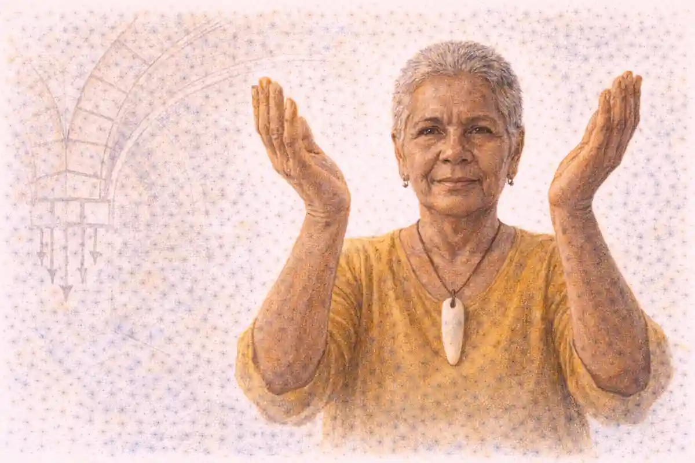

Mao Zedong was two things that biography usually keeps apart, and this profile refuses to separate them. He was a theorist of real originality whose writings on contradiction, on practice, and on guerrilla warfare were taken up by movements on every continent, translated, memorised, and applied by people who never saw China. He was also, for more than a quarter of a century, the ruler of the most populous state on earth, and two of the catastrophes of the twentieth century unfolded under his direction and by his authority: a famine among the largest in recorded history, and a decade of mass persecution that reached into nearly every institution and household in his country. An account that gives only the theory reads as a brief for the defence. The record alone cannot explain why the ideas travelled so far. This article gives both, in full, and lets neither purchase indulgence for the other.

The method used here can be named at the outset, because the whole profile is built on it. It is the document verdict: the practice of grading a thinker's claims against documents whose authority does not depend on the grader's sympathies. For Mao, one such document exists that has no equivalent in the literature on most rulers. In 1981 the party he had led for nearly half a century adopted a formal resolution on its own history, and that resolution ranked his services to the revolution above his faults, while describing the Cultural Revolution, the movement he launched and sustained, as the source of the gravest setback and the heaviest losses suffered since the state he proclaimed was founded. The severest judgements in this profile therefore do not rest on hostile testimony. They rest on the verdict of his own side, delivered as an official document, with its date and its standing stated, and the profile returns to that document at every stage of the assessment. Where the resolution speaks, it is quoted or closely followed. Where scholarship goes beyond it, the scholarship is named.

A second discipline governs the figures. The famine that followed the Great Leap Forward is described in these pages as what it demonstrably was, a catastrophe of the first magnitude in the historical record, and no mortality figure is attached to it, here or anywhere in this article. That is not evasion. Scholarly estimates of the death toll diverge very widely, by margins larger than the entire mortality of most famines, and they diverge for identifiable reasons: different assumptions about the normal death rate against which excess deaths are counted, different definitions of what an excess death is, and demographic data of uneven quality from a period when registration itself broke down. To print one number from that range as though it were a measurement would be to misinform the reader with an appearance of precision. The same standard is applied to the campaign against the rightists and to the violence of land reform. What can be stated exactly is stated exactly: dates, texts, decisions, and the judgements of documents. What the demographic literature contests is presented as contested, with the sources of the contest named, and the reader is directed to that literature rather than handed a counterfeit certainty.

## The double subject: theory and record in one frame

Every serious treatment of Mao has to solve the same structural problem, and most solve it by amputation. The hagiographic tradition, which was for decades the only account available inside China, presented a thinker of unbroken correctness whose errors belonged to subordinates, to circumstances, or to enemies. The denunciatory tradition, which flourished outside China during the Cold War and has never lacked publishers since, presented a tyrant whose writings were propaganda dressed as philosophy and whose career required no theoretical attention at all. Both treatments are comfortable, and both are false to the evidence. The writings exist, they are argued works of theory with identifiable claims that can be stated, tested, and compared, and they influenced events far beyond their author's reach. The record also exists, and it includes decisions taken by one man, against advice, in full knowledge of opposition, whose consequences were catastrophic on a scale that has few parallels. A profile that cannot hold both of those sentences at once has not begun.

The series to which this article belongs confronted the same problem in its treatment of Lenin, and the discipline developed there is applied here without alteration, because consistency across the two cases is itself a finding. State the theory as theory, in its strongest form, from its texts. State the record as record, plainly, in the profile rather than in an embarrassed appendix. Draw no causal line between the two without arguing it, in either direction: the theory does not excuse the record, and the record does not refute the theory, until a specific doctrine and a specific decision have been connected by evidence. Then, where the connection can be argued, argue it, and where a doctrine was in fact used as the warrant for a catastrophe, say so and concede what follows. The final section of this profile performs exactly that operation on the strongest objection that can be brought against Mao's theoretical standing, and it does not flinch from the part of the objection that succeeds.

What distinguishes Mao's case from Lenin's is the survival of an official verdict from inside the tradition itself. Lenin's successors built a cult and froze assessment for two generations. Mao's successors, within five years of his death, negotiated and published a judgement that assigned him both the founding achievement and the gravest errors, and that judgement remains the stated position of the party he founded. That document gives this profile its spine. It is not treated as beyond criticism; scholars have examined its drafting, its compromises, and its silences, and those examinations are reported here. But a verdict delivered by the subject's own institution, against its own interest in an unblemished founder, carries an evidentiary weight that no external assessment can match, and the reader who grasps the document verdict grasps the most efficient route through a literature that is otherwise polarised to the point of uselessness.

### Why does this profile refuse to separate the theory from the record?

Because each side of the life is evidence about the other, and suppressing either falsifies both. The doctrines were written by a man who held power, and some were invoked to justify its worst exercises. The record was made by a ruler whose decisions followed from ideas argued for decades. Separation protects reputations; it does not produce understanding.

## Formation: a prosperous peasant's son in Hunan

Mao Zedong was born in 1893 in Shaoshan, a village in Hunan province, into a household that stood well above the village average. His father, Mao Yichang, had risen from poverty by soldiering, saving, and dealing in grain, until he was among the more prosperous farmers of the locality, a creditor to poorer neighbours and an employer of labour at harvest. His mother, Wen Qimei, was remembered by her son for piety and generosity, qualities he contrasted, in the autobiographical account he later gave to the American journalist Edgar Snow, with his father's severity and acquisitiveness. The contrast became a small founding myth of the biography: the stern, accumulating father as the representative of the old order's discipline, the compassionate mother as the source of the son's sympathy with the poor. Biographers have handled the contrast with care, since its source is the subject's own retrospective telling, but the household's standing is not in doubt. Mao was not formed by destitution. He was formed inside the rural class structure he would later analyse, close enough to its top to understand its workings and resentful enough of its authority to leave it.

His schooling was irregular and largely self directed. A traditional village education in the Confucian classics gave way, after clashes with his father and a period working on the family farm, to modern schools in the provincial capital, Changsha, where he eventually trained as a teacher at the Hunan First Normal School. The school's influence on him was deep and specific. Its ethics teacher, Yang Changji, trained in Japan and Britain, taught a demanding moral philosophy that joined self cultivation to national purpose, and Mao's surviving student essays show a young man working through questions of will, energy, and the remaking of the self with an intensity his later writings never lost. He read voraciously and unsystematically in the Changsha library: Chinese histories and novels, translations of Western political thought, the reformist journalism that filled the years after the fall of the Qing dynasty. The reading mattered less for any single doctrine than for the habit it fixed. Throughout his life Mao approached texts as instruments, extracting from each what a present problem required, and the eclecticism of his formation, classical Chinese statecraft beside European social theory, explains features of his mature writing that puzzle readers who expect a systematic Marxist formation. He had none. He had a teacher's training, a classicist's memory, and a autodidact's confidence that any book could be made to yield its use.

The move that carried him from provincial student to participant in a national movement came in 1918, when he travelled to Beijing with a group of Hunan students preparing to study in France. Mao did not sail. He stayed in the capital, impoverished, and found work as an assistant librarian at Peking University, in the university library directed by Li Dazhao, one of the two men, with Chen Duxiu, who would found Chinese communism. The post was menial, shelving and registering periodicals, and Mao later recalled that the professors whose lectures he attended as an auditor scarcely noticed him. The recollection has the polish of legend, but the essentials are documented: in Beijing he heard Li Dazhao lecture, read the early Chinese discussions of the Russian Revolution, attended meetings of the study societies that clustered around the university, and encountered, in the young woman he would marry, Yang Kaihui, his old teacher's daughter, a companion formed by the same intellectual world. He returned to Hunan in 1919 with the May Fourth ferment at its height, edited a radical journal, organised student and labour associations, and moved within two years from reformist journalism to the conviction that only a disciplined revolutionary party could remake China. When the Chinese Communist Party was founded in 1921, Mao attended its first congress as a delegate from Hunan. He was twenty seven, a teacher by training, a librarian's assistant by recent employment, and a Marxist of very recent conversion whose knowledge of the doctrine came largely from summaries and translations.

### What did the library assistant years give him?

Proximity without standing, and the uses of both. The Beijing months placed him beside the figures of Chinese Marxism while he shelved their journals, and the humiliation of being overlooked by the professoriate left a suspicion of credentialed intellectuals that surfaced in his cultural politics. The period fixed his conviction that ideas matter only when an organisation carries them.

That suspicion of the credentialed is worth pausing over, because it runs through the whole career and explains episodes that otherwise read as mere vindictiveness. Mao's mature writings return repeatedly to the figure of the intellectual who possesses book knowledge without practical knowledge, and his epistemology, set out in the essay on practice, makes the subordination of book learning to tested experience into a doctrine. The doctrine had philosophical sources, in Marx and in the Chinese tradition alike, but it also had a biography: the young assistant whom the professors ignored built a theory in which the professors' kind of knowledge ranked second, and a movement in which peasants who had never read a page outranked scholars who had read everything. Readers who treat the theory of practice as a purely philosophical text miss the charge it carried for its author. Readers who treat it as mere resentment miss that it is also, as philosophy, a serious and arguable position. The profile's discipline applies: state both, connect them only where the argument supports the connection.

## The study society: the first organisation

Between the classroom and the party stands an institution of Mao's own making that the biography should not skip, because it was his first exercise in the organisational form his whole career would use. In 1918, with a circle of fellow students from the Changsha normal school, he founded a study society dedicated, in its founding language, to the renovation of the members' thought and conduct and, through them, of China. The society was small, serious to the point of austerity, and governed by rules its members imposed on themselves about study, correspondence, mutual criticism, and the conduct of life; its members debated the roads open to China, anarchism, liberal reform, Bolshevism, with the earnestness of young men who believed the country's fate would be decided by which idea men like themselves adopted. A majority of its most active members, Mao among them, moved within three years to communism, and the society's alumni supplied the first cadres of the Hunan party. The form is what matters for the life. The study society joined doctrine to discipline and self transformation to collective purpose in a single small instrument, admission by conviction, cohesion by criticism, purpose beyond the members' advancement, and the party Mao later built and rectified is that form at scale, with the seminar become a state. His lifelong instinct, when a problem confronted him, was to found the small disciplined group that would study it into submission, from the investigation teams of the nineteen twenties to the writing groups of Yan'an to the central task forces of his last campaigns. The instinct built the movement that won China. It also built the rooms, at every scale of his career, in which the authorised reading of a question was settled by the group's discipline before the evidence was fully heard, and the biography that began in a Changsha study society ends, fittingly, in the largest such room of all, a state in which the group's discipline had become the constitution and its founder's reading the law.

## The rural turn: how necessity became doctrine

The Chinese Communist Party of the early nineteen twenties was an urban party in doctrine, in membership, and in instinct. It had been founded under the guidance of the Communist International, it understood the revolution on the Russian model, as a rising of the industrial working class led from the cities, and it operated inside an alliance with the Nationalist Party, the Guomindang, that subordinated its independent action to the national revolution both parties claimed to serve. Mao's work in those years followed the alliance's logic: he held posts in the Guomindang's own apparatus, directed its peasant movement training institute in Guangzhou, and organised among the peasantry of Hunan as an auxiliary front of a strategy whose centre remained urban. Nothing in his activity before 1927 marks him as a heretic. What marks him, in retrospect, is the quality of his attention. Sent to investigate the peasant movement in his home province, he went and looked, travelling through county after county in the opening weeks of 1927, and what he reported back contradicted the caution of both parties' leaderships.

The report on the peasant movement in Hunan, written in March 1927, is the first text in which Mao's distinctive voice and method are fully present, and it deserves its standing as the founding document of the Chinese road. The peasant associations of Hunan had grown with extraordinary speed, and their actions, humiliating landlords, parading them in tall hats, fining them, invading their houses, had alarmed the party leaderships, who feared the excesses would frighten allies and invite repression. Mao's report inverted the judgement. The excesses, he argued, were the necessary form of a revolution in the countryside: the power of the landlord class, built over centuries and sanctified by custom, could not be dismantled by courtesy, and the terror the gentry felt was the measure of a real transfer of power. In the report's most famous sentence, reduced here to its best known fragment, he wrote that a revolution is not a dinner party. The peasantry, on his account, was not an auxiliary to the revolution. In a country where the industrial working class was tiny and the peasantry was the overwhelming majority, the peasantry was the revolution's main force, and the party that failed to lead it would be led by events instead. The argument was empirical before it was theoretical: it rested on what he had seen in five counties, on membership figures of the associations, on the testimony of participants. The method, go to the place, count, listen, generalise, became his signature, and the report is still the cleanest example of it.

### What did the Hunan report actually argue?

That the peasant movement its own party feared as excessive was the revolution itself arriving in the countryside. Mao held that landlord power, being total and customary, could only be broken by acts its victims experienced as terror, and that the peasantry, not the small urban working class, was the decisive force a Chinese revolution had to organise and lead.

Within weeks of the report's appearance, the ground on which it stood was destroyed. In April 1927 the Guomindang's military leadership turned on its communist allies in Shanghai and across the country, massacring party members, union organisers, and suspected sympathisers in the cities where the movement had been built. The urban party, its cadres exposed by years of open alliance work, was shattered in a matter of months. This catastrophe is the indispensable context for everything Mao later theorised, and the first of the misreadings this profile is charged with correcting is the idea that the rural strategy was deduced from doctrine in a study. It was not. The strategy was what remained after the urban road had been drowned in blood. The party's survivors fled to the countryside because the cities had become killing grounds, and the theoretical edifice of the Chinese road, protracted war, base areas, the countryside encircling the cities, was built afterwards to explain and generalise a survival that necessity had imposed. Mao's genius, if the word is allowed, lay in performing that generalisation more completely than anyone else, and in refusing, against repeated instruction from Moscow and from his own party's orthodox wing, to treat the rural bases as a temporary embarrassment on the way back to the cities.

### Why did the party's urban strategy collapse?

Because the alliance that protected it was revoked by violence. The party had organised openly inside a united front, its members known, its unions public, its headquarters findable. When the Nationalist command turned its armies on the movement, the urban organisation had neither arms nor hiding places, and a decade of city work was destroyed in a single season.

The retreat that followed carried Mao from the failed Autumn Harvest Uprising of late 1927 into the Jinggang Mountains on the Hunan and Jiangxi border, where his small force joined with other remnants and began the experiment that defined the next decade: a soviet, a territorial base, defended by a Red Army, administering land redistribution among the peasants who sustained it. The Jiangxi Soviet that grew from these beginnings was a state in embryo, with its own government, currency, and laws, and it was in governing it that Mao and his comrades learned the practical syllabus of the Chinese revolution: how to tax a peasant economy without killing it, how to recruit soldiers from villages that needed their labour, how to conduct land reform that mobilised the poor without uniting the middle peasants against the party. The lessons were not gentle. Land policy swung between radical and moderate lines as its consequences registered, and the internal struggles of the Jiangxi years included purges of alleged enemies inside the movement itself, an early instance of a pattern, the security campaign that consumes the organisation's own ranks, that recurs at intervals through the whole history. The base survived repeated encirclement campaigns by Nationalist armies until the fifth, conducted with blockhouse tactics and overwhelming numbers, made its position untenable, and in October 1934 the Red Army abandoned Jiangxi and began the retreat that entered legend as the Long March.

The Long March was a military disaster redeemed by endurance: a fighting withdrawal across thousands of miles of difficult country, through snow mountains and marshlands, harassed by enemy forces and by the attrition of hunger and disease, which reduced the departing army to a fraction of its strength before the remnant reached the loess country of northern Shaanxi and established a new base around Yan'an. Its political consequence outweighed its military cost. At the Zunyi Conference in January 1935, in the middle of the retreat, the party's leadership was reorganised and Mao's position at its head was effectively secured, the outcome of a long contest in which the Moscow trained faction's strategies had led to catastrophe and Mao's had the merit of having kept an army in existence. From Zunyi onward, with interruptions of form rather than of substance, Mao led the Chinese Communist Party until his death more than four decades later. The base at Yan'an, poor, remote, and defensible, became the laboratory in which the mature theory was written, the cadres of the future state were trained, and the movement that would win China in 1949 was assembled.

### How was his position inside the party secured?

By survival credited as strategy. The Moscow trained faction had directed the party into the loss of its bases, while Mao's methods had preserved an army and a territory. At Zunyi, in mid retreat, the party changed its command, and the man whose methods had worked emerged as its leading figure, a standing never again seriously displaced.

## Yan'an: the theory written in a cave dwelling

The Yan'an years, from the mid nineteen thirties to 1947, were the most intellectually productive of Mao's life, and the texts he produced there, lectures delivered to cadres in a poor border region capital, became the canonical statement of what came to be called the sinification of Marxism. The phrase was his own, introduced in 1938: Marxism was not to be recited as imported formula but remade in Chinese forms, through Chinese experience, for Chinese conditions. The claim sounds modest. Its implications were not. It asserted the right of a national party to judge doctrine by its own practice against the authority of the international movement's centre, and it placed the writings of a provincial party leader, produced in lectures to guerrilla cadres, on the same shelf as the classics of the tradition. The two philosophical essays of 1937, on practice and on contradiction, are the core of the achievement, and they are treated here as what they are: serious works of theory, with arguments that can be followed, strengths that can be specified, and limits that later events exposed.

The essay on practice addresses the theory of knowledge. Its argument moves in a single arc. Knowledge begins in practice, in production, in class struggle, in scientific experiment, the three forms of activity in which human beings engage the world. From practice comes perceptual knowledge, the accumulated impressions of repeated experience. Perceptual knowledge, worked upon by the mind, leaps to rational knowledge, concepts and theories that grasp the internal relations of things. Rational knowledge must then return to practice, be applied, and be corrected by the result, in a cycle that repeats at higher levels without end. The essay's polemical targets are named in its subtitle's terms: dogmatism, which mistakes the book for the world and applies formulas without investigation, and empiricism, which mistakes raw experience for knowledge and never rises to theory. Against both, the essay insists that there is no knowledge outside the cycle, and that the criterion of truth is practice itself, the success or failure of an idea when it is acted upon. The political payload is plain: a party that investigates before it acts, and corrects itself by results, will outlast a party that governs by quotation. The epistemology also carries the seed of the mass line, since the practice from which knowledge comes is overwhelmingly the practice of ordinary people, whose experience the leader must gather before he can lead.

### What is the theory of knowledge in the essay on practice?

A cycle with no exit and no shortcut. Practice generates impressions, impressions are raised into concepts, concepts are returned to practice and tested by their fruits, and the testing generates new practice at a higher level. Truth is what survives the circuit. The doctrine demotes book learning to one moment in the circuit and makes investigation the leader's first duty.

The essay on contradiction takes up the dialectic itself. Where the Soviet textbooks of the period presented dialectical materialism as a set of general laws illustrated by examples, Mao's essay reorganises the subject around a single centre: the law of contradiction, the unity and struggle of opposites internal to every thing and process, is the fundamental law, and the others are its aspects. From this centre the essay develops the distinctions on which its reputation rests. Contradictions are universal, present in every process, and particular, each process having its own specific contradiction that defines it and must be studied in its specificity rather than by template. In any complex process there are many contradictions, but one is principal, the one whose development governs the others, and identifying it is the first task of analysis. Within a contradiction, the two aspects struggle, and one is principal, determining the character of the whole, though the aspects can exchange places as conditions change. Contradictions divide into antagonistic and non antagonistic kinds, between enemy and people in the first case, among the people in the second, and the distinction governs method: antagonistic contradictions are resolved by overthrow, non antagonistic ones by criticism, discussion, and education. The full treatment of this essay belongs to the series' study of [Mao on contradiction and practice](/2018/06/01/mao-on-contradiction-and-practice/), where its argument is examined line by line; what belongs here is its place in the biography. It made its author the tradition's philosopher in Chinese eyes, it supplied the analytical vocabulary in which the party thereafter discussed everything from military strategy to literary policy, and it contained, in the distinction between kinds of contradiction, an instrument whose later uses in power would be among the gravest matters this profile must record.

The philosophical essays should not be read as ornaments on a military career. They were interventions in a live struggle over the party's direction, aimed at the dogmatists who had nearly destroyed it by applying Russian templates to Chinese conditions, and their authority in the movement derived from the catastrophe that had discredited the alternative. Nor should they be read as philosophy of the seminar kind. Their concepts are instruments: principal contradiction is a instruction to find the one problem whose solution moves the rest, the principal aspect is an instruction to identify which side of a situation is gaining, and the theory of practice is an instruction to investigate before deciding. Scholars who have assessed the essays as contributions to Marxist philosophy, Stuart Schram most thoroughly in English, have generally concluded that the work on contradiction is the most substantial: derivative in its sources, which include the Soviet textbooks it criticised and the Chinese philosophical tradition it absorbed, but original in its reorganisation and in the weight it lays on particularity. That combination, inherited materials rebuilt around a new centre by a mind working from political need, is characteristic of Mao's theory at its best, and it is the standard against which the later doctrines must be measured.

## Protracted war and the political form: New Democracy

If the philosophical essays supplied the method, the military and political writings of the same years supplied the strategy, and the strategy is the contribution for which the Chinese revolution itself is the evidence. The essay on protracted war, delivered as lectures in 1938 as Japan's invasion armies drove deep into China, answered the two counsels of despair and of fantasy that competed in Chinese opinion: that China was too weak to resist and must submit, and that quick victory was available to courage. Against both, Mao constructed a staged analysis. The war would be protracted because of the balance of forces: Japan was strong but small, aggressive but unjust, and increasingly isolated; China was weak but vast, fighting on its own ground, and able to trade space for time. Across three stages, strategic defence, stalemate, and counteroffensive, the balance would shift as the invader's lines lengthened, his garrisons multiplied, and the resistance behind his lines grew. Within that frame, guerrilla warfare was raised from a tactic to a strategic arm: base areas in the enemy's rear, built on land reform and mass organisation, would convert occupied territory into a second front the invader could neither digest nor abandon. The lectures are a remarkable performance of the contradiction method applied to war, each stage defined by the shifting relation of its aspects, and their predictive record, the war did pass through something recognisably like the three stages, gave their author's strategic authority a foundation no rival could match.

### How did the rural road begin as necessity rather than doctrine?

The cities were closed by massacre before the countryside was chosen by theory. After the urban organisation was destroyed in 1927, survival required territory, food, and recruits, which only rural bases could supply. The doctrines of protracted war and encirclement were written afterwards, in Yan'an, to generalise what the Jinggang and Jiangxi years had already taught by experiment.

The political complement of the military strategy was the doctrine of New Democracy, set out in 1940. Orthodox Marxism expected a bourgeois democratic revolution, led by the bourgeoisie, to precede a socialist one led by the proletariat. China presented the theorist with a bourgeoisie too weak and too compromised with foreign capital and landlordism to lead anything. Mao's solution divided the revolution into stages and reassigned the leadership: the first stage, New Democracy, would be a revolution of several classes together, peasants, workers, the petty bourgeoisie, and the national bourgeoisie, under the leadership of the proletariat and its party, establishing not a bourgeois republic of the old type nor yet a socialist state, but a transitional order, a joint dictatorship of the revolutionary classes, with a mixed economy and a national, scientific, mass culture. The second stage, socialism, would follow when conditions ripened. The doctrine did real work. It legitimised the broad alliances the party needed to fight Japan and then to win the civil war, it reassured classes who feared immediate expropriation, and it gave the coming state its initial form, the coalition government and mixed economy of the early nineteen fifties. It also contained the ambiguity that its later history exposed: the timing of the transition belonged to the leadership's judgement, and a stage theory in the hands of a leadership impatient with stages could be compressed at will, as the acceleration into collectivisation and then into the Great Leap would show. The doctrine's fate is thus a first instance of the profile's central problem in miniature: a theory reasonable in its text, whose dangers lay in the discretion it lodged in its author's hands.

## The mass line: the method of rule inside the method of revolution

The third contribution named in every summary of Mao's theory is the mass line, and it is the one whose double career, as an instrument of liberation and as an instrument of mobilisation against society, most resists any simple verdict. As formulated in 1943, in a resolution on methods of leadership, the mass line is the epistemology of practice translated into an organisational rule. The correct ideas of the leadership do not fall from the sky and are not born in the leader's mind; they are gathered from the scattered and unsystematic ideas of the masses, concentrated through study into systematic form, returned to the masses as policy and propaganda, and tested in the masses' own action, after which the cycle repeats. From the masses, to the masses: the formula makes the leader a processor of the people's experience rather than a commander issuing truths, and it imposes a discipline of consultation that, where it genuinely operated, gave the party's rural governments a responsiveness no Chinese state had previously achieved. Land reform conducted by the mass line method meant work teams living in villages for months, classifying households through discussion, and building the reform out of the poor peasants' own accusations and judgements. The results, in the base areas and in the north China liberated zones of the civil war, were a depth of rural mobilisation that the Nationalists, governing by decree from above, could not rival, and historians of the revolution treat it as a principal cause of the victory of 1949. The full narrative of that victory belongs to the series' analysis of [the Chinese revolution](/2018/06/15/chinese-revolution-marxist-analysis/), where the military and political campaigns are traced in sequence.

Yet the formula's structure contains its own vulnerability, and the biography must name it before the record section makes the naming unavoidable. The cycle has two directions of travel but only one authorised processor. The masses supply the raw material; the leadership concentrates it; and the test of the result is the masses' action as the leadership reads it. Where the reading is honest and the channels of report are open, the method corrects error. Where the leadership's concentration stage is driven by a conclusion fixed in advance, the same machinery manufactures consent: the scattered ideas that agree are gathered, those that do not are classified as backward or hostile, and the return journey delivers the leader's prior conviction to the people as their own voice. The mass line, that is, has no internal defence against a leadership that has stopped listening, because the listening and the judging are done by the same hands. In Yan'an the method was joined to investigation and produced responsiveness. In the campaigns of the nineteen fifties its form survived while its epistemology was inverted, and mobilisation, the summoning of the masses to enact a line already decided, inherited the prestige of a method designed for the opposite purpose. Keeping the two careers distinct, the method as designed and the method as it functioned when the feedback channels closed, is essential to the assessment offered later in this profile.

### What is the mass line as a method?

A cycle of knowledge applied to leadership. The leader gathers the scattered experience of the people, concentrates it into policy through study, returns it to the people as their programme, and tests it in their practice before gathering again. Its strength is the discipline of consultation; its weakness is that the same leadership gathers, concentrates, and judges the test.

## The Yan'an talks: culture placed under command

In May 1942, with the base area under blockade and strain, Mao addressed a forum of writers and artists at Yan'an on the place of literature and art in the revolution. The talks, published the following year and canonised thereafter, laid down the doctrine that governed Chinese cultural life for decades, and their consequences outlasted every other text of the Yan'an period except the philosophical essays. The argument is direct. There is no art for art's sake, no classless love of humanity, no standpoint outside politics from which the writer innocently observes. Literature and art serve classes and their struggles; in the China of the war, they were to serve the workers, peasants, and soldiers who constituted the overwhelming majority, and the writer's task was to learn that audience from inside, to remake his own outlook through participation in its life, and to produce work that raised the people's political consciousness and unity. Two criteria governed judgement, the political and the artistic, with the political placed first. Within the forum's discussions, writers who had treated the base area's darkness as material for satire or exposure were answered sharply: exposure of the enemy was the writer's business; the people's own shortcomings were to be treated as objects of education, not of ridicule.

The talks must be assessed with the same doubleness the profile applies everywhere. As a sociology of culture, the doctrine named real facts: the audience for literature in China was overwhelmingly rural and illiterate, the inherited literary culture was the property of a narrow stratum, and a revolution that ignored the forms in which the majority could be reached would abandon the field. Much that the doctrine encouraged, the collection of folk forms, the writing of reportage, the staging of plays for soldiers and villagers, genuinely widened Chinese culture's constituency. As a charter for cultural authority, however, the talks lodged the definition of correct politics, and therefore of permissible art, in the party's leadership, and they supplied the warrant under which campaigns against writers proceeded for thirty years. The rectification movement of the same years, which disciplined the party's own intellectuals through study, criticism, and in some cases harsher instruments, showed the doctrine in operation: the writer Wang Shiwei, whose essays had criticised privilege at Yan'an, was denounced, imprisoned, and eventually executed, a fate that announced to every intellectual in the movement the cost of treating the forum's invitation as a licence. When the Cultural Revolution later hunted artists and writers across China, it worked with warrants the talks had issued. The line from 1942 to those persecutions is not a straight line, and this profile does not draw it as one; the talks were addressed to a wartime base, not to a conquered state, and their author in 1942 commanded a besieged enclave, not a continent. But the doctrine's structure, culture as an instrument whose correct use the leadership defines, survived every change of circumstance, and it is among the clearest cases where a text's internal logic, not merely its abuse, belongs in the assessment.

### What did the Yan'an talks demand of writers and artists?

Service, defined politically. Art was to take its standpoint from the workers, peasants, and soldiers, to learn its audience by living among them, and to be judged first by political criteria and only secondly by artistic ones. The doctrine widened culture's audience and simultaneously placed the definition of permissible culture in the leadership's hands.

## The thought canonised, the war won

The Yan'an period closed with the movement's self definition made formal. The rectification campaign standardised the party's doctrine and its history around Mao's leadership, and the Seventh Congress in 1945 wrote Mao Zedong Thought into the party constitution as its guiding doctrine, defined as the thought by which Marxism had been applied to the Chinese revolution, and understood, significantly, as the product of the party's collective experience concentrated in its leader. That collective framing mattered later: it gave the party of 1981 the conceptual room to retain the Thought while condemning the man's later errors, by distinguishing the system built from the movement's tested practice from the personal theories of his final decades. The distinction is not a mere convenience, though it was certainly convenient. The Yan'an texts had been produced inside a working movement, argued over, revised against experience, and adopted as the movement's common property in a way the later doctrines were not, and the difference in their mode of production is a fact about them, whatever use was made of it afterwards.

The civil war that followed Japan's defeat in 1945 ended faster than almost any observer expected. The Nationalist government, corrupt, inflation ridden, and exhausted, lost the countryside first and then the cities, its armies defecting in whole formations as the People's Liberation Army moved from guerrilla war to conventional campaigns. Mao's direction of the war from Yan'an and then from the road was the culmination of the protracted war doctrine, the stages arriving in compressed form as the balance of forces tipped. In October 1949 he proclaimed the People's Republic of China from Beijing. He was fifty five, the founder of a state and the author of its founding doctrine, in a position no theorist of his tradition had occupied since Lenin, and with this difference: Lenin had ruled a ruined empire for six years of civil war and died before the consolidation of his system, while Mao would rule a unified China for twenty seven years, in peace for most of them, with no institution in his state capable of saying no to him and surviving. The biography's second half is the history of what unconstrained power did to the doctrines, and what the doctrines did in unconstrained hands.

## The contribution and record table

The argument of this profile can be set out in a single instrument, and the reader who masters it can navigate the rest. The contribution and record table lists each theoretical contribution and each major episode of the rule in parallel rows, with what was claimed or done, the period, the assessment carried in the party's resolution of 1981, and the assessment that the scholarly literature has broadly reached. The parallelism is the point. The same mind occupies every row, and the table refuses in advance the two comfortable arrangements, contributions first with the record as an afterword, or the record first with the contributions as a curiosity. Read down the columns and a pattern emerges that neither arrangement can show: the contributions cluster in the years of constraint, when their author led a movement that could be destroyed by error and knew it, while the catastrophic rows cluster in the years of unconstrained power, when error had no feedback and correction no channel. The table does not argue that pattern by itself; the sections after it do. But it displays the evidence in the shape the argument requires.

| Contribution or episode | Period | What was claimed or done | The 1981 resolution's assessment | The scholarly assessment |
| --- | --- | --- | --- | --- |
| The theory of contradiction | Yan'an lectures of the late nineteen thirties | Dialectics reorganised around contradiction, its particularity, and the principal contradiction and principal aspect | Retained within Mao Zedong Thought as part of the doctrine's living body | Judged the weightiest of the philosophical writings, derivative in sources, original in arrangement |
| The theory of practice and knowledge | Delivered at Yan'an in the late nineteen thirties | Knowledge as a cycle from practice to concepts and back, with practice as the criterion of truth | Retained, and cited as the doctrine's epistemological foundation | Assessed as a serviceable materialist epistemology whose political function was to discipline dogmatism |
| Protracted war and New Democracy | The war against Japan and the civil war | A staged strategy of rural bases and guerrilla war, joined to a two stage revolution under party leadership | Credited with the victory and the founding of the state | Broadly confirmed by the event; the strategy is treated as the revolution's decisive intellectual achievement |
| The mass line | Formulated in the early nineteen forties | Leadership as a cycle of gathering, concentrating, and returning the people's experience | Retained as a principle of party work | Praised as a method of consultation, criticised for lacking any check on the leadership that operates it |
| The Yan'an talks on art and literature | The rectification years | Culture subordinated to political criteria defined by the leadership | Not separately condemned; the Thought's cultural doctrine retained | Held responsible in structure for decades of cultural policing, whatever the wartime context explains |
| Land reform and the suppression campaigns | The first years of the new state | Redistribution of landlord land through mass accusation, with violence against the landlord class | Endorsed the reform as necessary and its main direction as right | Documented as a founding transformation carried out with extensive violence against those classified as landlords |
| The Hundred Flowers and the anti-rightist campaign | The middle nineteen fifties | Criticism invited, then those who offered it labelled and punished on a very large scale | Held the campaign necessary in principle but expanded far beyond its proper scope | Generally judged a breach of faith whose scale taught intellectuals silence for a generation |
| The Great Leap Forward and the famine | The late nineteen fifties into the early nineteen sixties | Communes, inflated targets, and procurement from falsified harvests, producing a famine among the largest recorded | Described grave errors of the period while distributing their causes among inexperience, eagerness, and circumstance | Divided on causation and on the death toll's scale, agreed that policy stood at the centre of the catastrophe |
| The Cultural Revolution | The decade from the middle nineteen sixties | A mass movement launched from above against the party and state apparatus itself | Named as the source of the severest setback and heaviest losses since the state's founding | Treated across the literature as a decade of persecution and institutional destruction initiated by Mao |

Two cautions belong with the table. The first is that its scholarly column compresses literatures that argue with one another, and the compression is a map, not a verdict; the sections on the famine in particular unpack a dispute the table can only label. The second is that the resolution column is itself evidence of a peculiar kind. The resolution was a negotiated political document, drafted under Deng Xiaoping's supervision after wide discussion inside the party, and its judgements were shaped by the needs of a leadership that had to condemn the catastrophes without dissolving the legitimacy of the state the catastrophes' author had founded. That its formulations nonetheless run as severely as they do, on the Cultural Revolution above all, is what gives the document its evidentiary force. A verdict negotiated toward leniency that still lands where this one lands tells the reader where the floor of the assessment lies.

### What pattern does the table make visible before any argument begins?

The clustering of the dates. Achievement gathers in the decades when Mao led a movement that mistakes could kill; catastrophe gathers in the decades when he ruled a state that could not answer back. The frame shows the distribution before a word of explanation is offered, and the explanation is the rest of this profile.

## The record in power: land reform and the founding violence

The state Mao founded in 1949 faced a countryside in which land, rent, and debt structured a poverty of extraordinary depth, and the new government's first great domestic undertaking, the land reform carried through in the early nineteen fifties, attacked that structure at its root. The reform abolished the landlord class as an economic order: land was confiscated and redistributed to the peasants who tilled it, rents and debts were cancelled, and a transformation that reformers had demanded for a century was accomplished in a few years across a continent sized country. The achievement was real, and the peasantry's memory of receiving land underlay the regime's rural legitimacy for a generation. The method, however, was the method of the base areas raised to national scale, and it ran on accusation. Work teams organised the poor peasants of each village to classify every household, to confront those classified as landlords in mass meetings, to speak bitterness against them, and to settle accounts that in very many places ended in beatings, public humiliation, and killing. The violence was not incidental disorder at the edges of an orderly reform. The classification itself placed a defined stratum outside the community's protection, the meetings were designed to break its standing utterly, and the centre's directives alternately urged boldness and restrained excess in a rhythm that local cadres experienced as licence with intermittent brakes. Landlords died in large numbers, by suicide as well as by execution and beating; how large, the literature estimates with the same wide divergence this profile has already described, and no figure is stated here. What is not contested is the character of the process, documented by historians from the regime's own records and from village level research alike: a social revolution conducted as a campaign of mass accusation, in which the category assigned to a household could decide whether it lived.

The land reform was accompanied, in the cities and across the state, by campaigns of suppression directed at those the new order classified as its enemies: former officials of the old regime, alleged secret agents, bandits, and the leadership of religious and secret societies. These campaigns, like the rural reform, proceeded by quota like pressures, mass meetings, and exemplary punishment, and they established in the state's first years a repertoire that later decades would reuse: the campaign as the normal instrument of rule, the classification of persons into categories of friend and enemy, the mobilisation of neighbours against neighbours as a technique of government. Mao's personal role in the founding violence was not that of a distant ratifier. His directives set its tempo, his writings supplied its categories, and his interventions repeatedly pushed local authorities toward greater severity when he judged them hesitant. The assessment the profile must record is therefore double and neither half cancels the other: the reform destroyed an agrarian order whose injustice was centuries deep and delivered land to those who worked it, and it did so by methods that killed very large numbers of people and normalised campaign violence as the state's habitual tool. The party's resolution of 1981, for its part, treated the land reform as necessary and correct in its main direction, a judgement the scholarly literature has generally shared about the reform's aims while documenting, as the resolution did not, the scale and character of the killing that accompanied it.

## The Hundred Flowers and the turn against the critics

The sequence of the middle nineteen fifties is the record's clearest lesson in how the regime's instruments could reverse their direction without changing their form. In 1956, and more fully in the spring of 1957, Mao invited criticism. The slogans of the moment proposed that a hundred flowers should bloom and a hundred schools of thought contend, and the invitation was extended, with every appearance of sincerity, to intellectuals, to the small democratic parties that survived inside the system, and to the public generally: criticise the party's work, expose its bureaucracy, speak the grievances that silence had stored. Historians still argue over the invitation's original intent, whether it was a genuine experiment in supervised liberalisation that its author abandoned when the criticism exceeded his expectations, or, as Mao later claimed, a stratagem to lure snakes from their holes. The documentary record supports elements of both readings at different dates, and the profile states the dispute rather than settling it. What is not disputed is what followed. The criticism, when it came, went deeper than complaint about bureaucracy: students and intellectuals questioned the party's monopoly itself, the privileges of its cadres, the copying of Soviet models, the treatment of peasants. In June 1957 the invitation was withdrawn and the anti-rightist campaign began.

Those who had spoken, and many who had barely spoken, were labelled rightists, a classification that carried dismissal, disgrace, exile to labour in remote places, imprisonment for some, and a mark that extended to families and persisted for decades. The numbers labelled were very large; the literature's estimates diverge, in the pattern this profile has established, and none is printed here. The campaign's consequences exceeded its victims. It taught every intellectual in China the lesson the label was designed to teach, that speech invited could be speech punished, and the silence it installed lasted a generation. It destroyed, at the moment of the state's consolidation, the feedback on which the mass line's epistemology depended: after 1957, no channel existed through which unwelcome information could travel upward without endangering its bearer. The direct line from that destruction to the famine two years later, in which local officials reported harvests they knew to be fictitious rather than report failure to a centre that had punished candour, is one of the strongest causal arguments in the literature on the period, and it is an argument about institutions rather than intentions. The 1981 resolution's handling of the episode is characteristic of the document verdict's value: it held that resistance to bourgeois rightist attack had been necessary, and that the campaign had been greatly broadened beyond its proper scope, a formulation that concedes the injustice of the labelling's scale from inside the system that performed it.

### What turned the invitation to criticise into a campaign against the critics?

The depth of what the invitation released. Criticism aimed at bureaucracy was acceptable; criticism that reached the party's monopoly, its privileges, and its model was reclassified as attack. The machinery of classification then did the rest, converting speakers into rightists by category, and the punishment of the speakers taught the entire educated stratum the cost of candour.

## The Great Leap Forward and the famine

The Great Leap Forward, launched in 1958, was the attempt to compress China's economic development into a few years of mobilised effort, and it produced the famine at the centre of this profile's record. Its premises joined the voluntarism latent in Mao's thought to the organisational machinery the party had built. If the masses' enthusiasm was the decisive productive force, if correct leadership could release energies that material scarcity seemed to forbid, then the constraints of capital and technique could be outflanked by organisation itself. The countryside was reorganised into people's communes, vast units that merged farming, administration, and welfare, abolished most private plots and household cooking in favour of communal dining halls, and mobilised labour on a scale never before attempted: peasants built dams and irrigation works through the winter, and in the autumn of 1958 the whole country was summoned to make steel, in backyard furnaces that consumed tools, woks, and door fittings to produce metal much of which was useless. Agriculture was directed by slogans elevated into technique: plant closer, plough deeper, and report harvests whose size would prove the system's superiority. The harvest reports, rising through a hierarchy in which every level understood what the level above wished to hear, became fantasy. Provinces competed in launching satellites, the period's term for announced yields of fabulous size, and the state procured grain on the basis of the announced figures, taking from villages grain that did not exist as surplus and leaving the producers without food. Communal dining halls, distributing freely in the first flush of supposed abundance, consumed reserves that the famine years would need. Exports continued. The information system, its bearers terrorised by the anti-rightist campaign's recent lesson, transmitted triumph upward and concealed starvation below.

The famine that followed, between roughly 1959 and 1962, was among the greatest famines in recorded history. It was not evenly distributed: some provinces, where leadership pursued the Leap's methods with particular zeal or where procurement pressed hardest, suffered catastrophically, while others escaped with dearth rather than mass death, a variation that itself became evidence in the later dispute about causes. Villagers ate bark, leaves, and earth; the demographic record shows births collapsing and deaths rising across the affected regions; the state's own internal reports, later studied by historians, recorded the starvation in the bureaucratic language of unnatural death and population loss. Mao's responsibility is a matter of record at several distinct points. The Leap's targets, tempo, and organisational forms were his, pressed against the caution of colleagues. The commune system and the steel campaign bore his personal endorsement at every stage. And at the one moment when the system generated its own correction, he destroyed the corrector. At the Lushan Conference in the summer of 1959, Peng Dehuai, the defence minister and a comrade of the Long March generation, wrote to Mao privately conveying what he had seen in the countryside and urging moderation of the Leap's methods. Mao circulated the letter as an attack, organised the conference into a condemnation of its author, and purged him. The lesson travelled through the apparatus instantly: the Leap's policies, already failing, were now beyond criticism, and provincial leaders redoubled the procurement and the falsified reporting through the famine's worst year rather than risk Peng's fate. A leader who had built his epistemology on the correction of knowledge by practice responded to practice's verdict by punishing its messenger, and the famine deepened accordingly.

### What happened at Lushan when the policy was criticised?

The critic was destroyed and the policy was entrenched. Peng Dehuai's private letter reporting rural distress was reframed by Mao as an organised attack, the conference condemned and purged him, and every official in the system learned that reporting the Leap's failure carried a personal price. Procurement and falsified reporting intensified through the famine's worst period.

The retreat, when it came, came from within the leadership and below Mao's hand. By 1961 the scale of the disaster had forced adjustments: communes were shrunk, private plots and household sidelines restored, dining halls dissolved, grain imported, and the procurement demands reduced, while Liu Shaoqi and Deng Xiaoping directed a recovery that quietly reversed the Leap's economics. Mao withdrew to what he called the second line, resentful, watching the retreat he had authorised under duress move toward what he regarded as the restoration of everything the revolution had fought. His speeches of these years return obsessively to the danger that the party itself would degenerate, that a privileged stratum of officials would consolidate itself as a new exploiting class, that the revolution would be lost not to invasion but to its own apparatus. Out of that diagnosis, and out of his determination to recover the initiative, came the doctrine of continuing revolution and, in 1966, the Cultural Revolution. The biography thus arrives at the hinge of the whole assessment: the famine's author interpreted the famine's lesson as proof that the revolution had not gone far enough, and the doctrine he built on that interpretation produced the second catastrophe of the record.

## Why no figure is stated: the estimates and their divergence

A reader who comes to this profile from the general literature will have met numbers for the famine's dead, and the numbers will have differed from one another by margins that in any other context would discredit the entire discussion. The divergence is real, it is not a pretext for agnosticism about the event, and its structure can be explained, which this section does. Every estimate of famine mortality is a reconstruction built from three components, and the components are where the scholars differ. The first is the demographic material itself: the censuses of the period, the household registration system, and the retrospective fertility and mortality surveys conducted decades later, from which the population's movement through the famine years is inferred. Registration broke down in places at the famine's height, births went unrecorded as well as deaths, and the surviving series contain gaps that different reconstructions fill differently. The second component is the baseline: an excess death is a death above the number that would have occurred in a normal year, and the choice of the normal death rate, taken from the years before the Leap, from the years after, or from a modelled trend, moves the resulting total by millions in either direction, because the population at risk numbered in the hundreds of millions and small rate differences multiply into vast counts. The third component is definition: whether the count includes only deaths attributable to starvation and its diseases, or also the births that did not occur because famine suppressed fertility, a distinction between lost lives and lost births that some presentations merge and others hold strictly apart, again with large effects on the headline number.

The scholars who have built these reconstructions are named here so that the reader can follow the dispute in its primary literature. Judith Banister's demographic work, built from the surveys and censuses available to Western scholarship in the nineteen eighties, produced one of the foundational reconstructions. Chinese demographers, Peng Xizhe and Cao Shuji among them, working with provincial materials as access widened, produced others, Cao's proceeding province by province from local records and gazetteers. Journalistic and archival researchers, Yang Jisheng preeminently, assembled documentary evidence of the famine's mechanisms and administration alongside their reconstructions. Frank Dikötter's account, based on provincial archives, pressed the highest widely circulated reconstruction and a correspondingly severe interpretation, and demographers have disputed both his materials' handling and his total. The profile takes no side among the reconstructions, because taking a side is precisely what its method forbids where the evidence is a contested reconstruction rather than a document. What the profile states is what every party to the dispute accepts: that deaths occurred on a scale placing the famine among the greatest known to history, that the variation among provinces was wide, and that the policy system described in the preceding section stood at the centre of the event. The reader who needs a number is directed, deliberately, to the demographic literature itself, where the numbers arrive with their assumptions attached and can be judged as reconstructions rather than consumed as facts.

## The famine's causes: the dispute stated at full strength

Because the profile declines to print a death toll, it owes the reader the causation dispute in full, since the dispute is where the moral and historical weight of the event is actually argued. Three broad positions contend, and each is given here in its strongest form with its holders named, before any assessment.

The first position holds that the famine was substantially a disaster of weather and circumstance visited upon a poor country. This was the explanation the Chinese state itself offered in the years immediately following, when the period was officially described as one of natural calamities, compounded by the withdrawal of Soviet assistance and the burden of debt repayment. In its scholarly form, the argument points to genuinely adverse weather in parts of the country, to the real backwardness of Chinese agriculture, its thin margin above subsistence in ordinary years, and to the administrative chaos of a transformation attempted everywhere at once by cadres of limited competence. On this account the famine belongs to the long history of Chinese subsistence crises, aggravated by modernisation's haste but not created by policy's design; the leadership's failing was over ambition and poor information, failings of a kind every developmental state of the era exhibited. The position draws strength from the unevenness of the famine itself: if policy alone were the cause, its defenders ask, why did outcomes differ so sharply between provinces governed under the same directives?

The second position locates the cause in the policy system but distributes responsibility through its machinery. On this account, associated with much of the demographic and institutional literature, the famine was produced by the interaction of specific mechanisms: procurement quotas set from falsified harvest reports, the commune system's destruction of household reserves and incentives, the dining halls' consumption of stocks, the suppression of information after the anti-rightist campaign and Lushan, and the centre's refusal, until 1961, to import grain or release reserves at the scale required. No single decision starved the country; the system converted shortage into famine by removing every mechanism, market, household store, truthful report, official correction, that ordinarily arrests a shortage's descent. This position also explains the provincial variation the first position cites: the directives were common, but their local execution varied with the zeal and terror of provincial leaderships, and the provinces whose leaders pressed hardest or lied most fluently suffered worst. Felix Wemheuer's work on the period exemplifies the institutional reading, and Anthony Garnaut's examination of the weather records found the meteorological anomalies of the years too modest, against the long record, to carry the explanatory weight the natural calamity account assigns them.

The third position presses personal and ideological responsibility to its maximum. In the archival work of Yang Jisheng and in Frank Dikötter's account, the famine appears as the foreseeable product of a utopian project imposed by a leadership that valued its vision above the population's survival, maintained procurement and exports while knowing the countryside starved, and treated the deaths, when reported, as the acceptable cost of transformation. On this reading the mechanisms of the second position are real but subordinate: they were chosen, defended at Lushan against explicit warning, and sustained for a further two years, and the chain of responsibility runs to the man who chose and defended them. The position's strength is its documentary base in the regime's own internal records. Its contested point is the move from responsibility for the system to the precise scale of the outcome, where its reconstructions have drawn the demographers' criticism noted in the preceding section.

The profile's assessment is as follows, and it is deliberately narrow. The weather explanation, in the strong form that would make the famine substantially a natural event, does not survive the evidence: the meteorological record is inadequate to it, the provincial pattern follows administrative rather than climatic lines, and the state's own subsequent conduct, reversing the policies to end the famine, concedes where the operative causes lay. Between the institutional and the personal readings, the difference is one of emphasis within a shared conclusion, that policy stood at the middle; the institutional account explains how the machine killed, the personal account insists on who built, drove, and refused to stop the machine, and a complete assessment requires both. What no position in the serious literature maintains is that the famine was a straightforward execution of a plan to starve, and the misreading that casts it so should be discarded: the catastrophe arose from policy interacting with reporting incentives and administrative structure, which is a more complicated finding and, for students of how states fail, a more useful one.

### Why does the famine's causation remain disputed among scholars?

Because the evidence supports a centre and divergent emphases. All accounts place the policy system at the middle of the event, but they weight its elements differently: weather and backwardness, mechanisms that converted shortage into famine, and responsibility for the system's choice and defence. Provincial variation gives each reading material, and the documents sustain more than one distribution of blame.

## The Cultural Revolution: the decade in outline

The Cultural Revolution, launched in 1966 and ended only by Mao's death ten years later, is treated in its own article in this series, [the historical record of the Cultural Revolution](/2018/07/01/cultural-revolution-historical-record/), and the profile confines itself to what the biography requires. Mao, having watched the post famine retreat restore markets, hierarchy, and bureaucratic routine, concluded that the party apparatus itself had become the seat of a new privileged class travelling what he called the capitalist road. His remedy was to turn the mass movement against the apparatus: students were summoned as Red Guards to bombard the headquarters, officials and teachers and intellectuals were denounced, paraded, beaten, imprisoned, and sent to the countryside, the education system closed for years, and the country's cultural inheritance was assaulted in the campaign against the old customs, ideas, culture, and habits. The movement escaped its author's control within two years into armed factional warfare, and the army was called in to restore order, after which the persecution continued in administered forms: rustication of urban youth on a vast scale, campaigns of cleansing and re investigation that reached into every work unit, and a succession struggle at the summit that ended with the designated heir, Lin Biao, dying in flight after an alleged coup attempt. Mao's purposes, the prevention of a Soviet style degeneration as he understood it, the renewal of revolutionary commitment in a generation that had not made the revolution, the destruction of his rivals within the leadership, are all documented in the scholarship and are all compatible; the decade's character is not softened by any of them. The party's own resolution, quoted in this profile's opening, called it the cause of the severest setback and the costliest losses the party, state, and people had endured since the state was founded. No figure for its dead is stated here, under the same protocol that governs the famine: the estimates diverge, the mechanisms of death were various, and the event's gravity does not require a counterfeit precision to register.

Mao died in September 1976. The succession that followed was brief and turbulent: within a month the radical leadership group around his widow was arrested, and within five years the party had adopted the resolution on its history that graded his life's work. The speed of that verdict, and its balance, are the subjects of the next section, because the resolution is not merely a source for this profile. It is, on the argument the profile has been building, the most useful evaluative instrument the whole literature affords.

## The resolution: the document verdict in its source

The Resolution on Certain Questions in the History of Our Party since the Founding of the People's Republic of China was adopted in June 1981 by the Sixth Plenary Session of the Eleventh Central Committee of the Chinese Communist Party. Its status should be stated precisely, because the profile's method depends on it. It is an official document of the party Mao founded and led, adopted after a drafting process supervised by Deng Xiaoping that included discussion among thousands of senior cadres, and it remains the party's formal position on the Mao era. It was written by men who had themselves suffered in the Cultural Revolution and who governed a state whose founding legitimacy was Mao's work, and both of those facts are legible in its balance. The resolution performs three operations. It confirms Mao Zedong Thought as the party's guiding doctrine, defining it as the integration of Marxism's universal truth with the concrete practice of the Chinese revolution, a system produced collectively by the party and crystallised in Mao's writings of the revolutionary years. It judges Mao's personal record across the whole span, finding the primary element in his record to be his contributions and the secondary to be his errors, with the proportions shifting across the decades: the early and middle periods predominantly of achievement, the later years increasingly of error. And it delivers on the Cultural Revolution the severest verdict in the document, describing it as a catastrophe initiated by the leader and exploited by counter revolutionary groups, for which Mao bore chief responsibility, while distinguishing his errors in those years from crimes.

### What is the official Chinese assessment of Mao?

a party resolution of 1981 judged his contributions to the revolution primary and his errors secondary, while describing the Cultural Revolution as responsible for the most severe setback and heaviest losses the party, state, and people had suffered since 1949. It remains the official position.

The resolution's treatment of the other episodes followed the same pattern of graded judgement. The Great Leap and the commune movement were counted among the grave errors of the period, their causes distributed among the leadership's inexperience in economic construction, its eagerness for rapid results, and its departure from the discipline of investigation its own doctrine prescribed. The anti-rightist campaign was held necessary in its intention and condemned in its expansion. The founding achievements, the victory of the revolution, the establishment of the state, the transformation of the economy's ownership, were credited to Mao's leadership in terms that left no room for a successor regime to disown them. Critics of the document, inside scholarship and out of it, have noted what its structure required it to soften: the famine receives no such direct and unqualified treatment as the Cultural Revolution, the founding violence of the land reform years passes with little scrutiny, and the apportioning of error to circumstance and to subordinates at points relieves the centre of weight the documents elsewhere assign it. Those criticisms are recorded in this profile because they are just, and because they sharpen rather than blunt the document's usefulness. A verdict that its own drafters shaped toward protection, and that still assigns its subject chief responsibility for a decade of catastrophe and counts his later errors as grave, establishes the minimum that any assessment must reach. Assessments that go further, and much of the scholarship does, argue from evidence. Assessments that fall short of the resolution's severity have to explain why they are gentler than the judgement of the man's own party.

### What did the resolution distinguish between the thought and the man?

A system from its author's late errors. Mao Zedong Thought was defined as the collective product of the party's practice, crystallised in the writings of the revolutionary years, and retained as the guiding doctrine. The doctrines of his last decades, continuing revolution among them, were separated from that system and assigned to the man as his errors.

This distinction is the document verdict's working edge, and it deserves a moment's examination as a method, since the profile's title claim rests on it. The document verdict means grading a theoretical claim by asking what the authoritative documents, including the documents of the subject's own side, actually say, before asking what the polemical literature says. Applied to Mao, it dissolves the two laziest questions in the field. Whether Mao was a great man or a monster is not a question documents can grade. Whether the party he founded ranked his services above his faults, while holding him chiefly responsible for its gravest catastrophe, is a question a document settles, and settling it disciplines everything downstream: the hostile biographer cannot be accused of inventing the catastrophe's grading, and the admiring one cannot pretend the grading away. The verdict also models the separation this profile has practised throughout, between a doctrine's content and its author's record, by performing that separation institutionally: the Thought is the party's, tested and collective; the errors are the man's, dated and named. Whether the separation is fully honest as history is a further question, and scholars who note that the Yan'an doctrines and the late doctrines share more than the resolution allows are making a point the strongest objection section will meet directly. As a documentary floor for assessment, however, the resolution stands, and the reader equipped with it can enter the polarised literature with a fixed point that neither pole supplied.

## The strongest objection: theory indicted by its author's power

Every assessment practised in this profile so far has kept two ledgers, the theory and the record, and graded each on its own evidence. The strongest objection to Mao's theoretical standing refuses the separation, and it must be stated at full strength before it is answered, because an answer to a weakened version of it would be worthless. The objection, pressed in the historical literature by scholars including Frank Dikötter and developed across the critical biographical tradition, runs as follows. A body of theory is not a set of propositions in a vacuum when its author held unconstrained power and used the theory as the operating system of his rule. Mao's doctrines were not merely written by the man who launched the Great Leap and the Cultural Revolution; they were the instruments through which those catastrophes were justified to the apparatus that executed them. The doctrine of continuing revolution under the dictatorship of the proletariat supplied the Cultural Revolution's warrant: it taught that the bourgeoisie had regenerated inside the party itself, that class struggle continued throughout the socialist period, and that repeated upheavals against the party's own headquarters were the revolution's necessary form. The theory of contradiction supplied the classificatory machinery: the distinction between antagonistic and non antagonistic contradictions, and the doctrine that the principal contradiction had shifted, allowed opponents to be reclassified from the people to the enemy by analytical decree, as the rightists were reclassified in 1957 under the authority of the speech on contradictions among the people. The mass line supplied the mobilisation form, the summons of the masses to carry out a line whose content the centre had fixed. On the objection's account, then, the famine and the persecution decade are not external accidents that befell a philosophy. They are the philosophy in application, the output of doctrines whose common structure, a single centre authorised to define the principal contradiction, to classify friends and enemies, and to summon the masses against the classified, is a design for unconstrained power wearing the dress of a theory of knowledge. A theory whose author, holding such power, produced a famine of that scale and then a decade of persecution cannot be assessed independently of that outcome, because the outcome is the theory's largest experiment and its results are in.

The objection is the strongest that can be made, and parts of it are true. The answer this profile gives proceeds by identification, doctrine by doctrine, because the objection's force depends on treating the doctrines as one block, and they are not one block in their dates, their contents, or their uses.

Begin with what was not so used. The theory of contradiction, as written in the Yan'an lectures, is a general doctrine about the structure of processes: that opposites coexist in every thing, that one contradiction in a complex process is principal, that the aspects of a contradiction can exchange places. Nothing in that doctrine instructs a famine, licenses a purge, or designates a class of persons for destruction, and its career outside Mao's state confirms the separability: it has been studied, taught, and applied by philosophers, by opposition movements, and by parties that never held power, without producing communes or cultural revolutions, because a doctrine about how to analyse situations does not determine what its user will do with the analysis. The same holds for the theory of practice. Its content, investigate before deciding, test ideas by results, correct by feedback, is not merely innocent of the catastrophes; it is the standard by which the catastrophes stand condemned in the profile's own earlier sections, since the Leap violated every one of its precepts, substituting fixed conclusions for investigation and punishing the feedback the doctrine made sacred. A ruler who had governed by his own epistemology would have heard the countryside in 1959. The famine is evidence of the doctrine's abandonment, and the objection, pressed against these two bodies of theory, fails: they were not the instruments of the catastrophes, and they are separable from them in the way any general method is separable from the crimes of a man who stopped using it.

The mass line stands between the cases. As designed, it is a method of consultation; as it functioned after the feedback channels were destroyed, it became a method of mobilisation wearing consultation's form. The objection is right that the design carried the vulnerability within itself, since the cycle lodges the gathering, the concentrating, and the judging in the same hands, and a leadership determined on its conclusion can run the cycle as a ritual of legitimation. The profile concedes that structural point, as it did in the mass line's own section: the doctrine carries no built-in safeguard against a leadership that has ceased to listen, and that lack is a defect in the doctrine, not merely in its operator. What the objection cannot show is that the defect made the catastrophes necessary. The same form, in the years when investigation was real and reports could still travel, produced the responsiveness of the base area governments. The doctrine is therefore graded as the record grades it: a genuine method with a fatal structural weakness, whose history in power is the history of that weakness being found and used.

Then the concession, which the profile makes without reservation, because the objection at this point simply succeeds. The doctrine of continuing revolution, in the form its author gave it, is not separable from the Cultural Revolution in the way contradiction theory is separable from either catastrophe. It was not an old doctrine abused by circumstance. It was formulated in the nineteen sixties, by Mao himself, in direct response to the post famine retreat, for the stated purpose of preventing the consolidation he saw around him, and it was promulgated as the theoretical warrant of the movement that followed: the teaching that classes and class struggle persist throughout socialism, that the bourgeoisie ensconces itself inside the party, and that revolution must therefore be continued, repeatedly, against the party's own apparatus, under the leadership of the man who defined the doctrine. The Cultural Revolution was that doctrine's application, intended as such by its author, announced as such in its documents, and understood as such by its executors and its victims. To assess the doctrine of continuing revolution independently of the decade it authorised would be exactly the evasion the objection charges against the whole separation of theory and record. The profile therefore grades it with its outcome attached, as it grades the Yan'an doctrines with their outcomes attached, which were a revolution won and a method of analysis that outlived its author. The separation of theory from record is a discipline for reaching verdicts, not a shelter from them, and where a doctrine and a catastrophe are joined by design, the verdict joins them too.

### Which doctrines were used as instruments, and which were not?

The doctrine of continuing revolution was the Cultural Revolution's warrant, and the use of the contradictions doctrine in the anti-rightist campaign turned a distinction into an instrument of labelling. The Yan'an theories of contradiction and of practice were not instruments of the catastrophes; the famine violated the theory of practice at every point he had prescribed.

One further element of the objection deserves its answer, because it is the element students most often carry away. The objection implies that the scale of the outcome retroactively empties the earlier work, that nothing written by the author of the famine can retain standing. That inference, if generalised, would empty most of the canon of political theory, whose authors so often stand in some relation to power and its abuses; but the profile does not rest on the generalisation. It rests on the particular finding the doctrine by doctrine examination produced: the corpus is not one thing. It contains a method of analysis separable from the record, a method of rule with a structural flaw the record exposed, and a late doctrine inseparable from a catastrophe, and the honest verdict is the three verdicts, not a single word pronounced over the whole. That is what the document verdict, practised as a discipline rather than quoted as a slogan, finally means: grade the claims one by one, against the documents and the record together, and let the grades differ where the evidence differs.

## The organiser before the theorist: the united front years

Between the founding congress of 1921 and the catastrophe of 1927, Mao was neither the party's leader nor its theorist but something the later legend tends to skip: a working organiser of unusual energy, whose postings gave him the empirical education on which the theory was later built. He organised labour in the mining districts of Hunan, ran the party's work in his home province, edited, recruited, and administered, and when the alliance with the Guomindang took formal shape he crossed into the Nationalists' own apparatus, serving in their propaganda department and directing the institute that trained organisers for the peasant movement across China. The institute's curriculum, which Mao shaped, joined political instruction to the investigation of rural conditions: students were sent to examine landholding, rents, and debts in their home districts and to report what they found, so that the peasant movement's cadres were trained in the method of the social investigation before they were trained in anything else. The young organiser's own investigations from these years, of which the Hunan report is the famous survivor, were working documents of this school. The point matters for the assessment of the later theory, because the theory of practice was not a philosopher's invention subsequently applied to organising. It was the organiser's method, generalised. The man who wrote that knowledge begins in practice and must return to it had spent six years in work whose every success depended on knowing a district's rents, lineages, and grievances before presuming to lead it, and whose every failure, in the party's repeated urban disasters, could be traced to leaderships deciding from doctrine what they had not investigated on the ground.

The united front years also fixed a second element of the mature outlook: an education in the fragility of alliances and in the decisive weight of armed force. The communists of the early twenties possessed influence without arms, embedded in a coalition whose military power belonged to their partner. Mao's later insistence that political power grows from armed struggle, and that the party must command its own army absolutely, is usually quoted as a maxim. In the biography it is a scar. The generation of organisers who survived 1927 had watched colleagues who commanded unions, newspapers, and mass followings, and commanded no soldiers, be destroyed in weeks by colleagues who commanded soldiers. Whatever the doctrine's later uses, its origin was an empirical lesson of the most brutal kind, and the profile records it as such: the rural strategy was built by men who had learned that an unarmed revolution is a petition.

## The Jiangxi school: governing before the theory

The soviet years in Jiangxi, from the late nineteen twenties to 1934, are sometimes treated as a prelude, a guerrilla interlude before the real theory and the real state. For the biography they are better treated as a school, the only one in which Mao governed before Yan'an theorised the governing. The Jiangxi Soviet administered a territory of millions. It issued land laws and marriage laws, ran courts and a treasury, printed currency, operated schools, and fought a continuous war, and every one of those functions generated the practical problems the later doctrines address. Land policy alone ran through a full cycle of experiment within the base: an early radical line that confiscated all land and attacked the rich peasantry along with the landlords; the discovery that this line dissolved the middle peasantry's support and reduced production; and successive corrections toward the distinction, confiscate from the landlord, protect the middle peasant, restrict the rich peasant, that became the settled rural policy of the movement. The cycle is the theory of practice enacted before it was written, and Mao's own position in these years was not yet commanding. He was removed from military leadership in 1932 by the party's then dominant faction, spent periods in political eclipse and illness, and watched strategies he opposed consume the base's strength. The eclipse matters to the profile for the same reason the library years do: the doctrine of the principal contradiction and the insistence on investigation were forged by a man who had experienced, from inside, what a leadership's dogmatism costs when it cannot be argued with, an experience he would later, in power, inflict in magnified form on his own critics. The parallel is not drawn to excuse or to condemn by symmetry. It is drawn because it is the biography's most consistent thread: the instruments Mao built against dogmatism were real, they were built from real defeats, and their abandonment in his own hands is therefore a fact about power's effect on method, not evidence that the method was always a fraud.

The Jiangxi years also contain, in embryo, the record's darker repertoire. The movement's security organs conducted purges against alleged enemy agents inside the base, in which considerable numbers of the movement's own soldiers and cadres were arrested and killed on accusations later acknowledged to have been largely fabricated. Mao's precise responsibility for those purges has been debated by historians, since the security apparatus had its own chiefs and its own momentum, and the profile states the debate rather than resolving it. What is not debated is the pattern's presence this early: a besieged movement, genuinely infiltrated and genuinely at war, developing an internal enemy category whose elasticity under pressure would recur at Yan'an, in the founding years of the state, in 1957, and catastrophically in the Cultural Revolution. The category of the enemy hidden within, and the campaign as the instrument for extracting him, belong to the biography from its first decade of power in miniature. A profile that introduced them only in the nineteen fifties would mislead by novelty. They were old tools, and their user had seen them used, and had seen their cost, long before he wielded them at continental scale.

## The war years: base areas as a rehearsal for the state

The war against Japan, from 1937 to 1945, gave the movement its second united front and its great expansion, and the base areas behind Japanese lines became a rehearsal for governing China. The political arrangements of those bases repay attention because they show the Yan'an system at its most attractive and most effective. In place of the Jiangxi period's one party soviet, the wartime bases practised a moderated programme designed for alliance: rents and interest were reduced rather than abolished, landlords who did not collaborate with the enemy retained their land, and local governments were constituted on a principle of thirds, communists, non party progressives, and middle elements sharing office. Elections of a limited but real kind were held in many districts. The moderation was strategic, adopted to hold the anti Japanese alliance together, and it worked: the bases grew from the remnant that reached Shaanxi to a network of territories with populations in the tens of millions, defended by armies that the Japanese could contain but not destroy, and administered with a relative honesty and responsiveness that travellers and foreign observers of the period repeatedly contrasted with the Nationalist rear. The American observers who visited Yan'an in 1944 reported a movement of discipline, austerity, and popular support, and their reports, though written under the base's careful hospitality, recorded things that were true.

The same years contained the rectification campaign, and the biography must hold the two together, the open base and the disciplined party, because they were one system. Rectification standardised the movement's ideology through the study of a canon of texts, prominently including Mao's own writings, and through criticism and self criticism conducted in small groups under party direction. For most participants it was an education, intense and often exhilarating, that unified a party swollen with new recruits of every background into a single disciplined instrument. At its edge it became coercive: the campaign against alleged enemy agents in 1943, the so called rescue campaign, extracted confessions on a large scale from cadres and students who had come to Yan'an in patriotism, and was halted by Mao himself when its fabrications became undeniable, with apologies offered to many of its victims. The episode is the Yan'an instance of the pattern traced from Jiangxi: a genuine security problem, an elastic enemy category, a campaign that overran its evidence, and a correction that came from the same centre that had licensed the overrunning. The correction distinguishes Yan'an from the later catastrophes, where correction was refused for years or punished as treason. It does not remove the pattern, and the scholars who treat rectification as the template of the movement's later campaigns, in its methods of study, confession, and classification, are identifying a continuity the documents support.

## The peasantry as a theoretical problem

The peasant doctrine deserves a section of its own, because it is the point at which Mao's revision of Marxism was deepest and the point at which the classical tradition found it hardest to follow. In the Marxian scheme as the Chinese party inherited it, the peasantry was a class of small proprietors, dispersed, property bound, and incapable on its own of generating a socialist politics; its historical role was to be dissolved by capitalist development into proletarians and bourgeois, and in a revolution it could follow, supply, and sustain, but not lead or define. Mao's writings, from the Hunan report through the class analyses of the nineteen thirties to the New Democracy texts, rebuilt the peasantry's position on Chinese evidence. He divided the rural population into strata by their relation to land and labour, landlord, rich peasant, middle peasant, poor peasant, and landless labourer, and assigned each stratum a political character derived from its economic position, so that the countryside became legible to the party as a field of alliances rather than a mass. He argued that the poor peasantry, the great majority of the rural population, had nothing to conserve and everything to gain, and constituted the revolution's most reliable force; that the middle peasantry could be won and held by policies that protected its property; and that in a country where industry employed a small fraction of the people, the revolutionary war would be a peasant war led by a party whose doctrine, not whose social composition, made it proletarian. That last move, the detachment of the party's class character from its members' origins and its relocation in the party's ideology and discipline, is the theoretical hinge of the whole Chinese road. It answered the orthodox objection that a party of peasants could not be a Marxist party, and it answered it by redefining where class standpoint resides. Orthodox critics, in Moscow and within the Chinese movement, never fully accepted the answer, and the dispute about whether Maoism is Marxism at all, taken up in a later section, begins here.

The doctrine's practical vindication was the revolution itself, which was won in the countryside by peasant armies under party leadership, an outcome no reading of the classical texts had predicted for the largest nation on earth. Its theoretical cost should also be recorded. A doctrine that locates revolutionary virtue in the party's consciousness rather than in the social position of a class removes the external check that class position was supposed to supply: if the party is proletarian by virtue of its ideas, then the correctness of its ideas, as judged by itself, becomes the sole guarantee of its character, and the guarantee is circular. The history of the People's Republic, in which a party of increasingly bureaucratic composition continued to certify its own proletarian nature while its founder denounced it as a nest of capitalist roaders, exhibits the circularity in action. Mao's own late doctrine, that a bourgeoisie had taken form again within the party, can be read as his discovery of the flaw in his early solution, pursued by other means: if class character is ideological, then ideological corruption is class treason, and the remedy is a permanent ideological purge. The line from the theoretical hinge of the nineteen thirties to the Cultural Revolution's warrant is not the straight line of the strongest objection, but it is a real line, and the profile draws it here, in the theory's own section, rather than leaving it to the objection to draw alone.

## The founding and the transition: the state in its first decade

The state proclaimed in 1949 began, as New Democracy had promised, as a coalition order with a mixed economy. Private industry and commerce continued, the small democratic parties held office in a united front government, the currency was stabilised after a decade of hyperinflation, and the land reform redistributed the countryside. Within a few years the new state had restored an economy shattered by decades of war, fought the United States and its allies to a standstill in Korea at enormous cost, and established an administrative reach into China's villages that no previous Chinese state had possessed. These founding achievements belong in the record beside the founding violence described earlier, and the resolution of 1981, which credits them to the period's leadership collectively and to Mao at its head, states what the scholarship broadly confirms: the consolidation was a formidable act of state building, and its costs and its accomplishments were alike on a continental scale.

The transition to socialism, when it came, came faster than the New Democracy texts had implied. From 1953 the state moved to collectivise agriculture and to bring industry and commerce under public ownership, and in 1955 Mao personally intervened to accelerate the agricultural transformation, denouncing the caution of colleagues as the tottering of women with bound feet and summoning a high tide of collectivisation that swept the peasantry into cooperatives within two years. The episode is an early instance of the pattern the famine would magnify: a tempo set by the leader's impatience against the advice of the apparatus, justified by the enthusiasm attributed to the masses, and ratified by the machinery's inability to report the costs upward. It also exhibits the ambiguity lodged in the stage theory from the beginning. New Democracy had promised a prolonged mixed stage; its author retained the sole authority to declare the stage complete, and he declared it complete within six years. A doctrine whose timetable is one man's judgement is not a constraint on that man, and the discovery applies to every stage doctrine in the corpus, including the final one, in which the transition to communism was always receding and the revolution therefore always to be continued.

## The Soviet model refused: the economics of the middle years

The middle nineteen fifties also produced the most substantial of Mao's writings on political economy, the speech of 1956 on the ten major relationships, and it belongs in the contributions column of any honest table, as a corrective the profile's table compressed. The speech, delivered to the party's leadership in the aftermath of Khrushchev's secret speech denouncing Stalin, took the Soviet experience as its explicit warning: the Soviet Union's errors, its excessive extraction from the peasantry, its over centralisation, its heavy industry fetish, were to be studied so that China could take fewer detours. The ten relationships, between heavy industry and light industry and agriculture, between the coast and the interior, between the centre and the localities, between accumulation and consumption, and others, were each to be handled as balances to be managed rather than as victories to be won, with the accent throughout on agriculture's foundation, on local initiative, and on the living standards that pure accumulation starved. Read beside the Great Leap launched two years later, the speech is a document of painful irony: it states, with clarity, nearly every principle the Leap proceeded to violate, down to the warning against extracting too much from the peasants and the insistence that economic laws cannot be abolished by enthusiasm. The biographical conclusion the profile draws is not that the speech was insincere. It is that its author's thought contained, in working form, both the analysis that could have prevented the catastrophe and the voluntarism that caused it, and that which of the two governed depended on nothing more systematic than the leader's mood, his reading of opposition, and his mounting conviction that caution was a political symptom. A theory whose application depends on the applier's disposition in this degree has a defect that no exegesis can remove, and the defect, visible in 1956 against 1958, is the economic form of the structural weakness already recorded in the mass line.

### What did the speech on the ten major relationships argue?

That China's construction should learn from the Soviet Union's mistakes by managing balances the Soviet model had sacrificed: agriculture against industry, consumption against accumulation, locality against centre. Its principles, moderation, balance, and respect for economic limits, stand in the record as the clearest statement of the road the Great Leap then refused to take.

## The cult and the road back to power

Between the famine's retreat and the Cultural Revolution stands an institution the biography must describe, because it was the medium through which the late doctrines reached the population: the cult of Mao himself. The veneration of the leader had roots in the Yan'an settlement, where his thought had been canonised and his portrait raised, but its post famine form was built deliberately, and its builder was Lin Biao, the defence minister who had replaced the purged Peng Dehuai. Under Lin's direction the army became the model institution of Maoist virtue, the study of the leader's works became its central ritual, and the compilation of his quotations in the small red volume known in the West as the Little Red Book carried the cult into every unit and, during the Cultural Revolution, into every household that could obtain one. The cult's function in the system of the nineteen sixties was precise. Mao, displaced from the day to day direction of the state by the post famine settlement, retained in the cult an instrument independent of the party apparatus he distrusted: a direct bond between the leader and the population, above all its young, that could be activated against the apparatus itself. When he summoned the Red Guards in 1966, the summons worked because the cult had spent years teaching the summoned that loyalty to Mao outranked loyalty to any institution, including the party he had founded. The doctrines of continuing revolution supplied the movement's warrant; the cult supplied its troops and its emotional economy, in which denunciation of the leader's designated enemies was the proof of devotion and hesitation was itself suspect.

The cult also completes the profile's account of how the feedback system died. A leader encased in veneration receives information filtered twice, once by the apparatus's fear and once by the cult's premise that his judgement is the standard by which information is judged. Mao's late pronouncements show a ruler increasingly sealed inside the echo of his own earlier formulations, quoting his Yan'an self against the China his policies had made. The scholars who have studied the period's documents, Roderick MacFarquhar and Michael Schoenhals in their history of the Cultural Revolution years preeminent among them, reconstruct a court politics of hints, audiences, and edited transcripts, in which colleagues competed to interpret intentions the leader deliberately left ambiguous. That ambiguity was itself an instrument: it kept every subordinate insecure and every initiative dependent on the centre's unreadable will. The biography records the system without needing to decide how much was design and how much was the natural product of absolute power held into old age. Either way, the contrast with Yan'an is the measure of the fall. The young theorist of practice had built his method on investigation, on the correction of the leader's knowledge by the led. The old ruler's court made investigation impossible and correction treasonous, and the doctrines that survived the transition were the ones that could function inside a cult: classification, mobilisation, and the permanent hunt for the enemy within.

## The Lenin parallel: the series' discipline applied twice

The brief for this profile requires the parallel with Lenin to be stated explicitly, and the requirement is just, because the two profiles are the series' paired test of its own method. The parallels of structure are close. Each man founded a party, led it to power in a vast agrarian empire, and wrote theory that his movement canonised. Each adapted the inherited doctrine to conditions its founders had not foreseen, Lenin to the weakest link of an imperialist chain, Mao to a peasant continent, and each adaptation was denounced as heresy by the orthodoxy it displaced. Each man's record in power contains coercion on a large scale defended as necessity: the Red Terror and the grain requisitions of war communism in the one case, the suppression campaigns and the land reform's violence in the other. And each left a succession in which the inheritance was contested between those who would freeze the founder's doctrine and those who would revise it.

The differences are as instructive, and the profile's discipline requires them stated with the same plainness. Lenin's rule in power lasted six years, all of them consumed by civil war, invasion, and collapse, and he died with his state unbuilt and his final writings warning against the bureaucracy he saw forming and against the man who would succeed him. Mao ruled for twenty seven years, most of them in a peace his state had won, with time, resources, and authority to choose otherwise, and the two catastrophes of his record occurred not in the desperation of a besieged founding but in the second decade of a consolidated state, the famine a decade after the founding, the persecution decade two decades after. The comparison therefore cuts against the easier verdict in both directions. Mao cannot claim the mitigation of circumstance that history extends, however grudgingly, to the Bolsheviks of the civil war years; his worst decisions were taken from security, against a functioning state's capacity to feed and administer its people, and renewed after their consequences were known. By the same measure, his theoretical achievement had the longer test: Lenin's adaptations were overtaken by his death before their peacetime meaning could be known, while Mao's doctrines governed a great state for a generation and were graded, in part, by their own results. The series' treatment of [Lenin's intellectual biography](/2014/03/01/lenin-intellectual-biography/) applied the rule that theory and record are stated together and connected only where argument connects them. Applied here, the rule yields a harder case and, in the doctrine of continuing revolution, a connection that argument does connect. Consistency is not a courtesy between the two profiles. It is the evidence that the method, and not the subject's reputation, is doing the grading.

## Marxist or nationalist: the identity dispute

Few questions in the literature have generated more heat than whether Mao was fundamentally a Marxist who happened to be Chinese or a Chinese nationalist who used Marxism as an instrument, and the profile treats the question as the seeded place it occupies in every syllabus: worth answering precisely because both answers capture something and neither captures enough. The nationalist reading, in its scholarly form associated with Karl Wittfogel's polemics and, in a subtler register, with the early work of Benjamin Schwartz, observes the biography's plain facts. Mao's route to Marxism ran through national humiliation: the movement that formed him was a movement for China's salvation before it was a movement for socialism, and his writings return constantly to the nation, its independence, its culture, its place in the world. His break with Moscow's direction, his insistence on sinification, his conduct in the Sino Soviet split, all show a leader who would not subordinate China's revolution to any foreign centre, and whose Marxism bent, at every stress point, toward the national form. On this reading the doctrine was the available instrument of a national project, adopted because it alone offered a theory of imperialism and an organisation capable of winning, and retained because it worked.

The Marxist reading, held by Stuart Schram across a lifetime of editing and interpreting the texts, answers from the writings themselves. Mao's categories are Marxist categories, worked seriously: class analysis of the countryside, the dialectics of contradiction, the stages of revolution, the dictatorship of the proletariat, the withering categories of political economy. His deviations from orthodoxy were argued as developments of the doctrine, with textual warrants, in a lifelong engagement with the classics that no mere instrumentalist would have sustained. His nationalism, on this reading, was itself theorised inside the Marxism, as the national form that the class struggle takes in a semi colonial country, a formulation with Leninist precedent. The profile's judgement is that the dispute dissolves when its terms are dated. The young organiser of the nineteen twenties was a nationalist in search of a doctrine, and said as much in his early writings' preoccupations. The mature theorist of Yan'an had made the doctrine his own to a degree that the instrument metaphor cannot describe: he thought in it, argued in it, and rebuilt it. And the ruler of the nineteen fifties and sixties subordinated both doctrine and nation, at the decisive moments, to a third term that the dispute's two options omit: his own authority and vision, for which Marxism supplied the language and China supplied the stage. The reader who needs a single word should take the resolution's implicit one. The party that judged him called his system Marxism's universal truth integrated with China's concrete practice, and treated the integration as genuine. The integration was genuine. What the integration could not survive was its author's exemption of himself from the practice by which the truth was to be tested.

### How does the dated answer settle the identity dispute?

By refusing to grade the whole life with one word. It finds the nationalist in the young organiser who came to Marxism through China's humiliation, the Marxist in the Yan'an theorist who rebuilt the doctrine as his own, and in the ruler a third term, his own authority, to which both inheritances were finally subordinated.

## The thought and the later Maoism: a distinction the literature requires

A second misreading the profile is charged with correcting concerns the relation between Mao Zedong Thought and the Maoism of later movements. The two are not identical, and conflating them distorts both. Mao Zedong Thought, in the definition the party canonised in 1945 and the resolution of 1981 retained, is the body of doctrine produced in the Chinese revolution's tested practice: the Yan'an texts, the strategy of the rural road, the mass line, New Democracy, the theory of contradiction and of practice. It is, by the definition's own terms, collective, the crystallisation of the party's experience, and bounded by the revolution that produced it. Maoism, as the term travelled after the nineteen sixties, names something else: the doctrine of the late Mao, above all the theory of continuing revolution and the Cultural Revolution's model of revolt against the party itself, taken up as a universal programme by movements abroad, and systematised by some of them into a third stage of the doctrine's development after Marxism and Leninism. The movements that marched under that banner, in Peru, in Nepal, in the Philippines, and in the Indian forests examined elsewhere in this series, were reading the late texts and the Cultural Revolution's example, not the Yan'an canon in its collective sense. Mao himself, in his lifetime, declined the term Maoism for his doctrine, preferring the Thought formulation with its collective implication. The distinction is not pedantry. It determines which texts a reader should hold responsible for which outcomes, and it explains why the party of 1981 could keep the Thought and still condemn the Cultural Revolution without, on its own definitions, contradicting itself. Whether the definitions survive scrutiny is the question the strongest objection pressed; the definitions themselves, as documents, are clear.

### Is Mao Zedong Thought the same thing as later Maoism?

No, and the difference is documentary. The Thought is the canonised doctrine of the revolutionary years, defined as the party's collective product. Maoism, as later movements used the term, is the late doctrine of continuing revolution and the Cultural Revolution's example, universalised abroad. The party's own documents keep the two apart, and the assessment of each must follow the documents.

## Between Moscow and the world: the doctrinal position

Mao's relation to the Soviet tradition, treated at length in the series' comparison of [Maoism and Soviet Marxism](/2018/09/01/maoism-vs-soviet-marxism/), can be summarised here in its biographical line. The Chinese party was born inside the Communist International's discipline, and Mao's ascent was a long emancipation from it: from the directives that had subordinated the party to the Guomindang alliance and then blamed it for the alliance's collapse, through the Moscow trained leadership whose strategies he displaced at Zunyi, to the sinification doctrine that asserted the national party's right to judge by its own practice. Victory in 1949 converted emancipation into rivalry deferred: the alliance with Stalin's Soviet Union in the state's first years was real, bringing the industrial projects and the model the first Five Year Plan copied, but it carried the memory of every occasion on which Moscow had sacrificed Chinese interests to its own, and Mao's private judgements of Stalin, respectful of the achievement, contemptuous of the tutelage, were on record inside the leadership long before they became public. Khrushchev's denunciation of Stalin in 1956 opened the doctrinal contest in earnest. Mao's response was double and characteristic: Stalin's errors were admitted and graded, in proportions more generous than Khrushchev's, while the act of denunciation itself, performed without consultation and tending, as Mao saw it, toward the abandonment of the dictatorship's instruments, was resisted as the beginning of revisionism. Through the following decade the two parties moved from fraternal dispute to open polemic to a split that divided the world movement, with Mao's China presenting itself as the guardian of revolutionary orthodoxy against a Soviet leadership it accused of restoring capitalism by instalments. The irony at the centre of the split belongs in the biography: the doctrine of continuing revolution, Mao's warrant for the Cultural Revolution, was forged as the anti revisionist doctrine, the answer to the question of how a socialist state degenerates, and the state whose degeneration it was designed to prevent was protected by it not at all. The doctrinal position thus ends where the assessment began, with a theory whose diagnosis of the Soviet disease was acute, whose prescription was catastrophic, and whose author could not see that the vulnerability he had located in Moscow's bureaucracy had its Chinese form in the unchecked authority he himself embodied.

## Reception: the doctrine abroad

The worldwide career of Mao's ideas is the third life of the subject, after the theory and the record, and it cannot be understood from either alone. The writings travelled by two routes. The first was the route of the revolution's prestige: a peasant country had defeated, in succession, a Japanese invasion, a United States equipped client regime, and, in Korea, a standstill against the United States itself, and for movements fighting colonial and postcolonial wars the Chinese road read as a manual written by victors. Guerrilla movements across Asia studied protracted war as doctrine; the Vietnamese victory was won by a party that had adapted the Chinese model to its own conditions while jealously guarding its independence of Beijing; in India, the Naxalite current took the rural strategy and later the Cultural Revolution's example as its charter, a transmission examined in this series' study of the Indian movement; in the Philippines and later in Peru and Nepal, parties organised themselves explicitly on the late Maoist programme. The second route ran through the West's own radicalisation in the nineteen sixties and seventies, when the Cultural Revolution, seen from a great distance and through the filter of its own propaganda, appeared to students in Paris, in Italy, in the United States, as a revolution against bureaucracy itself, and Mao's portrait joined the iconography of a revolt whose participants mostly knew the Yan'an texts, if at all, in extracts. French philosophy of the period bears the mark: the Althusserian school's central concept of overdetermination was drawn, by its author's own acknowledgement, from the essay on contradiction, whose account of principal and secondary contradictions in a complex whole gave a generation of European theorists their model of a non mechanical Marxism. That a lecture delivered to guerrilla cadres in a loess cave town should structure Parisian philosophy is the strangest single fact in the doctrine's reception, and one of the strongest evidences that the theory was real theory, capable of work in contexts its author never imagined.

The reception also carried the record's shadow, and the two arrived together wherever the doctrine landed. Movements that adopted the late programme inherited its warrants: the classification of enemies within, the campaign as method, the suspicion of every institution as a restoration in embryo, and the histories of the Shining Path in Peru and of the Khmer Rouge in Cambodia, whose leadership had absorbed the Chinese example at close range, stand in the literature as the doctrine's darkest transmissions, though the responsibility for those movements' crimes belongs to their own leaderships and the lines of influence are matters for their own histories. Inside China, the reception took the form the resolution dictated: the Thought retained as the state's founding doctrine, taught, quoted, and ceremonially honoured, while the practice of the state moved in directions, markets, private enterprise, integration into the world economy, that the doctrine's author would have classified as the restoration he spent his last decade fighting. The profile's constraint forbids commentary on the politics of the present, and none is offered. The historical point stands without it: the doctrine's afterlife, abroad and at home, has everywhere been a selection, each inheritor taking the Mao it needed, the strategist, the philosopher, the iconoclast, the founder, and leaving the rest. The document verdict is the discipline that refuses the selection, and it is offered to the reader as the alternative to inheriting a fragment.

## The texts themselves: editing, canon, and the problem of the versions

A biographical problem of a technical kind underlies everything said so far, and researchers should have it stated plainly. The writings on which the theory's assessment rests reached the world in canonical editions prepared under the author's own supervision, above all the Selected Works published in the early nineteen fifties, and Mao revised his earlier texts for those editions: passages were rewritten, formulations sharpened or softened, datings and references adjusted, in ways that scholars, Stuart Schram and the editors of the later documentary collections preeminently, have documented by comparing the originals. The revisions were rarely falsifications of substance, and the arguments of the Yan'an essays survive the comparison intact. But the canon is a curated object, and its curation was part of the Yan'an settlement's consolidation: the texts teach the doctrine as the movement of the nineteen fifties wished it to have been written. A second body of material stands against the canon: the speeches, letters, and instructions of the fifties and sixties that Mao did not publish, which circulated internally, leaked, were collected by Red Guards during the Cultural Revolution into unauthorised volumes, and have since been edited by scholars into documentary collections that show the ruler thinking aloud, improvising, raging, calculating, in a voice the canon never admits. The contrast between the two bodies of text is itself a biographical finding. The canon's Mao is systematic, patient, and dialectical. The internal record's Mao is those things and also hasty, voluntarist, and vindictive, sometimes within a single document, and any assessment of the theory that rests on the canon alone has accepted the subject's own editing as its evidence. The profile has accordingly treated the internal record, as the scholarship reports it, as the necessary supplement, and it directs the researcher persona below to the documentary collections where the two bodies of text can be read against each other.

## The retreat years: correction administered, lesson refused

The years between the famine and the Cultural Revolution are the biography's most revealing interval, because they show the system working as its theory prescribed and its founder rejecting the result. The recovery of 1961 and 1962 was, in institutional terms, the mass line and the theory of practice operating at last: investigation teams went to the villages, the leadership read what they reported, policy reversed itself, household farming reappeared in much of the country under the language of responsibility fields, markets reopened, and the dying stopped. At the great conference of cadres in early 1962, convened to take stock of the disaster, Liu Shaoqi, then head of state, is reported in the literature to have characterised the famine's causes in a proportion that reversed the official formula, assigning the smaller share to natural calamity and the larger to human error, and the conference heard Mao himself offer a measure of self criticism for the centre's mistakes. For a moment the cycle of the Yan'an method, error, investigation, correction, appeared to have reasserted itself over the catastrophe.

Mao's conduct in those years shows why it had not. He accepted the retreat as a tactical necessity and experienced it as a political defeat inflicted by his own apparatus, and his writings and speeches of the recovery years are consumed by a single returning thought: that the party, ensconced in office, administering markets and hierarchies, was becoming the thing it had overthrown. He watched the Soviet Union, as he read it, travel the same road under the banner of revisionism, and he drew the conclusion his late doctrine formalised: that the decisive class struggle of the socialist period occurs inside the party itself, between its revolutionary mission and its bureaucratic interest, and that preventing the party's degeneration required not better administration but repeated revolutionary upheaval, conducted by the masses against the apparatus under the founder's direction. The Socialist Education Movement of the middle sixties was the doctrine's first trial, a campaign to cleanse the rural party from above and below at once, and its frustrations, the apparatus absorbing and deflecting the cleansing, persuaded him that the instrument itself was captured. The Cultural Revolution was the conclusion he drew: if the party could not purge itself, the masses, summoned by the leader over the party's head, would purge it for him. The biography's judgement on this reasoning must be exact. The diagnosis identified a real phenomenon, the bureaucratisation of a ruling party, which every serious observer of the Soviet experience also identified, and which the theory of the party's ideological class character, traced in an earlier section, had made it impossible to address by institutional means. The prescription was the catastrophe: a remedy that destroyed the institutions through which any correction could be administered, delivered the country to factional violence and administered persecution for a decade, and left the bureaucracy it attacked more entrenched at its end than at its beginning, since no other instrument of rule survived. The doctrine of continuing revolution is graded in this profile with its outcome attached. The outcome was not an accident of the doctrine's application. It was the doctrine, applied by its author, with the means his cult had prepared.

## How the verdict was made: the drafting of the resolution

The resolution of 1981 deserves a section on its own making, because a document's authority depends on how it was produced, and this one's production is unusually well documented. After Mao's death and the arrest of the radical leadership that claimed his mantle, the party faced a problem of legitimacy with no clean solution. To condemn Mao wholesale would be to condemn the founder of the state and the author of its doctrine, dissolving the ground on which the party itself stood; Deng Xiaoping, the dominant figure of the succession, is reported to have insisted that the portrait stay on the gate and the doctrine stay in the constitution, not from sentiment but because the state's continuity required it. To exonerate Mao would be to ratify the Cultural Revolution, whose victims filled the rehabilitated leadership and whose repudiation was the succession's founding act. The resolution was the negotiated path between the two impossibilities, drafted over more than a year, discussed in draft by some four thousand senior cadres in a consultation the party took seriously as a sounding of its own mind, and revised under Deng's supervision with his stated instruction governing its proportions: the account of the errors should be accurate but not excessive, the achievements primary, the document usable as the basis for unity. Critics have read those proportions as the document's corruption, the verdict trimmed to the state's convenience. The profile's reading, following the scholars who have studied the drafting record, is more exact. The proportions were political, certainly, and the document's silences, on the famine's scale above all, are the price of them. But a verdict negotiated under a stated instruction toward leniency, which nonetheless assigns its subject chief responsibility for the gravest catastrophe in the state's history and grades his final doctrine as error, is evidence of a peculiar strength. It represents not the most that could be said against Mao but the least that the party which revered him could manage to say, and a floor established by the subject's own side is the firmest ground an assessment can occupy. Everything the scholarship adds beyond that floor is argued from archives and demography. Nothing beneath it is available to an honest reader.

## The biographers and the scholars: how the literature is arranged

The reader who goes further into this subject enters a literature arranged in camps, and a map of the camps is worth more than a list of titles. The foundational English language scholarship is Stuart Schram's: a lifetime of translation, editing, and interpretation that made the texts available and argued, against both the cult and the cold warriors, that the ideas were serious and had to be met as ideas. Schram's Mao is a creative Marxist of peasant formation whose thought changed across his life, and Schram's late work, confronting the full record, held the theory's standing and the record's horror in the separation this profile has practised, while conceding more with each decade to the weight of the later evidence. Beside Schram stands the interpretive tradition of Maurice Meisner, whose Mao is the heir of a Chinese revolutionary populism as much as of Marx, and whose account of the post Mao succession remains a standard; and the strategic and institutional history of Roderick MacFarquhar, whose volumes on the origins of the Cultural Revolution reconstruct the elite politics of the middle decades from the documents with a patience no summary can replace. Jonathan Spence carried the subject to the general reader; Philip Short's biography weighed the man with a prosecutor's care and a reporter's eye; Alexander Pantsov, working from the Russian archives of the Communist International, documented the Moscow relationship from the other side's files. Against this scholarly shelf stands the denunciatory literature at its most successful, the biography by Jung Chang and Jon Halliday, which presented Mao as a monster of pure appetite whose career contained no idea worth the name. The book's sales were enormous and its scholarly reception was severe: reviewers across the field charged it with mishandling sources, suppressing context, and attributing to its subject a responsibility so total that institutions, colleagues, and circumstance vanish from the explanation. The profile records the controversy because it illustrates the document verdict's necessity. The denunciatory account and the hagiographic account are the same genre with the signs reversed, a single will explaining everything, and the documentary record, the resolution included, refutes both by showing a career in which ideas, institutions, colleagues, and chances all did real work, and in which the man's responsibility, graded by his own party, is grave enough to need no inflation.

Chinese scholarship on Mao operates under the resolution's frame, and its products divide accordingly: an official historiography that works within the verdict's proportions, often with archival depth the West cannot match on the revolution's earlier decades; and, at the frame's edges and sometimes beyond them, the work of independent researchers, of whom Yang Jisheng, a journalist who spent two decades assembling the famine's documentary record from provincial archives and interviews, is the exemplary figure. The demographic literature, Chinese and Western together, constitutes a third shelf, methodologically distinct from both, arguing about baselines and registration rather than about intentions. A reader equipped with the map can locate any new work on arrival: which shelf it belongs to, which documents it rests on, which of the profile's two ledgers it is equipped to grade. The reader should also know what the map cannot yet show. The central archives of the party remain substantially closed for the years of Mao's rule, and every account of the period's highest decisions, this profile included, is built from partial openings, provincial materials, memoirs of uneven reliability, and the documents the system chose to publish. The verdicts offered here are therefore offered as the scholarship's present state, with the resolution as their floor and the archives' future openings as their standing invitation to revision.

## The negligible theory misreading

One misreading remains to be corrected directly, because it is the premise of the denunciatory shelf and it survives in casual conversation long after the scholarship has buried it: the claim that Mao's theoretical work is negligible, a peasant rebel's slogans dressed in borrowed vocabulary. The claim fails on the evidence of the texts' structure. The essay on contradiction performs a genuine reorganisation of its inherited material, demoting the textbook laws of dialectics to aspects of a single law and building from that centre a working apparatus, particularity, principal contradiction, principal aspect, the typology of contradictions, that analysts who share none of its author's politics have found usable for three generations, from Althusser's Paris to the staff colleges that study protracted war. The essay on practice states a coherent epistemology and wields it, in its own moment, as an effective weapon against the dogmatism that had nearly destroyed its author's party. The military writings predicted the course of a continental war in stages that events substantially followed. Negligible theories do not do these things. What the claim usually means, when its holders are pressed, is that the theory is not original in the philosopher's sense, that its materials are borrowed from the Soviet textbooks, from the Chinese classics, from the practice of the movement itself. The profile has already granted the borrowing; it is the documented character of the work. But originality of arrangement, of emphasis, and of application is the only originality political theory has ever mostly had, and by that standard the Yan'an writings stand. The reader is entitled to conclude that the theory was dangerous, that parts of it were catastrophic in application, that its author's record stains its reception permanently. The reader is not entitled, on the evidence, to conclude that it was nothing. A profile that allowed that conclusion would be protecting its reader from the actual problem the life poses, which is not how a mediocrity came to ruin but how a mind of real theoretical power, armed with doctrines some of which were sound, produced from a position of absolute authority the largest famine on record and a decade of persecution, and which of the doctrines carried the charge.

## The moral pedagogy: the three old essays and the making of the model citizen

No account of Mao the writer is complete without the short texts that more Chinese citizens have memorised than any others, the three essays of the Yan'an and war years that the Cultural Revolution's generation was required to learn by heart and that functioned, for decades, as the state's moral primer. The speech on serving the people, delivered in 1944 at the memorial of an ordinary soldier killed in an accident of production, takes the soldier's death as its text for a doctrine of value: death for the people's interest outweighs a mountain, death for the exploiters is lighter than a feather, and the measure of any act is the constituency it serves. The essay in memory of Norman Bethune, the Canadian surgeon who died of an infection contracted while treating the Eighth Route Army's wounded, holds up a foreigner's selflessness as the model of the internationalism and devotion the movement demanded. The fable of the foolish old man who removed mountains, retold from a Chinese classic at the party's Seventh Congress, makes persistence against impossible tasks, with the people's support enlisted as the god who finally helps, into the movement's parable of itself. The three texts are slight as philosophy and enormous as instruments. They taught a moral vocabulary in which the self is valued exactly by its service, in which criticism and self criticism are duties owed to the collective, and in which the party stands as the people's organised form, so that service to the people and obedience to the party become, in the primer's logic, the same act. The slippage in that final identification is the moral form of the structural problem this profile has tracked through the epistemology and the mass line: a doctrine of service whose beneficiary is defined by the organisation that also judges the service. In Yan'an the identification had the warrant of a movement visibly sacrificing itself beside the people it served. In the decades of power it licensed the demand that any suffering the organisation imposed be received as service, and the primer's phrases were quoted at struggle sessions by the imposers. The texts themselves remain what they were, lucid, moving, and brief. Their career is the biography in miniature: instruments of a genuine moral education, converted by the structure that wielded them into instruments of discipline, without a word of them needing to change.

## The writer: style as an instrument of rule

Mao wrote as he organised, and the prose style is evidence in the biography, not decoration on it. The mature manner joins classical Chinese resources, the aphorism, the historical allusion, the fable, to a demotic directness learned from the reportage of investigation: short declarative sentences, questions posed and answered, enemies named in the vocabulary of the village, landlords as local tyrants and evil gentry, abstractions always cashed in a concrete image. He was a poet of the classical forms throughout his life, and the poems, on the snow of the north, on the Long March, on swimming the Yangtze in old age, circulated as state liturgy, their quality debated by critics who generally grant the best of them a genuine power within their tradition. The style's political function was to make doctrine portable. A peasant recruit who could not have parsed a page of Marx could carry away the dinner party sentence, the foolish old man, the paper tiger, the instruction to seek truth from facts, a phrase Mao revived from an older text and fixed as the movement's epistemological banner. Every successful doctrine in the corpus has this double existence, as an argued text for the cadre schools and as a pocket formulation for the ranks, and the pocket formulations were the ones that travelled the world. The same portability carried the style's vice. A prose built on classification and aphorism teaches its user to sort the world into the categories the aphorisms supply, and to experience the sorting as understanding; the rightist, the capitalist roader, the cow ghost and snake spirit of the Cultural Revolution's demonology, were stylistic products before they were administrative ones, labels whose vividness made their application feel like knowledge. The biography therefore reads the style as it reads the mass line, as a genuine instrument with its danger inside it: the clarity that made a continental peasantry literate in a doctrine also made the doctrine's enemies available in a phrase, and the phrase, in the decades of the campaigns, was frequently the whole of the evidence against the person it named.

## The intellectuals under the new state: the pattern before the Hundred Flowers

The Hundred Flowers reversal of 1957 astonished its victims partly because the preceding years had taught a different expectation, and the biography should record what those years had actually contained, since the pattern was visible in them to any reader of the campaigns. The new state's first treatment of the intellectuals it inherited was incorporation with re education: thought reform campaigns in the universities required professors formed under the old order to confess their class outlooks, criticise their colleagues, and remake themselves in the doctrine's image, in sessions whose pressure ranged from the pedagogical to the terrifying. The campaign of 1955 against the literary theorist Hu Feng, who had petitioned for a measure of artistic autonomy within loyalty to the revolution, converted a literary dispute into a case of counter revolutionary conspiracy, publishing his private letters as evidence and imprisoning him for decades; the affair demonstrated, two years before the Flowers, the endpoint awaiting an intellectual who pressed a professional claim against the doctrine's cultural settlement. Writers who had been the movement's own, the novelist Ding Ling among them, were purged in the literary rectifications of the middle fifties before the general campaign began. The Yan'an talks supplied the doctrine for all of it, and the sequence from 1942 through the thought reform to Hu Feng to the anti-rightist campaign is the cultural form of the profile's central finding: an instrument designed for a besieged movement's survival, the subordination of culture to a politics the leadership defines, functioning unchanged in a state at peace, where its only remaining function was discipline. Mao's personal part in the cultural campaigns was direct and literary: he annotated, he intervened in editorial judgements, he supplied the phrases under which cases proceeded, and his authority as the doctrine's author made his literary judgements unappealable. The man who had been ignored by the professors of Peking University had become, by the middle nineteen fifties, the supreme arbiter of Chinese letters, and the record suggests he experienced the position as a right earned rather than a power to be checked. The biography notes the arc without reducing the doctrine to the biography: the talks' argument stands or falls as an argument, and its assessment was given in its own section. What the arc explains is why no institutional hesitation interrupted the argument's application for thirty years.

## The famine in the provinces: how the mechanisms bit

The famine's national mechanisms, procurement from false figures, communal dining, the suppression of report, have been described. Their provincial operation deserves a section, because the variation among provinces is the evidence on which the causation dispute turns, and because the famine was not an abstraction to those who administered and endured it. In Henan, the province whose leadership embraced the Leap with conspicuous zeal, the Xinyang prefecture became the emblematic case in the literature: procurement pressed on villages already emptied, roads and stations watched to prevent the starving from leaving to beg, internal reports recording the deaths in the language of epidemic and unnatural causes while the province's granaries held grain the centre's figures said did not exist. In Anhui, the provincial leadership's radicalism in the commune movement and its early dining halls produced starvation so severe that the province became, in the retreat, the laboratory of the household responsibility experiments that the centre first tolerated, then suppressed, then, two decades later, adopted as national policy. In Sichuan, the country's most populous province, a leadership that sustained high procurement through the famine's whole course presided over mortality that the provincial reconstructions place among the very worst, a case the literature uses to show how a single province's fidelity to the centre's line could decide the fate of its villages. Against these stand provinces whose leaders dragged their feet, understated their harvests to the centre's displeasure, protected reserves, and brought their populations through with hunger rather than mass death, at the price, in some cases, of their own careers when the accounts were settled. The pattern is the institutional argument made visible. The directives were national; the dying was provincial, and it followed the gradient of zeal, of falsification, and of the will to extract, which is to say it followed administrative and political variables, not the weather. A famine whose map is drawn by the character of provincial leaderships is a famine whose causes are located in the system that appointed, instructed, terrorised, and rewarded those leaderships, and that system had one head.

## The state he built: institutions under the doctrine

The record sections have followed the campaigns; the institutions beneath them deserve their own account, because the campaigns were episodes in a structure, and the structure is the durable part of the inheritance. The state Mao founded joined a Leninist party, organised by democratic centralism, to a government apparatus the party penetrated at every level, with the army under the party's absolute command as the system's final guarantee. Below the state stood the work unit and the commune, the institutions through which the citizen's employment, housing, rations, medical care, and permission to travel were administered, so that the organisation that employed a person also governed the material conditions of his life and kept his dossier. The household registration system fixed each citizen to a place and a status, rural or urban, between which movement was controlled. Classification ran through the whole: the class labels assigned in land reform, landlord, rich peasant, and their counterparts in the cities, were inherited by children, entered in dossiers, and consulted at every decision about education, employment, and political reliability, so that the categories of a campaign conducted in the early nineteen fifties structured the life chances of a generation born after it. This was the machinery the campaigns operated. Its significance for the biography is that it converted the doctrine's classifications from arguments into administration. The distinction between the people and the enemy, drawn in a philosophical essay as a guide to method, became in the dossier system a hereditary administrative fact, applied by clerks. When the anti-rightist campaign added its label, and the Cultural Revolution its own, they entered a filing system built to receive them, and the labels outlasted the campaigns because the files did. Mao did not design every element of this machinery, much of which was assembled from Soviet models and Chinese administrative tradition by the apparatus he led. He presided over its construction, intervened to radicalise its categories at the decisive moments, and bears the founder's responsibility for a state in which the classification of persons was the ordinary technology of rule. The scholars who emphasise the system's continuities with older Chinese statecraft, and those who emphasise its Leninist novelty, are both describing parts of it; the profile records the machinery as the medium in which doctrine and record met, the place where a theory of contradiction became a stamp in a dossier.

## Korea and the founding's foreign test

The new state's first external trial came within a year of its founding, when war in Korea brought American forces to China's northeastern border and Mao, against the hesitations of colleagues who counted the costs to a ruined economy, committed Chinese armies to the peninsula. The war that followed cost China heavily in lives and treasure, froze its relations with the United States for a generation, and confirmed the state's standing as a power that could not be disregarded in Asia. Its place in the biography is twofold. It exhibits the decision style of the founder at the height of his powers in their most defensible form: a strategic judgement, that a hostile army on the Yalu would menace the state's industrial heartland and its revolution's security indefinitely, taken against expert caution and sustained through a costly war to an outcome, the restoration of the border, that achieved its stated object. And it exhibits the voluntarism that the same style carried into disaster elsewhere: the conviction, vindicated here as it seemed to its holder, that will, organisation, and the masses' endurance could offset material inferiority, a conviction the Korean stalemate burned into the leadership's confidence precisely where the Leap would need it questioned. The biography draws no simple line between the war and the famine. It records that the same cast of mind won the one and caused the other, and that the success of the first was among the causes of the second, since a leader whose gambles have been redeemed by events learns to discount the counsellors who price them.

## The theory assessed as theory: the standing of the contradiction doctrine

The profile has graded the doctrines by their uses; the philosophical standing of the central one deserves a separate examination, because the question of whether the essay on contradiction is good philosophy is distinct from the question of what was done with it, and the distinction is the separation discipline in its purest form. The essay's sources are not in dispute. Its framework descends from the dialectical materialism of the Soviet textbooks, themselves a codification of Engels and of Lenin's philosophical notebooks, and Mao's lectures drew on Chinese translations of those textbooks even as they criticised their dogmatism; its conception of opposites in unity carries the impress of the classical Chinese dialectics of the Book of Changes tradition, which its author knew from his schooling. Against the charge of mere compilation, the assessment of the philosophical literature, Schram's most careful, rests on the reorganisation: the textbook scheme listed several laws of dialectics side by side, while Mao's essay subordinates all of them to the law of contradiction, makes particularity the methodological centre, and develops the principal contradiction and principal aspect into instruments for analysing concrete situations that the textbooks did not possess in that form. The Althusserian appropriation is the strongest external evidence of the apparatus's fertility: the concept of overdetermination, of a revolutionary situation produced by the accumulation and fusion of many contradictions none of which suffices alone, was built directly on Mao's distinctions, and through Althusser those distinctions entered the general equipment of Western Marxist theory, usually without their origin being remembered. Within China, the essay's standing was settled by canonisation rather than by argument, and Chinese philosophers who pressed its difficulties, the status of the identity of opposites, the essay's treatment of the relation between contradiction and the older Chinese harmonism, did so within limits the canon set. The profile's verdict follows the careful scholarship. As philosophy, the work on contradiction is a substantial reorganisation of inherited materials into an instrument of analysis, more original in its emphases and applications than in its elements, limited by its polemical purposes and by its author's habit of settling by aphorism questions that philosophy must leave open. It is neither the negligible thing of the denunciatory account nor the epochal system of the cult's account. It is what the contributions column of this profile's table called it: the most substantial of the philosophical writings, and the one whose separability from the record is complete, since nothing in its logic required, predicted, or excused the uses to which classification was later put by the state its author built. The classificatory abuse entered through the doctrine of the two kinds of contradiction joined to the machinery of the dossier, and the joint, not the dialectic, is where the assessment fixes the blame.

## The Hundred Flowers: the question of intent

The dispute about the invitation's sincerity, noted in the record section, deserves its full statement here, because it is the point at which the biography's method, documents before psychology, earns its keep. The evidence for a genuine opening is documentary and dated. Through 1956 and into the spring of 1957, Mao spoke repeatedly, in public and in internal forums, of the need to let criticism flower, of the party's fear of criticism as a weakness to be overcome, of the Hungarian uprising of 1956 as a lesson in what suppressed grievance becomes; the speech of February 1957 on the correct handling of contradictions among the people, in its delivered form, argued that contradictions within the people were to be resolved by persuasion and that the people's criticism was a resource of the state. The evidence for the trap is also documentary and also his: after the turn, Mao wrote that the exposure of the rightists had been an open stratagem, a luring of snakes from their holes, and the claim was incorporated into the campaign's own justification. Roderick MacFarquhar's reconstruction of the period, the standard in English, weighs the sequence and concludes that the opening was genuine in its inception, that its author expected criticism of a manageable kind and was confronted instead with a challenge to the system's foundations, and that the stratagem story was a retrospective dressing of a reversal as a design. Other scholars distribute the emphasis differently, noting how quickly the machinery of classification was ready and how completely the reversal served the leadership's consolidation. The profile does not need to settle the man's intention, and it declines to, because the assessment does not turn on it. If the opening was genuine, its reversal taught the lesson the campaign taught, and the teaching was the act of the man who reversed it. If it was a trap, the lesson was the design. In either case the institutional consequence, the destruction of candour's channels on the eve of the Leap, followed from decisions taken at the centre by the subject of this profile, and the biography that spends its force on his sincerity has mistaken the question. What the documents establish is enough: an invitation issued in his words, a criticism offered in reliance on it, a campaign conducted under his authority, and a justification supplied by his pen.

## Death and succession: the verdict's occasion

Mao's last years were a long diminuendo of audiences, edited transcripts, and manoeuvres conducted around a failing man whose word remained law. He received foreign leaders, among them the American president whose visit in 1972 reopened China's relations with the United States after a generation of hostility, a strategic reversal executed with the same decisiveness as his earlier commitments and against the doctrine his own movement had preached about the imperialist enemy. He intervened against the rehabilitation of the colleagues the Cultural Revolution had purged, then permitted the return of Deng Xiaoping, then acquiesced in Deng's second purge in the last year of his life, leaving a succession he had arranged and unarranged so often that no arrangement survived him. He died in September 1976, weeks after an earthquake that popular belief, in the old cosmology his revolution had promised to abolish, read as an omen. Within a month, the group of radical leaders around his widow, Jiang Qing, who had been the Cultural Revolution's cultural enforcer and who claimed the dead man's mandate, were arrested by an alliance of the surviving leadership and the guard; within two years Deng Xiaoping had emerged as the paramount figure of a succession committed to repudiating the late doctrine while retaining the founder; within five, the resolution had delivered the verdict this profile has used as its floor. The sequence is the biography's final evidence about the system its subject built. A state whose founder's doctrine included the permanent revolutionisation of its own institutions passed, at his death, through a palace arrest and a negotiated verdict to a stability purchased by abandoning his last doctrine while canonising his name, and it performed the whole transition without the mass movement he had taught it to summon. The institutions he had weakened reasserted themselves the moment his hand left them, which is either the refutation of his late theory or its final confirmation, that only his authority had ever made the permanent revolution possible, and the profile leaves the reader with the documents to decide which.

## The two whatevers: the succession's first settlement and its undoing

The verdict of 1981 was not the succession's first word on its founder, and the interval between his death and the resolution contains a preliminary settlement whose failure explains the resolution's form. The successor Mao had finally designated, Hua Guofeng, a provincial leader elevated in the last year of the reign, based his claim to the inheritance on fidelity itself, and the formula associated with his brief ascendancy, the two whatevers, proposed that the party would uphold whatever decisions Mao had made and follow whatever instructions he had given. The formula had the merit of a clear title: the successor was the executor, and the estate was not to be questioned. It had the defect that the estate included the Cultural Revolution, the persecution of most of the men now returning to office, and an economic record the country could see, so that fidelity as a programme required the rehabilitated leadership to govern in the name of the authority that had destroyed them. The arrest of the radical group around Mao's widow, which Hua authorised within weeks of the death, already breached the formula in practice, since the arrested claimed the dead man's mandate with documents in hand; and the breach widened as the victims of the campaigns returned, case by case, to their posts and their reputations, each rehabilitation a small verdict against the period that had condemned them.

The formula's defeat came through the doctrine's own oldest instrument, a debate about the criterion of truth, conducted in the party's press in 1978, which argued, in the vocabulary of the essay on practice, that practice is the sole criterion for testing truth, and that no instruction, from whatever authority, stands exempt from the test. The argument was aimed with precision: it used the founder's epistemology against the founder's cult, and its victory at the great plenum of December 1978, which confirmed Deng Xiaoping's ascendancy and set the country on the course of reform, cleared the ground on which a considered verdict could be built. The resolution of 1981 was that verdict, and its proportions, achievement primary, error secondary, the late doctrine condemned and the founding doctrine retained, are the settlement of a party that had first tried fidelity, found it ungovernable, and arrived instead at judgement. The sequence completes the biography's evidence about the document verdict's authority. The resolution was not a victor's improvisation. It was the third position the succession took on its founder, after the cult he had built and the fidelity his executor proposed, and it was reached by men who had exhausted the alternatives in practice, which is the test its subject's own epistemology prescribes.

## Where to start reading Mao Zedong

The reader who wishes to meet the theory in its own words, rather than in this profile's paraphrase, should begin where the voice begins, with the Hunan report, whose energy and method no summary conveys and whose argument can be followed without any apparatus. From there the paired philosophical essays of the Yan'an years are the necessary core, on practice first, for its clarity, and on contradiction second, with the fuller treatment in this series' companion study of the two essays, linked earlier in this profile, at hand for its difficulties. The wartime writings on strategy and politics, on protracted war and on New Democracy, show the strategist whole. The talks on literature and art should be read entire and in their setting, since their brevity makes quotation a distortion. Of the later writings, the 1957 speech on contradictions among the people must be read in awareness that its published text was revised from its delivery, a fact the scholarship documents and a fitting emblem of the whole textual problem. The Selected Works supply the canon; the documentary collections of the internal speeches, edited by scholars from the materials that escaped the canon, supply the corrective, and the resolution of 1981 should be read as what this profile has treated it as being, a primary document of the assessment, in full. For the life, Schram's interpretive works and the documentary editions he supervised remain the entry point for the theory, MacFarquhar for the politics of the nineteen fifties and sixties, and the demographic literature, Banister and Cao Shuji in the first place, for the famine's reconstruction. For the tradition within which the life sits, the series' [complete guide to Marxism in China](/2018/05/01/marxism-in-china-complete-guide/) supplies the frame, and this profile supplies its central figure. The reader who starts with the denunciations or the hagiographies will find this profile's map of the camps useful chiefly as a warning of what those shelves cannot do.

## The young radical: will, the body, and the first essay

Before the organiser there was a student essayist, and the earliest text of Mao's that survives in print, an essay on physical education published in 1917 in the journal New Youth, already contains the germinal preoccupation of the whole career. The essay argues, in the strenuous idiom of a young man formed by the national humiliation literature, that the weakness of the Chinese people is a weakness of the body and the will together, that physical culture is the foundation on which every other cultivation rests, and that the exercise of the will against the resistance of the flesh is the type of all achievement. The doctrine is a schoolboy's, and its author would have been embarrassed to be judged by it. But the biography is entitled to notice what persists: the exaltation of will as the decisive force in history, the conviction that material obstacles yield to organised determination, runs from the schoolboy's gymnasium through the voluntarism of the Great Leap, where the same proposition, that determination outranks material constraint, was applied to a continental economy with the results this profile has recorded. The line is not a refutation of the later thought, much of which argues the opposite, that practice corrects will by results. It is the identification of a temperament that the thought alternately disciplined and licensed, and that power, in the end, licensed altogether. The May Fourth years added the second element, the encounter with Marxism itself, which reached the young teacher through Li Dazhao's articles, through the study societies, and through the first Chinese translations and summaries, fragmentary and second hand. Mao later told Edgar Snow that by the summer of 1920 he had become, in his own judgement, a Marxist in theory and in considerable part in action, and that his conviction never afterwards wavered. The self report is consistent with the record of his organising, and the profile accepts it with the caution due to all retrospective conversion stories: what he had become a believer in, in 1920, was a doctrine he knew largely in outline, whose content he would spend the next two decades rebuilding from Chinese materials. The rebuilding, not the conversion, is the intellectual biography's real subject, and it is why this profile has treated the Yan'an texts, where the rebuilding was completed, as the centre of the theoretical life.

## The Long March as legend: memory and its uses

The Long March occupies in the movement's memory the place the founding sacrifices occupy in every tradition, and the biography should separate the event from the legend with the same care it has applied to the texts. The event was a strategic retreat that became a catastrophe of attrition: the armies that left Jiangxi in 1934 were reduced, by combat, desertion, hunger, and the passage of mountains and marshes in which men died of exposure within sight of their columns, to a remnant that reached the northwest a year later in a state its own historians describe without varnish. Other columns and armies made their own marches, some longer and more terrible, and the survivors' convergence in Shaanxi reconstituted a movement that the Nationalists had believed destroyed. The legend, built by the movement's own historiography and carried to the world by Edgar Snow's account, made the march a pilgrimage of tempering, in which the party was purified by suffering into the instrument that could win China. Both are true enough to need each other. The attrition was real, and so was the selection it performed: the leadership that emerged at Yan'an had been tested by a year in which error and weakness were punished by death with a reliability no purge could match, and the authority Mao derived from having been vindicated by that test, his strategy adopted at Zunyi in the march's depths and credited with the remnant's survival, was the foundation on which the Yan'an settlement rested. The legend's later uses, the march invoked as the warrant for endurance in the Leap's famine and the Cultural Revolution's hardships, belong to the record of the cult: a memory of genuine suffering, converted into a standing instruction that suffering inflicted by the movement's own decisions was to be borne as the march had been borne. The profile records the conversion because it is the pattern of the whole inheritance, an achievement of the constrained years made into a licence for the unconstrained ones.

## Campaigns of the consolidation: the repertoire completed

The founding years filled out the repertoire of rule that the later decades inherited, and two campaigns of the early nineteen fifties complete the record of the consolidation. The first, directed within the party and state apparatus itself, attacked corruption, waste, and bureaucracy among officials, and proceeded by the now familiar method: mobilisation of subordinates against superiors, confession, exemplary punishment reaching in prominent cases to execution, and a harvest of suicides among officials who could not survive the sessions. The second, directed at the private business class that the united front had promised to protect, charged the capitalists with bribery, tax evasion, theft of state property, and fraud on state contracts, and subjected the commercial world of the cities to mass accusation meetings in which employees denounced employers and the accused confessed and paid. Both campaigns achieved real objects within the state's logic: they disciplined a new bureaucracy before its habits set, they broke the independent economic power of the bourgeoisie years before formal nationalisation, and they funded the treasury from the confessions' fines. Both also taught the lessons the repertoire always taught: that every category of person in the new order held its standing at the campaign's pleasure, that yesterday's ally was tomorrow's target without any change in the ally's conduct, and that the centre's protection, promised in the language of New Democracy, expired when the centre's strategy turned. Mao's direction of these campaigns was close and personal, setting their targets and their tempo in directives that alternate severity with restraint in the rhythm already noted in the land reform, and the rhythm itself deserves a sentence of analysis, because it recurs too often to be temperamental. The alternation was a technique: severity to break the target's resistance and demonstrate the campaign's seriousness, restraint to prevent the machinery from consuming the economy or the apparatus the state needed, and the centre's monopoly of the decision about which phase obtained. A campaign, in this system, was a fire the centre lit and alone could bank, and the population's knowledge that only the centre could bank it was among the foundations of the centre's authority. The Cultural Revolution's horror owed something to the moment when the fire's lighting remained the centre's but its banking escaped him, and the old technique's inventor watched factions burn districts in his name while his interventions to bank the flames came later and weaker than his interventions to light them had been.

## Inside the commune: the organisation that ate the village

The commune, the organisational form of the Great Leap, deserves description from inside, since its internal structure explains the famine's mechanics better than any slogan. The people's commune merged the functions that a village's life had previously distributed among households, markets, and local government into a single unit of administration: it owned the land and the tools, assigned the labour, kept the accounts, ran the dining halls and nurseries and clinics, and answered upward for the production figures on which procurement was based. The household, which in every previous Chinese famine had been the unit of survival, storing, hiding, begging, migrating, and deciding, was deliberately dissolved as an economic actor: private plots were abolished in the radical phase, household cooking was forbidden where the dining halls were enforced, and the family's grain passed into the collective store from which the mess hall ladled it back. The design's intention, on its authors' account, was liberation: the collective would free labour, above all women's labour, from the household's drudgery, equalise the village's fortunes, and build the bridge to a communism of abundance in which distribution by need would replace the wage. The design's operation, when the harvests failed and the procurement took the collective store's contents against figures the harvest had never met, was to remove every buffer between the state's demand and the individual's stomach. A household with a store can survive a bad procurement by eating its seed and its shame in private. A commune member whose store is the state's account has nothing between himself and the quota. The famine's historians, whatever their disputes about totals and intentions, converge on this structural finding, and the profile adopts it as the mechanism level of its assessment: the Leap's catastrophe was not produced by a decision to starve anyone, and it was not produced by weather, but by an organisational design that concentrated the food supply in the hands of the authority that was also demanding impossible deliveries of it, joined to an information system that reported the design's triumph while it starved. The design was the doctrine of the mass line inverted at the level of the village: where the method prescribed gathering the people's experience upward, the commune gathered the people's grain upward, and called the gathering by the method's name.

## The assessment assembled: the grades in one place

The profile's method has distributed its verdicts across the sections, and a reader is entitled to have them assembled before the closing apparatus. The contributions first, graded as theory. The theory of contradiction stands as a substantial reorganisation of the dialectical inheritance, separable from the record, fertile in other hands, and the strongest item in the corpus. The theory of practice stands as a coherent and serviceable epistemology whose political function, the discipline of dogmatism by investigation, was betrayed by its author in power rather than refuted by him, since the catastrophes occurred where its precepts were abandoned. The strategy of protracted war and the political doctrine of New Democracy stand vindicated in their arena by the event they predicted and organised, with the caveat, recorded in their section, that the stage doctrine lodged a discretion in the leadership that its author later abused. The mass line stands as a genuine method of consultation with a structural weakness at its centre, the absence of any check upon the leadership operating the cycle, a weakness the record laid bare at continental cost. The cultural doctrine of the Yan'an talks stands as a sociology of real insight joined to a charter for cultural policing whose structure, and not only its misuse, belongs in its grade. His final doctrine, that of continuing revolution, stands condemned with its outcome, by its author's own party in the first instance and by this profile in agreement: it was the warrant of the Cultural Revolution, and it is not separable from the decade it authorised.

The record, graded as record. The revolution's victory and the state's founding stand as achievements of the first order, shared with the movement he led and the colleagues the later record consumed. The land reform stands as a necessary transformation executed with mass violence that its necessity does not excuse and its own side's verdict declined to examine. The consolidation campaigns stand as the installation of a repertoire of rule by campaign and classification whose costs compounded for thirty years. The Hundred Flowers reversal and the anti-rightist campaign stand as a breach, of faith or of judgement as the intent dispute is resolved, that destroyed the state's capacity to hear itself and thereby prepared the famine's information conditions. The Great Leap and the famine stand as the record's centre of gravity: a catastrophe on a scale the historical record rarely matches, produced by a policy system its author designed, defended against explicit warning at Lushan, and sustained through its worst period, with the causation shared among the mechanisms and the responsibility resting, as the institutional and personal readings converge in finding, at the centre that built and drove the machine. The Cultural Revolution stands where the resolution placed it, as the gravest reversal and the heaviest toll in the state's history to that date, initiated by its subject against his own apparatus and borne by a population that had no recourse against it. The grades differ because the evidence differs. That is the whole of the method, and the profile's claim for the reader's attention is simply that it has been applied without exception, to the texts that shine and to the episodes that shame, in a literature where exception is the usual practice of both the shrine and the prosecution.

## Mao in the canon: the place among the tradition's thinkers

The series to which this profile belongs has proceeded thinker by thinker, and a closing word on Mao's place in that sequence belongs to the assessment. In the tradition's own accounting, he is the third figure of its founding succession, the heir who carried the doctrine out of Europe and out of the industrial city into the agrarian world where most of humanity lived, and who thereby changed what the doctrine was. Marx had theorised the peasantry as a class dissolving into history; Lenin had organised it as an ally under proletarian leadership in a revolution made in the cities' soviets; Mao made it the revolution's main force, rebuilt the theory of the party to certify that revolution as Marxist, and won. The victory is the largest single event in the doctrine's twentieth century after the Russian Revolution itself, and no assessment that omits it can explain the century. The same succession's ledger records the cost of the carrying: the doctrine that arrived in the villages returned to power in the cities as a technology of classification and campaign, and the state's founder spent his last decade at war with the state he had founded, in the name of the doctrine he had rebuilt. The tradition's later thinkers, in China and outside it, have been working in the space between those two facts ever since, whether they acknowledge the address or not. The profile ends its assessment there, with the two facts in one frame, which is where its method began.

## The first resolution: the precedent inside the party's own past

The resolution of 1981 had a model inside the party's own history, and the model's existence sharpens the document verdict's meaning, because the first resolution on party history was Mao's own instrument. In 1945, at the close of the rectification campaign, the party adopted a resolution on certain questions in its history that settled the account of its first two decades: the successive leadership lines that had led the party into catastrophe were named and condemned as errors of dogmatism and adventurism, and the line associated with Mao, vindicated by survival, was installed as the party's correct course and its leader as the doctrine's embodiment. The document was drafted under his direction, debated within the leadership, and adopted as the settlement on which the Seventh Congress canonised his thought. Its function was the function of 1981's: to close an era's argument by official verdict, to assign the errors to named lines and the achievements to the continuing party, and to equip the movement with a single authorised past. The parallel instructs in both directions. It shows that the resolution as a genre is the party's habitual way of metabolising its catastrophes, which should temper any reader's temptation to treat 1981's document as a transparent window. And it shows, by contrast, the difference in the two documents' subjects: the verdict of 1945 was written by its beneficiary, grading the errors of his defeated rivals; the verdict of 1981 was written by the survivors of its subject, grading the errors of the founder who had made them all. A genre that had served to enthrone was used, a generation later, to judge the enthroned, and the judgement's severity, delivered in the genre's own measured forms, is the more telling for the restraint of the instrument that delivered it.

## Moscow: the alliance, the visits, and the education in tutelage

Mao's two journeys to Moscow frame the state's first decade and complete the biography's account of his formation as a ruler. The first, in the winter after the founding, kept him waiting weeks for Stalin's attention before a treaty of alliance was signed that brought Soviet credits, advisers, and the industrial projects of the first Five Year Plan, at the price of concessions on ports and railways that the Chinese side resented as the old unequal diplomacy in socialist dress. The second, in 1957, for the fortieth anniversary of the October Revolution, showed him at the summit of his international standing, lecturing the assembled communist parties on the east wind prevailing over the west wind, and privately pressing the Soviet leadership on the questions, nuclear assistance above all, where the alliance's hierarchy chafed. The education the visits completed was the one the Comintern years had begun: the Chinese revolution had been made against Moscow's advice at nearly every decisive turn, and its leader experienced the fraternal alliance as a tutelage to be escaped with the same determination he had escaped the Guomindang's. The split, when it came in the following decade, was therefore overdetermined, by doctrine, by interest, and by biography, and the polemics through which it was conducted, the open letters and the nine comments of the Chinese party against the Soviet leadership, were written in the idiom Mao's Yan'an had perfected, the classification of the opponent's line as a betrayal of the doctrine both claimed. The profile notes the consequence that matters for the assessment of the theory: sinification, the doctrine that each national party must judge by its own practice, had by the nineteen sixties become a universal claim in its turn, with Beijing instructing the world movement in an orthodoxy as jealous as Moscow's had been. The emancipation doctrine ended as a rival magisterium, and the parties that took Beijing's line inherited the posture along with the texts.

## The private ledger: family and loss in a public life

A profile of this kind owes the reader the private facts that bear on the public man, stated briefly and without the psychology that the documents cannot support. The revolution consumed Mao's family as it consumed the families of his generation of leaders. His first wife of the marriage that mattered, Yang Kaihui, the daughter of his teacher, was executed by a Nationalist warlord in 1930 for refusing to renounce him, leaving two young sons. His younger brother Mao Zemin, the movement's financial administrator, was executed by a warlord in Xinjiang in 1943. His eldest son, Mao Anying, raised partly in Moscow and returned to serve as a Russian interpreter, was killed in Korea in November 1950 by an American air strike on the headquarters where he served, a month into the intervention his father had ordered. The losses are recorded here because they belong to the life, and because the tradition's hagiography made relics of them, and for no further purpose. The profile does not argue from a father's grief to a ruler's decisions, in either direction. It notes only that the man who directed the state's violence had met violence's cost inside his own household from his thirties onward, and that the record of his rule gives no sign that the meeting moderated the direction. What the private ledger explains, if it explains anything, is the formation the earlier sections described: a generation for whom death in the cause was the ordinary price of the enterprise, and whose calculus of acceptable loss, formed in wars where the price was paid by volunteers beside them, was carried into a peace where the price was set by them and paid by others.

## The steel campaign: voluntarism in its purest form

The backyard steel campaign of 1958 is the Great Leap's emblem because it concentrated the Leap's epistemology into a single absurd and tragic image: a nation of peasants summoned to smelt metal in clay furnaces in their courtyards, melting down their tools, their cooking pots, their door hinges, to meet a steel target whose doubling within a year had been proclaimed as the proof that China would overtake the industrial powers. The campaign's rationale, in its author's stated thought, was not madness but a theory of development: China was poor in capital and rich in labour, the Soviet path of accumulating capital for heavy industry was slow, and the mobilisation of the labour reserve, in steel, in waterworks, in the fields, could substitute enthusiasm and organisation for the missing machines. The theory had a name in the period's language, walking on two legs, modern and indigenous methods together, and its industrial leg produced, alongside the furnaces' useless lumps, a genuine expansion of small scale rural industry whose later historians have complicated any simple verdict of waste. The campaign's cost, however, is where the assessment must rest, and the cost was measured less in the melted woks than in the labour it consumed at the harvest: the autumn of 1958, in which a genuinely good crop stood in the fields, saw the able bodied population diverted to the furnaces and the waterworks while crops rotted unharvested in places for want of hands, so that the famine's first shortages were manufactured in a year of adequate grain. The episode is the voluntarist doctrine's controlled experiment. Where the theory of practice prescribed that knowledge be tested against results, the steel campaign's results, furnaces whose product the state steelworks rejected, fields unharvested, reserves consumed, were available to any investigator within months, and the campaign continued, because the test's outcome had been decided by the theory the test was supposed to be examining. The profile has made this point about the Leap in general; the steel campaign is where it can be seen with the naked eye, and where the reader who doubts the institutional account of the famine should begin.

## The writers of Yan'an: the doctrine's first subjects

The Yan'an talks were addressed to a real community, and the community's fate in the decades after is the cultural doctrine's longest footnote. Yan'an in the early nineteen forties held an extraordinary concentration of China's literary talent, young writers who had walked across a war zone to join the revolution, and who wrote, in the base's caves and courtyards, the fiction and reportage of the movement's heroic period. Among them Ding Ling, already famous for fiction that had made her the voice of the new woman of the May Fourth generation, edited the literary page of the party's newspaper and wrote, in an essay for a women's day in 1942, a criticism of the movement's own treatment of women, the comrades who preached equality and practised the old patriarchy in their marriages and divorces. The essay's appearance weeks before the forum at which the talks were delivered placed its author in the doctrine's path. She was criticised in the rectification, made her self criticisms, continued to serve the movement in the land reform work she reported in a celebrated novel, and was then, in the literary purges of the nineteen fifties, condemned as the head of an anti party clique, stripped of everything, and sent into exile in the far north for two decades, returning only after Mao's death to a partial rehabilitation. Her career is the cultural record in one life: the doctrine's first subject was not an enemy of the revolution but one of its ornaments, and the machinery that processed her processed, in time, nearly the whole generation that had walked to Yan'an. The profile draws from the case the conclusion its method requires. The talks' doctrine, that culture serves a politics the leadership defines, contained no clause protecting the loyal, because loyalty was itself defined by the same authority that judged the work. A cultural settlement that cannot distinguish its Ding Lings from its enemies will consume its culture, and China's literature of the middle decades of the century, the silences where its best writers stood, is the doctrine's truest bibliography.

## The capitalist roader: genealogy of a category

The Cultural Revolution's central category, the capitalist roader in authority within the party, has a genealogy worth tracing, because it shows a doctrine being assembled from the materials of the life. Its first element is old: the theory, dating from the nineteen thirties settlement, that the party's class character resides in its ideology rather than its composition, which entails that ideological deviation is a class phenomenon, a bourgeois presence inside the proletarian form. Its second element came from the Soviet experience as Mao read it: the judgement, formed through the nineteen fifties, that a ruling communist party could itself generate a privileged stratum whose interests aligned with restoration, a judgement he believed the Soviet Union under Khrushchev had confirmed. Its third element was domestic and personal: the post famine retreat, in which the apparatus governed by market and hierarchy under leaders he had raised, presented itself to him as the phenomenon in Chinese form, with Liu Shaoqi, the party's second figure and the retreat's architect, cast as the country's leading capitalist roader. Assembled, the three elements produced a category of extraordinary elasticity: it required no act of capitalism, no property, no market activity, only a line, a tendency, an imputed destination, roading being a direction of travel that the doctrine's author alone was positioned to read. The category's career in the Cultural Revolution, applied downward from Liu to millions of officials, teachers, and cadres whose offences were administrative or merely associative, is the record of what such a category does when joined to a mass movement and a cult. The genealogy matters to the assessment because it locates the late doctrine's materials honestly: the capitalist roader was not an invention of madness but a construction from the theory's own oldest premises, drawn by a mind that had followed its logic to the end. That is precisely why the profile grades the late doctrine as it does. A doctrine whose conclusions follow from its premises, and whose conclusions licensed a decade of persecution, indicts the premises it shares with the earlier work, and the reader who has followed the genealogy can see exactly which premise, the ideological definition of class character, carries the infection from the Yan'an settlement to the catastrophe. The separation of the doctrines, practised throughout this profile, survives the genealogy, because the infection travels through one premise and not through the whole corpus. But the genealogy forbids the comfortable conclusion that the late Mao was a stranger to the early one. He was the early one's logic, in power, at the end of its tether.

## The historian in the theorist: peasant wars and the Chinese past

Mao's Marxism was worked out in argument with the Chinese past as much as with the European texts, and his reading of that past is a component of the theory that summaries omit. In the writings of the late nineteen thirties he set out a periodisation of Chinese history in which the long era from the ancient dynasties to the nineteenth century formed a single feudal epoch, and within that epoch he placed the peasant wars, the great risings that had shaken or toppled dynasties across two thousand years, at the centre of the historical motor: the peasant uprisings and the peasant wars, he wrote in substance, were the real motive force of historical development in China's feudal society, each rising striking the ruling order a blow from which it recovered only in weakened form, and the productive and social order advancing by those blows across the centuries. The reading did double work. It gave the Chinese peasant, the class his strategy enthroned, a pedigree as history's protagonist in China longer than any dynasty, converting the revolution he led from an imported doctrine's application into the culminating and first conscious act of the country's oldest drama. And it supplied the new state with a usable past in which rebellion against oppression was the tradition's honourable thread, a thread the state then faced the embarrassment of owning, since a doctrine that sanctifies peasant rising sits awkwardly in the hands of a government collecting grain taxes. The historians of the People's Republic worked the seam for decades, celebrating the risings of the feudal past while the state suppressed every contemporary analogue, and the distinction they were required to maintain, between the progressive rebellions of dead peasants and the counter revolutionary disturbances of living ones, was drawn by the same classificatory authority this profile has followed throughout. The theoretical point for the assessment is that Mao's historical materialism was genuinely historical: he had read the Chinese record, chronicles, novels, and the rebel traditions of his own province, with an appetite his European counterparts rarely matched for their own pasts, and the sinification of the doctrine was in this respect exactly what it claimed to be, a rebuilding of the theory on the evidence of the society it was to transform. The rebuilding's strength and its danger were one: a theory so thoroughly naturalised in a national history could no longer be corrected by any evidence outside that history's authorised reading, and the authorised reader was its author.

## What the openings have changed: the evidence across the decades

The assessment this profile offers is more severe, and more precise, than the assessment available a generation ago, and the difference is a matter of evidence rather than of fashion. In the first decades after Mao's death, the Western literature worked from the published canon, from refugee testimony, from the regime's own statistics, and from a small shelf of memoirs, and its judgements were correspondingly broad. The openings since, partial and uneven as they remain, have changed the basis of every major question. Provincial archives, opened to researchers in the years when access widened, supplied the documentary spine for the famine's archival histories, showing the procurement, the reporting, and the suppression of information at the level where they operated. The internal speeches and instructions, collected from Red Guard era compilations and from documentary publications, gave the ruler's unedited voice to the record, and with it the evidence of his personal direction of the campaigns at their decisive turns. The demographic reconstructions, Chinese and Western, rebuilt the famine's scale from the registration and survey data with stated assumptions, replacing assertion with method even where their results diverge. The Russian archives opened the Moscow relationship to view from the other capital's files. Against this accumulation, the older genres have lost their footing in sequence: the cult's account cannot survive the internal record, the denunciatory account cannot survive the documents' demonstration that institutions and colleagues and mechanisms did real work, and the purely philosophical account, which graded the texts without the record, cannot survive the archives' demonstration of which doctrines the state ran on. The profile's method, documents first and the resolution as floor, is offered as the form of assessment appropriate to the evidence as it now stands. It will need revision as the archives open further, and its authorial voice is content that it should: a verdict that expects correction by better evidence is practising, on its subject's behalf and against his example, the theory of practice he wrote and abandoned.

## The self account: Snow, the cave interviews, and the uses of autobiography

Much of what the world first knew of Mao's early life came from the man's own narration, given to Edgar Snow, the American journalist, at the Yan'an base in 1936 and published in the account that made the Chinese communists legible to the West. The autobiographical sketch Snow recorded, the peasant household, the stern father, the rebellious schoolboy, the library assistant ignored by professors, is the source beneath a thousand later tellings, this profile's formation section included, and its status deserves the source criticism the researcher persona will repeat. It is a dictated autobiography by a revolutionary leader at the moment of his movement's greatest need for foreign sympathy, shaped for its audience, polished in its anecdotes, and silent where silence served: the sketch passes lightly over the internal struggles, the purges, and the defeats that the documentary record has since filled in. Its facts, where they can be checked against other evidence, check well in the main, the schools, the posts, the journeys, and its interpretations are the subject's own, to be used as evidence of how he wished to be understood rather than as findings. The distinction matters because the sketch's charm has carried its interpretations into the literature as facts: the father as feudal tyrant and the mother as the people's saint, the professors' slight as the origin of an epistemology, are the subject's own myth of himself, offered to a sympathetic amanuensis in a cave. The biography that repeats them without the warning has been colonised by its subject, a fate Mao's interlocutors frequently suffered and against which the document verdict is the specific defence: the self account is a document, graded like the rest, its claims admitted where corroborated and its framings identified as framings. Snow's book nonetheless retains its standing in the literature, because it recorded, at first hand and at length, a movement the world had written off as banditry, and because its subject, in 1936, was still close enough to the events to be checked by the comrades around him. The distance between that cave and the court of the nineteen sixties, where no one around the subject could check anything he said, is the biography's whole arc in a single contrast.

## The first plan and the industrial inheritance

The economic record of the first decade is not exhausted by its catastrophes, and the assessment's honesty requires the industrial achievement stated with the same plainness. The first Five Year Plan, pursued through the middle nineteen fifties with Soviet assistance, built the skeleton of a modern industrial economy where almost none had existed: steel, machine building, energy, and armaments centred on a programme of large projects transferred from the Soviet Union and staffed in part by its advisers, together with the transport and mining development to feed them. Output of the commanding industrial goods multiplied across the decade; a working class and a technical intelligentsia were trained in the new plants; the state's capacity to plan, to allocate, and to execute large works was demonstrated to itself and to the region. The achievement was purchased at prices the record sections have itemised, in the extraction from the peasantry that financed accumulation, in the suppression of consumption, and in the political campaigns that accompanied the building, and it bequeathed the distortions the ten major relationships speech diagnosed, the over centralisation and the heavy industry bias, in institutional form. But the profile's two ledgers require the entry made without flinching in either direction: the China of 1949, with an industry ruined by war and an economy of subsistence agriculture, and the China of the middle nineteen sixties, for all the famine's devastation and the campaigns' wreckage, were different countries in their material capacities, and the difference was the work of the state Mao founded and led, executed by the apparatus his doctrines organised. Later economic history would build on the skeleton while repudiating the methods, a sequence the resolution's proportions, achievement primary in the founding decades, were designed to describe. The reader who finds the achievement difficult to hold beside the famine has located the exact difficulty the document verdict exists to manage, and the difficulty is the subject's, not the method's.

## The labelling machine: the anti-rightist campaign from inside

The anti-rightist campaign's national outline has been given; its operation inside a single work unit shows the mechanism the outline conceals, and the mechanism is the campaign's real legacy. The campaign reached the citizen through his unit, the office, school, factory, or institute that employed him, housed him, and kept his file. Within the unit, the process ran by stages that the participants learned to read as weather. First the invitation, repeated and earnest: speak, help the party rectify its style, no retaliation. Then the speaking, minuted. Then the turn, announced in the press and transmitted downward: the speakers were to be classified, and the unit was required to find its rightists, a requirement that in practice operated with expected proportions, since a unit that found none was itself suspect of sheltering them. Then the struggle meetings, at which the classified were denounced by colleagues who had encouraged them weeks before, and at which the price of insufficient zeal was reclassification. The labelled were then disposed of according to grade: dismissal, demotion, exile to labour reform in the countryside or the frontier, imprisonment for the prominent, and for all of them the entry in the dossier that followed their children. The campaign's historians have established that the classification, once the machinery engaged, was driven substantially by the machinery's own needs: the unit's quota of safety, the leaders' need to sacrifice someone, old scores, the accident of who had spoken most memorably in the spring. That is why the campaign's injustice cannot be stated as a sum of individual errors. It was a system for converting speech into status by administrative process, operating at a scale no individual intention governed, and its designer bears the responsibility of the design: the categories were his doctrine's, the campaign's launch and its justification were his acts, and the machinery was the state he had built for the purpose of exactly such conversions. The generation of intellectuals processed by the machine carried the lesson into every later decade of Chinese life, and the silence the campaign installed, the reflexive calculation before any public sentence, outlasted the rehabilitation of its victims, most of whom were formally cleared after Mao's death with the label removed and the lost decades unreturned.

## Yan'an the place: poverty, isolation, and the conditions of thought

The theory's birthplace deserves a paragraph of material description, because the conditions of Yan'an are written into the texts' character. The base capital was a small town in the loess hills of the far northwest, a country of cave dwellings cut into the yellow earth, of terraced fields and chronic scarcity, at the end of supply lines that blockade repeatedly severed. The leadership lived in caves, wore the same padded cotton as their soldiers, ate millet and greens, and governed a region whose poverty was the argument for the revolution made visible at the door. The austerity was real and was also, in the movement's presentation of itself, a discipline deliberately maintained: the equality of hardship between the leadership and the ranks underwrote the moral authority on which the mass line's claims rested, and visitors' accounts return to it as the base's most persuasive exhibit. The isolation did intellectual work as well. Cut off from the metropolitan world of publishing and polemic, supplied with a small library and a printing press, the Yan'an intellectuals worked in a seminar of a few thousand people in which a lecture series could set a continent's doctrine and a rectification could reach every mind in the room. The texts of Yan'an have the mark of that room: they are lectures, addressed to cadres who would carry them to armies and villages, built to be taught, remembered, and applied by men of modest schooling under conditions of war. Their clarity, their aphoristic compression, their impatience with qualification, are the style of a doctrine written for transmission through an organisation rather than for a republic of letters. What the room could not supply was contradiction from outside itself: the isolation that concentrated the doctrine also sealed it, and the habit of a thought formed in a room where its author was already the authority, and where disagreement was processed as a problem of the disagreer's standpoint, travelled with the doctrine into the state. The cave and the throne room, the biography suggests, were the same room at different scales, and the theory written for the first was never redesigned for the second.

## The doctrines in sequence: one view of the whole

Step back from the sections and the corpus arranges itself into a sequence whose logic is the biography's plot. The first stratum, from the nineteen twenties, is the organiser's empiricism: investigate, classify the countryside, follow the force that actually exists. The second, from Yan'an, is the system built on that empiricism: the epistemology of practice, the dialectics of contradiction, the strategy of protracted war, the politics of New Democracy, the method of the mass line, the subordination of culture, a complete equipment for a movement fighting to win a country, every element of it tested, in its author's lifetime and before his absolute power, against an enemy who punished error with extinction. The third stratum, from the nineteen fifties, is the equipment applied to a conquered state: the classifications become administration, the campaigns become the rhythm of rule, the stage doctrine is compressed by its author's impatience, and the voluntarism the first stratum's empiricism had held in check returns, armed with the second stratum's prestige, to launch the Leap. The fourth stratum, from the nineteen sixties, is the doctrine turned against the doctrine's own institutional product: continuing revolution, the capitalist roader, the summons of the masses over the party's head, a theory whose premises were laid in the second stratum and whose conclusion was the second stratum's world destroyed by its author. Read in sequence, the corpus is neither the unity the cult proclaimed nor the nullity the prosecution alleges. It is a mind's equipment built for one task, the winning of a revolution under constraint, succeeding at that task beyond any comparable achievement of its century, and then, relieved of constraint, consuming first the society it ruled and finally itself. The document verdict grades the strata separately because they are separate in everything except their author. The biography's sorrow, if a profile may be allowed the word, is that the author was the one thing they shared, and that he could not be separated from any of them while he lived.

## The rivalry settled: Wang Ming and the price of the canon

The Yan'an settlement that canonised Mao's thought was also the settlement of a fifteen year rivalry, and the biography should name the rival, because the canon's shape is unintelligible without the contest it closed. Wang Ming, the most prominent of the Moscow trained leaders, had embodied the alternative claim: that the party's line descended from the international movement's centre, that its correctness was certified by that descent, and that the Chinese leadership's task was application. The contest between the two claims was fought across the nineteen thirties in the idiom of line struggle, each defeat of the movement laid to the other's deviation, and it was settled less by argument than by the evidence of survival catalogued in earlier sections. Rectification completed the settlement by other means. The campaign's study syllabus installed Mao's writings as the standard against which the party's history was rewritten; the resolution on that history, adopted in 1945, condemned the defeated lines by name and period; and the Seventh Congress wrote the victor's thought into the constitution as the doctrine of the whole. Wang Ming himself, retained for a time in ceremonial posts as a exhibit of unity, departed for the Soviet Union in the nineteen fifties and spent his exile writing polemics against the man who had displaced him, a coda the Chinese side answered by treating his name as a synonym for the dogmatism the canon defined itself against.

The episode matters beyond its personalities because it fixed the manner in which the movement would thereafter handle disagreement about fundamentals. A line struggle, once settled by resolution, left no legitimate remainder: the defeated position was not a contribution to a continuing debate but an error to be studied as a warning, and its holders were exhibits in the doctrine's museum rather than interlocutors. The habit had its uses in a party fighting for survival, where a divided command could be fatal and a single authorised past held a scattered movement together. Carried into the state, it meant that every subsequent fundamental dispute, over the tempo of collectivisation, over the Leap, over the retreat, over the Cultural Revolution's launch, was processed in the same form, as a struggle between a correct line and a deviation whose holders' motives and class character became the subject. The anti-rightist campaign's classifications and the Cultural Revolution's capitalist roaders are unintelligible without the template Yan'an perfected: first the line is defined, then the persons are found who embody its opposite, then the resolution is written that settles the account. Mao did not invent the template, which descends from the Bolshevik practice the whole movement inherited. He perfected its Chinese form, was its beneficiary in 1945, its operator in 1957, and its victim's avenger and victim in turn in the years when the apparatus he had built turned the template's logic on the colleagues who had helped him build it. The 1981 verdict, written in the same genre, is the template's last great use against its own maker, and there is a completeness in that which the profile simply records.

## The production movement: Yan'an's economy of self reliance

The base areas survived by an economy as much as by an army, and the production campaigns of the Yan'an years belong in the biography because they were the first full trial of the mobilisation method that the Great Leap later universalised. Blockaded by the Nationalists and cut off from the revenues that had sustained the earlier soviets, the border region government faced in the early nineteen forties a crisis of supply that threatened the movement's existence: soldiers, cadres, and students had to be fed from a poor region already carrying a heavy burden of taxation, and the peasantry's resentment at the burden was itself becoming a political danger. The response was to turn the army and the apparatus into producers. Units were assigned land to farm, workshops to run, and quotas of grain, cloth, and vegetables to supply from their own labour; the celebrated case, a brigade that reclaimed the wasteland of Nanniwan and made itself self sufficient in food, became the movement's model of what organisation could extract from barren ground. Mao's slogans for the campaign, self reliance and ample food and clothing through hard work, joined production to virtue in the manner that later campaigns would repeat at national scale.

The differences between Nanniwan and the Great Leap are as instructive as the resemblance, and the profile insists on them because the resemblance alone misleads. The Yan'an production movement operated under real scarcity that no reporting could conjure away, at a scale where the leadership ate the same millet as the ranks and could see the fields from the cave doors, with targets set against a visible harvest and failure registering immediately in the rations of the men who had set them. Its feedback was the stomach. The method's success under those conditions, the base fed itself and the tax burden on the peasantry was reduced, entered the movement's memory as proof that mobilisation could substitute for capital and technique generally, a generalisation whose conditions, small scale, honest accounting enforced by shared hardship, and a leadership exposed to the results, were precisely the conditions that would be absent when the generalisation was applied to a continent. The biography draws the moral its method prescribes: the doctrine of mobilisation was not a fantasy that failed everywhere. It was a practice that had worked where its feedback was inescapable, and its author's error, the error the famine's sections have graded, was to trust the practice after he had dismantled every mechanism that had once made its feedback inescapable, and to read the Yan'an memory as a warrant rather than as a warning about conditions.

## Taking the cities: the apprenticeship of the founding year

Between the winning of the civil war and the founding ceremonies stands an interval the biography has so far compressed, the conquest and administration of the cities, and it deserves expansion because it posed the movement's oldest problem in its sharpest form. The party of 1949 was a rural organisation of peasants and soldiers taking possession of an urban civilisation it had theorised about and barely inhabited: Shanghai's banks and mills, Tianjin's docks, the universities, the foreign concessions' legacy, the underworlds and the stock exchanges. Mao's directives for the transition are among his most quoted instructions of the period: the party's centre of work was to shift from the village to the city, the cadres were to learn to administer industry and commerce as they had learned to administer land reform, and the conquering armies were to enter the cities as disciplined guests, sleeping in the streets rather than requisitioning houses, in a theatre of restraint designed to announce that the new power would govern differently. The early urban record was, by the standards of revolutionary takeovers, notably orderly: currencies were unified, hyperinflation was broken within a year by fiscal discipline of a severity the party's populist reputation would not have predicted, speculation was suppressed, and the industrial economy was restarted with the private sector intact under the united front's terms.

The interval matters to the assessment for what it shows about the founder's statecraft at its most capable, and about the seed of the later trouble inside the capability. The urban apprenticeship succeeded because it was conducted in the Yan'an manner: investigation before action, stages respected, expertise used and flattered, the private economy's managers treated as a resource to be won rather than a class to be liquidated on arrival. Within seven years the same leadership had completed the socialist transformation of that economy ahead of every schedule its own doctrine had published, and within nine it had launched the Leap. The sequence cannot be explained by the personnel, who were continuous, nor by the doctrine, which contained both the patience of 1949 and the impatience of 1958. It is explained, on the evidence assembled in this profile, by the progressive removal of every check that had made the patience rational: an opposition press, an alliance partner with independent standing, a colleague whose remonstrance carried institutional weight, a channel by which the costs of haste could be reported before they became catastrophes. In 1949 those checks still existed in embryo, the coalition's forms, the experts' indispensability, the leadership's memory of what error cost when an enemy waited. The biography's arc is the story of their removal, each removal defended by the doctrine of the moment, until by 1958 the most capable statecraft of the revolutionary generation operated in a room with no mirrors. The cities the party learned to govern in 1949 were governed, a decade later, by the dossier and the campaign, and the apprenticeship's lessons survived only in the resolution's memory of what the founding had been.

## The Asian echo: the doctrine read abroad in its own region

The reception section traced the doctrine's travels in general; its passage through Asia deserves a separate paragraph of the biography, because the region's movements read Mao with an intimacy the Western radicals never approached, and their readings fed back into the doctrine's own history. The Vietnamese party studied the Chinese experience as the nearest model of a peasant revolution against a colonial power, adopted and adapted the methods of protracted war and mass organisation, and guarded its independence of Beijing with a jealousy schooled by a thousand years of resistance to Chinese tutelage, so that the alliance of the war years concealed a rivalry that the following decade exposed. The Korean party took from the Chinese example the legitimation of a national road and of the leader's thought as a system, and built its own canon on the pattern. In Malaya, in Burma, in Thailand, in Indonesia, communist parties oriented themselves by the Chinese star through the nineteen fifties and sixties, sending cadres to Beijing, translating the texts, and in several cases launching rural insurgencies on the protracted model whose defeats belong to their own national histories. The traffic was not one way. The Chinese leadership read the region's revolutions as evidence in its contest with Moscow, citing each movement that took the rural road as a verdict against the Soviet model's urban orthodoxy, so that the doctrine's Asian career became an argument in the split as well as a family of national histories. For the biography, the echo's significance is the light it throws back on the original. The elements of the doctrine that travelled were the elements of the second stratum, the strategy, the mass organisation, the epistemology of investigation, the stages of revolution, the parts built under constraint and tested by war. The elements that did not travel, or travelled as warnings, were the fourth stratum's: no Asian party of consequence reproduced the Cultural Revolution against itself, and the region's surviving parties drew from the Chinese record the lesson the resolution itself codified, that the founder's late doctrine was the error against which his earlier achievement had to be defended. The doctrine's neighbours, who had the most to gain from its prestige and the most to fear from its example, graded it as this profile grades it, and their grading, delivered in the currency of adoption and refusal, is evidence no assessment should omit.

## Chongqing: the negotiation and the road not taken

In the weeks after Japan's surrender in 1945, Mao did something his biography's later image makes surprising: he flew, for the first time in his life, to the Nationalist capital at Chongqing, under American escort and guarantee, to negotiate with Chiang Kai-shek in person. The journey was a calculated exposure. His party, still the weaker in arms and territory, needed time and legitimacy; the Americans, mediating between the two Chinese parties, needed a settlement that would keep China from civil war; and Mao's presence in the enemy's capital, smiling for the cameras, toasting the Generalissimo, confounded a decade of propaganda that had painted him a bandit beyond the pale of politics. The negotiations produced an agreement on paper, the outline of a coalition and a political consultative conference, and produced also the episode by which literary China remembered the visit: the publication in a Chongqing newspaper of a poem Mao had written a decade earlier, on snow, whose closing lines measured the heroes of Chinese history against the present generation. The poem's circulation among the capital's intellectuals was a sensation of a kind no communiqué could have purchased, the rebel revealed as a master of the classical forms, and it announced to the class that staffed both governments that the man from the caves was a figure of their own civilisation's highest culture, to be reckoned with on that ground too.

The settlement failed within the year, as both sides manoeuvred for the advantage each believed the coming war would give it, and the civil war that followed settled the question the conference table had not. The episode earns its place in the biography not as a might have been but as evidence about its subject's equipment. The Mao of Chongqing was a negotiator of patience and theatre, capable of sustaining a persona of reasonableness for six weeks under the eyes of his enemies, of conceding in form what he intended to contest in fact, and of returning to Yan'an with his prestige enlarged and his armies intact. The skills were the skills of the united front, the second stratum's political method at its most refined, and they did not desert him in power: the founding's coalition forms, the management of the democratic parties, the choreography of the Korean intervention's diplomacy, all drew on the Chongqing repertoire. What deserted him, as the record sections have shown, was not skill but the conditions that had made skill necessary, an opponent whose existence disciplined his own performance. In Chongqing he negotiated because he had to. The tragedy of the later record is not that the negotiator vanished but that the necessity did, and a method built for equals was retired by a ruler who no longer had any.

## The paper tiger and the bomb: force in the doctrine

No element of Mao's international doctrine travelled further or signified more than the proposition he put to the American journalist Anna Louise Strong at Yan'an in 1946, in the interview in which he called all reactionaries paper tigers: formidable in appearance, he argued, and in the short run genuinely dangerous, but hollow in substance and doomed in the long run because they stood against the people's real interests, which were the decisive force in history. The phrase became a slogan of the world movement and a byword beyond it, quoted by admirers as strategic wisdom and by critics as proof of a reckless contempt for modern weapons, a reading the interview itself invited by extending the argument to the atomic bomb, which Mao in the same conversation classified as a paper tiger with which reactionaries frightened people. The biography should state the doctrine's actual structure, because the slogan's career has buried it. The paper tiger proposition is the contradiction method applied to strategy: every power has two aspects, the aspect of present strength and the aspect of historical tendency, and correct strategy despises the enemy in the long view while taking him with complete seriousness in each concrete engagement. Mao repeated the second half as insistently as the first, in injunctions against underestimating any opponent in any battle, and the wars his movement won were fought on that double rule. The doctrine's danger lay in the same place as the others': the long view's confidence was certified by the leader's reading of history's tendency, and in the decades of power the reading hardened into a premise that no evidence was permitted to discount, so that the bomb, in the pronouncements of the nineteen fifties, was treated rhetorically as a weapon whose use China could survive and outlast, a proposition whose function was morale and deterrence by bravado rather than analysis.

The state's practice, characteristically, was more serious than its rhetoric. The decision to build an independent nuclear deterrent was taken in the middle nineteen fifties, in the aftermath of the Korean war's nuclear threats and in the midst of the first Taiwan Strait crisis, and it was pursued with the mobilisation method at its most effective: a concentrated programme, staffed by returned scientists of the first rank, protected from the campaigns that consumed so much else, and brought to its first test in 1964. The deterrent's acquisition completed the strategic doctrine the paper tiger slogan had advertised, a China that could not be coerced by the weapons it publicly discounted, and the combination, contempt in the pronouncements and urgency in the programme, is the mature form of the double rule with which the doctrine began. For the assessment, the episode grades with the strategy of the war years rather than with the voluntarism of the Leap, because its feedback was real and its author heeded it: the scientists were listened to, the stages were respected, and the result arrived. It stands in the record as evidence that the method of the second stratum retained its power wherever its conditions, expertise honoured and results checked, were allowed to operate, even in the decades when the same ruler was dismantling those conditions across the rest of his state.

## For students and exam candidates

Your examinable core in this profile is the document verdict and the separations it performs. Be able to state the four contributions in a sentence each, contradiction, practice, protracted war with New Democracy, and the mass line, and to attach to each its grade and its ground. Be able to state the record in order, land reform, the anti-rightist campaign, the Leap and the famine, the Cultural Revolution, with the resolution's judgement on each. The two disciplines that earn marks on this material are both practised in the article: never assert a mortality figure for the famine, and explain instead why the estimates diverge; and never grade the whole corpus with one word, separating the doctrines as the assessment section separates them. Keep the contribution and record table as revision cards in [VaultBook's Marxism study notes](https://vaultbook.net/tools/marxism-study-notes.html), one card per row with the two assessments on its faces, and rehearse the question types your papers actually set through the previous year material in [ReportMedic's UPSC previous-year question explorer](https://reportmedic.org/tools/upsc-pyq-explorer.html), since the stems on Mao recycle with unusual fidelity. A conclusion against the theory, or against the record's mitigation, earns full credit when the documents have been handled as this profile handles them.

## For teachers and seminar leaders

Teach this life as a problem in assessment, and the content will teach itself. Set the resolution of 1981 as the seminar's central document and make students grade its proportions before they read any biography: what it credits, what it condemns, what it passes in silence, and what its drafters' situation explains. Pair the Yan'an essays with the famine's institutional literature and run the objection as a formal debate, one side pressing the inseparability of doctrine and outcome, the other performing the doctrine by doctrine separation, with the concession on continuing revolution required of whichever side the evidence supports. The figures protocol makes an exemplary classroom rule for this material: forbid the citation of any death toll that the citer cannot reconstruct from its baseline and definition, and the seminar will discover within an hour why the demographic literature argues as it does. Use the table of contributions and episodes as the course's map and the camps of the biographical literature as its final topic, since students who can locate Schram, MacFarquhar, Yang Jisheng, and the denunciatory shelf on the map can read anything the field publishes next.

## For researchers, historians, and journalists

Your entry points are the documents and their gaps. The resolution of 1981 is a primary source twice over, for the verdict it delivers and for the drafting process that produced it, and the literature on its making repays close work. The famine's study now rests on the provincial archival histories and on the demographic reconstructions, Banister, Peng Xizhe, and Cao Shuji above all, whose disagreements are methodological and therefore arguable in a way the polemical literature's are not; any figure you publish should carry its baseline and definition or not be published. The internal speeches and instructions, in the scholarly documentary collections, are the indispensable supplement to the Selected Works canon, whose revisions under the author's supervision Schram's editions document. The central party archives for the years of Mao's rule remain substantially closed, and every account of the highest decisions, including the ones relied on here, should be read with that closure in mind: provincial materials, memoirs of uneven standing, and the published documents are the present evidence, and the field's verdicts are provisional in proportion. The parallel profile of Lenin in this series applies the same documentary discipline, and the comparison of the two verdicts, the frozen cult and the negotiated resolution, is itself an open research question.

## Frequently Asked Questions

### Q: Who was Mao Zedong?

Mao Zedong was the principal theorist and leader of the Chinese Communist Party from the middle nineteen thirties until his death in 1976, and the founder of the People's Republic of China. Born in 1893 in Hunan to a prosperous peasant household, trained as a teacher, and converted to Marxism around 1920, he led the party through the rural revolution, the years of invasion and resistance, and the civil war to victory in 1949, then ruled China for twenty seven years. His writings adapted Marxism to an agrarian society; his rule included the Great Leap Forward and the Cultural Revolution.

### Q: What did Mao contribute to Marxist theory?

Four contributions carry his name in the literature. The theory of contradiction reorganised dialectics around particularity and the principal contradiction. The theory of practice made knowledge a cycle tested by results. The strategy of protracted war, with its political form in New Democracy, showed how a peasant country could make a revolution in stages under party leadership. The mass line turned the epistemology into a method of rule, gathering the people's experience and returning it as policy. A fifth, cultural doctrine from the Yan'an talks governed art's subordination to politics, and a late doctrine of continuing revolution stands apart, graded with the Cultural Revolution it authorised.

### Q: What did Mao argue about the peasantry?

That in China the peasantry was not the revolution's auxiliary but its main force. His report on the Hunan peasant movement of 1927 argued that the rural poor, organised in their associations, were already making the revolution the urban leadership feared, and that landlord power could be broken only by the movement's own excesses. He sorted the countryside into strata by how each household stood toward land and labour, and assigned each a political character, and held that a party's class nature resides in its doctrine and discipline rather than in its members' origins, the move that certified a peasant army's party as proletarian.

### Q: What are the Yan'an talks on literature and art?

Addresses Mao delivered to writers and artists gathered at Yan'an in May 1942, which became the charter of cultural policy for the movement and then for the state. They hold that there is no art outside politics, that literature must serve the great majority, the workers, peasants, and soldiers, that writers must remake their standpoint by living among that audience, and that works are judged by political criteria first and artistic criteria second. The talks widened culture's audience and simultaneously placed the power to define permissible culture in the leadership's hands, under whose warrant campaigns against writers proceeded for decades.

### Q: What was the Hundred Flowers campaign?

The episode of 1956 and 1957 in which Mao invited the country's intellectuals and public to criticise the party's work, under the banner of a hundred flowers blooming and a hundred schools contending. Whether the invitation began as a genuine experiment or as a stratagem remains disputed among historians, who note evidence for both readings at different dates. When the criticism deepened into a challenge to the party's monopoly itself, the invitation was revoked, and the anti-rightist campaign followed, in which very large numbers of those who had spoken were labelled, dismissed, exiled, or imprisoned, teaching the educated stratum silence for a generation.

### Q: What is the official Chinese assessment of Mao?

The assessment stands in the resolution the Chinese Communist Party adopted on its own history in June 1981, still its official position. The resolution keeps Mao Zedong Thought in place as the party's guiding doctrine, ranks his services to the revolution first and his mistakes second, and assigns him chief responsibility for the Cultural Revolution, which it describes in the severest terms in the document. It distributes the Great Leap's errors among inexperience and eagerness as well as leadership, and it separates the collective doctrine of the revolutionary years from the erroneous theories of his final decades.

### Q: Was Mao a Marxist or a nationalist?

Scholarship divides, and the honest answer is dated. The young organiser was formed by the movement for China's national salvation and reached Marxism through it, which grounds the nationalist reading associated with Wittfogel and the early Schwartz. The Yan'an theorist had internalised the doctrine, rebuilt it from Chinese evidence, and argued in its categories for two decades, which grounds Schram's Marxist reading. The ruler of the later years subordinated both inheritances, at the decisive moments, to his own vision and authority. The party's formula, Marxism's universal truth integrated with China's concrete practice, describes the mature synthesis better than either single word.

### Q: How should Mao's theory and his record be assessed together?

By the separation this profile practises, which is a discipline and not a shelter. State the theory from its texts in its strongest form; state the record plainly, in the profile and not in an appendix; connect the two only where a particular doctrine and a particular decision can be joined by argument. Graded that way, the Yan'an doctrines stand separable from the catastrophes, the mass line stands revealed as a method carrying a structural flaw, and the doctrine of continuing revolution stands inseparable from the Cultural Revolution it was written to authorise. Three doctrines, three grades, because the evidence in each case is different.

### Q: What happened during the Great Leap Forward?

Between 1958 and the retreat of 1961 and 1962, China attempted a compressed transformation: the countryside was merged into people's communes, private plots and household cooking were widely abolished, labour was mobilised for waterworks and for a backyard steel campaign, and harvests were reported at fabulous sizes by officials who understood what their superiors wished to hear. The state procured grain against the reported figures, exports continued, communal dining halls consumed the reserves, and a famine followed that stands among the largest famines on record. When Peng Dehuai reported the distress at Lushan in 1959, he was purged, and the policies were entrenched through the worst of the famine.

### Q: Where should you start reading Mao?

Begin with his Hunan report of 1927, where the voice and the method appear fully formed within a short compass. Continue with the two philosophical essays of the Yan'an period, on practice and then on contradiction, and with the wartime writings on protracted war and New Democracy for the strategist. Read the Yan'an talks entire, since their brevity makes extracts misleading. Then read the resolution of 1981 as the assessment's primary document, and the scholarly documentary collections of the internal speeches as the corrective to the Selected Works canon, whose texts their author revised for publication.

### Q: How does the document verdict grade a theoretical claim?

By asking first what the authoritative documents say, including the subject's own side's documents, before consulting the polemical literature. For Mao, the party's resolution of 1981 supplies the floor: it credits the contributions, condemns the Cultural Revolution in terms no hostile writer needs to sharpen, and separates the collective doctrine from the man's late errors. A claim that falls below that floor, gentler than the subject's own party managed to be, fails the test; a claim that rises above it must argue from evidence, archives, and demography, and show its working.

### Q: What should a student separate between a doctrine's content and its author's record?

Three things that weak answers fuse. The content: the claim as its text states it, in the strongest form its holders would recognise. The use: what was done with the claim, by whom, under what conditions, since a method abandoned by its author is a different object from a method applied. And the verdict: the student's own judgement, delivered after the first two have been kept visibly apart, so that the marker can reward the report even where the judgement is disputed. Fused, a severe verdict makes the report look prejudiced; separated, the severity reads as earned.

### Q: Why do famine estimates vary so widely between scholars?

Because every estimate is a reconstruction assembled from three contestable components. The demographic material itself is incomplete, since registration broke down where the famine bit hardest and births went unrecorded beside deaths. The baseline is a choice: an excess death is counted against a normal death rate, and taking that rate from pre-Leap years, from post-Leap years, or from a modelled trend moves the total by millions across a population of hundreds of millions. And the definition varies, between counting only deaths from starvation and its diseases and counting also the births the famine prevented. The estimates are therefore reported here as divergent, with the reader sent to the demographic literature.

### Q: How does the contribution and record table order the assessment?

It places every theoretical contribution and each major episode of his rule in a single frame, each graded twice, once by the resolution of 1981 and once by the scholarly literature, so that neither grading can be read in isolation. The arrangement refuses both comfortable arrangements, the achievements leading with the record appended, or the record leading with the theory dismissed as a curiosity. Read down its columns, it also displays the pattern any verdict must explain: the contributions cluster in the years when error could still destroy their author, and the catastrophic episodes cluster in the years when nothing could correct him.

### Q: What separates contradiction theory from the doctrine of continuing revolution?

Date, content, and use. The theory of contradiction was written at Yan'an in the nineteen thirties as a general account of how processes develop, and nothing in its logic instructs a purge or a famine; it has been used by readers who held no power and produced no catastrophes. The doctrine of continuing revolution was framed in the sixties, by Mao himself, to halt the consolidation he believed he saw forming, and was promulgated as the warrant of the Cultural Revolution. The first is separable from its author's record. The second was designed as the record's justification, and is graded with the decade attached.
