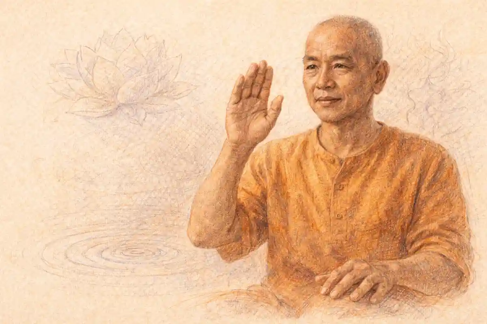

The Cultural Revolution was a political movement launched in China in 1966 by Mao Zedong, chairman of the Chinese Communist Party, and directed, extraordinarily, against the party and state apparatus over which he presided. Its announced purpose was to purge bourgeois and revisionist elements said to have entrenched themselves inside the party, the government, the universities, and the world of culture, and to prevent the restoration of capitalism by renewing the revolution within the generation that had made it. Its formal span runs from the spring of 1966 to the autumn of 1976. Both what it was and how much it cost remain matters of serious scholarly dispute, and a responsible account has to carry those disputes openly rather than settle them by selection. This article reconstructs the record in sequence, states what happened to the people and institutions caught in it, explains why the estimates of its human cost diverge so widely, and sets out the two readings of the period that historians working from the archives continue to defend.

Three cautions govern everything that follows. The first concerns scale. No mortality figure for the period commands scholarly assent, and the reasons are structural rather than accidental: the studies count different categories of death, over different spans, from different bodies of evidence. Wherever a question of scale arises in what follows, the answer given is an account of the counting problem and a direction toward the demographic and archival literature, because that is the answer the evidence supports. The second caution concerns agency. The movement was called into being from the summit of the party, and it also generated organisations, grievances, and initiatives that the summit did not script and eventually suppressed; an account that keeps only one of those facts will misdescribe the decade. The third caution concerns boundaries. Mao's life and doctrine have their own articles in this series, in the [Mao Zedong intellectual biography](/2018/05/15/mao-zedong-intellectual-biography/) and in the comparison of [Maoism and Soviet Marxism](/2018/09/01/maoism-vs-soviet-marxism/), and the Chinese tradition as a whole is mapped in the [Marxism in China complete guide](/2018/05/01/marxism-in-china-complete-guide/). What belongs here is the record of a single decade: what was done, to whom, in what order, and how the doing has been counted and judged.

## What the Cultural Revolution was

The movement's formal name, the Great Proletarian Cultural Revolution, joins the two claims its initiator made for it: that it was cultural, a struggle over ideas, education, art, and the habits of a society, and that it was a continuation of the class struggle by other means, a second revolution conducted inside a state the first revolution had built. In practice it was four processes running at once and continually interfering with one another. It was a purge at the summit, in which the chairman destroyed the colleagues who had administered the country since the famine years and installed a new coalition in their place. It was a mass mobilisation, in which students and then workers were licensed to organise outside the party's own structures and to attack the party's officials in its name. It was an assault on institutions, above all the schools and universities, the press, the courts, and the cultural bureaucracy, whose normal operations were suspended or dismantled. And it was a prolonged breakdown of order in which the organisations the mobilisation had created fought one another, in many places with weapons, until the army was ordered to put them down.

The conventional dating, from May 1966 to October 1976, is the dating of the party's own later assessment, and it is serviceable provided its unevenness is understood. The mass phase, in which unauthorised organisations operated in the open and the state's ordinary machinery was displaced, occupies roughly the first three years. The Ninth Party Congress in the spring of 1969 declared victory and wound that phase up, and the chairman himself indicated that such a movement would need to be repeated. What followed was not a return to the preceding order but a long late phase of narrower campaigns conducted through restored institutions: purges administered by committees rather than crowds, ideological drives against designated targets, and a politics still structured by the settlement the mass phase had imposed. A reader who imagines ten years at the intensity of the first summer will misread everything, including the casualty problem, since the distribution of violence across the decade was as uneven as its politics.

### What distinguishes this movement from the campaigns that came before it?

Earlier campaigns were run by the party apparatus against targets outside or beneath it, with officials directing and the population enrolled as audience or instrument. This one was launched by the party's chairman against the apparatus itself, and it authorised organisations formed outside the party's structure to attack the party's own officials, which no preceding campaign had done.

The distinction in that answer is the key to the record. The land reform of the early fifties, the suppression campaigns, and the Anti-Rightist Movement of the late fifties all moved downward through a hierarchy that remained intact: directives descended, quotas and categories were applied by cadres, and the machinery that conducted the persecution was the same machinery that governed. The movement of 1966 inverted the direction. Its initiator, distrusting the machinery, summoned forces outside it, school students in the first instance, and gave them a warrant to denounce the officials who would normally have directed a campaign. The party's own organisation department, its propaganda system, its university administrations, and eventually its provincial committees were treated as objects of the movement rather than its instruments. That inversion explains features of the decade that otherwise look like mere chaos: the speed with which authority dissolved, since the officials who might have contained the movement were its designated targets; the proliferation of competing organisations, since the warrant was issued generally and its interpretation left to whoever claimed it; and the eventual necessity of the army, the one great institution the movement had not been licensed to attack, as the only instrument capable of ending the phase the licence had created.

It also explains the movement's strange double character, which any honest record has to preserve. Because the warrant came from the summit, participation could be, and was, an act of loyalty performed by people who believed they were defending the revolution against its betrayers. Because the warrant was general, it could be, and was, taken up by people whose grievances had nothing to do with the summit's quarrels: students blocked by an examination system that favoured the children of cadres, workers in temporary contracts denied the security of permanent status, families stigmatised by inherited class labels. The same poster wall could carry a denunciation scripted by a faction in the capital and a complaint about a factory's housing allocation that no one in the capital had authorised. The sections that follow keep both registers in view, because the historiography of the period divides, in the end, over which register explains the other.

## The settlement it shattered: the party after the Great Leap

The movement's preconditions were laid in the settlement that followed the Great Leap Forward. The Leap, the drive of the late fifties to transform the economy by mobilisation, had ended in a famine whose scale the leadership itself acknowledged only in euphemism, and in a retreat administered by the men the movement would later destroy. Liu Shaoqi, the party's second figure and head of state, Zhou Enlai at the government, and Deng Xiaoping at the party secretariat presided over a retrenchment: the communes were loosened, private plots and rural markets were tolerated again, material incentives returned to the factories, expertise was rehabilitated in the universities, and the examination system resumed its work of sorting the young. The recovery was real, and so was the political fact it created. The country was being governed, visibly and competently, by a collective leadership from which the chairman had withdrawn to what was called the second line, and the men doing the governing were acquiring the authority that successful administration confers.

Mao's reading of that settlement darkened across the early sixties. Where his colleagues saw convalescence, he saw the beginnings of the disease he believed had consumed the Soviet Union: a party of administrators settling into privilege, an economy edging back toward markets and hierarchy, a culture drifting toward the tastes he associated with the old society. The Soviet example worked on him as both warning and template. Khrushchev's denunciation of Stalin had shown, in his analysis, that a ruling party could repudiate its own revolution from the top, and the Soviet Union's subsequent course showed where such repudiation led. The conclusion he drew was that the decisive battleground was not the economy but the party itself, and specifically the stratum of leading cadres in whom, he argued, a new privileged class was gestating. That argument, elaborated into the theory of continuing revolution, is treated as doctrine in the companion article on Maoism and Soviet Marxism; here it matters as motive, the premise from which the chairman concluded that his own apparatus had become the principal danger to his revolution.

### Why did recovery from the famine years deepen the leadership quarrel?

Recovery empowered the administrators who had managed it and confirmed their preference for order, expertise, and incentives. The chairman read the same recovery as ideological retreat: privilege consolidating inside the party, market habits returning, and the Soviet path opening ahead. Each side's evidence of success was the other side's evidence of betrayal.

The quarrel acquired a rehearsal before it acquired a stage. The Socialist Education Movement, launched in the countryside and the cities in the early sixties, was designed to discipline corruption and revive class vigilance at the base, and the two leaderships fought over its meaning in successive directives. The chairman's allies pressed the campaign upward, toward leading cadres and their protectors; the apparatus, administering it, kept it aimed downward at petty corruption among village accountants and storekeepers. A document of January 1965 settled the wording in the chairman's favour, declaring that the movement's target was those in positions of authority within the party who were taking the capitalist road. The phrase matters, because it relocated the enemy. Class enemies had previously been identified by origin and history, landlords, rich peasants, the stigmatised categories of the revolution's first decade. The new formula identified them by position and conduct inside the ruling party itself, which meant that any official, whatever his biography, could be found to be one. A weapon of that generality required only a hand willing to use it and a licence for others to do the same. Both were supplied in the following year, and the record of the movement proper begins with the curious fact that its first target was a play.

## The opening moves: a play, a poster, and a circular

The play was Hai Rui Dismissed from Office, written by Wu Han, a historian of the Ming dynasty and a deputy mayor of Beijing, and staged in the capital at the start of the sixties. Its subject, an upright Ming official dismissed for remonstrating with his emperor, was legible to every politically literate reader as an allegory: the dismissed marshal Peng Dehuai, removed after criticising the Great Leap at the Lushan conference, stood behind the Ming official, and the play's praise of remonstrance stood as a brief for his rehabilitation. In November 1965 a Shanghai newspaper published a long attack on the play by Yao Wenyuan, a young critic in the orbit of Jiang Qing, the chairman's wife, treating the historical drama as a political intervention on behalf of dismissed rightists. The attack had been prepared outside the capital's propaganda system and approved by the chairman himself, and the Beijing party organisation, under its first secretary Peng Zhen, responded as institutions do when they sense an unauthorised shot: it contained the controversy, insisting that criticism of a play was an academic matter to be conducted without political labels. The containment was the provocation. To the chairman, the capital's refusal to take up the attack demonstrated that the party's own cultural apparatus was protecting its own, and the skirmish over a historical drama became the opening move of a campaign against the protectors.

In February 1966 Peng Zhen's committee issued an outline report that sought to keep the dispute within academic bounds and to forbid the attachment of political verdicts to scholarly argument. The chairman's answer came in May. A circular of the central leadership, issued on 16 May 1966 and known by its date, annulled the February outline, dissolved the committee that had produced it, and warned in extraordinary language that representatives of the bourgeoisie had sneaked into the party, the government, the army, and cultural circles, and that persons like Khrushchev were still nestling beside the leadership. The circular is the movement's conventional birthday, and the choice is sound: it destroyed the institutional shelter under which cultural controversy had been contained, it named the enemy as residing inside the leadership itself, and it created a new directing body, the Central Cultural Revolution Group, answerable to the chairman's household and allies rather than to the party secretariat. A fortnight later the movement found its instrument. A big-character poster at Peking University, written by a philosophy lecturer named Nie Yuanzi and her colleagues, attacked the university's administration as a stronghold of reaction. The chairman ordered the poster broadcast nationally and praised it in terms that told every student in China what was now permitted.

### What did the circular of May actually change?

It abolished the rules under which criticism had been contained. The committee that had kept the quarrel over a play within academic limits was dissolved, its outline annulled, and the enemy was redefined as residing inside the party's own leadership, with a new directing group placed outside the normal secretariat.

The summer's sequence then accelerated beyond any single plan. Party work teams, sent into the universities by Liu Shaoqi's apparatus in the established manner to manage the movement, found themselves denounced as suppressors of it; the chairman, returning to the capital in July, condemned the teams and ordered them withdrawn, leaving the institutions without the only managers they had. In August an enlarged plenum of the Central Committee adopted a sixteen-point decision that gave the movement its charter, calling on the masses to educate and liberate themselves and to dare to rebel, while the chairman's own big-character poster, headed Bombard the Headquarters, signalled to the assembled leadership that the headquarters in question was theirs. Liu Shaoqi was demoted in the order of precedence, from second to eighth, without the formality of a vote the country could see. Lin Biao, the minister of defence whose army had become the movement's model institution, emerged as the chairman's closest comrade in arms and eventual designated successor. The party's daily administration, in other words, was decapitated in public, and the students assembling in the capital's schools understood, correctly, that no authority stood between them and the licence they had been given except the chairman's own word, which for the moment encouraged them.

## The Red Guard summer

The organisations that answered the licence called themselves Red Guards, and they began in the capital's elite middle schools before spreading to the universities and then to nearly every school in the country. Their warrant was the chairman's reception of them: across the autumn of 1966 he reviewed a series of vast rallies in Tiananmen Square, accepting a Red Guard armband and lending the movement the full theatre of the state. Students travelled without charge on the railways in what was called the great exchange of revolutionary experience, carrying the movement's methods and its factional templates from city to city. The methods hardened quickly. Big-character posters named teachers and officials as monsters and freaks. Struggle sessions assembled colleagues, neighbours, and students to shout accusations at kneeling or placarded victims. Homes of families assigned to the stigmatised categories were ransacked for evidence of a feudal or bourgeois life, and property was confiscated, destroyed, or carted away. In the capital the violence of August and September turned lethal: teachers were beaten to death by their own pupils, and in the counties around Beijing local authorities organised killings of people registered under the bad class categories, a pattern the section on the countryside takes up in its place.

The campaign against the Four Olds, old ideas, old culture, old customs, and old habits, gave the summer its iconoclastic register. Temples, churches, and ancestral halls were smashed or converted; libraries and private collections were burned or pulped; graves were levelled, including those of historical figures whose offence was their era; street names, shop signs, hairstyles, and clothing were policed for feudal or bourgeois contamination. The material loss to China's cultural patrimony was enormous and is not quantifiable in any currency the record supplies: objects and sites that had survived war and revolution in the preceding decades were destroyed in weeks by the generation instructed to despise them, frequently with the connivance of the local authorities who might have intervened. What survived often survived because individuals hid it, at personal risk, in defiance of the campaign they were nominally conducting.

### Were the Red Guards a single organisation?

No. The name was a franchise, not a structure. Any group of students could adopt it, and rival organisations in the same school or city claimed it against one another, divided by the class origins of their members, by their treatment at the hands of the withdrawn work teams, and by competing patrons among the leaders in the capital.

The divisions inside the movement were present from its first weeks and were structured by the society it claimed to transcend. The earliest Red Guards were drawn disproportionately from the children of senior cadres, soldiers, and martyrs, and they advanced a doctrine of blood lineage, expressed in a couplet that circulated nationally, holding that heroism and baseness descended in the blood. That doctrine made inherited status the criterion of revolutionary worth, and it licensed the persecution of students from stigmatised families by their classmates. Against it there formed, as the movement widened, organisations of students from ordinary and even suspect backgrounds, who argued that rebellion could not be a birthright and who turned their attack on the cadre families whose privileges the bloodline couplet protected. The quarrel between these camps was the first form of a division that would organise the movement's factional wars: a conservative wing defending the hierarchy of the party's own households, and a rebel wing whose target was precisely that hierarchy. The summit encouraged, restrained, and used each in turn, and the record of the following two years is unintelligible unless the reader holds the division in view from the start.

## The phases table

The phases table below is the article's organising instrument, and it should be read as a claim about the record rather than a summary of it. Its rows divide the decade by changes in who was authorised to act and who was exposed to action, which is the division that determines what the period was like to live through and what kinds of evidence each phase produced. Read down a row before reading across the narrative: the mobilised column tells you whose warrant was operative, the targeted column tells you where the danger sat, and the final column, what is disputed, tells you where the scholarship has not converged and where a careful reader should hold judgement open. The table also enforces the article's central discipline about scale. No row carries a number, because no number in this field travels without its counting rule, and the dispute column records, for the phases where the counting is hardest, exactly which inclusions divide the counters.

| Phase | Dates | Who was mobilised | Who was targeted | How the phase ended | What is disputed about it |
| --- | --- | --- | --- | --- | --- |
| The opening offensive | Spring to summer of the first year | The chairman's allies in the press and the new directing group | Cultural officials, the capital's party leadership, university administrations | The August plenum demoted the head of state's faction and chartered mass rebellion | Whether the sequence was a prepared plan or an improvisation seized upon |
| The Red Guard summer and autumn | The second half of the first year | Students, licensed and fêted by the chairman in person | Teachers, officials, families of stigmatised origin, the material inheritance of the old society | The licence widened to workers and the movement escaped its school boundaries | How far the violence was directed from the centre and how far locally generated |
| Power seizures and the factional war | The second year into the third | Worker and student organisations claiming the same warrant, provincial factions | Incumbent provincial and municipal leaderships, then rival mass organisations | Military intervention and the imposition of revolutionary committees | Whether the factions divided by interest and origin or merely by patronage |
| Suppression and rustication | The third year into the fourth | The army, workers' propaganda teams, the restored security organs | The mass organisations themselves, then the stigmatised categories in the countryside | The Ninth Congress declared the movement victorious and closed the mass phase | The scale of the rural persecution and its degree of central direction |
| The succession settlement and its collapse | The fourth year into the sixth | The army's political apparatus, the restored party committees | The fallen chief of staff's network, then the designated successor's alleged apparatus | The successor died in flight after an alleged coup attempt, in circumstances still argued over | Nearly everything about the alleged plot and the flight |
| The long late phase | The sixth year to the tenth | The restored institutions, campaign committees, the chairman's household | Designated ideological targets, the rehabilitated cadres, finally the dead premier's mourners | The chairman died; the group blamed for the decade was arrested within the month | Whether the campaigns of these years continued the movement or administered its estate |

Two features of the table deserve emphasis. The first is that every phase ends not when its energy is spent but when the summit changes the warrant: a plenum demotes a faction, a directive withdraws a licence, an army receives an order. The period's chronology is punctuated by decisions at the top even where its content was supplied from below, and that punctuation is the strongest structural evidence for the dominant reading examined later. The second feature is the asymmetry of the dispute column. Disagreement among historians is thinnest about the sequence of the first summer, where documentation is densest, and thickest about the two matters where the stakes of interpretation are highest: the scale of the killing in the countryside during the suppression phase, and the events surrounding the designated successor's death. A reader who understands why those two cells resist settlement understands the evidentiary condition of the whole field.

## Power seizures and factional war

The movement's second year began with its logic generalised. If the party committees of the universities could be bombarded, so could the committees of the cities and provinces, and in January 1967 worker and student organisations in Shanghai seized power from the municipal party committee in what was celebrated as the January Storm. The chairman approved the seizure and for a moment entertained the form its victors proposed, a commune on the model of Paris, before deciding that a commune left no place for the party and directing that power be held instead by revolutionary committees combining soldiers, cadres, and mass representatives. The formula travelled nationally, and with it the contest for seats on the committees, which converted the movement's organisations from instruments of attack into claimants of office. What followed, across the second year and into the third, was factional war: rival coalitions, each claiming the chairman's mandate and each able to quote him, fighting for control of provinces, cities, factories, and campuses, in many regions with weapons taken from military stores or supplied by sympathetic commands. In the summer of 1967 the conflict touched the army itself at Wuhan, where a regional commander detained emissaries of the centre who had come to settle the local quarrel against his clients, and the leadership in Beijing was obliged to retreat in public before reasserting itself.

The war's texture differed by province, and the differences are data. Where the incumbent leadership had deep local roots, the factions sorted themselves into defenders and assailants of the existing order, and the fighting was a civil war over the province's government. Where the incumbents fell early, the factions fought over the succession among themselves, and the dividing lines ran through workplaces and schools, separating colleagues who had begun the movement in the same organisations. The sociological literature on the great cities has shown that these lines were not random: they tracked, with remarkable fidelity, the cleavages the mobilisation had exposed in its first summer, between the children of the party's households and those excluded from its privileges, between permanent workers with secure status and temporary workers without it, between those whom the work teams had suppressed and those who had served them. The violence, in other words, had a social anatomy, and reconstructing that anatomy city by city is the achievement on which the minority reading of the period rests its case.

### Why did organisations professing the same loyalty fight one another?

The warrant to rebel was general, indivisible, and unadjudicated. Every organisation claimed the chairman's mandate, no institution existed that could rule between the claims, and control of the new revolutionary committees was a prize worth seizing. Loyalty to the same authority therefore supplied no arbiter, and the contests were settled by force.

By the middle of 1968 the centre had concluded that the organisations it had created were now the principal obstacle to the order it required. The instruments of termination were the army, which had been ordered into factories, schools, and government offices under the formula of supporting the left while in practice imposing settlement, and the workers' propaganda teams, bodies of industrial workers dispatched into the universities to occupy the ground the students had held. At Tsinghua University in July 1968 a propaganda team entering the campus was resisted by armed students and workers were killed in the confrontation. In the early hours of the following morning the chairman received the capital's best known student leaders and told them, in substance, that they had disappointed him and that the game was over. The interview is the mass phase's death certificate: the licence was withdrawn by the only authority that had ever been able to withdraw it, and within months the student organisations that had governed the campuses were dissolved, their members dispersed, and the schools placed under the occupation of soldiers and workers.

## The army restores order and the students leave the cities

The settlement imposed from the autumn of 1968 had three components, and the phases table's fourth row compresses what contemporaries experienced as a single suffocating turn. The first was institutional: revolutionary committees, dominated in most provinces by military officers, replaced both the old party committees and the mass organisations as the organs of rule, and a rectification campaign rebuilt the party itself with the mass organisations' leaders largely excluded. The second was punitive: a campaign to cleanse the class ranks swept through work units and villages, subjecting people with suspect histories, and many with none, to investigation, detention, and in the countryside to organised killing on a scale the estimate section must treat with particular care. The third was demographic. In December 1968 the chairman's directive on the re-education of educated youth was published, and the urban young, beginning with the Red Guard generation itself, were sent to the countryside in a programme that would run for years and that a later section examines in its own right. The timing was not incidental. Rustication dissolved the movement's social base by scattering it across the villages of the entire country, and it did so under a slogan of virtue that made refusal a confession.

### What finally ended the mass phase in the cities?

Not exhaustion and not defeat in argument. The licence under which the organisations existed was withdrawn by its issuer: the army and the workers' teams occupied the institutions, the student leaders were told by the chairman in person that they had failed him, and rustication then dispersed the membership beyond recall.

The Ninth Party Congress, convened in the spring of 1969, formalised the settlement and exposed its central instability. The congress declared the movement a great victory, adopted a party constitution that named Lin Biao as the chairman's successor, an act without precedent in the party's history, and staffed the new leadership heavily with the military men who had imposed order. The arrangement contained its contradiction in plain sight. The army had been the movement's model and then its gaoler; its commander was now heir to a chairman who had built his late politics on suspicion of every institution that consolidated itself, including, in the end, the one that had saved his movement from its own creations. Within eighteen months the succession was in ruins, and the record of its collapse remains the most contested episode of the decade.

## What happened to people: the machinery of persecution

The persecution of the period was not a single instrument but a machinery with several working parts, and the record is clearer when the parts are distinguished. The first was categorical. Every Chinese citizen carried a class designation inherited from the revolution's first years, recorded in a personal dossier that followed its subject from school to work unit, and the designations sorted the population into those whose origins certified them and those whose origins condemned them: the families of landlords, rich peasants, counter-revolutionaries, and other stigmatised categories lived under a hereditary suspicion that the movement converted, at its violent moments, into a licence to attack them and, at all moments, into exclusion from education, promotion, and marriage prospects. The second part was institutional. The work unit, which allocated housing, rations, permission to marry or travel, and care in old age, was also the arena of persecution: it convened the struggle sessions, maintained the dossier, staffed the informal detention rooms that inmates called cowsheds, and decided which of its members would be sent for labour and re-education at the cadre schools established under the chairman's May Seventh directive. To be struggled against by one's unit was to be persecuted by the institution on which one's material existence depended, with no exterior to appeal to.

The third part was procedural, and it is the part the record documents most grimly. Denunciation typically began with a poster or an accusation at a meeting; the accused was then required to confess in writing, repeatedly, to charges that expanded with each iteration; struggle sessions assembled the unit to shout the verdict the accusation had already reached; and physical abuse at those sessions ranged from ritual humiliation, the dunce cap, the placard, the shaved head, to beatings that in the first summer and in the later cleansing campaigns killed. Detention followed in the cowsheds or in the custody of the security organs, frequently without charge, record, or term. Suicide under persecution was a recognised outcome, recorded in the dossiers as a further crime, the crime of betraying the party by dying, and it figures in the estimate problem precisely because the counters divide over whether such deaths belong to the period's toll. Officials at the summit were not exempt from the machinery they had built. The head of state, Liu Shaoqi, denounced as the headquarters of the bourgeoisie inside the party, was expelled from the party in the autumn of 1968 and died the following year in detention in Kaifeng, ill and unattended, under an assumed name. The record states the fact without elaboration, because elaboration is not needed: the second person of the state died as an anonymous prisoner of it.

### How did a work unit become an instrument of persecution?

The unit already controlled the material conditions of its members' lives: housing, rations, permissions, and the dossier that recorded their origins and conduct. The movement added a mandate to purge. Sessions, confessions, and detention were then administered by the same office that allocated the victim's flat and rice coupons, leaving no ground outside its reach.

Against this machinery the individual protections that a legal order supplies were absent by design. The courts and procuratorates had been attacked early as obstacles to the movement and largely ceased to function as checks; the security organs operated under political direction; and the constitution's guarantees were in abeyance for anyone assigned to the categories under attack. It is worth stating plainly what this meant for the experience of the persecuted, since the historiography's disputes about scale and agency can obscure it. A person denounced in the first summer could not know whether the process would end in a confession accepted, a season of labour, a prison term, or death, because the process had no rules that bound its conductors and no terminus that its victims could invoke. The unpredictability was not a malfunction. Campaigns conducted through categories rather than charges, and through institutions rather than courts, distribute fear more efficiently than predictable repression, and the period's administrators, at every level, understood the efficiency even when they deplored its costs.

## The killing in the countryside

The deadliest violence of the period was not, in the main, the work of students in the cities. In a series of rural regions, during the suppression phase and the cleansing campaigns that followed it, people registered under the stigmatised categories were killed in organised actions conducted or authorised by local party and militia authorities. In the counties south of the capital, in the first autumn, village cadres and militia organised the killing of entire households of the designated categories, including children, in a matter of days. In Guangxi, in the second and third years, mass killings accompanied the factional war and its settlement, directed at the stigmatised and at the defeated faction's captives, and documented decades later by researchers working from the province's own county records. In Inner Mongolia, a purge of an alleged underground nationalist party, a fabrication as the rehabilitation process itself afterward concluded, subjected the Mongol population to mass investigation and persecution administered by the regional authorities. In Yunnan and elsewhere, border and minority regions experienced analogous campaigns under analogous warrants. The pattern that unites these episodes is the identity of the perpetrators. Where the killing was worst, it was bureaucratic: lists were drawn from the dossier system, militia were mustered, quotas of vigilance were announced, and the categories did the rest.

### Who organised the worst of the rural killing?

In the regions where the record has been reconstructed from local archives and gazetteers, the worst killing was organised by local authorities themselves: county and commune cadres, militia commands, and the committees conducting the cleansing campaigns, working from the class designation registers rather than from any student organisation's initiative.

This finding, established in the archival scholarship of recent decades, carries two consequences the reader should register. The first is corrective. The popular image of the period's violence, students running wild while authority stood aside, inverts the rural record, in which authority was frequently the perpetrator and the categories it administered were the weapon. The second consequence bears on the estimate problem. Rural mass killing organised by local authorities is the category of death least visible to the period's own national reporting and most dependent, for its reconstruction, on the county gazetteers compiled in the following decade and on the internal investigations conducted during the rehabilitations. Studies that build from those sources reach different totals from studies that build from demographic reconstruction of excess mortality, and studies that exclude the rural campaigns as belonging to a different phenomenon reach different totals again. The divergence is not noise around a true figure. It is the signature of counters who are not counting the same events, which is the article's central claim about scale, stated here at the point where it costs the most to state it.

## Universities, schools, and the permitted culture

The educational system was the movement's first battlefield and its longest casualty. Universities closed their lecture halls in the first summer and admitted no new students for years; the national entrance examination, the single ladder by which talent from ordinary families had climbed, was abolished as a bourgeois device. When admission resumed in the early seventies it proceeded by recommendation from the candidate's work unit, factory, or commune, under criteria in which class origin and political attitude displaced examination performance, producing the cohort remembered as the worker-peasant-soldier students. Secondary schooling was shortened and politicised, its curriculum compressed into the study of the chairman's works and the campaigns of the moment, and the authority of teachers, a profession the movement treated as presumptively suspect, collapsed in many schools into ritual humiliation at the hands of their pupils. Research institutes were dispersed, their staffs sent to labour, their libraries in some cases destroyed, and whole disciplines, sociology and anthropology among them, which had been abolished in the preceding decade's reorganisations, remained beyond resurrection. The generation whose schooling fell inside the decade carries the interruption still, in the biographical form of years unaccounted for between the classroom abandoned and the examination hall to which, in the end, some of them returned.

### What replaced examinations when admission to university resumed?

Recommendation replaced selection by examination. Factories, communes, and army units nominated candidates from among their own, and the criteria weighted class origin, political conduct, and years of manual labour above academic attainment, so that admission became an allocation of honour by the work unit rather than a competition among school leavers.

Culture in the permitted sense narrowed to a canon. The stage was dominated by a small set of model works, revolutionary operas and ballets supervised under Jiang Qing's authority, whose characters and plots supplied the era's official imagination; publishing contracted to the chairman's writings, the campaign documents, and a thin list of approved titles; the writers, artists, and scholars who had constituted the cultural world of the preceding decades were silenced, imprisoned, sent to labour, or dead, and the institutions that had sustained them, the academies, troupes, studios, and journals, were dissolved or militarised. The point for the record is not aesthetic. A society's cultural institutions are also its memory, and the movement understood this precisely: the street campaign against the old ideas, customs, and habits and the canonisation of the model works on the stage were the same policy at two registers, the destruction of the inherited repertoire and its replacement by a repertoire of one voice. What that policy cost the arts themselves belongs to cultural history; what it cost the record is that a decade of Chinese life was documented, in its own official media, almost exclusively in the language of the campaign that was consuming it, which is one reason the reconstruction of the period depends so heavily on sources produced after its end.

## The sent-down generation

The rustication programme, under which urban school leavers were sent to settle in villages and frontier settlements, had precedents in the preceding decade, but from the winter of 1968 it became a mass disposition of a generation. Its official rationale was re-education: the educated youth, it was said, had much to learn from the poor and lower-middle peasants, and the countryside had need of their literacy and skills. Its functions in the settlement of 1968 were additional and are plain in the timing. It removed from the cities the constituency of the mass organisations at the moment those organisations were dissolved; it relieved an urban employment system that could not absorb the cohorts whose schooling had been interrupted; and it distributed across the entire countryside a population whose presence in the capital's politics had proved ungovernable. The protocol governing this article forbids the number, and the number in any case conceals the variation that matters: between the graduate sent to a village in her home province, visited by family and recalled within a few years, and the teenager dispatched to a military-agricultural settlement on the northern or southern frontier, effectively exiled for a decade, there is a difference of kind that any total flattens into a statistic.

### Was rustication a punishment, an education, or a demobilisation?

It was all three, in proportions that varied by destination and by year. Its rhetoric was educational and was sincerely believed by some who went; its incidence fell on the cohort that had staffed the mass organisations, which made it a demobilisation; and its conditions, for many, made it an exile indistinguishable from punishment.

The experience itself divided along the lines of China's geography and the sent-down youth's family resources. In the villages of the interior, educated youth lived in collective households or with peasant families, performed farm labour for work points that rarely fed them, and encountered a rural poverty that the movement's rhetoric had described but its urban constituency had not imagined. Disease, exhaustion, and accidents in farm and construction work took their toll; so did the vulnerability of young women far from any protection their families could supply. Some fraction of the generation made the countryside a vocation, married locally, and stayed; the larger part waited, through years of restricted mobility, for the channels of return: recruitment by a factory, admission to a university under the recommendation system, enlistment, or the medical and hardship exemptions that families with connections worked to obtain. The system's inequities reproduced, in the queue for return, the hierarchies of the society that had sent them: the children of cadres found the channels earlier, and the resentment of that fact is one of the period's most durable legacies in the memory of those who lived it. When the policy was wound down in the years after the chairman's death, the return of the sent-down generation to the cities, and the protests of those still waiting in the winter of the late seventies, closed the programme in the register in which it had begun, as a question of what the state owed its young.

## Everyday life and the economy under campaign conditions

The record of institutions can crowd out the record of ordinary endurance, and a section belongs to the texture of the decade for those who were neither principals nor designated victims. Production continued, because it had to, but under conditions that penalised its own requirements. Factory management had been an early target, engineers and technicians stood suspect as a stratum, and the authority to enforce a production plan dissolved wherever the plan's enforcers could be denounced as capitalist roaders. Output fell sharply in the factional war's worst years, recovered under military administration, and was convulsed again by each successive campaign, while the railways, fought over by factions and clogged by the free travel of the movement's first phase, repeatedly approached breakdown. The material standard of urban life, already austere, stagnated across the decade: rationing governed grain, cloth, and oil; housing construction nearly ceased while the urban population grew; wages were frozen in the name of egalitarianism, so that a worker's pay at the decade's end stood where it had stood at its beginning, and the young waited years for jobs that the rustication programme existed to defer.

Private life contracted into caution. The dossier system meant that a remark reported by a colleague, a relative abroad, a book inherited from a parent, could be entered into a file and retrieved at the next campaign, and the population learned the arts of reticence: letters written to be read by strangers, diaries kept in code or not kept, family histories rehearsed into safe versions. Marriage, promotion, and a child's schooling all ran through the class designation, so that the stigmatised categories raised their children inside a knowledge of inherited liability that no conduct could discharge, since the liability was genealogical. It is against this background that the minority reading's evidence acquires its weight. A society administered through inherited categories and unit dossiers generated grievances with addresses: the temporary worker denied permanence, the graduate of a bad family denied admission, the cadre's child waved through every gate. The movement's licence to rebel, when it came, was taken up at those addresses, and the record of what the rebels demanded, where they were free to demand it, is the strongest exhibit in the case that the decade cannot be reduced to a quarrel at the summit.

## The successor's fall and the long late phase

The settlement of 1969 rested on the army, and the army's commander stood as designated successor, his name written into the party constitution as the designated heir. The arrangement lasted less than two years. At a plenum held at Lushan in the late summer of 1970 the chairman turned against a proposal associated with his heir's circle and against the heir's ally Chen Boda, who was purged; through the following year the chairman toured the provinces warning the military commanders against the man he had raised, and reducing his power by stages. In September 1971 the successor died. The official account, assembled and published afterward, holds that his family, discovering a failed plot against the chairman's life, fled toward the Soviet Union and that their aircraft, short of fuel, crashed in the Mongolian steppe, killing all aboard. The account's central elements have been disputed ever since, by scholars who note how much of it rests on confessions extracted from the alleged plotters' surviving associates and on documents whose provenance the state controls. What is not disputed is the fact and the effect: the designated heir died a traitor in the official telling, and the revelation, circulated internally to a population that had been required to study his edition of the chairman's quotations, administered the deepest single shock to the movement's legitimacy in its own lifetime.

### Why does the fall of the designated successor remain disputed?

The narrative of a coup plot and a flight rests substantially on evidence the state assembled after the event: confessions from detained associates and documents released selectively. The crash itself, on foreign soil, was investigated under conditions no independent party could verify. Core facts are agreed; the plot's existence and shape are not.

The decade's remaining years proceeded by narrower campaigns through restored institutions, each intelligible only against the shock of the successor's fall. A campaign against the dead successor's memory and, with it, against Confucius, conducted in the middle years, was widely understood to glance at the premier, Zhou Enlai, whose stewardship of the government represented the return of administration; the chairman's household and its allies in the cultural apparatus conducted the campaign, and the rehabilitated Deng Xiaoping, restored to office in the rehabilitation wave that followed the successor's disgrace, conducted the resistance to it in the name of production and order. Deng's consolidation of 1975, an attempt to restore discipline across the economy and the party, was answered by a campaign against him conducted through the press. When the premier died in January 1976, the mourning for him at the Qingming festival swelled into public demonstrations in Tiananmen Square that the leadership suppressed and blamed on Deng, who was removed from his posts a second time. A catastrophic earthquake struck the industrial city of Tangshan that summer. In September the chairman died. Within a month, the four figures who had embodied the movement's radical pole, Jiang Qing and her three associates, subsequently named the Gang of Four, were arrested by the chairman's successor Hua Guofeng acting with the senior military leadership, and the movement's formal span closed on the date the later assessment would adopt as its end.

## Unwinding: arrests, trials, and the reversal of verdicts

The decade's aftermath was administered as deliberately as its opening had been. The arrested four were held for years before their trial, which opened in the winter of 1980 before a special court and was conducted, in part, on national television: the prosecution's case assigned to the accused, and to the dead successor's associates tried alongside them, responsibility for the persecution of officials and citizens across the decade, and the principal defendants received sentences of death with a reprieve of execution, subsequently commuted. The trial's function was juridical and theatrical at once. It converted a political catastrophe into a criminal case against a small group, and it did so while the party's own historical verdict was still being drafted, so that the courtroom established the distribution of blame, the dead and the arrested answerable, the institution absolved, that the assessment document of the following year would formalise. Alongside the trial ran the vast administrative process of the rehabilitations: verdicts on the persecuted were reversed case by case through the party's organisation departments, the dead were posthumously cleared, the surviving were restored to office, and the head of state who had died in detention in Kaifeng was rehabilitated in the spring of 1980 and mourned at a state memorial. The sent-down youth came home; the entrance examination had already been restored in the winter of 1977, in time for a cohort that included, in large proportion, the generation the campaigns had displaced. The unwinding matters to this article for an evidentiary reason as well. The rehabilitation process generated the internal investigations, the case files reviewed and the local records compiled, from which much of the later reconstruction of the period's violence derives, including the county-level documentation of the rural killing described earlier. The period's archive was substantially created by the machinery that dismantled it.

## The estimate problem: why no figure commands assent

Every general question about the period eventually arrives at the question of scale, and the question of scale is where the record's discipline matters most. The namable claim of this article can be stated in one sentence: the estimate variation is methodological. Mortality figures for the decade differ by an order of magnitude between serious studies because the studies count different things, over different periods, from different sources, so that a number quoted without the rule by which it was counted conveys no information at all. The claim is not that the truth is unknowable or that the counters are careless. It is that the object being counted is not a single object. Deaths in rural mass killings organised by local authorities, deaths in factional fighting between armed organisations, deaths in detention and under torture, suicides under persecution, deaths attributable to the collapse of medical care and food distribution in the worst regions and years: each category is documented, each has its own evidentiary base, and no two studies draw the category boundaries in the same place. A total assembled from three of these categories and a total assembled from all five are not two estimates of one number. They are answers to different questions that share a wording.

### How many people died in the Cultural Revolution?

estimates vary by an order of magnitude between serious studies, because they count different things: rural mass killings organised locally, suicides under persecution, deaths in detention, and deaths from institutional collapse, over different periods and from different archival sources. No single figure is established.

The sources divide as sharply as the categories. One family of studies builds upward from local documentation: the county gazetteers compiled across China in the decade after the movement ended, which record, county by county and often with startling frankness, the abnormal deaths of the campaign years; the internal investigation reports generated during the rehabilitations; and the memoirs and interviews through which particular episodes have been reconstructed. Such studies can be exact about a county and silent about a province, and their totals depend on how the documented localities are extrapolated to the undocumented. A second family builds downward from demography, comparing the population record across the period with the trajectory that births, deaths, and age structure would lead one to expect, and attributing the residual to the period's violence and disruption. Demographic residuals are powerful and indiscriminate at once: they capture deaths no document records, and they cannot distinguish a death by beating from a death by an untreated infection in a county whose clinic had been closed as a bourgeois institution. A third family works from the period's own administrative reporting, which was compiled by the machinery conducting the campaigns and is least trustworthy exactly where the killing was worst. The three families do not converge, and the honest literature says so.

### What does a bare figure, cited without its counting rule, actually tell a reader?

Almost nothing, and the little it tells is misleading. It reports which categories its author chose to count, which period he bounded, and which sources he trusted, disguised as a measurement of the event. Read as a measurement it will be compared with other figures measuring other things, and the comparison will manufacture a controversy the evidence does not contain.

The protocol this article observes follows from the claim. No mortality figure is stated anywhere in it; no figure is stated for the numbers sent to the countryside, for the officials purged, or for the institutions closed, because each of those quantities is subject to the same disease in milder or severer form. What can be stated, and has been stated in the sections on the countryside and the machinery of persecution, is the character of the events: that killing was organised, in the worst regions, by the authorities charged with order; that detention without process was general; that the stigmatised categories carried a liability inherited at birth, which the campaigns periodically converted into violence. A reader who requires a number is directed to the literature with the counting rules attached: to the gazetteer-based reconstructions of particular provinces, to the demographic studies with their residuals and their assumptions displayed, and to the synthetic works that tabulate the competing totals and explain, as this article has tried to explain, why the tabulation is the finding. The refusal to assert a figure is not agnosticism about the catastrophe. It is the position that the catastrophe's scale is a subject on which precision is purchasable only by specifying what is being counted, and that unspecified precision is a form of misinformation.

One further category of loss belongs in this section precisely because no counting rule has ever captured it, and its exclusion from every total should be understood as a property of the evidence rather than of the event. The period produced deaths that entered no register in any usable form: the prisoner whose detention was never recorded and whose name was struck from the unit's rolls as though he had never been employed; the villager killed in a commune whose gazetteer the compilers of the following decade judged too dangerous to write plainly; the suicide recorded by the family as illness, out of shame or out of a prudence the years had taught. Demographic reconstruction can gesture at the aggregate shadow such deaths cast, since a population's arithmetic notices absences its paperwork conceals, but it cannot return their names, their dates, or their manner, and the gazetteer method cannot begin where the gazetteer is silent. Between the two methods there lies a residue that is not a margin of error around a true figure but a class of the dead whom the record, as constituted, cannot enumerate. The scholarship that acknowledges the residue is not confessing a temporary technical failure. It is reporting that the machinery which did the killing also administered the counting, and that a portion of its work was designed, with the competence the machinery showed in all its operations, to leave no countable trace. The reader who grasps that point grasps why this article's refusal to assert a figure is a finding and not a fastidiousness.

The geography of that residue deserves one more observation, since it distributes the record's uncertainty unevenly across the map in a way that flatters the cities. Urban deaths occurred inside institutions that kept files: a hospital recorded an admission, a unit recorded a member, a school recorded a pupil, and even where the file was falsified it existed to be corrected during the rehabilitations. Rural deaths occurred inside a paperwork of a different density, in communes whose registers were kept by the same hands that conducted the campaigns, in villages whose dead could be entered as flight, as illness, as transfer, or not entered at all by clerks who answered to the committees doing the killing. The consequence is that the best documented portion of the period's mortality is the portion that occurred in the cities during the phases the national narrative already knows best, while the worst killing, in the southern countryside during the suppression years, rests on the thinnest paper. Every total in the literature silently inherits that gradient. A study built from documents will understate the countryside relative to the city by the ratio of their archives, and a study built from demographic residuals will distribute its unattributed deaths by assumption rather than by knowledge. Neither defect is a scandal; both are the ordinary condition of counting the dead of a catastrophe whose perpetrators kept the books. But the gradient should be named whenever the totals are compared, because a controversy between a document-based figure and a demography-based one is, in part, a controversy between the city the archive can see and the countryside it cannot, and treating it as a disagreement about arithmetic mistakes its nature entirely.

## The dominant reading: a struggle at the summit that mobilised a society

The reading held by the majority of historians who work on the period treats it, in its essentials, as a power struggle conducted at the summit of the party by means of a mobilised population. On this account the movement's causes are to be found in the chairman's quarrels with the colleagues who had administered the retrenchment: his determination to destroy Liu Shaoqi and the apparatus that sustained him, to reverse the policies of the recovery, and to settle the succession on persons and ideas of his choosing. The mass organisations enter the account as instruments. They were licensed because the chairman could not purge the party through the party, since the party was the target; they were supplied with targets, protected while they were useful, and discarded when their usefulness ended, as it ended abruptly in the summer of 1968. The violence, on this reading, follows from the instrument's nature: a licence to attack authority, issued to adolescents and administered without rules, will produce atrocity as reliably as it produces obedience, and the responsibility ascends to the issuer. The fullest statement of the reading is the standard narrative history of the period, Mao's Last Revolution, whose reconstruction of the leadership's manoeuvres from the documentary record remains the account against which alternatives must argue; Maurice Meisner's histories give the reading its most reflective form, holding the summit's responsibility and the period's social roots in a single frame while assigning causal primacy to the former.

### What evidence anchors the dominant reading most firmly?

The punctuation of the record by decisions at the summit. The movement began with a circular and a poster the chairman personally authorised, widened and narrowed as his directives widened and narrowed it, and its mass phase ended within weeks of his withdrawing the licence in person. No phase of the decade outlasted his displeasure.

The reading's explanatory reach is genuine, and a fair presentation must register where it is strongest. It explains the timing: the movement opened not when popular grievance peaked, for grievance had no such peak, but when the chairman's quarrel with his colleagues reached its crisis over a play and a committee's report. It explains the selection of targets, which tracked the factional geography of the leadership with a fidelity no theory of spontaneous revolt can reproduce: the capital's party machine first, then the head of state's network, then the provincial committees in the order of their resistance. It explains the terminations, which arrived by directive and were obeyed even by organisations that had defied every other authority. And it explains the settlement, in which the beneficiaries of the decade were not its crowds but a new coalition of soldiers, surviving cadres, and the chairman's household. Against the minority reading examined next, the dominant account's standing challenge is the question of origins: whatever the crowds later made of the licence, the licence was issued from above, for purposes formed above, and the crowds existed as a political force only while it ran.

## The minority reading: grievance, participation, and suppression

A minority of historians, working from the same archives and in full knowledge of the dominant account, reads the period differently, and the reading deserves statement in its own terms rather than as a footnote to its rival. Its fullest development is The Cultural Revolution at the Margins: Chinese Socialism in Crisis, a study of the movement's participants at the social margins of the Maoist order, and its companion evidence is assembled in Rise of the Red Engineers, which reconstructs the factional divisions of a great university from the social origins of the students who fought under its banners. The argument, in its strongest form, runs as follows. The society the movement erupted into was not the egalitarian order of its own rhetoric. It was a hierarchy administered through inherited class labels, work unit dossiers, and a party stratum whose households enjoyed privileged access to schooling, housing, and advancement. The grievances generated by that order were real, specific, and widely felt: by the students of stigmatised or merely ordinary families whom the bloodline doctrine excluded; by the temporary and contract workers denied the security and benefits of the permanent staff; by the apprentices, the demobilised, the sent-down of the earlier and smaller rustication waves, all the categories of the marginal whom the system had processed and discarded. When the licence to rebel was issued, these constituencies did not merely execute the summit's quarrel. They organised, in considerable numbers and in many places independently, around their own demands: the abolition of the bloodline criterion, equal status for contract labour, the right to organise outside the official unions, and, in the movement's most radical documents, a critique of the party stratum itself as a privileged class, stated in the vocabulary the regime had taught them.

The documentary exhibits are not in dispute, and the minority reading rests its case on their content. In Hunan, an alliance of rebel organisations produced, at the start of 1968, a manifesto asking whither China was going and answering that a new ruling stratum had consolidated itself inside the revolution's own institutions and would have to be overthrown in its turn; its young author was imprisoned and later executed, and the alliance was suppressed as an ultra-left deviation. In Shanghai, the worker organisations that seized power in the January Storm pressed demands about status and security that their patrons in the capital found increasingly inconvenient. In Guangzhou, in the middle seventies, a wall poster signed with a composite pen name argued for socialist democracy and a legal system against the prerogatives of cadres, and circulated nationally in copied form before its authors were imprisoned. On the minority account, the termination of the mass phase is the crux: the independent organisations were not discarded because their usefulness had ended but suppressed because their demands had begun to threaten the party apparatus itself, the one target the licence had never actually covered. The movement's initiator, on this reading, summoned a social revolt to settle a palace quarrel, discovered that the revolt had its own agenda, and closed it down with the army; and the dominant reading, by treating the participants purely as instruments of the summit, repeats the summit's own view of them and misses the conflict the decade expressed.

### What did the independent organisations of the period actually demand?

The surviving programmes and posters converge on the privileges of position: an end to inherited revolutionary status as a criterion of worth, equal standing for temporary and contract workers, admission and promotion by merit rather than by household, and, in the most radical texts, the subordination of the cadre stratum to democratic control.

The answer the record supports, and the one this article gives, begins by granting the reading its evidence and then weighing its scale. The independent movements were real, and the scholarship that recovered them has permanently changed what a serious account must include; no history written after it can honestly render the participants as puppets, and the dominant reading, in its textbook form, has too often done exactly that, treating the crowds as a medium through which the summit's signals passed. That concession is owed and is made here without qualification. But the movements that articulated an independent programme were brief in duration and localised in reach: the Hunan alliance survived a season, the Guangzhou poster was the work of a handful, the Shanghai workers' demands were absorbed or overruled within the settlement their own patrons imposed. Against the whole geography of the decade, in which the great majority of organisations fought under patrons, over spoils, and within the licence's terms, the autonomous current was a tributary and not the river. Its suppression, moreover, proceeded by the same instruments and at the same moment as the suppression of every other mass organisation, loyalist and rebel alike, which complicates the claim that it was singled out for its ideas. The balanced verdict the evidence sustains is therefore double. The period was, as the dominant reading holds, a contest for power at the summit prosecuted through a mobilised society; and the mobilisation released grievances that were genuine, organised, and in places independently articulated, as the minority reading holds; and the second fact accounts for the decade's texture and its afterlife in memory, while the first accounts for when it moved, whom it struck, and how it was stopped. A reader who holds both has the record; a reader who holds either alone has a position.

## The official assessment: a document and its status

The official Chinese assessment of the period is a single document: the Resolution on Certain Questions in the History of Our Party since the Founding of the People's Republic of China, adopted by the Central Committee of the Chinese Communist Party on 27 June 1981, at the sixth plenary session of the committee elected after the chairman's death. Its status should be stated as plainly as its content. It is the party's authoritative verdict on its own history, produced by the institution the movement had convulsed, drafted over more than a year under the direction of Deng Xiaoping, the twice-purged leader whose return the verdict was designed to secure, and published as the settlement under which the post-movement order would proceed. It has the standing of a foundational political act rather than of a contribution to historiography, and it is cited here in that character: as the official assessment, neither as an authority on the facts nor as a target for refutation.

Its findings on the period are unambiguous in their central judgement and carefully distributed in their blame. The document holds that the Cultural Revolution was an internal disorder launched in error by the leader and exploited by the counter-revolutionary groups of Lin Biao and Jiang Qing, and that it was, in the resolution's best known phrase, responsible for "the most severe setback" and the heaviest losses suffered by the party, the state, and the people since the founding of the republic. Chief responsibility for the grave error, comprehensive in magnitude and protracted in duration, is assigned to Mao Zedong himself, and the theory under which he had launched the movement, the theory of continued revolution under the dictatorship of the proletariat, is repudiated as a doctrine. Against that assignment the document sets its other judgement: that the crimes of the two groups tried before the special court were a distinct category from the leader's errors, and that the leader's contributions to the Chinese revolution, weighed across his life, far outweighed his mistakes, so that the verdict on the man and the verdict on the decade were deliberately severed. The popular summary of the settlement, in which the chairman's record is rendered in proportions, does not appear in the text; it circulated as the accepted gist of a distinction the text itself states in prose.

### What work was the assessment designed to do for the leadership that issued it?

It closed the decade in a form the successor order could build on. By assigning the catastrophe to a repudiated theory, to two criminal groups, and to the errors of a leader whose merits were simultaneously affirmed, it freed the party to reverse the period's policies while retaining the institution and its founding legitimacy.

Two misreadings of the document should be corrected, because they circulate widely. The first holds that the official position minimises the period, wrapping it in euphemism to protect the institution. The text does not support the charge: an assessment that names the decade the gravest setback in the state's history, assigns chief responsibility to the state's founder, and repudiates the doctrine under which he acted is not a minimisation, whatever else may be said of the uses to which brevity about particulars has been put. The second misreading treats the resolution as a historical monograph whose findings can be checked against the archives and graded. It is not one, and its silences are the silences of a political settlement: it apportions blame in the categories a successor regime required, it does not reconstruct episodes, and it offers no accounting of scale, stating no figure for the dead or the persecuted anywhere in its text. The historians' record and the party's verdict therefore coexist as different kinds of object, and the reader of this article should keep them in their kinds: the verdict tells us what the institution decided about itself in 1981, which is itself a fact of the record; the reconstruction of what occurred belongs to the scholarship, whose divisions the preceding sections have reported.

## The theatre of loyalty: ritual as a political instrument

No account of the record is complete without the rituals, because for most citizens the movement was experienced less as events than as observances. The chairman's quotations, collected in a pocket volume bound in red plastic, were carried, waved, recited, and consulted as an oracle for disputes ranging from doctrine to the management of a workshop. Work units began the day with readings and ended it with self-examination; travellers on trains were led in recitation; dancers performed loyalty dances before portraits; applicants for favour, defendants at struggle sessions, and schoolchildren at assembly alike framed their speech in the quotations' language, since fluency in it was the period's universal certificate of political soundness. Badges bearing the chairman's profile were produced and worn in quantities that consumed a significant share of the country's aluminium supply, a diversion of material the leadership itself eventually moved to stop. The theatre was not decoration on the politics. It was the mechanism by which allegiance was made continuously visible and therefore continuously testable, and it explains a feature of the record that purely institutional accounts miss: the speed with which private judgement was displaced by performed conviction, and the corresponding difficulty, for everyone who lived through it, of afterward establishing where performance had ended and belief begun.

The ritual order had a sociology as well as a liturgy. Mastery of the quotations was unequally distributed, and it was worth most to those who had least else: the student of bad family origin could recite his way toward a provisional safety that his dossier denied him, while the cadre's child could afford a certain carelessness. Denunciation, too, was a performance with an audience of record, and the dossier ensured that performances were cumulative: each meeting's minutes, each written confession, each reported remark was filed against a future campaign's needs. Historians reconstructing the period from those files confront a peculiar evidentiary condition, that the archive of the persecution is written almost entirely in the persecution's own language, and that the inner states of the participants, belief, fear, ambition, and opportunism in their real proportions, are the one quantity the sources systematically refuse to measure. The two readings of the period divide here as elsewhere. The dominant reading treats the theatre as the summit's technology of rule; the minority reading notes that a liturgy available to everyone could be, and was, turned to purposes its authors had not scripted, since a worker quoting the chairman against his manager was using the regime's own sacred text as a warrant the manager could not easily refuse.

## The army: model, arbiter, and heir

The People's Liberation Army occupied a position in the movement unlike any other institution, and its trajectory across the decade traces the period's logic in miniature. In the years before the movement it had been remade as the revolution's schoolhouse: under Lin Biao's direction it had pioneered the study of the chairman's quotations, abolished its ranks, and presented itself as the institution in which politics had most completely taken command. When the movement opened, the army was therefore both exemplar and reserve. It was exempted from the licence granted against every other institution; its political departments supplied the template for the propaganda teams and committees that would later administer the settlement; and its regional commands became, province by province, the arbiters of the factional wars, supporting one coalition, suppressing another, and in the process acquiring the civil power the revolutionary committees formalised. The Wuhan incident of the second summer, when a regional commander detained the centre's emissaries, demonstrated the danger inside the arrangement: an army arbitrating politics would develop politics of its own, and its local alliances, once made, could be unmade only by negotiation or threat from the capital.

The settlement of 1969 made the army the state's senior partner, its officers chairing the revolutionary committees of most provinces and its commander designated heir. The fall of that commander two years later therefore broke the settlement's spine, and the years that followed were consumed in part by the effort to reduce the military's political estate without admitting how large it had grown: commands were rotated, the fallen successor's network was purged through the officer corps, and the restored party committees reclaimed, piece by piece, the ground the committees of soldiers had occupied. For the record's purposes the army's double role carries a methodological lesson. The institution that ended the mass phase, staffed the order that followed, and supplied the succession crisis that discredited the movement in the eyes of its own population cannot be treated as an external referee of events. It was a participant with interests, and the regional variation of the period, the differing fates of provinces under different commands, is unintelligible until those interests are admitted into the account.

## One movement, many provinces

The national narrative of the period, capital-centred by the survival of its sources, conceals how differently the decade was lived across China's provinces, and the regional record corrects the national one at several points. In Beijing the movement was a politics of proximity: the universities and ministries stood within reach of the summit's signals, factions formed and dissolved with the patrons who protected them, and the violence of the first autumn, though real, was administered in the shadow of an authority that could intervene at will. In Shanghai it was a politics of industry: the city's vast permanent workforce, its unions captured early by rebel organisations, and its municipal machine destroyed in the January Storm made it the laboratory of the worker phase, the place where the demands of the industrial constituencies were stated most fully and where the settlement that answered them was first assembled. In the southwestern province of Sichuan, by contrast, the factional war reached an intensity that contemporaries described in the vocabulary of civil war, with organisations fielding weapons drawn from the province's extensive military industry and fighting over cities and rail junctions while the provincial government ceased to exist in any effective form.

The countryside of the far south and the autonomous regions experienced the period's deadliest register, as the section on the rural killing has described: in Guangxi the factional settlement was conducted through mass killing administered by the victors' committees; in Inner Mongolia the purge of a fabricated party consumed the regional leadership and reached deep into the Mongol population; in Yunnan the factional war intersected with the politics of the border and the minorities. The variation is not a detail. It demonstrates that the movement, uniform in its slogans and its liturgy, was in its incidence a series of local events whose outcomes were determined by the local distribution of power: the strength of the incumbent machine, the posture of the regional military command, the depth of the class designation registers, the presence of industries worth fighting over. National totals for anything, participation, persecution, or death, are therefore sums over unlike quantities, assembled from provinces whose records differ in kind. That is a further reason, beyond the category problem, why the estimate literature's totals diverge, and why the most reliable reconstructions of the period proceed province by province and county by county, at the pace the local archives allow.

## Families and children: the inheritance of liability

The class designation system made the family the unit of political fate, and the movement's pressure entered the household along the lines the system had drawn. Children of the stigmatised categories grew up inside a knowledge that the record of their grandparents' status stood between them and every ambition: the school place, the army enlistment, the factory job, the marriage into a certified family. The bloodline couplet of the first summer merely versified what the dossier already practised. Within households of the certified categories the movement demanded its own demonstrations: children were pressed to draw a clear line between themselves and a parent under investigation, and the press celebrated those who denounced their own families as models of the new morality, so that the state's categories were enforced at the dinner table by the people they divided. Families responded with the strategies available to them: concealing or destroying the evidence of an ancestor's status, coaching children in safe biographies, marrying across the line where it could be managed, sending a vulnerable member to relatives in a distant province where the local register did not know the name. The genealogical terror of the period is easy to miss in an institutional history, because its instruments were paper and its scenes were domestic. It belongs in the record because it explains the period's longevity in memory. A persecution administered through categories of birth is remembered by the grandchildren of both its targets and its beneficiaries, and the literature of recollection that began to appear as the decade closed is saturated with the household scenes, the burned letters, the altered registers, the parent not acknowledged in the street, that the official documents never mention.

## Expertise under suspicion, and the countryside's clinics

The movement's suspicion of expertise fell on the technical strata with a weight the record should specify. Engineers, agronomists, physicians in the urban hospitals, and the professoriate were treated as a stratum whose knowledge itself was a form of privilege, and the institutional consequences ran from the dispersal of research institutes to the redesign of medical education around shortened courses and political criteria. Yet the same years carried one programme that the historiography, including historians severe on the period, records as a genuine expansion of provision: the cooperative medical schemes of the countryside and the barefoot doctors, peasants given brief medical training who staffed village clinics, spread basic hygiene, vaccination, and primary care to a rural population that the pre-movement health system, concentrated in the cities, had barely reached. The programme was of the movement in its methods, mobilisation, suspicion of the metropolitan profession, the dispatch of urban medical teams to the villages, and its achievements were real enough to be studied afterward by international health agencies as a model of primary care under scarcity. The record holds both facts without allowing either to cancel the other. A decade can degrade its universities and extend its rural clinics; a movement can persecute its physicians as a caste and train a countryside of village practitioners, though the protocol of this article forbids the figure and the literature's totals for the programme vary as all the period's totals do. What the conjunction demonstrates is the inadequacy of any verdict that proceeds by selecting the period's products. The record is a ledger of unlike entries, and the readings that organise it earn their standing by what they can explain of the whole ledger, not by the entries they prefer.

## The movement and the world outside

China's external relations passed through the decade in a rhythm set by its internal convulsions, and the record is incomplete without the sequence. In the movement's first phase the diplomatic service was itself convulsed: ambassadors were recalled almost to a man, the foreign ministry was besieged by the organisations its own staff formed, and the country's representation abroad contracted to a skeleton while its propaganda proclaimed world revolution to movements it could not supply. Relations with the Soviet Union, already broken at the level of doctrine, descended to armed clashes on the Ussuri River in the spring of 1969, and the fear of a Soviet strike that followed those clashes drove the leadership to disperse industry and population in a war scare that reshaped the lives of the cities it emptied. The same fear, and the same strategic arithmetic, produced the decade's most consequential reversal: the opening to the United States, prepared through the celebrated exchange of table tennis teams and consummated in the American president's visit to Beijing in the winter of 1972, in the middle of the movement's late phase and under the authority of the same chairman whose movement had defined itself against imperialism. China's seat at the United Nations passed to Beijing in the autumn of 1971, weeks after the designated successor's death, and the country's reintegration into the institutions of international life proceeded through the very years its domestic campaigns continued.

The conjunction is instructive for the record's central question. A leadership conducting a purge of its own apparatus as a war against revisionism simultaneously executed a strategic realignment with the leading capitalist power, and experienced no apparent difficulty in holding the two together, because the movement's categories were instruments of a politics whose constants were the chairman's authority and the state's security rather than any programme the categories described. Historians of the dominant reading cite the realignment as evidence of the summit's freedom of manoeuvre throughout: the movement below was licensed and bounded, while the decisions that mattered most to the state's fate were taken in the old manner, by a few men in camera. The minority reading has less to say here, and its silence marks the boundary of its claim: whatever the crowds made of the licence in the factories and campuses, the movement's external conduct was never theirs to shape.

## How the record was reconstructed

The historiography of the period rests on an evidentiary base assembled in layers, and a reader of the estimates literature is entitled to know the layers' order. The first layer is the period's own paper: the campaign press, the posters and pamphlets of the mass organisations, the internal bulletins through which the centre addressed its cadres, preserved in quantity by collectors and libraries abroad because the organisations printed without restraint and distributed without control. The second layer is the reconstruction undertaken by the successor regime itself: the rehabilitation investigations of the late seventies and early eighties, which reviewed case files by the caseload, interviewed victims and perpetrators county by county, and produced internal reports on the worst episodes, some of which entered the scholarly record through the county gazetteers compiled in the following years. The third layer is recollection: the memoirs of participants, victims, and officials, the literature of the wounded that opened the period to literary treatment in the years after its close, and the oral histories gathered by scholars from the sent-down generation and the retired cadres. The fourth layer is the archival scholarship of the decades since, conducted as provincial and municipal archives opened unevenly to researchers, Chinese and foreign, and progressively documented the local records of the factional wars and the rural killing.

Each layer has its characteristic distortion, and the readings of the period map onto them imperfectly but recognisably. The campaign press records what the movement said about itself, in a language designed to conceal as much as to proclaim. The rehabilitation reports record what the successor regime needed established, with a distribution of blame, downward to local cadres and sideways to the arrested groups, that served the settlement of 1981. The memoirs record what their authors could bear and what their audiences would credit, and they overrepresent the literate, the urban, and the survived. The archives record what the bureaucracy filed, which is a great deal about persecution administered through offices and very little about the killing done in the fields beyond the office's window. A serious history of the period is a negotiation among these distortions, and the divergence of the estimates is, in the end, the numerical form of that negotiation: the gazetteer counties, the demographic residuals, and the administrative reports are three layers of the record declining to agree, because they were made by different hands for different purposes at different times.

## The Western reception: admiration at a distance

The movement's afterlife abroad began during its own course, and it belongs to the record because it shaped what the rest of the world believed while the evidence was still sealed. In France, in Italy, in the student movements of Germany and the United States, the China of the movement years acquired a constituency of admirers for whom it represented the road the Soviet Union had failed to take: a communism that made war on its own bureaucracy, that sent its officials to labour and its students to govern, that appeared to have abolished the distance between rulers and ruled which the Western left had learned to associate with actually existing socialism. The journal Tel Quel in Paris made the pilgrimage and returned with celebrations; Maoist organisations formed across Western Europe and North America, some durable, most ephemeral; and the imagery of the movement, the posters, the badges, the little book, entered the visual vocabulary of the Western revolt of the late sixties so thoroughly that its origin in a purge was forgotten in the borrowing. The Western Maoist movements themselves belong to the companion article on [New Left Marxism explained](/2016/03/01/new-left-marxism-explained/); what belongs here is the epistemology of the admiration, because it is the mirror image of the estimate problem.

### What could distant admirers actually see of the movement they praised?

Very little, and mostly what they were shown. Access to China was rationed by invitation, itineraries were managed, and the information that escaped the management, the testimony of refugees in Hong Kong and of the movement's own victims, was discounted by the admirers as the propaganda of the other side.

The discounting deserves a sentence of analysis, because it was not simple credulity. The admirers reasoned from a true premise, that the Soviet model had congealed into bureaucratic privilege, to a false inference, that the power denouncing that congealment in the loudest terms must be dissolving it in practice. The movement's rhetoric of anti-bureaucratism was genuine rhetoric, elaborated by its initiator into a theory, and at the distance from which the admirers observed, rhetoric was the principal evidence available. Against it stood the testimony reaching Hong Kong, where refugees from the mainland were interviewed systematically by researchers through the whole period, and where a dissenting Western literature existed early: the Belgian sinologist Pierre Ryckmans, writing as Simon Leys, published his account of the movement's reality in the early seventies, drawing on the Hong Kong reporting and the movement's own press read against the grain, and was received by the Parisian constituency with a hostility that measured the constituency's investment. The disillusionment, when it came, came through the sources the admirers had discounted: the memoirs of the victims after the opening of the late seventies, the regime's own verdict of 1981, and the scholarship built on the rehabilitations. The episode's lesson for readers of any movement's record is the one this article has pressed throughout. Where access is managed and categories are supplied by the interested party, the responsible posture is the counting rule's: ask what the observer was in a position to count, and discount every total, of virtue as of victims, that arrives without its method attached.

## Misreadings the record corrects

Certain errors recur so reliably in general accounts of the period that correcting them is a service in itself, and they are collected here with the corrections stated flatly. The first holds that the Red Guards were an organisation, with a membership, a command, and a policy. They were a name under which thousands of unrelated groups organised, fought, and were dissolved, and no statement about what the Red Guards did survives the question of which Red Guards, where, in which month. The second holds that the violence was the work of students and therefore of the young. The student violence of the first summer was real and lethal; the period's worst killing was administered later, in the countryside, by local authorities working through militia and registers, against victims selected by category. The third holds that the decade ran at one intensity, a ten year storm. The mass phase occupied its first third; the years after the Ninth Congress were years of administered campaigns, stagnant wages, and ritual observance, oppressive in a different key. The fourth holds that the official Chinese assessment protects the period by minimising it. The resolution of 1981, whatever the settlement it served, called the decade the worst setback the state had known and laid chief responsibility on the state's founder; the correction is in the section devoted to that document. The fifth holds that a death toll exists which the squeamish decline to quote. No such toll exists in the scholarship, as the estimate section has shown; what exists is a family of totals, each faithful to its counting rule, and the refusal to quote one without its rule is a property of the evidence, not of the quoter.

A sixth misreading, subtler than the others, holds that the period's meaning can be read off from the intentions of its initiator, so that to establish what the chairman wanted is to establish what happened. The record resists the inference at every level. The organisations he licensed developed programmes he suppressed; the army he exempted produced the succession he destroyed; the successor he named died a traitor in his own official history; and the countryside to which he sent the cities' children produced, in the barefoot doctors and the cooperative clinics, the one programme of the decade that its severest historians record without irony. Intentions are evidence, and the chairman's are documented with unusual fullness. They are not the event. The event is what the intentions became in the hands of the institutions, the categories, and the crowds, and it is the business of a record, as distinct from a biography or a polemic, to keep the two apart. That separation is also why this article declines, as its brief requires, to draw from the period any general conclusion about Marxism as a doctrine: the wider question, of what the movement's career shows about the authoritarian potentials within the tradition that claimed it, is a real question with its own article, on [Marxism and authoritarianism](/2019/07/01/marxism-and-authoritarianism/), and it is not advanced by being smuggled into a chronicle.

## The February protest and the limits of dissent inside the apparatus

Resistance to the movement from within the leadership came early, and its fate instructs. In February 1967, at meetings in the capital, a group of the revolution's veteran commanders and senior vice-premiers protested in person against the movement's course: against the purge of the party's cadres wholesale, against the humiliation of old comrades, against the chaos into which the army itself was being drawn. The protest, remembered as the February Adverse Current, was conducted entirely within the regime's own idiom, by men whose revolutionary credentials were beyond the reach of any poster, and it was answered by the chairman with fury: the protesters were summoned, rebuked, and made to perform self-criticism, and the campaign press was licensed to treat their objection as evidence of the very restorationism the movement existed to prevent. The episode matters beyond its pathos. It demonstrates that the movement's licence had no constitutional limit recognised by its issuer: seniority, service, and the forms of collective leadership availed nothing against a warrant that defined opposition as treason by definition. It also demonstrates the obverse, which the minority reading underlines. The marshals' protest was a defence of the apparatus by its elders, not of the population by its tribunes, and it proposed no alternative order beyond the restoration of the one the movement had shattered. Between the apparatus defending itself and the crowds articulating grievances, the decade offered no third force with an institution to stand on, and that absence, as much as any decision, determined the range of its possible endings.

Below the summit, dissent took the forms the machinery left open, and the record of those forms is one of the period's most important documents. An essay on class origin, circulated in the capital in the movement's first winter and reprinted across the country, argued from the regime's own premises that worth could not descend in the blood, that the children of bad categories who had grown up under the new order were its products and not its enemies, and that a revolution which sorted its citizens by ancestry had reproduced the feudalism it claimed to bury. The essay's author was imprisoned as the movement turned and executed in its fourth year, after refusing to recant; the essay survived in copies and is now read as the period's clearest statement of the case against the category system from inside the generation the system processed. Other refusals were smaller and are known only in aggregate: the officials who slowed a campaign's paperwork, the teachers who warned a pupil's family before a raid, the cadres who entered a lesser charge in a dossier than the meeting had demanded, the unknown persons who hid the objects the Four Olds campaign came for. A record built from documents will always understate this stratum of conduct, since its essence was to leave no document. The historian's obligation is to register the understatement, not to repair it by invention.

## The language of the campaigns

The period possessed a language, and the language was an instrument. Its core operation was the label: a small stock of designations, capitalist roader, revisionist, monster and freak, bad element, applied to persons in a grammar that converted accusation into identity. To be named by a label at a meeting was not to be charged with an act, which could be answered, but to be assigned to a category, which could only be confessed; and the confession ritual, in which the labelled person narrated his own membership in the category across a life reinterpreted for the purpose, was the language's characteristic ceremony. The vocabulary was deliberately archaic and deliberately biological at once, drawing on demons and vermin from the folk repertoire and on the pathology of the clinic, so that the enemy appeared simultaneously as a feudal survival and as a disease in the body of the new society. Quotation supplied the language's authority: a sentence of the chairman's, correctly deployed, ended argument, and the period's debates were conducted as duels of citation in which both parties quoted the same small canon at each other, each claiming the text as a warrant. The mass organisations' newspapers and the official press shared the idiom so completely that a reader of the surviving record must learn to hear, beneath the formulae, the variations that carried the real information: a softened epithet, a quotation omitted, a target renamed, each legible to contemporaries as a shift in the wind from the summit.

The linguistic record matters to the estimate problem in a way that is seldom noticed. The documents through which the persecution is reconstructed were written in the persecution's language, in which deaths appear, when they appear, under administrative euphemisms and category headings rather than as events with agents. A county gazetteer compiled in the following decade, working from the rehabilitation files, had first to translate its own archive: to establish that the abnormal deaths recorded under a campaign's name in a commune's report were killings, and by whom, and of whom, from a paper trail designed to distribute the agency until it vanished. The best of the local reconstructions are triumphs of that translation, and their method deserves the reader's respect precisely because it is laborious and incomplete. Where the translation cannot be performed, the honest total has a hole in it, and the hole is not randomly placed: it is largest exactly where the killing was most thoroughly administered, because thorough administration is what euphemism is for. Every figure in the literature should be read with that asymmetry in mind, as a floor built under a portion of the event, rather than as a measurement of the whole.

## A county reconstructed: how a local toll is built

The method of the local reconstructions can be made concrete by following the best documented county case in the literature, the killings in and around Dao County in Hunan during the late summer of the movement's second year. The episode began as the factional war reached the county: rumours, of a kind that recurred across the south, held that the stigmatised categories were preparing a rising in concert with an invasion from abroad, and the county and commune authorities, meeting through the machinery of the cleansing campaigns, resolved on a pre-emptive remedy. Over the following weeks the militia and the village authorities killed the registered class enemies of the county and, in many villages, their children, working from the designation registers, in actions that were reported upward through the administrative channels of the time as the suppression of a revolt. The killing stopped when a military unit sent to investigate reported what it found and the provincial authorities, alarmed at a scale that threatened the settlement they were assembling, ordered it halted. Every element of the pattern the earlier sections described is present in the one county: the warrant supplied by the categories, the organisation supplied by the local state, the euphemism supplied by the reporting, and the termination supplied, in the end, by the army.

The reconstruction of the episode, decades later, proceeded from the layers of the record in their order. The county gazetteer, compiled in the eighties from the rehabilitation files, acknowledged the episode and its character while distributing its particulars under campaign headings. A Chinese investigator, working from the gazetteer's leads into interviews with survivors, perpetrators, and the families of the dead across the county's villages, rebuilt the sequence commune by commune: which meetings resolved on the killing, which militia carried it out, which households were entered on the registers and therefore on the lists. The scholarly literature that cites the case relies on that reconstruction, and the reconstruction's authority derives from its method, the cross-checking of testimony against the administrative paper that the perpetrators themselves generated. This article, observing its protocol, states no figure for the county, though the reconstruction has one and defends it name by name. The point of the example is the opposite of the figure. It is that a verified local toll is an achievement of years, resting on a gazetteer's candour, an investigator's persistence, and an archive that happened to survive, and that the map of China contains many counties whose second summer no investigator has yet rebuilt. The national totals in the literature are extrapolations across that uneven map, and their divergence measures, among other things, how much of the map each extrapolator believes the rebuilt counties represent.

## The villages' decade: the peasantry beyond the killing

The peasantry, the great majority of the population, experienced the movement in a register the urban record can obscure. The campaigns reached the village as directives about categories, grain, and study, administered by the same commune cadres who had administered the Leap, and the village's defences were the ancient ones of evasion, delay, and the quiet preservation of subsistence. The model of Dazhai, a poor village in the northern hills whose terraces and self-reliance were canonised as the agricultural path, supplied the countryside's official epic: agriculture was to learn from Dazhai as industry learned from the oil field at Daqing and the whole country from the army. In practice the Dazhai campaign pressed villages to level land, build terraces, and suppress the private plots and sideline production on which peasant households quietly depended, with results that varied by terrain and by the local cadre's zeal, and that in the unsuitable places repeated, in miniature, the Leap's error of commanding geography. The commune system itself survived the decade intact, its accounting unit shifting under pressure from the villages, which in the poorest places had already begun, by the period's end, to experiment in secret with contracting land back to households, the expedient that would become, after the chairman's death, the authorised foundation of the rural reforms. The villages' record therefore holds the period's characteristic doubleness in its plainest form. The countryside suffered the category system's worst violence in the cleansing campaigns and supplied the movement's most durable social programme in its clinics, endured the Dazhai levelling and incubated, in its own despite, the household farming that buried the commune. No reading of the decade that confines itself to the cities will encounter either half of that sentence.

## Women in the movement's order

The movement addressed women in a rhetoric of emancipation continuous with the revolution's older promises, and its record on the ground was as divided as its record elsewhere. The model figures of the period's propaganda were unsexed by design: the Iron Girls of the Dazhai brigades and the women drivers, drillers, and militia of the posters performed heavy labour in defiance of the old division of work, under the slogan that the times had changed and men and women were the same. For some women the movement's disruption of the old authorities, the patriarchal household head, the matchmaker, the lineage, opened real room: the campaigns against the Four Olds smashed objects and customs that had policed women's lives, and the barefoot doctor programme trained women in large proportion, giving village women a skilled public role the preceding order had not offered. Against this the record sets the period's characteristic blindness. The movement's categories were formally indifferent to sex and substantively organised around male biography: the dossier's class designation descended through the father, a woman's status changed at marriage to her husband's category, and the persecution of a household fell on its women with the additional exposures that struggle sessions, detention, and the collapse of protection entailed, including sexual humiliation and violence that the sources record obliquely and the historiography has been slow to centre. The one woman at the movement's summit, Jiang Qing, was deployed by its propaganda as proof of the order's emancipation and is remembered in the record chiefly as the cultural campaign's enforcer and the arrested group's most defiant defendant, a conjunction that itself instructs: the movement could raise a woman to the exercise of enormous power without disturbing, in the villages its categories governed, the descent of liability through the male line.

## The succession problem: the decade's structural driver

Beneath the sequence of campaigns runs a single structural problem that the record keeps encountering, and naming it clarifies much that the phase-by-phase account leaves as coincidence. A revolutionary regime that has destroyed the institutional rules of succession, and whose legitimacy is concentrated in a founder whose authority no procedure can transfer, faces at the founder's ageing a crisis that no campaign can solve. The movement can be read, in one of its aspects, as the founder's attempt to settle the succession by other means: to destroy the colleagues who would inherit by routine, to raise a generation formed in his own image who would inherit by conviction, and to fix his doctrine in forms, the quotations, the constitution's clauses, the designated heir, that would bind the future after him. Each instrument failed in its turn. The colleagues were destroyed and their replacements proved ungovernable; the generation formed in his image was dispersed to the countryside by his own order; the designated heir died in flight and disgrace; and the doctrine, fixed in the little book's million pockets, was repudiated by name in the resolution of 1981, five years after his death, by the colleague he had twice purged. The Gang of Four's arrest within a month of his death completed the demonstration: the settlement of the succession occurred, in the end, by the old means of palace action and military concurrence, exactly the means the movement had been invented to supersede.

The succession reading does not compete with the two readings already examined so much as it specifies the dominant one. It explains why the purge of the apparatus could not stop at its first victims: a succession secured by destruction must be re-secured against each new consolidating power, the party machine, then the army's, then the household's own allies in the cultural apparatus, in a sequence that consumed the decade. It explains the movement's peculiar temporality, its alternation of mobilisation and suppression, as the rhythm of a founder who needed the crowd against each successive heir and feared the crowd as a potential arbiter in its own right. And it explains the speed of the unwinding, since a settlement that had never acquired a rule required only the founder's death to become negotiable. What the succession reading cannot explain, and where the minority account re-enters, is the content the crowds supplied: the grievances they articulated were not generated by the succession crisis, and a founder shopping for instruments found them ready made in the society his own categories had built. The structural driver and the social fuel are both in the record, and the proportion between them is, in the end, the question on which the scholarship divides.

## Periodisation and its discontents

Even the decade's boundaries are an argument, and the reader should know the positions. The official frame, opening with the circular of May 1966 and closing with the arrests of October 1976, is the resolution's own: it has the merit of matching the movement's formal instruments, the licence and its final revocation by the founder's heirs. A second periodisation, favoured by much of the scholarship, ends the movement in substance at the Ninth Congress in 1969 and treats the subsequent years as its aftermath administered by other means, on the ground that the mass mobilisation which distinguishes the period had by then been suppressed by its own initiator. A third extends the frame backward, treating the Socialist Education Movement and even the Anti-Rightist campaign of the fifties as the movement's early volumes, on the ground that its categories, its machinery, and its personnel were assembled there. The choice among the frames is not pedantry, because the estimate problem is sensitive to it: a toll bounded by the mass phase and a toll bounded by the formal decade differ by the whole mortality of the cleansing campaigns and the late campaigns' persecutions, and studies that appear to disagree about the number are sometimes disagreeing, on inspection, about the calendar. The counting rule the article has demanded for categories applies with equal force to dates. A figure for the Cultural Revolution that does not state its years is as uninformative as one that does not state its categories, and the two omissions together account for a large share of the apparent chaos in the totals that circulate outside the scholarship.

## The literature of the wounded: the reckoning in print

The period's reckoning in Chinese letters began before its political settlement was complete, and the sequence matters to the record because the literature carried the first public accounting of what the campaigns had done to persons. In the years immediately following the arrests, journals began to publish stories, quickly gathered under the name of the literature of the wounded or scar literature, whose subjects were the persecuted cadre, the sent-down youth, the family divided by a denunciation, rendered in a register of grief and accusation that broke a decade's silence about private suffering. The stories were formulaic by later standards and their politics were careful: the villains were the arrested group and its agents, the remedy was the restored order, and the suffering was certified as the suffering of the loyal. Within those limits the literature performed an act of collective recognition whose scale is easy to underestimate from outside. A population that had been forbidden to narrate its own experience in public encountered its scenes, the struggle session, the ransacked home, the child denouncing the parent, set in print and wept over in the open, and the weeping was itself a political fact of the restoration years. Memoir followed, by officials, by the children of officials, by the sent-down, and the memoir wave of the eighties supplied the testimony on which the first syntheses of the period, Chinese and foreign, substantially rested.

The literary reckoning also fixed, for a generation of readers inside and outside China, the period's dominant images, and the record should note the fixing as a historiographical event. The scar literature's frame, good people suffering under a small group's usurpation, ratified in art the distribution of blame that the trial and the resolution were formalising in law and doctrine, and the frame's adequacy has been argued ever since by writers who press against its limits: toward the complicity of ordinary institutions, toward the countryside where the worst was done by neighbours under orders, toward the grievances of the marginal that neither the restoration's literature nor its verdicts had a place for. The minority reading of the historians has its literary counterpart in that pressing. A record of the period that confined itself to documents would miss the stratum in which the period has been most continuously argued, the stratum of story and memoir, and would miss as well the reason the argument does not close: the decade is still being inherited, family by family, in the form of the stories that can and cannot be told about it. The protocol of this article has forbidden it the particulars of that inheritance, no victim named, no scene reproduced, and the prohibition is respected here as a discipline of the genre. A chronicle is not a memoir, and its restraint is the condition of its use.

## The class line in the classroom: the quarrel the movement inherited

The explosion in the schools had a fuse laid through the preceding decade's argument about what education was for. The restored examination system of the early sixties sorted children with an indifference to origin that the revolution's egalitarians experienced as betrayal: the children of cadres and intellectuals, raised in houses with books and tutored by their parents' conversation, won the university places, while the children of workers and peasants, in whose name the state ruled, were filtered out by a competition whose neutrality reproduced the advantages it ignored. The party's answer had been a class line in admissions, preferences and quotas for the certified origins, administered unevenly and resented in both directions: by the intellectual families who watched less qualified candidates preferred, and by the worker and peasant families who watched the preference dissolve at every level where it mattered, since the children of senior cadres counted as the finest origin of all. By the middle sixties the universities' entering classes were, by the regime's own internal accounting, dominated by the offspring of cadres and of the educated, and the fact stood in the record as the material basis of the students' revolt's first division. The bloodline Red Guards were the class line's beneficiaries defending their inheritance as revolutionary virtue; the rebel organisations were, in significant part, the class line's losers, the children of ordinary and stigmatised families for whom the abolition of examinations in the movement's first summer was not an abstraction but the removal of the gate that had excluded them. When admission resumed by recommendation, the gate was rebuilt in the work unit's image, and the quarrel resumed in its new form, since recommendation by one's unit favoured exactly the connected households the class line had always favoured. The decade thus contains, inside its largest catastrophe, a complete cycle of the politics of educational selection, and the cycle is one reason the period remains a live reference in every subsequent argument, in China and far beyond it, about whether examinations are the enemy or the instrument of equality.

## The fifty days: the work teams and the movement's first crisis

The movement's first crisis, in the early summer of its first year, determined the form of everything that followed, and it deserves a closer telling than the sequence sections allowed. When the poster at Peking University opened the campaign in the universities, the party's established reflex was to send work teams: groups of cadres dispatched from the ministries and municipal committees to take charge of the institutions, direct the criticism, and keep it within the channels that earlier campaigns had used. For some fifty days the teams ran the campuses in the old manner, classifying the activists, protecting the senior administrators who were their natural allies, and in many places turning the movement's weapons on the students who had answered its call, branding the most militant as counter-revolutionaries and entering the verdict in their dossiers. At Tsinghua a student who organised against the team was isolated and denounced in terms that made his case a national symbol of the teams' suppression. The chairman, absent from the capital, watched the experiment and then destroyed it. Returning in July, he condemned the teams as having suppressed the movement they were sent to lead, ordered them withdrawn, and rehabilitated their victims in a gesture whose meaning every student in China could read: the apparatus had attempted to recapture the movement by administering it, and the attempt had been overruled from above the apparatus itself.

The fifty days left two deposits in the record. The first is factional: the division between students whom the teams had favoured and students whom they had persecuted became, on campus after campus, the founding division of the movement's organisations, the conservative and rebel camps of the factional wars, so that the war's battle lines of the second year were drawn by the apparatus's own conduct in the first fifty days. The sociological reconstructions of the Beijing movement have established this beyond serious dispute, and it is among the strongest single exhibits in the whole historiography, since it shows the factions' origins in an administrative act rather than in either the summit's design or the society's grievances alone. The second deposit is doctrinal: the chairman's destruction of his own work teams taught the movement that no delegation of his authority was final, that any committee, ministry, or team could be disowned the moment it acted in his name against his intention, and that the only safe political act was the appeal over every institution's head to the source of the warrant himself. A movement so taught could not be administered, only terminated, and the termination, when it came two years later, had to be executed by the one institution that had never been licensed against, in person, in the small hours of a July morning.

## Shanghai in January: the commune that lasted a month

The January Storm in Shanghai is the episode in which the movement's possibilities were most fully displayed and most promptly foreclosed, and it rewards a separate account. The city's party committee, among the strongest municipal machines in the country, had been a target since the movement's literary opening, which had been staged from Shanghai precisely because the capital's apparatus would not stage it. Through the autumn the city's rebel worker organisations grew outside the official unions, drawing their strength from the constituencies the minority reading identifies: the temporary and contract workers, the apprentices, the staff of the smaller collectives, all the grades of the industrial workforce whom the permanent state sector's security did not cover. In the first days of January the rebels seized the city's newspapers and then its government, and the chairman endorsed the seizure in the party's press as a model for the country. The victors' first instinct was constitutional: they proclaimed a Shanghai People's Commune, on the precedent of Paris, with officials to be elected and recallable, and for some weeks the country's largest city was governed in the Commune's name by the coalition that had stormed it.

The chairman's second thoughts arrived within the month, and they were structural rather than tactical. A commune, he observed to the emissaries he had sent to Shanghai, raised the question of the party: if the commune governed, what was the party for, and if the party remained, in what sense was the commune sovereign? The name was changed, the form abandoned, and in its place came the revolutionary committee, the three-in-one combination of soldiers, cadres, and mass representatives under a chairman acceptable to the centre, which became the standard constitution of the settlement everywhere. The episode is the hinge of the decade's interpretation. For the dominant reading it shows the summit improvising a form, finding it doctrinally indigestible, and substituting an instrument of control, with the crowds' constitutional experiment discarded as casually as it had been endorsed. For the minority reading it shows something more specific: the one moment at which the mobilisation generated an institutional form of its own, a form addressed precisely to the problem of bureaucratic power, and the moment was closed down not by the movement's enemies but by its initiator, within weeks, on the ground that the form abolished the party's place. Both readings agree on the sequence, which is documented in the period's own press. They divide on whether the commune was a possibility or a mirage, and the division reproduces, in miniature, their division over the whole decade.

## The Third Front and the war scare: the economy the campaigns did not stop

The period's economy contained a vast enterprise that the campaign narrative rarely mentions and that any complete record must enter: the Third Front, the programme, launched in the middle sixties under the pressure of the American war in Vietnam and the Soviet breach, to build a strategic industrial base in the mountainous interior, beyond the reach of either enemy's bombers. Railways were driven through the ranges of the southwest, steel, machinery, electronics, and armaments plants were transplanted from the coastal cities or built new in the valleys, and a generation of engineers and workers was posted to sites chosen for concealment rather than for any economy of transport or supply. The construction proceeded through the movement's worst years, protected by the military priority that its rationale conferred, and it consumed a share of the state's investment so large that the coastal economy's stagnation cannot be understood without it. Its costs were of the period's characteristic kind: plants sited in caves and gorges at multiples of the normal expense, whole workforces living for years in shanties at the sites, an industrial geography whose irrationalities the reform decades would spend heavily to unwind. Its products were also real: the interior's first heavy industry, the railways that opened the southwest, and a strategic depth that the leadership of the time, facing two hostile superpowers in succession, counted as survival rather than waste.

The Third Front matters to this article for the light it throws on the movement's boundaries. At the height of a campaign that had dissolved ministries, closed universities, and licensed adolescents to bombard headquarters, the state simultaneously executed the largest planned industrial relocation in its history, on schedule discipline enforced by the army, in secrecy, untouched by the licence that governed everything else. The conjunction disciplines both readings. Against a simple picture of the decade as chaos, it records the state's capacity to pursue a chosen priority through the storm, at ruinous expense and without public account. Against any picture of the movement as total, it records the boundary the summit itself observed: the war economy and the strategic programmes stood outside the mobilisation's warrant, as the army did, and the population learned to read the boundary as the map of what the leadership actually valued. The record of the period is the record of a society in which a university could be closed for a decade and a railway built through a mountain range in the same years, by the same state, under the same slogans; and the historian's task is not to resolve the conjunction into a verdict but to keep both of its terms in view.

## Protected science: rockets, bombs, and an antimalarial

The boundary around the strategic programmes enclosed a scientific estate whose survival through the decade is among the record's most instructive anomalies. The nuclear and missile programmes, staffed by scientists whom the movement's categories would otherwise have consumed, proceeded under military protection to their decade's milestones: a hydrogen bomb tested in the movement's second year, a satellite orbited in its fourth, broadcasting the period's anthem from an otherwise silenced sky. The protection was personal and institutional at once: the premier's office maintained lists of senior scientists to be shielded from the campaigns, and the strategic institutes answered to the army rather than to the mass organisations of their cities. The shield leaked, as every protection of the period leaked, and scientists outside the strategic perimeter, and some within it, were persecuted, dispersed to labour, or killed by the machinery the record has described; the contrast between the protected estate and the exposed universities is not a contrast between science honoured and science scorned, but between science the state needed on a deadline and science it could afford to sacrifice.

The antimalarial project known by its number, launched in the movement's second year as a military commission to find a treatment for the malaria that was disabling soldiers in Vietnam, supplies the anomaly's most remarkable exhibit. A research programme conducted across institutes, drawing on the traditional pharmacopoeia as well as on modern chemistry, and staffed in part by scientists working under the political conditions the period imposed, produced in the early seventies the compound artemisinin, extracted from sweet wormwood by a low-temperature method that the classical texts had hinted at. The drug became, in the decades after, the world's standard treatment for malaria, and the discovery was recognised in the fullness of time with the highest honours the scientific world bestows. The record states the conjunction without drawing a moral from it, because the moral drawn depends entirely on the reader's prior reading: the same state that closed its universities sustained, for its own reasons and under its own discipline, a programme that saved lives on a scale its persecutions cannot be weighed against in any arithmetic this article will perform. The two facts belong to the same decade and the same system, and a chronicle that omitted either would be a brief for a side.

## The May Seventh schools: the officials' rustication

The persecution of the cadre corps had an institutional form distinct from the cowshed and the prison, and the record should name it. Under a directive the chairman had issued on 7 May 1966, in a letter that sketched a society of part-time soldiering, farming, and study, there were established across the country the May Seventh Cadre Schools: farms and camps to which officials, intellectuals, and the staffs of the ministries and universities were sent for terms of manual labour and political re-education. The schools were the settlement's characteristic institution, neither prison nor employment: their inmates were not charged, were not sentenced, and were not free; they lived under discipline, performed agricultural labour for which most were unfitted, attended the study sessions that rehearsed their offences against the line, and waited upon the decisions of their home units for recall, which came by political weather rather than by term served. For many officials the school was the decade's whole experience of the movement: a demotion in the world, from the ministry desk to the paddy field, administered without violence and without appeal, and remembered afterward with a bitterness proportioned to its pointlessness, since the labour was make-work and the re-education a liturgy whose content no one, conductor or conducted, pretended to examine.

The schools repay the record's attention for what they reveal about the movement's theory of its victims. The cadre under re-education was not an enemy to be destroyed but a material to be remade: the premise of the institution was that the bureaucrat's disease was his separation from labour, and that the cure was immersion in it, a doctrine with a genealogy in the tradition's thought about the division of mental and manual work that the series treats elsewhere. The premise's cruelty lay in its abstraction. It addressed the official as a specimen of a stratum, indifferent to his individual record, his health, his family's circumstances, and it prescribed the same immersion for the corrupt and the conscientious, the persecutor of the last campaign and its victim, since the category, not the conduct, was the diagnosis. In this the schools were the machinery of persecution in its purest form, persecution by classification with the violence sublimated into futility, and they processed, across the decade, a substantial share of the state's own servants. When the unwinding came, the schools emptied as the verdicts were reversed, and their sites reverted to farms and storehouses, leaving in the landscape almost nothing to mark them, which is one reason the period's material memory is so much thinner than its paper one.

## The congresses as punctuation: constitutions of a movement

The party congresses of the period, the Ninth in 1969 and the Tenth in 1973, are usually read as ceremonies, and they were; but their documents repay the record's attention because they fixed, in constitutional form, settlements that events then unmade. The Ninth Congress wrote the designated successor into the party constitution by name, a step no party constitution, its own or any comparable party's, had taken before, and it adopted a political report that canonised the theory of continuing revolution as the party's guide for the whole era of socialism. The Tenth Congress, convened in the shadow of that successor's disgrace, performed the settlement's repair in public: it expunged the traitor it did not name in its predecessor's clauses, elevated a young Shanghai worker activist, Wang Hongwen, to the vice-chairmanship as the emblem of the mass phase's promotion of its own, and reaffirmed the theory whose name would be repudiated within the decade. Wang's trajectory, from the factory floor to the succession's antechamber to arrest as one of the four in the autumn of 1976, compresses the period's personnel politics into a single biography, and the record notes it for that reason: the movement raised its own to the summit on no qualification but the movement itself, and when the movement was arrested, they fell with it, having acquired no other ground to stand on.

The congresses also mark the points at which the period's official self-description can be dated and compared, a resource the historiography uses more than it acknowledges. The report of the Ninth Congress describes a movement victorious, a party purified, and a country advancing; the internal record of the same season describes committees of soldiers governing provinces whose party organisations had ceased to exist, a countryside entering the cleansing campaigns, and a leadership already manoeuvring against the heir the congress had just enthroned. The distance between the documents and the record is not hypocrisy in any simple sense. It is the distance between a liturgy and an administration, and a reader of the liturgy alone will date the period's phases wrongly, since the congresses proclaimed as permanent settlements arrangements that were, at the moment of proclamation, already the objects of the next purge. The phases table of this article is built on the administrative record rather than on the congresses' self-description for exactly that reason.

## The late campaigns in code: Confucius, the Water Margin, and the premier's shadow

The campaigns of the late phase were conducted substantially in code, and the record should explain the code's operation, since it governed what could be said and therefore what the sources show. The movement to criticise Lin Biao and Confucius, launched in the year after the Tenth Congress, yoked the dead successor to the ancient sage in a single target, and its animators in the cultural apparatus directed its fire, by a logic every politically literate reader could follow, at the premier: Confucius the restorer of old order stood for the statesman who had restored the administrators, staffed the government with the rehabilitated, and steered the country toward production and foreign trade. No directive named the premier, and none was needed; the campaign's essays, its model texts, and its targets among the premier's associates composed a legible brief against him, while the premier's own camp answered in the same code, praising the Legalist ministers of antiquity and the first emperor who had burned the Confucian books. A subsequent campaign found its target in a classical novel, the Water Margin, whose hero's acceptance of an imperial amnesty was denounced, on the chairman's own comment circulated from the summit, as the literature of capitulation; the capitulator in the allegory was again the stewardship of order, and the campaign's real object, the consolidation programme of the rehabilitated Deng Xiaoping, was being marked for the attack that followed in the open. When that attack came, in the winter after the premier's death, it abandoned the code for the name, and the press conducted against Deng the last campaign of the chairman's lifetime in the direct idiom of the first summer.

The code was not a quaint survival. It was the necessary form of politics in a system whose constitution forbade the opposition it contained: factions that could not declare themselves fought through allegory, and the population, trained by a decade of such campaigns, read the allegories as fluently as the participants wrote them. For the historian the consequence is archival. The late phase's documentary record is a record of proxies, in which the real stakes, the succession, the economy's direction, the army's estate, appear displaced onto sages and bandits of a thousand years before, and the reconstruction of the politics requires the same translation, from euphemism to event, that the county gazetteers required for the killing. The two translations are the period's twin historiographical labours, and they share a moral: the record of a system that cannot speak plainly must be read by persons willing to establish, from the paper, what the paper was designed to leave unsaid.

## The border as observatory: Hong Kong and the evidence of flight

Throughout the decade the colony of Hong Kong, British administered and separated from the mainland by a fence and a river, served as the record's observatory, and the evidence gathered there has a character no other source supplies. Refugees crossed by swimming the bay and by climbing the fence, in a flow that swelled with each campaign's pressure, and in the colony they were interviewed, by journalists, by consular officials, and by the researchers of the universities' China watching institutes, within weeks or months of the events they described. Their testimony had the defects of its kind: the refugees were the movement's losers by definition, their accounts unverifiable in detail, their numbers unrepresentative of a population that mostly stayed. It had also the supreme virtue of contemporaneity. At a time when the movement's own press was the only other window, the refugee record established, early and in outline correctly, the facts that the official account denied and the later archives confirmed: the lethal violence of the first autumn, the factional wars' scale, the persecution of the categories, the conditions of the countryside. The colony experienced the movement directly as well, in the disturbances of 1967, when the local left, answering the mainland's example and the calls of its press, carried a labour dispute into months of rioting and bombings that the colonial police suppressed and that the leadership in Beijing, calculating the colony's usefulness as a window and a port, declined in the end to sustain. The episode belongs to the record as the movement's only exported insurrection, and its abandonment by the centre is among the clearest demonstrations of the hierarchy of the summit's interests: the revolution abroad was an instrument, to be taken up and laid down as the state's convenience dictated, exactly as the revolution at home had proved to be.

## The trial as the settlement's second act

The trial of the two groups, as the prosecution named the associates of the dead successor and the arrested four, opened in Beijing in November 1980 and concluded in January 1981 with verdicts and sentences that the settlement required. Its record belongs in this article because the trial, more than any other single proceeding, fixed the public distribution of responsibility on which the resolution of the following summer would build. The indictment charged the defendants with framing and persecuting party and state leaders, with plotting to subvert the government, and with responsibility, across the decade, for the persecution of a multitude of officials and citizens whose sufferings the prosecution enumerated in the aggregate language of the courtroom. The proceedings were conducted before a special court, with portions televised, and they supplied the restoration with its central images: the defiance of Jiang Qing, who defended herself as the chairman's instrument and was removed from the courtroom for contempt of its authority; the confession and collapse of others; the testimony of victims, senior officials among them, confronting the accused across a decade's distance. The sentences assigned death with reprieve to the two principals the indictment held most culpable, terms of imprisonment to the rest, and in due course the death sentences were commuted, as the settlement's logic of exemplary but bounded vengeance prescribed.

The historian's assessment of the trial must hold two judgements together, as the record requires throughout. As a legal proceeding it was an instrument of the settlement, its charges framed to concentrate the decade's guilt in a dock of ten defendants, its procedure controlled, its outcome certain; the party that had conducted the movement tried the movement's executors and acquitted itself. As a historical source it is nonetheless substantial: the prosecution's case rested on documents, orders, and testimony assembled by the investigation bureaus, much of it genuine, and the trial's archive, including the defendants' own statements, preserves evidence about the summit's operations that no other process would have extracted. The trial and the resolution are best read as the settlement's two hands, the one assigning criminal guilt to persons, the other assigning historical error to doctrines and to the dead, and between them leaving the institution that had authored both documents in possession of the verdict on itself. That the arrangement was self-serving does not make its documents useless. It makes them documents of the second kind this article has learned to read: evidence, in the first instance, of what their authors needed established, and, handled with that caution, evidence of much else besides.

## What did not end with the formal close

The arrests of October 1976 closed the movement's formal span, and the rehabilitations and the resolution closed its account in the party's books, but the record should register the continuities that outlasted both, because they belong to the period's consequences rather than to its aftermath's politics. The class designation system, the dossier's hereditary machinery, survived the movement that had weaponised it: only in the years around the turn of the decade did the successor leadership remove the labels of landlord and rich peasant from those who had borne them since the fifties, and declare that their children would be treated as members of the commune like any other, a administrative act that closed, a generation late, the genealogical account the revolution had opened. The dossiers themselves persisted as the personnel system's ordinary instrument, their campaign entries a permanent sediment in the files of the persecuted and the persecutors alike. The sent-down generation's return stretched across years of petition and negotiation, and its members carried into the reform era's universities, ministries, and literary world the formation the countryside had given them, so that the period's longest consequence may prove to be biographical: a governing and intellectual generation, on both sides of every later argument, whose common experience was the decade this article has chronicled. And the institutions the movement had broken were rebuilt on lines that bore its mark: a party that reimposed discipline as its first value, a university system that restored the examination as its gate and has guarded it since as the one allocation mechanism the society trusts, a historiography of the period itself conducted under the resolution's settlement, whose terms, the decade condemned, the founder affirmed, the institution absolved, framed the questions that Chinese scholars could ask in print for the remainder of the century. The record this article has assembled was produced inside that frame as much as outside it, and the reader who has followed the argument about sources will recognise the frame as one more layer of the evidence, to be read, like the campaign press and the rehabilitation files, for what it was made to do.

## The vocabulary of the record: a glossary in prose

The period's terms are load-bearing, and a reader who holds them precisely will find the rest of the record easier to weigh. The work unit, the danwei, was the cell of urban life: the factory, office, school, or institute that employed its members, housed them, fed them through its canteen, registered their marriages and births, and kept their dossiers. The dossier, the dang'an, was the file that followed the citizen from school to unit to retirement, containing the record of origins, conduct, confessions, and denunciations, inaccessible to its subject and decisive for his fate. The class designation, assigned at the revolution's land reform and inherited through the father, sorted every family into the revolutionary categories, the workers, poor and lower-middle peasants, soldiers, and cadres, or into the stigmatised ones, the landlords, rich peasants, counter-revolutionaries, bad elements, and rightists, with a penumbra of suspect origins, the overseas connection, the religious household, the formerly employed, attaching to millions more. A struggle session was the ritual of accusation in which a unit or crowd arraigned a labelled person, who stood or knelt in postures of abasement while the charges were shouted and a confession extracted. The cowshed was the unit's improvised detention room, named by its inmates for the beasts it penned. A big-character poster was the period's characteristic medium, a handwritten broadsheet pasted in public, cheap, anonymous or signed, and impossible to answer in kind at the speed it could accuse. A capitalist roader was the movement's central designation for the enemy within: an office holder said to be restoring capitalism by policy, whatever his biography. Cleansing the class ranks named the campaign of the suppression years in which units and villages investigated their members' histories wholesale. The sent-down youth were the urban school leavers rusticated to the countryside; the May Seventh schools were the labour farms for officials; the model works were the canonised operas and ballets of the permitted stage; and the revolutionary committee was the three-in-one organ, soldiers, cadres, and mass representatives, through which the settlement governed. Each term names an institution or a practice, and the practices, more than the slogans, are what the decade consisted of for those who lived it at the receiving end.

## The composition of the crowds

Who, in the event, composed the movement's organisations is a question the scholarship has answered city by city, and the answers converge on a pattern that both readings must accommodate. The student organisations of the first summer divided, as the earlier sections described, by the work teams' conduct and by family origin, and the sociological reconstructions of the capital's campuses have traced individual organisations' memberships to those divisions with a precision that settles the matter for the universities. The worker organisations of the second phase divided along the fault lines of the industrial order itself. The permanent workforce of the great state factories, secure in status, housing, and welfare, produced organisations of a conservative temper, aligned with the municipal machines and the army's settlement; the rebel organisations drew disproportionately from the grades the order had left outside its security, the contract and temporary hands, the apprentices serving long probations, the employees of the collective sector with its thinner benefits, and the young workers whose promotion the seniority system blocked. The Shanghai evidence, the fullest in the literature, shows the rebel coalition's demands following that composition exactly: conversion of temporary to permanent status, back pay and benefits equalised, the abolition of the distinctions that made one workforce two castes of labour. The peasantry, finally, appears in the movement's organisations least and in its registers most: the villages supplied few autonomous organisations and many of the period's victims and executioners both, since the cleansing campaigns were conducted through the villages' own cadres and militia, and the poor peasant associations, the certified stratum's organisations, served as the campaigns' local instruments.

The pattern's significance is that it defeats the two simplest stories at once. Against the story of a manipulated mob, the composition shows constituencies with determinate interests choosing their organisations and their demands with a consistency no puppeteer supplied. Against the story of a spontaneous social revolt, the same composition shows the constituencies' organisation, survival, and suppression all tracking the licence's issue and withdrawal, so that the interests, however real, became a political force only inside a permission they did not create. The mature scholarship of the period, whatever its camp, works within that double finding, and the remaining argument between the readings concerns the weight to assign its two halves. That is a narrower and better argument than the one the polemics of the period's own time conducted, and the narrowing is the historiography's genuine progress across the decades since.

## Smashing the law: the security organs and the military commissions

Among the institutions the movement consumed, the legal order's fate deserves its own entry, because it determined the conditions under which every other persecution proceeded. In the movement's second summer the minister of public security himself called for the smashing of the old public security, procuratorial, and judicial systems, and the call was executed: the courts and procuratorates ceased to function as independent checks, their personnel were dispersed or struggled against, and their functions passed to military control commissions and to the revolutionary committees, which combined accuser, judge, and jailer in a single political organ. The consequences ramified through the record. Detention lost its paperwork and therefore its limits; the distinction between investigation, sentence, and campaign disappeared; and the prisoner of the period typically could not discover the authority that held him, the charge he faced, or the term he served, since each question presupposed a legal order whose abolition had been proclaimed as a victory. The restoration of the legal system was correspondingly among the successor regime's first labours, and its difficulty instructs: the procuratorate had to be rebuilt from nothing, a generation of jurists had to be trained or recalled, and the constitution under which the rebuilt order would sit had to be written against the memory of the constitutions the movement had produced.

Those constitutions are documents the record should not pass over. The state constitution adopted in the movement's ninth year wrote the period's settlement into fundamental law: it enshrined the theory of continuing revolution, reduced the citizen's protections, and guaranteed, as rights, the movement's own instruments, the Four Bigs of speaking out freely, airing views fully, holding great debates, and writing big-character posters. The constitution that followed the chairman's death retained the Four Bigs, and their removal, by amendment at the decade's turn and then by the new constitution of the restoration, was conducted as a deliberate act of legal archaeology, the excavation of the movement from the state's own charter. The sequence of texts, read in order, is the period's institutional autobiography in miniature: a legal order dismantled in the name of the masses, refounded on the movement's methods, and then dismantled again in the name of the order the movement had interrupted. Historians of institutions find in that sequence the cleanest evidence that the period was not a lapse in the state's functioning but a rival constitution of it, with its own organs, its own rights, and its own theory of legitimacy, which is precisely what its initiator had intended and precisely what its successors were determined to unbuild.

## The rehabilitation machine: how a verdict was reversed

The reversal of the period's verdicts, conducted between the arrests and the resolution, was an administrative undertaking of a scale that its own records only partially capture, and its mechanics belong to the record because they generated so much of the evidence the later scholarship uses. The work proceeded through the party's organisation departments, rebuilt under a leadership that made the reversal of unjust verdicts its signature cause, and it proceeded case by case: the file was retrieved, the charges reviewed against the standards the restoration announced, the survivors interviewed, the dead men's families traced. The criteria were political before they were juridical. Cases arising from the movement's campaigns were presumptively unjust; the verdicts of the movement's tribunals were void in categories; and the review's purpose, stated in its own directives, was to restore the party's cadres and the country's specialists to the service of the new course, which meant that the machine processed fastest where the restoration's need was greatest, the senior officials first, the intellectuals next, and the anonymous persecuted of the counties at the pace the local departments could manage, which in many places meant slowly and in some, where the persecutors of the cleansing years still held the offices, against resistance that the centre's inspectors had to break.

The process's human register should not be lost in its mechanics. For the survivors, rehabilitation was a document and a ceremony: the verdict read out or its reversal announced at a meeting of the unit that had conducted the struggle, the dossier amended, the back pay and the flat and the party membership restored in the coin of the institution that had taken them. For the families of the dead it was a posthumous document, a memorial meeting, a name cleared for the grandchildren's dossiers, the state's acknowledgment arriving in the form of a file correction. The machine's limits were the settlement's limits: it reversed verdicts on persons while affirming the verdict on the decade that the resolution would pronounce, and it did not proceed against the perpetrators below the arrested groups except in the gravest documented cases, so that in the villages where the cleansing campaigns had been administered by neighbours, the rehabilitated and their persecutors resumed life in the same lanes under the same committees. The scholarship that draws on the rehabilitation files reads them with that doubleness in mind. They are the fullest record of the persecution that exists, and they are also the record of a political process that decided, in advance and for reasons of state, how much of the persecution would be actionable. Both facts are in the files, and the counting of the period's cost from those files inherits both.

## The Soviet mirror: anti-revisionism as the movement's theory of itself

The movement's theory of its enemy was formed in the quarrel with Moscow, and the quarrel's texts repay the place this section gives them. In the years before the movement, the Chinese and Soviet parties had conducted, through open letters and the celebrated series of Chinese comments on the Soviet party's pronouncements, a polemic over the nature of the socialist state: whether a ruling communist party could degenerate, whether privilege within it constituted a class, whether the dictatorship of the proletariat could be succeeded, peacefully and from within, by the rule of a bureaucratic stratum that would restore capitalism while retaining the revolution's vocabulary. The Chinese side's answer, elaborated across the polemics, was that it could, that the Soviet Union was exhibiting the process, and that the prophylactic was the continuous mobilisation of the masses against the party's own degeneration. That doctrine, continuing revolution under the dictatorship of the proletariat, is examined as theory in the companion article on the two Marxisms. The movement of 1966 was that doctrine's application to its authors' own country, and its targets were selected by the theory's logic: the enemy was not the surviving landlord, long since expropriated, but the new stratum gestating in the party's offices, the schools' admissions, the hospitals' special wards, and the shops reserved for cadres, all the small change of privilege that the polemics had taught a generation to read as the embryo of restoration.

The Soviet mirror explains features of the record that a purely domestic account leaves opaque. It explains the movement's obsession with culture and education, since the theory located degeneration's first symptoms in ideas, tastes, and the training of successors. It explains the otherwise puzzling elevation of the succession question into a matter of doctrine: the polemics had made Khrushchev, the successor who repudiated his predecessor, into the type of the internal enemy, and the chairman's determination that no Chinese Khrushchev should inherit him structured his choices of heirs and his destruction of them. And it explains the movement's immunity to its own evidence. A leadership persuaded that the alternative to mobilisation was the Soviet path could read every disorder of the mobilisation as the growing pain of the prophylactic, and every critic of the disorder as the disease announcing itself. The record of the period is in part the record of a theory's encounter with the society it was applied to, and the theory's authors, to the end, interpreted the encounter as confirmation.

## Growth without development: the economic argument about the decade

The economic historiography of the period divides over a distinction, and the record should present the division rather than a verdict the figures cannot support, since the protocol forbids the quantities in any case. On one side stands the account of stagnation and waste: a decade in which consumption was frozen, housing and urban services starved, education's destruction consumed the country's human capital at the moment of its formation, and investment was directed by strategic panic and campaign politics into projects, the Third Front's gorges, the Dazhai terraces, whose returns no accountant was permitted to compute. On the other side stands the revisionist account, assembled by economic historians working from the statistical record the successor regime published: industrial output grew across the decade at rates that were not contemptible, the interior acquired its first heavy industry and its railways, the countryside acquired its clinics and its irrigation, and the foundations on which the reform era's takeoff was built, an industrial base, a literate if interrupted workforce, a state capable of mobilisation, were laid or maintained in these years rather than in any other. The two accounts are not reconcilable by splitting their difference, because they measure different things: the first measures welfare and opportunity, the second measures capacity and stock. Both can be documented, and the honest summary is the distinction itself. The decade built plant and wasted people, extended the state's industrial reach and contracted the society's consumption, trained barefoot doctors and unmade a generation of engineers, and any verdict that reports only one column of that ledger is a position in the argument, not a finding of the record. The largest single entry, on which both columns' accountants agree in substance if not in arithmetic, is the education loss: a cohort's schooling is not recoverable by later effort in the way a factory's output is, and the economists of the restoration, surveying the missing graduates, treated the deficit as the period's most durable economic fact.

## The commune's ledger: work points and the politics of distribution

In the villages the movement's egalitarianism met its most intimate test, in the system by which the harvest was divided. Collective income was distributed by work points, recorded for each labourer's days and tasks, and the method of assessment was itself a political question on which the decade conducted a long experiment. The Dazhai model prescribed assessment by self-report and public appraisal, in which the labourer's points were fixed in open meeting by the collective's judgement of his attitude and effort, a method designed to subordinate the stopwatch to politics and to make distribution a continuous referendum on conduct. Its admirers saw in it the germ of a distribution by need administered by the community itself. Its record in the villages was more ambiguous: appraisal meetings became arenas of favour and revenge, the strong labourer resented the eloquent one, households calculated that a day in the private plot fed them better than a day at the collective's rate, and the quiet withdrawal of effort, the phenomenon the peasants named working for the points and living from the plot, spread through the collective economy as its unadmitted governor. The movement's later years in the countryside were consumed in part by campaigns against that withdrawal, against the private plots, the sideline production, and the rural markets through which households defended their subsistence, and each campaign's failure instructed the villages in the lesson the restoration would eventually ratify: that the collective's ledger could not be made to feed the family by exhortation. The record enters the work point system in this detail because it was, for the majority of the population, the form in which the period's largest questions, equality, incentive, the claims of the collective against the household, were actually encountered, not as doctrine but as the arithmetic of the year's grain.

## Two funerals: public grief as the late phase's politics

The final year of the formal span opened with a death that the record must treat as a political event of the first order. The premier, Zhou Enlai, died in January 1976 after a long illness, and the official mourning prescribed for him was, by the standards his office warranted, restrained to the point of insult in the eyes of the public that had regarded him, through the decade, as the administration's surviving conscience and the buffer between the campaigns and the population. At the Qingming festival in the spring, when the dead are traditionally honoured, the capital's citizens carried wreaths and poems to the monument in Tiananmen Square in quantities that converted a rite into a demonstration: the poems, copied by hand and pasted in the square, mourned the premier in a language whose targets, the chairman's household and its cultural enforcers, every reader could supply. The leadership ordered the square cleared and the mourning suppressed, pronounced the episode a counter-revolutionary incident organised by the rehabilitated Deng Xiaoping, and removed Deng from his posts for the second time. The episode is the late phase's most instructive document, because it shows the period's political chemistry operating in its purest available form: a public that had no licensed channel for judgement used a funeral as one, a leadership that had built its rule on the management of ritual recognised the challenge instantly and answered it as sedition, and the answer's author, the ailing chairman in his last months, ratified the suppression of the mourners of his own premier as the final political act of the movement he had made.

The chairman's own death, in September of the same year, closed the chemistry's circuit. The mourning prescribed for him was total and was, in the capitals of the world as in the villages of China, genuinely felt by many who had suffered under his movement, a conjunction the record states without embarrassment because it is among the best attested facts of the period's emotional history: the founder's person and the founder's campaigns occupied different places in his subjects' judgements, and the grief at the bier was for the one as the anger in the square had been at the other. Within the month the arrests settled the succession, and the population that had mourned in September celebrated in October, in the same streets, the fall of the four whose names the grief of the spring had indicted. A record that confined itself to institutions would miss the sequence's meaning. The period ended as it had been conducted, in the theatre of public emotion, with the crowd's feelings serving first as the regime's liturgy, then as its opposition, and finally as its absolution, and the historians who treat those feelings as evidence, handled with the same caution as the dossiers and the gazetteers, recover a dimension of the decade that its documents were designed to conceal.

## The examination restored: the lost cohort and the gate rebuilt

The restoration of the national university entrance examination in the winter of 1977 is conventionally treated as an episode of the reform era, and it belongs equally to this record, as the movement's most eloquent posthumous document. The decision, taken within a year of the arrests and pressed through against the recommendation system's defenders, reopened the gate that the movement had abolished as bourgeois, and the country responded with a scene that no novelist would risk: the interrupted generation, the sent-down youth in their twenties, the workers and soldiers and village teachers whose schooling the decade had confiscated, presented themselves for examination on a syllabus many had last studied as children, in numbers that overwhelmed the halls provided, competing for the places of a university system still in ruins. The cohort that passed, the classes of the restoration's first years, went on to staff the reform era's ministries, universities, newspapers, and laboratories, and its members' memoirs constitute a literature of their own. For the record of the movement, the examination's restoration carries a judgement that no resolution needed to pronounce. The society, offered the choice between allocation by recommendation, with its favours and its dossiers, and allocation by a blind competition whose results no committee could amend, chose the competition with an unanimity that crossed every line the decade had drawn, and it has defended that choice since with a vigilance that treats the examination as the one allocation mechanism whose fairness the losers accept. The movement had been launched, in part, against the examination's reproduction of privilege. Its epitaph, in the institution where the quarrel began, was the examination's enthronement as the people's own safeguard against the privileges of connection. The irony is in the record, and the record is content to leave it there.

## The aftermath as a separate question

This article closes where its brief instructs, at the boundary of the decade and its settlement. What the period's legacy became in the China that followed, the uses the successor order made of its memory, the transformation of the economy and the party in the decades since, and the standing of the doctrine under which the movement was launched in the state that retains its name, are questions this series treats in their own articles, and the reader is directed to the examination of [whether China is still socialist](/2018/07/15/is-china-still-socialist/) for the aftermath treated in its own right. The separation is not a courtesy. The record of a decade is one kind of object, answerable to archives and gazetteers; the judgement of a half century is another, answerable to arguments this chronicle has deliberately not made. What the chronicle can leave with the reader is its method, which is portable to every contested episode in the tradition this series surveys. Establish the sequence before the interpretation. Distinguish the categories before the totals. Ask of every figure its counting rule and of every verdict its author's need. Hold the summit's warrant and the crowd's grievance in a single account, since the record will not permit either to be dismissed. And where the evidence divides the serious students of the period into a majority and a minority, report both, label both, and let the proportion between them be the reader's own conclusion, reached, as the participants' conclusions had to be reached, under the discipline of what can actually be shown.

## The ordinary member: the party's rank and file in the storm

Between the summit that issued the licence and the crowds that wielded it stood the party's vast rank and file, whose experience of the decade is the least recorded and the most representative of its institutional meaning. The ordinary member's movement began as study: the documents circulated, the sessions convened, the self-criticisms written against the possibility that one's own file contained the germ of the designated error. It proceeded, for most, as exposure: the branch secretary was the first local embodiment of the apparatus the licence targeted, and the member watched his superiors struggled against by the organisations his own children had joined, in a generational inversion that the memoirs of cadres' families record as the period's characteristic domestic scene. Membership itself became ambiguous property. The party card certified loyalty and incriminated its holder as a fragment of the machine; the rectification of the suppression years expelled some, admitted the movement's activists in a batch recruitment that the restoration later reviewed with suspicion, and left the ordinary member to reconstruct, across the decade, a serviceable account of what his organisation had been doing in his name. The record should register the stratum's silence as evidence. The memoirs of the period are written by its victims, its officials, and its rebels; the member who attended, complied, protected whom he could, and kept his file clean left almost nothing, and his absence from the sources flatters every reading, since each can recruit him in imagination as its silent majority. The historian's discipline, here as with the inner states behind the rituals, is to note the recruited silence and decline the recruitment.

## The unofficial culture: rumour, jokes, and the hand-copied book

A society whose public language had been conscripted developed, in the interstices, an unofficial culture that the record must acknowledge as one of its sources and one of its subjects. Rumour was the period's wire service: in the absence of a press that reported events, the population reconstructed them from the bulletins read at meetings, the travellers' tales, the indiscretions of cadres' households, and the broadcasts of foreign stations listened to in defiance of the ban, assembling a shadow news whose accuracy, checked afterward against the archives, was often remarkable and whose errors were themselves data about what the population feared and hoped. Political jokes circulated with the speed of the rumours and performed the same office in another register, pricing the campaigns' slogans at their street value; the joke is a perishable source, and the collections made afterward preserve only a fraction, but even the fraction instructs, since a population's humour under a liturgy is the measure of the distance between the performed conviction and the private judgement that the rituals existed to conceal. Among the sent-down youth there circulated, in the countryside's long evenings, the hand-copied book: novels and stories copied out by hand and passed from reader to reader, romances, thrillers, and the forbidden literature of the preceding decades, constituting a samizdat of entertainment rather than of doctrine, whose most famous item, a novel of scientists and spies composed by a young author who was imprisoned for it, was copied so widely that its posthumous publication, after the author's release and rehabilitation, became a publishing event of the restoration. The unofficial culture matters to the record for a reason beyond colour. It demonstrates that the period's monopoly of public language, total as it appeared in the documents, never became a monopoly of consciousness, and that the population whose inner states the dossiers cannot measure was conducting, in jokes and rumours and copied novels, a continuous private audit of the movement that the official record was designed to render impossible. The audit's findings are unrecoverable in aggregate. Its existence is not in doubt.

## The purge after the purge: the settlement audits its own

The unwinding of the movement within the party consumed the years that followed the arrests in a process the record should distinguish from the rehabilitations proceeding beside it. Simultaneously with the reversal of the victims' verdicts, the restored leadership conducted an audit of the movement's beneficiaries: the campaign to expose and criticise the arrested group's networks reached through the ministries and provinces for their appointees and clients, and a subsequent screening, formalised in the early eighties, identified for exclusion or demotion the categories the restoration held responsible for the decade's local conduct, those who had risen by rebellion, those who had persecuted by factional loyalty, and those stained by the gravest documented offences. The screening was the settlement's necessary complement and its most delicate operation, since the party that conducted it was staffed at every level by persons whose files contained a decade of compliance, and the line between the activist to be screened out and the member to be retained ran through nearly every committee in the country. Its conduct varied by province and by the local balance of the restored factions, and its records, where scholars have reached them, show the same doubleness as the rehabilitation files: a genuine accounting, bounded in advance by the institution's need to retain itself. The episode completes the record's portrait of the successor regime's method. It judged the decade by categories of person, as the decade had judged its victims; it reversed the categories' contents while retaining the categorical machinery; and it closed the account, as the resolution closed it in doctrine, at the line where further accounting would have reached the institution itself. A reader who finds the symmetry uncomfortable has understood the settlement correctly, and the discomfort is among the reasons the period's historiography, inside the frame the settlement built, has pressed ever harder against the frame's edges in the decades since.

## The generation of the armband, forty years in one life

The record has followed institutions and categories; it should end its narrative with the cohort that supplied the movement its infantry and its most durable human material. The Red Guard generation, the schoolchildren and students of the first summer, were dispersed by the settlement they had made possible: to the villages as sent-down youth, to the army in the recruitment waves that absorbed the movement's most disciplined remnants, to the factories as the workers their rebel organisations had claimed to speak for. Their subsequent lives ran through the restoration's channels in extraordinary proportion. They sat the restored examination in their twenties and thirties and filled the universities; they staffed the ministries and the newspapers of the reform decades; they wrote the memoirs and the scholarship, on every side of the period's argument, from which this article's record is drawn; and a portion of them, in the fullness of the successor order's own career, rose to administer the state their rebellion had been summoned to purge. The cohort's collective biography defeats the categories its members once applied to others. It contains the persecutor and the persecuted, sometimes in the same person at different seasons; it contains the true believer whose faith survived the countryside and the cynic whose unbelief the countryside completed; it contains the executed essayist's classmates and the classmates who denounced him. The historiography's two readings divide the cohort's meaning as they divide everything else: the dominant reading sees a generation used and discarded by the summit that summoned it, the minority reading sees a generation whose grievances were real and whose suppression was the period's turning, and the cohort's own literature, the largest single body of testimony the period produced, contains the evidence for both in the proportions of a life, which is to say unresolvably mixed. A chronicle can do no better for them than it has tried to do for the decade: to record what was done and what was suffered, to name the instruments and the categories, and to leave the verdict where the evidence leaves it, in the keeping of the readers who inherit the argument.

The working instruments for that inheritance are worth a closing word. The phases table at this article's centre is designed to be kept: copied into a notebook, argued with, corrected against the local studies as they appear. The study system at [VaultBook's Marxism study notes](https://vaultbook.net/tools/marxism-study-notes.html) serves for exactly that keeping, one card for each phase with its mobilised and targeted columns on one face and its dispute on the other, so that the table's structure, rather than any single narrative, becomes the possession the reader carries into the scholarship. For the reader preparing the period for examination, the questions that examining bodies have set on the Chinese material are gathered in [ReportMedic's UPSC previous-year question explorer](https://reportmedic.org/tools/upsc-pyq-explorer.html), and the discipline this article has practised, sequence before interpretation, categories before totals, is the discipline those questions reward, since a marker can detect in a paragraph whether a candidate possesses a counting rule or merely a number.

## The permitted stage: how the canon was made

The cultural settlement of the period was not merely prohibitive; it was productive, in the narrow sense that it manufactured a repertoire, and the manufacture deserves the record's attention because it shows the movement governing taste with the same instruments it governed personnel. The traditional opera repertoire, the stock of historical dramas through which the society had rehearsed its moral imagination for centuries, was condemned as feudal and withdrawn; the modern spoken drama and the film studios fell silent or were militarised; and in their place the cultural apparatus under Jiang Qing's direction elevated a small canon of model works, revolutionary operas on contemporary themes, ballets, and a symphonic suite, revised under her personal supervision across years until every gesture, costume, and lighting state conformed to the doctrine the works existed to teach: the hero without flaw or hesitation, the enemy without redeeming feature, the party's leadership present in the plot as the resolution of every conflict. The works were performed everywhere, filmed and broadcast until their arias were the soundscape of the decade, and for years they constituted, for most of the population, the whole of theatrical experience. Their makers' fates describe the system that made them: the writers, composers, and performers of the preceding era whose skills the canon required were retained under suspicion, struggled against, and in many cases destroyed by the same apparatus that employed their craft, so that the period's stages displayed, simultaneously, an art of total confidence and the ruin of the artists.

The canon's significance for the record is evidentiary as much as aesthetic. A regime's model works are its self-portrait in the genre it controls most completely, and the portrait the model operas paint, of a society divided between flawless heroes and irredeemable enemies, led at every point by the wise centre, is the movement's theory of itself rendered as entertainment. The historian reads the canon as the campaign press is read, for what its makers needed believed. But the canon also preserves, against its makers' intention, the period's most widely shared cultural memory: the arias survived the settlement that condemned their makers' politics, are still performed, and are remembered by the generation that grew up on them with an ambivalence, part mockery, part genuine nostalgia for the only art it was given, that no document in the archive captures as the repertoire itself does.

## The children who could be educated: the doctrine of the redeemable

Inside the category system there operated a doctrine that the record should state precisely, because it governed the daily treatment of whole populations and because its hypocrisies and mercies alike shaped the period's experience. The children of the stigmatised categories were officially distinguished from their parents: the formula held that such children could be educated, that origin was a condition to be overcome by conduct and loyalty rather than a sentence in itself. The doctrine was not empty. It gave the stigmatised child a formal path, through conspicuous activism, through denunciation of the parent where required, through the army or the countryside, toward a provisional acceptance that the dossier recorded and the next campaign could revoke. In practice the path's existence made the child's position more, not less, cruel than a simple exclusion would have done, since it converted his fate into a continuous examination in which failure of enthusiasm was evidence of inherited contamination, and in which the price of belonging was the public repudiation of his own household. The rebel organisations of the movement's first phase drew some of their most militant members from exactly this population, young people performing a loyalty whose excess was the measure of their exposure, and the bloodline couplet against which the rebels defined themselves was aimed at the doctrine's beneficiaries on the other side, the cadre children whose belonging required no performance at all. When the movement turned and the categories were cleansed again, the children of the stigmatised were processed once more through the registers their activism was supposed to have amended. The doctrine of the redeemable thus stands in the record as the category system's human face and its refinement of cruelty in one: it held the door open, and charged for the passage the child's family, his dignity, and his certainty that the passage had been completed.

## The borderlands: the movement among the minorities

The period's incidence in the regions of the national minorities followed the general pattern with local intensifications that the record must register separately, because the categories there intersected with nationality in ways that multiplied their reach. Inner Mongolia's purge of the fabricated party has already been described: a conspiracy invented at the centre of the regional leadership's destruction, prosecuted through the Mongol population by investigators for whom ethnicity itself became evidence, and afterward acknowledged by the rehabilitation process as a fabrication in its entirety. In Tibet the movement arrived in a society whose monasteries, already reduced by the reforms and the revolt of the preceding decade, held what remained of the old order's wealth and authority, and the campaigns of the first years completed there, under Red Guard and then military direction, a destruction of religious institutions and objects that the region's subsequent history has treated as the period's defining fact; armed resistance in the countryside was suppressed by the army in the movement's third year. In Xinjiang the fighting ran up against the Soviet border's tensions, and the region's politics were conducted under a military control that the war scare made absolute. In Yunnan, in the movement's ninth year, the army's suppression of a Hui Muslim community at Shadian, whose inhabitants had resisted the closure of their mosque and the prohibition of their practice in a dispute the campaigns had inflamed, killed on a scale that the rehabilitation process afterward recognised with compensation and a memorial, one of the very few episodes of the period to receive either. The pattern across the borderlands is consistent with the record's general finding and extends it. Where the category system met a second axis of suspicion, nationality, religion, a frontier's loyalty, the persecution acquired a collective object, and the machinery that in the interior processed individuals by dossier processed communities by identity. The estimates literature's silence about these regions is correspondingly deeper, since the local records are thinner and the gazetteers more reticent, and the reader should carry the asymmetry into every total the literature offers.

## The rationing of fact: the internal reference system

The period's information order inside China deserves a section of its own, because it structured what the population, including its rulers, could know, and because it explains the peculiar texture of the sources. News was rationed by rank through a system of internal reference publications: digests of the foreign press and of domestic reporting, graded by the reader's clearance, circulated to officials of corresponding level, so that a county cadre and a Politburo member inhabited different informational countries, each furnished with facts the other's grade excluded. The public press, meanwhile, was reduced across the decade to a handful of central organs whose local counterparts merely repeated them, and its content was the campaign: the editorial as directive, the model report as liturgy, the denunciation as news. The consequences for the record run in two directions. For contemporaries, the system meant that knowledge of the period's own events, the factional wars in the next province, the killing in the next county, the fall of a leader, arrived through the unofficial channels the earlier section described, rumour and the foreign broadcast, while the official channels supplied the interpretations in advance of the facts. For historians, the system means that the internal bulletins, where they survive, are among the most valuable sources of the period precisely because they were written for readers who needed to know: the reference digests reported foreign coverage of China, including the refugee testimony and the Hong Kong reporting, to the leadership that publicly dismissed both as fabrication. The archive of the period thus contains, filed by its own machinery, the refutation of its public account, and the scholar who reads the two together watches a regime informing itself of what it forbade its citizens to learn.

## Protection and its price: how the old guard survived

The purge of the apparatus was never total, and the pattern of its exceptions is part of the record. Survival at the summit depended on a small number of mechanisms, each of which the historiography has documented. The premier's protection was the most consequential: Zhou Enlai maintained, through the movement's worst years, lists of senior officials, scientists, and cultural figures to be shielded, intervened personally in cases that reached him, and preserved within the government a working core of administrators whose continuity made the state governable and the restoration possible. His protection was real and it was rationed, extended where his credit reached and withheld where extending it would have spent the credit itself, so that the list of the protected and the list of the abandoned together map the limits of the one office that attempted the office of buffer. Other survivals ran by other rules. Military commanders survived by the army's exemption and by their regions' indispensability; provincial leaders survived by accommodating the settlement early and administering it with conviction; a stratum of officials survived by obscurity, too junior to be targets in the first purge and too useful to be dispensed with in the rebuilding. The chairman's own displeasure, finally, was survivable by those who accepted demotion in silence and waited, as the twice-purged Deng Xiaoping waited, first in a tractor factory in the provinces and then in the capital's retirement, for the wheel's next turn. What survives in the record of those years matters because it corrects the impression of a machine without friction. The purge proceeded through a society of patrons and clients, and its incidence at the top was decided as much by the protection market as by the categories, which is why the same offence destroyed one official and merely rusticated another, and why the restoration, when it came, could be staffed within weeks by the men the movement had supposedly eliminated.

## The factories in the movement: the worker phase and its settlement

The worker phase of the movement, from the winter of the first year, transformed its social character and supplied its most consequential organisations, and the record should give the phase its own anatomy. The Shanghai rebels' seizure of power has been described; behind it stood a mobilisation of the industrial workforce whose grievances the earlier sections identified: the division of the workforce into a permanent aristocracy of the state sector and a periphery of temporary, contract, and collective labour, paid less, housed worse, and dismissible at will. The rebel organisations' demands addressed that division point by point, and their appeal to the periphery was the movement's one genuinely popular economic programme. The response of the permanent workforce was correspondingly defensive: its organisations, in alliance with the municipal machines and later with the army, defended the order that secured them, and the factional war in the industrial cities was, in substantial part, a war between the two halves of the working class over the distribution of security. The settlement resolved the war against the periphery's programme while absorbing its personnel: the rebel leaders were promoted into the committees and in a few cases to the summit itself, the temporary workers' demands were met in part by conversions and in part deferred into oblivion, and the industrial discipline of the restored order was enforced by the same organisations that had broken it, now wearing the committee's authority. The pattern is the minority reading's best evidence and its sharpest limit in a single case. The grievances were real, organised, and articulated; the settlement answered them with office for their spokesmen and continuity for the structure that had produced them, and the spokesmen, in the main, accepted the exchange.

## The movement's calendar of fear: campaigns in succession

A feature of the record that narrative compression tends to lose is the sheer succession of campaigns, and with it the experience of a population for whom the movement was not an event but a weather system of named storms. After the mass phase's suppression came the cleansing of the class ranks; after the cleansing, the campaign against the alleged May Sixteenth conspiracy, a purge that consumed, across the early seventies, a multitude of the movement's own former activists on the charge of belonging to a phantom organisation the later reviews could not find; after that, the movement to criticise the dead successor and Confucius; the campaign against the rehabilitated Deng; the campaign against the four. Each campaign arrived with its documents, its study sessions, its quotas of exposure, and its demand that every unit produce its instances, and each left in the dossiers a new layer of denunciations to be mined by the next. The May Sixteenth purge deserves the record's particular notice, because it completes the period's logic: the instrument built to hunt the enemy within turned, in the end, on the generation that had wielded it, and the young activists of the first summer found themselves, in the third and fourth years, confessing to membership in a phantom organisation in the same rooms, under the same procedures, as the teachers they had struggled against. The wheel's turning was not lost on the population, and the cynicism that the later campaigns encountered, the study sessions slept through, the confessions composed as literature, marks the point at which the liturgy's compulsion ceased to produce even the appearance of belief. A movement that began by summoning the masses against the bureaucracy ended by boring the masses with the bureaucracy's rituals, and the boredom, unquantifiable and unmistakable, is among the period's political facts.

## The archive of the self: diaries, letters, and the evidence of the interior

The record's most intimate sources were produced in defiance of the period's own rules, and a section belongs to them. The keeping of diaries was a known danger: a diary was evidence, seizable in a house search and quotable at a struggle session, and the population's prudent course was to burn, to falsify, or to write in the campaign's language against the day of seizure. The diaries that survive authentically are therefore a selected archive, kept by the reckless, the protected, and the stubborn, and they record what no other source reaches: the day's weather of fear and exhilaration, the private judgements behind the performed ones, the small calculations of a teacher deciding how much of the set text to teach, of a cadre deciding whether to sign a colleague's denunciation, of a student deciding whether the meeting's target was, this time, a friend. Letters passed under the same discipline, written for the censor's eye that every correspondent assumed, and their evidence is in their evasions: the family news that stops at the edge of every event, the enquiries after health that carry the whole weight of a household's anxiety about a member in detention or in the countryside. The sent-down generation's letters home, preserved by parents in bundles that the families still hold, are the largest surviving archive of the rustication's daily reality, the requests for money and medicine, the reports of work and weather, the negotiations for a visit or a transfer, and the historians of the programme rely on them precisely because they were written without an audience beyond the family and the assumed censor, the two readers whose combined presence produced a candour of a peculiar, guarded kind. The interior archive's lesson for the reader of this article is the one the whole record teaches at larger scale. Every source the period produced was produced under the period's discipline, and the discipline is part of the evidence: to read the diary's silences, the letter's evasions, the gazetteer's euphemisms, and the dossier's formulae as data about the system that exacted them is the method on which any honest reconstruction, including this one, depends.

## Why the record matters to the tradition that produced it

The series to which this article belongs surveys a tradition across two centuries and every continent, and the Chinese decade occupies a particular place in the survey that a closing section may state without crossing the boundary the brief has drawn. The article has declined, as instructed by the discipline of its genre, to draw conclusions about Marxism generally from the period, and it declines still. What it can record is the period's weight inside the tradition's own subsequent history. The Chinese party's verdict of 1981 became, for communist parties everywhere, a document of the first importance: the spectacle of a ruling party assigning to its founder a grave error, comprehensive and protracted, while retaining his portrait and his doctrine's name, supplied every other party with a template and a warning for the management of its own past. The Western parties and movements that had invested in the Chinese example drew the opposite lesson in the same years, and the disillusionment of the seventies, fed by the refugee testimony and the memoirs, contributed to the dissolution of the Maoist organisations and to the broader retreat of the revolutionary left in the West, a retreat the companion article on the New Left traces in its own terms. Within China, the settlement's terms governed the tradition's self-understanding for the rest of the century: the doctrine the resolution repudiated by name was the doctrine of the movement itself, while the founder's earlier thought was retained as the party's guiding inheritance, a severance whose coherence the party's theorists laboured to defend and whose tensions the subsequent history of Chinese Marxism, treated in the cluster's later articles, inherits in full. The record of the decade is therefore not a closed file in the tradition's archive. It is the file the tradition's largest surviving party keeps under its own seal, cited by all sides in arguments that continue, and the student of the series will meet its categories, its verdicts, and its silences again wherever the Chinese material is treated, which is the practical reason this article has insisted on the counting rule and the phases table as instruments to be carried forward rather than conclusions to be memorised.

## The street level: neighbourhood committees and the government of the lane

Below the work unit stood the other cell of urban government, the residents' committee and its network of lane and courtyard representatives, and the movement's penetration of daily life ran through it. The committee registered the households of its streets, distributed the ration coupons, noted the visitors and the overnight guests, mediated the quarrels of neighbours sharing kitchens and courtyards, and reported upward the district's anomalies: the household with a relative abroad, the returned sent-down youth without a unit, the widow whose son had a dossier. In the campaigns the committee convened the street's struggle sessions, organised the searches of the designated households, and supervised the returned and the released in their daily conduct, so that the persecution's geography included the lane in which the victim lived and the neighbours with whom he queued for coal. The committee's personnel were largely the neighbourhood's own, retired workers and housewives of certified origin whose authority was petty, intimate, and inescapable, and the record of their conduct exhibits the period's full moral range in miniature: the representative who warned a family before the search she was required to join, the representative who used the campaign to settle a decade of courtyard grievances, the representative who kept the register with a bureaucratic indifference that was itself a kind of mercy. The historiography of the period, built from the archives of units and counties, has only begun to reach this stratum, and its thinness should be registered as one of the record's known gaps. The decade as experienced by the urban majority was administered at this level, in the queue and the courtyard and the committee's office, and the sources' silence about it is a silence of the archive's construction, not of the experience's importance.

## The suppression of religion and the fate of the sacred

The movement's campaign against the old society's sacred order was systematic in a way its other campaigns were not, because the targets were buildings, objects, and practices whose destruction could be accomplished in an afternoon and displayed as a photograph. Churches, temples, mosques, and shrines were closed across the country in the first summer, their clergy denounced as agents of feudalism and foreign powers, their congregations dispersed, their treasures confiscated or smashed, their buildings converted to warehouses, factories, and schools or left to decay under the protection of neglect. The patriotic religious associations through which the state had administered the recognised faiths since the fifties ceased to function; the theological schools closed; the practice of religion in public, and in much of the country in private as well, contracted to what could be hidden in a household's interior and an old woman's memory. The record should specify the variation inside the uniformity. Sites of the first national importance survived where a decision from the summit protected them, and the premier's office intervened to post guards at a handful of monuments whose destruction would have embarrassed the state before the world; the great majority enjoyed no such patronage, and the losses, of temple libraries, of lineage genealogies burned as feudal records, of ritual objects melted and pulped, are of the kind that no subsequent piety can restore, since the objects were the memory they embodied. Believers' experience of the decade followed the pattern of the other categories with a confessional inflection: the stigma attached to the household rather than to any act, worship itself was the offence, and the rehabilitations afterward restored the buildings that survived and the associations that administered them, in a sequence whose completeness the record notes without mistaking it for restitution. What the sacred's fate adds to the article's argument is a further instance of its central finding. The destruction was not the work of a mob's theology. It was conducted through the state's own committees, under warrants issued in the movement's name, against targets the categories had designated, and it stopped, where it stopped, at the word of the same authority that had licensed it.

## The opening to the world: the diplomacy of the middle years

The diplomatic reversal of the decade's middle years rewards a closer telling, because its conduct exhibits the summit's freedom of manoeuvre in the purest available form. The initiative ran through channels the movement's public language would have rendered impossible: a table tennis championship in Japan, an American team's impromptu invitation to visit China in the spring of 1971, and within weeks a secret journey to Beijing by the American president's national security adviser, Henry Kissinger, prepared through Pakistani intermediaries and concealed from most of both governments. The public announcement of the coming presidential visit landed, in the summer of 1971, on a Chinese population instructed for two decades that American imperialism was the revolution's principal enemy, and the population absorbed the reversal with the discipline the campaigns had taught, studying the new line in the same sessions that had studied the old. The visit itself, in the winter following, was conducted as theatre of a kind the movement's own liturgy had perfected: the handshake at the airport, the banquet toasts, the communiqué whose formula on Taiwan allowed both sides to proceed, drafted in language whose ambiguities were the diplomacy's substance. The strategic yield was immediate: the United Nations seat followed within the year, the Soviet Union found itself outflanked, and the war scare that had driven the Third Front's last phase receded. The record's point is the one the foreign section made in brief. None of this passed through the movement's institutions or answered to its categories. The same summit that could not protect its own head of state from death in detention conducted, in camera and on schedule, the most consequential diplomatic reversal of the decade, and the coexistence of the two capacities, total licence below and total control above, is the period's constitutional secret stated in a single contrast.

## Grain and coal: subsistence in the factional years

The material life of the cities during the factional war is a subject the political record tends to subordinate, and it belongs here because subsistence was the medium in which most citizens actually experienced the breakdown of order. The urban food system depended on the railways: grain, coal, and vegetables moved into the great cities on schedules that the factional fighting repeatedly severed, as organisations seized junctions, commandeered rolling stock for their own movements, and fought over the depots through which a city's winter coal had to pass. The consequences arrived at the household as absence: the grain shop's queue lengthening on rumour, the vegetable market emptying, the coal ration delayed into the cold. Work units responded with the instruments they had, sending their own trucks and their own negotiators into the countryside and the mining districts, hoarding against the next interruption, and converting the canteen into the household's insurer of last resort. In the worst-hit provincial capitals the fighting closed the markets entirely for periods, and the population subsisted on the unit's stores and the countryside's tolerance. The record states these facts without the quantities the protocol forbids, and the quantities are in any case the least of it. What the subsistence crisis of the factional years demonstrates is the speed at which a administered economy's redundancies vanish when its administrators become combatants: the system had no market to fall back on, no private trade that had not been suppressed as speculation, no reserve but the state's own stores, so that a political war fought with the state's weapons translated itself, within weeks, into the price of cabbage and the temperature of an unheated room. The population's memory of the period, as the memoirs record it, is saturated with that translation, and the historian who reads only the politics will miss the register in which the politics was felt.

## Reading a struggle session: the historian's workshop

The method of the reconstruction can be shown, finally, in the reading of a single characteristic document, the minutes of a struggle session as they survive in a unit's file. The minutes open with the session's authority: the organ that convened it, the campaign under which it sat, the names of the presiding activists. They proceed to the charges, which are composed in the campaign's formulae and arranged in the campaign's order, the historical offences first, the current attitude last, since the ritual's logic required the accused's whole life to be re-read as the preparation of his present guilt. They record the speeches of the accusers, which the historian reads not for their assertions, most of them dictated by the formulae, but for their deviations: the colleague who inserts a fact that mitigates, the accuser who overbids the charge in a direction the file's later pages will exploit, the speaker whose name recurs across the unit's sessions as its professional denouncer. They record the accused's confession, in the first person and the campaign's vocabulary, and the historian reads it as a negotiation transcript, attending to what is confessed and what is withheld, since the confession's economy, concede the attitude, contest the act, was understood by every participant as the prisoner's only available strategy. And they close with the verdict and the handling, the disposition that the session existed to ratify, entered in the dossier where the next campaign would find it. Read so, the minutes yield what they were designed to conceal: the distribution of initiative in the room, the accused's residual agency, the unit's factional geography, and the precise point at which the formulae failed to govern the event. The reconstruction of the period from such documents, multiplied across the archive, is the labour on which every claim in this article ultimately rests, and the reader who has come this far is entitled to the workshop's moral. The record of the Cultural Revolution is not found. It is made, document by document, by readers who know what the documents were for.

## The little book: a text as an institution

The Quotations from Chairman Mao, the pocket volume in red plastic that the period made into the most widely carried book in the country, deserves treatment as an institution rather than a publication. It was compiled in the army's political department in the movement's prelude years, from the chairman's writings across four decades, arranged by topic and stripped of context, and its preface, written by the minister of defence who would become the designated successor, instructed the reader to study it with the explicit purpose of applying it. The movement converted the book from a soldier's manual into a universal instrument. It was the credential produced at meetings, the authority quoted in disputes between factions and between generations, the gift exchanged at weddings, the text read aloud to passengers and patients and defendants, and, in the period's characteristic scene, the object held in the hand of the accused at his own struggle session, since even the condemned were required to approach the altar of the word that condemned them. Its material production consumed the publishing industry entire for a season: the presses of the country were turned over to the chairman's works, and the paper shortage that resulted is one reason the period's other literature, including its victims' first accounts, had to wait for the following decade to be printed. The book's career after the settlement is the record's small parable of the whole. The successor regime did not ban it; it let it lapse, withdrawing the liturgy by ceasing to require it, so that the volume passed within a few years from sacred object to curiosity, its afterlife in the antique markets and the foreign collections a fate its compilers, who intended it to govern the thoughts of a fifth of mankind in perpetuity, would have found less forgivable than any bonfire. The historian reads the little book as the period's perfect artefact: a text designed to end interpretation, whose career demonstrates, in its production, its use, and its discard, everything about the movement that its contents were composed to conceal.

## The guests in the village: the peasants' view of the sent-down

The rustication's record has been written largely by its urban participants, and the record should correct the angle by admitting the hosts. To the village, the arrival of the educated youth presented a calculation before it presented an ideology. The newcomers consumed grain from the collective's store before they produced it, and in the poor villages to which so many were sent, the margin between the harvest and hunger was thin enough that an additional mouth was a material fact before it was a political one. Their labour, unskilled in the fields and weakened by city upbringing, earned work points below a peasant adolescent's, and the points they earned diluted the value of the whole team's, so that the village subsidised the state's policy from its own subsistence, a transfer the peasants registered with precision and resented in proportion. Against the burden the record sets the guests' contributions, which the village accounts, as distinct from the guests' memoirs, remember clearly: the literacy the young people brought, the letters written and read for the illiterate, the clinic staffed by a trained guest, the school taught by another, the accounting regularised, the news of the world carried into the village's evenings, and, in the programme's later years, the connections through which a village's sons and daughters might find a factory's gate opened in the city. Marriages across the line occurred and were remembered by both sides as the programme's most irrevocable consequence, binding a guest to the village for life or extracting a villager into the city at the restoration, and the children of those marriages inherited both worlds' dossiers. The peasants' verdict on the programme, where the oral histories have gathered it, is characteristically double and characteristically unsentimental: the guests were a burden the village was ordered to carry and persons the village came, in many cases, to count as its own, and the state's policy is judged, in the village's accounting, by the same standard the village applied to the campaigns generally, by what it cost the household and what it left behind when the weather changed.

## Drafting the verdict: how the resolution was made

The resolution of 1981 has been treated in this article as a document with a status; its making belongs to the record as well, because the process by which the verdict was reached determined the verdict's shape. The drafting occupied the leadership for over a year and proceeded by a method that reproduced, in the seminar room, the settlement it was designed to pronounce. A drafting group under the party's senior theorists prepared successive texts; the texts were circulated to a wide circle of senior cadres for discussion, in a consultation whose scale was itself a political act, since it bound the party's surviving elders to the verdict by making them its co-authors; and the twice-purged Deng Xiaoping, the process's director, intervened at the decisive points with instructions that have since been published and that state the settlement's logic with unusual candour. The assessment of the founder, he directed, was to be correct in the proportions the party had earlier applied to Stalin in its own polemics, merits primary and errors secondary; the account of the movement was to be written roughly rather than in detail, since detail would reopen what the verdict existed to close; and the document's purpose was unity, a text under which the party could look forward rather than a tribunal under which it would continue to try itself. The drafting debates pressed against those instructions at exactly the points the reader would predict: how much of the catastrophe to assign to the founder's person against his doctrine, how to treat the colleagues who had conducted the campaigns and now sat in judgement on them, whether the verdict on the man could survive the verdict on his last decade. The text that emerged carries the negotiations in its syntax, in the severance of the crimes of the groups from the errors of the leader, in the repudiation of the doctrine by name while the founder himself, in his earlier thought, was enthroned, in the silence about scale that this article has already noted. To read the resolution well is to read it as the record of its own drafting: a compromise among survivors, each clause a frontier where some participant's requirement stopped another's, and the whole constituting, as its director intended, less a history of the period than the deed by which the period's heirs divided their inheritance. The scholarly record and the official verdict part company at precisely this point, and the parting is not a scandal but a definition: the verdict was made to be used, and the record is made to be checked.

## Shanghai after the arrests: the last redoubt

The settlement of October 1976 was executed in the capital in a night; its completion required the reduction of the arrested group's stronghold, and the record of that reduction closes the movement's geography. Shanghai had been the radical pole's base for a decade: the city whose press had opened the movement, whose worker organisations had pioneered the seizure of power, whose municipal committee, alone among the great cities, remained in the hands of the movement's own appointees, and whose militia had been built up, in the settlement's later years, as an armed force outside the army's ordinary chain. In the days after the arrests, the group's Shanghai followers prepared, on the evidence afterward assembled, to resist: the militia was alerted, arms were readied, and plans were laid for a rising that would present the capital with a second centre of authority. The centre's answer was administrative rather than military. Emissaries arrived with the party's authority and the navy's posture in the estuary behind them; the city's party and union apparatus was summoned, informed, and required to choose; and the choice, made by men who had served the arrested for a decade, was submission, since the warrant under which Shanghai had governed itself had always been borrowed from the capital and the capital had revoked it. The militia stood down, the newspapers changed their line within the week, and the city that had begun the movement ended it without a shot, in a committee room. The episode is the dominant reading's last exhibit and the record's fitting close to the narrative of power. A movement whose organisations had defied every institution in the country dissolved, at its strongest point, on the withdrawal of a licence, because the licence had been the substance of its authority all along; and the grievances that had filled its ranks, the temporary workers and the excluded students, remained in the city after the licence lapsed, to be addressed, or not, by the order that succeeded, in the decades this article does not enter.

## The villages of the overseas: connection as a category

One further population carried a designation that the record has mentioned only in passing, and its experience completes the survey of the categories. The families of overseas Chinese, concentrated in the coastal districts of Guangdong and Fujian from which emigration had flowed for a century, lived by remittances from relatives in Southeast Asia and the Americas, and their connection to the foreign was at once their subsistence and their stigma. The category of the overseas connection attached to any household with kin abroad, and it operated in the dossier as a standing suspicion of divided loyalty and concealed wealth: the remittance house, larger than its neighbours, was itself an exhibit, and in the campaigns the families were struggled against as the local representatives of the imperialism their relatives had fled to. The policy's swings across the preceding decades, courtship of the remittances in the fifties, persecution of the recipients in the movement, had taught the qiaoxiang, the emigrant villages, to read the state's weather as their households' fate, and the movement's decade was the storm they had feared: the remittances interrupted or confiscated in kind, the letters from abroad entered as evidence, the returned overseas Chinese who had come home in the fifties' enthusiasm processed through the same categories as their stay-at-home kin. The rehabilitation of this population after the movement was among the restoration's most deliberate acts of economic statecraft, since the diaspora's capital was wanted for the new course, and the villages' experience therefore spans the whole logic of the category system in its purest form: a population designated by a connection, persecuted for the designation in one political weather and enriched by it in another, its members' conduct irrelevant in both. The record enters the case last among its categories because it isolates the variable the others confound. Here the designation had no relation to class origin, to office, to conduct, or to belief; it was a fact of kinship and geography, and it sufficed.

## What was saved: protection, concealment, and the archaeology that continued

Against the destruction of the Four Olds campaign the record must set the preservation that proceeded alongside it, since the survival of China's material past through the decade was an achievement with authors. At the summit, the premier's office intervened in the first summer to close and guard the Forbidden City, posting troops at its gates against the organisations that would have entered it as a feudal relic, and extended protection, case by case, to a list of sites and persons whose loss would have damaged the state beyond the campaign's accounting. Below the summit the preservation was anonymous and continuous: the museum staff who re-labelled a masterpiece as a tool of production and stored it in the deepest vault, the librarian who reported a collection burned and burned only its catalogue cards, the families who buried their genealogies and their porcelain in the courtyard earth and dug them up a decade later, the temple caretaker who whitewashed the murals he was ordered to destroy and whitewashed them so thinly that the restoration could wash the saints back into view. The archaeology of the state, meanwhile, continued under protection as a science the regime valued for its own reasons, and the decade's excavations include discoveries of the first rank: the tombs at Mawangdui, opened in the early seventies, whose silks and manuscripts transformed the study of early China, and the terracotta army of the first emperor, found by peasants digging a well in the movement's eighth year and excavated thereafter as a national treasure under the same administration whose campaigns were smashing the lesser past in every county. The conjunction instructs as the protected science instructed. The regime's relation to the past was never the simple iconoclasm of its slogans: it destroyed the past that legitimated its enemies, the lineage, the temple, the family altar, and it curated the past that legitimated itself, the unified empire, the peasant rebel, the ingenious artisan, with a discrimination that the record should describe as policy rather than as hypocrisy. What was saved and what was smashed were decided by the same criterion, and the criterion, not the crowd's enthusiasm, is the explanation of the pattern the survivors walked through.

## History as a weapon: the past conscripted

The movement's use of the past went beyond destruction and curation into active conscription, and the record has encountered the conscription already in the late campaigns' allegories. Its full extent deserves a summary. The writing of history was reorganised as a branch of the campaigns: the historical profession, decimated in the universities' closure, was reconstituted in writing groups attached to the leadership factions, whose productions, published under collective pen names, supplied the period's authorised past, a history of peasant rebellions and Legalist ministers arranged as the prehistory of the present struggle. The Confucius campaign mobilised the schools and the press in the exegesis of texts two millennia old, whose every commentary was a factional dispatch; the Water Margin campaign conscripted a novel; the excavation reports were edited to exhibit the slave society's cruelties and the artisans' genius in the proportions the doctrine required. Even the period's genuine scholarship was bent by the frame: the Mawangdui manuscripts were published with commentaries that read their philosophy as a factional document of the ancient court. The consequences for the record are the now familiar ones. The period's historical writing is evidence first of the campaign that commissioned it, and only through the campaign, of the past it describes; and the profession's reconstruction after the movement, the reopening of the journals, the republication of the suppressed scholarship, the slow re-establishment of standards by which a claim about the Han dynasty could be assessed without reference to the succession in Beijing, was among the restoration's longest labours, completed, insofar as it was completed, by the generation the movement had interrupted, teaching the generation it had spared. The wheel of the record's production thus closes where this article began: with the recognition that the Cultural Revolution is known through texts made by its participants, its victims, its heirs, and its enemies, and that the discipline of reading them, for their purposes as for their facts, is not a preliminary to the history but the history's method itself.

## The hospitals: medicine's movement

The health system offers the record a compact instance of the whole, since the movement's critique began there before it began almost anywhere else and its consequences ran from the summit's rhetoric to the village clinic. In the summer before the movement, the chairman had attacked the health ministry in a directive that became famous: the ministry, he charged, served the cities and their gentlemen while the countryside, where the population lived, went without doctors, and he ordered the emphasis of medical work moved to the villages. The directive supplied the movement's health programme in embryo: suspicion of the metropolitan profession and its credentials, urban medical teams sent down to the countryside on rotation, the shortening of medical training, and the creation of the barefoot doctors from the villages' own people. In the cities the programme's other face appeared. The great hospitals became factional battlegrounds like every other institution; their senior physicians, the country's small stock of Western-trained specialists, were struggled against as bourgeois authorities, sent to the countryside or the cadre schools, and in documented cases died under the persecution; the medical schools closed with the rest and reopened on the recommendation system with shortened courses whose graduates the restoration afterward laboured to retrain. The urban patient of the factional years encountered the consequences as the subsistence crisis in clinical form: the hospital whose departments answered to rival committees, the surgeon whose file was under review, the pharmacy whose stocks the fighting had interrupted.

The balance the record strikes for medicine is therefore the balance it has struck throughout, in a form pure enough to serve as the article's closing instance. The same movement that persecuted the profession as a caste built, in the cooperative medical schemes and the barefoot doctors, the first system of primary care that reached the Chinese village, and did so by the movement's own methods: mobilisation, the demotion of credential, the subordination of the institution to the campaign. The system's achievements were real, were recognised internationally in its own time, and were inseparable from the coercion that staffed it, since the urban teams rotated to the countryside under orders and the village practitioners practised at the limit of their training because the trained had been dispersed. The restoration kept the village network, professionalised it by stages, and rebuilt the metropolitan medicine the movement had broken, at the cost of the interrupted generation of specialists whose absence the hospitals recorded for decades. A reader who can hold that paragraph's two halves together, without allowing either to discount the other, possesses the method this article has applied to every institution it has surveyed, and is equipped to read the scholarship's two great readings as what they are: not verdicts competing for a crown, but instruments, each ground to cut one half of a record that resists every single edge.
## For students and exam candidates

Your task with this period is to command its sequence and its disputes at once, because examiners reward the candidate who can do both and detect the one who can do only either. Learn the phases as a structure, not a story: who held the warrant in each phase, who stood exposed, and by what decision the phase closed. Then learn the estimate problem as a method, since it is the highest-yield material in the whole topic: the categories of death, the families of sources, the periodisation sensitivity, and the rule that a figure without its counting rule earns no credit. When a question offers you the choice between the power struggle and the mass movement, refuse the choice in the form set and answer with the proportion the evidence sustains, summit's warrant first, grievance's content second, suppression as the hinge between them. Keep the official assessment in its kind: a document of 1981, quoted for what the institution decided, never cited as a measurement of what occurred. And observe the figures protocol as an examination discipline as much as a scholarly one, because the scripts that assert a toll are marked by people who know that no toll is established.

## For teachers and seminar leaders

Teach this period as a lesson in how historical knowledge is made, using the narrative as the vehicle and the counting problem as the destination. Open with the sequence and the phases table, and let the class test the table's divisions against a provincial case, Guangxi or Sichuan, until the students see why a national narrative is a sum over unlike quantities. Then set the estimate exercise: give the seminar two totals drawn from the literature with their methods concealed, and require the students to reconstruct, from the totals' construction, what each counter must have counted, bounded, and trusted. The exercise teaches more historiography in an hour than a term of precept, because it converts an apparently factual quarrel into the methodological one it is. For the two readings, assign the dominant narrative and the margins study against each other and mark the essays on a single criterion: whether the student can state the opposing reading's strongest evidence before answering it. Close with the resolution of 1981 read as a primary source, a verdict whose categories are themselves evidence, and require the class to distinguish, in writing, between what the document establishes about the institution that issued it and what it cannot establish about the decade it judges.

## For researchers, historians, and journalists

Your interest in this record is the state of its evidence, and the live questions are the ones the sections above keep circling. The county-level reconstruction of the rural killing proceeds gazetteer by gazetteer and remains radically incomplete, so that the map of the documented and the undocumented is itself a research frontier. The sociology of the factions, settled for the capital's campuses and for Shanghai's factories, awaits its equivalents for the provincial cities whose archives have opened unevenly. The late phase's politics, conducted in allegory, still lacks a full reconstruction from the campaign press read as the code it was. And the estimate problem awaits the scholar who will tabulate the literature's totals with their categories, periods, and sources displayed in a single apparatus, converting the field's standing embarrassment into its reference instrument. For the journalist, the discipline is the counting rule in its daily form: no figure for this period should pass into print unattributed to its method, no participant's memoir should be treated as a sample, and no official document should be quoted as a finding rather than as the act of the institution that issued it. The period punishes every shortcut, and rewards, still, the slow virtues of the archive.

## Frequently Asked Questions

### Q: What was the Cultural Revolution?

A political movement in China running, in its formal span, from 1966 to 1976, launched by the chairman of the Communist Party against targets he identified inside his own party and state. It combined a purge of the leadership, a mass mobilisation of students and workers licensed to attack officials, an assault on educational and cultural institutions, and years of factional disorder ended by military intervention. Its announced purpose was to prevent a capitalist restoration by renewing the revolution; its character and its cost remain disputed among historians working from the record.

### Q: How did the Cultural Revolution begin?

It opened through a literary quarrel that its initiator converted into a purge. An attack, published in Shanghai in late 1965, on a historical play by a Beijing deputy mayor was treated by the capital's party leadership as an academic dispute and contained. The chairman answered in May 1966 with a circular that annulled the containment, dissolved the committee responsible, and warned that enemies had infiltrated the leadership itself. A student poster he then endorsed gave the movement its instrument, and an August plenum chartered mass rebellion while demoting the head of state.

### Q: Who were the Red Guards?

Student organisations formed from the summer of 1966 under a name any group could adopt, licensed by the chairman's personal endorsement and fêted at mass rallies in the capital. They attacked teachers and officials, ransacked the homes and relics of the old order, campaigned against the Four Olds, and divided almost at once into rival camps separated by family origin and by their treatment under the party's work teams. They were never a single organisation with a command or a membership, and their licence was withdrawn in 1968, when the army and workers' teams occupied the schools.

### Q: How many people died in the Cultural Revolution?

No total commands assent, and the useful answer explains the disagreement instead of concealing it. Each school of counters assembles a different event: one sums the gazetteer counties where local killing was organised by officials, another works from population residuals that sweep in every death the disrupted decade caused, a third trusts the paperwork the campaigns themselves generated. Their periods differ, their categories differ, their archives differ, and so their results differ wildly. Quote any of them naked and you have quoted a method while believing you have quoted a measurement.

### Q: Was it a power struggle or a mass movement?

Both, in a proportion the evidence lets a careful answer state. The movement was initiated from the summit to destroy the chairman's rivals and reverse the policies of the preceding years, and every phase of it opened and closed on his decisions, which is the core of the dominant scholarly reading. The mobilisation also released genuine grievances about privilege, inherited status, and blocked opportunity, which produced independent organisations and demands, the core of the minority reading. The mass phase ended when those organisations were suppressed by the authority that had licensed them.

### Q: What happened to universities and intellectuals?

The universities shut in 1966 and took in no new students for years; the entrance examination was abolished, and when admission resumed it ran by work unit recommendation under criteria of origin and conduct rather than attainment. Scholars, teachers, writers, and artists were struggled against, detained in unit cowsheds, sent to labour at cadre schools or in the countryside, and in many cases died under persecution or by their own hand. Research institutes were dispersed and whole disciplines suspended. The examination was restored only after the movement ended, to a generation whose schooling had been interrupted for a decade.

### Q: What is the official Chinese assessment of the period?

One text carries it: the party history resolution the Central Committee adopted in June 1981. Its verdict calls the decade a grave error of the leader, comprehensive and protracted, turned to criminal ends by the two groups the special court had just tried, and it lays the chief blame on Mao himself while ruling that his life's contributions outweighed his errors. The document gives the catastrophe the strongest language in its register, and it is equally notable for what it withholds: any accounting of how many suffered or died.

### Q: Why did some Western leftists support it?

Because at a distance it appeared to be the answer to the question the Soviet Union had posed for them: how a revolution avoids congealing into bureaucratic privilege. A movement that sent officials to labour, licensed the young against the apparatus, and denounced revisionism in the loudest available terms matched the hopes of the French, Italian, and other Western movements that celebrated it. Their information was rationed by invitation and itinerary, and the testimony that contradicted the picture, gathered from refugees in Hong Kong, was largely discounted until the victims' memoirs and the official verdict of the following decade made it undeniable.

### Q: What was the sent-down youth movement?

The rustication of urban school leavers to villages and frontier settlements, conducted on a mass scale from the winter of 1968 and lasting years. Its stated purpose was re-education through labour among the peasants. Its purposes in the settlement of that year were plainer: it dissolved the social base of the dissolved mass organisations, relieved the cities of a cohort they could not employ, and dispersed a politically mobilised generation across the whole countryside. Conditions varied enormously by destination, and most of the sent-down returned to the cities only in the years after the movement's formal end.

### Q: How did the Cultural Revolution end?

In two stages. The mass phase ended in 1968 and 1969, when the licence was withdrawn, soldiers and workers' teams took possession of the schools and offices, the student generation was dispersed to the countryside, and a party congress declared victory and rebuilt the apparatus under military predominance. The formal span closed in the autumn of 1976: the chairman died in September, and within a month the successor regime he left behind arrested the widow and her three associates, the quartet the country would learn to call the Gang of Four. The trials, verdicts, and rehabilitations of the following years administered the close.

### Q: Why is the counting problem itself part of the record?

Because the divergence among the totals is evidence about the event and about the sources, not noise obscuring a number that exists somewhere underneath. The categories a study counts reveal which deaths its sources can see; the gazetteers see the administered countryside, the demographic residuals see everything and identify nothing, the period's own reports see what the campaigns wished recorded. A reader who understands why the totals differ understands how the period was documented and by whom, which is a large part of understanding the period. The problem is therefore taught in this article as content, not confessed as a limitation.

### Q: What should a student separate between a campaign's stated purpose and its function in a power struggle?

The two registers in which every campaign of the period operated. The stated purpose was doctrinal and public: to combat revisionism, to criticise a sage or a novel, to continue the revolution. The function was positional: to weaken a faction, to mark a statesman for removal, to prepare a succession. A student who reports only the stated purpose reproduces the campaign's own account of itself; one who reports only the function misses why the purpose was believable to its participants. Sound answers carry both, attribute each to its evidence, and note where the participants themselves could not have separated them.

### Q: How does the phases table order the decade?

By changes in the warrant to act rather than by calendar convention. Each row of the table marks a phase in which a determinate set of actors was licensed to move and a determinate set of targets stood exposed, and each phase is closed by the decision that revoked or transferred the licence: a plenum, a directive, a military order, a death and an arrest. Reading the decade through the table keeps the sequence causal, since the phases explain their successors, and it keeps the disputes visible, since the table's final column records for every phase the point on which the scholarship has not converged.

### Q: What separates the dominant reading of the period from the minority reading?

The location of causal primacy. The dominant reading, held by most historians of the period, treats it as a struggle at the party's summit conducted through a mobilised population, and explains its timing, its targets, and its termination by the initiator's decisions. The minority reading, argued in serious archival scholarship, holds that the mobilisation released genuine grievances about bureaucratic privilege and unequal access, produced independent organisations articulating them, and was terminated when those organisations threatened the apparatus itself. The readings share most of the evidence; they divide over whether the crowds were the struggle's instrument or one of its authors.

### Q: How should a student handle a number offered for the period's scale?

By declining to use it until its counting rule is attached. Ask what categories of death or displacement it includes, what years it bounds, and what sources it rests on, and treat the answers as the number's meaning. A figure that survives those questions can be cited with its method stated; a figure that cannot answer them should be set aside, however often it circulates. In an examination the discipline earns credit directly, since markers know the literature's condition. In general reading it is the difference between inheriting a measurement and inheriting a slogan.
