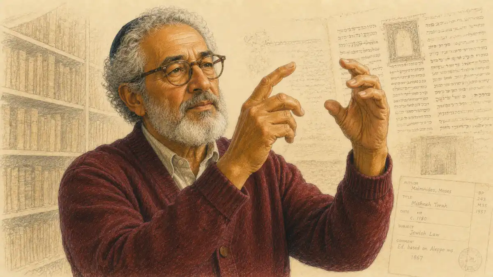

Socialism with Chinese characteristics is usually met first as a phrase on a news broadcast or a textbook page, and it is usually dismissed within the same minute, as a euphemism invented to let a communist party operate a market economy while keeping the name. That dismissal is too quick, and it misses the thing worth studying. The phrase names a doctrine, and the doctrine has a structure: a premise taken from Marx himself, a diagnosis of the country to which the premise is applied, a prescription about which instruments may legitimately be used during the interval the diagnosis describes, and a claim about how long that interval will last. Because the doctrine has a structure, it can be assessed the way any argument is assessed, by asking whether the premise is sound, whether the diagnosis fits the evidence, whether the prescription follows from the two of them, and whether the conclusion is ever required to arrive. This article performs that assessment. It treats the formulation neither as a slogan to be repeated nor as a fraud to be exposed, but as a stage theory inside the Marxist tradition, with ancestors in that tradition, rivals competing with it, and one specific weakness at its centre, the absence of any stated condition under which its long stage would count as complete. That weakness has a name in what follows: the terminal condition gap.

The scope needs stating before the argument begins. This article describes a doctrine historically, from the congress documents in which its formulations were adopted, and it assesses the doctrine's theoretical structure. It does not comment on any government, evaluate any policy, or describe the content of the doctrine's most recent formulations, and it names no serving official. The separate empirical question of whether the country the doctrine governs should itself be classified as socialist is a different inquiry, pursued in the companion study of [whether China is still socialist](/2018/07/15/is-china-still-socialist/), and the wider tradition from which the doctrine descends is mapped in the [complete guide to Marxism in China](/2018/05/01/marxism-in-china-complete-guide/). What belongs here is narrower and, for a reader who wants to judge the phrase rather than merely repeat a judgement about it, more useful: what the doctrine claims, where each claim came from, what its critics from several directions have said against it, and the precise point at which the serious criticisms all land.

## The phrase and the puzzle it poses

The puzzle is real, and it is worth feeling its force before dissolving any of it. Socialism, in the tradition the phrase invokes, names a determinate social order: social ownership of the means of production, production organised for use rather than for private accumulation, and a state understood as an instrument of the working majority. Chinese characteristics, attached to that noun, appears to qualify the order out of existence, as though a chemist were to offer water with local characteristics that happened to be flammable. Add the observable content of the reform decades, private firms, stock exchanges, wage labour hired by private owners, billionaires sitting in legislative bodies, and the phrase can look like a label retained for ceremonial purposes over a content that contradicts it. Most short treatments stop at that appearance. They treat the gap between label and content as the whole story, and they divide into two camps that mirror each other: the camp that concludes the label is a cynical fiction, and the camp that recites the label as though recitation settled the content.

A doctrine deserves better than either treatment, because a doctrine is not a label. It is an organised set of claims, maintained across documents, taught in party schools, and used to license some decisions while forbidding others. The interesting questions are internal ones. What does the doctrine take as given? What does it say about the country it governs? Which instruments does it permit, and on what grounds? How long does it say the present arrangement will continue, and by what test would anyone know the arrangement had ended? Those questions have answers that can be checked against the documents, and the answers are more interesting than the appearance that provokes the puzzle. The doctrine's central device, the primary stage of socialism, is a serious attempt to solve a genuine problem inside Marxist theory, the problem of what a revolutionary party is doing in power in a country that lacks the material development Marx treated as socialism's precondition. The solution may fail, and a large part of this article is given to the critics who argue that it does. But it fails, if it fails, at a specific joint in the argument, and locating that joint is the difference between understanding the doctrine and merely having an attitude toward it.

There is a pattern in this series that the present article follows. Formulations that outsiders treat as euphemisms repeatedly turn out, on inspection, to have a stated theoretical structure: the dictatorship of the proletariat names a theory of class rule, the vanguard party names a theory of how class consciousness is organised, and each becomes more intelligible, not less contestable, when its structure is laid out. Socialism with Chinese characteristics belongs to that family. It is the official doctrine of the world's largest communist party, the framework within which that party has explained itself to itself across four decades of congresses, and the source of a family of subordinate formulations, the primary stage of socialism and the socialist market economy, Deng Xiaoping Theory, that are searched for and argued about independently. A reader who can state the doctrine's premise, reproduce its structure, and name the point where its critics press hardest knows more about it than a reader who can only classify it as sincere or cynical.

### Why does the doctrine begin from a shortage rather than from a victory?

Because its premise makes abundance, not conquest, the precondition of socialism. A party that has taken power in a poor country has won politically while lacking the material development Marx required, so the doctrine starts by admitting the deficit and defining the stage as the work of removing it.

Beginning from a shortage is a striking choice for a ruling party to make, and it distinguishes this doctrine from the triumphalist register in which revolutionary governments usually describe themselves. The documents do not claim that the revolution of 1949 completed anything except a political and social overturn. They claim, on the contrary, that the society inherited was semicolonial and semifeudal in the party's own periodisation, that its industry was a small fraction of its economy, that most of its population worked the land with tools unchanged for centuries, and that the socialist transformation of ownership in the middle 1950s changed the relations of production faster than it could possibly change the forces of production. That admission is the doctrine's foundation stone. A theory that begins by confessing underdevelopment has at least one virtue a theory of arrival lacks: it can explain why the present does not look like the destination without treating the discrepancy as a betrayal or a mystery. Whether the explanation is purchased too cheaply, by making the interval indefinite, is the question the critics take up, and it cannot even be posed until the foundation stone is seen in place.

The shortage in question is specific, and precision about it matters for everything that follows. It is not a shortage of revolutionary will, of organisation, or of formal ownership change, all of which the party claimed in abundance. It is a shortage of developed productive forces: of machinery, infrastructure, technical knowledge, managerial capacity, and the general level of social labour productivity that Marx's account presupposes when it speaks of distribution according to need or even of the restricted distribution according to labour that he assigned to socialism's first phase. The doctrine's premise is that this shortage is not an incidental embarrassment but the determining fact about the country's situation, the fact from which the length of the stage, the legitimacy of markets, and the tolerance of diverse ownership all follow. Readers who grasp that the entire construction hangs on one factual claim about the level of development have grasped the doctrine's logic, including the logic of its vulnerability, since a construction that hangs on one claim can be attacked at exactly that point, and several of its critics do attack there, arguing that the development achieved has overtaken the diagnosis while the doctrine built on the diagnosis continues unchanged.

## Socialism with Chinese characteristics as a stage theory

A stage theory divides history into ordered phases and assigns the present to one of them, with consequences for what may legitimately be done. Marxism has contained stage theories from the beginning. Marx's own sketches move from primitive communism through slave, feudal and capitalist orders toward socialism and then communism, and his mature work distinguishes two phases of the communist future itself, a first phase marked by the defects of the society it emerges from and a higher phase where distribution by need becomes possible. The Chinese doctrine operates at a finer grain inside that inherited scheme. It does not dispute the sequence. It subdivides the first phase, arguing that socialism itself has an early, immature period in countries that entered it from backwardness, and that this period has its own laws, its own legitimate instruments, and its own timescale, none of which can be read off from the experience of countries that industrialised under capitalism first.

That subdivision is the doctrine's core intellectual act, and it explains both the doctrine's durability and the shape of the arguments around it. Once the subdivision is granted, a great deal follows with reasonable tightness: if the country is in socialism's primary stage, then the central task is the one appropriate to an immature formation, namely building the productive base; if that is the task, then instruments are to be judged by their contribution to it rather than by their resemblance to the destination; and if instruments are judged that way, markets, foreign capital and private ownership in subordinate roles cease to be deviations and become tools whose use the stage itself licenses. The chain of reasoning is genuinely a chain. Each link can be contested, and the critics contest different links, but a reader who treats the conclusion as a free-standing absurdity has skipped the reasoning that produces it. Conversely, a reader who accepts the subdivision without asking what would mark its end has accepted the one point on which the doctrine is silent, and the silence is where this article will eventually concentrate.

### What work does the word primary do inside the doctrine?

It converts a judgement about timing into a judgement about development. Primary does not mean first in a queue of dates; it means earliest in the order of maturity, a stage in which the productive forces have not yet reached the level the doctrine itself sets as the threshold of a fuller socialism.

The word deserves the attention the doctrine's expositors give it, because the whole theory would read differently without it. To call the stage primary is to claim that the country's condition is explained by position on a developmental scale rather than by policy failure, external pressure or ideological betrayal, the three explanations that compete with it in the literature. Position on a scale is nobody's fault and everybody's inheritance, and it carries a built-in direction: scales are climbed. The doctrine thereby converts an awkward present into an early chapter of a story whose later chapters are already named, and it assigns the party the role of the story's guide rather than its defendant. Critics who call the word a sedative and critics who call it a diagnosis are both responding to this conversion. The word also performs a quieter service. It reconciles the claim that socialism was established in the 1950s with the claim that almost everything associated with socialism remains to be built, by distributing the two claims across time: established as a system of ownership and power, unbuilt as a level of development and a way of life. Whether a single word should be asked to hold that much weight is a fair question, and the doctrine's history shows the word being asked to hold more of it as the decades passed, which is one reason the duration question, treated in its own section below, became the theory's most sensitive point.

Stage theories also carry a characteristic risk, visible across the Marxist tradition wherever they have been used, and the Chinese doctrine exhibits it in an unusually pure form. A stage is defined by criteria, and criteria can be stated sharply or loosely. Stated sharply, they discipline the theory's custodians, who must admit when the criteria are met. Stated loosely, they license the custodians, who can always find the criteria unmet. The Soviet experience offered both versions in succession: a timetable version in the early 1960s, when the party programme promised that the present generation would live under communism and named the decade by which its material basis would be built, and a stage version afterward, when developed socialism stretched the interval indefinitely once the timetable had become an embarrassment. The Chinese doctrine was constructed by men who had watched that sequence, and its preference for conditions over dates was in part a lesson drawn from it. The preference is defensible. It is also, as the objection examined later insists, the precise mechanism by which a transition theory can decay into a permanent present, and the doctrine contains no internal device that prevents the decay.

## The orthodox premise: what Marx required before socialism

The doctrine's premise is not an improvisation. It is one of the most consistently held positions in Marx's writing, repeated across forty years in works of very different kinds. In The German Ideology, written in the middle 1840s, the young Marx and Engels argue that a great development of the productive forces is an absolutely necessary practical premise of communism, because without it want is merely made general, and with destitution the struggle for necessities begins again and all the old filthy business, their phrase for the return of competition and hierarchy under scarcity, would necessarily be reproduced. The argument is structural, not moral. Scarcity forces rationing; rationing requires rationers; rationers become a stratum; and a society that set out to abolish strata finds itself administering one. In the Critique of the Gotha Programme, written in 1875 against the draft programme of the German workers' party, the older Marx gives the premise its canonical form for the transition itself. In the first phase of communist society, as it emerges from capitalist society, producers receive back from society, after deductions, the equivalent of what they have given to it; the governing right is still bourgeois right, an equal right applied to unequal individuals, and defects of this kind are inevitable in a phase that bears the birthmarks of the old society in every respect, economically, morally and intellectually. Only in a higher phase, when labour has become life's prime want and the productive forces have increased with the all-round development of the individual, can the narrow horizon of bourgeois right be crossed and distribution according to need inscribed on the banner. The [guide to Marx's Gotha Programme critique](/2013/09/01/critique-of-the-gotha-programme-guide/) treats that text's stage argument in full; what matters here is that the Chinese doctrine's foundational claim, that a society can hold socialist power while standing far below the material threshold of socialism's promises, is a claim Marx not only permits but insists upon.

### Where does Marx state the premise the doctrine relies on?

In two places principally. The German Ideology treats a high development of the productive forces as the indispensable practical precondition of communism, since scarcity generalised would revive the struggle for necessities. His programme critique of 1875 adds that distribution in socialism's first phase remains stamped by the society from which it emerged.

Two further supports are usually cited in the doctrine's defence, and both are genuine. The first is Marx's refusal, in the 1859 preface to A Contribution to the Critique of Political Economy, to allow stages to be skipped by decree: no social order disappears before all the productive forces for which it has room have developed, and new, higher relations of production never appear before their material conditions have matured in the womb of the old society. A revolution can change who rules; it cannot, on this view, change the level of development by proclamation, and a party that proclaims a higher stage than its material conditions support is engaged in what the Chinese tradition itself would later call stage skipping, a fault its documents repeatedly confess for the 1950s and condemn in principle. The second support is Lenin's practice. Confronted with a Russia whose capitalism he himself described as a small island in a sea of peasant small production, Lenin in the New Economic Policy period argued openly that the transition would require a whole epoch, that state capitalism under a workers' state would be a step forward rather than a retreat, and that the name of the destination did not settle the character of the instruments used on the way. The Chinese doctrine's genealogists present the primary stage as the systematic completion of that Leninist improvisation: what Lenin conceded under emergency, the doctrine codifies as theory. The [comparison of Maoism and Soviet Marxism](/2018/09/01/maoism-vs-soviet-marxism/) traces the doctrinal divergences that followed, but on the premise of a long, materially conditioned transition, the Chinese formulation stands closer to Lenin's last writings than to the orthodoxy that later governed in his name.

### What would count as evidence against the premise itself?

A durable case where distribution according to need, or something close to it, was sustained without developed productive forces and without the return of scarcity politics. The doctrine's critics rarely attack the premise at that point, because most Marxist and many non-Marxist accounts accept some version of it.

The premise, then, is orthodox in a strong sense: denying it requires denying texts that stand near the centre of the Marxist canon, and most of the doctrine's serious critics, including its critics from the left, grant the premise and attack elsewhere. This distribution of agreement matters for assessing the doctrine as a whole. A formulation whose premise is orthodox, whose diagnosis is at least arguable, and whose instruments follow from the two may still fail, but it fails in the way theories fail, at a joint that can be located and argued about. The joint, in this case, is not hard to find once the structure is laid out, because the doctrine makes four distinguishable claims and supports them unequally. It claims a premise, which is documented. It claims a diagnosis, which is dated and can be re-examined as the country changes. It claims a prescription, which follows if the first two hold. And it claims a duration, which is where the documentation thins to the point of disappearance, since a duration claim in a stage theory is only as good as the criterion that would end it. The next section lays the four claims side by side in the artifact this article is built around, and the remainder of the article tests each in turn, in the order of their strength, saving the duration for the extended treatment its weakness earns.

## The doctrine's structure

The doctrine's structure, the findable artifact around which this article is organised, can be set out as five components. Each component answers a different question, draws on a different warrant in the Marxist tradition, and attracts a different objection, and much confusion in the secondary literature comes from answering an objection to one component as though it disposed of the others. The table below states the structure in the form this article will use throughout: the premise, the diagnosis, the prescription, the duration, and the terminal condition.

| Component | What the doctrine states | Its orthodox Marxist warrant | The principal objection |
| --- | --- | --- | --- |
| The premise | Socialism presupposes productive forces developed beyond what a backward country possesses, so power can precede the material threshold | Marx on scarcity in The German Ideology and on the first phase in Marx's Gotha critique | The premise is granted by most critics and rarely attacked directly |
| The diagnosis | The country entered socialism from a semicolonial and semifeudal base whose development was insufficient, so its socialism begins at a primary stage | The 1859 preface: no order is skipped, and relations mature only as their material conditions mature | The diagnosis is dated, and the development achieved since may have overtaken it |
| The prescription | Developing the productive forces is the central task, and market mechanisms together with diverse ownership forms serve as licensed instruments of that task | Lenin's concessions on state capitalism and a long transition epoch under the New Economic Policy | Instruments adopted for a stage tend to create interests that resist the stage ever ending |
| The duration | The primary stage is prolonged, measured in generations and stated as at least a century from the transformation of ownership | Stage durations in Marx are set by conditions, never by calendar promises | A horizon that recedes as it is approached cannot discipline the theory's custodians |
| The terminal condition | No criterion is stated for the stage's completion | None available in the tradition, which supplies conditions for phases but not a test for this subdivision | The terminal condition gap: without a completion test, a transition theory becomes an indefinite justification |

Read as a table, the doctrine's unevenness is visible at a glance, and it is the unevenness of a real theory rather than the smoothness of a slogan. A slogan would be equally strong, or equally empty, at every point. This construction is strong where the tradition supplies material and weak exactly where the tradition runs out, at the terminal condition, because Marx subdivided the future into two phases and supplied rough criteria for the passage between them, while the Chinese doctrine subdivides the first of those phases and supplies no criterion for the passage out of its own subdivision. The doctrine's defenders sometimes reply that demanding a criterion misunderstands stage theories, which deal in historical tendencies rather than laboratory tests. The reply has force, and it is considered in full later. But it concedes the shape of the problem: a theory whose end cannot be specified even in principle asks to be trusted in a way that theories with specifiable ends do not, and trust, unlike evidence, does not accumulate. It merely persists, or collapses.

The structure also clarifies what the doctrine is not. It is not a claim that markets are socialist; the prescription row assigns markets the status of instruments, judged by results, and the documents are careful, in their precise formulations, to attach the adjective socialist to the system and its ownership foundation rather than to each mechanism operating inside it. It does not claim that China has arrived; the diagnosis row says the opposite, in writing, at congress after congress. And it is not a revision of Marxism's destination; the destination vocabulary, a higher stage, common prosperity, eventually communism, remains in the documents throughout, deferred rather than deleted. Readers who keep the five rows separate will find that most popular arguments about the doctrine are really arguments about one row conducted in ignorance of the others: the euphemism charge attacks the prescription as though there were no diagnosis, the betrayal charge attacks the diagnosis as though there were no premise, and the permanence charge, the strongest of the three, attacks the empty fifth row, which is why it is the charge this article treats at greatest length.

## The premise examined: how orthodox is orthodox?

Granting that the premise appears in Marx is not the same as granting that the doctrine uses it faithfully, and the distinction deserves a section of its own, because the doctrine's defenders sometimes move from the first to the second without noticing the gap. Three questions separate them. The first is whether Marx's premise concerns the level of development at the moment of revolution or the level a society must reach before attempting distribution by need. The texts support the second reading most directly: the Gotha critique addresses what can be distributed in the first phase, not what may be attempted politically. The doctrine extends the premise from distribution to the whole organisation of the stage, treating underdevelopment as licensing not merely restricted distribution but market allocation, private accumulation in subordinate sectors, and integration into a world market the tradition once treated as the enemy's territory. The extension is an argument, not a quotation, and it should be assessed as one: extensions of a premise are legitimate when the mechanism that justified the premise covers the new case, and here the mechanism, scarcity breeding hierarchy and distortion, does plausibly cover a good deal of the extension, since a poor country that forbade markets would ration scarcity through queues, coupons and administrative privilege instead, which is a form of the old filthy business in bureaucratic dress. The second question is whether the premise is doing the work in the doctrine, or decorating conclusions reached on other grounds. The genealogy examined below bears on this, because the premise was articulated in its Chinese form after the policies it licenses were already being adopted, a sequence that invites the suspicion of rationalisation; the doctrine's defenders answer that the 1978 turn began precisely as a theoretical correction, with the truth criterion debate preceding the policy settlement, and the documentary record supports them at least in part. The third question is the deepest: whether a premise about material preconditions, held by a party that monopolises the interpretation of its own doctrine, can ever operate as a constraint rather than a resource. A premise constrains only if someone can invoke it against the custodians and prevail. Within the doctrine's own institutions, invocation happens, in the internal debates over inequality and marketisation treated later; outside them, the premise functions as the custodians present it. None of this makes the premise unorthodox. It makes its orthodoxy insufficient, by itself, to validate the structure built on it, which is the most that careful defenders have ever claimed and rather less than the doctrine's ceremonial presentations suggest.

One more feature of the premise is worth isolating, because it explains the doctrine's otherwise puzzling combination of confidence and vagueness. The premise is a claim about a threshold, and thresholds in Marx are qualitative: the point at which the productive forces have developed enough that want is no longer general, that labour can become life's prime want, that the springs of cooperative wealth flow more abundantly. The Gotha text's own language for the higher phase is deliberately imagistic, drawn from a famous passage about hunting, fishing and criticism that Marx wrote as a young man and never operationalised. A doctrine built on a qualitative threshold inherits the quality: it can say, with complete sincerity, that the threshold has not been reached, at almost any level of development short of abundance, because abundance is the one condition that is never quite describable as present. The terminal condition gap, on this reading, is not an oversight that a more careful drafting committee could have repaired. It is inherited from the structure of the premise itself, and the doctrine's critics are at their strongest when they press exactly there, asking not whether the premise is Marx's, it is, but whether a politics can be governed by a threshold that its own theory leaves undescribable. That question runs through the criticisms assembled in the second half of this article, and it is the question to hold in mind through the genealogy that follows, since the genealogy shows the doctrine's custodians repeatedly choosing the undescribable threshold over the describable date, for reasons that were, at each choice, intelligible.

## Before the phrase: the doctrine's Chinese antecedents

The doctrine presents itself, in its careful expositions, as a discovery of the reform period, and in one sense it is: the primary stage formulation has no precedent in the party's earlier documents in its systematic form. But the intellectual materials from which it was built are older, and a reader who knows them can watch the doctrine assemble itself from parts the tradition already possessed. The first part is Mao's New Democracy of 1940, itself a stage theory constructed for a backward country. New Democracy held that a semicolonial, semifeudal society could not pass directly to socialism but required an intermediate stage of mixed economy and multi-class political power under communist leadership, a stage with its own name, its own programme and its own indefinite duration. The second part is the general line for the transition period, adopted in 1953, which envisaged the socialist transformation of ownership as a process requiring a considerable period, originally spoken of in terms of a decade and a half or longer, before the timetable was compressed in practice and the transformation was declared substantially complete by 1956. The third part is the negative lesson that followed. The Great Leap Forward of 1958 was, among other things, an attempt to abolish the stage problem by velocity, to reach communism's threshold by mobilisation rather than by development, and its catastrophic failure, followed by the Cultural Revolution's attempt to solve by political purification what had not been solved materially, taught the surviving leadership a lesson it never forgot: stages cannot be skipped, and pretending otherwise is paid for by the population. When Deng Xiaoping's generation reconstructed the party's theory after 1978, the primary stage doctrine was the positive form of that negative lesson, a theory built to make stage skipping doctrinally impossible by making the stage itself very long, very clearly defined as early, and explicitly protected against impatience.

The immediate doctrinal precondition was the debate of 1978 over the criterion of truth. A commentary published in May of that year, and then republished with the party's authority behind it, argued that practice is the sole criterion for testing truth, a proposition aimed at the dogma that whatever the previous leadership had endorsed was correct by definition. The argument sounds scholastic and was in fact the hinge on which the whole reform turn swung, because a party that accepts practice as the criterion has accepted, in principle, that its doctrines are revisable by results, including the doctrine of how fast socialism can be built. The Third Plenary Session of December 1978 converted the argument into the party's ideological line, joining emancipation of the mind to the classical injunction to seek truth from facts, and the economic experiments that followed, in agriculture first, were conducted under that licence before they were codified in any theory of stages. The sequence matters for assessing the rationalisation charge that critics press later. The licence to experiment preceded the stage theory by nearly a decade, and the stage theory, when it arrived, rationalised experiments already under way; but the licence itself was theoretical before it was practical, won in an argument about truth inside the party's own philosophical vocabulary. Reform, on the documentary record, was neither pure theory nor pure improvisation. It was an improvisation that had first argued its way to permission, and the primary stage doctrine is best read as the second, systematic half of that process, the codification of a permission into a structure.

## The launch: a phrase at the Twelfth Congress

The phrase itself entered the doctrine in September 1982, in Deng Xiaoping's opening address to the Twelfth Party Congress. The address instructed the party to combine the universal truth of Marxism with the concrete realities of the country, to blaze a path of its own, and to build a socialism with Chinese characteristics. Three features of the launch deserve attention. The first is its placement: an opening address to a congress is the most authoritative genre the party possesses, the point at which a formulation stops being one leader's idiom and becomes the organisation's property. The second is its modesty of form: the address offered a direction, not a theory, and the phrase arrived without definition, acquiring its content over the following decade as the subordinate formulations were added to it. The third is its double address. To the party's own ranks, worn by two decades of campaigns, the phrase licensed national particularity against imported models, including the Soviet model whose authority the party had spent the 1960s contesting. To the world outside, it announced that the country's path would be explained in its own vocabulary rather than borrowed ones. What the phrase did not do, at its launch, was specify a stage, a duration or an economics. It named a method, proceed from national conditions, and left the method's conclusions to be drawn. The drawing took ten years and two further congresses, and it is the drawing, not the naming, that produced the doctrine this article assesses.

### Why was the phrase launched from a congress podium rather than in a newspaper?

Because in this tradition a congress report is the instrument by which a formulation becomes doctrine. A newspaper phrase can be withdrawn; a formulation carried in a congress report binds the party's teaching, its textbooks and its cadre schools, which is why the wording of each launch repays close reading.

The decade between the phrase and its completion is sometimes read as drift, and the documentary record reads better as construction in a deliberate order. The economic content came first in practice: the 1984 decision on reform of the economic structure described the economy as a planned commodity economy, a formulation that admitted commodity production and market exchange inside the plan's framework while stopping short of naming a market economy as the goal. The theoretical frame came next, at the Thirteenth Congress in 1987, which supplied the primary stage doctrine that explained why such admissions were not temporary concessions. The economic name came last, at the Fourteenth Congress in 1992, when the goal of reform was stated as a socialist market economy, a phrase that would have been unspeakable in 1982 and was made speakable by the stage theory standing underneath it. Each step depended on the one before: the practice needed the frame to be defensible, and the name needed both. A reader who reverses the order in imagination, picturing the market economy proclaimed in 1982 without the stage doctrine beneath it, can measure how much work the primary stage concept performs in the structure. It is the load-bearing member. Remove it, and the doctrine collapses into the mere assertion that the party may do as it finds convenient, which is what its least careful critics always said it was. With it, the doctrine is an argument, vulnerable at identifiable points, and the next sections take the argument at its strongest, in the form its most authoritative document gave it.

## The formalisation at the Thirteenth Congress: the primary stage defined

The doctrine received its systematic form at the Thirteenth Congress in the autumn of 1987, in the political report delivered by Zhao Ziyang under the title of advancing along the road of socialism with Chinese characteristics. The report's theoretical core was a single claim with a long fuse: the country is in the primary stage of socialism. Everything in the report's construction hangs on the reasoning offered for that claim, and the reasoning is worth reconstructing exactly, because it is the strongest version of the doctrine ever produced and the version its critics are obliged to answer. The report argued that the country had indeed entered socialism, since the transformation of private ownership in the middle 1950s had established socialist relations of production and a socialist political order; that entry, however, had been made from a starting point the report described without euphemism, a semicolonial and semifeudal society whose productive forces lagged far behind those of the developed capitalist countries; and that a socialism entered from such a base necessarily begins at a primary stage, in which the immaturity of the material foundation, not any defect of will or policy, is the defining condition. The stage had begun, on this account, with the ownership transformation of the 1950s, and it would not be brief. The report stated that the stage would require at least a hundred years from that starting point, and that throughout it the central task of the whole society was the development of the productive forces, to which other tasks were subordinate.

 Around that core the report arranged the doctrine's working parts. The basic line for the stage was compressed into a formula of one centre and two basic points: economic construction as the centre, adherence to the cardinal principles, all four of them, as one basic point, and adherence to reform and opening as the other. The pairing is itself an argument, since it yokes the stage's economic licence to its political limits in a single sentence, telling the reader which elements of the arrangement are instruments and which are fixtures. A development strategy in three steps translated the stage into a trajectory: a first step concerned with securing basic subsistence across the population, a second with reaching a moderately prosperous standard of life, the condition the documents name with the classical term xiaokang, and a third, extending to the middle of the following century, with approaching the level of a moderately developed country. Only at the end of that trajectory, the report implied, would the question of the primary stage's completion even arise. The construction is impressive in its completeness. Premise, diagnosis, task, political limits and trajectory are all present, each stated in a form a cadre could memorise and an examiner could test. What is absent, and the absence grows louder with each rereading, is any statement of the observation by which the party would know, at the trajectory's end or at any point along it, that the primary stage had been completed rather than merely prolonged. The report gives the stage a beginning dated to a historical event and a duration stated as a minimum. It gives it no end that could be recognised when it came.

## The primary stage argument in full

Stripped to its skeleton, the argument the 1987 report formalised runs as follows, and it is worth holding in this bare form because both the doctrine's defenders and its critics regularly argue against padded versions of it. Socialism, in Marx's account, is not a set of ownership labels but a stage of material civilisation, presupposing a level of development that capitalism, in the countries where it matured, was supposed to supply. A country that makes its revolution before that level exists does not thereby acquire the level; it acquires power in a society still defined by scarcity. Such a country therefore faces a choice its doctrine must answer honestly: either pretend the level exists and govern by proclamation, the error the Chinese documents attribute to the Leap years, or acknowledge the deficit and organise the whole period of power around removing it. The primary stage is the second answer given theoretical form. It declares the deficit to be the stage's defining fact, demotes every other criterion of progress beneath the expansion of the productive forces, licenses whatever instruments demonstrably serve that growth, and fixes the stage's end at the point, unspecified but real in the theory's intention, where the deficit is made good. The answer to the most common examination question about the doctrine belongs here, in the argument's centre.

### What is the primary stage of socialism?

the doctrine, formalised in 1987, that China entered socialism from an insufficiently developed base, so that a prolonged primary stage is required in which developing productive forces is the central task and market mechanisms and diverse ownership forms are legitimate instruments.

Two features of the argument distinguish it from the earlier stage theory it resembles, and the distinctions are the doctrine's own, drawn in its expositions to separate the primary stage from New Democracy. The first concerns position: New Democracy was a stage before socialism, a mixed formation on the road to a socialist transformation still to come, whereas the primary stage is a stage within socialism, following the ownership transformation rather than preceding it, so that the society it describes is, in the doctrine's classification, already socialist in its relations of production while remaining undeveloped in its forces of production. The whole of the doctrine's polemical energy is spent defending that conjunction, socialist relations on an undeveloped base, against critics in both directions: against those who say the conjunction is a contradiction that dissolves the classification, and against those who say the classification makes the underdevelopment unspeakable. The second distinction concerns the stage's relation to policy. New Democracy was a programme, a list of things to be done by a coalition; the primary stage is presented as a condition, a fact about the country's level that no policy can repeal and that policies can only respect or violate at their cost. The documents insist on this with a formula worth noting: the primary stage is a stage that cannot be bypassed. What cannot be bypassed cannot be shortened by enthusiasm, cannot be declared over by a congress seeking a more inspiring banner, and, the critics add in the margin the documents leave blank, cannot easily be declared over by anyone at all, since a condition defined by a level invites argument about the level forever. The doctrine's strength and its weakness are the same property viewed from opposite ends: by making the stage a fact rather than a decision, it protects the stage from politics, including the politics of its own custodians, and including, fatally or providentially depending on the reader's judgement, the politics that might one day wish to end it.

## The market named at the Fourteenth Congress, and the additions that followed

The doctrine's third great formulation arrived with the Fourteenth Congress of 1992, at which the goal of economic reform was stated as the establishment of a socialist market economy. The phrase had been approached by stages: a planned economy supplemented by market regulation in the first reform years, a planned commodity economy in the 1984 decision, a formulation joining plan and market in the late 1980s, each step testing how much market the doctrine's language could hold. What made the final step possible, and what distinguishes it from a mere relabelling, is the argument Deng Xiaoping pressed during his southern inspection tour in the first months of 1992, when the reform programme had stalled under political pressure and the doctrine's direction was genuinely in doubt. The argument, as the tour's talks were later edited and published, separated the essence of socialism from the mechanisms of allocation: a planned economy is not identical with socialism, since planning exists under capitalism too, and a market economy is not identical with capitalism, since markets existed long before capitalism and operate within it as instruments; the criterion for judging any measure was whether it developed the productive forces of a socialist society, increased the state's comprehensive strength, and raised living standards. Whatever a reader concludes about that argument's validity, its function in the doctrine's development is unmistakable. It is the primary stage theory applied to the hardest case, the case of the market itself, and it completes the structure the 1987 report had built: the stage licenses instruments, the market is an instrument, therefore the market is licensed, provided the fixtures, public ownership's dominant position and the party's leadership, remain in place. The [account of Soviet planning](/2019/04/15/soviet-planning-how-it-worked/) offers the instructive contrast, an earlier ruling party that attempted market mechanisms inside a doctrine that had no stage theory capable of licensing them, and that therefore experienced each concession as an ideological wound rather than as an application.

### What changed between the first use of the phrase and its formalisation five years later?

The phrase of the earlier congress named a path; the later congress supplied the theory of the path. Formalisation added the diagnosis of an insufficiently developed base, the central task of developing the productive forces, and a duration measured in generations, converting a direction of travel into a stage with a definition.

After 1992 the doctrine developed by addition, and the additions follow a rhythm a reader of the documents learns to expect. At the Fifteenth Congress, held in 1997, the body of thought associated with Deng was given its collective name, Deng Xiaoping Theory, and written into the party's constitution as a guiding ideology alongside Marxism-Leninism and Mao Zedong Thought; the same congress restated the primary stage doctrine with emphasis, declaring that the country would remain in the stage for a long time and that its fundamental task and basic line would not change. At the Sixteenth Congress in 2002 the doctrine absorbed the formulation of the Three Represents, which redefined whom the party represents in terms capacious enough to include the new social strata the market reforms had created, entrepreneurs among them, a change with obvious doctrinal weight, since a party of the proletariat was re-describing its own constituency in the middle of the stage it had declared. At the Seventeenth Congress in 2007 a further formulation, the Scientific Outlook on Development, added development's quality and balance to its quantity as doctrinal concerns. Each addition was presented as a development of the same doctrine rather than a replacement of it, and each left the primary stage core untouched: the premise, the diagnosis, the central task and the open horizon survive every amendment. Doctrinal development has continued since those congresses and continues still, in formulations whose content this article, by its stated method, does not describe. What can be said without describing it is structural: the pattern of addition without subtraction, in which new formulations layer over old ones and the stage doctrine persists beneath them as the load-bearing claim, is itself the most stable feature of the doctrine's history, and the feature on which any assessment of its future flexibility should concentrate.

The additions also repay attention for what they reveal about the doctrine's internal economy. A doctrine that can absorb the Three Represents, a redefinition of the ruling party's own social basis, without revisiting its stage theory is a doctrine whose stage theory is doing very general work: it functions less as a set of propositions that additions might contradict than as a frame within which additions are arranged. Frames are not refuted by their contents. They are, however, strained by them, and the strain is measurable in the literature the doctrine generates, where expositors must repeatedly explain how strata created by the market belong inside a stage defined by the market's instrumentality, and how a development outlook concerned with balance and quality relates to a central task defined by growth of the productive forces. These explanations are not absurd; several are ingenious. But a theory that requires ingenuity to accommodate each of its own amendments is exhibiting, in a mild and manageable form, the same property its critics identify in an acute form at the terminal condition: the frame survives everything because it excludes nothing in advance. Holding that thought in reserve, the article turns to the doctrine's most quoted and least examined materials, the sayings through which it entered popular memory, since the sayings raise in miniature every question the structure raises at scale, including the question of what the doctrine's custodians may do with its texts.

## The sayings and their provenance

No modern doctrine is known to the public through its congress reports. It is known through its sayings, and this doctrine has three, each of which is misreported in the form in which the world repeats it. Correcting the record is not pedantry. The sayings carry the doctrine's method in compressed form, their provenance is checkable, and the distance between what was said and what is repeated measures the distance between the doctrine as a documented argument and the doctrine as a piece of folklore. A reader who learns to distrust the folklore has learned the first skill the documents require.

The cat is the most famous and the most instructive. In the form the world knows, the saying declares that the colour of a cat is irrelevant, black or white, provided it catches mice, and it is quoted everywhere as Deng Xiaoping's coinage and as the motto of a pragmatism that recognises no principle but results. The documentary record is different in every particular. The saying is a proverb, older than the party, with an antecedent in Qing dynasty literature, where a line in Pu Songling's Strange Tales from a Chinese Studio praises the cat, yellow or black, that catches the rat. Deng used the proverb in a speech of July 1962 on restoring agricultural production, in the famine shadow of the Great Leap Forward, and he used it as a quotation, attributing it in the speech itself to the military commander Liu Bocheng, who, he said, often cited the Sichuan saying when talking about fighting battles: a yellow cat or a black cat, whichever catches mice is a good cat. The colours in the original are yellow and black. The white cat of the famous version entered through later retelling, and the context, a debate about how to organise a starving agriculture, in which Deng was defending the toleration of household farming arrangements that worked, vanished from the saying entirely. What the folklore made into a charter for any means whatever was, in its documented use, an argument in a specific policy dispute, made by citation of a proverb its speaker did not invent, in defence of a recovery measure he later saw condemned when the same saying was held against him during the Cultural Revolution as evidence of revisionism. The saying's career thus contains the doctrine's whole problem of interpretation in miniature: a text detached from its occasion becomes a licence, and the licence is then read back into the text.

### Who is credited with crossing the river by feeling the stones?

The phrase is generally credited to Chen Yun, the party's leading economic administrator, who used it for the experimental method of reform, testing each measure before generalising it. Its later attachment to Deng Xiaoping in popular memory reverses the record, since Deng's own characteristic formulations were the cat and the truth criterion.

The river saying teaches the complementary lesson. Feeling the stones to cross the river describes a method rather than a goal: proceed by steps whose footing is tested, generalise only what has held weight, and treat the far bank as reachable without pretending to see the whole crossing in advance. As a method it is the epistemology of the primary stage doctrine translated into practice, and its institutional expression was the pilot experiment, the special zone, the dual track, the whole apparatus by which reform measures were tried in enclaves before they were promulgated as policy. That the phrase belongs in the record chiefly to Chen Yun, the most cautious of the reform leadership and the man most associated with balancing the plan against the market, is fitting, and its migration in popular memory to Deng, the leadership's boldest figure, is the same folkloric process that whitened the cat: sayings drift toward the most famous available owner. A doctrine's historian has to resist the drift, because attributions are arguments. Crediting Deng with the stones makes the reform era read as one man's daring; crediting Chen Yun restores the era's actual division of labour, in which daring and caution were institutionalised in different persons and the doctrine was their negotiated product.

### Where does the command to seek truth from facts come from?

From classical historiography. The phrase describes, in the Book of Han, the scholarly method of a Han prince who tested texts against evidence. Mao adopted it at Yan'an as a definition of the correct attitude to study, and the reform period revived it as the licence for testing doctrine against results.

The third saying is the oldest and the most consequential. Seek truth from facts is a classical phrase, used by the historian Ban Gu in the Book of Han to characterise the scholarship of Liu De, Prince Xian of Hejian, a Han dynasty prince praised for grounding his study of antiquity in evidence rather than in received commentary. Mao Zedong took the phrase up at Yan'an, most fully in his 1941 address on reforming the party's study, and gave it a materialist gloss that the tradition has used since: facts are the things that exist objectively, truth is their internal relations, that is, their laws, and to seek is to study. In that gloss the phrase stopped being a compliment to a prince's scholarship and became a directive about the relation between doctrine and reality, a directive that could be, and in 1978 was, turned against doctrinal custodians themselves. The reform period's revival of the phrase was therefore not decorative antiquarianism. It was the selection, from inside the tradition's own treasury, of the one formulation that subordinated every other formulation to results, and its placement at the head of the reform era's ideological line explains the era's otherwise puzzling combination of reverence and revision: the texts were honoured by being made corrigible. The three sayings together form a small system. The cat subordinates labels to function. The stones subordinate blueprints to footing. The truth phrase subordinates doctrine to evidence. A doctrine whose popular memory consists of those three subordinations has at least equipped its readers with the instruments of its own criticism, and the critics examined below use exactly those instruments, asking of the primary stage doctrine the questions its own sayings prescribe: does the stage catch mice, where is its footing tested, and what fact would its custodians accept as truth against it. The last of those questions is the terminal condition question again, arriving this time from inside the doctrine's own treasury.

## Instruments and fixtures: what the stage permits

The doctrine's working distinction, the one on which its whole permission structure rests, is between the system and its mechanisms. The system is defined by two fixtures: the dominant position of public ownership in the economy's commanding sectors, and the communist party's leadership in the state. The mechanisms are everything else: planning and market, public and private firms, wages and prices, foreign trade and foreign capital, all classified as instruments whose socialist or unsocialist character is not intrinsic but conferred by the system inside which they operate and the purposes they are made to serve. Deng's southern tour argument of 1992 is the distinction's canonical statement. Planning, he argued, is not the defining mark of socialism, since a capitalist economy also plans; the market is no defining mark of capitalism, since markets existed under feudalism and operate under socialism too; what defines the system is its ownership foundation and the direction of its development, and instruments face a triple test of results, whether they develop the productive forces, strengthen the country's comprehensive power, and raise the people's living standards. The argument is sometimes presented as a rhetorical escape hatch, and it certainly functioned as one in the politics of 1992. But it is also a genuine theoretical move with a pedigree, since the distinction between a social formation and its allocation mechanisms is one Marx himself relies on when he treats money, markets and wage forms as older than capitalism and capable of surviving into its successor. The doctrine's critics do not usually deny the distinction's pedigree. They deny its stability, arguing that mechanisms are not inert tools but environments that reshape their users, a rejoinder taken up in the criticism sections.

### Can a market mechanism be an instrument rather than a system in the doctrine's terms?

Yes, and the distinction carries the whole argument. The doctrine separates the mechanism, a method of allocating resources, from the system, defined by ownership and by which class holds power. A mechanism can therefore be borrowed without, on this account, surrendering the system, which is exactly what its critics dispute.

The permission structure that follows from the distinction is more discriminating than its reputation suggests. Instruments are licensed conditionally, and the documents attach conditions of three kinds. Some instruments are licensed for the stage only, with the licence understood to lapse as the stage matures: the toleration of private accumulation is the standing example, defended in the texts as necessary to develop forces that public accumulation alone could not yet develop, and surrounded by the language of guidance, utilisation, restriction and eventual transformation that the party's older vocabulary for handling capital, inherited from the New Democracy period, supplied ready-made. Some instruments are licensed as permanent features of a socialist economy at any stage: commodity production and market exchange in consumer goods were conceded this status early, on the ground that no complex economy allocates such goods by plan without waste. And some arrangements are refused licence altogether, placed outside the stage's permissions by the fixtures themselves: the privatisation of the commanding sectors and the introduction of competing centres of political power are the two the documents consistently exclude, the points at which an instrument would cease to be an instrument and become a change of system. A reader who maps the doctrine's debates onto this threefold structure will find that nearly all of them are boundary disputes: whether stock markets belong in the second category or the first, whether foreign capital's role respects the fixtures, whether a given experiment is an instrument being tested or a fixture being quietly exchanged. The doctrine provides the map. It does not, and by its nature cannot, settle the boundary disputes in advance, which is why its history is a history of boundary disputes conducted in its vocabulary.

### What separates an instrument from a defining feature in the doctrine's reasoning?

Consequence for the destination. An instrument may be adopted, adjusted or discarded as conditions change, provided the destination is untouched. A defining feature cannot be bargained away without the doctrine ceasing to describe the society it names, which is why public ownership and party leadership are placed on the defining side.

## The socialist market economy as the hardest case

Every instrument the doctrine licenses is easy compared with the market in general, and the doctrine's expositions show an awareness that the market economy formulation of 1992 is the point of maximum strain. A market is not a tool that can be picked up and set down like a planning technique. It is a system of signals and incentives that reaches into every enterprise it touches, rewards some behaviours and punishes others, generates inequalities as a by-product of its ordinary operation, and creates strata, private employers, financiers, rentiers, whose interests are constituted by the market's continuation. The doctrine's answer proceeds in layers. At the level of definition, the market economy is prefixed by the adjective socialist, and the prefix is assigned work: it refers to the ownership foundation within which the market operates, to distribution according to labour as the principal form of personal distribution, and to the state's retention of macroeconomic regulation as a function no merely capitalist state performs in the same way. At the level of the stage, the market's stratum-generating effects are classified as phenomena of the primary stage, expected and permitted while the stage lasts, and addressed by the stage's own remedies, taxation, redistribution and the gradual expansion of common prosperity, rather than by abolition of the mechanism. At the level of the destination, the documents maintain a studied reticence, neither promising that the market will wither at the stage's end nor conceding that it is permanent, a reticence that is honest to the theory's structure, since a stage theory cannot describe the arrangements of a stage it has not reached, and evasive in exactly the same measure.

The strain shows most clearly in the doctrine's treatment of the strata the market creates, and a reader assessing the whole construction should watch this joint. The classical tradition had a category for private owners of means of production, and the category was not flattering. The doctrine of the primary stage must accommodate such owners not as survivals awaiting transformation, the New Democracy formula, but as participants in the socialist construction of the stage, a status the Three Represents formulation later ratified by admitting advanced elements of the new strata into the party itself. Each step is defensible inside the stage logic: if the stage licenses the instrument, the instrument's operators cannot be treated as enemies of the stage. Each step also moves the doctrine further from the tradition's original classifications, and the cumulative distance is what the left criticism measures when it asks whether a stage theory that can accommodate anything still describes a transition to somewhere. That criticism now deserves its full hearing, but one preliminary belongs here: the question of whether the country governed under this doctrine is socialist is not settled by anything in the doctrine itself, since a doctrine is a claim, not a measurement. The measurement belongs to the empirical inquiry conducted in the study of [whether the USSR was socialist](/2019/05/15/was-the-ussr-socialist/) for the earlier case and in the companion article on the Chinese case, and this article's concern remains the claim's structure, which has one more component to inspect before the critics are heard: the duration, and the strange career of a horizon that has never come closer.

## The duration: a horizon that does not approach

The 1987 report's statement of duration is precise in form and evasive in effect, and the combination is the doctrine's signature. The stage, the report said, would last at least a hundred years, counting from the transformation of ownership in the 1950s. A minimum is not a schedule. It rules out haste, it rebukes anyone who promises arrival sooner, and it commits the doctrine to nothing beyond the minimum's expiry, at which point the question of the stage's end would arise in a form the report does not specify. The restatements that followed preserved the form exactly. The Fifteenth Congress in 1997, a decade into the stage's formal existence and after a decade of rapid growth, declared that the country was in, and would remain for a long time in, the primary stage, and that the stage's basic line would hold unchanged for the century the original statement had named. Formulations since have continued to describe the stage as long and its defining conditions as not yet fundamentally altered, in the documents' characteristic phrasing, without narrowing the horizon the founding statement set. A reader tracking the horizon across the sequence notices what the critics noticed: the end of the stage is never nearer in the later documents than in the earlier ones, although the development the stage exists to produce has, by the doctrine's own account, been proceeding at extraordinary speed throughout. The stage's remaining length behaves less like a distance being travelled than like a property of the stage itself.

### Why did the stated duration lengthen instead of narrowing as the stage advanced?

Because each restatement was made from inside the stage it described, with the endpoint still defined by a level of development rather than by a date. As the economy grew, the threshold was described in correspondingly higher terms, so the remaining distance refused to shrink in the way a timetable would require.

Three mechanisms produce this behaviour, and distinguishing them matters because the doctrine's defenders concede one and contest the others. The first is innocent, even honourable. The endpoint is comparative: the trajectory's third step aims at parity with the moderately developed countries, and those countries do not stand still, so a stage defined by catching up has a horizon that recedes at the speed of the leaders' own advance; the doctrine cannot be blamed for arithmetic. The second mechanism is definitional. Because the stage is characterised by the immaturity of the productive forces in general terms rather than by a schedule of measurable attainments, every restatement must re-derive the stage's continuance from the same qualitative judgement, and qualitative judgements of this kind have no internal pressure toward revision: a country can always be described as insufficiently developed relative to the abundance the higher phase requires, at any level of wealth whatever, since the higher phase's standard, springs of wealth flowing abundantly, is set at the limit of the imaginable. The third mechanism is institutional, and it is the one the critics press. A doctrine that declares the present stage long and its basic line unchangeable relieves its custodians of the need to justify the present arrangement against the destination, because the destination has been placed beyond the horizon of any living policymaker's accountability. Whatever the present requires is, by construction, what the stage permits. The defence replies that this relief is the point: the alternative to a protected long stage, in the Chinese record, was not honest accounting but the Leap, the attempt to storm the destination by mobilisation, whose costs the doctrine exists to prevent from recurring. The reply is historically serious. It does not, however, distinguish between a long stage with a recognisable end and a long stage without one, and the doctrine's failure to maintain that distinction is the space in which the strongest objection operates. The objection is best stated by the tradition's own internal critics, and it is to the criticisms, finally, that this article turns, beginning with the direction from which the doctrine has most to fear, its own left.

## The criticism from the left: a transition that cannot end

The strongest objection to the doctrine comes from the direction the doctrine least wishes to hear it, from within the Marxist tradition whose premises the doctrine claims, and it should be stated at the strength its proponents give it before any answer is attempted. Stated at full strength, attributed to named critics in that tradition, among them the historian Maurice Meisner, whose study of the Deng era concluded that the official ideology increasingly functioned to dignify an order its categories could not describe, the objection runs as follows. A transition theory that specifies no criterion for its own completion, and whose duration has been extended in successive formulations, is indistinguishable in practice from an indefinite justification for existing arrangements, and no Marxist argument requires that the transition be unbounded. Every element of that sentence is loaded, and each deserves unpacking, because the objection is not a slogan but a compound of four distinguishable charges, each of which the doctrine's defenders must answer separately.

The first charge is the missing criterion. A transition, in any theory that deserves the name, is a passage between two states, and a passage is intelligible only if both its states are specified well enough for an observer to tell where the traveller stands. The doctrine specifies the state behind, feudal and semicolonial backwardness, and gestures at the state ahead, a developed socialism of abundance, but the boundary between the primary stage and whatever follows it is nowhere drawn: no level of output, no structure of ownership, no distribution of income, no cultural or institutional attainment is named as the condition at which the stage would be declared complete. The traveller therefore cannot be located, and a theory that cannot locate its traveller cannot be contradicted by the journey's course, which is the definition of a theory that has stopped doing theoretical work. The second charge is the extension record. The stage's stated horizon has not merely remained long; it has been successively re-extended, first fixed at a century when the century was young in the doctrine's counting, then reaffirmed as a long time still to run after decades of the fastest growth the theory could have wished, with the defining conditions declared fundamentally unaltered at each restatement. A horizon that is re-extended whenever it is approached is not a horizon but a fixture of the scenery, and its function, the critics argue, is not to measure the journey but to postpone the accounting. The third charge concerns the instruments and their interests. The doctrine licenses markets and private ownership as temporary tools of the stage, but tools of that kind are not inert: they create classes and strata whose wealth and standing depend on the stage's continuation, and those strata, admitted in time to the ruling party itself, acquire both the motive and the means to ensure that the stage is never declared over. A transition whose instruments manufacture the constituency for its own permanence has a ratchet where its exit should be. The fourth charge is the exegetical one, and for Marxist critics the most damaging. Marx's premise, they argue, has been inverted in the using. The Gotha critique's first phase is a society that has already abolished private ownership in the means of production; its defects are the defects of distribution under scarcity, not a licence to restore the exploiting classes as builders of socialism. To cite that text as warrant for a stage in which capitalists are recruited, enriched and seated in the legislature is not to apply Marx's stage theory but to borrow its authority for a formation Marx's categories describe by another name. On this charge the doctrine is not a development of the tradition but a departure from it, dressed in the tradition's vocabulary precisely because the vocabulary is what legitimises the departure.

Meisner's version of the objection adds a historical twist that gives the compound its bitterness. The doctrine's premise, he argued, was originally a genuine act of theoretical honesty, the admission of backwardness against the voluntarism that had devastated the country; but a premise retained after the conditions that made it honest have changed becomes something else, a formula whose repetition serves those whom the present arrangement serves. The doctrine, on this account, did not begin as an indefinite justification. It became one, by the ordinary operation of a ruling theory whose custodians benefit from its continuance, and the absence of a terminal criterion is what allowed the becoming: a theory with an end can be overtaken by events and must argue for its life, while a theory without one merely persists. The critics who press this objection are not, for the most part, enemies of the tradition the doctrine claims. Several are its historians and former adherents, and their objection has the form of an internal audit: by the standards the doctrine itself professes, the standards of the sayings, of practice as the criterion and truth sought from facts, what fact about the stage's completion would its custodians accept, and if none can be named, in what sense is the stage a stage? The question is left standing here, at the strength its authors give it. The doctrine's answer, such as it is, comes after the remaining criticisms have been heard, since the answer draws on materials the other directions supply.

## The criticism from liberal scholarship: doctrine as legitimation

The second direction of criticism comes from liberal scholarship on the country's politics, and it differs from the left objection in its standard of judgement. Where the left, measuring the doctrine against Marxism's requirements, finds a transition criterion missing, the liberal objection measures it against the hypothesis that doctrine in a ruling party is legitimation all the way down, and finds the theoretical content beside the point. On this reading, the primary stage doctrine exists because a party that monopolises power while reversing its economic programme requires a formula that renders the reversal continuous with its founding claims; the stage theory is that formula, and its indefinite length is not a theoretical defect but the whole design, since a legitimation that expired would have to be replaced under pressure, while a legitimation without a terminal condition serves indefinitely. Scholars of the party's adaptation have supplied the objection with its best evidence: Bruce Dickson's studies of the party's recruitment of private entrepreneurs documented, in organisational detail, the absorption of the market's new strata into the ruling structure, a process the doctrine's own amendments, culminating in the Three Represents, ratified in theory as it occurred in practice. For the liberal critic, that sequence, practice first and doctrine following to bless it, is the doctrine's biography in miniature, and it generalises: the formulations arrive after the policies they license, as the stage theory arrived after the experiments of the early reform years, and a theory that reliably follows power's needs should be studied as power's instrument rather than as its guide.

### What separates the objection from the left from the objection of liberal critics?

Their standards of judgement. The left objection judges the doctrine by Marxism's own requirements and finds no transition criterion. The liberal objection judges it by the claim that doctrine merely dresses power, and finds the argument beside the point. The first can be answered from inside the theory; the second denies the theory is the right place to look.

The liberal objection is at its strongest as an account of function and at its weakest as an account of content, and the weakness matters for a reader deciding how much of it to accept. A pure legitimation device would be expected to cost its custodians nothing, to license whatever they wished whenever they wished it. The documentary record shows the doctrine costing them something real: policies blocked or delayed because they could not be stated in its vocabulary, factions defeated in internal argument by appeal to its texts, a decade of growth accepted as insufficient because the stage's own restatements kept the destination in view and the present under description as primary, with all the humility that word imposes on a regime's self-presentation. Legitimations usually flatter; this one requires its holders to describe their country as backward and their stage as early, in the founding documents of their rule, which is an odd form for flattery to take. The more defensible liberal position is the narrower one: that whatever the doctrine's content, its interpretation is monopolised, so that its constraints bind only those without the power to reinterpret it, and its silences, above all the terminal silence, are filled by authority rather than by evidence. That narrower objection does not dissolve the doctrine into propaganda. It locates the doctrine's vulnerability in its institutions of interpretation, and it converges, from the opposite direction, on the same point the left objection reaches: the missing criterion matters because there exists no forum in which its absence can be made to count against the custodians. Two criticisms that begin from incompatible premises and arrive at the same joint have probably found a real joint.

## The criticism from within: the internal debates

The third direction is the one the doctrine's custodians have historically taken most seriously, because it is conducted inside the country, inside the tradition's vocabulary, and largely by scholars who accept the premise and dispute the application. The debates that opened in the 1990s, as the market reforms deepened and their social costs became the unavoidable subject, turned on two questions the primary stage doctrine had left undertheorised. The first was distribution. The doctrine had licensed inequality as a phenomenon of the stage, on the argument that some must grow rich first if the productive forces were to be developed by the instruments available; but the doctrine's own destination vocabulary retained common prosperity as the stage's justifying end, and internal critics pressed the obvious question of mechanism: by what process, at what point, through whose agency, does the inequality the stage licenses convert into the common prosperity that alone retroactively justifies it? The doctrine's texts answer with the stage itself, prosperity comes as the stage matures, and the internal critics replied that maturity without a criterion is the terminal condition gap wearing a distributional mask, the same silence at a second location. The second question was the market's cultural and political logic. The scholar Wang Hui, the most prominent voice in the loose formation that came to be called the New Left, argued that the equation of marketisation with modernisation had depoliticised the country's thought, converting choices about the social order into technical questions of growth and thereby removing from discussion exactly the questions the tradition exists to ask: who owns, who decides, who bears the costs. Whatever a reader makes of Wang Hui's remedies, his diagnosis is an internal one, framed in the tradition's own terms, and it identifies a cost of the stage doctrine that its economic defence does not reach: a theory that defines the central task as development tends to demote every other question to a distraction from the task, and a society governed by it can lose the vocabulary for its own grievances while retaining the vocabulary for its growth.

These internal debates matter to an assessment of the doctrine for a reason beyond their content. They demonstrate that the doctrine is not, in its own house, the unchallengeable formula the liberal objection's strong version describes. Its premise is argued with, its silences are named, its custodians' interpretations are contested by scholars working in its categories, and the contest has a literature. The debates also show the limit of internal contest: the questions the internal critics raise, the distributional mechanism and the terminal criterion, are the questions the doctrine's authoritative documents do not answer, and the debate proceeds in journals and universities while the documents proceed by restatement. A doctrine can thus be simultaneously alive as an object of scholarship and frozen as an instrument of rule, and much of the confusion in outside commentary comes from observing one of those states and reporting it as the whole. The comparative criticism, to which the article now turns, widens the frame further, and in widening it, sharpens the question all three directions share: whether the Chinese doctrine's peculiarities are peculiar at all, or whether it is simply the most elaborated instance of something every ruling communist party has produced, a theory of why the present must continue.

## The comparative criticism: a doctrine every ruling party writes

The fourth direction of criticism is comparative, and it begins from an observation that is difficult to dispute once the cases are assembled: every communist party that has held power for a generation has produced a doctrine explaining why the conditions of its rule require the policies it is pursuing and why the destination, though certain, is not yet due. The Soviet Union supplied the type specimen. Having proclaimed the building of socialism complete in the 1930s, its leadership under Khrushchev adopted in 1961 a party programme that promised the material and technical basis of communism within two decades, a terminal condition stated as a date; when the date's approach became untenable, the doctrine was replaced rather than fulfilled, and Brezhnev's formulation of developed socialism, announced at the end of the 1960s and written into the constitution of 1977, converted the remaining distance to communism into a long stage of maturity whose end no document specified. Andropov, succeeding him, conceded that the country stood only at the beginning of that long stage, a restatement whose structure any reader of the Chinese documents will recognise: the stage retained, the horizon re-extended, the arrival deferred without being renounced. Yugoslavia produced its own variant in the theory of self-managing socialism, Cuba and Vietnam theirs, and the family resemblance is strong enough that the comparative critics draw a general conclusion: the stage doctrine is not a Chinese invention or a Chinese failing but a standard organ of ruling communist parties, the theoretical form taken by the interval between a revolution's promises and its results. On this reading, to single out the Chinese doctrine for the terminal condition gap is to mistake a genus for a specimen, since no member of the genus has ever stated the condition under which its stage would end and then honoured the statement.

### What did the Soviet doctrine of developed socialism share with this one?

The same structural move. Announced once the Soviet leadership judged the foundations of socialism complete, developed socialism stretched what remained of the road to communism across a long stage of maturity, deferring the destination without renouncing it. Both doctrines replaced a timetable with a condition, and both were criticised for the replacement.

The comparative criticism is powerful as context and treacherous as verdict, and a careful reader will take it in two parts. As context, it disciplines the other criticisms: the left objection's missing criterion and the liberal objection's legitimation function are not discoveries about one country's cynicism but features of a recurring institutional situation, in which a party that is simultaneously the doctrine's custodian and the state's ruler faces incentives no theory internal to the situation can correct. The Soviet sequence even supplies the Chinese doctrine's best defence exhibit, since the one ruling party that did state a terminal date, Khrushchev's, discredited itself by the statement's failure and taught every successor the cost of dates; a doctrine that refuses dates may be exhibiting not evasion but learning. As verdict, though, the comparative move proves too much. From the premise that all ruling parties produce such doctrines it does not follow that all such doctrines are equal, and the differences among them are exactly what an assessment should measure. Developed socialism claimed arrival: it described its society as mature, its stage as the destination's antechamber furnished and occupied. The Chinese doctrine claims the opposite: its society is described, in its founding theoretical document, as standing at the primary stage of a formation it entered late and backward, with the destination unbuilt and the building assigned as the central task of generations. A legitimation that begins by confessing immaturity differs from one that proclaims maturity, in candour, in the expectations it sets, and in the criticisms it invites; the Chinese doctrine's own internal critics were able to argue from its texts against its custodians' complacency in a way the Soviet doctrine's structure made far harder, since a doctrine of arrival leaves its critics nowhere to stand, while a doctrine of earliness leaves them the whole distance between the stage and the destination as standing ground. The comparative frame, properly used, therefore sharpens rather than dissolves the assessment: within the genus of ruling-party stage doctrines, this is the specimen with the most honest premise and the most elaborated structure, and it shares the genus's congenital defect at the terminal condition, which no member has escaped and which this specimen, for all its elaboration, has not escaped either.

## The diagnosis re-examined: the doctrine's most perishable claim

Among the doctrine's five components, the diagnosis is the only one that is straightforwardly perishable, and the criticism that fastens on its perishability deserves separate treatment because it is the criticism most likely to be settled by events rather than by argument. The diagnosis of 1987 described a country whose productive forces were those of a poor agrarian economy at the beginning of industrialisation: a vast rural population, a small modern industrial sector, low levels of literacy, technology and infrastructure, and a standard of living at which subsistence was the binding problem for much of the population. As a description of its moment, the diagnosis was not seriously contested; even the doctrine's sharpest critics granted it, which is why the argument of the period concentrated on the prescription. The decades since have subjected the diagnosis to the one test a stage theory should welcome, the test of its own central task performed successfully. Industry, infrastructure, urbanisation, technical education and output have been transformed on a scale the 1987 report's authors projected only across the stage's whole century. The criticism that follows is simple to state: a doctrine whose warrant is a diagnosis must be re-diagnosed as the patient changes, and a stage defined by underdevelopment cannot survive, unamended, the development it exists to produce. Either the stage is nearing its end, in which case the doctrine should be preparing its completion criteria, or the diagnosis was never the real warrant, in which case the critics of the other directions were right about the doctrine's function all along.

The doctrine's defenders have two replies, and they are not of equal strength. The weaker reply is comparative: the diagnosis measures the country's development not against its own past but against the threshold of the higher phase, and against that threshold, abundance in Marx's demanding sense, springs of cooperative wealth flowing more abundantly, labour become life's prime want, the country remains distant at any presently imaginable level of wealth. The reply is valid against the premise but nearly empty as a defence of the diagnosis, because it re-describes every level of development as primary by reference to a destination defined at the limit of imagination; it is the terminal condition gap doing duty as a diagnostic instrument. The stronger reply distinguishes two claims the diagnosis contains. The first is a claim about level, and it is indeed perishable: levels rise. The second is a claim about structure, about the unevenness of the development, its concentration in favoured regions and sectors, the persistence of a vast interior whose conditions lag the coast by generations, and the incompleteness of the social and institutional arrangements that a developed formation requires. A stage, the defenders argue, is defined by the whole formation and not by its most advanced enclaves, and a country does not exit its primary stage when its showcase cities reach the threshold but when the formation as a whole does, a standard by which the diagnosis retains force long after the level claim has faded. This structural reply is the doctrine's most resourceful defensive move, and a reader should notice what it concedes in the making: the diagnosis that does the work is no longer the 1987 diagnosis of general backwardness but a subtler claim about unevenness, which the founding document did not state in that form. The doctrine, pressed by its own success, has quietly exchanged a perishable diagnosis for a durable one, and the exchange, like the extensions of the duration, was accomplished by restatement rather than by any announced revision. Whether that is how living theories properly behave, adapting their claims while preserving their conclusions, or how legitimations behave, preserving their conclusions while adapting their claims, is the question on which the whole assessment finally turns, and it cannot be answered from the diagnosis alone. It requires the verdict on the terminal condition, which the next sections approach through the doctrine's deep background in the tradition's first and bitterest argument about transition.

## The first transition debate: the argument behind the argument

The doctrine's deepest roots are not Chinese at all, and a reader who wants to understand both its strength and its characteristic failure should know the argument of which it is the second full performance: the Soviet debate of the 1920s over how a backward country in socialist power is to industrialise. The New Economic Policy had restored market relations in a peasant country as a retreat the leadership insisted was temporary, and the question that consumed the party's economists was the question the primary stage doctrine would later answer in its own way: from where, in an economy without colonies and without a developed capitalist sector to expropriate, is the surplus for industrialisation to come, and at what speed may it be taken? Evgeny Preobrazhensky, the Left Opposition's economist, gave the hardest answer in his theory of primitive socialist accumulation: as capitalism had funded its takeoff by plundering colonies and countryside, so the state sector of a backward workers' state must draw its accumulation fund substantially from the peasant economy, through unequal exchange administered by the state, and the faster the extraction, the sooner the industrial base that alone could make socialism material rather than nominal. Nikolai Bukharin gave the opposite answer, and gave it in terms that startle a reader who meets the Chinese doctrine first. The transition, Bukharin argued, would be long; the peasantry must be allowed to enrich itself within cooperative and market forms; the state sector would grow into dominance by outcompeting private production economically rather than by expropriating it administratively; and a policy of forced extraction would shatter the alliance between workers and peasants on which the whole construction rested, producing not socialism but a garrison state administering scarcity. Stalin destroyed both men and both arguments, first borrowing Bukharin's gradualism to defeat the Left, then borrowing a violence beyond anything Preobrazhensky had proposed to collectivise the peasantry by force, and the debate was buried with its participants, Bukharin executed in 1938 and unmentionable in the communist world for fifty years.

The Chinese doctrine is, in its economic skeleton, Bukharin's side of that debate, systematised, stripped of its author's name, and extended across a century. The correspondence is structural and exact: a peasant country in socialist power; a refusal of forced extraction after a catastrophic attempt at speed, the Leap standing where collectivisation stood in the Soviet memory; accumulation to proceed through market relations, household production and tolerated private enterprise; the state sector to predominate by weight and position rather than by monopoly of every transaction; the destination retained and the timetable dissolved into a stage. Chinese scholars of the reform period knew the precedent intimately. The NEP debates were studied in China during the 1980s with an attention that was anything but antiquarian, translations and analyses of the Soviet controversy circulated as contributions to the Chinese one, and Bukharin's posthumous rehabilitation in the Soviet Union in 1988 was followed in Chinese journals as the recovery of a usable ancestor. The doctrine's official genealogy does not name him, for reasons the history makes obvious, but the historian of the doctrine who omits the 1920s debate omits the tradition's first attempt to solve the problem the primary stage exists to solve, and with it the strongest evidence that the problem is real. Two generations of revolutionaries, in two countries, working independently under the pressure of the same scarcity, arrived at the same construction: a long stage, market instruments, patience about the destination. Constructions arrived at twice are not obviously cynical. They may be the shape a genuine problem imposes on anyone who confronts it honestly, and the doctrine's defenders are entitled to that argument in its full weight.

The precedent also sharpens the criticism, because the 1920s debate contained, in Preobrazhensky's side, the one question the Chinese doctrine never answers in his terms: the question of the surplus and its discipline. Preobrazhensky's harshness had a theoretical point inside its cruelty, that accumulation has to come from somewhere, that its source can be named and its rate argued about, and that a transition theory which will not name its source or its rate has declined to be a theory of transition in favour of a mood of patience. The primary stage doctrine names its source readily enough, the whole society's labour under market discipline, but it declines, as its Soviet predecessors declined, to state the terms on which the accumulation it organises will be judged sufficient and the stage therefore complete. Bukharin's gradualism shared the defect; his growing into socialism had no more a terminal criterion than the doctrine that unknowingly inherits him, and when his stage was ended, it was ended by politics, by a rival's decision, not by the theory's own test. That is the fate the Chinese doctrine's structure invites and cannot exclude: a stage without a completion test will be ended, if it is ever ended, by decision rather than by demonstration, and a theory that can be ended only by decision has placed its most important question outside itself. The verdict sections that follow take up the doctrine at exactly this point, where its premise, its genealogy and its critics all converge.

## The basic line: one centre, two basic points

The doctrine's most compressed expression is the basic line for the primary stage, formulated at the Thirteenth Congress around a single centre and a pair of basic points, and the formula repays the kind of slow reading a glossary article exists to provide, because its three elements are of three different logical kinds and the doctrine's behaviour follows from their yoking. The centre is economic construction, the productive forces' growth restated as an instruction about priority: of all the tasks competing for the society's attention, this one is central, and others take their measure from their relation to it. The first basic point is adherence to the four cardinal principles, the fixture list Deng Xiaoping had promulgated in March 1979, in a speech that set the reform era's political boundaries at the moment of its opening: uphold the socialist road, uphold the people's democratic dictatorship, uphold the leadership of the communist party, and uphold Marxism-Leninism and Mao Zedong Thought. The second basic point is adherence to reform and opening, the licence restated as a duty: the instruments are not merely tolerated but required, and opposition to them is as much a deviation as opposition to the principles. The formula's elegance is that each element disciplines the others. The centre prevents the principles from becoming a pretext for stagnation, since a politics that neglects construction fails the line's first test. The principles prevent the centre from dissolving the system, since construction by any means whatever fails the line's second test. Reform and opening prevent the principles from being read as a freeze, since the line commands change in the same breath as continuity. A cadre equipped with the formula possesses a complete decision procedure for the ordinary run of policy disputes, and the doctrine's expositions lean on it accordingly, presenting the basic line as the stage's constitution in miniature.

The formula's history is as instructive as its logic. The four cardinal principles were formulated in 1979, before the phrase of 1982 and long before the stage doctrine of 1987, in response to the first unauthorised public questioning of the reform era, when the relaxation of control produced demands that reached beyond economics toward the political fixtures themselves. The sequence, limits promulgated before the licence was theorised, tells a reader something the doctrine's systematic presentations tend to blur: the fixtures were not derived from the stage theory but preceded it, fixed by political decision at the era's start, and the stage theory was later built around them, taking them as given rather than as conclusions. This is why arguments inside the doctrine so rarely reach the fixtures. The stage theory can be, and is, debated at the level of its premise, its diagnosis and its instruments; the fixtures stand outside the debate's jurisdiction, protected by their position in the basic line as points of adherence rather than as theses open to assessment. The doctrine's critics from the liberal direction fasten on exactly this architecture when they argue that the theory's openness is bounded in advance, that everything may be questioned except the arrangements that make the questioning safe for the questioned. The doctrine's defenders reply, with the record on their side, that every constitutional order places some arrangements beyond ordinary revision, and that a stage theory is not refuted by possessing a constitution. Both observations are accurate, and their conjunction defines the doctrine's real shape: it is a theory with an inside, where argument is genuine and consequential, and an outside, where the fixtures stand, and the terminal condition gap is best understood as a feature of the inside that the outside makes permanent, since the body that might one day declare the stage complete is itself one of the fixtures the stage exists to protect.

## The language of the destination: xiaokang and common prosperity

A stage theory must name its destinations, and the names this doctrine chooses are among its most revealing features, because they are drawn from two vocabularies at once. The Marxist vocabulary supplies the far destination: a higher stage, and beyond it the communist horizon the documents retain. The near destination, the one the stage's trajectory actually aims at in its second step, is named from the classical Chinese canon. Xiaokang, the term the documents use for the moderately prosperous standard the stage is to reach, comes from the Book of Rites, where the chapter on the evolution of rites contrasts the age of datong, the great unity in which the world is shared by all, with the lesser age of xiaokang, small tranquillity, in which order is maintained through family, property and ritual under virtuous rulers. Deng Xiaoping took the term up in December 1979, in conversation with the Japanese prime minister Ohira Masayoshi, to define the modest standard that Chinese modernisation should mean, and the classical word entered the doctrine's working vocabulary from that conversation. The borrowing is worth pausing over. A Marxist stage theory that names its intermediate destination from a Confucian ritual classic is performing, in its vocabulary, the very operation its master phrase announces: the universal doctrine re-expressed in the national inheritance. The classical term also does quiet theoretical work, since xiaokang in its source is explicitly a second-best order, admirable but short of the great unity, which is precisely the status the primary stage claims for its destination: worth reaching, honestly labelled as less than the end. The far destination's economic name in the doctrine's late formulations is common prosperity, the phrase Deng used in his final talks for the essence of the whole project: liberate and develop the productive forces, eliminate exploitation and polarisation, and arrive in the end at prosperity held in common. Between xiaokang behind and common prosperity ahead, the stage's geography is fully named. What remains unnamed, as the verdict will insist, is only the border crossing between them.

## A doctrine acquires an author: Deng Xiaoping Theory

At the Fifteenth Congress in 1997, months after Deng Xiaoping's death, the body of doctrine this article has been examining was given an author's name and entered in the party's constitution as Deng Xiaoping Theory, a guiding ideology in the sequence that begins with Marxism-Leninism and continues through Mao Zedong Thought. The naming creates an interpretive situation unlike that of any other doctrine in the tradition, and the glossary reader should understand it, because it explains the peculiar texture of the doctrine's texts. Marx left treatises; Lenin left treatises and a state's archive; Mao left essays, speeches and a body of verse. Deng left almost no extended theoretical writing at all. His canonical corpus consists of speeches, talks, conversations with foreign visitors, instructions minuted at meetings and remarks made on inspection tours, collected and edited in the Selected Works whose third volume is the doctrine's scripture. The chief architect, as the documents style him, designed in the genre of the intervention rather than the treatise, and the doctrine built from his interventions inherits the genre's properties: it is aphoristic where a treatise would be systematic, occasional where a treatise would be comprehensive, and dependent on editorial arrangement for the coherence its author never supplied in a single text. This is not a complaint; several of the tradition's most durable formulations began as interventions. But it has two consequences a reader must hold. The first is that the doctrine's systematic form, the structure this article has laid out, is the work of its expositors and of the congress documents that codified the interventions, so that assessing the doctrine means assessing a construction built by a school from a master's remarks, with all the fidelity questions that construction implies. The second is that the sayings problem of the earlier section is not an accident of popular memory but a property of the source material itself: a doctrine whose scripture is a remark will be fought over at the level of remarks, their wording, their occasions and their provenance, forever. The terminal condition gap survives in this light as the largest of the unasked questions the remarks never posed, the question no intervention happened to answer.

## Reading the doctrine's documents: texts, ranks and authority

Because the doctrine lives in documents of different ranks, a short guide to the ranks is part of the glossary work this article owes its reader. At the head stand the reports to party congresses and the party constitution, which carry the formulations in their binding form; the 1987 report is the doctrine's theoretical charter, and the constitution's general programme is its creed in miniature. Below them stand resolutions on history, of which the 1981 resolution on party history is the relevant example, performing the doctrine's necessary preliminary, the authoritative settlement of the past from which the stage's starting point is dated. Below those stand the leaders' selected works, authoritative as interpretation, and the speeches and talks they collect, whose individual weight depends on the occasion and on subsequent ratification. At the base stands the vast exegetical literature of the party schools and academies, which has no authority to innovate and enormous practical authority to fix meanings, since it is through textbooks and training materials that the formulations reach the cadres who administer them. Two rules of reading follow. A formulation's presence in a congress report outweighs its appearance in any speech, which is why this article dates the doctrine's components by congresses wherever a congress has spoken. And a formulation's absence from the higher ranks, however often it is repeated below them, marks it as commentary rather than doctrine, a distinction that disciplines the reader against the common error of treating every editorial phrase as a doctrinal event. The doctrine's most recent developments are, by the method this article has adopted, left undescribed; the ranks described here are the instruments by which a reader who wishes to follow those developments can weigh them when they are encountered elsewhere.

## The doctrine in the classroom

The doctrine's second life, after the congress hall, is the classroom, and no account of its structure is complete without the institutions that reproduce it. Party schools at every level of the administrative hierarchy teach the doctrine as the core of cadre formation, and the country's universities require courses in the theoretical system of which the doctrine is the centrepiece, so that the formulations examined here are, for the educated population of the country concerned, not slogans encountered in media but examined material, learned with its internal architecture: the premise, the basic line, the stage, the strategy in steps. This pedagogical embedding explains a feature of the doctrine that outside commentary often misses, its genuine cognitive availability to its critics inside the country. The internal debates of the 1990s were conducted by scholars who had taught the doctrine's texts, and their criticisms draw their force from the texts' own standards, the truth criterion, the premise about scarcity, the destination of common prosperity, in a way that mere dissent could not. A doctrine that is taught is a doctrine that can be audited by its students, and the history of this one shows the audit proceeding continuously at the level of scholarship even where the authoritative documents proceed by restatement. For the teacher using this article, that doubleness is the lesson's core: the doctrine is simultaneously a curriculum and a controversy, and students who are shown only the curriculum have been shown the smaller half.

## Ownership in the doctrine: the mainstay and the supplements

The doctrine's answer to the question of ownership is the component on which its classification of the whole society depends, and it is stated with a precision the other components sometimes lack. The Fifteenth Congress in 1997 codified the arrangement as the basic economic system of the primary stage: public ownership as the mainstay, with diverse forms of ownership developing side by side. Each term in that formula carries a definition the expositions supply. The mainstay is defined by position rather than by share alone: public assets are to hold the dominant place in the economy's total, state ownership is to control the lifelines of the economy, the sectors on which the whole depends, and the public sector's role is to lead development rather than merely to participate in it. The diverse forms, individual, private, foreign-invested and mixed, are defined as supplements and components of the stage's economy, legitimate in law and protected in their property, a status the doctrine's language upgraded across the 1990s from tolerated existence to constitutional recognition. The shareholding system, debated fiercely in the doctrine's internal literature as a possible Trojan horse of privatisation, was assigned to the instrumental category by the same congress's reasoning: a method of organising capital, usable by any system, whose character follows the identity of the controlling holder. A reader who wants the doctrine's whole theory of ownership in one sentence can take this one: the system is socialist because its commanding heights and its direction are publicly held and politically directed, and it remains in the primary stage because so much of its actual production must meanwhile be organised by forms that are not public. The sentence's two halves are the doctrine's glory and its exposure, since the first half asserts a classification the second half concedes to be incomplete, and the completion is deferred to the stage's end, which is to say, to the document the doctrine has never written.

The ownership formula also shows the doctrine learning from its own history in a way worth crediting. The catastrophe the doctrine's authors had lived through was, in their analysis, substantially a catastrophe of ownership haste: the transformation of the 1950s completed in a rush, the communisation of the Leap treating ownership advance as a substitute for development, and the resulting structures having to be dismantled at great cost by the very party that had erected them. The primary stage's ownership doctrine is the institutionalised refusal to repeat that sequence. Ownership is to advance at the speed of the productive forces and not faster; forms are to be assessed by what they contribute to development rather than by their ideological complexion; and the public sector itself is to be made efficient rather than merely enlarged, a standard the reform of state enterprises in the 1990s applied with a severity that cost millions of workers their positions, a cost the doctrine registered as a painful necessity of the stage and its critics registered as evidence about whose interests the stage's instruments served. Both registrations are in the literature, and a balanced assessment keeps them side by side: the ownership doctrine is simultaneously a theory of patience, learned from disaster, and a permission structure under which the costs of development were distributed downward with an efficiency the theory's destination vocabulary does not describe. The defence answers that the stage's alternatives were worse, and point to the post-Soviet transitions as the control case. The answer is not empty. It is also not an answer to the question of completion, which returns, as every road in this doctrine returns, to the missing criterion.

## Distribution in the doctrine: labour, factors and the order of enrichment

The doctrine's theory of distribution mirrors its theory of ownership, a principal form attended by licensed supplements, and it generates the same kind of argument at the same joint. The principal form, inherited from the first phase of Marx's Gotha critique, is distribution according to labour: income in proportion to work contributed, after the deductions society makes for common purposes. The supplements, codified as the stage deepened, are distribution according to factors of production, returns to capital, land, technology and management, acknowledged in the Fifteenth Congress's settlement as coexisting with the principal form within the stage. Over both stands the doctrine's most quoted distributional formula, the permission, first voiced in the reform's early years and restated by Deng in the southern tour talks, for some people and some regions to grow rich first, on the argument that enrichment proceeding outward from the capable and the favoured would pull the whole toward the destination of common prosperity, as a tide raises the boats it reaches last as well as first. The formula is the primary stage doctrine in distributional dress: a present inequality licensed by a future equality, with the licence's validity resting entirely on the future's arrival. Its internal critics, whose distributional version of the terminal objection was noted earlier, ask the formula the same question the stage cannot answer: by what sign will the society know that the season of enrichment first has done its work and the season of common prosperity is due, and who is authorised to read the sign? The doctrine's later formulations show the pressure of the question. Successive restatements rebalanced the stated relation between efficiency and fairness, moving fairness from a consequence expected at the stage's end toward a requirement imposed during it, and the development outlook of 2007 made the balance of growth a doctrinal concern in its own right. The movement is real, and it is the doctrine's characteristic way of answering an objection it cannot answer directly: not by supplying the missing criterion, but by absorbing the objection's vocabulary into the next restatement, so that the criticism survives as an amendment and the structure survives the criticism.

## The central task and its economics

What the doctrine commands, at the centre of its basic line, is the building of the productive forces, and the content it gives that command distinguishes its Marxism from a merely rhetorical developmentalism in one respect and assimilates it to developmentalism in every other. The content, as the documents elaborate it, is a programme: industrialisation carried through its heavy and light phases, the modernisation of agriculture, the building of infrastructure at continental scale, the absorption of foreign technology and capital under conditions the fixtures prescribe, and, in the formulation Deng gave in 1988 that the doctrine adopted as canonical, the recognition of science and technology as themselves the primary productive force, with education as the foundation on which that force is reproduced. Scholars of comparative development have observed that the programme, in its operations, resembles the practice of the East Asian developmental states more than it resembles any previous socialist economy: export discipline, state-guided credit, protected learning periods for infant industries, and a bureaucracy rewarded for growth. The observation is accurate about the operations and incomplete about the frame, and the incompleteness is the doctrinal point. A developmental state justifies its programme by the nation's strength and wealth. This doctrine justifies an operationally similar programme as the central task of a stage in a transition whose destination is a classless society, and the justification is not decorative, because it determines what may not be done in development's name, the fixtures again, and what must eventually be answered for, the destination again. Whether a justification that constrains at the edges while licensing at the centre is best described as a theory with exceptions or as an alibi with footnotes is, once more, the assessment's recurring question, and it is a question the doctrine's critics and defenders answer by pointing at the same documents. The honest summary is that the doctrine is a developmentalism that has sworn an oath to a destination, and that everything interesting about it follows from the oath: from the seriousness with which the destination's vocabulary is maintained, from the absence of any mechanism that could call the oath due, and from the resulting spectacle, unique in the history of the tradition, of a ruling Marxism whose central teaching is patience.

## The goal before the doctrine: the four modernisations

The doctrine did not invent its destination's practical content, and tracing that content backward clarifies what the doctrine added and what it merely inherited. The programme of the four modernisations, of agriculture, industry, national defence and science and technology, was announced by Zhou Enlai at the National People's Congress of 1964 and reaffirmed by him in January 1975, in his last major report, as the goal toward which the century's remainder was to be organised, in two stages of development. The goal therefore predates the reform era and survived, as an aspiration, the decade in which the politics of the period made its pursuit impossible. What the revolutionary decades lacked was not the goal but a theory of the road compatible with pursuing it: the inherited orthodoxy treated markets, material incentives and foreign capital as contaminants, so the goal could be proclaimed only in the intervals when the orthodoxy relaxed. The primary stage doctrine's historical service, on its own account and on much of the scholarship's, was to supply the missing theory of the road, converting the four modernisations from an aspiration periodically suppressed into the central task of an era whose whole definition was the permission to pursue them. This genealogy cuts in two directions, as genealogies in this article tend to do. For the doctrine's defenders, it shows the doctrine solving the tradition's standing problem, the reconciliation of a socialist destination with a backward country's road, in the only form in which the problem had ever proved soluble. For its critics, it shows the doctrine's true function with unusual clarity: the goal was always national modernisation, a goal shared across the country's political spectrum and across the revolutionary divide, and the doctrine is the form in which a communist party made that goal its own, at the price of deferring every distinctively socialist element of its inheritance to a stage's end it has never had to date. Both readings use the same facts. The difference between them is the verdict on the gap, and the article has now assembled everything the verdict requires except the verdict's own section.

## The doctrine abroad: a method that refuses to be a model

One further feature completes the structure, the doctrine's account of itself in relation to other countries, since a phrase built on national characteristics raises the question of its own exportability in an acute form. The doctrine's official position is consistent and has been maintained across its whole history: the master formula generalises as a method and not as a model. Every country, the documents argue, must join Marxism's universal truth to its own concrete conditions, as the formula's first clause prescribes; the Chinese content, the stage, the instruments, the fixtures, is the product of Chinese conditions and is not offered for copying. Foreign practice supplies the doctrine with its favourite confirmation, since the closest parallel, Vietnam's renovation and its socialist-oriented market economy, arose from a similar base through a similar reasoning and is treated in the literature of both countries as a fraternal case rather than as an export. Western commentary of the early twenty first century supplied the counterpoint, when the label Beijing Consensus was coined abroad to name an supposed alternative model of development for export, a label the doctrine's custodians conspicuously declined to adopt, since adopting it would contradict the method's first clause and embroil the doctrine in the fates of every government that borrowed the label. The refusal is theoretically tidy and diplomatically convenient in equal measure, and the scholarship divides over which quality predominates. For the assessment pursued here, the refusal's significance is structural: a doctrine that declines universality for its content while claiming it for its method has insulated itself against the most dangerous test a doctrine can face, the test of another country's results. Its failures, if they come, will be its own, and its successes cannot be claimed by imitators or blamed on them. The insulation is complete, and completeness of insulation is, as the verdict section will now argue, the doctrine's most consistent property at every level: a premise that cannot be falsified by scarcity's persistence, a diagnosis that can be exchanged without announcement, a duration without a date, and a method without a model. What remains is to name the property's centre and to give the doctrine's answer its final hearing.

## The terminal condition gap

The assessment can now be brought to its point. The terminal condition gap, the namable claim at this article's centre, is the doctrine's failure to state any criterion for the completion of its primary stage. The failure is specific, and it should not be inflated into a general charge of vagueness, because the doctrine is not vague in general. It specifies its premise with textual precision. It specified its diagnosis, at the moment of formalisation, in terms concrete enough to be overtaken by events. It specifies its instruments, its fixtures, its basic line and its trajectory with a drafter's care. At the single point of completion it specifies nothing: no level of development, defined in advance, at which the stage's permissions lapse; no structure of ownership at which the supplements would be wound up; no distribution at which enrichment first would yield to common prosperity as the operative rule; no institutional attainment at which the society would be reclassified. The trajectory's third step, arrival at a moderately developed level in the middle of the present century, is the closest approach the documents make to an endpoint, and it is a description of a level of wealth, not a criterion of the stage: nothing in the sequence states that reaching it ends the primary stage, as opposed to merely crowning it, and the restatements have been careful, on the occasions when the question pressed, to describe the stage as extending beyond any milestone the trajectory names. The gap is therefore not an omission awaiting a supplement. It is a structural feature, reproduced by every restatement, and the criticisms from all four directions converge on it because each of them, followed far enough, arrives at the same empty cell in the doctrine's table.

### Which criticism does the doctrine's own text leave unanswered?

The request for a completion test. The documents specify the central task, the instruments and the horizon, but no document in the sequence states what observation would certify that the primary stage had ended. Every other criticism meets some reply in the literature; this one meets a restatement of the horizon instead.

### What would a terminal condition for the stage even look like?

A stated level of development, defined independently of the policies being defended, at which the stage's permissions would lapse and its arrangements be reassessed. It would need to be measurable, announced in advance, and binding on the doctrine's custodians, three properties no formulation in the sequence has combined.

The gap's consequences ramify through the whole structure, and tracing them is the quickest way to see why the gap, rather than any other weakness, is the doctrine's centre. Because the stage has no completion test, its diagnosis cannot be falsified by development: any level attained can be re-described as primary by reference to the destination's altitude, and the diagnosis section showed the doctrine performing exactly that exchange. The same absence leaves the doctrine with no mechanism for retiring its own instruments: the strata the market creates hold their licence from a stage whose end no one is empowered to declare, which is the ratchet the left objection describes. Its custodians cannot be held to the destination by any procedure internal to the doctrine, since no completion test exists against which their stewardship could be judged: the accountability the basic line creates runs downward, to cadres who must pursue the central task, and never upward, to the custodians who must one day declare the task complete. And the doctrine's undoubted virtues, its honesty about backwardness, its protection against stage skipping, its discipline of instruments by results, are all mortgaged to a future accounting that the absence of any completion test has made impossible to schedule. A transition theory is a promise that the present arrangement is temporary in a specified way. The doctrine keeps the temporariness and deletes the specification, and the deletion is the gap. It remains to state, with equal fairness, what the doctrine offers in the gap's place, because the offer is not nothing, and the objection's own terms require that it be heard before the verdict closes.

## The answer: what the doctrine does specify

The doctrine's answer to the objection, assembled from its documents and its serious expositors, is better than the objection's rhetoric usually allows, and it should be given in its best form. The doctrine does specify a measurable objective, and it is not a trivial one. The central task is developing the productive forces, and the trajectory translates that task into a sequence of attainments that can be checked: basic subsistence secured across the population, then the moderately prosperous standard the documents name xiaokang, then the moderately developed level that forms the trajectory's third step. These are not moods. Each is a level of material life whose attainment or non-attainment is a matter of evidence, and the doctrine's custodians have in fact submitted to the sequence's discipline in the only way available to them, by declaring its milestones as they were reached: the documents of the century's turn recorded the first step as completed and the xiaokang standard as attained in overall terms, while noting, in the same breath, its low level and incompleteness, and the trajectory's remaining steps were re-specified accordingly. A theory that names milestones, reports them reached, and re-plans from them is not behaving as a pure legitimation behaves, and the objection's strong form, in which the doctrine is indistinguishable from an indefinite justification, must absorb that record or forfeit its claim to describe the documents. The defence adds the historical argument at full weight: the unboundedness of the transition is not a Chinese eccentricity but a property of the tradition's honest wing, since Marx himself set the higher phase's conditions at the limit of description and Lenin, facing the same backwardness, reached for the same long epoch; no Marxist argument, they note, has ever supplied a dated or measurable completion test for a stage of history, and to demand of this doctrine a criterion its entire tradition lacks is to demand that it cease to be a theory of history and become a project plan.

The answer is real, and it is insufficient, and the insufficiency can be stated with the precision the objection deserves. Intermediate criteria are not a terminal condition. The milestones measure the trajectory of productive development, and the doctrine is genuinely accountable to them; but the stage is not the trajectory, and nothing in the milestone sequence states the point at which the primary stage, as a stage, with its permissions and its fixtures, would be declared complete. The record of the milestones even exhibits the gap in operation: each attainment was declared, and at each declaration the stage itself was re-described as continuing fundamentally unchanged, so that the society can complete every step of its trajectory and remain, by its doctrine's own account, in the primary stage at the end of them. The concession the brief for this article requires, and which the evidence supports without strain, is therefore this: no terminal condition has been stated, in any document of the sequence, by which the primary stage would be judged complete, and this is the doctrine's central weakness. It is a weakness the doctrine shares with its tradition, as the defenders say; it is a weakness its tradition's critics have always identified as the point where stage theories decay into apologetics, as the objection says; and it is a weakness that no subsequent formulation has repaired, since the repair would require the custodians to bind themselves in advance to a test they do not control. What a reader should carry away is the exact shape of the incompleteness: a theory strong in premise, candid in diagnosis, disciplined in instruments, eloquent in destination, and silent, at the one point where its temporariness would become testable, about the condition of its own end.

## Is the doctrine unique? The family of long transitions

The comparative question can now be answered in the terms the whole article has prepared. In form, the doctrine is not unique, and its custodians, whose master formula instructs every country to find its own road, would be the last to claim that the form was a Chinese monopoly. Vietnam's renovation, launched in 1986, produced the closest relative: a socialist-oriented market economy, in the Vietnamese documents' phrase, situated within a transition period to socialism that the country's theorists, like their Chinese counterparts, describe as long, as bypassing the capitalist stage in its classical form while using its instruments, and as requiring the development of productive forces under a ruling party's leadership as its central task. Laos followed a parallel course with its new economic mechanism. Cuba, in the guidelines of 2011, undertook an updating of its economic model that admitted non-state forms of property and management within a socialist frame whose destination was reaffirmed in the same documents. Behind all of them stands the ancestor case, the Soviet New Economic Policy of the 1920s, with its concessions, its mixed economy and its unresolved argument about duration, the argument the first transition debate conducted and history interrupted. The family resemblance among these doctrines is exact enough to state as a rule: wherever a communist party has held power in a poor country and chosen development over siege, it has produced a stage doctrine with a long horizon, licensed instruments and an unstated end. The Chinese doctrine is the family's most elaborated member, not its exception.

### Does a parallel formulation elsewhere make the doctrine less distinctive?

Less distinctive as a form, more instructive as a case. Vietnam's socialist-oriented market economy and the language of a transition period show the stage argument arising wherever a ruling party marketises from a poor base. The Chinese version remains distinctive in the scale of its elaboration and in its explicit century-long horizon.

Its distinctiveness lies in four properties the parallels throw into relief. The first is scale: it governs the largest population and, in time, the largest economy ever administered under a doctrine of this family, so that its stage theory has been tested against quantities of development its relatives never approached, and its diagnosis problem, the perishability of the founding description, is correspondingly the most advanced. The second is the explicitness of its premise: where the Vietnamese documents share the stage logic, the Chinese formulation of 1987 remains the family's most systematic statement of the premise about productive forces and the most candid about the backwardness from which the stage begins. The third is the horizon's length, stated at a century when the family's other members left their durations vaguer, a candour that cuts both ways, exposing the doctrine to the terminal objection in its clearest form while sparing it the charge of hiding its intentions. The fourth is its endurance under amendment: no other member of the family has been restated, extended and layered across so many congresses while retaining its founding structure intact, which makes it the family's best evidence for both sides of the assessment, for the defenders who cite its stability as proof of theoretical adequacy and for the critics who cite the same stability as proof that nothing could disturb it. A reader who has followed the argument this far possesses the materials for the comparative verdict: the doctrine is a distinguished instance of a general form, distinguished by the honesty of its premise and the completeness of its structure, and sharing, undiminished, the general form's congenital silence at the point of completion.

## Misreadings to correct

Five misreadings recur in the coverage of this doctrine often enough to deserve correction in one place, since each of them disables a reader from assessing the argument the documents actually make. The first is that the doctrine abandons Marxism. Whatever the verdict on its fidelity, abandonment is the wrong word for a construction whose premise is quoted from the tradition's central texts, whose stage logic descends from Lenin's last writings and from the tradition's first transition debate, and whose destination vocabulary has been retained intact across four decades of amendment. A reader may conclude that the doctrine departs from Marxism at the terminal condition or at the readmission of capital; that conclusion requires argument, and the abandonment slogan is a substitute for it. The second misreading is that the doctrine claims markets are socialist. It claims, precisely, that markets are mechanisms, that mechanisms take their character from the system that wields them, and that the adjective socialist attaches to the system, its ownership foundation and its direction. One may reject the mechanism and system distinction, as the critics do, but rejecting it is different from missing it, and most popular treatments miss it. The third misreading is that the doctrine originated with the reform period alone, a creation of the late 1970s improvised to cover a retreat. Its components are older at every point: the premise is Marx's, the stage device is Lenin's and Mao's, the transition argument is the 1920s debate's, the destination's name is Zhou Enlai's programme and the classical canon, and the reform period's contribution, which is real, is the synthesis and the codification, not the invention from nothing. The fourth misreading concerns the sayings, and it has been corrected in its own section: the cat was yellow, the stones were Chen Yun's, and the truth phrase is two thousand years old, and a reader who repeats the folklore versions has announced that the documents were never opened. The fifth misreading is the subtlest: that primary in primary stage means early in time, a young stage that will mature as a child matures, by the mere passage of years. The doctrine's own usage is developmental, not chronological: primary names a level of the productive forces and of the formation built on them, and a stage so defined does not end because time has passed, which is at once the doctrine's defence against impatience and the root of its terminal difficulty. A stage that time cannot end can be ended only by a criterion or by a decision, and the doctrine has supplied neither. Correcting the five misreadings does not vindicate the doctrine. It clears the ground on which vindication and refutation are both possible, which is the only service a glossary article is obliged to perform.

### Why is assessing the argument more useful than assessing the motive?

Because motives are unobservable and arguments are not. A reader who asks what the doctrine claims, what would falsify it and where its custodians have moved its terms can reach a verdict that evidence could change. A reader who asks only what the doctrine is for has decided the answer before opening the documents.

## The doctrine's first theatre: the countryside

The assessment so far has proceeded at the level of documents, but the doctrine began in a field, and its authority inside the tradition rests partly on that origin. In the winter of 1978, in a production team in Anhui province, a group of farming households divided the collective's land among themselves by a secret agreement, contracting to deliver the state's quota and the collective's share and to keep the remainder, at a moment when such contracting was treated as a capitalist deviation punishable as counter-revolution. The harvest that followed transformed the team's fortunes, the experiment was protected by provincial leadership, imitated across the poorest regions, investigated by the centre, and within five years ratified as the household responsibility system under which the country's agriculture was reorganised. The episode matters to the doctrine's structure because it is the primal scene of the stage theory's method: a practice arose from below, was tested by results under the truth criterion the 1978 debate had just enthroned, and was then generalised by a centre that had not designed it, with the theory arriving afterward to explain why the practice was permissible. The primary stage doctrine is that sequence raised to a system. Its defenders cite the countryside whenever the rationalisation charge is pressed, and the citation has force: a doctrine whose founding episode is the ratification of a peasants' improvisation against the previous orthodoxy is not well described as a formula imposed to protect power from evidence. Its critics answer, also with force, that the ratification was selective, that the centre generalised the improvisation's economics while declining its implication, that peasants who can contract for land might in time ask what else may be contracted and decided, and that the doctrine's fixtures were drawn precisely at the line the implication would have crossed. Both accounts are true to the record, and their conjunction is the doctrine's biography: an empiricism with a fence around it, genuinely open to results inside the fence, and the fence itself exempt from the empiricism.

## Zones and enclaves: the geography of the method

The method of the tested enclave received its spatial form in the special economic zones, established in 1980 in Shenzhen, Zhuhai and Shantou in Guangdong and in Xiamen in Fujian, coastal enclaves in which foreign capital, market pricing and export production were licensed years before they were licensed for the country as a whole. The zones are usually discussed as economic policy, but their doctrinal significance is larger, since they are the stones method built in geography: a river crossed by testing each footing in a bounded space, where failure would be containable and success exportable. They also embody the stage doctrine's most characteristic wager, that a mechanism can be quarantined by territory and by law while its lessons are generalised, that the system can import the instrument without importing the environment that produced it. The wager's career is the reform era in miniature. The zones succeeded beyond their designers' projections, their practices migrated inland in widening rings of development areas and open cities, and the quarantine thinned as the generalisation proceeded, until the distinction between the enclave's rules and the country's rules became one of degree rather than of kind. The doctrine registered the success as vindication and the thinning as the method working as designed. A colder reading notes that the geography of experiment performed for the doctrine the same service the duration performs in time: the stage's permissions could always be described as local and provisional, somewhere, while becoming general and permanent, everywhere, and the description's truth at each moment concealed the trajectory's direction. Neither reading cancels the other. The zones are at once the doctrine's most successful instrument and the clearest exhibit of its ratchet, and an assessment that cannot hold both judgements together has not understood the object.

## The principal contradiction: the doctrine's diagnostic engine

Underneath the stage doctrine sits a piece of philosophical machinery inherited from Mao, and the doctrine cannot be fully understood without it, because the machinery is what converts the premise into the diagnosis. Mao's essay On Contradiction had taught the tradition to analyse any complex process by identifying its principal contradiction, the one whose development governs the others, and the party's post-1949 history can be written as a sequence of such identifications, each licensing a politics. In 1956 the Eighth Congress identified the principal contradiction as that between the people's demand for rapid economic and cultural development and the reality that development could not yet meet it, a diagnosis pointing toward construction. The identification was then displaced, in the campaigns that followed, by the doctrine that class struggle remained principal, a diagnosis pointing toward purification, and the country's disasters were governed by the second identification. The settlement of 1978 restored the first. The Resolution on Party History of 1981 stated the principal contradiction in the form the primary stage doctrine would inherit: the contradiction between the ever-growing material and cultural needs of the people and the backwardness of social production. The 1987 report built the stage directly on that sentence. If the principal contradiction is needs against backward production, then the central task follows by definition, the development of production; the stage is simply the period during which that contradiction remains principal; and the doctrine's whole architecture, its task, its instruments, its patience, is the unfolding of a diagnostic sentence. The elegance is real, and so is the exposure it creates. A doctrine whose stage is defined by a contradiction ends when the contradiction ceases to be principal, and the tradition's own method supplies the form of the question the doctrine never answers: by what observation would the custodians know that the contradiction had been superseded, as it was superseded, in their own history, by declaration in 1956 and by counter-declaration within a year? The machinery that makes the doctrine coherent is the machinery that makes its missing criterion conspicuous, since a philosophy of principal contradictions is a philosophy of identifiable turning points, and the doctrine identifies every turning point except its own.

## Continuity and rupture: the doctrine and its predecessor

The doctrine presents itself as the continuation of Mao Zedong Thought, and the claim is neither empty nor innocent, since the doctrine simultaneously reverses the economics of the predecessor's last decades. The settlement was engineered in the party history resolution adopted in 1981, the document that serves the doctrine as a foundation charter. The Resolution distinguished Mao's errors, grave in the Cultural Revolution, from Mao Zedong Thought, defined as the body of correct theory verified by practice, and it assigned the doctrine's own lineage to the second: the new formulation would be the thought's development under new conditions, not its repudiation. The primary stage doctrine is the settlement's largest product. Where the late Mao had treated the transition as a period of intensifying class struggle and had sought socialism's advance in the transformation of relations and of men, the doctrine treats the transition as an era of construction and locates socialism's advance in the growth of the forces the earlier line had neglected. The reversal is nearly total at the level of economics, and it is conducted entirely within the vocabulary of continuity: the same canon, the same founder's authority, the same party, the same destination. Scholars of the doctrine divide over how to describe the operation. One school reads it as the tradition's self-correction, the mechanism by which a doctrine that enthrones practice as truth's criterion revises its own economics while conserving its identity, and finds in the operation the strongest evidence that the doctrine is a living theory rather than a liturgy. The other reads it as the demonstration of the liberal objection, proof that the vocabulary constrains nothing, since a total reversal of economic content was accomplished without a single term of the creed being surrendered. The record supports a judgement between the two, and it is the judgement this article has been building toward in every section: the vocabulary constrained the reversal's form absolutely and its content hardly at all. The doctrine could reverse the economics only by re-describing them as a stage, only by retaining the destination, only by arguing from the canon; a party unconstrained by its doctrine would simply have changed its policy and its name. What the doctrine could not do was protect its destination from the reversal's logic, since a stage defined by the reversal's necessities acquired, in the terminal condition gap, the means to outlast every destination set for it. Continuity of form, reversal of content, and the destination held in trust by a theory that cannot say when the trust expires: that is the doctrine's relation to its predecessor, stated as neutrally as the record allows.

## Reform as the second revolution

The doctrine's self-description contains a phrase that startles readers who meet it in the documents, and it deserves the glossary treatment because it organises the doctrine's understanding of its own novelty. Deng Xiaoping described reform itself as a revolution, in his talks of the middle 1980s as China's second revolution, and the formulation was taken into the doctrine's expositions as the authorised characterisation of the whole process. The description performs three services. It claims for the reform the dignity and the historical rank of the first revolution, the one that founded the state, so that the reform's cadres are revolutionaries and not liquidators. It locates the revolution's object with precision: not the political order, which the fixtures protect, but the system of economic arrangements inherited from the period of the plan, which the documents describe, in a remarkable admission, as a set of structures that had become fetters on the productive forces they existed to serve. And it explains the reform's method, since a revolution conducted by the state against its own inherited structures will proceed by the state's instruments, campaigns of persuasion, pilot jurisdictions, and decrees, rather than by the insurrectionary means of the first. The formulation also exposes the doctrine to its most elegant internal difficulty. A revolution, in the tradition's own theory, is the replacement of one social order by another under the pressure of a contradiction that the old order cannot contain. To call the reform a revolution while insisting that the social order persists unchanged through it, socialist before and socialist after, is to use the tradition's largest word for a process the doctrine elsewhere describes as a stage's internal adjustment. The expositions manage the tension by distinguishing revolutions of system from revolutions within a system, the second revolution being of the latter kind, a liberation of the productive forces from arrangements that fettered them. The distinction is serviceable. It is also another instance of the doctrine's characteristic operation, the retention of a charged term under a redefinition that removes its danger, and a reader who has learned to spot the operation, in the stage, in the market's adjective, in the enrichment formula, will spot it here without assistance.

## Opening: the doctrine's theory of the world

The doctrine's second licence, after the market, is opening to the outside world, and it too is theorised rather than merely practised, in terms a reader should know because they complete the stage argument. The inherited orthodoxy had treated the world market as the territory of the system's adversary and self-reliance as a virtue with doctrinal standing, a posture the country's experience of blockade had made plausible and its poverty had made expensive. The reform doctrine reversed the valuation on stage-theoretic grounds: a country in the primary stage, lacking capital, technology and managerial knowledge, cannot develop its productive forces in isolation, because the forces it lacks exist in developed form only in the world it had withdrawn from; isolation is therefore not purity but a decision to prolong the stage. Deng's formulation of the point, repeated across his talks of the period, was that the country could not develop by closing its door, that socialism's construction required learning from every advanced achievement of human civilisation, and that the learning was an application of the premise rather than a departure from it, since the premise had always held that the material basis must exist before it can be socialised, and borrowing the basis is faster than inventing it. The argument assimilated foreign capital to the instrument category, where the fixtures govern its terms: welcome as a supplement, directed to the stage's tasks, excluded from the commanding positions. The doctrine's critics note, in the pattern now familiar, that the instrument arrived with its environment attached, that integration into world markets disciplines a country's policies through channels no fixture controls, and that the stage's end, if it is ever declared, will be declared by a society whose development the world market co-authored. The reply from the doctrine's side is that the alternative was the autarkic prolongation of backwardness, and that a stage theory which refused the world's accumulated productive forces would have failed its own central task. Both are right about the facts. The disagreement is about whether co-authorship by the world market is compatible with the destination, and it is the international form of the question the whole article has pursued in its domestic form, the question of what an instrument does to the hand that wields it across a stage without an end.

## The scholarly apparatus: exposition as an institution

A doctrine of this scale generates a profession, and the profession is part of the phenomenon an assessment should register. The doctrine is expounded by a scholarly apparatus without parallel in the tradition's history: academies of social sciences charged with its elaboration, university departments of Marxist theory for which it is the central object, journals devoted to its interpretation, and a publishing programme that has produced systematic expositions running to many volumes, in which every formulation is traced to its sources, harmonised with its predecessors and applied to the questions of the day. The apparatus performs two functions that pull in opposite directions. As scholarship, it subjects the doctrine to the disciplines of textual accuracy and historical knowledge, and its best work, on the provenance of the sayings, on the genealogy of the formulations, on the Soviet precedents, is genuinely illuminating, used throughout this article's preparation in spirit where not in citation. As an institution, it has an interest in the doctrine's continuity that no individual scholar need feel for the interest to operate: careers, journals and departments are constituted by the doctrine's persistence, and an apparatus so constituted will experience the terminal question, the question of the stage's completion, as a question about its own completion, which may be the deepest reason the question is never posed in the authoritative literature. The observation is not a sneer at the scholars, many of whom have pressed the doctrine's difficulties further than its foreign critics. It is a completion of the assessment's sociology: a theory's silences are maintained by institutions as well as by arguments, and the gap at the doctrine's centre is guarded by both. The doctrine's own theory of knowledge, practice as the criterion of truth, supplies the standard by which the apparatus itself would have to be judged, and the standard's application to the apparatus is a task the literature has not undertaken.

## Open questions the literature has not settled

An assessment in a reference series should end its analytical work by marking the questions that remain open, since a reader who knows where the scholarship's frontier runs knows more than a reader who mistakes the frontier for a wall. Four questions stand open in the literature on this doctrine, and none is close to settlement. The first is the falsifiability question in its general form: whether a stage theory can be a scientific theory at all, in the sense the tradition's own philosophy of science demands, or whether stage theories are by nature interpretive frames whose assessment is historical and political rather than empirical, a question that reaches far beyond this doctrine to the whole Marxist philosophy of history. The second is the succession question: how a doctrine whose authority is vested in congresses and constitutions, rather than in a living theorist, accommodates the transfer of leadership, and whether the habit of layering new formulations over old ones, repealing none, can survive indefinitely or must eventually force a choice among accumulated formulations. The third is the comparative question in its sharpest form: whether the Vietnamese parallel will converge with the Chinese case or diverge from it, since the two doctrines now constitute a natural experiment in the stage form, run in two countries of different scale under similar theory, and their comparison across the coming decades will teach more about stage doctrines than any single case can. The fourth is the question this article has named: whether the terminal condition gap is a contingent omission, repairable by a future congress willing to bind itself, or a necessary property of any doctrine that must simultaneously legitimate a present and promise a future, in which case the gap will be found, on inspection, in every member of the family, and the Chinese doctrine's distinction will remain what this assessment has found it to be, the most honest premise and the fullest structure ever built around an empty cell.

## The surname debate and the instruction not to debate

One episode in the doctrine's career displays its hermeneutics, the rules by which its disputes are settled, more clearly than any document, and it belongs in a complete account. In the years after 1989, as the reform programme stalled and its opponents regrouped, a controversy ran through the party's press over the surname of the reforms: whether each measure, each experiment with shares, markets and foreign capital, bore the surname socialist or the surname capitalist. The question was not frivolous inside the doctrine's categories, since the categories made the surname the criterion of legitimacy, and to ask it of every measure was to subject the whole programme to a rolling doctrinal audit it could not survive measure by measure. Deng Xiaoping's southern tour talks of 1992 ended the controversy by ruling the question itself out of order. The talks instructed that debate over surnames should not be conducted, that the criterion was the triple test of results, and that the party should dare to experiment and to move, since not to debate was, in the talk's own reasoning, one of its speaker's inventions for buying time in which practice could produce its evidence. The episode is the truth criterion of 1978 reaching its logical form: a theoretical dispute dissolved by an instruction to let results accumulate. The doctrine's defenders read it as the premise governing the superstructure, practice enthroned over taxonomy. Its critics read it as the moment the doctrine insured itself against its own categories, since a programme that may not be asked its surname cannot fail its audit, and the terminal condition gap was thereafter joined by a procedural one: not only is there no test for the stage's completion, there is, by the founder's instruction, a standing discouragement against posing classificatory questions to which the stage's answer might be no. Both readings are documented in the literature, and the episode's fascination is that it supports them equally, being in truth a single act with two faces: the act by which a doctrine of practice freed a country's development from a taxonomy that was strangling it, and the act by which the taxonomy's custodians exempted themselves from the taxonomy.

## The essence formulation: the doctrine in one sentence

Late in the doctrine's formation, its author supplied it with a one-sentence summary, and the sentence has become the standard against which the expositions measure everything else. In the southern tour talks of 1992, Deng stated the essence of socialism as a triple: to liberate the productive forces and to develop them; to eliminate exploitation and polarisation; and to arrive, in the end, at common prosperity. The sentence deserves the slow reading its canonical status invites. Its first clause is operational and present-tense, a task for the stage, stated twice over, liberation and development, as though the forces required both an unbinding and a building. Its second clause is negative and transitional, the removal of the old order's defining evils, exploitation named without qualification and polarisation named beside it, a pairing that quietly concedes that the stage's own instruments produce the second evil while combating the first's legacy. Its third clause is eschatological in the strict sense, a destination located at the end, introduced by the phrase in the end, whose grammatical vagueness about time is the terminal condition gap compressed into two words. The whole doctrine is in the sentence: the premise in the first clause's priority, the diagnosis in the second clause's unfinished work, the prescription in the first clause's licence, the destination in the third clause's promise, and the silence where the third clause's date should be. The expositions treat the sentence as the doctrine's essence because it performs the doctrine's essential operation, which is to bind a programme for the present to a destination in the future by a connection that is asserted with complete confidence and specified not at all. A reader who can parse the sentence has the doctrine; a reader who asks what would certify the third clause's arrival has the criticism; the literature of the doctrine is the long conversation between those two readers.

## The negative theorems: what the doctrine defines itself against

A doctrine is known by its negations as well as by its affirmations, and this one's negations are unusually quotable, because they were aimed at the predecessor orthodoxy's most cherished equations. Poverty is not socialism, the reform era's foundational negation, dissolved the equation of socialism with shared scarcity that the egalitarian distribution of the planned years had embodied, and its companion, that development is the hard truth, installed growth as the criterion to which other claims must defer. The big common pot, the doctrine's name for the egalitarian distribution in which reward bore no relation to contribution, was condemned as the mechanism by which the old system had suppressed the very forces it existed to develop, and the condemnation carried the Gotha premise in vernacular form: distribution according to labour, honestly applied, is not a capitalist concession but Marx's own rule for the first phase, against which the pot was the deviation. Even the doctrine's treatment of its predecessor's signature virtue, self-reliance, was a negation in stages: from a principle of economic organisation to a memory of the blockade years, honoured in speeches and retired in practice as opening became doctrine. The negations matter to the assessment because they show the doctrine's critical edge turned inward, against its own tradition's record, with a freedom its critics sometimes fail to credit. A pure legitimation would not need to convict the predecessor system of fettering the productive forces, of institutionalising poverty, of punishing contribution; the convictions are in the documents, stated as the stage's justification. The doctrine's apologetic function, such as it is, is thus of a specific kind: it legitimises the present by prosecuting the past, and its silences are reserved not for the past's failures, which it catalogues, but for the future's test, which it declines to schedule. The asymmetry is the assessment in miniature, and it explains why the doctrine's internal critics, who share its prosecution of the past, concentrate their fire where this article has concentrated it, on the unscheduled future.

## The adversary as teacher

The doctrine's revaluation of capitalism is the last of its major operations, and in the long view of the tradition it may be the most consequential. The classical posture toward the adversary system was funerary: capitalism was a dying order whose achievements were historical and whose remaining function was to be superseded. The primary stage doctrine quietly replaces the funeral with a curriculum. A country inside the primary stage, on the doctrine's reasoning, confronts a capitalism that commands the developed productive forces the stage exists to build, and the relation is therefore pedagogical before it is antagonistic: the adversary's science, technology, management and organisation are to be studied, imported and mastered, its markets used, its capital borrowed, its universities attended. The doctrine is candid about the implication its predecessors would have found unbearable, that for the stage's duration the adversary is, in the decisive respect of development, ahead, and that socialism's claim rests not on a present superiority of performance but on the destination and on the fixtures that preserve the journey's direction. Scholars of the doctrine have noted the strain this places on the tradition's philosophy of history, in which the successor order was supposed to demonstrate its superiority in the present tense, as the precondition of its succession. The strain is managed, once more, by the stage: superiority is deferred to the destination, and the present's inferiority is reclassified as the stage's defining condition rather than as evidence against the succession. The management is intellectually consistent. It is also the terminal condition gap in its international dress, since a superiority deferred to an undated destination is a superiority that the present can never be required to exhibit, and the doctrine's critics in the Marxist tradition have not failed to observe that a succession which need never demonstrate itself has insured itself against the only evidence its own theory of history recognises.

## Stages within the stage

A stage measured in generations invites subdivision, and the doctrine's scholarly literature has repeatedly attempted it, proposing that the primary stage itself falls into phases, an early phase of laying foundations, a middle phase of general construction, a later phase of approach to maturity, each with its characteristic tasks and its appropriate policies. The attempts are instructive beyond their content. They arise from a genuine administrative need, since a stage that outlasts every plan must be periodised for planning to be possible, and the five-year rhythm of economic planning sits awkwardly inside a hundred-year stage unless intermediate periods are named. They also reproduce, at smaller scale, the founding problem: each proposed subdivision acquires its own boundary questions, its own criteria of passage, and the literature argues over the subdivisions' tests with an energy the founding test never received, as though precision refused at the top of the structure had migrated downward to be exercised on the parts. The authoritative documents have received the subdivisions coolly, absorbing period language for particular purposes while declining to codify a sub-stage scheme into the doctrine, and the coolness is itself diagnostic. A codified subdivision would create expectations of passage, and passage is the one event the doctrine's structure is organised never to require. The scholarly literature's phases therefore float in a penumbra, used by planners, cited by textbooks, owned by no congress, and the reader who understands why they must float has understood the doctrine's deepest rule of self-preservation: criteria may exist anywhere in the structure except at the point where they would bind the whole.

## Who interprets: the doctrine's hermeneutics

Every doctrine must answer, in practice, the question of who may interpret it, and this doctrine's answer completes the account of its structure. Interpretation is vested, by the party's organisational principle of democratic centralism, in the collective leadership acting through its congresses and central committees: formulations are adopted, amended and glossed by those bodies, and the individual member's duty, in the formula the tradition uses, is to defend the adopted line rather than to prosecute a private reading of the canon. The arrangement gives the doctrine a property no merely textual theory possesses, an authorised interpreter with a monopoly, and the property explains several features that puzzle outside readers. It explains how the doctrine can be simultaneously corrigible and rigid: corrigible at the centre, where a congress can re-describe the diagnosis or extend the duration by restatement, and rigid everywhere else, where no scholar, however eminent, can make an interpretation stick against the centre's silence. It explains why formulations accumulate and none is ever withdrawn, since an interpreter who is also the doctrine's subject, ruling in its name, will prefer to layer a new formulation over a strained one rather than to record an error. And it explains the terminal condition gap's permanence better than any argument about theory can: a completion test, to be effective, would have to bind the interpreter, and an interpreter with a monopoly does not bind itself in advance against its own future judgement, because binding itself is precisely what the monopoly exists to avoid. The doctrine's critics treat this as the final proof of the legitimation thesis. Its defenders treat it as the ordinary constitution of any ruling doctrine, no different in kind from the interpretive monopolies of constitutional courts and central banks, whose authority also rests on the refusal to be bound by tests they do not administer. The comparison is worth taking seriously, and it returns the assessment to its proper scale: the doctrine is a ruling theory, with a ruling theory's virtues of coherence, adaptability and institutional memory, and a ruling theory's characteristic vice, that its most important question can be settled only by the body that profits from leaving it open.

## Planning after the plan

The doctrine's treatment of planning completes the symmetry its market argument began. If the market is not capitalism's essence, the plan is not socialism's, and the doctrine drew that conclusion explicitly in the settlement of the early 1990s: planning and market are both methods of regulating economic activity, to be combined in proportions the stage's needs dictate. What survived of planning after that demotion is instructive, because it did not disappear. The five-year rhythm of national planning continued, transformed in character from directive to indicative: where the old plans had assigned outputs and allocated materials by command, the successor documents set targets, priorities and frameworks within which market actors were expected to operate, and the state's direct control retreated to the commanding heights, credit, land, energy, the commanding sectors the ownership doctrine reserves. The expositions describe the result as macroeconomic regulation, and the description is accurate as far as it goes. What the glossary reader should notice is the doctrinal moral the episode carries for the whole construction. The plan, which the predecessor orthodoxy had treated as socialism's defining institution, the very form of the new society's rationality, was reclassified by the primary stage doctrine as one instrument among others, to be used in the measure that it develops the productive forces and discarded where it fetters them. The reclassification was accomplished without a single congress repudiating planning as such, by the doctrine's standard operation of demotion by stage: planning in its directive form belonged to a period when the economy was simple enough to be commanded, a condition the stage's own development had abolished. An institution can thus be honoured, retained in form, and emptied of its former meaning, all inside the doctrine's vocabulary, and the operation's availability for institutions is the same availability the terminal condition enjoys for the destination. The doctrine's critics make the general point with this example nearest to hand: a theory that can reclassify its own central institution as a stage-bound instrument, while retaining the institution's name and building, has demonstrated the elasticity that makes its other classifications, including the classification of the society itself, impossible to test. The defenders answer that the alternative to reclassification is the museum or the bonfire, that every living tradition reclassifies its instruments as conditions change, and that the demand for a planning essence was itself the dogmatism the truth criterion debate had buried. The exchange is the whole assessment in one of its purest forms, and it is left, as the doctrine leaves it, with both positions standing.

## The party's own transformation in the doctrine's account

The doctrine contains, folded inside its economics, a theory of the ruling party's own transformation, and the theory deserves extraction because it governs how the doctrine understands its custodian. The party that made the revolution was, in its own description, a revolutionary party: clandestine in origin, military in much of its experience, organised for the seizure of power and the overturn of a social order. The party that rules in the primary stage must be something else, a governing party, whose tasks are construction, administration and the management of a complex economy across generations, and the doctrine's literature treats the passage from the first condition to the second as one of the stage's central problems, since the virtues of the revolutionary party, secrecy, discipline in combat, suspicion of compromise, are not the virtues the stage requires, and its vices, campaign government, contempt for expertise, impatience with law, are precisely the ones the stage must unlearn. The Three Represents formulation of the century's turn can be read as the doctrinal registration of this transformation: by redefining the party as the representative of the advanced productive forces, of advanced culture and of the fundamental interests of the broadest population, the formulation re-founded the party's claim to rule on its performance of the stage's tasks rather than on its revolutionary biography, and opened its ranks to the strata the stage had created. The doctrine's defenders present the transformation as maturity, the party growing into the stage it proclaimed. Its critics present the same facts as the ratchet's completion, the moment the party of the transition formally constituted itself as the party of the stage's beneficiaries, with the destination's vocabulary retained as the ceremony of a power whose social content the stage had settled. The assessment this article has built does not require choosing between those presentations at every point, but it requires noticing that the doctrine itself regards the party's transformation as unfinished, a task of the stage, and that an unfinished custodian for an unfinished stage is a structure in which every completion, of the party, of the economy, of the doctrine, is deferred by the same gesture to the same unscheduled date.

## Terminology and translation: the doctrine's words

A glossary article owes its reader a note on the doctrine's words themselves, since the doctrine is encountered in English through translations whose choices have shaped its foreign reception. The master phrase renders a Chinese expression built from the noun for socialism and a modifier meaning distinctive characteristics or flavour, and the official English rendering, socialism with Chinese characteristics, was chosen over the more natural Chinese-style socialism or socialism with Chinese features, each of which was used in early translations and each of which carries a different implication: style suggests manner, features suggests appearance, while characteristics, the rendering that prevailed, suggests properties inherent in the thing itself, the strongest of the three claims and the one the doctrine intends. The primary stage renders an expression whose first element can mean elementary, initial or primary, and the choice among them matters to the terminal debate: an initial stage sounds like a beginning that time will carry forward, an elementary stage sounds like a simplicity that education will cure, while a primary stage, the settled rendering, sounds like a rank in an order of maturity, which is the doctrine's meaning and the reason the word was examined at this article's start. The socialist market economy preserves, in its word order, the doctrine's central claim, the adjective governing the noun phrase as the system is said to govern the mechanism, a small grammatical fact that has carried a large theoretical load. Even the sayings bear translation's fingerprints: the truth phrase has been rendered as seek truth from facts, the rendering this article uses, and the stones phrase appears in English in a dozen variants, none of which conveys the original's sense of testing a riverbed stone by stone with one's feet. The practical lesson for the reader is the one the sayings section taught in another form: the doctrine in English is a translation of a doctrine, and arguments about its meaning that turn on an English word should be checked against the structure the word translates, which is why this article has assessed the doctrine at the level of its structure, where translation cannot save it or damn it.

## A reader's guide to the primary texts

The doctrine rewards direct reading, and its primary texts are fewer and more accessible than its bulk suggests. A reader who works through six documents, in order, will possess the doctrine's structure at first hand. Begin with the premise in its source, the relevant sections of Marx's 1875 programme critique, where the first phase's defects and the higher phase's conditions are stated in a few pages of extraordinary density. Proceed to the settlement of the past, the party history resolution of 1981, reading for the principal contradiction sentence and for the distinction between the founder's errors and the founder's thought, the distinction on which the doctrine's continuity claim rests. Then take the launch, Deng's opening address to the Twelfth Congress of 1982, a short text whose single paragraph on the path of the country's own contains the master phrase in its birth. The fourth document is the theoretical charter, the first part of the political report to the Thirteenth Congress of 1987, where the primary stage is defined, its duration stated and its basic line laid down; this is the doctrine's one indispensable text, and it should be read entire rather than in excerpts, since its argument is cumulative. The fifth is Deng's southern tour talks, of 1992, in the form in which they were published in the third volume of Deng's Selected Works, where the essence formulation, the surname ruling and the market argument appear in the author's own aphoristic voice. The sixth is the ownership settlement in the report to the Fifteenth Congress of 1997, where the stage's basic economic system is defined. Official English translations of all six are published by the party's own Foreign Languages Press and are widely available; they should be read as what they are, the doctrine's authorised voice, and supplemented by the scholarly literature this article has drawn on, Meisner for the critical history, the internal debates of that decade for the doctrine's unfinished business, and the comparative literature on the Soviet 1920s for the argument of which this doctrine is the second performance. A reader who completes the six documents will be in the position this article has aimed to create: able to state the doctrine's claims, to locate each in its text, and to say, with the texts open, exactly where the doctrine is strong and where its central silence lies.

## The doctrine in the mirror of Western Marxism

The doctrine's reception among Western Marxists constitutes a fifth direction of criticism, or rather a debate in which criticism and defence exchange places in instructive ways. The most discussed heterodox defence came from Giovanni Arrighi, whose Adam Smith in Beijing argued that the country's development might represent something the tradition had not anticipated: a market economy developing along lines Adam Smith himself had described, in which market exchange serves a broad prosperity without consolidating into the self-expanding capital relation of the Western path, and in which the ruling party's retention of control over land, finance and the commanding sectors might mark a genuinely different formation rather than a transition to capitalism in disguise. Arrighi's reading took the doctrine's fixtures seriously as facts about the formation, and it scandalised orthodox critics precisely because it applied the doctrine's own distinction, between market mechanism and capitalist system, from outside and found it plausible. The critics' reply, developed by scholars of the country's political economy such as Ho-fung Hung, held that the distinction fails at the level of the accumulation process: that the formation's dynamism is driven by the exploitation of migrant labour under conditions the state enforces, that its integration into global capital's circuits is constitutive rather than instrumental, and that the fixtures Arrighi credited function to discipline labour and secure accumulation rather than to subordinate capital to a socialist destination. The debate is the mechanism and system argument conducted at world scale, with the same structure as the domestic controversy and better evidence, and it remains unsettled in the literature. Its value for this article's reader is the demonstration that the doctrine's central distinction is a real analytical proposal, capable of organising serious scholarship on both sides, and not merely a formula for closing discussion. A formula for closing discussion does not generate a decade of argument among scholars with no stake in the doctrine's survival. The distinction may fail, as Hung argues, but it fails as theories fail, under the weight of evidence about accumulation, and not as slogans fail, by being noticed.

## The doctrine's history of itself

The doctrine carries its own periodisation of the past it governs, and the periodisation is the last structural element a complete account should register, since a stage theory's view of the stages behind it reveals its view of the stage it occupies. In the doctrine's authorised history, the decades since 1949 divide by the stage logic itself. The years of the ownership transformation are the stage's threshold, the moment the formation was founded on its insufficient base. The decade after 1956 is a period of exploration, in which correct beginnings, the Eighth Congress's diagnosis among them, were overtaken by errors of haste whose root the doctrine locates precisely in stage impatience, the attempt to skip by mobilisation what only development could supply. The Cultural Revolution decade is the catastrophe against which the whole doctrine is built, read in the authorised account not as the tradition's essence but as its gravest departure, the substitution of political purification for the central task. And the period since 1978 is the stage properly understood at last, the doctrine's own era, in which the formation finally acquired the theory of itself it had lacked. The periodisation is elegant, and its elegance should put the reader on guard in a specific way: it arranges the past as a series of approximations to the doctrine, with every error explained as a failure to possess the doctrine soon enough. Histories written by doctrines usually take this form, and the form's convenience does not make the history false; the diagnosis of the Leap as stage impatience is, as history, substantially defensible. But the convenience has a consequence for the future that the doctrine's critics have not been slow to draw. A doctrine that explains all past error as premature arrival will explain any future demand for the stage's end the same way, as impatience, as stage skipping in a new costume, and the terminal condition gap thereby acquires its final protection: the demand for the criterion can itself be classified, within the doctrine's history of itself, as the characteristic error the doctrine exists to correct. Against that protection no internal argument can prevail, since the argument's premise is the error. What can prevail, if anything does, is the doctrine's own enthroned criterion, practice and its results, accumulating in the world the stage is building, until the distance between the stage's description and the society's condition becomes a fact of the kind the doctrine's first principle obliges its custodians to seek truth from. The doctrine, in other words, contains one exit from its own structure, and it is the exit its founders inscribed over the door in 1978. Whether the exit is ever used is a question about politics, not about theory, and it lies beyond the competence of a glossary article, whose work is done when the structure, the exit and the lock are all in view.

## Classes and strata: the doctrine's social vocabulary

The doctrine's handling of class is a glossary problem before it is a political one, because the doctrine changed the words. The classical vocabulary named classes, formations defined by their relation to the means of production, locked in a struggle the theory made central. The primary stage's official vocabulary increasingly names strata, layers defined by occupation, income and status within a society whose classes are held to share a fundamental interest under the stage's tasks. The shift is documented across the doctrine's expositions: intellectuals, whose class allegiance the predecessor era had agonised over, were settled early in the reform period as part of the working class, a classification the 1978 science conference announced and the doctrine retained; the private entrepreneurs created by the market were gathered, in the formulations of the century's turn, under the capacious heading of new social strata, builders of the stage's economy rather than members of a bourgeoisie; and the term bourgeoisie itself retreated from the doctrine's working vocabulary for the domestic society, surviving in historical and foreign references while the domestic map was redrawn in the language of strata, interests and harmonious coordination among them. The scholarly literature on the doctrine treats the vocabulary shift as one of its most consequential operations, and the assessment divides as usual. The defence holds that the shift is the premise applied to sociology: in a stage whose principal contradiction sets needs against backward production, the operative divisions of society are developmental, between those positioned to build the productive forces and those left behind by their growth, and a vocabulary of strata describes that reality more accurately than a vocabulary of antagonistic classes inherited from a different formation. The criticism holds that the vocabulary performs the conclusion it claims to describe: a society whose owners of productive capital are named a stratum of builders has defined class conflict out of its official reality, and the definition is not a finding but a fixture, protected by the same interpretive monopoly that guards the stage's duration. The reader who has followed this article will recognise the shape of the dispute, since it is the old mechanism and system argument conducted in sociological dress: whether the market's products are instruments and layers within a socialist formation, or a class whose presence renames the formation. The doctrine's texts answer by classification. The critics answer that classification is the question.

## The hukou: scarcity administered

One institution lets a reader watch the stage doctrine's logic operate on a single arrangement across its whole career, and it is worth the attention because it is the rare case in which the doctrine's machinery produces a visible trajectory rather than a permanent present. The household registration system, codified in the regulations of 1958, bound every citizen's entitlements, to grain, housing, employment, schooling and care, to a registered place, and divided the population by birth into agricultural and non-agricultural statuses of radically unequal provision. It was, in its origin, a rationing device for a scarcity economy and an instrument for holding the peasantry in place while the state extracted the countryside's surplus for industrialisation, the primitive accumulation problem of the first transition debate solved by administration. Under the primary stage doctrine, the institution's classification changed as the economy's did: the labour mobility the market required pressed against the registration wall, the reform decades saw the wall breached in practice by a vast migrant workforce that worked in the cities without the cities' entitlements, and the doctrine's literature came to treat the institution as a survival of the scarcity period, to be reformed in step with the development that alone made its entitlements affordable to generalise. The case is instructive precisely because the trajectory is real: here is a stage arrangement whose rationale was scarcity, whose reform has tracked development, and whose dissolution, however gradual and incomplete, is legible as the stage logic working as advertised, permissions and restrictions lapsing as the conditions that licensed them recede. The defence is entitled to cite it against the ratchet objection, as evidence that the stage's arrangements are not all permanent in disguise. The critics are entitled to the reply that completes the lesson: the institution is being dissolved by administrative decision and social pressure, piecemeal, without any criterion in the doctrine that required its dissolution at a stated point, so that even the doctrine's best case exhibits the structure of the whole, movement without a test, direction without a date, reform as a climate rather than as an arrival.

## Law in the stage: rules for a market under a doctrine

The doctrine's legal development belongs in a complete account because it shows the stage logic generating an institution the classical tradition had neglected. A planned economy of the predecessor type had little use for law in the liberal sense: allocation by command requires regulations and discipline, not rights, courts and predictable rules, and the legal system of the plan years was correspondingly thin, an instrument of administration rather than a framework standing apart from it. A market economy of any system requires the opposite, since strangers will not contract, invest or lend on the strength of campaigns, and the doctrine's documents registered the requirement as the stage deepened, building across the reform decades a legal framework for property, contract, company and commerce, and elevating, in the constitutional amendments and congress reports of the period, the stated goal of governing the country according to law. The doctrine's own theory of this construction is careful and characteristic: law in the primary stage is an instrument of the stage's tasks and a component of its civilisation, valued for the predictability the market needs and for the regularity a modern state requires, and bounded by the fixtures, above all by the party's leadership, which the documents place as the guarantee of the legal order's direction rather than as one legal subject among others. The scholarly assessment of the construction divides along the article's familiar line. For the defence, the legal build-out is the stage doctrine working as theory: an instrument adopted for the stage's needs, elaborated with genuine institutional consequence, and evidence that the doctrine can generate constraints its custodians must then inhabit, as they demonstrably do in the commercial sphere. For the criticism, the boundary is the finding: law governs the market's participants exhaustively and the fixture that stands above it not at all, so that the stage's legal order exhibits in institutional form the same asymmetry as its theory, discipline downward and discretion upward, rules for the instruments and restatement for the custodians. The reader will by now supply the rejoinder and the counter-rejoinder unaided, which is the sign that the article's analytical work is complete: the doctrine has been reduced neither to a slogan nor to a fraud, but to a structure whose behaviour, in domain after domain, follows from five components and one empty cell.

## The balance sheet of the assessment

The assessment can be closed with a balance sheet, component by component, in the order of the artifact table from which the article began. The premise is orthodox, documented in the tradition's central texts, granted by nearly all serious critics, and sufficient by itself to refute the charge that the doctrine is a euphemism improvised from nothing. The diagnosis was sound at its formalisation, candid to a degree unusual in ruling doctrines, and has since been quietly exchanged for a subtler claim about uneven development as the original description perished of the doctrine's own success, an exchange that illustrates the structure's adaptability and its evasion in a single act. The prescription follows from premise and diagnosis with genuine logical tightness, and its instruments have the ratchet property the left objection identifies, creating the constituencies of their own continuance, a property the doctrine has no internal means to correct. The duration is the failure, stated as a minimum and restated as a permanence, protected by the interpretive monopoly, by the doctrine's history of itself, and by the classification of every demand for its end as the stage impatience the doctrine exists to cure. The terminal condition is absent, and the absence is the doctrine's central weakness, the point at which a transition theory ceases, in strictness, to deserve the name of transition. Against the debit side stands the doctrine's historical service, which no fair balance sheet may omit: it ended, in theory and largely in practice, the politics of stage skipping that had cost the country its worst decades; it reconciled a revolutionary party to the long labour of development without requiring it to renounce its destination or its name; and it sustained, across four decades of transformation, a public vocabulary in which the destination could still be argued about, as its internal critics' literature proves. A doctrine that did those things is not a slogan. A doctrine that cannot say when its stage ends is not a completed theory. The reader who holds both sentences together possesses the assessment this article set out to build, and possesses it in the sole form in which it is worth having, as an argument that evidence could revise, about a structure that documents can verify.

## Accession: the opening doctrine's largest act

The opening component of the doctrine received its largest single application in the accession to the World Trade Organisation in 2001, and the episode deserves treatment in an account of the doctrine's structure because it tested the instrument theory at its limit. Accession required the country to bind its tariffs, its services markets, its treatment of foreign firms and much of its regulatory practice by treaty, submitting whole sectors to disciplines administered outside its own institutions, disciplines that could not be revised by any congress. The internal debate, as the literature records it, was conducted in the doctrine's exact vocabulary. Opponents of accession argued from the fixtures: that the commanding sectors would be exposed before the stage had built the strength to defend them, that agriculture and the state banks would face competition they could not survive, and that an instrument which binds the sovereign's future choices has ceased to be an instrument and turned into a constitution imposed from outside. The accession's advocates argued from the stage: that the central task required the technology, capital and competitive discipline that only deep integration would supply, and they added an argument of remarkable candour, that the external discipline was itself desirable as a lever against the domestic interests resisting reform, that opening could be used to compel the reform that internal argument had failed to compel. The second argument prevailed, and its prevalence is a datum for the assessment. A doctrine whose custodians deliberately bind their own future discretion, in order to force their own system's transformation, is behaving in a way the pure legitimation account does not predict: legitimations protect discretion, and this act surrendered it, selectively, irreversibly, and for the stated purpose of making the stage's central task inescapable. The critics' rejoinder completes the episode's instruction. The discretion surrendered was economic and sectoral; the discretion retained was the fixture of political leadership, which no treaty touched; and the pattern, binding everything except the fixture, is the doctrine's architecture expressed in international law. Both observations belong in the record, and together they state the most precise version of the assessment this article has reached: the doctrine's custodians have repeatedly shown themselves willing to be bound by anything except the one commitment that would bind them to the destination, a terminal condition for the stage itself, whose instruments they have otherwise been ready, even eager, to submit to every discipline the stage could devise.

## The patriotic supplement

A doctrine of stages and instruments is, as rhetoric, notably unemotional, and the reform era discovered early that a population cannot be mobilised across decades by a theory of productive forces alone. The doctrine therefore acquired, in the 1990s, an affective supplement whose relation to the theory repays attention: the patriotic education campaign, launched through the schools and media after 1989 and codified in the programme documents of 1994, which taught the country's modern history as a century of humiliation ended by the party's leadership and a national revival to be completed by the stage's success. The supplement matters to the assessment for two reasons. The first is that it quietly relocates the doctrine's centre of emotional gravity. The stage theory legitimises the present by the destination; the patriotic narrative legitimises it by the past, by the distance travelled from humiliation rather than by the distance remaining to abundance, and a legitimation from the past has a property the terminal debate should notice: it cannot be falsified by the future's non-arrival, since the journey already made is a fact whatever the destination does. Critics of the doctrine who track its centre of gravity argue that the supplement has progressively displaced the theory it supplements, that the operative claim on loyalty is now national achievement rather than socialist destination, and that the doctrine's Marxist structure survives as the grammar of a sentence whose meaning has become patriotic. The doctrine's defenders reply that the national frame was present from the master phrase onward, that a socialism with a country's characteristics was always also a claim about that country's road and dignity, and that the patriotic narrative supplies the stage's long patience with the motive force a theory of stages cannot generate from itself. The second reason is methodological, and it is the one this article presses: the supplement's existence is evidence about the doctrine's self-knowledge. A theory that required no supplement would not have acquired one. The custodians of the primary stage understood, by the 1990s, that a horizon of a century cannot organise a society's loyalty unaided, and they reached for the one resource the stage could not supply, a story about the past whose emotional yield does not depend on the future's arrival. The gap, on this reading, was not an oversight the custodians failed to notice. It was a cost they knowingly paid, and for which they knowingly compensated, which is the most humanly intelligible account of the gap this article has found, and the one that best explains its permanence.

## Corruption in the doctrine's own theory

The doctrine possesses an internal theory of its era's characteristic pathology, and the theory is a revealing test of the whole structure, because corruption is the point at which the stage's instruments and the stage's custodians meet. The reform decades' dual arrangements, in which plan and market coexisted with different prices for the same goods and different rules for the same transactions, created rents of a size no previous period had offered, and the phenomenon of officials converting administrative power into private gain through those rents was named, debated and campaigned against in the doctrine's own press from the 1980s onward. The doctrine's theoretical account of the pathology is stage-theoretic to the core: corruption on this scale is a phenomenon of the transition, bred by the incompleteness of the stage's institutions, by markets operating before rules have matured, by the survival of administrative allocation inside a commercial economy, and it is therefore to be cured by the stage's own completion, by the maturing of markets, the regularisation of administration and the building of the legal framework the doctrine prescribes. The account has genuine explanatory power for the pathology's specific form, since the rents of the dual track were real and were abolished when the dual track was. Its critics, inside and outside the country, supply the inversion the reader will expect: that the pathology's other source is not the stage's incompleteness but its fixture, the concentration of discretionary power in the custodian that no rule binds, so that corruption is not the market's immaturity leaking into the state but the state's discretion leaking into the market, and its cure would require not the stage's completion but the fixture's subordination to the rules the doctrine builds for everyone else. Between those two accounts, the stage's incompleteness and the fixture's exemption, the whole assessment of the doctrine is contained in miniature, and the empirical literature has not settled between them, partly because both mechanisms demonstrably operated and partly because the proportions in which they operated are exactly what the available evidence, generated inside the system being measured, cannot establish. The glossary reader should register the standoff rather than resolve it: a doctrine that can explain its era's corruption as a birthmark of the stage has used its premise correctly, and a doctrine whose explanation can never reach its own fixture has marked, once more, the boundary of its inside, the boundary at which its arguments stop and its protections begin.

## The contested decade as the doctrine's laboratory

The doctrine's systematic form dates from 1987, but its education took place across the whole of the 1980s, the most intellectually open decade in the history of the state it governs, and the decade's rhythm explains features of the doctrine that its systematic form conceals. The decade moved in a cycle the literature names plainly, of release and retrenchment: periods in which experiments were licensed, debates widened and the boundaries of the sayable moved outward, followed by campaigns in which the boundaries were redrawn and the experimenters reminded of the fixtures. The doctrine was assembled inside that cycle, and it bears the cycle's marks. Its central concepts were forged in the decade's debates, over the commodity economy, over the criteria of productive forces, over whether the country's socialism had been built on a feudal base whose habits persisted inside it, a controversy of the middle 1980s in which historians and theorists argued that the tradition's real adversary was not capitalism but the feudal residue, an argument whose function was to licence the market as an anti-feudal rather than a pro-capitalist instrument. Its limits were fixed by the cycle's retrenchments, above all by the fixing of the four cardinal principles at the decade's start and by the campaigns against spiritual pollution and bourgeois liberalisation that punctuated its course, each campaign teaching the doctrine's framers which formulations would survive contact with the party's anxieties. And its final shape, the combination of maximal economic licence with explicit political fixture, is the cycle's sediment: the sediment of a decade in which every widening of the economic boundary was answered by a restatement of the political one, until the pairing ceased to be a tactic and hardened into the basic line. The decade ended in the crisis of 1989, which lies outside this article's subject except in one respect the doctrine's historian must record: the crisis fixed the settlement of the 1980s into its permanent form, since the leadership that emerged from it drew the lesson that the cycle itself was the danger, that release and retrenchment in alternation destabilised what either policy sustained would have held, and the doctrine of the 1990s, with its surname ruling and its refusal of debate, is the 1980s doctrine with the cycle deliberately broken, the widening made continuous in economics and the boundary made immovable in politics. A reader who understands the doctrine as the sediment of that decade understands both its confidence and its rigidity better than a reader who meets it only in its systematic dress.

## The doctrine's silences

The terminal condition gap is the doctrine's most consequential silence, but it belongs to a family, and cataloguing the family completes the structural account. The doctrine is silent, first, about its own succession: it has no theory of how its custodians are replaced or of what would entitle a future leadership to revise the stage's terms, beyond the congress mechanism whose monopoly it presupposes. It is silent, second, about failure modes other than the two it inherited from its founding polemic, impatience and dogmatism: a stage that failed by succeeding too slowly, or by succeeding in a form that entrenched the wrong interests, has no name in the doctrine's vocabulary, since the first is answered by the horizon and the second by the fixtures. It is silent, third, about the society's conflicts as conflicts: the vocabulary of strata and coordination, examined earlier, provides no grammar in which a group's grievance against the stage's arrangements can be stated as legitimate rather than as a problem of the stage's incompleteness. And it is silent, fourth, about the world beyond the method's first clause: the doctrine whose first methodological clause sends every country in search of its own road offers no account of how the roads interact, of what the stage's completion in one country would mean for the doctrine's standing in others, or of the destination's geography, whether common prosperity is a national attainment or a human one. The silences are not random. Each protects the structure at a point where speech would create a test: a succession theory would test the custodians, a failure theory would test the stage, a grammar of conflict would test the fixtures, and a geography of the destination would test the method's modesty. A reader who has catalogued the silences possesses the doctrine's negative image, and the negative image confirms the positive one this article has drawn throughout: a structure of great completeness in everything that organises the present, and of systematic incompleteness in everything that would organise its own supersession. That asymmetry, and not any slogan or any fraud, is the doctrine's identity, and it is the finding the persona sections and the questions that follow are built to transmit.

## The road not taken: the humanist alternative of the early reform years

The doctrine's triumph was not uncontested inside its own house, and the alternative it displaced deserves record, because a doctrine is partly defined by the rivals it defeated. In the first years of the reform era, alongside the economic debates, a current of Marxist humanism ran through the country's intellectual life, centred on the early Marx of the 1844 manuscripts and on the concept of alienation. Its proponents, among them the literary theorist Zhou Yang, whose speech of March 1983 marked the current's high point, and the philosopher Wang Ruoshui, argued that alienation existed under socialism as well as under capitalism, in the bureaucracy's estrangement from the people, in the cult of personality, in the treatment of human beings as instruments of accumulation, and that a Marxism which could not name those phenomena had lost its founding concern with human emancipation. The argument was, in form, a rival reading of the same canon the stage doctrine claims, and it pointed toward a different reform: one whose criterion would be the overcoming of alienation rather than the productive forces' growth, and whose stage theory, if it had one, would measure the society by its human relations rather than by its output. The current was answered by authority. The campaign against spiritual pollution in the autumn of 1983 curtailed the debate, the humanist reading was condemned as a confusion of categories, and the doctrine that consolidated in its place was the one this article examines, in which the productive forces premise, and not the young Marx's anthropology, supplies the criterion of the stage. The episode matters beyond its pathos. It shows the doctrine acquiring its shape by exclusion as well as by construction, and it identifies the exclusion's cost with unusual clarity: a tradition that had contained, in its own canon, a standing critique of bureaucratic estrangement chose the reading of that canon in which estrangement is a scarcity phenomenon that development will cure, over the reading in which it is a power phenomenon that development can entrench. The internal critics of the 1990s, Wang Hui among them, work in the space that exclusion left, and their arguments about depoliticisation are, in part, the humanist alternative returning in a later vocabulary. A doctrine's defeated rivals are its shadow syllabus; this one's shadow is the question the stage cannot ask, what the stage is doing to the people living through it, as distinct from what it is building for their descendants.

## The stage's micro-institutions: commune, work unit, firm

The stage doctrine redescribed the society at the level of its smallest institutions as thoroughly as at the level of its constitution, and the micro-level record is where a reader can watch the doctrine's categories change hands. The people's commune, the predecessor era's universal rural cell, combining government, production and welfare in one body, was dismantled in the first reform years as the household responsibility system spread, its governmental functions passing to townships and its land contracted to households, so that the institution which had embodied the old order's theory of the countryside vanished within half a decade, by the doctrine's own licence, as a fetter on the productive forces. The urban work unit, the danwei, through which the planned economy had housed, fed, healed and pensioned its employees, entered a slower transformation: as state enterprises were corporatised across the 1990s and their social functions were separated, in the doctrine's phrase, from the enterprises themselves, the unit's cradle-to-grave provision was dismantled into insurance systems, housing markets and labour contracts, and tens of millions of workers passed through the restructuring in the decade's second half. The firm, in its private and mixed forms, is the stage's new cell, the institution the doctrine licenses to organise production, and its legal personality, its property and its labour relations are the stage's working constitution at ground level. The glossary point is that none of these transformations was described by the doctrine as a change of system, although each transformed the daily experience of the society more radically than many changes of system in the tradition's history. All were classified as adjustments within the stage, of instruments and institutions, under a system whose fixtures stood untouched above them. The classification's elasticity at the micro level is the terminal condition gap's domestic counterpart: a stage within which the commune can be abolished, the work unit dissolved and the firm enthroned, while the stage itself is declared fundamentally unaltered, is a stage whose criteria of identity are located entirely in its fixtures, and a reader who grasps that location has grasped why the doctrine can absorb any content the future proposes, provided the fixtures are named in the preamble.

## The doctrine's calendar: congresses, plans and the rhythm of restatement

The doctrine lives in time through a calendar of its own, and the calendar is the last piece of machinery a complete account should describe. Its heartbeat is the five-year congress, at which the doctrine is restated, amended by addition and reissued to the institutions that teach it; between congresses, the plenary sessions of the central committee mark the lesser beats at which particular formulations are adopted, as the market's name was prepared in the sessions of the early 1990s. Parallel to the doctrinal calendar runs the planning calendar, the five-year plans whose rhythm the stage's immensity might have been expected to dissolve and which instead persists inside it, periodising the unperiodisable, giving administrators and citizens a near horizon of tasks beneath the doctrine's far one. The two calendars together solve, in practice, the problem the terminal condition leaves open in theory: a society cannot be governed toward a destination a century away, so it is governed toward the next congress and the next plan, and the doctrine's function in the rhythm is to guarantee that the near horizons are chapters of the far one, that the plan's targets and the congress's formulations are the stage unfolding rather than merely time passing. Anniversaries supply the calendar's punctuation, the round-number commemorations at which the journey is measured backward, in achievement, rather than forward, in remaining distance, a direction of measurement whose comfort the patriotic supplement section has already noted. The reader who watches the doctrine across its calendar learns to read its restatements as a seismograph: what is added, what is emphasised, what is repeated without change, and above all what is never said, the completion of the stage, whose absence from every congress's agenda, across four decades of agendas crowded with the stage's business, is the loudest datum the calendar provides. Doctrines announce their intentions in their documents. They announce their limits in their calendars, in the questions their recurring occasions never pose, and this doctrine's calendar has never posed the only question its structure cannot answer.

The calendar also explains the doctrine's peculiar durability as a public language. Because the congress returns at its fixed interval and the plan succeeds the plan without pause, the doctrine is never left to survive on memory or on the charisma of its framers; it is reissued, reprinted and retaught on schedule, and each reissue renews the stage's lease on the society's imagination for another cycle, whatever the stage's distance from its destination when the cycle turns.

## The doctrine's documentary surface: formulas and their wording

A glossary article should end its structural account by attending to the doctrine's surface, the exact wording of its formulas, because in this tradition the wording is not decoration but substance. The doctrine circulates as a stock of set phrases, each with a canonical form: the master phrase itself, the primary stage, the basic line's formula of a centre and two points, the socialist market economy, the three favourable tests of the southern tour. These formulas function as the doctrine's currency. They are quoted identically across an immense administrative and educational apparatus, their wording is fixed by the documents that launched them, and a change in a formula's wording, the addition of a character, the substitution of a term, is an event in the doctrine's life of the first magnitude, registered by every commentary the system produces. The surface discipline has two consequences for the reader. The first is that this doctrine can be tracked with unusual precision: since its custodians govern by formula, the historian can date doctrines, detect shifts and measure emphases by the formulas' careers, a method the scholarly literature on the tradition's language has refined into a genuine instrument. The second is that the surface's fixity throws the structure's one looseness into relief. Every formula the doctrine possesses is exact except the one that would state the stage's completion, for which no formula exists, in any congress, in any document, across the doctrine's whole career. The tradition that found canonical wording for the cat, the stones, the centre and the points has never found wording for the stage's end, and the absence, in a corpus where wording is policy, cannot be read as an oversight of phrasing. It is the gap, wearing the documentary surface's own evidence: the doctrine says exactly what it means, and it has never meant to say when it will be finished.

## The doctrine and nature: the stage's material remainder

The premise on which the doctrine rests counts the powers of nature among the free conditions of production, and the doctrine's history contains a running argument about that remainder which a complete account should register. Marx's own treatment was double: the productive forces include nature's gifts, and his analysis of the soil's exhaustion under capitalist agriculture supplied the ecological tradition within Marxism, the account of a metabolic rift between town and country, with its founding text. A stage doctrine whose measure is the growth of productive capacity inherits the first treatment more readily than the second, since forces are counted by what they produce and the rift appears in no one's ledger. The doctrine's practical record in its stage is the record the ecological critics cite: the costs of breakneck development, in air, water and soil, borne inside the stage as the price of escaping it, and debated in the country's own press and scholarship in the vocabulary the doctrine allows, as problems of the development model's quality rather than of its criterion. The doctrine's internal answer arrived with the addition of 2007, whose Scientific Outlook on Development joined comprehensiveness and coordination to growth, an amendment aimed at the growth pattern's one-sidedness, at regional imbalance, at the human costs and, in the formulations of the period, at the claims of the ecological environment. The amendment's structure will by now be familiar to the reader: a genuine correction, registered at the level of the doctrine's additions, which leaves the criterion beneath it untouched, since coordinated development still develops, and the stage's measure remains the forces' growth, now with better manners. The ecological objection, like the distributive one, thus arrives at the same door: not that the doctrine ignores the remainder, but that its premise gives the remainder no vote in the stage's duration, no power to declare the stage's costs a reason the stage itself must change its kind. Whether a productive forces criterion can be greened from within, or whether the rift is the premise's own product, is among the open questions with which this article closes, and it is on that question that the doctrine's next century, the one its horizon promises, will be graded by a jury its authors did not appoint.

## The doctrine's theory of agency: who carries the stage

Every doctrine of a long transition must answer, explicitly or by default, the question of agency: whose action carries the society through the stage, and whose interests the passage serves. The classical tradition answered with a class, the proletariat, acting through its party. The stage doctrine's answer is more layered, and its layers deserve separation. At the top stands the party, not as one agent among others but as the stage's subject in the strong sense: the only body the doctrine credits with the knowledge of the stage's terms, the authority to interpret them and the organisational reach to administer a century-long passage. Below the subject, the doctrine arranges the society's forces as the stage's instruments and materials. The entrepreneurs admitted by the Three Represents are builders of the stage, honoured for their contribution to the productive forces and incorporated into the subject's ranks, but their agency is licensed and functional: they build, they do not steer. The working class retains its constitutional title as the leading class and its doctrinal place in the alliance of classes the state proclaims, while its concrete position was transformed by the stage's own programme, above all in the restructuring of the state sector in the 1990s, when the doctrine's vocabulary of efficiency and separation of functions redescribed the passage of tens of millions of workers out of the lifetime employment that the old order had treated as socialism's proof. The doctrine's treatment of that episode is the agency question's hardest case. The workers displaced were, in the doctrine's account, borne by the stage rather than betrayed by it: the restructuring was the central task's requirement, the costs were the stage's costs, and the compensating systems, re-employment services, pensions and insurance, were the stage's provisions, incomplete as the literature records them to have been. The critics' counter-account is the agency version of the terminal objection: a doctrine in which the leading class can be restructured by the subject without any forum in which its own reading of the stage counts is a doctrine whose subject has absorbed its agents, and the passage through the stage is administered to the society rather than enacted by it. The defence replies that the tradition always vested the passage's knowledge in the party, that Lenin's vanguard is precisely the doctrine that the class's spontaneous reading is not the stage's measure, and that the stage's results, the rising standards the trajectory records, are the agency question's empirical answer. The standoff is genuine and the reader should hold it whole: the doctrine's theory of agency is coherent, orthodox in its Leninist descent, and complete except at the point the whole structure shares, since a subject that interprets the stage, administers the stage and judges the stage's completion has no outside, and the gap is, from the agency side, simply the observation that the stage's only authorised witness is its custodian.

## The doctrine studies itself: the campaigns of internal education

The doctrine's transmission to the society runs through the schools, but its transmission to its own custodians runs through a distinct machinery that completes the picture of how a doctrine governs across a century: the internal study campaign. At intervals across the reform era, the party has required its own cadres, level by level, to study the doctrine in organised campaigns, with set texts, discussion requirements and written self-examinations, of which the campaign of the late 1990s organised around the three stresses, on study, on politics and on integrity, is the period's type case. The campaigns are easy for an outside reader to dismiss as ritual, and the dismissal misses their function in the doctrine's economy. A doctrine whose content is a structure of arguments must continually reproduce, inside the apparatus that administers it, the capacity to argue in its terms: to classify a proposal as an instrument or a fixture question, to test a policy against the central task, to restate the stage in the correct formula at the correct rank. The campaigns are the doctrine's quality control over its own interpreters, and their necessity is the obverse of the interpretive monopoly examined earlier: an interpretation that only one body may give must be an interpretation that body is continually drilled to give identically, from the centre to the county, across a membership numbered in the tens of millions. The campaigns also serve as the doctrine's early-warning system, since the self-examinations they require are a channel through which the centre learns where its formulas are failing to convince its own officials, intelligence no other instrument in the system supplies. For the glossary reader, the campaigns close the account of the doctrine's machinery: a premise carried by texts, a structure carried by formulas, an interpretation carried by a monopoly, and the monopoly carried, against entropy, by the recurring discipline of the doctrine studying itself. The stage is long, its custodians are mortal and replaceable, and the campaigns are the means by which the doctrine intends to be the same doctrine at the stage's end as at its beginning, whenever, on terms it has not stated, that end may come.

## The doctrine's mirror: statistics and the measurement of the stage

The answer this article gave to the strongest objection rested on the doctrine's one measurable commitment, the expansion of the productive forces, and intellectual honesty requires a closing examination of the measure itself. A doctrine whose central task is quantifiable depends, for its self-knowledge, on a statistical apparatus, and the doctrine's own history contains the tradition's most dramatic lesson in how such an apparatus fails. The inflated reporting of the Great Leap years, when output figures were manufactured upward through every level of the system because the figures were the proof of loyalty, stands in the doctrine's prehistory as the catastrophe that taught the reform era its documentary discipline: the insistence on seeking truth from facts is, among other things, a statistician's motto, a vow that the numbers will describe the harvest rather than the reporter's devotion. The reform era rebuilt the statistical system on that vow, professionalising its bureaus, publishing its series and submitting its aggregates to the scrutiny of foreign scholars, whose long debate over the reliability of the country's growth figures is itself a tribute to the system's relative openness: the figures are argued about because they exist to be argued about. The tension that remains is structural, and the doctrine's own analysts have named it: in a system where the stage's progress is the custodians' legitimation and the custodians' careers, the pressure on the measure is constant and directional, and the literature records the system's countermeasures, cross-checks against physical indicators, electricity, freight and credit, of the kind outside analysts also use. For the assessment, the measurement problem refines rather than refutes the answer given earlier. What the doctrine specifies is genuinely a measurable objective; but the measurement is administered by the measured, and the independence that would make the objective a test in the strong sense, an instrument that could return a verdict against the custodians, is the same independence the structure withholds at every other point. The mirror is genuine glass. It is held, as everything in this doctrine is held, by the subject it reflects.

Beneath the annual aggregates stands the census, the stage's deepest act of self-knowledge, conducted at the decade's turn across the reform era and counting not output but the society itself: its numbers, its ages, its schooling, its movement between countryside and city. The census matters to the doctrine out of proportion to its publicity, because the stage's claims are claims about a population's transformation, and the census is the one instrument that measures the transformation whole rather than in the slices the administrative series provide. The trajectory's promises, subsistence, moderate prosperity, the developed level, are in the end promises about the counted lives the census enumerates, and the doctrine's planners read its returns as the stage's true report card, the document in which the central task's human meaning is recorded without the mediation of prices. A reader assembling the doctrine's machinery should therefore give the census its place beside the congress and the plan: the congress states the stage, the plan advances it, and the census, at its decade's interval, testifies to what the stage has made of the people in whose name it is traversed, testimony the doctrine solicits, publishes and files, in the archive where its completion, alone among its quantities, is never entered.

## For students and exam candidates

Build every answer on this doctrine from its structure rather than from an opinion about it. The reliable sequence is the one this article uses: state the premise from Marx, state the diagnosis of 1987, derive the prescription, and only then evaluate, placing the terminal condition gap at the centre of the evaluation where the scholarship places it. Answers that begin with a verdict, favourable or hostile, and never reach the structure are the ones examiners mark as journalism. The dedicated treatment of question types, model answers and the figures discipline for this cluster is in the [Marxism in China exam guide](/2018/09/15/marxism-in-china-exam-answers/), and past questions on the primary stage and the market formulation can be drilled through the [UPSC previous year question explorer](https://reportmedic.org/tools/upsc-pyq-explorer.html). Keep the doctrine's five components on a single revision card, premise, diagnosis, prescription, duration, terminal condition; the [Marxism study notes](https://vaultbook.net/tools/marxism-study-notes.html) are built for exactly that kind of structured retention, and the table in this article transfers to a card without alteration.

## For teachers and seminar leaders

The most portable teaching instrument in this article is the terminal condition gap, because it converts a politically charged topic into a transferable lesson in how to assess any transition theory. Set students the doctrine's own documents, the 1987 report's first part above all, and require them to locate, in the text, the premise, the diagnosis and the completion test; the first two are found within the hour and the third is not found at all, and the discovery teaches more about stage theories than a lecture on this one. Productive seminar exercises include staging the surname debate with the southern tour talks as the ruling, comparing the primary stage with developed socialism as rival solutions to the same problem, and requiring students to draft, in the doctrine's own vocabulary, the terminal condition its authors omitted, then defend the draft against the objection that any stated condition would have been falsified or evaded. The doctrine rewards teaching because its argument is strong enough to survive the classroom and its weakness is precise enough to be found there.

## For researchers, historians, and journalists

The research frontier on this doctrine runs along the lines marked in the open questions section: the falsifiability of stage theories as a class, the succession problem inside an interpretive monopoly, the Chinese and Vietnamese cases as a paired comparison of stage doctrines, and the archival state of the doctrine's genealogy, where the Bukharin connection and the 1980s debates still reward documentary work. Journalists covering the doctrine's restatements should report formulations at their documentary rank, congress report above speech, speech above commentary, and should treat every restatement of the stage as a datum about the horizon's movement, or its refusal to move, rather than as a news event in itself. The classification question this article has deliberately left open is argued on its evidence in the companion study, [the examination of China's claim to the socialist name](/2018/07/15/is-china-still-socialist/). The Arrighi and Hung debate is the entry point for the formation's analysis in the world economy. Primary texts first, ranks observed, horizons tracked: the doctrine yields to that discipline and to no other.

## Frequently Asked Questions

### Q: What is socialism with Chinese characteristics?

The official doctrine, formulated from the early 1980s, holding that the country is in a primary stage of socialism in which the productive forces remain insufficiently developed, so that market mechanisms and diverse forms of ownership are legitimate instruments within a long transition. It was named in the opening address to the congress of 1982 and given systematic form in 1987. The doctrine is a stage theory with five components, a premise taken from Marx, a diagnosis of backwardness, a prescription of instruments, a duration given as a century at the least, and no stated terminal condition, the gap this article names as its central weakness.

### Q: What is the primary stage of socialism?

The name the Thirteenth Congress of 1987 gave to the whole era the doctrine governs. It runs from the transformation of ownership in the 1950s forward for a century at the least, and everything inside it is arranged around a single assignment: building up an economy whose productive capacity the founding documents judged far too weak for the socialism already proclaimed. Around that assignment the basic line fixes one centre, economic construction, guarded by two points, the cardinal principles on one side and reform with opening on the other. Markets and mixed ownership operate inside the era as licensed tools; the commanding place of public ownership and the party's direction are not tools and are never put in question.

### Q: Is the primary stage doctrine a Marxist argument?

In its premise, demonstrably yes. The German Ideology makes highly developed productive forces a practical precondition of communism, on the ground that generalised scarcity would restart the struggle for necessities and reproduce the old order's evils. The 1875 critique of the German party's programme adds that any first phase of the new society emerges stamped, economically, morally and intellectually, with the failings of the society that gave it birth, so that distribution in that phase remains governed by scarcity. Lenin's writings on the transition epoch draw the same moral of patience for a backward country. What the doctrine adds is an extension: from the premise about distribution it derives a licence for instruments, markets and private ownership among them. The extension is an argument built on the premise, not a quotation from it, and it is the extension, together with the missing terminal criterion, that the critics contest, while granting the premise its pedigree.

### Q: What is the socialist market economy?

The name the Fourteenth Congress of 1992 gave to the destination of economic reform: a market order housed inside a system whose socialist identity is carried by public ownership's leading place and the party's rule. The construction depends on prising apart two ideas earlier usage had fused. A market, like a plan, is only a way of allocating resources, and ways of allocating belong to no social system by nature; capitalism has used plans and socialism may use markets. Deng's southern journey earlier that year had prepared the ground, arguing that instruments stand or fall by three tests, the growth of production, the strength of the state and the people's standard of living.

### Q: What did Deng actually say about the cat?

The documented original differs from the famous version in colour, context and speaker. Deng used the saying in July 1962, while arguing over how farming should be organised after the famine years, and he presented it as a proverb from his native Sichuan that the general Liu Bocheng liked to quote about warfare: the cat in it is yellow or black, not black or white, and its goodness is settled entirely by the mice it catches. Deng's point was pragmatic and agricultural, that a farming arrangement which fed people deserved tolerance whatever its label. The proverb was not his coinage; a tale in Pu Songling's collection carries an ancestor of it, and the black and white wording belongs to the saying's later travels.

### Q: What does seek truth from facts mean?

A scholar's motto with a two-thousand-year pedigree. The Han dynasty historian Ban Gu used the words of a prince of the imperial house, Liu De of Hejian, who insisted on testing claims about antiquity against surviving evidence instead of repeating commentary. Mao took it up at Yan'an and recast it in materialist terms: start from things as they objectively are, work out the laws connecting them, and let study mean exactly that search. When the phrase returned to the centre of politics in 1978, paired with the argument that practice alone tests truth, it served as the reform era's charter for revising doctrine by results, the licence under which inherited formulas could be examined rather than obeyed.

### Q: How long is the primary stage supposed to last?

A century at the minimum, on the founding document's own arithmetic, counted from the ownership changes of the 1950s, and the minimum has never been converted into a schedule. When the doctrine was restated in 1997 the formulation widened rather than narrowed: the stage would last for a long time yet, its defining conditions described as not fundamentally changed. The three steps of the trajectory, an end to scarcity of necessities, the moderately prosperous standard called xiaokang, and parity with the middle rank of developed countries, chart the journey's progress without dating its end. No text in the doctrine's corpus names the observation that would close the stage, and that silence is the terminal condition gap examined throughout this article.

### Q: What are the criticisms of the doctrine?

They come from four directions. From the left, stated by critics in the Marxist tradition including the historian Maurice Meisner, that a transition theory with no completion criterion and an extendable duration cannot be told apart from an indefinite justification, and that the Gotha premise has been inverted to license what it never contemplated. From liberal scholarship, that the doctrine functions to legitimate single-party rule and that its interpretation is monopolised by those it legitimates. From within the country's own Marxist discussion, that the doctrine supplies no mechanism converting licensed inequality into its destination of common prosperity, and that marketisation has depoliticised the questions the tradition exists to pose. And comparatively, that every ruling communist party produces such a doctrine, the Soviet developed socialism being the type case.

### Q: How has the doctrine developed since?

By accumulation at the great congresses, each layer laid over the last and none scraped away. The market economy arrived as reform's goal in 1992. Five years later the doctrine took its author's name, Deng Xiaoping Theory, and the stage's economic constitution was written down as a basic system: public ownership in the leading place, other forms growing beside it under encouragement. The congress of 2002 widened the party's own definition through the Three Represents, bringing the new strata created by reform inside the represented people. That of 2007 attached the Scientific Outlook on Development, a rider insisting that growth be comprehensive and coordinated rather than growth alone. The founding structure, premise, primary stage, fixtures and open horizon, survived every addition unaltered, and additions have continued to be made in the same manner since.

### Q: Is this doctrine unique to China?

In form, no. Wherever a ruling communist party has faced a poor country and opted for development over siege economics, some version of the same construction has appeared. Vietnam pairs a transition period with a market economy it calls socialist-oriented; Laos travelled a comparable road; Cuba's updating of its model admitted forms of property its earlier doctrine had excluded; and behind them all stands the New Economic Policy adopted in Soviet Russia in 1921, the family's ancestor, with its concessions to private trade and its own fierce, unfinished argument about how long the retreat should last. The Chinese doctrine stands out within the family for the size of the society it governs, the frankness with which its premise is stated, the century it allows itself, and its sheer longevity, amended repeatedly across four decades without surrendering its founding shape.

### Q: How does the terminal condition gap grade the doctrine's claim to be a transition theory?

It grades it as incomplete in a precise place. A transition theory must specify the state being left, the state being approached and the passage between them precisely enough that an observer could locate the traveller. The doctrine specifies the first with documentary precision, gestures at the second through its destination vocabulary, and supplies no test for the passage, no observation that would certify the primary stage complete. Graded against the standard its own tradition sets, the doctrine is therefore strong as an account of the stage's conduct, its tasks, instruments and fixtures, and silent as a theory of the stage's end, which is the component a transition theory cannot lack without changing its kind.

### Q: What should a student separate between a doctrine's structure and its current formulation?

The structure is the durable arrangement of components, premise, diagnosis, prescription, fixtures and horizon, identifiable in the founding documents and surviving every amendment. A formulation is the wording a particular congress gives to some part of that arrangement, and formulations change by addition, layering new statements over old ones without subtracting. A student who studies formulations alone will mistake each addition for a new doctrine and miss the structure's persistence; a student who studies the structure can place every formulation, including the ones examiners quote, in its component and judge what it changes and what it leaves untouched. This article assesses the structure and describes the formulations historically, in their documentary ranks.

### Q: Why has the transition's duration been extended in successive formulations?

Three mechanisms operate together. The endpoint is comparative, defined by the level of the moderately developed countries, which themselves keep advancing, so the distance does not close at the speed of the country's own growth. The threshold is qualitative, abundance in the higher phase's demanding sense, and a qualitative threshold can be honestly described as unreached at any level of wealth, so each restatement re-derives the stage's continuance from that same judgement. And the extension is institutionally comfortable, since a horizon beyond any living policymaker's accountability relieves the custodians of rendering the destination's account. The founding century of 1987 thus became, at the restatement of 1997, an open-ended long time, and the pattern has held: the horizon is a property of the stage, not a distance being travelled.

### Q: How does the doctrine's structure order its stages?

By nesting. The inherited scheme places a first and a higher phase of communism in sequence, with the passage governed by how far the productive forces have developed. Inside the first phase the doctrine inserts its own subdivision, the primary stage, defined by the insufficiency of that development in a country that entered socialism from backwardness. Inside the primary stage the trajectory orders three steps, subsistence secured, the moderately prosperous standard of xiaokang, and, as the third, the moderately developed level, and the scholarly literature has proposed further subdivisions of the primary stage into phases of its own. Each level inherits the logic of the level above it, passage by conditions rather than by dates, and with it the completion problem: the structure orders its stages with great clarity and supplies a test of passage at none of its levels.

### Q: What separates a stage theory with a stated end from one without?

Accountability to its own schedule. A theory that states its end, as the Soviet programme of 1961 stated a date for the basis of communism, exposes itself to public failure when the date passes, and the exposure disciplines everyone who speaks in its name. A theory that withholds its end converts every question about arrival into a question of interpretation, and interpretation, in a doctrine with an authorised interpreter, is settled by the custodians the question was meant to test. The stated end risks refutation; the unstated end risks nothing, which is the core of the objection to the primary stage doctrine. Its defenders answer that the risk refused is the risk of stage skipping, of a timetable's pressure forcing false arrivals, and that a theory of history is not a project plan. Both positions are stated in this article at their strength.
