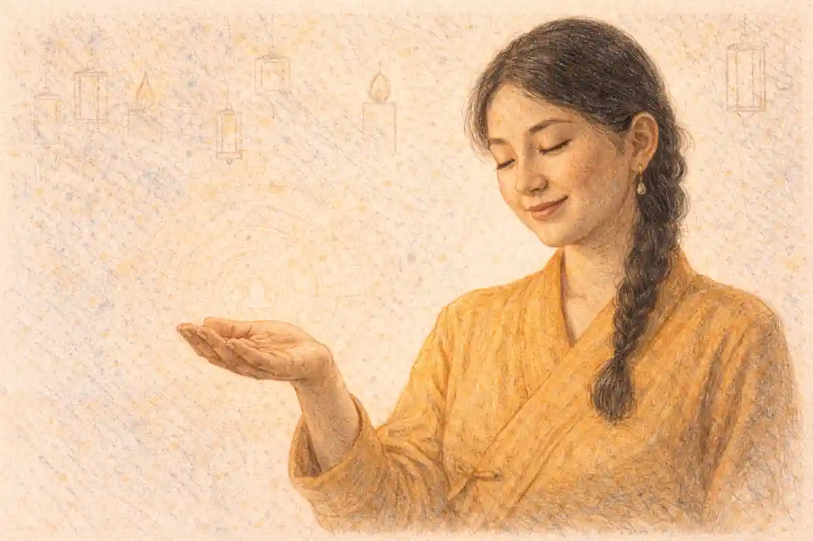

Japan is the country where Marxism achieved something it achieved almost nowhere else outside the socialist bloc: a durable home inside the university. For roughly a century, Japanese faculties of economics sustained a Marxist scholarly tradition of the first rank, training generation after generation of economists for whom Marx's categories were the ordinary instruments of research rather than a creed imported for political occasions. The tradition argued with itself at a level of textual and empirical detail that few national traditions matched, and its arguments were not parochial. Marxism reached China largely through Japan, carried in Japanese translations and in the heads of Chinese students returning from Tokyo and Kyoto, so that the vocabulary of Chinese Marxism was substantially coined on Japanese soil. Korea's Marxist traditions, by contrast, were divided by partition into a state doctrine in the north and a movement tradition in the south, each developing under pressures the Japanese scholars never faced. This article treats the three cases together because they illuminate one another, and because a single question runs through all of them.

That question is easy to state and hard to answer. Marx's account of capitalism was built from European materials, and it carried an implied sequence: feudal relations dissolve, a bourgeois order matures, and only then does a socialist transformation come onto the historical agenda. When the doctrine travelled east, every serious tradition that received it had to decide whether that sequence described its own society, and if not, what followed for strategy. Japan's Marxists fought their central debate over exactly this point, asking whether the transformation of the 1860s had completed a bourgeois revolution or left feudal remnants standing. India's Marxists fought a parallel debate over whether Indian agriculture was feudal, semi-feudal or capitalist. China's party answered the same question with a doctrine of stages of its own. The regional traditions are connected by that problem rather than by political affiliation, and the connection is the deepest finding this article has to offer. The full Chinese case is treated in the study of [Marxism in China: the complete guide](/2018/05/01/marxism-in-china-complete-guide/), which takes up the transmission story from the receiving end.

Three bodies of material follow. The first concerns scale and transmission: how Marxism entered Japan, why the universities sheltered it, and how Japanese renderings became the conduit into China. The second concerns the two great Japanese constructions, the capitalism debate of the late 1920s and 1930s and the three-level methodology built by the economist Uno Kozo, which separated pure theory from stage theory and from empirical analysis with a rigour its critics found either exemplary or evasive. The third concerns Korea, where a communist movement under colonial rule gave way after partition to two incompatible inheritances. A comparison then sets the Japanese debate beside the Indian one, and a closing section corrects the misreadings that gather around a tradition English-language coverage has mostly ignored.

## A century of Marxist scholarship in Japan

The sheer longevity of the Japanese tradition is the first fact to absorb, because it distinguishes Japan from nearly every other non-socialist country. Marxist economics arrived with the first translations and lecture courses of the early twentieth century and was still setting the terms of graduate training a hundred years later. In the decades after the Second World War, a student entering an economics faculty at a major Japanese university could expect Marxian political economy to occupy a large share of the curriculum, not as a historical curiosity but as a living research programme with its own journals, its own internal schools and its own standards of proof. Chairs were held by Marxists as a matter of routine. The learned society for political economy drew its membership heavily from the tradition. Publishing houses maintained Marxian lists because the readership was large, educated and loyal.

Several conditions made this possible. Japanese universities had been built on the German model, in which economics was a branch of the social sciences pursued through texts, history and theory together, and that architecture suited a doctrine that presented itself as a science of society rather than a technique of markets. The prestige of German scholarship in the Meiji and Taisho periods gave Marx an initial hearing as a German thinker among others, before he was anything else. Then the questions Marxism asked turned out to be the questions Japanese society was asking about itself. A country industrialising at forced speed, with a countryside still bound by tenancy arrangements of great antiquity, generated an unavoidable argument about what kind of society it had become, and Marxism supplied the most developed vocabulary for conducting that argument. Scholars who agreed about nothing else agreed that the character of Japanese capitalism was the master problem of their discipline.

Repression, paradoxically, strengthened the academic character of the tradition. When the political movement was driven underground in the late 1920s and 1930s, and when party activity became effectively impossible, the scholarly work continued in seminar rooms and journals, partly because the state distinguished imperfectly between subversion and scholarship, and partly because the scholars themselves rebuilt their enterprise as an academic discipline with defensible standards. The result was a Marxism unusually rich in philology, in the history of economic thought and in patient empirical study of Japanese agriculture and industry. What it lost in political immediacy it gained in depth. A tradition that might have remained a party's auxiliary literature became instead a national school of economics.

### Why did Marxism find a home in Japanese universities?

Because the institutional conditions fitted it. Economics was organised on the German textual and historical model, Marx arrived first as a German scholar rather than as a revolutionary, the unresolved character of Japanese capitalism made his questions the discipline's own questions, and repression of the political movement pushed talented Marxists into academic careers.

The readership matched the scholarship. Japanese translations of Marx and Engels appeared early and were repeatedly revised; the collected works circulated in affordable editions; expositions by Japanese scholars sold to a broad public of students, teachers, journalists and officials. Kawakami Hajime's writings reached readers far outside the university, and his account of poverty became a national talking point. A doctrine that in many countries lived in pamphlets lived in Japan in hard covers, reviewed in newspapers and assigned in lecture halls. That breadth mattered when the tradition later exported itself, because what travelled to China was not a leaflet but a literature.

It also mattered for the quality of the internal arguments. A small movement can sustain a orthodoxy by discipline; a large scholarly public cannot. Japanese Marxists had to persuade readers who could check their citations, compare rival translations and follow an argument about rent or accumulation across several issues of a journal. The capitalism debate, when it came, was fought with documentary weapons: cadastral records, tenancy contracts, tax data, the texts of the Restoration settlement itself. Whatever verdict a reader reaches on that debate, its evidentiary standard was set by an audience that would accept nothing less.

## The transmission route: how Marxism travelled through Japan

Transmission history is often treated as a preface, a matter of who read what first. In East Asia it is closer to the substance, because the route determined the vocabulary, and the vocabulary determined what could be thought. Japan industrialised first, translated first and built the first Asian scholarly apparatus for European social thought. Chinese reformers and revolutionaries of the late Qing and early republican years went to Japan in large numbers, studied there, read Japanese books and journals, and carried home both texts and terms. The Japanese language, written partly in Chinese characters, had already coined compounds for the new European concepts: words for society, economy, philosophy, capitalism and revolution were fashioned from character combinations in Meiji Japan and then read back into Chinese with Chinese pronunciations. A substantial part of the Chinese Marxist vocabulary consists of these Japanese compounds written in Chinese characters, a fact the Chinese tradition itself has long acknowledged.

Li Dazhao, who became the great early publicist of Marxism in China and a founder of its communist party, spent formative years studying in Tokyo and drew heavily on Japanese expositions, including Kawakami's. The first Chinese renderings of Marxist texts were frequently made from Japanese versions rather than from German or Russian originals. Japanese journals reported and debated each turn of European and Russian Marxism, and Chinese readers followed those debates in Japanese before equivalents existed in their own language. When the Chinese movement later produced its own doctrines, it did so in a conceptual language whose minting had been substantially Japanese. The point is not one of priority or credit. It is that the East Asian traditions form a connected field, and the connections are documentary, traceable through translations, enrolments and citations.

### How did Marxism reach China through Japan?

Chiefly through students, translations and terminology. Chinese students in Japan read Marx in Japanese editions and in Japanese scholarly expositions, early Chinese translations were often made from Japanese intermediaries, and the character compounds coined in Japan for European concepts passed into Chinese as the working vocabulary of the new doctrine.

The Korean connection ran along the same channels, with the added bitterness that Japan was also the colonial power. Korean students in Tokyo encountered Marxism in the same lecture halls and bookshops as their Chinese contemporaries, and Korean activists moved between Tokyo, Seoul, Shanghai and the Maritime Province in a single underground geography. The doctrine arrived in Korea therefore as both an instrument of liberation and a product of the coloniser's intellectual world, a doubleness that marked Korean Marxism from the start. When this article turns to Korea, that doubleness should be kept in mind: the tradition there was never simply received, it was seized and redirected against the power that had transmitted it.

Recognising the route also corrects a distortion in how the regional traditions are usually ranked. Because China's revolution succeeded and Japan's did not, the Japanese tradition is often treated as a waiting room where Marxism paused on its way to somewhere important. The documentary record runs the other way. The Japanese scholarship was, for several decades, the most developed in Asia, and the Chinese movement's early theoretical equipment was largely Japanese-made. The later divergence, in which one tradition became a state doctrine and the other remained a university discipline, is a fact about political outcomes, not about intellectual weight, and the two should not be confused.

## Kawakami Hajime and the founding generation

Every national tradition has a figure through whom the doctrine first speaks in the local language with full force, and in Japan that figure is Kawakami Hajime. A professor of economics at Kyoto Imperial University, Kawakami came to Marxism slowly and publicly, through a study of poverty that began in moral outrage and ended in theory. His Tale of Poverty, serialised in a newspaper in 1916 and then published as a book, described the condition of Japan's poor with a journalist's eye and an economist's training, and it made him famous beyond the university. Readers who had never opened a page of Marx encountered, in Kawakami's prose, the claim that poverty in a rich society was a product of the society's organisation rather than of individual failure, and the claim detonated.

Kawakami's own development traced the path many of his readers would follow. He began as a humanitarian critic of the market order, moved through a period of religious and ethical searching, and arrived at historical materialism as the only framework that explained what his poverty studies had documented. He translated Marx, expounded the labour theory of value for Japanese readers, and gave the tradition its first mature native voice. Late in his career he joined the communist party, was arrested in the repression of the early 1930s, and spent years in prison, emerging with his health broken. He died in 1946, having lived just long enough to see the doctrine he had served become legal in his country.

### Who was Kawakami Hajime and why does he matter?

Kawakami was the Kyoto economist whose study of poverty carried him from humanitarian criticism to Marxism, whose translations and expositions gave the doctrine its first mature Japanese voice, and whose enormous readership made Marxism a national subject rather than a sectarian one. His career also foreshadows the tradition's academic centre of gravity.

The founding generation around Kawakami built the institutions the later debate would need. Translation projects multiplied; a Japanese edition of Capital was completed, the work of scholars who gave the text the care due to a classical edition. Seminars at Kyoto and Tokyo trained the men who would staff both factions of the capitalism debate. Journals multiplied, some party-aligned, some independent, all contributing to a situation in which a Japanese reader of 1928 could follow the newest European Marxist literature within months of its appearance and could read Japanese contributions to it that Europeans, had the language barrier run the other way, would have needed to follow in turn.

That last asymmetry deserves a sentence of its own. The traffic of translation ran overwhelmingly one way: Japan imported European theory at speed and exported almost nothing to Europe, because European scholars did not read Japanese. The Japanese tradition therefore developed in a condition of informed isolation, fully aware of the European debates, largely invisible to them. Some of its most original products, above all the three-level method, waited half a century for an English hearing. The isolation also freed it. Japanese Marxists argued about Japanese capitalism with a confidence that they, and not Moscow or Berlin, were the competent authorities on the evidence, and that confidence is the seed of everything distinctive in what follows.

## The Japanese capitalism debate: the question that organised a tradition

In the late 1920s the Japanese tradition turned its full strength on a single question, and the resulting argument, sustained into the middle of the following decade, became the central intellectual event of Japanese Marxism. The question concerned the transformation of the 1860s, the Meiji Restoration, and what exactly it had accomplished. Had the Restoration been a bourgeois revolution, sweeping away the feudal order and installing capitalism, so that the task confronting Japanese society was a socialist transformation of an already capitalist country? Or had it been an incomplete settlement, carried out from above by a coalition that preserved absolutist political forms and left the countryside in the grip of semi-feudal landlordism, so that a democratic revolution remained on the agenda before any socialist one could begin? Everything else followed from the answer: the character of the state, the nature of ground rent, the correct alliance policy, the programme of the illegal communist party and the interpretation of Japan's expansion on the Asian mainland.

### What was the Japanese capitalism debate?

an argument through the late 1920s and 1930s over whether Japan's transformation of the 1860s had been a bourgeois revolution. One faction held feudal remnants persisted, requiring a two-stage revolution; the other held Japan was already capitalist, requiring a single socialist revolution.

The debate was not a seminar exercise. The communist party, operating illegally and under savage police pressure, needed a characterisation of Japanese society from which a strategy could be derived, and the two characterisations on offer implied incompatible strategies. Nor was the question Japan's alone. The Communist International issued theses on the Japanese situation, in 1927 and again in 1932, and the later thesis endorsed a two-stage reading, which gave one side of the scholarly argument an institutional weight the other could not match. Yet the debate cannot be reduced to a party quarrel conducted by other means. The participants were scholars of real standing, the evidence they marshalled was the documentary record of Japanese economic history, and the argument ranged across agrarian relations, the fiscal structure of the Meiji state, the character of the emperor system and the anatomy of monopoly capital. It remains one of the major Marxist debates of the twentieth century, comparable in depth to the European transition debate and to India's mode of production debate, and like them it turned on whether a stage theory derived from European history could be applied to a society whose path had been different.

The evidentiary centre of the argument was the countryside. Japanese agriculture rested on small-scale tenant farming: a large share of the cultivated land was worked by tenants paying rents in kind to landlords, at rates that consumed a very large part of the crop. For one side, these relations were feudal or semi-feudal survivals, resting on extra-economic compulsion, personal dependence and the political subordination of the village, and their persistence proved that the bourgeois revolution remained unfinished. For the other side, the same tenancy was a capitalist relation in a specific Japanese form: the land market, the money economy and the integration of agriculture into national and world markets had long since made the landlord a figure of the capitalist order, however archaic his methods appeared. Each side produced formidable scholarship. The multi-volume Lectures on the History of the Development of Japanese Capitalism, published in the early 1930s, gave the first position its collective monument and its name, for its adherents were known as the Koza faction, from the word for lectures. Their opponents, grouped around the journal Rono, the Worker-Farmer, were the Rono faction.

## The Koza faction: a revolution still owed its first stage

The Koza case began with the Restoration itself. On this reading, the settlement of 1868 and after was not a revolution made by a rising bourgeoisie but a reorganisation carried out by lower-ranking samurai and court nobles who, facing foreign pressure and domestic crisis, rebuilt the state from above while leaving the social foundations of the old order substantially intact. The emperor system that emerged was absolutist in character, a modernised form of the old sovereignty rather than a bourgeois constitutional order. The land settlement confirmed the pattern: the Meiji land tax reform monetised the tax obligation and recognised private property in land, but it recognised the property of those who already held it, confirming landlords in possession and converting the peasantry into tenants of a landlord class rather than independent proprietors on the French revolutionary model. No Jacobin moment had broken the power of the countryside's old masters.

From that diagnosis the economic argument followed. Ground rent in Japan, the Koza scholars argued, was not capitalist ground rent. The tenant's payment, delivered in rice, fixed by custom and backed by the tenant's personal subordination to the landlord and by the whole apparatus of village hierarchy, resembled the feudal rent of a pre-capitalist order more than the contractual payment of a capitalist farmer. The landlord did not behave as a capitalist entrepreneur, reinvesting and improving; he behaved as a rentier of the old type, and the state protected him because the landlord class was one of the pillars of the absolutist settlement. Japanese capitalism, on this account, had grown up in a hothouse of state sponsorship and feudal survivals, developing monopoly and military expansion on a foundation that had never been cleared. The strategic conclusion was written into the diagnosis. A society in that condition required first a bourgeois-democratic revolution: the overthrow of the absolutist state, the destruction of semi-feudal land relations, the completion of the agenda of 1868. Only on that cleared ground could a second, socialist stage begin. Scholars associated with this reading, among them Noro Eitaro, the party's leading theorist, and the economic historian Hirano Yoshitaro, gave it both its political form and much of its scholarly architecture.

### What did the Koza faction claim about the Meiji settlement?

That it was a reorganisation from above rather than a bourgeois revolution. The absolutist emperor system survived in modern dress, the land settlement confirmed landlords instead of creating independent peasant proprietors, and tenancy rested on personal subordination resembling feudal rent, so a democratic revolution remained the first task.

The Koza reading drew strength from the visible facts of Japanese political life. The state that industrialised Japan was not accountable to a parliament in any full sense; the military answered to the throne; the countryside was governed through hierarchies that a visitor could mistake for survivals of the Tokugawa order because, on this account, that is what they were. The faction's scholars could also point to the Comintern's 1932 thesis, which characterised Japan in terms close to their own. Their weakness lay elsewhere: in the difficulty of explaining how a society still awaiting its bourgeois revolution had become, by any material measure, one of the world's great industrial and imperial powers, with giant firms, a modern banking system and a working class numbered in millions. The feudal-remnant category had to carry more explanatory weight with every factory chimney that rose.

## The Rono faction: capitalism already accomplished

The Rono answer inverted the Koza case at every point. The Meiji Restoration, on this reading, had indeed been a bourgeois revolution, of the kind possible in a late-developing country: carried out from above because no other agent existed, but bourgeois in its results. It abolished the status order, unified the national market, created private property in land, freed labour to move, and set Japan on the capitalist road, along which it had travelled so far by the early twentieth century that it stood in the imperialist stage of world capitalism. To describe such a society as semi-feudal was, for the Rono writers, to mistake the forms of Japanese social life for its substance. Tenancy, however harsh, operated inside a money economy: land was bought and sold, rents responded to markets, tenants were legally free persons, and the landlord's income was a share of value produced for sale, not a feudal levy sustained by personal bondage. The appropriate category was capitalism with Japanese peculiarities, not feudalism with capitalist decorations.

The strategic conclusion inverted accordingly. If Japan was already capitalist, and indeed imperialist, then no democratic stage stood between the movement and its object. The required revolution was a single socialist one, and the alliance policy, programme and slogans of the party should say so. The Rono writers, among them the economist Inomata Tsunao and the historian of economic thought Sakisaka Itsuro, accused their opponents of importing a schema, the two-stage sequence, and bending Japanese evidence to fit it. The accusation had a methodological edge that outlasted the quarrel: who decides the character of a society, the documentary record or the strategic convenience of an international centre? The 1932 thesis had settled the question institutionally in the Koza faction's favour, and Rono sympathisers experienced that settlement as an instruction delivered from outside against the evidence as they read it. The resentment fed a durable Japanese insistence, visible later in the Uno school's independence, that theory about Japan would be made in Japan.

### What did the Rono faction claim about Japanese capitalism?

That the Meiji transformation, though made from above, was a bourgeois revolution in its results: status abolished, land made private property, labour freed, the national market unified. Tenancy operated inside a money economy and was therefore a capitalist relation, and Japan, already imperialist, required a single socialist revolution.

Neither faction was foolish, and the debate's longevity came from the evidence's genuine ambiguity. Japanese tenancy really did combine market integration with personal subordination; the Meiji state really was both the engineer of capitalism and a structure of unaccountable sovereignty; Japanese industry really was at once monopolised and dependent on a countryside of tiny farms. A theory of stages built for the classic European sequence, in which a bourgeoisie made its own revolution and cleared its own ground, met in Japan a case that fit neither of its boxes cleanly. That misfit, rather than any failure of scholarship, is the debate's enduring lesson, and it is why the same argument reappeared, with different evidence, wherever Marxism confronted a society that had taken another road: in the Indian debate over the mode of production, treated in the companion [complete guide to Marxism in India](/2017/12/01/marxism-in-india-complete-guide/), and in the Chinese doctrine of new democracy, which institutionalised a two-stage answer. The comparable European argument about how one mode of production succeeds another is set out in the series study of the [mode of production explained](/2010/02/15/mode-of-production-explained/).

## Strategy, repression and the debate's long afterlife

The debate was overtaken by the state before it could be settled by argument. The Peace Preservation Law and the mass arrests of 1928 and 1929 destroyed the communist party as an effective organisation, and the 1930s brought a tightening vice: surveillance, imprisonment, and the practice of tenko, the ideological recantation extracted from imprisoned leaders, which broke the movement's morale as arrests alone had not. Leading Koza theorists died in prison or emerged silenced; Noro Eitaro died in custody in 1934. The scholarly argument continued in attenuated form, in journals and university posts, but under conditions that punished explicit strategic conclusions. What survived the decade was less a verdict than a pair of fully worked positions, each with its evidence marshalled, waiting for a freer time.

That time came after 1945, and the debate resumed almost where it had stopped, now inside a legal party and a university system being rebuilt. The two-stage characterisation broadly governed the communist party's postwar programme, while the Rono inheritance fed the broader Marxist economics profession and, indirectly, the socialist opposition. More important for this article's purposes, the argument migrated into historiography and economics as a permanent fixture: the Meiji settlement's character, the nature of prewar tenancy, the classification of the prewar state remained live questions in Japanese scholarship for the rest of the century, debated by historians who no longer needed the party's answer but could not escape the party-era question. A debate that begins as a strategic necessity can end as a discipline's conscience.

### What happened to the debaters under the repression of the 1930s?

The party that needed their answer was destroyed by mass arrests, its leaders imprisoned, some dying in custody, others extracted into recantation. The scholarship survived in universities and journals under constraint, its two positions fully documented but undecided, and the argument resumed after the war inside a legal movement.

There is a comparison here that the series has drawn before, with the Indian case. In India, too, the question of the society's character, feudal or capitalist or some third thing, was at once a scholarly problem and a party problem, and in India too the argument outlived the strategic moment that produced it and became a debate among historians and economists in its own right. The parallel is not decorative. It suggests that the stage question was the characteristic theoretical problem of Marxism outside the classic European terrain: the problem every tradition faced when a schema of successive modes of production met societies whose histories had not followed the schema's script. Japan faced it earliest and argued it hardest, which is one reason the Japanese debate repays attention from readers whose interest is not Japan at all.

## Uno Kozo and the reconstruction of method

Out of the generation formed by the debate came the Japanese tradition's most original methodological thinker. Uno Kozo, born in 1897, studied economics in Tokyo and in Germany in the early 1920s, taught at Tohoku University, and was himself arrested briefly in the late 1930s in an academic purge. His life's work, presented in the Principles of Political Economy published at the opening of the 1950s and in a stream of essays before and after, was a reconstruction of Marx's economic theory from its foundations. Uno had watched the capitalism debate at close quarters, and he drew from its inconclusiveness a diagnosis that neither faction had offered: the argument was unresolvable as posed because its participants were confusing different kinds of claim. Statements about the inner logic of capital, statements about the historical stages through which capitalism passes, and statements about the concrete condition of Japan were being traded as if they were the same currency. His remedy was to separate the levels and police the exchanges between them.

### What did Uno set out to rebuild?

Uno Kozo was the Tohoku economist who rebuilt Marxian economics as a three-level method, separating the pure theory of a wholly capitalist society from the study of historical stages and from concrete analysis, and arguing that the labour theory of value could be established rigorously only at the first of those levels.

Uno's reconstruction was not a commentary on Marx but a re-derivation. He held that Marx's Capital had mixed, within a single exposition, the pure logic of capital with the history of English capitalism and with observations of the capitalism of Marx's own day, and that the resulting ambiguities had licensed both dogmatism and confusion ever since. The remedy was architectural. Build first a pure theory: the theory of a purely capitalist society, an imagined order in which every product is a commodity, every producer is separated from the means of production, and labour power itself is bought and sold without residue. In that constructed society, and only there, the laws of value, of surplus value, of accumulation and of crisis could be demonstrated with the necessity of a logical system, because nothing foreign to the system was present to disturb the demonstration. Then, separately, construct a stage theory of the actual history of capitalism, and only after that undertake the empirical analysis of any concrete economy, Japan's included, using the first two levels as instruments rather than as conclusions.

The proposal sounds scholastic until its target is seen. The capitalism debate had foundered precisely on transfers between levels: a proposition about capitalism in general was used to settle a question about Japan in 1930, or a fact about Japanese tenancy was used to refute a proposition about capital as such. Uno's method forbade both moves. It also carried a consequence for the labour theory of value that made his school famous and controversial. The value theory, Uno argued, could be proved only within pure theory, where the commodity form is universal; attempts to verify it directly against price data of an actual economy confused the levels and produced the pseudo-problems that had dogged Marxian economics. Value-form analysis, the patient unfolding of how value necessarily expresses itself in exchange and money, became the school's characteristic exercise, and it is the element of the method that later travelled into English.

## The three levels: pure theory, stage theory, empirical analysis

The method's three levels deserve separate statement, because the whole construction stands or falls on the distinctions. The first level, pure theory, treats the capitalist mode of production in its purity. Its object does not exist anywhere and never has: a society in which capitalist relations have absorbed every corner of production. Uno was explicit that this was a construction, and he turned the objection that no such society exists into the method's premise. Only by completing the abstraction can the theory discover what belongs to capital by necessity: why value must appear as money, why labour power's peculiar commodity status generates surplus value, why the system moves through cycles of prosperity and crisis that no policy abolishes. The second level, stage theory, descends one step toward history. Actual capitalism develops through stages dominated successively by different leading industries and different characteristic policies: a mercantilist stage centred on wool and the putting-out system, a liberal stage centred on cotton and the factory, an imperialist stage centred on steel, heavy industry and finance. Stage theory explains why the pure logic appears in history always clothed in a period's specific forms, and why policies and institutions appropriate to one stage fail in another. The third level, empirical analysis, addresses a concrete situation, a country at a date, with all its residues, peculiarities and accidents, and it may use the results of the first two levels but can never be replaced by them.

### How are the three levels distinguished?

It is Uno's separation of Marxian economics into the pure theory of an imagined wholly capitalist society, a stage theory of capitalism's historical phases, and empirical analysis of concrete situations, with a rule that conclusions proper to one level cannot be transferred directly to another.

The rule of non-transfer is the method's spine. A crisis in a given country is not explained by reciting the pure theory of crisis, because the concrete crisis runs through that country's stage position and its specific institutions. Conversely, the peculiarities of Japanese tenancy cannot refute the pure theory, because the pure theory never claimed to describe Japan. Applied to the capitalism debate, the method dissolves the original question into three better ones. What does capital require in general? Through what stage was world capitalism passing in the early twentieth century, and where did Japan stand within it? And what, empirically, were the relations of the Japanese village, to be established by investigation rather than by deduction from either of the first two answers? Uno's own stage analysis treated the period as the imperialist stage, within which Japan's development had its specific and belated form; but the method's point was that such a finding belonged to the second and third levels and could be revised there without touching the first.

### Why must pure theory imagine a purely capitalist society?

Because only there is the commodity form universal, with labour power itself bought and sold and no pre-capitalist residue present, so the laws of value and accumulation can be demonstrated as necessities of the system rather than as tendencies mixed with foreign elements whose effects cannot be separated out.

Critics inside and outside the school have pressed on the joints of this architecture for decades, and the next section states their strongest case. But the method's influence is a fact independent of the verdict. Within Japan, the Uno school became one of the organising centres of postwar Marxian economics, training economists who applied the levels to Japanese and world economic history; the stage theory in particular generated a literature on the world economy's periodisation that has no real parallel elsewhere. Outside Japan, the method arrived late and in pieces, carried by translators and by the value-form revival, and it arrived as a discovery: Anglophone readers encountered, in Sekine's translations and in the work of the school's English-speaking interpreters, a Marxian economics that had spent fifty years refining questions the Anglophone discussion believed it had opened itself. The series study of [Marx on money and the value form](/2010/08/15/marx-on-money-and-the-value-form/) takes up that value-form discussion in its own right.

### What does stage theory do that pure theory cannot?

It connects the logic of capital to dated history. Pure theory knows nothing of wool or cotton or steel, of free trade or protection, of the policies by which actual capitalist states manage their economies; stage theory supplies the periodisation that lets an analyst say which form the general logic is taking in a given epoch.

### What is empirical analysis in the Uno school's sense?

The third level: the study of a concrete economy at a concrete date, using pure theory and stage theory as instruments of investigation. It cannot be deduced from them, since a real society contains residues and peculiarities no theory generates, and its findings cannot overturn the pure theory they employ.

## The strongest objection: rigour purchased by withdrawal

The objection to Uno's method, stated at full strength by its critics, is that the architecture secures the theory by withdrawing it from the world it was built to explain. A methodology that establishes the labour theory of value only for an imagined purely capitalist society, and forbids transferring conclusions between levels, has, on this charge, made the theory unfalsifiable in the precise place where it matters. Actual economies are the only economies there are; a theory of capitalism that cannot be brought into direct contact with any of them, whose apparent failures can always be reclassified as impurities of the instance or confusions of level, has purchased internal consistency at the price of explanatory reach. Critics within Japanese Marxism, including economists of the older orthodox schools who regarded Uno's reconstruction as an abandonment of Marx under the guise of completing him, pressed versions of this case from the 1950s onward; the philosopher and economist who developed value-form analysis in the German discussion reached related doubts from another direction; and Anglophone critics of the value-form revival, among them scholars associated with the critique of the Uno school's English interpreters, have repeated the charge in a form its author would recognise: the pure theory describes a society that exists nowhere, and the prohibition on transfer means its truth can never be at risk in the only arena where truth is tested.

### What is the strongest objection to the three-level method?

That it secures rigour by removing the theory from contact with actual economies. If value theory holds only inside a constructed society that exists nowhere, and no finding from a real economy may count against it, the theory explains a world that does not exist.

The school's answer begins by denying that the levels are sealed chambers. Stage theory is precisely the machinery of contact: it is where the pure logic meets the historical record, in the form of the leading industries, policies and state forms of successive epochs, and it can be wrong, and be shown wrong, historically. Empirical analysis is contact of another kind, the investigation of concrete economies with the theory as instrument; a surgeon's knowledge of anatomy is not refuted by the peculiarities of a patient, but neither is it insulated from them, since the investigation can fail, and fail instructively, if the anatomy is wrong for the case. The pure theory itself, Uno's defenders add, is a construction of the same kind as the frictionless systems of other sciences, and its demonstration that value must take the money form is a claim about the logic of commodity exchange wherever exchange is general, not a description of one imaginary island. The method does not forbid contact between theory and economy; it forbids a specific shortcut, the direct confrontation of the highest abstraction with the rawest fact, which in the school's reading of the capitalism debate had produced thirty years of talking past the evidence.

The concession the brief for this article requires, and which honest statement of the school's position supports, is that the relation between the levels is the least developed part of the whole construction. Uno specified what each level contains and what transfers are forbidden with great precision; he specified far less completely how stage theory is to be derived from pure theory, or by what procedure an empirical finding could require a stage classification to be revised, or how the stages themselves, drawn largely from the British and German records, should be modified for economies whose development followed another sequence. Successors have worked on these joints without closing them. A reader is entitled to conclude that the method is a powerful discipline for preventing a known error, and an unfinished programme for connecting its own parts, and the school's best interpreters have not seriously disputed the second half of that sentence.

## The Anglophone reception and the value-form connection

The route by which Uno's school reached English-language readers is a study in delayed transmission. For decades the school's work existed only in Japanese, known to the Anglophone world, if at all, as a rumour attached to the name of a method nobody could inspect. The breach came through translation and through one scholar's mediation: Thomas Sekine, a Japanese economist working in Canada, translated Uno's Principles and wrote the systematic English expositions that made the three levels available as a working method rather than a report. Through the 1980s and 1990s the Uno school acquired an Anglophone branch, centred on value theory, which engaged the German value-form discussion and the Anglophone revival of interest in the opening chapters of Capital. Readers who came to Marx through the monetary theory of value discovered that a Japanese school had been refining exactly that problematic, with a completeness the European discussion had not achieved, since before many of them were born.

### How did the Uno school reach English-language readers?

Late, and through translation. Sekine's renderings of Uno's Principles and his English expositions carried the three levels into the Anglophone value-form discussion of the 1980s and after, where readers found a half-century of Japanese refinement waiting inside questions they believed newly opened.

The reception changed the school's meaning. In Japan, the three levels had been a national discipline, a way of organising an entire economics profession's work. In English, detached from that institutional setting, the method was received as a contribution to a specific debate about value and money, and its stage theory, the level Japanese practitioners had used most, travelled least well. Something was gained and something lost: gained, a rigorous interlocutor for value-form theory worldwide; lost, the sense of the method as a complete architecture for economic science. The pattern is familiar in this series: doctrines that travel are edited by the journey, and the East Asian traditions, which received Marx through translation and transformed him in the receiving, here underwent the same process in reverse.

## Karatani Kojin and the later discussion

No account of the Japanese tradition's later life can omit its most internationally visible contemporary figure. Karatani Kojin, a literary critic turned theorist, approached Marx from outside the economics faculties, through literature, philosophy and an early celebrated study of the writer Natsume Soseki. His major theoretical work, published in English as Transcritique, reads Marx alongside Kant and proposes that the critique of political economy be re-founded on the relations between exchangers rather than on production alone. In his mature system, societies are characterised by their dominant mode of exchange: reciprocity in kinship communities, plunder and redistribution under the state, commodity exchange under capital, and a fourth mode, which he associates with Kant's regulative ideals and with the gift restored at a higher level, toward which he argues a future association must move. Around the turn of the century he founded a short-lived associationist movement to give the idea organisational form, and he has remained a prolific and combative presence in Japanese intellectual life.

### What does Karatani take from Marx and what does he set aside?

He takes the critique of capital and the project of an association beyond it, but relocates the analysis from production to modes of exchange, treating the commodity relation between buyer and seller as the irreducible scene, and he sets aside the labour theory of value as the system's foundation.

Karatani's significance for this article is diagnostic as much as doctrinal. That the most discussed Japanese Marxist thinker of recent decades should be a critic working through Kant, exchange and the literary text, rather than an economist working the seam of the capitalism debate, marks how far the tradition's centre of gravity has moved from its interwar home. Yet the continuities are real. Karatani's insistence that the categories be rebuilt rather than inherited, his impatience with stage schemas applied by rote, and his address to a world readership from a Japanese base all belong to the tradition this article has described, even where his conclusions depart from everything Kawakami or Uno would have signed. The Japanese tradition's deepest habit was never a doctrine; it was the habit of reconstruction.

## Korea under colonial rule: a movement formed in suppression

Korea received Marxism under conditions Japan never imposed on itself: as the doctrine of a colonised people, transmitted partly through the coloniser's own universities and partly through the revolutionary networks of China and Russia. A Korean communist party was founded in 1925, in Seoul and in exile circles simultaneously, and its early history was a cycle of founding congresses, factional division and annihilation by the colonial police. The movement's factions, named for the cities and journals around which they gathered, fought one another with an intensity that the Japanese authorities exploited and that later Korean historiography has not ceased to regret. Comintern recognition became a prize factions competed for, and the party was dissolved by the International in 1928 after repeated failures to root it in Korean soil, leaving the field to underground groups, exile organisations and the national resistance in Manchuria, where Korean guerrillas operated within the Chinese revolutionary forces.

The colonial setting determined the tradition's shape. In Japan, Marxism's central problem was the character of a capitalism that plainly existed; in Korea, the primary fact was foreign rule, and every Marxist question arrived subordinated to the national one. Korean Marxists argued about the stages of their revolution too, but the stage that mattered was the colonial present, and the class analysis of Korean society was always conducted in the shadow of the question of liberation. The movement produced martyrs in large numbers and institutions hardly at all: no Korean equivalent of the Japanese university tradition could form under a colonial regime that policed Korean higher education and imprisoned its organisers. What formed instead was a tradition of clandestine commitment, transmitted through prison, exile and resistance networks, whose strengths and weaknesses partition would soon expose and freeze.

### What was the Korean communist movement under colonial rule?

A repeatedly founded and repeatedly destroyed party, factionalised from its first years, recognised and then dissolved by the Communist International, and sustained thereafter by underground networks and by guerrilla forces in Manchuria, in a setting where the national question overshadowed every question of class or stage.

Liberation in 1945 divided the inheritance at the thirty-eighth parallel. In the north, a state was constructed under Soviet occupation by the guerrilla tradition's leadership; in the south, under American occupation, the communist movement was first tolerated, then driven underground, then prohibited outright as the southern state consolidated and war fixed the division. The two Korean Marxist traditions that resulted are so different in kind that treating them in one article requires the difference to be stated plainly. The northern tradition became a doctrine of state, elaborated in texts, taught in institutions and revised by constitutional process. The southern tradition became a doctrine of opposition, elaborated in clandestine study circles and, later, in a mass student movement, under a legal prohibition that made the mere possession of its texts an offence. The next two sections take them in turn.

## The northern doctrine: self-reliance in text and constitution

The doctrine of the northern state is treated in this article as its brief requires: historically and textually, through its published formulations and constitutional expressions, with their dates. The term at its centre is Juche, usually rendered as self-reliance. Its first major articulation came in a speech of December 1955, addressed to party ideological workers, which criticised the mechanical copying of foreign models and argued that Korean revolution required the independent judgement of Koreans about Korean conditions. In the decades that followed, the idea was elaborated into a systematic doctrine whose texts present the human being as master of the world and of his own destiny, and which organises politics around the independence of the country, the self-reliance of its economy and the self-defence of its security. The doctrine's relationship to Marxism-Leninism, as expressed in the state's own documents, changed across the period. The constitution adopted in 1972 named Juche as the state's guiding idea in terms that still situated it as a creative application of Marxism-Leninism to Korean conditions. The constitutional revision of 1992 removed the reference to Marxism-Leninism, presenting Juche without that parentage. A further revision in 2009 removed references to communism from the text while retaining Juche and adding a military-first principle. Described textually, the trajectory is one of progressive doctrinal separation: a doctrine that began as an application of Marxism-Leninism became, in the state's own formulations, a self-standing system that no longer claims that descent.

### How did the northern doctrine change across its constitutional history?

In its own documents, by stages. Articulated in 1955 as independent judgement within a Marxist-Leninist frame, named in the 1972 constitution as that frame's creative application, it lost the Marxism-Leninism reference in the 1992 revision and stands in the later text as a self-contained doctrine.

Whether Juche is Marxist is therefore a question the documentary record answers in a specific way. Its early formulations claimed Marxist-Leninist descent; its mature formulations do not; and its content, centred on national independence and on the primacy of human agency and consciousness over material conditions, departs from historical materialism at points its own theorists have emphasised rather than concealed. Scholars of the doctrine divide between those who treat it as a nationalist ideology in Marxist dress, those who take it for a genuine if heterodox descendant, and those who treat the question itself as a category error for a doctrine that claims to have superseded its sources. This article records the textual facts on which any of those judgements must rest, and rests its own account there, in accordance with the constraint that governs this material. The series pattern is nonetheless visible: the northern doctrine is, among other things, one more East Asian answer to the stage question, since its founding gesture was the refusal to let a foreign centre's periodisation dictate a Korean revolution's tasks.

## The southern movement: Marxism under prohibition

The southern case is the mirror image of the northern one, and in some ways the more remarkable. The Republic of Korea prohibited communist organisation under its National Security Law, enacted in 1948 and enforced for decades against the left with imprisonment and, in the early years, death. The organised communist movement of the liberation period was destroyed by the early 1950s. Yet by the 1970s and 1980s Marxism had become the dominant intellectual framework of the southern student movement and of the dissident culture around it, the language in which opposition to the authoritarian order was thought. A doctrine whose public advocacy was a crime became the common sense of the universities' oppositional generation. Explaining that paradox is the southern material's central problem.

The explanation runs through the character of the regimes the students confronted. Military authoritarianism, in power from 1961 with one brief interruption until the late 1980s, presented the movement with a state that was visibly an apparatus of coercion in the service of a narrow order, and the experience of that state, above all the killing of demonstrators at Gwangju in 1980 after a military seizure of power, radicalised a student generation on a mass scale. Marxism offered that generation three things at once: an analysis that connected the regime to the structures of a dependent capitalism, a history that placed Korean suffering inside a world pattern rather than a national misfortune, and an organisational ethic of disciplined commitment suited to clandestine conditions. Study circles multiplied in the universities, reading texts that circulated in photocopy and in translation, many of them Japanese editions or Korean renderings of Japanese scholarship, so that the transmission route of the century's beginning repeated itself in its closing decades. The minjung movement, the broad cultural and religious current that made the people's suffering and agency its theme, gave the student Marxism a wider social echo among workers, farmers and the urban poor, and the labour movement that grew through the 1970s in the textile and industrial districts supplied it with a working-class reality to answer to.

### What made Marxism the language of the southern student movement?

A coercive authoritarian state that seemed to confirm the doctrine's analysis, a massacre that radicalised a generation, and the doctrine's triple offer of structural explanation, world-historical placement and disciplined organisational ethic, delivered through study circles reading texts the law had made forbidden.

The movement was never only student. Industrialisation had created a concentrated working class in the Seoul and Inchon districts and the heavy-industry cities of the southeast, working very long hours in conditions that generated their own critique before any theory arrived. Women textile workers were among the pioneers of the southern labour movement, and their struggles of the 1970s, conducted with church and student support against both employers and the official union federation, became foundational stories of the dissident culture. When students went to the factories, in the movement's characteristic gesture of solidarity and self-education, they entered a world whose grievances did not need importing. Marxism in the south was therefore a meeting: a proscribed theory descending from the universities and a labour movement ascending from the factories, each recognising in the other the confirmation of its account. The meeting was often tense, and its tensions prefigured the split to which the movement then succumbed.

## The southern split: nation first or class first

At the height of its strength in the middle 1980s, the southern movement divided into two currents whose quarrel will be immediately recognisable to any reader who has followed this article this far, because it is the stage question again, in Korean dress. One current, known by the initials NL for national liberation, held that the primary contradiction in Korean society was the national one: the division of the country and the presence of foreign military power on its southern half. On this analysis, southern society was a colony or semi-colony of the United States, its regimes were subordinate instruments, and the revolution required was a national-democratic one, uniting all classes against foreign domination and division before any socialist transformation could be posed. This current drew, in its later development, on the northern doctrine's texts and vocabulary, and it treated reunification as the movement's overriding task. The other current, known as PD for people's democracy, held that the primary contradiction was domestic and class-based: southern society was a capitalist society, dependent in form but capitalist in structure, ruled by its own monopoly capital in alliance with the state, and prescribed a people's democratic revolution against that domestic order, with national division a real but secondary contradiction. Each current built its own organisations, its own curriculum of study and its own reading of Korean history, and the competition between them organised the student movement's life, its elections, its journals and its factions, until democratisation changed the terrain under both.

### How did the southern movement divide over the primary contradiction?

Between a national-liberation current, which named division and foreign military presence as the primary contradiction and prescribed a national-democratic revolution, and a people's-democracy current, which named domestic class relations as primary and prescribed a people's democratic revolution against the home order.

Democratisation in 1987 and after dissolved the conditions that had made the split so consequential. With elections, a legal labour movement and a free press, the clandestine curricula lost their function, the currents' organisations fragmented or entered open politics, and the generation of the 1980s carried its formation into the institutions of a democratic Korea, in government, in unions, in universities and in civil society. Described historically, the southern movement's arc runs from prohibition through dominance to dispersal, and its legacy is double: a body of scholarship and memoir that permanently changed how southern Koreans write their modern history, and a demonstration, rare in the record, of a proscribed doctrine achieving intellectual hegemony over an oppositional generation without ever holding power. The parallel with Japan is instructive in reverse. In Japan, Marxism was legal in the universities and marginal in the streets; in the south of Korea, it was criminal in the streets and hegemonic in the universities. Legality and influence, the two cases agree, are independent variables.

## The evidence of the village: tenancy, rent and the landlord

Because the capitalism debate turned on the countryside, its evidentiary core deserves a section of its own. The facts neither side disputed were stark. A very large share of Japan's cultivated land, approaching half by the interwar period, was farmed not by its owners but by tenants, most of them working plots too small to support a family at the prevailing standard. Rents were customarily paid in rice, in kind, and consumed a share of the harvest that contemporaries across the political spectrum regarded as crushing. The tenant's hold on his plot was insecure in law for much of the period, whatever custom provided, and his relation to the landlord was wrapped in obligations and deferences that reached well beyond a cash nexus: labour services, gifts, political obedience, the mediation of the landlord in village affairs. The question was never whether this order was harsh. The question was what it was.

The Koza reading assembled these facts into the category of the semi-feudal. Rent in kind, they argued, was the form rent takes where the market has not yet reorganised production; the tenant's personal subordination was extra-economic coercion, the signature of a pre-capitalist relation; the landlord, living from customary dues without organising production, was a feudal figure maintained by the absolutist state because his class anchored its rural rule. The economist Yamada Moritaro gave the reading its most systematic economic form in his Analysis of Japanese Capitalism of 1934, portraying an economy in which military demand and monopoly at the top rested on a base of semi-serf agriculture, the whole structure reproducing the conditions of its own backwardness. The book became the Koza position's theoretical monument, and its portrait of a dual economy, advanced industry balanced on archaic agriculture, passed into the common sense of Japanese social science.

The Rono reading took the same facts and re-sorted them. Rent in kind, they answered, persisted not because the market was absent but because it was convenient within a market: rice was the currency of the countryside, and its delivery was a payment, not a tribute, in a country where the tenant sold his remaining crop and bought his necessities like any other producer for exchange. The land itself was a commodity, bought, sold and mortgaged at prices that capitalised its rent, which no feudal order permits. Tenants were juridically free, moved, combined, and in the 1920s mounted a wave of tenancy disputes, thousands of them, conducted through unions with demands about rent levels and tenure terms: the behaviour of parties to a contract, however unequal, not of serfs. The landlord's archaism was a style of management within capitalism, and often enough a rational one, since minute tenant farming spared him the risks and wage bills of direct cultivation while the state and the market guaranteed his income. On this reading, the countryside's misery was not a survival from before capitalism but one of capitalism's Japanese products.

A reader who works through both cases will notice that they differ less in evidence than in the weight given to form against relation. Where the tenant's subordination was personal and customary, Koza saw the essence; where his product entered the market and his land was priced, Rono saw it. The Uno method, arriving a generation later, can be read as the debate's own verdict on this impasse: the question had fused an empirical description, which investigation could settle piece by piece, with a classificatory decision about the whole society, which no accumulation of village facts could settle by itself, because the classification depended on the level at which the society was being analysed. The village facts were real, and both factions established many of them permanently; the inference from facts to stage was the step the evidence alone could not perform.

## The state in the debate: throne, bureaucracy and monopoly

The countryside had a political counterpart in the argument, the character of the state. For the Koza faction, the emperor system was the keystone of the absolutist settlement: a sovereignty standing above classes and parliament, commanding the military in its own right, sanctified by a state cult, and resting socially on the alliance of landlordism with a monopoly bourgeoisie that the state itself had nursed into existence. A state of that kind could not be the political form of a completed bourgeois revolution, and its existence was for Koza the political proof of their economic case. For the Rono faction, the same state was the normal political instrument of a late-developing capitalism: authoritarian because the bourgeoisie that made it was weak and frightened, dependent on the throne's prestige because it lacked a revolutionary tradition of its own, but capitalist in function, securing property, labour discipline, markets and empire for Japanese capital. The Bismarckian comparison did much work on this side of the argument: nobody called the German Empire semi-feudal, though its constitution was no more democratic than Japan's and its Junkers no less archaic than Japan's landlords.

The comparison is worth pausing over, because it identifies the debate's deepest methodological divide. The Koza classification proceeded by residues: wherever a pre-capitalist form survived, feudalism survived, and the society's character was set by its oldest relations. The Rono classification proceeded by dominance: a society is characterised by the relations that organise its production as a whole, and survivals, however extensive, are survivals. Marx's own texts can be cited for both procedures, which is one reason the argument could not be settled by citation. The Indian debate reproduced the divide exactly, with scholars of the semi-feudal reading classifying by the relations of the village and their critics answering that the village's product, credit and labour were governed by the market that surrounded it. Classification by residue against classification by dominance is not a Japanese problem or an Indian problem. It is the standing problem of applying a stage theory to any society that has not performed the schema's sequence on schedule.

## The two debates compared: Japan and India

The parallel between the Japanese capitalism debate and India's mode of production debate has been invoked throughout this article; it is time to set it out in full, because it is the article's findable artifact and its strongest analytical point. The Indian debate, conducted chiefly in the 1970s in the pages of the Indian Economic and Social History Review and in the communist movement's own journals, asked whether Indian agriculture was capitalist, feudal, semi-feudal or colonial in its mode of production. Its participants, like the Japanese debaters of forty years earlier, were simultaneously settling a scholarly classification and a party strategy, since the Indian communist parties' programmes turned on whether the revolution's next stage was democratic or socialist. The structural resemblance is exact, and the differences are as instructive as the resemblance.

| Dimension | The Japanese capitalism debate | The Indian mode of production debate |
| --- | --- | --- |
| Question at issue | Whether the Meiji transformation was a bourgeois revolution and Japan therefore already capitalist | Whether Indian agriculture was feudal, semi-feudal, colonial or capitalist in mode |
| Principal factions | Koza, holding feudal remnants persisted and a democratic stage remained; Rono, holding Japan was capitalist and one socialist stage sufficed | Semi-feudal readings, holding landlordism and usury blocked capitalist development; capitalist readings, holding market relations and differentiation were transforming the village |
| Strategic conclusion implied | Two successive revolutions against one single revolution | A democratic stage uniting against landlordism against a reading that made socialist tasks immediate |
| Period | Late 1920s to the middle 1930s, resumed after the war | Chiefly the 1970s, with roots in the party debates of the 1950s and 1960s |
| Outcome | Undecided by argument, overtaken by repression, absorbed into postwar scholarship | Undecided by argument, overtaken by political change, absorbed into agrarian historiography |

The table's rows conceal one asymmetry that matters. The Japanese debate was fought over a transformation already two generations past, whose outcome, industrial capitalism of a recognisable kind, stood visible around the debaters; their quarrel was retrospective, about what the Meiji settlement had been. The Indian debate was fought over a countryside in motion, where the commercialisation of agriculture was proceeding unevenly region by region even as the scholars wrote, so that the object of classification would not hold still. The Japanese could at least agree on the facts of a finished past and dispute their meaning; the Indians disputed facts that were still being created. Both debates nonetheless ended the same way, without a verdict, absorbed into the scholarly literatures they had enriched, their categories surviving as instruments long after the strategies they were built to serve had expired. The comparison is developed from the Indian side in the study of [Marxism in India: the complete guide](/2017/12/01/marxism-in-india-complete-guide/), and the two articles are designed to be read together.

### What does setting the two debates in parallel reveal?

By forcing the parallel into rows. Set dimension against dimension, the Japanese and Indian arguments show the same structure, a classification question carrying a strategic conclusion, fought on agrarian evidence, ending without verdict, while the table's cells also expose the asymmetry of a finished past against a moving present.

A third case completes the pattern and is treated in its own article: China, where the party answered the stage question doctrinally, with the theory of new democracy prescribing a prolonged first stage under its own leadership, and thereby converted the debate Japan and India conducted in journals into an instrument of state. The three responses, scholarly deadlock in Japan, scholarly deadlock in India, doctrinal settlement in China, are three fates for one question, and the distribution of the fates follows the distribution of political power with uncomfortable precision. Where Marxists held only universities, the question stayed open; where they held a state, it was closed by decision. That observation is not a refutation of any of the three traditions. It is a finding about what kind of question the stage question is: one that evidence informs but cannot by itself conclude, because its answer partly constitutes the strategy of whoever answers it.

## The international dimension: theses from Moscow and the resentment they bred

No account of the debate is complete without the presence that haunted it, the Communist International. The Japanese party was a section of the Comintern, bound by its discipline, and the International's pronouncements on Japan were not commentary but instruction. The 1927 thesis already characterised the coming Japanese revolution as bourgeois-democratic in its immediate tasks. The 1932 thesis, drafted with Japanese party input but issued with the International's authority, settled the classification in the Koza direction: Japan's revolution would begin as a bourgeois-democratic revolution directed against the emperor system and the feudal survivals, growing over into a socialist one. For the Koza scholars the thesis was corroboration from the world movement's centre. For the Rono writers it was the substitution of authority for evidence, and their journals said so in the guarded language the police permitted.

The episode left a permanent mark on the Japanese tradition's intellectual character, deeper than the verdict itself. A generation of Japanese Marxists learned, from direct experience, that a classification of their own society could be delivered from abroad, against the reading of scholars who knew the evidence best, and enforced by organisational discipline. The lesson was absorbed even by many who accepted the two-stage conclusion on its merits: whatever the correct answer was, it would have to be established in Japan, from Japanese materials, by arguments Japanese scholars could own. Uno's method, with its refusal to let any external schema settle an empirical question, and the postwar profession's serene indifference to foreign orthodoxies, both grow from this root. When the series treats the Chinese tradition, the same resentment appears in a stronger form, since the Chinese party's road to power ran through its emancipation from Moscow's instructions; the East Asian traditions share, among their founding experiences, the discovery that an imported periodisation can be an instrument of subordination as well as of analysis.

There is also a scholarly point. The theses were not stupid. The International's analysts worked from reports, translations and the Japanese party's own submissions, and their reading of the emperor system and the countryside captured real features of the case. What the procedure could not do was weigh the Japanese evidence with the patience the question required, because the International needed classifications for strategy across dozens of countries at once, and its categories were correspondingly coarse. The debate's Japanese participants, by contrast, had nothing to decide except Japan. The contrast between a centre that classifies for use and a scholarship that classifies for truth is the debate's most portable lesson, and it recurs wherever this series follows Marxism into a new national terrain.

## The war years: silence, complicity and survival

Between the debate's suppression and its postwar revival lies the war, and the tradition's conduct in those years must be recorded without varnish, as the brief's standards require for every tradition in this series. Organised Marxist politics in Japan was destroyed before the Pacific War began; what remained was scholarship under surveillance and individuals under pressure. Some Marxist scholars accommodated themselves to the imperial order, lending their skills to the analysis of a wartime economy or to the ideology of an Asian mission; the machinery of tenko, the extracted recantation, was designed to produce exactly such conversions and to advertise them. Others withdrew into technical work, classical scholarship or silence. A small number resisted and paid with prison or death. The proportions cannot be stated, under the figures protocol that governs this article's Korean and Chinese counterparts and that honesty extends here, but the pattern, a destroyed movement, a compromised stratum, a silent majority of scholars keeping their heads below the parapet, is documented in the postwar literature's own reckonings, which were often unsparing.

The reckoning mattered because it shaped the tradition that revived. Postwar Japanese Marxism carried a consciousness of failure into its reconstruction: a determination that the new scholarship would be institutionally independent, lodged in universities and learned societies rather than in a party's apparatus, and a suspicion of any doctrine that asked scholars to subordinate their findings to a political line. The Historical Science Society, the historians' organisation founded before the war and revived after it, became a home for Marxist historiography conducted to professional standards, and its debates on the Meiji Restoration, on the ancient and medieval periods, and on the character of Japanese feudalism set agendas for the whole historical profession. Historians such as Toyama Shigeki, whose study of the Restoration became a standard work, and Inoue Kiyoshi, whose writings on modern Japanese history reached a wide public, exemplified the postwar form: Marxist in framework, archival in method, academic in address.

### How did the postwar historians change the Restoration question?

They detached it from the party programme that had created it and rebuilt it as professional historiography, arguing the character of the Meiji settlement from archives and local records, so the question survived the strategy it was born to serve and entered the common agenda of Japanese historians.

The postwar settlement also explains the Japanese tradition's distinctive tone, which foreign readers sometimes mistake for detachment. A scholarship that had seen its political arm destroyed, its classifications dictated from abroad and its members pressed into recantation had reasons to prize the seminar over the slogan. Its Marxism became, in consequence, the most scholarly in the world and among the least prophetic: strong on the anatomy of capitalism, cautious about the timetable of its end. Whether that represents maturity or retreat is a judgement this article leaves where the Japanese debate itself left it, open.

## Marxian economics in the postwar universities

The scale of the postwar academic establishment deserves a fuller statement than the opening section could give it, because it is the tradition's most unusual feature and the one English-language readers find hardest to credit. In the decades of high growth, Marxian economics occupied a position in Japanese universities that it held nowhere else in the non-socialist world. The economics faculties of the national universities typically divided their teaching between modern economics and Marxian political economy as parallel establishments, with their own chairs, their own graduate lineages and their own journals. A student could be trained entirely within the Marxian tradition to the doctorate, examined by its standards and appointed to teach it. The Japanese Economic Association's predecessor bodies and the specialised societies carried on a permanent internal conversation between the traditions, and the great publishing houses maintained Marxian lists as a commercial proposition, not a charity.

This establishment produced characteristic strengths. Because Marxian economists had to hold chairs in competition with colleagues of other schools, and to train students who would be examined nationally, the tradition maintained standards of textual knowledge and formal competence that party schools rarely impose. Because it was secure, it could afford internal pluralism: Uno school, orthodox schools, and independent Marxian economists disputed the value theory and the periodisation of capitalism in print, over decades, without any of the parties being able to excommunicate the others. And because it was Japanese, it kept the national questions at the centre: the postwar land reform, which abolished the landlordism the Koza faction had diagnosed, was analysed by the tradition as a natural experiment in its own categories, and the astonishing growth of the postwar decades was processed through stage-theoretic arguments about whether Japan had entered a new phase of capitalism and of what kind.

The establishment also had the weaknesses of establishments. Security dulled urgency; the curriculum could become a scholastic round of inherited problems; and the tradition's very success in the universities coincided with the shrinkage of the political movements that had once given its questions their edge. By the century's end, the parallel establishment was contracting, chairs were being refilled with economists of other schools, and the Marxian presence in the faculties, while still substantial by any international comparison, no longer reproduced itself at the old rate. The tradition's historians will have to judge whether its academic golden age was a culmination or a long Indian summer. For this article's purposes the fact to retain is simpler: for two generations, the most institutionally complete Marxist economics outside the socialist bloc operated in the universities of a capitalist Japan, and the work it produced, above all the capitalism debate and the three-level method, is unintelligible apart from that setting.

## The stages in detail: wool, cotton and steel

Uno's stage theory, the middle level of his method, is the part of the construction that did the most work in Japanese practice and has travelled least, and it deserves exposition in its own terms. The stages are defined by the industry whose requirements organise the epoch's economy and by the characteristic form of capital and policy that industry sustains. In the mercantilist stage, the leading sector is the woollen industry, organised through putting-out and manufacture rather than the factory; capital takes the form of merchant capital, profiting from the circulation of goods produced by dispersed handicraft labour, and the state pursues mercantilist policies of monopoly charters, navigation laws and bullion accumulation, because capital in this form needs the state's coercion to secure its markets and its supplies. In the liberal stage, cotton becomes the leading industry, and with it the factory system: capital takes the industrial form, employing free wage labour in concentrated production, and the appropriate policy is laissez-faire, because industrial capital, secure in its productive superiority, needs the state chiefly to keep markets open and contracts enforced. In the imperialist stage, steel and heavy industry lead; production requires capitals too large for individual owners, finance capital and the joint-stock form dominate, and policy turns to protection, colonial acquisition and the export of capital, because capitals of that scale cannot tolerate the insecurities of free competition.

### Why does Uno's stage theory name its stages after industries?

Because the leading industry's technical requirements dictate the epoch's dominant form of capital, its labour regime and its appropriate state policy, so wool under merchant capital, cotton under industrial capital and steel under finance capital give the periodisation a material mechanism rather than a calendar.

The scheme's virtues are those of a good middle-range theory. It explains why the same pure logic of capital wears different institutional clothes in different centuries, why doctrines of policy that were truths in one epoch become errors in the next, and why a capitalism of small competitive firms and a capitalism of monopolies and colonies are the same system at different stages rather than different systems. It also disciplined Japanese analysis of the postwar world: Uno himself, and more fully his successors, asked whether the capitalism that emerged after 1945, with its managed currencies, welfare states and decolonised map, still belonged to the imperialist stage or required the recognition of a further stage, and the question organised a generation of research on the world economy. That the stage scheme was drawn principally from the British record, with Germany and the United States fitted to it, is the limitation its critics have always cited, and it connects to the concession recorded earlier: the derivation of stages for economies that industrialised under other auspices, Japan's included, remains the method's open frontier.

Applied to Japan, stage theory performed the service the capitalism debate had needed and lacked. Japan's industrialisation had run through the stages at unnatural speed and in compressed overlap: a mercantilist-style state sponsorship coexisted with factory industry, and finance capital arrived before a liberal epoch had properly flowered. The Koza and Rono factions had treated this compression as a classificatory scandal, each seizing the half of the picture that suited its verdict. In stage terms, compression is exactly what a late developer's record should show, since the stages are forms of world capitalism into which a country enters at the point the world has reached, not a staircase each country climbs alone from the bottom. The insight did not so much settle the old debate as retire its terms, which is how methodological advances usually end the arguments that provoked them.

## The Uno school after Uno

Uno died in 1977, and the school he founded continued as one of the two or three organising centres of Japanese Marxian economics. His student Ouchi Tsutomu applied the stage framework to the postwar world economy and to the theory of state capitalism, arguing about the character of the postwar order with a rigour that made his work a reference point even for the school's opponents. Other successors worked the seam of value theory, refining the analysis of the value form and of money that Uno had placed at pure theory's foundation. The school maintained its journals, its seminars and its presence in the faculties, and its members conducted a permanent, civilised polemic with the orthodox Marxian economists who held that Uno had revised Marx beyond recognition. That polemic, too, is a Japanese phenomenon worth noting abroad: a Marxist school's fiercest critics were other Marxists in neighbouring offices, and the argument was settled, insofar as it was settled, by books.

The school's self-understanding contained a characteristic modesty and a characteristic pride. The modesty: Uno had presented the Principles not as a new system but as the completion of Marx's, and his followers continued to write as custodians of a method rather than founders of a doctrine, so that the school's name attaches to a man who insisted the work was Marx's own made consistent. The pride: the school believed, and said, that the reconstruction had solved problems the rest of the Marxist world had not noticed it had. Both attitudes travelled into the Anglophone reception, where the school's interpreters presented the method with a confidence that sometimes startled readers accustomed to a more defensive Marxism. The confidence was earned in one respect: no other national tradition had subjected the logical structure of Capital to so sustained and technically equipped an examination over so many decades.

### What did the Uno school contribute to the study of the world economy?

A stage-theoretic periodisation applied to the postwar order: its economists asked whether the postwar order of managed currencies, decolonisation and welfare states remained an imperialist-stage formation or had passed into a further one, and built a literature on world-economic phases unmatched elsewhere in Marxist economics.

## Translation as theory: the making of an East Asian vocabulary

A thread running through this whole article deserves to be drawn tight. East Asian Marxism was made in translation, and the translation was not a transparent transfer but a theoretical act with permanent consequences. When Meiji scholars coined compounds for the European concepts, society from characters meaning association and meeting, economy from characters meaning to govern the world and relieve the people, philosophy, science, capitalism, revolution, they were deciding what the concepts would mean for every later reader of Japanese, Chinese and Korean, since the same compounds passed into all three languages. Some coinages carried classical resonances that bent the concepts: the word for economy retained an echo of statecraft, the word for revolution an echo of the dynastic change of mandate, and those echoes are still audible in the region's political languages. The Marxism that East Asia received was therefore never the European original in a new binding; it was a reconstruction in materials that had their own grain.

Japan's role as the mint of this vocabulary is the factual core of the transmission story, and it explains a feature of the regional traditions that puzzles outsiders: their mutual intelligibility. A Chinese, Japanese or Korean Marxist text of the early twentieth century could be read across the three languages at the level of its key terms by any educated reader, because the terms were the same characters. The East Asian traditions were distinct, and this article has insisted on their distinct problems, but they were distinct within a shared conceptual scriptorium, arguing in a common vocabulary about their different societies. No other world region received Marxism on those terms. The Latin American traditions shared Spanish but not a coined terminology; the South Asian traditions argued in English, the coloniser's language, with its own distortions. East Asia argued in characters it had minted for the purpose, and the minting was Japan's work.

### Why did the Japanese coinages matter beyond Japan?

Because the compounds Japan coined for its new vocabulary travelled into Chinese and Korean with the characters themselves, giving the three traditions a shared technical vocabulary minted in Japan, so East Asian Marxists argued about their different societies inside a common conceptual language of their own making.

This is also the place to record the limit of the transmission story, since the brief for this article insists on precision about it. That Marxism reached China through Japan is documented for the early period: the students, the translations, the vocabulary. It does not follow that Chinese Marxism is a Japanese product. The Chinese tradition took the imported equipment into a revolution of continental scale and produced doctrines, above all the theory of new democracy and the mass line, that owe nothing to Japanese scholarship. Transmission explains the vocabulary and the starting point; it does not explain the sequel, and the sequel is where the Chinese tradition's originality lies. The same discipline applies in reverse to Korea, whose Marxists received the doctrine through Japanese and Russian channels alike and made of it something neither channel contained.

## Korea's own stage debate: the sprouts controversy

Korea, too, had its stage debate, though it was conducted by historians rather than by a party and over an earlier past. The question was whether the Korea of the late Joseon dynasty, in the seventeenth and eighteenth centuries, was already generating the sprouts of capitalism from within: commercialised agriculture, wage labour in handicrafts and mining, merchant wealth accumulating in the markets of the capital and the ports. One line of scholarship, developed by Korean historians working in the Marxist tradition and continued after liberation in both halves of the peninsula in different institutional settings, answered yes: the sprouts were real, Korean society was moving toward capitalism by its own dynamic, and the colonial interruption of 1910 cut across an indigenous development. The opposing line answered that the phenomena were commercial growth within an agrarian order that remained feudal in its relations, that wage labour and merchant capital had existed for centuries in many societies without dissolving them, and that the sprouts metaphor smuggled the conclusion into the evidence by naming every market phenomenon an embryo of a system it never became.

The resemblance to the Japanese debate is structural and exact. Classification by sprout is classification by residue in a hopeful tense: the presence of capitalist elements is taken to characterise the society's direction, just as the Koza faction took the presence of feudal elements to characterise Japan's condition. The critics' answer is the Rono answer in historiographical dress: dominance, not presence, decides, and a few wage labourers in a sea of tenancy no more make a capitalism than a few factories made Meiji Japan one. The Korean debate also carried the same political charge at one remove, since the sprouts thesis underwrote a claim about Korean historical agency, that the nation's modernity was its own work interrupted rather than a gift or an imposition from outside, and claims of that kind are never only about the seventeenth century. This article records the debate as the peninsula's version of the common problem, and notes that it was fought with the same weapons, tenancy records, tax registers, market documents, that the Japanese debaters had used, because in agrarian societies the evidence for every stage question lives in the same archives.

### What was the Korean sprouts controversy?

A historians' debate over whether late Joseon Korea was generating capitalism from within, commercial agriculture, wage labour and merchant wealth, or whether those phenomena remained growth inside a feudal order, with the answer deciding whether Korea's modernity was its own work.

## The minjung current: the people as subject

The southern movement's widest cultural expression was minjung, a word meaning the people in their concrete suffering and agency, and the current that bore the name extended well beyond Marxism while overlapping it at every point. Minjung theology, developed by Korean Protestant theologians in the 1970s, read the biblical tradition from the standpoint of the suffering people and found in the crowd that followed Jesus a subject of history analogous to the minjung of Korean experience. Minjung historiography rewrote the national past as the history of popular resistance, from peasant rebellions to the independence movements, recovering episodes the official record had slighted. Minjung art, literature and theatre gave the current its public forms. The relation between this current and Marxism was one of alliance and friction at once. The student movement's Marxists found in minjung a Korean idiom for what their theory called the masses, and the idiom corrected the theory's abstraction; the theologians and cultural workers found in Marxism an analysis of why the people suffered that their own traditions lacked. Each side suspected the other of instrumentalising it, and the suspicion was not groundless, but the alliance held through the democratisation struggle because the enemy was common and the idiom was shared.

For the comparative purposes of this article, minjung matters because it shows the southern tradition solving, in its own way, the problem every tradition in this series faces: how a doctrine of European manufacture becomes a native language. Japan solved it by scholarship, building the vocabulary and the method until the doctrine was a Japanese discipline. China solved it by doctrine, re-founding the theory on the peasantry and the nation. The southern Koreans solved it culturally, fusing the imported analysis with a recovered history of popular resistance and a theology of the suffering people, so that a student of 1985 could experience Marxism not as a foreign system but as the explanation of a Korean story she already knew. The fusion also had costs the movement's own critics recorded: the minjung could become a romantic subject, suffering and pure, in whose name analysis stopped, much as the Koza faction's feudal remnant and the sprouts historians' embryo could become devices for ending arguments rather than conducting them.

## Reading the northern texts: sources and method

A short methodological section is owed to the reader, because the northern material in this article has been handled under a constraint that should be visible rather than silent. The doctrine of a state that exists, and whose texts are instruments of that state, cannot be read as scholarship is read, nor dismissed as propaganda without remainder, since a doctrine's published formulations are facts about the state that issues them whatever their truth. The method used here has been to report the formulations with their dates, to trace the changes between successive formulations, which are the hardest facts in the material, and to leave the evaluation of the state's character and conduct outside the article's subject, as its brief prescribes. The constitutional sequence is the spine of that method: constitutions are public, dated and comparable, and a revision that removes a phrase is an event no interpretation can dissolve. Readers who want the fuller scholarly argument about the doctrine's nature will find the positions summarised in the section on the northern doctrine; the article's own contribution is the disciplined record on which those positions contend.

The same discipline, it should be said, has been applied throughout this article in the other direction. The southern movement has been described from the historical record of its organisations, publications and divisions, not from the memoirs of its victors or the indictments of its prosecutors, and the Japanese debate from the texts its participants published. A regional survey lives or dies by the evenness of its handling, since its subjects include states and movements whose partisans read one another's sections for signs of favour. The figures protocol belongs to the same discipline: where numbers for membership, casualties or economic performance would be contested along the lines of the conflicts themselves, the article has declined to print them, and has described scale in the qualitative terms the uncontested record supports.

## The common problem: one question in three regions

The article's central claim can now be stated in its locked form. The stage-theory question is the East Asian and South Asian common problem. The Japanese capitalism debate, India's mode of production debate and the Chinese doctrine of new democracy are three responses to one question: whether a stage theory derived from European history, in which feudalism gives way to a bourgeois order that matures toward socialism, applies to societies whose development had followed other paths, and if it does not apply directly, what replaces it. What connects the regional traditions is that problem, not political affiliation. They were not branches of a single organisation executing a single line; the Japanese scholars, the Indian debaters and the Chinese party theorists disagreed with one another profoundly, and some of the connections ran against the political grain, as when the Comintern's answer to the Japanese question was experienced in Tokyo as an imposition. What they shared was a problem generated by the theory itself when the theory travelled, and a set of evidentiary terrains, the tenancy contract, the land settlement, the character of the state, on which the problem had to be fought.

Stating the parallel as a finding, rather than as a coincidence of similar debates, changes how the regional traditions should be read. Read separately, each debate looks like a local peculiarity: Japanese scholasticism, Indian scholasticism, Chinese dogmatism. Read together, they are the record of a theory discovering its own limits in the field, and the discoveries were cumulative. The Japanese debate established that the evidence of a society's relations underdetermines its classification. The Indian debate established that the classification could remain undecided for decades while the scholarship it provoked permanently enriched the historiography. The Chinese settlement established what happens when the question is answered by an institution that cannot afford to leave it open. A student who grasps the three cases as one problem possesses something none of the national literatures gives alone: a map of the possible fates of a stage theory under pressure, which is as close as this subject comes to a general result. The non-synchronism that the German tradition, in the work treated in the series study of [Ernst Bloch and Marxism](/2016/02/01/ernst-bloch-and-marxism/), named as the coexistence of different historical times within one society, is the European cousin of the same insight, reached from inside the classic terrain rather than from its periphery.

### What connects the three regional debates?

One question, whether the European stage sequence applies to societies that developed otherwise, fought on the same evidentiary ground of tenancy, land settlement and state character, by traditions connected through the problem itself rather than through any shared organisation or line.

There is a final implication for how the series proceeds. The regional articles that follow this one, on Latin America and on the remaining traditions, will meet the stage question again in new dress, since dependency theory is at bottom an argument that the sequence does not merely vary by country but is falsified by the structure of the world economy itself. The East and South Asian debates are the necessary preparation for that argument, because they show the question in its classical form, before the frame widened from the nation to the system. A reader who has watched Japan and India argue about whether their countrysides were feudal has the equipment to judge what the Latin American theorists claimed when they answered that the countryside's character was decided in the metropolis all along.

## What is distinctive about East Asian Marxism?

Distinctiveness should be claimed carefully, since every tradition in this series has believed itself distinctive, but the East Asian cases share four features in combination that no other region matches. The first is the depth of the academic establishment in Japan, a Marxism of the universities without parallel outside the socialist bloc, which gave the region's theory its characteristic scholarly weight. The second is the transmission structure: a single country minting the vocabulary and the translations through which two neighbours received the doctrine, so that the regional field is documentary connected in a way the European and Latin American fields are not. The third is the earliness and centrality of the stage question, faced in Japan by the 1920s in its purest form because Japan was the one Asian society whose capitalism was undeniable and whose feudal past was equally undeniable, the combination that makes classification hardest. The fourth is the range of political fates compressed into one region: a university tradition in Japan, a revolutionary state doctrine in China, a state doctrine in the northern half of Korea progressively severed from its Marxist parentage, and a proscribed movement tradition in the southern half that achieved hegemony over an oppositional generation. No other region exhibits the full set of things that can happen to Marxism when it travels.

### What should a student separate between a tradition's scholarship and its political fate?

Their measures. Japan's tradition was intellectually the region's strongest while its movement was destroyed; China's was politically victorious while its early theory was imported; Korea's southern current was hegemonic under prohibition and dispersed under democracy. Ranking the traditions by either measure alone misreads all three.

The combination also explains why the region rewards study out of proportion to the attention it has received in English. A reader who knows only the European traditions knows what Marxism became where it was born and where it first ruled. The East Asian record shows what it became where it was translated, examined, fought over in universities, carried by students across borders, enthroned, revised out of a constitution and memorised in clandestine circles. That is not a supplement to the main story. For most of the world that received the doctrine, it is the main story, and Japan and Korea are where its documentary record is richest.

## Misreadings to correct

Five misreadings recur in the little English-language coverage that exists, and this article has been built to correct each of them. The first is that Japanese Marxism was a minor tradition, a footnote to party history. The record shows a century of scholarship, a debate of the first rank and a methodological school of world significance; the misreading survives because the tradition wrote in Japanese and the Anglophone world did not look. The second is that the capitalism debate was merely academic, an professors' quarrel without stakes. It determined the programme of a party, the reading of a revolution's tasks and the classification under which men organised, conspired and went to prison; its academic form was the condition of a country where the political form had been made impossible. The third is that the three-level method is a variant of orthodox value theory, a Japanese accent on a familiar doctrine. It is a methodological reconstruction that re-found the theory's levels and changed what could count as an application of it, as its critics, who accuse it of abandoning orthodoxy altogether, understand better than its casual summarisers. The fourth is that the northern Korean doctrine remained Marxist-Leninist. Its own constitutional history contradicts the claim, in the dated sequence this article has set out. The fifth is that Marxism in the south of Korea was marginal, a fringe enthusiasm of a few students. It was the dominant framework of the oppositional generation of two decades, under a prohibition that made its advocacy criminal, which is close to the opposite of marginal.

Behind the five misreadings stands a sixth, which concerns the region as a whole: the assumption that East Asian Marxism is a derivative subject, interesting only as the reception history of European ideas. The record assembled here shows reception turning into production at every point where the traditions were left to work: in the debate that out-argued its international centre's categories, in the method that rebuilt the theory's architecture, in the vocabulary that three nations still think in. The traffic was never one-way in substance, only in translation, and the imbalance of translation is a fact about languages, not about thought.

## Before the debate: institutes, translations and the first generation of scholars

The capitalism debate had an institutional prehistory that explains its quality. Marxist scholarship in Japan did not begin in party schools but in the interstices of the imperial universities and in one remarkable private foundation, the Ohara Institute for Social Research, established in Osaka in 1919 by a textile magnate's endowment and later moved to Tokyo. The Institute collected materials, published yearbooks on labour and social conditions, and employed scholars whose work gave Japanese Marxism its empirical ballast: its researchers documented factory conditions, rural tenancy and the labour movement's history with a thoroughness that later debaters could draw on as a common stock of fact. The statistician Takano Iwasaburo, who taught at Tokyo Imperial University before moving to direct the Institute, embodied the founding ethos: a scholar of the social survey, sympathetic to labour, who treated Marxism as one instrument among others for knowing Japanese society, and who trained students to count before they concluded.

Inside the universities, the first generation worked under gathering clouds. Marxist economists held chairs at several imperial universities in the 1920s, and their lectures drew large audiences of students for whom Marx was the indispensable guide to a society in visible transformation. The state tolerated the scholarship while it destroyed the movement, a distinction that was never secure. In 1933 the Kyoto law professor Takigawa Yukitoki was suspended for his liberal jurisprudence in the affair that became the emblem of academic freedom's collapse; in 1937 and 1938 the police arrested a circle of Tokyo professors and officials, the so-called professors' group, among them the Marxist finance scholar Ouchi Hyoei, on suspicion of constituting a popular front in the study. The message was legible to every scholar in the country: the seminar room's protection was conditional and revocable. The tradition's postwar insistence on institutional independence was learned in these years, and the debate's migration into purely scholarly forms in the later 1930s was partly a survival strategy, the argument continuing in the only register the times allowed.

The translation enterprise belonged to the same prehistory. A complete Japanese rendering of the first volume of Capital appeared in the 1920s, the labour of scholars who treated the text as a classic requiring a critical apparatus, and the succeeding volumes and the wider Marxian corpus followed. Translation on that scale is never a mechanical act. Every rendering of a term, value, surplus value, mode of production, accumulation, was a small theoretical decision, debated in journals and revised between editions, and the cumulative effect was to give Japanese Marxism a textual discipline that movements working from pamphlets and summaries did not possess. When the debaters of 1930 cited Marx, they cited a text their audience could open, in an edition whose variants were known. The standard this set, that an argument about Japanese society must also be an argument about what Marx's categories mean, is the standard Uno inherited and radicalised.

## The verdict of the land reform: history's experiment on the debate

History, unusually, ran an experiment on the capitalism debate's central fact. The land reform carried out under the occupation between 1946 and 1950 abolished the landlord system the debaters had fought over: tenanted land was compulsorily purchased and resold to the tenants who worked it, tenancy shrank to a residue, and the Japanese village became a society of small owner-farmers. The reform was the Koza faction's democratic agenda executed by an occupying power, and its consequences bore on both factions' claims. For the Koza reading, the sequel was a partial vindication: the removal of the semi-feudal landlord released exactly the energies the faction had predicted were blocked, agriculture modernised on the basis of the small farm, and the countryside ceased to be the reservoir of reaction in national politics. For the Rono reading, the sequel carried its own evidence: the reform was accomplished within capitalism, by a capitalist state under foreign direction, without disturbing the structure of Japanese capital, and the owner-farmers it created became a conservative electorate integrated into the market order, suggesting that the landlordism it abolished had been a form the capitalist countryside wore rather than a fetter upon it.

The experiment settled less than either side hoped, and the reason returns to the methodological point. The reform changed the relations it touched; it could not retrospectively determine what those relations had been, since a relation's abolition by political act is compatible with several accounts of its nature. What the reform did settle was the political question underneath the debate. After 1950, no Japanese strategy could be built on the landlord system, because the landlord system no longer existed, and the two-stage programme lost its central agrarian plank. The parties and scholars adjusted, the communist programme was rewritten around the new countryside, and the debate's categories passed into historiography. There is a general lesson in the sequence for readers of the Indian material: classifications of agrarian relations are perishable goods, because the relations themselves are objects of policy, and a debate that runs for decades may find its object abolished by an act of state before its argument is concluded. The Indian debaters of the 1970s wrote while land reform, tenancy legislation and the green revolution were remaking their object in the same way, which is one reason their debate, too, has the air of an argument overtaken by its subject.

### What did the postwar land reform prove about the old debate?

Less than either faction claimed. It executed the democratic agenda on the land and released the countryside's energies, as one side predicted, while accomplishing the change inside capitalism and integrating its beneficiaries into the market order, as the other side's categories allowed.

## Uno on crisis: the pure theory at work

A method is best judged by its products, and Uno's most distinctive product within pure theory is his account of crisis. Orthodox readings of Marx located the crisis tendency in various mechanisms, disproportionality between departments, underconsumption, the falling rate of profit, and Japanese economists debated them all. Uno's reconstruction organised the business cycle as a necessary form of accumulation itself. In the prosperity phase, accumulation proceeds until it absorbs the available labouring population; the industrial reserve army, whose existence disciplines wages, is depleted; wages rise; the rise in wages squeezes profits at the very height of the boom; and capital, confronted with the rising price of the one commodity it cannot produce, labour power, is thrown into crisis, from which it escapes through the destruction of capitals, unemployment's restoration and the cheapening of the elements of production. The cycle, on this account, is not an accident that befalls accumulation but accumulation's own rhythm, the periodic form in which capital confronts the fact that its indispensable input is a living population it does not manufacture.

The doctrine illustrates the three levels in operation. The crisis mechanism belongs to pure theory: it is demonstrated for the wholly capitalist society, where no peasant reserve or colonial outlet complicates the labour market. Stage theory then explains the forms crises take in each epoch, the commercial panics of the liberal stage differing systematically from the great depressions of the imperialist one. Empirical analysis, finally, reads a given crisis, Japan's of a particular year, through both instruments and through the concrete institutions no theory supplies. Whatever a reader concludes about the mechanism itself, the architecture's discipline is visible: each kind of claim is made at its own level, and the confusion the young Uno had watched in the capitalism debate, where a fact about Japan was traded against a law of capital, is designed out. The school's critics answer, in the terms recorded earlier, that the design purchases its clarity by deciding in advance which evidence may speak to which claim. The debate between the method and its critics is itself now part of the Japanese tradition's permanent furniture, and it is conducted, characteristically, in books that cite one another.

## The southern stage debate: social formation in the seminar rooms

The southern movement had its own version of the classification argument, conducted in the 1980s among scholars and advanced students under the name of the social formation debate, and it completes the Korean parallel to Japan and India. The question was the character of South Korean society itself. Was it a state-monopoly capitalism of the classic kind, its development directed by an authoritarian state in fusion with the great conglomerates? Was it a dependent capitalism, its structure set by subordination to American and Japanese capital and its internal relations distorted accordingly? Or was it something the inherited categories fit still worse, a colonial semi-feudal order persisting under new management, as the national-liberation current's analysis implied? The NL and PD currents of the student movement were the political faces of this scholarly quarrel, but the quarrel itself ran through journals, translation projects and graduate seminars, and it drew the participants into the same evidentiary terrains as the older debates: the land reform of the liberation years and whether it had abolished feudal relations, the character of the conglomerates, the place of foreign capital, the class composition of the state.

The debate's interest for this article is its demonstration that the stage question is not a period piece of the 1930s. Wherever a Marxist movement must decide what society it confronts, the classification problem regenerates, because the theory supplies the question with its strategy and underdetermines the answer with its texts. South Korean scholars of the 1980s were not re-enacting the Koza and Rono argument; most of them knew it, if at all, as history. They were reproducing its structure from the materials of their own case, down to the division between those who classified by the society's oldest relations and those who classified by its dominant ones. Democratisation ended the debate's political urgency, as land reform had ended the Japanese one, by changing the object: a society with legal unions, contested elections and a free press posed its Marxists different questions, and the social formation debate passed into the historiography of the movement that had conducted it, where it is now studied as the southern tradition's characteristic theoretical episode.

### What was the southern social formation debate?

The 1980s argument among South Korean Marxists over their society's character, state-monopoly capitalist, dependent capitalist or semi-colonial, which reproduced the structure of the older Japanese and Indian classification debates and underlay the student movement's division into currents.

## What the study circles read

The clandestine curriculum deserves a record, because a movement is partly the list of books it risks prison to read. The southern circles of the 1970s and 1980s worked through a canon assembled from what translation and smuggling supplied. The Manifesto and the first volume of Capital stood at the centre, the latter often read in the Japanese edition or in Korean renderings mediated by it. Lenin's Imperialism supplied the frame for the foreign question; the writings of the Chinese tradition circulated for the peasant and guerrilla questions; Korean history was read through the movement's own recovering historiography, which restored the colonial resistance and the peasant rebellions to the centre of the national story. The northern doctrine's texts entered the NL current's curriculum in the middle 1980s, an importation that transformed that current's vocabulary and set it further from its PD rivals, who answered with the European classics and with the political economy of the southern case itself. Around the canon grew the movement's characteristic pedagogy: the circle of a dozen students, the assigned text, the collective discussion, the written summary, a form borrowed from the region's older undergrounds and perfectly adapted to a doctrine that had to be transmitted person to person under a ban.

The Japanese circles of an earlier generation would have recognised the form, since their own movement had used it under the prewar security law, and the Chinese movement's study campaigns had raised it to a system. Clandestinity standardises pedagogy across very different Marxisms, because its constraints are the same everywhere: texts are scarce, meetings are dangerous, and doctrine must be carried in memory and loyalty rather than in libraries. What distinguished the southern case was the scale at which the form operated in a society that was simultaneously industrialising and democratising in embryo: the circles numbered not in dozens but in the thousands of students who passed through them across the decade, and their graduates staffed the institutions of the democratic republic that followed. A proscribed curriculum became, in effect, the civic education of a governing generation, a outcome no ministry of education would have designed and none could have prevented.

## Echoes abroad: the feudalism question in other debates

The classification problem this article has followed through Asia had a famous Latin American recurrence, which the series will meet in its own regional article but which belongs to the comparative record here. When the dependency theorist Andre Gunder Frank characterised Latin America as capitalist from the conquest, on the ground that its production had always been for the world market, the Argentine philosopher Ernesto Laclau answered that Frank had confused participation in a market with a mode of production: the hacienda's labour relations, on Laclau's reading, were feudal in their internal structure whatever markets their product reached, and a society's character had to be read from its relations of production, not from the destination of its output. The exchange reproduces, almost term for term, the division between the Rono classification by dominance of the market and the Koza classification by the relations of the village. Neither pair of debaters was copying the other; the later exchange arose from Latin American evidence as the earlier had from Japanese. The recurrence across three continents is the strongest evidence this article can offer for its central claim: the difficulty is in the theory's application, not in any region's scholarship, and the stage question is the common problem of every tradition that carried a European schema into a society the schema had not been built from.

### Why does the same classification argument recur on three continents?

Because the theory underdetermines its own application. Market integration and archaic labour relations coexist in every late-developing society, and classifying by the first or by the second yields opposite verdicts from the same evidence, so each tradition regenerates the quarrel from its own materials.

## Ancient Japan in the Marxist historiography

One further Japanese debate deserves mention as evidence of the tradition's range, since it shows the stage question operating at the far end of the national past. Marxist historians of ancient Japan argued, from the 1930s and again after the war, over whether the Japan of the early centuries had passed through a slave mode of production: whether the hereditary status groups of the Yamato order, the be and the household servants of the great families, constituted a slave class on whose labour the early state rested, and whether the ritsuryo order that followed should be classified as a slave society's bureaucratic form or as something else, an Asiatic or early feudal formation. The debate engaged the archaeology of the Kofun tombs, the household registers of the eighth century and the Chinese dynastic histories' accounts of the Wa people, and it was conducted inside the Historical Science Society with the same combination of philology and classification that marked the capitalism debate. Its strategic charge was nil and its scholarly charge considerable, since the answer fixed the starting point of the national periodisation on which everything later depended. That a tradition could sustain, at the same time, a strategic debate about its present and a philological debate about its eighth century is perhaps the clearest single sign of what the Japanese establishment was: not a party's literature but a complete historical science with a Marxist framework, covering the whole span of the national past with its own internal controversies at every level.

## Yamakawa Kikue and the tradition's other founding

The founding generation had a second strand that the debate-centred narrative can obscure. Yamakawa Kikue, who with her husband Yamakawa Hitoshi stood at the centre of the early socialist movement, was the pioneer of Marxist feminism in Japan, writing from the 1910s on the double subordination of Japanese women, as workers in the new factories and as subjects of the household system that the Meiji civil code had codified. Her analysis treated the family not as a feudal residue awaiting dissolution by progress but as a working part of the social order, reproducing labour power and discipline together, and she quarrelled with liberal feminists of her day over whether legal equality within the existing order could touch the economic roots of women's subjection. The socialist women's movement she helped to build was small, harassed and repeatedly suppressed, and its organisations were absorbed or destroyed in the repression that took the whole left. But her writings established, at the tradition's origin, an analysis of the household as an economic institution that the later Japanese scholarship, and the capitalism debate itself, largely failed to take up: the debaters classified the village by its tenancy while the labour of women inside the tenant household, on which the whole structure rested, went unclassified by either faction. The omission is recorded here because the series has met it before, in other traditions' blind spots, and because Yamakawa's work, recovered by later Japanese feminists, now reads as the founding generation's most prescient product.

## The exile geography of Korean communism

The Korean movement's map was drawn by exile. After the party's destruction inside the country, its surviving centres lay abroad: in Shanghai, where Korean exiles maintained a provisional government of the independence movement alongside communist organisations that overlapped and quarrelled with it; in the Soviet Maritime Province, where a Korean population of long standing sustained parties, schools and newspapers under Soviet auspices until the deportation of the Soviet Koreans to Central Asia in 1937 destroyed that centre at a stroke; and in Manchuria, where Korean guerrillas fought the Japanese occupation within the Chinese united front's armies and where the tradition that would later govern the north formed its cadres and its founding narrative. Each centre generated its own faction and its own claim to legitimacy, and the factional names of the liberation period, domestic, Yan'an, Soviet, guerrilla, are the fossil record of the exile geography. The movement that returned to Korea in 1945 was therefore not one movement but several, laminated together by the occupation's end, and the northern state's subsequent consolidation eliminated the rival laminations in favour of one. Described at this level, the Korean tradition's tragedy is structural: a movement formed in a colonised country was denied the national territory in which a unified organisation might have been built, and the substitutes, exile centres dependent on foreign patrons, reproduced the dependence the movement existed to end. The Japanese movement, for all its sufferings, never faced that condition, and the contrast is the deepest single difference between the two traditions this article treats.

## The southern labour movement: the factories answer back

The southern tradition's second pillar, after the universities, was the industrial working class created by the export-led industrialisation of the 1960s and 1970s, and its foundational episode is documented in every history of the period. In November 1970 a young textile worker named Cheon Tae-il, who had spent years documenting the conditions of the garment district of Seoul, the fourteen-hour days, the dust, the child and women workers paid below subsistence, set himself alight at a demonstration in the Peace Market, calling for observance of the labour standards law that already existed on paper. His death became the southern movement's moral origin: the students who had read their Marx in circles encountered, in the garment workers' reality, the society their texts described, and the alliance of students and workers that defined the following decades was sealed by the obligation his act laid on them. His mother, Yi So-sun, became a central figure of the labour movement in her own right, organising among the market's workers for decades, an emblem of the minjung principle that the people are the subject of the history that victimises them.

The labour movement that grew from those beginnings had to build its unions against both the employers and the official federation, which functioned as an arm of the state's labour control, and its characteristic struggles of the 1970s were fought by women workers in textiles, wigs, electronics and rubber, whose sit-ins and hunger strikes were met with police and dismissal. The Dongil textile struggle, in which women workers resisting a company-controlled union were attacked with excrement by the union's defenders in 1978, became a byword for the order the movement confronted. Church organisations, Catholic and Protestant, sheltered labour education under the urban industrial mission, giving the movement protected space the law denied it, and the alliance of church, students and workers that resulted was the southern opposition's durable form. When the great wave of unionisation followed democratisation in 1987, the organisations that led it descended from these beginnings, and the Marxism that had framed the movement's self-understanding passed into the programmes and the historiography of a legal labour movement, transformed by legality as every tradition in this article was transformed by its change of condition.

## The state monopoly capitalism argument in postwar Japan

The classification habit outlived the capitalism debate in Japan itself. In the 1960s, as the postwar economy entered its high-growth phase, Japanese Marxian economists argued over whether Japan had entered the stage of state monopoly capitalism, the formation in which the state and the monopolies fuse into a single mechanism, a category developed in the European communist literature and applied to Japan by scholars who saw in the state's industrial policy, its guidance of investment and its protection of the great firms the marks of the fusion. The argument reproduced the old structure with new evidence: those who classified by the state's visible hand found the new stage, those who classified by the market's dominance found ordinary monopoly capitalism with an active government, and the journals carried the quarrel for years. The episode matters here for two reasons. It displays the stage question at work inside a mature capitalism, on its home terrain rather than at the periphery, which confirms that the problem was never a peculiarity of backwardness. And it shows the Japanese profession conducting the argument in its own terms, with the European category treated as a hypothesis to be tested against Japanese evidence rather than as a line to be applied, the independence the interwar generation had resolved upon, now become reflex.

## Karatani's wager: exchange against production

Karatani's system, introduced earlier, rewards a fuller statement because it is the Japanese tradition's most ambitious recent construction and its most controversial. The wager is that Marx's critique can be re-founded on exchange rather than production. Where the orthodox reading begins from the production process and treats exchange as the sphere where produced values are realised, Karatani begins from the relation between buyer and seller, which he takes to be irreducible: the seller of labour power and its buyer face one another as strangers in a relation no production analysis generates by itself, and capital's power lives in that encounter as much as in the factory. From this starting point his four modes of exchange unfold as a comparative history of social forms: reciprocity, the gift and counter-gift of kinship communities; plunder and redistribution, the mode of the state, which takes by force and returns as protection and provision; commodity exchange, the mode of capital; and a fourth mode, the recovery of reciprocity at a higher level, in which free individuals associate across the divisions the other modes impose. Kant enters because the fourth mode cannot be derived from the tendencies of the third: it is a regulative idea, a task, and Karatani's transcritique names the standpoint from which the two thinkers correct one another's one-sidedness.

The Japanese reception divided along lines this article's reader will predict. Economists of the schools, including Uno's heirs, received the exchange turn as an abandonment of the value theory's core, since a Marxism that demotes production and the labour theory of value has, on their view, kept the vocabulary and surrendered the analysis. Admirers answered that the tradition's own history licensed the reconstruction, that Uno himself had rebuilt the theory's architecture when the inherited form failed, and that Karatani's work was the same operation performed on a wider field, with the state and the world market brought inside the frame rather than treated as production's scenery. The organisational coda, the associationist movement he founded in 2000 and dissolved within a few years, repeated an older pattern in miniature: a Japanese theoretical construction seeking a political form, and the form proving unequal to the construction. Karatani remains, for this article's purposes, the proof that the Japanese tradition's reconstructive habit survived the century that began with Kawakami, even as its institutional base contracted around it.

## The documentary monuments: how the debate was published

A word about the debate's material form, because the form shaped the argument. The Koza position took its name from a publishing event: the seven-volume Lectures issued by the Iwanami house across 1932 and 1933, a collective work in which specialists treated successive periods and problems, feudal dissolution, the Restoration, land, industry, finance, the state, under a shared editorial line. The format was itself a claim: that the character of Japanese capitalism could be established by a cooperative science, period by period, as a single edifice of findings. The Rono answer came in the looser form of a journal and its associated pamphlets and books, interventions rather than an edifice, which also expressed a position: that the classification should follow the movement of the argument wherever it led. Publishing formats are arguments in this tradition. The postwar period inherited both forms, the multi-volume cooperative history, which became a standard genre of Japanese Marxist scholarship, and the combative journal, and the Historical Science Society's proceedings gave the first a permanent institution. Readers of the Indian debate will recognise the contrast in their own material, where one side's case lives in a famous journal exchange and the other's in monographs, and where the formats have influenced what later scholars take the debate to have been.

## The northern doctrine systematised

Between its first articulation in 1955 and its constitutional expressions, the northern doctrine underwent a systematisation that the textual record allows this article to describe in outline. In the 1960s and 1970s the idea was elaborated from a principle of independent judgement into a comprehensive doctrine with a philosophical anthropology at its centre: the human being as the being who dominates and transforms the world by his own initiative, possessed of independence, creativity and consciousness as his defining attributes. A literature of exposition grew around the doctrine, presenting it as a complete world outlook with its own account of history, in which the masses of the people figure as the subject of the historical process and their ideological remoulding as its decisive lever. That last emphasis is the doctrine's most consequential departure from the historical materialism it initially claimed as parentage, since it assigns to consciousness and to leadership a primacy that the classical doctrine assigns to the development of production. The constitutional sequence recorded earlier, 1972, 1992, 2009, marks the public milestones of the separation, but the separation itself was accomplished in the doctrinal literature of the intervening decades, in which the references to Marxism-Leninism grew ceremonial before they were removed. Scholars who study the doctrine divide, as noted before, over its classification; they do not divide over the textual facts, and the textual facts are what this article has confined itself to, in accordance with its constraint.

## The regional field as a whole

It remains to draw the threads together at the level of the region. East Asia received Marxism earlier than most of the non-European world, through a single gateway country that translated it, coined its vocabulary and argued about it at a level the gateway's own teachers in Europe would have recognised as professional. The traditions that resulted diverged as widely as political conditions could drive them: into a university, into a revolutionary party that took a continental state, into a partitioned peninsula's two opposite institutional forms. Yet the divergence was worked out on shared materials, the same coined terms, the same translated texts, the same stage question met in different countrysides, and the traditions remained legible to one another across every political frontier, as the southern Korean students reading Japanese editions in the 1980s, and the northern doctrine's founding refusal of foreign periodisation, both attest. A regional field of that kind, connected by documents and divided by power, is a natural experiment in what a doctrine becomes under different conditions, and this article has tried to read it as one.

The experiment's results can be summarised without forcing them. Where the tradition was left to scholarship, it produced the debate and the method, works whose value is independent of the movements that commissioned them. Where it was fused with a state, it produced doctrines whose history is the history of their revisions. Where it was proscribed, it produced a movement culture of extraordinary intensity and a scholarship written in exile from the institutions. The same body of theory runs through all four outcomes, which is the final reason for resisting every account that explains a tradition's character by its doctrine alone. Doctrines, the East Asian record suggests, are what institutions make of them, and the institutions are made by history. The student who carries that sentence into the series' remaining regional articles will find it tested again, in Latin America's universities, parties and guerrilla movements, against a record as rich as this one and organised by the same common problem in a new form.

## The infrastructure of a tradition: journals, societies and chairs

Traditions are carried by institutions, and the Japanese tradition's infrastructure is worth an inventory because it explains the tradition's staying power better than any list of doctrines. At its base stood the university chairs, in economics and in history, at the imperial and later national universities, filled by appointment through scholarly reputation and reproducing themselves through the seminar system, in which a professor's students formed a school that outlived him. Around the chairs stood the journals: the economics reviews of Kyoto, Tokyo and the other universities, the Historical Science Society's journal for the historians, specialised periodicals for the history of doctrine and for social policy, each with refereeing habits and backfiles that made an argument answerable to a record. Around the journals stood the societies, whose annual conferences functioned as the tradition's parliament, where the schools presented their work to one another's criticism in set-piece debates that younger scholars attended as a rite of passage. And around all of it stood the publishers, Iwanami above all, whose lists made Marxist scholarship a normal part of the national book trade, sold in station bookshops to the reading public that Kawakami had created.

The infrastructure's importance is easiest to see by contrast with the other cases in this article. The Chinese tradition, after 1949, had institutions in superabundance and independence in deficit: its scholarship was organised by the state it served, and its debates were bounded accordingly. The Korean traditions had, in the north, a doctrine's institutions without scholarship's autonomy, and in the south, for decades, no legal institutions at all, so that the tradition lived in the borrowed rooms of churches and the rented halls of the student movement. Japan's Marxists alone possessed the full stack, chairs, journals, societies, publishers, held on terms that left the argument to the arguers. The stack was not eternal, and its contraction since the century's end has been noted, but for the decades that mattered it converted a doctrine into a discipline, and disciplines, unlike movements, can wait out their enemies.

## The New Left and the tradition's grandchildren

The academic establishment's very completeness provoked a revolt from within the tradition's own constituency. In the 1960s the Japanese student movement, organised in the Zengakuren federations and radicalised by the security treaty struggles of 1960 and the university struggles of 1968 and 1969, produced a New Left that defined itself against both the communist party and the scholarly establishment that the party's generation had built. The New Left's factions read Marx, Lenin, Trotsky and the young Lukács against the professors as much as against the state, accusing the academic tradition of having traded revolution for tenure and the party of having traded it for respectability. Barricades went up in the universities themselves, lectures were disrupted in the name of the doctrine the lecturers taught, and the paradox of a Marxist establishment besieged by Marxist students became the era's emblematic scene.

The episode belongs in this article because it tested the tradition's self-understanding. The establishment's answer, that scholarship's autonomy was the condition of its value and that the seminar was not a failed barricade but a different instrument, was the answer of men who had seen the alternative in the 1930s. The students' answer, that a Marxism which no longer intended to change the world had ceased to interpret it either, drew on the founding generation's own example, on Kawakami the activist and the debaters who wrote for a party. Both answers were available inside the tradition, which is another way of saying the tradition contained its own critique, as it had contained the capitalism debate and the Uno controversy. The New Left fragmented into factions whose violence discredited them, and the universities returned to their routines, but the questions the students posed, about the relation between the tradition's knowledge and its purpose, were absorbed into the tradition's permanent self-examination, where they remain.

## Paek Nam-un and Korean Marxist scholarship under colonial rule

Korean Marxist scholarship had one figure of the first rank in the colonial period, and his career condenses the tradition's conditions. Paek Nam-un, trained as an economist in Tokyo, published in the 1930s a multi-volume history of Korean society and economy, written in Japanese, which applied the materialist periodisation to the Korean past from the earliest formations through feudalism's long Korean career. The work was a scholarly monument and a national act at once: to write Korea's history as a lawful development through the universal stages was to claim for Korea the full dignity of a historical subject, against a colonial historiography that portrayed Korean society as stagnant and incapable of development from within. The stage schema, in Paek's hands, was an anti-colonial weapon, since a Korea that had developed feudalism by its own dynamic was a Korea whose subsequent history required no foreign tutor. After liberation Paek went north and served the new state in educational office, and his history became a foundation text of the northern historiography, while in the south his work was long unmentionable under the prohibition and was recovered by scholars only with democratisation. One scholar's biography thus crosses every frontier this article has drawn: trained in the coloniser's universities, writing in the coloniser's language, claimed by the north, banned in the south, and read everywhere as the founder of a national Marxist historiography.

### Who was Paek Nam-un and why does he matter?

Paek was the Tokyo-trained Korean economist whose materialist history of Korean society, published in Japanese in the 1930s, claimed Korea's past for the universal stages against the colonial charge of stagnation, and whose career after liberation crossed into the northern state while his books were banned in the south.

Paek's case also sharpens the article's central theme. The stage theory he wielded was the same schema whose application Japan's debaters were contesting in the same decade, and he wielded it to opposite effect from the colonial power's scholars, for whom Korea's supposed failure to develop was the standing justification of rule. A schema is not a politics; the same sequence of modes of production served, in Tokyo, to classify a capitalism, in Seoul's underground to indict a colony, and in Paek's study to assert a nation's historical competence. The traditions differ not in the theory they received but in the work they made it do, which is the comparative lesson the whole regional field teaches.

## War and the freezing of the Korean division

Between the liberation of 1945 and the armistice of 1953, the Korean traditions passed through the catastrophe that fixed their forms. The southern movement of the liberation years, which had built people's committees across the country and a party of real mass presence, was suppressed in the American occupation's turn against the left and then annihilated as a legal force in the southern state's founding years. The war of 1950 to 1953 completed the division's work: it devastated both halves of the peninsula, militarised both states, and supplied each with its founding legitimation, in the north the narrative of resistance to invasion, in the south the narrative of deliverance from communism, narratives whose enforcement made the other half's doctrine a capital subject in both. For the southern tradition, the war's legacy was a prohibition with the force of national trauma behind it, under which a generation of organisers was imprisoned, executed or driven into exile and silence, and from which the student movement of the 1970s had to rebuild the tradition almost from its texts, the living transmission having been cut. For the northern tradition, the war was the furnace in which the guerrilla leadership's authority was made absolute and the doctrine's emphasis on self-reliance acquired its existential ground, since a state that had survived destruction by its own exertions and its allies' had reasons of experience, and not only of theory, for the doctrine it elaborated in the following decade.

The contrast with Japan could not be sharper. Japan's tradition was interrupted by repression but never by the physical division of its world, and it resumed after 1945 with its texts, its scholars and its institutions substantially intact. Korea's traditions were created by division, and everything in them, the north's doctrinal self-sufficiency, the south's clandestine pedagogy, the sprouts debate's charge about national agency, bears the mark of the line drawn across the peninsula in 1945 and hardened in 1953. A comparative article can do no more than register the disproportion: the same doctrine, in the same decades, in neighbouring countries, met a seminar in one place and a war in the other, and the traditions that resulted differ accordingly in everything except their common ancestry in the translated texts.

## The Chinese social history controversy: the debate's third sibling

The stage question had a third East Asian sibling, less often counted, in the Chinese social history controversy of the early 1930s, and its inclusion completes the regional pattern. Chinese scholars and party publicists argued, in journals founded for the purpose, over the character of Chinese society across its whole span: whether China had known a slave society and of what kind, whether its long imperial order was feudal in the Marxist sense or an Asiatic formation requiring its own category, and, decisively, whether the China of their own day was feudal, semi-feudal and semi-colonial, as the party's line held, or already capitalist in the relations that mattered. The controversy drew directly on the Japanese discussion, whose translations and categories the Chinese participants read, and on the Soviet debate about the Asiatic mode of production, which was closed down by authority in the early 1930s just as the Chinese argument was gathering force. The Chinese party's eventual settlement, semi-feudal and semi-colonial, with its strategic corollary of a new-democratic stage, was thus the product of the same argumentative world as the Koza and Rono positions, reached under the discipline of an organisation preparing for war rather than of scholars preparing lectures.

Placing the Chinese controversy beside the Japanese debate clarifies both. The Japanese argument was the freer and the more scholarly, because its participants' organisation was too weak to impose a settlement and its scholars too strong to accept one; the Chinese argument was the more consequential, because its settlement governed the strategy of a party that took power. The Indian debate, two generations later, inherited the terms of both, since Indian Marxists read the Chinese settlement as a model and the Japanese debate, when they read it at all, as a curiosity. The regional field's internal hierarchy of influence thus ran opposite to its hierarchy of scholarship, a pattern the transmission section noted at the level of vocabulary and which holds at the level of doctrine as well: what travelled was what power carried, and the finest work often stayed home.

## Value-form theory's two homelands

The value-form discussion, through which Uno's school reached the world, had a second homeland in Germany, and the comparison of the two is instructive for the method's assessment. In the late 1960s a generation of German readers returned to the opening chapters of Capital and to Marx's drafts, and rebuilt from them an account of value as a social form whose necessary expression is money, against readings that treated value as embodied labour measurable behind money's back. The German discussion and the Japanese school had arrived independently at closely related positions, the Japanese earlier and more systematically, the German with greater philosophical apparatus. Their eventual meeting, through translation and through the Anglophone discussion that mediated both, produced the contemporary value-form theory in which this article's readers may already be placed. The Japanese priority in the matter is documented and was acknowledged by the discussion's historians once the translations appeared; it is the clearest case in the whole regional record of a product of the East Asian traditions entering the world theory as a contribution rather than as a case.

The comparison also locates the Uno school's distinctiveness more precisely than the objection section could. The German value-form reading remained a reading, an interpretation of Marx's text and its logic. Uno's construction aspired to be a system, in which the value form's unfolding was the first level of a complete economics with stage theory and empirical analysis beneath it. Whether the aspiration was achieved is the standing question recorded earlier; that it was seriously attempted, over decades, by a school with the institutional means to sustain the attempt, is the fact that makes the Japanese tradition indispensable to the theory's history. A reading can be made by a generation; a system requires an establishment, and only Japan had one.

## The first socialists: Katayama Sen and the movement before the scholarship

The scholarly tradition had a movement prehistory. Japan's first socialist party was founded and dissolved by police order on the same day in 1901, an emblem of the conditions under which the doctrine first organised. Its generation's emblematic figure was Katayama Sen, a labour organiser formed in the settlement houses and unions of the 1890s, who spent his later career in the international communist movement and died in Moscow in 1933. Katayama's Marxism was that of the Second International, evolutionary and organisational, and his life traced the arc from the Christian-social reform circles of Meiji Tokyo to the Comintern's presidium. Between his generation and Kawakami's stood the rice riots of 1918, the founding of the illegal communist party in 1922, and the Russian Revolution's demonstration that the doctrine could take a state. The scholarly tradition that followed did not replace this movement inheritance; it grew alongside it and then, under repression, survived it, and the tension between the two inheritances, the organiser's and the professor's, runs through the whole Japanese record. The capitalism debate was the point where they met: a party question argued with a university's weapons, by men who belonged, in varying proportions, to both worlds.

## Finance, monopoly and the zaibatsu in the debate

The debaters' Japan was also the Japan of the zaibatsu, the great family-controlled combines that dominated mining, shipping, banking and heavy industry, and the classification of these giants did work in the argument. For the Koza analysis, the zaibatsu were the characteristic form of a capitalism grown in the absolutist hothouse: bred by state favour, intermarried with the bureaucracy and the military, resting their accumulation on the semi-feudal countryside's cheap labour and on colonial privilege, they were monopoly capital of a specifically parasitic kind, and their existence confirmed that Japanese capitalism had skipped the competitive stage whose virtues the classical schema celebrated. Hirano Yoshitaro and others developed the finance-capital analysis of the combines in these terms. The Rono answer treated the same combines as the normal morphology of a capitalism that had industrialised late and fast: where capital is scarce and the state is the only coordinator, concentration arrives early, and the zaibatsu differed from the German and American trusts in degree and in family form rather than in kind. The postwar dissolution of the zaibatsu holding companies under the occupation, and their partial reassembly as bank-centred groups, gave the argument a second life, and the classification of the combines remains a standard exercise in Japanese economic history courses, a fossil of the debate embedded in the curriculum.

## The debaters on the colonies

The Japanese tradition's least comfortable record concerns the empire its country held. Japanese Marxists analysed a state that ruled Korea and Taiwan and dominated Manchuria, and the analysis of their own imperialism was a test few national traditions have faced in the same form. The record is mixed in the way the war record is mixed. The communist movement's programme demanded the colonies' independence, and Korean and Japanese communists cooperated in the underground and in exile, as this article's Korean sections record. The scholarly literature produced serious work on the colonial economies, some of it, by Japanese scholars working in the colonial universities, of a quality the colonised scholars themselves used. Against that stands the silence and accommodation of the war years, when the empire's expansion was draped in a rhetoric of Asian liberation that some Marxist intellectuals echoed and none effectively opposed. The postwar tradition's reckoning with the colonial question was slower than its reckoning with the domestic one, and Korean scholarship's recovery of its own colonial-period Marxists, Paek Nam-un among them, was conducted partly against the Japanese literature's tendency to treat the colonies as a theatre of Japanese history rather than as histories of their own. A comparative article is obliged to register the asymmetry plainly: the tradition that taught Korea's Marxists their vocabulary also belonged to the nation that ruled them, and both facts are in the record.

## The party's postwar programme and the Cominform crisis

The two-stage classification's political career in Japan peaked after the war. The legalised communist party rebuilt itself on the democratic-revolution programme the Koza reading had framed, and in 1950 the Cominform's criticism of the party's peaceful parliamentary line detonated a split that paralysed it for half a decade, between a mainstream that accepted the criticism and a faction that resisted it. The 1951 programme that emerged from the crisis characterised Japan as a semi-colonial dependency of the United States and prescribed a national liberation democratic revolution, the two-stage schema transposed to the postwar settlement, with American power in the place the emperor system had occupied. The episode is the classification habit's reductio and its vindication at once: a party that had learned to read its society through stages reached, under foreign prompting, for the stage its schema kept ready, and the reading's plausibility to its holders shows how deeply the Koza framework had structured the tradition's political imagination. The party's later programmes moderated the characterisation as the occupation receded, and the scholarly profession, by then, had long since ceased to take its classifications from any programme at all. The sequence completes the Japanese pattern this article has traced: the question born in a party, fought in a university, and finally owned by neither, surviving in the historiography as the best-documented argument Japanese Marxism ever had with itself.

## Reading Capital in Tokyo: the philological tradition

One more institution of the tradition deserves its paragraph: the philology. Japanese scholars made the study of Marx's texts, their composition, their variants and their unfinished state, a specialism of international standing. The Japanese engagement with the complete works projects, with the economic manuscripts of 1857 and 1858 and of 1861 to 1863, and with the notebooks in which Marx's reading can be reconstructed, produced editions, concordances and studies that scholars elsewhere cite. The habit had begun with the translation enterprise of the 1920s and matured into a research programme in its own right, housed in the universities and in the editorial projects of the publishing houses. Its significance for this article is the light it throws on the tradition's character. A Marxism that invests generations in establishing what its founder wrote, including the drafts that complicate his system, is a Marxism whose relation to its texts is scholarly before it is doctrinal, and that relation, more than any single thesis, is the Japanese tradition's signature. The Uno method's confidence in rebuilding the theory's architecture rested on this philological floor: the school knew, as few schools have known, exactly which parts of the inheritance were finished, which were sketches and which were the constructions of editors.

## Was Tokugawa Japan feudal? The debate behind the debate

The capitalism debate rested on a prior classification that Japanese historians argued in parallel: the character of the Tokugawa order itself. The debaters of the 1930s could treat the pre-Meiji centuries as feudal because a broad Marxist historiography had established the description, but the description concealed difficulties their successors worried at for decades. Tokugawa Japan had a status order, a warrior government and a peasantry bound to the land, and it also had commercial cities, a national market in rice, merchant houses of great wealth and a countryside penetrated by money and by putting-out industry. Whether such an order is feudal, and in what sense, occupied the historical profession's Marxist wing through the postwar period, in arguments over the nature of the domain system, the degree of the peasant's unfreedom and the weight of the commercial economy. The concept of the early modern, kinsei, which Japanese historiography developed as its own period category distinct from both medieval and modern, emerged partly from this strain: the national periodisation would not map cleanly onto the European sequence of ancient, feudal and capitalist, and the historians, rather than force the map, refined the categories. The episode is the stage question at its most scholarly, and it shows the tradition doing at the level of periodisation what Uno did at the level of theory, rebuilding the instrument when the instrument failed the evidence.

## The northern doctrine's account of history

The northern doctrine includes an official historiography, and its outline can be described textually like the rest of the doctrine's published form. In that historiography, Korean history moves through the universal stages, ancient, slave, feudal, with the Korean people's resistance to foreign invasion as its heroic thread and the feudal order's longevity explained by the peninsula's specific conditions. The colonial period is written as the interruption of an indigenous development, which gives the sprouts thesis, in its northern form, the status of doctrine: Korean capitalism was germinating and was crushed, and the state that succeeded the colonial power presents itself as the heir of the interrupted development as well as of the resistance. The historiography's later revisions, in which the ancient period was re-dated and the antiquity of the Korean state extended in official publications of the 1990s, are part of the textual record and are noted by scholars of the doctrine as evidence of the historiography's subordination to the doctrine's needs. This article records the structure without adjudicating the dates, in keeping with its method for this material: the formulations are the facts it is charged to report, and the reader who wants the scholarly controversy has been told where it lies.

## Koreans in Japan: the divided diaspora

The peninsula's division reproduced itself inside Japan, in the large community of Koreans resident there since the colonial period, and no account of the two traditions' entanglement is complete without it. The resident community organised after 1945 into two associations aligned with the two Korean states, one oriented to the north and one to the south, each maintaining schools, businesses and political loyalties that mirrored the peninsula's division on Japanese soil. Marxism entered this community's life through both channels: the northern-aligned association taught the northern doctrine in its schools as a matter of curriculum, while the southern-aligned and the unaligned argued the peninsula's politics in the idioms of the southern movements. Japanese Marxists encountered the Korean question, therefore, not only as a chapter of their country's imperial past but as a presence in their own cities, in the Korean schools of Osaka and Tokyo and in the campaigns against the discrimination the resident community faced. The tradition's writings on the colonial question were read, and judged, by Korean readers who lived streets away from the universities where they were written, a proximity that gave the Japanese discussion of Korea an accountability it could not evade and that distinguishes it from European Marxism's discussions of its empires, conducted mostly at a safer distance.

## The tenancy debate exported: development economics

The Japanese argument about tenancy travelled, in the postwar decades, into the international study of development, and the export is part of the tradition's world significance. Economists studying the agrarian structures of Asia faced the Japanese debaters' exact problem in country after country: tenancy that was at once commercial and oppressive, landlords who were at once market actors and political powers, and a policy question, land reform, whose wisdom depended on the classification. The Japanese literature, in which every position had been worked out with evidence, became a resource for the international discussion, and Japanese development economists, Ishikawa Shigeru prominent among them, carried its categories into the study of Asian agriculture and into the advisory work of the development decades. The classification question was meanwhile being fought in the policy world with the same inconclusiveness as in the journals, since a land reform that is liberation under one classification is vandalism under another. The debaters of 1932 would have recognised the situation, and also its irony: their argument, born as the strategy of an illegal party, ended as part of the professional equipment of the world's development economists, most of whom had never heard the factions' names.

## The southern recovery: writing a suppressed tradition back into history

Democratisation gave the southern tradition its historians, and their first task was recovery. A movement that had been criminal for forty years had left its records in police files, prison memoirs and the memories of survivors, and its public history had been written by its prosecutors. The scholars of the democratisation generation, many of them veterans of the circles, set about reconstructing the record: the colonial party's real history beneath the factional caricatures, the liberation years' movements beneath the founding myth of the southern state, the labour struggles of the 1970s beneath the official silence. The recovery changed the national historiography's centre of gravity. Episodes the school textbooks had omitted or traduced, the people's committees of 1945, the uprisings and their suppression, Gwangju above all, entered the public record through the movement's own scholarship before they entered it through the state's commissions, and the recovered tradition became a usable past for a democratic Korea arguing about its origins. The process had its own debates, between the veterans' memory and the archives' corrections, and between the recovery's heroic frame and the record's compromises, and those debates are the sign that the recovery became history rather than commemoration. The Japanese tradition's postwar recovery of its own suppressed decades offers the comparison: in both countries, the Marxist historiography's finest postwar hour was the reconstruction of the record its enemies had kept, and in both the reconstruction permanently altered what the nation could say about itself.

## The method read in China and Korea

Uno's school was read beyond Japan, and its Asian reception closes the circle of transmission with which this article began. Chinese economists encountered the three-level method through translation in the reform decades, when the Chinese discussion was reopening every question of Marxian economics that the doctrinal period had closed, and Uno's separation of the pure theory from the analysis of a concrete economy spoke directly to a profession trying to theorise a marketising socialism without surrendering its categories. The Chinese debate over Uno, conducted in journals in the 1980s and after, divided between those who saw the method as the rigorous completion Marxian economics needed and those who saw its levels as an evasion of the unity of theory and practice, a division that reproduces the Japanese objection in Chinese conditions. Korean economists read the school through the same channels, in Japanese and in translation, and the southern universities' Marxian economics of the democratisation period shows the method's influence in its handling of the social formation question, where the distinction between the theory of capitalism and the analysis of the Korean case was the Uno discipline whether or not the name was cited. The gateway had become a source: the country that first translated Marx for East Asia was, a century later, exporting a method to the neighbours who had received the doctrine through it, and the export, like the first transmission, travelled in books and students rather than in instructions.

## How this material should be studied

A closing word on method for the general reader, before the persona sections take up the needs of particular audiences. The material of this article spans three countries, four political fates and a century, and it defeats the two ways such material is usually read. It cannot be read as a single story with a single verdict, because its subjects made incompatible choices under conditions that were not of their choosing, and the verdict that fits the Japanese seminar insults the Korean prison. Nor can it be read as four separate stories, because the connections, of vocabulary, of transmission, of the common problem, are the substance and not the decoration. The discipline this article has practised, and recommends, is to hold the connections and the differences in one view: to ask of each tradition what question it faced, what evidence it commanded, what institution carried it and what the institution did to the doctrine it carried. Those four questions, applied in order, will organise any national Marxism the reader meets next, and they are the questions the series itself has been built to ask.

## The Asiatic mode in the Japanese discussion

The stage schema had a famous loose end, the Asiatic mode of production, Marx's suggestion that the great agrarian empires of the east rested on a formation distinct from both slavery and feudalism, and the Japanese tradition worried at it from both ends. For Japan itself, the question was whether the ancient order, with its court, its status groups and its state-allocated land, belonged to the Asiatic type, a question entangled with the slavery debate already described and never cleanly settled. For China, the question was urgent and practical, since the Chinese settlement's category of semi-feudalism presupposed that China's imperial order had been feudal, and Japanese scholars of China, some of them working in the imperial universities of the colonies, produced a literature on Chinese land and tax history that supported and contested the presupposition by turns. The Soviet closure of the Asiatic discussion in those same years was noted in Japan with the tradition's characteristic response: the question was empirical and textual, and no closure by authority could settle it, so the Japanese discussion continued in its journals while the Soviet one fell silent. The episode is a small, clear instance of the difference the article has drawn between a Marxism lodged in a party's apparatus and one lodged in a university: the same question, in the same decade, was closed in one place by decision and kept open in the other by the absence of any authority competent to close it.

## Minjung theology's founders

The minjung current's theological wing had two founders whose work defines it, and their profiles belong to the southern record. Suh Nam-dong, a professor of theology, developed from the 1970s the programme of a theology of the minjung, reading the Korean people's suffering under dictatorship and division as the text to which the biblical tradition must be made to speak, and treating the people's own stories, their han, the accumulated grief and resentment of the wronged, as theological material of the first order. Ahn Byung-mu, a New Testament scholar, supplied the programme's biblical foundation, arguing that the ochlos, the crowd of the Gospels, was not the backdrop of Jesus's ministry but its subject, the people to whom the event happened, and that a church which sided with the crowd's oppressors had misread its own book. Both men paid the standard prices of the period, dismissal and surveillance among them, and both insisted that their theology was not Marxism in religious dress: its sources were the Korean people's history and the biblical text, and its convergences with Marxist analysis were, on their account, the convergences of two readings of the same suffering. The student movement's Marxists and the minjung theologians argued the point between themselves for a decade, in the alliance and friction this article has described, and the argument itself, about whether the people's emancipation needs a theory of capital or a theology of the crowd, is the southern tradition's most original internal debate.

## The southern movement and the armed episodes

The southern tradition's history includes armed episodes that its historiography has had to handle with the same care as its ideas, and they are recorded here factually and without adornment. In October 1948, soldiers of a southern regiment at Yeosu, ordered to embark for the suppression of the uprising on Jeju island, mutinied and seized the towns of Yeosu and Suncheon, holding them for days before the state's forces retook them with considerable loss of life on all sides. The episode, born of the liberation years' unresolved division inside the army itself, became in the southern state's founding narrative the proof of communist subversion's reach, and in the recovered historiography a more complicated event, in which soldiers who refused an order to fire on their own people met the new state's determination to make an example. Jeju itself, where the suppression of 1948 and after killed a large part of the island's population in circumstances the state's own later commission documented and for which a president of the republic eventually apologised, stands in the southern record as the prohibition era's founding atrocity, the event that taught a generation what the anti-communist state was capable of and that the student movement's historians restored to public knowledge against decades of enforced silence. No figures are given here, under the protocol this article observes for all its contested numbers; the commissions' reports are the sources to which the reader is directed, and the episodes are named because a history of the southern tradition that omitted them would be a history of its ideas without its reasons.

## The transformation problem in the Japanese literature

The Japanese economists also worked the most technical seam of Marxian economics, the transformation of values into prices of production, and their literature on it is among the world's most extensive. The problem, whether the third volume of Capital's procedure for deriving prices from values is consistent with the first volume's theory, had been posed in Europe at the century's opening and answered in successive waves; the Japanese discussion, conducted across the postwar decades in the journals of the Marxian establishment, brought to it the philological command of the texts and the formal competence the universities exacted, and it intersected with the Uno school's reconstruction at the decisive point, since Uno's value-form approach dissolved the problem as classically posed by denying that value required transformation into anything behind the money form. The orthodox schools answered that the dissolution was an evasion, and the argument ran for years at a level of technicality that excluded all but the specialists. It is recorded here not for its content, which belongs to the series' value-theory articles, but for what its existence proves about the establishment: a tradition that sustains, for decades, a literature on the logical consistency of its founder's most difficult chapter is a tradition whose centre of gravity is the theory itself, and the Japanese establishment's ability to keep such a literature alive, refereed, cumulative and uncensored, is the institutional fact beneath all the article's other claims about it.

## The five stages in the Chinese textbooks: the schema's official career

The stage schema's most consequential career was in China, where the periodisation of the national past through the five modes, primitive, slave, feudal, capitalist, socialist, became the frame of the official historiography and of every school textbook. The Chinese periodisation debates of the 1950s, over where slavery ended and feudalism began in the Chinese record, were conducted by historians of the first rank with the documentary wealth of the Chinese archives, and they reproduced, inside a state doctrine, the structure of the free debates elsewhere: the evidence of bronze inscriptions and land registers underdetermining the classification, the classification carrying consequences for the present's self-understanding. The Chinese case completes the article's typology of the stage question's fates. In Japan the question stayed open and generated scholarship. In India it stayed open and generated historiography. In China it was answered, and the answer generated textbooks, which is not the same as saying it generated nothing: the periodisation debates inside the frame were real scholarship, and the frame itself, by making the past a lawful sequence, performed for Chinese readers the service Paek's history performed for Korean ones, the assertion of a national history with a logic of its own. What a frame cannot do is correct itself, and the later Chinese discussion's reopening of the periodisation questions, as doctrine loosened, is the sequel the series' Chinese articles record.

## The parallel establishments in dialogue

The Japanese economics profession's division into Marxian and modern establishments was never a sealed partition, and the dialogue between them is part of the record. The two traditions examined the same students' country, read one another's journals and competed for the same chairs' succession, and the competition enforced a mutual literacy unknown in countries where Marxian economics survived as a sect. Japanese economists of the modern school took the Marxian literature seriously as the national tradition it was; Marxian economists, for their part, could not ignore the Keynesian and post-Keynesian developments their colleagues taught, and the Japanese discussion of the postwar order, of growth, of the state's industrial policy, was conducted across the partition with a shared evidentiary standard. The dialogue had a characteristic national product: a development economics, and later a comparative-institutional economics, in which scholars formed in the Marxian tradition analysed the Japanese and Asian economies with instruments from both establishments, and in which the old classification questions reappeared as questions about the varieties of capitalism. The stage question's last Japanese form may prove to be that one: not which stage a society occupies in a universal sequence, but which variety of the one system it has built, a question the debaters of 1932 would have recognised as their own with the eschatology removed.

## The tradition writes its own history

Every mature tradition produces its own historiography, and the Japanese Marxist tradition's account of itself is a literature in its own right: memoirs of the debate's survivors, documentary collections on the party and the journals, biographies of Kawakami, Noro and Uno, and synthetic histories that argue, inevitably, about the tradition's meaning. The memoir literature is unusually rich because the tradition's catastrophes, the arrests, the recantations, the deaths in custody, were survived by witnesses who felt the record to be a debt. The historiography divides, as the tradition always divided, over the verdicts: whether the debate was the tradition's glory or its distraction, whether Uno completed Marx or embalmed him, whether the establishment's best decades were a summit or a refuge. Those divisions are the tradition continuing by other means, and a reader who wants the material of this article at first hand, in English, will find the translations still too few, which is the gap this series exists to close. The Korean traditions' self-histories are younger and rawer, the south's recovery literature described earlier, the north's a state product described textually in its place, and the contrast between a tradition that argues about its past in competing books and traditions whose pasts are administered or excavated is the final form of the article's institutional lesson.

## The bourgeois revolution as a world problem of historiography

The Japanese debaters were asking, about Meiji, the question European historiography was asking about its own revolutions, and the parallel disciplines the comparison. British historians argued for a generation over whether the English civil war was a bourgeois revolution, with the gentry controversy consuming careers on the composition and direction of a single class. French historiography's classical account of 1789 as the bourgeois revolution was dismantled by revisionists who showed the revolutionary bourgeoisie to be largely officeholders and lawyers rather than capitalists, and the dismantling forced a worldwide reconsideration of what the category could mean. The Japanese debate belongs to this family, and its participants knew the European literature as they knew their own archives. What distinguishes the Japanese case is the compression of the stakes: in Europe the classification of a revolution three centuries past was a historians' question, while in Japan the classification of a revolution sixty years past was a party's programme and a police matter at once. The category of bourgeois revolution has since been retired or hedged by much of the profession everywhere, which gives the Japanese debate a final irony: the question that had organised a tradition, cost its holders their liberty and structured two generations of scholarship was, in the end, a question the world profession learned to ask differently, in terms of state formation, commercialisation and social conflict that do not require a single adjective to carry a whole society. The debaters' evidence survived the category, as evidence usually does.

## Kawashima Takeyoshi and the family system

The tradition's reach beyond economics shows in its legal and sociological wing, whose representative figure is Kawashima Takeyoshi. A scholar of law at Tokyo, Kawashima published in 1948 an analysis of the Japanese family system that became one of the postwar period's most influential works of social science. The ie, the stem household codified in the Meiji civil code, with its head's authority, its primogeniture and its subordination of women and younger sons, was analysed by Kawashima as the cellular form of the social order the capitalism debate had contested: a structure of personal dependence reproduced in every household, training the deference the landlord and the state required. The book's argument gave the semi-feudal reading a micro-foundation the debaters had lacked, locating the feudal remnant not only in the tenancy contract but in the family's constitution, and its postwar influence ran through the debates on the civil code's revision, which abolished the ie in law while its social reality persisted to be argued over. Kawashima's work also illustrates the tradition's characteristic migration of its questions: the classification of a society, posed first about its mode of production, reappears as a question about its households, its law and its everyday deference, and the Marxist framework's Japanese career is as much this widening as it is the economics for which the tradition is known.

## Civil society in the Japanese reading: Hirata and the Gramsci reception

Japan received the Western Marxist classics early and read them in its own key, and the reception of Gramsci is the exemplary case. Gramsci's prison writings, available in Japanese in selections from the 1960s, entered a discussion already prepared by the tradition's own concerns, and the scholar Hirata Kiyoaki gave that discussion its characteristic form in his work on civil society. Hirata read Marx's usage of the term, and Gramsci's after him, against the Japanese experience, arguing that civil society named the sphere in which a mature capitalism's members become citizens, and that Japan's deficit, in the terms of its own debate, was a civil society stunted by the absolutist settlement and the household system. The reading turned the old classification question once more: the issue was no longer only whether Japan's capitalism was complete in its relations of production, but whether its social and political forms had produced the citizenry a completed bourgeois order implies. The civil society discussion of the 1970s and 1980s, in which Japanese scholars of several schools took part, was the capitalism debate's late and civilised descendant, conducted without a party to answer to and with the European texts open on the table beside the Japanese evidence. It confirms the article's running observation that the tradition's questions outlive their occasions, changing their vocabulary as the occasions change.

## The guerrilla tradition in the northern account

The northern state's founding narrative centres on the anti-Japanese guerrilla struggle in Manchuria in the 1930s, in which Korean units operated within the Chinese resistance and the future northern leadership was formed. The narrative exists in two registers that this article's method requires it to keep distinct. In the state's own published account, the guerrilla struggle is the doctrine's cradle: the experience of self-reliant warfare, conducted without a rear base or a patron's direction, is presented as the practical source of the principle of independence that the 1955 speech articulated, and the struggle's history is elaborated in memoirs and official histories as the state's legitimating epic. In the scholarly literature outside the state, the same years are documented as a real guerrilla war conducted under desperate conditions within a Chinese-led united front, whose scale and autonomy are matters of evidence and dispute among historians of Manchuria. The two registers agree on the existence of the struggle and divide on its proportions and its meaning. This article records the division as it has recorded the doctrine's textual history, because the guerrilla narrative is the point where the northern tradition's doctrine and its historiography fuse, and a reader who understands that the narrative is simultaneously a historical subject and a constitutional foundation understands the northern material's character better than any verdict on its details could teach.

## Four fates of a doctrine

The article's material can be gathered, in closing, into the typology it has built by accumulation. A single doctrine, carried east in translation, met four institutional fates in the region. In Japan it met the university, and became a discipline: its questions were refined for a century, its method rebuilt, its politics attenuated to the vanishing point, and its products entered the world's stock of knowledge. In China it met the revolutionary party that took a state, and became a doctrine of rule: its questions were answered by decision, its answers built into textbooks and constitutions, its scholarship organised and bounded by the power it served. In Korea's northern half it met a state that progressively nationalised it, and became a self-standing doctrine whose published history is the record of its separation from its parentage. In the southern half it met prohibition, and became a movement's clandestine curriculum: hegemonic over a generation precisely because it was forbidden, and dispersed by the democracy its holders helped to win. The four fates are not four doctrines, and the article has insisted throughout on the connections, of vocabulary, transmission and common problem, that make the region one field. They are what four sets of institutions did to one doctrine, and they constitute, taken together, the most complete natural experiment the history of Marxism affords. The persona sections that follow are addressed to readers who want to work with this material, as students, as teachers and as researchers, and the questions after them answer the queries with which readers most often arrive.

## The urban side of the debate: labour, the double structure and the small firm

The capitalism debate was fought over the village, but its Japan included the cities, and the urban evidence had its own classification problem. Japanese industry presented a double structure that every observer remarked: at one pole the zaibatsu giants and the modern mills, at the other a vast stratum of small workshops and family firms, employing much of the industrial workforce at wages and conditions far below the giants' standard. The Koza reading absorbed the small stratum into its diagnosis as another survival, the pre-modern petty production that an incomplete capitalism had failed to dissolve. The Rono reading answered that the small firms were capitalism's own creation, a subcontracting penumbra whose low wages were a mechanism of the giants' accumulation rather than a residue of anything older, since the workshops rose and fell with the orders the great firms placed. The postwar literature on the dual structure, in which Marxian and modern economists both worked, refined the question into an analysis of wage differentials and labour markets, and the small firm's persistence into the high-growth decades, long after the countryside's transformation, told against the survival reading in the cities whatever the verdict in the villages. The episode extends the article's lesson: the classification by residue fails wherever the supposed residue is being actively reproduced by the system it is said to survive from, and detecting reproduction, rather than mere presence, is the empirical discipline the whole debate was, without knowing it, a school for.

## The garment workers and the Cheonggye union

The southern labour movement's prehistory has a specific address, the Peace Market in Seoul's Cheonggye district, where thousands of young workers, most of them women and many of them teenagers, sewed garments in attic workshops for the export trade. The union organisation attempted there at the opening of the 1970s, and the study circles the market's workers formed to read the labour law and their own contracts, constituted the southern movement's first school of practice. Cheon Tae-il's act, recorded earlier, was the school's catastrophe and its consecration: the young worker had been the circle's organiser, its scribe and its petitioner, exhausting the legal remedies the law promised before concluding that only a spectacle of self-destruction could make the country see the market's rooms. The movement that followed treated the Cheonggye experience as its founding curriculum, and the alliance it prefigured, of workers documenting their own conditions and students amplifying the documentation, became the southern opposition's signature method, repeated in factory after factory through the decade. The episode is recorded here at this length because it corrects a possible misreading of the southern sections: the movement's Marxism was not an importation into a passive workforce but a meeting, at the level of the workshop, between a doctrine that explained the workers' world and workers who had already begun, in their own idiom, to document and contest it.

## The tradition in the policy debates of the occupation years

The postwar settlement gave the Japanese tradition a brief season of policy relevance unusual for scholars of its kind. The occupation's reforms, of land, of labour law, of the zaibatsu and of the constitution itself, were designed in a Tokyo where Marxian economists sat on councils, advised ministries and staffed the research bureaus that drafted the new order's economic architecture. The land reform's implementation drew on the agrarian scholarship the debate had produced; the labour legislation drew on the Ohara Institute's decades of documentation; the Economic Stabilisation Board and its successors employed economists of the tradition in the planning of reconstruction. The season passed as the occupation turned conservative and the Cold War reordered Japanese politics, and the tradition withdrew to the universities from which it had briefly descended. But the episode left a deposit in the tradition's self-understanding: its scholars had seen their categories become statutes, and the experience confirmed the establishment's belief that its scholarship was a national resource rather than a sect's literature, a belief the following decades of academic security did nothing to disturb.

## Korean words for a Korean doctrine

The southern tradition, like the Japanese and Chinese before it, had to make a language. The coined compounds of Meiji Japan supplied the technical vocabulary, read in Korean pronunciation from the same characters, and the movement's texts moved between those compounds and a vernacular it forged for its own central experiences. Minjung itself is the exemplary vernacular term: an old word for the people, reclaimed and charged until it named not a population but a subject, the suffering and acting people whose history the movement existed to serve. Han, the grief of the wronged, passed from the culture's storehouse into the movement's theology. The vernacular layer mattered because it marked the doctrine's naturalisation: a student could move in one speech from the categories of Capital, in their Sino-Japanese forms, to the words her grandmother used for sorrow, and the movement's rhetoric lived in that movement. The northern doctrine performed the same operation in reverse, elevating its key term from the vernacular of self-reliance into a system's name and then exporting it, untranslated, into the world's languages, where Juche now sits as the one Korean word every student of the region knows. Vocabulary, in all three countries, was never the doctrine's clothing. It was one of the places the doctrine was made.

## The series pattern: what the regional parallel establishes

This article was commissioned, within the architecture of the series, to establish a pattern explicitly, and it is right to close the analytical part by naming what the pattern is for. The series proceeds region by region because Marxism's history after its European founding is a history of receptions that became productions, and the pattern of those productions cannot be seen from inside any single national literature. The stage question's recurrence, in Japan's debate, India's debate, China's doctrine, Korea's two debates and, in the next article's territory, Latin America's dependency argument, is the pattern's clearest thread: a theory built from one region's history meets the rest of the world, and the meeting generates, in each place, the same argument in a new form, because the theory's schema and the world's variety are constants. Establishing the pattern is a finding about how Marxism travels, not a coincidence to be noted in passing, and it disciplines the reading of every tradition that follows: ask first what the common problem became in this place, what institution carried the argument, and what that institution made of it. The reader who brings those questions to the Latin American material will find them as productive there as they have been here.

## The Soviet connection: the debate read in Moscow and Leningrad

The Japanese debate had a foreign audience that mattered, since the Comintern's theses were drafted from reports and the reports came from a real scholarly exchange. Soviet Japanology in the 1920s was a serious enterprise, centred in Leningrad, where scholars of Japan, some of them veterans of the revolutionary movement's eastern work, studied the Japanese economy and argued its character in their own journals. The Soviet discussion of Japan reproduced the European preoccupation with the Asiatic mode in an acute form, since Japan was the standing counterexample to every simple version of it: an Asian society that had plainly not stagnated, whose feudalism had issued in capitalism without a colonial master. Japanese scholars read the Soviet work in translation as the Soviet scholars read theirs, and the Comintern's successive theses on Japan bear the marks of the exchange, shifting as the evidence and the International's line shifted together. The episode complicates any picture of the theses as pure imposition. They were the product of an international discussion in which Japanese materials and Japanese party reports were real inputs, and their authority, when they arrived in Tokyo, was the authority of a centre that had heard the case and decided it. The resentment they bred was correspondingly specific: not the resentment of men ignored, but of men overruled in an argument they believed the evidence entitled them to win, which is the sharper and more durable kind, and the kind that teaches a tradition to build institutions of its own.

## The household in the analysis: the debate's blind spot revisited

The Yamakawa thread deserves one more pull, because the postwar tradition returned to the household with its full scholarly apparatus and the return exposes the original debate's limits. The abolition of the ie in the postwar civil code, and the persistence of the stem-family's practices long after its legal death, gave Japanese social science a natural experiment parallel to the land reform: a feudal relation, if that is what the household was, abolished by statute in a capitalist society, whose abolition changed everything in law and much less in the kitchen. Marxian sociologists and legal scholars, Kawashima among them, argued the case both ways with the debate's familiar instruments. If the household's authority structure survived its legal abolition because it served the reproduction of labour power in a capitalist economy, then it had been a capitalist institution in feudal dress, and the Rono logic applied to it. If its survival showed a pre-capitalist relation reproducing itself inside the modern order and bending that order's members to its discipline, the Koza logic applied. The argument was never only academic, since it bore on the women's movement's strategy and on the family law's reform, and it remains the clearest demonstration that the classification problem was not a quirk of tenancy statistics. It arises wherever an old form performs a new function, which in a society that modernised as fast as Japan is nearly everywhere, and the tradition's inability to close the question in any of its theatres is the strongest evidence that the question, as posed, had no answer of the kind its posers wanted.

## The colonial university and Korean scholarship in Japanese

The transmission of Marxism to Korea ran through an institution this article has not yet named: the colonial university. Keijo Imperial University, founded in Seoul in 1924, was the empire's instrument for training a Korean elite inside Japanese scholarship, and like many such instruments it cut both ways. Korean students there encountered the full apparatus of Japanese learning, including its Marxist wing, in the language of the power that ruled them, and some of them carried the encounter into the resistance. Japanese professors at Keijo studied Korean society and history with the colonial state's encouragement, producing knowledge that served administration and, in the same volumes, documented the society the administration ruled, so that Korean scholars after liberation inherited an archive that was simultaneously their national record and their coloniser's instrument. Paek Nam-un's generation worked in exactly this doubleness, publishing Korean history in Japanese in Tokyo's journals because those were the journals there were. The postwar Korean historiography's recovery project included the reclamation of that archive, its translation, its criticism and its republication under Korean editorship, a labour of scholarly decolonisation that has no real parallel in the Japanese tradition's own postwar tasks and that reminds the comparative reader that the two traditions' shared vocabulary was never a shared power. The words were common. The institutions that decided what could be said in them were not, and the difference is the colonial fact that stands behind every page of the Korean sections of this article.

## Was the wartime regime fascist? The tradition analyses its own state

The Japanese Marxist historians faced, after the war, a classification problem about their own recent past that reproduced the debate's structure in a political register: the character of the regime that had ruled Japan through the 1930s and the war. Was it fascism, of the European type, a terroristic dictatorship of finance capital in crisis? Was it a military-bureaucratic authoritarianism of a distinctively Japanese kind, resting on the emperor system and lacking fascism's mass party and plebiscitary mobilisation? Or was it the absolutist state of the Koza analysis driven to its wartime extreme, so that no new category was needed? The question mattered beyond taxonomy, since it decided where responsibility lay and what the postwar democracy had to abolish. The emperor-system fascism thesis, associated with the political scientist Maruyama Masao, whose formation owed much to the Marxist discussion though he stood outside the party traditions, held that Japan's variant was a fascism from above, constructed by the bureaucracy and the military without a mass movement, its ideology supplied by the throne's cult. Marxist historians argued the case in their journals for decades, dividing over the weight to give the absent mass party, and the argument, characteristically, was never closed. It is recorded here as the tradition's last great classification debate, and as evidence for the article's general claim: the habit of settling a society's character before deciding what to do about it was the deepest intellectual reflex Japanese Marxism had, acquired in the capitalism debate and applied to every object thereafter, including itself.

## The 386 generation: the southern movement enters the institutions

The southern movement's graduates have a name in Korean public language, the 386 generation, coined from their profile as the cohort that was in its thirties when the term spread, had entered university in the 1980s and had been born in the 1960s. The label marks the movement's passage into the institutions it had opposed: its members became the legislators, ministers, union officials, professors, journalists and civic organisers of the democratic republic, carrying the formation of the circles into the state's ordinary business. The passage repeated, in a democratic key, the pattern this article has met in Japan, where a tradition's survival changed its character: the clandestine curriculum became a governing generation's common sense, its categories softened into a reformist idiom, its veterans divided between those who administered the order they had fought and those who kept the movement's faith outside the institutions. Korean public argument about the generation, admiring and resentful by turns, is the southern tradition's afterlife as a political fact, and it is described here historically, as the record of what became of a proscribed doctrine's carriers once proscription ended. The parallel completes the article's Korean arc: a tradition formed in exile and prison, hegemonic in the universities under a ban, victorious in the streets in 1987, and absorbed thereafter into the institutions of the democracy it had imagined, where its history is now written by its own graduates in the universities it once besieged.

## The yen bloc and Manchuria: the debaters confront the empire's economy

From 1931 the debate's Japan was an expanding empire, and its economists were obliged to classify not only the home society but the imperial formation being built in Manchuria. The Manchurian enterprise, with its state-directed industrialisation under the South Manchuria Railway and then the heavy-industry combines of the puppet state, presented the classification problem in an extreme form: a capitalism constructed by military and bureaucratic decision, in a conquered territory, with Japanese capital, Chinese labour and a planning apparatus that mimicked the Soviet forms some of its architects had studied. Japanese Marxist analysts of the colonial economy, working in the research departments of the railway company itself, which employed scholars of every persuasion in its famous investigative bureau, produced documentation of the Manchurian economy whose quality later historians still use. The irony was structural and was felt at the time: the empire's own research machine generated the most exact knowledge of the empire's economy, and Marxists staffed parts of the machine because their skills were indispensable and their politics, after the mid-1930s, were policed into harmlessness or silence. The episode belongs to the tradition's record of complicity and competence intertwined, and it is the economic counterpart of the war record described earlier: an apparatus of knowledge that served the power its holders had set out to destroy, and that preserved, in its files, the evidence from which the destruction's history would later be written.

## The Wonsan strike and colonial labour

The colonial Korean movement had a labour history as well as a party history, and its emblematic episode predates the party's destruction. In the opening months of 1929 the dockworkers of Wonsan, the east-coast port, struck against the Japanese shipping and stevedoring interests and the labour brokers who supplied them, and the strike held for weeks with the support of the town's Korean population, becoming the largest labour action of the colonial period and a national symbol of resistance. The colonial authorities broke it with police and troops, and its leaders were imprisoned, but the strike entered the movement's memory as proof that the Korean working class the party claimed to represent existed and could act. The episode matters to this article's argument because it shows the colonial tradition's centre of gravity: where the Japanese movement argued about the working class in journals, the Korean movement's formative experiences were actions of this kind, strikes, tenancy struggles and boycotts conducted under a colonial police, from which its cadres drew a practical education no curriculum supplied. The southern movement of the 1970s consciously claimed descent from the Wonsan generation, studying the colonial labour movement's history in its circles as the first chapter of its own, and the recovery historiography after democratisation established the documentary record on which that claim of descent rests.

## Kim Chi-ha and the culture of dissent

The southern opposition's culture had a poet laureate, and his case condenses the era's terms. Kim Chi-ha, a Catholic writer, published in 1970 a satirical ballad, the Five Bandits, which named the republic's ruling orders, conglomerates, legislators, officials, generals and ministers, as a bandit gang dividing the country's wealth, in a verse form drawn from the traditional masked theatre. The poem made him famous and marked; he was arrested repeatedly through the 1970s, sentenced to death in 1974 in a case that drew international protest, reprieved, imprisoned again and released only at the decade's end. His writings, plays and poems circulated in the movement as its common property, and his Catholicism placed him inside the alliance of church and movement that the minjung theology theorised. The case is recorded here because it shows the southern tradition's cultural mechanics: a doctrine carried by students and workers was carried also by a satirical ballad in a folk form, and the state's prosecution of a poet advertised, to exactly the audience the movement needed, that the analysis the poem performed in jest was the one the regime could not afford to hear in earnest. Minjung culture's fusion of the traditional forms with the modern critique, the mask dance against the generals, the ballad against the conglomerates, was the southern solution to the problem of a native language, achieved not in the seminar but in the street theatre.

## The productive forces controversy: the tradition argues about history itself

Beneath the classification debates ran a deeper one, about the theory of history that made classification possible. Marx's sketch of the succession of modes, in the famous preface of 1859, could be read as a law of productive forces, in which each order rises and falls by its capacity to develop production, or as an account of class struggles in which the forces' development set problems that politics solved or failed to solve. Japanese Marxist philosophers and historians argued the reading across the postwar decades, in a controversy that engaged the tradition's best minds and that connected, at the level of first principles, with the Uno school's reconstruction, since Uno's levels presupposed an answer: the pure theory's necessity is logical, not historical, and the stages are not a ladder every society climbs but forms of one system's world career. The controversy mattered politically in the way first principles do, at one remove: a productive-forces reading licensed patience, since history's motor would do the work, while a struggle reading licensed urgency, and the parties and movements of the region drew their temperaments from their philosophies more often than they admitted. The Chinese doctrine's eventual elevation of the productive forces into the criterion of all policy, in the reform era's famous formulations, and the northern doctrine's opposite elevation of consciousness, are the two poles of this controversy wearing state dress, and the Japanese debate, which kept both readings in print and in argument for fifty years, is the place where the controversy's full range can still be studied in one language's literature.

## The tradition and the Korean War's Japanese theatre

Japan's own postwar politics were convulsed by the Korean War in ways that bound the two countries' Marxist histories together once more. The war's outbreak split the Japanese party in the Cominform crisis already described, since the criticism of its peaceful line arrived in the war's shadow and the faction that accepted the criticism adopted a programme of armed struggle for which a small number of activists paid with prison and, in the mountains of the early 1950s, with futile violence that discredited the party for a generation. At the same time the war made Japan the rear base of the American effort, enriched the economy that ended the postwar depression, and fixed the security settlement against which the Japanese left defined itself for the century's remainder. Korean residents in Japan were conscripted into the division's politics by the war's polarisation of their own organisations. The Japanese tradition that emerged from the 1950s, chastened, parliamentary in its party form and academic in its centre of gravity, was thus formed partly in Korea's furnace, and the fact is worth recording against any account that treats the two traditions as parallel lines: they intersect, repeatedly, at the level of events as well as of texts, and the intersections are usually the region's catastrophes.

## E. Herbert Norman and the debate's Anglophone mirror

The Japanese debate had one significant Anglophone witness, and his career binds the tradition to the English-speaking world's own reckoning with Marxist scholarship. E. Herbert Norman, a Canadian raised in Japan as a missionary's son, trained as a historian and wrote, in 1940, the study of the Meiji transformation that introduced the Japanese discussion to English readers, Japan's Emergence as a Modern State. Norman had read the Japanese scholarship, including its Marxist wing, and his account of the Restoration as an incomplete transformation, accomplished from above and leaving the countryside's old relations standing, carried the Koza reading's substance into the Anglophone mainstream, where it shaped the postwar understanding of Japan for a generation. Norman served in the occupation's world as a diplomat, and died by his own hand in 1957 in Cairo, hounded by American accusations of communist allegiance that his scholarship's formation made plausible to his accusers. His case is the transmission story's melancholy reverse: the one bridge between the Japanese debate and the English reader was destroyed by the Cold War's demand that a scholar's reading be treated as a loyalty, and the Anglophone world, deprived of its interpreter, left the Japanese tradition unread for the decades in which it did its best work. The recovery of Norman's reputation and the republication of his studies belong to the same late recognition that has brought Uno into English, and both are reminders that the tradition's invisibility abroad was an accident of politics and language, not a measure of its worth.

## The road not taken: the Freedom and People's Rights Movement

Both factions of the capitalism debate had to account for the movement that might have made the Restoration a different event, the movement for freedom and people's rights of the 1870s and 1880s, in which former samurai, wealthy farmers and rural intellectuals demanded a constitution, an elected assembly and the rights of speech and association, in societies and petitions that reached deep into the countryside. For the Koza reading, the movement was the bourgeois-democratic force the absolutist settlement defeated and absorbed, its suppression the proof that the democratic revolution remained unmade, since its natural carrier had been broken at the founding. For the Rono reading, the movement's social composition told the opposite story: a movement of the propertied countryside, demanding a share of the state the Restoration had built, was not a bourgeoisie storming a feudal order but a stratum negotiating inside a new one, and its defeat settled a distribution of power within the capitalist settlement rather than the settlement's character. The postwar historians made the movement a field of its own, recovering its local societies, its draft constitutions written in farmhouses, its women orators and its suppression, and the recovery gave Japanese historiography one of its richest archives of popular politics. The debate over the movement is the capitalism debate at its most human scale, and it shows the classification question doing what it did at every level: forcing a decision about what a whole society was, on evidence that honoured both decisions.

## The farmers' movements of the southern opposition

The southern opposition had a rural wing whose record balances the student and labour sections. Through the 1970s, Catholic and Protestant farmers' organisations built a movement against the prices, debts and development projects that the authoritarian state's agricultural policy imposed on the countryside, and its characteristic actions were the protests of farming villages against dam construction, industrial estates and the pollution that the export industries discharged into rural water. The farmers' movement spoke a language in which the minjung theology and the Marxist analysis were joined to an older Korean tradition of peasant resistance, the tradition the recovery historiography was simultaneously restoring to honour, and its leaders framed their claims as the countryside's defence against a state that treated agriculture as a reservoir of cheap food and labour for the cities. The movement's significance for the southern tradition is that it completed the opposition's social span: students, industrial workers, farming households and the urban poor were each organised in their own idioms under a common analysis, so that when the crisis of the regime came in 1987 the democratisation movement could present itself, credibly, as the people in general rather than as a class or a campus. The Marxism that framed the analysis had by then been so thoroughly translated into the vernaculars of the several movements that its presence is easy to miss, which is the final form of a doctrine's success and the reason its historians have had to work to make it visible again.

## What a survey cannot do

A word of honesty about this article's own limits, in closing the analytical part. A survey of three traditions in one article purchases its map at the price of every locality. The Japanese debate's literature would fill a library this article has summarised in pages; the Uno school's technical work has been described at the level of its architecture, not its demonstrations; the Korean materials have been confined, by the constraints recorded, to what the dated documents and the uncontested record support, which excludes much that the participants' memoirs and the states' archives will eventually add. The survey's defence is the one the series always offers: that the map is the contribution, that the connections it draws, of transmission, of the common problem, of the four fates, are invisible from inside any one tradition's literature, and that a reader equipped with the map can enter the localities in the right order and with the right questions. The bibliography for that entry does not exist in English in the form it should, and the making of it, translation by translation, is the work the tradition's next generation, in all three countries and in the Anglophone world that is finally reading, has before it.

## The debate in the depression: silk, rice and the countryside's collapse

The capitalism debate was not conducted in a study while history waited outside. It unfolded through the world depression, whose Japanese form struck the countryside with a violence that made the debaters' subject a matter of national emergency. The collapse of raw silk prices, silk being the farm household's great cash earner and the country's great export, halved the supplementary income on which tenant families depended, while rice prices fell and rents, fixed in kind, took a rising share of a shrinking harvest. The early 1930s brought famine conditions to the northeast, the sale of daughters into the mills and the brothels as a documented recourse of desperate households, and a countryside whose distress the army's young officers cited as they turned to assassination and expansion. The debaters wrote inside this emergency, and it shaped their evidence and their urgency alike: the Koza analysis of the semi-feudal village was a description of villages that were visibly starving inside a modern economy, and the Rono answer, that the starvation was capitalism's crisis rather than feudalism's survival, was an argument about the same corpses. The depression also decided the debate's practical fate, since the state's answer to the emergency was the military expansion that destroyed the debaters' world. A reader who keeps the silk price in mind while reading the controversy will understand both its passion and its inconclusiveness better than the controversy, read as pure theory, can explain: the two factions were diagnosing a patient in convulsions, and the convulsions, not any failure of method, were what made the diagnosis at once so necessary and so hard.

## The doctrine's economic texts: self-reliance as a management doctrine

The northern doctrine's published corpus includes an economic teaching, and its outline belongs to the textual record this article is charged to report. In those texts, economic self-reliance is presented as one of the doctrine's three faces of independence, alongside the political and the military, and it is specified as the building of an economy that can stand without foreign dependence, heavy industry first, with light industry and agriculture developed in parallel. The management form the texts prescribe for industry, named for the factory where it was announced in 1961, vests direction in the factory's party committee and assigns the manager a role within a collective leadership, a form the texts present as the application of the doctrine's mass line to production. The agricultural counterpart, announced in the rural theses of 1964, prescribes the county as the unit of rural administration and the cooperative farm's management by methods the texts describe as political work taking precedence over administrative command. This article reports these formulations as it has reported the constitutional ones, as dated doctrinal facts, without evaluating the economy they governed, which lies outside its subject and its evidence. The textual point worth retaining is the consistency of the pattern: in economics as in historiography, the doctrine's elaboration moved from the vocabulary of its Marxist parentage toward a self-contained system with its own named forms, and the movement is legible in the texts themselves to any reader who compares their successive editions.

## Uneven and combined development: the schema's repair

The classification problem that defeated three regions' debaters received, from inside the Marxist tradition itself, a proposed repair that this article should name, since it reframes everything the debaters did. Trotsky's law of uneven and combined development held that a backward country does not repeat the stages of the advanced ones but combines their forms, importing the most modern industry into the most archaic social relations, so that the resulting formation is a mixture no stage label fits and its revolution can skip the stages the schema prescribes. Read against the Japanese debate, the proposal explains why the debaters' evidence supported both verdicts: a combined formation is precisely one in which the most advanced monopoly and the most archaic tenancy are both real, each faction photographing a different layer of the combination. The Japanese and Indian debaters knew the Trotskyist literature unevenly, since Trotsky's works circulated under the ban of the movement's official centre, and the Korean and Chinese movements knew it hardly at all; the repair was therefore not available to the men who needed it, in the years when they needed it, which is one of history's tidier ironies. The later scholarly recovery of the concept, in the international relations and historical sociology of recent decades, has made the combined formation a standard instrument, and students who meet it there should know that its truth was established the hard way, in debates whose participants were forbidden the book that named it.

## The print culture of the colonial Korean movement

The colonial Korean movement's material life ran on print it could barely produce. Its journals appeared under false covers, its pamphlets were mimeographed in safe houses, its books were the Japanese editions described earlier, annotated in margins and passed hand to hand until the paper failed. The colonial police understood the economy of this culture and hunted the print shops as they hunted the organisers, since a movement whose doctrine lived in texts could be wounded by seizing them. The movement answered with the redundancy of the desperate: memorisation, oral transmission, the copying of key texts by hand. Something of the tradition's later character was formed in that material discipline. A doctrine learned by copying and recitation is held differently from one learned in a library; it is held as a possession of the person, at the cost the southern circles of a later decade, working under the same discipline two generations later, would recognise at once. The Japanese tradition's material life, by contrast, ran on the most developed print capitalism in Asia, and the contrast between the two material bases, the Iwanami volumes and the mimeographed pamphlet, is as good an emblem as any of the difference between a Marxism of the university and a Marxism of the underground, and of why the same words meant different things in the two Koreas' and Japan's hands.

## The tradition and the discovery of Japanese fascism's economists

One episode of the war years deserves separate record because it shows the scholarly tradition functioning inside the machinery it opposed. The wartime state, mobilising the economy for total war, required exactly the skills the Marxian economists possessed: the analysis of industries, of prices, of the agrarian structure, of the colonial economies. Economists of the tradition were drawn, by appointment, by conscription of expertise and in some cases by conviction's collapse, into the planning bureaus, the research institutes of the army and the railway, and the committees that administered the controlled economy. Their wartime memoranda, preserved in the archives, are documents of a peculiar kind: technically excellent analyses of the war economy's contradictions, written by men whose framework told them the enterprise was doomed, in the service of the enterprise. The postwar reckoning with this record was conducted by the tradition against itself, in memoirs and in the profession's internal histories, and its verdict was discriminating: expertise lent under a mobilisation that left no neutral ground was a different offence from ideology volunteered, and the difference, though real, excused less than the survivors hoped. The episode completes the war record this article has kept, and it generalises the article's institutional lesson in a darker register. A tradition lodged in a nation's universities belongs, in a crisis, to the nation as well as to itself, and the knowledge it has accumulated will be conscripted by whatever power holds the state. The Japanese scholars' wartime files are the documentary proof, and their postwar honesty about them is part of why the tradition's history can be written whole.

## The debate's echo in the Korean universities of the south

One more circuit of the regional field deserves recording, because it closes the transmission story in the south. The Marxian economics that southern Korean students learned in the 1980s arrived substantially through Japanese channels for the second time in the century: the Japanese editions on which the colonial generation had relied were joined, in the democratisation decades, by Korean translations of Japanese scholarship and by Korean economists trained in Japanese universities, who carried home the debates of the Japanese profession, including the Uno school's method and the classification controversies, and set them to work on the Korean social formation question. The southern debate's sophistication, its command of the value theory and of the periodisation literature, is unintelligible without this second transmission, which repeated the first under opposite political signs: where the colonial generation had read Japanese Marxism as the coloniser's knowledge to be turned against him, the democratisation generation read it as the region's common scholarly capital, to be drawn on freely. The change measures the distance the region had travelled. A body of theory that entered Korea as contraband twice, once under colonial rule and once under the security law, ended the century as curriculum, its Japanese mediation no longer a wound but a fact of the field's geography, acknowledged in the southern scholarship's own histories of itself.

## Land reform on the peninsula: the democratic stage performed twice

Korea performed the democratic stage's central measure twice, once in each half, and the comparison belongs to the peninsula's Marxist history as directly as any text. In the north, the land reform of the spring of 1946 confiscated the holdings of Japanese owners, of the colonial state and of Korean landlords above a small ceiling, and distributed the land without payment to the tenants and poor peasants who worked it, in a matter of weeks and with a thoroughness that destroyed landlordism as a class foundation at a stroke. In the south, after years of argument in which the liberation movement's demand for the same measure was suppressed along with the movement, a reform was enacted at the decade's end and carried through around the war's outbreak: tenanted land was purchased by the state against bonds and resold to its cultivators on repayment terms, a compensated and slower road to a similar destination. The two reforms, one revolutionary and one statutory, between them abolished the agrarian order over which a Korean Koza faction might have argued, before any Korean debate on the Japanese model could mature. Their sequel also rhymed with Japan's. The owner-farmers the reforms created became, in the south, a conservative rural electorate and the social base the security state rested on, while in the north the reform's beneficiaries were gathered within a few years into cooperatives, the reform proving a way station rather than a settlement. For the comparative argument of this article the episode is decisive evidence about the stage question's practical life: the measure that the stage theory prescribed as a revolution's first task was in Korea performed by a revolutionary state in one half and by an anti-communist state in the other, under American sponsorship, as a prophylactic against revolution. A stage, it turns out, is a set of tasks that history may assign to almost any agent, which is why classifying a society by the tasks it still owes, as all the debaters did, tells a reader less about the society's nature than about its unfinished business.

## For students and exam candidates

Build the topic in the order the argument runs. First fix the map: a Japanese academic tradition of the first rank, a transmission route into China, a Korean tradition divided by partition. Then master the capitalism debate as a two-sided case, Koza and Rono, each with its evidence and its strategic conclusion, since examiners reward the candidate who can state both before judging either. Learn the three-level method as three definitions and one prohibition, and be ready to state the strongest objection to it and the concession its defenders make. For Korea, hold the distinction this article has enforced: the northern doctrine described through its dated texts, the southern movement described as a historical movement under prohibition, with its split stated as an argument about the primary contradiction. The transmission point, that Marxism reached China through Japan, is a favourite examination hinge between topics, and the assessment treatment of the Chinese material in the companion guide to [Marxism in China: exam answers](/2018/09/15/marxism-in-china-exam-answers/) shows how the hinge is worked. State no figures for the Korean material; describe scale qualitatively, as this article has done.

## For teachers and seminar leaders

The two debates compared table is built to be taught from. Set the Japanese and Indian debates side by side in a single session and require students to argue each faction from its evidence before any verdict is allowed; the exercise teaches classification as a decision, not a label. A second session can run the Uno method against the debate itself, asking which of the debaters' claims belong to which level, and students discover that the method's prohibition dissolves half the quarrel, which is the fastest way to make the three levels intelligible. For the Korean material, the discipline of the sources is the lesson: set the northern doctrine's constitutional sequence as a documentary exercise, texts and dates only, and the southern movement's split as an exercise in stating a primary-contradiction argument in its proponents' terms. The sprouts controversy pairs with the Indian feudalism debate for a session on how national historiographies argue about their own pasts. Throughout, the transferable skill is the one the whole article models: separating a classification question from the evidence that informs it and from the strategy that rides on it.

## For researchers, historians, and journalists

The research frontier is the untranslated literature. The capitalism debate's documentary corpus, the Uno school's stage-theory writings and the southern movement's journals remain largely inaccessible in English, and the secondary literature that exists should be read against the grain of its summaries. Three cautions govern work in this field. First, treat the northern doctrine through its dated published formulations, as this article has done, and resist both of the standing temptations, to read the texts as transparent policy and to dismiss them as noise. Second, handle all figures for the Korean material, membership, casualties and economic performance alike, as contested objects with a provenance, never as data. Third, follow the transmission documents, translations, enrolments and citations, since the regional field's connections are documentary and provable where its influences are not. The value-form connection is pursued in the study of Marx on money cited in the text, the Indian parallel in its companion article, and a working source map for the topic, with the texts organised by tradition and level, can be kept and extended in [VaultBook's Marxism study notes](https://vaultbook.net/tools/marxism-study-notes.html), which is the companion tool this series maintains for exactly that purpose.

## Frequently Asked Questions

### Q: Why was Marxism so strong in Japanese universities?

Start with the discipline's design. Japanese economics grew up in faculties modelled on Germany's, where the subject meant the historical and theoretical study of society as a whole, and a thinker of Marx's scope fitted that design as a narrow technique never could. Add the audience: a country remaking itself within living memory argued incessantly about the nature of its own social order, and the Marxist literature addressed that argument with an evidence-based confidence its rivals lacked. Add finally the refuge effect. When the police state of the 1930s made party work impossible, the ablest Marxists of the generation took their skills into lecture halls and journals, where the enterprise re-formed itself as scholarship with exacting standards. Postwar expansion then froze the arrangement into place, with Marxian chairs, journals and graduate lineages reproducing the tradition for two generations.

### Q: What was the Japanese capitalism debate?

It was an argument, opened in the late 1920s and broken off by repression in the following decade, about what the Meiji Restoration had actually accomplished. One camp, named for the multi-volume Lectures its scholars produced, maintained that the settlement had been imposed from above, that the throne's absolutism and the landlord's grip on the village survived intact, and that a democratic revolution therefore still stood between Japan and any socialist future. The opposing camp, gathered around a journal whose title meant worker and farmer, replied that land had become a commodity, tenants were legally free, industry was monopolised and imperial, and nothing remained for a first stage to do. Party programme, agrarian scholarship and the reading of the state all hung on the classification, which is why the quarrel outlasted the illegal party that had commissioned it.

### Q: Who was Uno Kozo?

A professor of economics at Tohoku, formed in the years when the capitalism controversy was at its height, who concluded that the controversy had failed for a methodological reason and spent his career supplying the remedy. His Principles, issued in the early 1950s, re-derived the theory of capital as a layered construction: a pure doctrine for a society capitalised without remainder, a doctrine of historical stages, and the analysis of concrete cases, with strict rules about what may pass between the layers. On his account the theory of value achieves demonstration only in the first layer's sealed conditions. The school descending from him dominated one wing of postwar Japanese Marxian economics and eventually, in translation, intervened in the English-language argument over value and money.

### Q: What is the three-level method?

Imagine three kinds of question a Marxist economist might ask, and a rule forbidding their confusion. Questions about capital's inner logic, why value has to take the money form or why accumulation moves in cycles, belong to pure theory, whose object is a constructed society in which every relation is a market relation. Questions about epochs, why one era's capitalism runs on merchant houses and colonies of settlement while another's runs on factories and free trade and a third's on finance and empire, belong to stage theory. Questions about a particular country in a particular year belong to empirical analysis, which borrows the other two as tools but answers to evidence they cannot supply. Uno's claim is that most failures of Marxian economics are smuggling operations between these floors of the building.

### Q: Did Marxism reach China through Japan?

For the founding period, demonstrably. The generation that created Chinese communism was educated in large part in Tokyo and Kyoto, read its Marx in Japanese print, and took home both books and the words to think with, since the compounds Japan had coined from Chinese characters for the new European ideas passed straight into written Chinese. Li Dazhao's early essays lean on Japanese authorities, Kawakami among them, and several pioneering Chinese renderings took Japanese versions as their copy-texts. None of this makes the later Chinese doctrine a Japanese artefact. A vocabulary and a first library crossed the sea; the new-democratic theory and the strategy of the Chinese revolution were made in China, out of Chinese materials, by men who had long ceased to be anyone's pupils.

### Q: What is Juche and is it Marxist?

Juche is the ruling doctrine of the Korean state north of the armistice line, announced in 1955 as a demand that Koreans settle Korean questions by their own judgement instead of imitating foreign practice, and afterwards built into a complete outlook exalting national independence and the decisive role of human will and consciousness. Ask whether it is Marxist and the state's own texts give a dated answer. The constitution of 1972 still introduced it as Marxism-Leninism creatively applied. The revision of 1992 struck the parent doctrine's name out. The revision of 2009 struck out communism as well, leaving Juche standing alone beside a military-first principle. A doctrine whose custodians progressively deleted its claimed ancestry, and whose centre of gravity sits in consciousness rather than in the forces of production, is best described as a descendant that renounced the inheritance.

### Q: Why did South Korean students adopt Marxism?

Consider what the doctrine had to compete against: a military order that shot demonstrators, censored the press and described its own rule as a permanent emergency. Against that order, Marxism supplied the students of the 1970s and 1980s with the only complete counter-account on offer, one that explained the regime as the political form of a dependent capitalism, connected the factories' conditions to the generals' power, and promised that history had a direction the regime could not arrest. Gwangju, where the army killed citizens in 1980, converted explanation into allegiance for a whole cohort. The ban on the doctrine completed the work, since a state that imprisons readers certifies the reading as dangerous knowledge, and the circles that formed to study it became schools of organisation as much as of theory.

### Q: What was the split in the Korean student movement?

Two answers to a single question divided the southern movement of the 1980s: what stands in the way? The current called NL answered that the nation itself was blocked, partitioned and garrisoned by an outside power, so the fight was for national liberation and reunification, and every class demand waited on that. The current called PD answered that the blockage was internal, a domestic ruling bloc of conglomerates and generals exploiting a capitalist society, so the fight was for a people's democracy against that bloc, with division a wound to be healed on the way rather than the first cause. The quarrel was not rhetorical. It decided alliances, curricula, the reading of the north and the movement's posture toward every election and strike, and it reproduced, on Korean ground, the argument about stages and primary contradictions that runs through this whole article.

### Q: Who is Karatani and what does he argue?

Karatani Kojin began as a literary critic and became the Japanese tradition's most debated living theorist. His system, set out in the work Englished as Transcritique, proposes that Marx be read through Kant and that social formations be classified by how things change hands rather than by how they are made. Reciprocity governs the kinship community, seizure and redistribution govern the state, commodity exchange governs capital, and a fourth possibility, reciprocity restored among free persons, hovers as the ethical horizon his reading of Kant supplies. Labour's product, on this scheme, matters less than the encounter in the market where strangers meet, and the labour theory of value is demoted from foundation to one doctrine among others. The economics schools have mostly resisted the demotion, which is itself evidence that the argument is alive.

### Q: What is distinctive about East Asian Marxism?

Hold the region's four peculiarities together. Nowhere else outside the socialist states did Marxism win the universities as it did in Japan, where it functioned for a century as a national economics. Nowhere else did one country's presses and classrooms supply the founding library of two neighbours, so that the traditions share a minted terminology and can be traced through translations like a family through letters. The question of stages, whether Europe's sequence binds societies that developed otherwise, was posed in the region earlier and more sharply than anywhere, because Japan offered the hardest case, a capitalism beyond dispute built on a feudal past beyond dispute. And nowhere else did a single generation's doctrine meet such opposite weathers within a few hundred miles: enthroned in one capital, constitutionally edited in a second, and memorised in hiding in a third.

### Q: How does the stage-theory question link the Japanese and Korean debates to the Indian one?

Each tradition inherited a schema in which feudalism yields to capitalism and capitalism to socialism, and each found its own society refusing to sit still inside the schema. Tokyo's scholars asked whether the Meiji settlement had finished the bourgeois task; Delhi's asked whether the Indian village was feudal, capitalist or something the schema had no drawer for; Korean historians asked whether their kingdom had been growing capitalist sprouts before the coloniser arrived, and Korean students asked it again about the republic they lived in. The evidence in every case was agrarian, rents, tenures, the powers of landlords and states, and in every case the classification carried a programme on its back. Kinship of problem, not of party, is the link, and it extends to China's doctrinal settlement of the same question by decree.

### Q: What should a student separate between the stage level and the empirical level of analysis?

Separate what an epoch is from what a place is. The stage level speaks of capitalism's biography, the succession of leading industries and policy regimes through which the system has passed, and a claim at that level is vindicated by the pattern of centuries. The empirical level speaks of one economy on one date, where survivals, accidents and local institutions crowd the record, and a claim there is vindicated by documents. Errors breed when the levels are invoiced to each other: when a country's awkward facts are summoned to demolish a periodisation they were never measuring, or when an epoch's label is pasted onto a country as a substitute for investigating it. Uno's architecture exists to police that border, and a student who learns to ask of any assertion which floor of the building it lives on has learned the usable part of his method.

### Q: Why did Japanese Marxists divide over the character of their own capitalism?

Because Japan had been built to frustrate the categories. A state that answered to no parliament commanded an economy of giant combines and world markets; a countryside of legally free tenants paid customary rents in rice to landlords who behaved like rentiers of an older world; an empire expanded while its villages starved in a depression. Sort the record by its commanding heights and the country is capitalist, indeed imperialist. Sort it by the relations in which most people actually laboured and the country looks half feudal. Both sortings were performed by scholars of integrity working from archives, and each implied a different revolution, which is why neither would yield. The division is best read as information about the object, a combined formation, rather than as a failure of the observers.

### Q: How does the two debates compared table order the schools?

By refusing to let either debate be described in its own flattering vocabulary. Five rows are imposed on both: what was being classified, who held which classification, what programme followed from it, when the fight ran, and how it ended. Under that discipline the Japanese and Indian controversies show matching skeletons, an agrarian evidence base, a strategic payload, a death by external event rather than by refutation, and a long afterlife as historiography. The rows also catch the mismatch that prose would smooth over, namely that one debate looked backward at a finished transformation while the other tried to classify a countryside changing under its authors' feet. A table earns its place in an article when it makes a comparison harder to fudge, and that is the work this one is doing.

### Q: What separates describing a doctrine textually from evaluating the state that holds it?

The direction of the evidence. Textual description moves among documents: it can show that a constitution of one year names a parent doctrine and a later constitution does not, that a speech introduced a term a subsequent literature systematised, that a management form was prescribed in a dated thesis. Its conclusions are about what was said and when the saying changed. Evaluating a state moves among deeds and conditions, and its conclusions are about what was done and what it cost. The first inquiry can be completed from a library and checked by any reader with the same shelf; the second cannot, and pretending that the first has secretly accomplished the second is the characteristic dishonesty of writing about doctrines of state. This article keeps the two apart on purpose.
