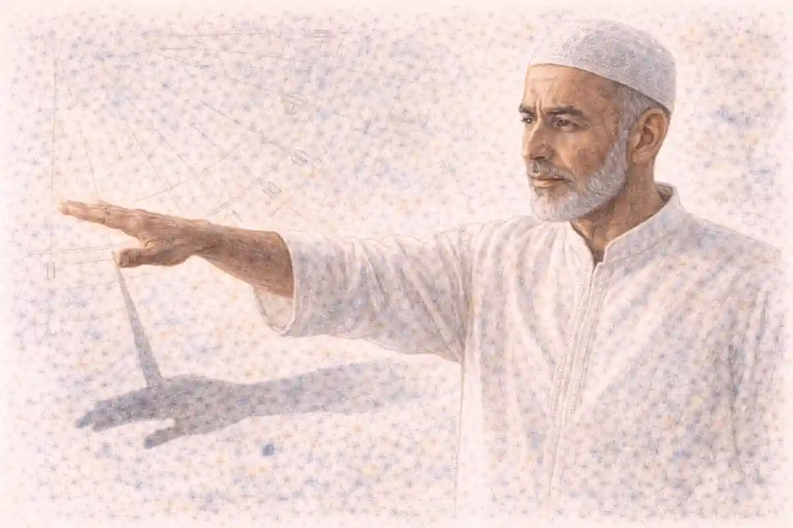

## Socialist Realism Proclaimed at a Congress

Socialist realism was a formal doctrine before it was anything else, and treating it as a loose synonym for propaganda art misses nearly everything that makes it instructive. It had stated principles that could be listed, a founding occasion that can be dated, an enforcement machinery with identifiable officers, and a body of theory written to defend its requirements as aesthetic positions rather than as administrative conveniences. In August 1934, delegates gathered in Moscow for the First Congress of Soviet Writers, and the gathering adopted a definition that bound every writer who wished to publish inside the Soviet Union. Compliance was not a matter of taste or of editorial preference. A writer who declined the method declined, in practice, the profession itself, because the union created at that congress controlled access to print, to paper, to housing, and to the legal standing of authorship.

Establishing those facts at the outset matters because the doctrine is so often introduced through its products, through posters of heroic steelworkers and novels about cement plants, that its character as a ruling escapes attention. A style can be ignored. A ruling cannot, at least not by anyone subject to it. The congress definition demanded the truthful and historically concrete representation of reality in its revolutionary development, and it joined that demand to a second task, the ideological transformation and education of working people in the spirit of socialism. Each half of the formula did distinct work. The first half claimed the authority of realism, of fidelity to what existed. The second half subordinated that fidelity to a direction, requiring the depicted world to be shown moving toward a destination the party had already identified.

Between those two halves a permanent tension was built into the doctrine from its first day. A representation answerable to observed fact will sometimes record stagnation, failure, cruelty, or doubt. A representation answerable to revolutionary development must arrange its facts so that the movement toward the destination remains visible. Writers who lived under the formula understood the tension intimately, because resolving it the wrong way carried professional and sometimes personal consequences. Resolving it the approved way produced the recognisable surface of socialist realist work across three decades and several continents: the optimistic close, the hero whose consciousness rises through labour and mentorship, the accessible form that distrusted experiment as a kind of evasion.

Yet the doctrine also foreclosed something, and the foreclosure is the second fact a reader should hold from the start. Marxists in the years surrounding the congress were conducting a serious, unresolved argument about literary form. One side held that a changed reality required the realist grasp of social totality, the patient reconstruction of how lives connect inside a whole. Another side held that inherited forms trained readers into passive identification, and that experiment, interruption, and estrangement were the honest responses to a fractured world. That argument was live, sophisticated, and internal to Marxism. The congress did not settle it by persuasion. An administrative act ended it, and the manner of that ending, which this article names the settlement by decree, connects the literary history to a wider pattern in Soviet intellectual life.

A third fact completes the opening picture. Scholarship has shown that the novels produced under the doctrine share a repeating narrative architecture, a structure precise enough to be described, compared, and tested against the corpus. That finding changes what analysis can do. A doctrine dismissed as propaganda invites only condemnation or nostalgia. A doctrine understood as a form invites questions about how the form worked, why it recurred, what it made easy to say, and what it rendered nearly unsayable. This article proceeds in that order: the proclamation and its principles first, the practice and its enforcement next, then the scholarship of form, then the debate that was closed, and finally the legacy and the question that survived the doctrine itself. Readers who want the critical tradition within which the foreclosed argument sat should begin with [marxist literary criticism explained](/2020/07/01/marxist-literary-criticism-explained/), which treats that tradition on its own terms.

### At what gathering was the doctrine proclaimed?

August 1934, Moscow, at the founding congress of the Soviet writers union: there delegates adopted a statutory definition and founded one union for the whole profession. Preparations had begun two springs earlier, when independent literary groupings were dissolved by decree, so the congress completed an institutional design whose foundations were already poured and curing.

### What did the congress definition require?

Two obligations were fused in the statute. Writers had to render reality truthfully and in concrete historical detail, showing it as a process of revolutionary change; and their work had to serve the ideological reshaping and schooling of working readers. The second obligation governed the first, fixing in advance which truths counted as the significant ones.

## The Road to the Congress Hall

Doctrines with founding congresses usually have prehistories that explain why a congress became necessary, and socialist realism is no exception. Soviet literary life in the nineteen twenties was crowded, quarrelsome, and organisationally plural. Groups competed for the title of the genuinely proletarian literature, attacked one another in journals, and courted the favour of a party leadership that had not yet decided how tightly culture should be held. The Russian Association of Proletarian Writers, known by its initials as RAPP, pressed the most aggressive claim, demanding that literature serve immediate political tasks and treating fellow travellers, writers sympathetic to the revolution without party discipline, as suspects. Other groupings defended craft, experiment, or the slow maturation of a new reading public.

That plurality was ended administratively before it was ended aesthetically. A Central Committee decree of April 1932 dissolved the existing literary organisations and announced a single union of Soviet writers, into which all who wished to practise the profession would be gathered. The decree was presented as liberation from factional tyranny, and some writers, exhausted by RAPP's denunciations, received it with relief. What followed revealed the exchange that had been made. Factional pressure from a rivalrous group, however unpleasant, could be answered, evaded, or outlasted. A single union armed with a single method left nowhere else to go. The congress of 1934 supplied the method that the union of 1932 had been built to administer.

Andrei Zhdanov, the party secretary charged with cultural oversight, delivered the keynote that framed the proceedings, and his speech set the tone of obligation that ran through the sessions. Writers were described as engineers of human souls, a phrase attributed to Stalin and repeated until it hardened into a job description. The metaphor deserves attention because it was not decorative. Engineering implies a material that can be worked, a design fixed in advance, and a standard by which the finished product is judged. A soul, in the older literary understanding, was precisely what resisted such treatment. The phrase announced, in miniature, the doctrine's whole theory of the reader: a being to be formed by correctly constructed representations, rather than a judge whose responses the writer must earn.

Maxim Gorky presided over the congress and lent it literary legitimacy that no party official could have supplied. His presence was complicated. Gorky had defended writers against bureaucratic interference in earlier decades, had lived abroad, and had returned to a position of honour that depended on cooperation. His speeches urged writers to know life, to study the labour of the new society, and to abandon the morbid introspection he associated with the old intelligentsia. Younger delegates heard encouragement. Older ones heard the boundaries being drawn by a man whose own biography demonstrated the cost of standing outside them.

Karl Radek's contribution attacked the modernist novel, singling out James Joyce for a famous dismissal that compared a heap of dung, photographed through a microscope, with the panorama a revolutionary literature ought to offer. The insult was remembered because it condensed an aesthetic judgement into a political one: experiment was filth, scale was health. Nikolai Bukharin spoke on poetry with comparatively greater openness to formal questions, a reminder that the congress was not a monotone. Positions were still being argued in its corridors and even from its rostrum. What the congress foreclosed was not discussion in a single week but discussion as an institution. After the statutes were adopted, disagreement with the method had no organisational home.

The definition adopted into the union's statutes deserves a slow reading, because every later enforcement appealed back to its wording. Truthful representation sounds like a promise of freedom, and defenders of the doctrine leaned on that sound for decades. Historically concrete adds a demand for specificity, for the particular rather than the allegorical. Then the qualifying phrase redirects both: reality must be shown in its revolutionary development, which means the truthful and the concrete are to be selected and arranged by their relation to a future that the party, not the writer, was authorised to describe. The educational clause completes the circuit. Literature is a means; working people are its object; transformation is its success criterion. A novel could therefore fail, officially, without being badly written, if its effect on the reader's formation was judged wrong.

Understanding the formula in this way prevents two common errors. The first treats the doctrine as hypocrisy, as though its authors never meant the realism they proclaimed. The record suggests something more troubling and more interesting: many of them meant both halves and saw no contradiction, because they held that history's direction was itself a fact, as knowable as any other, so that depicting development was depicting reality more truthfully than depicting surfaces. The second error treats the doctrine as a mere pretext, a decorative vocabulary for censorship. Censorship certainly operated, massively, but the doctrine did positive work as well, instructing writers in what to build, not only what to avoid. Positive instruction is what made it a method, and a method is what the word realism in its title claimed it to be.

### Why did a single writers union matter?

One union held the keys to everything a professional needed: publishers, paper, commissions, flats, travel. Expulsion therefore ended a livelihood through a committee vote, with no court involved. While rival organisations survived, rejection by one circle left doors elsewhere. Unification bricked up those doors and turned an aesthetic programme into a condition of employment.

### Who presided over the founding congress?

Gorky chaired the proceedings, lending them the authority of the country's most celebrated living author. His contribution cut two ways. He pressed delegates to study factories, farms, and construction sites at first hand, and simultaneously he blessed boundaries whose policing would escape his hands, so that objection came to look like ingratitude toward the profession's own patriarch.

## The Prehistory Inside the Party

The congress settlement had an intellectual prehistory inside the party as well as an organisational one. Through the nineteen twenties, party statements on literature had maintained a careful, sometimes evasive neutrality. A resolution of 1925 declined to bind the party to any single literary faction and warned against command methods in art, while affirming that the party could not be indifferent to literature's social effects. That balancing act reflected an older leadership's instinct that art obeyed laws of its own, an instinct associated with Trotsky's writings on literature, which denied that a specifically proletarian culture could be decreed into existence during a transitional period. Such positions did not survive the consolidation of the following decade. By 1934 the premise had inverted: neutrality itself came to be described as abdication.

The inversion is worth dwelling on because it explains the doctrine's confidence. Socialist realism was not presented as one option among several, adopted provisionally and subject to revision by results. It was presented as the discovery of the correct method, analogous to a scientific finding, and therefore as binding on everyone who accepted the premises of the society being built. A method discovered rather than chosen cannot be voted away by the practitioners it governs. That epistemic framing, in which an aesthetic programme wore the authority of a law of history, recurs across the Soviet cluster of this series, and readers can trace the wider pattern in the [soviet marxism complete guide](/2019/03/01/soviet-marxism-complete-guide/), where the parallel closure of philosophical argument receives its own treatment.

Literary scholars have also noted how much the doctrine owed to older Russian debates. The nineteenth century had bequeathed a tradition in which literature carried an outsized civic burden, in which the writer was expected to be teacher, prophet, or tribune, and in which purely aesthetic defences of art were treated with suspicion by radicals and conservatives alike. Belinsky's criticism had made social judgement the measure of literary worth generations before the revolution. Socialist realism inherited that expectation and bureaucratised it. Where the nineteenth century critic could only persuade, the twentieth century union could expel. The continuity matters because it complicates any account in which the doctrine appears as a total rupture imposed on a culture that had previously left art alone. Russian letters had rarely left art alone. What changed was the machinery standing behind the expectation, and the elimination of rival judges.

There was also a readership argument, made sincerely by many participants. The revolution had created millions of new readers whose schooling was recent and whose appetite for accessible narrative was real. Writers who had experimented with fractured chronology or interior monologue faced the charge that they were performing for a narrow metropolitan circle while the new public waited for books it could enter. Accessibility, one of the four principles examined in the next section, drew strength from that charge. Its defenders could point to genuine queues for adventure stories, production novels, and lives of exemplary people. The argument from readership did not by itself require a monopoly method, a single union, or punishment for deviation, and the slide from a defensible observation about audiences to a compulsory system is one of the places where the doctrine's logic can be watched failing in slow motion.

## The Four Principles

Textbooks and union documents conventionally state the doctrine through four principles, and the list is worth taking seriously because it shows how the system understood itself. The principles are narodnost, accessibility to the people; ideinost, ideological content; klassovost, class content; and partiinost, party-mindedness. Each principle answered a question the doctrine's architects believed art must answer. To whom is the work addressed? What does it affirm? From whose standpoint does it see? And to what authority is the artist answerable? A doctrine that can state its answers in four words has a clarity that freer aesthetic systems rarely achieve, and that clarity was part of its administrative usefulness. An editor, a censor, or a union committee could test a manuscript against the list and produce a verdict that looked like reasoning.

### What is partiinost?

party-mindedness, the requirement that art serve the party's purposes, and one of socialist realism's four principles. It derives from an essay of 1905 concerning the literature a political party produces for itself, and its extension to all cultural production was a change its proponents did not acknowledge.

Accessibility came first in most presentations, and it was the principle with the broadest appeal beyond the party's own ranks. Narodnost demanded that art be intelligible and emotionally available to the broad mass of working people, rooted in their experience and hostile to coterie difficulty. In practice it privileged clear narrative, recognisable types, and forms inherited from the nineteenth century novel and from folk tradition. Its defenders presented it as democratic, a refusal of the mandarin modernism they associated with a decaying bourgeois culture. Its critics, including Marxist critics outside the Soviet Union, replied that the principle confused the audience that existed with the audience that officials wished to imagine, and that readers repeatedly surprised the gatekeepers by enjoying works the gatekeepers had condemned as too difficult.

Ideological content, ideinost, required that a work carry a definite affirmation, that it take its place in the education of its audience by embodying correct ideas about the direction of society. The principle sounds, to ears trained in liberal aesthetics, like a demand for propaganda, and in thousands of routine applications it functioned exactly that way. Yet its theorists framed it as an honesty requirement. All art, they argued, carries ideology; the bourgeois novel smuggles its assumptions under the appearance of neutrality, while socialist realism declares its commitments openly and can therefore be judged on them. That argument has a real edge, and the article returns to it when the doctrine's stated aims receive their fair hearing. An edge, however, is not a safeguard. Declared ideology policed by a monopoly union differs from declared ideology offered to a reading public free to answer back, and the difference is institutional rather than rhetorical.

Class content, klassovost, fixed the standpoint from which reality was to be represented. Events were to be seen and evaluated from the vantage point of the working class and the interests history assigned it, which in practice meant the position attributed to that class by the party speaking in its name. The substitution hidden inside that phrase, from class to party as the class's authorised interpreter, performed enormous work throughout the system. A writer could plausibly claim to represent workers while depicting their hardships, their doubts, or their resistance to official policy. Under klassovost as administered, such depiction risked classification as a hostile standpoint, because the class's true interest had already been determined elsewhere. The principle thus protected the doctrine against the evidence of the very people in whose name it ruled.

Party-mindedness, partiinost, was the keystone, and its genealogy is the most revealing detail in the whole structure. The term descends from an essay Lenin wrote in 1905, usually rendered in English as Party Organisation and Party Literature. Read in context, that essay concerned the party press: the newspapers, journals, and publishing houses that a political party operates as its own organs. Lenin argued that such publications could not claim a bogus independence while serving as components of organised party work, and that writers who joined the party's literary enterprise accepted its discipline in that capacity. The argument was about the internal arrangements of a voluntary political organisation's own media, made under conditions of illegality and factional struggle, and it coexisted in Lenin's practice with considerable tolerance for literature outside the party's house.

The doctrine of 1934 took that bounded argument and extended it, without acknowledgement, to the whole of cultural production in a state where the party held a monopoly of legitimate organisation. Every premise had changed. The organisation was no longer voluntary in any meaningful sense for a professional writer. The publications at issue were no longer a party's papers but all papers, all theatres, all publishing houses. Exit, which in 1905 meant walking away from a faction's journal, in the nineteen thirties meant abandoning the profession or the country. A principle formulated for the house literature of a party had become the constitution of a national culture, and the proponents of the change did not mark it as a change. They cited the essay as authority for the extension, relying on readers not to ask what the essay had actually been about. Recovering that distinction is one of the simplest and most valuable acts of scholarship a student of the doctrine can perform, and it anchors the four principles table that follows.

## The Four Principles Table

The four principles table sets out each principle with what it required, the source from which its authority was claimed, what it meant in practice for a working writer, and the consequence attached to non-compliance. Read down the final column and the administrative character of the system becomes visible: the consequences escalate through institutions rather than through arguments, which is the settlement by decree expressed in tabular form.

| Principle | What it required | Stated source | What it meant in practice | Consequence of non-compliance |
| --- | --- | --- | --- | --- |
| Narodnost, accessibility to the people | Art intelligible and emotionally open to working readers, rooted in their experience | The claim that the new society had created a mass readership entitled to art it could enter | Clear narrative, familiar forms, suspicion of experiment as coterie self-indulgence | Condemnation as formalist, withdrawal of work from publication |
| Ideinost, ideological content | A definite affirmation serving the education of the audience | The congress formula joining depiction to ideological transformation | Manuscripts judged by the tendency of their whole effect, not by craft alone | Editorial rejection, demands for rewriting, public criticism |
| Klassovost, class content | Representation from the standpoint of the working class and its historical interests | The Marxist claim that standpoints in art are class standpoints whether acknowledged or not | The party's reading of the class interest substituted for the writer's observation of actual workers | Classification as a hostile or alien standpoint, loss of commissions |
| Partiinost, party-mindedness | Art answerable to the party's purposes and discipline | A 1905 essay on a party's own periodicals | Extension of a rule for party publications across all cultural production | Expulsion from the union, imprisonment, and in the severest cases execution |

A table of this kind does analytic work that prose alone performs slowly. It separates the doctrine's self-description, preserved in the second and third columns, from its operation, recorded in the fourth and fifth. The gap between those pairs of columns is where the history happened. Writers did not experience narodnost as a theory of readership; they experienced it as a reviewer's sentence declaring a manuscript incomprehensible to the collective farmer it was supposedly written for. They did not experience partiinost as a Lenin citation; they experienced it as a summons. Keeping both registers in view simultaneously is the discipline this article tries to maintain, because accounts that keep only the first become apologetics, and accounts that keep only the second cannot explain why intelligent people defended the doctrine in good faith.

### In what sequence does the table arrange the principles?

Read the rows downward and discretion drains away step by step. Accessibility names the audience, ideological content names the message, class content names the vantage point, and party-mindedness names the final arbiter. Each row answers the question its predecessor leaves open, and the last row hands every remaining question to the party, which is the doctrine in miniature.

### What did ideological content require of a manuscript?

Examiners weighed the drift of the whole work rather than hunting for offending sentences. Gloom could be forgiven when the arc bent toward affirmation; sunshine could be condemned when it rested on the wrong social foundations. Writers absorbed the lesson quickly and began constructing arcs before characters, since trajectory, not episode, was what the machinery measured.

## The Derivation of Party-Mindedness Examined

Because partiinost carries the heaviest load, its derivation repays a closer examination than the principles usually receive in survey accounts. The 1905 essay was written for a party newspaper readership during a brief interval of legal publication, and its famous demands were aimed at a specific target: writers and publicists who wanted the prestige of contributing to the party press while reserving the right to treat its pages as a neutral platform. Lenin's objection was to that reservation. Literature that formed part of organised party work, he argued, could not proclaim itself independent of the whole to which it belonged. The essay's heat was the heat of an editor disciplining contributors, not of a legislator addressing a nation's culture.

Three features of the original argument disappear in the later extension, and each disappearance matters. First, the original presupposed plurality: rival parties, rival papers, and a reading public that could choose among them, so that discipline inside one organisation left the wider culture untouched. Second, it presupposed voluntariness: the contributor who rejected the discipline could publish elsewhere, a sanction proportionate to an editorial dispute. Third, it addressed literature in the older Russian sense of the word, which covered journalism and publicistic writing generally, rather than imaginative literature specifically; the party's poets were not the essay's subject in the way its newspaper polemicists were. When the doctrine's architects cited the essay in the nineteen thirties, all three presuppositions had been abolished by the state that employed them, yet the citation continued to be offered as though nothing in the situation had altered.

Scholars who have reconstructed this history do not agree about Lenin's own later intentions, and the argument from his scattered remarks on culture can be pressed in more than one direction. What is not contestable is the textual fact: the essay's stated subject is the party's own literature, and the extension to all art is an extension. The doctrine's proponents never presented it as one, never argued for it as a development requiring justification, and treated questioning of the extension as questioning of the founder. That refusal is itself an instance of the pattern this article tracks. An argument that might have been made, about why a principle for party publications should govern a whole culture, was replaced by an appeal to authority, and the replacement went unmarked. Settlement by decree operates through exactly such unmarked replacements, in which the conclusion of a debate is announced inside a citation and the debate is thereby made to look unnecessary.

The practical consequence for writers was a peculiar double exposure. A novelist could be told, in the same editorial conference, that the work must be truthful to life and that its truth would be assessed by an authority whose conclusions preceded the observation. Experienced writers developed survival techniques: the strategic scene of repentance, the mentor character inserted late, the production conflict resolved by a speech. Less experienced or less willing writers accumulated files. The union's internal proceedings, preserved in archives and mined by historians since the nineteen nineties, record the vocabulary of these judgements in exhausting detail, and they show officials reasoning in the doctrine's own terms far more often than they show officials cynically discarding them. The system believed its vocabulary. That is part of what made it durable, and part of what made it dangerous.

### What changes when a rule for party publications is imposed on every art?

Everything that made the original rule modest falls away. Competition among outlets vanishes, so obedience inside one organisation no longer leaves a culture outside it. Voluntariness vanishes, because resignation means abandoning the trade. Proportion vanishes, as guidance written for a faction's newspapers is stretched across novels, operas, and symphonies.

### Why did the extension of the founding essay go unacknowledged?

Admission would have started an argument the architects could not risk. Their claim rested on inheritance, on principles received intact from the founder, and an admitted enlargement would have exposed a decision taken by identifiable men in a particular decade.

## The Doctrine in Practice

A doctrine is known by what it repeatedly produces, and socialist realism in practice produced a recognisable repertoire across literature, cinema, painting, and music. Three requirements governed the repertoire. The work had to move toward an optimistic resolution, however dark its middle passages became. It had to centre on a positive hero, a figure whose development embodied the direction history was said to be taking. And it had to adopt an accessible form, drawing on inherited conventions that a broad audience could follow without special training. Around those requirements grew a set of subsidiary habits: the conflict between the good and the better, in which antagonists were replaced by laggards; the varnishing of reality, in which shortages, queues, and fear were edited out of depicted life; and the ceremonial ending, in which a speech, a harvest, a launched ship, or a mentor's blessing gathered the threads into affirmation.

The production novel became the emblematic genre of the first decade. Its setting was a factory, a dam, a mine, or a collective farm; its plot turned on fulfilling or exceeding a plan; its hero matured by subordinating private hesitation to collective purpose. Fyodor Gladkov's Cement, published before the doctrine was proclaimed and retroactively canonised by it, supplied an early template: a demobilised soldier returns to a ruined plant, struggles against inertia and sabotage, and brings the furnaces back to life while his marriage strains under the same transformation. Valentin Kataev's Time, Forward! compressed the action into a single day's race for a concrete-pouring record. Marietta Shaginyan and others carried the pattern into hydroelectric construction and industrial chemistry. Read in bulk, these novels share more than settings. They share a grammar of scenes, a distribution of sympathy, and a way of converting economic processes into moral biography, and that grammar is the subject of the master plot scholarship treated later in this article.

Painting and sculpture followed a parallel path. The doctrine favoured legible narrative canvases, heroic scale, and the human figure rendered with academic competence: leaders addressing workers, harvests gathered under dramatic skies, partisans in snowbound forests. Abstraction was condemned as formalist, a term that functioned less as description than as verdict. In music the same logic produced the demand for melody the people could sing, for symphonies with discernible programmes, and for the rejection of dissonance coded as decadence. Cinema, the art form the regime valued most for its reach, combined all the requirements: Eisenstein's experiments in montage, celebrated abroad, fell under suspicion at home, while directors who mastered the accessible historical epic received the resources for large productions.

It would be a mistake, though, to picture the practice as a single unchanging surface. Historians distinguish periods within the doctrine's reign. The nineteen thirties brought the founding severity and the terror that shadowed every profession. The war years loosened some controls in the name of patriotic mobilisation, admitting religious imagery, national history, and private grief into official art in ways the founding statutes would have struggled to license. The postwar years then imposed the harshest ideological discipline of all, examined in the enforcement section below. After Stalin's death in 1953, a partial thaw admitted previously forbidden subjects and styles, and the doctrine's name survived while its content thinned, until by the nineteen seventies it functioned in many republics as a ritual formula attached to an increasingly varied practice. One of the misreadings this article is charged with correcting is precisely the picture of uniform enforcement across the whole period. The doctrine's demands were constant on paper. Their application rose and fell with politics, and writers calibrated their risks to the season.

### What is the positive hero?

He is the character built to carry history's assigned direction in personal form: a worker, fighter, or farmer whose early energy lacks political shape and whose growth, guided by labour and by an older mentor, ends in conscious membership of the collective. Blemishes are welcome as raw material.

### What did the condemnation of formalism mean in practice?

Nobody could define the offence, and that was its utility. A broken chronology, an atonal passage, a canvas without a readable story: any of these could attract the label, after which argument about the work stopped and argument about its author's loyalties began. Prudence therefore meant imitation of whatever had been applauded the season before, and official art converged accordingly.

## Writers Between Compliance and Conscience

The inner experience of working under the doctrine varied as widely as talent and luck allowed, and a fair account must hold several truths together. Some writers believed. The generation that had lived through revolution and civil war included men and women for whom the new society's construction was the great subject of the age, and who experienced the doctrine's demands as a summons to relevance rather than as a cage. Some writers complied strategically, producing the required novel or play while reserving their serious work for the drawer, in the phrase of the time, writing one literature for publication and another for posterity. Some negotiated, exploiting the doctrine's internal tensions: a writer could plead truthfulness against optimism, or accessibility against ideological content, using one principle as a shield against another, and skilled negotiators extracted surprising freedoms from the seams. Some refused, and paid the prices recorded in the enforcement section. And many, perhaps most, lived in the unglamorous middle, adjusting manuscripts to editorial weather, celebrating what could be celebrated, and keeping private judgements private.

The drawer literature deserves particular attention because it complicates the quality question addressed later. Mikhail Bulgakov wrote The Master and Margarita across the nineteen thirties knowing it could not appear; it was published, in censored form, only decades after his death. Anna Akhmatova composed Requiem in the years of the terror and preserved it through memorisation by trusted friends, since paper was evidence. Boris Pasternak translated Shakespeare and Georgian poets to survive while his own lyric voice narrowed to a whisper in print. These works were produced under socialist realism in the chronological sense and against it in every other sense, which is why the question of good work under the doctrine needs careful phrasing: the era's masterpieces were largely written in defiance of the method, in its shadow, or in its interstices, rather than as its fulfilments.

Negotiation had its own literature of cunning. Ilya Ehrenburg survived regimes of taste that destroyed colleagues, adjusting his public voice with a flexibility that admirers called suppleness and detractors called something colder. Vasily Grossman, whose war reporting had made him a hero of the official culture, wrote Life and Fate in the expectation that the thaw had changed the rules; the manuscript was arrested, in his bitter phrase, seized by the security organs along with its drafts and typewriter ribbons, and he died believing it destroyed. The episode belongs to the early nineteen sixties, well after the founding generation, and it demonstrates that the machinery outlived its makers. A doctrine administered by institutions does not need believers at the top to keep operating; it needs procedures, precedents, and the memory of consequences.

Younger writers learned the repertoire the way apprentices learn any trade, by imitation and correction. A first novel returned with editorial annotations taught its author where the boundaries ran more effectively than any statute. The annotations are preserved in publishers' archives and make melancholy reading: insert a scene of the hero's political education; soften the depiction of the district secretary; remove the heroine's doubts about the harvest figures; conclude at the launching ceremony rather than at the graveside. Each instruction is small. Their accumulation across a career is the doctrine's real biography, written not in congress resolutions but in the margins of manuscripts. When historians describe socialist realism as a system of production rather than a style, this is what they mean: a pipeline running from commissioning through editing, union review, censorship, and prize committees, at every stage of which the four principles could be invoked to justify an intervention.

### Why did some writers write for the drawer?

The drawer was a wager on posterity. A writer placed there the work he judged unprintable, declining both the compromises of publication and the martyrdom of protest, trusting that a different readership would arrive eventually. The wager was not safe, since a searched flat could turn manuscripts into evidence.

### How did editorial practice enforce the doctrine day by day?

Enforcement wore the clothes of ordinary editing. Reports on manuscripts requested a mentor here, a softened secretary there, an ending lifted into ceremony, a doubt deleted. Each request looked like craft advice and arrived in the vocabulary of the principles, so refusal sounded like incompetence.

## The Other Arts Under the Same Rule

Although the doctrine was proclaimed at a writers congress, its jurisdiction covered every art, and the extension reveals the system's logic with special clarity. Literature could at least argue that words carry ideas in a way that invites ideological assessment. Music carries no propositions, yet composers were summoned to answer for dissonance as though it were a false statement about society. The absurdity was not lost on the composers. It demonstrated that the doctrine's real object was never content alone but disposition: the artist's willingness to subordinate private judgement to collective direction, tested in whatever medium the artist practised. A string quartet could fail that test as surely as a novel, because the test measured obedience to a theory of art's social function, not the presence of incorrect opinions in the work.

The visual arts supplied the doctrine's most durable public face. Monumental sculpture, metro stations treated as palaces for the people, and canvases of industrial triumph formed the visual environment of Soviet cities, and their style became so identified with the state that later generations of artists defined themselves against it. The sots art movement of the nineteen seventies, treated in the legacy section, built its irony from that identification. In architecture the doctrine demanded a wedding cake classicism of columns and cornices, condemned the functionalist experiments of the nineteen twenties avant-garde, and left a built legacy that citizens of the successor cities still inhabit. Even here the figures protocol of this article holds: the costs of these programmes fell on people as well as on styles, on architects demoted, engineers arrested, and builders whose labour conditions the celebratory canvases did not depict, and those costs are described qualitatively here and documented in the specialised literature.

Cinema occupied a privileged and therefore perilous position. The regime's founders had identified film as the most important of the arts for a largely illiterate population, and the resources followed the judgement. Directors received budgets unavailable to any novelist, and in return their work reached audiences whose size no book could match. The doctrine in cinema meant historical epics affirming the revolutionary pedigree, contemporary dramas of production and vigilance, and comedies of collective farm abundance that bore a complicated relation to the villages they depicted. Eisenstein's Ivan the Terrible illustrates the hazards precisely: its first part received the highest honours, its second was suppressed for drawing the tyrant's portrait too darkly, and the difference between the two verdicts lay in readings the director could not control. A system that judges trajectory and implication will always be able to reverse itself on the same evidence, and artists in every medium learned that yesterday's prize was no insurance.

Theatre, ballet, and opera each developed their sanctioned repertoires. The Moscow Art Theatre's psychological realism, inherited from Stanislavski, fitted the doctrine's preference for legible emotion and was elevated into a model, while Meyerhold's experimental theatre was closed and its founder destroyed in the terror. Ballet, least verbal of the arts, flourished under lavish patronage and exported the doctrine's image of disciplined beauty worldwide, a reminder that the system's cultural products could achieve genuine excellence in forms where the ideological content was thinnest. That gradient, from the heavily policed novel to the comparatively sheltered ballet, is itself evidence about the doctrine: enforcement intensity tracked the medium's capacity to state propositions, which confirms that what was being governed was speech about society, conducted by aesthetic means.

## Enforcement and Its Human Cost

The enforcement record must be stated plainly and before any assessment of the doctrine's aims, because the order of presentation is itself a moral choice. Writers, directors, and composers who fell foul of the doctrine were denounced in the press, expelled from the professional unions that licensed their work, deprived of livelihood, imprisoned in camps, and in a number of cases executed. This article follows its figures protocol: it gives no counts of the expelled, the imprisoned, or the dead, because such counts are contested among historians and because the argument does not need them. The scale of the repression is documented in the archival literature and in the biographical record of the professions concerned, and readers who require the numbers should go to those sources, where the evidence and its disputes are laid out properly. What can be said without numbers is sufficient. The victims included some of the most gifted writers of the language, the punishment was public and exemplary, and the knowledge of it shaped every manuscript written in the Soviet Union for a generation.

Osip Mandelstam, among the greatest Russian poets of the century, was arrested after a poem about Stalin circulated among friends, exiled, arrested again, and died in a transit camp. Isaac Babel, whose Red Cavalry stories had reimagined revolutionary violence with unmatched compression, was arrested, tortured, and shot after a fabricated trial. Vsevolod Meyerhold, the director whose theatre had embodied the experimental hopes of the revolution, was arrested and shot, and his wife, the actress Zinaida Raikh, was murdered in their flat. Boris Pilnyak, once among the most prominent Soviet prose writers, was executed. Nikolai Klyuev, the peasant poet, died in exile and imprisonment. The list could be extended across every republic and every art, and each name represents not only a life ended but a body of work interrupted, a school of students scattered, and a warning delivered to everyone who remained.

Below the level of the terror stood the machinery of professional destruction, which touched far more lives. Expulsion from the writers union ended publication, income, housing rights, and social existence in a single vote. Denunciation campaigns in the press prepared such votes and taught the audience its lines. Writers were required to confess errors in public, to denounce colleagues, and to produce evidence of correction in the form of revised manuscripts and loyal declarations. Some complied and survived with their self-respect damaged in ways their memoirs record honestly. Some complied and survived by ceasing to write anything that mattered to them. Some refused the rituals and accepted the consequences. The system's cruelty lay partly in this distribution of choices, which made survival itself a collaboration that could be held against the survivor later, by others and by conscience.

It is equally part of the record that enforcement was uneven, corruptible, and sometimes arbitrary in ways that spared individuals for accidental reasons: a protector in the apparatus, a prize awarded before a campaign turned, a manuscript that slept in a drawer until the season changed. Arbitrariness did not soften the system. It intensified the anxiety, because no rule-following guaranteed safety, and it rewarded the skills of courtship and timing that have nothing to do with literature. When survivors describe the period, the unpredictability recurs as often as the severity. A writer could calculate the risk of a sentence. Nobody could price the risk of a telephone call.

### What befell writers who refused to comply?

Consequences ascended by steps. First came hostile reviews and closed journals, then expulsion, which confiscated livelihood, housing, and standing together, and beyond those, for the unlucky or the defiant, the camp and the bullet. Few climbed the whole staircase. Its existence, and the public examples made at its top, were sufficient to keep the profession below in disciplined motion.

### Why does this article give no figures for the repression?

Because the honest totals are fought over by specialists working from archives whose categories shift between republics and decades, and a single crisp number would counterfeit a certainty the evidence does not offer. Nobody disputes the shape of the record: celebrated names among the victims, punishment staged for publicity, ruin administered systematically.

## The Campaign of the Late Nineteen Forties

The doctrine's enforcement reached a second peak after the Second World War, in the campaign that Russian usage names the Zhdanovshchina, after the party secretary who fronted it. The war had brought a relaxation born of necessity: the regime had appealed to national and even religious sentiment, writers had served as correspondents and witnessed the catastrophe at first hand, and readers expected the victory to be followed by a gentler cultural settlement. Instead the leadership, alarmed by the exposure of Soviet citizens to the outside world and by the prestige writers had accumulated, moved to reimpose discipline before expectations could harden into claims. The campaign that followed is the clearest demonstration in the whole history that the doctrine was an instrument of rule whose intensity was set by politics, not a literary theory whose conclusions followed from premises.

In August 1946 the Central Committee issued a resolution on the journals Zvezda and Leningrad that expelled the satirist Mikhail Zoshchenko and the poet Anna Akhmatova from the writers union, in language of studied contempt. Zhdanov's accompanying report described Akhmatova's poetry as the product of an alien worldview and Zoshchenko's work as a slander on Soviet life. Neither writer was a dissident in any organised sense. Zoshchenko's offence was a story about a monkey, read by the leadership as an allegory of Soviet existence; Akhmatova's was the survival of a lyric voice that had never submitted to the collective themes. Their expulsion announced that even fame, even a lifetime of careful distance from politics, offered no exemption. Both lived in poverty thereafter, sustained partly by the quiet help of friends, and Akhmatova's son remained in the camps as a hostage to her conduct in the eyes of many who knew the case.

The campaign widened across the arts. A resolution on theatre repertoire attacked plays judged lacking in contemporary Soviet themes. In February 1948 a decree on music, prompted by Vano Muradeli's opera The Great Friendship, condemned formalism in the work of the country's leading composers, naming Shostakovich, Prokofiev, Khachaturian, Myaskovsky, and others whose international standing exceeded that of the officials judging them. Composers were summoned to confess the error of writing music the people could not hum. Shostakovich lost teaching posts and saw works withdrawn; Prokofiev, already in failing health, watched his music vanish from programmes while his estranged wife was arrested on fabricated charges. Cinema received its own resolutions, and a campaign against cosmopolitanism in criticism slid, in its later phases, into open antisemitic persecution of Jewish intellectuals, theatre critics first and then others. The doctrine's vocabulary supplied the warrants at each stage: formalism, servility before the West, absence of partiinost, art alien to the people.

The campaign's significance for the analysis of socialist realism is threefold. First, it shows the doctrine operating at maximum intensity in peacetime, against a population of artists who had served the state through the war, which refutes any account in which enforcement merely shadowed the emergencies of the nineteen thirties. Second, it shows the principles functioning as a flexible instrument: the same four words could condemn a lyric poem, an opera, and a satirical story within eighteen months, because their content was supplied by the political requirement of the moment. Third, it fixed the doctrine's image for the generation that inherited it. Writers who came of age under the Zhdanovshchina learned caution as a reflex, and the literature of the following decades, including much of the thaw literature that appeared to break with the doctrine, was written by people formed inside that reflex. Legacies of fear outlast the decrees that teach them, a point the legacy section develops.

### How did the postwar campaign against writers unfold?

Victory had raised hopes of relaxation; the leadership answered with discipline. A 1946 resolution expelled a great lyric poet and a beloved satirist amid official contempt, decrees disciplined theatre and film, and a 1948 resolution arraigned the country's foremost composers.

### What did the postwar music decree condemn?

It condemned formalism, naming composers of world reputation and charging their music with complexity, dissonance, and estrangement from the people's ear. The pretext was an opera by a lesser figure; the sentences fell on masters whose real offence was a musical language the leadership had chosen to interpret as disloyalty.

## The Steelman: The Doctrine's Aims in Their Strongest Form

Neutrality in this series means presenting a position's strongest form before judging it, and socialist realism has aims that deserve that courtesy, stated without irony. Its architects confronted a genuine situation. A society was attempting a transformation of unprecedented speed, educating millions of new readers, and asking what culture could contribute to the effort. The liberal answer, that art should be left alone, presupposed institutions and publics that the revolution's leaders believed history had swept away, and it offered the new reader little guidance through a world being rebuilt around her. Against that background the doctrine promised art that took the transformation seriously as a subject, treated ordinary working people as worthy of the attention once reserved for princes and poets, and held writers responsible for the effects of their work rather than allowing them the alibi of pure expression.

Some of those promises were kept in part. The doctrine directed enormous resources toward cultural access: cheap editions, libraries, reading rooms, translation between the languages of the Union, and literacy campaigns that treated literature as a public good rather than a luxury commodity. It dignified subjects that polite literature had ignored, the labour of miners and steelworkers, the lives of collective farmers, the education of women in Central Asia, and it trained readers by the million who then demanded more than the doctrine could give them, a consequence its architects neither intended nor welcomed. The argument that all art carries ideology, and that declared ideology is more honest than smuggled ideology, retains force in criticism far removed from the Soviet context; versions of it appear wherever the neutrality of inherited forms is questioned. A student who cannot state these points cannot explain why the doctrine attracted intelligent adherents, and an account that cannot explain adherence will mistake a system of belief for a system of mere lying.

The steelman reaches its limit at a precise point, and naming the point is the verdict in embryo. Every aim listed above could have been pursued by a state that funded, encouraged, and argued, while leaving writers free to refuse the commission. Patronage is old; the Medici practised it without a union monopoly or a camp system. The doctrine's distinctiveness lies not in its aims but in its exclusions: the elimination of rival organisations, the conversion of a method into a licence condition, and the punishment of deviation as a political offence. Those features were not accidents or excesses layered onto a sound idea. They followed from the claim that the method had been discovered rather than chosen, since a discovered truth tolerates no licensed dissent. The fair hearing therefore ends in a sharper judgement than caricature could produce: the doctrine's aims were intelligible, some were honourable, and the structure built to serve them made their honest pursuit impossible, because a literature forbidden to record failure cannot educate anyone about a transformation whose real content includes failure.

## The Master Plot

The single most valuable scholarly contribution to the study of the doctrine appeared in 1981, when Katerina Clark published The Soviet Novel: History as Ritual. Clark's argument, built from a wide reading of the canonical production novels and their successors, was that Soviet novels of the socialist realist period share a deep narrative structure, a master plot, beneath their varied settings and subjects. A relatively undisciplined protagonist, embodying spontaneity, encounters a mentor figure who embodies consciousness, often an older worker, a party organiser, or a figure marked by suffering endured for the cause. Through labour, trial, and the mentor's guidance, the protagonist's spontaneity is educated into consciousness, and the story closes with the hero's integration into the collective, symbolised by a ritual moment of acceptance: a speech received, a task fulfilled, a place at the table of the elders secured.

Clark's terminology of spontaneity and consciousness was not invented for the occasion. It reproduces the central pair of categories in Leninist political theory, where the working class left to itself achieves only spontaneous, trade union awareness, while consciousness arrives through organised mediation. The master plot, on her reading, is that political theory translated into narrative form. The novel performs in biography what the party claimed to perform in history: the conversion of raw energy into directed purpose. This is why the structure proved so durable across subjects as different as steel production, collectivisation, partisan warfare, and postwar reconstruction. The setting supplied the variable. The transformation supplied the constant, and the transformation was the doctrine's real subject, whatever the cover of the book announced.

The ritual dimension of Clark's subtitle matters as much as the plot itself. She argued that these novels function less as explorations of a world than as repeated ceremonies of belonging, in which the reader, identifying with the protagonist, rehearses the passage from outsider to insider that the society demanded of its citizens. Ritual explains features that realist criteria find embarrassing: the predictability of the endings, the stylisation of the mentors, the subordination of psychological nuance to symbolic function. Judged as attempts at the nineteenth century novel, the canonical texts often fail. Judged as rituals in narrative dress, they succeed at exactly the task the doctrine set them, which was formation rather than discovery. The analysis neither excuses nor celebrates that task. It identifies it, and identification is what allows argument about the doctrine to move beyond competing denunciations.

Subsequent scholarship extended and contested the finding in productive ways. Régine Robin's work on socialist realism as an impossible aesthetic stressed the doctrine's internal contradictions, its demand for a realism of a reality that was supposed to be shown as it was becoming rather than as it was. Evgeny Dobrenko argued that socialist realism should be understood as a machine for producing the reality it claimed to depict, a system in which the represented world of abundance and purpose substituted for the experienced one and gradually became the only publicly available version. Boris Groys, in a deliberately provocative account, treated the whole Stalinist cultural project as a total artwork and traced continuities with the avant-garde it suppressed, a thesis that scandalised readers who preferred their categories clean. Each of these scholars disagrees with the others about emphasis and explanation. All of them treat the doctrine as a form with describable operations, which is the methodological legacy of the 1981 intervention: the products of a coercive system can be analysed with the same formal seriousness as any other literature, and the analysis yields knowledge about the system that its own documents conceal.

### How is the master plot of the Soviet novel structured?

Beneath changing settings one skeleton repeats. An energetic but unformed hero meets an elder scarred by sacrifice, is schooled through work and ordeal, and finishes gathered into the collective, the gathering often staged as a ceremony of welcome. The design transposes a political theory of how classes mature into the biography of a single person.

### Why does the master plot recur across so many novels?

Two forces converged. Institutionally, the pattern was what editors bought, juries crowned, and reviewers praised, so adopting it was simple professional prudence. Compositionally, it solved the founding formula's hardest problem, how to show reality mid-transformation: lodge the transformation in a person, and development becomes narratable.

### What would defeat the master plot judgement?

Evidence from the corpus itself: a methodical census of the fiction issued under the doctrine, demonstrating that a large share of it escapes the pattern. The claim is quantitative at heart, so only counting can kill it. Its author supplied the classification criteria and welcomed the test.

## Reading the Master Plot Closely

A closer look at the pattern's components shows how much interpretive work it performs. Consider the mentor. In novel after novel the mentor is marked by a biography of sacrifice: imprisonment under the old regime, wounds from the civil war, a spouse lost to the cause, a body worn by labour. The marks function as credentials. Consciousness, in this fictional economy, cannot be argued into a protagonist; it must be embodied by someone whose suffering certifies that the doctrine he transmits has been paid for. The device solves a narrative problem created by the doctrine itself. A political theory is not a character, and a novel cannot dramatise an abstraction directly, so the theory enters wearing a scarred face. When the mentor dies, as mentors in these novels frequently do at the moment their teaching is complete, the death seals the transmission and frees the protagonist to occupy the vacated place, which is why the endings so often resemble investitures.

The protagonist's spontaneity is equally stylised. It appears as energy without direction: physical strength, temper, a gift for machinery, a rebellious humour, a love affair conducted at the expense of work. The narrative never treats these qualities as sufficient, and never treats them as worthless either. They are raw material, and the plot is the story of their refining. This is the precise point at which the doctrine's anthropology becomes visible. Human beings, in the master plot, are unfinished material whose value is realised by integration into a purpose larger than themselves, and the individual's resistance to integration is the only internal antagonist the form fully acknowledges. External enemies exist in abundance, wreckers, kulaks, foreign agents, yet they function mainly as occasions. The real drama is the hero's negotiation with his own incompleteness, judged by a standard the collective supplies.

Women in the master plot occupy positions the scholarship has mapped with increasing care. The heroine may be the protagonist, as in a number of collectivisation and war novels, and her path repeats the pattern with the additional burden that her spontaneity is coded through domestic attachment, which the plot must loosen before integration can proceed. More often she appears as the mentor's auxiliary, the keeper of the collective's moral temperature, or as the prize of integration, the marriage that ratifies the hero's arrival. Feminist readings of the corpus have shown how the doctrine, which proclaimed the emancipation of women as one of the revolution's credentials, reproduced in its exemplary fictions a hierarchy it claimed to have abolished. The finding illustrates the general value of formal analysis for political judgement: the novels betray, in their distributions of agency, commitments that their explicit affirmations deny, and only a reading attentive to structure can catch the betrayal in the act.

Time in these novels bends in a characteristic direction. The present of the action is always a threshold, judged not by what it contains but by what it is becoming, and the narrative voice repeatedly reaches forward to a future in which the meaning of present sacrifices will be evident. Clark connected this structure to the founding formula's insistence that reality be shown in motion toward its destination, and the connection explains the notorious difficulty Soviet novelists had with endings. A story whose significance lies in a future beyond its pages can close only by importing that future symbolically, through a speech, a vision, a child, or a construction raised against the sky. Hence the ceremonial quality readers notice even in competent examples. The ending is not a resolution of the plot so much as a pledge, and pledges, unlike resolutions, can be renewed indefinitely by the next novel in the series, the next plan, the next campaign.

### How does the mentor figure certify consciousness?

Through wounds. The mentor's authority rests on a curriculum of suffering, prisons survived, comrades buried, decades at the bench, which presents doctrine as something purchased rather than merely asserted. Abstract teaching would remain a lecture; embodied teaching arrives as testimony.

### What does the master plot reveal about the doctrine's view of persons?

Aggregated across hundreds of novels, the pattern betrays an anthropology of raw material. Human energy counts as unshaped stock, valuable once a collective purpose refines it; hesitation about being refined is the sole inner conflict granted full dignity; and fulfilment means occupying an allotted place in an order others built.

## The Objection to Formal Analysis

The strongest objection to the whole enterprise of master plot scholarship must be stated at full strength, because the brief for this article requires it and because the objection is serious. It runs as follows. A doctrine enforced by imprisonment and execution produced a literature under compulsion, and to analyse that literature for its formal structures, to speak of its rituals and its narrative grammar with the appreciative neutrality of the seminar room, is to dignify a machinery of control by treating its output as art. The appropriate response to such a system, the objection continues, is the record: the names of the destroyed, the mechanics of the terror, the exposure of the lies. Formal analysis displaces that record, converts victims into context, and lets the analyst display ingenuity over material that should provoke only judgement. On this view Clark's book, however brilliant, commits a category error with moral consequences, mistaking the products of a prison for the products of a culture.

The answer begins by accepting the objection's premise about priority. The record of enforcement comes first, in this article literally before the analysis, and any treatment that allowed structural elegance to soften that record would deserve the charge. But the conclusion does not follow. Formal analysis establishes things about the doctrine that the record alone cannot: how the system imagined the human material it claimed to transform, why its fictions took the shapes they did, where their explicit affirmations are contradicted by their distributions of agency, and how readers were being trained to rehearse their own integration. That knowledge serves judgement rather than competing with it. A tribunal that knows only that novels were compelled knows less than a tribunal that can also show what the compulsion was for. The writers who worked within and against the form, moreover, are honoured rather than erased by serious reading: the negotiators, the drawer writers, and the hacks become distinguishable only when the form they negotiated, evaded, or serviced has been precisely described.

One concession must be made without qualification, and this article makes it in the same breath as the answer. The objection is right that analysis can become an anaesthetic, that a scholarly literature can grow so absorbed in the doctrine's internal poetics that the camps recede into a footnote, and that some writing on the period has crossed that line. The safeguard is not to abandon analysis but to keep the order of presentation fixed: enforcement first, aims fairly stated, form analysed, verdict last. A reader who has passed through the record of Mandelstam's death and Akhmatova's expulsion before reaching the master plot will not mistake the master plot for an achievement to be celebrated. The structure becomes, in that reader's hands, evidence. How the doctrine worked is a question that includes what it did to the people who refused it, and any answer that separates the two halves has already failed.

### Does analysing the form dignify the system that imposed it?

Only if the analysis misplaces the record. Keep coercion in front, the doctrine's stated aims in fair view, and structural description third, and description becomes prosecution evidence, showing what the machinery was designed to install in readers. The warning inside the question is nevertheless accepted here: scholarship that treats the camps as scenery for cleverness about plot has.

### What does formal analysis establish that the enforcement record cannot?

It establishes the inside of the machine. Punishment files prove that writers were coerced; structural reading shows what the coercion aimed to manufacture, why thousands of stories share one skeleton, and where a text's architecture contradicts its slogans, as when celebrations of emancipation allot agency along an unemancipated hierarchy.

## The Debate the Doctrine Foreclosed

Behind the congress settlement lay a genuine argument, and recovering its contours is essential to grasping what the settlement cost. Through the nineteen twenties and into the nineteen thirties, Marxist thinkers were disputing the relation between literary form and social reality with a sophistication that the subsequent official culture never matched. The dispute's most famous poles are associated with Georg Lukács and Bertolt Brecht, though neither man set the terms alone and their exchange was conducted largely through essays, letters, and the journals of exile rather than in direct confrontation. Lukács defended realism as the mode adequate to a Marxist understanding of society: the great realist novel, following Balzac and Tolstoy, grasps the totality of social relations, shows typical characters in typical circumstances, and allows the movement of history to become visible through the destinies of individuals. Modernist experiment, on his account, mistook the fragmentation of experience under capitalism for the truth about experience, and froze a symptom into a method.

Brecht's reply, much of it unpublished in his lifetime, rejected the idea that realism could be identified with the forms of a previous century. Reality changes, he argued, and the means of representing it must change with it; a realism that copies Balzac's surfaces while the world has acquired radio, mass politics, and assembly lines betrays the function in the name of the form. His own theatrical practice of estrangement, interrupting the audience's identification with characters so that social arrangements appear alterable rather than natural, embodied the counterclaim: experiment was not evasion but the honest response of art to a reality that identification merely anaesthetised. Ernst Bloch defended expressionism against Lukács in print, in the exchange of 1937 and 1938 that later readers named the expressionism debate, arguing that the fractured forms of modern art registered real fractures in the world and that a Marxism unable to use them had impoverished itself. Walter Benjamin's essays on mechanical reproduction and on the author as producer pressed the argument toward media and institutions, asking not only what works should look like but what apparatus they should transform.

The point that matters for this article is not which side had the better of the exchange, a question on which reasonable Marxists and reasonable readers still divide. The point is that the exchange existed, that it was conducted by Marxists about the deepest questions of their shared tradition, and that its terms were aesthetic and philosophical rather than administrative. Nobody in that argument proposed that the loser be expelled from a union. Nobody imagined that a congress resolution could refute a theory of the novel. The argument's continuation can be followed in marxist literary criticism explained, where the tradition receives its own full treatment, and the suppressed alternative of formal experiment receives separate attention in [marxist vs formalist criticism](/2020/10/01/marxist-vs-formalist-criticism/). What happened inside the Soviet Union was different in kind. There the argument was not won. It was closed, by the creation of a monopoly organisation armed with a single method, after which the positions that lost were no longer mistaken but impermissible, and their holders were no longer opponents but suspects.

### By what means was the form debate closed?

By reorganisation, not refutation. A decree dissolved the competing literary groupings and promised one union; the congress then wrote a single method into that union's charter. Within reach of those institutions, the losing arguments stopped being positions and started being infractions, while beyond their reach, in exile print, the identical argument proceeded undisturbed.

### What divided the two sides of the form debate?

A shared inheritance, disputed over instruments. One party trusted the classic realist novel, its totalising grasp of society through representative lives, as cognition's proper vehicle. The other insisted that a transformed world had outrun inherited surfaces, that smooth identification narcotised judgement, and that interruption and experiment therefore served truth better.

## The Settlement by Decree as a Pattern

The namable claim of this article can at last be stated in its full form. The settlement by decree names the mechanism by which socialist realism closed a live argument among Marxists about literary form through administrative order rather than through argument, and the claim is that this mechanism was not an accident of the literary field but a characteristic operation of the system, visible in field after field during the same years. This article is the third instance of the pattern in the series. Soviet philosophy had already been treated in the cluster on Soviet Marxism, where disputes among Marxist philosophers about dialectics and materialism were terminated by party intervention and the victors installed by organisational means. The suppression of formalism, treated in its own article, shows the same operation applied to a critical method: an approach to literature was not refuted but anathematised, its name converted into a charge. Literary doctrine in 1934 is the third case, and three independent instances establish a pattern rather than a run of bad luck.

Naming the pattern changes the analysis in several ways. It directs attention from the content of each settlement to the procedure common to all of them, and the procedure has identifiable steps. A field contains a live dispute among practitioners who share broad commitments. The party leadership, requiring predictability and ideological service, identifies the dispute as a problem of order. An organisational act follows: a congress, a resolution, a merger of institutions into a single licensed body. The act installs one position as the field's official truth and reclassifies the others as deviations. Enforcement then proceeds through the ordinary administration of the monopoly body, so that subsequent conformity appears voluntary and subsequent punishment appears professional. Each step can be documented in the literary case from the record already presented in this article: the plural groups of the twenties, the dissolution decree of 1932, the congress and statutes of 1934, the conversion of formalism into a charge, and the editorial pipeline that made coercion look like craft advice.

The pattern also explains a feature of the doctrine that purely literary accounts find puzzling, its indifference to its own inconsistencies. A settlement reached by argument must answer objections, because the losing side's reasons remain in circulation and demand replies. A settlement reached by decree faces no such discipline. The doctrine could demand truthfulness and optimism simultaneously, could cite a 1905 essay for a scope its author never gave it, could condemn a composer for propositions his music could not contain, because no authorised forum existed in which the contradiction could be pressed to a conclusion. Inconsistency is expensive only where argument is permitted. Where the verdict precedes the hearing, coherence becomes a luxury, and the energy other systems spend on consistency is freed for administration. Historians of Soviet philosophy have described the identical economy in their field, where positions were adopted and discarded by signal from above and the literature of justification trailed behind, rearranging its citations to match. The parallel is developed in the soviet marxism complete guide, and it is structural rather than decorative: the same institutions, the same personnel practices, and the same theory of truth as a function of authority operated in both fields at the same time.

A further consequence deserves emphasis, because it bears on how the doctrine should be judged as an intellectual episode. Arguments that are closed by decree do not die; they emigrate, go underground, or wait. The form debate closed in Moscow in 1934 continued in exile journals, in the unpublished papers of its participants, and in the Western Marxist criticism that inherited its questions, which is why the tradition surveyed in this series' cultural cluster could develop Lukács, Brecht, Benjamin, and their successors into a living body of thought while the country that had hosted the argument's opening rounds preserved its conclusion in a statute. The settlement by decree thus produced a paradox its authors did not intend: the doctrine froze Soviet literary thought at the moment of settlement, while the argument it suppressed flourished everywhere the decree did not run. Judging the doctrine's intellectual quality requires holding that paradox in view. Its defenders were not refuted by better arguments inside their own institutions, because their institutions had abolished refutation. They were refuted, insofar as history refutes, by the visible divergence between a culture that kept arguing and a culture that had been ordered to stop.

### How should the doctrine's authority over art be graded?

As borrowed from institutions, not earned in argument. Persuasion leaves believers who persist when scaffolding is removed; this creed's observance rose and fell with the union's powers of allocation and punishment, and evaporated where those powers lapsed, without a single debate having been lost in the meantime.

### Which distinctions separate an imposed doctrine from a developed one?

Ask where it was born, whom it binds, and who may amend it. A developed doctrine grows inside a practice, obliges only the convinced, and can be revised by the community that made it. An imposed one arrives from an external authority, obliges through licences and livelihoods, and awaits amendment from that authority alone.

## Three Instances and a Mechanism

It may help to lay the three instances side by side in prose, since the pattern's persuasiveness depends on the independence of the cases. In philosophy, the dispute between mechanists and dialecticians through the nineteen twenties was an argument about how Marxist theory should understand nature and method; it was ended when the party's leadership intervened organisationally at the turn of the nineteen thirties, condemned one side, and shortly afterward installed a codified dialectical materialism whose textbook formulations stood beyond appeal for a generation. In criticism, the formalist school had built, during and after the revolution, a rigorous account of literary devices and their functions; it was not answered but denounced, its adherents recanted or fell silent, and its very name became the all-purpose charge under which later deviations were prosecuted, as the music decree of 1948 illustrates. In literature, the case this article has documented, a plural field of groups and tendencies was dissolved into a single union and a single method by the acts of 1932 and 1934. Philosophy, criticism, literature: three fields, three live disputes, one procedure.

The mechanism's deepest feature is the conversion of truth into a property of position. In each field, the question of which view was correct was replaced, in practice, by the question of which view the authorised body had adopted, and practitioners learned to read signals rather than arguments. Memoirs of the period are full of the resulting skill: the parsing of an editorial's phrasing for a change of line, the attendance at a meeting to learn not what was true but what would be treated as true, the careful citation of whichever authority had spoken last. A culture organised this way does not merely produce bad art or bad philosophy, though it produces both. It produces a characteristic deformation of the intellect, in which the faculty of judgement is retrained as a faculty of detection, and detection, unlike judgement, atrophies the moment the signals stop. The long aftermath in Soviet intellectual life, the difficulty many institutions had in resuming genuine argument after the monopoly relaxed, belongs to the legacy section, yet its roots are here, in the decades during which detecting the line was the primary intellectual skill the system rewarded.

Against this analysis a defender of the period might object that every culture settles some questions by authority: academies consecrate canons, markets consecrate bestsellers, and no field argues everything forever. The objection deserves its answer, which lies in the difference between settlements that remain open to reversal by the field's own procedures and settlements enforced by the loss of livelihood and liberty. A canon can be revised by critics writing books; a bestseller list is revised every week. The settlement of 1934 could be revised only by the authority that imposed it, and the price of anticipating the revision in print was set by the enforcement record already described. Degrees of closure exist, and the objection usefully insists on them, but a difference of degree that includes the camp and the execution cell has become a difference of kind for the people living inside it. The pattern named here is defined by that threshold: closure administered through monopoly and punishment, in a field whose questions were still open, among practitioners who shared the premises of the system that closed them.

## Beyond the Soviet Union

The doctrine travelled. After the Second World War, the states of Eastern Europe acquired cultural systems modelled on the Soviet original, complete with writers unions, congresses, and local editions of the four principles, applied with intensities that varied from the severe to the perfunctory according to each country's politics and the strength of its own literary traditions. Poland's writers wrestled with an imported method against a national literature of formidable prestige, and the friction produced both conformist production novels and a sophisticated culture of evasion. The German Democratic Republic institutionalised the doctrine through the Bitterfeld conferences, which summoned writers to the factories and workers to the typewriter in an effort to close the gap between literature and labour by administrative enthusiasm. Czechoslovak, Hungarian, Bulgarian, and Romanian literatures each negotiated their version of the settlement, and the comparative record is surveyed in connection with [actually existing socialism europe](/2019/06/01/actually-existing-socialism-europe/), where the political systems that hosted these doctrines receive their own analysis.

China adopted the framework through a distinct route with its own founding text. The talks on literature and art delivered at Yan'an in 1942 subordinated art to politics with an explicitness that exceeded the Soviet formula, and after 1949 the Chinese writers union and its congresses administered a doctrine recognisably descended from socialist realism while bearing the stamp of its Yan'an origin. The Chinese case matters for comparison because it shows the pattern operating under different cultural materials: a literary tradition with its own classical canon, a revolution made in the countryside, and campaigns against writers that repeated the Soviet sequence of denunciation, confession, and expulsion with local variations. The application is traced in the [mao zedong intellectual biography](/2018/05/15/mao-zedong-intellectual-biography/), and this article notes only the structural kinship: a live field of literary positions, an organisational monopoly, a single method, and enforcement through the profession's institutions.

Beyond the socialist bloc, the doctrine's influence ran through the international communist movement and its cultural fronts. Parties in France, Italy, and elsewhere maintained literary establishments in which socialist realism, or a softened national variant, set the terms of prestige and publication, and writers of genuine stature negotiated with those terms from positions of far greater safety than their Soviet counterparts enjoyed. The contrast is instructive. Where the doctrine operated as the taste of a party subculture rather than as the law of a state, its costs were real but bounded: a poet might lose a journal, a review, a faction's favour, yet retain the ability to publish elsewhere and to answer back. The same principles, the same vocabulary of formalism and party-mindedness, produced grumbling in Paris and catastrophe in Moscow, and the variable was never the vocabulary. It was the monopoly behind it. That comparison may be the cleanest evidence available for the claim that runs through this article: the disaster lay in the settlement's machinery, and doctrines should be graded by the institutions that carry them as well as by the propositions they contain.

### Where else was the doctrine put to use?

Across the postwar European bloc, where sister unions and congresses administered national editions, and in China, where a wartime text on art and politics supplied indigenous foundations for a kindred settlement enforced after 1949. Parties without state power ran milder versions inside their own cultural worlds.

### Why did the same doctrine cost less in Paris than in Moscow?

Because sanctions stop where monopoly stops. A writer condemned by party critics in Paris could find another publisher, another journal, a court indifferent to the quarrel, and could reply at length. His Moscow counterpart faced one employer fused with the state that issued his housing and his passport.

## Was Any Good Work Produced?

The question is unavoidable and treacherous, because its terms smuggle in the ambiguities this article has been trying to clear. Good work was certainly produced in the Soviet Union during the doctrine's reign. The harder question is what relation that work bears to the doctrine: whether it fulfils the method, survives despite it, or grows in the spaces the method failed to reach. Sorting the famous cases by that relation yields a rough but honest map. A small body of work achieved distinction partly through the doctrine's own resources, drawing energy from the collective subjects and the historical scale the method prized. A larger body achieved distinction by negotiating the method, bending its requirements toward private purposes. The era's most celebrated achievements, the works by which the period is remembered in world literature, cluster overwhelmingly in the third category: written against the method, beneath its notice, or beyond its borders in the drawer.

Mikhail Sholokhov is the standing test case for the first category. And Quiet Flows the Don, begun before the doctrine's proclamation and completed under it, received the highest official honours and a Nobel Prize, and its portrait of Cossack life through revolution and civil war possesses a tragic amplitude that the master plot cannot contain; its hero ends not integrated but broken by the history the doctrine said was carrying him forward. Defenders of the doctrine cite Sholokhov as its vindication. Critics reply that the novel's greatness lies precisely in its excess over the method, in everything the formula would have edited out. The dispute is genuine and probably unresolvable, yet its terms already concede the essential point: even the doctrine's prize exhibit must be defended by pointing to what escapes the doctrine. Aleksandr Fadeyev's The Young Guard, by contrast, shows the method applied with full sincerity by a true believer who also administered the union, and its fate is instructive in another way: the novel was criticised after publication for insufficient depiction of party guidance, and Fadeyev revised it to insert the missing mentors, producing a second version in which the doctrine quite literally rewrote the book.

Poetry tells a clearer story, because the lyric is the form least able to carry the doctrine's requirements and therefore the form where evasion and destruction are most visible. The period's enduring Russian poetry was written by Akhmatova in silence and memorisation, by Mandelstam on the road to the camps, by Pasternak in narrowing circumstances, by Tsvetaeva in emigration and despair. In prose, Platonov's excavations of revolutionary language produced work of genius that remained unpublished for decades; Babel's career ended at the wall; Bulgakov's masterpiece waited in a drawer for a generation of readers not yet born. Children's literature, translation, and the historical novel became refuges where talent could work at one remove from the doctrine's demands, and some of the period's most loved books were written in those shelters. A balance sheet that credits the doctrine with the era's good work must therefore be drawn with care. The doctrine can claim the conditions of production for everything published in its territory. It cannot honestly claim authorship of qualities that arose from resistance to it, and the distinction between conditions and causes is the one on which the whole question turns.

### How should the era's good work be sorted?

By its distance from the method. Closest stand the rare books that drew strength from collective subjects and epic scale. Further out stand the many that bent requirements toward private ends through negotiation. Furthest stand the works posterity actually keeps, composed in opposition to the method, in its shadows, or in hiding from it.

### What does the case of The Young Guard show?

It shows the standard operating inside a believer's study. Fadeyev administered the union and held the faith, yet reviewers judged his published novel deficient in party guidance, and he obediently rewrote it, inserting the mentorship the template demanded. No policeman appears in the story.

## The Surviving Question

One element of the doctrine's inheritance must be separated from the wreckage with care, and the separation must not be mistaken for rehabilitation. Socialist realism was an answer, catastrophic in its form, to a question that does not disappear with it: what should art do in a society attempting to transform itself? The question predates the doctrine. It runs through the nineteenth century debates about the writer's civic duty, through the revolutionary avant-garde's ambition to rebuild life itself, and through every subsequent argument about whether art owes its society anything beyond its own excellence. It recurs wherever political art is discussed, in disputes over public funding, over representation in publishing and casting, over the responsibilities of artists who accept a state's or a movement's patronage, and over whether formal innovation or communicative reach is the better service to an audience. None of those disputes is the Soviet dispute, and importing the Soviet vocabulary into them would be a slander on their participants. The structural resemblance is narrower and worth stating precisely: wherever art is asked to serve a transformation, someone must decide what service means, and the history recorded here demonstrates, at terrible cost, what happens when that decision is monopolised, insulated from appeal, and enforced through livelihood.

Raising the question lends the doctrine no support, and the article states that disclaimer as plainly as the brief requires. The doctrine's answer to the surviving question was to abolish the question's openness, to replace the continuing argument among artists and publics with a statute. A question that can only be answered once, by an authority, with punishment for rival answers, has not been answered but confiscated. The legitimate inheritance is the question itself, returned to the conditions under which it can do its proper work: plural institutions, free refusal, and argument without a licensing body waiting at the end of it. Students who meet the question in contemporary dress, in arguments about what publicly funded art should attempt or what responsibilities best-selling storytellers bear, are meeting the genuine residue of the history traced here, and the history equips them to ask the follow-up question that matters most: who decides, through which procedure, and subject to what appeal? The wider framing of that inheritance within Marxist thought about culture is set out in [marxist cultural theory guide](/2020/06/01/marxist-cultural-theory-guide/), to which this article defers for the general theory.

### What question survived the doctrine?

Ask what art is for when a society sets out to remake itself, and the question outlives every answer yet imposed on it, because patrons, movements, and states keep having to form some view of the matter. The Soviet catastrophe belonged to the answer's form: a monopoly verdict, unappealable, with livelihood hanging on assent.

### Why is raising the surviving question not a defence of the doctrine?

Condemnation here targets the manner of answering, not the existence of the problem, so examining the problem acquits nobody. A question seized by statute was suppressed wearing the costume of a solution. The distinction also runs the other way: the doctrine's crimes cannot be used to declare every later inquiry into art's social purpose suspect.

## The Doctrine Across the National Literatures

The Soviet Union was a federation of languages, and the doctrine had to operate in all of them, which exposed tensions that the Russian centre could keep politely abstract. Each republic possessed a writers union mirroring the all-union body, a canon of classics to be reinterpreted, and a literary language whose very development was entangled with state policy. A Georgian poet, a Ukrainian novelist, and a Kazakh epic singer faced the same four principles, yet the principles landed on different materials. Accessibility meant one thing in a literature with a nineteenth century novel tradition and something else in a culture whose prestigious forms were oral, sung, and only lately committed to print. Class content had to be found in societies where the industrial working class was small and the peasantry, the nomads, or the mountain villages supplied the actual population. The doctrine's universal vocabulary thus produced strikingly local negotiations, and the comparative study of those negotiations is among the most illuminating ways to see the system's real workings.

Ukraine illustrates the costs with particular sharpness because its literary revival of the nineteen twenties had been brilliant and self-confident. The generation known as the Executed Renaissance, a name bestowed by later scholars, had produced poets, dramatists, and prose writers who believed a Ukrainian socialist culture could be both national and revolutionary. Mykola Khvylovy, the most magnetic of them, argued in pamphlets that Ukrainian literature should orient itself toward Europe rather than toward Moscow's tutelage, a position the centre read as national deviation. He shot himself in 1933 as the campaign against him closed in and as famine consumed the Ukrainian countryside, a catastrophe whose literary dimension this article notes without numbers, in keeping with its protocol. The dramatist Mykola Kulish was arrested and perished in the camps; the poet Mykhailo Semenko was executed; hundreds of careers ended in the same years, and Ukrainian letters entered the doctrine's era already decapitated. What socialist realism meant in Kyiv was therefore never merely a method. It was the successor regime to a destroyed national renaissance, and every Ukrainian writer who complied wrote in the shadow of predecessors whose fate measured the price of the alternative.

In the Caucasus and Central Asia the pattern wore different dress. Georgian literature carried a classical heritage centred on a medieval epic that the doctrine's custodians laboured to present as a forerunner of humanist realism, folding national pride into the permitted canon. Armenian writers negotiated between a diaspora literature beyond Soviet reach and a republic literature under union discipline, a split that gave Armenian letters an external reference point unavailable to most. In Central Asia the state sponsored the creation of written literary standards, publishing houses, and professional authorship itself, and the doctrine arrived bundled with the infrastructure of literature: the first novel in a language might also be its first production novel, its author trained in Moscow institutes and returned home as a cultural cadre. Chingiz Aitmatov, writing in Kyrgyz and Russian a generation later, showed what could grow inside that infrastructure once discipline relaxed, weaving folk legend into narratives whose moral complexity pressed against the doctrine's edges from within its own institutions. His career complicates any simple geography of centre and victim: the system that destroyed Khvylovy also built the schools, journals, and translation networks that carried Aitmatov to a world readership, and honest history has to record both movements without letting either cancel the other.

Translation policy bound the whole structure together and revealed its hierarchy. Works approved in Russian were translated outward into the republics' languages as models, while works from the republics were translated into Russian selectively, as evidence of the friendship of peoples and of each nation's progress along the common road. A novel from Tashkent or Tbilisi reached the all-union reader framed by prefaces explaining its place in that progress, which meant its local meanings were filtered through the centre's categories before they could circulate. Writers understood the arrangement perfectly and some exploited it, embedding in national settings and historical subjects the observations that a Moscow setting would have made unpublishable. The historical novel in particular became a licensed refuge across the republics: the distant past allowed explorations of conquest, resistance, and national character that allegorised the present at a deniable distance. Censors knew the trick and writers knew the censors knew, and the resulting cat and mouse, conducted in footnotes and prefaces as much as in texts, forms a whole subhistory of the doctrine's practical life.

### How did the doctrine operate in the non-Russian republics?

Each republic ran a branch union on the Moscow pattern, re-read its national classics through the four principles, and bargained the method against local stock: oral epics, peasant majorities, languages whose printed literatures the state was itself assembling. Translation policed the whole arrangement.

### Why did the historical novel become a refuge across the republics?

Remoteness bought deniability. A tale of conquest or national awakening set centuries deep could air pressures readers recognised from their own streets while author and editor pleaded scholarship and patriotism. Everyone understood the game, censors included, so the genre evolved an etiquette of framing essays and footnotes under which allegory travelled on a licence.

## Readers, Prizes, and the Economy of Prestige

A doctrine of literature implies a reader, and the Soviet reader was not a fiction. Millions of people bought, borrowed, queued for, and argued about books inside the system, and their behaviour sometimes ratified the doctrine's offerings and sometimes quietly subverted them. Library records and publishers' correspondence, mined by historians of reading, show a public whose tastes were broader than the canon allowed: adventure stories, detective fiction in the periods when it was tolerated, translated classics, and the poetry of the nineteenth century circulated with an intensity that production novels rarely matched. The state responded with campaigns of guided reading, discussion circles in factories and collective farms, and published letters from worker correspondents praising exemplary books, a genre whose authenticity varied from genuine enthusiasm to editorial manufacture. Between the guided surface and the actual borrowing patterns lies the real history of the doctrine's reception, and it cautions against assuming that a monopoly of supply produced a monopoly of response. Readers are stubborn creatures. They skip, they reread the wrong chapters, they love the villain, they remember the love story and forget the production meeting, and no union statute has yet been written that can prevent them.

Prizes formed the visible summit of the prestige economy. The Stalin Prizes, founded at the end of the nineteen thirties and renamed after 1953, distributed money, apartments, dachas, and above all safety to their laureates, and the annual lists were read by the profession as weather reports: which genres were ascending, which patrons were strong, which themes the leadership wished to see multiplied. A prize could transform a writer's material existence and shield him through the next campaign, or fail to shield him, as several arrested laureates learned. Below the summit ran a dense economy of lesser currencies: print runs allocated by committees, translation into the Union's languages and then into foreign ones, membership of delegations travelling abroad, access to the closed shops and clinics reserved for the cultural elite. Each currency was administered, and administration is the operative word. In a market system prestige converts imperfectly into income through sales; in the Soviet system prestige and income alike flowed from institutional decisions, which meant the doctrine's judgements were enforced not only by fear but by the entire structure of a writer's material hopes. Carrots of that size make sticks rarer and more terrible, reserved for those whom the carrots could not buy.

The profession's internal hierarchy reproduced the pattern at smaller scale. Senior writers sat on the committees that judged juniors, edited the journals that published them, and taught in the literary institutes that credentialed them, so a young author's formation passed through a series of gates each kept by a beneficiary of the existing settlement. memoirs describe the resulting atmosphere with a consistency that crosses political sympathies: intense attention to signals, elaborate courtesies toward the powerful, private irony as the universal solvent, and a shared understanding that the public language of literature and the private language of writers were different tongues. Foreign observers who met only the public language sometimes reported a culture of sincere unanimity. The diaries and letters published since the archives opened show the private language in abundance, and its existence is part of the legacy: a whole profession trained to keep two sets of books, one for the record and one for the truth, does not unlearn the habit when the record changes.

### What do borrowing records show about Soviet readers?

They show appetites outrunning the canon. Adventure yarns, classics in translation, detective stories whenever tolerated, and the previous century's poetry moved from hand to hand far faster than exemplary factory novels, whatever the campaigns of guided reading proclaimed. Supply could be monopolised; attention could not, since borrowers skipped, reread favourite chapters, and cherished the wrong characters entirely.

### How did prizes enforce the doctrine without police?

By paying. The summit awards delivered cash, flats, country houses, and a measure of immunity; beneath them ran smaller currencies, editions, translations, foreign trips, clinic access, each dispensed by committees. Hopes were thus administered by the same hands that judged manuscripts, conformity was purchased week by week, and the truncheon could stay reserved for those whom payment failed to move.

## Music and Cinema Under the Method

The doctrine's encounters with music produced its most quoted absurdities and some of its most revealing documents, because music forced the system to articulate what it meant by content in an art that carries none in propositional form. The opening shot came in January 1936, when Pravda published an editorial, unsigned and universally understood to speak for the leadership, under the title Muddle Instead of Music. Its target was Shostakovich's opera Lady Macbeth of Mtsensk, which had played successfully for two years and had been praised as a triumph of Soviet art. The editorial condemned its dissonance, its naturalism, and its alleged pandering to bourgeois taste, in language that moved without embarrassment from chords to politics. A companion piece attacked his ballet music weeks later. Shostakovich, not yet thirty, understood the message with perfect clarity: a fourth symphony was withdrawn before performance and kept unheard for a quarter of a century, and the composer rebuilt his public manner around the Fifth Symphony of 1937, presented with the subtitle, supplied by a journalist and accepted by the composer, of a Soviet artist's reply to just criticism. Whether the Fifth's finale celebrates or mourns has been argued ever since, which is itself the point: ambiguity became the refuge of a genius who had learned that clarity could be fatal.

The episode matters beyond biography because it displays the doctrine's theory of the other arts in concentrated form. An editorial in a party newspaper functioned as aesthetic criticism, professional judgement, and legal warning simultaneously, and no institution existed in which the verdict could be appealed on musical grounds. The composer's colleagues understood that their own premieres would be read the same way, as statements of allegiance or deviation, and Soviet music developed its famous double register in response: official works for the record, intimate works, quartets and song cycles and eventually symphonies, in which the private voice survived at lower volume. When the 1948 decree renewed the assault, naming Shostakovich again alongside Prokofiev and others, the profession's humiliation was ritualised in a conference where composers confessed to formalism and promised melody. Prokofiev died on the same day as Stalin five years later, his late music largely unperformed, his personal life wrecked by the arrest of his wife. The doctrine had demanded that music educate the people. Its measurable achievement in music was to teach the century's greatest composers the arts of concealment.

Cinema's story runs parallel with the variables changed. Film was capital intensive, collectively produced, and reviewed before release by officials who could order cuts, shelve finished work, or end careers with a memorandum, so control operated at the level of the scenario long before a camera turned. The great directors of the nineteen twenties montage school, Eisenstein, Vertov, Pudovkin, had made Soviet cinema the wonder of the film world; under the doctrine their methods were reclassified as formalist tricks, and they were required to relearn narrative clarity, the positive hero, and the accessible historical epic. Eisenstein's Bezhin Meadow was halted and destroyed amid denunciations. His Alexander Nevsky succeeded by wedding medieval patriotism to the doctrine's requirements, and Ivan the Terrible split in two across the war: the first part crowned with honours, the second suppressed for a portrait of power its patrons read as commentary. Vertov, the most uncompromising of the pioneers, spent his later career in newsreel obscurity. Meanwhile a sanctioned cinema of collective farm musicals and heroic biographies filled the screens, technically accomplished, sometimes genuinely beloved, and organised around the same grammar of mentorship and integration that governed the novel. Film historians treat the Soviet case as the extreme instance of a general truth: the more a medium costs, the earlier in production control can be applied, and the less the finished work can reveal about what its makers might have done unobserved.

### What did the editorial against Shostakovich's opera demonstrate?

It demonstrated that one unsigned newspaper column could simultaneously play critic, employer, and warning shot. An opera applauded for two seasons became a political offence between editions, no musical argument was admissible anywhere, and every composer in the land recalibrated by breakfast.

### Why was cinema controlled earlier in production than literature?

Expense made film governable at birth. Budgets, crews, and official previewing meant the argument happened over scenarios and storyboards, before a camera turned, whereas a novelist at least completed an object and haggled over something finished. Prescription therefore entered Soviet pictures at conception, and a shelved production could be annihilated without ever acquiring the ambiguous afterlife of a hidden manuscript.

## The War Years and the Loosened Grip

Between 1941 and 1945 the doctrine's grip loosened under the pressure of survival, and the loosening is essential evidence about what the grip had been. Facing invasion, the regime needed emotions the four principles were poorly designed to supply: grief, vengeance, love of particular places, religious consolation, and the memory of a Russia older than the revolution. Writers responded with work that drew on all of them. Konstantin Simonov's lyric addressed to a beloved, Wait for Me, was copied by hand at the front and carried in breast pockets, a poem whose entire force is private fidelity, printed in Pravda because the state recognised that soldiers fight for persons before they fight for principles. Alexander Tvardovsky's Vasily Tyorkin, a verse narrative of an ordinary soldier, achieved its hold through humour, understatement, and a hero whose virtues are entirely unmonumental. Akhmatova, the expelled and silenced poet of the prewar years, broadcast to besieged Leningrad and published poems of civic mourning. Ilya Ehrenburg's journalism channelled hatred of the invader with a ferocity that officials later found embarrassing and tried to moderate. The war canon, in short, was built by relaxing the doctrine wherever the doctrine obstructed feeling, and its popularity measured the distance between the art the system prescribed and the art its citizens needed.

The relaxation was never announced as a change of principle, which allowed it to be reversed without any principle being repealed. Churches reopened, the anthem replaced the Internationale, officers recovered their epaulettes, and historians of the period describe a wartime social contract in which sacrifice was exchanged for an expectation of postwar softening. Writers shared the expectation and stored it in their postwar manuscripts, many of which reached for the honesty the war had licensed: Grossman's Stalingrad novel began its long passage through censorship in these years, and the first postwar journals carried stories testing how much of the front's truth could be said in peacetime. The campaign of 1946 answered the question. Its targets, as the earlier section recorded, were not wartime collaborators with the enemy but the war's own decorated servants, and its message was that the emergency licence had expired. The sequence from licence to revocation is one of the clearest demonstrations available that the doctrine's content was a function of rule rather than of aesthetics: the same leadership that had needed Simonov's lyric discovered, within a year of victory, that lyric poetry of private feeling was a bourgeois deviation requiring expulsion of its greatest practitioner.

For the ordinary reader the war also created a vast unofficial literature of letters, diaries, and front line newspapers that circulated outside the union's channels and accustomed a generation to writing and reading outside prescription. Veterans returned with manuscripts in their kit bags and with a claim on the country's attention that the doctrine had to accommodate even while disciplining it. The lieutenant prose of the nineteen fifties and sixties, written by former junior officers, drew directly on that claim, and its relative honesty about fear, waste, and command incompetence marked the first durable breach in the method's authority from inside official literature itself. Breaches of that kind, earned by biography rather than granted by permission, proved harder to close than the wartime licence had been, because closing them required telling the veterans that their war had been misremembered, and even the union's committees hesitated at that sentence.

### Why did the war loosen the doctrine's grip?

Invasion demanded feelings the four principles manufactured badly: mourning, revenge, tenderness for particular people and places, even religious comfort. The leadership accordingly licensed verse and prose it would have condemned in peacetime, and the popularity of what followed measured the gap between prescribed art and needed art. Since no relaxation was ever announced, none needed repealing when the emergency ended.

### What made the veterans' later prose hard to discipline?

Its authors carried an unanswerable credential: presence. Junior officers who had fought wrote about fear, waste, and blundering command from witness rather than theory, and condemning their pages meant declaring the war misremembered by the men who had survived it. Committees that bullied professors hesitated before that sentence, so the breach those books opened in the method's wall stayed open.

## The Thaw and the Long Thinning

Stalin's death in March 1953 did not repeal the doctrine, and the manner of its decay is as instructive as the manner of its imposition. No congress announced a new method. Instead the boundaries moved by precedent and signal: an essay questioning the varnishing of reality could appear in a journal, a novel with an unheroic ending could survive review, a poem cycle could circulate in typescript and then, astonishingly, in print. Ilya Ehrenburg's novella The Thaw, published in 1954, gave the era its name with a story whose villain is a factory director of exactly the type the production novel had taught readers to admire. Vladimir Dudintsev's Not by Bread Alone, in 1956, dramatised an inventor crushed by bureaucrats and was debated in packed halls. The system's custodians pushed back in waves, and each wave recovered less ground than the one before, because the settlement's machinery depended on a unanimity that the leadership itself no longer performed. Khrushchev's secret speech of 1956, though concerned with politics rather than literature, destroyed the premise on which the doctrine's authority rested: if the infallible centre had been criminally wrong about the recent past, then its certificates in aesthetics were paper like any other.

The thaw's emblematic literary event came in November 1962, when the journal Novy Mir published Aleksandr Solzhenitsyn's One Day in the Life of Ivan Denisovich, a novella describing a single day in a labour camp through the eyes of an ordinary prisoner. Publication required authorisation at the highest level, granted as an instrument in a political campaign against the old leader's memory, and the fact is essential to a clear-eyed account: the breach was opened from above, for reasons of state, not won from below by the profession. Yet once opened it could not be fully closed, because hundreds of thousands of readers had by then seen the camps described in an official journal by a writer who had lived in them, and the doctrine's account of reality stood measured against a text its own system had published. Solzhenitsyn's subsequent fate, harassment, expulsion from the union in 1969, the Nobel Prize, arrest and deportation in 1974, retraced the enforcement staircase in full view of the world, and each step advertised the machinery more loudly than any samizdat could have done. A system that had relied on the invisibility of its procedures found them narrated, step by step, by its most famous victim.

Through the nineteen sixties and seventies the doctrine thinned into a formula recited at congresses whose real business was the distribution of the profession's goods. Village prose writers turned to the disappearing rural world and wrote about collectivisation's costs in a minor key the censors often passed as nostalgia. Urban prose examined the moral compromises of the educated class. Yuri Trifonov's Moscow novellas dissected the beneficiaries of the system with a quietness that made them unanswerable. Meanwhile an entire parallel literature grew in samizdat, in the unofficial readings and exhibitions of the nonconformist artists, and in the emigration that carried Brodsky, who had been tried as a parasite in 1964 for the offence of being a poet without institutional employment, to a Nobel Prize abroad. The doctrine's name survived in statutes. Its substance, the belief that a method had been discovered and that deviation was a political act, drained away as the generation that feared the camps was replaced by a generation that feared only boredom, and feared it more. When the union finally dissolved with the state that chartered it, few writers defended the method that body existed to administer, a silence that retrospectively grades the authority the settlement had conferred.

### How did the doctrine decay after the founder's death?

By erosion, never by repeal. No successor congress proclaimed a rival method; editors simply tested fences, journals admitted endings and subjects the old rules barred, and each official counterpush recovered less territory. Once a secret speech had demolished the premise of an infallible centre, the statutes persisted as recitation while conviction drained out of them, leaving form without force.

### Why could the publication of One Day not be undone?

The camp novella had appeared under the system's own imprint, authorised from the summit for reasons of state, and had entered hundreds of thousands of homes as an official act. Disowning it meant confessing the use made of it. The leadership instead persecuted its author by instalments, and every instalment, expulsion, prize abroad, arrest, deportation.

## The Avant-Garde Inheritance

No account of the doctrine is complete without the movement it displaced, because socialist realism defined itself against the most inventive artistic generation Russia ever produced, and because a serious scholarly argument holds that the displacement conceals a continuity. The avant-garde of the nineteen teens and twenties, Malevich's suprematism, Tatlin's constructions, Rodchenko's photography and design, the futurist poets, the constructivist theatres, had greeted the revolution as the chance to rebuild perception itself. Its practitioners did not want to decorate the new world; they wanted to manufacture its visual and verbal language, and for a decade the state, distracted and comparatively tolerant, let them try. The doctrine's victory therefore required not merely preferring other styles but reclassifying this entire inheritance as pathology: abstraction became the art of a dying class, experiment became evasion, and the men and women who had made the revolution's first images became suspects in its maturity. Malevich died in poverty in 1935, designing his own coffin as a suprematist object. Tatlin ended his career building a flying machine in a monastery tower, a monument to everything the settled culture could not use.

Boris Groys gave the continuity thesis its sharpest form in his study of Stalinist culture, arguing that socialist realism inherited the avant-garde's deepest ambition while reversing its methods. Both movements, on his reading, rejected art as contemplation and demanded art as the organisation of life; both treated the inherited museum culture as an obstacle; both dreamed of a total transformation of the environment and the soul. The difference lay in who held the commission. The avant-garde had imagined artists as the engineers of the new world, answerable to their own vision of the future. The doctrine kept the engineering and confiscated the vision, installing the party as sole author and demoting artists to executants of a design fixed elsewhere. The thesis is deliberately unsettling, and specialists dispute its fairness to both sides, yet it explains a fact that purely political accounts leave mysterious: why the regime's cultural products so often pursue totality, the metro as palace, the exhibition as cosmos, the novel as ritual of integration, with an energy that mere censorship cannot generate. Censorship subtracts. Something in the Stalinist project added, and Groys's argument, whatever its excesses, names the addition: the avant-garde's will to remake life, nationalised.

The displaced generation's revenge arrived posthumously and completely. The avant-garde in our time fills the museums and the auction rooms, anchors the international image of Russian modernity, and supplies the visual identity of exhibitions about the revolution itself, while the official painting of the doctrine's decades hangs in storage or in the specialised museums of totalitarian art. Students encountering the period through its images therefore meet a curated inversion: the art the regime suppressed looks like the era's achievement, and the art it commissioned looks like its embarrassment. Historians warn against letting that inversion do the judging by itself. The avant-garde's triumph in posterity was also arranged, by Western museums, markets, and cold war cultural politics that had their own reasons to canonise the suppressed and forget the commissioned. A balanced syllabus teaches both survivals and asks why each occurred, which returns the class to the question this article keeps asking: who decides what lasts, by what procedure, and with what interests concealed inside the procedure.

### What did the doctrine displace in the visual arts?

It displaced the revolutionary avant-garde, the suprematists, constructivists, and futurists who had set out to rebuild perception and had given the young state its first images. Their experiments were rebranded as a dying class's pathology and their makers left poor or silent.

### What is the continuity thesis about the avant-garde?

Groys argued that the official style inherited the avant-garde's central ambition, the organisation of life through art rather than art's contemplation of life, while confiscating its authorship. Both camps despised the museum and dreamed in totals; the quarrel concerned who held the commission.

## Reading a Production Novel Closely

Abstract claims about the master plot earn their keep only when a single book is opened and the pattern watched at work, and Gladkov's Cement serves the purpose because the doctrine itself canonised it as a founding exemplar. The novel opens with Gleb Chumalov returning from the civil war to a cement works that stands silent, its machinery rusting, its workers scattered, its director entrenched in the offices of a trust that prefers paper to production. Gleb's energy is the book's first fact: physical, impatient, contemptuous of procedure, prone to settle arguments with his fists and his biography. In the vocabulary the scholarship later supplied, he is spontaneity in uniform, a hero whose virtues are exactly the qualities the plot must educate before they can be used. Around him Gladkov arranges the instruments of that education. There is the party organiser whose steadiness rebukes Gleb's impulsiveness, the engineer whose technical knowledge the workers distrust and the plant cannot do without, the old worker whose memory carries the pre-revolutionary struggles into the yard, and the saboteur whose wrecking gives the narrative its external pressure. A reader who has absorbed the master plot analysis watches these figures take their assigned places with the pleasure of recognition, and the pleasure is diagnostic: the novel is legible at speed because its people are functions before they are persons.

The middle of the book belongs to labour described as combat. Meetings multiply, commissions inspect, fuel fails to arrive, a kiln is coaxed back to life, and the narrative converts each industrial problem into a test of somebody's consciousness. Gleb's marriage runs in counterpoint. His wife Dasha, drawn into political work and into the women's department, grows away from the household he expected to resume, and their estrangement, including a scene of violence that later editions handled nervously, supplies the novel's most honest pages, because here the transformation the plot celebrates is shown costing something real. Critics across the decades have returned to the marriage as the place where Gladkov's gifts exceeded his programme. The doctrine required the personal to be subordinated; the novelist, watching his heroine refuse subordination in the very act of embracing the cause, recorded a contradiction his formula could not process, and the record survives as literature while the formula survives as history.

The close delivers the required ceremony. The plant restarts, speeches are made, the community gathers in its own honour, and Gleb stands inside the collective he has been educated to serve, his spontaneity not extinguished but harnessed, which is the precise emotional transaction the master plot exists to perform. Yet even the ceremony carries a shadow the doctrine preferred not to discuss: a child of the marriage has died in the interval, in the care of institutions the novel praises, and the parents' grief is absorbed into the general rejoicing with a speed that troubled readers from the first edition onward. A seminar can build an entire session from that absorption, asking what a form must believe about persons for a child's death to function as a surcharge on progress rather than as an objection to it. The question leads back to the anthropology identified earlier, the view of the individual as material whose meaning is realised in integration, and it shows why formal analysis and moral judgement, properly sequenced, are allies rather than rivals. The novel that the doctrine chose as its exemplar contains, in its most strained pages, the evidence for the doctrine's prosecution.

Later exemplars repeat the experiment with diminishing returns that are themselves instructive. Kataev's Time, Forward! takes the pattern to a construction site racing a concrete record and discovers, in the compression of its single day, an energy that later readers can still feel; the book works because the race is real and the stopwatch does not care about ideology. Ostrovsky's How the Steel Was Tempered carried the pattern into autobiography and became the bloc's most reprinted novel of formation, its hero Pavel Korchagin progressing from delinquency through war, labour, blindness, and finally authorship itself, the mentor function passing at the end into the book the reader holds. By the postwar decades the pattern had become a curriculum. School editions annotated the stages of growth, teachers set essays on the hero's development, and the master plot completed its migration from narrative structure to civic pedagogy, which is where Clark's analysis found it waiting: a ritual so thoroughly institutionalised that its repetition had become the point.

### Where does Cement exceed the doctrine that canonised it?

In the marriage. Dasha embraces public work and outgrows the household her husband came home expecting, and the couple's estrangement prices the transformation honestly, which the formula needed to be free of charge. A child's death, folded into the closing rejoicing at unsettling speed, strains the ceremony further.

### How did the master plot become civic pedagogy?

Through the classroom. Annotated school editions flagged each stage of a hero's ripening, teachers set essays on his development, and examinations rewarded pupils who could trace raw energy maturing into consciousness on demand. A story shape thereby hardened into a citizen's drill.

## The Language of the Doctrine

Systems of rule develop characteristic languages, and the doctrine's critical vocabulary deserves study as an instrument in its own right. Its key terms shared a family resemblance: they sounded descriptive while functioning as verdicts, they were defined nowhere with precision, and their application could not be predicted from their dictionary meanings. Formalism has already been examined in that light. Its companions included naturalism, condemned when depiction lingered on the unedifying; objectivism, the charge against a writer who presented facts without the correct evaluation attached; cosmopolitanism, deployed in the late campaigns against intellectuals accused of insufficient rootedness; and varnishing, the one term of abuse the system aimed at its own conformists, denoting the prettification of reality that embarrassed the doctrine's claim to truthfulness. A writer's education consisted largely in learning the weather of these words, which charges were ascending, which patrons they served, and which combinations in a review spelled professional death. The vocabulary's vagueness was not a defect of drafting. Precision would have allowed compliance to be demonstrated and innocence to be proved, whereas the system's purposes required a permanent margin of interpretive discretion in the hands of those applying the terms.

The prose style of official literature developed corresponding features that linguists and historians have catalogued: a wooden, formulaic public language of editorials and resolutions, heavy with nominalisations and ritual epithets, in which the same adjectives attached themselves to the same nouns across decades. Scholars of Soviet language describe a newspeak distinct from Orwell's invention yet recognisably related, a register in which words were valued for their signalling function rather than their reference. Inside the novels, the register appears as the speech of meetings and mentors, set against the comparatively living dialogue of kitchens and workplaces, and the contrast gives attentive readers a map of where a text's sympathies actually lie. Some writers weaponised the contrast deliberately, letting official language condemn itself by its woodenness beside the speech of their characters. Others absorbed the register so completely that their private letters are written in it, a detail biographers record with sadness, since a style learned for survival does not retire when the danger passes.

Translation spread the vocabulary across the bloc, and its travels reveal the doctrine's administrative skeleton. Terms coined in Moscow were calqued into Polish, Czech, Hungarian, Bulgarian, and German, carrying their vagueness with them, so that a formalist in Warsaw and a formalist in Sofia were being accused in the same borrowed words of offences neither language had previously named. The shared lexicon allowed campaigns to be coordinated and reports to be compared, and it allowed local custodians to demonstrate loyalty by fluency. When the system ended, the vocabulary collapsed with a speed that surprised its speakers, and within a few years the words survived only as historical specimens or as irony. Languages of command, it turns out, are mortal in a way that languages of description are not, because their meanings were never in the words. Their meanings were in the institutions standing behind the words, and when the institutions withdrew, the words were left holding nothing.

### Why was the critical vocabulary kept vague?

Precision would have armed the accused. Define formalism exactly and a writer could demonstrate innocence, closing the margin in which editors and patrons manoeuvred. Undefined charges stretch to fit fresh political requirements, land on fresh targets without fresh legislation, and evaporate without apology when the wind turns.

### What happened to the doctrine's vocabulary when the system ended?

It evaporated into quotation marks. Words like formalism and cosmopolitanism had never carried meanings of their own; they were warrants backed by institutions, and when the unions and censors withdrew, the warrants lapsed and speakers dropped the terms within a few years.

## Women Writers and the Doctrine's Double Standard

The doctrine proclaimed the emancipation of women among the revolution's credentials, and its handling of women writers supplies a compact test of the distance between proclamation and practice. The founding generation of Soviet literature included women of formidable talent who had made their reputations before the settlement: Akhmatova and Tsvetaeva in poetry above all, whose work defined the possibilities of the Russian lyric for everyone who followed. Neither could be accommodated. Akhmatova was expelled, silenced, and kept in poverty, her son imprisoned as leverage; Tsvetaeva, who had emigrated and returned, hanged herself in evacuation in 1941 after failing to find work or protect her family from arrest. The two greatest poets of the language thus spent the doctrine's founding decades as its internal exiles, a fact that any balance sheet of the period must enter before it enters anything else. Their survival as poets at all was owed to memory, friendship, and the drawer, the unofficial infrastructure that the doctrine's existence called into being wherever real literature continued.

Within official literature, women were assigned characteristic territories. The woman writer was welcomed as the chronicler of domestic transformation, of the collective farm's women, of mothers and teachers and the moral weather of the home front, and a number of skilled practitioners built careers inside those assignments, sometimes smuggling into them observations that exceeded the brief. The production novel's commanding heights, the epic of history, the philosophical drama, remained presumptively male territories, policed less by rule than by the reviewing habits that found women's treatment of them shrill or narrow. Meanwhile the exemplary heroines of the master plot, as the earlier analysis noted, were distributed along a hierarchy the doctrine's affirmations denied: emancipated in slogan, auxiliary in structure. Feminist scholarship on the corpus has documented the pattern in detail, showing how even novels centred on heroines route their development through male mentors and ratify it through collective bodies composed of men, so that a woman's arrival at consciousness is certified by the very order her emancipation was supposed to transform. The finding is a model of what formal analysis can do for political judgement, catching in the distribution of narrative functions a commitment that the text's explicit statements conceal.

The postwar decades complicated the picture without overturning it. Women predominated among the readers, librarians, teachers, and editors who operated the literary system at its middle levels, so the doctrine's daily administration was substantially women's work even while its summits remained male. Women poets of the thaw generation achieved public voices their predecessors had been denied, and by the final Soviet decades women prose writers were producing some of the era's most searching work, often in the permitted territories of family and memory, which they proceeded to make unrecognisable by treating them as the true sites of historical experience. Ludmila Petrushevskaya, whose stories of communal apartment life were refused publication for years and then recognised as central documents of the late Soviet condition, closes the arc: a writer formed entirely inside the system the doctrine built, whose work the system could neither produce nor, in the end, prevent. Her trajectory from refusal to canonisation within a single career compresses the doctrine's whole history of weakening into one biography.

### How did the doctrine treat its women poets of the first rank?

It exiled them at home. One was expelled, silenced, and kept destitute with a son in the camps; the other came back from emigration into family arrests and died by her own hand in wartime evacuation. The language's two supreme lyric voices survived as artists through memorisation, friendship, and hidden manuscripts.

### What does the distribution of roles in the master plot disclose?

It discloses the pecking order the slogans deny. Heroines ripen under male tutelage and receive their certificates from male assemblies; elsewhere women keep the collective's moral temperature or wait as integration's reward. Feminist scholarship mapped that allotment from the texts themselves, proving on this corpus the general claim that structural reading catches commitments which explicit statement works to conceal.

## Children, Schools, and the Literature of Refuge

One of the doctrine's least examined territories is the literature written for children, which operated under the same principles with instructively different results. Children's books were required to educate, to model collectivism, honesty, and love of labour, and to avoid the frivolity and fright that custodians associated with bourgeois nurseries. Yet the territory also enjoyed a relative shelter, because its products were judged by adults who often valued craft, humour, and verbal play in books they bought for their own children, and because the stakes of a nonsense poem seemed lower than the stakes of a novel. Into that shelter moved some of the era's finest verbal talent. Korney Chukovsky, attacked in the late nineteen twenties for the fantastic elements in his tales, survived to become the beloved patriarch of Soviet childhood. Samuil Marshak built a publishing house for children's literature that employed, protected, and trained writers whom adult literature could not safely print, including poets of the absurdist circle whose adult work was unpublishable and whose lives, in the case of Daniil Kharms, ended in the terror's machinery regardless of the shelter. The children's lists thus became a refuge economy, in which genius changed its clothes and survived at knee height.

Translation performed a similar function for adults. The great translation schools of the period, rendering Shakespeare, Goethe, Balzac, and the world's classics into Russian and the Union's languages, employed poets and prose writers whose original work was blocked, and employed them at a level of excellence that made Soviet translation itself an art form. Pasternak's Shakespeare, produced across the years when his own lyrics could barely appear, is the famous case: a major poet's voice, displaced into the service of another writer's words, achieving there a freedom of register that his own name could not have carried into print. Editors understood the arrangement and sometimes chose translators as an act of patronage toward the silenced, a quiet redistribution of income and dignity inside a system whose public face was punishment. Historians of the period treat these refuge economies as essential evidence, because they show the literary world routing around its own doctrine, preserving skills, incomes, and standards in the interstices of the official structure, so that when the thaw came there were still masters alive to teach.

Schools completed the circuit by converting literature into curriculum. The canon taught to Soviet schoolchildren mixed the nineteenth century classics, reinterpreted through the doctrine's categories, with a selection of Soviet exemplars whose plots pupils learned to parse in the approved grammar: identify the positive hero, trace his growth, name the mentor, state the idea. Generations of citizens were thus trained in the master plot as a reading reflex before they could have encountered the term, and the training outlasted the doctrine in the habits of readers who still reach, unbidden, for the growth story and the certifying elder when they summarise a novel. Textbook history also preserves the doctrine's judgements in amber: writers excluded from the curriculum effectively vanished for the mass reader, while inclusion guaranteed print runs beyond any market's imagining. When post-Soviet textbooks were rewritten, the battles over the list, who returned, who was demoted, who was finally admitted to have existed, replayed the century's literary politics in miniature, and they continue wherever a ministry approves a syllabus.

### Why did children's literature shelter talent?

Because its stakes looked trivial to the watchmen, and because the adults vetting it often prized wit, music, and verbal mischief in books destined for their own offspring. Writers unpublishable for grown ups could practise at knee height, and humane editors built whole programmes around employing them.

### How did schools institutionalise the master plot?

Lessons taught children to dismantle approved novels with a fixed toolkit: spot the exemplary hero, follow his ripening, identify the elder who guides him, state the governing idea. Marks rewarded fluency in that grammar until it became reflex, installed before scepticism was possible.

## The Archives and the New Scholarship

Since the Soviet archives opened to researchers in the nineteen nineties, the study of the doctrine has been rebuilt on documents its subjects never expected anyone to read, and the rebuilding has altered the field's questions. Earlier scholarship, working from published sources and émigré testimony, argued about the doctrine's meaning and the sincerity of its adherents. Archival scholarship asks instead how the machine ran: what a publishers' meeting actually decided, how a prize list was assembled, what an editor wrote in the margin of a manuscript and what the author answered, how a union expulsion was stage managed and how its victim's family was treated afterward. The stenograms of writers meetings, preserved in the union's files, record the rituals of denunciation and confession in the participants' own words, including the hesitations and the applause, and they have ended any temptation to treat those rituals as metaphors. Censorship files show the doctrine's principles being applied to individual sentences by officials who believed, or performed belief in, the vocabulary they used. The resulting literature, by historians working in Russian, Western, and other archives, has made the Soviet case the best documented instance of cultural administration in the modern world, a status that carries the responsibility this article has tried to observe: where the record is this dense, generalisation must answer to documents.

The archival turn also revised the field's moral geography. Documents complicate the cast of villains and victims that the cold war literature inherited. They show writers denouncing colleagues in one file and protecting them in another, officials who enforced campaigns in public while quietly advancing a banned manuscript in private, and informers whose reports protected their subjects by their blandness. None of this softens the system's judgement, since a machine that corrupts judgement in everyone it touches stands condemned by precisely that universality, yet it forbids the comfortable sorting of the dead into the guilty and the pure. Dobrenko's work on the political economy of socialist realism pushed the revision furthest, arguing that the doctrine should be understood as a technology for manufacturing the reality it claimed to represent, in which the reader's formation was the true product and literature merely its delivery system. Robin's account of the doctrine as an aesthetic that could not be made coherent stressed contradictions no administration could resolve, since a realism of becoming cannot be audited against a reality that has not finished becoming. Read together, the archival historians and the theorists have produced a field in which the doctrine is neither dismissed as propaganda nor absorbed into pure form, but studied as a working system whose operations can be traced from a congress resolution to a changed ending in a provincial novel.

For researchers entering the field, the practical landscape divides into published document collections, the union and censorship archives in Moscow and the republic capitals, the publishers' files, and the memoir literature, whose reliability the documents allow scholars to test rather than merely assert. Access conditions vary and change, and the responsible advice is institutional rather than specific: work through the scholarly societies and the archive guides, expect catalogues in Russian, and build the language before building the argument. The field also offers a methodological lesson transferable to any study of administered culture. Follow the paper. Doctrines announce themselves in manifestos, but they live in minutes, margins, print run allocations, and prize lists, and the distance between the manifesto and the margin is where their real content hides. A student trained to read that distance in the Soviet case owns an instrument that works on cultural bureaucracies everywhere, including the gentler ones whose sanctions stop at funding and reputation.

### What did the opening of the archives change?

It changed the questions scholars could ask. Published sources had supported arguments about meaning and sincerity; files of stenograms, censors' reports, editorial margins, and prize deliberations let historians reconstruct operations instead. The cast also blurred usefully: files show denunciations and protections from the same hands, informers whose dull reports shielded their targets.

### Where does the doctrine live, for a researcher?

In paperwork, not proclamations. Minutes, margins, edition sizes, prize lists, and expulsion files are where an editor inserts a mentor and a career ends by vote; the manifesto merely announces principles. The gap between announcement and paperwork is the doctrine's real habitat.

## Patronage, Markets, and the Comparative Lesson

Placed in the long history of how art gets paid for, the doctrine appears less as an invention than as a mutation. Courts commissioned altarpieces and epics with doctrinal requirements of their own, and the Counter Reformation issued rules for sacred images that specified subject, decorum, and effect with a precision any union secretary would recognise. Churches, academies, and salons policed taste through exclusion for centuries, and the academicians of Paris kept modern painting out of official exhibition long enough to provoke the secessions that created the modern art world. What distinguishes the Soviet case within that lineage is not prescription itself but the elimination of exit. The painter refused by the Salon could exhibit independently, sell to dealers, and be vindicated by posterity within his lifetime, because the academy's monopoly covered a wall, not a world. The Soviet writer faced a single employer who was also the state, the landlord, the paper merchant, and the border guard. Comparative history therefore grades cultural regimes by a small set of structural questions, and the Soviet answers sit at the extreme of each: how many patrons exist, whether refusal costs reputation or livelihood or liberty, whether judgements can be appealed to an independent forum, and whether the prescribed method claims the status of taste or of truth.

Markets, the comparison must honestly continue, administer their own disciplines, and a literature answerable only to sales develops formulaic products, starved territories, and gatekeepers of its own. The romance and thriller categories run on templates as strict as any master plot, and commercial publishing has ruined writers by indifference as efficiently as unions ruined them by attention. The difference, again, is exit and appeal. A writer dropped by one house may be taken by another; a genre's template may be broken by a success that rewrites it; a reader's boredom is a court that sits continuously and cannot be purged. The comparative lesson is therefore not that one system is innocent and the other guilty, but that cultural health correlates with plurality of judgement and cheapness of refusal, in whatever economy. Where many patrons compete, many methods coexist, and a doctrine, however fervent, remains an offer. Where one patron monopolises, a doctrine becomes a climate. Socialist realism is the limiting case that lets the correlation be seen clearly, which is a further reason the case retains its place in syllabuses far from Slavic studies: it isolates, in almost laboratory purity, the variable that cultural policy everywhere else entangles with money, fashion, and law.

That laboratory quality also disciplines the analogies drawn from the case, and the discipline should be stated as carefully as the comparison. Contemporary arguments about funding conditions, representation requirements, or institutional taste involve sanctions measured in grants and reputations, inside systems where refusal is legal, appeal is possible, and rival institutions compete. To call such arrangements socialist realism would be to empty the term of the content the record gives it: the union card, the camp, the executed poet. The honest use of the case in present argument is narrower and stronger. It supplies the checklist of structural indicators, monopoly licensing, method prescribed as discovered truth, deviation reclassified as political offence, punishment graded through livelihood, and it invites the arguer to show which indicators are actually present before reaching for the comparison. Used that way, the history sharpens judgement instead of inflating rhetoric, and it honours the dead better than the loose analogy that borrows their suffering to decorate a dispute about grants.

### What distinguishes the Soviet case from older systems of patronage?

The absence of an outside. Refused painters of the academy era could exhibit independently and live by dealers, since the monopoly covered one wall of one city. The Soviet author confronted a single employer who was simultaneously state, landlord, paper merchant, and border guard.

### How should the case be used in present day argument?

As a checklist, never as an insult. The indicators are a licensing monopoly, deviation reclassified as political offence, a method proclaimed as discovered truth, and punishment ascending through livelihood toward liberty. Show those present and the comparison is earned; fail to show them and the analogy merely borrows dead poets to decorate a quarrel about grants.

## The Congress in Closer Detail

Return to the congress hall with the analysis assembled so far, and the proceedings acquire a second legibility. The hall in the House of the Unions, with its chandeliers inherited from a noblemen's assembly, seated more than five hundred delegates with voting rights and several hundred guests, among them foreign writers whose presence certified the event's international claim. The sessions ran for over two weeks in August 1934, and the stenographic record, published and mined ever since, preserves a texture that summaries flatten: applause marked in brackets, ovations timed, jokes recorded, and beneath the ceremonial surface a series of speeches that tested, sometimes daringly, how much of the old plurality could be carried into the new order. Bukharin's report on poetry, already mentioned, praised Pasternak, the very poet whose lyric inwardness the emerging doctrine could least digest, and delegates understood the praise as a factional signal in a struggle whose other fronts were economic and political. Radek's assault on Joyce amused the hall. Gorky's interventions alternated between exhortation and something close to pleading, as though the presiding genius of the occasion could already hear the machine he was helping to assemble beginning to drown the voices it claimed to amplify.

Foreign guests supplied the congress with a mirror it did not always enjoy. Writers from Europe and Asia attended as honoured witnesses, were shown model institutions, and returned home to write accounts whose divergence maps the era's political hopes. Some became the doctrine's ambassadors abroad. Others, most famously André Gide, underwent the disillusion that his Return from the USSR recorded in 1936, a short book whose temperate tone made it devastating: Gide had arrived as a sympathiser prepared to admire, and he reported a conformity of mind that he, a lifelong enemy of conformity, could not reconcile with the revolution he had hoped for. The Soviet response, orchestrated attacks on his honesty and his private life, demonstrated to European intellectuals the doctrine's reflexes more efficiently than any argument could have done. The congress's international dimension thus contained its own refutation in embryo. A method that claimed to liberate literature required, within two years, the public destruction of a friendly witness whose offence was describing what he had seen.

The statutes adopted in that hall deserve a final look as legal instruments, because their drafting explains much of the subsequent administration. Membership was individual and conditional, open to writers who accepted the platform and participated in the construction the platform served. The union acquired the assets of the dissolved organisations, administered the literary fund that supported members in need, and stood as the profession's sole representative to the state. Nothing in the document reads like a reign of terror. It reads like the charter of a professional association with unusually comprehensive welfare functions and an ideological entrance examination, which is exactly the point this article has pressed from several directions: the catastrophe was administered through respectable paperwork, and its victims were processed by committees of their colleagues before they were processed by anyone else. A student who reads only the terror misses the paperwork, and a reader who stops at the paperwork misses the terror. The doctrine's history requires both documents open on the desk at once.

### What does the congress stenogram add to the record?

Texture and timing. The published record preserves applause in brackets, laughter, factional signals smuggled into praise, and plurality being escorted out of the hall in real time. It also preserves the international theatre, whose honoured foreign guests included the sympathetic witness whose disillusioned account, two years later, damaged the doctrine abroad more than any enemy pamphlet managed.

### Why do the union statutes matter as much as the speeches?

Speeches persuaded for a week; statutes governed for decades. The charter made membership conditional on accepting the platform, gathered the dissolved groups' property into one treasury, and lodged welfare, representation, and professional existence inside a single document that reads like a trade association's constitution.

## Drama and the Stage

The theatre tested the doctrine differently from the novel, because a play exists only in public, before an audience whose coughs and silences register judgements no committee can edit afterward. The model institution was the Moscow Art Theatre, whose psychological realism, descended from Stanislavski's system, offered the doctrine a ready made acting aesthetic: legible emotion, detailed milieu, the subtext of ordinary lives. Its productions of the classics and of approved Soviet plays became the standard against which regional theatres were measured, and its tours carried the standard abroad as cultural diplomacy. Against that model stood the memory of Meyerhold, whose biomechanics and constructivist stagings had made the revolutionary theatre a laboratory, and whose theatre was closed in 1938 on the grounds that it had remained alien to Soviet art. His arrest and execution completed the lesson the closure began: in the theatre, where experiment is visible from the back row, deviation could not hide inside a drawer.

Soviet drama under the doctrine developed its own repertoire of obligatory scenes. The production play set its conflict in a factory or office, between the innovator and the conservative, the young engineer and the cautious director, with a party secretary arriving to certify the correct resolution. The war play converted the same machinery to the front. The historical play ransacked the national past for ancestors of the present settlement, finding them with suspicious regularity in strong rulers who centralised a fragmented land. Playwrights of talent worked inside the repertoire and sometimes against its grain: Aleksandr Afinogenov, expelled and reinstated before dying in an air raid, wrote with a psychological delicacy that kept escaping the formulas; Nikolai Pogodin industrialised the production play while keeping an ear for living speech; the young Aleksandr Vampilov, writing at the doctrine's exhausted end, produced comedies of provincial drift that the system published late and reluctantly and that posterity adopted as the era's truest stage documents. The pattern repeats the prose story in a louder medium. Prescription at the centre, negotiation at the margins, genius in the interstices, and a repertoire whose official monuments date fastest of all.

Censorship of the stage had its own specialised organ, the repertoire committee, which licensed every production and could strike a play after its premiere as readily as before it, a power whose existence taught directors the arts of the deniable staging: emphases, pauses, and casting choices that told an audience what the licensed text could not say. Audiences became virtuoso readers of such signals, applauding lines whose double meanings everyone present understood and no protocol could record. Theatre historians treat that complicity between stage and stalls as one of the period's genuine cultural achievements, a shared literacy in indirection. It is a melancholy achievement, purchased at the price of the directness the doctrine claimed to prize, and it belongs in the ledger beside the drawer manuscripts and the memorised poems: the unofficial curriculum by which a society taught itself to mean more than it was permitted to say.

### Why was deviation harder to hide in the theatre?

Performance is public property. A production either played under licence or vanished, its experiments visible from the cheapest seat, and no drawer exists large enough for a staging. Hence the experimental theatre was closed outright as alien and its founder destroyed, while prose writers bought time in hiding places the stage never offered.

### How did audiences learn to read stagings?

Directors planted meaning in emphasis, pause, and casting, in signals a licensed script could deny and a house full of citizens could not miss, and applause answered at the appointed lines. Connoisseurs of indirection were manufactured by the thousand. That complicity between stage and stalls counts among the era's authentic cultural achievements, though a melancholy one.

## Painting, Posters, and the Built Environment

Visual art gave the doctrine its most reproducible products, and the poster gave it its purest form. A poster cannot develop a character or complicate a judgement; it must deliver a figure, a gesture, and a direction in the time a passerby grants a wall. Under the doctrine the poster became a school of the positive hero in his most distilled state: the worker with rolled sleeves and level gaze, the collective farm woman with sheaves arranged like attributes of a saint, the soldier whose body leans into the future at a diagonal learned from the avant-garde the regime had suppressed. Scholars of the medium note the irony without needing to exaggerate it. The compositional energies of the revolutionary poster, the photomontage and the bold diagonal, were constructivist inventions, and the doctrine that condemned formalism in the gallery quietly conscripted formalism's devices for the street, because they worked. Form, it turns out, is harder to police than content, and the state's own walls became the evidence.

Easel painting pursued the grand manner: multi figure canvases of industrial inaugurations, party congresses, and harvests, executed with academic finish and hung in exhibitions whose juries applied the four principles to objects that could not speak. The exhibition system replicated the literary unions exactly, with membership, commissions, and thematic plans distributed through the artists union, and with the same conversion of judgement into administration. A canvas could be faulted for insufficient optimism in its sky. Sculpture raised the stakes in bronze and granite: the monumental figure, striding, pointing, or raising a tool, became the period's signature in public space from Moscow's exhibition grounds to the war memorials that later covered the western republics. Vera Mukhina's Worker and Kolkhoz Woman, forged in stainless steel for the Paris exposition of 1937, achieved the rare feat of satisfying the doctrine completely while commanding admiration beyond its jurisdiction, a reminder that talent could occasionally pass through the prescription and come out the other side as art. The exception tests the analysis rather than refuting it: Mukhina's group succeeds by purely sculptural means, rhythm, silhouette, and thrust, that the doctrine neither supplied nor understood, and its afterlife as a film studio's emblem carried it into the dreams of citizens who never heard a lecture on partiinost.

Architecture translated the doctrine into the longest lasting medium of all. The nineteen thirties condemned the constructivist housing and clubs of the previous decade as box like formalism and installed a classical revival of columns, cornices, and hierarchical composition, known to its critics as the wedding cake style. The Palace of the Soviets, designed to crown Moscow with the largest building on earth topped by a statue of Lenin, consumed the site of the dynamited Cathedral of Christ the Saviour and was never built, its foundations eventually serving an open air swimming pool, in one of history's neat editorial comments. What was built, the Moscow metro above all, realised the doctrine's ambitions at their most seductive: stations as underground palaces, marble, chandeliers, mosaics of collective labour, offered to ordinary passengers as daily evidence that the future had excellent taste. Citizens loved the metro without loving the doctrine, and the distinction matters for the legacy audit, because the built environment is where the system's promises achieved a materiality that its novels only described. Judging the period fairly requires standing in one of those stations and admitting that the promise, there, was kept in stone, before returning to the record of what the same years cost the people who built it, whose labour conditions the mosaics do not depict.

### What did the poster reveal about policing form?

It revealed form's slipperiness. The gallery's custodians anathematised formal experiment while the street walls blazed with the avant-garde's own inventions, diagonals, montage, monumental silhouettes, requisitioned because they worked on passersby. A method claiming jurisdiction over artistic form was in practice borrowing any form that achieved the effect, and its own propaganda stands as the evidence against its theory.

### Why does the Moscow metro complicate judgement of the period?

Because there the promise was kept in stone. Stations rose as marble halls for ordinary passengers, chandeliers and mosaics overhead, a daily intimation that the future had taste, and citizens cherished the result while withholding love from the doctrine. Honest judgement registers that achievement before returning to the labour conditions and political costs the mosaics leave out.

## The Fellow Travellers and the Western Reckoning

Abroad, the doctrine's fate was entangled with the hopes that Western intellectuals invested in the Soviet experiment, and the reckoning, when it came, produced a literature of disillusion that still defines the genre. The pilgrims of the nineteen thirties travelled on itineraries the doctrine's administrators arranged, and many returned with the testimonials required of them. Against that traffic stand the defectors from hope whose books mark the decade: Gide's temperate return and recantation, Ignazio Silone's quieter estrangement, Arthur Koestler's Darkness at Noon at the decade's end, a novel that did more than any report to teach Western readers the inner logic of the confession trials, written by a former communist who understood that logic from inside the apparatus of belief. Koestler's book is the Western counterpart to the master plot, and reading the two together is an education: the same conversion structure, spontaneity educated into consciousness, appears in one as the form of the exemplary Soviet novel and in the other as the form of the prisoner's final submission, the moment when the accused integrates himself into the collective purpose by confessing to crimes he did not commit. The resemblance is not a coincidence to be savoured but a diagnosis to be weighed. A narrative form and a judicial form that share a skeleton are telling their students something about the civilisation that produced both.

The reckoning continued after the war in the famous symposium of ex communists and in Czesław Miłosz's The Captive Mind of 1953, the single most penetrating book written about the doctrine's operation on writers in the people's democracies. Miłosz, who had served the Polish regime as a diplomat before defecting, anatomised the intellectual's accommodation through the concept of ketman, borrowed from an old Persian practice of concealing one's true beliefs beneath performed conformity, and through portraits of colleagues, disguised and recognisable, who had traded their gifts for the doctrine's rewards. His analysis refuses both easy contempt and easy absolution. The writers he portrays are not cowards in a simple sense; they are men who watched a civilisation collapse, who feared the void, and who accepted the doctrine's promise of historical meaning as the price of continuing to work. The Captive Mind therefore belongs in this article's steelman tradition: it explains adherence from inside the adherent's reasoning, and its explanation is more damning than any denunciation, because it shows intelligence itself being metabolised by the system it served. Every student of the doctrine should read Miłosz before reading its statutes, since he supplies the psychology that the statutes presuppose and conceal.

The Western institutional reckoning took longer and ran through the cultural cold war, in which exhibitions, translations, and prizes became instruments of rival states and the doctrine's products served as evidence in an argument their makers had not chosen. That entanglement should make readers careful in both directions. Western canonisation of the suppressed avant-garde and the drawer writers was just, and it was also useful, and the usefulness does not cancel the justice. Soviet denunciation of Western decadence was propaganda, and it occasionally landed on real targets, the commercial formula and the starved territory, which the comparative section has already conceded. The doctrine's history sits inside these cross purposes like a specimen inside rival microscopes, and the archival scholarship of recent decades, working from documents rather than from allegiance, is the first treatment of it that neither side commissioned.

### What links Koestler's novel to the master plot?

A skeleton held in common. The exemplary novel schools raw energy into consciousness and closes on absorption into the collective; Koestler's prisoner is schooled by interrogation into a final absorption, confessing invented crimes as his certificate of belonging. When a civilisation's favoured story and its favoured trial share one conversion structure, the resemblance stops being coincidence and becomes diagnosis.

### What does Miłosz's concept of ketman explain?

Ketman names the inner arrangement of the accommodating intellectual: public assent performed with craftsmanship, private reservation preserved intact. Borrowed from an old practice of concealment, the concept let Miłosz portray colleagues who had watched a world collapse and purchased meaning, safety, and the chance to work at the price of performance.

## Chapaev and the Model Film

Cinema's equivalent of the canonical production novel arrived in the same year as the congress, and its career summarises the doctrine's operation in the medium. Chapaev, directed by the Vasilyev brothers and released in 1934, dramatised the civil war exploits of a Red commander, Vasily Chapaev, whose military genius is instinctive, undisciplined, and politically innocent. Into his headquarters the party sends a commissar, Furmanov, whose function in the plot every reader of this article can already name: the mentor, carrying consciousness to spontaneity, teaching the hero that bravery without political understanding wastes itself, and remaining at his side until the hero's death in a river crossing seals the transmission. The film was an authentic popular triumph. Audiences returned to it repeatedly, its dialogue entered the language, and the leadership, recognising the instrument it had been handed, held the film up as the model for Soviet cinema, the proof that the doctrine's requirements and the public's pleasure could coincide. Directors spent the following decades attempting to repeat the coincidence under worsening conditions, and film historians treat Chapaev the way Clark treated the production novel, as the template whose repetitions and failures map the system's cultural history.

The template's success contains a warning against lazy analysis, which the article registers in its steelman spirit. Chapaev works, where it works, through virtues the doctrine did not invent: economy of storytelling, affection for its hero's roughness, humour that undercuts ceremony, and a death scene that trusts the audience's grief without instructing it. The mentor structure organises those virtues without creating them. Where later imitators reproduced the structure without the virtues, the results filled screens and emptied halls, and the box office of the spirit, measured in the regime's own anxious memoranda about attendance, recorded the difference. A doctrine can mandate a form. It cannot mandate the talent that once animated the form, and the widening gap between the template and its instances is the cinematic version of the thinning traced in the literary sections. By the postwar years the model film's descendants had become a byword for the varnished screen, collective farm comedies in which harvests gleamed and conflicts dissolved into song, while the society outside the cinema queued for goods the films insisted were abundant. The distance between screen and street became a standard joke, and jokes, in that civilisation, were a branch of political science.

Animation and documentary filled out the doctrine's film empire in ways that repay a glance. The state animation studio produced work of genuine charm within strict thematic guidance, and its fairy tale adaptations became the childhood furniture of generations, another refuge territory where craft survived at one remove from the production themes. Documentary laboured under the heaviest prescription of all, since its claim to record reality made its selections politically sensitive frame by frame, and the great documentarist of the revolutionary years, Vertov, ended his career editing newsreels to formula. The pattern across all three branches is constant enough to state as a rule of the system: the further a form stood from direct statement about society, the more air its practitioners were allowed, and the closer it stood to statement, the tighter the prescription grew. Ballet at one pole, documentary at the other, and the novel, the doctrine's first concern, near the documentary end of the scale, which is why the literary record carries the fullest evidence of what the system was.

### Why did Chapaev become the model film?

It fused the required structure with genuine vitality. An instinctive commander is educated by his commissar until death seals the lesson, exactly the conversion the statutes ordered, yet humour, economy, and affection for the hero's roughness made audiences return voluntarily.

### What rule governed artistic freedom across the media?

Proximity to statement set the dose. Wordless ballet basked in patronage; fairy tale and animation sheltered craft at one remove; documentary, claiming to record the real, was prescribed frame by frame; and the novel, the founding congress's own art, sat near the documentary end.

## The Doctrine and the Epic of the Ordinary

A word should be given to the doctrine's most ambitious literary wager, the attempt to make the ordinary worker the subject of epic. The wager had honourable roots. The nineteenth century novel had taught readers to find worlds inside drawing rooms and provincial towns; the doctrine proposed to find them inside blast furnace crews and tractor stations, and to grant the people who worked there the narrative amplitude once reserved for landowners and officers. When the wager succeeded even partially, in the best pages of the production novelists or in the war prose that followed, the achievement was real: readers encountered their own labour treated as a subject worthy of sustained attention, and oral histories record the pride that workers took in seeing a brigade's day rendered with the seriousness of a battle piece. The doctrine's theorists were not wrong that a literature ignoring the working majority of its society had failed a democratic test. They were wrong about the remedy, believing that the failure could be corrected by prescribing the result, when the history of every literature shows amplitude arriving through writers free to discover their subjects, including free to discover that the furnace crew's inner life includes doubt about the furnace, the plan, and the men who announced both.

The wager's failure mode is inscribed in its successes. Epic requires a hero whose choices matter at the scale of the whole, and the doctrine's hero, integrated by design, surrenders exactly the independence that epic agency requires, so the form kept sliding from epic toward ritual, from a story about what a person did toward a ceremony confirming what a person is for. Clark's subtitle, history as ritual, names the destination of that slide. The ordinary, meanwhile, refused to stay ordinary in the approved manner. It kept generating the unscripted materials, fatigue, irony, private faith, family loyalty, resentment of the mentor, that the form had to exclude to function, and those materials accumulated in the literature of the margins until they became, in the thaw and after, the literature itself. A history of Soviet writing could be organised as the story of the ordinary taking its revenge on the epic that claimed to celebrate it, and the revenge was just: the ordinary is not a theme to be assigned but a pressure that any honest form must admit, including the pressure of its refusal to mean what the state required.

The lesson generalises beyond the Soviet case, which is why the article pauses on it. Every literary programme that sets out to dignify a neglected subject faces the same fork. It can argue, fund, translate, and teach, enlarging the territory writers may enter, or it can prescribe the conclusions writers must reach inside the territory, converting enlargement into a new confinement. The first path is slow and its results cannot be scheduled. The second produces quick, legible, ceremonially satisfying results and then the long thinning, as talent routes around the prescription and the prescribed shelf fills with the work of the compliant. Socialist realism walked the second path with a completeness that makes the fork visible to everyone who comes after, and programmes of every allegiance, including those whose aims this article's readers may share, are the doctrine's unwilling students whenever they mistake the second path's early harvest for success.

### Where did the epic wager on the ordinary worker fail?

On the hero's freedom. Epic needs a protagonist whose choices bend the whole, while the prescribed hero surrenders independence as the price of integration, so the form slid steadily from epic toward ritual, from deeds toward destination. Meanwhile the ordinary kept secreting unscripted matter, weariness, irony, private faith.

### What fork does every programme for neglected subjects face?

Enlarge the territory, or dictate the findings inside it. Argument, money, translation, and teaching widen what writers may attempt, slowly and without schedulable results. Prescription harvests quickly and ceremonially, then thins, as talent detours around the required conclusions. The Soviet programme took the second turning with unmatched completeness.

## How to Read a Socialist Realist Novel

The article closes its analytical work with a practical protocol, because the doctrine's products remain in print, in syllabuses, and in the second hand shops of three continents, and a reader meeting one deserves better equipment than a warning label. Begin with the paratext: the edition, the preface, the prize history, the date of composition against the date of publication, since a gap between them usually marks a negotiation the text will not mention. Read the opening chapters for the distribution of the pattern's roles, asking who carries spontaneity, who carries consciousness, and what marks of sacrifice certify the mentor. Watch the treatment of work, since the doctrine's novels reveal their honesty in the workshop scenes: labour rendered with procedural respect, in which a process can fail for material reasons, signals a writer observing; labour rendered as pure backdrop for speeches signals a writer complying. Attend to the women, to the old people, and to the minor officials, the figures through whom the excluded ordinary keeps re-entering the text. And read the ending twice, once as the ceremony it performs and once against the costs the narrative has recorded on the way, since the distance between the ceremony and the costs is the measure of the book.

A second pass should read for the seams, the places where the negotiation with the doctrine left marks. Inserted scenes sit awkwardly in the grain of a novel, repeating information, arriving after their natural moment, speaking in the wooden register beside the living dialogue around them, and learning to feel those joins is learning to read the period itself. Revised editions reward comparison brutally: set the two versions of Fadeyev side by side and the doctrine stops being an abstraction, becoming a set of sentences added by a frightened believer to a book that had already pleased everyone except the standard. Letters, diaries, and editorial files, where available, complete the circuit, letting the reader watch a scene travel from draft to annotation to print. None of this equipment requires agreement with the article's verdict. A reader who concludes, after applying the protocol, that a given novel transcends its conditions entirely has performed the same discipline as a reader who concludes the opposite, and both are better readers than the one who brought the conclusion ready made.

The protocol transfers, finally, to administered literatures everywhere, which is the practical legacy this article most wants to leave in its readers' hands. Anywhere a method is prescribed, a licensing body sits, and a vocabulary of verdicts circulates without definitions, the same questions organise the reading: who certifies the mentors, in the text and outside it; what does the ending cost, and who is made to pay it offstage; where are the seams; what could not be said, and how does the text behave at the border of the unsayable. Those questions, learned on the Soviet material where the answers are documented to an unusual depth, sharpen into a general instrument for reading under pressure. The doctrine that tried to abolish critical reading has ended by training it, in archives and seminars its administrators never imagined, which is the final paradox the record offers and the appropriate note on which to hand the subject to the verdict already delivered.

### What should a reader watch for first in these novels?

Start outside the story: edition, preface, prizes, and any long silence between composition and publication, which usually marks a negotiation. Then map the opening cast by function, test workshop scenes for observed process against decorative labour, watch minor figures for the excluded ordinary leaking back, and finally set the closing ceremony beside the costs the narrative has quietly accumulated.

### What do the seams in a text reveal?

They reveal where the negotiation happened. Inserted episodes arrive late, repeat what is known, and speak in the wooden official register amid living dialogue; revised editions, compared side by side, turn the process literal, as when added sentences show a standard remodelling a successful book.

## The End of the Doctrine

The doctrine did not fall in a single scene, and its end, when it came, had the anticlimactic texture of the thaw repeated at higher speed. Under glasnost in the late nineteen eighties the censorship apparatus loosened, the thick journals published the drawer literature in enormous print runs, Akhmatova's Requiem and Bulgakov's novels and Grossman's arrested manuscript reached the readers they had waited for, and the union's authority dissolved as its monopoly on print, paper, and legitimacy evaporated together. Writers who had spent careers calibrating the boundaries discovered there were no boundaries left to calibrate, a freedom some experienced as vertigo. The union itself fragmented along national and political lines as the state that chartered it fragmented, and the method it existed to administer was not so much repudiated as abandoned, left standing in the statutes of organisations nobody needed to join. There was no congress to repeal 1934, no ceremony of unproclamation. The settlement by decree ended the way it had always feared arguments ended elsewhere: not with a verdict but with everyone leaving the room.

Posterity's sorting began immediately and continues. The official canon collapsed in value, critical and commercial, while the suppressed literature ascended to the centre of the national story, carrying its authors' suffering as part of its authority, a transfer of prestige that creates its own distortions, since martyrdom, like a prize, is not a literary quality. Scholars warn against the inverted canon for the same reason they warned against the original: a list settled by anything other than reading will mislead the next generation in a new direction. The soundest post Soviet criticism therefore practises the discipline this article has recommended throughout, sequence and separation: the record first, the aims fairly heard, the form analysed, the judgement earned, and no shelf, however righteous its contents, exempted from being read. On that discipline the doctrine's long history finally becomes usable, not as a warning label or a nostalgia object, but as the best documented education available in what happens to literature when a society decides that its questions have been answered.

### How did the doctrine end?

By desertion. Glasnost unpicked censorship and the union's monopoly together, journals printed the hidden literature in vast editions, and the method was left inscribed in charters of bodies nobody needed to join. No congress repealed the founding one; the audience simply left the hall.

### What distortion threatens posterity's sorting of the period?

The mirror image canon. Proscribed books ascended trailing martyrdom as authority, official books collapsed wholesale, yet suffering confers no literary quality by itself, and a list settled by anything except reading misleads afresh. Sound criticism therefore keeps the sequence this article recommends: record first, aims fairly heard, structure examined, judgement earned, and no shelf, however righteous.

## The Doctrine in the People's Democracies

The export of the doctrine after 1945 deserves a closer pass, because the receiving countries expose variables the Soviet case holds constant. Poland arrived with a literary culture of European prestige, a language whose classics were national scripture, and a population whose experience of the sponsoring power included invasion and the suppression of its wartime resistance. The Polish writers union was reorganised on the Soviet model, a congress at Szczecin in 1949 proclaimed the method, and a generation of poets faced the choice Miłosz anatomised. Some accommodated and produced the era's official odes; some withdrew into translation and children's literature, the refuge economies operating in Warsaw as in Moscow; some, like Zbigniew Herbert, simply waited, publishing nothing of consequence until the thaw of 1956 let a whole silenced generation speak at once. The Polish thaw arrived earlier and cut deeper than the Soviet one, because the doctrine there had always been an import worn over a living national tradition, and when the pressure relaxed the tradition reasserted itself with the speed of a released spring. The contrast with the Soviet heartland, where the doctrine had grown natively over two decades, measures the difference between an imposed settlement and an imported one.

Hungary's version ran through the person of Lukács, the form debate's great theorist, who returned from Moscow exile to become, improbably, a cultural authority in Budapest, defending his realism against the local custodians of the doctrine whose victory had buried his opponents and half buried him. His position captures the export era's ironies in one biography: the man whose essays the settlement had rendered impermissible inside the Soviet Union was administering a neighbouring culture's literary life, arguing for a realism supple enough to include the critical heritage, and falling in and out of official favour as the campaigns oscillated. The Hungarian writers union became, by 1956, one of the revolution's kindling points, its debates and petitions rehearsing the demands that October made in the streets, after which the restored regime rebuilt the union and the method together, at reduced pressure, for another three decades. Czechoslovakia contributed the era's most haunting datum: a literary culture of the first rank, interwar Prague having been a capital of European modernism, subjected to the settlement by a party that had won a plurality in free elections before seizing full power, so that Czech writers experienced the doctrine not as a foreign import nor as a native growth but as a choice their own society's representatives had ratified, a complication that shadowed Czech letters with a particular guilt and produced, in reaction, the most philosophically ambitious dissident literature in the bloc.

The comparative harvest is a set of natural experiments in the article's central variables. Same principles, same vocabulary, same organisational template; different depths of national tradition, different distances from Moscow, different memories of how the settlement arrived. The outcomes differ in exactly the places the variables predict. Where a strong pre existing literature survived with its prestige intact, the doctrine remained a crust. Where the settlement arrived as liberation's own programme and ruled for a generation, it penetrated the profession's reflexes. Where writers could plausibly regard the whole arrangement as an episode imposed by geopolitics, the post settlement recovery was swift and the doctrine's shelf emptied overnight. The experiments confirm the grading proposed earlier from the Soviet evidence alone: the doctrine's authority was administrative everywhere, and its half life in each country was set by the strength of the institutions, national and literary, that stood outside it.

### What does the Polish case measure?

It measures import against imposition. The method arrived over a national literature of European standing whose classics functioned as scripture, and writers variously complied, hid in the refuge trades, or waited mute. When pressure lifted, a silenced generation spoke within the year, proving the doctrine had lain as crust on a living tradition rather than soaking into the profession's reflexes.

### Why did the Hungarian writers union matter in the uprising year?

Because a body built to administer conformity had spent years accumulating the profession's grievances in its debates, petitions, and minutes, and when crisis arrived the machinery of control doubled as an organ of protest. Its sessions rehearsed demands the streets soon made their own.

## Socialist Realism and the Cold War in Culture

The doctrine's international career after 1945 cannot be separated from the cultural cold war, in which both blocs treated art as evidence and artists as exhibits. The Soviet state exported its exemplary culture with the confidence of a showroom: the Bolshoi's tours, the virtuoso competitions won by its pianists, the exhibitions of its painting, all argued that the method produced excellence as reliably as it produced conformity. Western governments and foundations answered with their own exhibitions, tours, and congresses for cultural freedom, promoting precisely the modernism the doctrine condemned, sometimes with covert funding whose later exposure embarrassed the promoted artists more than their art. Caught between the showrooms stood the writers and painters of the non aligned and decolonising world, courted by both, and their negotiations produced some of the era's most interesting criticism, as intellectuals in Delhi, Cairo, Dakar, and Jakarta asked whether either bloc's aesthetic politics deserved importing. The Indian progressive writers movement, older than the cold war and rooted in its own anti colonial argument, debated socialist realism as one option among several for a literature of social purpose, and its debates, conducted without a licensing union, show the doctrine functioning as an idea in open competition, which is the condition its Soviet administrators never permitted at home.

That open competition is the cold war's unexpected gift to the subject. Wherever the doctrine travelled without its machinery, into exile journals, party cultural reviews, solidarity conferences, and the syllabuses of sympathetic universities, it had to argue, and its argumentative performance can be judged fairly there. It won some contests. Its insistence that literature answer for its social effects, that writers of the colonised world take their own majorities as their subject and audience, entered the bloodstream of postcolonial letters and survives, transformed, in debates those letters conduct in complete independence of Moscow. It lost others, above all wherever its exemplary products were set beside the work its machinery had suppressed, a comparison no sympathetic framing could survive for long. The balance sheet matters for the legacy audit because it separates the doctrine's portable insights, which were real and which travelled on their merits, from its administrative essence, which could travel only with a state behind it. Ideas that need a union card to win an argument have confessed something about themselves, and the confession is the cold war's verdict, delivered not by either bloc's propaganda but by the differential survival of the doctrine's parts.

### What happened when the doctrine travelled without its machinery?

It had to persuade, and its record under persuasion is the fairest test available. Its insistence that writing answer for social effects and address majorities entered postcolonial letters on merit and survives there transformed. Its exemplary products, set against the suppressed work of its own territory, lost the comparison everywhere. What needed a licence to win arguments thereby confessed its nature.

### Why did decolonising intellectuals debate the doctrine seriously?

Their movements faced the surviving question in earnest: what should letters do for societies remaking themselves after empire. Indian progressives, rooted in their own anti colonial argument, weighed the doctrine among rival answers in journals nobody licensed. The seriousness of that weighing, in places where the Soviet answer was freely refused.

## The Doctrine's Critics Within Marxism

The most damaging criticisms of the doctrine came not from liberal opponents but from Marxists, and the article's neutrality requires their case at full strength, since a tradition judging itself supplies the standard by which the settlement looks worst. Trotsky had argued before the doctrine existed that art must make its own way according to its own laws, that a proletarian culture could not be manufactured during a brief transitional epoch, and that the party's duty toward literature was protection from command rather than command itself; his Literature and Revolution of the nineteen twenties reads, after 1934, like a prophecy filed in advance. The Western Marxists carried the argument through the century. Adorno, from the Frankfurt exile, treated committed art with suspicion from the opposite flank to Brecht, holding that works preaching messages surrender the autonomy in which art's truth resides, while Sartre's defence of commitment in Paris produced a famous quarrel in which the doctrine's French admirers found themselves defending, in free conditions, a settlement whose coercive original they preferred not to examine. Within the bloc, the Yugoslav Praxis philosophers and the Polish revisionists of the nineteen fifties argued that a Marxism afraid of its own artists had confessed the failure of its humanism, and their journals became the channels through which the form debate, frozen in Moscow, resumed inside the socialist world itself.

The internal critique converges on a single point that deserves isolation, because it is the point on which Marxist premises themselves convict the settlement. A materialist theory of culture holds that art is shaped by its conditions of production and that its development follows the development of those conditions, unevenly and with lags, but not by instruction. To prescribe a method by congress resolution is therefore, on the theory's own terms, a species of idealism: the belief that forms can be legislated from above by an authority that has correctly understood history, imposed on a base that will then obligingly produce the corresponding culture. The doctrine's defenders never answered that argument in its strong form. They answered weaker versions, about the party's right to defend itself or the dangers of decadence, and they enforced silence on the rest. The pattern is the settlement by decree operating inside theory itself, and it explains why the doctrine's intellectual remains are so thin beside its administrative remains. A position that wins by adjournment leaves no arguments behind for its heirs to inherit, only offices, and offices, unlike arguments, cannot survive the loss of the building.

Later Marxist aesthetics rebuilt from the surviving materials, the Lukács of the exile essays, the Brecht of the posthumous papers, the Benjamin of the theses, and the long work of Williams in Britain, whose cultural materialism, treated elsewhere in this cluster, reconstructed a Marxist account of literature that begins from production and institutions without ever issuing a method to practitioners. Williams's example is the standing refutation of the claim that the doctrine's questions required the doctrine's answers. He asked what art does in a society, how its institutions shape it, whose experience it registers and whose it excludes, with a rigour the congress theorists never approached, and he asked them as a critic among critics, armed with nothing but the obligation to persuade. The distance between his study and the House of the Unions is the distance this article has been measuring from its first page, and it is not a distance between Marxism and its enemies. It is a distance inside Marxism, between the argument and the decree.

### What is the strongest Marxist objection to the doctrine?

That it refutes itself on materialist premises. A theory in which art develops with its conditions cannot consistently order forms into existence by resolution and expect reality to comply; that is idealism in a party card. The argument was filed in advance during the nineteen twenties, sustained by Marxists abroad and in the bloc.

### Why are the doctrine's intellectual remains so thin?

Adjournment leaves no inheritance. A case won by reorganising the room produces statutes and verdicts rather than reasoning that successors can test and extend, so when the offices closed, nothing intellectual stood. The suppressed side of the old quarrel, meanwhile, kept developing in exile and abroad, through essays, posthumous papers.

## Memory, Memoir, and the Survivor's Account

The last body of evidence to weigh is the memoir literature, the shelf of survivor accounts through which most general readers meet the period, and it requires the same source criticism as any other archive. Nadezhda Mandelstam's two volumes, written by the poet's widow from memory and from the poems she had preserved by memorising them, set the standard: exact about facts she witnessed, ferocious about the system that killed her husband, and honest about the complicities of the literary world she inhabited, including her own accommodations. Evgenia Ginzburg's journey into the whirlwind carried the camp experience of a loyal communist who discovered, arrest by arrest, that loyalty was no defence, and her account's power lies in its record of belief disintegrating in real time. Ehrenburg's memoirs, published in the thaw with careful permissions, show a survivor negotiating with the censor even in the act of testimony, and the negotiations are themselves evidence, of the habits of caution that outlived their necessity. Lydia Chukovskaya's novel about the terror years, written in 1940 and publishable only decades later, records the atmosphere of the writers' world from inside a single Leningrad winter, the queues at the prison, the burned manuscripts, the friend whose poems she was memorising because paper could not be trusted.

Read together, the memoirs correct the abstractions of both the doctrine's defenders and its simplest prosecutors. Against the defenders, they establish the texture of fear as a daily professional condition, the telephone's ring, the colleague's averted eyes, the manuscript's double life. Against simple prosecution, they establish the texture of ordinary decency inside the machine: the editor who warned, the official who mislaid a file, the famous writer who used a prize's protection to shelter a banned colleague's family. The system's judgement does not depend on denying those decencies, and the memoirs' insistence on them is what makes their condemnation credible, since witnesses who record kindness where they found it cannot be dismissed when they record cruelty. Historians have learned to triangulate memoir against document, memory being a fallible archivist with perfect recall of atmosphere and imperfect recall of dates, and the mature literature of the field rests on that triangulation. A reader beginning anywhere in the subject could do worse than begin with the widow who memorised the poems, because her act contains the whole history in miniature: a literature surviving by the one storage medium the doctrine could not confiscate.

### How should the memoir literature be used as evidence?

Triangulated. Memory keeps atmosphere faithfully and dates loosely, so testimony earns its place when checked against files, and files gain their meaning when testimony supplies the fear inside the forms. The memoirs also persuade by their fairness: witnesses who record the warning editor and the mislaid file cannot be waved away when they record the prison queue.

### What act of preservation contains the whole history in miniature?

A widow memorising her husband's poems. Paper was evidence, the poet was dead in a transit camp, and the work survived inside the one archive no search could open, recited to trusted friends until writing became survivable. Confiscation reached manuscripts, unions, and lives; it stopped at memory. That rescue compresses the entire history into a single act.

## Numbers, Print, and the Material Book

The doctrine operated on a material substrate of paper, presses, and print runs that historians of the book have learned to read as evidence, and the article's figures protocol, which bars contested counts of victims, does not bar attention to the book as an object. Print runs in the Soviet system were allocations, decided by committees weighing paper supply, political priority, and expected demand in proportions that shifted with campaigns, so the physical existence of a book in large numbers is itself a political fact before it is a literary one. The exemplary novel issued in vast editions and stocked in every library was not necessarily read in proportion to its availability, as the borrowing evidence showed, while the slim volume of poetry by a tolerated author might pass through hundreds of hands from a single library copy, its readers leaving the marginalia and worn spines by which historians of reading reconstruct real canons. Shortages shaped form as well as circulation. Paper rationing favoured the short exemplary text and the collected works of the certified, and the thick journal, that characteristic Soviet institution in which novels appeared serially to a subscription public, existed because book production could not meet the demand the literacy campaigns had created. The journal system in turn shaped careers: a novelist's fate was decided in editorial offices whose subscription lists gave them a power no book publisher in a market system possesses, and the thaw's battles were fought in those offices for exactly that reason.

The material history also records the doctrine's genuine achievements in the infrastructure of reading, which the steelman section promised to register and which belong in any complete account. A state that treats literature as a public utility builds libraries in factory districts, trains librarians as a profession, subsidises prices until books cost less than bread, and organises the translation of world literature at a scale no commercial system has matched. Those achievements were real, they were staffed by people who believed in them, and they created the reading public whose tastes then refused to stay inside the doctrine's fence. There is a parable in that sequence for every cultural policy since: infrastructure outlives intention, and a public taught to read will eventually read what it chooses, including the memorandum of its own emancipation. The Soviet reading public of the nineteen eighties, formed by the system's schools and libraries, consumed the glasnost journals in print runs that dwarfed the exemplary novel's best years, and the custodians who had built the distribution network watched it distribute the doctrine's obituary. No verdict on the period is complete without that irony, since it shows the system's best work contributing to its end.

Censorship's material traces deserve a final mention, because they taught scholars a method. The censor's office, Glavlit, worked by lists and by negotiation, its interventions recorded in files that sometimes preserve the only surviving text of a suppressed passage. Editors learned to build sacrificial material into manuscripts, passages offered up for deletion so that the valued pages might pass, a practice every veteran of the system describes and every archive confirms. Writers learned to read the published book as a map of its own censorship, its abrupt transitions and unexplained softnesses marking where the knife had gone in. That hermeneutic of the scar became a general reading skill in the society, applied to newspapers, speeches, and eventually to the doctrine's own pronouncements, whose silences were parsed as expertly as any novel's. A regime that trains its subjects to read for what is missing should not be surprised when they apply the training to the regime.

### What does a large Soviet print run actually prove?

An allocation decision, nothing more. Committees weighed paper, priority, and expected demand, so shelf abundance certifies politics before it certifies reading. The counter evidence is physical: slim tolerated volumes worn soft by hundreds of borrowers, exemplary tomes pristine in every district library.

### How did editors use sacrificial passages?

As armour. Experienced editors salted manuscripts with expendable material calculated to draw the censor's pencil, purchasing survival for the pages that mattered, and archives preserve the transactions. The printed book consequently maps its own mutilation, transitions limping where cuts fell, and readers schooled in that cartography eventually aimed the same skill at the regime's pronouncements.

## The Verdict Restated Through Its Defeaters

The brief for this article required every verdict to carry the statement of what would reverse it, and the closing analytical task is to gather the defeaters in one place and ask, honestly, what their condition is. The first verdict concerned the master plot: that novels published under the doctrine converge on a repeating structure of spontaneity educated into integration. Its defeater is a systematic corpus survey finding a substantial proportion of the novels outside the pattern. That defeater remains live and unexecuted at full scale; partial surveys and the testimony of the corpus's variety suggest the pattern's range would be qualified by genre and period, tightened for the production novel of the founding decade, loosened for war prose and the historical novel, and any researcher who performs the count will revise the claim rather than merely confirm it, which is what a healthy scholarly claim should expect. The second verdict concerned authority: that the doctrine ruled administratively rather than intellectually. Its defeater would be evidence that the principles prevailed by persuasion among free practitioners, and that evidence cannot exist, because the institutions that would have recorded free persuasion were abolished by the settlement itself, a self sealing feature of the system that the article notes as part of the indictment rather than as a debating point. The third verdict concerned quality: that the era's remembered work arose against, beside, or in the interstices of the method rather than as its fulfilment. Its defeater would be a durable critical consensus elevating the method's pure products, the unrevised exemplars, to the first rank of the century's literature on rereading. Posterity has since had decades of free rereading in which to form that consensus, and has formed the opposite one, though the article records the defeater as stated, since a verdict that cannot imagine its reversal is a doctrine in miniature.

Gathering the defeaters exposes the asymmetry on which the whole analysis rests, and exposing it is the honest way to end. The doctrine's own claims were never exposed to defeaters at all. No congress resolution specified what evidence would show the method mistaken, no union statute provided for the method's revision by the practitioners it governed, and no campaign ever announced the conditions under which it would be judged to have failed. A system of belief that cannot state its defeaters has removed itself from the jurisdiction of evidence, and everything else in this long record, the paperwork, the prizes, the camps, the thinning, the abandonment, follows from that removal with the grimness of a proof. The scholarship that recovered the master plot, by contrast, published its claim with its defeater attached and invited the count. Between those two intellectual postures, the falsifiable claim and the unappealable statute, lies the entire distance the article set out to measure, and the reader who has followed the measurement owns the instrument outright: ask of any doctrine, in any field, what would change its mind, and listen carefully to whether the question is answered or punished.

### What is the condition of the master plot defeater?

Alive, invited, and unexecuted at full scale. Fragmentary counts hint that a complete census would redraw the pattern's borders by genre and decade, firm for the founding production novel, porous for war prose and historical fiction. That prospect is the claim's health certificate rather than its threat: a judgement that publishes its own overturning conditions expects revision as.

### What separated the doctrine's claims from the scholarship about it?

Exposure to refutation. The master plot thesis arrived with its census attached, an open invitation to count and contradict. The doctrine never once specified what evidence would convict its method of error, nor built a procedure by which practitioners might amend it, and treated the request for such conditions as disloyalty.

## The Congress System After the Founding

The founding congress created a rhythm as well as a rule, and the subsequent congresses of the writers union, held at lengthening intervals across the decades, chart the doctrine's temperature more faithfully than any single document. The second congress waited twenty years, until December 1954, and met in the first uncertainty after the founder's death, with Ehrenburg and others testing how far the criticism of varnishing could go from the rostrum itself. The third, in 1959, consolidated a managed thaw. The congresses of the nineteen sixties and seventies settled into the profession's parliament of distribution, where the real contests concerned publishing plans, housing lists, and the composition of delegations, and where the doctrine's formulas were recited with the fluency of a liturgy whose language nobody any longer parsed. Foreign guests at the late congresses recorded the peculiar atmosphere of a legislature without legislation, in which the speeches had been cleared in advance and the applause arrived on schedule, yet in whose corridors the actual literature of the country was being discussed with passion and precision by the same delegates who had performed the liturgy an hour before. The corridor and the rostrum, the private language and the public one, met in a single building and pretended not to know each other, which is as good an emblem of the late doctrine as any the archives provide.

The ritual had one more function that deserves recording, because it explains the profession's reluctance to surrender the union even as the doctrine emptied. The congresses, the plenums, the secretariat's receptions, constituted the social world of Soviet literature, its calendar of encounters, its market of news and protection, its old age home and its debutante ball. A writer's life was lived inside that world from the first publication to the state funeral, and its rituals, however hollow their ideological content became, carried the real goods of belonging. When the end came, many writers mourned the union while despising the method, and their mourning was not hypocrisy. Institutions that monopolise a profession also monopolise its friendships, its memories, and its welfare, and dismantling them costs the innocent along with the guilty. The post Soviet literary world, poorer, freer, and more precarious, learned that the doctrine's machinery had been carrying social functions that freedom had to rebuild from nothing, a lesson in institutional design that extends far beyond literature: a monopoly's victims may still depend on the monopoly, and liberation that ignores the dependence will be experienced, by some of the liberated, as loss.

### What do the later congresses reveal about the doctrine's condition?

A liturgy surviving its theology. Delegates performed cleared speeches to scheduled applause, transacted the real business of editions, housing, and delegations, then discussed the nation's actual literature with passion in the corridors an hour later. The two languages, rostrum and corridor, shared a building and pretended strangers.

### Why did writers mourn the union they despised?

Because the monopoly had also monopolised belonging. One institution carried a writer from first book to state funeral, supplying friendships, news, protection, clinics, and graveside orations, so its dismantling billed the innocent alongside the guilty. Grief for the vessel alongside contempt for its doctrine was accurate bookkeeping, and the freer.

## Genres at the Margins: Essay, Satire, and the Feuilleton

Satire lived the most precarious life of any genre under the doctrine, because laughter is the one response no method can prescribe and no committee can schedule. The great satirist of the revolutionary years, Mikhail Zoshchenko, built his art from the gap between the new order's language and its citizens' actual speech, letting his narrators mangle official vocabulary with an innocence that readers recognised as the sound of their own lives. His stories were beloved on a scale few production novels achieved, reprinted, memorised, and quoted in queues, which made his destruction in 1946 a particularly instructive choice of target: the campaign needed a victim whose popularity proved that popularity was no defence, and whose offence, a children's story about a monkey read as allegory, proved that intention was no defence either. The satirical journals survived him in muzzled form, licensed to mock bureaucrats in the abstract and shortcomings in the particular case, provided the mockery stopped at the line where the system's premises began. Licensed satire is a contradiction that the period's humourists understood perfectly and mined for their best material, since a joke about the limits of jokes carries its own second laugh for those equipped to hear it.

The essay and the feuilleton, small forms with quick production cycles, became sensitive instruments for testing the boundaries in every period, because a two page piece could be risked where a novel could not. Editors used the feuilleton to float criticisms of varnishing, of bureaucratism, of the literary machinery itself, phrased as appeals to the doctrine's own truthfulness principle, and the history of the thaw can be written as a history of such pieces and the campaigns that answered them. The small forms also preserved a continuity of voice across the worst years: the sketch, the notebook entry, the review that says by its emphases what its sentences cannot, kept a readership trained in the hermeneutic of indirection that the theatre audiences practised in their own medium. Genre history thus confirms the article's general finding from a new angle. Control in this system was never total, because literature is not one activity but a ecology of forms with different exposures, and life persisted in the sheltered niches, the children's book, the translation, the feuilleton, the joke, waiting for the climate to change. The doctrine's administrators understood the ecology too, which is why their campaigns periodically swept the niches, and why the sweeping never quite finished the job.

### Why was satire the doctrine's most precarious genre?

Laughter obeys no method, and satire feeds on the gap between official phrasing and lived speech which the doctrine needed to declare nonexistent. The beloved satirist destroyed in the postwar campaign was chosen instructively: fame proved no shield, and a children's tale read as allegory proved intention no shield either.

### How did the small forms test the system's boundaries?

Cheaply, which was the point. A two page feuilleton could hazard criticisms of varnishing and red tape, phrased as loyalty to the doctrine's own truthfulness, where a novel risked a career; campaigns answering such pieces chart the thaw better than manifestos do.

## The Doctrine and the Detective Story

A single genre's fortunes can serve as the system's barometer, and the detective story serves best because the doctrine's objections to it were so revealing. In the nineteen twenties Soviet readers devoured imported and domestic crime fiction, and publishers fed the appetite with Red Pinkertons and revolutionary adventures. The doctrine's custodians distrusted the genre on principle. Crime in a society progressing toward the abolition of crime's causes was an awkward subject; the detective's individual ingenuity sat badly beside collective method; and the genre's pleasures, suspense, puzzle, the underworld's glamour, were precisely the unedifying excitements the four principles existed to displace. Detective fiction was therefore squeezed to the margins for two decades, surviving in espionage variants where the criminal could be reclassified as a foreign agent and the detective as an officer of vigilance, a mutation that tells the attentive reader everything about what the system could and could not narrate. It could narrate the enemy at the border. It could not comfortably narrate the thief in the communal kitchen, because the thief implied a society still producing thieves for reasons the plan had not abolished.

The genre's return in the thaw, in the police procedurals and spy novels that became the era's reliable bestsellers, marked the doctrine's retreat more honestly than any manifesto. Readers queued for the Vainer brothers and for Yulian Semyonov's intelligence epics, in which a Soviet agent operated inside the enemy's headquarters with a competence and interiority the positive hero of the production novel had rarely been granted. The spy hero solved the system's narrative problem by exporting it: abroad, ingenuity was vigilance; at home, it would have been suspicion of the collective. Genre historians treat the detective's exile and return as a clean measure of the doctrine's real jurisdiction, since the genre touched no high doctrine itself, threatened no one's theology, and was policed purely for the picture of society its ordinary operation implied. A literature is free in the genres it does not think about, and by that test the thaw's readers, queuing for crime stories the founding congress would have condemned as bourgeois poison, were voting in a referendum the union never called.

### Why did the doctrine distrust detective fiction?

The genre presupposed what progress was abolishing. Crime implied a society still manufacturing criminals from unplanned causes; the lone detective's ingenuity slighted collective method; suspense and underworld glamour dispensed exactly the excitements the principles existed to displace. Survival was possible only in espionage dress, criminal relabelled as foreign agent, detection as vigilance.

### What did the genre's return in the thaw measure?

Retreat, registered where such retreats show first. Police procedurals and spy epics became the era's dependable sellers, and the spy hero solved the narrative problem by exporting ingenuity, abroad as vigilance where at home it would read as suspicion of the collective.

## What the Doctrine Did to Criticism Itself

Criticism was the doctrine's first instrument and among its casualties, and the transformation of the critic's trade deserves its own reckoning. The nineteen twenties had supported a criticism of genuine plurality: formalists counting devices, sociologists tracing class origins, impressionists defending taste, Marxists of several schools disputing all of them in journals that expected disagreement. The settlement replaced that ecology with a single licensed function. The critic became an officer of the method, whose review certified a work's compliance or initiated its prosecution, and whose own safety depended on detecting deviation before a rival detected it in him. Reviewing acquired the structure of an arms race in vigilance, in which the safest review was the one that found the fault first, and the literature of the period is full of denunciatory masterpieces written by critics who, in private, admired the works they destroyed. The cost to the culture is calculable in the criticism that was never written: the patient, curious, revisable reading of new work by minds free to change, which is the medium in which literatures grow, was replaced by a border inspection, and new writing learned to arrive at the border already disguised.

The recovery of criticism after the doctrine required rebuilding the trade's basic permissions, and the process illuminates what had been lost. Thaw critics had to relearn the sentence that begins with uncertainty; post Soviet critics had to relearn the distinction between a judgement and a sentence, in the penal sense their language had fused. The scholarly criticism that produced the master plot analysis came, significantly, from outside the jurisdiction, from a Slavic studies seminar working on the corpus with the freedom to be wrong in public and correct itself in print, which is the entire difference between criticism and inspection stated in one contrast. Readers of this series, which exists to practise criticism under rules of evidence and defeater, are the beneficiaries of that difference, and the article's closing wish for its subject is simply that the difference never again needs a border to protect it.

### How did the settlement change the critic's trade?

It nationalised judgement. A plural ecology of methods, formalists, sociologists, impressionists, rival Marxists, gave way to one licensed function, certifying compliance or opening prosecutions, with the reviewer's own safety staked on spotting deviation before a competitor spotted it in him.

### Where did free criticism of the corpus survive?

Abroad, in seminars of Slavic studies where being wrong in print was survivable and correction was a genre. The master plot thesis emerged from that liberty, and the contrast compresses the era's whole lesson: inside the jurisdiction the corpus was patrolled, outside it the corpus could be read.

## The Writer's Day: Material Life Under the Union

To understand the doctrine's hold, a reader should picture the material day of the professional writer it governed, because abstractions like licensing acquire their force in rent, meals, and medicine. The established Soviet writer lived, by the standards of the society, well: an apartment allocated through the union's housing list, access to the creative houses in the countryside where board and quiet were subsidised, a polyclinic reserved for the cultural professions, advances from publishing houses calculated against future work, and the literary fund's assistance in illness or old age. Every element of that comfort was administered, and its administration was the doctrine's quiet half. A writer did not need to be threatened with the camp to understand the arithmetic of compliance; he needed only to contemplate the loss of the apartment, the dacha place, the child's sanatorium voucher, and the advance on the unwritten novel, all of which stood behind the editor's mild suggestion that the ending required work. The system's genius, if the word can be borne, was to make the price of conscience legible in the currency of ordinary life, so that courage was never an abstract virtue but a household budget decision taken at the kitchen table.

The young writer's day was the same arithmetic at smaller scale. Entry ran through the literary institutes and the young writers conferences, where manuscripts were discussed by the established and the promising were marked for advancement: a first book with a state publisher, a recommendation for union membership, a place in a delegation. Each step taught the curriculum no syllabus printed, which themes were ascending, which patrons to cultivate, which older writer's protection was worth having and what it cost in loyalty. Memoirs agree that the teaching was rarely cynical in form. It arrived as mentorship, as craft, as the accumulated wisdom of survivors, and its recipients often loved their teachers while absorbing their caution, which is how systems reproduce themselves through affection rather than fear alone. The doctrine's longevity owed as much to that pedagogy of the corridor as to any congress, and its collapse, when it came, left a generation of the well taught discovering that their education had fitted them for a world that no longer existed, a private tragedy inside the public liberation that honest history should record without Schadenfreude.

### How did material comfort enforce the doctrine quietly?

Through the household ledger. Flat, country retreat, clinic, advances, a child's sanatorium place: each comfort flowed from the institutions judging the manuscripts, so an editor's mild suggestion about an ending arrived with an itemised price for refusal. No threats were required.

### How did the system reproduce itself through mentorship?

Advancement taught it. Institutes, conferences, and patrons inducted the young into the unprinted syllabus of ascending themes, useful protectors, and survivable opinions, delivered as craft wisdom by survivors the pupils often loved. Caution absorbed as affection outlasts caution imposed as fear, which explains the doctrine's durability.

## Exile, Emigration, and the Literature Abroad

Russian literature under the doctrine always had a shadow capital abroad, and the relation between the two literatures is part of the doctrine's history rather than an appendix to it. The first emigration, after the civil war, carried away writers of the older generation who built a complete literary world in Berlin, Prague, and Paris, with publishing houses, journals, and a criticism that watched the Soviet experiment with horrified fascination. The doctrine's custodians treated that world as a corpse that refused to lie down, denouncing its authors as renegades while reading their books in closed sessions. The traffic was not one way. Émigré works circulated in the Soviet Union in manuscript and in whispered quotation, and the knowledge that an alternative Russian literature existed, free and poor and quarrelsome, functioned inside the country as a standing thought experiment about what the settlement had cost. When Tsvetaeva returned in 1939, against the advice of nearly everyone who loved her, the experiment acquired its martyr, and her fate instructed the second emigration, the postwar displaced, to build their lives on the assumption that return was a sentence.

The later emigrations of the nineteen seventies changed the balance, because they carried the doctrine's own children abroad: writers formed entirely inside the Soviet system, bearing its education and its scars, who proceeded to write the system's anatomy in freedom. Brodsky's essays, Sinyavsky's provocations written under a pen name that itself became a case, the novels and memoirs that filled Western lists in those decades, closed the circuit that the founding generation had opened. The literature abroad and the literature at home, separated for half a century by the border the doctrine required, began their long reunification in print before the state that divided them had finished dissolving, and the reunified canon that emerged is the one posterity reads: a single Russian literature of the century, in which the drawer, the exile, and the official shelf are shelved together and judged, at last, by the same standard. That outcome is the doctrine's final defeat, more complete than any repeal, because it abolishes the jurisdiction itself. There is no longer a border across which the settlement's writ runs, and the books it licensed and the books it burned sit in the same library, waiting for readers who owe neither shelf an allegiance.

### What role did the emigration play in the doctrine's history?

It kept a second Russian literature alive in freedom, publishers, journals, quarrels and all, whose mere existence inside the homeland functioned as a thought experiment about the settlement's price. One returnee's destruction instructed the postwar displaced to stay away; the seventies emigration then exported the system's own children to anatomise it.

### Why is the reunified canon the doctrine's final defeat?

Repeal removes a rule; reunification removes the border that made the rule a world. Drawer, exile, and official shelf sit together in one library under one standard of judgement, and the licensed books must compete unprotected against the books their licensers tried to erase. A settlement that depended on quarantining rival verdicts cannot survive the verdicts being shelved together.

## A Note on Sources and Method for This Article

An article of this length, on a subject where polemic has historically outrun evidence, owes its readers a statement of method, and the statement belongs in the body rather than in a footnote. The facts relied on here are the settled documentary core of the field: the congress of 1934 and its statutes, the dissolution decree of 1932, the derivation of partiinost from the essay of 1905, the campaigns of 1936 and of 1946 to 1948, the biographical records of the writers named, and the scholarship of the master plot published in 1981, each of which can be verified in the standard references and the archival literature. Where the evidence is contested, the article has said so and declined the contested precision, most visibly in its refusal of figures for the repression, a refusal that follows the brief's protocol and the state of the sources rather than any delicacy about the subject. Where interpretation begins, the article has marked it as interpretation, attributed the strong claims to their makers, Clark, Robin, Dobrenko, Groys, Miłosz, and stated the defeater attached to the largest of them. Quotations have been kept short, attributed, and confined to formulations whose wording is itself part of the record, such as the congress definition and the titles of decrees and editorials.

The method has one further rule, which the reader is invited to apply to the article itself: distrust any account of this subject, including this one, that cannot say what would change its mind. The verdicts delivered here carry their defeaters in the open, and the largest of them, the grading of the doctrine's authority as administrative, stands or falls with the institutional record summarised in the four principles table and documented at length in the sections on the union, the prizes, and the campaigns. A reader who finds, in the archives or in the scholarship, evidence that the principles persuaded free practitioners at scale is holding the defeater in his hands and should publish it. Short of that evidence, the article's judgements stand as the best reading of a record that is, by the standards of cultural history, unusually complete, and unusually unforgiving to every party that appears in it, including the party of the historians.

### What evidence does this article rest on?

On the documentary core nobody in the field disputes: the decree dissolving the literary groups, the congress statutes and definition, the derivation of the keystone principle from 1905, the campaigns of the thirties and the postwar years, the named writers' biographical records, and the master plot scholarship.

### How should a reader test this article's own verdicts?

Demand its defeaters and check that they are genuinely stated. The administrative grading of that authority falls if evidence surfaces that the principles persuaded uncoerced practitioners at scale; a reader who finds such evidence in the files holds a refutation and should publish it.

## The Doctrine in the Classroom Abroad

Outside the bloc, the doctrine entered foreign classrooms through translation programmes and solidarity publishing, and its pedagogical afterlife abroad has its own interest. State publishing houses in Moscow issued the exemplary novels in dozens of languages at prices calibrated for students in Asia and Africa, and for a generation of readers in those regions the Soviet novel was simply what a modern novel from a socialist country looked like. University syllabuses in the West, meanwhile, taught the doctrine chiefly as a cautionary exhibit inside surveys of totalitarian culture, a framing that preserved the enforcement record while thinning the literary analysis, until the master plot scholarship gave teachers a way to put actual novels, rather than summaries of novels, in front of students. The two classroom traditions rarely met. Readers formed by the subsidised editions often encountered Western scholarship as an attack on books that had been their youth's furniture, while readers formed by the cautionary framing were surprised to discover the furniture had been loved. A complete history of the doctrine's reception would hold both classrooms in view, since the doctrine's power and its pathos both lived in that divergence.

The translation programmes deserve a closer look as instruments. Selection was the whole art: which Soviet books travelled, in which languages, with what prefaces, decided what socialism's literature meant in Accra or Hanoi or Havana, and the selectors worked to the same principles as the domestic editors, exporting the exemplary and shelving the ambiguous. Local writers drew their own conclusions. Some imitated the model, finding in it a dignified template for literatures of nation building; others reacted against it early, sensing the licence hidden inside the gift. The resulting debates inside African and Asian letters, conducted in little magazines with no union to settle them, are among the doctrine's most productive legacies precisely because they were unsettled: the question of what a new nation's literature owes its people was argued there in freedom, with the Soviet example present as evidence rather than as law. Evidence can be weighed and set aside. Law can only be obeyed or broken, and the difference between those receptions is the difference this article has tracked from its opening pages.

### How did subsidised translation shape the doctrine's foreign image?

Selection did the shaping. Moscow's foreign language houses chose which books travelled, into which languages, wrapped in which prefaces, so readers across Asia and Africa met the exemplary shelf as socialist literature's natural face. Ambiguous work stayed home. The image thus exported was accurate about the doctrine's intentions and misleading about the literature's reality, a combination that later scholarship had to unpick reader by reader.

### Why were the debates in African and Asian letters productive?

Nobody could settle them. Little magazines argued over what a new nation's writing owed its people with the Soviet example present as evidence, weighable and discardable, rather than as statute. Local writers imitated the model or recoiled from it on their own judgement, and the argument itself, conducted without licences or expulsions, generated positions that outlasted the example provoking them.

## Anniversaries, Jubilees, and the Ritual Calendar

The doctrine maintained itself partly through a calendar of commemoration that deserves notice as a technology of rule. Jubilee years for the revolution, for the founding congress, for the births and deaths of canonical writers, arrived with the regularity of saints days and were marked by obligatory production: special issues, commemorative novels and cantatas, exhibitions hung to the anniversary's theme, and speeches in which the profession renewed its vows. The calendar converted time itself into an administrative resource. A writer's year was punctuated by deadlines that had nothing to do with his book and everything to do with the state's memory of itself, and meeting them was a loyalty performance as legible as any review. Scholars of ritual have noted the resemblance to the master plot's structure at the scale of a career: each jubilee rehearsed the passage from the dark past to the radiant destination, with the profession cast collectively as the hero and the leadership as its certifying elder. The calendar also generated the period's most reliable comedy, as institutions competed to commemorate more ardently than their neighbours and the resulting excesses were preserved in the anecdote collections that served the era as its unofficial archive.

Anniversaries had a second edge, since they forced the custodians to restate the canon publicly and thereby exposed its revisions. A centenary edition could quietly drop a writer who had become inconvenient, restore one whose disgrace had expired, or reframe a classic's meaning with a new introduction, and attentive citizens learned to read jubilee lists the way they read everything else, for the absences. The fiftieth anniversary of the founding congress itself, falling in the mid nineteen eighties, was marked with a restraint that told its own story: the method was praised in the formulas and bypassed in the programmes, and within a few years the organisation doing the praising had ceased to exist. Commemoration, which had been the doctrine's metronome, thus recorded its slowing before any obituary was drafted, one more instance of the period's deepest habit, in which the truth about the system was always available in its paperwork to anyone who read the paperwork as evidence.

### How did the jubilee calendar function as a technology of rule?

It converted time into an administrative resource. Anniversaries of the revolution, of the founding congress, of canonical births and deaths arrived like saints days, each demanding commemorative work and loyalty performances from the whole profession. A writer's year was thus punctuated by official memory, and the calendar collectively restaged the master plot, profession as hero, leadership as certifying elder, destination as radiant as ever.

### What did anniversary editions reveal to attentive readers?

They revealed revision in progress. A centenary could drop an inconvenient writer, restore an expired disgrace, or reframe a classic through a fresh introduction, and citizens schooled in reading absences audited the lists accordingly. Even the founding congress's own fiftieth anniversary was marked with telling restraint, formulas praised and programmes bypassing the method, so commemoration recorded the doctrine's slowing before any obituary appeared.

## The Doctrine and the Short Story

The short story occupied an ambiguous place in the doctrine's economy, too brief to carry the full conversion arc yet too agile to ignore, and its history under the method is a study in miniature of everything the larger forms display. A story could not easily stage a mentor, a labour campaign, and an integration ceremony inside twenty pages, so the genre adapted by compression: the conversion shrunk to a single encounter, the ceremony to a final paragraph's change of light, the collective to a brigade glimpsed at shift change. Editors valued the form as a proving ground where young writers could be tested cheaply before being trusted with novels, and the journals filled their back pages with exercises in miniature orthodoxy. Yet brevity also sheltered deviation. A story's small surface gave the censor less to grip, its ambiguities could be blamed on compression, and several masters of the form used the shelter deliberately, writing stories whose endings decline, on close reading, to perform the ceremony their openings promised. The tale that stops one paragraph early became a recognised quiet refusal, legible to the trained reader and deniable to the committee.

War rescued the form's prestige, since the front demanded short prose for newspapers and soldiers' pockets, and the war story, obliged to be brief, honest about fear, and centred on a single episode, produced some of the era's most durable pages. The episode, unlike the epic, could admit accident, and accident is the solvent of doctrine: a shell does not check a man's consciousness before landing. Writers who learned their trade in that school carried the episode's honesty into the postwar decades, and the thaw's prose revival began in stories before it reached the novel, as though the literature were relearning scale from the bottom up. Genre history of this kind rarely makes the manifestos, yet it explains the recovery's sequence better than the manifestos do, and it reinforces the article's standing observation that literary life under the doctrine persisted in the niches, in forms whose exposure was brief, whose stakes looked small, and whose practitioners had mastered the arts of the deniable.

### Why did brevity shelter deviation in the short story?

A small surface gives authority little to grip. Compression could be blamed for ambiguities that a novel would have to defend, and the form's modest prestige meant modest scrutiny, so writers learned to stop a paragraph early, letting endings decline the ceremony that their openings had seemed to promise. The refusal stayed legible to trained readers and deniable to committees, the classic double address of literature under prescription.

### How did the war change the short story's standing?

The front needed brief prose for newspapers and pockets, and the episode form it demanded admitted accident, fear, and luck, everything the conversion arc excluded. A shell does not inspect consciousness before landing, and writers schooled in that honesty carried it into peacetime, so the postwar revival began in stories before reaching novels, the literature relearning scale from the bottom upward.

## Pseudonyms, Ghosts, and the Collective Signature

Authorship under the doctrine developed pathologies of attribution that bibliographers still untangle, and they belong in the record because they show the system's values operating at the level of the name on the title page. Collective authorship was celebrated in principle, brigades of writers producing industrial epics, factory histories compiled by teams, and the famous case of the White Sea Canal volume, edited by Gorky and others, in which a collective of celebrated authors praised a construction project built by prisoners, many of whom perished in its digging. The book stands as the doctrine's most damning single artefact, not for its prose but for its bylines: the profession's finest names lent to a lie about the very machinery that was consuming their colleagues, printed in a deluxe edition while the canal's dead went uncounted. Ghost writing flourished at the summit, where leaders' memoirs and theoretical works were drafted by institutes and published under the names that guaranteed their authority, a practice everyone in the literary world understood and nobody could mention. Pseudonyms, meanwhile, served the opposite traffic: the drawer writer publishing permitted work under a borrowed name, the satirist dispersing his risk across signatures, the exiled author whose pen name became a prosecution exhibit when the correspondence was seized.

The politics of the signature cuts to the doctrine's heart, because a system that treats literature as the property of a collective project will always be careless about whose hand held the pen, provided the product carries the correct certification. Against that carelessness the period's dissident practice set a counter value: the signed manuscript, the named author accepting responsibility for every word, the samizdat typescript whose title page was an act of courage. When the thaw's and stagnation's underground circulated texts, the author's real name on the first page was often the most political sentence in the document, an assertion that a person, not a process, had written this and would answer for it. Posterity has ratified the counter value. The canal volume is remembered as an indictment of its bylines, while the signed typescripts are remembered as literature's honour roll, and the difference between the two memories is the difference between authorship as certification and authorship as responsibility.

### What makes the White Sea Canal volume the doctrine's most damning artefact?

Its bylines. A collective of the profession's most celebrated names praised, in a deluxe edition, a project dug by prisoners who perished in the digging, lending literature's prestige to a lie about the machinery then consuming the authors' own colleagues. The prose matters less than the signatures, which show a system treating authorship as certification, a stamp of approval detached from anything the signers had seen or believed.

### How did underground writing redefine the signature?

By making it an act of responsibility. Samizdat typescripts carried real names on their title pages at real risk, asserting that a person had written these words and would answer for them, against a system content with collective bylines, ghosted leaders, and borrowed names. Posterity ratified the assertion: the signed typescripts form the era's honour roll, while the certified collectives form its indictment.

## What Remains on the Shelf

A reader who walks the Russian shelves of a good library in this century performs the doctrine's final audit without intending to. The official epics stand in their uniform editions, largely unborrowed, their spines uncracked since the subsidised printings, while the once forbidden books circulate in edition after edition, annotated, argued over, filmed, and taught. Between those poles lie the interesting middle shelves, where the negotiated literature waits for the reassessment every period eventually receives: the production novelists read again for their documentary grain, the war prose absorbed into the national memory, the children's classics still in print because childhood is the one readership that never held the doctrine responsible for anything. Reassessment is slow, generational work, and its current state is honestly described as unfinished. The inverted canon of the nineteen nineties has itself begun to be questioned, scholars recovering the period's complexity from both directions, reading the official shelf with the same formal attention the master plot study pioneered and the dissident shelf with the same scepticism about martyrdom as authority. That double movement is the healthiest sign in the field, since it applies the article's discipline universally: no shelf exempt, no verdict inherited, every book returned to the jurisdiction of reading.

The physical survival of the texts carries one last lesson about the doctrine's material world. The exemplary editions were printed on paper that yellows and crumbles, the state's abundance proving perishable, while the drawer manuscripts, typed on onionskin, carbon copied, hidden in walls and gardens, were preserved by their readers with a care no archive budget commanded. Samizdat's fragility was its distribution system and its preservation system at once: a text existed because someone retyped it, and retyping was an act of allegiance that no print run could purchase. When the official and unofficial literatures finally merged into one canon, the merger's terms were set by that difference in custody. The books that had been kept by hand were received as the period's conscience, and the books that had been issued by the million were received as its evidence, and a literature needs both, the conscience to honour and the evidence to judge, which is perhaps the most complete sentence that can be pronounced on the whole affair.

### How is the period's literature being reassessed?

From both directions at once. The inverted canon formed after the collapse, dissident shelf enthroned and official shelf discarded, is itself under examination, as scholars read the official epics for documentary grain and formal pattern while reading the martyrs with scepticism about suffering as authority. The double movement applies one discipline universally: no shelf exempt from reading, no verdict merely inherited from the previous settlement.

### What did the two literatures' physical survival teach?

Abundance perished and scarcity endured. Exemplary editions on cheap state paper yellow in unopened uniformity, while onionskin typescripts, carbon copied and hidden in walls, survived through readers who retyped them as an act of allegiance. Custody decided the merger's terms when the two literatures finally combined: hand kept books were received as conscience, mass issued ones as evidence.

## The Doctrine and Biography

Biography was the doctrine's most quietly revealing genre, because a life must end and the method had opinions about endings. The sanctioned life followed the master plot with the names changed: obscurity and spontaneity in youth, the awakening encounter, the mentor's intervention, the ascent through labour and struggle, and a death, if death had to be included, transfigured into a bequest. Revolutionary saints, industrial pioneers, and eventually the leaders themselves received the treatment in multi volume lives whose research was genuine and whose conclusions were issued in advance. The genre's constraints show most plainly in what a sanctioned life could not contain: an unconverted doubt that persisted, a private kindness toward an enemy of the project, a failure left unredeemed by the final chapter. Biographers learned to convert such materials or omit them, and the omissions are where the period's real lives have to be recovered from, in letters, police files, and the memoirs of the unfashionable. The post Soviet biographical boom, which republished the century's lives with the omissions restored, amounted to a second edition of the entire era, and its commercial success suggests how hungry readers were for lives in which the ending had not been agreed beforehand.

The leaders' own biographies formed the genre's summit and its absurdity. The official life of the founding leader of the state, and later the ghosted memoirs of his successors, were produced by institutes as state documents, revised as lines changed, and withdrawn as reputations were revised downward after death. A biography that must be rewritten whenever the committee changes is not a life but a weather report, and the citizens who shelved successive editions learned the doctrine's deepest lesson from their own bookcases: truth, in this system, was whatever the current printing said, and the previous printing's existence was itself an embarrassment to be pulped. Against that lesson the era's unofficial biographical practice, the memoir kept in the family, the life told to a tape recorder in a kitchen, preserved the contrary conviction that a life happened once and could be told straight, and the posthumous flood of such tellings is biography's revenge on the genre that tried to nationalise it.

### What could a sanctioned biography not contain?

It could not contain an ending that stayed open. Persistent doubt unconquered by the final chapter, kindness toward the project's enemies, failure unredeemed by bequest: each violated the life's required arc from obscurity through awakening to exemplary ascent. Biographers converted such materials or omitted them, which is why the period's real lives are recovered from letters, files, and unfashionable memoirs rather than from the multi volume lives themselves.

### Why did successive editions of leaders' lives instruct citizens?

Because revision was visible on their own shelves. A state life rewritten as the line changed, its predecessor pulped as an embarrassment, taught that truth meant the current printing and nothing older. The lesson generalised far beyond biography, training readers to treat every official text as provisional, and the kitchen table memoirs preserved against it asserted the contrary: a life happens once and can be told straight.

## The Last Word on Method

It remains to say plainly what this article's method has been, since the subject forbids pretending that method is neutral. The article has treated a doctrine first as a record of power, second as a set of stated aims heard in their strongest form, third as a form susceptible of analysis, and only last as an object of judgement, and it has required every large judgement to carry the evidence that would overturn it. That order was chosen because the subject's own history demonstrates the cost of reversing it: the doctrine judged first, analysed never, and heard its opponents not at all, and the results fill the preceding pages. A reader who disagrees with the verdicts delivered here has been given, deliberately, the instruments of disagreement, the defeaters, the distinctions, the documentary trail, and that gift is the article's final argument about its subject, made by demonstration rather than by assertion. Doctrines that fear their readers build unions and statutes. Arguments that trust their readers build tables, state their claims, and name what would defeat them, and then let the readers decide.

### Why does this article state its method at the end?

Because the subject forbids pretending method is neutral, and the order of treatment is itself a finding. Power's record first, aims in their strongest form second, formal analysis third, judgement last, with defeaters attached: reversing that order is precisely what the doctrine did, judging first and hearing nobody. A reader equipped to disagree, defeaters and documents in hand, is the demonstration of the alternative.

## The Doctrine in the Provinces

Accounts of the doctrine naturally gravitate to the capitals, yet most Soviet literature was written, published, and read in provincial cities whose literary life reproduced the centre's structures at a scale where everybody knew everybody, and that scale changed the experience in ways worth recording. A regional writers organisation might count a few dozen members, a single journal, one publishing house, and a party committee whose cultural secretary had been at school with the journal's editor. Enforcement in such a world was intimate rather than bureaucratic. The denunciation arrived from a former friend, the rescue, when it came, from a classmate in the apparatus, and the line between professional and personal loyalty dissolved entirely, which survivors' memoirs consistently describe as the provinces' special atmosphere: warmer than the capital in its solidarities, airless in its feuds, and far harder to escape, since a disgraced writer in Moscow might find another institution across the city while a disgraced writer in a provincial capital had nowhere across anything. Regional journals nevertheless performed the same refuge functions as the metropolitan ones, sheltering local historians, folklorists, and poets of the land whose work the centre ignored, and some of the period's most honest writing about rural life appeared in journals that Moscow noticed only when a campaign required an example.

The provinces also supply the doctrine's reception history in its least mediated form, because the readers there left traces in local library records, factory wall newspapers, and the letters that regional journals preserved in their files. Those traces confirm the capital evidence with local colour: the same hunger for adventure, humour, and the classics, the same dutiful attendance at discussions of exemplary novels, the same private jokes. They also record something the capitals understate, the genuine pride of small industrial cities in being written about at all, in seeing their furnaces and streets enter literature with the gravity usually reserved for historic events. The doctrine's promise to dignify ordinary labour landed, in such places, on readers who had never before been dignified by any literature, and their gratitude was real even when the books were wooden. Holding that gratitude in the same account as the machinery that exploited it is the final exercise in the article's discipline of sequence, and it is fitting that the provinces, where most of the story actually happened, should set it.

### How did provincial scale change enforcement?

It made enforcement intimate. A regional organisation of a few dozen members, one journal, and officials who had been at school together dissolved the boundary separating professional from personal loyalty, so denunciation arrived from former friends and rescue from classmates in the apparatus. Escape was harder than in the capital, where another institution stood across the city; disgrace in a provincial centre had nowhere to go.

### What do provincial readers' traces add to the record?

They add the reception history unmediated, and one correction of emphasis. Library files and journal letters confirm the familiar appetites, adventure, humour, classics, alongside dutiful discussion of exemplary books, but they also register genuine pride in small industrial cities at seeing their own furnaces and streets treated with literature's full gravity. Gratitude for that dignity was real, even toward wooden books, and the account must hold it beside the machinery.

## The Doctrine and the Radio Voice

Broadcasting carried the doctrine into homes that owned no books, and the radio's literary life under the method deserves a paragraph in any complete survey. Readings of approved prose and verse, dramatisations of the classics and of exemplary Soviet works, talks by certified writers on certified themes: the schedule treated the ear as another territory to administer, with the advantage, from the custodian's viewpoint, that a broadcast leaves no copy in the listener's hands to be reread against the grain. Yet the medium had its leaks. Tone escaped where text obeyed, and announcers and actors learned the microphone's version of the stage's deniable emphasis, a pause before a formula, a warmth reserved for a poem's human line. Listeners abroad, and the foreign broadcasts beamed back in answer, complicated the territory further, since a citizen with a receiver owned a border crossing the union could not stamp. Jamming budgets, enormous and rising across the decades, are the state's own testimony to that leak's importance, entered in the ledger beside the paper allocations and the prize lists as another instrument whose cost measured the doctrine's insecurity. A method confident of its persuasion does not spend fortunes preventing its subjects from hearing alternatives.

The spoken word also preserved, in the end, what print could not. Poetry readings in halls and stadiums during the thaw years drew crowds that frightened the custodians precisely because nothing was being distributed except a voice and a response, applause whose meaning everyone present understood. The bardic singers of the following decades, guitar poets whose tapes passed hand to hand in copies of copies, built an entire literature in that unlicensed medium, and the authorities' oscillation between tolerating and harassing them replays the whole history in miniature: prescription, evasion, negotiation, and the slow discovery that a song memorised by a million listeners has no edition to pulp. When the end came, it is fitting that some of the era's most quoted lines had never been printed at all under the doctrine's reign, having travelled the country by voice and tape while the exemplary novels travelled by allocation. Custody, once again, had decided survival.

### Why did broadcasting both serve and undermine the doctrine?

Radio delivered approved readings and dramatisations into bookless homes and left no copy behind to reread, which suited the custodians perfectly. But tone leaked where text obeyed, foreign broadcasts crossed borders no union could stamp, and the state's vast jamming budgets testify to its own estimate of the leak. A method certain of its persuasion does not pay fortunes to keep alternatives unheard.

### How did the spoken word preserve what print could not?

A memorised song or a stadium poetry reading distributes nothing that can be confiscated. Guitar poets' tapes, copied hand to hand in generations of copies, built a literature with no edition to pulp and no print run to cancel, and several of the era's most quoted lines were never printed under the doctrine at all. Custody by voice proved as durable as custody by memory had been for the memorised poems.

## The Legacy

The doctrine's afterlife began before its death. In the nineteen seventies, Moscow artists Vitaly Komar and Alexander Melamid coined the term sots art for a practice that treated the visual language of socialist realism the way pop art had treated advertising: as a ready-made iconography to be quoted, inverted, and drained of its compulsory sincerity. A Lenin portrait executed with the full academic solemnity of the official style, hung in a context that made the solemnity itself the subject, announced that the doctrine had passed from law into material. Sots art could exist only where the doctrine's monopoly was already weakening, and its irony is a precise instrument for dating that weakness: nobody parodies a style whose arbiters can still end a career. Émigré and underground artists carried the idiom abroad, and after 1991 the official canvases themselves entered the market and the museum, reclassified as historical documents, as kitsch, as camp, and occasionally as painting worth looking at on terms their makers were never permitted to propose.

Institutionally, the legacy is heavier. The unions outlived the doctrine's content, retaining property, publishing assets, and habits of gatekeeping that successor literary worlds had to dismantle or inherit. The reflexes formed under the settlement persisted in subtler currencies: the expectation that literature should declare its social allegiance, the suspicion of formal experiment as evasion, the habit of reading novels as position statements and their authors as representatives. Even the thaw and post-thaw literatures that defined themselves against the doctrine bear its imprint in negative, since a generation's idea of freedom in art was shaped by the specific unfreedom it escaped. Scholars of the successor cultures describe a long work of unlearning, in which the categories of the four principles had to be retired one by one from reviewing, teaching, and prize-giving before a plural literary field could operate. That work was incomplete everywhere and remains a live subject in the literary politics of the region, discussed here strictly as history.

For the wider world, the doctrine's legacy is chiefly as a case, the most fully documented instance of a state prescribing an aesthetic method and enforcing the prescription through a professional monopoly. Art history uses it to test theories of patronage. Political theory uses it to examine how regimes govern imagination. Narratology uses the master plot as evidence that ideology can be studied as form. The case's completeness is what gives it this second life: statutes, speeches, editorial archives, memoirs, and a vast corpus of compliant and resistant work all survive, allowing each discipline to check its claims against records of unusual density. The doctrine that tried to settle the meaning of art by decree has become, in the archive, the least settleable of subjects, reopened by every generation of scholars that returns to it. There is a justice in that outcome which the article notes without leaning on it.

### Into what parts does the doctrine's legacy divide?

An imagery, an institutional residue, and a case study. The imagery passed through ironic quotation into museums and markets. The residue persisted in gatekeeping reflexes that successor cultures dismantled piecemeal. The case study, the fullest documentation extant of a state prescribing an aesthetic method through professional monopoly.

### How does sots art date the doctrine's weakening?

Parody is a dating instrument because it requires the parodied authority to be impotent. Under a functioning monopoly the official idiom was compulsory speech, feared rather than quoted; when two Moscow artists could lift it wholesale and recombine it ironically, the gesture announced what no statute admitted.

## The Verdict

The verdict of this article can be gathered into a short sequence. Socialist realism was a real doctrine with intelligible aims, some of them honourable, addressed to a genuine question about art and social transformation. It was established and maintained by the settlement by decree, the replacement of argument with administrative order, and that mechanism, not any single principle, is its defining feature. Its enforcement destroyed writers, corrupted the professions that administered it, and trained a culture to detect lines rather than to judge works. Its exemplary literature is remembered chiefly where it escaped, resisted, or outlasted the method. Its formal legacy, recovered by scholarship, is real knowledge about how ideology becomes narrative, and that knowledge is usable only when the enforcement record is kept in front of it. The doctrine's authority over art is therefore graded as administrative in kind and catastrophic in effect, and the grade would be reversed only by evidence of a kind the archive does not contain: a showing that free practitioners had adopted the principles by persuasion, or that the corpus of novels published under the doctrine does not in fact converge on the master plot the scholarship describes. The second defeater is empirical and remains open to any researcher willing to do the counting. The first is historical and closed, since the unions, the decrees, and the camps are documents, not interpretations.

Two disciplines of reading follow from the verdict for anyone who continues into the primary material. Read the doctrine's texts twice, once for what they say and once for the machinery audible behind them, the editorial annotations, the inserted mentors, the endings revised toward ceremony. And read the period's silences as evidence: the drawer manuscripts, the memorised poems, the careers that stopped, the books that exist only as references in other people's memoirs. A literature is what a culture managed to say, and under this doctrine the distance between what was said and what was sayable is the most important measurement the period affords. Students preparing structured study materials from this article can organise the four principles, the master plot, and the enforcement record in written study notes, and check examination framings against collections of previous questions in the civil service tradition, since questions on culture and ideology recur there in comparative form.

## For students and exam candidates

Build your answer on the distinction between the doctrine's stated principles and its machinery, since examiners reward the distinction and punish the summary that calls everything propaganda. Learn the four principles in their order from audience to authority, and be able to explain how partiinost descends from the essay of 1905, including what that essay was actually about, because the gap between its subject and the doctrine's scope is the most examinable detail in the whole topic. For the master plot, state the pattern, name the spontaneity and consciousness pairing behind it, and add the defeater: a systematic survey finding many novels outside the pattern would overturn the claim, and volunteering that condition signals that you understand the scholarship as scholarship. When a question asks whether good work was produced, sort your examples by their relation to the method rather than listing masterpieces, and keep the enforcement record in the answer, since an answer that treats the doctrine as a purely literary episode will read as evasive. The study notes at [VaultBook](https://vaultbook.net/tools/marxism-study-notes.html) provide a card layout for the four principles table that suits revision.

## For teachers and seminar leaders

The master plot converts a topic usually taught as political history into an exercise in formal analysis, and a seminar can exploit that conversion directly. Set a canonical production novel beside a drawer text from the same years and ask the group to locate, scene by scene, where the pattern asserts itself in one and is refused in the other; the exercise teaches more about the doctrine than a lecture on the congress, because students discover the machinery in the grain of the prose. Follow it with the derivation exercise: distribute the argument of the 1905 essay in summary and let the group identify, unaided, the three presuppositions that the later extension abolished, plurality, voluntariness, and the journalistic sense of literature. Close by putting the objection to formal analysis to the room at full strength and requiring the answer to concede what the objection gets right. Students who can hold the enforcement record and the formal pattern in one discussion have learned the transferable skill, which is reading institutions through texts. Comparative material on how examination systems frame such topics is available through [ReportMedic](https://reportmedic.org/tools/upsc-pyq-explorer.html).

## For researchers, historians, and journalists

The research frontier lies in the archives of administration rather than in new readings of the canonical novels. Publishers' files, union stenograms, and editorial correspondence allow the doctrine to be studied as a production system with measurable interventions: how many manuscripts were returned for the insertion of a mentor, how prize decisions tracked campaign signals, how republic level unions varied the centre's demands. Quantitative work on the corpus remains surprisingly open, and the master plot's defeater defines a genuine project: a classified survey of novels across the period, coded for the pattern's components, would either consolidate the 1981 claim or revise its range, and either result would be a contribution. Journalists covering state cultural policy in any country will find the case useful as a checklist rather than as an analogy: monopoly licensing body, method prescribed as discovered truth, vocabulary that converts aesthetic deviation into political charge, and graded professional punishment are the four indicators, and their combination, not any single item, is the warning sign. Handle the figures for victims through the archival literature and its disputes, and resist the single confident number, which the evidence does not support.

## Frequently Asked Questions

### Q: What is socialist realism?

It is the official method imposed on Soviet art from 1934, defined at the founding writers congress and administered through monopoly unions for each art form. Its statute bound depiction to a prescribed direction: reality rendered truthfully and concretely, yet always shown mid-transformation toward socialism, with the work itself assigned a teaching function over its audience. Four principles, covering audience, message, standpoint, and party-mindedness, stated the method compactly. What distinguishes it from a mere state taste is the machinery behind the definition: a licence to practise, graded sanctions for deviation, and a claim that the method had been found rather than selected, which placed it beyond the reach of professional argument.

### Q: When was socialist realism proclaimed?

In August 1934, at the founding congress of the Soviet writers union in Moscow, where the definition entered the union's charter. The date crowns a preparation begun in April 1932, when a party decree dissolved the independent literary organisations and announced their replacement by one body. Organisation preceded doctrine: the monopoly was constructed first, and the congress then supplied the single method that the monopoly existed to administer, a sequence worth remembering because it shows the settlement's priorities. The proclamation was thus less a birth than a coronation, ratifying in aesthetic language an arrangement of power that paperwork had already secured.

### Q: What is partiinost?

Partiinost is party-mindedness, the keystone principle, demanding that art answer to the party's purposes. Its pedigree runs to a 1905 essay about the periodicals and publishing ventures a political party runs as its own organs, where discipline made sense as an editor's rule for volunteer contributors. The doctrine quietly stretched that house rule across an entire national culture policed by a monopoly union, never conceding that the scope had changed. Spotting the stretch is the most instructive exercise in source criticism the subject offers, because the citation's authority depends entirely on readers not asking what the cited text was actually discussing.

### Q: What is the master plot of the Soviet novel?

It is the shared skeleton that a landmark study of 1981 extracted from the period's fiction. An unformed hero, rich in energy and poor in direction, is taken in hand by an elder marked by sacrifice, schooled through labour and ordeal, and finally received into the collective in a scene with the flavour of a rite. The design transposes the Leninist pairing of spontaneity and consciousness into one biography. Crucially, the claim is falsifiable in principle: its author published criteria for recognising the pattern and accepted that a comprehensive census of the novels, finding many outside it, would bring the claim down.

### Q: What happened to writers who did not comply?

They met consequences arranged as a staircase. Hostile reviewing and closed journals came first; expulsion from the union followed, annihilating income, housing, and standing at a single vote; beyond lay the camps, and for some the firing squad. A great lyric poet died in a transit camp, a master of the short story and a great theatre director were shot, another poet survived in destitution after expulsion. This article prints no totals, because specialists dispute the arithmetic from archives whose categories will not align; the shape of the staircase, and the eminence of many who climbed it, are not in dispute anywhere.

### Q: Was any good work produced under socialist realism?

Yes, and the useful answer sorts the work by how it stood toward the method, instead of crediting the method with everything printed in its territory. A handful of books drew real power from collective subjects and historical scale, though even the official prize exhibit, the great Don epic, is usually defended for what in it overflows the formula. More work succeeded by bending requirements toward private purposes. The books the world still reads, however, were overwhelmingly composed against the method, underneath its attention, or in hiding from it, by writers working for drawers, for memory, or for exile. Conditions of production must not be confused with causes of quality.

### Q: What was the campaign against writers in the late nineteen forties?

It was the postwar tightening remembered by its front man's name, the Zhdanovshchina. Hopes that victory would soften cultural rule were answered in 1946 by a resolution expelling two celebrated Leningrad writers, a lyric poet and a satirist, in language of deliberate contempt; decrees for theatre and film followed; and in 1948 the country's leading composers were arraigned as formalists. Every target had served the state during the war, which is the episode's analytical sting: intensity of enforcement tracked the leadership's political needs, not any property of the works, and the four principles furnished warrants elastic enough to hang a poem, a joke, and a symphony in turn.

### Q: Did socialist realism settle a real debate by decree?

Unquestionably. Around the proclamation, Marxists of stature were mid-argument about form: whether a changed world was best grasped through the classic realist novel's social totality, or through experiment, interruption, and estrangement that refused the reader easy identification. The exchange, carried in essays and exile journals by figures such as Lukács, Brecht, Bloch, and Benjamin, was sophisticated, internal to the tradition, and nowhere near resolution. Inside Soviet jurisdiction it was terminated organisationally, by dissolution and statute, after which the defeated positions counted not as errors but as infractions. This article calls that mechanism the settlement by decree and treats the literary case as its third documented instance.

### Q: Was socialist realism used outside the Soviet Union?

Widely. The postwar states of Eastern Europe installed sister unions and congresses running national editions of the method, the Bitterfeld conferences in the German Democratic Republic being one characteristic attempt to fuse writing and factory labour by programme. China built a kindred settlement on its own wartime foundations, the Yan'an talks on art and politics, administered through a writers union after 1949. Parties lacking state power maintained looser cultural establishments in the same idiom. The instructive contrast is one of price: where rival publishers and independent courts existed, the same principles cost reputations; where monopoly backed them, they cost livelihoods and lives.

### Q: What is the legacy of socialist realism?

Three inheritances can be separated. Its imagery survives as material, first for the ironic recyclers of sots art, then for museums and markets treating the canvases as documents of a vanished state. Its habits survive as residue, in gatekeeping instincts and suspicion of experiment that successor cultures had to unlearn item by item. And its history survives as scholarship's most completely documented case of a government prescribing an aesthetic method and enforcing that prescription through a professional monopoly, which is why fields from narratology to political theory keep returning to the archive. The doctrine tried to close the meaning of art; the archive keeps reopening it.

### Q: How does the settlement by decree grade the doctrine's authority over art?

It grades that authority as administrative in kind. Authority earned by argument lives in the reasons converts accept and survives the removal of scaffolding; this authority lived in licences, allocations, and punishments, and it thinned wherever the scaffolding weakened, without any argument having been defeated in the interval. The comparative evidence clinches the grading: identical principles, carried by a party subculture in one capital and by a monopoly state in another, produced embarrassment in the first and catastrophe in the second, and the variable that explains the difference is machinery every time. A doctrine whose writ runs exactly as far as its institutions reach has told us what kind of authority it possesses.

### Q: What should a student separate between a doctrine imposed on writers and one writers developed?

Three things: birthplace, bond, and amendment. A doctrine writers develop is born inside a practice, bonds only those it persuades, and can be amended by the community that produced it, as the modernist movements amended themselves incessantly even at their most dogmatic. An imposed doctrine is born in an authority outside the practice, bonds through licences and livelihoods, and can be amended only by that authority. The two species can share slogans, heroes, and even sentences, which is why the separation must be made on structure rather than on content. Most confused writing on this period begins by debating an imposed doctrine's principles as though they had once been offered for debate.

### Q: Why did the master plot recur across so many novels?

Because every incentive pointed the same way and the design was genuinely convenient. Editors bought it, juries crowned it, reviewers praised it, and deviation drew the label that ended careers, so adoption was simple prudence for a professional with a family. Simultaneously the design solved the statute's hardest compositional demand, depicting reality mid-transformation, by relocating transformation inside a biography where a mentor could conduct it scene by scene. When reward, safety, and convenience coincide across thousands of manuscripts over decades, recurrence is overdetermined and needs no conspiracy, no cynicism, and no orders from above to explain it.

### Q: How does the four principles table order the doctrine?

The table reads as a funnel. Accessibility settles the audience question, ideological content settles the affirmation question, class content settles the standpoint question, and party-mindedness settles the authority question, each answer narrower and more binding than the one before. Follow the funnel and discretion migrates steadily away from the writer: by the final row, every judgement the earlier rows left open has been assigned to a named arbiter, and the arbiter is the party. That migration, visible at a glance in tabular form, is the doctrine's logic in its clearest single representation, which is why the table stands at this article's centre.

### Q: What separates party-mindedness in a party's own publications from party-mindedness imposed on all art?

Three conditions, each inverted by imposition. A party's own press works amid competitors, so its discipline leaves the wider culture standing; its contributors are volunteers who may take their pens elsewhere; and its matter is the organisation's journalism, the sense of literature the 1905 text addressed. Stretch the rule across all art under monopoly and competitors vanish, resignation becomes professional suicide, and every novel, opera, and canvas falls under an editor's regulation drafted for a factional newspaper. The doctrine's defenders traded on the first picture while administering the second, and the whole force of the citation lay in keeping the two pictures blurred.
