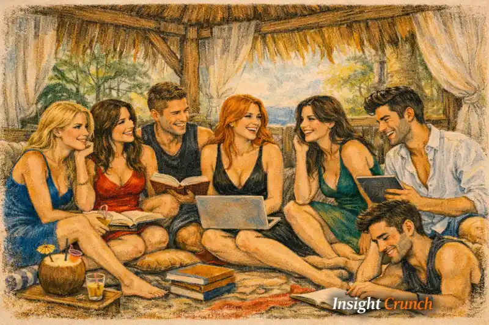

## Singles Events in Chicago: The Next Two Weeks

Chicago might be the easiest big city in America to date in, because Chicagoans actually go out. The next two weeks are stacked with speed dating in Chicago: Hot Potato Hearts opens the window with its inclusive night in Pilsen, Meet IRL runs a 32-to-42 night at Way Out in Logan Square and a child-free night in a West Town wine bar bookshop, SpeedChicago fills Recess in Fulton Market four times across the window, Cityswoon matches an under-40 Thursday at Machine Cocktail Bar and a Thanksgiving Eve room at Dearly Beloved, and Meet IRL closes the holiday week at a West Town brewery. If you want to meet singles in Chicago, this is your two-week plan.

**This edition covers Monday, November 16 to Sunday, November 29, 2026.** The list is refreshed every Sunday with a new rolling two-week window, so expired events disappear and new ones take their place. Every event below is labeled: a **Singles event** exists to help you meet a partner, while a **Singles-friendly** event is a social night where arriving alone is normal and conversation is easy. Audience labels (age ranges, LGBTQ+ and more) come straight from each organizer's listing. Prices and times are as listed by the organizer; check the event page before you go, because popular speed dating nights sell out one gender's tickets first.

This fortnight splits cleanly in half: ten dedicated dating events and ten singles-friendly ones. The dating half is unusually concentrated, speed dating across Pilsen, Logan Square, Fulton Market, River North and West Town, including a Thanksgiving Eve room on the one night of the year when nobody has to work the next morning. The friendly half is where the holiday city switches fully on: the Griffin Museum's forest of more than fifty community trees runs all window, the Christkindlmarket trades at Daley Plaza every day including a short Thanksgiving session, the Magnificent Mile lights a million bulbs with a parade and river fireworks on November 21, the 92nd Thanksgiving Parade fills State Street on the morning of November 26, Navy Pier's Winter WonderFest opens indoors on November 27, and more than 200 makers fill Artifact Events in Ravenswood across the closing weekend. Add a free run club, free Monday trivia, a Saturday tamale class and a Sunday music game night, and the fortnight has a room for every energy level and every budget from free to $59.

Use the list like a menu rather than a marathon. Pick two or three events that match your energy: one structured dating event where the introductions are handled for you, and one activity event where the talking takes care of itself. Book the ticketed ones as soon as you decide, because organizers balance their rooms and the later-booking side often ends up waitlisted. Then read the neighborhood and ambience sections further down before you go. Knowing that Machine Cocktail Bar calls for polish while a Logan Square neighborhood bar calls for a flannel will save you the only genuinely awkward moment of the night, which is being dressed for the wrong room.

One more thing before the listings: every event here was checked against its organizer's own page or listing, and every price, time, and audience note comes from that page. Where a listing did not publish a price, the listing says so rather than guessing. Thanksgiving week deserves special care: several recurring rooms change or pause their schedules around the holiday, and this edition claims no occurrence it could not support, so a thirty-second confirmation on the event page before you leave the house is always worth it.

A word on how to read the guide itself. The listings are the skeleton, but the sections after them are the strategy: a neighborhood map, a decoder for what each kind of room feels like, a success playbook for each format, and an honest section on handling rejection, because rejection is a scheduled part of this process and the people who date well through events are the ones who plan for it. Read the listings first and mark your two or three. Then read the rest with those specific rooms in mind. An evening at Machine Cocktail Bar and an afternoon on the Christkindlmarket plaza are both excellent, and they ask for almost opposite versions of you. Knowing which version to bring is most of what this guide is for.

## How Dating Works in ChicagoChicago dating runs on neighborhoods. This is a city of taverns on residential corners, of parish festivals and block parties, of people who have lived within the same six blocks for a decade and know every bartender on the street. That structure shapes the dating scene more than any app does. A Chicagoan's social world tends to be anchored to a neighborhood and a handful of regular places, which means the fastest way into the dating pool is not a better profile. It is becoming a regular somewhere, and letting familiarity do the work that algorithms promise and rarely deliver.

The neighborhood loyalty cuts both ways. Chicagoans joke about refusing to date across the river or across the expressway, and like most local jokes it is half true. Someone in Logan Square and someone in Hyde Park can live forty-five CTA minutes apart and effectively inhabit different cities. This is why the events on this list matter by location as much as by format. A speed dating night in your own part of town draws people whose daily lives already overlap with yours: same grocery stores, same train line, same Sunday farmers market. Matches made close to home survive at a higher rate than matches made across a commute, simply because seeing each other again is easy.

App culture exists here, of course, but it has a distinctly Chicago flavor of fatigue. The apps recycle the same pool, conversations die in the thread, and winter makes everyone flaky about crossing town for a stranger. The organized-events scene has grown up as the direct answer to that fatigue. Local organizers like Meet IRL have built a whole calendar around curated, in-person formats: speed dating sorted by age band and venue, from an Armitage Avenue neighborhood room to a wine-and-books child-free night and a brewery edition in West Town. National players run Chicago editions too: Cityswoon's smart-matching nights run twice in this fortnight, SpeedChicago fills Recess four times, and community organizers fill the calendar's edges, from Hot Potato Hearts' inclusive speed dating in Pilsen to the music game night at Pitch & Pour. The scene is not one scene. It is a dozen overlapping ones, and this list tries to map all of them.

Underneath the culture sits a demographic engine that keeps the whole scene supplied: Chicago is a magnet city for the young and unattached. Its universities, teaching hospitals, corporate headquarters, and trading floors import ambitious twenty- and thirty-somethings from every state in the Midwest and beyond, most of them arriving with a degree, a lease, and almost no local network. Transplants are the events market's best customers, because they need exactly what events sell, a room where meeting people is the sanctioned activity rather than an accident of friendship. Natives benefit from the arrangement too; the constant inflow keeps the dating pool from collapsing into the same two hundred people everyone already knows. If you moved to Chicago within the last two years, you are not behind. You are the demographic the entire scene was built for, and the correct strategy is volume early: more rooms, more formats, more neighborhoods, until the city starts feeling like a place where you are known. That feeling, when it arrives, is the sound of the dating market unlocking.

Seasonality matters more in Chicago than in milder cities. Summer belongs to street festivals, rooftop bars, and the lakefront, and dating is easy and ambient. Autumn is the city's social peak, and November adds a second engine: the first holiday rooms open, from the Griffin Museum's tree forest, open since November 7, giving strangers seasonal excuses to talk, while the run-up to winter creates a gentle urgency about finding someone before the city retreats indoors. Winter dating is real but deliberate; nobody crosses town in a February wind chill for a maybe. The two weeks covered here sit at the hinge of the year, which is exactly why the calendar is this full.

The ambience of Chicago dating is refreshingly unpretentious compared with either coast. The default date is a neighborhood bar, not a scene. People dress well without dressing up, talk sports without apology, and treat a second drink as a meaningful signal. Pretense reads badly here; warmth and follow-through read well. The events below reflect that range, from the candlelit calm of a River North cocktail lounge to a West Town brewery taproom where the beer is brewed on site and the hosts do the introducing. Both rooms produce real relationships. They simply ask different things of you, and the sections after the listings will help you tell them apart before you spend money on the wrong one.

November deserves its own mechanics, because it changes who shows up. The summer transplants have settled, the Halloween tourists have gone home, and the people in November rooms are disproportionately locals making a deliberate pre-winter decision to date in person. Organizers feel it too: this fortnight's calendar is heavy on banded, curated rooms and light on spectacle, because November audiences buy filtration over fireworks. That has a practical consequence for how you should choose. In October you could drift into almost any big room and let volume work. In November the better strategy is fit: pick the age band that is actually yours, the neighborhood you actually live in, and the format whose social physics match your wiring, and then work that room properly rather than sampling three. The rooms are smaller, the intentions are clearer, and the follow-up rate, anecdotally the thing every organizer in this city will tell you over a drink, is the highest of the year. People who meet in November are, on average, people who meant to meet someone this season, and they behave like it: they answer the match message, they suggest the coffee, they show up. Meet that energy at its own level and the fortnight compounds fast.

Transit quietly governs all of it. The CTA's Red and Brown Lines stitch the North Side's dating neighborhoods into a single circuit, Lincoln Park to Lakeview to Andersonville, while the Blue Line runs the northwest corridor through Logan Square, Wicker Park, and Avondale. Singles who live near a line date more, and more easily, than singles who must drive and park for every attempt, which is another argument for choosing events inside your own transit geography. A match that requires two trains and a bus in January is a match the winter will test severely. A match four stops away survives the season.

The last piece of local mechanics is the regulars economy. Chicago's bars, run clubs, trivia nights, and cafes run on repeat faces, and being known, even slightly, is social capital that transfers directly into dating. The bartender who greets you by name, the run leader who waves you into the group photo, the trivia host who knows your team: each one certifies you to the room as a person who belongs and is vouched for. Apps cannot manufacture that certification at any price. Events, attended repeatedly, manufacture it for the cost of showing up, which is why this guide keeps steering you toward the recurring rooms and the second visit.

## Chicago Singles Events at a Glance

| Event | Date | Type | Cost |
|---|---|---|---|
| Speed Dating | Hot Potato Hearts at Punch House | Mon, Nov 16 | Singles event | $13 – $25 sliding scale |
| Meet IRL | Curated Speed Dating at Way Out | Ages 32-42 | Tue, Nov 17 | Singles event | $38.04 – $43.97 |
| SpeedChicago Dating | Ages 27–42 | Wed, Nov 18 | Singles event | From $40.57 |
| Under 40 Date Night in River North | Cityswoon | Ages 29-39 | Thu, Nov 19 | Singles event | $39 |
| Meet IRL | Child-free Speed Dating | Ages 32-45 | Fri, Nov 20 | Singles event | $38.04 – $43.97 |

## Singles Events in Chicago (Dating Events and Mixers)
### 1. Speed Dating | Hot Potato Hearts at Punch House
**When:** Monday, November 16, 2026, 7:00 PM – 9:30 PM (check-in 6:30 PM) · **Where:** Punch House, 1227 W 18th St, Pilsen · **Cost:** $13 – $25 sliding scale
**Type:** Singles event · **Good for:** All singles; inclusive — the organizer does not pair people based on gender identity or orientation

The window opens with Chicago's most deliberately inclusive speed dating night at Punch House, the low-lit Pilsen bar on 18th Street. Hot Potato Hearts states its premise plainly: it does not pair people based on gender identity or orientation, everyone meets everyone, and the evening is built to be flirty, low-stakes and community-minded rather than transactional. You check in at 6:30 PM, the five-minute dates start at 7, you note who you liked, and matches are emailed afterwards. Sliding-scale tickets at $13 to $25, with some availability at the door, make this the most accessible dedicated dating room in this edition, and the Pilsen setting, a neighborhood bar a few blocks from the National Museum of Mexican Art, keeps the crowd local, arts-adjacent and unpretentious. The organizer asks for proof of vaccination and strongly encourages masks, per its listing, so check the event page for the current policy before you go. Expect a younger, queerer, more experimental room than the algorithmic nights, and a host culture that treats kindness as the house rule.

Success tip: arrive for the 6:30 check-in rather than the 7 PM start. In an inclusive room the early mingling is where the hosts set the tone and the first easy conversations happen, and being part of that settling-in makes the rotations feel like a continuation instead of an audition. Be explicit and generous about what a good night looks like for you; this format runs on stated preferences, and people who state theirs clearly get matched on them.

[Event details and tickets](https://events.humanitix.com/speed-dating-n2ypq2ew)

### 2. Meet IRL | Curated Speed Dating at Way Out | Ages 32-42
**When:** Tuesday, November 17, 2026, 6:30 PM – 9:00 PM · **Where:** Way Out, 3213 W Armitage Ave, Chicago · **Cost:** $38.04 – $43.97
**Type:** Singles event · **Good for:** Singles ages 32–42 interested in hetero dating

Meet IRL's curated format lands on Armitage Avenue at Way Out for a 32-to-42 night, a very Logan Square proposition. After checkout you set up a profile in the Meet IRL app, the curation matches you with the most compatible people in the room, and you rotate through eight or more one-on-one mini-dates at different tables across the evening, noting interest as you go and receiving mutual matches afterwards. The listing showed one women's ticket tier already sold out when checked, a reliable sign the room will be full and balanced. Way Out's neighborhood-bar warmth suits the band: 32 to 42 is where Chicago dating gets honest, careers and neighborhoods are established facts rather than aspirations, and the conversation can skip the scaffolding and go straight to how people actually spend their weeks. The Armitage corridor gives you dinner and bar options within a block for any match that wants to continue the night, and the California Blue Line stop makes the trip home simple in any weather.

Success tip: write the profile like it matters, because here it literally builds your evening. Two specific sentences about your real weekends will outperform any polished summary, and the curation rewards them with better rotations. Between rounds, use the bar rather than your phone; the unstructured minutes at a neighborhood venue are where second conversations start, and a second conversation is the strongest predictor of a match you both actually act on.

[Event details and tickets](https://allevents.in/chicago/meet-irl-curated-speed-dating-at-way-out-ages-32-42/100002003356617572)

### 3. SpeedChicago Dating | Ages 27–42
**When:** Wednesday, November 18, 2026, 7:00 PM – 9:00 PM · **Where:** Recess, 838 W Kinzie St, Fulton Market · **Cost:** From $40.57
**Type:** Singles event · **Good for:** Singles ages 27–42

SpeedChicago Dating's Wednesday edition at Recess is the efficiency play of the fortnight: meet eight to twelve local singles in one evening of five-minute mini-dates, with matches delivered directly to your SpeedChicago Smart-Card the same day and no paper or apps needed on the night itself. Recess, the big, playful Kinzie Street bar built around games and long communal tables, gives the evening looser, more social physics than a seated restaurant rotation, and a midweek 7 PM start makes it the rare dating event that costs you no weekend prime time at all. The organizer draws confident professionals, creatives and entrepreneurs from across the West Loop and downtown, and manages the room's balance closely, so booking ahead matters more than dressing up. The 27-to-44 span of bands SpeedChicago runs this window means this Wednesday room skews a little younger than its Sunday sibling, with the same two-hour discipline: arrive, rotate, mark your choices by midnight, and know your matches before you sleep.

Success tip: treat the games as part of the date. Recess rewards people who stay in motion between rounds rather than guarding a table, and a quick game with someone you were not paired with often produces the conversation the rotation missed. Keep notes on your phone after each mini-date, two or three words per person, because by date nine the early faces blur, and your same-day match choices will only be as good as your memory of who made you laugh.

[Event details and tickets](https://www.eventbrite.com/e/speedchicago-dating-ages-2742-chicagos-speed-dating-tickets-2004120268673)

### 4. Under 40 Date Night in River North | Cityswoon | Ages 29-39
**When:** Thursday, November 19, 2026, 7:00 PM – 9:30 PM · **Where:** Machine Cocktail Bar, 213 W Institute Pl, River North · **Cost:** $39
**Type:** Singles event · **Good for:** Singles ages 29–39

Cityswoon brings its smart-matching format to Machine Cocktail Bar, the design-forward River North room on Institute Place the organizer describes as an underground oasis where playful mixology meets immersive design. The machinery is familiar and effective: complete a profile in advance, with a photo where your face is clearly visible, check in on your phone with no name tags or paper, and the platform pairs you live, round by round, for around eight mini-dates with the most compatible people present, followed by open mingling. The 29-to-39 band is the city's deepest dating pool on a Thursday night, and River North after work gives the room its polish: people arrive straight from Loop and River North offices, dressed for a cocktail bar rather than a club, and the evening ends early enough for a clicked conversation to become a late dinner nearby. Booking is essential, because Cityswoon balances its rooms and late sides waitlist rather than squeeze in.

Success tip: complete the profile properly, with a clear, recent photo and honest answers. The algorithm's picks feel uncannily apt when the inputs are honest, and in a Thursday room the mingling after the rounds is half the event, so stay for it rather than leaving on the last bell. Use the venue between rounds; a cocktail bar this deliberate gives every pair a shared subject, the drink in front of you, before anyone has to perform a biography.

[Event details and tickets](https://events.humanitix.com/under-40-date-night-in-river-north-ages-29-39?hxref=srf%3Agrid%7Cmodel%3Asearch%7Cq%3Ahumans-txt%7Ccpos%3A25%7Cgeo%3Aus--michigan&hxchl=mkt-sch)

### 5. Meet IRL | Child-free Speed Dating | Ages 32-45
**When:** Friday, November 20, 2026, 7:00 PM · **Where:** Passages Wine and Books, 1911 W Chicago Ave, Chicago · **Cost:** $38.04 – $43.97
**Type:** Singles event · **Good for:** Singles ages 32–45; child-free

The fortnight's most explicitly filtered room: Meet IRL runs a child-free speed dating night, banded 32 to 45, at Passages Wine and Books on Chicago Avenue, a wine bar and bookshop that gives the evening a literate, low-volume calm few dating venues attempt. The format is the organizer's curated standard, an app profile after checkout and a rotation of eight or more mini-dates with the most compatible people in the room, but the shared premise does the heavy lifting before the first bell: everyone present has made the same major life choice, so an entire category of delicate first-date negotiation simply never comes up. The listing noted ladies' tickets sold out when checked. Wine and books are not decoration here; they are the conversation system, shelves and pours giving every pair something specific to talk about in the first minute. The crowd skews deliberate and self-knowing, people whose dating problem was never meeting anyone; it was meeting anyone whose plans for a life resembled theirs. A Friday start means the room arrives rested and in weekend mood.

Success tip: let the room's premise free you, then date normally. The value of a filtered room is not interrogating the filter all night; it is spending your minutes on the person, their work, their neighborhood, the book they just picked up, instead of on compatibility screening. Arrive a little early, browse the shelves, and open your first conversation with a title you genuinely love; in a bookshop, that is the most honest introduction available.

[Event details and tickets](https://allevents.in/chicago/speed-dating)

### 6. SpeedChicago Dating | Saturday | Ages 25–39
**When:** Saturday, November 21, 2026, 7:30 PM · **Where:** Recess, 838 W Kinzie St, Fulton Market · **Cost:** From $40.57
**Type:** Singles event · **Good for:** Singles ages 25–39

Saturday night at Recess is SpeedChicago's youngest room of the window, banded 25 to 39, and it lands on the biggest social night of the fortnight, the evening of the Magnificent Mile Lights Festival across the river. The format is the organizer's house standard: eight to twelve local singles, five-minute mini-dates, and matches delivered to your SpeedChicago Smart-Card the same day, with selections marked from your phone by midnight. What changes on a Saturday is the room's temperature. Nobody is watching a worknight clock, the big Kinzie Street space is in full weekend mode with its games and communal tables, and the post-rounds mingling can stretch because nobody has to be anywhere on Sunday morning. The Fulton Market setting helps afterwards too: Randolph Street's dining rooms and the West Loop's bars are steps away if a match wants a second act, which on a Saturday is a realistic plan rather than a hopeful one. Book ahead; Saturday rooms balance fast.

Success tip: plan the second act before the first one starts. Know one nearby bar you would genuinely suggest, and if a conversation clicks during the open mingling, make the invitation specific and immediate rather than promising to message later. Keep your Smart-Card notes honest and brief, two or three words per person between rounds, because a twelve-person Saturday rotation blurs faster than any weekday room, and your midnight selections are only as good as your memory.

[Event details and tickets](https://allevents.in/chicago/speed-dating)

### 7. Meet IRL | Curated Speed Dating at Midwest Coast Brewing | Ages 28-38
**When:** Tuesday, November 24, 2026, 6:30 PM – 9:00 PM · **Where:** Midwest Coast Brewing Company, 2137 W Walnut St, Chicago · **Cost:** From $38
**Type:** Singles event · **Good for:** Singles ages 28–38 interested in hetero dating

Thanksgiving week opens with a brewery edition of Meet IRL's curated format, banded 28 to 38, at Midwest Coast Brewing on Walnut Street in West Town. The mechanics are the organizer's standard: a profile in the app after checkout, curation that matches you with the most compatible people in the room, and a rotation of eight or more one-on-one mini-dates at tables across the evening. A brewery taproom changes the social physics in your favor: the beer is brewed on site, the room is warm and human-scaled, and the whole evening runs at neighborhood volume rather than nightclub volume, so conversation never has to compete with the speakers. The Tuesday-before-Thanksgiving timing is quietly strategic. The room fills with locals who are in town for the holiday week, in good spirits, and unusually honest about wanting to meet someone before the city retreats into December. Expect the core Meet IRL crowd, late-twenties and thirty-somethings who chose a structured room over another app thread.

Success tip: use the tap list as your opener and your pacing system. Asking what someone is drinking, and whether the house recommendation was right, is a warmer first minute than any biography question, and ordering at a deliberate pace keeps you sharp through the late rotations, which is where this format is won. Complete the app profile with specifics, your neighborhood, your real weekend, the trip you are planning, because the curation can only match what you give it.

[Event details and tickets](https://allevents.in/chicago/meet-irl-curated-speed-dating-at-midwest-coast-brewing-ages-28-38/100002003558717057)

### 8. Thanksgiving Eve Date Night @ Dearly Beloved | Cityswoon | Ages 29-49
**When:** Wednesday, November 25, 2026, 7:00 PM – 9:30 PM · **Where:** Dearly Beloved, 900 N Franklin St, River North · **Cost:** not listed
**Type:** Singles event · **Good for:** Singles ages 29–49

Cityswoon calls its Thanksgiving Eve edition at Dearly Beloved one of its most popular events of the year, and the logic is easy to see: the night before the holiday is the one evening when the whole city is already out, nobody works the next morning, and a room banded 29 to 49 fills with people in a genuinely festive mood. The format is the organizer's smart-matching standard: a fully completed profile with a clearly visible photo, phone check-in, and around eight live-selected mini-dates with the most compatible people present, in a relaxed, social atmosphere at the Franklin Street cocktail room in River North. Dearly Beloved gives the night a moody, polished setting, low light and serious drinks, that suits a wide band: the 29-to-49 span means the room holds several dating generations at once, and the live matching does the sorting a general bar never could. The listing did not publish a ticket price when checked, so confirm it on the event page. Spots are limited and booking is essential.

Success tip: treat Thanksgiving Eve like the social holiday it is. Arrive early enough to settle in before the rounds, because this room fills completely, and stay for the mingling after the last bell, when the holiday mood loosens the whole room at once. Have a low-key Friday plan ready to propose, a market walk or a coffee, because matches made on Thanksgiving Eve decay over a long weekend spent with family unless a specific next step already exists.

[Event details and tickets](https://allevents.in/chicago/thanksgiving-eve-date-night-dearly-beloved-cityswoon-ages-29-49/100002002074370336)

### 9. SpeedChicago Dating | Saturday Night Ages 29–42
**When:** Saturday, November 28, 2026, 7:30 PM – 9:30 PM · **Where:** Recess, 838 W Kinzie St, Fulton Market · **Cost:** From $40.57
**Type:** Singles event · **Good for:** Singles ages 29–42

The Saturday after Thanksgiving is one of the best dating nights of the year, and SpeedChicago's 29-to-42 room at Recess is built for it: the holiday is done, out-of-town guests have gone home, and the locals who come out are rested, fed and genuinely ready to meet someone before December. The format is the organizer's standard, eight to twelve local singles in five-minute mini-dates, matches delivered to your SpeedChicago Smart-Card the same day, selections marked from your phone by midnight. Recess in weekend mode, games, long tables, a big playful room on Kinzie Street, keeps the evening social rather than solemn, and the West Loop around it is full of second-act options if the mingling produces a click. The 29-to-42 band is prime Chicago territory: established, direct, and largely done with games that are not the venue's. A 7:30 start leaves the whole night open after the 9:30 finish, which on this particular Saturday is exactly the point.

Success tip: use the holiday as material, honestly. Everyone in the room just survived the same week, family, travel, cooking, the parade, and a light, specific story from your own Thanksgiving will outperform any polished opener. Then do the unglamorous thing that wins this format: take two-word notes after every round, mark your selections before midnight while the faces are still distinct, and message any match on Sunday with a specific plan rather than letting the weekend's warmth evaporate into December.

[Event details and tickets](https://www.eventbrite.com/e/speedchicago-dating-saturday-night-ages-2942-chicagos-speed-dating-tickets-2003266787889)

### 10. SpeedChicago Dating | Ages 32–44
**When:** Sunday, November 29, 2026, 6:00 PM – 8:00 PM · **Where:** Recess, 838 W Kinzie St, Fulton Market · **Cost:** From $40.57
**Type:** Singles event · **Good for:** Singles ages 32–44

The window closes the way a good fortnight should, with a Sunday-evening room that costs you no weekend prime time at all. SpeedChicago's 32-to-44 edition at Recess runs the organizer's efficient two hours: eight to twelve local singles, five-minute mini-dates designed to spark real conversation, and matches delivered directly to your Smart-Card the same day, with no paper and no apps needed on the night. The 32-to-44 band sits squarely in the city's deepest dating pool, old enough for seriousness, young enough for volume, and a Sunday crowd at the end of a holiday weekend has a distinctive honesty: these are people who chose a dating event over the couch on the last night of a four-day weekend, which is itself a filter for intent. Recess's games and communal tables keep the room loose, and the organizer manages balance closely, so booking ahead matters. You will be home by nine with your matches already in hand and December still unwritten.

Success tip: treat Sunday as a head start, not a last chance. The matches from a Sunday room are freshest on Monday, when everyone else is back at work and a specific, modest proposal, coffee this week, a walk, the next edition of the same event, stands out against a quiet inbox. Keep your in-room notes brief and honest, mark selections the same night, and send the follow-up within a day; Sunday rooms reward the prompt more than any other night of the week.

[Event details and tickets](https://www.eventbrite.com/e/speedchicago-dating-ages-3244-chicagos-speed-dating-tickets-2003266799925)

## Singles-Friendly Events in Chicago (Social Nights Where Meeting People Is Easy)
### 11. Fleet Feet Running Club: Fleet Feet Old Town
**When:** Monday, November 16, 2026, 6:00 PM (recurs weekly on Mondays and Thursdays; further window occurrences Thursday, November 19 and Monday, November 23 — no Thanksgiving Day session is claimed) · **Where:** Fleet Feet Old Town, 1706 N Wells St, Old Town · **Cost:** Free
**Type:** Singles-friendly · **Good for:** All singles

The cheapest social infrastructure in Chicago dating, and possibly the most effective. Fleet Feet's free fun run leaves the Old Town store on Monday and Thursday evenings at 6 PM, all paces welcome, most runners covering three to six miles out to the Lakefront Trail and back, with shorter options for anyone who wants them. Check in with the run leaders, and bring your own water and lights, an essential detail now that the evenings are fully dark by start time. What makes a run club a dating venue is repetition: the same faces, at conversational pace, twice a week, in a context where everyone looks equally unglamorous and nobody is performing. This edition claims the Monday and Thursday sessions that can be supported for the window, November 16, 19 and 23, and deliberately claims no session on Thanksgiving Day itself; if you plan a holiday-week run, confirm the schedule on the event page first. Three supported sessions still make this the listing whose social value compounds fastest inside a single fortnight.

Success tip: commit to the supported sessions rather than sampling one. Go to November 16 and November 23 if you can, because the run club's magic is cumulative: session one makes you a face, session two makes you a name, and regulars get introduced to everyone. Run at the pace of the person you want to talk to rather than your training pace; the conversation groups form in the middle of the pack, and the cool-down outside the store is where phone numbers, carefully, change hands.

[Event details and tickets](https://www.eventbrite.com/e/fleet-feet-running-club-fleet-feet-old-town-tickets-143848541861)

### 12. Trivia Night at Eataly
**When:** Monday, November 16, 2026, 6:00 PM (every Monday; a further window occurrence falls on Monday, November 23) · **Where:** Eataly Chicago, 43 E Ohio St, River North · **Cost:** Free
**Type:** Singles-friendly · **Good for:** All singles

A free Monday institution: general trivia inside Eataly Chicago, the Italian food hall on Ohio Street, run by Quiz Master Trivia, running every Monday through the season, with the listing's date range running to December 28. The questions are deliberately not Italian-themed, pop culture, history, music, sports and the random facts you did not know you knew, played in a room surrounded by food counters and wine, which gives the evening a built-in intermission economy of snacks and drinks. Two editions fall inside this window, Monday, November 16 and Monday, November 23, the second of them in Thanksgiving week, when a free, warm, early-evening room is exactly what the city needs. Trivia is the most forgiving singles-friendly format ever devised for one specific reason: it manufactures teams, and teams manufacture conversation with a scoreboard attached. Arrive solo and you are an asset, a free agent every short-handed table wants to recruit before the first round starts, and the food hall setting means nobody is trapped at a table that is not working.

Success tip: arrive a few minutes before 6 PM and let yourself be recruited visibly; stand near the forming tables with a drink rather than sealing yourself into a corner with a phone. Contribute the answers you have, laugh off the ones you miss, and stay for one post-game drink with your table. The team that forms on November 16 can simply agree to defend its honor on November 23, which is how a free trivia night quietly becomes a standing date with a room.

[Event details and tickets](https://www.eventbrite.com/e/trivia-night-at-eataly-tickets-1984795213914)

### 13. Christmas Around the World and Holidays of Light — Griffin Museum of Science and Industry
**When:** Open daily through the window, November 16–29, 2026 (exhibit runs November 7, 2026 – January 3, 2027; the museum is closed on Thanksgiving Day, November 26) · **Where:** Griffin Museum of Science and Industry, 5700 S DuSable Lake Shore Dr, Hyde Park · **Cost:** Included with museum admission (adults $25.95)
**Type:** Singles-friendly · **Good for:** All singles

Chicago's grandest holiday tradition is in full swing in Hyde Park. The Griffin Museum's 84th Christmas Around the World fills the rotunda with a four-story Grand Tree and a forest of more than fifty trees, each decorated by community volunteers sharing their own family's cultural traditions, alongside Holidays of Light displays honoring celebrations including Hanukkah, Kwanzaa and Diwali. The exhibit began in 1942 with a single tree, and its premise is pure Chicago, the city's communities decorating side by side in one enormous, beautiful room. A mid-run visit is unhurried: the opening crowds have thinned, the trees reward slow looking, and the museum's ordinary galleries give a shared day far more range than a single exhibit. Plan around one closure: the museum shuts on Thanksgiving Day itself, so the window's museum days are every day except Thursday, November 26. As a singles room it works like every great museum day, you walk beside people through spectacle, and conversation flows sideways, sparked by what you are both looking at rather than by biographies neither of you volunteered.

Success tip: use the trees as the conversation system they are. Every tree has a community behind it and usually a volunteer nearby who helped decorate it; asking about one tradition, respectfully and specifically, starts better conversations than any exhibit label. Then pick a second tree from a culture you know nothing about and learn one real thing before you leave. Curiosity, demonstrated twice in one afternoon, is the most attractive quality in the building, and the easiest to fake convincingly by simply doing it.

[Event details and tickets](https://www.griffinmsi.org/press-releases/catw-hol-2026)

### 14. Christkindlmarket Chicago at Daley Plaza
**When:** Open daily, Friday, November 20 – Sunday, November 29, 2026, 11:00 AM – 8:00 PM Sunday–Thursday and 11:00 AM – 9:00 PM Friday–Saturday (Thanksgiving Day, November 26: 11:00 AM – 4:00 PM) · **Where:** Daley Plaza, 50 W Washington St, Loop · **Cost:** Free admission
**Type:** Singles-friendly · **Good for:** All singles

Chicago's Christkindlmarket turns 30 this year, and its first full week at Daley Plaza is one of the great free rooms of the Chicago winter. The German-style market, inspired by Nuremberg's famous Christkindlesmarkt and run by German American Events, fills the plaza around the Picasso sculpture with wooden stalls selling handcrafted ornaments and gifts, plus bratwurst, pretzels, roasted nuts and hot spiced wine poured into the year's collectible mug. Entry is free; you pay only for what you eat, drink and carry home. The market trades every day of this window from its November 20 opening, including a short Thanksgiving Day session from 11 AM to 4 PM, which makes it the rare holiday room that is open precisely when the rest of the city is closed. As a social format it has a rare virtue: circulation is constant and conversation is built into every queue, every stall and every shared table, so arriving alone is invisible and starting a conversation requires nothing more than an opinion about what is in front of you both.

Success tip: go with one small mission, a specific ornament, a gift, the new mug, and let the mission slow you down at stalls instead of speed-running the plaza. The shared-table areas and the drinks queues are the market's real social rooms; claim a spot, comment on what the person beside you chose, and let a two-minute conversation be a success in itself. On Thanksgiving Day, go early in the short session, when the plaza is calm and the queues are short enough to actually talk in.

[Event details and tickets](https://www.choosechicago.com/blog/special-events/things-to-do-in-chicago-this-month/)

### 15. The Wintrust Magnificent Mile Lights Festival
**When:** Saturday, November 21, 2026 (Lights Festival Lane 11:00 AM – 4:00 PM; parade 5:30 PM; fireworks approximately 7:15 PM) · **Where:** North Michigan Avenue, from Oak Street to Wacker Drive (Lights Festival Lane at Pioneer Court, 401 N Michigan Ave) · **Cost:** Free
**Type:** Singles-friendly · **Good for:** All singles

The 35th Wintrust Magnificent Mile Lights Festival is Chicago's official start to the holiday season and the biggest free room of the fortnight by an order of magnitude. The day runs in three acts: Lights Festival Lane at Pioneer Court from 11 AM to 4 PM, with booths, live entertainment and family activities; the evening parade stepping off at 5:30 PM from Oak Street, illuminating more than a million lights across the trees of North Michigan Avenue as it moves south to Wacker Drive; and the Wintrust Fireworks Spectacular over the Chicago River at about 7:15 PM. Everything is free and open to the public. As a singles setting it works the way all great festival crowds work: a shared spectacle gives thousands of strangers the same thing to react to at the same moment, and the long, cheerful wait for the parade, strangers packed companionably along the curb, is itself a social format older than dating apps by a century. This is a one-day event inside the window, not a season, so the day itself is the whole opportunity.

Success tip: arrive for Lights Festival Lane in the afternoon and choose your parade spot early, before the street closures, near people rather than apart from them. Festival conversation runs on shared reaction, the float, the lights coming on block by block, the fireworks, so narrate lightly, react out loud, and let the curb become a small temporary neighborhood. Afterwards, walk with the crowd toward the river and a warm bar rather than fighting it toward a station; the post-parade hour is the evening's loosest.

[Event details and tickets](https://www.themagnificentmile.com/wintrust-lights-festival-your-ultimate-guide)

### 16. Tamales and Tacos Cooking Class at Su Casa
**When:** Saturday, November 21, 2026 · **Where:** Su Casa Mexican Restaurant, 49 E Ontario St, Near North Side · **Cost:** Tickets from $59 (ticket includes chips & salsa and one margarita)
**Type:** Singles-friendly · **Good for:** All singles

A Saturday anchor in Su Casa, the long-running Mexican restaurant in a converted 1867 carriage house just off the Magnificent Mile. Chefs walk the class through making tamales and tacos from scratch, masa, fillings, folding, salsa, across roughly two and a half hours, with the ticket covering chips and salsa, a margarita or other included drink, and the food you make; the booking page lists a November 21 session at $59. This edition lists the verified November 21 session only, and does not assume a Thanksgiving-weekend session on November 28, so check the booking page if you want the following Saturday. The format is a singles venue in disguise: cooking classes pair and cluster strangers around shared tasks, flour and steam make everyone relaxed and slightly ridiculous, and the conversation has a subject that refreshes itself every few minutes without anyone having to invent small talk. You also leave with a repeatable dinner-party competence that improves every future date you ever cook for, which makes the ticket the best long-term investment on this list.

Success tip: volunteer for the messy jobs. The person spreading masa and folding husks alongside you is having a conversation with you whether they planned to or not, and competence plus good humor at a shared task is the most attractive combination a morning class offers. Swap details at the tasting, not the worktop; the meal at the end, eating what the room made together, is the class's natural social hour, and it is unhurried by design.

[Event details and tickets](https://www.eventbrite.com/e/tamales-and-tacos-cooking-class-at-su-casa-tickets-1247579386529)

### 17. SAMPLES N SING-A-LONGS (Music Trivia / Game Night)
**When:** Sunday, November 22, 2026, 5:00 PM – 9:00 PM · **Where:** Pitch & Pour Supper Club, 1239 W Lake St, Chicago · **Cost:** From $8
**Type:** Singles-friendly · **Good for:** All singles

A music game night at Pitch & Pour Supper Club on West Lake Street, hosted by J-Rell, closes the window's first week. Samples N Sing-A-Longs is an interactive trivia format built on hip hop and R&B, from the classics to current hits, with rounds the listing names directly: Name That Tune, where recognizing the song before anyone else is the whole game, and Who Sampled That, which rewards the listener who can trace a beat back to its source. Knowing the song, as the organizer puts it, is only half the battle; the other half is singing your heart out in a room that has explicitly licensed it. That license is what makes the night singles-friendly in the deepest sense. A room where everyone sounds ridiculous on purpose is a room where nobody has to be cool, and shared musical memory, the song you both knew instantly, the sample you both missed, is one of the fastest genuine connections strangers can discover. The retrieved listing showed early-bird general admission from $8, so confirm the current tier on the event page before you go.

Success tip: play out loud. Music trivia punishes the silent expert and rewards the person who reacts, sings the hook and argues cheerfully for an answer, because reaction is visible and visibility is what turns a table of strangers into a team. Arrive before the first round so you are part of a team from the start rather than an addition to one, and stay for the last hour, when the competition softens and the room is mostly people enjoying the same records together.

[Event details and tickets](https://allevents.in/chicago/samples-n-sing-a-longs-music-trivia-game-night-hosted-by-j-rell/100002003665987907)

### 18. The 92nd Chicago Thanksgiving Parade
**When:** Thursday, November 26, 2026, morning (step-off reported around 7:45 AM; be at the curb by 7:15 AM) · **Where:** State Street, from Ida B. Wells Drive to Randolph Street, Loop · **Cost:** Free
**Type:** Singles-friendly · **Good for:** All singles

Thanksgiving morning on State Street is Chicago's most democratic room: the 92nd Chicago Thanksgiving Parade marches north from Ida B. Wells Drive to Randolph Street with giant balloons, marching bands, floats and performance groups, free to watch from the curb along the whole route. Sources differ slightly on the exact step-off, with reports putting it at 7:40, 7:45 or 8 AM, so the honest advice is to be in place by 7:15 and let the parade come to you. As a singles setting, a parade crowd has the same physics as a festival crowd with one addition, shared endurance: everyone on your stretch of curb chose to stand in the November cold at dawn on a holiday, which makes the curb a small, cheerful temporary neighborhood of exactly the people who show up for things. Conversation needs no opener beyond the balloon in front of you both, and the crowd afterwards drifts naturally toward coffee, the Christkindlmarket's short Thanksgiving session at Daley Plaza, and the rest of a quiet city day.

Success tip: choose your curb spot near people, bring a warm drink to share the wait, and treat the wait itself as the event. The forty minutes before step-off, strangers settling in, comparing layers, predicting balloons, are the social part; the parade is the backdrop. Afterwards, walk with your stretch of curb toward Daley Plaza rather than scattering at the first corner; shared spectacles convert to real conversation in the ten minutes after they end, and only if you stay in the crowd for them.

[Event details and tickets](https://theskydeck.com/chicago-thanksgiving-parade/)

### 19. Wintrust Winter WonderFest at Navy Pier
**When:** Opens Friday, November 27, 2026, at 10:00 AM (runs daily through January 3, 2027; closing times vary) · **Where:** Festival Hall, Navy Pier, 600 E Grand Ave, Chicago · **Cost:** $27 online at least 24 hours ahead / $32 at the door (children 2 and under free; ice skating included)
**Type:** Singles-friendly · **Good for:** All singles

The day after Thanksgiving, Navy Pier opens the city's biggest indoor winter room: Wintrust Winter WonderFest fills Festival Hall with rides, seasonal attractions and a real indoor ice rink, across a season running from November 27 through January 3. Navy Pier's own page sets the terms plainly: general admission is $27 when bought online at least 24 hours ahead and $32 at the door or within 24 hours, children two and under are free, ice skating is included with every admission, and a same-day Centennial Wheel ride is a $10 add-on. As a singles room, an indoor carnival works like a market with better lighting: constant circulation, shared activities that give strangers a subject, and a rink, which is the oldest conversation machine in winter dating, because skating beside someone is easier than facing them across a table and falling over is a bonding event. Opening weekend crowds are festive rather than frantic, heavy with locals entertaining themselves after the holiday, and the pier's restaurants give any clicked conversation a warm second location without leaving the building.

Success tip: buy the advance ticket, both for the $5 saving and because committing the day before stops the morning-of wobble that kills good plans. Head for the rink early in your visit, when you are fresh and the ice is social, and use the Wheel add-on deliberately: a slow, high, ten-minute ride above the lake is a ready-made, unhurried conversation with whoever is in the gondola line beside you, if you are brave enough to start one.

[Event details and tickets](https://navypier.org/pier-events/wintrust-winter-wonderfest/)

### 20. Chicago Artisan Market — Ravenswood (Thanksgiving Weekend)
**When:** Saturday, November 28 – Sunday, November 29, 2026, 11:00 AM – 5:00 PM both days · **Where:** Artifact Events, 4325 N Ravenswood Ave, Ravenswood · **Cost:** $8 in advance / $10 at the door (kids under 12 free)
**Type:** Singles-friendly · **Good for:** All singles

The window closes in a maker hall at full strength. The Chicago Artisan Market's Thanksgiving-weekend edition fills both buildings of Artifact Events in Ravenswood with more than 200 artisans across food, fashion, home goods and art, plus artisan coffee, pastries, plated food and a stocked bar, across Saturday, November 28 and Sunday, November 29, billed by the organizer as its Small Shop Saturday weekend. It replaces this guide's Fulton Market edition from the previous fortnight, which ran on November 15, outside this window; the Ravenswood edition is the same organizer's in-window market, in a historic venue on the Ravenswood corridor. Market physics are the friendliest in this guide. Every stall is a conversation with a subject attached, every maker is a person delighted to talk about their work, and daylight, low stakes and a hard 5 PM close make it the gentlest possible room for anyone who finds bars a grind. Small Business Saturday gives the browsing a civic purpose too: gifts to choose, local makers to support, strong opinions to compare.

Success tip: buy something small from a maker whose work you genuinely like and ask them about it properly. Vendors are a market's best-informed social nodes, they know the room, the regulars and each other, and they happily connect customers who linger. Arrive in the middle hours rather than at opening, when the hall is full and browsing naturally slows into talk, and let one good stall conversation, not a lap record, set the pace of your afternoon.

[Event details and tickets](https://chicagoartisanmarket.com/tickets-ravenswood/)

## Where to Meet Singles in Chicago, Neighborhood by Neighborhood
Chicagoans date where they live, so the smartest way to read this list is geographically. Each neighborhood on the map runs its own dating market, with its own rooms, rituals, and unwritten dress codes. Here is how the neighborhoods behind this fortnight's events actually feel from a single person's chair.

**Wicker Park.** The Division Street corridor is the northwest side's great social engine: big taprooms, patio bars, and a creative-professional crowd that arrived in its late twenties and never quite left. The taprooms and bars along Milwaukee Avenue capture the neighborhood perfectly, a crowd that chose a room over an app on any night of the week, with coffee shops and the 606 trail all around it. Wicker Park dating runs on wit and fluency; it is a talker's neighborhood, where a good story outperforms a designer outfit. Come ready to banter, and do not underestimate the vintage stores and record shops on Milwaukee Avenue as daytime conversation territory. The single most Wicker Park move of all is becoming a regular somewhere on Division, because staff and fellow regulars become your informal introducers within a month. Wicker Park also rewards the daytime game: the 606 trail, the weekend crowds around the fountain at the Polish Triangle, and a dense strip of coffee shops give singles natural, low-cost places to be visible and approachable outside of ticketed events. The neighborhood's one caution is that its scene skews toward the socially fluent; if you are rusty, warm up at an activity format nearby, like the brewery speed dating nights a few blocks west in West Town and Logan Square, where the rotation carries the conversation while your wit reboots.

**Logan Square.** If Wicker Park is the talker, Logan Square is the maker: chefs, artists, musicians, and bartenders, gathered along Milwaukee and Armitage in some of the city's best cocktail dens and most beloved dive bars. Listings sit naturally here again this fortnight: Meet IRL's speed dating at Way Out on Armitage Avenue, in a neighborhood famous for people designing their lives on purpose. Ambience runs moody and warm, brick and candlelight, vinyl on the speakers. Dating in Logan Square rewards authenticity and punishes polish; show up with a project, a passion, or at least strong opinions about pizza. The boulevards also give Logan the best pre-date walking in the city, wide green parkways built for long, low-stakes conversation. Logan's restaurant scene does heavy dating work too: a corridor of ambitious, affordable dining rooms means a second date here can be genuinely impressive without a Gold Coast budget. The neighborhood's dating population includes a high share of people in their thirties who have opted out of the downtown professional circuit on purpose, which produces a distinctive social contract: take the work seriously, take yourself lightly, and never, ever be boring about your job. Formats that assume shared values thrive here because the audience has already self-selected for intentional living: a curated dating night in a neighborhood bar sells in Logan Square precisely because the room agrees beforehand about how it wants to meet.

**Lincoln Park and Lakeview.** The classic young-professional heartland: DePaul graduates who stayed, Big Ten alumni who arrived, and the densest concentration of sports bars, improv theaters, and first-date restaurants in the city. This fortnight plants the Christkindlmarket's second home at Gallagher Way in Wrigleyville and the Thanksgiving-weekend artisan market just northwest in Ravenswood, both drawing on the district's group-based social habits. The dating culture here is social and group-based; people meet through friends of friends, softball leagues, and trivia teams, and the events scene plugs straight into that machinery. Dress is smart casual with team colors on game days. If you are new to Chicago, start here: it is the easiest dating terrain in the city for a beginner to read. The two neighborhoods also offer the city's deepest bench of recurring social machinery beyond this guide: recreational sports leagues, alumni club chapters, gym communities, and bar trivia nearly every night of the week, all of it aimed at exactly the demographic filling the mixers. The trade-off is churn; people arrive, date, pair off, and move to the suburbs at a steady clip, so the scene renews itself constantly. For a newcomer that churn is opportunity. The faces at next month's recurring rooms will not all be the faces from this month, and persistence here gets rewarded faster than anywhere else in the city.

**Andersonville.** A former Swedish village on the far North Side that became one of America's most storied LGBTQ+ neighborhoods, Andersonville runs on Clark Street bookshops, wine bars, bakeries, and an unhurried, literary calm. The neighborhood's queer dating rooms, its tea bars and bookshops along Clark Street, run on a philosophy the whole city could borrow: dating as conversation, in daylight, at a volume where people can actually think. Andersonville's crowd skews thoughtful and community-minded, with deep roots and long friendships. For queer singles especially, this is the neighborhood where dating and community genuinely overlap, and where a Saturday morning can change your season. Andersonville's daytime texture supports that overlap: the Clark Street corridor is lined with the kind of independent businesses where owners know customers, conversations start over shared interests, and nobody is in a hurry. Its dating style follows from that texture, slower, more conversational, more likely to begin as friendship-adjacent familiarity than as a spark across a loud room. People who find bar dating alienating often discover, with some surprise, that they were never bad at meeting people; they were just in the wrong rooms. Andersonville is the right room for a large and specific tribe, and its standing rooms are its front door.

**West Town.** The stretch of Chicago Avenue running through Ukrainian Village and West Town is this fortnight's quiet overachiever, hosting SpeedChicago Dating's Recess nights on Kinzie Street and Meet IRL's brewery speed dating at Midwest Coast Brewing on Walnut Street, with some of the city's best small restaurants in between. West Town's ambience is independent and slightly under the radar, galleries, bakeries, corner taverns, and shops that reward regulars. Dating here skews intentional: people choose West Town events because the formats are specific and the rooms are small. Recess, the big Kinzie Street playground bar hosting SpeedChicago this fortnight, is the exception that proves the rule, a large playful room where the games lower the pressure. It is the best neighborhood in this edition for people who prefer well-chosen strangers in rooms built for talk.

**River North and the Gold Coast.** Chicago's polish district: gallery towers, steakhouses, hotel bars, and the Magnificent Mile's glow. This fortnight stacks the district's dating rooms here: Cityswoon at Machine Cocktail Bar for the under-40 Thursday night and at Dearly Beloved on Thanksgiving Eve, the free Monday trivia night at Eataly on Ohio Street, and the Su Casa cooking class on Ontario. The ambience is candlelit, tailored, and unapologetically upscale; people dress for these rooms. Dating culture here is professional and direct, heavy on the after-work drink that turns into dinner. It can read intimidating, but the secret of the Gold Coast is that everyone paid for the same filter, so the room is unusually full of people who are serious about exactly what you are serious about. The practical rhythm of the district helps too: events here start after work and end early enough for a same-night dinner invitation to be plausible, and the density of excellent restaurants within five blocks means a good conversation never has to die for lack of a next venue. Singles who date well in River North treat the neighborhood as a circuit rather than a single stop: a mixer, then a nightcap somewhere quieter, then a walk along the river. The polish is the point, but underneath it sits the same Chicago directness as everywhere else in this guide.

**Pilsen.** Chicago's Mexican-American cultural heart, anchored by the National Museum of Mexican Art on 19th Street and Harrison Park, with murals, bakeries, and a main-street warmth that treats public celebration as a civic art. This edition's Pilsen anchor sits right in the neighborhood itself, where Hot Potato Hearts runs its inclusive speed dating night at Punch House on 18th Street, a few blocks from the National Museum of Mexican Art and Harrison Park. Pilsen's dating lesson is bigger than one festival: this is a neighborhood where community comes first and social life is intergenerational, public, and food-centered. Singles meet here the way people have always met, at gatherings that are not about dating at all. Come for the festivals, the museum's free exhibitions, and the cafe scene, participate respectfully, and let the neighborhood's own social fabric do what no app can. Pilsen also teaches a timing lesson. Its social peaks are public and calendared: museum events, gallery nights on the second Friday of the month, feast days and festivals that fill Harrison Park and 18th Street. A single person who learns that calendar gains a standing invitation to the neighborhood's best rooms without needing to know anyone yet. Arrive as a respectful guest, support the businesses on the corridor, learn some of the neighborhood's history from the murals and the museum itself, and the connections that follow will be rooted in something sturdier than a shared cover charge.

**Fulton Market and the West Loop.** The district that ate Chicago's restaurant scene now hosts its most playful dating rooms: SpeedChicago Dating runs four nights this fortnight at Recess on Kinzie Street, and Randolph Street's dining rooms give every event here a built-in second act. Fulton Market dating skews food-literate and after-work; the crowd arrives from the Loop's offices and the neighborhood's converted warehouses, dresses smart, and judges a room by its kitchen as much as its company. The practical advantage is density: a speed dating night here can become dinner on Randolph without a train ride, which makes the same-night continuation, the rarest and most valuable move in event dating, geographically trivial. If your dating style is planful, this is your district.

**Old Town and the rest of the map.** Grouping the list's remaining rooms makes a point about how Chicago dating really works: much of it happens in the comfortable middle ring of neighborhoods where people actually settle. Old Town contributes the Fleet Feet run club on Wells, steps from the Second City comedy corridor and a strip of friendly bars. Two other points on this edition's map deserve naming: Hyde Park, where the Griffin Museum's Christmas Around the World runs all window with more than fifty trees decorated by Chicago's cultural communities, and Pilsen, where Punch House on 18th Street gives the Southwest Side a dating room of its own. Neither room is glamorous, and that is their strength: they are where Chicagoans build routines, and routines are where relationships actually start.

## Ambiences Decoded: What Each Kind of Night Feels Like
The format on the ticket only tells you half of what you are buying. The other half is the room: its noise, its light, its social physics. Here is what each kind of night on this list actually feels like from inside, so you can match the evening to your own wiring.

**The candlelit cocktail lounge.** Machine Cocktail Bar, hosting Cityswoon's under-40 night, and Dearly Beloved, hosting its Thanksgiving Eve room, are the fortnight's polished rooms: low light, design-forward furniture, expensive air. Conversations are quiet, unhurried, and surprisingly substantive, because nobody has to shout and nobody is performing for a crowd. It favors the composed and the articulate, and it punishes loudness. If your charm is wit at normal volume, rooms like this are your natural habitat.

**The neighborhood tavern.** The neighborhood bars around Way Out in Logan Square and Midwest Coast Brewing in West Town represent Chicago's default dating architecture: wood, televisions murmuring sports, a bartender who knows the room. Noise is moderate, laughter is frequent, and the social rules are the familiar ones of a good local. These rooms favor warmth over polish and forgive almost any opening line. Most real Chicago relationships have a tavern somewhere in their origin story.

**The wine bar bookshop.** Meet IRL's child-free night at Passages Wine and Books runs on shelves and pours instead of noise and dimness. The feeling is closer to a reading crossed with a first date: focused, calm, and unusually sincere. Shy people often do their best work here, because the room carries none of the bar scene's static, and a book either of you actually loves means silence never has to stretch into panic.

**The market and the maker hall.** The Chicago Artisan Market at Artifact Events in Ravenswood shares a physics with every great maker hall: stalls and tables everywhere, objects everywhere that give your hands and eyes something to do. Conversation deepens fast in these rooms because the setting is literally made of other people's inner lives. They favor readers, makers, and anyone whose best self shows up in a one-on-one talk rather than a crowd performance.

**The museum in daylight.** The Griffin Museum's tree forest inverts normal dating geometry. Instead of facing a stranger across a table, you walk beside them through spectacle, and conversation flows sideways, sparked by exhibits rather than biographies. Movement helps; walking pairs talk more honestly than seated pairs. These rooms favor the curious, and they are the single best option for anyone who dreads the job-interview style of conventional dating.

**The active event.** The run club and the ice rink at Winter WonderFest replace conversation-first with play-first: shared effort, shared mild embarrassment, heart rates up, guards down. Attraction in these rooms builds through repeated small moments rather than one long talk, which is why they reward return visits so reliably. If you are funnier in motion than across a table, these are your rooms.

**The trivia table.** The Eataly trivia night and the Samples N Sing-A-Longs music game night at Pitch & Pour run on team physics. A shared quiz publicizes the playful part of you: strangers get a free first question, your team becomes a temporary tribe, and knowing one obscure answer at the right moment is a genuine social event. These rooms favor the observant and the good-humored, and they reward the person who recruits the solo arrival at the next table into a team rather than leaving them stranded.

**The festival crowd.** The Magnificent Mile Lights Festival, with its afternoon lane, evening parade and river fireworks, represents the biggest-room format of all: crowds, open circulation, no dating structure, and a shared purpose bigger than socializing. Festival crowds favor the observant and the unhurried. Nobody works a festival; you drift, you witness, you join an activity, you share a moment with whoever is standing beside you, and the connections that form carry the ease of having never been forced. It is the lowest-pressure format on this list, and for many people the most memorable.

A November-specific note belongs in the ambience decoder, because light changes rooms. Every evening event in this window starts after dark, and several, the run club most of all, now run entirely in the dark. Darkness is not neutral: it lowers self-consciousness, raises the value of warm indoor rooms, and makes the first ten minutes of any event, coats, scarves, cold hands, thawing out, a shared experience strangers can actually talk about. Use it. The coat-check line and the first drink queue are the two easiest conversations of a November night precisely because everyone in them is mid-transition and mildly ridiculous. Conversely, the window's daytime rooms, the tamale class, the museum exhibit and the artisan market, gain value as the evenings darken: they are where you can be seen clearly, literally, and where the shy do disproportionately well. If bars in the dark have not been working for you, this fortnight's correct experiment is daylight.

## How to Succeed at Singles Events in Chicago
### Before you leave the house: the preparation nobody sees

Event success is mostly decided before you arrive. Book early, for the balance reasons every listing in this guide repeats, and treat any pre-event profile the organizer requests as part of the event itself, not admin. At the curated Meet IRL nights and the Cityswoon nights, the profile feeds the matching, and a thoughtful one measurably changes who you meet. Ten honest minutes on it outperforms an hour of in-room brilliance delivered to the wrong rotation.

Prepare two stories and three questions. The stories should be recent and specific: something you cooked, built, saw, or survived this month, told in under a minute each. The questions should be openers that generate stories in return, about neighborhoods, food, and plans, the three inexhaustible Chicago subjects. Then handle the logistics like a professional: know your CTA route home, build in arrival fifteen minutes before start, eat something first, and cap yourself at a pace of drinks that leaves your judgment and your charm intact at the end of the night rather than the beginning. None of this is glamorous. All of it is the difference between the people who call these events a waste of money and the people quietly dating from them.

### At speed dating: six minutes is a trailer, not the movie

Most of this fortnight's singles events are speed dating in some form, from the classic seated rotations downtown to Hot Potato Hearts' inclusive rotations, Meet IRL's curated matching, and Cityswoon's algorithmic pairing, so the format deserves its own playbook. The foundational insight is that a speed date is not a miniature date. It is a trailer. Your job is not to cover your resume, your history, and your hopes in six minutes; it is to give one person a vivid, pleasant sense of what an hour with you would feel like, and to leave them curious.

Open with the present tense. Where you are, what made you come, what you have noticed tonight: these are warm, specific, and impossible to rehearse badly. Ask about their life in the city rather than their biography: their neighborhood, their Sunday routine, their last great meal, the thing they are looking forward to this fall. Chicagoans bond over the city itself, and questions about it produce stories instead of statistics. Avoid the interview sequence (job, hometown, college) not because it is rude but because it is forgettable; you are competing with eleven other conversations for a slot in someone's memory.

Manage your energy like an athlete. The middle rotations are where most people fade into autopilot, and the person who is still genuinely curious at date eight has an enormous advantage. Take notes between rounds, two or three words per person, a detail, a laugh, a plan mentioned. Those notes become gold later, both for your own matching decisions and for any follow-up message. And mark your scorecard honestly. The mutual-match system only works if your yeses mean something; the temptation to yes everyone dilutes your own signal and wastes the design.

For the curated nights, Meet IRL's Way Out, Passages and Midwest Coast Brewing events and Cityswoon's two River North nights, do the homework before you arrive. Your profile in the organizer's app is part of the matching, and specific beats generic every time: name the neighborhood you love, the dish you cook, the trip you are planning. Then trust the curation. The room has been filtered for compatibility, which means your only remaining job is presence.

### At mixers: work the edges, then commit

The fortnight's least structured dating rooms, the open mingling after the Cityswoon and SpeedChicago rounds, run on a different skill: unstructured social navigation. The governing rule of mixers is that conversations form in clusters, and clusters harden. The first twenty minutes, before groups set, are the highest-value minutes of the night, which is why every listing above repeats the same advice: arrive early.

Enter with a small mission for the first five minutes: get a drink, learn the room's layout, say one true sentence to one stranger. The games at Recess and the shared tasks at the activity events exist to do this for you, so participate in them at full size rather than spectating with your drink. Games and shared jokes feel silly for ninety seconds and then quietly hand you a roomful of people you have already laughed with.

Once the open mingling starts, apply the two-conversation rule: in the first half, have two genuine conversations of at least five minutes; in the second half, return to the better one and deepen it. Most mixer failure comes from sampling fifteen people shallowly and leaving with nothing, or gluing yourself to the first friendly face and leaving with a new acquaintance instead of a prospect. When a conversation is dying, exit with warmth and a specific: it was great talking about the marathon, I am going to circulate, find me later. A graceful exit preserves every option; a trapped, wilting conversation burns them.

Use the setting as staff. At Machine Cocktail Bar, ask what someone ordered, because the cocktails are the room's deliberate craft. At Recess, the games are a built-in excuse to talk across a shared activity. At Winter WonderFest, the rink pairs you with strangers by design. Rooms give you material; only the phone in your pocket refuses to.

### At activity events: let the task introduce you

The cooking class, the museum exhibit, the trivia nights, the parade curb and the run club share one mechanic that makes them the highest-percentage plays for shy people: the activity is the host. Your introductions are pre-written by the situation: you are teammates, lane-mates, hunting partners, station partners. Succeed here by being visibly good at the shared thing: competent, generous, and more interested in the group's fun than in your own performance.

On the ice at Winter WonderFest, that means skating at the pace of the person beside you and treating a shared laugh at a wobble as the introduction it is. At the museum, linger at the big exhibits and let the collection supply the conversation, so the people beside you experience you as a fellow explorer rather than a passerby. In the cooking class, volunteer for the messy jobs; the person up to their elbows in masa is the person everyone talks to. At run club, the rule is recurrence: pace yourself into the social middle of the pack, stay for the cool-down, and show up again next week, because the club's dating power compounds with familiarity.

Across every format on this list, the deepest principle is the same. Attraction at events is mostly repeated pleasant exposure plus one moment of genuine specificity: a remembered detail, an asked-after story, a callback to something said an hour or a week earlier. Choose rooms that let you be specific, return to the ones that recur, and treat each night as casting a wide, warm net rather than hunting a single outcome. That mindset is what success at these events actually looks like, and it is also, conveniently, the mindset that makes the nights themselves fun.

### At big-room takeovers: festivals, parades, and markets

Three of this fortnight's rooms hold a hundred people or more, the Magnificent Mile festival crowd, the Thanksgiving Parade curb, and the Ravenswood artisan market, and big rooms punish the strategy that works in small ones. Do not try to meet the room. Instead, shrink it: attach yourself to one repeating structure, a stretch of parade curb, a maker's stall you return to twice, a rink-side cluster, and let that structure introduce you in waves. In a big room, familiarity is manufactured by re-encounter, not encounter; the second time someone crosses your path, you are no longer a stranger, and the third time you are a regular. Position yourself where re-encounter happens naturally: the shared tables at the Christkindlmarket, the market's bar and food stalls at midday, the pier's rink in the first hour. Introduce two strangers to each other at least once. It costs nothing, it marks you as a connector, and connectors leave big rooms with more real conversations than hunters do.

### The week after: turning a good night into a date

The event is the audition; the following week is the job. Matches decay fast, so the follow-through window is measured in hours, not days. Message matches within twenty-four hours, reference one specific detail, and propose one specific, modest plan: coffee in a named neighborhood, a walk on the 606, a return visit to the next edition of the same event. Specific invitations get answered; vague enthusiasm gets archived. If the first plan falls through once, offer one alternative and then stop. Persistence past two silences stops reading as confidence and starts reading as pressure, and Chicago's scenes are small enough that your reputation travels between them.

Keep the pipeline plural for the first few weeks. One promising match is not a relationship, and treating it as one loads a stranger with expectations they never agreed to carry. Continue attending your regular rooms, let matches develop at their own pace, and notice how much calmer the whole process feels when no single person holds your entire romantic forecast. The singles who succeed through this scene share exactly one trait: they made going out a habit and following up a skill, and then let arithmetic do what arithmetic does.

## How to Handle Rejection Without Losing Your Nerve
Rejection at a singles event is not a possibility to prepare for. It is a structural feature of the format, and the people who thrive at these events are not the ones who avoid it. They are the ones who have made peace with its arithmetic.

Start with the arithmetic. At a twelve-rotation speed dating night, mutual matches are deliberately rare: two people must both say yes, across a six-minute sample, with all the noise of nerves, timing, and mood in the signal. A night with one match is a success. A night with none is a normal Tuesday. The matching system itself is the kindest rejection machine ever built: there is no scene, no explanation, and usually no way to know who passed. What feels like being rejected by a room is usually being filtered by a format that filters everyone, including the person you were most sure about.

In the room itself, rejection arrives in small denominations. A conversation that does not catch. Someone whose body language closes like a door. A mixer contact who drifts mid-sentence toward a friend. The skill is not preventing these moments; it is metabolizing them in under a minute. Have a physical reset: get water, find the window, step onto the sidewalk for thirty seconds of November air. Then re-enter and start one new conversation, however small. Momentum is the entire game. The person who leaves after the first flat conversation guarantees the flat conversation was the night; the person who stays gives the evening five more chances to become something else. And hold the exit line ready for your own use too: a warm, brief, specific goodbye preserves your dignity and theirs, and costs nothing.

Afterwards is where rejection does its real damage, in the quiet interpretation you put on an empty matches inbox. Practice accurate bookkeeping. Silence from a matching app means the overlap of two strangers' snap judgments was small, on one night, in one room. It says nothing reliable about your attractiveness, your worth, or your prospects in rooms where people get more than six minutes of you. Notice also the asymmetry: you passed on most of your rotations too, kindly and for reasons as arbitrary as everyone else's, a voice, a vibe, a bad Tuesday. Being passed on is the same weather, experienced from the other side.

Staying in the game is a logistics problem more than a courage problem. Build a cadence you can sustain, roughly one event a week, mixing formats so no single night carries your whole romantic hope. Rotate between the high-volume rooms (speed dating, the big mixers) and the compounding rooms (the run club's twice-weekly sessions, a recurring trivia team) where familiarity can grow across weeks. Keep a tiny private log if it helps: where you went, one good moment, one thing to try next time. It converts dating from a verdict into a practice, and practices improve. The final rule is dignity, and it is simple: never argue with a no, never chase a closed door, never let one person's indifference set the price of the next stranger's first impression of you. The room is big, the fortnight is long, and the next event on this list is already on your calendar.

Two specific pains deserve naming, because unnamed they grow teeth. The first is watching your best conversation of the night light up for someone else an hour later. It stings in a way app silence never does, precisely because the evening felt real. The accurate story is unglamorous: compatibility is not a ranking, chemistry is not a verdict, and the same qualities that drew you to that person were visible to the whole room. Let it be a compliment to your taste and move to the next conversation; the night is not over because one pairing formed without you.

The second pain is the comparison trap: the friend who matched with three people, the regular who seems to know everyone, the couple at the bar who met at this very event last spring. Comparison converts other people's outcomes into your evidence, which is bad math. Your friend is playing a longer game, or a different one, in a different room of the market. The only honest comparison available to you is with your own last month: more rooms entered, more conversations survived, more follow-ups sent. By that measure, anyone following the cadence in this guide is winning steadily, including on the nights the matches inbox comes back empty. Especially on those nights, because those are the nights that test whether the practice holds, and the practice is the whole point.

Build a morning-after ritual while you are at it. The rejection that lingers is usually the unexamined kind, replayed at low resolution for days. Counter it with ten honest minutes the next morning: what actually happened, stripped of adjectives; one thing that went better than last time; one adjustment for the next event. Write it down if writing helps, then close the notebook and let the subject rest. Rumination is rejection with a long tail; a debrief is rejection filed and finished. And protect the rest of the day. A flat event does not get your Sunday too. Singleness is a season of a life, not a sentence, and the people who come through it well are the ones who refused to let a six-minute sample size reorganize their self-respect.

## Dating Across Cultures in Chicago

Chicago is one of the most genuinely multicultural cities in America, and this fortnight's calendar proves it in a specific way: its friendliest rooms are built by the city's cultural communities themselves. A forest of holiday trees decorated by fifty different communities, a German Christmas market in its 30th season in the Loop, an inclusive dating night in Pilsen and a tamale class in a family-run carriage-house restaurant are not decorations on the dating scene. They are the dating scene, at its best.

Start with Christmas Around the World at the Griffin Museum, running daily all window in Hyde Park. More than fifty trees, each decorated by volunteers from one of Chicago's cultural communities, stand around a four-story Grand Tree, and Holidays of Light adds displays for traditions including Hanukkah, Kwanzaa and Diwali. The dating skill on offer is comparative curiosity: pick a tradition you did not grow up with, learn one true thing about it from the people presenting it, and let that be a conversation. Chicagoans are famously willing to explain their neighborhood, their parish, their family's table; what they are not willing to forgive is being treated as an exhibit. Ask to learn, never to consume.

The Christkindlmarket, opening November 20 at Daley Plaza, teaches the same lesson outdoors. Inspired by Nuremberg's market and run by German American Events, it is a living piece of German Chicago in the middle of the Loop: stalls, bratwurst, roasted nuts and spiced wine, in a plaza where half the city is doing its holiday shopping shoulder to shoulder. Attend as a participant in a tradition the city has kept for thirty years, not as a tourist at someone else's festival, and the conversations that start over a shared table will start on honest ground.

Hot Potato Hearts' speed dating night at Punch House belongs in this section too, for a different reason. Pilsen is Chicago's Mexican-American cultural heart, anchored by the National Museum of Mexican Art on 19th Street and Harrison Park, with murals, bakeries and a main-street warmth that treats public celebration as a civic art. An inclusive, community-first dating night in an 18th Street bar fits that neighborhood exactly: the organizer pairs nobody by gender or orientation, prices tickets on a sliding scale, and builds the room as community first and matching second. Come as a respectful guest in the neighborhood, support the businesses on the corridor, and let the room's own rules, stated plainly at the door, govern the night.

The Su Casa tamales and tacos class is the fortnight's most delicious classroom. Tamales are communal food by design, traditionally made in gatherings, and a Saturday class in a family-run restaurant is a small, respectful doorway into Mexican Chicago's food culture: masa technique, salsa, the history carried in the recipes. Guests are welcomed warmly, and the correct posture is the student's: ask questions, take the instruction seriously, and never treat a cuisine as a costume. People who learn even a little of a culture's food language date better across every line in this city, because food is where Chicago's cultures most generously meet strangers.

Hot Potato Hearts' inclusive night adds a different kind of inclusion: a room where nobody is paired by gender identity or orientation, run with the same care as any algorithmic night, and Meet IRL's child-free night at Passages does the same for a life-choice filter that usually takes three dates to surface. Rooms built for a specific community, run by mainstream organizers alongside Andersonville's long-standing queer rooms, are part of how Chicago's scene keeps widening: the format is identical, the welcome is explicit, and nobody has to wonder whether they belong in the room.

Chicago's structure makes all of this more than theory. This is a city of cultural corridors: Devon Avenue's South Asian blocks, Chinatown, Greektown, Little Italy, the Polish corridors of Milwaukee Avenue, Pilsen's Mexican-American heart, each with its own institutions, bakeries, houses of worship and social calendars. Singles events increasingly reflect that map, and dating across it can be one of the city's genuine pleasures: new food, new festivals, new family scales, new ideas about what a partnership is for. The matching caution runs both ways. Do not exoticize a person into a representative of their background, and do not sand your own background down to nothing either. The healthiest cross-cultural dating in Chicago looks like two people trading worlds at full size, with curiosity doing the translating and patience covering the parts translation misses.

## This Fortnight in Chicago

Every two-week window has its own weather, and November 16 through November 29 is the fortnight Chicago becomes its full holiday self: the first week runs on structured dating volume and the switch-on of the lights, and the second week bends around Thanksgiving, with a parade, a short-hours market day, and a closing weekend of indoor festivals and makers. Three currents run through this edition, and planning around them will double the value of the calendar.

The first is the dating core, stacked across both weeks. Monday, November 16 opens with Hot Potato Hearts' inclusive night in Pilsen. Tuesday brings Meet IRL's 32-to-42 room at Way Out, Wednesday puts SpeedChicago's 27-to-42 room at Recess, Thursday matches Cityswoon's under-40 night at Machine Cocktail Bar, and Friday pairs Meet IRL's child-free night at Passages with the opening of the Christkindlmarket. Saturday, November 21 layers SpeedChicago's youngest room, banded 25 to 39, on top of the biggest free day of the season. The second week narrows and sharpens: Meet IRL at Midwest Coast Brewing on Tuesday, November 24, Cityswoon's Thanksgiving Eve room at Dearly Beloved on Wednesday, and then a closing SpeedChicago double, Saturday night for 29-to-42 and Sunday evening for 32-to-44, to end the window. Nobody should attempt all of it. The correct play is one room per energy type: one rotation, one activity, one wildcard.

The second current is the switch-on weekend, November 20 to 22. Friday opens the Christkindlmarket at Daley Plaza for its 30th season. Saturday, November 21 is the fortnight's biggest day: tamales at Su Casa in the morning, the Lights Festival Lane at Pioneer Court from 11 AM, the Magnificent Mile parade at 5:30 PM and fireworks over the river at about 7:15 PM. Sunday closes quietly and well, with a music trivia game night at Pitch & Pour where the first week ends, fittingly, with a room full of people singing. The Griffin Museum's tree forest runs daily in Hyde Park underneath all of it, the fortnight's daylight spine.

The third current is Thanksgiving week itself, and it rewards planners. Monday still offers the free double of run club and Eataly trivia. Tuesday and Wednesday hold the week's dating rooms before the holiday. Thursday, November 26 is a morning city: the 92nd Thanksgiving Parade on State Street at dawn, then the Christkindlmarket's short 11 AM to 4 PM session, while the Griffin Museum and most major museums close for the day, a closure this edition states plainly rather than letting you discover it at the door. Friday reopens the city with Winter WonderFest at Navy Pier, and the closing weekend stacks the Ravenswood artisan market across both days against SpeedChicago's final two rooms. Sequenced this way, the two weeks stop feeling like a list and start feeling like a season, with the holiday as its hinge rather than its interruption.

Plan the fortnight as a campaign rather than a series of isolated bets, because the events interlock. Protect one completely empty evening in each week. The fortnight's density is a trap for the enthusiastic, because event dating runs on freshness, and a person arriving at their fourth room in five nights brings a visibly thinner version of themselves to it. The organizers' rooms reward the rested: your stories are newer, your curiosity is real rather than performed, and your follow-up messages the next morning get written while the night is still vivid. Two rooms a week, attended properly, with profiles completed, arrivals on time and follow-ups sent within a day, will outperform five rooms attended at half strength across this or any fortnight. Depth is the strategy; the calendar is only the supply.

## What a Fortnight of Dating Events Costs in Chicago

The full price landscape of this edition runs from free to the $59 tamale class, with the honest center of the dedicated dating market sitting between $38 and $44, and it is more navigable than it first looks. Four listings cost nothing at all, and all four are excellent: the Fleet Feet run club, which offers three supported sessions inside the window and therefore the best value-per-conversation in the entire guide, Monday trivia at Eataly, the Christkindlmarket at Daley Plaza, the Magnificent Mile Lights Festival, and the Thanksgiving Parade — five free rooms, in fact, which is the holiday season quietly subsidizing your dating life. The budget tier is real: Hot Potato Hearts' inclusive speed dating is $13 to $25 on a sliding scale, the Samples N Sing-A-Longs game night starts at $8, and the Chicago Artisan Market in Ravenswood is $8 in advance or $10 at the door.

The middle tier is where the dedicated dating market lives: Meet IRL's curated nights run $38.04 to $43.97, with its Midwest Coast Brewing edition starting at $38, Cityswoon's Machine Cocktail Bar night is $39, SpeedChicago at Recess starts at $40.57 across all four of its editions, the Griffin Museum's Christmas Around the World is included with $25.95 adult admission, and Winter WonderFest at Navy Pier is $27 bought at least a day ahead or $32 at the door, skating included. Budget roughly $38 to $44 per structured dating event. Add two drinks or a coffee at most venues, plus CTA fare, and a two-event week lands around $70 to $100 all-in. One listing did not publish a price when checked, Cityswoon's Thanksgiving Eve night at Dearly Beloved, so confirm that one on the event page before you budget it.

The premium tier in this edition is a single, honest item: the Su Casa class at $59 includes the lesson, the meal you make, chips and salsa and a margarita, which repriced as dinner-plus-entertainment is not expensive at all. The honest summary: choose two mid-tier dating events and fill the rest of the fortnight with the free and budget picks, and the whole two weeks of serious romantic effort costs less than one forgettable dinner date.

## The Standing Scene: Chicago Institutions That Run All Year

This list refreshes every two weeks, but the machinery underneath it does not. Behind the rotating dates stand a set of organizers and institutions that keep Chicago's singles scene running all year, and knowing them turns a fortnight's list into a permanent strategy.

SpeedChicago Dating is the fortnight's volume organizer, with four of the twenty listings, all at Recess in Fulton Market: Wednesday for 27-to-42, Saturday for 25-to-39, the post-Thanksgiving Saturday for 29-to-42, and the closing Sunday for 32-to-44. Its model, short rotations with same-day Smart-Card matches, repeats across the calendar with rotating age bands. Meet IRL fields three rooms this fortnight, at Way Out, at Passages Wine and Books and at Midwest Coast Brewing, its app-supported curated matching wrapped around warm, neighborhood-scale formats. Cityswoon fields two smart-matching nights, at Machine Cocktail Bar and at Dearly Beloved on Thanksgiving Eve. Hot Potato Hearts is the community opposite of all three, an inclusive series in Pilsen whose sliding-scale, orientation-blind format rewards regulars who appreciate a calmer, neighborhood room. If one organizer becomes your home base, pick the one whose rooms you would attend even in a week when you met nobody; that is the room where you will become a regular, and regulars are who this scene works for.

The institutions anchor the other side of the calendar. Fleet Feet's free run clubs meet on Monday and Thursday evenings, year-round, with holiday-week schedules worth confirming before you go. Eataly's Monday trivia recurs weekly through the season. The Griffin Museum's Christmas Around the World runs from November 7 through January 3, the Christkindlmarket trades at Daley Plaza from November 20 through December 24, Winter WonderFest fills Navy Pier's Festival Hall from November 27 through January 3, and the Chicago Artisan Market returns on a regular cadence across its Fulton Market and Ravenswood venues. The Thanksgiving Parade, in its 92nd year, and the Magnificent Mile Lights Festival are annual rather than recurring, which is exactly why they belong in a strategy: they are the two mornings and evenings a year when the whole city is in the same place at the same time. The strategy writes itself: pick one recurring institution and become a regular, use the big organizers for volume, and let this list, refreshed every Sunday, supply the novelty.

There is a second tier of standing infrastructure worth naming: the city's great museums and markets, whose seasonal programming keeps generating first-rate singles-friendly rooms. A museum membership is, on inspection, one of the most cost-effective dating investments in the city: it converts a dozen days a year into beautiful, conversation-rich rooms full of exactly the people this guide keeps pointing you toward. Add a neighborhood association, a parish or cultural center, and one weekly trivia team, and you have built a social circuit that will keep producing introductions in every season, whether or not any single fortnight's list happens to suit you. That is the standing scene's real lesson: events are weather, but institutions are climate, and dating, like everything else in Chicago, rewards the people who dress for the climate.

## Frequently Asked Questions About Singles Events in Chicago
**What are the best singles events in Chicago this week?**
The strongest options in this window are the 10 labeled singles events above, led by speed dating nights and mixers built for introductions. The singles-friendly picks, from run clubs to markets and festivals, suit anyone who prefers meeting people sideways, through an activity. If you only pick three, take one speed dating night in your age band, one mixer for unstructured practice, and the free run club, which costs nothing and compounds weekly, or the free trivia night if you think better in a team. The full fortnight, November 16 to November 29, is mapped in the listings, and the guide refreshes every Sunday, so there is always a current answer to this question rather than a stale one.

**What is the difference between a singles event and a singles-friendly event?**
A singles event is organized for dating: speed dating, singles mixers, lock and key parties and matchmaking nights. Everyone present is single, available, and there to meet someone, which is stated out loud and built into the format. A singles-friendly event is a general social event, like a trivia night, class or festival, where lots of people attend solo and talking to strangers is part of the format, but dating is the side effect rather than the stated purpose. Many people find the friendly events easier to start with because the pressure is lower, while the dedicated events are far more efficient: more eligible people, met faster, with intentions clear. The strongest strategy mixes both kinds across a fortnight.

**Are singles events in Chicago free?**
Some are. Many singles-friendly picks on this list are free, including run clubs, meetups and festivals, while ticketed dating events in Chicago typically run from about $10 to $50. Every listing shows its price as published by the organizer. In this edition, the free options are genuinely good: the Fleet Feet run club offers three supported sessions inside the window at no cost, Monday trivia at Eataly is free, and the Christkindlmarket, the Magnificent Mile Lights Festival and the Thanksgiving Parade are all free. The budget tier under $25 includes the Chicago Artisan Market at $8 in advance, the Samples N Sing-A-Longs game night from $8, and Hot Potato Hearts' sliding-scale tickets at $13 to $25. Free does not mean low-value here; it usually means an institution or a festival is subsidizing the room.

**Do I need to book speed dating in advance?**
Almost always, yes. Speed dating organizers cap and balance attendance, and popular nights sell out days ahead, often for one gender before the other. Popular curated nights in this city routinely sell out one side of the room while the event is still days away, and the listings in this guide note sold-out sides whenever the organizer publishes them. Booking early is not just about getting in; it affects the balance of the room, which affects everyone's matches, including yours. Use the event link in the listing to book, read the organizer's matching instructions when they arrive, and complete any pre-event profile promptly: at the curated events, that profile is part of how your rotations are chosen, and an empty one quietly weakens your night.

**What should I say in the first minute of a speed date?**
Spend it on the present tense and on them. A reliable shape: your name, one line about what brought you tonight, and one genuine question about something they have already mentioned or something visibly true about the evening. Ask questions that produce stories, not data: what their Sunday usually looks like, the best thing they ate recently, what they are into this fall. Avoid opening with the interview sequence of job, hometown, and college, not because it offends but because eleven other people are asking it, and you will blur into the field. One specific, warm detail beats a polished biography at six minutes a round. And listen in a way they can see: eye contact, follow-ups, no glancing at the next table.

**What if I get no matches after an event?**
Treat it as information about one room on one night, not a verdict about you. Mutual matching requires two snap judgments to align across minutes, with nerves and noise in the signal, so zero-match nights are statistically normal even for people who date successfully through these events over a season. Debrief honestly rather than harshly: was the age band right, did you arrive late, did you fade in the late rotations, did you say yes only to people clearly out of sync with your life? Adjust one variable and go again. If a pattern persists across several events, change formats rather than concluding anything about yourself: many people who stall at speed dating thrive at activity events where attraction builds across weeks of familiarity instead of minutes of performance.

**Can I go to a singles event alone?**
Yes, and at most of these events solo is the majority condition, not the exception. Speed dating assumes it, the run club barely notices it, and the mixers on this list explicitly welcome guests who come out on their own. The speed dating rooms hand every solo arrival a rotation within minutes of the door, and the run club does the same with a pace group. If arriving alone still feels like a cliff edge, start with the formats that hand you a role on arrival: a cooking station, a trivia team, a run club pace group, a museum tree hunt. Your nervous system settles when your hands and attention have a job. Within twenty minutes, at any event on this list, the alone part stops being the story.

**How do I follow up with someone I met at a mixer?**
Fast, specifically, and lightly. If the organizer runs a matching system, use it first, and use it the same night or the next morning while the conversation is still warm. Meet IRL's app matches, for example, arrive after its curated nights, which is exactly the channel to use. If you exchanged contact details directly, send a short message within a day that references one real detail from your conversation and proposes one concrete, low-stakes plan: coffee near their neighborhood, the next edition of the event you both enjoyed. Avoid the two classic failure modes, the instant marathon text thread that burns the spark before a second meeting, and the three-day silence that reads as indifference. One good message, one easy plan, then let them answer.

**Are there singles events in Chicago for people over 40?**
Yes, and this edition serves the over-40s unusually well. Cityswoon's Thanksgiving Eve night is banded 29 to 49, Meet IRL's child-free night is banded 32 to 45, SpeedChicago fields a 32-to-44 Sunday room, and Hot Potato Hearts' inclusive night is open to all singles without an age ceiling, while the run club and cooking class welcome every age by design. A 45-year-old is a target guest at several of this fortnight's ten dating events rather than an exception, and the broader pattern holds across the year too: Chicago's organizer scene invests heavily in the 35-plus market, because that is where much of the demand is.

**Is speed dating actually better than the apps?**
It solves a different problem. The apps give you infinite profiles and very few conversations; speed dating gives you a dozen real conversations in an evening, with voice, humor, warmth, and chemistry all legible in the first minute, none of which a profile can transmit. It is worse at reach and filtering on paper, and far better at the thing that actually predicts dates: whether two people enjoy each other's company. Most successful event daters use both asymmetrically, keeping an app presence for reach while using events to replace the worst phase of app dating, the weeks of texting strangers who evaporate. Twelve six-minute meetings will tell you more about your prospects than a month of swipes.

**What should I wear to a singles event in Chicago?**
Match the room, then add one notch of intention. For Machine Cocktail Bar and Dearly Beloved, dress as you would for a good cocktail bar: tailored, polished, no athletic wear. For neighborhood speed dating in Logan Square or the Recess night, smart casual is the uniform, clean dark jeans and a real shirt or blouse, and you will fit right in. The bookshop wine bar night rewards soft, comfortable presentation, the brewery night is smart casual with layers you can shed, the run club is athletic clothes by definition, and the cooking class will get flour on whatever you choose. In November, add the practical lever: layers you can shed indoors, because every room on this list is warmer than the walk to it.

**How often is this list updated?**
Every Sunday. Expired events are removed, recurring events roll to their next date, and new events are added so the list always covers the coming two weeks. For the other nine cities, see the national guide to the [best singles events in America](/2026/10/14/best-singles-events-in-america/).

## Closing: Your Next Two Weeks, Sorted

Twenty events, two weekends, one holiday, one decision: stop waiting for the apps to have a good week. Chicago has laid out a fortnight that can hold a speed dating night in your age band on almost any evening you choose, an inclusive room in Pilsen, a Thanksgiving Eve room at a River North cocktail bar, a free run club that quietly becomes your social life, a museum forest built by the city's own communities, a German market in its 30th season, a dawn parade down State Street and an indoor winter carnival on the pier, all before the window closes on November 29. Pick two events today, book them before the balance of the room shifts, and let familiarity and a few brave first minutes do what swiping has not. The city is going out this fortnight. Be in the room where it happens.

*Last updated November 15, 2026. Event details can change; confirm time, venue and availability on the organizer's page before heading out.*
