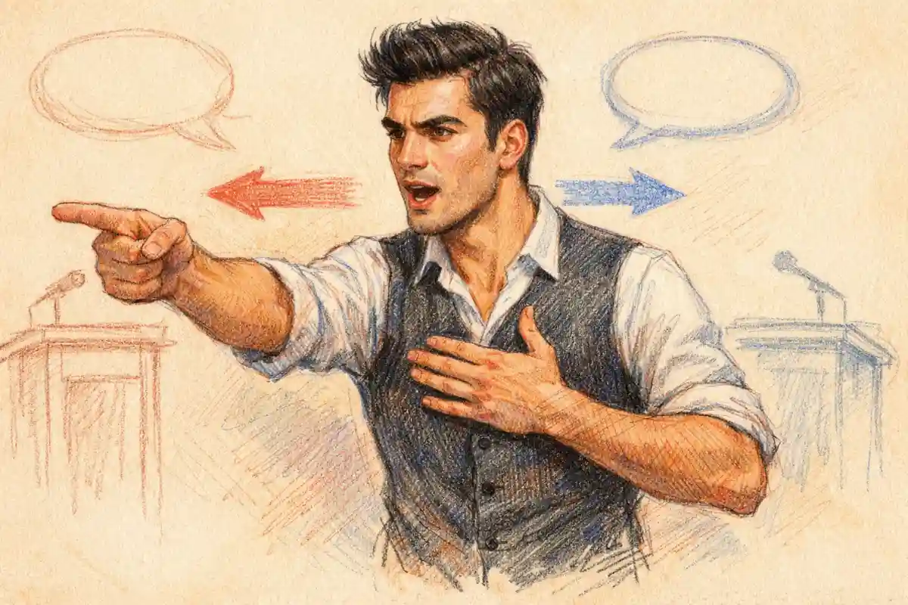

## Singles Events in Houston: The Next Two Weeks

Houston's size works in a single person's favor: every neighborhood runs its own scene. The Heights, Montrose, Downtown and the Galleria area all host speed dating in Houston, singles mixers, salsa nights with free lessons, run clubs and holiday markets in the next two weeks, much of it free or close to it. If you are searching for singles events in Houston or wondering where to meet singles in Houston, this list covers the strongest options in the city.

**This edition covers Monday, November 23 to Sunday, December 6, 2026.** The list is refreshed every Sunday with a new rolling two-week window, so expired events disappear and new ones take their place. Every event below is labeled: a **Singles event** exists to help you meet a partner, while a **Singles-friendly** event is a social night where arriving alone is normal and conversation is easy. Audience labels (age ranges, LGBTQ+ and more) come straight from each organizer's listing. Prices and times are as listed by the organizer; check the event page before you go, because popular speed dating nights sell out one gender's tickets first.

Here is how to use the guide. The first ten listings are dedicated singles events: four rooms on a single Wednesday night downtown and in Midtown, a pitch-your-friend singles party in a beer garden, a Sunday rotation for the 36 to 48 band, a Katy speed dating night, a pickleball mixer and two Saturday singles nights in the Heights, where everyone in the room is there to meet someone. The remaining ten are singles-friendly nights and days: dance lessons and socials downtown and in Rice Village, a Thanksgiving morning turkey trot, a holiday market in a park, a Heights street festival and a closing Sunday holiday market, where the activity does the introducing and nobody needs a wingman. Each listing gives you the format in detail, the feel of the room, who typically shows up, and one specific way to make that particular night work for you. After the listings you will find neighborhood guides, a decoder for the different kinds of rooms, tactics for succeeding at each format, honest advice on handling a no-match night, and a look at Houston's cross-cultural dating scene.

A word on how these events were chosen. Every listing was verified against its organizer's own page or a listing page carrying the event, with a real date inside the November 23 to December 6 window, a real venue, and a format where a person arriving alone can plausibly leave with a new connection. Pure spectator events did not make the cut. Neither did anything that requires you to already have a date. This window opens in Thanksgiving week and runs into the first full week of the holiday season, and that shaped the verification too: the holiday falls on Thursday, November 26, inside this window, so every recurring event was checked for an actual holiday-week occurrence rather than assumed. What survived is a fortnight with genuine range: it opens with beginner salsa downtown on Monday, stacks four singles rooms onto one Wednesday, starts Thanksgiving Day on foot in Uptown, pairs a singles party in a beer garden with a rooftop dance party on its first Saturday, and then settles into a second week of dance floors, a pickleball mixer, a Heights street party and two Saturday singles nights before closing at a Sunday holiday market. Pick two or three that fit your age band and your side of town, book the ticketed ones early, and treat the free recurring nights as your standing practice. That is a complete two-week plan, and it starts below.

## How Dating Works in Houston

Houston does not have one dating scene. It has a dozen, sorted by neighborhood and by freeway, and understanding that geography is the difference between a fun fortnight and an exhausting one. This is a city you cross by car, which means the apps happily match you with someone forty minutes away in traffic, and the first date dies in logistics before it starts. Events solve that problem in a way profiles cannot: they gather people who already chose the same room, in the same part of town, on the same night. When a listing says the Heights, Montrose or Katy, that is not trivia. It is the filter that makes following up easy, because a second meeting does not require a road trip.

The inner Loop holds the densest scene. Inside that ring, the Washington Avenue corridor and the Heights run polished and social, Montrose runs artsy and dinner-focused, Midtown runs young-professional and patio-heavy, and Downtown has quietly built an after-work circuit along Main and Congress where the happy hour crowd and the event crowd overlap. Beyond the Loop, the scene changes character rather than disappearing: the Memorial area hosts the ice houses and the older age bands, Rice Village draws the university and medical crowd, Katy draws the west side's suburban daters to its seafood-house rooms, and the East End is growing its own bar scene along Navigation Boulevard. This fortnight's listings touch nearly all of those worlds, from a Congress Street cocktail bar to a Midtown beer garden, an Allen Parkway park and a Katy Freeway dining room, which is exactly what Houston dating looks like when it is working.

Notice the age bands, because they tell you something true about this city: Houston dates at every age, openly and in organized ways. This window has Cityswoon matching 29 to 49 year olds downtown on Thanksgiving Eve, a downtown rotation at The Rig covering 27 to 42 and a Sunday room at Henke & Pillot covering 36 to 48, a games-based speed dating night in Midtown for singles in their 30s and 40s, Pre-Dating matching 25 to 42 year olds in Katy, a pickleball mixer for 30 to 45 year olds on Airline Drive, and two Heights singles nights on the closing Saturday, one for 22 to 30 year olds and one built around travel trivia for 30 to 45 year olds. Nobody in Houston apologizes for being single at 45, and the event calendar reflects a metro where careers in energy, medicine, engineering and education keep people marrying later and dating longer. Whatever band you fall in, there is a room in this list where you are the exact demographic the organizer built the night for.

The working rhythm of the city shapes the timings. Most ticketed events start between 6:30 and 8:00 PM, late enough for a commute from the Energy Corridor or the Medical Center, early enough for a weeknight. Weekend evenings still carry the biggest rooms, and this window also offers daytime doors that ask nothing of your evening at all: a Thanksgiving morning start line in Uptown and a Sunday holiday market at Autry Park, where the setting is a neighborhood green rather than a bar and the conversations tend to be calmer than a late night. Houston also socializes around food and patios in a way northern cities do not. Beer gardens, ice houses with food trucks, seated group dinners and cafe socials fill this list because late November and early December in Houston are patio season, when the heat is gone for good and every venue with outdoor space becomes the best room in town.

Thanksgiving week deserves its own paragraph, because it changes the social physics of the whole first week. Half the city travels, and the half that stays is in an unusually open mood: people are off work, old friends are back in town, and the normal excuse structure of Houston dating, the commute, the calendar, the early morning, temporarily collapses. Organizers know this, which is why Thanksgiving Eve has become one of the biggest dating nights of the Houston year, big enough that four different organizers run singles rooms on that Wednesday alone, and why the holiday morning itself belongs to the turkey trot, where thousands of Houstonians start Thanksgiving on foot in Uptown. If you are staying in town, this is not a dead week to endure. It is the most socially porous week of the season, and this edition is built to use it. The second week then hands the city over to the holiday season proper: lights going up on 19th Street, markets multiplying, and a social calendar that gives strangers a shared subject everywhere they stand.

Finally, the app culture here has a particular flavor worth naming. Houstonians are famously friendly in person and famously flaky by text, and a lot of the frustration singles describe with dating apps in this city is really a geography problem wearing a personality costume. The events below are the local correction. A dance class that meets every Monday, a bachata night that runs every Tuesday and a salsa social that starts with a free lesson give you something an app never can: repetition. Seeing the same faces in the same room across two or three weeks is how Houston actually turns strangers into couples, and the wisest way to use this guide is to pick one recurring night as your home base and one or two ticketed events as your reach. There is one more Houston trait worth knowing before you walk into any of these rooms: this city's social life runs on villages. Houston has no single center, so its residents build intense local loyalties, to a neighborhood, a venue, a weekly night, and they extend that loyalty to the people they meet inside it. A stranger at a Houston event is rarely treated as a stranger for long, because the local assumption is that anyone in the room might become a regular, a neighbor, a friend of a friend. That assumption is the invisible engine under every format in this guide, and it is why follow-through matters so much here: in a village city, you will see these people again, and the second sighting is where everything accelerates. It is also why your behavior compounds. The graciousness, reliability and good humor you show in one room travel with you to the next one.

There is a practical calendar lesson inside this window's shape. The first week concentrates its structured rooms from Monday to Sunday, while the second week spreads its chances wider, dance floors on Monday, Tuesday, Wednesday and Thursday, a mixer on Friday and two singles nights plus two dance and market nights on the closing weekend, which means a dater who plans across both weeks never goes more than two days without a real option. That spacing matters more than it sounds. Dating momentum is mostly a scheduling artifact: a match made on a Wednesday is still warm on Friday, a conversation started at a Monday dance class can be continued at the same class the following Monday, and a fortnight paced like this one lets each room set up the next. The opposite pattern, five events in three days followed by silence, produces exhaustion and a stack of unreturned messages. Read this edition as a rhythm rather than a menu. Two events in week one, two in week two, one recurring night held constant across both, and the fortnight will feel less like a campaign and more like a social life that happens to be producing dates, which is precisely the posture that works in this city.

The listings come first. The strategy sections after them will show you how to work each kind of room.

## Houston Singles Events at a Glance

| Event | Date | Type | Cost |
|---|---|---|---|
| Thanksgiving Eve Speed Dating in Downtown | Cityswoon | Ages 29-49 | Wed, Nov 25 | Singles event | $39 |
| Speed Dating at The Rig (Ages 27-42) | Wed, Nov 25 | Singles event | $32.95 early bird; $36.00 regular admission |
| Houston Singles Speed Dating Game Night: Ages 30s/40s | Wed, Nov 25 | Singles event | $24.99 |
| FREE Singles Mixer at The Kennedy | Wed, Nov 25 | Singles event | Free |
| Glitch A Match Singles Party at Axelrad | Sat, Nov 28 | Singles event | Viewer ticket $18; presenter ticket $30 |

## Singles Events in Houston (Dating Events and Mixers)

### 1. Thanksgiving Eve Speed Dating in Downtown | Cityswoon | Ages 29-49

**When:** Wednesday, November 25, 2026, 7:00 PM - 9:30 PM · **Where:** Angel Share, Downtown (924 Congress Street) · **Cost:** $39
**Type:** Singles event · **Good for:** Ages 29-49

Cityswoon builds a whole room around the calendar's strangest social night: Thanksgiving Eve speed dating downtown, for ages 29 to 49, billed by the organizer as one of its most popular events of the year. The format is Cityswoon's live-matched one: a big room of singles, around eight of your best live-selected mini-dates, phone check-in with no nametags or match cards, and hosts guiding the night. A fully completed profile with a clear photo is required in advance, spots are limited and booking is essential, and tickets are listed at $39 on the organizer's booking page.

Angel Share, on Congress Street downtown, is described by the organizer as a warm, stylish, women-owned cocktail bar, which gives the evening a smaller, more polished feel than a beer garden room. Thanksgiving Eve crowds have their own character everywhere in America: people are off work, relieved, and unusually willing to talk, and a room that gathers that mood on purpose, rather than leaving it to chance in a crowded bar, is a genuinely smart piece of dating infrastructure.

Success tip: complete your profile thoughtfully before you arrive, because the matching is only as good as what you feed it, and have a low-key follow-up ready that respects the holiday: a coffee or a walk over the long weekend, not a plan that competes with anyone's family table. Then stay for the mingling after the rounds; on Thanksgiving Eve, nobody in the room is in a hurry to be anywhere else.

Congress Street also makes the follow-through easy. Angel Share sits in the historic heart of downtown, a few blocks from the Main Street circuit and from this window's other downtown rooms, so a match made here comes with a ready-made map for a second meeting the following week.

[Event details and tickets](https://events.humanitix.com/thanksgiving-eve-speed-dating-in-downtown-ages-29-49)

### 2. Speed Dating at The Rig (Ages 27-42)

**When:** Wednesday, November 25, 2026, 7:00 PM - 9:00 PM · **Where:** The Rig Restaurant & Bar, Downtown (1314 Texas Street) · **Cost:** $32.95 early bird; $36.00 regular admission
**Type:** Singles event · **Good for:** Ages 27-42

Thanksgiving Eve carries a second downtown room, and it is one of the window's best chances at the fortnight's most reliable format: MyCheekyDate's host-led rotation at The Rig, this time for the 27 to 42 band. The organizer's Houston page lists the November 25 edition at the Cambria Hotel address on Texas Street with early bird admission at $32.95 and regular admission at $36. The format is professionally organized, structured in-person conversations with attendance monitored to keep the room balanced, and the organizer's guarantee behind the ticket if a schedule changes.

The Rig is a polished downtown bar room at conversation volume, chosen for ambience, comfort and privacy. A Thanksgiving Eve crowd skews social and unhurried in a way a normal Wednesday never does: nobody is performing the work week, because the work week is over. The organizer says it has refined this format over nearly two decades and more than 1,700 Houston events, and that experience shows in the pacing: check-in is quick, the rotation moves, and the room never sits in awkward silence.

Success tip: use the pre-event mingling deliberately. Arrive with time to get a drink, settle, and talk to two people before the rotation starts, because those unscripted minutes often produce the warmest conversation of the night. During the dates, ask one question specific to the person in front of you, and write down a private detail after each date. That detail turns a match notification into a first message that sounds like a person, not a template.

Four rooms on one night also create a genuine choice, and choice is information: the Cityswoon room at Angel Share matches you by profile, this room rotates you by host, the Midtown game night seats you at a table, and the Kennedy mixer leaves you free. Pick the mechanic that suits how you actually meet people, and do not try to do two; a dating night done fully beats two done in a rush.

[Event details and tickets](https://www.mycheekydate.com/speed-dating-houston)

### 3. Houston Singles Speed Dating Game Night: Ages 30s/40s

**When:** Wednesday, November 25, 2026, 7:00 PM - 9:00 PM · **Where:** Social Beer Garden HTX, Midtown (3101 San Jacinto Street) · **Cost:** $24.99
**Type:** Singles event · **Good for:** Ages 30s/40s

The third Thanksgiving Eve room trades the rotation for a table: Dating Games' singles game night at Social Beer Garden HTX in Midtown, suggested for singles in their 30s and 40s, at $24.99 on the organizer's Eventbrite page. The premise is speed dating rebuilt around icebreaker games: the organizer books a reserved area with tables at the bar, a host walks you through the evening by video on your phone, so there is no awkward check-in and no nametags, and you play fun, easy games with the other singles at your table. Games the organizer names include Friendly Feud-style survey questions and word games like Blank Slate, where the table tries to land on the same popular answer.

The disguise is the point. To everyone else in the beer garden, your table just looks like a group of friends having fun, and that cover lowers the stakes for people who would never walk into a room labeled speed dating. After the event, you log into the organizer's app and select the people you would like to stay in touch with, having actually met them in person first. The ticket covers organizing the night; drinks and food are your own tab, and the organizer asks for a one-drink or one-food-item minimum as a courtesy to the venue.

Success tip: play to include, not to win. The games reward the tablemate who pulls the quiet player into the answer, laughs at the near misses and remembers names between rounds, because the app selections afterward are made from exactly those impressions. Order early, stay at the table through the final game, and make your selections the same night while faces are fresh.

Social Beer Garden, on San Jacinto in Midtown, gives the format the right room: a big, casual patio space in the neighborhood where Houston's young professionals live stacked on top of each other, so a match here comes with a short map home for most of the table.

[Event details and tickets](https://www.eventbrite.com/e/houston-texas-singles-speed-dating-game-night-ages-30s40s-tickets-2004086894851?aff=ebdssbdestsearch)

### 4. FREE Singles Mixer at The Kennedy

**When:** Wednesday, November 25, 2026, 8:00 PM · **Where:** The Kennedy, 3210 West Dallas Street · **Cost:** Free
**Type:** Singles event · **Good for:** All singles

The fourth room on Thanksgiving Eve is the simplest and the cheapest: a free singles mixer at The Kennedy on West Dallas Street, listed on Eventbrite for Wednesday, November 25 from 8:00 PM, with entry free. The mixer series, run by Houston Hotspots, bills its Kennedy nights as a no-pressure, all-inclusive singles night open to all singles, and its listing for this date carries the same free-entry promise in its name. There is no rotation, no matching algorithm and no ticket: you walk in, get a drink, and work a room that is there for exactly one reason.

That simplicity is a format, not an absence of one. An unstructured mixer rewards circulation in a way rotations never ask of you, and it forgives late arrivals, early exits and bringing a friend for the first twenty minutes. The Kennedy sits just west of downtown on the edge of the Washington Avenue corridor, close enough that a Thanksgiving Eve crowd already out for the night can fold this room into its plans, which keeps the mix of people wider than a ticketed room's.

Success tip: set yourself a quota of four real conversations and a rule against spending the whole night with the first friendly group that adopts you. Open with the room, the night, the holiday weekend ahead of everyone, anything you are both looking at, and master the graceful exit and the deliberate return: the return, chosen freely, is the strongest signal of interest a mixer allows.

A free room also changes the risk arithmetic of the whole fortnight. This is the listing to choose if you are new to singles events and want to learn how you behave in one before spending money on a rotation, and it pairs naturally with a ticketed room later in the window, when you will walk in knowing your own style.

[Event details and tickets](https://www.eventbrite.com/d/tx--houston/single-events/?page=1)

### 5. Glitch A Match Singles Party at Axelrad

**When:** Saturday, November 28, 2026, 7:30 PM - 10:00 PM · **Where:** Axelrad Beer Garden, Midtown (1517 Alabama Street) · **Cost:** Viewer ticket $18; presenter ticket $30 (for a pair: the single and the friend pitching them)
**Type:** Singles event · **Good for:** All singles

The first Saturday's most original room is Glitch A Match at Axelrad, a singles party built around a gloriously Houston idea: twelve presenters each get five minutes to pitch their single friend to a room full of eligible singles, PowerPoint style, followed by a social hour to mix and mingle. The night is a special edition of the Pitch A Match format, teamed up with Axelrad's Glitch Garden, the venue's monthly video game and electronic music takeover, so after the pitches the garden stays open all night and challengers can be met over a video game duel. Presenter places are limited to twelve pairs, six men and six women being pitched, with slides due to the organizer by Monday, November 23; viewer tickets are for everyone who wants to watch the pitches, grab a drink and meet people during the mixer.

Axelrad, on Alabama Street, is one of Houston's best-loved beer gardens: a big outdoor room of hammocks, picnic tables and string lights attached to a century-old grocery building, relaxed in a way that makes a comedy-adjacent singles format feel safe rather than exposing. The crowd this format draws skews playful and self-aware, people who would rather laugh about dating than endure it.

Success tip: if you have a funny, loyal friend, take the presenter route seriously. A five-minute pitch by someone who loves you is the warmest possible introduction, because it arrives pre-endorsed, and the room meets you already smiling. As a viewer, work the social hour with the pitches as your opening lines; every person in the garden comes with a ready-made, public conversation starter, which almost never happens at a mixer.

There is a deeper reason this format works in Houston specifically. This city's dating runs on friend groups and introductions, on villages vouching for their own, and a pitch night simply formalizes the vouch. Whether you leave with a number or just a good story, you will leave having been presented, accurately and affectionately, to a room that came to listen.

[Event details and tickets](https://www.eventbrite.com/e/glitch-a-match-singles-party-at-axelrad-tickets-2003739574005?aff=oddtdtcreator)

### 6. Speed Dating at Henke & Pillot (Ages 36-48)

**When:** Sunday, November 29, 2026, 7:00 PM - 9:00 PM · **Where:** Henke & Pillot, Downtown (809 Congress Street) · **Cost:** $32.95 early bird; $36.00 regular admission
**Type:** Singles event · **Good for:** Ages 36-48

The first week closes where a Houston fortnight should: with MyCheekyDate's Sunday room at Henke & Pillot on Congress Street, for the 36 to 48 band, the oldest and most settled of its downtown rooms in this window. The organizer's page lists the November 29 edition at 7 to 9 PM with early bird admission at $32.95 and regular admission at $36. The format is the organizer's host-led, professionally organized rotation, structured in-person conversations with balanced attendance, and the same guarantee that keeps a ticket valid if a schedule changes.

Henke & Pillot is a familiar downtown address, a Congress Street bar room in the historic heart of downtown, steps from the Main Street circuit. A Sunday-after-Thanksgiving timing gives the room a particular honesty: the holiday is done, nobody is performing a big weekend, and conversations tend to run toward real life, work, family, what a good week actually looks like, which is exactly the material the 36 to 48 band dates on.

Success tip: take the private note after each date, and send your first message to a mutual match on Monday while the evening is still warm. In this band, promptness reads as seriousness, and a specific reference to something said across the table separates you from every other match in the inbox.

There is a fitting geography to a Sunday on Congress Street. Downtown hosts several of this window's rooms within a few blocks, and a match made here comes with an easy second-meeting map: the Main Street circuit, a coffee the following weekend, or a return to the same room's next edition with recognition already working for you. End the first week in the room where the city's most deliberate daters spend their Sunday nights.

[Event details and tickets](https://www.mycheekydate.com/speed-dating-houston)

### 7. Houston Speed Dating for Singles Age 25-42 | Pre-Dating | Katy

**When:** Monday, November 30, 2026, 7:00 PM - 9:00 PM · **Where:** Babin's Seafood House, 21851 Katy Freeway, Katy · **Cost:** not listed
**Type:** Singles event · **Good for:** Ages 25-42

Pre-Dating, which describes itself as part of the largest singles event company in the United States and says it has facilitated millions of pre-dates since 2001, opens the second week on the west side: its Texas collection page lists a Houston speed dating night for ages 25 to 42 on Monday, November 30 from 7 to 9 PM at Babin's Seafood House on the Katy Freeway. The collection page does not publish a price for this date, so confirm the cost on the event page when you book. The format is the classic one: a series of short pre-dates across the evening, selections recorded, and mutual matches followed up by the organizer.

The venue matters more than it might seem. Most of this guide's rooms sit inside the Loop, which quietly taxes every west side single with a forty-minute drive each way; a room in Katy reverses that arithmetic for the huge population along the Energy Corridor and the Grand Parkway. Babin's, a Louisiana-style seafood house on the freeway frontage, gives the evening a dinner-house ease: a real dining room, a crowd that mostly lives within a few exits, and a match that plausibly shares your side of town.

Success tip: treat the locality as the headline. In your pre-dates, ask the geography question early and warmly, where someone actually lives and spends their weekends, because a Katy match that works on paper and in person can become a second meeting without a freeway expedition attached. Be specific in your selections the same night, while faces are fresh.

A Monday night is also a quiet statement of intent. Nobody drifts into a Monday speed dating room by accident, and the 25 to 42 crowd that chooses a weeknight over a weekend tends to be exactly as serious as the banding suggests. If your dating life needs a room that respects both your time and your intentions, and it happens to sit on your side of the city, this is a strong way to open the second week.

[Event details and tickets](https://www.eventbrite.com/cc/texas-singles-events-speed-dating-2116889/)

### 8. Houston Singles Event: Pickleball Mixer (Ages 30-45)

**When:** Friday, December 4, 2026 · **Where:** Drop Shots HTX, 2520 Airline Drive · **Cost:** not listed
**Type:** Singles event · **Good for:** Ages 30-45

The second week's most Houston-now format is a singles event built on a pickleball court: Jigsaw Dating's Pickleball Mixer for ages 30 to 45, listed on Eventbrite's Houston singles listings for Friday, December 4 at Drop Shots HTX on Airline Drive. One honest note before you book: the listing page retrieved for this edition gives the date, the age band and the venue, but does not publish a start time or a ticket price, so confirm both on the event page when you register. Jigsaw's Houston singles series runs hosted events with a dedicated host on site to greet and check in guests, and manages its ticket release to keep its rooms balanced.

Pickleball is nearly perfect singles machinery, and it is worth saying why. The game is doubles by default, so you are always partnered; partners rotate, so you meet the whole room; the skill floor is low enough that a genuine beginner can rally within ten minutes; and the kitchen line, the no-volley zone where most points are played, puts you close enough to a partner for actual conversation between rallies. A mixer format wraps all of that in hosting, so nobody has to organize their own introductions.

Drop Shots HTX, on Airline Drive in the Heights' northern orbit, is an indoor pickleball venue, which removes the December weather question entirely and gives the night a sporty, bright-lit ambience nothing like a bar: sneakers, paddles, and a crowd in its thirties and forties that chose movement over another evening on a stool.

Success tip: volunteer for the rotation early and often. In a mixer, the players who keep cycling through partners meet everyone, while the pair that locks onto one court together meets only each other. Between games, the bench is the social center: refill water, learn names, and ask who is heading where afterward, because a Friday mixer crowd often migrates to dinner nearby, and that migration is where the real conversations happen.

[Event details and tickets](https://www.eventbrite.com/d/tx--houston/single-events/?page=1)

### 9. Houston Singles Event: Speed Dating (Ages 22-30) at Coffee Shop

**When:** Saturday, December 5, 2026 · **Where:** Wolfsmiths, 201 Woodard Street · **Cost:** not listed
**Type:** Singles event · **Good for:** Ages 22-30

The youngest room in the window belongs to Jigsaw Dating's coffee shop speed dating series, listed on Eventbrite's Houston singles listings for Saturday, December 5 for ages 22 to 30 at Wolfsmiths on Woodard Street in the Heights area. The organizer describes its coffee shop format as an intimate speed dating session designed to spark real connections, hosted, with a dedicated host on site and ticket releases managed to keep the room balanced. One honest note: the listing page retrieved for this edition gives the date, the band and the venue, but does not publish a start time or a price, so confirm both on the event page before you go; the same series' earlier Houston edition ran as a daytime session, which suits the coffee shop setting.

The coffee shop is an underrated dating room for the youngest band especially. There is no bar tab, no late night and no performance pressure: daylight manners, a drink you can actually finish, and conversations at normal volume with people whose lives, first jobs, first apartments, graduate programs, are at the same stage as yours. For daters in their twenties who find bar-based speed dating too loud or too old, this is the format built for them.

Success tip: arrive a few minutes early and let the host seat you well rather than drifting in mid-round. In a small, intimate room, the first rotation sets your reputation for the session, so bring one genuine question you enjoy asking and one recent story from your actual life, and take a private note after each date; in a young room, the prompt, specific follow-up message is rarer, and therefore more powerful, than anywhere else in this guide.

Woodard Street also gives the day a follow-up map: the Heights around it is full of coffee shops, patios and 19th Street's shops, so a match made here can become a second meeting within the same neighborhood the following weekend, on foot rather than across a freeway.

[Event details and tickets](https://www.eventbrite.com/d/tx--houston/single-events/?page=1)

### 10. Houston Singles Event: Travel Trivia Night (Ages 30-45)

**When:** Saturday, December 5, 2026 · **Where:** not listed · **Cost:** not listed
**Type:** Singles event · **Good for:** Ages 30-45

The window's second Saturday singles night swaps the rotation for a quiz: Jigsaw Dating's Travel Trivia Night for ages 30 to 45, listed on Eventbrite's Houston singles listings for Saturday, December 5. The organizer's format, from its Houston edition of the same series, is a hosted singles night built around structured travel-themed trivia, four categories plus a bonus round, with mixer-style mingling before and between rounds, run with the travel company WeRoad, and open to singles only. One honest note: the listing page retrieved for the December 5 edition gives the date and the age band, but does not publish the venue, a start time or a price, so confirm all three on the event page when you book; the series' earlier Houston edition ran in a beer garden setting in the evening.

Trivia is the gentlest interrogation ever devised, and a travel theme sharpens it. Every answer is also a small autobiography: the person who knows the capital of Peru has usually been, or dreams of going, and the conversation after each round writes itself around trips taken, trips planned and trips argued about. A team is a temporary tribe, a right answer you supply makes you briefly heroic, and a wrong answer you argue for makes you memorable, which is more than most formats offer a newcomer in one evening.

Success tip: mingle between rounds on purpose. The organizer builds the mingling breaks into the night, and they are where teams dissolve and reform as conversations; use them to talk to the people whose answers impressed you, rather than staying seated with your own team all night. Then, at the end, name the obvious follow-up: a trip, a trivia team, or simply the next Jigsaw night, said out loud to a specific person.

There is also a fit here worth naming for the 30 to 45 band: travel is the one ambition nearly everyone in that band shares and defers, so a room organized around it selects for people planning a bigger life, which is a fine thing to select for. End the window's singles calendar in the room where every question is a door.

[Event details and tickets](https://www.eventbrite.com/d/tx--houston/single-events/?page=1)

## Singles-Friendly Events in Houston (Social Nights Where Meeting People Is Easy)

### 11. Salsa Lessons for NEW Beginners. Mondays at 7p in Houston

**When:** Monday, November 23, 2026, 7:15 PM - 10:30 PM · **Where:** Distrito Federal, Downtown (114 Main Street) · **Cost:** $25 for both beginner classes; free social dancing from 9:30 PM with RSVP
**Type:** Singles-friendly · **Good for:** All singles; beginners

Latin Dance Factory's Monday beginner night is the friendliest possible way to open a fortnight: in the organizer's words, new beginner students start here, no partner or experience needed. The organizer's Eventbrite collection lists the November 23 edition at Distrito Federal from 7:15 to 10:30 PM, and its standing schedule runs mingling from 7 PM, a first beginner salsa class at 7:30 PM, a second at 8:30 PM, then a free salsa, bachata, cumbia and merengue social from 9:30 PM with an RSVP even if you skip the classes. Singles pay $25 for both classes on the listing.

Distrito Federal, on Main Street downtown, gives the night a real room: a Latin kitchen and bar where you can arrive for dinner, take the lesson, and stay for the party without the evening ever changing venue. Monday is the quietest night in Houston nightlife, which is precisely its value for a beginner: the floor is unhurried, the instructor has time for you, and the regulars who come on Mondays are the community's teachers by temperament.

Success tip: take both classes, not just the social. Two hours of rotation before the open floor means you start the social with a dozen familiar faces and at least two dances already owed in each direction. Then use the free social's first half hour, when your classmates are looking for exactly the low-stakes dances you are, rather than arriving late to a floor of established pairs.

The organizer's own advice is the deepest tip in this listing: one class is fun, and consistency is where the magic happens. This Monday night is the front door to a whole weekly system run by the same organizer across this guide, and it returns on Monday, November 30 in the same room at the same time, so a first-timer this week has a built-in second visit already scheduled. Walk through it on November 23 and you have not attended an event; you have joined an infrastructure, with a built-in reason to see the same people again.

[Event details and tickets](https://www.eventbrite.com/cc/beginner-salsa-lessons-in-houston-monday-nights-25919)

### 12. Bachata Tuesday! Lessons for NEW Beginners at 7p in Houston

**When:** Tuesday, November 24, 2026, 7:15 PM - 10:30 PM · **Where:** Henke & Pillot, Downtown (809 Congress Street) · **Cost:** From $20 (per organizer listing)
**Type:** Singles-friendly · **Good for:** All singles; beginners

Thanksgiving week keeps a genuine dance floor, and it is this one: Latin Dance Factory's Bachata Tuesday, listed in the organizer's Tuesday collection with a literal November 24 date, 7:15 to 10:30 PM, at Henke & Pillot on Congress Street, with tickets starting at $20 per person on the organizer's listing. That explicit holiday-week listing matters, because it means this is not a weekly event being assumed into existence two days before Thanksgiving; the organizer has published the date. The format mirrors the organizer's other beginner nights: doors and check-in from 7 PM, a first beginner bachata class at 7:15 PM, a second, improver class at 8:30 PM, then social dancing from 9:30 PM, with new beginners and zero experience explicitly welcome, singles and couples welcome, and no partner needed.

Henke & Pillot gives the night a handsome downtown room, the same Congress Street address that closes the first week with Sunday speed dating five days later, and a Tuesday crowd two days before a holiday has a loose, celebratory energy that ordinary Tuesdays never match: half the room is already mentally on holiday, and conversation comes easier for it.

Success tip: do both classes and stay for the first part of the social. Bachata's slower tempo makes it the most conversation-friendly dance in this guide, so use the between-song minutes to learn names and holiday plans; in Thanksgiving week, asking what someone is doing for the holiday is a warm, natural question that often turns into an invitation-shaped answer.

There is also a strategic gift here for anyone building a standing scene. A dancer who shows up in holiday week, when attendance dips, gets noticed and remembered by the regulars and instructors in a way a crowded ordinary week never allows. Thin weeks are when communities actually absorb new members, and this night returns on Tuesday, December 1 in the same room, so a first visit here comes with its second sighting already on the calendar.

[Event details and tickets](https://www.eventbrite.com/cc/bachata-lessons-in-houston-tuesday-nights-28129)

### 13. FREE Thanksgiving Salsa Night at Simone on Sunset

**When:** Wednesday, November 25, 2026, 7:15 PM - 12:00 AM · **Where:** Simone on Sunset, Rice Village (2418 Sunset Boulevard) · **Cost:** Free (per organizer listing; check the event page for any conditions)
**Type:** Singles-friendly · **Good for:** All singles

Simone's Wednesday speakeasy night returns in Thanksgiving week under its own name, and that name is the verification: Latin Dance Factory lists a FREE Thanksgiving Salsa Night at Simone for Wednesday, November 25, running 7:15 PM to midnight, with intermediate and advanced salsa lessons early in the evening and social dancing with a DJ after. In other words, the venue is not quietly hoping its regular night survives the holiday; it is programming the holiday, which is the strongest signal a Thanksgiving-week listing can send. The night is free on the organizer's listing, so check the event page for any conditions before you go.

The room is the hidden speakeasy behind the bookshelf in one of Rice Village's prettiest dining rooms, but the crowd on Thanksgiving Eve is a special one: dancers whose families are elsewhere, dancers whose families are near and who have escaped for one night, and visitors in town for the holiday being shown the best of their hosts' city. That mixture, locals with a story and guests with a reason to talk, is social gold.

Success tip: arrive for the lessons rather than the social; on a holiday night the floor fills fast and the lesson circle is where the introductions happen. If you have danced Simone's Wednesday night before, this is your second sighting, so use it as one: greet the regulars you met last time by name, take the lesson again without embarrassment, and let recognition do the work it is famous for.

Rice Village on Thanksgiving Eve has a rhythm of its own: the shops are closing for the holiday, the restaurants are full of reunions, and Simone's dining room hands over to the dancers as the night deepens. Ending the night before Thanksgiving on a dance floor, home by midnight with the holiday still ahead of you, is about as well designed as a single person's holiday week gets.

[Event details and tickets](https://allevents.in/houston/free-thanksgiving-salsa-night-at-simone-wednesday-in-houston-11-25/100001995572392746)

### 14. Houston Methodist Turkey Trot

**When:** Thursday, November 26, 2026, 7:30 AM (10K start); 8:00 AM (5K start) · **Where:** Galleria / Uptown, 4925 Westheimer · **Cost:** $59.99 (5K) / $69.99 (10K) at the current listed rate; prices have stepped up from earlier rates per the race page
**Type:** Singles-friendly · **Good for:** All singles

Thanksgiving morning in Houston starts on foot. The Houston Methodist Turkey Trot, a Thanksgiving tradition of more than thirty years, runs through Uptown and the Galleria area on Thursday, November 26: a timed 10K on a USATF-certified course starting at 7:30 AM, a timed 5K run and walk starting at 8:00 AM, and a kids run at 9:00 AM. Runners and walkers are both explicitly welcome on the race's registration page, which currently lists the 5K at $59.99 and the 10K at $69.99, with packet pickup running at Sun & Ski Sports on Westheimer through Wednesday, November 25 and race-day pickup at Dillard's Galleria from 6:30 AM. The race page notes the event has sold out in recent years, so register before you count on a race-day entry.

A big-city turkey trot is an underrated singles room precisely because nobody treats it as one. Thousands of Houstonians in festive, ridiculous, good-humored form, turkeys, pilgrims and Santas included, gather before dawn in the best mood of the year, and the social machinery runs itself: corrals sort strangers into small standing groups with time to talk, pace groups form natural running partnerships, and the finish area turns into an hour of milling, stretching and congratulating people you have never met.

Success tip: pick the distance that lets you talk. For most people that is the 5K at a conversational pace rather than a heroic 10K; you cannot charm anyone at threshold heart rate. Arrive early enough to enjoy the corral rather than sprint into it, wear something with a little humor to it, and linger at the finish instead of leaving with the medal barely on. The conversations at a turkey trot happen at the edges, before and after, not at mile two.

There is also a Houston-specific grace to starting the holiday this way. You will spend the rest of Thanksgiving eating, sitting and being grateful in the abstract; an hour spent moving through Uptown at sunrise with half the city makes the gratitude concrete, and more than one Houston relationship has begun with two people discovering, at the finish line, that neither of them had anywhere to rush off to.

[Event details and tickets](https://runsignup.com/Race/Events/TX/Houston/HoustonTurkeyTrot)

### 15. Salsa & Bachata Under the Stars. Rooftop Party @ Ivy

**When:** Saturday, November 28, 2026, 9:00 PM - 1:00 AM · **Where:** Ivy Bar & Bistro, Galleria area (2613 Potomac Drive) · **Cost:** $20 online for singles; $25 at the door
**Type:** Singles-friendly · **Good for:** All singles

Ivy's rooftop returns in a new edition of its signature party: Latin Dance Factory's Salsa & Bachata Under the Stars, listed by the organizer for Saturday, November 28 from 9 PM to 1 AM on the venue's European-style rooftop, with a lesson at 9:30 PM and social dancing from 10:30 PM. The night opens with a beginner salsa, bachata and merengue lesson with a fun mixer, then runs as a rooftop Latin party with salsa, bachata, merengue, cumbia and Latin hits, indoors and outdoors. No partner or experience is needed, everyone is welcome, and the night runs rain or shine, moving indoors if the weather turns. Singles tickets are listed at $20 online against $25 at the door.

A rooftop in late November is Houston's climate argument made visible: the heat is gone, the sky is clear, and a dance floor under the stars in the Galleria area draws a dressed-up Saturday crowd that mixes committed social dancers with people who simply wanted the prettiest room in town. The lesson-plus-mixer opening does the introducing before the party takes over, which makes this the rare big night a solo arrival can work comfortably.

Success tip: arrive for the lesson, not the party. The early mixer lesson is where the night's dance partnerships are formed, and the partners you rotate through there are the people who will find you again at midnight. By the final hour the groups have closed, but the lesson hour belongs to whoever worked it while the room was still introducing itself.

Treat the rooftop as the second act of a Galleria-area evening: dinner first in the neighborhood, then the lesson, then the stars. The party also returns on Saturday, December 5 at the same time, so anyone you meet on the 28th has a standing invitation to a second sighting exactly one week later. Either way, this is the fortnight's best pure-ambience listing, the one to choose when the point is to remember what a Houston Saturday night can feel like, with the possibility of meeting someone folded naturally into it.

[Event details and tickets](https://www.eventbrite.hk/cc/weekend-classes-parties-in-houston-3244069/)

### 16. A Very Autry Holiday Kick-off Market

**When:** Sunday, November 29, 2026, 11:00 AM - 3:00 PM · **Where:** Autry Park, 3711 Autry Park Drive · **Cost:** not listed
**Type:** Singles-friendly · **Good for:** All singles

The first week closes in daylight, outdoors and unhurried: the A Very Autry Holiday Kick-off Market takes over Autry Park on Sunday, November 29 from 11 AM to 3 PM. The park's event listing describes a holiday market with photos with Santa, a Polar Express trackless train, falling snow at Autry Park, face painting, live guitar and a DJ playing holiday music, and a Christmas ornament workshop, wrapped around the park's own cluster of restaurants and green space along Allen Parkway. The listing does not publish an admission price, so check the event page before you go.

Do not let the family-friendly dressing fool you: a daytime neighborhood market is one of the easiest rooms in this guide for a single person. Nobody is performing, everybody is browsing or eating, and every stall, food line and ornament table is a shared subject with a built-in opening line. The crowd mixes the surrounding Allen Parkway and Montrose-adjacent neighborhoods, couples doing early gift shopping, groups of friends making a slow Sunday of it, and solo browsers who fit the scene completely; markets are one of the few social formats where being alone is not even noticeable.

Success tip: arrive hungry and work the park slowly, in two passes. Buy lunch from one of the park's spots, eat it at the shared tables rather than at a screen, and let the second pass, when faces have become familiar, do the talking. Asking a maker or a neighbor in the food line what they have already tried turns browsing into conversation without a single forced line.

Autry Park also gives the closing Sunday a geography worth using. The park sits between downtown and the Galleria along the bayou corridor, a short hop from the Montrose and Midtown rooms elsewhere in this guide, so a market conversation that deserves a second act has somewhere obvious to go. End the first week the way Houston ends its best autumn Sundays: outside, fed, and in good company you did not have two weeks ago.

[Event details and tickets](https://www.dumplinghaushtx.com/events)

### 17. Cumbia 101 Crash Course for Beginners in Houston

**When:** Thursday, December 3, 2026, 7:15 PM - 10:00 PM · **Where:** Distrito Federal, Downtown (114 Main Street) · **Cost:** Ladies from $25; regular price $40 per person (per organizer listing)
**Type:** Singles-friendly · **Good for:** All singles; beginners

Latin Dance Factory's Thursday crash course slot in the second week is a Cumbia 101 Crash Course for Beginners, listed by the organizer for Thursday, December 3 from 7:15 to 10 PM at Distrito Federal on Main Street. The organizer's syllabus is explicit about the evening's shape: check-in at 7:15 PM with the bar open, cumbia foundations and footwork at 7:30 PM, beginner figures, turns and technique at 8 PM, fun combinations and a guided review at 9 PM, and complimentary social dancing after the workshop at 10 PM. The course promises to get absolute beginners dance-floor ready in a few hours, with partners rotating so everyone gets practice and no partner or experience required. The organizer's standing instruction is not to walk in, so register online; its listing prices the full course at $40 per person, with a ladies' solo ticket from $25.

Cumbia, the Colombian-born rhythm that Houston dances through its Mexican and Tejano traditions as much as its Colombian ones, is the most Houston of the Latin dances in this guide: upbeat, grounded, and forgiving of a beginner's feet within the first hour. A crash course format promises the essentials without a multi-week commitment, which suits anyone dance-curious who has been intimidated by the experienced floors elsewhere in this guide.

Success tip: be visibly a beginner and enjoy it. In a 101 room, the people who laugh, ask the instructor questions, and volunteer for the awkward first rotations become the class's social center, while the people hiding at the edge stay strangers. Exchange names during the breaks, not just steps during the songs; a beginner class is a cohort, and cohorts that trade numbers keep dancing together long after the crash course ends.

Distrito Federal hosts this course in the same Main Street room as Monday's beginner salsa night, so a dancer who has worked this guide in order arrives on December 3 already knowing the venue, the instructors and some of the faces, which is the entire recurring-night strategy paying off inside a single fortnight.

[Event details and tickets](https://allevents.in/houston/cumbia-101-crash-course-for-beginners-in-houston-thursday-12-03/100001977616503197)

### 18. Holiday on 19th Street

**When:** Friday, December 4, 2026, 6:00 PM - 10:00 PM · **Where:** 19th Street, Houston Heights (313 W 19th Street) · **Cost:** not listed
**Type:** Singles-friendly · **Good for:** All singles

The Heights' signature holiday celebration returns to 19th Street on Friday, December 4 from 6 to 10 PM: Holiday on 19th Street, described in the street's listings as a beloved Houston Heights tradition that brings the community together for a night of festive fun, with live music filling the street, the district lit and decorated for the season, and a Santa scavenger hunt with photo stops at neighborhood shops including Big Blue Whale, Casa Ramirez, the 19th Street Christmas Tree at AG Antiques and The Feisty Collective. The listings do not publish an admission price, and the event is a street celebration rather than a ticketed room, so check the event page for any ticketed elements before you go.

A street festival is singles-friendly machinery of a gentle kind. The whole neighborhood is out shopping small, drifting between galleries, bookshops and cafes on one of Houston's most walkable retail streets, and every shop doorway is a shared subject with a built-in third party, the shopkeeper, who will happily start the conversation for you. The crowd mixes Heights regulars, couples doing early gift shopping and groups of friends making a night of the street, and a solo browser fits the scene completely.

Success tip: work the street slowly, in two passes, and give yourself a small mission, one gift bought, one scavenger hunt photo found, because a person with a purpose is easier to talk to and easier to be. Ask the person beside you in a shop what they are hunting for; on a night when the whole street is shopping for other people, that question opens real conversations about families, tastes and neighborhoods, the material actual dating runs on.

19th Street also supplies the follow-up map: the Heights around it runs on coffee shops, patios and bayou trails, so a conversation started under the lights here has a dozen natural second acts within a few blocks. Start the closing weekend on the street where Houston's front-porch neighborhood does its celebrating in public.

[Event details and tickets](https://community.houstonpress.com/houston/EventSearch?eventCategory=6805387)

### 19. Holiday Flea by Night at Discovery Green

**When:** Saturday, December 5, 2026, 6:00 PM - 10:00 PM · **Where:** Discovery Green, Downtown (1500 McKinney Street) · **Cost:** Free
**Type:** Singles-friendly · **Good for:** All singles

The second Saturday closes downtown, outdoors and free: Flea by Night, Discovery Green's open-air night market, runs a holiday edition on Saturday, December 5 from 6 to 10 PM. The park's listings describe a treasure hunt by design: local makers, artists, plant vendors and independent small businesses bringing vintage finds, handmade jewelry, artisan plants and one-of-a-kind creative goods, browsed under the downtown lights along the Avenida de las Americas, as part of the holiday market series that runs on Saturdays through December 19. Admission is free.

A night market is singles-friendly machinery of a gentle kind. Nobody is performing, everybody is browsing, and every stall is a shared subject with a built-in third party, the maker, who will happily start the conversation for you. The crowd mixes downtown residents, couples doing early gift shopping and groups of friends making a night of the park, and a solo browser fits the scene completely; markets are one of the few social formats where being alone is not even noticeable.

Success tip: shop with genuine intent, even if the intent is small. Asking a maker how a piece is made, and asking the person beside you what they think of it, turns browsing into conversation without a single forced line, and buying one small thing early gives you a prop and a story for the rest of the evening. Work the market slowly, in two passes; the second pass, when faces have become familiar, is when the talking starts.

Discovery Green also gives the closing Saturday a geography worth using. The park sits in the middle of downtown's weekend circuit, a short walk from the Main Street bars and from the Congress Street rooms where this fortnight's downtown dating happens, so a market conversation that deserves a second act has somewhere obvious to go. End the Saturday the way Houston ends its best evenings: outside, unhurried, and in good company you did not have two weeks ago.

[Event details and tickets](https://www.visithoustontexas.com/lgbtq/post/hot-lgbtq-holiday-events-in-houston/)

### 20. Jingle & Mingle Houston Heights Holiday Market

**When:** Sunday, December 6, 2026, 3:00 PM · **Where:** American Graffiti, Houston Heights · **Cost:** not listed
**Type:** Singles-friendly · **Good for:** All singles

The window closes where the Heights does its holiday shopping: the Jingle & Mingle Houston Heights Holiday Market, listed for Sunday, December 6 from 3:00 PM at American Graffiti in the Heights. One honest note: the listing page retrieved for this edition gives the date, the start time and the venue, but does not publish an end time or an admission price, so check the event page before you go. What the name and the setting promise is the market format this guide has leaned on all fortnight, translated into a Sunday afternoon: local vendors, seasonal goods, and a neighborhood crowd browsing at walking pace.

A Sunday afternoon market is the lowest-pressure room in the entire edition, and that is its value as a closer. There is no ticket, no rotation, no late night and no performance; there is a street of stalls, a crowd in a generous December mood, and a shared subject, what to buy for the people you love, standing between any two strangers who stop at the same table. The crowd mixes Heights regulars with shoppers drawn in from across the inner Loop, and a solo browser is, again, simply part of the furniture of the scene.

Success tip: treat the market as a conversation course rather than a shopping trip. Set yourself the same two-pass discipline as the night market: browse once to learn the stalls, then walk it again slowly, buying one small thing and talking to one maker properly. Ask vendors who else on the street they would buy from; makers love recommending each other, and every recommendation hands you a warm introduction at the next stall.

Ending the fortnight at a Sunday market also makes a quiet strategic point about the whole guide. Houston dating does not only happen in the ticketed rooms with age bands on the door; it happens wherever the city's villages gather in public and let strangers share an errand. Leave the window with that habit installed, and the next edition's listings will find you already in motion.

[Event details and tickets](http://allevents.in/houston/sunday)

## Where to Meet Singles in Houston, Neighborhood by Neighborhood

Houston rewards people who date by neighborhood. The city is too big for a single scene, and the practical unit of Houston dating is the cluster of streets where you can park once and spend the whole evening. This fortnight's twenty events are spread across nine distinct worlds, and each world has its own ambience, its own crowd and its own rules of engagement. Learn the worlds and you can pick your room the way regulars do, by feel.

### The Heights and the Washington Avenue Corridor

The Heights is Houston's front porch: bungalow streets, bikeable pockets, and a social life that runs along 19th Street and spills south into the Washington Avenue corridor, where the city's young-professional bar scene first took off. The ambience is polished but relaxed, patios and string lights, people in their thirties and forties who have graduated from the club years and want a scene with better drinks and earlier nights. This fortnight, the corridor hosts the free singles mixer at The Kennedy on West Dallas Street on November 25, the coffee shop speed dating at Wolfsmiths on Woodard Street on December 5, the pickleball mixer up Airline Drive on December 4, and Holiday on 19th Street itself on December 4, with the Jingle & Mingle market closing the window in the neighborhood on December 6. The neighborhood itself supplies the before and after: dinner on Washington, a walk along the bayou trails, coffee the next morning. Dating here runs on proximity and repetition, because the same crowd circulates through the same few blocks weekly. If you live anywhere near the northwest inner Loop, this is the scene to adopt as your home base.

### Montrose

Montrose is Houston's bohemian heart and has been for fifty years: the museum district's edge, the city's historic LGBTQ+ center, and a dense tangle of restaurants, cafes, galleries and bars along Westheimer where every subculture in Houston overlaps. The ambience is eclectic and unpretentious, and the dating style matches: Montrose people lead with their interests. This fortnight Montrose's own rooms are Axelrad Beer Garden on Alabama Street, just south of the neighborhood's core, where the Glitch A Match singles party takes over the garden on Saturday, November 28, and Autry Park at its western edge, where the holiday market fills the green on Sunday, November 29. Westheimer is a conversation street, full of places where a meal or a coffee can stretch for hours, and Axelrad's hammocks and picnic tables run the same play at garden scale. The crowd is the most varied in the city by age, background and orientation, and the neighborhood rewards the curious: ask about the art, the food, the weird little shop you passed, and you are speaking Montrose's native language.

### Downtown and Main Street

Downtown Houston spent decades emptying at 6 PM, and its reinvention as a social district is one of the city's better recent stories. The blocks around Main and Congress now run a genuine circuit: Angel Share on Congress hosts Cityswoon's Thanksgiving Eve room on November 25, The Rig on Texas Street hosts speed dating the same night for 27 to 42 year olds, Henke & Pillot on Congress hosts Bachata Tuesday lessons on November 24 and speed dating for 36 to 48 year olds on Sunday, November 29, and Distrito Federal on Main hosts beginner salsa on Monday, November 23 and the Cumbia crash course on December 3, with Discovery Green's night market lighting up the downtown calendar on December 5. The ambience is after-work grown-up: professionals from the towers, residents of the downtown lofts, and a bar scene at conversation volume. For a single person, downtown's gift is density. A large share of this guide's twenty events happen within a few blocks of each other, which means a downtown regular can build a real social orbit inside a single neighborhood, and the crawl between them is short, lit and full of other people doing the same thing.

### Midtown

Midtown is where Houston's young professionals live stacked on top of each other, and its dating scene has the energy of that density. Its big beer gardens and patio bars are built on the same insight: large, casual, outdoor-forward spaces where groups mix easily and nobody has to commit to a table. This fortnight Midtown carries two of the window's four Thanksgiving Eve rooms: the Dating Games singles game night at Social Beer Garden HTX on San Jacinto Street, and, at its southern edge, Axelrad's Glitch A Match singles party on Alabama Street on November 28. The ambience is festival casual, hammocks and picnic tables, live music drifting, a crowd in its twenties and thirties that treats weeknights as social time. Midtown is the easiest neighborhood in Houston in which to be new. Nobody is from here, everybody arrived for work in the last five years, and the entire social infrastructure assumes you are looking to build a circle. If you have just moved to the city, start in Midtown; the learning curve is the gentlest in town, and this fortnight's downtown rooms are all a short ride from its patios.

### The East End and Second Ward

East of downtown, the Second Ward and the wider East End are Houston's frontier: Navigation Boulevard's Mexican restaurants and bakeries, a growing bar and arts scene, and an ambience that is unpolished in the best way, cheaper drinks, bigger characters, and a crowd that mixes longtime neighborhood residents with the young renters colonizing the old warehouse districts. This fortnight the east side has no ticketed room of its own, and that absence is itself information: its scene runs on standing weekly nights rather than dated events, so the practical move for an east side single is to adopt the downtown rooms a short drive west, the Congress and Main Street circuit, as a home base while the neighborhood's own calendar matures. Dating on the east side has a house-party looseness the polished west side sometimes lacks, and people who find the Heights scene too curated often discover their people here.

### Rice Village and the University District

Rice Village, the walkable cluster of shops and restaurants beside Rice University, runs a dating scene flavored by the institutions around it: the university, the Texas Medical Center a mile east, and the Museum District. Simone on Sunset anchors the Village this fortnight with its Thanksgiving salsa night on November 25, and the crowd it draws mixes graduate students and young medical professionals with the neighborhood's devoted dance community. The ambience is smart and active, a place where a conversation about your research or your residency is a feature, not small talk failure. Village dating runs earlier and healthier than the bar districts: brunches, runs, classes, dances. For a single person in the medical or academic world, this is the natural home scene, and its Wednesday anchor means your social week can reliably end on a dance floor full of people whose schedules look like yours.

### Greenway and Upper Kirby

The Greenway and Upper Kirby district is Houston's professional core after hours: office towers by day, and a strip of restaurants and venues along Kirby and Richmond that fills at night with the people who work in them. The ambience is competent and well-dressed. This fortnight the district's role is geographic rather than ticketed: it is the bridge between the Galleria's turkey trot start line on Westheimer and the inner Loop's rooms, and its ice house patios are where the after-work crowd that fills the downtown rotations actually lives. This is the most straightforward dating market in the city: people with established careers and limited time, who appreciate a format, one hosted evening of intentional introductions, that respects the calendar. If your life runs on schedule and your patience for open-ended bar nights is thin, Greenway and Upper Kirby will feel like they were designed for you, because in a sense they were.

### Spring Branch and the Memorial Area

West of the Loop, Spring Branch and the Memorial area run the most suburban scene in this guide, and in some ways the most honest one. The ice houses are the district's living rooms: big patios, cold drinks, food trucks, kids and dogs at the edges of the afternoon crowd, and a come-as-you-are warmth that the polished districts cannot fake. This fortnight's west side room sits further out still, at Babin's Seafood House on the Katy Freeway, where Pre-Dating runs its 25 to 42 room on November 30, and that is the story of the area: established adults, many dating again, who want their social life close to home and their evenings home by ten. Do not mistake the lower polish for lower stakes. The west side is where a lot of Houston's second-chapter dating happens, and its rooms are full of people who know exactly what they are looking for and are refreshingly direct about it.

### Garden Oaks and the Ella Boulevard Corridor

Garden Oaks sits this fortnight out as a ticketed world, and it still deserves its paragraph, because it explains a whole register of Houston dating. The district is one of Houston's leafiest in-town neighborhoods, all mature oaks, wide lots and a small commercial strip along Ella Boulevard that runs at neighborhood pace rather than nightlife pace. Its coffee shop rooms, when organizers book them, draw crowds from the surrounding streets and the churches and schools nearby, and the ambience is the opposite of a bar district's: an early evening start, conversation at normal volume, and a second meeting that suggests itself, another coffee on the same boulevard, a walk under the same trees, a Sunday rhythm shared rather than a night out repeated. For daters who have left the loud rooms behind without leaving dating behind, Garden Oaks is the proof that Houston keeps a gentler register in reserve, and the Heights rooms a few minutes south, the Kennedy mixer and the Woodard Street coffee shop night, are its nearest doors this window.

### Allen Parkway and the Galleria: The Festival and the Start Line

Two of this fortnight's friendliest rooms sit in worlds of their own. Along Allen Parkway, Autry Park hosts the A Very Autry Holiday Kick-off Market on November 29, in a green setting above Buffalo Bayou that feels like a cultural campus rather than a venue, drawing a crowd as diverse as the city itself. Across town in Uptown, the Galleria area supplies the window's most democratic room of all: the Turkey Trot start line on Westheimer on Thanksgiving morning, where neighborhood loyalty dissolves entirely and thousands of strangers share one festive, ridiculous, generous hour. Read the worlds together and a pattern emerges: Houston's dating map is a set of villages, each with a gate that is easy to walk through and regulars who will learn your name. The strategic conclusion is unfashionable and true. Pick the village nearest your life, geographically and temperamentally, and become a regular in it, rather than sampling the whole city's scene like a tourist. Attraction in Houston is largely a function of repeated, unforced presence in the right small world, and this fortnight's twenty events are best read as doors. Choose one door, walk through it twice, and the city starts introducing you to people on its own.

## Ambiences Decoded: What Each Kind of Night Feels Like

Every listing in this guide carries a hidden variable that matters as much as the format: the room itself. The same person can be charming in one ambience and mute in another, and half of dating strategy is simply choosing rooms that flatter who you are. Here is what the kinds of spaces in this fortnight actually feel like from inside.

**The game venue.** Social Beer Garden's game-night tables, the travel trivia night's quiz teams and Drop Shots' pickleball courts share a design: an activity with lights on it. These rooms are loud with laughter rather than music, and they hand you a role, player, that is easier to wear than the role of dater. If you are funnier in motion than across a table, game venues are your natural habitat.

**The ice house and the beer garden.** Axelrad's Alabama Street garden and Social Beer Garden's San Jacinto patio run on patio time: picnic tables, food trucks, drinks in hand, conversations that expand and contract as people drift between groups. The ambience forgives everything except standing apart. In these rooms you do not join conversations so much as pull up a chair near one, and the dress code is Houston casual at its most honest.

**The dance floor.** Distrito Federal, Simone on Sunset, Henke & Pillot's Bachata Tuesday and Ivy's rooftop under the stars run the most structured ambience of all, because the music and the rotation choreograph your evening for you. These rooms feel warm, physical and surprisingly formal in their etiquette: you ask, you dance one song, you thank, you move on. For people who trust their presence more than their patter, the dance floor is the fairest room in the city.

**The festival floor.** Holiday on 19th Street, the Autry Park market, the Flea by Night market at Discovery Green and the Jingle & Mingle market in the Heights invert the bar's rules: exhibits and stalls instead of a stage, conversation at normal volume, and a crowd that came to look at things together. The ambience rewards exactly what bars punish: thoughtfulness, listening, and being interesting while participating in something real. If your friends describe you as better in a shared activity than in a crowd, these are your rooms.

**The coffee shop.** Wolfsmiths' speed dating room seats you and keeps you: a cafe-length conversation with the people the evening assigned you. The ambience is civilized and a little exposing, because a cafe table shows character, how you order, how you pace a drink, how you treat staff, faster than any icebreaker. Choose it when you are ready to be known a little.

**The start line.** The Turkey Trot's corrals on Westheimer strip ambience down to light, motion and a shared task at sunrise. There is nothing to hide behind and nothing to perform; you are simply a person running or walking beside other people, in a body, in the world. For many singles these are the least anxious rooms in Houston, because the setting does the romantic work and leaves you only the talking. Activity rooms also forgive every social unevenness that a bar punishes: a quiet stretch reads as concentration, a joke lands inside the game's rhythm, and leaving one conversation for another is built into the rotation rather than read as rejection. If bars have never worked for you, start here, where Houston's easiest introductions happen at walking pace.

**The courtyard and the lawn.** Autry Park's green and Discovery Green's Grace Event Lawn run this guide's market days in the newest Houston setting of all: the mixed-use development and the downtown park, with open green in the middle, food and drink around the edges, and families and dogs at the margins of the adult crowd. The ambience is a backyard rebuilt inside the city, relaxed and daylight-friendly, and it excels at one thing: making an event feel like a neighborhood rather than a venue, which is exactly the feeling in which people let their guard down and start talking like themselves.

## How to Succeed at Singles Events in Houston

### Succeeding at speed dating

Most of this fortnight's ten singles events are speed dating in one of its Houston flavors, and each flavor rewards slightly different play. Cityswoon's matched night at Angel Share on Thanksgiving Eve pairs you by algorithm across a series of mini-dates and ends in open mingling. The downtown rooms at The Rig on Thanksgiving Eve and at Henke & Pillot on the closing Sunday run the classic host-led rotation across two different age bands, Pre-Dating runs its long-established rotation at a Katy seafood house, Jigsaw's coffee shop night runs a smaller hosted rotation in the Heights, and the Midtown game night replaces the rotation with icebreaker games at a shared table. Cityswoon resolves matches the following day; the hosted rooms resolve the evening in the room itself or through the organizer's app. What works everywhere: arrive early enough to check in unhurried, because your first date can smell a frantic entrance. Prepare exactly three things in advance, a thirty-second answer to "what do you do" that includes something human, one question you genuinely enjoy asking, and one recent story from your actual life. Rotate your energy, not your personality; the daters who do well are consistent, curious and specific.

The mechanics of being chosen are simpler than the industry admits. In six minutes, nobody verifies your resume; they register warmth, eye contact, laughter and whether you asked about them with follow-ups instead of waiting for your turn to talk. Say names back. Take one private note per date, because your picks and your first message afterward both depend on it. In Cityswoon's room, remember the mingling is not a cooldown, it is the second half of the event, and the person you return to there should be your best date, approached early and simply. In the hosted downtown rooms, stay to the end and be gracious in public either way; the room is small, your reputation in it is portable, and Houston's dating scene is a village that talks to itself.

One more discipline separates the successful from the frustrated at every one of these formats: how you spend the minutes between dates. The smokers-and-phones crowd treats the breaks as downtime; the daters who leave with matches treat them as scouting time, refilling a drink beside someone from the rotation they have not met yet, comparing notes with the person who just dated the same table, staying socially warm instead of cooling into a screen. A speed dating night contains roughly an hour of unstructured margin in total. Used well, that margin doubles the event.

### Succeeding at mixers and hosted nights

The unstructured and hosted nights in this edition, above all the free mixer at The Kennedy and the Glitch A Match singles party at Axelrad, reward a different skill set: circulation with intent. Give yourself a quota of real conversations, four or five, and a rule against spending the whole night with the first friendly group that adopts you. Open with the room, not with yourself: the game you both just played, the pitch you both just laughed at, anything you are both looking at. Houston rooms run warm, and a comment offered with a smile is received as hospitality rather than intrusion, which makes this the easiest city in America to practice in.

Use the hosts where a format provides them. Hosted rooms put a host in the room precisely so that a quiet attendee can be introduced rather than stranded, and asking a host "who should I meet?" is a professional request, not a confession. At the game night and the pickleball mixer, let the shared tables and courts do your screening and choose your conversations while the room is still circulating between rounds. At the pitch party, remember the presenters have done you a favor: every pitched single arrives with a public, affectionate biography, so your opening line has been written for you by their best friend. And everywhere, master the graceful exit and the deliberate return: "I promised my friend a round, but I want to hear the rest of that story" gives you both an easy out and a reason to come back, and the return, chosen freely, is the strongest signal of interest a mixer allows.

### Succeeding at activity events

The singles-friendly ten run on a single principle: the activity is the date's first half, and you are its second. At the dance nights, take the lesson, rotate willingly, and understand that your reputation forms on the floor: a patient beginner who laughs at mistakes will be asked again, and the second dance is where conversation lives. At the markets and the street festival, work the stalls in pairs and let the exhibits set the depth; at the rooftop party, arrive for the lesson hour before the groups close; at the turkey trot, choose the distance that leaves you able to talk; at the crash course, be the beginner who asks questions out loud, because a cohort remembers its brave members.

Underneath all of it sits the meta-skill that separates people who meet someone from people who collect almosts: convert the encounter. An activity event ends with a dozen warm micro-connections and, unless you act, no way to continue any of them. The conversion is small and specific. Name the next occurrence, the next Monday salsa class, the next Tuesday bachata night, the next rooftop Saturday, and say you will be there; or trade numbers with the sentence that makes it easy to accept: "I would love to continue this conversation, can I text you about the next one?" Houston's recurring calendar is the follow-up machine. Use it, and a single good night becomes a standing appointment where the person you liked is simply there, week after week, liking you back a little more each time.

## How to Handle Rejection Without Losing Your Nerve

Every format in this guide has rejection built into its machinery, and the people who succeed at singles events are not the ones who avoid it. They are the ones who have made peace with its arithmetic. Start there, with the math, because the math is merciful. A speed dating match requires two yeses out of a brief, noisy, six-minute sample, filtered through everything from genuine incompatibility to the other person's mood, workload and last relationship. A no-match night is the statistical norm for everyone in the room at some point, including the people you envied all evening. It is information about one night's overlap, delivered cheaply and kindly, and it is the price of a system that also delivers real yeses. Nobody at a singles event was rejected in the way that word suggests. They were sampled, briefly, by strangers, and the sample came back thin. That is all.

At the event itself, rejection arrives in small denominations: a mini-date that never warms, a mixer conversation that dissolves, a dance declined. Handle each with the same move: warmth, brevity, exit. Thank them, smile like you mean the small part of it you do mean, and turn your attention elsewhere without a backward glance. The room is always watching more than you think, and nothing raises a person's stock at a singles event like visible, unbothered grace. The person who takes a no cleanly becomes more attractive to everyone who witnessed it, because they have just demonstrated the exact quality every adult in the room is shopping for: emotional steadiness. Never argue, never sulk in the corner with your drink, and never let one flat interaction confiscate the remaining eleven dates. The next rotation is a new sample. Stay in the experiment.

Afterward is where most people actually lose, because afterward is when the story gets written. A matches email with nothing in it, or a text that never comes, invites the kind of 1 AM narrative in which you are the problem. Resist the narrative with procedure. Give yourself one honest debrief, ideally out loud to a friend: what went well, what you would adjust, and one thing you did that you are keeping. Then close the file. Do not stalk the event photos, do not re-litigate six-minute conversations, and do not let a digital silence outweigh the evidence of the room, where you showed up, talked to a dozen strangers and held your own. You are building a skill and a social life simultaneously, and both pay compound interest.

Staying in the game is a design problem, not a character test. Book your next event before the sting of the last one sets in; the calendar above always has a free option within days, a Monday dance class, a free Thanksgiving salsa night, a Saturday night market, so momentum never has to depend on courage. Mix your formats, because a person rejected in a rotation can be celebrated on a dance floor the same week. Keep one social anchor that is not about dating at all, a team, a class, a volunteer shift, so your worth never rides on a single evening's outcome. A related fear deserves its own sentence: the follow-up that fizzles. You matched, you messaged, and the conversation died, or the coffee never quite happened. Count that as the system working, too. Events filter for willingness to meet; only time filters for everything else, and a fizzle after two messages costs you almost nothing compared with the months an app can extract from the same incompatibility. Send one warm message, make one concrete suggestion, and if it dies, let it die with your dignity and your evening intact. The calendar above is full again next week.

And remember the deepest fact in this guide: everyone at these events has a no-match night behind them and came back anyway. The room itself is proof that rejection, survived with grace, is simply what the doorway to the rest of your life feels like from the outside.

## Dating Across Cultures in Houston

Houston is routinely counted among the most diverse large cities in America, a place where a huge share of the population was born in another country and where entire commercial districts run in Spanish, Vietnamese, Mandarin, Hindi and more. Dating here happens inside that diversity whether you plan for it or not, and this fortnight's listings give you three honest windows into how Houston's communities organize their own romantic lives.

The clearest window is the mixer room itself. This edition carries a free singles mixer at The Kennedy whose series bills its nights as open to all singles and all-inclusive, alongside age-banded rooms that are specific by design, and the wider scene those rooms belong to. Audience labels are information, not obstacles: a room banded 22 to 30 or 36 to 48, like the coffee shop night and the Henke & Pillot rotation, is a community organizing its own romantic life efficiently, the same way the city's faith communities, professional communities and cultural communities build rooms of their own. The respectful takeaway for everyone is that Houston dating runs on many tracks at once: choose the rooms that invite you, and you will find rooms built with exactly your background in mind, because in this city, every background has one.

The second window is the dance floor. Several of this guide's nights, the Monday beginner salsa downtown, the Thanksgiving night in Rice Village, Bachata Tuesday and the Cumbia crash course downtown, and the Ivy rooftop party, run on salsa, bachata, cumbia and merengue, partner dances and rhythms with roots in Cuba, the Dominican Republic, Colombia and the wider Latino world, now danced all over Houston by people of every background. Social dance culture carries its own etiquette, and learning it is a form of respect: dances are one song long, asking is normal and impersonal, a no is accepted without negotiation, and the lesson's rotation means everyone dances with everyone. Newcomers who arrive humble, take the free lesson and let the community teach them are welcomed warmly; the dance floor has absorbed generations of beginners. Show up as a student of the culture rather than a tourist in it, and these rooms will teach you more than steps.

The third window is the market. Holiday on 19th Street, the Autry Park market, the Flea by Night market at Discovery Green and the Jingle & Mingle market put Houston's whole diversity into shared public space at normal conversation volume, where makers, food vendors and neighborhood shops make curiosity the shared language and nobody's background is a performance. Food is the city's other common language, from a seafood house in Katy to the food stalls at the markets. Asking someone about the dish from home, the restaurant their family swears by, the holiday their kitchen prepares for, is the deepest small talk there is, and it works in every room in this guide. Curiosity, specific and unhurried, is the whole skill. Houston will supply the rest.

One practical habit ties the three windows together: learn a little on purpose. A handful of salsa basics before the dance nights, a genuine question about a festival or a dish before the dinner, a willingness to say a name correctly and be corrected kindly. In a city this diverse, effort is the universal signal of respect, and it reads instantly in every community's room. Nobody expects fluency, in a language, a dance or a cuisine. Everybody notices the attempt, and the attempt, offered without self-consciousness, is what turns a guest into a welcome one.

## This Fortnight in Houston

Every two-week window has a personality, and this one is split in two: a Thanksgiving week that stacks its chances early, and a first week of December that spreads them wide. The brutal part of the Houston year is over, the evenings have turned patio-worthy, and the social calendar runs on two engines at once: the structured dating rooms, which this fortnight stack ten deep across downtown, Midtown, the Heights and Katy, and the Latin dance circuit, which occupies three separate nights at a single downtown address and a holiday Wednesday in Rice Village. Layered over both is the season itself, which empties some rooms, fills others to bursting, and gives the whole second week a looseness no ordinary fortnight can buy. If there is a fortnight of the Houston year to be single in, it is one like this, and the listings lean into it.

The window opens fast. Monday, November 23 is Latin Dance Factory's beginner salsa night at Distrito Federal, the friendliest door in the guide. Tuesday, November 24 is Bachata Tuesday at Henke & Pillot, published by the organizer with that literal holiday-week date. Wednesday, November 25 is the fortnight's biggest dating night: Cityswoon's Thanksgiving Eve room at Angel Share for 29 to 49 year olds, MyCheekyDate's Rig room for 27 to 42 year olds, the Dating Games game night in Midtown for singles in their 30s and 40s, the free mixer at The Kennedy, and Simone's Thanksgiving salsa night in Rice Village, five rooms on one evening. Thursday, November 26 starts at sunrise with the Turkey Trot in Uptown.

The first weekend is built rather than assumed. Saturday, November 28 pairs the Glitch A Match singles party at Axelrad with salsa and bachata under the stars on Ivy's rooftop. Sunday, November 29 pairs the Autry Park holiday market in daylight with the Henke & Pillot rotation downtown for 36 to 48 year olds in the evening. Monday, November 30 takes speed dating west to Babin's in Katy for 25 to 42 year olds, while the Monday beginner salsa returns to Distrito Federal for anyone building the two-visit habit.

The second week settles into the season. Thursday, December 3 is the Cumbia 101 crash course downtown. Friday, December 4 doubles up: the pickleball mixer on Airline Drive and Holiday on 19th Street lighting up the Heights. Saturday, December 5 is the window's richest closing day: coffee shop speed dating for 22 to 30 year olds at Wolfsmiths, the travel trivia singles night for 30 to 45 year olds, Flea by Night's holiday market at Discovery Green, and the Ivy rooftop party returning for its second Saturday. The window closes on Sunday, December 6 at the Jingle & Mingle holiday market in the Heights. Twenty rooms, fourteen days, one holiday, and not one of them requires a swipe.

## What a Fortnight of Dating Events Costs in Houston

The honest headline is that this fortnight can still be run very cheaply, and the listings prove it. Four of the strongest nights charge nothing at all: the singles mixer at The Kennedy on November 25, the Thanksgiving salsa night at Simone the same evening, and Flea by Night at Discovery Green on December 5, and the free social hour after Monday's beginner salsa classes at Distrito Federal extends the pattern. At the low end of the paid scale, Monday's two beginner salsa classes are $25, Bachata Tuesday starts at $20, a viewer ticket to the Glitch A Match pitch party is $18, and the Midtown game night is $24.99.

The middle of the market is where the structured dating lives. The downtown rotations at The Rig and Henke & Pillot run $32.95 early bird to $36 regular admission, Cityswoon's Thanksgiving Eve room is $39, the Ivy rooftop party is $20 online for singles against $25 at the door, and the Cumbia crash course lists ladies from $25 with a regular price of $40 per person. The Turkey Trot is the window's premium ticket at its current listed rate, $59.99 for the 5K and $69.99 for the 10K, after stepping up from its earlier rates. Several formats, the Pre-Dating rotation in Katy, the pickleball mixer, the two Jigsaw Saturday nights, the Autry Park and Heights markets and Holiday on 19th Street, do not publish a price in the listing retrieved for this edition, so check the event page before assuming.

Three sample budgets make the landscape concrete. The free route, the Kennedy mixer, the Thanksgiving salsa night, the night market and the free social after Monday's classes, plus your own drinks, runs a full social fortnight for under $40. The balanced route adds one downtown rotation, the rooftop party and Monday's beginner classes, landing near $85 for two weeks with several structured dating outings. The all-in route, both downtown Thanksgiving Eve rooms, the game night, the pitch party, the turkey trot and the closing Sunday rotation, still totals under $270. By the standards of a single month of premium app subscriptions plus two first dates at a nice restaurant, Houston's event scene is not just more human. It is cheaper.

## The Standing Scene: Houston Institutions That Run All Year

Beneath the fortnight's one-off events sits the machinery that actually runs Houston dating year-round, and learning to see it changes how you use this guide. The recurring listings are not filler between ticketed events. They are the institutions, and the regulars who orbit them are the city's real dating pool.

The weekly anchors form a circuit you could set your watch by. Monday belongs to beginner salsa downtown, and Tuesday belongs to bachata lessons at Henke & Pillot. Wednesday belongs to Simone on Sunset's speakeasy salsa night in Rice Village, Thursday to the crash course rotation downtown, and Saturday to rooftop parties at Ivy and markets at Discovery Green. A Houston single can build an entire social life on those standing appointments alone, and the second-order effect is the one that matters: recurring rooms create regulars, regulars create recognition, and recognition is the raw material of attraction. This fortnight proved the circuit's resilience in the most useful way possible: the dance week's anchors published literal Thanksgiving-week editions, a Bachata Tuesday on November 24 and a named Thanksgiving salsa night on November 25, rather than quietly going dark for the holiday.

The organizers are institutions too. Cityswoon runs its matched format in Houston with the polish of a national operation, this fortnight at Angel Share. The host-led downtown circuit runs at The Rig and at Henke & Pillot, Pre-Dating brings its national rotation to a Katy seafood house, Jigsaw Dating runs a whole Houston singles series of hosted formats, coffee shop speed dating, trivia nights and a pickleball mixer, Dating Games turns speed dating into a table game in Midtown, Houston Hotspots runs the pitch party at Axelrad and the free mixer at The Kennedy, and Latin Dance Factory keeps the city's Latin dance floors full from Rice Village to the Galleria area, this fortnight including three nights at Distrito Federal alone. The Turkey Trot has started Houston's Thanksgiving for more than thirty years, and Discovery Green's markets have made the downtown park a standing Saturday night. When you attend any event in this guide, you are not just attending a night. You are auditioning an institution, and the ones that fit deserve a permanent slot in your week, because in Houston, the standing scene is where strangers reliably become something more.

This is also the reason this guide refreshes every Sunday without losing its soul. The one-off events rotate, the seasons change the patios, but the standing scene underneath, the Wednesday dance floor, the Tuesday lessons, the Monday beginner night, persists through all of it, holding the city's singles in a loose, friendly orbit. New readers arrive for the ticketed nights. They stay, and succeed, because of the institutions. Join one, and the fortnight stops being a list you read and becomes a life you are visibly living, which is, in the end, the most attractive thing a person can bring to any room in this guide.

## Frequently Asked Questions About Singles Events in Houston

**What are the best singles events in Houston this week?**
The strongest options in this window are the 10 labeled singles events above, led by speed dating nights and mixers built for introductions. The singles-friendly picks, from dance lessons to markets and a turkey trot, suit anyone who prefers meeting people sideways, through an activity. If you attend only three, make them one of each kind: a structured date night, a dance or activity night, and one free recurring event you can return to.

**What is the difference between a singles event and a singles-friendly event?**
A singles event is organized for dating: speed dating, singles mixers, lock and key parties and matchmaking nights. A singles-friendly event is a general social event, like a dance class, market or festival, where lots of people attend solo and talking to strangers is part of the format. The dating events are more efficient; the friendly events are more forgiving, and most people do best with a mix of both across a fortnight.

**Are singles events in Houston free?**
Some are. Many singles-friendly picks on this list are free, including the Thanksgiving salsa night, the night market and dance socials, while ticketed dating events in Houston typically run from about $10 to $50. Every listing shows its price as published by the organizer. The cost section above breaks down the whole fortnight, including a route that runs two full weeks of socializing for under $40.

**Do I need to book speed dating in advance?**
Almost always, yes. Speed dating organizers cap and balance attendance, and popular nights sell out days ahead, often for one gender before the other. Use the event link in the listing to book. Mixers and hosted happy hours are more forgiving, but booking ahead still guarantees your spot and, at age-banded events, your place in the right room.

**What should I say in the first minute of a speed date?**
Keep it light, specific and warm. Your name, one concrete thing about your life beyond your job title, and an easy question beats any rehearsed pitch. "I am an engineer, but the more important fact is that I am training for a 10K I am not ready for" gives your date something real to grab. Then ask about them, and follow up on the answer instead of reciting your next question. Six minutes is long enough to be genuinely curious about one person, and genuine curiosity is the whole game.

**What happens if I get no matches at a speed dating night?**
You get a quiet email and a slightly bruised evening, and then, if you handle it right, very little else. A match requires two yeses from a six-minute sample, so a blank night says far less about you than it feels like. Check the controllable things once, honestly: Were you rested, curious, generous with your own yeses? Fix what is fixable, then book a different format rather than repeating the same room, because another format may simply suit you better. The rejection section above covers the mindset in full.

**How do I follow up after a match or a great conversation?**
Promptly, specifically and with a plan. Message within a day, reference one detail only the two of you share, a name you wrote down for exactly this reason, and propose a concrete next step with a day attached: coffee Saturday, a walk, or, easiest of all in Houston, the next edition of a recurring event you both enjoyed. Vague "we should hang out sometime" messages die of vagueness. A small, real invitation, sent kindly and without pressure, is what separates a match from a memory.

**Is it okay to go to a singles event alone?**
It is not just okay; it is the design. Nearly everyone at these events arrives solo, and the formats, rotations, teams, lessons and hosts, exist to integrate solo arrivals fast. Going alone also makes you more approachable, because groups read as closed and individuals read as available for conversation. If arriving alone feels like too much, choose a hosted or activity event first, where the structure carries you, and let the open mixers wait a week.

**What should I wear to a singles event in Houston?**
Match the room, then go one notch above it. Bars, ice houses and beer gardens: clean, fitted casual, with real shoes. Restaurant and hotel-adjacent events like the downtown speed dating nights at The Rig: smart casual, the kind of outfit you would wear to a nice dinner you cared about. Dance nights: shoes you can move in and clothes that survive a warm floor. Daytime market and run events: your best ordinary clothes, neat and comfortable, and shoes made for grass or pavement. Late November evenings cool down enough for a light layer, which in Houston counts as a style opportunity.

**Are the age ranges at Houston singles events strict?**
Mostly, yes, and that is a feature. Organizers band their rooms so that everyone present is dating in a compatible stage of life, and the band on the listing is the band they check at the door or at booking. If you fall a year or two outside a band, ask the organizer rather than crashing; many will tell you which of their other nights fits. This fortnight alone covers singles in their 20s through 49 across its ticketed events, so there is a correctly banded room for nearly everyone.

**How many events should I go to in a week?**
Two is the sweet spot for most people: one structured or ticketed event where meeting people is the explicit purpose, and one recurring friendly event, a dance night, a weekly class, that you attend every week until the room knows your name. Three is fine in a big week like this one. More than that and fatigue starts to read on your face, and tired daters underperform. The goal is a rhythm you can sustain for months, because the person you are looking for is on a rhythm too, and your calendars have to overlap twice.

**Do Houston singles events run during Thanksgiving week?**
Many do, and this edition checked rather than assumed. Thanksgiving Eve is one of the biggest dating nights of the year, with four singles rooms and a Thanksgiving salsa night running on November 25 this window, the Turkey Trot fills Thanksgiving morning, and the closing weekend runs a full calendar. Some weekly events do pause for the holiday, so check the event page for any recurring night before you go.

**How often is this list updated?**
Every Sunday. Expired events are removed, recurring events roll to their next date, and new events are added so the list always covers the coming two weeks. For the other nine cities, see the national guide to the [best singles events in America](/2026/10/14/best-singles-events-in-america/).

## Make This the Fortnight You Actually Go

Everything in this guide reduces to one decision: pick your rooms and show up. Choose one ticketed event in your age band, one recurring night you could plausibly attend weekly, and one wildcard, the pitch party, the pickleball mixer, the rooftop dance party, that is outside your usual pattern. Book the ticketed one today, while your nerve is up, and if the Turkey Trot is your wildcard, book it first, because it has sold out in recent years. Houston has built you a fortnight with free dance lessons, a free singles mixer, a dozen structured chances and a hundred small ones, spread across every neighborhood and every age from the 20s to 49, and it has done something rarer still: it has kept the calendar alive straight through Thanksgiving week and into the first week of the holiday season. The only version of this list that cannot work is the one you only read. The city is doing its part, on patios and dance floors and start lines all over town. Do yours, and go.

*Last updated November 22, 2026. Event details can change; confirm time, venue and availability on the organizer's page before heading out.*
