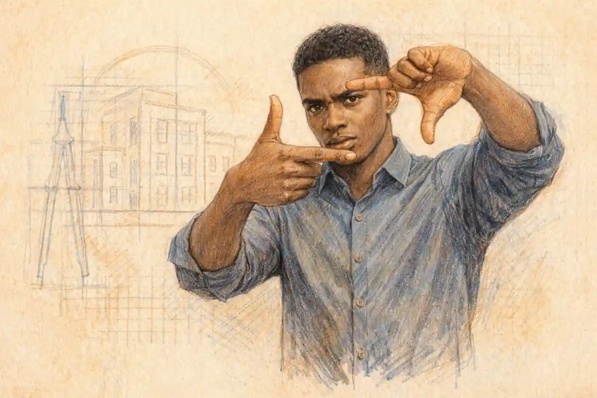

## Singles Events in Las Vegas: The Next Two Weeks

Las Vegas is a singles city pretending to be a couples' resort town. Beyond the Strip, the Arts District, Downtown and neighborhood taverns run speed dating in Las Vegas, singles mixers, run clubs and festivals all fortnight, and this window runs from the Day of the Dead through SEMA Week to a Saturday stacked with coffee, speed dating, pizza and two hundred authors. If you are searching for singles events in Las Vegas or where locals actually meet singles in Las Vegas, this list skips the nightclub line and goes where the conversation is.

**This edition covers Monday, November 2 to Sunday, November 15, 2026.** The list is refreshed every Sunday with a new rolling two-week window, so expired events disappear and new ones take their place. Every event below is labeled: a **Singles event** exists to help you meet a partner, while a **Singles-friendly** event is a social night where arriving alone is normal and conversation is easy. Audience labels (age ranges, LGBTQ+ and more) come straight from each organizer's listing. Prices and times are as listed by the organizer; check the event page before you go, because popular speed dating nights sell out one gender's tickets first.

This edition opens with remembrance and ends with appetite. Monday, November 2 carries the Life in Death Festival at the Winchester, a Day of the Dead run social at the SAHARA, and Burning Mondays' standing gathering, all on the first night. The first weekend belongs to the big rooms: both Pre-Dating speed dating nights at Loaded Empanadas, a UNLV alumni mixer at the Palms, SEMA Fest's concert finale at the Convention Center, Springs Preserve's three Día de Muertos garden evenings, a barbecue festival, a lantern launch at dusk, and Oakenfold and The Crystal Method at AREA15. The second week is the social circuit at full charm: a free flannel singles mixer with axe throwing, a five-hundred-pour wine experience in Henderson, a late-night all-you-can-eat pizza party on Friday the 13th, and a final Saturday that stacks a coffee-shop spark, afternoon speed dating, the Las Vegas Pizza Festival and a two-hundred-author book fair. Twenty events, two weeks, one city that never sleeps. There is a seat in one of these rooms with your name on it.

## How Dating Works in Las Vegas

Las Vegas has two dating scenes stacked on top of each other, and confusing them is the most common mistake newcomers make. The first scene is the Strip: resort pools, nightclubs, bottle service, and a river of visitors who will be on a plane home by Sunday. It is loud, expensive, and built for people on vacation from their real lives. The second scene belongs to the roughly two and a half million people who actually live in the valley, and it looks almost nothing like the first. Locals date in neighborhood taverns in Spring Valley and Rhodes Ranch, in Arts District cocktail lounges, at trivia nights that have run every week for years, and at speed dating events in west-side restaurants where the host knows half the room by name. Every event on this list belongs to the second scene, and that is deliberate. A visitor crowd resets every weekend. A locals' crowd compounds: the people you meet at a trivia night this week are the people you will see at a festival next week, and familiarity is the raw material of actual attraction.

The city's layout shapes its romance more than most locals admit. Las Vegas is a sprawling grid of master planned communities, and a date across the valley can mean a 40 minute drive each way. That is why neighborhoods matter so much in this guide. Summerlin and the west side have a settled, professional, slightly older energy, and it is no accident that both Loaded Empanadas speed dating nights sit out there. The Arts District and Fremont East, by contrast, draw the creative, younger, and more LGBTQ+ friendly crowd, with walkable blocks of small bars where a mixer can spill from one venue to the next. North Las Vegas and the northwest, home to Craig Ranch Regional Park, run a family rooted, festival going scene, and its festival grounds host the valley's biggest community gatherings across the fall. Matching your events to your side of town is not laziness. It is strategy: the person you meet at an event near your home is a person you can actually see again on a Tuesday.

The valley's work rhythms shape its dating too. Las Vegas runs on hospitality shifts, which means a large share of its single population works nights, weekends and holidays, sleeps at hours the rest of the country calls morning, and treats Monday as a plausible date night. That is why this guide's calendar is not a weekend-only calendar: a Monday community gathering, a Tuesday trivia night, a Wednesday mixer and a Thursday speed dating room are not filler around the weekend, they are the main schedule for the people who pour the weekend's drinks. It also explains the city's fondness for early-evening and daytime formats, the noon master class, the Sunday-afternoon festivals, the 5:30 PM alumni mixer that ends before a shift or an early bedtime. If your own schedule is unconventional, Las Vegas is one of the few American cities where that is a demographic rather than a defect, and the rooms in this guide are full of people whose calendars look like yours.

App culture in Las Vegas carries a local twist. The usual complaints apply here, endless swiping, conversations that die, profiles that blur together, but Vegas adds a filter problem of its own: a large share of the profiles on any app on any given night belong to tourists. Locals learn to swipe skeptically, and many eventually drift to in-person events for a simple reason. At a speed dating night in Las Vegas, everyone in the room has already passed the only test that matters: they live here, they showed up, and they are willing to talk to a stranger for six minutes. The events in this guide also span the city's real diversity of age and identity in a way apps flatten. There are two Pre-Dating rooms on one Thursday, one for singles in their 20s and 30s and one for ages 43 to 59. There is a free fall singles mixer at AREA15 where axe throwing does the introducing, a Saturday-afternoon speed dating room for ages 24 to 39, and a Saturday-morning coffee-shop spark on Fort Apache. And the Día de los Muertos and Indigenous heritage celebrations show the city's communities hosting the whole valley in their own traditions. Las Vegas dating works best when you stop treating the city as a backdrop and start treating it as a set of rooms, each with its own crowd, its own ambience, and its own odds. This list is a map of the twenty best rooms of the next two weeks.

## Las Vegas Singles Events at a Glance

| Event | Date | Type | Cost |
|---|---|---|---|
| Las Vegas Speed Dating for Singles Age 43-59 at Loaded Empanadas | Thu, Nov 5 | Singles event | not listed |
| Las Vegas Speed Dating for Singles Age 20s/30s at Loaded Empanadas | Thu, Nov 5 | Singles event | not listed |
| Flannels & Feelings: A Fall Singles Mixer | Thu, Nov 12 | Singles event | Free |
| Sip A Spark | Sat, Nov 14 | Singles event | not listed |
| Las Vegas Speed Dating Ages 24-39 (DateFaster) | Sat, Nov 14 | Singles event | $12.50 to $28.50 |

## Singles Events in Las Vegas (Dating Events and Mixers)

### 1. Las Vegas Speed Dating for Singles Age 43-59 at Loaded Empanadas

**When:** Thursday, November 5, 2026, 6:00 PM · **Where:** Loaded Empanadas, 750 S. Rampart Blvd., west Las Vegas · **Cost:** not listed
**Type:** Singles event · **Good for:** Ages 43-59

A hosted Pre-Dating speed dating night for singles ages 43 to 59: a series of six-minute one-on-one "Pre-Dates" with 5 to 12 or more singles, facilitated by a host who keeps the rotation moving and the numbers of men and women as even as possible, per the organizer.

Pre-Dating is one of the longest-running speed dating companies in the country, working since 2001, and its Las Vegas home is Loaded Empanadas on South Rampart Boulevard, a casual Latin restaurant on the west side where the room is set for dinner rather than a club. That setting matters for this age group. Singles in their forties and fifties returning to dating after long relationships do not need a velvet rope or a DJ; they need a comfortable chair, a real conversation, and a host who treats the evening as a craft. The six-minute format is long enough to get past biography and short enough that a flat chat costs you almost nothing, and the organizer's whole model rests on balance: they work their lists to keep the room even, because an even room is a fair room.

The ambience is neighborhood and unhurried: empanadas and drinks within reach, tables arranged for pairs, a crowd drawn from Summerlin, the west side and the surrounding subdivisions. Who typically goes: busy, established professionals and the divorced, widowed and starting-over daters who make up the west side's real singles majority. Success tip: use the full six minutes on stories, not summaries. At this age the most attractive sentence in the room is a specific one, about the trip you took, the work you chose, the life you are building now, and the daters who trade in specifics are the ones whose numbers get written down. Arrive a little early, order something, and let the host seat you settled rather than rushed.

[Event details and tickets](https://www.eventbrite.com/d/nv--las-vegas/speed-dating-events/)

### 2. Las Vegas Speed Dating for Singles Age 20s/30s at Loaded Empanadas

**When:** Thursday, November 5, 2026, start time not listed · **Where:** Loaded Empanadas, 750 S. Rampart Blvd., west Las Vegas · **Cost:** not listed
**Type:** Singles event · **Good for:** Ages 20s/30s

The younger edition of Pre-Dating's Las Vegas speed dating: singles in their 20s and 30s rotate through six-minute one-on-one Pre-Dates with a host facilitating, on the same Thursday evening and at the same Rampart Boulevard restaurant as the 43-59 edition, per the Eventbrite listing.

Two age rooms in one restaurant on one night is a quietly brilliant piece of scheduling. The 20s and 30s crowd gets a room of peers rather than a mixed-age lottery, and the format answers the exact complaint this generation has about the apps: everyone here is local, single, and willing to have an actual conversation with a stranger. Six minutes is the discipline. It is long enough for humor to land and short enough that nobody has to perform a whole evening for someone they met four minutes ago. The host runs the rotation, the organizer balances the room from its lists, and matches are mutual-only, so a no never has to be delivered face to face.

Loaded Empanadas sits on South Rampart in the Angel Park side of the west valley, surrounded by the subdivisions where the city's young professionals actually live, and the room reads accordingly: casual, food-first, conversation volume. Who typically goes: twenty- and thirty-something locals, many of them speed dating for the first time precisely because a hosted restaurant night feels safer than a bar approach. Success tip: prepare for the middle rounds. Everyone is charming in round one; the room remembers the person who is still asking fresh questions in round eight. Keep two story-openers in reserve, write one memory word beside each name as the rotation turns, and when a match lands, suggest the follow-up while the week is still young.

[Event details and tickets](https://www.eventbrite.com/d/nv--las-vegas/events/)

### 3. Flannels & Feelings: A Fall Singles Mixer

**When:** Thursday, November 12, 2026, 7:00 PM to 10:00 PM · **Where:** AREA15 (Bullseye + Oddwood), 3215 S. Rancho Dr., Las Vegas · **Cost:** Free
**Type:** Singles event · **Good for:** Ages 21+

A free fall singles mixer from Vegas Girl Events at AREA15, with axe throwing, new connections and a canned food drive, per the organizer's events page; the dress code is in the name — grab your flannel.

Vegas Girl Events built this window's earlier LGBTQ+ costume mixer, and its fall edition trades the costume for the coziest garment in the closet. That is smarter dating design than it sounds. A flannel shirt is a low-effort, high-signal uniform: everyone arrives dressed down on purpose, nobody is performing nightclub glamour, and the room's shared joke — an entire immersive district in matching plaid — gives strangers their first sentence for free. The mixer runs across Bullseye, AREA15's axe-throwing range, and Oddwood, its bar, which means the night has both an activity and a home base. Axe throwing is a genuinely good mixer engine: turns are short, cheering is mandatory, coaching is physical comedy, and a shared lane of six strangers becomes a team in about four throws.

AREA15 itself is the ambience: an immersive entertainment district just west of the Strip, all neon, art installations and wandering spectacle, at 3215 South Rancho Drive. The crowd for a free, 21-plus, organizer-run singles mixer here skews local and curious — Arts District and Spring Valley regulars, service-industry people on a night off, and first-timers who liked that the price of courage was a canned good for the food drive.

Who typically goes: twenty- and thirty-something locals, friend pairs who split up on arrival, and solo arrivals the host folds into a lane. Success tip: volunteer for the first throw in your lane. Going first breaks the lane's ice for everyone, makes you the person strangers feel they already know, and costs you nothing but one gloriously imperfect throw. Bring the canned good, arrive in the first hour while lanes are forming, and let the plaid do its work.

[Event details and tickets](https://vegasgirlevents.com/)

### 4. Sip A Spark

**When:** Saturday, November 14, 2026, 11:00 AM · **Where:** Leafs and Grounds, 6415 S. Fort Apache Rd., Las Vegas · **Cost:** not listed
**Type:** Singles event · **Good for:** All singles

A Saturday-morning singles event called Sip A Spark, listed on Eventbrite's Las Vegas singles calendar for 11:00 AM on Saturday, November 14 at Leafs and Grounds, a coffee shop on South Fort Apache Road in the southwest valley; the listing does not publish a price, so check the event page before you go.

Almost everything in this guide happens after dark, and that is precisely this listing's charm. A late-morning coffee-shop singles event runs on completely different social physics from a bar mixer: nobody is tired, nobody is performing, the light is honest, and the whole encounter happens at the hour of day when people are most themselves. Coffee also gives the conversation a natural architecture — order together, talk while it is made, sit down with something warm in hand — and a natural, graceful length. If it goes badly, a coffee is twenty minutes. If it goes well, a coffee in the southwest valley on a Saturday can become a walk, a market, a whole unplanned afternoon, because nobody has anywhere they need to be until evening.

Leafs and Grounds sits on Fort Apache in the Rhodes Ranch side of the valley, surrounded by the subdivisions where the southwest's professionals and young families actually live, so the room draws from its own neighborhood rather than from across town. That matters for the same reason it matters at the west-side speed dating rooms: the person you meet here is a person whose life is geographically compatible with yours.

Who typically goes: southwest-valley locals, morning people, and daters who have quietly concluded that their best self does not appear after 10:00 PM. Success tip: arrive a few minutes early and be kind to the baristas in a way the room can hear. In a small coffee shop, how you treat the staff is the first impression everyone else forms of you, and it is the one impression you completely control.

[Event details and tickets](https://www.eventbrite.com/d/nv--summerlin-south/catholic-conference-for-singles/)

### 5. Las Vegas Speed Dating Ages 24-39 (DateFaster)

**When:** Saturday, November 14, 2026, 2:00 PM to 4:00 PM · **Where:** Venue to be announced, Las Vegas · **Cost:** $12.50 to $28.50
**Type:** Singles event · **Good for:** Ages 24-39

DateFaster's Las Vegas speed dating for ages 24 to 39: a series of 5 to 6 minute face-to-face mini-dates with local singles, private match selections after every round, mutual matches emailed the following day, a professional host, name tags and conversation starters, per the organizer; the venue is announced to ticket holders, and VIP tickets add one complimentary drink.

A Saturday-afternoon speed dating room is a different instrument from the Thursday-night restaurant editions elsewhere in this guide, and for many daters it is the better one. Two o'clock is a rested, sober, daylight hour; nobody has come straight from work, nobody is three drinks in, and the conversations have the clarity that evening rooms promise and rarely deliver. The format is the classic discipline — a rotation of short dates, a private selection after each, contact exchanged only on a mutual match — and DateFaster's additions are practical ones: icebreaker prompts for the rounds where your mind goes blank, and a free ticket to an upcoming DateFaster singles mixer for anyone who buys a menu item at the venue, which turns one afternoon into two chances.

The venue-to-be-announced model is worth understanding rather than fearing: organizers confirm the room once they can see the balance of the booking list, and your Eventbrite confirmation carries the details. Who typically goes: twenty- and thirty-something locals, app-fatigued professionals, and first-time speed daters who find an afternoon room less intimidating than a night one.

Success tip: treat the afternoon as the start of the day, not the whole day. Book nothing immediately after 4:00 PM. Afternoon rooms produce a particular magic — a mutual-feeling conversation can become an actual same-day coffee or walk while the daylight lasts — and the daters who leave their schedule open are the ones positioned to say yes when it happens.

[Event details and tickets](https://www.eventbrite.com/e/las-vegas-speed-dating-ages-24-39-tickets-2002908423010?aff=ebdssbpointsofinterest)

## Singles-Friendly Events in Las Vegas (Social Nights Where Meeting People Is Easy)

### 6. Life in Death Festival (Clark County)

**When:** Monday, November 2, 2026, 4:00 PM to 9:00 PM (festival also runs Sunday, November 1, before this edition's window) · **Where:** Winchester Dondero Cultural Center, 3130 McLeod Dr., Las Vegas · **Cost:** Free
**Type:** Singles-friendly · **Good for:** All singles

Clark County's annual Life in Death: Day of the Dead Festival: two evenings of community ofrendas competing for festival recognition, Mexican dance performances, authentic food and crafts, and an interactive public art installation, "Forever in Our Hearts," by Las Vegas artist Stefano Kajatt, which lets visitors project photographic tributes onto a heart sculpture with synchronized lighting and music; admission and parking are free, per the county announcement.

Life in Death is the valley's flagship Día de los Muertos gathering, and its two-night run at the Winchester Dondero Cultural Center makes it the anchor of the holiday in this guide. The Winchester is a genuine community cultural center, a theater, gallery and park on McLeod Drive in the valley's east side, and the festival fills both the building and the grounds. What sets it apart socially is participation: the ofrendas are built by local families, civic groups and artists, the new heart installation invites every visitor to contribute a tribute of their own, and the crowd therefore arrives in the posture of contributors rather than consumers. People who have made something together, even something small, have already had the conversation that strangers at a bar are trying to start.

The ambience is evening park and cultural center: dance troupes on stage, embroidery and bread-making traditions demonstrated, food vendors doing a brisk trade, and altars glowing as the light goes. Who typically goes: east valley families, the Mexican and Latino communities whose heritage the festival honors, artists, and a broad cross-section of locals who have made it an annual ritual. Success tip: use the installation. Contributing a photo and watching tributes cycle on the heart sculpture is a shared emotional experience with the strangers standing beside you, and shared emotion, respectfully handled, is the fastest honest route to a real conversation this fortnight offers. Monday's edition is the quieter, more local encore, and this year it carries an extra draw: Clark County Public Arts hosts the Life in Death exhibition reception on the outdoor stage at 6:05 PM, per the county.

[Event details and tickets](https://www.nvartscouncil.org/events/category/festival/)

### 7. Burning Mondays (Las Vegas Burning Man Meetup)

**When:** Monday, November 2, 2026, 6:00 PM to 8:00 PM (recurs weekly on Mondays; also Monday, November 9) · **Where:** The Phoenix Bar & Lounge, 4312 W. Sahara Ave., Las Vegas · **Cost:** not listed
**Type:** Singles-friendly · **Good for:** All singles

A weekly Monday gathering of Las Vegas's Burning Man community: a casual, drop-in social where local burners and the burner-curious meet, talk projects and plans, and welcome newcomers and visitors, running every Monday from 6:00 to 8:00 PM, per the Meetup listing.

Every dating scene has a room that runs on ethos rather than format, and Burning Mondays is Las Vegas's. The burner community's social contract, radical inclusion, participation, no spectators, turns out to be excellent dating infrastructure: people arrive expecting to talk to strangers, introductions are a norm rather than an interruption, and the conversation starts several levels deeper than small talk because the community shares a vocabulary of art projects, camps and desert stories. You do not need to have been to Burning Man. The listing is explicit that this is a first-contact night, a place to bring the curious, and a two-hour Monday window makes it the lowest-commitment social bet in this entire guide.

The Phoenix Bar & Lounge on West Sahara is a neighborhood bar west of the Strip, and the Monday crowd is a standing one: artists, builders, event people and the creatively employed, mixing with whoever wandered in. The ambience is come-as-you-are, with the easy physicality of a room where hugs are punctuation. Who typically goes: the playa community's local chapter, plus newcomers testing whether this world is theirs. Success tip: ask about projects, not jobs. "What are you building this year?" is this room's master key, and offering a skill, a truck, a pair of hands, is worth more than any opener, because this community remembers contributors. Show up twice and you will be greeted by name; that is how this room works.

[Event details and tickets](https://www.meetup.com/vegasburners/)

### 8. AZILO After Miles — Day of the Dead Run

**When:** Monday, November 2, 2026, 7:00 PM to 10:00 PM (doors 7:00 PM, run starts 7:45 PM, post-run social 8:00 PM to 10:00 PM) · **Where:** The Pool at SAHARA Las Vegas / AZILO Ultra Lounge, 2535 S. Las Vegas Blvd., The Strip · **Cost:** Free
**Type:** Singles-friendly · **Good for:** Ages 21+

A free evening run club social hosted by lululemon ambassador Talia Maria Vaughan: a 3-mile evening run bringing Las Vegas run clubs, wellness lovers, locals and visitors together, followed by a post-run social at AZILO Ultra Lounge at SAHARA Las Vegas, held as a Day of the Dead celebration, per the Eventbrite listing.

Run clubs are the worst-kept secret in modern dating: a standing, healthy, early-evening room where the same faces recur weekly, conversation happens side by side at conversational pace, and nobody has to shout over a DJ. This edition dresses the format for Día de los Muertos and moves it to the north Strip, where the SAHARA's pool and ultra lounge give the night a resort backdrop without resort prices — the run is free. The structure is a dater's friend. Doors at 7:00 PM give you forty-five minutes of milling and introductions before the run, the three miles give you a moving conversation with whoever matches your pace, and the two-hour social afterwards is where the evening actually happens, among people who have just shared something mildly heroic together.

The ambience is athletic-glamorous: running shoes at a pool lounge, Day of the Dead color against the SAHARA's Moroccan-styled deck, music and drinks after the miles. Who typically goes: the valley's run club regulars, fitness-community connectors, and 21-plus locals who like their social life with endorphins in it.

Success tip: pace is strategy. Run at the speed of the conversation you want to have — mid-pack, beside someone new — rather than racing the front; nobody ever got a phone number at a personal best. Stay for the social, because the run is the introduction and the lounge is the date-shaped part.

[Event details and tickets](https://www.eventbrite.com/e/azilo-after-miles-day-of-the-dead-run-tickets-2003311936931)

### 9. November Alumni Mixer - Hospitality x Native American Alumni Club (UNLV)

**When:** Wednesday, November 4, 2026, 5:30 PM to 7:30 PM · **Where:** Unknown Bar inside Palms, 4321 W. Flamingo Rd., Las Vegas · **Cost:** Free
**Type:** Singles-friendly · **Good for:** UNLV alumni and friends

A UNLV alumni mixer with a November twist: the Hospitality alumni club partners with the Native American Alumni Club for an evening of cocktails, conversation and community at the stylish Unknown Bar inside Palms, organized by the university's alumni engagement team, per the Eventbrite listing.

Not every good room for meeting people announces itself as one. An alumni mixer is a room full of people who share an institution, a city and, in Las Vegas's case, an industry, since hospitality is the valley's family business, and shared ground that specific makes introductions nearly frictionless. This edition's partnership matters too: two alumni communities mixing deliberately, in Native American Heritage Month, models exactly the curiosity-across-communities posture this guide keeps recommending. The format is the classic after-work two hours, early enough to be a first stop, structured enough that arriving alone is unremarkable, and free, which removes the last excuse.

The Palms sits just west of the Strip on Flamingo Road, and Unknown Bar is its stylish, art-minded cocktail room, a locals' favorite that draws a professional crowd. Who typically goes: UNLV graduates across hospitality and beyond, young professionals building their networks, and the friends and partners alumni bring along, which quietly widens the room beyond the alumni list. Success tip: wear the conversation, not the logo. A Rebel story, the professor, the dorm, the game, is your opener, but the follow-up that builds a connection is the present tense: what are you working on, what part of town, what do you do for fun here. Collect one real follow-up, a coffee, a hike, the next mixer, before the two hours end; alumni rooms reward the people who treat them as beginnings.

[Event details and tickets](https://www.eventbrite.com/e/november-alumni-mixer-hospitality-x-native-american-alumni-club-tickets-2000655168465)

### 10. Holiday Craft & Gift Festival

**When:** Friday, November 6 to Sunday, November 8, 2026, hours not listed · **Where:** The Expo at World Market Center, 435 S. Grand Central Pkwy., Downtown Las Vegas · **Cost:** not listed
**Type:** Singles-friendly · **Good for:** All singles

A three-day handmade holiday show at the Expo at World Market Center: ornaments, ceramics, candles, jewelry and specialty foods from local and regional makers, plus make-and-take crafts, Santa on Kids Saturday and free parking, per the holiday market listing.

November's second weekend is when Las Vegas quietly changes seasons, and this festival is the hinge: three days of holiday shopping in a downtown exhibition hall, weeks before the December crush. As a social format, a craft festival is a market with the volume turned up, hundreds of makers, demonstrations and make-and-take tables where your hands are busy and conversation is the by-product. It draws a different crowd from every night event in this guide: daytime people, gift-buyers with lists, friend groups making a day of it, and a high proportion of locals who plan their social lives around exactly these seasonal fixtures.

The Expo at World Market Center anchors the north end of downtown, near Symphony Park, and the hall's scale means you can spend two unhurried hours without retracing your steps. Who typically goes: makers and their devotees, early holiday shoppers, and singles who prefer their meeting-people odds in daylight with a coffee in hand. Success tip: take the make-and-take seriously. Sitting at a craft table beside strangers for twenty minutes, all of you learning the same small skill badly, generates more genuine laughter and exchange than an hour of circulating, and laughter at a shared table is the most reliable beginning there is. Go on Friday if you can; the first day is the makers' freshest and the crowd's most relaxed.

[Event details and tickets](https://vegas.spreadtheword.si/vegas/holiday-markets-las-vegas-2026.html)

### 11. SEMA Fest 2026

**When:** Friday, November 6, 2026, gates 3:00 PM (The Alive 4:00 PM, 311 5:10 PM, Jimmy Eat World 6:50 PM, The Offspring 8:40 PM to 9:55 PM, per SEMA's published schedule) · **Where:** Bronze Lot, Las Vegas Convention Center · **Cost:** not listed
**Type:** Singles-friendly · **Good for:** All singles

SEMA Fest, the public finale of the SEMA Show, returns for its fourth year: The Offspring, Jimmy Eat World, 311 and The Alive on one bill, alongside OPTIMA Unleashed drifting demonstrations, motorcycle stunt riders inside a spherical steel Globe of Death, and rare hypercars and exotics, in the outdoor Bronze Lot of the Las Vegas Convention Center, per SEMA.

Some events in this guide are rooms. SEMA Fest is a city block that learned to party. The SEMA Show is the automotive aftermarket's giant trade week, closed to the public all week — except that Friday opens the show floor to general audiences from 9:00 AM to 4:00 PM, and then SEMA Fest takes the crowd outside for the concert finale. The social consequence is a crowd with a shared obsession built in: car people, builders, fabricators, racers and the merely car-curious, thousands of them, all fluent in the same language of builds and engines. Shared-obsession crowds are the easiest crowds in the world to talk to, because the opener is never "so, what do you do?" — it is whatever machine is in front of both of you.

The ambience is festival-industrial: an outdoor lot, a concert stage, drifting smoke between sets, stunt riders in a steel sphere, and a running order that moves from afternoon sunshine to a punk headliner under lights. Who typically goes: the automotive world's locals and visitors mixed together, friend groups of builders, and music fans who came for the bill and stayed for the cars.

Success tip: use the between-set drift demonstrations as your circuit. The crowd reshuffles at every spectacle, and the person standing beside you watching a car slide sideways has just been handed the same conversation you have. Arrive for the gates, not the headliner; the afternoon crowd is looser, prouder and far more talkative than the evening surge.

[Event details and tickets](https://www.gratefulweb.com/articles/sema-fest-2026-the-offspring-311-jimmy-eat-world/)

### 12. Día de Muertos at Springs Preserve

**When:** Friday, November 6 to Sunday, November 8, 2026, 5:00 PM to 9:00 PM nightly (members from 4:00 PM) · **Where:** Springs Preserve, 333 S. Valley View Blvd., Las Vegas · **Cost:** $15 adults (nonmembers); $11 members; children 3-17 $9 / $7; ages 2 and under free
**Type:** Singles-friendly · **Good for:** All singles

Springs Preserve's annual Día de Muertos celebration across three evenings: community altars honoring loved ones, mariachi performances, sugar skull decorating, traditional food, art vendors and live entertainment across the Preserve's gardens, per the Preserve; advance tickets are required, are sold online only, and the event is expected to sell out.

If the Life in Death Festival at the Winchester is the holiday's neighborhood heart, Springs Preserve is its garden cathedral. The Preserve is 180 acres of botanical gardens, trails and museums a few minutes west of downtown, and after dark in early November — strung with lights, cooled by the desert evening, filled with marigold color — it may be the most beautiful room in this entire guide. The format spreads a crowd gently across paths and plazas rather than compressing it into a hall, which suits a certain kind of dater perfectly: conversations here happen at walking pace, beside altars and food stalls, with the whole evening unhurried and the spectacle doing the social work.

The altars remain the heart of it. Community members build ofrendas — photographs, marigolds, candles, favorite foods — and reading them slowly, with respect, is both the correct etiquette and, not coincidentally, the deepest conversation starter the fortnight offers. Who typically goes: families, the Latino communities whose tradition this is, Preserve members with their standing November ritual, and locals who plan their fall around these three evenings.

Success tip: buy tickets the moment you decide — capped, online-only and expected to sell out means this is the one event in the guide that punishes hesitation. Go on Friday if you can, when the gardens are freshest, and let your first hour be altars and food before the socializing starts; in this room, attention given first is company earned later.

[Event details and tickets](https://www.vegas24seven.com/springs-preserve-dia-de-muertos-tickets-on-sale-beginning-oct-8/)

### 13. Las Vegas BBQ Festival 2026

**When:** Saturday, November 7, 2026, People's Choice sampling 12:00 PM to 4:00 PM, awards 5:30 PM · **Where:** Red Rock Harley-Davidson, 2260 S. Rainbow Blvd., Las Vegas · **Cost:** not listed
**Type:** Singles-friendly · **Good for:** All singles

The Nevada BBQ Association's annual Las Vegas BBQ Festival: competition teams turn in quail, chicken, ribs and a cook's-choice side across the afternoon while the public tastes along in the People's Choice sampling from noon to 4:00 PM, with awards at 5:30 PM, per the organizer's competition rules.

A barbecue competition is a festival where the crowd is also the jury, and that makes it the most participatory food event in this guide. People's Choice sampling turns every attendee into a taster with a vote, which means every attendee has a job, an opinion and a reason to talk to the teams and to each other. The cook teams are characters, pitmasters with rigs, rituals and strong views, and the afternoon's turn-in rhythm gives the day a plot: quail at 12:30, chicken at 1:00, ribs at 1:30, the cook's-choice side at 2:00, then the long, sauce-rich sampling hours before the awards.

The setting, the grounds of a Harley-Davidson dealership on South Rainbow Boulevard, adds a second community to the mix: riders, barbecue devotees and west-side families sharing one lot. The ambience is smoke, music and folding chairs, as unpretentious as Las Vegas gets. Who typically goes: barbecue hobbyists, motorcycle community members, and locals who follow the competition circuit. Success tip: taste comparatively and say so. "Your ribs against the team two rows over, what am I tasting?" is the kind of specific, flattering question that starts real conversations with cooks and fellow tasters alike, and the sampling line, moving slowly from team to team, is a built-in circuit of introductions that repeats all afternoon.

[Event details and tickets](https://www.nvbbq.org/_files/ugd/5e9c05_a4e48befe47d4029a61e8a7f16e5516b.pdf)

### 14. Las Vegas Water Lantern Festival

**When:** Saturday, November 7, 2026, 2:00 PM to 6:00 PM (lantern design from 4:30 PM, launch 5:00 PM to 6:00 PM) · **Where:** Sunset Park, 2601 E. Sunset Rd., Las Vegas · **Cost:** Day-of-event pricing $57.99 (tickets include lantern kit, LED candle and markers, per the organizer)
**Type:** Singles-friendly · **Good for:** All singles

An afternoon-into-dusk lantern festival at Sunset Park: gates open at 2:00 PM for food trucks, music and fun, lantern decorating begins around 4:30 PM, and the launch runs from 5:00 PM to 6:00 PM as thousands of lanterns go onto the water, per the festival's event page.

Every guide needs one event that is simply, unapologetically romantic in design, and a lantern launch at dusk is this fortnight's. The mechanics are quietly perfect for meeting people. The long afternoon is unstructured festival time — food trucks, music, drifting — and then the event hands every attendee the same task at the same hour: decorate a lantern. What people write and draw on those lanterns — hopes, memorials, jokes, names — is the most honest self-introduction a stranger can offer, and it is offered publicly, on a table, where commenting on it is invited rather than intrusive. Then everyone walks to the water's edge together at golden hour and launches in unison, which is the kind of shared, slightly hushed moment that turns an afternoon acquaintance into someone you want to see again.

Sunset Park is the southeast valley's great green gathering place, 2601 East Sunset Road, and a 2,000-person launch crowd there mixes Henderson and southeast locals with visitors from across the valley. Who typically goes: couples, friend groups, photographers, and a healthy number of solo romantics who understood the assignment.

Success tip: decorate slowly and socially. Set up at a shared table rather than alone on the grass, ask your neighbors about their designs, and offer your spare marker; the decorating hour, not the launch, is where this event's conversations happen. Then stay to the very end — the walk back from the water, everyone glowing slightly, is a natural time to propose the follow-up.

[Event details and tickets](https://www.waterlanternfestival.com/events/las-vegas)

### 15. Paul Oakenfold + The Crystal Method at AREA15

**When:** Saturday, November 7, 2026, 7:00 PM · **Where:** The Portal at AREA15, 3215 S. Rancho Dr., Las Vegas · **Cost:** not listed
**Type:** Singles-friendly · **Good for:** All singles

Two pioneering electronic acts on one bill: Paul Oakenfold and The Crystal Method bring the Mission Underground Tour to The Portal at AREA15 on Saturday, November 7 at 7:00 PM, per AREA15's entertainment calendar.

This is the fortnight's big-room dance night, and its dating logic is generational in the best way. Oakenfold and The Crystal Method shaped electronic music across the 1990s and 2000s, which means the floor at The Portal will hold a crowd that grew up on this music — now in their thirties, forties and fifties, established, and out for a night that honors their own history rather than chasing the current club crop. Shared generational soundtracks are powerful social glue: every track is a memory two strangers may turn out to hold in common, and the between-set conversations practically start themselves. The Portal itself is AREA15's projection-mapped event space inside the immersive district on South Rancho Drive, a room built for spectacle, surrounded by the district's installations, bars and arcade for anyone who needs a quieter circuit between peaks.

The ambience is immersive and high-production: a cavernous mapped room, a devoted crowd, and a district outside the doors where the night can downshift into art and drinks. Who typically goes: electronic music lifers, AREA15 regulars, and friend groups marking a proper occasion.

Success tip: work the edges and the intervals. Dance-floor connections at a show like this are made in the rests — the bar queue, the district's glowing corridors, the shared exhale after a classic track lands. Arrive for the start rather than the peak; early crowds talk, late crowds shout, and you want the version of this room where a conversation is still possible.

[Event details and tickets](https://www.area15.com/entertainment?event_dt=2023-12-23)

### 16. Indigenous American Heritage Celebration

**When:** Sunday, November 8, 2026, 10:00 AM to 3:00 PM · **Where:** Water Street Plaza, 240 S. Water St., Henderson · **Cost:** Free
**Type:** Singles-friendly · **Good for:** All singles

A free Indigenous American Heritage Celebration at Water Street Plaza in downtown Henderson, closing the fortnight on Sunday with a daytime community festival honoring Native American heritage, per the Nevada Arts Council events calendar.

The window that began with the Day of the Dead pauses here, fittingly, for a celebration of the cultures that were here long before the neon. Water Street Plaza is Henderson's revived downtown heart, a walkable, family-scaled district of local businesses and public space, and a Sunday heritage celebration there has the texture of a small city's best day: performances, community organizations, food, and neighbors meeting neighbors in daylight. Daytime festivals are the introvert's answer to the dating scene and the extrovert's palate cleanser, and a heritage celebration adds the dimension this guide values most, a room, or in this case a plaza, where listening and learning are the admission price.

The ambience is plaza Sunday: open air, performances in the round, a crowd mixing Henderson families, Native community members, and visitors from across the valley who made the short drive on purpose. Who typically goes: Henderson locals, families, educators, and the culturally engaged from every side of town. Success tip: treat the day as the start of a Henderson habit rather than a one-off. Water Street's cafes and taprooms fill after events like this, and a conversation begun at the plaza continues naturally over coffee on the same street; invite the people you were standing with, as a group, and let a Sunday afternoon become the plan it was quietly trying to be.

[Event details and tickets](https://www.nvartscouncil.org/events/category/festival/)

### 17. Lee's 23rd Annual Wine Experience

**When:** Friday, November 13, 2026, 4:00 PM to 8:00 PM · **Where:** Lee's Family Forum, 200 S. Green Valley Pkwy., Henderson · **Cost:** not listed
**Type:** Singles-friendly · **Good for:** Ages 21+

Lee's Discount Liquor's 23rd annual wine experience: unlimited tasting of more than 500 wines, beers and spirits from a wide variety of brands, at Lee's Family Forum in Henderson, presented by Lee's Discount Liquor, Lee's Helping Hand and the venue; a 21-plus event, per the venue.

A grand tasting is one of the great underrated dating formats, because it is a mixer with a curriculum. Five hundred pours is far more than anyone can taste, which means every attendee is making choices, comparing notes and developing opinions in real time — and opinions, offered and exchanged, are conversation in its easiest form. The format also paces itself beautifully: four hours, a glass in hand, a circuit of tables each staffed by someone whose job is to tell you a story about what you are drinking. Nobody has to invent an opener at a wine tasting. The wine is the opener, twenty times an hour.

Lee's Family Forum is Henderson's arena in Green Valley, home of the Silver Knights, and filling it with tasting tables turns it into the southeast valley's biggest social room of the fortnight. Lee's itself is a Las Vegas institution — the local liquor chain generations of residents actually shop at — and its annual experience draws that loyal, local, grown-up customer base rather than a tourist crowd. Who typically goes: Henderson and southeast-valley locals, wine-curious couples and friend groups, and singles who prefer their Friday night with a theme and a spittoon.

Success tip: taste comparatively and out loud, the way the barbecue festival taught this guide's readers in the last edition. "This one against the pour at the last table — what are you getting?" is a specific, flattering, endlessly reusable opener, and the tasting-table circuit means you will naturally re-encounter the same strangers all evening, which is how tasting acquaintances become plans.

[Event details and tickets](https://leesfamilyforum.com/lees-23rd-annual-wine-experience/)

### 18. Pizza After Dark at Double Zero Pie & Pub

**When:** Friday, November 13, 2026, 9:00 PM to 12:00 AM · **Where:** Double Zero Pie & Pub, 3853 Spring Mountain Rd., Las Vegas (Chinatown) · **Cost:** $50 per person (inclusive of all-you-can-eat pizza, beer, wine, tax and gratuity)
**Type:** Singles-friendly · **Good for:** All singles

A late-night, all-you-can-eat pizza party hosted by pizzaiola Erica Bell and Chef Justin Ford: unlimited New York-style pies, Double Zero snacks and unlimited beers and wines for a prepaid $50, with the full bar available for additional drinks and gluten-free Sicilian-style pizza available with advance notice, per the restaurant's OpenTable experience listing.

Friday the 13th gets a party worthy of it. Double Zero Pie & Pub is a pizza-first, pub-forward room on Spring Mountain Road in Chinatown — recognized by 50 Top Pizza USA three years running — and Pizza After Dark is its chefs throwing the kind of party restaurants usually keep for staff: the ovens stay hot until midnight, the pies keep coming, and the room fills with the city's food people. As a singles-friendly format it has a rare virtue: a fixed, inclusive price. Everyone in the room has paid the same $50 and everything is included, which removes the entire awkward economy of who is buying, who is keeping up, and when the tab arrives. What remains is appetite and conversation.

The ambience is Chinatown late-night: Spring Mountain's neon corridor, a compact pub room, chefs working in view, and a crowd skewed toward hospitality workers off shift, food obsessives, and friend groups who booked the fun Friday. It is also, deliberately, the warm-up act for Saturday's Las Vegas Pizza Festival across town — expect some of the same pizza community in both rooms.

Who typically goes: food-first locals, industry people, and daters whose love language is a shared slice. Success tip: station yourself near the pass for stretches. The moment a fresh pie lands is the room's natural gathering point and its easiest conversation — everyone present has an opinion about the last slice, and yours, offered early and specifically, is an introduction.

[Event details and tickets](https://www.opentable.com/r/double-zero-pie-and-pub-las-vegas?originId=d32a76cb-142e-4ba3-ac42-bdd83e5bf482&)

### 19. Las Vegas Pizza Festival

**When:** Saturday, November 14, 2026, 1:00 PM to 4:00 PM (VIP entry from 12:00 PM) · **Where:** The INDUSTRIAL Event Space, 2330 Industrial Rd., Las Vegas · **Cost:** $62 general admission; $132 VIP (inclusive of service fees and taxes)
**Type:** Singles-friendly · **Good for:** All singles

The sixth annual Las Vegas Pizza Festival: unlimited samples from many of the city's most acclaimed pizzerias — including Good Pie, Metro Pizza, Pizza Rock, Double Zero Pie & Pub, Esther's Kitchen, Evel Pie, Settebello and Yukon Pizza — with interactive experiences, festival bars and merchandise, presented by Greco and Sons and produced with the Las Vegas Pizza Alliance at The INDUSTRIAL Event Space, per the festival.

Yesterday's late-night warm-up becomes today's main event. A tasting festival devoted to a single beloved food is a social machine: every attendee is working the same circuit of tables, everyone is mid-comparison at all times, and the universal question — "which one is winning for you?" — never stops being welcome, because it is never really a question about pizza. It is an invitation to have taste in public, together. Three hours is the perfect festival length for dating purposes, too: long enough to circulate twice and deepen two or three conversations, short enough that nobody's energy or appetite collapses, and ending at 4:00 PM with the whole Saturday evening still available for whatever the afternoon produced.

The INDUSTRIAL sits on Industrial Road in the Arts District's wider orbit, a raw event space that fills with the city's pizza community — the makers, their regulars, and the food-serious locals who follow them. VIP entry at noon adds an hour of smaller crowds, complimentary beers and lounge seating for those who want the room at its calmest.

Who typically goes: food-obsessive locals, chef and hospitality crowds, and friend groups treating it as the fall's eating championship. Success tip: pace like a judge, not a fan. Small tastes, notes on your phone, and a declared top three by 3:00 PM give you a second full circuit of purposeful conversation — and give the person whose rankings match yours a reason to continue the argument over drinks after the festival closes.

[Event details and tickets](https://vegaspizzafest.com/vip/)

### 20. Reader Nation (with Author Nation Live 2026)

**When:** Saturday, November 14, 2026 (Author Nation Live runs November 10-13, with Reader Nation access on Saturday, November 14; Andy Weir keynote Friday, November 13, 4:00 PM to 5:30 PM) · **Where:** Horseshoe Las Vegas, 3645 Las Vegas Blvd. S., Las Vegas · **Cost:** not listed
**Type:** Singles-friendly · **Good for:** All singles

Reader Nation, the reader-facing sister event of Author Nation Live: a Las Vegas book fair bringing together more than 200 authors for meet-and-greets and signings, with Andy Weir — author of The Martian and Project Hail Mary — as the keynote presence across the week's closing sessions, per Author Nation.

Close the fortnight in a ballroom full of readers. A book fair is a singles-friendly format hiding in plain sight: every author table is a conversation with a built-in subject, every attendee's tote bag and book stack announces their tastes to the room, and the shared premise — everyone here loves stories enough to spend a Saturday on them — filters for exactly the qualities that make conversation good. Unlike a signing line at a bookstore, a fair is built for browsing and lingering: genre neighborhoods to wander, authors pitching their own worlds in person, and readers comparing hauls. It is also a rare Strip-adjacent event whose crowd is substantially local and regional; readers travel for this, and so do the valley's own book communities, clubs and writing groups.

The Horseshoe, at 3645 Las Vegas Boulevard South, puts the fair in the classic center Strip, in ballrooms scaled for wandering rather than spectacle. Who typically goes: devoted genre readers — romance, science fiction, fantasy and mystery readers above all — book club members, aspiring writers, and the gloriously specific fans who arrive with lists.

Success tip: ask readers, not just authors. "What is the one book you came here determined to find?" asked in a signing queue is a question every person in this building has a passionate answer to, and passionate answers are the raw material of the best conversations in this entire guide. Buy one book from a new-to-you author early; carrying it makes you part of the fair rather than a spectator at it, and gives the next stranger their opener, free of charge.

[Event details and tickets](https://www.authornation.live/tickets-2026?kuid=ea979c46-3310-4f1b-be10-33bda0dc867c-1777591178&kref=3JVnIGeP7HrK&lid=0)

## Where to Meet Singles in Las Vegas, Neighborhood by Neighborhood

**The Arts District.** If Las Vegas has a singles capital, this eighteen-block grid south of downtown is it. The Arts District runs on galleries, vintage shops, breweries, and small cocktail bars along Main Street, Commerce Street, and 1st Street, and its crowd is the city's creative class: artists, service industry veterans, designers, young professionals, and the proudly unconventional. This fortnight the district's orbit holds the Las Vegas Pizza Festival at The INDUSTRIAL Event Space on Industrial Road, where the city's pizza makers feed a whole afternoon of conversation. The ambience is walkable, low-rise, and human-scaled, the anti-Strip, where a bar hop covers five rooms in an evening and the same faces recur until they are no longer strangers. Come here if you want conversation-forward nights, community-specific rooms, and the sense that the city's culture is made by the people in it.

**Downtown and Fremont East.** Downtown is where old Vegas and new locals collide. Fremont East, the bar district east of Las Vegas Boulevard, stacks small bars, container architecture, and rooftops into a few loud, walkable blocks, and this fortnight its rooms feed into the same pizza-festival weekend, with downtown's bars absorbing the after-parties on Saturday night. The crowd is younger and more mixed than the Arts District's, part local scene, part downtown revival tourists, and the ambience is neon and pavement: drinks in hand, music spilling out of doorways, everything within stumbling distance of everything else. Downtown rewards the spontaneous. Plans here are allowed to change mid-evening, groups merge on sidewalks, and a party ticket can turn into a three-bar night without anyone calling it an escalation. If your dating style is high-energy and improvisational, this is your ground.

**The Strip.** The Strip is a singles paradox: millions of people, almost none of them available to date next month. Its rooms are full of visitors, bachelorette parties, and convention badges, and locals have learned to treat it as a workplace or a special occasion rather than a dating market. And yet the Strip earns entries in this fortnight — the Azilo After Miles Day of the Dead run social at the SAHARA and the Reader Nation book fair at the Horseshoe — because hosted events invert the usual math. When an organizer imports a real crowd with a real reason to gather into a resort venue, the venue's glamour serves the crowd instead of replacing it: a run club taking over a pool lounge, or two hundred authors and their readers filling a ballroom. The lesson generalizes. On the Strip, never go for the room; go for the event that brings its own crowd with it, and let the marble and the views be the backdrop they were designed to be.

**Summerlin and the West Side.** Summerlin is the valley's most established master planned community, and its dating scene carries that polish: professionals, families, affluent singles in their thirties through fifties, and venues that could pass for a nice suburb anywhere in America, which is precisely the point. The west side serves grownups best this fortnight: both Pre-Dating speed dating rooms run at Loaded Empanadas on South Rampart, and Sip A Spark brings a Saturday-morning coffee-shop singles event to Leafs and Grounds on South Fort Apache. The ambience is restaurant rather than nightclub, dinner conversation rather than dance floor, with easy parking and sensible finishes. If you are dating with intention on the west side, your strategy is consistency: the same rooms, the same nights, until the rooms start keeping your seat.

**Spring Valley and the Central West.** Spring Valley is the valley's great middle: vast, residential, unpretentious, and threaded with the taverns and local joints where the city's service industry and middle class actually live. This fortnight it hosts Burning Mondays at The Phoenix Bar & Lounge on West Sahara, a weekly gathering with a decade-deep community behind it, the UNLV alumni mixer just north at the Palms on Flamingo Road, and Pizza After Dark in Chinatown on Spring Mountain, where Double Zero's chefs keep the ovens hot until midnight on Friday the 13th. The ambience is the neighborhood bar and the community institution, places where the bartender knows the regulars and the regulars know each other's stories. Spring Valley dating is slow in the best way. It is built on repeated sightings, standing weekly commitments, and the friend-of-a-friend introductions that happen when a community has a living room. Singles who thrive here are the ones who pick a home base and let the neighborhood do its work over a month rather than a night.

**The University District and the Flamingo Corridor.** East of the Strip, Maryland Parkway runs past UNLV, and the corridor it anchors has a dating character all its own: younger, more international, and more transient than the suburbs, but threaded with institutions that keep people in town. The university's alumni network is this corridor's social engine, and this fortnight its mixer lands just west of the Strip at the Palms — partnering the Hospitality alumni club with the Native American Alumni Club — drawing graduates who stayed, hospitality professionals who studied their trade where the trade is headquartered, and the friends they bring along. The ambience is professional-casual: after-work hours, real cocktails, conversations that start with a shared institution and move quickly to the present tense. Singles in this corridor should think in networks rather than nights; one alumni room, attended twice a season, compounds faster than a dozen cold bars, because every person in it arrives pre-introduced by the university they share.

**The Southwest and Rhodes Ranch.** The southwest valley has quietly become the city's event frontier. Rhodes Ranch and its neighboring communities are newer, family-dense suburbs, and their venues have discovered that thousands of single homeowners and professionals live within a five minute drive with nowhere local to meet each other. This fortnight the southwest's entry is a gentle one: Sip A Spark, the Saturday-morning coffee-shop singles event at Leafs and Grounds on Fort Apache, in the heart of Rhodes Ranch country. The ambience is the upscale local production: real craft, real cocktails, crowds drawn from the surrounding subdivisions, and nights that end when they end because everyone has a driveway nearby. For singles in the southwest, the play is hyperlocal. Date within your orbit, become a regular at the rooms your neighbors use, and let geography, the most underrated matchmaker in a sprawling city, compound in your favor.

**The Southeast and the Henderson Side.** The southeast valley, running down McLeod and Sunset toward Henderson, is older Vegas: established neighborhoods, longtime local institutions, and a social scene that values loyalty over novelty. This fortnight it hosts the Life in Death Festival at the Winchester Dondero Cultural Center on McLeod Drive, the valley's flagship Día de los Muertos gathering, and the Water Lantern Festival at Sunset Park. Henderson, the valley's second city, answers with the Indigenous American Heritage Celebration on Water Street Plaza and Lee's 23rd Annual Wine Experience at Lee's Family Forum in Green Valley. The ambience is comfortable and unhurried, community celebrations at full length and full volume. If you are dating in this side of town, the assignment is the same as ever: show up for the community's own events, be known, and let the long memory of a rooted place work for you.

**North Las Vegas and the Northwest.** The north side of the valley is the most rooted and family-anchored, and its social life runs through parks and festival grounds rather than bars and clubs. Craig Ranch Regional Park's lawns host the valley's biggest community gatherings across the season, and the north side's festival habit continues this fortnight through the SEMA Fest crowds at the Convention Center to the east, where car culture takes over a whole lot for a Friday-night concert finale. The ambience is lawn chairs and festival food, neighbors who measure their history in festival editions. Singles up here meet the old way, through repetition and community: the same faces at the same annual events, introductions made by people who have known both parties for years. It is the slowest scene in the guide and, for people who want to date inside a community rather than a market, possibly the strongest. Bring patience, bring an appetite, and let the north side's long memory work for you.

## Ambiences Decoded: What Each Kind of Night Feels Like

**The neighborhood restaurant.** Both Pre-Dating rooms run in a restaurant, Loaded Empanadas, and a restaurant is the gentlest room in dating. The light is set for faces, the volume allows sentences, food gives your hands and the conversation somewhere to go, and the whole evening carries the civilized frame of dinner out. Expect: lower adrenaline, better conversation, earlier finishes, and a crowd that skews intentional. Wear: what you would wear to a nice dinner you were excited about. The restaurant format rewards depth over sparkle; it is where the six-minute conversation most often becomes a real one.

**The immersive district.** AREA15, home this fortnight to both the Flannels & Feelings mixer and the Oakenfold and Crystal Method night in The Portal, defines a newer type: neon, art installations, axe throwing, arcades and bars inside one sprawling campus just west of the Strip. Expect: spectacle that gives strangers endless shared material, rooms at every volume from lounge to cavern, and a crowd that chose play on purpose. Work its circuits — a lane, a bar, an installation — and let each one reset your introductions.

**The arts district lounge.** The Doberman Drawing Room type still matters: a small room, low light, strong drinks, seating that keeps groups close, and a crowd that chose character over scale. Expect: the best talking conditions in the city, eclectic and creative company, and evenings that deepen as they go. The lounge's risk is comfort; these rooms make it easy to settle into one conversation or one corner all night. Work the room gently, in circuits, and let the smallness of the space mean that the person you have not met yet is only ever twenty feet away.

**The festival lawn.** Sunset Park, the Winchester grounds and the Springs Preserve gardens are one ambience at two scales: outdoors, daylight or dusk, crowds spread across grass and pavement, and social rules set to picnic. Expect: freedom. You can join, drift, regroup, and leave without ceremony, and conversations start over spectacles, food stalls, altars and dogs rather than introductions. The festival lawn is the lowest-pressure dating environment that exists, and the best choice on this list for anyone who finds bars and bells exhausting. Bring sunscreen, water, and a willingness to comment on what everyone is looking at.

**The pool lounge after a run.** The Azilo After Miles social at the SAHARA invents this fortnight's most Las Vegas ambience: a resort pool deck and ultra lounge filled not with tourists but with locals still glowing from a three-mile run. Expect: athletic ease, Day of the Dead color, drinks earned rather than merely ordered, and conversations that started at mile one continuing at the bar. The shared effort changes the room's physics; strangers who have run together are no longer quite strangers, and the lounge inherits that warmth wholesale.

**The cultural festival.** The Día de los Muertos celebrations and the Indigenous American Heritage Celebration share an ambience no bar can manufacture: a community presenting its own heritage, in its own place, to guests it has genuinely invited. Expect: performances, food with meaning, altars and exhibitions that reward attention, and a crowd spanning grandparents to toddlers. The social rules are reverence first, sociability second; you are a guest in someone's living room at city scale. These are the fortnight's richest rooms for a certain kind of dater, the curious, the respectful, the ones whose best quality is how well they listen, and the conversations they start tend to skip small talk entirely.

**The arcade and the axe lane.** AREA15's Asylum arcade and the Bullseye axe-throwing lanes at the Flannels & Feelings mixer are the ambience nobody expects to work and everybody remembers: games, targets, scores, and a crowd holding drinks and game cards at once. Expect: noise in waves, constant motion, and a social physics unlike any bar, because every interaction has a score attached and every challenge is a pretext. The arcade solves dating's oldest problem, what do we do with our hands and eyes, by giving both a job. Wear: a costume you can play a racing game in. The risk is diffusion; it is easy to play all night and meet no one, so set a ratio, one new person challenged for every two games played with your own group.

**The market hall.** The holiday craft festival at the Expo and the Reader Nation book fair at the Horseshoe share an ambience: browsing as a social system. Expect: daylight or open air, rows of makers each with a story, food within reach, and a crowd moving slowly enough to talk to. A market hands you a legitimate reason to stop beside any stranger in the building, the object in front of both of you, and makers are professional conversationalists whose work is an endless supply of honest openers. The ambience rewards the unhurried; the person who does the full circuit twice, once to see and once to talk, meets the room properly.

**The tasting floor.** Lee's Wine Experience and the two pizza festivals share an ambience built on sampling: a glass or a plate in hand, a circuit of tables, and a crowd united by appetite and opinion. Expect: constant motion, easy openers supplied by whatever you just tasted, and the pleasant fiction that you are conducting research. The tasting floor rewards the comparative and the curious; declare rankings, trade tips about which table is pouring or slicing best, and let the circuit reintroduce you to the same strangers until they are not strangers.

## How to Succeed at Singles Events in Las Vegas

### Succeeding at speed dating

Speed dating is a numbers game with a human face, and this fortnight offers three distinct rooms: the two Pre-Dating editions at Loaded Empanadas on Thursday, November 5, one for ages 43 to 59 at 6:00 PM and one for singles in their 20s and 30s the same evening, and DateFaster's Saturday-afternoon room for ages 24 to 39 on November 14. The format's gift is symmetry: everyone present opted in, everyone is local, and every conversation has the same length, which means the playing field is as level as dating ever gets. Win it with preparation and pacing. Prepare three openers that ask for stories rather than facts: what brought you to Vegas, what a perfect Sunday looks like, and what you are looking forward to before the year ends. Facts (job, neighborhood) take ten seconds and teach little; stories reveal humor, values, and energy, and they hand you follow-up questions for free. Then manage the middle rounds. Most daters peak in rounds two and three and fade by the last rotations, repeating their opener like a script. The person who stays curious in the late rounds, who asks the follow-up nobody else asked, is the person the room remembers when the matches are made.

Marking your choices is the second skill. Be generous and specific: say yes to anyone you would happily talk to for one more hour, not only the one who made your heart pound, because six minutes measures conversational fit far better than it measures chemistry, and chemistry gets its chance on the date. Write a memory word beside each name the moment the round ends. And handle the logistics like a local: book early, because organizers balance attendance and one side's tickets sell out first, arrive before the start rather than during the first rotation, and use the host. Pre-Dating's hosts run the room precisely so that shy people get their full set of conversations; visible willingness to play the format well is itself attractive. Finally, remember momentum: when a mutual match lands, write within a day, reference the specific thing you laughed about, and propose a concrete, low-stakes plan within the week.

### Succeeding at mixers

Mixers are the opposite discipline: no structure, no bells, no guaranteed conversations, which means the work is yours. This fortnight's mixer menu spans the free Flannels & Feelings mixer at AREA15 — axe throwing included — the Saturday-morning Sip A Spark at Leafs and Grounds, and the UNLV alumni mixer at the Palms, three rooms with almost nothing in common except that everyone in them is available to be talked to. The universal rules are three. First, arrive in the first hour: mixers have a golden window while the room is still forming, hosts are actively introducing, and groups have not yet closed ranks. Second, position beats circulation. Plant yourself somewhere social, near the bar, the banquet table, the game machines, where traffic flows past you, and let the room come to you in waves rather than doing anxious laps that make you look like you are looking for the exit. Third, use the event's own machinery: the costume you are wearing, the costume contest, the shared institution on your name tag. Organizers build these devices because cold approaches are hard; the guest who plays the game gets introduced by the game.

Two local refinements. At the activity-led rooms, the AREA15 mixer above all, the machinery is the games themselves; an axe lane or a head-to-head arcade challenge is an introduction with a score attached, and it beats a pickup line by a decade. At the coffee-shop morning, the machinery is smaller and quieter: a shared order queue, a small room, and the radical novelty of meeting someone rested, in daylight, at your actual best. And at every mixer, learn the graceful cluster move: join a pair or trio with a comment on what they are already discussing, give it ninety seconds, and if the chemistry is not there, exit warmly ("I am going to grab a drink; find me later if you want to continue this") and let the room reshuffle you. A mixer night is a portfolio of ten-minute trials. Run them kindly, and the odds take care of themselves.

### Succeeding at activity events

Festivals, tastings, runs and markets ask for a different strategy: indirection. Nobody at the BBQ festival or the wine experience is wearing a name tag that says single, so the game is to become a valued presence in a room where singles also gather. The rules of indirection are patience and usefulness. Join before you shine: join the run at conversational pace, taste comparatively at the sampling line and say what you notice, sit at the make-and-take table at the craft festival and learn the craft badly and cheerfully. Contribution is the most attractive quality in an activity room because it is visible, repeated, and real. Let the activity supply the conversation (the trivia question nobody could answer, the altar that stopped the whole crowd, the ribs everyone is arguing about) and resist forcing the personal too early; activity rooms run on a slower clock, and the exchange of numbers usually belongs to the second meeting, often disguised as logistics: the team group chat, the next festival, the plan to defend the trivia title.

Festivals compress that clock. A one-day event like Life in Death, the city Día festival, or the BBQ festival gives you hours rather than weeks, so work them at festival tempo: circulate widely in the first half while energy is high, collect two or three real conversations rather than fifteen hellos, and convert the best one before the event's gravity fades, with a specific bridge ("a group of us are trying the holiday craft festival next weekend") rather than a vague hope. The standing invitation is your friend at every format: people say yes to a plan with a date, a place, and other humans attached far more readily than to an open-ended "we should hang out." Success at activity events is mostly the discipline of showing up a second time; the first visit makes you a face, the second makes you a prospect, and the third makes you part of the room, which is where the introductions that matter come from.

### Succeeding at festivals and cultural events

Festivals reward a different temperament from mixers: patience, appetite and respect, in that order. The mechanics first. Arrive in the event's first third, when the crowd is fresh and the hosts, vendors and performers are still introducing themselves to the day. Give yourself a circuit and a home base, a food stall, a stage, a table you return to, because festivals are navigated by loops, and the second pass is where strangers become familiar faces. Eat early, hydrate, and pace yourself for the long middle hours when the crowd settles and conversations lengthen; festival friendships are made at 3:00 PM, not at the entrance at noon. And use the program. A wrestling match, a dance performance, an awards ceremony, a headliner's set, each is a shared appointment that assembles the same crowd in the same place at the same time, which is a mixer wearing a schedule.

The cultural events carry one more rule, and it outranks the mechanics: you are a guest. At a Día de los Muertos celebration or a heritage festival, the community has opened its living room, and the dater who thrives there is the one who contributes attention before seeking company, who learns what an ofrenda is honoring, who buys from the vendors, thanks the organizers, and lets introductions arise from participation rather than pursuit. Handled that way, a cultural festival is not a lesser dating room. It is the deepest one in this guide, because the connections it starts are rooted in shared values rather than shared drinks, and they tend to continue in the community's own calendar long after the fortnight ends.

### The three-event ladder: how to plan your fortnight

You do not need all twenty events. You need a portfolio of three, chosen on purpose, because each format trains a different muscle. Rung one is a structured night, a Pre-Dating room at Loaded Empanadas or DateFaster's Saturday-afternoon room: guaranteed conversations, zero approach anxiety, and a match result that tells you honestly how your six-minute game is landing. Rung two is a mixer, Flannels & Feelings at AREA15 or the morning coffee spark on Fort Apache: unstructured, social, the place to practice starting and gracefully ending conversations in the wild. Rung three is an activity, a Día de los Muertos festival, the lantern launch, or the BBQ sampling line: the slow room, where you practice being a participant and let familiarity do its quiet work. One of each, spread across the two weeks, costs between nothing and about forty dollars and gives you a complete education in how this city dates.

One planning note specific to this valley: mind the map as seriously as the calendar. Las Vegas distances are deceptive, and a ladder that asks you to cross town three times in a week will quietly collapse by the second event. Cluster your three rungs on your own side of the valley where you can, Summerlin with the west-side rooms, downtown with the Arts District and Fremont East, the east side with the Winchester and Henderson, and save the one cross-town trip for the event you most want, when you will make it gladly and arrive fresh. A ladder you actually climb beats a perfect ladder abandoned by Wednesday, every single time.

Sequence matters more than volume. Put the activity first this fortnight — the Monday-night run or the Winchester festival — and let its energy warm you up. Put the structured night second, on Thursday, November 5, when you have fresh stories from the weekend. Put the activity last and treat it as the start of a habit rather than a finale, signing up for the following week before you leave. And build the ladder near home: a Summerlin dater's ladder looks different from an Arts District dater's, and the best ladder is the one whose rooms you will actually return to. The fortnight is not a sprint to a soulmate. It is the first two weeks of a scene you are joining, and scenes reward the people who stay.

## How to Handle Rejection Without Losing Your Nerve

Let us say the quiet part plainly: if you attend enough of these events, you will be rejected, and so will everyone else in the room, including the most attractive person there. Rejection at a singles event is not a verdict on your worth. It is the format working as designed. Speed dating asks a room of strangers to sort themselves by mutual interest in a single evening; math alone guarantees that most pairings will not match, because two people must both say yes out of a dozen conversations held on partial information, tired brains, and six-minute samples. A mixer adds its own noise: the person who drifted away mid-conversation may have been waiting for a friend, overwhelmed by the crowd, or three days out of a breakup. You will rarely know which no you received, and that is fine, because almost none of them are about the thing you fear.

In the moment, the skill is grace under a small sting, and it is learnable. When a conversation dies or a rotation ends flatly, close it like a host rather than a defendant: "It was good talking with you; enjoy the rest of your night," delivered with a real smile and no trailing explanation. Never apologize for having approached, never argue a no into a maybe, and never let one flat round colonize the next one. Between rounds or conversations, give yourself a thirty-second reset: water, a breath, a deliberate memory of the best exchange of the night so far. A good host models this from the front of the room: a soft no, kindly given and kindly received, is a feature of every well-run dating night, because a room where no is easy is a room where yes means something. Borrow the technique in both directions and the sting shrinks to its true size.

Afterwards is where most people mishandle it. The match message that arrives with fewer matches than you hoped, or none, feels personal; treat it as data instead. Ask the only useful question: was my sample size big enough? One event is a coin flip. A fortnight of events is a trend, and trends can be adjusted. If you keep matching silence at structured events, change one variable at a time: try the other age seating, try a mixer instead of rounds, try the activity rooms where your personality has more than six minutes to register, or bring your stronger game to the trivia table where your humor has a whole evening to work. What you do not do is spiral, stalk a match's social media, or write a post-mortem on your face. You went out, in a city full of people who stayed home swiping, and you practiced the bravest social skill there is. That is not failure wearing a costume; that is the process, photographed mid-stride.

Staying in the game is a scheduling decision more than an emotional one. The singles who eventually meet someone at these events share a trait that has nothing to do with looks: they have a next event on the calendar before the current one's results arrive. This guide makes that easy, because the fortnight is a ladder: a flat Monday at the Winchester still leaves two Pre-Dating rooms on Thursday, a quiet Thursday still leaves the AREA15 mixer the following Thursday and a barbecue festival, a wine experience and two speed dating rooms across the final weekend. Protect your nerve with rituals: cap yourself at two or three events a week so dating stays a pleasure rather than a second job, debrief with a friend instead of alone, and keep one non-dating joy in the same week so a thin match list cannot confiscate your whole mood. Rejection will visit. Let it find you with plans.

## Dating Across Cultures in Las Vegas

Las Vegas is one of the most international cities in America, a place where the hospitality workforce alone speaks in dozens of accents and where whole neighborhoods run on the cultures of the Philippines, Mexico, Ethiopia, China, Hawaii, and everywhere else the city has welcomed. Its singles scene reflects that mix, and this fortnight's listings show the healthiest version of it: communities hosting the whole valley in their own traditions, standing open beside the dating rooms, each with its own warmth.

Día de los Muertos is this fortnight's master class. The valley marks the Day of the Dead across the whole window this year: at the Winchester Dondero Cultural Center on Monday evening, November 2 — with the Life in Death exhibition reception on its outdoor stage — on the run course and pool deck of the Azilo After Miles social at the SAHARA that same night, and then again across three garden evenings at Springs Preserve from November 6 to 8, where community altars fill the botanical paths. The holiday honors deceased loved ones with ofrendas, altars built from photographs, marigolds, food and memory, and its social etiquette is the opposite of a nightclub's: arrive as a guest, learn before you mingle, and let grief and joy share the room the way the tradition intends. For a single person, these festivals are not dating events and should never be treated as hunting grounds; they are something better, a chance to be a known and welcome face inside the city's Latino communities, which is where, over a season rather than a night, real cross-cultural connection actually starts.

The rooms built for a specific community make a parallel promise in a different key. When an organizer designs a night for a defined crowd — an age band, a neighborhood, a shared institution — the relief in the room is palpable, and the energy it frees up for actual connection is something every dater can learn from: people shine when they are not spending half their attention on self-protection. The fortnight closes the same argument at civic scale: the Indigenous American Heritage Celebration in Henderson honors the first cultures of this land, and the UNLV alumni mixer's partnership between its Hospitality and Native American Alumni Club shows two communities choosing to mix on purpose, in Native American Heritage Month, in a room built by a university both clubs call home. Age is a culture here too. The 43 to 59 Pre-Dating room exists because singles returning to dating after long marriages are not failed twenty-somethings; they are a generation with its own pacing, and the format honors it with a host, a dinner setting and balanced rooms.

The general lesson crosses every boundary in this guide: read the room's culture before you perform in it. Ask about people's actual lives, families, foods, and faiths with curiosity rather than commentary. Never treat a community-specific event as a theme park or a shortcut to an "exotic" date; treat it as what it is, a community's living room, in a city that is lucky to have so many. The daters who thrive across Las Vegas's cultures are the ones who arrive as students of the room rather than tourists in it, and that posture, humble, attentive, specific, turns out to be attractive in every language the city speaks.

## This Fortnight in Las Vegas

Some two-week windows coast on leftovers. This one runs from the Day of the Dead to a pizza championship, and it is built almost entirely from rooms that belong to locals. The window opens on Monday, November 2 with a triple header: the Life in Death Festival's second evening at the Winchester Dondero Cultural Center from 4:00 PM, Burning Mondays' weekly gathering at The Phoenix from 6:00, and the Azilo After Miles run social at the SAHARA from 7:00 — a cultural festival, a community institution and a run club, all on the window's first night. Wednesday, November 4 brings the UNLV alumni mixer at the Palms, where the Hospitality and Native American alumni clubs mix on purpose, and Thursday, November 5 is speed dating night, with both Pre-Dating rooms at Loaded Empanadas — ages 43 to 59 at 6:00 PM and the 20s and 30s room the same evening.

Friday, November 6 is the fortnight's loudest day: the Holiday Craft & Gift Festival opens its three-day run at the Expo at World Market Center, SEMA Fest takes over the Convention Center's Bronze Lot from 3:00 PM with The Offspring, Jimmy Eat World, 311 and drifting between the sets, and Springs Preserve opens the first of its three Día de Muertos garden evenings at 5:00. Saturday, November 7 stacks the BBQ Festival's People's Choice sampling at noon, the Water Lantern Festival's dusk launch at Sunset Park, and Paul Oakenfold with The Crystal Method at AREA15 at 7:00. Sunday belongs to Henderson and the gardens: the Indigenous American Heritage Celebration on Water Street Plaza from 10:00 AM, and the final Springs Preserve evening to close the weekend.

The second week turns social in a different key. Thursday, November 12 is the free Flannels & Feelings singles mixer at AREA15 — flannel, axe throwing and a canned food drive. Friday the 13th goes deliciously double: Lee's 23rd Annual Wine Experience pours more than 500 wines, beers and spirits in Henderson from 4:00 to 8:00 PM, and Pizza After Dark keeps Double Zero's ovens hot in Chinatown from 9:00 PM until midnight. Saturday, November 14 is the marathon: Sip A Spark over coffee at 11:00 AM, DateFaster speed dating for ages 24 to 39 from 2:00 to 4:00, the Las Vegas Pizza Festival's unlimited tastings from 1:00 to 4:00 at The INDUSTRIAL, and Reader Nation's two-hundred-author book fair at the Horseshoe. Sunday, November 15 is deliberately left as the window's quiet exhale — the day to follow up on everything the previous thirteen produced. The weather cooperates throughout: mid-November is the desert at its kindest, evenings cool enough for flannel and lantern light. If you have been waiting for the right fortnight to start, the calendar has done the waiting for you.

## What a Fortnight of Dating Events Costs in Las Vegas

One of this guide's pleasures is how much of it is free. Six of the twenty events charge nothing at the door: the Life in Death Festival, the Azilo After Miles run social, the UNLV alumni mixer, the Indigenous American Heritage Celebration, the Flannels & Feelings singles mixer at AREA15 — free, with a canned food drive as its unofficial cover — and Burning Mondays, whose Meetup listing publishes no charge. A determined single could build an entire fortnight around those rooms — both Día evenings' anchor, a run, an alumni night, a heritage Sunday and a flannel mixer — and spend nothing on admission at all, a fact worth remembering in a city famous for separating visitors from their money. Several more events do not list a price at all, including both Pre-Dating speed dating nights, Sip A Spark, the holiday craft festival, the BBQ festival, SEMA Fest, the AREA15 concert, Lee's Wine Experience and Reader Nation, so check those event pages before you budget them at zero.

The ticketed middle of the list is honest value by Vegas standards. DateFaster's afternoon speed dating runs $12.50 to $28.50, Springs Preserve's Día de Muertos is $15 for a nonmember adult, and Pizza After Dark is a flat $50 that includes all-you-can-eat pizza, beer, wine, tax and gratuity — a whole Friday night with the bill settled in advance. The premium tier is small and clearly marked: the Las Vegas Pizza Festival at $62 for general admission and $132 for VIP, and the Water Lantern Festival's day-of-event price of $57.99, lantern kit included. Add it up and the whole twenty-event calendar, attended in full, still costs less than one night of bottle service on the Strip, which is rather the point of dating like a local.

## The Standing Scene: Las Vegas Institutions That Run All Year

Weekly lists come and go, but Las Vegas singles life rests on a bedrock of recurring rooms that will still be there when this fortnight is a memory, and learning them is the real long game. Start with the weekly institutions. Burning Mondays is the model: the burner community's weekly gathering at The Phoenix has run every Monday for years, and its welcome-the-newcomer ethos is a standing invitation that never expires. The valley's run clubs make the same offer at conversational pace — the Azilo After Miles night at the SAHARA is one edition of a citywide habit — and a standing weekly room, whatever its theme, is not an event so much as a parliament of its neighborhood. A single person who adopts one weekly night has, in effect, joined a club whose membership benefit is fifty-two evenings a year in a room that knows their name.

The organizers are institutions too. Pre-Dating has run speed dating since 2001 and rotates its Las Vegas age-group rooms through Loaded Empanadas across the season, which means a good night can be repeated with a fresh room rather than mourned as a one-off. DateFaster adds Saturday-afternoon rooms for the 24-to-39 crowd. Vegas Girl Events builds the women's and LGBTQ+ social calendar — this fortnight its free fall mixer fills AREA15 with flannel and axe lanes — and AREA15 itself runs a year-round calendar of concerts, tours and themed nights in The Portal. The festival calendar is anchored by annual giants: the Life in Death Festival and Springs Preserve's Día de Muertos every November, the Nevada BBQ Association's festival, the Las Vegas Pizza Festival and its Pizza After Dark warm-up, SEMA Fest closing SEMA Week, Lee's Wine Experience in Henderson, and the university's alumni mixer circuit. Two more layers of the standing scene deserve a dater's attention. The first is the civic calendar itself: between Clark County's cultural centers, the City of Las Vegas's Office of Cultural Affairs programming at its festival plazas and parks, and Henderson's Water Street events, the valley's governments run a year-round circuit of free festivals, heritage celebrations and concerts that function as the region's largest singles-friendly institution, hiding in plain sight. The second is the university: UNLV's alumni network runs mixers and community partnerships across the year, and its rooms mix professional networking with social life so thoroughly that nobody has to decide which one they are doing. A single person who puts one civic festival, one alumni or community mixer and one weekly trivia or meetup night into a monthly rotation has built, for almost no money, a social infrastructure that most dating apps could not sell them at any price.

The strategy writes itself. Use this fortnight's list to find your rooms, then keep the rooms. Dating in Las Vegas is not won in a night; it is accumulated in a season of Tuesdays.

## Frequently Asked Questions About Singles Events in Las Vegas

**What are the best singles events in Las Vegas this week?**
The strongest options in this window are the 5 labeled singles events above, led by the two Pre-Dating speed dating rooms at Loaded Empanadas on Thursday, November 5, the free Flannels & Feelings mixer at AREA15 on Thursday, November 12, and two Saturday rooms on November 14 — a coffee-shop morning on Fort Apache and DateFaster's afternoon speed dating for ages 24 to 39. The singles-friendly picks, from the Día de Muertos festivals to the lantern launch, suit anyone who prefers meeting people sideways, through an activity.

**What is the difference between a singles event and a singles-friendly event?**
A singles event is organized for dating: speed dating, singles mixers, lock and key parties and matchmaking nights. A singles-friendly event is a general social event, like a trivia night, class or festival, where lots of people attend solo and talking to strangers is part of the format. Singles events give you guaranteed introductions; singles-friendly events give you better cover and a slower burn. Many daters mix both, using singles events for reps and activity events for depth.

**Are singles events in Las Vegas free?**
Some are. Many singles-friendly picks on this list are free, including trivia nights, cultural festivals and the alumni mixer, while ticketed dating events in Las Vegas typically run from about $10 to $50. Every listing shows its price as published by the organizer. This fortnight is unusually generous: the Life in Death Festival, Burning Mondays' listing, the Azilo run social, the alumni mixer, the Indigenous American Heritage Celebration and the AREA15 singles mixer all cost nothing to enter.

**Do I need to book speed dating in advance?**
Almost always, yes. Speed dating organizers cap and balance attendance, and popular nights sell out days ahead, often for one gender before the other. Use the event link in the listing to book. The Loaded Empanadas rooms on November 5 are balanced from the organizer's lists, so the earlier you register, the better the room the host can build.

**What should I say in the first minute of a speed date?**
Skip your job title and your address; both will come up if things go well. Open with something that invites a story: ask what brought them to Las Vegas, what their perfect Sunday looks like, or what they are looking forward to this season. Then do the rare thing and listen for the follow-up question hiding inside their answer. A six-minute date is won by curiosity, not biography: one genuine follow-up beats four polished facts about yourself. If the conversation sparks, name the spark before the rotation turns ("I could talk about desert hiking for an hour") so your match remembers a feeling, not a resume.

**What if I get no matches at a speed dating night?**
You shrug, accurately, and book the next one. A no-match night is a small sample in a noisy format: a dozen six-minute conversations, judged on partial information by tired people, including you. It says almost nothing about your desirability and only a little about your presentation, which is fixable if it needs fixing. Change one variable next time: the other age seating, a mixer instead of rounds, arriving fresher, better questions. The daters who meet someone through these events are not the ones who never hear no; they are the ones who treat no as weather, not climate. For the full mindset, read the rejection section above, and remember that this single fortnight holds two Pre-Dating rooms on one Thursday plus two more singles rooms on the final Saturday, so a second chance is days away, not months.

**How do I follow up with a match without being awkward?**
Quickly, specifically, and once. When match results arrive, write within a day, mention the concrete thing you connected over (the dog, the hiking trail, the terrible trivia answer), and propose a real plan with a time attached: coffee this week, a walk, the next trivia night. Vague compliments with no plan are where matches go to die. If they answer warmly, you are dating; if they do not answer, you have your answer, and it costs you nothing but a text. Never double-text a silence into a conversation, and never apologize for having written. A clear, kind, single message is the entire etiquette.

**Is it okay to go to a singles event alone?**
It is not only okay; it is the design assumption. Speed dating seatings, mixers, the online Fun Singles night, and the trivia and festival rooms in this guide are all built for solo arrivals, and most attendees come alone or with one friend who promptly becomes a wingman rather than a shadow. Going alone has real advantages: you are approachable in a way pairs are not, your schedule is your own, and you can leave a dud night early or ride a great one late. If you bring a friend, agree beforehand to circulate separately for stretches; two people who split up and regroup meet twice the room.

**What should I wear to a singles event in Las Vegas?**
Match the room, not the Strip. For restaurant speed dating (Loaded Empanadas), wear what flatters you at a nice dinner. For Arts District lounges and AREA15, go creative and comfortable — flannel is literally the dress code at the November 12 mixer. For festivals and park days, dress for grass, sun, and walking, and for the Azilo run, bring the shoes and let the lounge look after itself. Everywhere: one notch above your everyday, clean, and comfortable enough to forget about. Nobody ever circled a yes because of a label; they circled it because the person across from them seemed at ease.

**Are there good singles events in Las Vegas for people over 40?**
This fortnight answers directly: Pre-Dating runs a dedicated room for ages 43 to 59 at Loaded Empanadas on November 5, hosted and balanced, in a dinner setting. Beyond the dating rooms, the trivia institutions, the alumni mixer, the cultural festivals and the BBQ festival all draw strong over-40 crowds without an age label on the door. Las Vegas's suburban structure means the over-40 scene is not a consolation bracket; in Summerlin and the west valley, it is the main event.

**Which events are best for LGBTQ+ singles in Las Vegas?**
No dedicated LGBTQ+ singles room verified inside this exact window — the community's dedicated mixer ran in the previous edition. The reliably queer-friendly ground remains the Arts District and AREA15, whose immersive, come-as-you-are rooms anchor this edition, and Vegas Girl Events' calendar is the one to watch for the next dedicated night. Treat any room's stated audience label as the organizer's own, and choose the rooms where the welcome is explicit when that matters most to you.

**How often is this list updated?**
Every Sunday. Expired events are removed, recurring events roll to their next date, and new events are added so the list always covers the coming two weeks. For the other nine cities, see the national guide to the [best singles events in America](/2026/10/14/best-singles-events-in-america/).

## Your Next Two Weeks Start Now

Twenty events, most of them an easy drive from wherever in the valley you live, every one of them a room where meeting someone is not a hope but the agenda. You do not need to attend all twenty. Pick three: one structured night where introductions are guaranteed, one mixer where you can practice the room, and one activity where you get to be good at something in public. Put them on the calendar today, book the ticketed ones before your side sells out, and let the fortnight do what this city does best, which is give a willing stranger more chances in two weeks than most places offer in a season. The rooms are ready. Be in one.

*Last updated November 1, 2026. Event details can change; confirm time, venue and availability on the organizer's page before heading out.*
