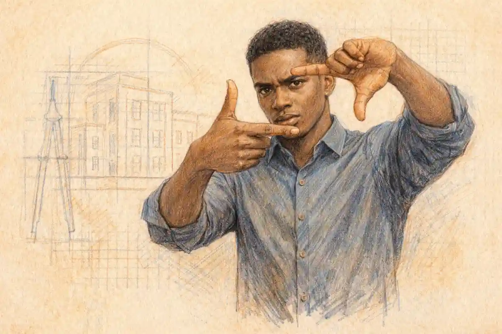

## Singles Events in Las Vegas: The Next Two Weeks

Las Vegas is a singles city pretending to be a couples' resort town. Beyond the Strip, the Arts District, Downtown and the neighborhood taverns run speed dating in Las Vegas, singles mixers, run clubs and festivals all fortnight, and this window runs from a quiet Monday burner gathering through the loudest finish the valley knows — Grand Prix weekend, with a free downtown music festival running beside the race — and out the other side into Thanksgiving week, a sweater mixer, a Thanksgiving Eve speed dating room, a turkey trot and the opening weekend of the city's beloved holiday forest. If you are searching for singles events in Las Vegas or where locals actually meet singles in Las Vegas, this list skips the nightclub line and goes where the conversation is.

**This edition covers Monday, November 16 to Sunday, November 29, 2026.** The list is refreshed every Sunday with a new rolling two-week window, so expired events disappear and new ones take their place. Every event below is labeled: a **Singles event** exists to help you meet a partner, while a **Singles-friendly** event is a social night where arriving alone is normal and conversation is easy. Audience labels (age ranges, LGBTQ+ and more) come straight from each organizer's listing. Prices and times are as listed by the organizer; check the event page before you go, because popular speed dating nights sell out one gender's tickets first.

This edition opens quietly and ends at full holiday volume. Monday, November 16 belongs to Burning Mondays, the burner community's standing weekly gathering at The Phoenix, with Fallout trivia downtown later the same night. Tuesday pairs a Henderson speed dating night that flows into a Golden Knights game with a Summerlin run club that ends at a patio. Wednesday, November 18 is the fortnight's great singles night in two neighborhoods at once: smart speed dating for ages 37 to 49 in Spring Valley, friends pitching their single friends by PowerPoint at Durango's Bel-Aire Lounge, and the opening tree lighting of Fontainebleau's ice rink on the Strip. Thursday opens Grand Prix weekend and the LGBTQ+ community's Third Thursday mixer on Paradise Road. The race runs under lights through Saturday, November 21, the free Neon City Festival fills Fremont Street from November 20 to 22, and a Saturday-afternoon pickleball social gives the northwest its own race-day room. Thanksgiving week then turns warm and local: a sweater singles mixer in the Arts District on Monday, November 23, a run club that verifiably still runs on Tuesday, November 24, Thanksgiving Eve speed dating on Wednesday, November 25, a Thanksgiving-morning 5K, and a closing weekend of a shop-and-swap soiree, the Magical Forest's opening, a coffee lovers' run and a sober morning dance party. Twenty events, two weeks, one city that never sleeps. There is a seat in one of these rooms with your name on it.

## How Dating Works in Las Vegas

Las Vegas has two dating scenes stacked on top of each other, and confusing them is the most common mistake newcomers make. The first scene is the Strip: resort pools, nightclubs, bottle service, and a river of visitors who will be on a plane home by Sunday. It is loud, expensive, and built for people on vacation from their real lives. The second scene belongs to the roughly two and a half million people who actually live in the valley, and it looks almost nothing like the first. Locals date in neighborhood taverns in Spring Valley and Rhodes Ranch, in Arts District cocktail lounges, at social nights that have run every week for years, and at speed dating events in Henderson pubs and southwest beerhouses where the host knows half the room by name. Most events on this list belong to the second scene, and that is deliberate. A visitor crowd resets every weekend. A locals' crowd compounds: the people you meet at a weekly gathering this week are the people you will see at a festival next week, and familiarity is the raw material of actual attraction.

The Grand Prix weekend, which sits in the middle of this window, is the exception that proves the rule, and it deserves its own paragraph. From November 19 to 21 the Strip becomes a racetrack and the city fills with visitors again — but the smart local play that weekend is not to flee. It is to choose rooms that import their own crowd. The Grand Prix itself draws a genuine community of racing fans who return every year and talk to strangers as a matter of tribal habit, and the Neon City Festival downtown was created precisely as the locals' answer to race weekend: free, all ages, spread across Fremont Street, and full of valley residents who would rather dance under the canopy than pay grandstand prices. A hosted event with a real reason to gather inverts the Strip's usual math wherever it happens, whether that is a community mixer at a Paradise Road video bar or a pickleball social in the northwest suburbs. Go for the event that brings its own crowd, and let the glamour be backdrop.

Thanksgiving week, which closes this window, teaches the opposite lesson, and it is just as useful. The holiday empties some rooms and fills others with a very particular crowd: locals whose families are elsewhere, home-for-the-weekend returners, and the valley's enormous hospitality workforce, for whom the holiday weekend is the busiest work stretch of the year and Monday and Wednesday nights are the real days off. That is why this edition verifies its Thanksgiving-week recurring events instead of assuming them — Burning Mondays lists both of its Mondays by date, and Run Drink Las Vegas lists its Tuesday, November 24 run by date — and why the week's dating rooms are scheduled the way they are: a sweater mixer on Monday the 23rd, speed dating on Thanksgiving Eve, a run at 8:00 AM on Thanksgiving morning itself. In Las Vegas, the holiday does not pause the singles scene. It concentrates it into the people who actually live here.

The city's layout shapes its romance more than most locals admit. Las Vegas is a sprawling grid of master planned communities, and a date across the valley can mean a 40 minute drive each way. That is why neighborhoods matter so much in this guide. The Arts District and Fremont East draw the creative, younger, and more LGBTQ+ friendly crowd, with walkable blocks of small bars where a mixer can spill from one venue to the next — and this fortnight the district holds the Sweater Weather mixer at the Doberman Drawing Room, Thanksgiving Eve speed dating at Makers & Finders, Fallout trivia at The Griffin and a charity mingle at BARTER. The southwest — Spring Valley, Rhodes Ranch and the Durango corridor — has become the valley's dating frontier, and this edition proves it again: smart speed dating at a Spring Valley beerhouse on Buffalo Drive, and a matchmaking PowerPoint night at the Bel-Aire Lounge inside Durango Casino & Resort. Henderson answers with a speed dating night in a Water Street pub, Summerlin with a run club, and the northwest with a pickleball social and a Thanksgiving-morning 5K. Matching your events to your side of town is not laziness. It is strategy: the person you meet at an event near your home is a person you can actually see again on a Tuesday.

The valley's work rhythms shape its dating too. Las Vegas runs on hospitality shifts, which means a large share of its single population works nights, weekends and holidays, sleeps at hours the rest of the country calls morning, and treats Monday as a plausible date night. That is why this guide's calendar is not a weekend-only calendar: a Monday community gathering and sweater mixer, a Tuesday run club, a Wednesday pair of singles rooms and a Sunday-morning dance party are not filler around the weekend, they are the main schedule for the people who pour the weekend's drinks. It also explains the city's fondness for early-evening and daytime formats — the 3:00 PM Saturday pickleball social, the 5:00 PM ice rink tree lighting, the 9:00 AM Sunday dance floor. If your own schedule is unconventional, Las Vegas is one of the few American cities where that is a demographic rather than a defect, and the rooms in this guide are full of people whose calendars look like yours.

App culture in Las Vegas carries a local twist. The usual complaints apply here — endless swiping, conversations that die, profiles that blur together — but Vegas adds a filter problem of its own: a large share of the profiles on any app on any given night belong to tourists. Locals learn to swipe skeptically, and many eventually drift to in-person events for a simple reason. At a speed dating night in Las Vegas, everyone in the room has already passed the only test that matters: they live here, they showed up, and they are willing to talk to a stranger for a few minutes. The events in this guide also span the city's real diversity of age and identity in a way apps flatten. CitySwoon runs two different age rooms in this window, 37 to 49 in Spring Valley and 29 to 49 on Thanksgiving Eve. The HRC's Third Thursday mixer gives the LGBTQ+ community its own standing room on Paradise Road. A friend pitching a friend by PowerPoint slide may be the most honest dating format ever devised, because nobody can curate a friend's testimony. And a mingle that states plainly it is for making friends, not dating, may be the most relaxed room of all. Las Vegas dating works best when you stop treating the city as a backdrop and start treating it as a set of rooms, each with its own crowd, its own ambience, and its own odds. This list is a map of the twenty best rooms of the next two weeks.

## Las Vegas Singles Events at a Glance

| Event | Date | Type | Cost |
|---|---|---|---|
| Speed Dating in Henderson (JointlyMatched) | Tue, Nov 17 | Singles event | $10 on Eventbrite holds your seat |
| Smart Speed Dating in Spring Valley, Ages 37-49 | Wed, Nov 18 | Singles event | $39 |
| PowerPoint Night: Pitch Your Single Friend (Bel-Aire Lounge) | Wed, Nov 18 | Singles event | Free |
| Sweater Weather Singles Mixer | Mon, Nov 23 | Singles event | $12 |
| Thanksgiving Eve Speed Dating in Las Vegas, Ages 29-49 | Wed, Nov 25 | Singles event | $39 |

## Singles Events in Las Vegas (Dating Events and Mixers)

### 1. Speed Dating in Henderson (JointlyMatched)

**When:** Tuesday, November 17, 2026, 6:00 PM speed dating, followed by the Golden Knights game at 7:00 PM · **Where:** MacKenzie River Pizza, Grill & Pub, 222 S. Water St., Henderson · **Cost:** $10 on Eventbrite holds your seat (plus fees), plus $20 cash at the door; walk-ins $30 cash
**Type:** Singles event · **Good for:** Ages 21+

JointlyMatched's regular Las Vegas speed dating night lands in Henderson this fortnight: speed dating at 6:00 PM at MacKenzie River Pizza, Grill and Pub on Water Street, then the room stays together to watch the Golden Knights play the Dallas Stars at 7:00 PM, per the organizer's own site. The organizer describes meeting 12 to 15 singles in one night, hosted by founder Dawn Weir.

The two-part structure is the format's quiet genius. The speed dating rounds do the formal work — short, hosted introductions with the awkwardness scheduled out of them — and then the game does the informal work that rounds never can. A hockey game gives every promising round a second, longer conversation with a shared subject, natural pauses, and a reason to stay in the same seat beside the same person without anyone having to declare an intention. Most speed dating nights end at the exact moment they start working. This one builds the after-party into the ticket.

MacKenzie River is a pizza, grill and pub room on Henderson's Water Street, the old downtown Henderson corridor that has become the southeast valley's walkable main street. The ambience is casual and local: families early, sports fans by puck drop, and a crowd drawn from Henderson and Green Valley rather than the Strip. Who typically goes: Henderson and southeast locals aged 21 and over, Golden Knights fans, and daters who prefer a pub room to a cocktail production. Success tip: treat the game as round two, deliberately. Note which round you most wanted to continue, then make sure you are near that person when the puck drops — the organizer has handed you a second chance that most formats never offer, and it expires at the final horn.

[Event details and tickets](https://www.jointlymatched.com/how-it-works.html)

### 2. Smart Speed Dating in Spring Valley, Ages 37-49

**When:** Wednesday, November 18, 2026, 7:00 PM to 9:30 PM · **Where:** Taps & Barrels Beerhouse, 6111 S. Buffalo Dr., Ste. 110, Las Vegas · **Cost:** $39
**Type:** Singles event · **Good for:** Ages 37-49

CitySwoon's smart speed dating in Spring Valley for ages 37 to 49: a big room of singles and around eight live-selected mini-dates at Taps & Barrels Beerhouse, with a balanced mix of men and women, a completed CitySwoon profile with a clearly visible photo required, spots limited and booking essential, per the organizer's Humanitix listing.

The 37 to 49 band is its own dating culture — established careers, finished first chapters, a low tolerance for games and a high appreciation for a format that respects an evening — and a Wednesday night in a neighborhood beerhouse is exactly its register. Smart matching does real work here: the platform selects your rounds live from your profile, so the room's chemistry is curated rather than random, and eight good conversations beat fifteen random ones on any school night. This room also survived from the previous edition into this one, which tells you the format has found its valley audience quickly.

Taps & Barrels is a craft beer taproom in Spring Valley, in the southwest valley's grid of subdivisions and local joints along Buffalo Drive. The ambience is neighborhood and unhurried: taps on the wall, tables at conversation distance, a crowd drawn from Spring Valley, Rhodes Ranch and the surrounding southwest rather than from across town — which is a feature, because these are the people whose lives are geographically compatible with yours.

Who typically goes: late-thirties and forty-something southwest locals, returning daters, and professionals who prefer a Wednesday room to a weekend production. Success tip: the profile is the event before the event — complete it fully, with a real photo, days ahead, because live selection can only match what it can see. In the room, ask present-tense questions; at this age the most attractive sentence is a specific one about the life being built now.

[Event details and tickets](https://events.humanitix.com/smart-speed-dating-in-spring-valley-ages-37-49)

### 3. PowerPoint Night: Pitch Your Single Friend (Bel-Aire Lounge)

**When:** Wednesday, November 18, 2026, doors 7:00 PM, presentations 7:30 PM · **Where:** Bel-Aire Lounge, Durango Casino & Resort, southwest Las Vegas · **Cost:** Free
**Type:** Singles event · **Good for:** Ages 21+

Bel-Aire Lounge, the cocktail bar at Durango Casino & Resort, gives singles a little help from their friends: friends take the floor with three- to five-minute slide presentations pitching why their single friend is a catch, with the lounge's team selecting the top ten pitches for the live event; anyone who spots a match can fill out a Shoot Your Shot card, and admission is free for guests 21 and older, with RSVPs and table reservations encouraged, per the announcement and the resort's own lounge page.

This may be the most honest dating format in Las Vegas. Every dating profile is a pitch its author wrote about themselves, with predictable inflation. A friend's pitch is testimony: funnier, more specific, and carrying the one credential no profile can fake — someone who knows this person well is standing in a room vouching for them, in public, with slides. For the pitched, the format removes the two hardest parts of singles events, self-promotion and the cold approach; the room has already heard your best case, told by your most credible witness. For the audience, every presentation is a pre-interview, and the Shoot Your Shot cards turn interest into a low-pressure, written next step.

Bel-Aire is a chic cocktail lounge inside Durango, the southwest valley's locals' resort in the Rhodes Ranch corridor, and a Wednesday night there draws the neighborhood: southwest professionals, Durango regulars, and friend groups who came to pitch, to be pitched, or to scout. Who typically goes: twenty- and thirty-something southwest locals and their loyal, slide-building friends. Success tip: whether you are pitching or pitched, prepare the specific story, not the adjectives — the slide that lands is the one with the anecdote only a friend would know. And if you are in the audience, use the card; the format built it so nobody has to perform a cold approach.

[Event details and tickets](https://www.vegas24seven.com/bel-aire-lounge-plays-matchmaker-one-slide-at-a-time-with-powerpoint-night/)

### 4. Sweater Weather Singles Mixer

**When:** Monday, November 23, 2026, 7:00 PM to 10:00 PM · **Where:** Doberman Drawing Room, 1025 S. 1st St., Las Vegas · **Cost:** $12
**Type:** Singles event · **Good for:** All singles

Vegas Girl Events returns to the Doberman Drawing Room with a Sweater Weather Singles Mixer, presented with VBB: a Monday-evening singles mixer from 7:00 to 10:00 PM in the Arts District, listed by the organizer at $12, per the organizer's own events page and its Eventbrite cross-listing.

A themed sweater is this mixer's version of the flannel trick that made the same organizer's AREA15 mixer work in the previous edition: everyone arrives dressed down on purpose, in the same soft uniform, and the room's shared joke gives strangers their first sentence for free. A Monday night is the other deliberate choice. This is Thanksgiving week, and Monday is the evening the valley's hospitality workers — who will spend Thursday through Sunday working everyone else's holiday — actually have free. Expect a locals' room, not a holiday crowd, and expect it to skew toward people who chose a school-night mixer on purpose.

The Doberman Drawing Room sits on South 1st Street in the Arts District, the city's creative grid of galleries, breweries and small bars, in a handsome, low-lit room built for conversation rather than spectacle. Vegas Girl Events has used this room for singles mixers before, including its LGBTQ+ singles mixer in October, so the venue and the organizer's crowd know each other. Who typically goes: Arts District and downtown locals, the organizer's established community, and solo arrivals the host folds into the room. Success tip: arrive in the first hour and wear the sweater properly. Mixers reward the early, when groups have not closed ranks, and a genuinely committed sweater is a conversation that starts itself all night long.

[Event details and tickets](https://vegasgirlevents.com/)

### 5. Thanksgiving Eve Speed Dating in Las Vegas, Ages 29-49

**When:** Wednesday, November 25, 2026, 7:00 PM to 9:30 PM · **Where:** Makers & Finders - Arts District, 1120 S. Main St., Ste. 110, Las Vegas · **Cost:** $39
**Type:** Singles event · **Good for:** Ages 29-49

CitySwoon's Thanksgiving Eve speed dating for ages 29 to 49: celebrate Thanksgiving early at one of the organizer's most popular events of the year, with a big room of singles and around eight live-selected mini-dates at Makers & Finders in the Arts District, a completed CitySwoon profile with a clearly visible photo required, spots limited and booking essential, per the organizer's Humanitix listing.

Thanksgiving Eve is a genuinely special dating night, and locals know it even if they have never named it. It is the biggest homecoming evening of the American year: people are back in their home city, in a reflective, grateful, slightly loosened mood, with a four-day weekend stretching ahead in which a good first conversation can actually become a second meeting before Monday. CitySwoon calling this one of its most popular events of the year is not marketing inflation; the calendar does half the matchmaking. The 29 to 49 band is also the widest and most settled room of the fortnight.

Makers & Finders is a bustling restaurant and coffee bar doling out empanadas and Latin comfort food on South Main Street, in the heart of the Arts District — a warm, food-first room a short walk from the district's breweries and cocktail bars, so a strong mini-date has somewhere obvious to continue. Who typically goes: thirty- and forty-something locals, home-for-the-holiday returners, and intentional daters making one good attempt before the year turns. Success tip: complete your profile days ahead, and keep Thursday through Sunday loosely open. This is the one speed dating night of the year where suggesting a follow-up within the same long weekend is not forward — it is simply reading the calendar the room is already reading.

[Event details and tickets](https://events.humanitix.com/thanksgiving-eve-speed-dating-in-las-vegas-ages-29-49)

## Singles-Friendly Events in Las Vegas (Social Nights Where Meeting People Is Easy)

### 6. Burning Mondays (Las Vegas Burning Man Meetup)

**When:** Monday, November 16, 2026, 6:00 PM to 8:00 PM (recurs weekly on Mondays; also Monday, November 23) · **Where:** The Phoenix Bar & Lounge, 4312 W. Sahara Ave., Las Vegas · **Cost:** not listed
**Type:** Singles-friendly · **Good for:** All singles

A weekly Monday gathering of Las Vegas's Burning Man community: a casual, drop-in social where local burners and the burner-curious meet, talk projects and plans, and welcome newcomers and visitors, running every Monday from 6:00 to 8:00 PM — and this fortnight the Meetup page explicitly lists both Monday, November 16 and Monday, November 23, so the Thanksgiving-week occurrence is verified, not assumed.

Every dating scene has a room that runs on ethos rather than format, and Burning Mondays is Las Vegas's. The burner community's social contract — radical inclusion, participation, no spectators — turns out to be excellent dating infrastructure: people arrive expecting to talk to strangers, introductions are a norm rather than an interruption, and the conversation starts several levels deeper than small talk because the community shares a vocabulary of art projects, camps and desert stories. You do not need to have been to Burning Man. The listing is explicit that this is a first-contact night, and a two-hour Monday window makes it the lowest-commitment social bet in this entire guide — with the second occurrence on November 23 inside the same edition, so a good first visit can become a habit without leaving the fortnight.

The Phoenix Bar & Lounge on West Sahara is a neighborhood bar west of the Strip, and the Monday crowd is a standing one: artists, builders, event people and the creatively employed, mixing with whoever wandered in. The ambience is come-as-you-are, with the easy physicality of a room where hugs are punctuation. Who typically goes: the playa community's local chapter, plus newcomers testing whether this world is theirs. Success tip: ask about projects, not jobs. What are you building this year is this room's master key, and offering a skill, a truck, a pair of hands, is worth more than any opener, because this community remembers contributors.

[Event details and tickets](https://www.meetup.com/vegasburners/)

### 7. Fallout Trivia at The Griffin

**When:** Monday, November 16, 2026, 9:00 PM · **Where:** The Griffin, 511 Fremont St., Las Vegas · **Cost:** $10
**Type:** Singles-friendly · **Good for:** All singles

The Trivia Tease hosts Fallout Trivia at The Griffin on Monday, November 16: three rounds of trivia drawn from the Fallout games, hosted by Abby Dandy, with prizes for the winners, music and go-go dancing between rounds, and a cosplay contest at 10:00 PM, at $10 to play, per the event listing.

Trivia is already one of the most reliable singles-friendly formats in any city — teams form strangers into temporary allies, knowledge gaps become jokes instead of verdicts, and every question is a shared subject handed to the whole table at once. A themed night sharpens all of that. A Fallout crowd has a canon in common before the first question is read: everyone in the room has spent dozens of hours in the same fictional wasteland, which means the small talk arrives pre-loaded with opinions, favorites and friendly arguments. The cosplay contest at ten resets the room halfway through, giving everyone a spectacle to react to together and a second wave of introductions.

The Griffin is one of Fremont East's beloved old rooms — dark wood, low light, a jukebox soul — at 511 Fremont Street, a short walk from the Fremont Street canopy and the rest of the downtown bar grid, so the night can continue without a car moving. Who typically goes: downtown locals, gaming and fandom regulars, trivia teams with a spare seat, and solo arrivals a good host will place. Success tip: arrive a little early and ask the host to seat you with a team that needs a player. Being assigned is not a consolation prize at trivia; it is the fastest legitimate route into a group, and a team that wins a round with your answer remembers you kindly all night.

[Event details and tickets](https://fullhouseofhorrors.com/event/trivia-tease-fallout-trivia-the-griffin/)

### 8. Glittering Lights at Las Vegas Motor Speedway

**When:** Monday, November 16 to Sunday, November 29, 2026, opens 5:00 PM nightly (season runs November 6, 2026 to January 3, 2027) · **Where:** Las Vegas Motor Speedway, 7000 Las Vegas Blvd. N., Las Vegas · **Cost:** $39 per vehicle (cash) / $44 per vehicle (card)
**Type:** Singles-friendly · **Good for:** All singles

Glittering Lights returns to Las Vegas Motor Speedway for its 26th season: a three-mile drive-through holiday spectacular of more than six million LED lights and more than 600 animated displays, open nightly from 5:00 PM throughout this fortnight — including Thanksgiving — per the Speedway's own announcement and the event's published season details.

A drive-through is an unusual entry in a singles guide, so here is the honest case for it. The lights themselves are the valley's great shared November ritual, which makes them social currency: everyone you meet this fortnight has either been, is going, or has an opinion about the traffic. The dating move is the invitation, not the attraction. A carload price — $39 cash or $44 by card per vehicle, not per person — turns Glittering Lights into the easiest group plan in the guide: fill a car with the people from your run club, your trivia team or your Monday gathering, and the three-mile slow drive does what a loud bar cannot, which is put four people in a small warm space with a rolling spectacle outside the windows and nowhere else to be.

The Speedway is the north valley's great gathering ground, out on Las Vegas Boulevard North, and the ambience inside the course is festive and unhurried: tunnels of light, animated scenes, and a crowd of locals marking the season's start. Who typically goes: north-valley families, friend groups, charity-run regulars from the same venue, and carloads of locals making it an annual first. Success tip: propose the carload, not the date. A group drive is a zero-pressure invitation anyone can accept, the back seat and front seat conversations are equally real, and the person you most enjoyed at mile one is the person you will naturally walk to the cocoa stand with at the end.

[Event details and tickets](https://www.lvms.com/media/news/six-million-lights-shine-las-vegas-motor-speedway-this-holiday-season.html)

### 9. Run Drink Las Vegas: Weekly Tuesday Run

**When:** Tuesday, November 17, 2026, 6:30 PM (also Tuesday, November 24, 6:30 PM) · **Where:** Downtown Summerlin, 1980 Festival Plaza Dr., Las Vegas · **Cost:** not listed
**Type:** Singles-friendly · **Good for:** All singles

Run Drink Las Vegas holds its weekly Tuesday run in Downtown Summerlin: meet at the patio at 6:30 PM, run a one- to three-mile route at your own length and pace, then circle back for cool-down drinks — and the group's Meetup page explicitly lists both Tuesday, November 17 and Tuesday, November 24, so the Thanksgiving-week run is verified on the page, not assumed from the habit.

The group's own description is the most honest dating pitch in this guide: this can be your running club that drinks, your drinking club that runs, or a casual Tuesday evening hangout, whatever you make of it. That framing matters. A run club with a pub attached solves the two problems that make fitness dating awkward — it is genuinely fine to come only for the run, genuinely fine to come mostly for the drinks, and the run itself gives strangers forty minutes of side-by-side conversation at conversational pace, which is the single easiest talking geometry there is. Nobody has to perform. You just have to keep up, and the route lets you choose how much keeping up that means.

Downtown Summerlin is the west valley's polished outdoor retail district, and Festival Plaza Drive gives the group a handsome, well-lit home base with patios for the cool-down half of the evening. Who typically goes: Summerlin and west-side locals, runners of every level, and the run-club curious who correctly suspect the drinks are the point. Success tip: run beside someone new rather than chasing the front, and stay for the full cool-down. At run clubs the run is the introduction and the patio is the event; leaving at the finish line is leaving at the interval.

[Event details and tickets](https://www.meetup.com/run-drink-las-vegas/)

### 10. Oasis Ice Rink Opening Night at Fontainebleau

**When:** Wednesday, November 18, 2026, 5:00 PM tree lighting (rink season runs to January 4, 2027) · **Where:** Fontainebleau Las Vegas, 2777 S. Las Vegas Blvd., Las Vegas (third-floor pool deck) · **Cost:** Admission free; skating sessions from $30 (from $15 for Nevada residents at select times)
**Type:** Singles-friendly · **Good for:** All singles

Fontainebleau Las Vegas opens the third season of its Oasis Ice Rink with a 5:00 PM tree lighting and a drone show, joined by Vegas Golden Knights center Jack Eichel, team emcee Mark Shunock and hockey creator Swaggy P, with free admission, skate rentals and hot chocolate for the kickoff, per the resort's announcement; the rink sits on the third-floor pool deck and skates through January 4, 2027.

An opening night is a first night for everyone, and that levels a social room beautifully: nobody is a regular yet, nobody knows the routines, and the whole crowd is slightly delighted and slightly clumsy together. Ice skating adds the oldest mixer physics in the winter book — a shared mild peril, a legitimate reason to hold a stranger's elbow, and a rink-side rail where the resting and the watching congregate. The tree lighting and drone show give the evening a program, which gives strangers appointments in common: arrive for the lighting, skate the first session, and warm up by the fire pits while the show plays overhead.

The setting is pure Strip glamour repurposed for locals: a resort pool deck turned ice rink, skyline around it, hot chocolate in hand. The crowd mixes Golden Knights faithful, Strip-adjacent locals marking a new seasonal ritual, and friend groups who came for the spectacle. Who typically goes: hockey fans, holiday early-starters, and anyone whose dating style improves with a hand to hold at eight miles an hour. Success tip: skate the first session, not the last. Opening-night energy peaks early, the ice is best, and the fire pits fill afterwards with exactly the people who were brave enough to lace up — introduce yourself while everyone is still laughing about their wobbles.

[Event details and tickets](https://lasvegasnewsroom.com/2026/11/06/fontainebleau-las-vegas-kicks-off-third-oasis-ice-rink-season-with-tree-lighting-and-drone-show/)

### 11. HRC Las Vegas November Third Thursday Mixer

**When:** Thursday, November 19, 2026, 5:30 PM to 7:30 PM · **Where:** Quadz Video Bar Las Vegas, 4640 Paradise Rd., Las Vegas · **Cost:** not listed
**Type:** Singles-friendly · **Good for:** LGBTQ+ and allies

The Human Rights Campaign's Las Vegas Third Thursday mixer for November: a community social at Quadz Video Bar on Paradise Road, celebrating the election of pro-equality candidates and thanking volunteers, supporters and community members, with doors at 5:30 PM and a complimentary welcome drink for guests who sign up for the guest list, per HRC Las Vegas.

A standing community mixer is the LGBTQ+ scene's version of the weekly room this guide keeps recommending: same night each month, same welcoming format, a crowd that compounds. Third Thursday works because its purpose is bigger than any one evening — a civil-rights community gathering its own — which gives the room its ease: people arrive pre-introduced by shared commitments, newcomers are a feature rather than an interruption, and a two-hour after-work window keeps the commitment light enough to become a habit. This month's election-celebration edition should draw the community at its most buoyant, and it lands on the opening day of Grand Prix weekend, when the whole city is in a gathering mood.

Quadz sits on Paradise Road, in the heart of the Fruit Loop, Las Vegas's long-standing LGBTQ+ bar district east of the Strip — a neighborhood where the community's institutions are stacked within walking distance and a mixer can spill naturally into the district's other rooms. Who typically goes: HRC members and volunteers, LGBTQ+ locals and allies, and politically engaged professionals across the valley. Success tip: sign up for the guest list ahead of time — the welcome drink is a small thing, but arriving already on the list makes you a participant rather than a walk-in, and in community rooms, participation is the whole game. Come in the first hour, while the room is forming and the hosts are introducing.

[Event details and tickets](https://lasvegas.hrc.org/events/third-thursday-2026-november)

### 12. Formula 1 Heineken Las Vegas Grand Prix

**When:** Thursday, November 19 to Saturday, November 21, 2026 (race Saturday, November 21) · **Where:** Las Vegas Strip Circuit, Las Vegas · **Cost:** not listed
**Type:** Singles-friendly · **Good for:** All singles

The Formula 1 Heineken Las Vegas Grand Prix returns from November 19 to 21: three nights of racing on the Las Vegas Strip Circuit — practice on Thursday, qualifying on Friday, and the night race itself on Saturday, November 21 — run under lights down Las Vegas Boulevard, per the Las Vegas Convention and Visitors Authority's race-week programme. Ticket prices are not listed in the retrieved programme, so check the official page before budgeting.

Some events in this guide are rooms. The Grand Prix is the city itself, converted. Its social logic for a single local is subtler than it first appears, because race weekend sorts people powerfully by enthusiasm: the fan zones, grandstands and viewing bars fill with people who care about the same drivers, the same constructors' fight and the same impossible street circuit, and shared obsession is the easiest crowd in the world to talk to. The opener is never small talk — it is whatever just happened on track, handed to both of you at speed. The weekend also runs on a festival clock: gates in the afternoon, sessions into the night, and whole districts of the city awake and milling between them.

The ambience is unlike anything else in American sport: a night race past the fountains, the Sphere and the neon, with road closures turning the center Strip into a pedestrian carnival for three nights. Who typically goes: the global racing tribe, valley fans who save for it all year, and hospitality workers on their one weekend of the year as spectators. Success tip: pick one zone and work it all evening rather than roaming the circuit. Grandstand and fan-zone neighbors are a captive, friendly crowd across a whole session, and the between-session milling is where race-weekend conversations become numbers exchanged. If grandstand prices sting, the Neon City Festival downtown the same weekend is this guide's free counter-programming, and it is listed next for a reason.

[Event details and tickets](https://press.lvcva.com/news-releases/las-vegas-delivers-world-class-racing--dining-and-entertainment-for-the-formula-1-heineken-las-vegas/s/466cb69b-7ee8-44a4-85ab-2eef3b5ec6d0)

### 13. Gather for Good: Vegas 20s + 30s Mingle

**When:** Friday, November 20, 2026, 7:00 PM · **Where:** BARTER Beer + Mall, 150 W. Wyoming Ave., Las Vegas · **Cost:** $23.18
**Type:** Singles-friendly · **Good for:** Ages 20s and 30s

Gather for Good is a monthly mingle for Las Vegas locals in their twenties and thirties: an evening at BARTER Beer + Mall in the Arts District orbit, built around making friends with locals, supporting a local business, and benefiting a special cause — this edition benefits Veterans Care Charity, per the organizer's Eventbrite listing, which is explicit that these outings are intended to help people make friends and are not dating gatherings.

That honesty is exactly why it belongs in the friendly half of this guide. A room with no dating agenda is often the best room to eventually meet someone in, because nobody is performing availability and every conversation is allowed to be about the thing it is actually about. The charitable frame does quiet structural work too: everyone present chose a Friday night that gives something back, which filters for a particular kind of local — settled enough to care about the city's causes, social enough to spend the evening on strangers. The monthly cadence means the crowd compounds; a face from this month's mingle is a familiar face at next month's.

BARTER Beer + Mall on West Wyoming Avenue mixes a beer bar with a small local mall of vendors, which gives the evening a built-in circuit: a drink, a browse, a conversation, repeat. Who typically goes: twenty- and thirty-something locals, newcomers building a first circle, and friend pairs who split up on arrival. Success tip: work the vendor circuit slowly and buy one small thing. A purchase makes you a participant in the room's economy rather than a spectator at its edges, gives the person beside you a ready subject, and supports the local-business half of the evening's whole point.

[Event details and tickets](https://www.eventbrite.com/e/gather-for-good-vegas-20s-30s-mingle-benefit-for-veterans-care-charity-tickets-2004197548820)

### 14. Neon City Festival

**When:** Friday, November 20 to Sunday, November 22, 2026, 6:00 PM to 1:00 AM daily · **Where:** Fremont Street Experience and Downtown Las Vegas Events Center, Downtown Las Vegas · **Cost:** Free
**Type:** Singles-friendly · **Good for:** All singles

The third annual Neon City Festival: a free, all-ages, three-day open-air music festival across four stages — Main Street, 1st Street and 3rd Street under the Fremont Street canopy, plus the Downtown Las Vegas Events Center — running 6:00 PM to 1:00 AM daily, with Diplo, Subtronics and Kaskade headlining the Events Center across the three nights and The Fray, Big Boi, Three 6 Mafia, Cobra Starship, Freddie Gibbs and Joyce Manor on the Fremont stages, per the festival's published schedule and set-time coverage; no ticket is required.

Neon City is downtown's deliberate answer to Grand Prix weekend — while the Strip charges grandstand prices, Fremont Street throws its gates open — and that founding gesture gives the festival its crowd: heavily local, all ages, out in force, and in a mood that mixes civic pride with a party. A free street festival is the lowest-pressure dating environment that exists. You can join, drift, regroup and leave without ceremony; stages hand every pair of strangers the same shared subject at the same moment; and the canopy above turns the whole street into one glowing room with the best ceiling in America.

The footprint is generous — three stages under the canopy and the Events Center — so the crowd spreads and circulates rather than compressing, and a three-day run means the second and third days reward return visits: faces from Friday become familiar by Saturday night. Who typically goes: downtown and Arts District locals, music fans across every genre the lineup touches, and valley families and friend groups who have made it a November ritual in just three years. Success tip: work the festival in loops with a home base — pick a stage corner or food-truck row you return to between sets, because festivals are navigated by circuits and the second pass is where strangers become familiar faces. Go two days if you can; Neon City is built to compound.

[Event details and tickets](https://www.neoncityfestival.com/faqs/)

### 15. Race Day Dink and Drive (Vegas Wellness Events)

**When:** Saturday, November 21, 2026, 3:00 PM to 5:00 PM · **Where:** Courts at Las Vegas, 10000 Covington Cross Dr., Las Vegas · **Cost:** $30
**Type:** Singles-friendly · **Good for:** All singles

A Race Day Dink and Drive pickleball social presented by Vegas Wellness Events, the wellness branch of Vegas Girl Events: two hours of pickleball at Courts at Las Vegas on Grand Prix Saturday afternoon, listed on the organizer's events page at $30.

Pickleball is the decade's great social technology, and a two-hour hosted session is its purest dating form. The game is learnable in ten minutes, doubles rotation means you partner with a new stranger every few games, the court is small enough that conversation never has to be shouted, and the skill gaps are comic rather than humiliating — everyone at a social session has whiffed a dink in front of witnesses. A wellness-events organizer also changes the room's composition: Vegas Girl Events' community skews toward locals who show up for connection on purpose, across its singles mixers, wellness mornings and socials, so a Saturday pickleball session inherits that intentional crowd. The race-day timing is a gift as well: while the Strip braces for the night race, the northwest valley gets its own, saner Saturday fixture.

Courts at Las Vegas sits out in the northwest valley on Covington Cross Drive, in the master-planned suburbs where thousands of single homeowners live minutes apart with too few rooms to meet in — this is one of them. The ambience is Saturday-afternoon athletic: paddles, rotation charts, and a crowd in court shoes rather than club clothes. Who typically goes: wellness-community regulars, pickleball converts, and northwest-valley locals. Success tip: rotate eagerly and keep score lightly. Volunteer to partner with whoever is waiting, ask one question about their game between rallies, and treat the session's end as the event's beginning — the post-play lingering, water bottles in hand, is when the afternoon's rotations turn into an exchanged number.

[Event details and tickets](https://vegasgirlevents.com/)

### 16. Wobble Before You Gobble

**When:** Thursday, November 26, 2026, 8:00 AM · **Where:** Kellogg Zaher Park, 7901 W. Washington Ave., Las Vegas · **Cost:** not listed
**Type:** Singles-friendly · **Good for:** All singles

Wobble Before You Gobble is Las Vegas's Thanksgiving-morning run and walk at Kellogg Zaher Park: a 5K (or virtual option) starting at 8:00 AM on Thursday, November 26, before the feast, with packet pickup the afternoon before in Summerlin, supporting the Achilles Las Vegas chapter, which works with athletes with disabilities, per the RunSignup listing. The registration price is not shown in the retrieved listing, so check the race page before you budget.

A Thanksgiving-morning race is a special social instrument, because it selects for a very specific and very dateable kind of person: the one who sets an alarm on a holiday, in the cold desert morning, to run with strangers before a day built entirely around sitting and eating. The crowd is cheerful in the particular way of people who have already accomplished something by 9:00 AM, and the holiday gives every stranger a ready-made, warm conversation — whose table are you heading to, who is cooking, what is the one dish you would defend. Races also run on the friendliest geometry in this guide: side by side, at conversational pace, with a finish-line milling period afterwards where nobody is in a hurry to leave, because the feast is hours away.

Kellogg Zaher Park is a big west-valley sports park on Washington Avenue, in the Summerlin-side suburbs where much of the valley's running community lives. Who typically goes: west-valley locals, run-club regulars, families starting a tradition, and singles who want the holiday to begin with people rather than a quiet kitchen. Success tip: pace is strategy — settle mid-pack beside someone new rather than racing the front, and stay for the post-race lingering. Thank the Achilles guides and athletes you meet; a charity race's community is its whole point, and the people who show up for it are the room.

[Event details and tickets](https://runsignup.com/Race/NV/LasVegas/WobbleBeforeYouGobble)

### 17. Autumn Shop & Swap Soiree

**When:** Friday, November 27, 2026, 2:00 PM to 5:00 PM · **Where:** 818 Lacy Ln., Las Vegas (venue details confirmed to registered guests) · **Cost:** Free (attendee ticket)
**Type:** Singles-friendly · **Good for:** All singles

REHEIRLOOM's Autumn Shop & Swap Soiree is a Black Friday afternoon of shopping, swapping and socializing: browse a curated selection from local vendors, creatives, resellers and small businesses, swap pieces with participating vendors, and meet people in a relaxed, autumn-inspired atmosphere with music, networking and photo opportunities, per the organizer's Eventbrite listing; attendee registration is free, and the confirmed venue details are sent to registered guests.

Black Friday in Las Vegas usually means outlet lines and Strip sales. This is the locals' alternative: a daytime, residential-scale market where the stated program — in the organizer's own ordering — is shop, swap, socialize. Markets are quietly excellent singles-friendly rooms, for the same reason book fairs and conventions are: every stall is a conversation with a built-in subject, every attendee's finds announce their taste to the room, and browsing gives strangers a legitimate, unhurried reason to stop beside each other again and again across an afternoon. The swap element adds a small, friendly transaction between strangers, and small transactions are how acquaintances actually start.

The setting is a residential property in southeast Las Vegas, with the exact address confirmed to registered guests — a house-party scale that keeps the crowd human and the conversation easy. Who typically goes: vintage and fashion lovers, local creatives and resellers, and friend groups choosing a social Black Friday over a mall. Success tip: bring one good piece to swap and a genuine question for every vendor. Makers and resellers are professional conversationalists whose stock is an endless supply of honest openers, and the person browsing beside you with strong opinions about the same rack is the easiest introduction of the afternoon.

[Event details and tickets](https://www.eventbrite.com/e/autumn-shop-swap-soiree-tickets-2001887394085?aff=ebdssbpointsofinterest)

### 18. Magical Forest Opening Weekend at Opportunity Village

**When:** Friday, November 27 to Sunday, November 29, 2026, 5:30 PM to 9:30 PM Friday and Saturday, 5:30 PM to 9:00 PM Sunday · **Where:** Opportunity Village, 6300 W. Oakey Blvd., Las Vegas · **Cost:** $25
**Type:** Singles-friendly · **Good for:** All singles

Opportunity Village opens the 34th season of its Magical Forest on Friday, November 27 with a tree lighting and Santa's arrival, per the city's holiday announcement: a 2.5-acre outdoor forest of decorated trees and millions of lights at the Smith Family Campus on West Oakey Boulevard, with rides, the Forest Express train, a carousel, mini golf and nightly entertainment, running November 27 to 29 in this window before continuing through the holidays, per the organizer's own page; admission is listed at $25 in the city's announcement.

The Magical Forest is one of the valley's true institutions — more than three decades old, run by a nonprofit serving people with intellectual and developmental disabilities, and woven into local family memory the way few commercial attractions ever are. For a single adult, its dating value is its crowd and its format: a slow, walk-through evening where groups circulate at strolling pace among the trees, rides give pairs a shared small adventure, and every decorated tree is a small opinion waiting to be exchanged. It is also, deliberately, the gentlest possible Thanksgiving-weekend night out — no bar, no noise, no performance — which makes it the right invitation for the person you met earlier in the fortnight and want to see in a quieter light.

The campus sits on the west side, and opening weekend draws the Forest's loyalists: longtime locals, volunteers, families, and friend groups marking the season's official start. Who typically goes: west-side locals, charity-minded daters, and anyone whose November needs one wholesome anchor. Success tip: go on Sunday the 29th if you can. Opening Friday and Saturday are the celebration; Sunday evening is the same forest at a calmer pace, when the lines shorten, the strolling slows, and conversations have room to become the point of the night.

[Event details and tickets](https://www.opportunityvillage.org/ovevents/magical-forest)

### 19. Coffee Lovers Run 5K/10K/13.1 Las Vegas

**When:** Saturday, November 28, 2026 · **Where:** Sunset Park, Las Vegas · **Cost:** not listed
**Type:** Singles-friendly · **Good for:** All singles

The Coffee Lovers Run brings its 5K, 10K and half-marathon distances to Sunset Park on Saturday, November 28: a smaller, private group run with capped waves, built around the twin premise in its own listing — love running, love coffee, why not both — with every mile leading toward great coffee, good vibes and better company, and an invitation to join a local run club afterwards, per the race listing. The start time and price are not shown in the retrieved listing, so check the race page before you plan.

Small capped-wave runs are a different social animal from the big charity fields elsewhere in this guide, and in some ways a better one. A wave is a room: a limited set of people who start together, string out along the same course at similar paces, and regroup at the finish, which means you will see the same faces three times in one morning without arranging any of it. The coffee frame does the rest. A run that ends at coffee has a built-in second act — the post-run cup is where finish-line small talk turns into an actual conversation, seated, warm, and in no hurry.

Sunset Park is the southeast valley's great green gathering ground, a big county park of lakes, paths and festival lawns near the airport-side suburbs where a large share of the valley's runners live. Who typically goes: distance-curious locals, run-club members, and coffee-first people who run as the excuse. Success tip: choose the distance that leaves you able to talk at the finish, not the one that leaves you heroic and silent. At a social run, the finish-area conversation is the event; arrive at it with breath left, claim your coffee, and ask the person beside you in line which distance they chose and why — everyone at this start line has a story about both running and coffee.

[Event details and tickets](https://www.raceplace.com/events/180795/las-vegas-coffee-lovers-run-5k-10k-13-1-las-vegas-2026)

### 20. Daybreaker Las Vegas: Grateful & Groovy

**When:** Sunday, November 29, 2026, 9:00 AM to 12:00 PM · **Where:** Etho Wellness Park at UnCommons, Las Vegas · **Cost:** not listed
**Type:** Singles-friendly · **Good for:** All singles

Daybreaker brings its sober morning dance party to Las Vegas for a Grateful and Groovy edition: three hours of music and movement from 9:00 AM on Sunday, November 29 at Etho Wellness Park — Daybreaker's first-ever morning at the venue — with free coffee, a dance floor made for actual dancing, and an explicit house style of no alcohol, no VIP and no bottle service, per the organizer's event page. The ticket price is not shown in the retrieved page, so check the event page before you budget.

A morning dance party inverts every assumption of Las Vegas nightlife, and the inversion is the point. The crowd arrives rested, sober and slightly brave — dancing at 9:00 AM in front of strangers is a small act of courage everyone in the room has performed together, which bonds a floor faster than any icebreaker. The gratitude theme, landing on the Sunday after Thanksgiving, gives the morning its tone: this is the holiday weekend's exhale, a room full of people closing the weekend by moving rather than scrolling. Daybreaker's nonprofit partner, the Belong Center, exists to end loneliness and inspire belonging, and the event donates a dollar of every ticket to it — the social mission is the organizer's own stated reason for the room existing.

Etho Wellness Park sits at UnCommons, the southwest valley's new walkable mixed-use district, all modern courtyards and coffee shops. Who typically goes: wellness-community regulars, dancers, sober-curious locals, and Thanksgiving-weekend survivors choosing a bright ending. Success tip: arrive for the start, not the middle. Morning parties form their crowd in the first half hour, the warm-up is where strangers become a floor, and the coffee line afterwards is this event's natural second act — use it.

[Event details and tickets](https://www.daybreaker.com/event/las-vegas-11-29/)

## Where to Meet Singles in Las Vegas, Neighborhood by Neighborhood

**The Arts District.** If Las Vegas has a singles capital, this eighteen-block grid south of downtown is it. The Arts District runs on galleries, vintage shops, breweries, and small cocktail bars along Main Street, Commerce Street, and 1st Street, and its crowd is the city's creative class: artists, service industry veterans, designers, young professionals, and the proudly unconventional. This fortnight the district is the guide's center of gravity: the Sweater Weather Singles Mixer at the Doberman Drawing Room on 1st Street, Thanksgiving Eve speed dating at Makers & Finders on Main Street, and the Gather for Good charity mingle at BARTER just south of the district's core. The ambience is walkable, low-rise, and human-scaled, the anti-Strip, where a night can cover three rooms on foot and the same faces recur until they are no longer strangers. Come here if you want conversation-forward nights, community-specific rooms, and the sense that the city's culture is made by the people in it.

**Downtown and Fremont East.** Downtown is where old Vegas and new locals collide. Fremont East, the bar district east of Las Vegas Boulevard, stacks small bars, container architecture, and rooftops into a few loud, walkable blocks, and this fortnight downtown hosts the valley's most democratic rooms: Fallout Trivia at The Griffin, a Fremont Street institution with a fandom crowd, and the free Neon City Festival, which takes over the Fremont Street Experience and the Downtown Las Vegas Events Center for three days during Grand Prix weekend. The crowd is younger and more mixed than the Arts District's, part local scene, part downtown revival, and the ambience is neon and pavement: drinks in hand, music spilling out of doorways, everything within stumbling distance of everything else. Downtown rewards the spontaneous. Plans here are allowed to change mid-evening, groups merge on sidewalks, and a trivia night can turn into a three-bar night without anyone calling it an escalation. If your dating style is high-energy and improvisational, this is your ground.

**The Strip.** The Strip is a singles paradox: millions of people, almost none of them available to date next month. Its rooms are full of visitors, bachelorette parties, and convention badges, and locals have learned to treat it as a workplace or a special occasion rather than a dating market. And yet the Strip earns two entries in this fortnight — the opening night of Fontainebleau's Oasis Ice Rink, and the Grand Prix itself — because hosted events invert the usual math. When an organizer imports a real crowd with a real reason to gather into a resort venue, the venue's glamour serves the crowd instead of replacing it: Knights fans lacing skates on a pool deck, a racing tribe spread across grandstands. The lesson generalizes. On the Strip, never go for the room; go for the event that brings its own crowd with it, and let the marble and the views be the backdrop they were designed to be.

**Summerlin and the West Side.** Summerlin is the valley's most established master planned community, and its dating scene carries that polish: professionals, families, affluent singles in their thirties through fifties, and venues that could pass for a nice suburb anywhere in America, which is precisely the point. The west side answers twice this fortnight: Run Drink Las Vegas runs its Tuesday laps from Downtown Summerlin's Festival Plaza and circles back for drinks, and Wobble Before You Gobble starts Thanksgiving morning at Kellogg Zaher Park. A mile or two east, the Opportunity Village Magical Forest opens its season on Oakey Boulevard, and Burning Mondays holds its weekly room at The Phoenix on West Sahara. The ambience is the neighborhood institution and the standing community, places where the regulars know each other's stories. If you are dating with intention on the west side, your strategy is consistency: the same room, the same night, until the room starts keeping your seat.

**Spring Valley and the Central West.** Spring Valley is the valley's great middle: vast, residential, unpretentious, and threaded with the taverns and local joints where the city's service industry and middle class actually live. This fortnight it hosts one of the guide's best rooms: CitySwoon's Smart Speed Dating for ages 37 to 49 at Taps & Barrels Beerhouse on South Buffalo Drive. Just east, Paradise Road's Fruit Loop holds the HRC's Third Thursday mixer at Quadz, the LGBTQ+ community's standing monthly room. The ambience is the neighborhood bar and the community institution. Spring Valley dating is slow in the best way. It is built on repeated sightings, standing weekly and monthly commitments, and the friend-of-a-friend introductions that happen when a community has a living room. Singles who thrive here are the ones who pick a home base and let the neighborhood do its work over a month rather than a night.

**The Southwest and Rhodes Ranch.** The southwest valley has quietly become the city's event frontier. Rhodes Ranch and its neighboring communities are newer, family-dense suburbs, and their venues have discovered that thousands of single homeowners and professionals live within a five minute drive with nowhere local to meet each other. This fortnight the southwest doubles down: the Spring Valley speed dating room sits on its northern edge, Bel-Aire Lounge inside Durango Casino & Resort hosts PowerPoint Night, where friends pitch their single friends with slides — a format only a locals' resort would invent, for a crowd that actually knows each other — and Daybreaker closes the whole edition with a sober morning dance party at Etho Wellness Park at UnCommons. The ambience is the upscale local production: real craft, real cocktails, crowds drawn from the surrounding subdivisions, and nights that end when they end because everyone has a driveway nearby. For singles in the southwest, the play is hyperlocal. Date within your orbit, become a regular at the rooms your neighbors use, and let geography, the most underrated matchmaker in a sprawling city, compound in your favor.

**Henderson and the Southeast.** The southeast valley, running down Water Street and Green Valley Parkway toward Henderson, is older Vegas: established neighborhoods, longtime local institutions, and a social scene that values loyalty over novelty. This fortnight it opens the guide's singles section: JointlyMatched's speed dating night at MacKenzie River Pizza on Water Street, where the rounds flow straight into a Golden Knights watch party — a Henderson evening through and through. At the valley's southeastern green heart, Sunset Park hosts the Coffee Lovers Run on the Saturday after Thanksgiving. The ambience is comfortable and unhurried, a pub room and a park full of people who live within a few miles of both. If you are dating on this side of town, the assignment is the same as ever: show up for the community's own rooms and annual fixtures, be known, and let the long memory of a rooted place work for you.

**North Las Vegas and the Northwest.** The north side of the valley is the most rooted and family-anchored, and its social life runs through parks, speedways and festival grounds rather than bars and clubs. This fortnight the north answers twice: Glittering Lights at Las Vegas Motor Speedway, where a carload of your favorite people drives three miles through six million lights, and the Race Day Dink and Drive pickleball social at Courts at Las Vegas in the northwest's master-planned suburbs. The ambience is court shoes, festival food and holiday lights, neighbors who measure their history in annual editions. Singles up here meet the old way, through repetition and community: the same faces at the same annual events, introductions made by people who have known both parties for years. It is the slowest scene in the guide and, for people who want to date inside a community rather than a market, possibly the strongest. Bring patience, bring a full car, and let the north side's long memory work for you.

## Ambiences Decoded: What Each Kind of Night Feels Like

**The pub room with a game attached.** MacKenzie River in Henderson defines this fortnight's warmest ambience: a neighborhood pizza and grill room where speed dating rounds give way to a hockey game, and the room's energy rises and settles with the play. Expect: easy volume, shared loyalties, and a crowd that came for both halves of the night. Work it by staying for the whole arc — the rounds introduce you, the game lets you be chosen company rather than an interviewer.

**The small styled room.** The Doberman Drawing Room, home to the Sweater Weather mixer, and Makers & Finders, home to Thanksgiving Eve speed dating, share this fortnight's most intimate ambience: handsome Arts District rooms where close tables and warm light keep every conversation at dating volume. Expect: lower adrenaline, better listening, and a crowd that chose character over scale. The small room's risk is comfort; it is easy to settle into one conversation all night. Work the room gently, in circuits, and let the smallness of the space mean that the person you have not met yet is only ever twenty feet away.

**The festival street.** Fremont Street under the canopy during Neon City Festival is one ambience at city scale: outdoors, dusk into night, crowds spread across stages and pavement, and social rules set to street party. Expect: freedom. You can join, drift, regroup, and leave without ceremony, and conversations start over sets, food trucks and spectacle rather than introductions. The festival street is the lowest-pressure dating environment that exists, and the best choice on this list for anyone who finds bars and bells exhausting. Bring a light layer, water, and a willingness to comment on what everyone is looking at.

**The grandstand.** The Grand Prix's fan zones and grandstands are a stadium ambience stretched along a street circuit: assigned neighbors, long sessions, and a crowd sorted by devotion. Expect: tribal fluency — everyone speaks driver, team and Turn 14 — and long, companionable intervals between sessions where the real socializing happens. The grandstand rewards loyalty to one zone; a roaming ticket meets everyone once, while a settled seat meets its section properly, across a whole evening of shared fate.

**The resort deck, frozen.** Fontainebleau's Oasis Ice Rink turns a Strip pool deck into this fortnight's most glamorous ambience: ice, skyline, fire pits and hot chocolate, with a tree lighting and drone show on opening night. Expect: shared mild peril, laughter at mutual clumsiness, and a rink-side rail that functions as the room's natural singles bar. The glamour is real but the mood is disarmed — nobody looks composed on rental skates — and that combination, spectacle outside and humility inside, is unusually good dating physics.

**The court and the course.** The Dink and Drive pickleball social, the two run clubs and runs, and the Coffee Lovers Run share an ambience built on motion: side-by-side conversation at conversational pace, partners and pace-mates rotating by design, and a crowd whose hands and eyes have a job. Expect: athletic ease, zero performance pressure, and introductions that arrive as teammates rather than approaches. The court solves dating's oldest problem — what to do with yourself while talking — by giving the talking a game attached.

**The holiday forest.** The Magical Forest and Glittering Lights share a walk-and-drive ambience unique to this fortnight: millions of lights, slow circulation, and a crowd in a deliberately gentle mood. Expect: unhurried conversation, shared wonder as a standing subject, and an evening whose pace does the work that alcohol does elsewhere. These rooms reward the inviter; the person who assembles the group or fills the car is the person the night organizes itself around.

**The morning dance floor.** Daybreaker's Grateful and Groovy closes the fortnight with the city's most inverted ambience: a dance floor at 9:00 AM, coffee instead of cocktails, and a crowd that chose joy as a morning practice. Expect: rested energy, zero posturing, and the peculiar intimacy of having done something slightly brave together before noon. The morning floor rewards the early arriver even more than the nightclub does, because its crowd forms in the warm-up and bonds before the first coffee refill.

## How to Succeed at Singles Events in Las Vegas

### Succeeding at speed dating

Speed dating is a numbers game with a human face, and this fortnight offers three distinct rooms: JointlyMatched's Henderson night on Tuesday, November 17, CitySwoon's smart room for ages 37 to 49 in Spring Valley on Wednesday, November 18, and CitySwoon's Thanksgiving Eve room for ages 29 to 49 in the Arts District on Wednesday, November 25. The CitySwoon rooms add a skill to the classic discipline: because a platform selects your rounds from your profile, preparation starts days before the event. Complete the profile fully, with a clear photo, and treat it as the first round of the evening — the daters who feed the matching honestly get measurably better rounds. In the room, the format's gift is symmetry: everyone present opted in, everyone is local, and every conversation has roughly the same length, which means the playing field is as level as dating ever gets. Win it with pacing. Prepare three openers that ask for stories rather than facts: what brought you to Vegas, what a perfect Sunday looks like, and what you are looking forward to before the year ends. Facts (job, neighborhood) take ten seconds and teach little; stories reveal humor, values, and energy, and they hand you follow-up questions for free. Then manage the middle rounds. Most daters peak early and fade by the last rotations, repeating their opener like a script. The person who stays curious in the late rounds, who asks the follow-up nobody else asked, is the person the room remembers when the matches are made.

Marking your choices is the second skill. Be generous and specific: say yes to anyone you would happily talk to for one more hour, not only the one who made your heart pound, because a few minutes measure conversational fit far better than they measure chemistry, and chemistry gets its chance on the date. Write a memory word beside each name the moment the round ends. And handle the logistics like a local: book early, because organizers balance attendance and one side's tickets sell out first — CitySwoon's rooms are explicitly limited and booking-essential — arrive before the start rather than during the first rotation, and use the host, whose whole job is making sure shy people get their full set of conversations. The Henderson night adds one more skill: use the second act. When the rounds end and the hockey game begins, your best conversation gets a natural continuation that most formats never provide — take it, rather than treating the final bell as the end of the event. Finally, remember momentum: when a mutual match lands, write within a day, reference the specific thing you laughed about, and propose a concrete, low-stakes plan within the week — on Thanksgiving Eve, that plan can honestly be within the same long weekend.

### Succeeding at mixers

Mixers are the opposite discipline: no structure, no bells, no guaranteed conversations, which means the work is yours. This fortnight's mixer menu spans the Sweater Weather Singles Mixer at the Doberman Drawing Room, the friend-powered PowerPoint Night at Bel-Aire Lounge, the HRC's Third Thursday community mixer at Quadz, and the Gather for Good charity mingle at BARTER — four rooms with almost nothing in common except that everyone in them is available to be talked to. The universal rules are three. First, arrive in the first hour: mixers have a golden window while the room is still forming, hosts are actively introducing, and groups have not yet closed ranks. Second, position beats circulation. Plant yourself somewhere social — near the bar, the presentation screen, the vendor stalls — where traffic flows past you, and let the room come to you in waves rather than doing anxious laps that make you look like you are looking for the exit. Third, use the event's own machinery: the sweater you are wearing, the slide deck your friend built, the guest list you signed, the Shoot Your Shot card in your pocket. Organizers build these devices because cold approaches are hard; the guest who plays the game gets introduced by the game.

Two of this fortnight's mixers deserve their own note. At PowerPoint Night, the machinery is testimony: if you are being pitched, your only job is to be findable and gracious afterwards, and if you are pitching, remember that a specific anecdote outperforms a list of adjectives every single time. At Gather for Good, the machinery is honesty: the organizer states the night is for making friends, not dating, and honoring that frame is what makes the room relaxing — let connections be connections, and let anything more arrive later, through the monthly habit. And at every mixer, learn the graceful cluster move: join a pair or trio with a comment on what they are already discussing, give it ninety seconds, and if the chemistry is not there, exit warmly and let the room reshuffle you. A mixer night is a portfolio of ten-minute trials. Run them kindly, and the odds take care of themselves.

### Succeeding at activity events

Festivals, runs, trivia and markets ask for a different strategy: indirection. Nobody at the pickleball social or the trivia night is wearing a name tag that says single, so the game is to become a valued presence in a room where singles also gather. The rules of indirection are patience and usefulness. Join before you shine: run the Tuesday laps at conversational pace, answer what you know at Fallout Trivia and cheer what you do not, rotate eagerly at the pickleball social and partner with whoever is waiting, fill a car for Glittering Lights, browse the Shop & Swap slowly and ask vendors real questions. Contribution is the most attractive quality in an activity room because it is visible, repeated, and real. Let the activity supply the conversation — the race session everyone is arguing about, the cosplay contest at ten, the decorated tree your carload cannot agree on — and resist forcing the personal too early; activity rooms run on a slower clock, and the exchange of numbers usually belongs to the second meeting, often disguised as logistics: the next run, the next session, the plan to compare festival rankings over drinks.

Festivals compress that clock. A one-afternoon event like the Shop & Swap Soiree gives you hours rather than weeks, so work it at festival tempo: circulate widely in the first half while energy is high, collect two or three real conversations rather than fifteen hellos, and convert the best one before the event's gravity fades, with a specific bridge rather than a vague hope. Multi-day events — the Grand Prix, Neon City, Glittering Lights, the Magical Forest's opening weekend — reward the opposite tempo: spread yourself across days, become a returning face, and let the second day do the introducing. The standing invitation is your friend at every format: people say yes to a plan with a date, a place, and other humans attached far more readily than to an open-ended "we should hang out." Success at activity events is mostly the discipline of showing up a second time; the first visit makes you a face, the second makes you a prospect, and the third makes you part of the room, which is where the introductions that matter come from.

### Succeeding at festivals and cultural events

Festivals reward a different temperament from mixers: patience, appetite and respect, in that order. The mechanics first. Arrive in the event's first third, when the crowd is fresh and the hosts, vendors and performers are still introducing themselves to the day. Give yourself a circuit and a home base — a food stall, a stage corner, a table you return to — because festivals are navigated by loops, and the second pass is where strangers become familiar faces. Eat early, hydrate, and pace yourself for the long middle hours when the crowd settles and conversations lengthen; festival friendships are made mid-evening, not at the entrance gate. And use the program. A headline set, a race session, a tree lighting — each is a shared appointment that assembles the same crowd in the same place at the same time, which is a mixer wearing a schedule.

Grand Prix weekend adds one festival rule of its own: plan the logistics like a local, not a visitor. Road closures around the Strip circuit remake the center of the city from Thursday to Saturday, so choose your side of the circuit early, arrive before closures bite, and build your social plan inside one zone rather than across the track. Downtown's Neon City Festival is the valley's own workaround — free, walkable once you are there, and running all three days — and the locals who treat race weekend as a downtown festival with a race attached consistently have a better time than the ones fighting the circuit's fences. Thanksgiving weekend inverts the problem: the city is full of visitors but the locals' rooms — the Magical Forest, the turkey trot, the morning dance party — run on community time, and arriving as a regular-in-the-making rather than a holiday tourist is the whole skill. Handled that way, the loudest fortnight of the year becomes what this guide always claims festivals are: the deepest rooms in the city, because the connections they start are rooted in shared enthusiasms rather than shared drinks, and they tend to continue in the community's own calendar long after the fortnight ends.

### The three-event ladder: how to plan your fortnight

You do not need all twenty events. You need a portfolio of three, chosen on purpose, because each format trains a different muscle. Rung one is a structured night: the Henderson speed dating and hockey night, CitySwoon's smart room in Spring Valley, or its Thanksgiving Eve room in the Arts District — guaranteed conversations, zero approach anxiety, and a match result that tells you honestly how your short-form game is landing. Rung two is a mixer: the Sweater Weather mixer at the Doberman, PowerPoint Night at Bel-Aire, or Third Thursday at Quadz — unstructured, social, the place to practice starting and gracefully ending conversations in the wild. Rung three is an activity: the Tuesday run club in Summerlin, the pickleball social in the northwest, a carload through Glittering Lights, or the Thanksgiving-morning 5K — the slow room, where you practice being a participant and let familiarity do its quiet work. One of each, spread across the two weeks, costs between nothing and about forty dollars at the structured and mixer rungs and gives you a complete education in how this city dates.

One planning note specific to this valley: mind the map as seriously as the calendar. Las Vegas distances are deceptive, and a ladder that asks you to cross town three times in a week will quietly collapse by the second event. Cluster your three rungs on your own side of the valley where you can — the Arts District holds two speed dating and mixer rooms, a trivia night and a charity mingle within a mile; the southwest holds the Spring Valley room, the Durango pitch night and the UnCommons dance party in one orbit; the north holds its lights and its pickleball within its own suburbs — and save the one cross-town trip for the event you most want, when you will make it gladly and arrive fresh. A ladder you actually climb beats a perfect ladder abandoned by Wednesday, every single time.

Sequence matters more than volume. Put the activity first this fortnight — Burning Mondays on November 16, the window's quiet opening night — and let its ease warm you up. Put the structured night second, on Tuesday or Wednesday, when the valley's dating rooms are stacked. Put the finale last and treat it as the start of a habit rather than a finish line: a second Burning Monday on November 23, a Thanksgiving Eve room on the 25th, or a bright Sunday-morning dance floor on the 29th. And build the ladder near home: a Summerlin dater's ladder looks different from an Arts District dater's, and the best ladder is the one whose rooms you will actually return to. The fortnight is not a sprint to a soulmate. It is the first two weeks of a scene you are joining, and scenes reward the people who stay.

## How to Handle Rejection Without Losing Your Nerve

Let us say the quiet part plainly: if you attend enough of these events, you will be rejected, and so will everyone else in the room, including the most attractive person there. Rejection at a singles event is not a verdict on your worth. It is the format working as designed. Speed dating asks a room of strangers to sort themselves by mutual interest in a single evening; math alone guarantees that most pairings will not match, because two people must both say yes out of a dozen conversations held on partial information, tired brains, and short samples. Matched formats soften the randomness but cannot repeal the math. A mixer adds its own noise: the person who drifted away mid-conversation may have been waiting for a friend, overwhelmed by the crowd, or three days out of a breakup. You will rarely know which no you received, and that is fine, because almost none of them are about the thing you fear.

In the moment, the skill is grace under a small sting, and it is learnable. When a conversation dies or a rotation ends flatly, close it like a host rather than a defendant: "It was good talking with you; enjoy the rest of your night," delivered with a real smile and no trailing explanation. Never apologize for having approached, never argue a no into a maybe, and never let one flat round colonize the next one. Between rounds or conversations, give yourself a thirty-second reset: water, a breath, a deliberate memory of the best exchange of the night so far. A good host models this from the front of the room: a soft no, kindly given and kindly received, is a feature of every well-run dating night, because a room where no is easy is a room where yes means something. PowerPoint Night offers the fortnight's gentlest version of this lesson — if a pitch lands flat, the format absorbs it; the slides were the risk, your friend took it with love, and the room moves on in three minutes. Borrow that lightness in both directions and the sting shrinks to its true size.

Afterwards is where most people mishandle it. The match message that arrives with fewer matches than you hoped, or none, feels personal; treat it as data instead. Ask the only useful question: was my sample size big enough? One event is a coin flip. A fortnight of events is a trend, and trends can be adjusted. If you keep matching silence at structured events, change one variable at a time: try the other age seating — this fortnight conveniently offers rooms at 21-plus, 29 to 49 and 37 to 49 — try a mixer instead of rounds, try the activity rooms where your personality has more than a few minutes to register, or bring your stronger game to the run club where your humor has a whole evening to work. What you do not do is spiral, stalk a match's social media, or write a post-mortem on your face. You went out, in a city full of people who stayed home swiping, and you practiced the bravest social skill there is. That is not failure wearing a costume; that is the process, photographed mid-stride.

Staying in the game is a scheduling decision more than an emotional one. The singles who eventually meet someone at these events share a trait that has nothing to do with looks: they have a next event on the calendar before the current one's results arrive. This guide makes that easy, because the fortnight is a ladder: a flat Monday at The Phoenix still leaves two singles rooms on Wednesday, a quiet Wednesday still leaves Grand Prix weekend and a free three-day festival downtown, a thin Thanksgiving week still leaves a turkey trot, a holiday forest and a dance party. Protect your nerve with rituals: cap yourself at two or three events a week so dating stays a pleasure rather than a second job, debrief with a friend instead of alone, and keep one non-dating joy in the same week so a thin match list cannot confiscate your whole mood. Rejection will visit. Let it find you with plans.

## Dating Across Cultures in Las Vegas

Las Vegas is one of the most international cities in America, a place where the hospitality workforce alone speaks in dozens of accents and where whole neighborhoods run on the cultures of the Philippines, Mexico, Ethiopia, China, Hawaii, and everywhere else the city has welcomed. Its singles scene reflects that mix, and this fortnight's listings show the healthiest version of it: rooms built for specific communities, standing open beside the general dating rooms, each with its own warmth.

The HRC's Third Thursday mixer is this fortnight's clearest example of a community room: an LGBTQ+ community gathering its own at Quadz in the Fruit Loop, the neighborhood that has been the community's living room for decades, this month in a celebratory mood after an election. A room built for a defined community frees up energy that general rooms spend on self-protection and filtering, and the relief in such a room is palpable. The lesson generalizes to every dater: people shine when the room was built with them in mind. The burner community's Burning Mondays makes the same promise in a cultural key — a community with its own ethos, vocabulary and desert mythology, whose stated welcome to newcomers is the entire format — and the fandom crowd at Fallout Trivia shows how a shared fictional world can function as a culture too, complete with canon, costume and ritual.

Age is a culture here too. CitySwoon's two rooms — 37 to 49 in Spring Valley, 29 to 49 on Thanksgiving Eve — exist because singles dating in their late thirties and forties are not failed twenty-somethings; they are a generation with its own pacing, its own neighborhoods and its own preference for a Wednesday beerhouse over a Saturday production, and the format honors it with matched rounds and a dinner-hour finish. The Gather for Good mingle draws its own generational line, for locals in their twenties and thirties, and states its purpose — friendship and a charitable cause — with a clarity older rooms could learn from. Generational culture runs the other way at the Grand Prix and Neon City, where the downtown festival's all-ages, free-admission design deliberately mixes teenagers, grandparents and every dating age between, and the conversation across those generations is part of the city's education of its singles. The Magical Forest adds the charitable version: an evening whose ticket supports Opportunity Village's work with people with intellectual and developmental disabilities, where the etiquette is the festival etiquette this guide teaches everywhere — arrive as a guest, learn before you mingle, thank the organizers.

The general lesson crosses every boundary in this guide: read the room's culture before you perform in it. Ask about people's actual lives, families, foods, and faiths with curiosity rather than commentary. Never treat a community-specific event as a theme park or a shortcut to an "exotic" date; treat it as what it is, a community's living room, in a city that is lucky to have so many. The daters who thrive across Las Vegas's cultures are the ones who arrive as students of the room rather than tourists in it, and that posture — humble, attentive, specific — turns out to be attractive in every language the city speaks.

## This Fortnight in Las Vegas

Some two-week windows build slowly. This one starts with a whisper, peaks with a Grand Prix, and finishes with a holiday. The window opens on Monday, November 16 with Burning Mondays at The Phoenix Bar & Lounge from 6:00 PM — the burner community's weekly gathering, and the calmest possible first step — and Fallout Trivia at The Griffin downtown at 9:00. Tuesday, November 17 pairs JointlyMatched's speed dating at MacKenzie River in Henderson at 6:00, flowing into the Golden Knights game, with Run Drink Las Vegas's Tuesday run in Downtown Summerlin at 6:30. Wednesday, November 18 stacks three ways: CitySwoon's Smart Speed Dating for ages 37 to 49 in Spring Valley at 7:00, PowerPoint Night at Bel-Aire Lounge with doors at 7:00, and the 5:00 PM tree lighting that opens Fontainebleau's Oasis Ice Rink season.

Thursday, November 19 brings the HRC's Third Thursday mixer at Quadz from 5:30 to 7:30 and the first sessions of the Las Vegas Grand Prix. The race weekend runs through Saturday, November 21 — race night itself — while the free Neon City Festival fills Fremont Street from Friday, November 20 to Sunday, November 22, the Gather for Good mingle gathers twenty- and thirty-somethings at BARTER on Friday evening, and Saturday afternoon offers a pickleball social in the northwest and a carload through Glittering Lights at the Speedway, which runs every night of the fortnight from 5:00 PM. Thanksgiving week then turns local and warm. Monday, November 23 offers Burning Mondays again — the habit-forming second visit — and the Sweater Weather Singles Mixer at the Doberman Drawing Room from 7:00 to 10:00. Tuesday's Run Drink run is listed for November 24 by date, so the habit survives the holiday week. Wednesday, November 25 is Thanksgiving Eve speed dating at Makers & Finders. Thursday, November 26 starts at 8:00 AM with Wobble Before You Gobble at Kellogg Zaher Park, before any feast. The closing weekend is pure holiday: the Autumn Shop & Swap Soiree on Black Friday afternoon, the Magical Forest's opening weekend from Friday, November 27, the Coffee Lovers Run at Sunset Park on Saturday, November 28, and Daybreaker's Grateful and Groovy morning dance party on Sunday, November 29 to dance the fortnight shut. The weather cooperates throughout: mid-to-late November is the desert at its kindest, evenings cool enough for sweaters, pajamas and race-weekend neon. If you have been waiting for the right fortnight to start, the calendar has done the waiting for you.

## What a Fortnight of Dating Events Costs in Las Vegas

One of this guide's pleasures is how much of it is free or nearly so. PowerPoint Night at Bel-Aire Lounge charges nothing, the Neon City Festival's three full days downtown are free, admission to Fontainebleau's ice rink opening is free (skating itself is ticketed, from $30, with Nevada-resident rates from $15 at select times), and the Shop & Swap Soiree's attendee ticket is free. Burning Mondays, Run Drink Las Vegas, the HRC mixer, the Grand Prix's retrieved programme, Wobble Before You Gobble, the Coffee Lovers Run and Daybreaker do not list a price on the pages retrieved for this edition, so check those event pages before you budget them at zero.

The ticketed middle of the list is honest value by Vegas standards. Fallout Trivia is $10 to play. The Sweater Weather mixer is $12. The Henderson speed dating night holds your seat for $10 on Eventbrite, with $20 cash at the door. The Gather for Good mingle is $23.18, the Magical Forest is listed at $25, the pickleball social is $30, and both CitySwoon speed dating rooms are a flat $39. Glittering Lights is priced per vehicle — $39 cash or $44 by card — which makes it the cheapest per-person night in the guide the moment you fill the car, as you should. Add it up and a full, well-chosen fortnight — a speed dating room, a mixer, a run and a festival — still costs less than one night of bottle service on the Strip, which is rather the point of dating like a local.

## The Standing Scene: Las Vegas Institutions That Run All Year

Weekly lists come and go, but Las Vegas singles life rests on a bedrock of recurring rooms that will still be there when this fortnight is a memory, and learning them is the real long game. Start with the weekly institutions. Burning Mondays is the model: the burner community's weekly gathering at The Phoenix has run every Monday for years, and its welcome-the-newcomer ethos is a standing invitation that never expires — this edition lists both of its in-window Mondays by date, November 16 and 23, because a weekly room is not an event so much as a parliament of its neighborhood. Run Drink Las Vegas makes the same offer at conversational pace every Tuesday in Downtown Summerlin, Thanksgiving week included, and the valley's other run clubs and charity runs layer on top — the Thanksgiving-morning Wobble Before You Gobble and the Coffee Lovers Run are the festive tip of a year-round habit. A single person who adopts one weekly night has, in effect, joined a club whose membership benefit is fifty-two evenings a year in a room that knows their name.

The monthly and annual institutions layer on top. The HRC's Third Thursday mixer gives the LGBTQ+ community a standing monthly room at Quadz. Gather for Good runs its charity mingle monthly for the valley's twenty- and thirty-somethings. Vegas Girl Events builds much of the women's and social calendar — this fortnight its Sweater Weather mixer fills the Doberman Drawing Room, and its wellness branch runs the pickleball social — while CitySwoon, newly arrived in the valley, already runs two rooms in this single window alongside JointlyMatched's Henderson nights and the trivia rooms that anchor Fremont East weeknights. The festival calendar is anchored by annual giants: the Grand Prix each November, Neon City Festival — created to give locals their own race-weekend room — Glittering Lights at the Speedway through the holidays, the Magical Forest's season at Opportunity Village, and Fontainebleau's ice rink skating into January. Two more layers deserve a dater's attention. The first is the civic calendar itself: between Clark County's parks and cultural centers, the City of Las Vegas's downtown programming, and Henderson's Water Street district, the valley's governments and institutions run a year-round circuit of free festivals, races and concerts that function as the region's largest singles-friendly institution, hiding in plain sight. The second is the neighborhood resort: Durango's Bel-Aire Lounge inventing a pitch-your-friend night for the southwest is what happens when the locals' casinos compete on community rather than spectacle, and rooms like that are where a sprawling city becomes a set of villages. A single person who puts one weekly room, one monthly mixer and one annual festival into rotation has built, for almost no money, a social infrastructure that most dating apps could not sell them at any price.

The strategy writes itself. Use this fortnight's list to find your rooms, then keep the rooms. Dating in Las Vegas is not won in a night; it is accumulated in a season of Tuesdays.

## Frequently Asked Questions About Singles Events in Las Vegas

**What are the best singles events in Las Vegas this week?**
The strongest options in this window are the 5 labeled singles events above, led by the Henderson speed dating and hockey night on Tuesday, November 17, the Wednesday, November 18 pair — smart speed dating in Spring Valley and PowerPoint Night at Bel-Aire Lounge — the Sweater Weather Singles Mixer on Monday, November 23, and Thanksgiving Eve speed dating on Wednesday, November 25. The singles-friendly picks, from the Grand Prix and the free Neon City Festival to the pickleball social, the holiday lights and the turkey trot, suit anyone who prefers meeting people sideways, through an activity.

**What is the difference between a singles event and a singles-friendly event?**
A singles event is organized for dating: speed dating, singles mixers, curated introductions and matchmaking nights. A singles-friendly event is a general social event, like a run, a trivia night or a festival, where lots of people attend solo and talking to strangers is part of the format. Singles events give you guaranteed introductions; singles-friendly events give you better cover and a slower burn. Many daters mix both, using singles events for reps and activity events for depth.

**Are singles events in Las Vegas free?**
Some are. This fortnight, PowerPoint Night is free, and the Neon City Festival and ice rink admission cost nothing, while ticketed dating events in Las Vegas typically run from about $10 to $50. Every listing shows its price as published by the organizer. Several more events, including Burning Mondays, the HRC mixer and the run clubs, do not publish a price on their listings, so check the event page before you go.

**Do I need to book speed dating in advance?**
Almost always, yes. Speed dating organizers cap and balance attendance, and popular nights sell out days ahead, often for one gender before the other. CitySwoon states booking is essential for both of its rooms this fortnight, and its format requires a completed profile with a clear photo, so register days ahead rather than the night before. Use the event link in the listing to book.

**What should I say in the first minute of a speed date?**
Skip your job title and your address; both will come up if things go well. Open with something that invites a story: ask what brought them to Las Vegas, what their perfect Sunday looks like, or what they are looking forward to this season. Then do the rare thing and listen for the follow-up question hiding inside their answer. A short date is won by curiosity, not biography: one genuine follow-up beats four polished facts about yourself. If the conversation sparks, name the spark before the rotation turns ("I could talk about desert hiking for an hour") so your match remembers a feeling, not a resume.

**What if I get no matches at a speed dating night?**
You shrug, accurately, and book the next one. A no-match night is a small sample in a noisy format: a dozen short conversations, judged on partial information by tired people, including you. It says almost nothing about your desirability and only a little about your presentation, which is fixable if it needs fixing. Change one variable next time: the other age seating — this fortnight offers speed dating rooms across three age framings — a mixer instead of rounds, arriving fresher, better questions. The daters who meet someone through these events are not the ones who never hear no; they are the ones who treat no as weather, not climate. For the full mindset, read the rejection section above.

**How do I follow up with a match without being awkward?**
Quickly, specifically, and once. When match results arrive, write within a day, mention the concrete thing you connected over (the dog, the hiking trail, the terrible trivia answer), and propose a real plan with a time attached: coffee this week, a walk, the next social night. Vague compliments with no plan are where matches go to die. If they answer warmly, you are dating; if they do not answer, you have your answer, and it costs you nothing but a text. Never double-text a silence into a conversation, and never apologize for having written. A clear, kind, single message is the entire etiquette.

**Is it okay to go to a singles event alone?**
It is not only okay; it is the design assumption. Speed dating seatings, mixers, pitch nights, and the run, trivia and festival rooms in this guide are all built for solo arrivals, and most attendees come alone or with one friend who promptly becomes a wingman rather than a shadow — at PowerPoint Night, bringing the friend is literally the format. Going alone has real advantages: you are approachable in a way pairs are not, your schedule is your own, and you can leave a dud night early or ride a great one late. If you bring a friend to an ordinary event, agree beforehand to circulate separately for stretches; two people who split up and regroup meet twice the room.

**What should I wear to a singles event in Las Vegas?**
Match the room, not the Strip. For Arts District speed dating, wear what flatters you at a nice dinner in a stylish small room. For the Sweater Weather mixer, wear the sweater — the theme is the dress code and the icebreaker in one. For festivals and park days, dress for grass, sun, and walking; for the Thanksgiving-morning run, dress for a cold desert start; for the morning dance party, dress to move. Everywhere: one notch above your everyday, clean, and comfortable enough to forget about. Nobody ever circled a yes because of a label; they circled it because the person across from them seemed at ease.

**Are there good singles events in Las Vegas for people over 40?**
This fortnight answers directly: CitySwoon runs a dedicated room for ages 37 to 49 in Spring Valley on November 18, and its Thanksgiving Eve room covers ages 29 to 49. Beyond the dating rooms, the holiday lights, the Magical Forest, the community mixers and the Grand Prix all draw strong over-40 crowds without an age label on the door. Las Vegas's suburban structure means the over-40 scene is not a consolation bracket; in the southwest and Spring Valley, it is the main event.

**Which events are best for LGBTQ+ singles in Las Vegas?**
The HRC's Third Thursday mixer at Quadz Video Bar on Thursday, November 19 is this edition's dedicated LGBTQ+ community room — a standing monthly social in the Fruit Loop, Paradise Road's LGBTQ+ bar district. Beyond it, the reliably queer-friendly ground remains the Arts District, whose come-as-you-are rooms anchor this edition, and Vegas Girl Events' calendar is the one to watch for dedicated singles nights. Treat any room's stated audience label as the organizer's own, and choose the rooms where the welcome is explicit when that matters most to you.

**Do events still run during Thanksgiving week in Las Vegas?**
Yes — but this edition checked rather than assumed. Burning Mondays lists its Monday, November 23 gathering by date on its Meetup page, and Run Drink Las Vegas lists its Tuesday, November 24 run by date. The week's one-off rooms are dated too: a sweater mixer on November 23, speed dating on Thanksgiving Eve, a 5K on Thanksgiving morning, and the Magical Forest opening November 27. Always confirm on the event page before you go, because holiday-week schedules are exactly the ones that change quietly.

**How often is this list updated?**
Every Sunday. Expired events are removed, recurring events roll to their next date, and new events are added so the list always covers the coming two weeks. For the other nine cities, see the national guide to the [best singles events in America](/2026/10/14/best-singles-events-in-america/).

## Your Next Two Weeks Start Now

Twenty events, most of them an easy drive from wherever in the valley you live, every one of them a room where meeting someone is not a hope but the agenda. You do not need to attend all twenty. Pick three: one structured night where introductions are guaranteed, one mixer where you can practice the room, and one activity where you get to be good at something in public. Put them on the calendar today, book the ticketed ones before your side sells out, and let the fortnight do what this city does best, which is give a willing stranger more chances in two weeks than most places offer in a season. The rooms are ready. Be in one.

*Last updated November 15, 2026. Event details can change; confirm time, venue and availability on the organizer's page before heading out.*
