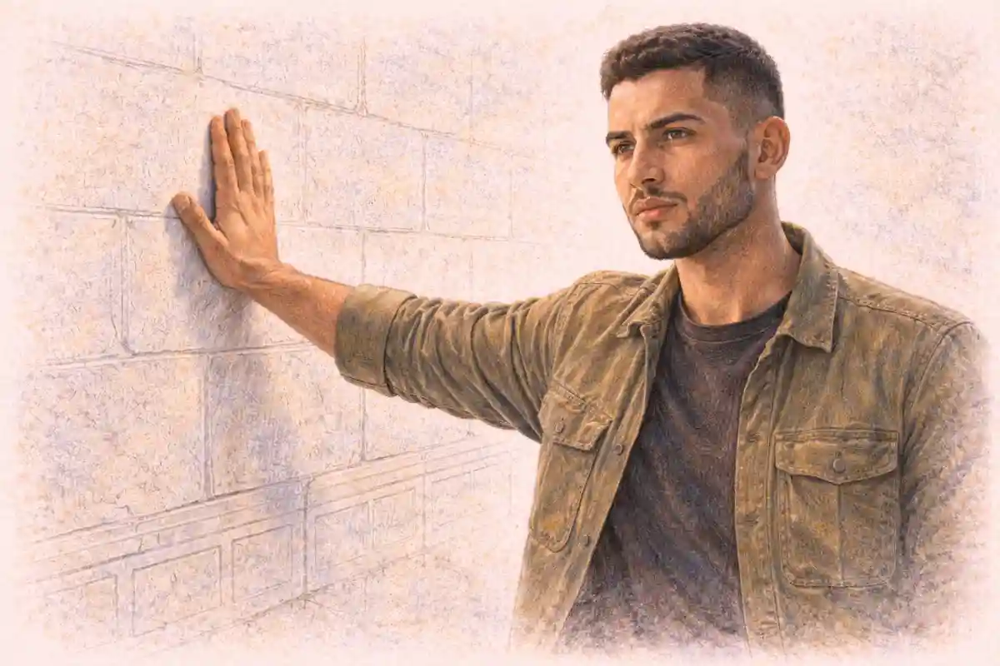

## Singles Events in New York City: The Next Two Weeks

New York rewards singles who show up, and this fortnight rewards them twice over, because it contains two dating seasons in one. The first week is Thanksgiving week: a Slapsgiving trivia night in a Midtown pub, a pre-Thanksgiving speed dating room in the East Village on the city's loosest night of the year, the 100th Macy's Thanksgiving Day Parade on Thursday morning, and a Saturday stacked with four separate dating rooms. The second week is the start of December proper: a sapphic speed dating night in Park Slope, salsa in the Brooklyn Museum's lobby, a free late night at MoMA on the first night of Hanukkah, and a klezmer Hanukkah party in a 1923 Harlem synagogue. If you are searching for singles events in New York City, speed dating in NYC, or simply where to meet singles in New York without another evening of swiping, this list is the shortcut.

**This edition covers Monday, November 23 to Sunday, December 6, 2026.** The list is refreshed every Sunday with a new rolling two-week window, so expired events disappear and new ones take their place. Every event below is labeled: a **Singles event** exists to help you meet a partner, while a **Singles-friendly** event is a social night where arriving alone is normal and conversation is easy. Audience labels (age ranges, LGBTQ+ and more) come straight from each organizer's listing. Prices and times are as listed by the organizer; check the event page before you go, because popular speed dating nights sell out one gender's tickets first, and holiday-week schedules deserve a second look before you travel.

Here is how to use the list. Start with the at-a-glance table if you want the five soonest dating events, then read the full listings, because the detail is where the fit lives: the same forty dollars can buy you eight matched mini-dates in a Williamsburg bar or a hosted rotation in a Chelsea hotel, and those are different evenings for different people. After the listings you will find neighborhood guides, a decoder for what each kind of night actually feels like, and honest sections on how to succeed at these events and how to shrug off the nights that do not click. Every event here was checked against its organizer's own listing, with a real date inside the window, a real venue and a format where a single person can plausibly leave with a phone number. Nothing is padded, and when a field like a price is not published, the listing below says so rather than guessing.

The shape of this particular fortnight is worth knowing before you book anything. Thanksgiving week builds to its Saturday: after the East Village room on Wednesday and the parade on Thursday, Saturday, November 28 carries a Williamsburg date night for 38-to-52-year-olds, a Friendsgiving speed dating party at The Wilson, an elevated Relish room at Flûte and a professionals' rotation on Park Avenue South — four dating rooms on one night, each aimed at a different slice of the city. The second week spreads wider and quieter: prompted conversation in Gowanus, archive trivia in the Civic Center, salsa in Prospect Heights, and December's first dating rooms, a holiday party in an East Village speakeasy and a Sunday-afternoon millennial session to close. Holiday-week events were checked with particular care; nothing here assumes a weekly event ran through the holiday unless its own listing says it does.

One more piece of orientation, because this edition's geography is concentrated and proud of it. The twenty listings touch Manhattan from Harlem's Old Broadway Synagogue to the East Village, and Brooklyn from Williamsburg to Park Slope and Gowanus, and they range from seven completely free rooms to a $141.04 Friday evening in a Flatiron teaching kitchen. That spread is deliberate. New York singles do not all live in the same dating market; they live in overlapping ones, defined by borough, bracket, community and intention, and a good fortnight samples across them rather than betting everything on one room. If you only take one idea from this introduction, take the cadence the list is quietly recommending: one structured dating night, one community room, one cultural freebie, repeated. It is cheaper than a month of premium app subscriptions, it teaches you the city's actual map of rooms, and unlike a feed, it compounds: hosts learn your face, regulars become familiar, and the second sighting, which is where New York romance actually starts, becomes statistically inevitable rather than a matter of luck.

## How Dating Works in New York City

New York is the easiest city in America to be single in and one of the hardest to date in, and both facts come from the same source: density. There are more single adults per square mile here than anywhere else in the country, which means the raw material for a love life is everywhere, on every train, in every coffee line. It also means everyone you meet is aware of the supply. The city's defining dating condition is the suspicion that someone marginally better is one swipe, one bar stool, one neighborhood away, and that suspicion leaks into everything, from the famously short first date to the reluctance to cross a river for a second one.

Geography is the first filter, long before chemistry. New Yorkers date inside travel-time radii, and the listings below show it: a Williamsburg date night for the 38-to-52 crowd of northern Brooklyn, because that crowd is not riding an hour into Manhattan on a Saturday; a pre-Thanksgiving room in the East Village for the people still in town; a Sunday mixer in Chelsea that releases everyone by seven. Locals joke about partners being geographically undesirable, but the joke encodes a real calculation, because a relationship here has to survive the commute math. When you choose events, choose them the way locals do: near home, near work, or on a line you already ride, so that a good first meeting can become a second one without a logistics summit.

The second filter is segmentation, and it is the great strength of this city's scene. Because the market is so large, organizers can fill a room with remarkably specific slices of it: 29-to-49-year-olds in the East Village, 30-to-49-year-olds at a Friendsgiving party, professionals in their 30s and 40s on Park Avenue South, queer women in Park Slope. In a smaller city, a night that narrow would never sell enough tickets to run. In New York it sells out, and the capped rooms in these listings fill for a reason: balance is what makes a speed dating night worth its ticket. Narrow rooms are a gift. The smaller the slice, the more the room has pre-agreed on the basics, and the more of the evening can be spent on the only question that matters, which is whether you actually like each other.

The apps built this scene as much as they hurt it. A decade of swiping taught a generation of New Yorkers that profiles lie politely and chemistry refuses to be scheduled by text, and the result is a visible migration back to rooms: organizers now sell the fatigue itself, because everyone in the room shares it. What events sell is compression. A speed dating night delivers eight to twelve real conversations in the time an app delivers two ambiguous threads, and a trivia team delivers something apps never can, which is watching how someone treats a wrong answer, a stranger and a lost round. The ambience varies enormously, though, and reading it is a local skill. A champagne bar speed date in Midtown is quiet, seated and deliberate, a first-date atmosphere manufactured wholesale. A prompted conversation night in a brewery is unhurried and confessional. A salsa lesson in a museum lobby is physical, joyful and wordless in the best stretches. None is better; each filters for a different temperament, and half of succeeding here is matching the room to your own.

Finally, New York dating runs on weeknights, and Thanksgiving week tests that rule in an interesting way. The listings cluster on Wednesdays and Saturdays because the city's social weekends belong to existing friends, birthdays and trips, while weeknights are when single New Yorkers are actually available and in their own neighborhoods. This fortnight bends the pattern around two holidays: the single biggest free event in the edition happens at 8:30 on a Thursday morning, because the whole city has the day off and the parade owns it, and the second week opens into Hanukkah, which begins on Friday, December 4 and puts a klezmer party in Harlem on the Saturday night. Expect a 7 PM start for most dating rooms, two structured hours, and a room that empties toward the last trains. Arrive straight from work if you must; everyone else did too.

The year has a dating calendar, and locals plan around it without ever saying so. September brings the return from summer dispersal and a city full of people recommitting to their lives and their love lives at once. Late November, this fortnight, is the serious season, when the cold and the approaching holidays quietly raise the value of a plus-one, and Thanksgiving week concentrates it: the people who stay in town, book rooms and show up on the holiday weekend are, empirically, among the most deliberate daters of the year. December then changes the rooms again, merrier and more themed, as holiday parties begin their land-grab on every venue calendar. January produces a surge of first-time event-goers keeping resolutions. Summer thins the organized scene out as the city decamps. None of this changes which event to pick on a given Thursday, but it changes the rooms: the same trivia night in late November contains more people who mean it than the one in August does.

There is one more piece of local physics worth naming: the second date problem. A first meeting at an event is easy to arrange because the event arranges it. A second meeting requires the city's real currencies, a plan, a neighborhood both people can reach, and a reason that is better than drinks because drinks was the first date. New Yorkers who date well from events think one step ahead: they pick rooms in neighborhoods with second-date infrastructure, the gallery blocks of Chelsea, the restaurant rows of the East Village, Grand Street in Williamsburg, so that we should do this again has somewhere obvious to go. It is not an accident that so many of this fortnight's listings sit in exactly those neighborhoods. The scene knows where its successes need to land.

Underneath all of this runs the friend-group economy, the city's unofficial dating infrastructure. New Yorkers arrive in this city alone and assemble their people deliberately, and those assembled families do real matchmaking work: the trivia team that adopts you, the run of regulars at a bar who have opinions about your prospects, the friend who drags you to the thing you would never have booked yourself. Events plug into that economy at every level. Half the value of a standing night is that it gives your friend group, present and future, a place to happen, and a surprising share of this city's couples met as the friend of someone at a table like the ones in this guide. Date the scene, in other words, and you are never only dating the person across from you; you are auditioning, gently and on all sides, for a whole social world, and it for you.

November changes the physics of all this in ways worth naming. The light goes early, which pushes the city's dating indoors and gives evening events a head start: a 5 PM start feels like night now, and the museum rooms glow accordingly. Experienced New York daters quietly rate these weeks among the best of the year. What you meet in a late-November room is the person, unmediated by costume or festival theme, and the follow-through is cleaner too, since everyone's calendar is about to fill and a second date suggested now actually gets scheduled. December's rooms, which this edition's second week previews, trade some of that purity for warmth and theme, and many daters prefer them for exactly that reason.

Thanksgiving week deserves its own paragraph in any honest account of how dating works here, because it rearranges the city's population in ways that change every room. A large share of New York's singles are transplants, and a large share of transplants leave. The ones who remain fall into recognizable kinds: the people whose families are a flight too far or a shift too many, the people hosting a friendsgiving because their chosen family is here, the people working the holiday itself in hospitals, restaurants, newsrooms and parade crews, and the people who simply decided that home is the apartment they pay for. Those stayers share a condition that is rare in this guarded city: for four days, they are all slightly out of their ordinary social scaffolding, and they know it about each other. That shared condition is why the East Village room on Wednesday night can feel like a small-town reunion, and why this edition's Thanksgiving-weekend rooms, in Williamsburg, at The Wilson, at Flûte and on Park Avenue South, draw crowds that hosts describe as unusually willing to actually talk. If you are a stayer, this is your fortnight in a way no other fortnight is.

There is a corresponding etiquette for the week, and it is worth stating plainly. Do not treat a Thanksgiving-week match as a holiday placeholder, a warm body recruited to fill a seat at someone else's table or to answer a family's questions by proxy. The stayers can tell, instantly, and the rooms are small enough that the reputation follows you into December. Go to the holiday rooms the way you would go to any other room in this guide, looking for a person rather than a solution to a calendar problem, and the week's natural warmth will do the rest. The couples who meet in Thanksgiving week and last tend to tell the same story: neither of them was performing gratitude or hunting a plus-one; both of them simply showed up, in the city they had chosen, on the days when showing up meant the most.

## New York City Singles Events at a Glance

| Event | Date | Type | Cost |
|---|---|---|---|
| Thanksgiving Speed Dating in the East Village, Ages 29-49 | Wed, Nov 25 | Singles event | $39 |
| Speed Dating NYC – Singles Ages 20s & 30s | Fri, Nov 27 | Singles event | $39 |
| Saturday Date Night in Williamsburg, Ages 38-52 | Sat, Nov 28 | Singles event | $39 |
| Ages 30-49 NYC Speed Dating & Friendsgiving Party | Sat, Nov 28 | Singles event | Starts at $10 |
| Relish | Saturday Night Ages 29-42 | New York's Elevated Speed Dating | Sat, Nov 28 | Singles event | $32.95 |

## Singles Events in New York City (Dating Events and Mixers)

### 1. Thanksgiving Speed Dating in the East Village, Ages 29-49

**When:** Wednesday, November 25, 2026, 8:00 PM – 10:30 PM · **Where:** Waiting On A Friend, 206 Avenue A, East Village, Manhattan · **Cost:** $39

**Type:** Singles event · **Good for:** Ages 29–49

CitySwoon runs this pre-Thanksgiving session at Waiting On A Friend, the 2,000-square-foot East Village bar on Avenue A, for ages 29 to 49, billed by the organizer as one of its most popular events of the year. The format is the CitySwoon model rather than a classic scorecard circuit: you complete a profile with a clear photo in advance, and live matching steers your roughly eight mini-dates toward the people the system judges your best fits in the room, with spots limited and booking essential. The night before Thanksgiving is a distinctive dating night in New York, and regulars know why. The city is full of people whose friends have left town, whose family obligations start tomorrow at noon, and who are in the loosest, most sociable mood of the month, in a bar on the biggest informal reunion night of the year. The East Village setting adds its own energy: small bars, dense streets, and a crowd that came to New York specifically for evenings like this. The room skews deliberate rather than casual, because nobody drifts into a ticketed dating room on this particular Wednesday by accident. Success tip specific to this room: complete the profile early and arrive unhurried. The matching can only work with what you give it, holiday-week rooms fill with people in a generous mood, and the daters who treat the session as a lark rather than a real room miss that this is, by the organizer's own billing, one of the best-attended sessions of its year.

[Event details and tickets](https://events.humanitix.com/thanksgiving-speed-dating-in-the-east-village-ages-29-49)

### 2. Speed Dating NYC – Singles Ages 20s & 30s

**When:** Friday, November 27, 2026, 7:00 PM – 9:00 PM · **Where:** Motto Chelsea (Upstairs at Lulla), 113 West 24th Street, Chelsea, Manhattan · **Cost:** $39

**Type:** Singles event · **Good for:** Ages 20s & 30s

NY Minute Dating's Speed Dating NYC series opens the post-Thanksgiving weekend with a Friday session for singles in their 20s and 30s, upstairs at Lulla inside Motto Chelsea on West 24th Street. The format is the brisk, hosted rotation this organizer runs across Manhattan most weeks: short seated conversations, a host keeping the room moving, and matches handled after the event so nobody has to negotiate numbers in front of a table. A Friday start at 7 PM makes this the edition's easiest after-work room, and the day after Thanksgiving gives it a particular crowd: people back from family tables, people who never left, and people whose group chats have gone quiet for the weekend, all choosing a dating room as their Friday night. The upstairs setting matters. It separates the event from the hotel bar below, keeps the noise at conversation level, and gives solo arrivals a defined room to belong to rather than a bar to hover in. Chelsea supplies the second-date infrastructure, with the High Line, gallery blocks and restaurant rows a short walk in every direction. Success tip specific to this room: bring one story from your holiday week that is actually yours. Every conversation in this room will start near Thanksgiving; the daters who answer with a specific, funny, true detail instead of a summary are the ones partners can picture, and picturing is what the follow-up match is made of.

[Event details and tickets](https://caldiscovery.com/new-york-ny/src-140103.html?paper)

### 3. Saturday Date Night in Williamsburg, Ages 38-52

**When:** Saturday, November 28, 2026, 6:00 PM – 8:30 PM · **Where:** Fred's Dog House, 354 Grand Street, Williamsburg, Brooklyn · **Cost:** $39

**Type:** Singles event · **Good for:** Ages 38–52

CitySwoon takes its matched format to Fred's Dog House on Grand Street in Williamsburg for a Saturday date night for ages 38 to 52. The model is the organizer's standing one: a completed profile with a clear photo in advance, roughly eight live-selected mini-dates steered toward your best fits, spots limited and booking essential, tickets $39 on the Humanitix listing. The bracket is the point. A 38-to-52 room in Williamsburg draws a settled, neighborhood crowd, people whose dating lives happen in Brooklyn and who have no interest in a Midtown hotel room, and conversation in such rooms runs deeper faster because the basics — borough, bracket, intention — are pre-agreed before the first date begins. Fred's Dog House is a neighborhood bar room on Grand Street, warm and unpretentious, with live music roots and a plant-based hot dog menu the organizer itself name-checks, which keeps the evening at human scale and gives the after-rounds mixing a natural home at the bar. The Saturday after Thanksgiving cuts both ways in your favor: half the city's daters are out of town, which means the people in this room chose to be here, on this Saturday, on purpose. Success tip specific to this room: let the neighborhood do its work. Talk about your actual Brooklyn — your block, your places, your routines. In a room this local, shared geography is not small talk; it is the compatibility evidence everyone came to collect.

[Event details and tickets](https://events.humanitix.com/saturday-date-night-in-williamsburg-ages-38-52?hxchl=hex-pfl&dateId=6aa301098b3bbd6a6979944a)

### 4. Ages 30-49 NYC Speed Dating & Friendsgiving Party

**When:** Saturday, November 28, 2026, 6:30 PM · **Where:** The Wilson at The INNSiDE Hotel, 132 West 27th Street, Manhattan · **Cost:** Starts at $10

**Type:** Singles event · **Good for:** Ages 30–49

NY Singles runs this Saturday session at The Wilson, the restaurant and bar inside the INNSiDE Hotel on West 27th Street, pairing its speed dating format with a Friendsgiving party frame for ages 30 to 49, with tickets starting at $10 on the organizer's Eventbrite listings — the cheapest entry point into a dating room in this edition. The Friendsgiving framing is doing real work here. It gives the room a holiday-weekend warmth and a built-in subject, and it signals that the evening is meant to feel like a party with dating inside it rather than an audition with drinks nearby. NY Singles is one of the city's standing older circuits, running age-banded rooms across Manhattan most weeks, and its sessions draw a settled local crowd rather than a one-night novelty audience. The Wilson is a polished hotel restaurant room, brighter and more open than the edition's pub rooms, which suits a party format: there is space to circulate after the seated rounds, and the Chelsea location puts every subway line within a short walk for the trip home. Success tip specific to this room: use the party half deliberately. Note during the rounds which two conversations you wanted more of, and spend the social time afterwards on exactly those, with names and one remembered detail each. In a room where the party is half the event, the daters who treat the rounds as the whole evening leave before their best conversation happens.

[Event details and tickets](https://www.eventbrite.com/e/fall-speakeasy-speed-dating-singles-connect-ages-30-to-45-tickets-2003251846198?aff=oddtdtcreator)

### 5. Relish | Saturday Night Ages 29-42 | New York's Elevated Speed Dating

**When:** Saturday, November 28, 2026, 7:00 PM – 9:00 PM · **Where:** Flûte Champagne Bar, 205 West 54th Street, Midtown, Manhattan · **Cost:** $32.95

**Type:** Singles event · **Good for:** Ages 29–42

Relish runs its elevated speed dating format at Flûte Champagne Bar on Saturday night for ages 29 to 42: eight to twelve local singles in one evening, a format the organizer describes as transforming traditional speed dating into a relaxed, sophisticated social, part mixer and part curated introduction series, with matches delivered the next day through the Smart-Match Card and no paper scorecards on the night. Tickets are listed from $32.95. A Saturday night after a holiday is a revealing room. The city's social calendar has been given over to family and travel for three days, and the singles who book a dating room on the Saturday night are, as a group, unusually clear about why they are there; hosts of holiday-weekend sessions consistently describe them as the most purposeful rooms of the season. Flûte does specific work for a room like this. It is small, low-lit and built around champagne, in a space with a speakeasy past on West 54th Street, which keeps voices at conversation level and gives the evening a first-date polish that a sports bar never could. The crowd is the bracket's professionals and creatives in roughly equal measure. Success tip specific to this room: use the holiday honestly. Everyone here just spent days being asked about their lives by family; a date who asks a real question about the year someone actually had, rather than performing festive cheer, will be remembered on Sunday when the match cards arrive.

[Event details and tickets](https://www.eventbrite.com/e/relish-saturday-night-ages-29-42-new-yorks-elevated-speed-dating-tickets-2003170896074)

### 6. Speed Dating NYC – Single Professionals Ages 30s & 40s

**When:** Saturday, November 28, 2026, 7:00 PM – 9:00 PM · **Where:** Amelia's NYC, 450 Park Avenue South, Manhattan · **Cost:** not listed

**Type:** Singles event · **Good for:** Ages 30s & 40s, single professionals

NY Minute Dating's second Saturday session in this edition is aimed squarely at single professionals in their 30s and 40s, at Amelia's NYC on Park Avenue South. Where the organizer's Friday room is bracketed by decade, this one is bracketed by life stage: the listing's own framing is professionals, and the room it assembles is people whose dating problem is not opportunity but time. The format follows the series' standing model, a hosted rotation of short seated conversations with matching handled afterwards, which keeps the evening moving and removes the public ask from the room entirely. A 7 PM Saturday start on Park Avenue South puts the event in the city's flatiron-adjacent professional belt, an easy reach from both downtown and Midtown, and the restaurant-bar setting gives the night a dinner-hour polish without a dinner's commitment. The Saturday of Thanksgiving weekend sharpens this room the same way it sharpens every room in this edition: attendance is a decision, and the people who made it are measurably more likely to follow through on a match than a crowd that drifted in. The listing does not publish a ticket price on the calendar page retrieved for this edition, and the listing below says so rather than guessing. Success tip specific to this room: be concrete about your actual week. In a professionals' room, vague polish blurs; a specific account of your work, your neighborhood and your Sundays is what partners remember when they make their selections later.

[Event details and tickets](https://caldiscovery.com/new-york-ny/src-140103.html?paper)

### 7. NYC Elite Social: An Exclusive Singles & Networking Mixer

**When:** Sunday, November 29, 2026, 4:00 PM – 7:00 PM · **Where:** The Lobby Bar & Garden, 518 West 27th Street, Chelsea, Manhattan · **Cost:** $21.05

**Type:** Singles event · **Good for:** All singles

EastWest Collective closes the edition's dating calendar on Sunday afternoon with this singles and networking mixer at The Lobby Bar & Garden on West 27th Street in Chelsea: an elevated social for New York's singles, tickets from $21.05, with entry and the curated social experience included and drinks ordered separately at the bar, as the Eventbrite listing states. The 4-to-7 PM Sunday slot is a deliberate piece of scheduling: daylight dating, no late night, and a room that mixes romantic intention with professional networking, which lowers the stakes of every conversation and gives strangers two legitimate reasons to talk. The venue, a lobby bar and garden in Chelsea's gallery district, is brighter and more open than the edition's evening rooms, and the crowd reflects the hybrid billing: singles who are as happy to leave with a contact as a date. That hybrid quality is a feature for the right dater. Conversations start easily, nobody has to declare intentions in the first minute, and the afternoon format suits people who find evening dating rooms exhausting. Success tip specific to this room: arrive in the first hour and work the garden as well as the bar. Sunday mixer crowds form early and harden fast; the daters who arrive at five to a settled room spend the afternoon cracking clusters, while the early arrivals were simply there when the clusters formed around them.

[Event details and tickets](https://www.eventbrite.com/e/nyc-elite-social-an-exclusive-singles-networking-mixer-tickets-2003518491742)

### 8. Sapphic Speed Dating at Good Judy | Queer Women & LGBTQ+

**When:** Wednesday, December 2, 2026, 7:00 PM – 9:00 PM · **Where:** Good Judy, 563 5th Avenue, Park Slope, Brooklyn · **Cost:** $20

**Type:** Singles event · **Good for:** Queer women, LGBTQ+

Plenty of Parties brings its sapphic speed dating night back to Good Judy, the queer bar on Fifth Avenue in Park Slope, for queer women, lesbians, bisexual and pansexual singles and the wider LGBTQ+ community, as the listing itself frames the room. The format is a rotation of mini-dates, each a few minutes long — enough to register a spark without the pressure of a full first date — inside a venue the listing describes as cozy, energetic, welcoming and unapologetically queer. That venue choice is the event's whole argument. A dating night built by and for a community, inside one of Brooklyn's favorite queer nightlife spots, starts from trust that a generic hotel room has to manufacture: the crowd is local, the staff know the format, and arriving alone is the norm rather than the exception. Park Slope supplies the rest, a settled, residential Brooklyn crowd for whom Fifth Avenue is a neighborhood main street rather than a destination. Tickets are listed at $20. Success tip specific to this room: let the mini-dates be short and honest. In a community room this size, people compare notes afterwards, and the daters who are warm in the rounds that go nowhere are the ones the room speaks well of — which, in a scene built on regulars, is worth more than any single match.

[Event details and tickets](https://allevents.in/brooklyn/sapphic-speed-dating-at-good-judy-queer-women-and-lgbtq-tickets/100002004206126476)

### 9. Speed Dating & Holiday Party Ages 30-49 NYC

**When:** Saturday, December 5, 2026, 5:30 PM · **Where:** Blind Barber, 339 East 10th Street, East Village, Manhattan · **Cost:** Starts at $15

**Type:** Singles event · **Good for:** Ages 30–49

NY Singles opens December's dating calendar with this combined speed dating and holiday party for ages 30 to 49 at Blind Barber, the East Village barbershop-front speakeasy on East 10th Street, with tickets starting at $15 on the organizer's Eventbrite listings. The pairing of formats is the event's design: seated speed dating rounds guarantee introductions across the bracket, and the holiday party that wraps around them gives promising conversations somewhere to continue without any engineering from you. Early December is when the city's dating rooms change temperature. The holiday season supplies a subject everyone has live material on, the rooms fill with people making deliberate end-of-year decisions about their social lives, and a speakeasy behind a working barbershop gives the whole thing a sense of occasion that a function room cannot. Blind Barber's room is intimate and low-lit, which keeps a party-format night at conversation volume even as it fills. The crowd is the organizer's standing one, age-banded Manhattan regulars, now joined by the December first-timers every circuit sees. Success tip specific to this room: pace yourself for the party, not just the rounds. Arrive for the dating portion, mark your two strongest conversations, and then actually stay — in a combined format, the match is often made in the unstructured hour by the person who did not treat the end of the rounds as the end of the event.

[Event details and tickets](https://www.eventbrite.com/d/ny--new-york/after-work-party/?page=4)

### 10. Millennial Speed Dating: Ages 28-45 in New York City | Tavern 29

**When:** Sunday, December 6, 2026, 4:30 PM – 6:30 PM · **Where:** Tavern 29, 47 East 29th Street, Manhattan · **Cost:** $38.90

**Type:** Singles event · **Good for:** Ages 28–45

Speed Dating NYC closes the edition on Sunday afternoon at Tavern 29, the multi-level bar and restaurant on East 29th Street, with a millennial edition for ages 28 to 45. The organizer's format is the classic bell-and-rotation circuit, modernized at the edges: mini-dates of around three minutes, notes taken as you go, and matches revealed afterwards when you log in, so a mutual yes arrives without either person having had to risk a public ask. After the rotations, the listing builds in a social mixer, so the evening ends with unstructured time at the bar rather than a dash for the door. A 4:30 PM Sunday start is a deliberate kindness. It draws the deliberate end-of-weekend crowd, releases everyone by half past six, and leaves room for an actual dinner with a promising match the same evening. Tavern 29 is a warm, wood-and-brick room with a rooftop in warmer months and a ground-floor bar built for lingering, in the NoMad-adjacent blocks where several subway lines converge. Tickets are listed at $38.90. Success tip specific to this room: use the mixer as a second interview, not a celebration. The rotations tell you who is interesting; the mixer tells you who is easy to be with, and the daters who spend it returning to their strongest conversation, rather than collecting new ones, are the ones who leave with a plan.

[Event details and tickets](https://www.eventbrite.com/e/millennial-speed-dating-ages-28-45-in-new-york-city-tavern-29-tickets-2004206158572)

## Singles-Friendly Events in New York City (Social Nights Where Meeting People Is Easy)

### 11. How I Met Your Mother Trivia: Slapsgiving

**When:** Monday, November 23, 2026, 7:00 PM – 8:30 PM · **Where:** Slattery's Midtown Pub, 8 East 36th Street, Midtown, Manhattan · **Cost:** Free

**Type:** Singles-friendly · **Good for:** All singles

Trivia, AD brings its How I Met Your Mother trivia to Slattery's Midtown Pub on East 36th Street for a Slapsgiving edition: five challenging rounds covering Ted, Robin, Barney, Marshall and Lily, with two rounds dedicated to Slapsgiving, the show's own Thanksgiving tradition, free to play with a $20 food and drink minimum per person listed by the organizer. The theme is almost too perfect for this guide: a sitcom about a single New Yorker's long, narrated search for a partner, turned into a team game in a Midtown pub on the Monday of Thanksgiving week. The room self-selects for the show's generation, people who arrived in this city with the same fictional template of friendship and dating in their heads, and the Slapsgiving rounds give the evening a seasonal spine that ordinary theme nights lack. Slattery's is a proper Midtown pub, warm and unpretentious, and Trivia, AD is the city's most prolific themed trivia organizer, which means the night runs on rails and teams form fast. Success tip specific to this night: go with a team of four, not five, or arrive solo and join one. Trivia teams with an open seat absorb solo arrivals gladly, and in a room organized around a show about a friend group, the open seat is the most honest invitation in the building.

[Event details and tickets](https://www.eventbrite.com/e/how-i-met-your-mother-trivia-slapsgiving-tickets-2002968944030)

### 12. Thanksgiving Trivia Night at Burger Joint

**When:** Tuesday, November 24, 2026, 6:00 PM – 7:30 PM · **Where:** burger joint, Thompson Central Park, 119 West 56th Street, Midtown, Manhattan · **Cost:** Free

**Type:** Singles-friendly · **Good for:** All singles

Burger Joint, the cult burger counter hidden inside the Thompson Central Park hotel on West 56th Street, hosts its Thanksgiving trivia night: four rounds of trivia hosted by Jourdan Nokleby, free to play, starting promptly at 6:30 PM, with teams limited to five players and a $15 per-person food, drink or merchandise minimum listed in the fine print. The prizes are charmingly local — a complimentary burger card for first place, fries for third — and the lowest-scoring team earns the evening's best booby prize, choosing a subcategory for the next trivia night on December 8, whose theme is Holidays. The room is tiny, the line is famous, and teams in a space that size end up talking to the tables beside them whether they planned to or not. A Thanksgiving theme in Thanksgiving week gives the night a warmth generic trivia cannot manufacture: the questions are about gratitude, feasts and family chaos, subjects every person in the room has live material on this week. The social mechanics are the burger joint's own: a hidden counter, a small room, burgers in hand, and an early finish at 7:30 that makes this the lowest-commitment evening in the edition. Success tip specific to this night: arrive before the 6:30 start and form your team in the line. The famous queue is this venue's real lobby; conversations that begin over the menu board become teams at the counter, and a team formed in the line has already survived its first negotiation before a single question is asked.

[Event details and tickets](https://www.eventbrite.com/e/thanksgiving-trivia-night-at-burger-joint-tickets-2000432953815)

### 13. 100th Macy's Thanksgiving Day Parade

**When:** Thursday, November 26, 2026, 8:30 AM – 12:00 PM · **Where:** Central Park West at 77th Street to Macy's Herald Square, Manhattan · **Cost:** Free

**Type:** Singles-friendly · **Good for:** All singles

The 100th Macy's Thanksgiving Day Parade steps off on Thanksgiving morning, Thursday, November 26 at 8:30 AM, traveling its 2.5-mile route from Manhattan's Upper West Side down Central Park West and Sixth Avenue to Macy's Herald Square, with public viewing on the west side of Central Park West between 75th and 61st Streets and along Sixth Avenue between 59th and 38th Streets. It is free to watch from public sidewalks, and this centennial edition — the parade began in 1924 and was cancelled only for three wartime years — is the city's great shared morning: millions along the route, a record number of balloons overhead, and a crowd in the loosest, happiest mood of the year. For singles, the parade's social surface is the sidewalk itself. You stand for hours beside the same strangers, sharing sightlines, coffee runs and balloon commentary, in a crowd where talking to your neighbor is not an approach but the norm; the Upper West Side stretches of Central Park West, where the balloons are freshest and the crowd is families and locals rather than crush, are the connoisseur's ground. Success tip specific to this event: pick a spot on Central Park West in the sixties or seventies, arrive early enough to settle, and stay in one place. The parade rewards stationary sociability; a person who holds a good spot, shares it generously and knows the route becomes, for one morning, a host, and hosts are the people strangers remember and talk to.

[Event details and tickets](https://www.nbc.com/nbc-insider/2026-macys-thanksgiving-day-parade-everything-to-know)

### 14. Whitney Free Friday Night

**When:** Friday, November 27, 2026, 5:00 PM – 10:00 PM · **Where:** Whitney Museum of American Art, 99 Gansevoort Street, Meatpacking District, Manhattan · **Cost:** Free

**Type:** Singles-friendly · **Good for:** All singles

The Whitney's Free Friday Nights open the museum without charge every Friday from 5 to 10 PM, with free access to exhibitions, special programming and city views from the terraces, as the museum's own site states; tickets are required and capacity is limited, so advance booking is strongly recommended, and visitors 25 and under are always free. This Friday's edition falls the day after Thanksgiving, which makes it the natural soft counterpoint to the week's ticketed rooms: no bracket, no scorecard, just the museum, the art and half the Meatpacking District's Friday evening flowing through the same lobby. As a place to meet people, a free museum night beats a museum's ordinary day hollow, because the programming gives strangers things to do side by side and opinions to trade in real time, and the Friday-night crowd skews social in a way Saturday's never does: after-work groups, members, the art-curious and first-time visitors discovering the terraces. The building itself helps, all glass, steel and stacked terraces above Gansevoort Street, with the High Line at its feet. Success tip specific to this night: work the terraces between galleries rather than treating the art as a solo pilgrimage. The conversations at a free Friday start in front of works people have opinions about and continue outside over the skyline; a person who lingers, asks and listens in those spaces is findable in a way a person marching the floors with headphones never is.

[Event details and tickets](https://whitney.org/?sa=X&ved=2ahUKEwjrtYH1n9uHAxXJFfkAHRSOFjMQyK4DegQIBBAt)

### 15. Hands-On: Ravioli | Cacio e Pepe

**When:** Friday, November 27, 2026, 6:00 PM – 7:45 PM · **Where:** Eataly NYC Flatiron, 200 5th Avenue, Flatiron, Manhattan · **Cost:** $141.04

**Type:** Singles-friendly · **Good for:** All singles

Eataly's Flatiron scuola runs this hands-on evening class in ravioli cacio e pepe on the Friday after Thanksgiving: the Scuola Chef prepares the signature dish for you to taste, then guides the room through making fresh egg pasta dough, mixing a cacio e pepe filling and shaping ravioli from scratch with your own hands, with focaccia and arugula salads alongside, in a class running about an hour and three quarters. Tickets are $141.04, the priciest ticket in this edition, stated plainly. What you are buying is a small room, a skilled teacher and a skill you keep, inside one of the city's great food halls, on the evening when half of New York is eating leftovers and the other half is ready to leave the house. Cooking classes remain the most underrated meeting format in this guide, for a structural reason: your hands are busy, your station neighbor is two feet away, and the shared project produces a running conversation that never has to be forced, plus a tasting at the end where the conversation can settle. Arriving solo is unremarkable here; classes are full of pairs of friends, colleagues and people who simply wanted to learn the dish. Success tip specific to this class: arrive early enough to choose your station beside someone else who came alone rather than inside a settled group, and trade numbers over the tasting, not the dough. Flour on your hands is a fine excuse for a lot of things, but the eating is when people decide whether they liked you.

[Event details and tickets](https://www.eventbrite.com/e/hands-on-ravioli-cacio-e-pepe-tickets-2004502545072)

### 16. NYC Time Capsule: Trivia Night with the Municipal Archives and Library

**When:** Tuesday, December 1, 2026, 6:00 PM – 8:30 PM · **Where:** NYC Department of Records and Information Services (DORIS), 31 Chambers Street, Suite 111, Manhattan · **Cost:** Free

**Type:** Singles-friendly · **Good for:** All singles

The Department of Records and Information Services hosts its annual NYC Time Capsule trivia night at 31 Chambers Street, the Municipal Building's grand Chambers Street address in the Civic Center: an evening testing your knowledge of New York City history, run by the Municipal Archives and Library themselves, free on the Eventbrite listing. This is trivia with the source material in the building. The Archives hold the city's records, photographs and films, and a trivia night built from them draws a very specific and very New York crowd: history obsessives, librarians and archivists off duty, tour guides, teachers, and the kind of single who can date a photograph by its skyline. That specificity is the social gift. In a generic pub quiz you learn who is good at quizzes; in this room you learn who loves the same city you do, in detail, which is a far better predictor of a second conversation. The Civic Center setting adds ceremony — this is a municipal institution opening its doors after hours, not a bar renting a theme. Success tip specific to this night: bring one deep-cut fact and be generous with it. Teams in archive trivia are assembled from whoever shows up, expertise is visibly distributed, and the person who contributes one memorable answer early becomes the teammate everyone orients to for the rest of the night.

[Event details and tickets](https://on.nyc.gov/earlyaccess26)

### 17. LGBTQIA+ Skip the Small Talk Night at Threes Brewing Gowanus

**When:** Tuesday, December 1, 2026, 7:00 PM – 9:00 PM · **Where:** Threes Brewing Gowanus, 333 Douglass Street, Gowanus, Brooklyn · **Cost:** $15

**Type:** Singles-friendly · **Good for:** LGBTQIA+, ages 21+

Skip the Small Talk runs this LGBTQIA+ edition of its prompted-conversation night at Threes Brewing's Gowanus taproom on Douglass Street: an evening built on psychology-based question prompts designed to get strangers past weather talk in the first five minutes, with check-in from 6:45 PM, an age range listed as 21+ with many attendees in their twenties and thirties, and tickets at $15 on the organizer's listings. This is explicitly a friending format rather than a dating room, and that is its strength for singles: the pressure is off, the prompts carry the social weight, and the conversations practice exactly the skill every dating event in this guide then demands. The brewery setting matters. Threes Brewing is a working Brooklyn brewery with a big, calm taproom built for seated conversation rather than volume, and Gowanus supplies a crowd that chose depth on a Tuesday over almost anything else on offer. Nobody here is on a date, which means nobody is performing date behavior; what you meet is closer to the unguarded version. Success tip specific to this night: steal the prompts, ethically and openly. The question that opened a real conversation here will open one at Saturday's dating rooms too, and the people who succeed on this circuit are often simply the ones who arrived carrying better questions than small talk provides.

[Event details and tickets](https://donyc.com/events/2026/12/1/lgbtqia-skip-the-small-talk-night-at-threes-brewing-gowanus-tickets)

### 18. Brooklyn Museum Salsa Party

**When:** Thursday, December 3, 2026, 6:00 PM – 9:30 PM · **Where:** Brooklyn Museum, Martha A. and Robert S. Rubin Lobby, 1st Floor, 200 Eastern Parkway, Prospect Heights, Brooklyn · **Cost:** Free

**Type:** Singles-friendly · **Good for:** All singles

The Brooklyn Museum's Salsa Party returns to the first-floor Rubin Lobby on Eastern Parkway on Thursday, December 3: a lesson led by Balmir Dance Society instructors at 6 PM to open the night, followed by live music, social dancing and performances by the borough's best Latin dance teams, free with registration encouraged because admission is limited and first come, first served, as the museum's own event page confirms. The museum runs this as a standing series, not a special event, and that standing quality shows in the room: regulars who know the steps, newcomers the lesson is designed to absorb, and a lobby that turns into a dance floor under the museum's glass pavilion as the evening builds toward 9:30. A museum salsa night is the dance-floor format at its most welcoming. The lesson pairs you with rotating partners before any social pressure exists, the live music gives the room energy a playlist cannot, and the crowd spans the borough in age and background in a way few ticketed rooms manage. Dress for movement and arrive for the lesson even if you think you can dance; the lesson is where the room sorts itself into partners. Success tip specific to this night: stay for the first social set after the lesson rather than drifting to the galleries. The rotation continues informally, the partners you met in the lesson are findable again, and the second dance, requested rather than assigned, is the one that starts conversations.

[Event details and tickets](https://secure.brooklynmuseum.org/20188/20190)

### 19. MoMA UNIQLO Friday Nights

**When:** Friday, December 4, 2026, 5:30 PM – 8:30 PM · **Where:** The Museum of Modern Art, 11 West 53rd Street, Midtown, Manhattan · **Cost:** Free for New York State residents

**Type:** Singles-friendly · **Good for:** All singles

MoMA stays open late on Friday, December 4 for its UNIQLO Friday Nights: admission free for all New York State residents, with tickets reserved in advance and subject to availability, and the evening built around the exhibitions, drop-in drawing sessions and activities in the Creativity Lab, as the museum's own calendar page describes. December 4 is also the first night of Hanukkah, which gives Midtown a particular Friday-evening energy, and MoMA's late opening sits right in the middle of it: a warm, bright, art-filled room at the hour when the city's holiday crowds are at their thickest a few avenues away. As a meeting format, a museum late night is the Whitney model's Midtown sibling — no bracket, no host, just a shared interest strong enough to start conversations in front of actual works, plus structured activities, the drawing sessions above all, that put strangers side by side with something to do with their hands. The crowd skews younger and more local than a daytime museum crowd, because the free-resident ticket selects for New Yorkers. Success tip specific to this night: join the drop-in drawing rather than only walking the galleries. Drawing sessions seat you, give the table a shared task and a natural subject, and produce the edition's easiest opening line — asking what someone is working on, in a room where everyone is working on something.

[Event details and tickets](https://www.moma.org/calendar/events/10253)

### 20. Hanukkah Klezmer Concert & Party

**When:** Saturday, December 5, 2026, 7:00 PM – 9:00 PM (pre-concert party at 6:30 PM) · **Where:** Old Broadway Synagogue, 15 Old Broadway, Harlem, Manhattan · **Cost:** Suggested donation $10

**Type:** Singles-friendly · **Good for:** All singles

Yiddish New York, the Center for Traditional Music and Dance and the Sholem Aleichem Cultural Center present this Hanukkah klezmer concert and party at the Old Broadway Synagogue in Harlem, on the second night of Hanukkah: world-renowned violinists Alicia Svigals and Jake Shulman-Ment with Pete Rushefsky on tsimbl, in a showcase of contemporary klezmer fiddling, with the synagogue's Hanukkah party beforehand at 6:30 PM and a suggested donation of $10 at the door. The venue carries the history in its walls. The Old Broadway Synagogue was built in 1923, when Harlem was a center of New York's Jewish community, and hearing klezmer there, during the festival, in a room assembled by the culture that owns the music, is a different order of evening from a concert hall booking. As a social format it works the way all genuine community celebrations in this guide work: nobody is selling dating, the party before the concert does the mixing, and a shared, joyful ritual gives strangers something real to stand inside together. Arrive for the party, not just the downbeat. Success tip specific to this night: come at 6:30 for the party and let the hosts and regulars place you. Community rooms absorb early, friendly arrivals into their own circulation; the person who appears only for the concert gets the music, and the person who comes for the party gets the room as well.

[Event details and tickets](https://ctmd.org/events/page/11/)

## Where to Meet Singles in New York City, Neighborhood by Neighborhood

New Yorkers do not date the city; they date a neighborhood and a travel radius. The listings above spread across two boroughs in force, and each cluster has its own ambience, its own crowd and its own rules of engagement. Read the map before you book the ticket, because the right room in the wrong neighborhood is a one-night stand with geography: even a great connection has to survive the trip home.

**Midtown and Chelsea.** Midtown is where the city's organized dating industry lives, because Midtown is where the people with jobs and limited time are. This edition's Midtown rooms are the circuit at full strength: the Relish room at Flûte on West 54th, the professionals' rotation at Amelia's on Park Avenue South, the millennial session at Tavern 29 on East 29th, two trivia nights at Slattery's on East 36th and at Burger Joint inside the Thompson hotel on West 56th, MoMA's free Friday night on West 53rd, and, across the Chelsea line, the Friday speed dating upstairs at Lulla on West 24th, the Friendsgiving party at The Wilson on West 27th and the Sunday mixer at The Lobby Bar & Garden a block west. The ambience is after-work: dressed, efficient, transit-rich, with rooms that start at seven and release you to every subway line in the city. The dating consequence of all that efficiency is a distinctive honesty. Rooms here attract people whose scarcest resource is the evening itself, which is why the brackets run deliberate and the intentions run clear. What Midtown produces is yield, a predictable number of real conversations per hour of your life, and for the city's busiest singles that trade is the entire appeal. Dress like the after-work crowd you are joining; in Midtown, polish is a form of respect for other people's time.

**Williamsburg, Park Slope and Gowanus.** Brooklyn hosts this edition's most conversational rooms: CitySwoon's Williamsburg date night at Fred's Dog House on Grand Street, sapphic speed dating at Good Judy on Fifth Avenue in Park Slope, and Skip the Small Talk's LGBTQIA+ conversation night at Threes Brewing in Gowanus. These are settled neighborhoods where the singles scene runs on recurring nights and regulars rather than ticketed spectacles, and where the dating style skews conversational and local. Fred's is a neighborhood bar where the crowd is the point; Good Judy is a community room built by queer Brooklyn for itself; the Threes taproom is a calm seated space built for actual talk. The quiet belt has one more advantage nobody lists: its events end early and its streets are calm, so a good first meeting extends itself naturally into a walk, a bakery stop, a second coffee. For transplants especially, planting a flag in one of these neighborhoods' recurring nights is the fastest known route to feeling like the city is yours, with or without a date at the end of it.

**Prospect Heights and the Flatiron District.** Two of this edition's warmest rooms sit a few miles apart and share a character: neighborhood-first sociability at human scale. On Eastern Parkway the Brooklyn Museum opens its lobby for the Salsa Party, Prospect Heights' grandest regular room, where the crowd is the borough itself. On Fifth Avenue at 23rd Street, Eataly Flatiron runs the edition's pasta class in a working teaching kitchen, anchoring a district that is neither Midtown's office corridor nor the Village's bar country: a working neighborhood of design showrooms, photography studios and the Madison Square park crowd, where the evening population is people who live and work within a few blocks of each other. The Flatiron's second-date infrastructure is quietly excellent: Madison Square Park itself for a walk, a row of serious restaurants along Fifth and Broadway, and subway lines in every direction at 23rd Street. A match made over ravioli dough in the Flatiron has somewhere obvious to go next, which, as this guide keeps arguing, is half the battle in New York.

**The East Village.** The East Village is the city's ancestral singles territory, dense with small bars and people who came to New York specifically for this. This fortnight it contributes two of the edition's most distinctive dating rooms: the pre-Thanksgiving speed dating at Waiting On A Friend on Avenue A, in a 2,000-square-foot bar on the year's loosest night, and December's holiday speed dating party at Blind Barber on East 10th, behind its barbershop front. The pattern is the neighborhood in miniature: small rooms, explicit premises, crowds that skew curious and mixed in every direction. The Village rewards spontaneity and punishes pretension; come as you are, stay later than planned, and expect every evening to have a second act within three blocks. Practical note: bars here are small, so groups form fast and merge faster, and the couples who leave together are the ones who suggest the walk, the slice, the next bar, before the room absorbs their date into the crowd.

**The Upper West Side, the Civic Center and Harlem.** This edition's map has a civic spine no ordinary fortnight has. The parade route itself, Central Park West from 77th Street down to Herald Square, is a singles venue for one morning a year, miles of sidewalk sociability under the balloons. Downtown, the Municipal Archives open 31 Chambers Street for an after-hours trivia night built from the city's own records, in the Beaux-Arts heart of the Civic Center. And uptown, the Old Broadway Synagogue, built in 1923 off 125th Street in Harlem, hosts the Hanukkah klezmer party: a room where the neighborhood's layered history — Harlem was a center of Jewish New York before it was the capital of Black America, and the synagogue is a surviving witness to both — is part of what you are standing inside. The lesson of all three is that some of the best meeting rooms in the city are not dating events at all; they are institutions having a good day, with a single person entirely free to be there for the thing itself and meet whoever else had the same idea.

**Queens and the Bronx.** Honesty requires a note about the boroughs this edition under-serves. No verified Queens or Bronx event landed inside this window on the calendars checked. That is a calendar fact, not a scene judgment: Astoria's restaurant-row rooms run a loyal, dinner-first dating culture for western Queens all year, and the Bronx's cultural institutions program social nights on their own schedules. If you live in Queens, the practical play this fortnight is the short trip: the Manhattan rooms on the 7 and E lines deliver you home faster than most Brooklyn daters manage, and the Brooklyn Museum sits on lines that run straight back to western Queens. Watch this space in the next edition; Queens rooms rotate through this guide as their calendars land in the window.

## Ambiences Decoded: What Each Kind of Night Feels Like

Venue is destiny at singles events, because the room decides how loud you must be, how close you will sit, and how easily you can leave a conversation that is going nowhere. This fortnight's listings contain nearly every room type in the city; here is what each one actually demands of you.

**The champagne bar** (Flûte). Small, low-lit, built around a single elegant drink, in a space with a speakeasy past. The polish is the point: voices stay low, dates feel like dates, and the crowd dresses for the room. Best for: daters who like their evenings deliberate. Watch out for: quiet rooms expose low effort; grooming does real work here.

**The hotel bar and restaurant** (Motto Chelsea's Lulla, The Wilson at INNSiDE, Amelia's, Tavern 29). Polished, staffed, designed for strangers: hotel rooms are the dating circuit's reliable middle, bright enough to read faces, serviced enough that a conversation never has to compete with a bar queue. Best for: after-work daters who want structure without stiffness. Watch out for: the polish can make everyone sound like their résumé; ask one non-work question early.

**The neighborhood bar and pub** (Fred's Dog House, Slattery's Midtown Pub, Burger Joint). Small, local, full of regulars, run by people who know the room. These are the warmest spaces on the list and the most forgiving of solo arrivals, because a neighborhood bar's entire business is absorbing strangers into a local scene. Best for: slow-build daters and anyone who wants a scene, not an event. Watch out for: the regulars are a community; behave like a guest and you will be treated like a neighbor.

**The speakeasy** (Blind Barber). A room hidden behind a working barbershop, intimate and low-lit by design. The concealment is the ambience: everyone inside chose to find it, which gives a holiday party a sense of occasion no function room can rent. Best for: daters who like their evenings to feel discovered rather than scheduled. Watch out for: small rooms fill and harden early; arrive at the start.

**The brewery taproom** (Threes Brewing Gowanus). Big, calm, seated, built for conversation at normal volume with prompts doing the heavy lifting. It feels more like a well-run workshop than a night out, which is exactly why its guests relax. Best for: anyone who finds ordinary speed dating awkward. Watch out for: the structure is real; check-in cutoffs are enforced to the minute.

**The community bar** (Good Judy). A queer bar in Park Slope hosting a dating night built by its own community. The trust is pre-installed, the crowd is local, and the room's warmth is not a format but a fact about the place. Best for: queer daters who want a room that starts from belonging. Watch out for: community rooms remember; how you treat the no-spark dates is your reputation.

**The institution having a festival** (the Whitney, MoMA, the Brooklyn Museum, the Municipal Archives, the Old Broadway Synagogue). Museum lobbies, archive reading rooms and a historic synagogue share one ambience: a crowd assembled by interest or by ritual, with the event itself supplying endless, legitimate things to say. Best for: interest-first daters. Watch out for: nobody here owes you a dating frame; the meeting has to be built out of the shared material, which is slower and, when it works, sturdier.

**The dance floor** (the Brooklyn Museum Salsa Party). A short lesson-level dance with rotating partners is the oldest singles technology in this guide, older than speed dating by a century. It works because touch, rhythm and laughter arrive in ninety-second doses with built-in rotation and zero conversational burden. Best for: physical, joyful daters and anyone whose charm is kinetic. Watch out for: refusing to dance reads louder here than any wrong step.

**The teaching kitchen** (Eataly's scuola). Flour, heat, a shared task and a meal at the end. Stations pair strangers at elbow distance for over an hour, which is longer than most first dates, and the food gives the conversation a subject that keeps renewing itself. Best for: daters who warm up slowly and shine when their hands are busy. Watch out for: the class ends with eating, not exchanging numbers; build your moment before the dishes are cleared.

**The sidewalk** (the Macy's Parade route). Miles of standing room, hours of shared waiting, and a civic ritual doing the hosting. It is the only ambience in this guide with no door, no ticket and no bracket, and its sociability is the city's oldest kind. Best for: patient, neighborly daters. Watch out for: you cannot circulate; your room is the ten feet around your spot, so choose the spot well.

## How to Succeed at Singles Events in New York City

### Before anything: choose rooms like a local

The single highest-leverage decision happens before you leave home: which room, which bracket, which neighborhood. This edition makes the choices unusually legible. If you know your bracket, the rooms state it on the ticket: 20s and 30s in Chelsea, 29 to 49 in the East Village, 30 to 49 at The Wilson and at Blind Barber, 38 to 52 in Williamsburg, 28 to 45 at Tavern 29. If you are tired of interview dating, the prompted-conversation night at Threes Brewing carries the social weight for you with structure instead of small talk. If you want the lowest stakes in the edition, the free rooms — the Whitney, MoMA, the salsa party, the parade, the trivia nights — ask nothing but your presence. Choose by fit, not by hope: a room that matches your temperament will make you look better than any technique applied in the wrong one.

### At speed dating: win the format, not just the date

**Before the night.** Book early; several organizers balance rooms by number, and CitySwoon's sessions require a completed profile with a clear photo before their matching can work, so a last-minute ticket with an empty profile is half a ticket. **During the rounds,** your job is to be memorable in one specific way: one story, one enthusiasm, one question you ask better than anyone else in the rotation. Twelve competent conversations blur; one vivid one survives to the match message. Take notes, a word or two per person, because tomorrow-you will not remember which of eleven strangers restores furniture. **Between rounds,** be kind to the dates that are not working. Rooms are small, the person you are flat with has friends at the next tables, and grace is the most visible quality in any rotation.

### At mixers: manufacture your own structure

The fortnight's free-form stretches, the party half of the Friendsgiving and holiday-party formats and the Sunday-afternoon social in Chelsea, give you freedom and nothing else. **Arrive in the first half hour**, when groups are still forming and joining one costs nothing; by the second hour the room has hardened into clusters that must be cracked. Give yourself a working rule: three real conversations before any verdict on the room, and stand where traffic passes, the bar's end, the check-in flow, rather than anchoring a table. If a conversation is good, close it properly: a name, a plan-shaped sentence, a number. Mixers do not deliver matches by email; the follow-through is entirely yours, and the people who succeed at them are simply the ones who treat that as the main event.

### At activity events: let the task carry you

The trivia teams, the pasta stations, the salsa lesson and the archive questions all share a design gift: something to do with your hands and eyes while chemistry decides itself. Use it honestly. Compete at trivia like you mean it, learn the step at the dance social without performing reluctance, take the prompt cards at Threes Brewing at full depth, contribute your one good fact at the Municipal Archives. Activity rooms are auditioning your unguarded self, the teammate, the dancer, the classmate, and that self is what people actually fall for. The corresponding failure mode is treating the activity as a waiting room for the dating: the person scanning the crowd over their trivia team's shoulders is the only person in the room having a bad time, and everyone can tell.

### The follow-through: matches are perishable

Every format in this guide produces the same perishable good: a warm mutual interest with a half-life of about a day, and Thanksgiving week shortens it further, because matches made on Wednesday night meet a holiday on Thursday. Message matches the same evening or the next morning, open with the specific detail you wrote down, and propose something small and soon, a coffee, a walk, the next event on this list, which both of you can picture. If you met without a scorecard, at the parade, a museum night or a class, the exchange has to happen in the room, so build the moment: the session break, the tasting, the last dance, the walk to the subway after the balloons pass. New Yorkers respect directness at exactly this point and almost nowhere else in the process. And keep the cadence: two events a week for a month teaches you more about your own fit than a year of occasional heroic efforts, and it is inside that cadence, among regulars and second sightings, that this scene quietly produces most of its couples.

### At festivals, classes and museum nights: be findable twice

The singles-friendly rooms reward a different tactic from the dating rooms, and it is the tactic this whole scene quietly runs on: be findable twice. A conversation at the Whitney, MoMA or the pasta class has no scorecard behind it, so its only future is a second sighting, and second sightings are manufactured, not awaited. Take the trivia night and then the same organizer's next trivia night. Sit in the same section of the hall, arrive at the class's station row early, learn the host's name and let the room learn yours. This is not strategy in the cold sense; it is simply how every community in this city has always worked, from parish halls to dance floors. Familiarity lowers everyone's guard, including yours, and the person who was a pleasant stranger at the museum on Friday is, by the next standing night, someone you actually know a little. Dating apps promise to skip this stage. The rooms in this guide are what people build when they discover the stage cannot be skipped, only enjoyed.

## How to Handle Rejection Without Losing Your Nerve

Every event in this guide will, on a long enough timeline, hand you an evening that does not work. Nobody picks you, or the one person you liked picked somebody else, or the room was simply not your room. That is not a malfunction of the system; it is the system. Here is how the people who eventually succeed at this treat those nights.

**First, respect the arithmetic.** Speed dating matches are mutual selections, which means your matches are the intersection of your picks and theirs. If you talk to ten people and genuinely connect with three, and each of them connected with a few people in a room of dozens, the overlap on any given night can honestly be zero without anyone being unlovable. Add the invisible variables, geography, timing, the ex someone just got over, the fact that you reminded them of someone, and a no-match night usually carries almost no information about you. Experienced daters treat it the way poker players treat a losing session inside a winning strategy: noted, filed, and not confused with a verdict.

**At the event itself**, rejection is mostly a matter of moments, and the moments are manageable. A date who goes quiet is not an enemy; rotate on with your warmth intact, because performing hurt in a small room costs you the next three rounds and the organizer's goodwill. If a mixer conversation dies, exit with a sentence, not a fade: "It was great meeting you; I am going to grab a drink," said with a smile, is a complete and dignified technology. And notice what the mutual-selection design is doing for you: at every scorecard event in this guide, nobody is ever publicly refused. The system was built to spare everyone the worst version of this, which is worth appreciating on the nights it quietly spares someone else from you.

**Afterwards** is where rejection actually does its damage, in the morning-after match message with nothing in it, or the match who never replies, or the replied thread that dissolves. Handle it with rules rather than moods. One message to a new match, sent promptly and warmly, and if it goes unanswered, one short, gracious closer at most, then silence with your dignity kept. Never interrogate a non-match; there is no answer on the other side of that question that would help. And give yourself a standing rule against post-mortems at 1 AM: the only useful review of a night is logistical, wrong room, wrong format, wrong night of the week, and each of those has a fix in this guide. Thanksgiving week adds one more rule: do not read a slow reply across the holiday as a verdict. Half the city is on a train or at a family table; a thread that resumes on Sunday is a thread that was always fine.

**Each format stings differently, and each sting lies differently.** The scorecard zero feels like a census verdict and is not one; it is a small sample filtered through strangers' private criteria, most of which you could not have changed and would not want to. The mixer fade, a great conversation that never becomes an exchange of numbers, feels personal and is usually circumstantial: bad timing, a friend group reclaiming its own, a moment missed by minutes. The activity-event ache is the subtlest, the trivia teammate you liked who turns out to be coupled, or simply not looking, in a room that never promised otherwise. Naming which sting you are feeling is half the cure, because each one has a different correct response: resample, reposition, or recalibrate, and none of the correct responses is a conclusion about your worth.

**And know when to rest.** There is a version of persistence that curdles into grimness, and rooms can smell it; dating energy is visibly finite, and people are drawn to the daters who seem to be enjoying their lives rather than auditing them. A week off after a bruising fortnight is not surrender; it is maintenance. Go to the standing nights with no agenda at all, dance the salsa lesson, lose at trivia, stand on Central Park West and watch the balloons, remember that these rooms were fun before they were useful. The scene will still be there when your nerve refills, because the scene is always there. That permanence, which can feel mocking on a bad night, is on your side on every other night of the year.

**Staying in the game** is finally a scheduling insight. Rejection stings most when one event carries a month of hope. It stings least inside a cadence: two events a week, mixed formats, a standing trivia night where you are known, turns dating from a series of verdicts into a social life with romantic upside, and social lives are self-sustaining in a way that audition circuits are not. The regulars you will meet at the weekly trivia rooms, the prompted-conversation nights and the museum dance floors are not people rejection never touched; they are people who kept showing up until the arithmetic turned. Yours will too, on the same terms: not because any single night owes you anything, but because a person who keeps entering good rooms eventually meets the person those rooms were hiding.

One perspective worth borrowing comes from the hosts. Organizers of the nights in this guide watch hundreds of daters a month, and if you ask them, the people who succeed are rarely the best-looking or the smoothest in the room; they are the ones whose names the host learns, because they came back, behaved well, and treated the no-spark conversations as kindly as the promising ones. Hosts remember, rooms remember, and in a scene this small at the level of any one circuit, your reputation is a real asset that compounds quietly in your favor. A rejection-proof dater is not someone who feels nothing. It is someone whose conduct stays gracious when they feel plenty, and whose calendar stays full regardless. Build those two habits and the arithmetic has no choice but to come around.

## Dating Across Cultures in New York City

New York is the one American city where cross-cultural dating is not a niche but the default setting, and this fortnight's listings show the machinery in the most concrete way available in late November and early December: a Thanksgiving parade that the whole city, in all its communities, stands on the same sidewalk to watch; a salsa party kept by a Brooklyn dance society in a museum lobby; a sapphic dating night in a Park Slope queer bar and a prompted-conversation night in a Gowanus brewery; an Italian pasta class in a Flatiron food hall; a Hanukkah klezmer concert in a Harlem synagogue built in 1923; and dating rooms whose brackets cut across every background the city contains.

Start with the parade, because it is the argument at civic scale. The Macy's Parade began in 1924, started by the store's immigrant employees, many of them first-generation Americans who brought European parade traditions with them and built a new one on Central Park West. A hundred editions later it remains the city's most genuinely shared ritual: no ticket, no bracket, no door, just miles of sidewalk where every community in New York stands in the same crowd. Singles who show up to it are participating in the oldest mechanism this section describes: be present, repeatedly and generously, in the rooms, and on the sidewalks, where the city's cultures are maintained in public, and you stop being a tourist in other people's city and become part of it.

The dance floor carries the same argument into the body. The Brooklyn Museum's Salsa Party, hosted by Balmir Dance Society, teaches a form owned by the city's Latino communities in a museum lobby and then hands the floor to live music. It is an invitation extended by the culture that owns the form, and it asks the same thing of a newcomer: participate fully, learn the step as it is taught, and do not treat the room as a backdrop for your evening. Go that way and it becomes one of the most human rooms in the edition; the connections made at community celebrations are slower and realer than mixer connections precisely because nobody is selling them.

The Hanukkah klezmer party makes the point from inside Jewish New York, in its second week. Hanukkah begins at nightfall on Friday, December 4, 2026, and on Saturday night a synagogue built in 1923, when Harlem was a center of the city's Jewish life, opens for a party and a concert by three of klezmer's leading players, presented by Yiddish New York and its partners. It is a room built by a culture for itself, with the doors open to respectful guests, which describes half the good rooms in this city. The etiquette that works there works everywhere in this section: curiosity aimed at the person, their neighborhood, their family's table, the music they grew up with, rather than at a category. Ask about a life and you will learn about a culture as a by-product; ask about a culture and you will learn nothing about the life.

Good Judy's sapphic speed dating and the LGBTQIA+ conversation night at Threes Brewing make the same point from inside queer New York: rooms built by a community, in its own bars and breweries, where belonging is the premise rather than the prize. And Eataly's ravioli class works the Italian version of the same inheritance, a Roman recipe, cacio e pepe, taught in a Flatiron food hall to a room of strangers whose grandparents, in many cases, arrived with their own versions of it. Every community in this city, at bottom, is a set of references and practices held in common, and dating inside one is simply starting the conversation halfway in. The rule that governs all of it is simple to state and takes a season to learn: be a guest first, a regular second, and let anything romantic be the third thing that happens.

## This Fortnight in New York City: November 23 to December 6

This edition opens inside Thanksgiving week. Monday, November 23 is Slapsgiving trivia at Slattery's, a sitcom about a single New Yorker's search turned into a team game, free in a Midtown pub. Tuesday, November 24 is Thanksgiving trivia at Burger Joint, four rounds hosted by Jourdan Nokleby, over by 7:30. Wednesday, November 25 is the night before Thanksgiving, and CitySwoon's speed dating at Waiting On A Friend in the East Village, 8 to 10:30 for ages 29 to 49, is its dating room, on the night the city's stayers are in their loosest mood of the month. Thursday, November 26 belongs to the 100th Macy's Parade, 8:30 AM on Central Park West, free, the edition's one morning event and its biggest room by several million people. Friday, November 27 splits three ways: the Whitney's Free Friday Night from 5 to 10, Eataly's ravioli cacio e pepe class at 6 in the Flatiron, and NY Minute Dating's 20s-and-30s room upstairs at Lulla in Chelsea at 7.

Saturday, November 28 is the fortnight's great stack, and it rewards planning. CitySwoon's Williamsburg date night for 38-to-52-year-olds opens at Fred's Dog House at 6. The Friendsgiving speed dating party for ages 30 to 49 starts at The Wilson at 6:30. Relish's elevated room for 29-to-42-year-olds opens at Flûte at 7, the same hour as the professionals' rotation at Amelia's on Park Avenue South, which means a determined single could honestly attend a neighborhood bar room, a hotel party or a champagne bar in a single evening, though nobody should try to do more than one of them well. Sunday, November 29 eases off: the Chelsea singles and networking mixer runs 4 to 7 at The Lobby Bar & Garden, daylight dating to close the holiday weekend.

The second week is December arriving, and the guide has checked it event by event rather than assuming weekly schedules survived the holiday. Tuesday, December 1 doubles up in two boroughs: the Municipal Archives' NYC Time Capsule trivia at 31 Chambers Street from 6, and Skip the Small Talk's LGBTQIA+ conversation night at Threes Brewing in Gowanus from 7. Wednesday, December 2 is sapphic speed dating at Good Judy in Park Slope, 7 to 9. Thursday, December 3 is the Brooklyn Museum's Salsa Party, lesson at 6, live music and social dancing until 9:30, free. Friday, December 4 pairs the edition's two great free-and-festival rooms: MoMA's UNIQLO Friday Night from 5:30 to 8:30, free for New York State residents, on the evening Hanukkah begins. Saturday, December 5 opens December's dating calendar with the speed dating and holiday party at Blind Barber at 5:30, and closes the night uptown with the Hanukkah klezmer concert and party at the Old Broadway Synagogue, party at 6:30, concert at 7. Sunday, December 6 ends the edition in the afternoon, with millennial speed dating for ages 28 to 45 at Tavern 29 from 4:30 to 6:30.

A word about pacing, because this edition's calendar has a rhythm worth respecting. The first week is for sampling the circuit at full strength; the second week is for the rooms that remain when the city's calendar turns to December, which are, not coincidentally, the rooms full of people whose lives are actually here. Treat the first week as sampling and the second as selecting: by December 1 you should know whether your room is a scorecard, a prompted conversation, a dance floor or a sidewalk, and the second week's rooms are where you go to be known rather than to browse. Daters who invert that rhythm reliably report that the fortnight felt flat; daters who build report the opposite.

One more pacing note belongs to Thanksgiving itself. Thursday the 26th has no evening listing in this edition, and that absence is the calendar speaking honestly rather than a gap in research: the city's dating rooms largely close for the holiday, the restaurants that stay open are serving families, and the one great public event of the day happens in the morning. Treat Thursday as the fortnight's hinge rather than its hole. Go to the parade if the sidewalk appeals, host or attend the meal your own life offers, and let the day be social in the older sense, because the weekend that follows it — the Williamsburg room, the Wilson party, the Flûte room and the Chelsea mixer — will be full of people comparing exactly those Thursdays. A person who spent the holiday well, in whatever configuration their life currently takes, walks into the Saturday rooms with something real to talk about. A person who spent it auditing their singleness walks in carrying the audit. The fortnight's design assumes the first kind of Thursday; what you do with the day is, as ever in this city, the actual event.

## What a Fortnight of Dating Events Costs in New York City

This edition is one of the cheaper fortnights this guide has priced, because seven of its twenty events are completely free and its speed dating clusters in the thirties. The free rooms are substantial, not token: both trivia nights at Slattery's and Burger Joint, the 100th Macy's Parade, the Whitney's Free Friday Night, the Municipal Archives' Time Capsule trivia, the Brooklyn Museum's Salsa Party, and MoMA's Friday night, which is free for New York State residents — all free or free to residents, with the two pub trivia nights carrying a food and drink minimum where the organizer lists one, and the Hanukkah klezmer party asking a suggested $10 donation at the door.

Ticketed dating runs from $10 at the door of the Friendsgiving party's starting tier through the edition's dense middle band: $15 starting tickets for the Blind Barber holiday party, $20 for sapphic speed dating at Good Judy, $21.05 for the Sunday Chelsea mixer, $32.95 for the Relish room at Flûte, $38.90 for the Tavern 29 millennial session, and $39 each for the East Village, Chelsea and Williamsburg rooms. The singles-friendly paid rooms are the prompted-conversation night at Threes Brewing at $15 and the priciest ticket in the edition overall, Eataly's ravioli class at $141.04, a cooking lesson rather than a dating room, priced accordingly. One listing, the professionals' rotation at Amelia's, does not publish a ticket price on the calendar page retrieved for this edition; the listing says so rather than guessing.

Two honest itineraries priced from this fortnight's own listings. The shoestring fortnight: the parade free, the Whitney free, MoMA free for residents, the salsa party free, both trivia nights free and the Threes Brewing conversation night at $15, seven real rooms for $15 in tickets all-in, plus whatever you spend at the venues themselves. The full-circuit fortnight: the Friendsgiving party from $10, Good Judy at $20, a Relish room at $32.95 and a CitySwoon room at $39 comes to just over $100 for four hosted dating rooms, still less than two forgettable dinners out. The standing advice survives the arithmetic: build your cadence on the free cultural rooms, which are this city's great subsidy to single life, and spend ticket money only on the formats whose rooms fit you best.

Add the honest extras before you judge any ticket price. A dating night out in New York carries a drink or two, $15 to $20 each at most rooms in this guide, a subway fare that has not been a deciding factor in anyone's love life yet, and, for the museum nights, nothing but the coat check. The free rooms are not free of cost either, in the only currency that matters there: time and return trips. Budget both. The daters who get value from this scene are not the ones who spend the most; they are the ones who spend steadily, a room or two a week, the way you would fund anything you actually intended to finish.

## The Standing Scene: New York City Institutions That Run All Year

Everything in this guide sits on top of institutions that run whether or not they made this fortnight's verified twenty, and knowing them is what turns a list into a scene. CitySwoon runs matched dating in bars across the boroughs on a standing schedule, Fred's Dog House and Waiting On A Friend among its regular rooms in recent editions alone. Relish runs its elevated rooms at Flûte most weekends. NY Singles runs age-banded nights across Manhattan most weeks, The Wilson and Blind Barber among them. NY Minute Dating's Speed Dating NYC series rotates through Chelsea and Midtown rooms weekly, and Plenty of Parties runs the sapphic nights at Good Judy and the millennial sessions at Tavern 29. Skip the Small Talk runs its prompted-conversation events, dating and otherwise, out of Brooklyn rooms like Threes Brewing on a standing schedule, and Trivia, AD keeps themed trivia in the city's pubs week after week, Slattery's among its regular rooms. If a room in this edition fits you, its organizer's calendar almost certainly holds another one within the month.

Beyond the dating organizers, the standing scene is the city's cultural infrastructure itself. The Brooklyn Museum's salsa parties and the Whitney's free Friday nights are standing monthly and weekly institutions, not special events; MoMA's Friday late openings run every week; the Municipal Archives' trivia night is an annual institution; Eataly's scuola runs its teaching kitchens on a full calendar of classes; the Macy's Parade, a hundred editions old, is the standing institution against which all others are measured; and the Old Broadway Synagogue has stood in Harlem since 1923, with Yiddish New York's Hanukkah concert as its festival face. The point of naming them is practical: when a fortnight's twenty does not contain your night, these calendars do, and the regular who learns them stops depending on any single list, including this one.

The standing scene has a second layer worth knowing: the hosts themselves. The organizers behind this edition's rooms, the CitySwoon matchers, the Relish hosts, the Skip the Small Talk facilitators, the dance instructors at the Brooklyn Museum, the trivia hosts at Slattery's and Burger Joint, are professionals who run these rooms weekly, and they are the scene's connective tissue. They remember regulars, rebalance rooms, notice who is new and quietly make introductions that no algorithm would attempt. Becoming known to two or three hosts is the closest thing this world has to a membership, and it is earned the old way: show up on time, behave well in the no-spark conversations, thank them, and come back. Daters who treat hosts as furniture get the rooms' minimum; daters who treat them as people get the rooms' best, including the early word on new formats and the occasional nudge toward the person across the room who asked about them. In a city of eight million strangers, a host who knows your name is not a small asset. It is, most weeks, the whole advantage.

A final standing institution deserves naming, because it is the one readers most often overlook: the city's great museums, libraries and festival halls as social places in themselves. The Whitney's terraces on a Friday, MoMA's galleries on a late opening, the Brooklyn Museum's lobby on a dance night, the parade route on a Thanksgiving morning, a synagogue concert room on a Hanukkah night, these are the rooms where New York's unattached life actually accumulates, week after ordinary week, among people pursuing interests that happen to be shared. The singles who fare best in this city over years are rarely the ones who optimized any single event. They are the ones who built a small circuit of such rooms and became, in the best sense, part of the furniture, known, expected, and impossible to overlook when the right person finally walks into the same room on the same ordinary evening.

## Frequently Asked Questions About Singles Events in New York City

**What are the best singles events in New York City in the next two weeks?**
This edition, covering Monday, November 23 to Sunday, December 6, 2026, is led by CitySwoon's pre-Thanksgiving speed dating in the East Village on November 25 and its Williamsburg date night on November 28, the Relish room at Flûte on November 28, and the Brooklyn Museum Salsa Party on December 3, with the 100th Macy's Thanksgiving Day Parade on November 26 as the edition's great free morning and the Hanukkah klezmer party in Harlem on December 5 as its festival room. The best event is the one whose bracket and room fit you; the guide's neighborhood and ambience sections exist to make that match.

**How much do singles events in NYC cost?**
Seven of this edition's twenty events are free, including the Brooklyn Museum Salsa Party, the Whitney's Free Friday Night and the Macy's Parade, and MoMA's Friday night is free for New York State residents. Ticketed dating runs from $10 starting tickets at the Friendsgiving party to $39 for the CitySwoon rooms, with most speed dating between $20 and $39. One listing, the professionals' rotation at Amelia's, does not publish a price on its calendar page; the listing says so rather than guessing.

**What is the best speed dating in New York City for people in their 40s and 50s?**
This fortnight's strongest options for the bracket are CitySwoon's 38-to-52 Williamsburg date night on November 28, its 29-to-49 East Village session on November 25, and the two 30-to-49 rooms, at The Wilson on November 28 and Blind Barber on December 5. Choose Williamsburg for a neighborhood room, the East Village for the loosest, most sociable crowd of the season, and the holiday party for a format that mixes rounds with a party.

**Are there LGBTQ+ singles events in NYC this fortnight?**
Yes, two dedicated rooms: sapphic speed dating at Good Judy in Park Slope on Wednesday, December 2, a dating room for queer women and LGBTQ+ singles, and the LGBTQIA+ Skip the Small Talk conversation night at Threes Brewing in Gowanus on Tuesday, December 1, a singles-friendly friending format rather than a dating room. The prompted-conversation and museum nights are explicitly open rooms, and the city's standing queer speed dating circuits run on their own calendars in weeks when their dates land inside the window.

**What should I wear to a singles event in New York?**
Match the room. The champagne bar room at Flûte rewards polish; the neighborhood pubs and bars are casual; the brewery and bookish rooms are smart and personal; the dance room at the Brooklyn Museum rewards dressing like you knew there would be dancing, in shoes you can actually move in; and the parade rewards layers, gloves and a hat, because you will be standing on Central Park West for hours. Across all of them: groom like it matters, because in rooms built on first impressions it does.

**Are the age ranges on these events strict?**
Mostly, yes, and by design. Organizers balance rooms around the advertised bands, and several listings in this guide are explicit, from 29 to 49 in the East Village to 38 to 52 in Williamsburg, with hosts who check ID at some events. Being a year outside a band is usually tolerated where the organizer allows it at booking; being a decade outside skews a room everyone paid to have balanced. The calendar is segmented enough to contain your exact bracket somewhere this fortnight.

**I am nervous about going to a singles event alone. Is that normal?**
It is the norm, not the exception. Almost everyone at a ticketed dating event arrives alone; the formats are engineered for it, with hosts, rotations, assigned trivia teams and prompt cards all doing the introducing. The singles-friendly rooms are built the same way: museum nights, cooking classes and even the parade sidewalk all draw mostly solo arrivals or small friend groups happy to absorb a neighbor. The nervousness reliably lasts until the first conversation, which the format schedules for you within minutes. One practical trick from regulars: arrive a little early and talk to whoever else is early. The pre-event minutes are the lowest-stakes conversations of the night, everyone in them is in your exact position, and walking into the first round already warmed up changes the whole evening's temperature.

**What is the difference between a singles event and a singles-friendly event?**
A singles event exists to help you meet a partner: speed dating, mixers and matched date nights, where everyone is single and looking. A singles-friendly event is a social occasion, a museum night, a dance party, a trivia night, a cooking class, a parade, a festival concert, where singles are part of a mixed crowd but arriving alone is normal and conversation is easy. This guide labels every listing so you know which contract you are accepting before you book.

**How many events should I try before I expect it to work?**
Treat the first fortnight as training, not harvest. Four to six events across two weeks, mixing one speed dating format, one mixer and two activity nights, will teach you which rooms fit you, and fit is where results actually come from. Most people who build a real dating life out of this scene describe the same arc: flat early nights, a growing ease, then the compound interest of regulars, organizers and second sightings starts paying out. Judge the experiment after a month of cadence, not after a night.

**Where can I meet singles in New York without using dating apps?**
Start where this edition clusters: Midtown and Chelsea's champagne-bar, hotel and pub circuit, Brooklyn's Williamsburg, Park Slope and Gowanus belt, the East Village's small dating rooms, and the cultural institutions, the Brooklyn Museum, the Whitney, MoMA, the Municipal Archives, whose parties and open nights assemble the city's most interesting strangers on purpose. Beyond events, the city's standing social infrastructure, run clubs in Central Park, museum memberships, language classes, volunteer shifts, is full of the same people you would meet at these listings, in their unguarded weekday versions; the events in this guide are simply where that world becomes addressable, with a date, a room and permission to say hello.

**Do I need to book singles events in advance?**
For ticketed dating, yes. Rooms are balanced by number, CitySwoon's sessions require a completed profile in advance, and the popular Saturday rooms in this edition will sell one side out first. The free cultural events are drop-in unless noted, though the Whitney's and MoMA's free nights still require advance tickets because capacity is limited, the salsa party encourages registration because admission is limited, and the klezmer party takes its suggested donation at the door.

**How often is this list updated?**
Every Sunday. Expired events are removed, recurring events roll to their next date, and new events are added so the list always covers the coming two weeks. The window rolls forward every week, so an event that misses this edition because it falls on December 7 or later will usually appear in the next one. For the other nine cities, see the national guide to the [best singles events in America](/2026/10/14/best-singles-events-in-america/).

So here is the whole strategy in one breath: pick a bracket that fits, a neighborhood you would actually date in, and a room whose ambience matches your temperament, then go twice before you judge any of it. New York has already built the rooms and filled them with people who deleted the apps for the same reasons you did. Your only remaining job is the one the city keeps rewarding: show up.

*Last updated November 22, 2026. Event details can change; confirm time, venue and availability on the organizer's page before heading out.*
