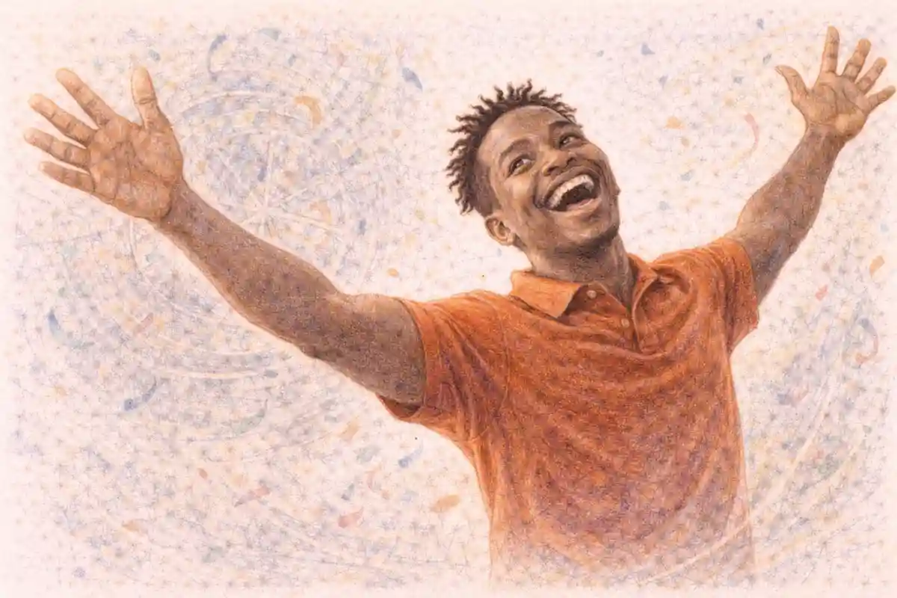

## The Report She Would Not Send

The kitchen smells of boiled grain and the iron tang of the tap, and beyond the thin wall the stairwell carries the damp smell of coats hung too close together. Morning light comes through the one window in a flat grey sheet and lays itself over the table, over her hands, over the cup gone cold beside the paper. From where she sits Inez Calloway can hear the building settle, pipe by pipe, and she can hear the small locked click of her own back service door whenever the draught moves in the passage behind the kitchen. That door has a voice of its own, a loose tongue in its frame, and she has learned its hours the way she once learned the hours of a hearing list. It clicks when the baker below opens his yard gate. It clicks when the wind comes up from the lower streets. It does not click for a key, not yet, and she notes that in the private ledger she keeps in her head because no other ledger is safe.

She writes at the kitchen table because they let her write, and because writing is what an auditor does when she is frightened and wishes to remain a person with habits. The paper is from her own drawer, ruled, the blue lines faint. The pen is hers too, its nib slightly sprung from years of pressure at the same angle. She writes slowly, not from hesitation but from method. A facilities audit memo wants nouns before it wants judgments. It wants measurements, door widths, the state of a latch, the condition of a floor where trolleys pass. She gives it those things first. She describes the courts annex as she found it on her last complete round, corridor by corridor, because order is a form of patience and patience has kept her fed and unhurt through the long hours in this chair.

The chair is the second chair from the window, the one with the repaired rung and the seat that has taken the shape of work done at this table through many ordinary evenings. She has sat in it for long hours now, longer than any sitting she ever kept in a hearing, and her body has made its inventory without being asked. Her left foot finds the rung. Her back knows where the upright presses. Her shoulders know not to rise when a voice behind her sharpens. She shifts only when her hand cramps, and then she flexes her fingers under the table where the movement will not be mistaken for anything else. To be still without being frozen is a skill. She practices it the way she practiced double entry at the start of her training, by attention and by repetition, until the practice holds her instead.

Three men share her kitchen as if it were a room they had rented for an argument. Venn, the senior, stands oftenest by the sink, where he can see both doors and the window in one turn of his head. Kest moves, kettle to counter, counter to doorway, restless in the shoulders. Ilves sits nearest the hall, young enough that his silence still looks like effort. They speak among themselves in the coastal trade dialect, the port speech of manifests and short weights and weather held off a headland, and they assume her schooling stops at the formal tongue of the Accord and the plainer speech of Melora. It does not. Her second posting was to a harbour audit where clerks argued their tallies in that dialect all day, and she learned it because figures sound different when men think the listener cannot follow the words around them. She keeps her eyes on her ruled page and lets them believe the sounds wash past her.

What they have not decided is plain in it, and she holds that knowledge as carefully as she holds the pen. One of them says the instruction was to keep her quiet and nothing beyond quiet. Another says quiet has an end date whether the payer named one or not, and a room cannot be kept quiet forever at this price. Venn answers that a decision will come from elsewhere and until it comes they will not invent one, because invention is where men in their trade make the error that follows them. Kest asks what elsewhere gains by waiting. No one answers him in a way that settles anything. They circle the same ground in the dialect, payment, patience, risk, the inconvenience of a woman who eats and sleeps and must be watched in turns, and under all of it the simple unmade choice about what is to be done with her. She writes the word corridor and is grateful to have learned it in two languages.

They have asked her their questions in the formal tongue, politely at first and then with the politeness worn thin at the edges, and the questions have never once been the questions she expected on the first day. She had prepared herself, in the first frightened hour, to defend her work on the court accounts. She could have recited from memory the entries she had flagged, the sums carried forward without a supporting order, the fees entered twice under two spellings of the same clerkly hand. That defence remains ready and unused. It interests no one in this kitchen. Two other auditors flagged the same accounts in the same month, a fact she knows from the shared register and from ordinary office talk before her last round, and nothing has happened to either of them. She was not taken for those accounts. She understands that now with an auditor's clarity, which is to say she understands which column the cause belongs in, even if she does not yet know the amount that will be entered against it.

They ask her about a room. They ask her about the south hearing room in the courts annex, who used its service corridor on the days she walked her round, whether the register kept beside its door was the only register, whether a name entered there could also be entered somewhere else. They ask whether the door from the corridor opened with a key held at the annex desk or with a key carried by whoever had business in the room. They ask whether she copied the register, whether she described the room to anyone in a letter, whether her memo named the corridor's second turning where the paint changes and the floor dips toward the service stair. A room and a register, over and over, in different orders, at different hours, as if repetition might loosen a different answer from the one she gives each time, which is the truth arranged in the smallest possible shape. She describes what a facilities auditor sees. She does not describe what she thinks the room was used for, because she does not know, and because a guess spoken aloud in this kitchen would become a thing they could sell or fear.

Her patience is not a temperament. It is a procedure. When she was junior she was taught to audit a building the way she would audit a set of books, by refusing to be hurried past the first discrepancy. A discrepancy is information. A locked cupboard in an unlocked corridor is information. A hearing room whose service door has a newer latch than every other door on its floor is information, but it is not a conclusion, and she has built her working life on the wall between those two words. So she proceeds now by small completions. She finishes a paragraph. She dries the nib. She drinks the water they give her and thanks whoever gave it in an even voice, because courtesy costs nothing and buys a fraction of ordinary treatment. She sleeps when they tell her to sleep, in her own bed, with Ilves in the doorway chair for the first nights and then, as routine dulls them all, with the bedroom door shut and a chair wedged in the hall. She notes the loosening without trusting it. Routine is a discrepancy too.

The apartment helps her, in the way a known building helps anyone who has audited buildings for a living. She knows which floorboard outside the kitchen carries a man's weight to the ear. She knows the back service door can be heard from the kitchen table even with the inner door closed, a small iron tick transmitted through the wall whenever the passage draught worries its frame. She knows the passage beyond it serves the yard and the lower stair and has no window onto the front street, so a sound there means the building's own business and not the street's. She knows her neighbour's hours by the kettle and the radio murmur through the wall, and the neighbour's silence on the second day told her the building had been given a story about her absence that satisfied, for now, the ordinary curiosity of a landing. She files these things. Filing is not hope, she tells herself, and then corrects the sentence in her head, because filing is exactly hope with its sleeves rolled, hope doing the only work available to it.

On the page the annex takes shape in her level hand. She writes the approach from the main stair, the notice board with its curled lists, the clerk's alcove where the air smells of paste and warmed dust. She writes the south hearing room as a room, length and width estimated from her own paces and checked against the plan she carried, its high windows filmed with the grey that comes of infrequent washing, its benches scarred where bags and boots have knocked them through many sittings. She writes the service corridor behind it, narrower than the public corridor by the width of a man's shoulders, its floor worn in a single track, its smell of old paper and cold stone and the faint grease of a hinge kept oiled beyond the schedule for the rest of the building. She writes the door at the corridor's end, and she does not yet write the latch, though her hand wants to. Some details she parcels out across days, a sentence at a time, because a finished memo can be taken away entire while an unfinished one keeps its writer necessary and keeps her mornings arranged around a task they have already permitted.

Venn watches her write sometimes, from the sink, with the patience of a man who has decided that watching costs less than forbidding. Kest once asked, in the formal tongue, whether she wrote to anyone in particular, and she answered honestly that she wrote to the file. The file, she said, is who an auditor writes to. He laughed at that in a way that was not unkind and left her to it, and she understood that her habits amuse them when they do not unsettle them, and that amusement too is a kind of shelter. Ilves reads nothing she writes, though he stands close enough when he brings tea. His eyes go to the window, to the hall, to Venn, anywhere but the page, as if not reading were a courtesy he could still afford to perform while the decision about her remains unmade elsewhere by men whose names none of the three have spoken in her hearing.

She writes the careful line about the south hearing room now, the one she has been approaching for two days by way of benches and windows and doors, setting down that its service door opened inward against the corridor's dip so that a person entering from the corridor would be hidden from the room for the length of one full stride, and then she stops.

## No Standing in Melora

The Ninth Office at Carrowmere smelled of rain worked into wool, of paper kept too long in drawers, and of the bitter oil the clerks used on the stair rail, and the light at Mira Kovac's desk came grey through a high window that had not been cleaned since the last inspection anyone could name. She had her sleeves pushed to the elbow and her hands flat either side of a file she was not reading. Outside the room the corridor carried its usual traffic, boots and low voices and the tick of the wall clock that ran four minutes fast by agreement among people who preferred to be early. Her tea had filmed over. She let it stand. The quiet in her own head was not her quiet, and she was learning, minute by minute, the exact labour of not reaching for a steadiness that was no longer where she had left it.

Petra Dunmore brought the case herself, which was the first measure of it, and she set the folder down and closed the office door with her heel. She looked once at the untouched tea and once at Mira's hands and chose, with a tact Mira recognised and resented in equal parts, to say nothing about either. She opened the folder on the desk between them. On top lay a request sheet in the formal hand of the arbitration courts, seal pressed at the foot, and beneath it a thinner set of pages in a clerk's copy hand.

The cost came first, before the name, before the place, and Mira understood that too was a measure of the woman across the desk. Melora would not permit a Ninth Office presence, Dunmore said. The request had come through the arbitration courts because it could not come through the Office, and the courts could ask but they could not underwrite. If Mira went to Melora she went with no standing and no cover, not the thin acknowledged fiction that usually followed a Weigher across a border of jurisdictions, not a letter she could produce, not a desk that would answer a query with her name spelled correctly. If she was taken up by Melora's own service, for any reason or for none that they chose to write down, there was no one to claim her. The Office would learn of it the way offices learn of weather in another valley. It would not send. It would not bargain in her name. She would be, in every record that mattered, a private traveller who had made private choices.

Dunmore let that sit on the desk between them while the clock ticked its four fast minutes at the wall. Then she gave the name. Inez Calloway, Accord auditor attached to the arbitration courts, based in Melora, facilities brief, thorough, unpopular in the useful way. Calloway had stopped reporting. The courts had waited the interval set down for a delayed circuit and then one day more, because her record argued for patience, and then they had used the channel that led, eventually and without any name being written where it should not be, to this desk in Carrowmere. No demand had reached them. No announcement had been made in Melora. A woman whose work was rooms and registers had simply thinned out of her own routine, and the people who noticed first were the people who read her memos.

Whether Calloway was alive was the question under all the others, and Mira felt it settle first because it changed the shape of everything built on top of it. A living auditor was a person held somewhere, with hours and appetites and a door that opened at intervals. A dead auditor was a different errand entirely. She asked what ground they had for thinking the woman breathed, and Dunmore answered with precision. A neighbour had heard the apartment's pipes at the usual early hour. Provisions had gone up the stair in quantities beyond what the men seen entering would eat alone. That was not proof. It was the material proof is sometimes made from when nothing better offers, and they both knew the difference and proceeded anyway.

The pages under the request sheet were Calloway's last facilities memo, which Dunmore slid across and turned so that Mira could read it upright. It described the courts annex in Melora as an auditor describes a building she does not trust, without adjectives doing the work of evidence. Here was the main stair and the clerk's alcove. Here was a public corridor and behind it, narrower by the width of a man's shoulders, a service corridor that served the south hearing room and very little else that the plan admitted to. Here was that hearing room itself, its high filmed windows, its benches, its door from the public side and its second door from the corridor, opening inward against a dip in the floor. Here was a register kept beside that door, and a note, level as a line in a ledger, that the register's entries and the room's listed sittings did not always keep company. Mira read it twice, the second time slower, looking not for what Calloway had found but for what she had seen fit to write down.

She carried another mind's leavings already, and the desk, the folder, the grey light all had to be held in place against them. Edran Voss's last ten minutes sat in her at an angle that was not memory and not imagination, a pressure toward a doorway and a conviction about a room, arriving unasked when her attention slackened. She had read [the transit room that held nothing](/2026/11/01/nightjar-clean-room-001/) and come out of that reading with his final minutes packed into the space her own thoughts used for footing, and now ordinary work had to be done on ground that gave slightly under every step. She was reduced, and she said so in the plain terms the Office preferred, because concealing a state in this room only meant Dunmore would plan around a Weigher who did not exist. Reduced entering, Dunmore repeated, writing it on the request sheet without flinching, and reduced, in all likelihood, at the worst hour of whatever followed. Plans would be made for the Weigher she was.

How many held Calloway, and on what rotation, was a question the memo could not answer and the neighbour's account only sketched. Two men had been seen. A third voice had been heard through a wall, or a second voice at a different hour had been mistaken for a third, and the difference between two and three was the difference between a stair watched by one tired man at a time and a household that could keep a proper watch through the night. Rotation mattered more than number, Mira said, and Dunmore nodded once. Men who rotate sleep, and men who sleep in shifts arrange their hours, kettle and doorway and chair, until the arrangement itself becomes a fact a newcomer can read off a landing like a timetable.

The arrangement on the ground was to be spare because it had to be. Tomas Rask would hold the stair of Calloway's building, Dunmore said. Not the street, not the apartment door, the stair, that turning of it from which a man could see the approach to the landing and the first steps down toward the yard without committing himself to either. Rask was known to Mira by reputation and by two short pieces of work in Carrowmere, steady, unshowy, a man whose reports were shorter than his watches and whose watches missed very little. He would already be in Melora by a route that had nothing to do with hers, and he would know her only by a description and a phrase. Compartmentation would do the work that cover usually did.

What Calloway had flagged in the court accounts ran through the file as well, because the courts had sent that material first and thickest. Fees entered twice under two spellings. Sums carried forward without a supporting order. An auditor reading only that folder would conclude the accounts were the wound and the woman had been taken for pressing on it, and Dunmore had marked the thickness itself as suspect. The flagged entries were real. They were also ordinary, and the shared register showed two other auditors had flagged the same accounts in the same month and gone home unmolested. A false scent laid by abundance, Mira said. Or by habit. She set those pages at the bottom of the folder and the memo at the top, and felt the case rearrange itself around a building instead of a balance sheet.

The market timing on Calloway's street remained, and Dunmore produced the last of her pages, a harbour clerk's note copied out without a signature. Calloway's building stood two turnings above a street that served a morning market, and a market street has hours the way a tide table has hours. Before dawn the carts made the street a river no one could move against quietly. By mid morning it thinned to shoppers and porters, its own kind of cover and its own kind of exposure. In the evening the stalls came down and the street widened into emptiness and lamplight. Any approach, and any leaving with a woman held for days whose legs could not be counted on, would have to be timed against that rhythm.

The extraction preference, stated once and not argued, was the back service door. Dunmore sketched the type on the back of the harbour note with a blunt pencil, a kitchen, a short passage, a service door giving onto a yard passage and a lower stair that owed nothing to the front street or its market hours. A door like that could be heard from the kitchen, Dunmore said, because Calloway herself had once written a facilities note about her own building and had complained, in an auditor's language, about a loose tongue in its frame that clicked whenever the passage draught moved. Mira stored that detail carefully. A door you can hear is a door that announces, and a door that announces can also be made to announce at the wrong moment. It was, at the least, a real door, described by the woman behind it.

Whether Mira could operate in Melora without standing was the question Dunmore asked last and asked of her directly, and it was not a question about courage. Weight read thin in an unfamiliar city. She took the measure of affect left in places and objects, fear and violence and repetition soaked into rooms, and it read nothing of identity and nothing of truth and nothing at all of the dead, and in crowds it frayed into weather. Melora was a crowd with a harbour attached. She would be reading a held woman's apartment through days of other men's occupation of it, with Voss's final minutes taking up room in the reader. She said she could do it the way a clerk with a damaged hand can still keep a ledger, slower, with more checking, and with some entries she would refuse to sign. Dunmore wrote that down too, in words shorter than hers.

There was no more in the folder. There was a route, a phrase for Rask, a small sum carried in a form that would not embarrass either of them if it was found, and a time after which the courts would ask again through channels and receive, in all probability, the news that no one could claim anyone. Mira read the memo a third time and committed the service corridor to the part of her mind that still belonged entirely to her, its narrowness, its dip in the floor, its door that hid an entering figure for the length of one full stride. She thought about a woman writing a report she could not send, in a kitchen, within earshot of her own back door. She closed the folder, stood with it under her arm and Melora waiting in front of her like a room she had not yet entered, and she went out of the Ninth Office and down the oiled stair to depart for Melora.

## What the Stairwell Kept

The street in Melora smelled of wet stone and crushed herb stems and hot oil from the market stalls before Mira saw the market itself, and the sound reached her first as a layered thing, canvas snapping in a wind off the river, wooden crates set down hard, voices calling prices in a cadence that rose and fell without hurry, and underneath it all the iron bell in the tower at the far end tolling the morning hour in a tone that made the pigeons lift from the eaves in a single grey rush and settle again on the warm tiles. She stood at the corner with her bag in her hand and let the crowd teach her the street before she tried to cross it.

She had no standing here. That fact had been stated three times before she left, once by Petra Dunmore in the tasking room with the maps still open on the table, once in the written note that accompanied the pass, and once by Tomas Rask on the road in the tone he used for weather he did not like. No standing meant no right to enter a dwelling, no right to require an answer, no right to be believed if she gave a warning, and no cover if she was stopped and asked by what authority she had come. What she had was a courtesy, and a courtesy had edges. The courts, approached by Dunmore through a channel that was itself a courtesy, had issued a facilities escort pass for the annex only. It named her as a visiting clerk attached to a review of rooms and stores. It allowed her to be shown the annex in the company of an escort. It allowed her nothing in the city beyond it, and nothing at all in the apartment house where Inez Calloway lived. If she was found wanting there, the pass would not protect her. If she was found forcing a door there, the pass would be taken and the courtesy with it, and Dunmore would learn of it from the courts before Mira could send word herself.

She understood the shape of that before she crossed. Procedure came before outcome, Dunmore had said, not as advice but as the condition of the work, and Mira had repeated it back in her own words so that there would be no later confusion about what she had been told. Name the method before any deduction. Walk the ground before reading it. Establish what a place did on an ordinary day before claiming it had done anything on an extraordinary one. She began, therefore, not with the apartment and not with the annex, but with the street, because the street was the ground both buildings stood on and because a crowd had rules that could be timed.

At the morning bell the market filled. That was the first plain observation, and she made it standing still, which was the only way to make it cleanly. Stalls that had been frames at dawn were covered by the time the bell finished. Carts came down the side lane in a line that did not break, each driver calling once before he turned in, each horse or hand team finding the same gaps in the same order, as if the street remembered last week and the week before and laid the pattern down again without needing to be told. By the time the sun cleared the roof line opposite, the open ground was gone. In its place was a dense, slow, negotiable press of buyers and sellers and porters and children sent on errands they performed at a run in the narrow spaces adults had left. The smell thickened. Oil and herb and river mud and animal hide and the sour edge of fruit that had split in the heat. The noise thickened with it, not louder in any single voice but fuller, so that a call from ten paces arrived worn down to its shape alone.

Mira tried the crossing at full market once, on purpose, early, while the cost of failing at it was only embarrassment. She set her bag close against her side, chose the gap behind a cart loaded with sacks, and went. Within six steps the gap had closed. Within ten she was being turned, politely and without malice, by shoulders and baskets and a woman carrying a board of bread who expected Mira to give way because everyone local knew to give way to bread in the morning. She did give way. She gave way three more times. A porter with a crate on his shoulder passed close enough that the corner of the wood brushed her sleeve, and for an instant the press around her had no direction at all, only pressure, and in that pressure her gift, which was not a gift so much as a trained attention to what places kept, offered her nothing she could use. A crowd was a place being overwritten too fast by too many people at once. Weight needed repetition, or intensity held in one attitude, or long contact with stone or metal that stayed in place while feeling passed through it. A market crowd left smears. Fear smeared. Haste smeared. A brief anger between strangers flared and was carried off on their own bodies before the stones under them could take any of it. She could not read a crowd, and on a morning like this she could barely cross one.

She noted the timing without writing it where anyone could see over her shoulder. Morning bell, market full. The fullness held through the middle of the day with a slackening she would need to observe rather than assume. Evening bell, market emptying, and she would observe that too before she relied on it. Already the timing mattered in the plainest way. Any approach to Calloway's building that required a quick crossing of this street at full market would fail for reasons that had nothing to do with locks or watchers. Any departure that timed itself to the emptying street would have room and noise of a different kind, carts leaving, stalls folding, people carrying the day home in baskets, a natural movement that could hide a smaller movement inside it if the hour was chosen with care. She filed that as ground truth, not as a plan. A plan made before the stairwell would be a plan made in ignorance, and she had come reduced enough already without adding ignorance she could cure by walking.

That evening, in the quiet room above the lamp oil shop, she set the day against the bells and wrote the timing out in full, because a window misunderstood by one bell was a window that closed on a hand. The table below settles which hours can carry a movement on that street, and what each one risks.

| Window | State of the street and the stair | What it risks |
|---|---|---|
| First bell, market filling | Carts arriving, stair busy with porters and baskets | Being seen entering by too many eyes at once |
| Mid morning, market full | Crowd at its thickest, no reading possible in the street | Losing the door in the press if the move runs late |
| Midday lull | Stalls shuttered, street half empty, stair quiet | Being the only movement on the street worth watching |
| Evening bell, market emptying | Carts leaving in gaps, light failing across the lane | The service door locked for the night before the lane clears |
| After the evening bell | Street empty, house settling, the rotation at its slowest | Any sound on the stair carrying to every floor |

She carried Voss with her. No one in the street could see that, and she kept her face and her pace arranged so that no one would guess at a burden, but the last ten minutes of another person's life sat in her in the way the work had taught her such things sat, not as pictures she could summon and dismiss, not as words spoken in a voice she could replay at will, because weight did not work in that clean way and she had never pretended to herself that it did. It sat as a tilt. A readiness to flinch at a particular quality of quiet. A knowledge in her hands of a floor she had never stood on in the hour it gave up its holding. She had entered this installment of her own life, if she thought of it in the language of the reports she would later have to write, reduced. Her sleep had been thin. Her temper, which she kept well in ordinary weeks, had a shorter reach than she liked to admit. Dunmore knew. Rask knew better, because he had watched her since, and had said nothing about it beyond offering her the outside place on the road where the walking was easier and taking the heavier bag without making a negotiation of it.

Reduced did not mean excused. It meant she would do the procedure in full and in order, because procedure was what held when the reader herself was not at her best. She walked the block once without stopping at Calloway's door. She walked it again from the other direction. The apartment house stood four storeys high in a row of similar houses, its stone front washed pale by weather, its windows shuttered against the morning heat in the local manner, its main door recessed under an arch that kept a permanent shade even at noon. A porter’s lodge showed as a lit window at ground level to the left of the door. To the right, a grille covered a lower window that she took, provisionally and without yet claiming it, to be a store or a cellar opening. The roof line carried a row of small vents. The house to the left sold dried goods from its ground floor and smelled of spice through its open door. The house to the right was quieter, its step swept, its brass polished, its windows dark. She learned the neighbours’ shapes before she learned the target. That too was procedure.

On the second pass she allowed herself to look up. Third floor, second window from the left, shutter half closed in a way that differed from the others on that floor by an angle small enough that a passer by would register it only if he had first registered all the others. She registered it because she had. She did not stop. She did not point it out to Rask, who was not beside her in any case, Rask having taken the far corner with a newspaper he was not reading in the manner of a man who had done waiting professionally for years and had opinions about amateurs who waited badly. She completed the circuit, bought a small twist of dried fruit from the spice house so that her presence on the street acquired a reason that any watcher could satisfy himself with, and ate one piece slowly while she decided the order of the next hour.

The building first from the street. Then the stairwell alone. Then the service door. Then the annex under escort, in the hours the pass allowed. Accounts after, in a quiet room, with the file Dunmore had sent gone through properly and not skimmed for the conclusion it seemed to invite. She set the order in her mind the way she set tools on a cloth before a delicate job, each in its place, none handled before its turn.

The main door was not locked in the morning. That was local custom in houses of this kind, she had been briefed, and she confirmed it by watching two residents come out and one go in without key or knock, the door swinging on a well kept hinge and closing with a soft weight of its own. Inside, the hall was cooler by several degrees and smelled of stone that never fully dried and of polish used sparingly on a handrail worn smooth in the middle of its run. She did not announce herself at the lodge. The porter was not there. A jacket hung on a hook inside the lit window and a ledger lay open, and the absence had the ordinary quality of a man gone to fetch water or bread rather than a man warned away. She noted it and went on, because going on was less remarkable than hesitating in a hall where hesitation would be remembered.

Alone on the stair, she stopped.

The method, named before any deduction, was this. She would read the stairwell itself, not a door, not a landing, not any object that belonged to one person. A stairwell in a house of stone was a long anchor. Every foot that used it used the same treads in the same order. Every hand that needed support found the same rail at the same height. Repetition laid weight down in layers that a single dramatic passage, however intense, rarely matched for clarity. If men had come and gone here on a business that required regularity, the stair would keep the regularity even when it kept nothing else. If a woman had been carried down against her will, or carried down beyond willing or unwilling, the stair would keep a different shape, a break in its ordinary traffic, a burden borne by more than one bearer in an arrangement feet remembered. She would ask the stair for traffic, not for identity. Weight never recorded who. It recorded that feeling had been present, in what strength, in what rhythm, under what repetition. It never compelled, it never detected truth, and it never replayed a scene for her to watch like a performance arranged for her benefit. What it gave, when she worked properly, was a pattern she then had to interpret with her ordinary mind, which could be wrong in all the ordinary ways.

She set her bag down on the second tread from the bottom so that her hands were free and her stance was the stance of a person climbing, not a person performing a rite. There was no rite. That was a point Dunmore insisted on with new Weighers and Mira insisted on with herself. She placed her left palm flat on the stone wall at the height where a climbing hand would brace on the turn, and her right hand around the rail where the polish was deepest, and she let her weight settle through her feet into the treads in the attitude of someone who had paused, mid climb, because she was tired or because she had remembered something she needed from below. She breathed as the house breathed around her, through the slow exchange of cool hall air and warmer air from the upper floors. She did not push. Pushing produced noise, the reader's own feeling flooding the anchor and coming back to her dressed as discovery. She waited until the stairwell stopped presenting her with the surface of itself, the chill, the polish smell, the faint grit under her palm, and began to present her with its accumulation.

It came in her legs first. It usually did, on stairs. A layered ache of ascent, not hers, repeated beyond counting, the particular effort of the third floor turn where the tread was fractionally higher and every climber for years had adjusted without thinking. Under that, sharper, the waits. People had waited on this stair in numbers that surprised her until she understood them as the ordinary sociability of a house, neighbours pausing to finish a conversation, children sent to sit until a temper cooled, a woman standing a full minute with shopping in both arms deciding whether she had the strength for the last flight. Dread had its own band in the layering, thinner, more widely spread over time, the low dread of rent days and illness and letters carried up slowly because their contents were already guessed. She let those pass through her attention without seizing on any of them. They were the ground. The figure she needed would stand out against the ground by rhythm, not by drama.

The rhythm found her on the second turn, where she had moved up a flight and reset her hands, because a read of any length was done in stages along the anchor and not from a single posture held until it cramped. Three men came up. She did not see them. She felt the pattern their climbing had impressed through repetition into stone and iron, three weights in sequence, not abreast, stairs forbidding abreast on this width, with a spacing between them that spoke of habit rather than caution. One went first and paused at each landing half a breath longer than climbing required, which her ordinary mind, working behind the read, translated as the man who checked. One went last and climbed with a slight favouring, not a limp, a favouring, as if a knee remembered an old knock on cold mornings. The middle one carried. That was the clearest element and she tested it before accepting it, moving her attention down the flights and up again, asking the anchor the same question in a different attitude, her shoulder against the wall this time as a carrier's shoulder might brush it at the turn under load. The carrying repeated. Food carried up. She could not know it was food from the weight alone and she told herself so, sharply, inside the read, because discipline inside a read mattered more than discipline after it. What the weight gave her was burdens carried up regularly, borne in one man's arms or against his chest in containers that changed the climb, and the affect around those ascents was a low, practical patience, the feeling of a task being done as a task. Waste carried down. Burdens again, lighter in a different distribution, taken down by whoever was descending in any case, the patience thinner on the descent, edged with distaste that never sharpened into anything stronger. Twice a day the pattern completed itself. Ascent with burden, presence above, descent with burden, and then the house resumed its ordinary traffic until the pattern came again. She counted the completed cycles the stair would vouch for and stopped counting when the layers thinned into the ordinary weeks before them, because beyond that point she would be guessing at arithmetic the stone had not kept.

How often had already answered itself inside the larger answer. Twice a day, on a rotation. A rotation meant the three were not improvising. A rotation meant relief and rest and a schedule kept even when keeping it was tedious, and tedium was present in the read in quantity, great flat stretches of it laid down on the upper landing especially, the tedium of men waiting in a place they could not leave at will, which told her, by interpretation and not by gift, that the holders were themselves in a kind of holding. She opened her eyes at that point and looked at the plain stair in plain light to remind herself where interpretation began. The gift had given her traffic and rhythm and affect. The conclusions belonged to her and could be wrong.

One conclusion the traffic itself carried, without interpretation, and she made herself state it only after she had asked the question in its negative form, which was the form that mattered. Had a body ever been carried down. She went back in for that question alone, although going back in cost more, and she worked the whole stair a third time with her attention set specifically for the signature of a dead or senseless weight borne by two or more bearers in coordination, the altered spacing, the hands under a load that did not help them, the particular dread and haste and solemnity that such a carrying impressed on stone even when the bearers were calm men doing calm work. It was not there. No body had ever been carried down this stair in the period the stair held clearly. Burdens up, burdens down, men up and down in their rotation, a woman's lighter step that belonged to the earlier layers and then stopped abruptly in the pattern, stopped as a held person's steps stop when her world shrinks to a floor and then to rooms, but no descent of the kind she had asked for. Inez Calloway was alive, in so far as this stair could vouch for it, and vouching within limits was all she had ever asked of any anchor. Three holders. A settled rotation, twice a day. A holding that had lasted long enough to become routine to the men conducting it, which was its own kind of danger, because routine men stopped checking the things they had checked in the first frightened days and started checking only the things the routine named.

The read costs what it costs, and the stairwell charged her in full.

Six weeks of that stairwell was now hers to carry. She said it plainly in her mind in those words because plain statement was the only honest accounting she knew for this part of the work. Six weeks of other people's climbs had settled into her legs as a tiredness that sleep would not reach that night. Six weeks of waits stood behind her eyes when she blinked, other people's patience and other people's tempers held at landings, and the dread in the layers, rent dread, illness dread, letter dread, had found the dread she already carried from Voss and joined it without asking permission, so that a quality of apprehension now coloured objects that had no business being apprehended, the lodge ledger, the porter's jacket, the shutter above. Her temper shortened as she stood there with her hand still on the rail. She felt an unreasonable irritation at the tread that stood fractionally higher than its fellows, at the house, at Melora, at Dunmore for the courtesy pass that was not a protection, at Rask for being at a corner and not on this stair, and she recognised the irritation as borrowed, most of it, which did not make it smaller, only hers to govern. It would stay in her legs and in her temper for the rest of the day at least. Experience said day. In her present reduced state she privately amended that to longer, and did not write the amendment anywhere, and went on working.

She descended slowly, not because the descent required slowness but because her legs, full of six weeks of other people's climbing, kept suggesting rests at landings she had no reason to rest at, and she was not willing to be seen resting. In the hall the porter had returned, a broad man in his fifties with a face that had settled into an expression of permanent mild objection to the weather. She asked him, in the local form of address she had practised, whether deliveries for the upper floors went up the main stair or whether there was a service way she should use if a parcel came for the visiting clerk's office at the annex and was misdirected here, as parcels in her experience always were. It was a thin story and she knew it was thin, and she held it lightly, ready to let it drop without argument if he disliked it. He did not dislike it. Melora, she was learning, ran on small procedural questions asked without hurry. He told her there was a back service door, that it gave onto the service lane, that the lane ran along the backs of the row and came out at the edge of the market by the stall where brooms were sold, and that if a parcel was misdirected she should send the boy round by the lane because the main stair in the afternoon was a trial to everyone. He volunteered the boy. She asked after the boy's hours with the air of a woman who did not want a parcel left in rain. The porter said the boy locked the service door when he went for his supper, which was at the hour when the market bell began its evening work, and unlocked it again when he returned with the lamp lit, unless the householders wanted it otherwise, and this week nobody had asked otherwise to his knowledge.

She thanked him and went out by the front, walked the block in the direction away from the market until she was out of sight of the lodge window, and came back along the backs by the route a stranger could plausibly take to look for a lost entrance. The service lane was narrow, paved in a darker stone that held the day's heat, and it smelled of ash and vegetable peelings and the iron tang of a pump that stood halfway along it. Doors gave onto it at intervals, each numbered in the house's own hand. The door of Calloway's house was the third from the pump. She did not try it. Trying doors she had no right to try was how courtesies ended and incidents began. She studied it from the distance of a woman counting doors, and she noted what could be noted from that distance and no more. The door was timber, iron bound, with a lock plate at waist height and a second bolt housing higher up that showed a brighter edge, as if it were drawn and driven more often than the lock below it. A worn patch in the stone at its foot marked where feet pivoted while hands were occupied with loads. The lane at that point was overlooked by two windows, both shuttered, both, she noted, belonging to the neighbouring houses rather than to Calloway's, which meant observation of the lane from inside Calloway's house was limited to a small window she had seen from the front as a grille at ground level. Above the door a hook and a short rail spoke of loads once hoisted rather than carried, disused now, the hook rusted in a way the bolt housing was not.

When the porter's boy locked it mattered as much as where the door gave. A door locked at the supper hour by a boy whose round was known to the whole row was a door whose state at any given evening moment could be predicted by anyone who lived here, which included, she had to assume, three men on a settled rotation who had had weeks to learn the lane as she was learning it in an hour. How the lane ran mattered too. It ran to the market's edge. At full market that edge was a wall of stalls and carts, impassable in a hurry and conspicuous in any attempt. At the emptying hour it was a thoroughfare. She held all of that as ground truth beside the bell timing, and she did not yet allow the two sets of facts to touch each other and spark a plan. Plans sparked early had a way of burning the facts that did not fit them.

Rask was where she had expected him to be once she had worked her way, by a route that kept her clear of the apartment house frontage, to the small square at the top of the market where a fountain gave office workers and porters a reason to stand with their hands in water and their faces to the sun. He had acquired a cup of something dark and had acquired, since morning, the particular stillness of a man who has counted exits in a place he intends to leave by one of them.

"You look like stairs," he said.

"I have been stairs," she said. "Six weeks of them. It is in my legs."

He did not ask what the stair had given her where others could hear. That was one of the reasons Dunmore paired them despite the friction of it, or perhaps because of the friction, because Rask's scepticism about her method had never once made him careless with its products. He moved the cup to his other hand and fell into step when she walked, and by unspoken arrangement they walked uphill, away from the market, where the street was quieter and a conversation could be a conversation between two colleagues about a building survey, which was, in the thinnest and most defensible sense, what they were.

"Three," she said. "Alive. Rotation, twice a day. Food up, waste down. No body down at any point the stair holds. The holding has lasted long enough that they are bored on the landing. Bored men with a schedule."

"Alive is the headline," Rask said. "Bored is the footnote that gets people killed, but I will take both." He was dry about it in the way he was dry about everything that mattered, as if feeling, admitted too warmly, might make a fact less reliable. "Melora suits you, then. No standing, no cover, one pass for a building she does not live in, and a stair that charges you six weeks for ten minutes. A generous town."

"It has been precise," she said, and felt the borrowed irritation stir at his tone and governed it, because Rask's tone was not one of the things the stairwell had given her to be irritated by. "The back service door locks when the porter's boy goes to his supper. Evening bell, roughly. The lane comes out by the broom stall. At full market that end is shut by the crowd. When the market empties it opens."

"Roughly," he repeated. "Boys and suppers and bells. Our timetable is a folk song." But he was memorising it as he mocked it, she could see the memorising move behind his eyes, the lane, the door, the hour. "And where am I in this folk song."

"On the stair," she said. "When the time comes. Not before. You hold the stair when we move, because the stair is the one route I have actually read, and because a man coming down it in a hurry meets you at the turn where the tread is high and the rail is on the wrong side for him if he is carrying anything. One man on that turn can hold it against the house for as long as we need."

"You flatter me with architecture," Rask said. "In my youth I held stairs for better reasons in worse towns, and the stairs were ungrateful then too." He drank from the cup and made a face that was not entirely performance. "What do I do about having no standing on your stair. If a resident asks me by what right I am standing there stopping him reaching his own home."

"You tell him there is a leak," she said. "Everyone in that house believes in leaks. The porter keeps a bucket by the lodge door for a leak that happened in the spring and has acquired the status of a natural feature. A Stiller telling a householder he cannot pass because of water is a story the house will accept for exactly the length of time we need it accepted, and no longer, which is why the timing will be done by bells and not by our convenience."

"A leak," he said. "My talents, reduced by Melora to plumbing. Dunmore will want that in writing." He turned the cup in his hand. "You understand that if this goes wrong on that stair, I have no more standing to be rescued than you have to be rescued with. The pass covers a clerk in an annex. It does not cover a man with a householder's collar in his hand three streets away."

"I understand it," she said. "It is why you hold the stair and do not climb it. Holding is defensible as an accident of presence. Climbing is an entry." The distinction was thin and they both knew it was thin, and she saw him accept it not because it persuaded him but because the work required somebody to hold the stair and he was the somebody present who could. His scepticism extended to her gift, to Dunmore's planning, to the Accord's reach, and to the value of most orders he had ever been given, and it stopped, reliably, at the point where a person he had been assigned to stand beside needed standing beside. She had worked with believers who were less useful.

They parted at the fountain on the second circuit, because together they were a pattern and apart they were two people the square had already forgotten. He took the road that would let him learn the upper approach without showing himself twice on the same stair, and she took the road toward the annex, with the escort pass folded in its case against her ribs and Calloway's facilities memo, much handled before she ever reached Melora, carrying in her memory the floor plan of a building she was about to be shown as if for the first time.

The annex stood behind the courts proper, joined to them by a covered way that kept the rain off clerks and kept the public, Mira reflected, from ever quite knowing where the public part ended and the working part began. Its stone was darker than the apartment house and its windows were tall and regular, made for light over long tables, and the man who met her at the side entrance had the facilities coat and the facilities manner, which was to say he was courteous in a way that cost him nothing and informative in a way that had been decided before she arrived. Her escort pass was examined, copied into a book in a hand that formed each letter as if the letter might later be disputed, and returned to her with a small inclination of the head that acknowledged the courtesy without enlarging it. She was a visiting clerk attached to a review of rooms and stores. She would be shown the building. She would not be left unaccompanied in it. Those were the terms, and she accepted them aloud so that there would be no later dispute about whether she had understood.

Calloway's memo described the annex as Calloway had known it in her work, which was to say as a set of functions fitted into rooms whose names lagged behind their uses. Mira worked the building as the memo described it, room by room, in the order the memo gave, checking each room against its description with the escort's help and allowing herself the small, genuine interest of a clerk who liked a building that kept its records in its walls. A memo was a claim. The building was evidence. Where the two agreed, she could proceed. Where they differed, the building won, and she noted the difference in the neutral language of room review, because a facilities memo written by a woman now held in her own apartment was an asset that had to be verified before it was used, and also a thing to be protected, since if the memo's existence became known to the wrong reader its author would pay for its accuracy.

The ground floor was stores and strong rooms and a porters' hall where coats hung in a row that told its own story about who was on duty. She read lightly there, fingertips only, a hand laid for a moment on a door frame while the escort explained a shelving change, and what came back was ordinary to the point of reassurance. Long use. Low feeling. The patience of stores clerks and the brief seasonal anxieties of audit weeks, nothing laid down in a rhythm that did not belong to the room's stated work. The first floor was clerks' rooms in a line, doors open, paper in transit, a whole economy of messages carried by hand because the building trusted hands more than it trusted systems, and she read a stair rail there in passing, as any visitor might steady herself, and found traffic and tedium and one old grief in a corner room that had soaked so far into the sill that it would outlast the next three occupants and had nothing to do with her case. She noted the room number in her private tally only to exclude it. Exclusions were work. A Weigher who reported everything she felt reported nothing usefully.

The building read normally everywhere she tried it in this beat. She wrote that sentence in her mind exactly as she would write it in a report, because it was the finding, and because its plainness mattered. If the annex had been the site of a recent violence, or of a fear sustained over days by someone working here under threat, some anchor in it would likely have kept a trace out of rhythm with the rooms around it, in the way the apartment stair had kept its rotation. She did not find such a trace on the route she was shown, with the light touch she was permitted, in the company she was required to keep. That was not proof that nothing had happened here. It was proof only that the building, as presented to a visiting clerk, behaved like a building at its ordinary work. She recorded the limit alongside the finding. Dunmore had taught her that a finding without its limit recorded beside it was a story waiting to be believed too hard by the next reader.

The south hearing room she did not enter.

It stood at the end of the second floor corridor where the memo placed it, a double door in a darker wood than the others, with a plate that named it by its function and a second, smaller plate beneath, newer in its fixings, that named it closed. The register, which the escort produced in the corridor office when she asked the room review question that naturally led to it, listed the south hearing room as closed for redecoration. The entry was written in the same hand as the pass copy, with a date given by Session rather than by day, in the manner the courts used for their internal works. She looked at the closed door for the length of time a clerk might look at a door she had come to review and been denied by redecoration, which was a real and sufficient explanation that buildings offered every week of the year. She asked when the decorators were expected to finish, and the escort said the works were awaiting materials, and that the north hearing room was carrying both lists in consequence, which accounted, he said, for the extra chairs she had seen stacked in the corridor below and for the tempers in the clerks' line at midday. She accepted the account. She noted the stacked chairs, which existed, and the tempers, which were plausible, and she noted also that a room closed for redecoration was a room no visiting clerk would ask to enter twice, and no escort would offer, and no cleaner would be questioned for avoiding. She did not touch its door. She did not read its frame. The pass did not cover insistence, and insistence here, at this door, on this day, would be remembered by precisely the people who kept registers. She walked on to the copying room and admired the copying room's light with an effort that cost her more of her shortened temper than she showed.

What she gathered instead, by the unaggressive method the pass allowed and the courtesy required, was the practice of the building. She gathered how the annex room register was kept, who wrote in it, when a room's state changed on paper relative to when it changed in fact, and she learned that the register lagged fact by as much as a Session when works were involved, because works were entered when they were authorised and removed when they were signed off, and a room might be painted and dry and back in use while its line still said closed, or shut and sheeted while its line still said open. She gathered how service passes were issued, to whom, on whose signature, with what return required at the end of a day, and she learned that a service pass was a numbered thing, that the numbers were entered in the same book as her own escort pass had been, and that a pass not returned was a matter pursued the following morning by a clerk whose diligence in pursuit was, the escort remarked, famous in the building. She gathered, from the neighbour at Calloway's house who had spoken to the porter and then, with the porter's mild encouragement, to the quiet visiting clerk who happened to be present when she called at the lodge on an errand in the early afternoon, a description she had not solicited aggressively and did not press to enlarge. Three quiet men. That was the phrase the neighbour used and used again, as if quiet were the quality that had persuaded her there was nothing to report. One of them wore, on the colder mornings, a coat the neighbour took to be a court service coat. Not a facilities coat. The distinction was the neighbour's own and she made it carefully, a woman correcting her own evidence before anyone else could. A court service coat, longer, with the fastening at the side.

In the corridor office, while the escort was occupied with a query from a clerk about a key, she was shown the annex staff roster because she asked whether the review should send its thanks through a named head of stores, and the roster lay open in any case at the page for the current Session, names and functions and pass numbers in columns. She read it with the attention it deserved as a document and with the other attention, the one six weeks of a stairwell had left raw in her, held deliberately down. The three quiet men of the neighbour's description did not match any names on the annex staff roster she was shown. She was careful with that finding too, and stated it to herself in its exact limits. Descriptions do not match rosters in most buildings on most days, because visitors and contractors and men attached to the courts proper rather than the annex are not on an annex roster. A court service coat could be borrowed, inherited, bought second hand, or misremembered by a neighbour who had seen it twice at a distance in poor light. And yet the mismatch stood as ground truth of its small kind. The men holding Inez Calloway were not, on the evidence she was permitted to gather, men whose names belonged to this building's staff. If one of them wore the courts' coat, he wore it as a visitor wears a thing, or as a statement, or as a disguise, and each of those possibilities pointed in a different direction, which was precisely why she recorded the mismatch without choosing a direction for it.

She left the annex at the hour the pass required, surrendered nothing because the pass was hers to keep for the length of the review, thanked the escort with the exact degree of warmth the courtesy prescribed, and stood for a moment in the covered way while the courts bell marked the afternoon and the market, two streets away, went on being full in a way she could hear but no longer see. Her legs ached with other people's stairs. Her temper, borrowed and her own together, wanted the south hearing room opened now, by her, with whatever tool came to hand. She noted the wanting as evidence about her state, not as instruction about the case, and walked back toward Rask and the quiet room Dunmore's channel had secured for them above a shop that sold lamp oil, where the accounts file waited in its folder and a message could be sent or a conversation held at a safe distance from both buildings.

The quiet room above the lamp oil shop had one window, one table, and a door that locked, and Dunmore's channel had chosen it well, because a room that smells faintly of oil discourages lingering visitors and because the shopkeeper below kept a dog that announced strangers with professional thoroughness. Rask arrived twenty minutes after Mira by a route of his own and set his back to the wall by habit before he set his cup down. Between them on the table lay the accounts file Dunmore had sent, copied before Mira left, the copy checked page by page against a list because a file about an auditor was a file that invited handling. This was the hour for possibilities, and Mira laid them out in the order Dunmore required, three live possibilities kept genuinely live, none promoted for the comfort of having a favourite and none dismissed for the comfort of having a shorter list.

The first possibility was that Inez Calloway had been taken over the court accounts she had flagged. The evidence for it was the strongest on its face and she gave it fairly before she gave anything else. Calloway was an Accord auditor attached to the courts. Auditors who flag accounts make enemies in proportion to the sums involved, and the sums, when Mira came to them properly later that hour, were not trivial. The holding itself fitted the possibility in one respect, in that a woman taken to frighten her into withdrawing a flag, or to learn what copies existed and where, would be kept alive and kept in reasonable condition, because a dead auditor withdraws nothing and a harmed auditor's flag acquires a weight in every subsequent review that no accountant would willingly give it. The settled rotation fitted too. Accounts work was patient work. Men paid to hold an auditor while a negotiation or a tidying proceeded elsewhere would be men on a schedule, fed and relieved and bored, exactly as the stair described them. Rask, when she put it to him, nodded once, not in agreement with the possibility but in acknowledgement that she had stated it without leaning on it.

The second possibility was that she was held as leverage over her own service. Not over a finding, but over the office she served, the Accord's audit function at the courts, its access, its timetables, its power to enter rooms and require papers. A held auditor was a message that did not need to be written down. Every other auditor working under the same courtesy would feel the message in her legs, rather as Mira now felt a stairwell in hers, when she next climbed toward a strong room with a query in her hand. The evidence for this possibility was thinner and she said so. Nothing had been communicated, so far as Dunmore knew, to the service or to the courts in the form of a demand, and leverage unannounced is leverage wasted, unless the announcement had been made to a part of the service Dunmore did not command and had not yet shared. The coat pointed here a little. A man wearing a court service coat while holding a court auditor suggested somebody who wanted the holding to be legible to the courts as coming from within their own world, or somebody careless about being legible at all. The absence of the holders from the annex roster pointed here too, weakly, because leverage of this kind is rarely applied by the staff of the building being levered. Rask sent his view by the route they used when he was across the room checking the window and did not wish the conversation to carry a single shape to any listener below, a folded message passed hand to hand across the table in his block capitals. It read, in substance, that leverage explained the quietness better than accounts did, quiet men, quiet holding, no noise made in the city, no demand made in the city, a pressure applied where only those it was meant for would feel it.

The third possibility was that she had arranged it herself to force a transfer. Mira disliked giving it room and gave it room in full, because a possibility disliked by the investigator was a possibility that required more fairness, not less. Calloway had served in Melora for a length of time that the file made plain. Transfer requests in the audit service were slow, were dependent on Sessions and on the goodwill of the courts she audited, which was a contradiction built into the work, and a dramatic incident in a posting was a recognised, if disreputable, accelerant. A woman who arranged her own holding would choose holders who would not harm her, would maintain a rotation that kept her fed, would wear familiar signals such as a service coat to make the incident read as political rather than criminal, and would be found, in due course, unharmed and with her reputation for diligence enhanced by ordeal. The evidence against it stood in the stairwell. Six weeks of a stairwell did not arrange itself. A staged holding of a few days laid down one pattern. What Mira had carried out of that house in her legs was a routine worn deep, tedium laid over tedium on the upper landing, the patience of men who had stopped expecting the thing to end quickly. A person arranging a brief incident does not usually purchase six weeks of other people's boredom at the price such arrangements command. Nor did the file, when she reached it, show a transfer request refused, which was the circumstance under which the disreputable accelerant was usually applied. She kept the possibility live because the coat and the quietness fitted it and because she had not yet met Inez Calloway and could not vouch for what she would or would not purchase. She recorded it third and she did not bury it.

"You have a favourite," Rask said, when the three stood on the table between them in the plain language she had used to state them.

"I have a duty not to," she said.

"That is Dunmore talking through a sore pair of legs." He turned the accounts folder toward himself and then, correctly, back toward her, because the file was hers to go through and his to guard the going through of. "Accounts is the one with paper. Paper always looks like a favourite in a room with a table in it. Leverage has no paper because leverage is the absence of a demand until the demand is ready. Self arrangement has no paper because she would not leave any. Your three possibilities are one with documents and two without, and the documents will win the evening unless you watch them."

She did watch them, and she went through the accounts file properly, as the order of her day had promised, entry by entry, in the quiet room, with the market audible at the distance of two streets and Rask silent in the way he had perfected for rooms where she was working with paper rather than with stone. The method with paper was the same as the method with stairs. Establish the ordinary before claiming the extraordinary. Name what the document was before asking what it proved. The file was a schedule of court accounts for the Sessions named, copied in a clerk's hand from Calloway's own flags, each flag an entry or a group of entries where the money recorded as spent by the courts did not match the money the courts' own stores and works records implied should have been spent. Dates were given by Session only, which was the courts' manner and also, Mira noted, a manner that made fine timing impossible for any reader outside the building. She totalled the sums herself rather than accepting the total Dunmore's covering note offered, because totals in covering notes had been wrong in her experience in direct proportion to how reasonable they looked. Her own addition agreed near enough that the difference was copying, not concealment. The flagged entries clustered. That was the finding inside the file that mattered, and she made Rask look at the clustering with his own eyes rather than take her word for its shape. They clustered around works. Payments for works authorised, works entered in the annex register as she had seen it kept that day, which meant works whose paper state lagged their real state by as much as a Session, which meant a gap, regular, predictable, and known to anyone who kept the register, between a room being paid for as closed and a room being used as open, or the reverse. Money could move in such a gap the way a man could move in a lane at the emptying hour, visibly and without remark, because everyone's attention was on the general movement. She did not say that last part aloud. It was an analogy, and analogies in a report became facts by the third reading. She wrote the clustering and the register lag and the sums, and she left the analogy in her head where it belonged.

By the time the light at the window had changed, the accounts angle looked strongest. She said so to Rask in those words, because a finding resisted was a finding distorted, and the paper on the table did make the first possibility heavier than the other two in every scale she could honestly apply to it. She flagged sums. She clustered works. The register practice gave the cluster a mechanism. The holders' rotation gave it time. If Calloway had found a way money was leaving the courts through the gap between paper rooms and real rooms, then men paid to hold her quietly while the gap was closed and the papers adjusted would look exactly like three quiet men on a twice daily rotation up a stair that had learned their pattern by heart.

"And you are not satisfied with it," Rask said. It was not a question, and his dryness had thinned into something closer to attention.

"No," she said. "Because it explains the holding and it does not explain the coat, and it does not explain why nobody has yet asked her service, or Dunmore, or the courts, to withdraw anything. A flag withdrawn is the point of such a holding, and no one has asked for it to be withdrawn. Either the asking is happening somewhere we cannot see, which makes it leverage with an accounts mask on it, or the holding is not about the flag at all, and the accounts are the reason everyone, including us, will look at the paper while the real reason stands somewhere we have not yet read." She closed the folder with care, because her temper was still borrowed and her hands wanted to be abrupt with paper. "It is strongest. Strongest is not the same as true, and I am not satisfied with it, and I want that in the record of the day beside the finding, in the same size of writing."

He wrote it down, in his block capitals, in the day book they kept between them, because she had asked for the record and because a Stiller's hand was steadier than a Weigher's after a long read, a fact he did not remark on and she did not thank him for, both mercies being understood.

Outside, the tower bell began the work of the evening. She heard the market change before she heard Rask name it, the full press loosening, carts finding their gaps in the reverse order, stalls folding with the snap of canvas in reverse, the street opening at its far edge by the broom stall where the service lane came out. On the stair of a house two streets away, by the arithmetic she had taken from the stone that morning and checked against the porter's account of the feeding hour, a rotation was due to change. Twice a day the pattern completed itself, and the evening completion belonged, by the layers she had read, to the hour when the market was neither full nor empty but in passage between the two, when a man could leave a house by a back door and be only one more figure in a general leaving, and a man could arrive the same way and be no more remarked than a porter with a crate. She set the next change of the rotation against the market bells in her mind and held it there, timed, as the last fact of the ground truth she had come to Melora to establish. Bells first, then movement. Whoever moved, holder or held or rescuer, would move to the bells or be conspicuous. She had the ground now. The ground said Calloway was alive, that three men held her on a schedule, that the accounts pointed one way and her dissatisfaction pointed faithfully at the gaps in that pointing, and that the street itself would tell her, twice a day, when the next door in this case was likeliest to open.

## The Room on the Register

The packet came in the late watch, when the light in the borrowed office had gone thin. A courier from the Office channel set it on the desk without a word, waited while Mira signed the receipt, and left by the service stair rather than the public door. The packet was heavier than she had expected. Paper has a plain weight of its own, and she had learned long ago not to confuse that honest heaviness in the hand with the other kind, the kind that settled in rooms and on objects where feeling had been left behind by living use. She had asked Dunmore for one thing and she had sent her three, which was her way when he thought an answer would not hold the shape of the question. She broke the seal and laid the contents out in the order she had packed them, because the order was part of the message.

On top lay the summary of the court accounts that Auditor Inez Calloway had flagged. Mira had read a version of it before, in the clipped form that travels between offices when no one yet wants to own a worry. She read it again now, slowly, against the grain of her own impatience. The accounts served the courts annex and two smaller registries. They recorded fees taken, costs assigned, repairs authorised, paper and oil and carriage paid for. In three places Calloway had marked entries where the sums did not sit comfortably with the work described. A room was charged for fittings that the inventory did not list. A carriage account claimed journeys on days when the carriage book showed the horses rested. A repair bill named timber that the yard ledger had sold onward to another buyer. None of it was large. Together it suggested a hand skimming where a hand thought no one would bother to add a column twice.

Mira had built a working shape around those marks in the days since Calloway stopped reporting, and it was a reasonable shape. An auditor finds a small theft repeated often enough to matter. Someone profits. Someone fears the next audit, the deeper one. So the auditor is taken from her rooms in Melora by three men who know how to hold a person without noise, and kept alive because a living auditor can be made to unsay things, or to sign things, or to name who else has seen the page. Venn, Kest and Ilves, rotating twice a day on the stair Mira had read at a price she still felt when she turned her head too quickly toward that building in her mind. Six weeks of that stairwell gone from her, wiped clean of use, as though she had never climbed it in this work. The shape had explained the holding, and the care taken to keep Calloway breathing, and why the men were patient men rather than hasty ones.

The second document in the packet took that shape apart without raising its voice.

It was a comparative note, drawn from the accounts office register for the same month, in a clerk's hand so regular that each line seemed to have been ruled before it was written. In the same month that Calloway flagged the three entries, two other auditors had flagged the same entries. Not similar entries. The same ones. Auditor Pell had marked the fittings charge and the carriage account, using terms that matched Calloway's own phrasing closely enough that Mira, reading, felt the small cold recognition of a shared form, a shared training, a shared way of saying that a sum did not sit comfortably. Auditor Sorn had marked the timber bill and the fittings charge, and had added a note about the yard ledger that Calloway had not added, a note that if anything went further than hers. Both flags had entered the register. Both had been acknowledged with the ordinary stamp. And nothing had happened to either of them.

Mira read that page twice, then a third time with her finger under each line, wanting the fact to have every chance to be smaller than it first appeared. It would not shrink. Pell had taken ordinary leave that month and returned to his desk in the ordinary way, and was at it, asking after Calloway, on the morning she was missed. Sorn had been sent to a registry in the north quarter for a fortnight and had come back unharmed and unhurried. Neither had been followed. Neither had been taken. Neither had been warned off in any way that left a trace in the papers Dunmore had gathered, and Dunmore did not gather carelessly. A warning given quietly to all three would not differ between them, and the pattern of who was harmed had to be explained by what differed.

She sat with the three summaries side by side, Calloway's, Pell's, Sorn's, and made herself work through the death of the reasonable reading properly, the way she had been taught to work through a read that failed in the field, step by step, without sentiment and without haste.

If the accounts were the cause, the cause had acted three times over and struck once. A thief skimming from the courts annex, faced with three auditors who had each seen the same false entries, did not improve his position by taking one of them and leaving two at their desks with their flags already on the register. The register was the danger, not the woman. Once a flag was entered and stamped, removing the hand that wrote it removed nothing. Pell could write it again. Sorn had in fact written more. Anyone minded to silence the matter would have had to silence the record itself, or discredit it, or bury it under procedure, and none of that required a held woman in a guarded apartment and a twice daily rotation of patient men. And if the purpose was questioning, if they held her to learn what she knew and who she had told, then the same questions applied with greater force to Sorn, whose note had gone further, and with equal force to Pell, whose words had been nearly her words. The men on the stair were not fools. She had read their pattern in the stairwell before it cost her the place entire, and the pattern had been careful, unhurried, professional in the plain sense of men who knew a task and its duration. Such men, sent on an accounts matter, would have been sent for all three names or for the register book itself.

Could Calloway have known more than her flag showed? She turned that over with care, because it was the last shelter of the old shape. Perhaps she had kept a private note, a second set of figures, a name. But the inventory of her desk, included in the packet, showed a tidy absence. Her drawer had been surrendered whole. Her day book ended mid page on her last working day, with no change of hand and no tightening of script, nothing to suggest a woman guarding a larger secret. If she had known more about the accounts, she had left no sign of it, and the men holding her could not have been certain of a knowledge her own office could find no trace of. Men do not mount a patient guard, day after day, on a guess that thin. A guess that thin gets a warning in a corridor, or a ransacked room, and hers had not been ransacked. It does not get Venn, Kest and Ilves sitting a stair in shifts while the market bells below emptied and filled the street.

So the accounts angle died, and she let it die without reaching for a version of it that could be kept alive on smaller terms. She had seen younger weighers do that, in training and once in the field, reshaping a failed read into a narrower claim that could still be defended, and she had seen where it led, which was to a second failure built on the bones of the first. What Calloway flagged cannot explain why she, alone, was taken. That sentence she wrote in her notebook in her plain hand, and underlined once, not for emphasis but to mark the place where her thinking had turned, so that if she read the book later she would know the turn was made here, on evidence, and not later, in haste, when another shape offered itself and looked cleaner than the evidence allowed.

Under the comparative note, Dunmore had placed two further papers, and the placing was deliberate. The first was a copy from the annex room register. The second was Calloway's route sheet, the sheet on which an auditor recorded where she would work each day so that the office could find her if a question arose. Mira had asked for it days ago and it had not come. Now it came with the register beside it, and she understood that Dunmore had waited until he could send them together, because separately they were paper and together they were a road.

The route sheet first. For most of the month it was drearily plain, the accounts office and the annex and once a registry room across the square, each day entered in Calloway's own hand in advance and corrected, where the day had changed, in the same hand afterward. A route sheet was a promise about where a body would be, and Calloway kept her promises in ink. On the last day she reported, the sheet did not name the accounts office. It named the courts annex, in the morning column and again in the afternoon, in a hand unchanged. Mira had Calloway's facilities memo still, copied into her notebook from the papers gathered earlier in the case, the memorandum she had written as the auditor who knew the building. In it the annex stood plainly described. The courts sat above. The registries lay below. Service entered from the back court by a door whose locking times were posted and kept. The south hearing room stood registered closed for redecoration, struck from the sitting list, its door hung with the ordinary notice.

Now the register. The annex kept a room register at the porter's desk, a large book in which anyone entering a hearing room signed, or was signed, with the time. Parties signed. Clerks signed. Service entered on passes and was stamped rather than signed, the stamp doing duty for a name the book did not require. Mira ran her eye down the day Calloway stopped reporting, past sittings in rooms that had sat, past clerks and parties and a witness who had signed twice in two different hands and been noted for it in the margin by a porter with opinions. Near the foot of the page she found the south hearing room. Closed, said the register in the porter's hand, at the head of its entry, redecoration, no sitting. And beneath that, in the columns for a room in which nothing was supposed to happen at all, four entries in a row.

Three men had signed in on service passes. The book gave no names for them, only the pass marks and the stamp, three impressions in a line, close together in time. Nine minutes later, in her own hand, small and upright and unmistakable after a day spent reading her writing, Inez Calloway had signed into the south hearing room.

Mira looked at that for a long time. The room was closed. The men were service, and service in that building had a roster, and she already knew from the earlier gathering, checked against the annex staff list and noted in her book with a line under it, that Venn, Kest and Ilves were not on the annex staff roster, nor were any three men answering their description, nor had the annex engaged outside service on that day according to its own day book. Strangers could hold service passes. Passes were lent, lost, copied, bought. The register did not say the three men were her three men. It said three men entered a closed room on service passes on the last day Calloway worked, and that she followed them in nine minutes later, and then Mira turned the page with a care that felt foolish, as if the paper could be startled, and read the column she already knew she would find wanting.

The men were never signed out.

There was a column for leaving. The porter kept it faithfully for every other room on that page, times entered, some in advance of the fact and corrected, some late and apologised for in the margin. Against the south hearing room entries the leaving column stood empty, not for Calloway alone but for all four lines. No leaving time for the men. No leaving time for the auditor who had followed them into a room closed for redecoration in a building she knew well enough to describe drain by drain. Her route sheet had promised the annex for the afternoon as well as the morning. She had kept the promise in ink. And after that page, her day book ended mid page, her flags sat in a register that harmed no one else, and her name began to be spoken in the past habits of offices, in the enquiries colleagues write when a desk stays empty a day too long.

Mira closed the packet and rebuilt the case from its new ground, slowly, refusing to run ahead of what the paper would carry. Calloway's last working day was not an accounts day. It was an annex day. Something in that building, something to do with a closed room and three men who entered it on passes and never signed out of it, had diverted her from the level path of a route sheet. She was an auditor. If she had seen three men enter a closed hearing room on service passes, men not on the staff, she would have done precisely what the register showed her doing. She would have followed, nine minutes later, giving them time to settle and herself the cover of an ordinary interval, and signed her true name in the book because the book was procedure and procedure was the armour auditors wore. Then the door of that room had closed behind her, the leaving column had stayed empty, and in due course she had been carried, by ways the register did not record, to an apartment in Melora where other men, or the same men under other arrangements, held her in rotation and kept her alive.

Alive was the word to hold. They had not harmed her into silence on the day. They had taken her and kept her, and keeping is a question sustained over time. What she flagged explained nothing, because two others had flagged it and slept in their own beds. What she saw might explain everything, provided she had seen it in that room, and provided the keeping was for the sake of learning whether sight had become speech, whether she had told anyone what the room contained before the door closed, or after.

She wrote to Dunmore that night only to ask for one thing, and her asking was as plain as her packing had been. She needed to enter the south hearing room herself, under escort pass, in the ordinary way, with the porter's knowledge and the register open, and she needed it done without the annex being told why one closed room among all its rooms had earned a visit from the Ninth Office. Dunmore answered by return runner before the office emptied. The pass would be at the porter's desk in the morning. The escort would be a clerk of the courts who owed the Office a favour and asked no questions as a condition of the owing. She would have the room for as long as a redecoration inspection could plausibly last, and not one minute of plausibility more.

In the morning the annex received her with a draught and a smell of paper kept too long in rooms kept too warm, and a porter who examined her pass as if forgery were his private hobby. The clerk who escorted her walked a half step ahead and spoke only to name doors. Service door, he said, at the back court, and she noted its locking times on the board beside it as they passed, times she already knew from the earlier work and now confirmed for this building too. Registry. Stair. South corridor. The notice on the south hearing room door said what Calloway's memo said it would say, closed for redecoration, in a fair hand, on paper yellowed a little at the edges from hanging there undisturbed while a woman disappeared out of the leaving column of a register.

The clerk unlocked the door and stood aside with the air of a man who would wait in the corridor and think about other matters, and Mira went in alone, which was what she had asked for and what the room required. A weigher works poorly with a witness breathing at her shoulder, and Dunmore, whatever else he was, understood the instruments he deployed.

The room at its edges read as rooms read. She began there, as she had been taught, at the threshold, with her hand resting lightly on the door, letting the place arrive in the order in which feeling settles, newest last and thinnest, oldest deepest. The door carried the flat patience of doors. The chairs along the wall carried years of hearings in them, a layered heaviness of waiting and grievance and boredom endured in formal dress. The lectern near the inner wall held the concentrated weight of address, of voices pitched to a room and a bench, of arguments made standing, which always leave more in the wood than arguments made sitting down. All of it was ordinary, as it should be in a hearing room of that age, and for the first few steps she walked in a familiar heaviness, the accumulated affect of a working room, as legible to her in its way as the porter's register.

Then she crossed the line.

There was nothing to see. She wanted that written clearly in her notebook afterward, because sight was the sense that failed the record. The floor was boards, continuous, worn in the paths floors wear. The light fell as light falls. No mark had been painted, no threshold laid, no cord or seam divided the room. But walking in from the door, at a distance she later paced and repaced until the clerk in the corridor began to look at his watch with meaning, she stepped out of the weight of the room as a swimmer steps past the edge of a shelf into deep water, except that what she stepped into was not deeper. It was nothing. On one side of the line the room was heavy with years of hearings. On the other side there was nothing at all. Not lightness. Not quiet, not calm, not the clean emptiness of a new room that has not yet been lived in, which still reads as the faint newness of its own materials. Nothing. The affect of the place stopped, bounded, entire, as if someone had drawn a border on the floor of the world and ruled that within it, feeling would not settle, or had not settled, or could not be read where it had settled, and she stood inside the border with her hands open at her sides and felt the room refuse her the only sense she trusted.

She walked the boundary slowly and mapped it by feel, step by step, as she would have mapped a shoreline in the dark. Forward, and the years of hearings fell away under her leading foot while her trailing foot still stood in grievance and boredom and formal waiting. Back, and the weight returned at the same place, neither sooner nor later, patient as a chalk line that no chalk had made. Sideways along it, heel to toe, she traced a region that was not round and not square, wider toward the inner wall, narrowing toward the windows, with one corner that reached farther than she first thought and caught her unprepared when the nothing took her at the ankle of a step she had already counted as safe. She marked nothing on the floor. She marked everything in her body and in her notebook afterward, distances paced, proportions held against the lectern and the door, so that another weigher, if another weigher ever stood in that room, could find the line where she had found it and stand in the same refusal.

It was only the second absence she had ever met. The first had been a whole room in Carrowmere, in her early service, given over entire to the same completeness of nothing, and she had been young enough then to go back in twice more before her senior stopped her, not because return was forbidden but because return taught nothing further. Absence does not deepen on acquaintance. It does not explain itself under attention. That room had never been explained to her, and no one had pretended otherwise. She held to that now. She did not learn what had made the bounded nothing in the south hearing room, and no one in the corridor explained it. The clerk, when she came out, asked only whether the redecoration would need the floor lifted, and she answered that the floor was sound, which was the most honest sentence she could give him and also, in the mouth of any inspector, the most ordinary.

The cost arrived quietly, in a procedural way. The cold began in her hands, not the cold of the corridor draught but a narrowing cold, as if circulation were a budget being drawn in to defend the centre. Her attention narrowed with it, thinning the room at its ordinary edges until the chairs and the lectern seemed farther off than the pacing said they were. She finished her circuit because finishing was procedure, noted the final distance because noting was procedure, thanked the clerk in the correct form because form was procedure, and in the back court, where no one was watching, she was sick behind a stack of empty crates in a tidy and economical manner, wiped her mouth, straightened her coat, and walked back into the annex to sign herself out in a hand she kept steady by main attention. Cost, not damage. She wrote that down too, later. She could still work. She would work. But the contrast between a room heavy with years and a region where nothing settled at all had charged her for the crossing, and she paid it without bargaining.

What followed she sent to Dunmore by the Office channel that evening, in her plain hand, on one sheet. Calloway was taken for what she saw in that room, she wrote, and for whether she had told anyone. Not for the accounts. She went into a closed room nine minutes behind three men who were never signed out of it, and something in that room could not be read because there was nothing there to read, in a bounded place inside an ordinary room, and the men who held her were keeping a question alive until they had its answer. The extraction should be set for the next market cycle, when the street below the Melora apartment filled on the bells and a full market would make the street useless to read and busy enough to hide a plain departure inside its noise. Rask to the stair, to hold it as he had undertaken to hold it. Herself in by the back service door, on its locking times, with the route already known. Out again before the market emptied, while the crowd was still a crowd and not a scattering of witnesses with room to remember faces. She sealed the sheet and sent it, and then she opened the annex register once more at the page Dunmore had copied for her, where four lines stood in a row and the leaving column stood empty beside them, and she looked again at the three service passes recorded against that closed room, at the stamp pressed there three times in place of names, and at the shape of that stamp, which she did not yet recognise.

## The Door to the Street
Mira stopped in the service lane with Rask a step behind her and looked at the lane itself, at the bins set out in the wrong order and the wet patch under the kitchen vent where steam had been escaping since before first light. She had carried Voss through the night in a way that had not left her when she slept, his last ten minutes sitting behind her own breathing like a second, slower breath she had to work around, and under that, older and duller, the six weeks of the Melora stairwell she had read earlier, flight after flight of waiting ground into stone, so her legs already felt used before the day had asked anything honest of them. Rask waited without filling the silence. He had his hand loose and his weight even, ready to go either way she sent him, up the stair to the landing he had been given in the tasking or in through the back service door at her shoulder, where a second pair of hands would have made the kitchen a different problem.
She sent him to the stair. She said it plainly, stair, hold it, no one comes down and no one goes up without her hearing it from him first, and he took the order without argument though both of them understood what it cost her. The rotation came by the stair. Venn and Kest and Ilves changed over twice a day and the stair was the throat of the building, the one place every holder had to pass, and if she pulled Rask off it to keep him close the flat would fill behind her while she was still working in the kitchen. It was correct. She knew it in the part of her that counted doors and timed locks, and correctness did nothing to soften the fact that it left her alone on the wrong side of the back service door with a tired shoulder and hands that still remembered a stairwell that was not hers. Rask went. He did not wish her luck. He crossed the lane at its narrowest point and took the stair door on its latch without a sound she could hear.
The back service door had its own hours and she had learned them from the ground truth of the place. It locked from the yard side in the middle of the morning when deliveries were done and again when the market bell rang the street full, and between those lockings it sat on a snatch lock her borrowed key would turn once if she was patient. Calloway had described the building in her memo with the care of a woman who noticed service routes because her work took her through them, the flat and the annex in the same hand, door by door, and Mira had believed the memo because the lane agreed with it. She put the key in and eased the lock rather than forced it and felt it give. The door opened onto a short passage that smelled of boiled cloth and cold fat. She stepped in and pulled the door to without letting it latch loud, and she stood and listened with her ears first, because her other sense was still crowded with Voss and with stone, and ears were cleaner.
The flat was quiet in the way a held place is quiet, not empty but arranged. From the passage she could see one leg of a chair that was not where a kitchen chair should be, set too square to the room, facing the wall between the stove and the dresser as if whoever sat in it had been put there to look at nothing and be looked at. She moved to the kitchen door on the side the hinges favoured, staying out of the doorway until she had the angle, and then she saw Calloway whole. She was tied to the kitchen chair with cord facilities kept in drawers for parcels and blinds, not rope brought for the purpose. Her wrists were bound to the chair arms and her ankles to the front legs, and a strip of cloth at her throat, loose now, had been a gag. Her head was up. That was the first thing Mira held on to. Her head was up and her eyes found Mira without surprise, as if she had been listening for a long time and had already decided which sounds would be rescue and which would be the rotation coming back.
Mira crossed the kitchen in three steps and got her hands on the cord at Calloway's right wrist and stopped there, because the chair was speaking before the woman could. She had meant to cut first and read later, if she read it at all, but the wood under her fingers carried what any object carries when a person has been held against it day after day, and her gift took it the way a tired muscle takes a strain, without asking her. The chair gave her stillness. Not pain first, though there had been pain in it, but stillness laid down in layers, morning after morning in the same square on the floor, hours when the street outside filled and emptied and filled again and the light moved across the wall she faced and nobody came except to set down food and take away a cup and check the cord with the indifference of men doing a roster. Days of it. She felt the count not as a number but as a thickening, and she understood Calloway had sat through more rotations than the Office had allowed for, while Venn slept in the front room and Kest took the stair and Ilves went out for bread, keeping herself inside that stillness by an effort Mira could feel in the wood as clearly as a handprint. The cost arrived while she was still kneeling. Her own legs took the borrowed stillness as if it belonged to them. Her calves went dull and then wooden, her knees forgot the order in which they were supposed to unlock, and her hands, which needed to be quick on knots, slowed at the fingers and had to be told each small movement separately. She breathed through it and kept her hands on the cord, because letting go would only read the chair a second time.
She worked the knots from the wrist that gave the sitter most use if freed, and Calloway helped where she could, which at first was almost nowhere, her fingers clumsy from being bound at the same hour every day. While Mira worked she spoke, low and hoarse, with the economy of a woman who had saved a single fact through all those days because she knew it was the one worth saving. They had asked her only about the room, she said. The register and the room. Which door she had used, what she had seen on the table, whether she had touched the case or moved it, who else had a pass that week. Never accounts. Not once accounts, not money, not names in a ledger. She had waited at first for the accounts questions, because those were the questions her work would have explained, and they never came, and she understood she had been taken for what she saw in the annex south hearing room and for nothing else she carried. Mira nodded once and kept cutting with the small blade she kept flat against her palm, and freed the right wrist and then the left, and felt Calloway's hands come forward and close and open again with a sound in her throat she did not let become anything larger.
The ankles took longer because the cord had been doubled, and by then the borrowed stillness in Mira's legs had settled into a heaviness she had to plan around, rising once to test her balance against the table edge and finding it there but slow. Calloway stood with help and nearly went, the chair still living in her limbs as it now lived in Mira's, and they steadied each other against the dresser in a brief, graceless arrangement neither of them commented on. Mira got water into her in three swallows only, the way you give water to someone who has to move, and put the cup down without a clink. She was turning Calloway toward the back passage, service door, lane, the cut between the stalls where a person could pass before the bell, when the street door opened at the front of the flat. Not the stair. The stair would have brought Rask's warning and the sound of the landing boards. This was the street door, with street air behind it, market oil and dust and a vendor's pitch cut off as the door shut, and a tread she placed before she placed the man. Ilves had come back early and he had come back by the street.
For a moment everything in the kitchen crowded in at once. Calloway on her feet but not steady. The back passage clear but narrow. Ilves in the front room, with the width of the flat between him and them if she moved now, or no width at all if she waited. Mira put Calloway behind the kitchen door with a hand flat between her shoulder blades and a pressure that meant stay, and Calloway stayed, because she had practised stillness for days and could lend it now to a purpose. Mira moved into the passage herself, because a fight in the kitchen would happen around a table and a stove and a freed prisoner with wooden legs, while a fight in the passage happened in a space too narrow for a man to use his reach, and reach was what Ilves had on her. She heard him call Venn's name once, not loud, and there was no answer, which meant Venn was deeper in, toward the sleeping room at the back, and would come from there when he came. She let her world narrow. Passage. Door. Breath. The sound of Ilves deciding the flat was wrong.
He came through the front room without hurry, the street door key still in his hand, reading the flat as untidy rather than breached. He saw her in the passage mouth at the last moment the passage allowed him, and his hand came up, and Mira closed the distance before he could set his feet. She did not strike to finish. She had been taught restraint first by an Office that needed living answers, and she practised it in a space the width of her shoulders, getting inside his arm, turning his key hand into the wall with her forearm, hearing the keys fall, putting her weight through her good side because the other shoulder was already answering late. He was stronger fresh than she was tired, and he got a hand to her throat for the length of one breath she had to ration, spending it on a turn of her chin and a drop of her weight that took his grip past the place it could hold. The kitchen door moved behind her. She heard Calloway shift and said her name once, sharp, stay, and heard her stop. They struck the kitchen doorway together, Ilves trying to widen the fight into the bigger room where his reach would count and Mira refusing him the width, keeping him in the frame of the door, using the jamb as a second hand and the table edge to turn him without letting either of them go down, because down on a kitchen floor with a tired shoulder and borrowed legs was a place she could not afford to finish from.
Venn came from the sleeping room while Ilves was still trying to free his trapped hand, and Mira heard him before she saw him because the back boards complained under any weight. He was the senior holder and the resident one, and he moved like a man who knew every board because they were his, unhurried even now, which was more dangerous than temper. She gave ground she chose, one step, drawing Ilves with her so the two men could not come at her from two sides, and she got the kitchen between them, table for a barrier, chairs for a nuisance, and she spoke to Venn, because Venn would listen for half a sentence. She told him the stair was held and the street was filling and the Office had the register, and she watched him weigh the flat he lived in against the work he had been left to do in it, and in that weighing she moved. Not at Venn. At the chair itself, which she dragged into the space he needed to cross, so his first step had to be a negotiation with furniture while she took Ilves back into the dresser hard enough to take his breath down to a size she could manage. She got his wrist behind him with a leverage that asked her bad shoulder a question it answered late and hot, a delay she felt in her teeth. She held him there and told him, close and without heat, that if he stopped she would tie him sitting down in his own kitchen and leave him breathing and whole for whoever found him first. He stopped by degrees, the way men do when the fight has become arithmetic.
She tied Ilves to the second kitchen chair with what was left of Calloway's cord and the blind cord she pulled from the window in one hard tug, double checking each knot because her fingers could no longer be trusted to report honestly. Venn had not crossed the dragged chair. He stood by the sleeping room door with his hands open, a resident man watching his flat become evidence. Mira dealt with him by control, walking him backward with nothing more than her attention and the small blade shown once and put away, into the sleeping room where his own cot gave her what she needed. She had him sit and put his wrists behind the iron of its head with the last of the cord, not tight enough to harm, tight enough to require time and noise to undo, and she left him bound and alive. No one had died. No one was going to. The flat behind her was a wreck of chairs and fallen keys and a cup rolling to a stop against the stove leg, and that was the whole size of the violence, a kitchen rearranged and two men tied in it and her shoulder sending every signal late.
Getting Calloway out took the rest of what she had planned and a little of what she had not. The woman could walk if she was given a wall or an arm, and Mira gave her the good arm, saving the late shoulder for doors, and took her through the back passage with their bodies turned sideways at the narrowest point. The service door gave on the second try. The lane outside had changed while she was inside. The market bell had gone while she was tying Ilves, a sound she had registered under the fight the way a swimmer registers weather above water, and now the street beyond the lane was filling on the bell as it always filled, stalls opening outward, carts edging in, bodies multiplying in the bright, ordinary press of a market at its full hour. Mira felt the crowd before she saw it properly, or rather she felt its absence where her gift should have been. A full street was a crowd, and a crowd was the one place her reading failed her entirely, too many lives laid over one another for any single weight to hold its shape. The lane's mouth gave her only noise and movement and a blank where her sense should have told her whether pursuit stood waiting. She would have to cross that blank on eyes alone. Calloway leaned on her and whispered that she could walk the lane, and Mira believed her because there was no other workable belief available, and they went.
They went at the pace the lane demanded, the pace of porters and stall boys and a woman with baskets who cursed them mildly for their slowness and passed. Mira kept Calloway on the wall side and herself on the street side and counted what she could attend to, because attention had narrowed in her to three things and a sound. Calloway's weight on her arm. The mouth of the lane ahead. Her own breath, rationed in fours. And behind them, under the market noise, any sound from the flat's back door that did not belong to the lane. Twice she heard a door and twice it was other doors. Half carrying and half carried, because by the far end Calloway's strength was lending some back to her, they reached the cut between the stalls as the press thickened and the crowd took them the way water takes two swimmers who have stopped trying to stand. She could read nothing in it at all. It was a mercy and a blindness at once. Whatever followed them would be blind in the same water. She turned Calloway once, with the flow rather than against it, away from the direct line to the flat, and again at the cloth stalls where hanging lengths broke every sightline, and the shape of pursuit, if there had been a shape, lost its edges and did not reform. At the far side of the market, in the lee of a shuttered booth, Calloway stayed upright on her own for three breaths, and Mira stood with her late shoulder against the shutter and understood they were clear of the building, clear of its doors and its stair and its lane, and the pursuit was broken on the crowd she could not read.

## What She Held Before Speaking

The stall stood shuttered against the market street, its canvas drawn down and tied, its counter bare where goods had been cleared away in haste when the bells changed. Behind that canvas the noise of the crowd went on at a remove, thinned by cloth and wood into a weather of voices that belonged to no one, and inside, in the dimness that smelled of stored grain and old sacking, Mira sat on an upturned crate with her back against the stall post and held her peace. Inez Calloway slept on a folded coat beside her, or did the next thing to sleeping, her eyes closed and her breathing even at last, her hands loose in her lap in a way they had not been loose when Mira first saw them. Out beyond the canvas, unhurried men were readying the transport in the ordinary noises of harness and wheel, and until it was ready there was nothing required of either woman except waiting.

She did not speak her conclusion yet. It sat in her whole and unspoken, and she let it sit, and in the held quiet she laid out fairly what she held, piece by piece, as she would have laid papers on a desk in Dunmore's order. She held the stairwell in Melora, read at its price, and the three men it had shown her in their patience, Venn and Kest and Ilves keeping a twice daily rotation on a stair above a street that filled and emptied on the bells, so that at full market no reading could be trusted there and at empty market every watcher stood exposed. She held Calloway's own account of the annex building, given in the first waking minutes after they brought her out, plain and ordered even then, the courts above and the registries below and the south hearing room standing closed, and of how she had followed three men into that room because they did not belong in it. She held the room itself as she had found it on her own visit, ordinary at its edges, heavy with years of hearings along its walls, and then the line on an unmarked floor where the weight stopped altogether, and the bounded part of that room in which she had read nothing at all. She held the accounts, which three auditors had flagged in the same month and in near the same terms, and the plain fact that only one of the three had been taken from her home and kept. None of it needed arranging into eloquence. Laid out fairly, it arranged itself, and she laid it out once more from the beginning to be sure that the readiness was in the facts and not in her tiredness.

The canvas lifted at the corner and Rask came in, ducking under the tie rope, unharmed. His coat was brushed down and his breathing was steady, and he gave her the small nod that between them meant a task stood as it had been left. He had held the stair. The street watcher who had tried to go up past him was bound at the foot of it and left for Melora's service to collect, and the man had said nothing while he was bound, and said nothing still, as far as Rask's brief report carried it. Rask set himself by the canvas with his shoulder to the post and took up his share of the waiting without questions, and Calloway did not wake, and the harness noises beyond the shutter went on at their unhurried pace.

Mira turned her conclusion over once more in the quiet and settled, at last, on what she would say to Dunmore when the transport had carried them clear and a channel could be trusted. She would say it plainly, in the order in which she had laid it out here, and she would leave nothing out that she held. But the stall was not the place and the waiting was not the hour, and so she kept it behind her teeth, whole and unsaid, and watched the canvas move in the market air, and waited.

## The Name She Signed Away
The shuttered holding point had been a goods office once, on the evidence of the shelving still bolted to its walls. Mira got Calloway into it through the yard entrance while the market was still at its fullest outside, because a full street hid two women better than an empty one hid anything, and she settled her in the one chair that was not broken and stood with her back to the shuttered window until her breathing came back within ration. Calloway drank again, more this time, and held the cup in both hands to keep the tremor in them private. Her legs were returning to her by degrees. She kept testing them against the floor, pressing her feet flat as if reminding them of an agreement, and each time she looked up Mira saw more of the clerk who had written the facilities memo in her, the woman who set a building down door by door because she believed a place described honestly could be used honestly.
They did not talk about the chair. Mira had the stillness of it still in her calves, easing now, and Calloway had no need of a report on her own captivity. What she said, once her voice had water in it, she said in the order she had kept it in, as if she had rehearsed the order on quiet mornings facing a kitchen wall. She had gone to the annex on an errand of her service, carrying a paper that needed a stamp from the hearing rooms corridor, and the south hearing room door had been open when it should have been shut. She had looked in because an open door in that corridor was an irregularity she was paid to notice. Three men had been in the room. She knew none of them. On the table between them, open, had sat the room's own sealed deposition case, the case that lived in that room and left it only under escort, and its seals had been whole. She had said that twice in the flat and she said it again now with care, because it was the part she knew would be doubted. The case was open and the seals were whole, both those things at once, and she had seen faces and a case and nothing more. She had read nothing. She had touched nothing. She had withdrawn and reported the irregularity to no one, because the report she drafted that evening was never sent, taken from her before the sending in the same movement that took her, and so far as she knew no living person in her service had ever read a word of it.
Mira listened without writing anything down, because paper in a holding point is a liability. When Calloway finished she asked her one question, whether she was sure about the number, and Calloway said three with the weariness of a woman who has been asked to be less sure by men with more time than scruples, and then she asked Mira a question in return. She wanted to know whether the Office believed her. Mira told her the truth in the shape it could be borne. She herself believed her. What she had seen agreed with what the room had shown to someone who read rooms in a different way. Belief higher up the Office would be a matter of what could be proved to people who had not stood in either doorway. Calloway considered that with her head against the shelved wall and said it was a fairer answer than she had expected, which in her mouth was not quite thanks and did not need to be.
Dunmore came to the transport point herself, which Mira had not expected and then, thinking about it while the holding point ticked with cooling heat from its tin roof, understood. The transport point stood outside the market's edge where the service roads widened, a yard of packed earth and shuttered booths and a single covered loading bay that the Accord used when it needed to move a person without a procession. She had come in person rather than by Office channel because some conclusions are not spoken into a channel that other ears service. He arrived without escort, in clothes that made her part of the yard rather than someone who gave it orders, and she looked at Calloway once, long enough to satisfy herself she was the woman from the file and upright, and then she looked at Mira's shoulder by not looking at it, which was her way with injuries she intended to ask work from anyway. Mira gave Dunmore her conclusion standing in the loading bay with the transport idling beyond the canvas screen, because a conclusion delayed becomes a negotiation and she had no strength left for negotiation. Calloway had been taken for what she saw in the annex south hearing room, she said. Not for accounts, not for any paper she carried for her service, not for money that had never been asked about in all the days of the chair. The men who took her had asked only about the room and the register. Her seeing was the whole of her offence, and whoever had set the holding in place had known exactly which room and exactly which case to ask after.
Dunmore heard her out and then produced, from an inside pocket, the copy she had made of the register page, folded once and already soft at the fold from her handling of it before she came. She had done her own work while Mira was in the flat, and she laid it out in her level way without triumph. The three service passes entered against that week in the register had never been signed by any clerk. No clerk of the annex, serving or retired, matched the hand, because there was no clerkly hand in them at all, only the shape of one copied by someone who had seen signatures without learning how they were made. The stamp was the older wound. It was a retired annex porter's issue, a stamp taken out of service and accounted destroyed, copied well enough to pass a corridor glance and not well enough to pass Dunmore. The porter whose issue it had been had left Melora a Session ago, by routes the Office had since checked, and had been elsewhere, provably and boringly elsewhere, on every day that mattered. Three men with passes no clerk had signed, carrying a copied stamp from a retired issue, in a room whose case they could open without breaking its seals. She folded the page away again. She did not say what it meant. Mira did not ask her to. What it meant was larger than the yard they stood in, and both of them knew that larger meanings were not settled at transport points but only survived there.
The extraction itself was a plain piece of work, and its plainness was a kind of mercy after the flat. There was a transport, a driver who asked nothing, papers that described Calloway as freight of a sort no manifest argues with, and a time by which the market edge roads would still be busy enough to swallow a departure. Calloway would be out of Melora before her service could ask its questions, before it could send to the flat and find chairs and cord and an absence shaped like the woman it had already written off in its preliminary notes. She would be questioned by the Office, thoroughly and probably more than once, and then put somewhere her seeing could not be reached. She listened standing, because she had decided, Mira thought, not to sit down again that day in any chair she had not chosen. She asked two questions only. Whether she would be handed back if her service demanded it loudly enough, and whether she could send word to anyone at all. To the second, Dunmore said not yet, in a tone that left the future its small opening. To the first, nobody answered at once, because the first question was the door into the rest of it.
What protected the operation, and with it the annex inquiry that had barely begun, was a lie, and Dunmore did not dress it as anything else. Calloway's service would be told, through channels it trusted, that she had defected. That she had gone over willingly, carrying what she knew, to parties her service would spend a Session chasing in the wrong direction. The finding would explain her absence from the flat, her silence, her failure to report, and it would close the questions her service might otherwise have asked the Accord in places where the annex and its south hearing room could not survive being mentioned. It was necessary because the truth was a corridor with too many doors. And the Accord would let the false finding stand. Correcting it later, when the inquiry was safe, would cost more than the Accord was willing to pay, in access and in credit and in other operations balanced on the same channels, and so it would not be corrected. It would harden into record. It would end her career in the service that had employed her since she was a girl who could keep a register, and it would end her name there, which was a different and heavier thing, the name struck through in the minds of people who had trusted it at desks beside hers for years. Dunmore said all of this plainly, standing in the loading bay with the canvas moving a little in the yard's hot wind, because she had drafted the finding herself and she did not hide behind its drafting. She had written it before Mira went in through the back service door. She had written it knowing Mira would probably bring the woman out. She laid that down too, as part of the price, that the lie had been ready before the rescue and would have been used in some shape even if the rescue had failed.
Then she gave the paper to Mira. Not to Calloway, though it was Calloway's name in it, in the careful hand the Office used for findings that were meant to travel. Her signature space was already filled. The second space was for the officer who had conducted the extraction and who could attest that the person named had gone willingly with parties unknown at the point of departure. It wanted Mira's name under a statement she knew to be false in every particular that mattered. She read it twice. The first reading was for the words, which were clean and plausible and would do their ugly work efficiently. The second was for herself. She understood exactly what she was signing. She understood that her name would be the weight that made the lie settle, that in years to come a clerk in Calloway's service might doubt the tale and would find an Office officer's signature under it and doubt no longer. She understood that refusing would not save Calloway's name, because Dunmore would find another officer or another form of words, but that the refusing would at least keep her own hand clean, and she weighed that cleanliness for exactly as long as it took her to see it for what it was, a comfort for the signer and nothing for the signed. She asked for her pen because her own hands were still unreliable from the chair, and the signature she made was slower than her usual hand and entirely legible. She gave the paper back. Calloway had watched all of it without moving from where she stood by the transport's open doors, and Mira went to her because the hearing of the terms was owed to her from the person who had just signed them, not from the person who had drafted them.
They had come out through the last window on the timing table she had written in the quiet room, the slow hour after the evening bell, and the table had told the truth about it: the street had been empty, the house settled, and every sound on the stair had carried, which was why nobody in the yard spoke above a murmur now.

She told her in plain words, without softening a single one. Your service will be told you defected. It will believe it. The Accord will let it stand and will not correct it, not next Session, not when it is safe, because safe will always cost more than your name. Your career there is over and your name there is over, and I have signed the finding that does it, knowing what it was. Calloway heard her the way she had heard the men in her own flat, with her head up. She asked whether the alternative had been considered and Mira told her that too, that the alternative was to be handed back when her service asked, to the corridor and the room and the men whose passes no clerk had signed, or to others like them with better paper. A silence followed in which the transport ticked and the driver pretended attention to his harness checks. Calloway said that she had sat in a chair for days deciding what she would trade to not be handed back, and that her name in a service that would sell her questions so cheaply was a price she had already named to herself in the dark, and that she accepted the terms. She did not thank Mira. She did not curse her either. She climbed into the transport with her recovering legs managing the step unaided because she waved off the offered arm, and she sat down in the place they had made for her as the doors were drawn to, and the last Mira saw of her face before the doors closed was its composure, held as deliberately as a register kept in a fair hand, and then the doors closed.

## A Line on the Floor
The confirmations came in short order, as Dunmore had promised they would, reaching Mira through her at the Office rooms above the market's far edge while she sat with her late shoulder against a cool wall and a cup she did not drink going cooler beside her. The transport had cleared Melora unchallenged. No stop at the service roads, no query at the outer posts, no rider sent after it with questions that would have needed answers in writing. It had gone out with the ordinary traffic and kept going, and the road behind it had closed again into ordinariness, which was the only kind of safety Dunmore trusted enough to report. She received the news with a nod she felt in her neck and said nothing for a moment, because the first of the three things she was waiting for had landed and the other two were prices, and prices deserve a breath before they are counted.
The second confirmation was the price made audible. Calloway's service had struck her name without a single query. No officer had asked for the finding's evidence. No clerk who had shared a desk wall with her had written the small, stubborn letter that services sometimes receive and fear. The defection story held because it was convenient to hold, a shape that fitted the absence and asked nothing further of anyone, and it had been accepted with a speed that told its own story about the service Calloway had given her working life to. Dunmore reported it without decoration, as a fact of the operation, and Mira heard it as something else besides, as the sound of a door closing in a building she would never enter. Her signature was under that. She did not forget it while he spoke and she did not perform forgetting afterwards.
The third was quieter and in its way the coldest. The sitting that was to use the south hearing room had been moved to another room, without any explanation given, to the clerks, to the parties, to anyone whose business the sitting was. Rooms were moved for damp, for repairs, for a conflict of papers, and each such reason was ordinarily spoken aloud because clerks dislike an unexplained thing in a schedule. This time nothing had been spoken. The room stood empty on the roster and full in some other sense that no roster recorded, and the annex had stepped around it the way a household steps around a place on the floor where something was spilled in the night and not yet named in the morning.
When Dunmore had gone, Mira wrote her own short report of the absence for the Office file, at the plain table they kept for such writing, with her shoulder answering late each time she reached for the next sheet. She kept her language to what she could prove, because proof was the only courtesy she could still do the room and the woman whose name was now struck through elsewhere. She wrote that in the south hearing room there is a bounded region where weight stops and starts. She wrote that it had an edge she had found more than once and the same way each time. She wrote that she had walked a line on the floor with her own feet, feeling the reading die under one step and return under the next, as a shore returns under a foot leaving water. She called it what it was in the report and nowhere else in it, an absence with an edge. She did not speculate about who made it. She did not speculate about how it had been made, or when, or what it had been made to hold or to hide. Those sentences rose in her, as sentences do after a day spent being asked for conclusions, and she let each one rise and go unwritten, until the report was as bare as the room had been. What she could prove fit in half a page. The rest was not the file's, and it was not yet hers.
She signed the report with the same hand that had signed the finding, more steadily now, and sanded it and left it where such reports were left. Night had come down over the market while she wrote, and with it the second movement of the operation, plain as the first. The transport that had taken Calloway out had a return leg built into its papers and a first leg beyond Melora that the Office had always intended her to ride as escort in fact if not in name, to the handover point where other hands, briefed and uncurious, would take the woman onward. It waited at the yard outside the market's edge with its lamps lit against the evening press of carts. Calloway slept on the transport, and Mira sat awake beside her, drawing the shape of a room on the back of a customs form.

## The Case File
### Q: What does an Accord auditor do?
An Accord auditor examines whether a member service has kept its practice, its records and its expenditure within the terms of the treaty that created the Accord. The work is documentary before it is anything else. An auditor reads ledgers, inspects sealed stores, interviews officers under caution and compares what a service reports against what its buildings, its stores and its junior staff can confirm. Auditors hold no command authority over the services they examine. Their power lies in the finding, which is filed at Carrowmere, copied to the member council and entered against the service record. A service may answer a finding, dispute its evidence or accept its terms, but it may not suppress the filing itself.

### Q: Why does Melora host the arbitration courts?
Melora hosts the arbitration courts because its founding instrument predates the Accord and was accepted by every signatory as neutral ground for disputes between member services. The city state maintains the buildings, provides the clerks and guarantees access for accredited parties regardless of the state of relations between their home services. That guarantee is the practical reason for the arrangement. A dispute that cannot be heard in either party's territory can still be heard in Melora, under rules both parties accepted before the dispute arose. The courts therefore sit in an annex administered by Melora itself, staffed by Melora officers, and subject to Melora house rules on entry, recording and sealed material.

### Q: Why does the Ninth Office have no standing in some member states?
Standing is granted by each member state in its own instrument of accession, and the instruments are not uniform. Some states admitted Accord inspectors and auditors but withheld recognition from the Ninth Office, whose officers act on weight readings that their domestic courts do not accept as evidence. In those states the Office may receive a file, advise a recognised service and record a finding for Carrowmere, but it may not enter premises, detain a person or compel a witness in its own name. Any act requiring authority on the ground must be performed by a local service acting under its own law, or not performed at all. The limitation is recorded on the file before deployment.

### Q: What does defection mean on an Accord file?
On an Accord file, defection is an administrative finding, not a description of motive. It records that an accredited person has left the custody and direction of their own service and is believed to have entered the service of another party. The finding is entered by the home service, notified to Carrowmere and applied to every open record in that person's name. Its consequences are immediate and procedural. Access credentials lapse, open cases are reassigned, pay and protection are suspended and other services are instructed to detain rather than assist. Because the finding travels faster than any correction, the Office treats an unverified defection notice as a hazard in itself and checks its origin before acting on it.

### Q: What is the legal status of an unsanctioned entry?
An unsanctioned entry is an entry made without the written authority of the body that controls the premises and without cover under any recognised instrument. Within the Accord system it has no protected status. The person entering is treated, for legal purposes, as an ordinary trespasser, and any evidence gathered during the entry cannot be filed as an official record until a competent authority adopts it. The entering officer's own service may disown the act, and disowning is the default position unless sanction is produced. This is why sanction is sought in writing and carried on the person. A verbal assurance from a senior officer, however senior, does not convert an unsanctioned entry into a sanctioned one.

### Q: How are the courts annex hearing rooms booked and recorded?
Hearing rooms in the annex are booked through the clerk of sittings, who maintains a single register for all parties. A booking records the case reference, the presiding officer, the parties admitted and the hours reserved, and it is entered before any party is notified of the room assigned. Sessions are recorded by the annex itself. A clerk keeps the minute, sealed exhibits are logged at the door, and no party may make its own recording inside the room. When a sitting ends, the minute is signed, copied to each party of record and filed with the case papers. Rooms are released in the order they were booked, and a room held beyond its reserved hours is reported to the clerk as a house matter.

### Q: How are sealed deposition cases kept in the annex?
Sealed depositions are kept in locked cases in a dedicated store off the annex corridor, under the control of the clerk of sealed material. Each case is numbered, weighed on receipt and entered in a register that records its number, its originating case and the officer who lodged it. The contents are not listed. Access requires two authorised signatures, one from the lodging service and one from the clerk, and every opening is recorded with the date, the hour and the names present. Cases are never carried through public areas of the building. A service corridor connects the store to the hearing rooms, and movement along it is logged by the door keeper at each end.

### Q: How is an extraction window chosen?
An extraction window is chosen from observation of the place itself rather than from preference for a particular hour. The assessing officer records the pattern of entries and departures, the staffing of doors, the movement of neighbours and services, and the periods when an additional person leaving would attract no attention. A window must allow entry, location of the subject and departure without forcing any door or detaining any third party. It must also allow an abort at every stage, so that a failed attempt leaves no trace that endangers the subject. Windows are stated narrowly, approved by the officer responsible for the file and allowed to lapse unused if conditions on the day differ from the pattern observed.

### Q: What does a crowd do to a Weigher's reading?
A crowd fills a space with recent, overlapping affect. Every person present leaves weight, and in a crowd those deposits are laid down at the same time, in the same small area, at similar intensity. The result is noise. A Weigher can still read the shape of the whole, the direction of movement and the points where feeling ran highest, but separating one person's passage from the general deposit becomes slow and uncertain. Old weight beneath the crowd may remain legible where the crowd was brief. Where a crowd has stood for hours, the surface reading is dominated by the crowd itself, and any conclusion about an individual drawn from it must be recorded as unreliable.

### Q: How do Melora apartment houses separate their service entry?
Apartment houses in Melora are built under a house code that separates residents' circulation from service circulation. The residents' stair serves the front doors of each floor. A second, narrower stair serves the rear doors, the stores and the roof, and is reached from a yard or side passage rather than from the street entrance. Tradespeople, cleaners and building staff use the service stair and are admitted by the house keeper, who keeps a separate book for that door. The separation is practical as much as social. Deliveries and repairs proceed without opening the residents' stair to strangers, and a resident may enter or leave by the front while work continues unseen at the rear.

### Q: How does the Office move a person it has extracted?
The Office moves an extracted person by ordinary means, in stages, under arrangements made before the extraction itself. The first stage is short and leads only to a place of immediate safety held by a trusted party. Later stages use public or hired transport, booked in names unconnected with the Office, with the person travelling as an ordinary passenger and carrying papers that support the journey being made. No stage depends on practice. Weight cannot shorten a road, and a Carrier's anchors move small objects only, never people. The receiving officer confirms arrival at each stage to the file by a prearranged form of words, and a missed confirmation halts all further movement until contact is restored.

### Q: What happens to an auditor's open cases after a defection finding?
When a defection finding is entered against an auditor, every open case in that auditor's name is frozen on the day of the finding. Files are recalled to the registry, sealed exhibits are returned to the clerk of sealed material and witnesses are notified that the examination is suspended. The cases are then reassigned, usually to an auditor from a different member service, who must begin from the filed evidence rather than from the predecessor's working notes. Working notes are retained but marked as originating from a person under a defection finding, which reduces their standing in any later hearing. If the finding is withdrawn, the original auditor does not automatically recover the cases, and any resumption requires a fresh appointment.

### Q: What is a facilities audit of a court building?
A facilities audit is an examination of a building rather than of a service. Auditors appointed for the purpose inspect the structure, the stores, the service passages, the locks, the registers kept at the doors and the arrangements for sealed material. They compare the building as found against the building as described in its standing return to the Accord. Discrepancies are recorded without regard to which party benefits from them. A facilities audit is a recognised ground for accredited persons to be present throughout a court building, including areas closed to the public, and its appointment papers specify the rooms to be inspected and the period allowed. Findings are filed as house findings and bind the building's administration, not any litigant.

### Q: How are service passes issued at the annex?
Service passes for the annex are issued by the house office on presentation of an appointment paper naming the holder, the firm or service employing them and the work to be done. A pass is valid for one day, for one named person and for the areas the work requires. It is surrendered at the door on leaving and reconciled each evening against the house book, so that an unreturned pass is noticed the same day. Passes are not transferable, and lending a pass is treated as a house offence by the holder and the borrower alike. Cleaners, porters and maintenance staff attending regularly are issued passes in the same way as occasional tradespeople, from the same office and under the same rule.

### Q: What is a cover finding, and who may sign one?
A cover finding is a false official finding entered on a record to protect a person or an operation, with the true position held separately under seal at Carrowmere. It differs from an error in that it is deliberate, authorised and time limited. Only the head of a member service, or an officer holding that head's written delegation for the specific case, may sign one. The signature is personal and cannot be given by a committee. Every cover finding carries an expiry condition, a named officer responsible for its withdrawal and a sealed note of the true facts as known at signing. Signing a cover finding without authority, or allowing one to run past its condition, is recorded as a grave service offence.

### Q: How does a stairwell hold weight differently from a room?
Weight settles where people pause. In a room, people remain, turn, sit and return to the same places, so the deposit is deep, layered and centred on the points of use. A stairwell is passed through. Each person contributes briefly and in motion, so the deposit is thin at any single step but continuous along the line of travel. Landings, where people wait, check a door or speak before parting, hold noticeably more than the flights between them. A Weigher reading a stair therefore reads a sequence rather than a scene. The record shows direction, haste and the places where someone stopped, but it rarely shows what was felt at length, because no one stayed long enough to leave it.

### Q: What does the Office owe a person whose name it has spent?
Spending a name means using a person's identity, reputation or recorded history as an instrument of an operation, in a way that leaves that person bearing the consequences. The Office accepts that this creates a debt which survives the operation. The minimum owed is restoration where restoration is possible, a true record held under seal, protection against retaliation arising from the use, and maintenance until the person can resume an ordinary life. Where the person's own service has acted on a false record, the Office also owes notification through a channel that service cannot ignore. The debt is entered on the file by name. It is not discharged by success, and it is not cancelled by the person's death, when it passes to their dependants.

### Q: How are names struck from a member service list?
A name is struck from a member service list by order of that service's own head, notified to Carrowmere and entered in the central register. Striking is the formal end of accredited service. Credentials are withdrawn, passes are cancelled, access to sealed material ends and the person's name is removed from circulation lists used by other services. The central register retains the name in a closed section, with the reason for striking recorded in general terms, so that a later application by the same person can be identified. A name struck in error is restored by the same route, but the restoration is a new entry rather than a deletion, and the interval during which the person stood struck remains visible on the record.

### Q: Why are hearing rooms redecorated on a closed register?
Hearing rooms accumulate weight from the matters heard in them, and prolonged exposure to a heavily laden room affects witnesses, parties and officers who must work there daily. The annex therefore redecorates its hearing rooms on a rotation recorded in a closed register kept by the house office. Paint, hangings and furniture are changed together, which disturbs the surface deposit and reduces what a room gives back to those inside it. The register is closed because the rotation would be of interest to any party hoping to read a room after a sitting. Dates, order of rooms and contractors used are withheld from all parties, including the services whose cases are heard there, and contractors work under house passes only.

### Q: What does the arbitration court do when a sitting is moved?
When a sitting is moved, the clerk of sittings issues a fresh notice to every party of record, stating the new room or the new hour and confirming that the case reference is unchanged. Sealed material lodged for the sitting is transferred by the clerk of sealed material along the service corridor, never by the parties, and its movement is logged at both doors. The minute of any part heard session travels with the case papers under seal. No party gains or loses standing by a move, and a party that attends the original room in error is redirected by the door keeper without the sitting being recorded against them. Repeated moves of the same case are reported to the presiding officer as a house concern.
