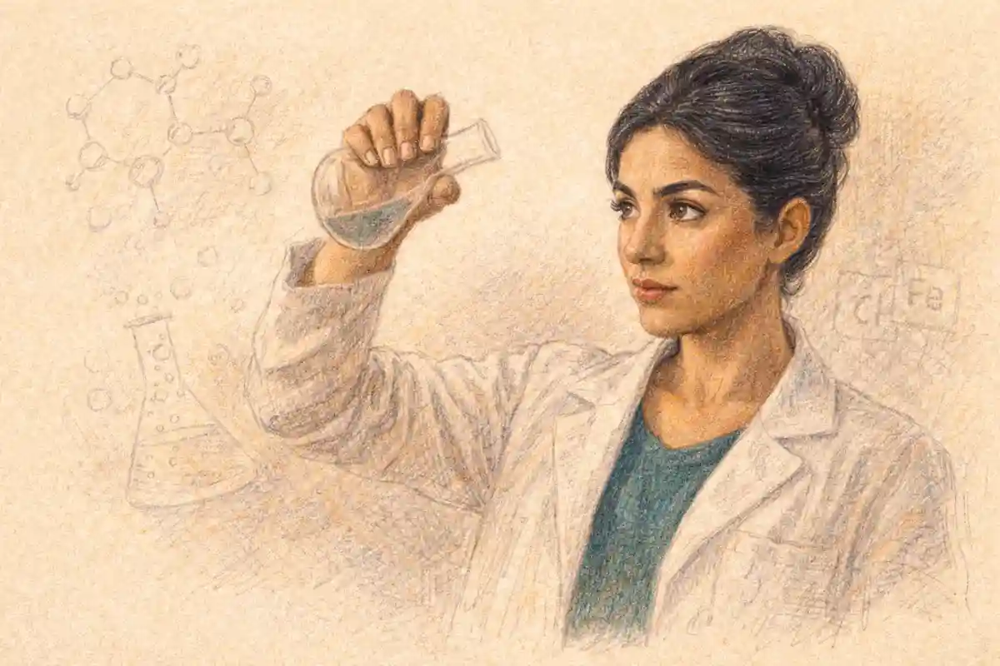

Pan's Labyrinth was made by building its fantasy as physical fact. The creatures were prosthetic suits worn by a performer in real forests and real interiors, the underground world was constructed in the same wood, stone and iron as the military world above it, and the camera photographed both with one continuous craft discipline, so the invented Spain of 1944 and the documented Spain of 1944 occupy a single material register. That is the short answer to how the film was made, and it carries the argument of everything that follows. Pan's Labyrinth endures because every fantasy element was built as a material object photographed in a real place, so the invented world carries the same weight and damage as the historical one. A viewer may forget a plot point within a year of watching. The sensation of a creature with bark in its skin, standing in wet leaf litter, breathing audibly, does not fade in the same way, because the eye registers the evidence of weight, moisture and effort without needing to be told.

The film, titled El laberinto del fauno in Spanish, was written and directed by Guillermo del Toro and released in 2006. It is set in northern Spain in 1944, five years after the Spanish Civil War ended, where a young girl named Ofelia travels with her pregnant mother to a remote mill garrisoned by a Falangist captain hunting the guerrillas who still operate in the mountains. In the ruins near the mill she meets a faun who sets her three tasks, and the film runs the garrison story and the task story in parallel until they close on the same night. The production was a Spanish and Mexican coproduction, mounted for a reported budget of about nineteen million dollars, and it earned about eighty three million dollars in cinemas worldwide. Those two figures matter to the making of the film because the distance between them is small beside the distance the film travelled culturally, and the explanation sits in how the money was spent: on objects, performers and places rather than on scale.

## A Fairy Tale Built Like a History Film

The governing decision on Pan's Labyrinth was taken before any creature was sculpted. Del Toro had already made one Spanish period fantasy, The Devil's Backbone in 2001, set in an orphanage during the final phase of the Civil War, and the later film was conceived as its companion rather than its sequel, a sister work in which the war has formally ended and the violence has changed its paperwork. Where the earlier film used a ghost, the later one uses a whole fairy tale machinery of tasks, keys, forbidden food and a book that shows the future, and it treats that machinery with the same procedural seriousness a history film gives to orders, ledgers and patrols. The garrison keeps records. The faun keeps appointments. Both worlds run on rules, deadlines and penalties, and the parallel is the film's structural engine.

That seriousness explains the choice that most defines the production. A fantasy film of this period, mounted at this budget, would ordinarily build its creatures inside a computer and reserve physical construction for sets and costumes. Del Toro reversed the allocation. The faun and the Pale Man, the two figures on which the film's reputation rests, were built by the Barcelona workshop DDT Efectos Especiales as full prosthetic performances for the actor Doug Jones, filmed in camera, in weather, on location. Digital work was assigned to the elements that resist physical construction, the small fairies, a root creature and the completion of certain designs, and it was deliberately kept at the edges of the frame's attention. The result is a film whose fantasy has mass. When the faun kneels, the suit creaks and the ground receives a weight. When the Pale Man sits at his banquet table, the hands with eyes in their palms rest on the cloth like objects that obey gravity, because they are objects that obey gravity.

The history film half of the method is just as deliberate. The mill, the garrison's routines, the supply train, the guerrillas in the hills and the doctor who quietly serves two masters are all rendered with the flat procedural attention of a war film, and the captain, Vidal, played by Sergi López, is written and played not as a fairy tale ogre in uniform but as an officer of a specific regime at a specific moment, obsessed with order, lineage and the correct functioning of a watch. The fantasy gains its force by being admitted into that documented world without a change of register. Nothing in the photography announces that a scene has become less real. The same lenses, the same damp, the same firelight serve both, and a companion [reference volume](https://vaultbook.net) on the shelf of production studies would file the film under war cinema as readily as under fantasy, because its methods belong to both.

## The Spain the Story Stands On

The year 1944 is a precise choice, and understanding it is necessary before any discussion of creatures, because the setting does half the film's work. The Spanish Civil War had ended in 1939 with the victory of Francisco Franco's Nationalists, and the Spain of 1944 was a country under a settled dictatorship in which the defeated side had not finished fighting everywhere. In the northern mountains, guerrilla bands known as the maquis, many of them veterans of the Republican forces and of the French resistance, continued small scale armed resistance, supplied by sympathetic villages and hunted by the Civil Guard and the army. The historical record of that resistance, and of the reprisals around it, is the ground on which the film's garrison stands, and the fuller history of the war itself is set out in the archive's account of [the Spanish Civil War and its foreign intervention](/2016/01/10/spanish-civil-war-explained/), which covers the conflict that produced the world the film inhabits.

### Why is Pan's Labyrinth set in 1944 rather than during the Spanish Civil War?

The war's end is the point. In 1944 the dictatorship is no longer fighting for survival but administering a victory, so its violence appears as routine, procedure and timetable rather than battle, and a child entering that world meets power in its settled form.

The maquis in the hills give the garrison a real enemy and the film a real war at its edges, while the mill itself stays a place of kitchens, ledgers, births and watches, where cruelty is a management style. A wartime setting would have made the captain a combatant. The postwar setting makes him an administrator of force, which is the more durable subject.

Del Toro has described the period in interviews as a deliberate frame rather than a backdrop, and the production design follows that instruction. Nothing at the mill is picturesque. The buildings are working buildings, the uniforms are worn rather than tailored for the camera, the food on the officers' table is abundant in a country that remembered rationing, and the guerrillas' camp is a place of wet blankets and shortages. The film's Spain is built from the material culture of a poor, policed, postwar country, and the fairy tale is required to live inside it. That requirement is what separates the film from fantasy that uses history as costume. Here the history is load bearing. Remove the maquis, the rationing, the doctor's divided loyalty and the captain's dynastic obsession, and the tasks the faun sets lose their answering shapes in the world above ground, because each element of the fantasy was designed against a counterpart in the garrison's reality.

The child's position is the hinge between the two. Ofelia, played by Ivana Baquero, who was eleven years old during the production, arrives at the mill as a dependent in a household ruled by a man who is not her father, in a country ruled by the victors of a war her own dead father did not win. Her books of fairy tales are the one property she fully owns. The film never treats her reading as decoration. It is the instrument through which she interprets a world whose adult logic is presented to her as unquestionable, and the production protected that instrument practically as well as dramatically, by building the fantasy she enters to the same standard of physical conviction as the world she is escaping. A flimsy fantasy would have settled the film's central question against her. A solid one leaves it open.

## Where the Production Came From

Pan's Labyrinth sits at the end of a long apprenticeship that explains both its methods and its budget discipline. Del Toro's first feature, Cronos, made in Mexico in 1993, was a small film about an antique dealer and a device that grants a poisoned form of eternal life, and it already contained the elements that define the later work: a handmade mechanism at the center, a childlike old man and an actual child at the emotional poles, and a director building his own props because the production could not buy them. The years between Cronos and the labyrinth passed through Hollywood genre assignments, through the Spanish production of The Devil's Backbone in 2001 and through larger studio work, and each stage added a craft relationship that the 2006 film would draw on. The cinematographer Guillermo Navarro had photographed del Toro's work since the early Mexican period. The effects workshop DDT Efectos Especiales, founded by David Martí and Montse Ribé, had supplied the earlier Spanish film's ghost. The composer Javier Navarrete scored The Devil's Backbone and returned for the companion piece.

This continuity is not a biographical nicety. It is the production's central economic fact. A director who hires a new team spends the first part of a schedule teaching that team his requirements. Del Toro arrived in Spain in 2005 with a company of collaborators who already knew that a creature would be performed rather than rendered, that the score would be built from a single hummed tune, and that the photography would divide the world by color temperature rather than by camera style. The reported budget of about nineteen million dollars therefore bought more than the same money buys on a production assembled from strangers. It bought a shared method, tested on a smaller film five years earlier, applied at larger scale. When accounts of the production describe a set on which departments anticipated each other's needs, that is the asset being described, and it is an asset no line in a budget names.

The script's own history reinforces the point. Del Toro has said in interviews that the story grew from notebooks kept over many years, from images carried since childhood reading and from the earlier film's world, and that the faun figure in particular had been drawn and redrawn long before it was a character with dialogue. The production therefore began from an unusually complete private archive of sketches and designs. The workshops were not interpreting a screenplay's loose descriptions. They were executing a visual brief that had been refined for years, which is one reason the designs hold together as a family: the faun's bark and vine surface, the Pale Man's sagging skin, the fairies' insect construction and the labyrinth's worn stone all belong to one sketched world, translated by different crafts into different materials without losing the family resemblance.

## The Money and the Structure of the Coproduction

The film was mounted as a coproduction between Spain and Mexico, through companies including del Toro's own production interests, the Spanish broadcaster backed film arm Telecinco Cinema and Mexican partners, and that structure shaped what could be built. Coproduction money arrives with obligations: a share of the cast and crew from each country, locations in one territory, post production divided according to the financing plan. The cast reflects the structure openly. The adult leads are Spanish: Sergi López as Vidal, Maribel Verdú as the housekeeper Mercedes, Ariadna Gil as the mother Carmen and Álex Angulo as the doctor. The creature performer is American, the director and cinematographer Mexican, the effects workshop Catalan, the production designer Eugenio Caballero Mexican. The film's celebrated unity of method was achieved across that treaty arithmetic, which makes the unity more instructive rather than less: it was a discipline, not a convenience.

Nineteen million dollars, the reported budget, is a small sum for a period fantasy with two original creatures, a constructed labyrinth, a mill garrison, a train sequence and a war at its edges. The allocation decisions are visible on screen. There are no crowds. The war stays at the scale of patrols and ambushes that a small company can stage. The fantasy world is concentrated in a handful of locations, a labyrinth, a fig tree, an underground hall and a banquet room, each built once and used with the thoroughness of a stage set that must repay its cost. The creatures, by contrast, received the money that spectacle productions usually reserve for their largest digital sequences, because the production had decided that the creatures were the film. A budget is an argument about what matters, and this budget argues that two performed figures, properly built, outweigh any quantity of scenery. The worldwide gross of about eighty three million dollars, earned across a long international release rather than an opening weekend, suggests the argument found its audience slowly and durably, the pattern of a film people recommended rather than a film people queued for.

The coproduction structure also determined the film's language and its route to the world. It is a Spanish language film, submitted by Mexico as its entry for the Academy Award for best foreign language film, a pairing that only a coproduction makes possible and that neatly expresses the film's double nationality. Its premiere at the Cannes Film Festival in May 2006 placed it in competition before the critics of Europe first, and its commercial life then unfolded territory by territory over many months. That slow route suited the object. A film whose effects are performances improves with word of mouth, because the thing audiences describe to each other is precisely the thing still photography and trailers cannot convey: the sensation of watching a built creature breathe.

## Casting a Child at the Center

Every production decision in the film is tested against one fact: its central performance belongs to a child. Ivana Baquero was cast as Ofelia after a search that del Toro has described in interviews as decisive on first meeting, and she was eleven years old during filming. A child lead changes the logistics of everything around her. Working hours are limited by law and by sense. Scenes of fear and grief must be built so that the performance is produced by editing, reaction and direction rather than by subjecting the actor to the emotions the audience will feel. The film's method answers this problem with its structure. Ofelia is most often filmed watching, listening and deciding, while the frightening material is carried by the creatures, the sets and the cut. The Pale Man sequence, the film's most famous passage of dread, is constructed from her stillness and the creature's slowness. Terror is an editing achievement and a design achievement before it is an acting one, which is exactly how such a scene should be built around an eleven year old.

Baquero's performance also sets the film's tonal contract. She plays Ofelia without precocity, as a serious, literal, book governed child who treats the faun's instructions with the same care she gives to adult orders, and the production around her honors that seriousness by never winking at the audience over her head. The adult ensemble is cast and directed to the same register. Maribel Verdú's Mercedes carries the garrison's moral intelligence in a performance of watchfulness, a woman whose work requires her to be invisible and whose invisibility becomes a weapon. Sergi López plays Vidal as a man performing an idea of himself, all polish and punctuality, which makes his violence read as administration rather than rage. Álex Angulo's doctor supplies the film's quietest register, a professional man rationing his courage. None of these performances is pitched as fairy tale. They are pitched as life in a garrison in 1944, and the fantasy is required to match their pitch. That is the casting decision as a production decision: choose actors who will not condescend to the material, and the material's two worlds are forced into one key.

## Doug Jones and the Discipline of Acting Inside Prosthetics

The faun and the Pale Man are the same man. Doug Jones, an American performer whose career was built on roles performed inside other people's designs, played both creatures, and the doubling is more than an economy. It means the two figures who test Ofelia share a physical intelligence, a way of moving that is patient, deliberate and slightly out of human tempo, and the audience feels that kinship without being told. Jones's craft is a specific and under described one. Inside a full prosthetic suit, an actor loses the face, the ordinary instruments of expression, and must rebuild intention from posture, breath, the angle of a head and the timing of a hand. Jones had spent years developing exactly that instrument, in mime, in creature work and in earlier collaborations with del Toro, and Pan's Labyrinth is the film in which the instrument was given two roles worthy of it.

### What language does Doug Jones speak in Pan's Labyrinth?

Jones did not speak Spanish, and the production treated that fact as a craft problem rather than a casting problem. He learned the faun's formal, archaic lines phonetically, by count and by music, the way a singer learns a libretto in an unfamiliar language, and delivered them on set in full.

The voice heard in the finished film is that of the Spanish actor Pablo Adán, who dubbed the performance. The division is invisible because Jones acts the sentences rather than merely pronouncing them, shaping breath and gesture to a text he understood in translation, so the dubbing had a fully formed performance to marry.

The working conditions define the achievement. Accounts of the production put the faun's makeup application at about five hours, a figure Jones himself has repeated in interviews, with the full costume adding horns, bark textured skin, contact lenses and the mechanics of a tall, goat legged silhouette. A performer who begins the day before dawn in a makeup chair, works inside a heavy suit under lights or in a cold forest, and still modulates a performance to the fineness this film requires is practicing a discipline closer to dance than to ordinary screen acting. Del Toro's direction of Jones, by the accounts of both men, was conducted in terms of animal reference and rhythm: the faun moves like something old and arboreal, the Pale Man like something blind and patient that wakes reluctantly. Those instructions are the kind a choreographer gives, and the film's creatures are best understood as choreographed figures that happen to speak.

## Building the Faun

The faun was built by DDT Efectos Especiales, the Barcelona workshop of David Martí and Montse Ribé, whose work on the film shared the Academy Award for best makeup with the film's makeup department. The design problem was specific. The faun had to be ancient without being decrepit, animal without being a man in a goat costume, and kind and threatening in the same shot without any change of expression that a human face would use to signal the difference. The solution was sculptural. The head carries long curved horns and a face whose surface reads as bark and root as much as skin, with hair that suggests vegetation and a beard that falls like moss. The body continues the argument: a torso textured as if grown rather than born, and legs that reverse at the joint in the manner of a goat, achieved through a combination of suit construction, the performer's own contorted posture and digital completion where the prosthetic solution reached its limit.

That hybrid method matters to the film's look. A fully digital faun would move with the weightless perfection that digital figures carried in that period, and a fully practical one would betray its joins at the legs. The production used each method where it was strongest, photographing a real upper body, a real face and real hands in real light, and completing the impossible anatomy below. The faun also changes across the film in ways the design had to support. He appears first in shadow as a towering insect like presence, resolves into the aged figure of the tasks, and is seen at the end restored toward youth, a transformation carried by successive applications and adjustments of the same sculptural idea rather than by a new creature. The workshop's task was therefore not one design but a designed life cycle, an old being whose age is written in wood and who can shed years as a tree sheds damage. It remains the standard demonstration that a creature's meaning can be carried by its materials: the faun is the forest, aged into a person, and Ofelia meets the landscape itself when she meets him.

## Building the Pale Man

If the faun is the film's argument for practical construction, the Pale Man is its proof. The figure is a seated, eyeless glutton at a laden table, with loose pale skin hanging in folds, long fingers, and his eyes set into the palms of his hands, so that to see he must raise his hands to his face in a gesture like a mask being lifted. The design has a documented pictorial ancestor that critics and the director have both discussed: the Spanish painter Francisco Goya, whose late Black Paintings include the image of Saturn devouring his son, an old god consuming a body at a table of darkness. The Pale Man is that appetite given a dining room. He sits before food he does not eat, in a hall whose walls carry paintings of his own feeding, and the horror of the figure is administrative as much as physical. He is appetite organized as a court, a small pale regime of consumption, and the parallel with the captain at his own table above ground is drawn by the production design rather than by any line of dialogue.

### How could Doug Jones see while playing the Pale Man?

Barely, and by design. The headpiece has no eye openings where eyes belong, because the creature's face is defined by their absence. Jones has described how his own vision inside the Pale Man was reduced to narrow openings at the creature's nostrils, enough to orient himself at the table and to time the raising of the hands, and no more.

The performance was therefore substantially choreographed and rehearsed as movement, with marks, counts and the geography of the set learned in advance. The blindness the audience sees is partly acted and partly the plain condition of the man inside the suit, which is why it reads as fact rather than as effect.

The suit itself was a full body construction of foam latex and painted skin, worn over hours, with the hands built as appliances carrying the sculpted eyes. Its movement vocabulary came from the constraint. A performer who cannot see does not stride, so the Pale Man rises slowly, steadies himself, and advances with the terrible patience that made the sequence famous. Del Toro has said that the figure began as a design for a creature whose skin hung as if the body inside had starved while the appetite grew, and the workshop executed exactly that paradox: folds of empty skin over a frame that should not fill them. Between the two creatures, the production covered the full range of what prosthetic performance can do. The faun is all articulation and presence, a speaking person. The Pale Man is nearly pure sculpture in motion, a design so strong that a man feeling his way along a table becomes the most quoted image in the film.

## What Was Digital, and Why Those Pieces

The digital work in Pan's Labyrinth is instructive precisely because it was rationed. The fairies that attend the faun were created digitally, small insectile figures built on the anatomy of a stick insect, because a practical fairy at that scale, required to fly, land and interact with a child's hand, would have demanded either visible mechanics or a puppetry style at odds with the film's register. The mandrake root that Ofelia keeps under her bed, a small root creature that she feeds with milk, was likewise realized substantially through digital means, since it had to writhe, gesture and age in close up. Digital completion also served the faun's legs and the removal of the modern world from location shots, and the film's occasional large gestures, such as the fig tree's interior, combine construction and digital extension in layers that production accounts describe as deliberately blended at the seams.

The discipline was negative as much as positive. Nothing digital was allowed to become the subject of a shot in the way the creatures were subjects. The fairies stay small and peripheral. The mandrake is glimpsed in a bowl, in half light. The film's digital supervisor work, shared among effects houses in Spain and abroad under the production's design control, aimed at invisibility of method rather than display. That restraint had a budgetary cause, since digital work at feature quality was expensive per minute, and an aesthetic cause that outlasted the budget: del Toro has repeatedly described his preference, in interviews across his career, for effects that an actor can react to in the room. Baquero acts with Jones. She does not act with a marker on a stick for the film's two central figures, and the difference is present in every exchange, because reaction to a present object has a timing that reaction to an imagined one must be edited to simulate. The film's digital rationing is thus not a limitation endured but a hierarchy enforced: presence first, simulation only where presence is impossible.

## Guillermo Navarro and the Two Color Worlds

The cinematographer Guillermo Navarro, who won the Academy Award for this film, solved the production's central visual problem, which was how to photograph a documentary garrison and an underground fairy tale as one world without flattening either. His solution was color temperature held as a system. The world above ground, the world of the captain, the mill and the war, is photographed in cold tones, in blues, greens and steel greys, lit by daylight through windows, by lamps in offices and by the hard light of a country where electricity is a military resource. The world below ground and inside the fantasy is photographed in warmth, in golds, ambers and the deep red of the banquet hall, lit as if by fire and candle even where the source is unseen. The two systems are so consistently held that the audience learns them without instruction, and the film can signal a crossing between worlds by a drift of color before any creature appears.

The system is more than a label, because Navarro lets the temperatures contaminate each other at the story's joints. The garrison's warmest light is firelight and lamplight at night, the hours when the fantasy presses closest. The fantasy's coldest passages are its most frightening, where gold drains toward bone. Editing between the worlds is often done on matched shapes and matched movements, a door for a door, a corridor for a corridor, and the photography completes the rhyme by letting one world's light leak into the other's frame at the threshold. Navarro's camera also respects the production's material discipline. The creatures are lit as objects in space, with sources that rake across bark and skin and reveal texture, rather than with the flat, shadowless illumination that digital figures of the period often received to help them blend. The raking light is a declaration of confidence: the suit can bear inspection. Few compliments to a workshop are as concrete as a cinematographer agreeing to light its work hard.

Navarro's own formation matters here. He came to the film from a career that moved between Mexican cinema and international productions, and he had photographed del Toro's earlier work, so the color system was not an invention of this shoot but the fullest statement of a method the two had been developing: worlds separated by temperature, joined by composition. The Academy's award for the cinematography recognized the system at its most complete. It is worth noting what the award certified, because it bears on the film's larger argument. The prize went to the photography of built things in real places, to light falling on suits, sets and forests, at a moment when the craft's prestige was drifting toward the photography of environments that existed only as data. The film's visual authority begins in that fact.

## Light as Argument

Within the color system, individual lighting decisions carry the film's meanings at the level of the shot. The captain is repeatedly photographed in hard, directional light that models him like a monument, all planes and polish, a man lit as he wishes to be seen. The guerrillas and the household staff are photographed in available gloom, in kitchens and storerooms where the light is practical, shared and unflattering. The faun is introduced in darkness broken by shafts and fireflies of light, so that the creature assembles itself out of the forest's own illumination, and the Pale Man's hall is lit like a chapel of appetite, warm and still, with the table as its altar. None of this requires a symbol hunting reading. It is the ordinary rhetoric of a well lit film, executed with unusual consistency, and it demonstrates the production's thesis at the level of craft: meaning in this film is not pasted onto its objects but built into the way they are made visible.

The night photography deserves particular notice, because so much of the film happens after dark and because night is where period films most readily cheat. Navarro's nights are genuinely dark at their edges, with faces and creatures rising from black rather than from the blue wash that conventionally signifies night. The choice costs the audience easy legibility and buys something more valuable, the sensation that the mill and the labyrinth are places where seeing is rationed, where a torch or a lamp defines a small jurisdiction of visibility and everything outside it belongs to whoever moves quietly. The maquis live in that darkness. So does the faun. The photography aligns the resistance and the fantasy by giving them the same element to inhabit, an alignment no dialogue states and no viewer misses.

## Eugenio Caballero and a Design of Wood, Stone and Iron

The production designer Eugenio Caballero, whose work shared the Academy Award for art direction with the set decoration of Pilar Revuelta, built the film's two worlds from one materials list. Above ground: wood, stone, iron, leather, paper, the matter of a mountain mill and a military post. Below ground: the same wood become root and bark, the same stone become labyrinth wall and underground stair, the same iron become key, knife and gate. The continuity is the design's central idea. Ofelia does not travel to a place made of different stuff. She travels downward into the same stuff, older, where the mill's materials remember being a forest and a ruin. The labyrinth itself, built as a real location with worn concentric walls and a central pit, is designed as archaeology rather than as fantasy architecture, a thing that was already ancient when the mill was built and that the garrison ignores because it has no military use.

Caballero's interiors argue the same way. Vidal's office is a study in imposed order, its desk, maps and the great wheel of the mill behind glass composing a portrait of a man who experiences the world as a mechanism he is entitled to run. The banquet hall of the Pale Man answers it with a fireplace like a mouth, a table laid for a feast no one eats and murals that record the host's appetite as history. The rhyme between the two rooms is the film's politics stated in furniture: two seated powers, two tables, two hungers, one in uniform and one in skin. Design of this kind is often praised as atmosphere, which undersells it. It is argument conducted in objects, and it is available to the film because the designer, the director and the cinematographer shared the materials list before any of them began. The following table sets out the production's governing constraints and what each one forced, which is the artifact this account of the making keeps returning to, because the film's effects all descend from decisions of this shape.

The production's constraints, the decisions they forced and the results a viewer can verify on screen are these:

| Constraint | Decision it forced | Visible result |
|---|---|---|
| A budget of about nineteen million dollars for a period fantasy | Two creatures built as performances, spectacle concentrated in a few locations | The faun and the Pale Man carry the film while the war stays at patrol scale |
| A child lead with limited working hours | Dread built from editing, design and reaction rather than exposure | The Pale Man passage frightens through stillness and timing |
| A performer inside full prosthetics for both creatures | Choreographed movement and phonetic delivery of Spanish lines | Two figures with one patient physical intelligence |
| A dry summer in the forests of Segovia | The parched landscape accepted and written into the photography | A fantasy forest of dust, pine and stone rather than lush green |
| Two worlds that must read as one material reality | One materials list of wood, stone and iron for garrison and labyrinth | Crossings between worlds happen without a change of register |
| A score budget within a small coproduction | One hummed lullaby melody developed across the whole score | A single tune the audience can carry out of the cinema |

## The Labyrinth as a Built Place

It is worth pausing on the labyrinth, because it concentrates the production's method in a single set. A labyrinth in a digital production is a background, infinitely extensible and free of weather. This labyrinth was built, at scale, as concentric stone circuits around a descending stair and a standing stone, and it was built to be walked by an eleven year old carrying a piece of chalk and a book. The set's finitude is its virtue. It has edges, wear, lichen and a center that arrives sooner than expected, because a real place is always smaller than its idea. The film photographs it from above in its most famous composition, the pattern laid out like a fingerprint or a shell, and the shot works because the pattern is actually there, incised in a real construction, catching real light along its grooves.

The chalk door Ofelia draws is the labyrinth's companion idea, and it shows the design philosophy at its purest. The device requires no effect more elaborate than a drawn outline and a cut, yet it states the film's whole theory of fantasy: an opening made by a child's hand, in the wall of the real, usable because she believes the wall is not the end of the world. The production spends its money on stone and spends almost nothing on the miracle, trusting the cut and the performance. That trust, repeated across every department, is what the word handmade means when it is applied to this film with any precision. It does not mean the absence of technology. It means technology subordinated to objects, and objects asked to carry meaning that other productions assign to scale.

## Javier Navarrete and the Lullaby That Carries the Score

The composer Javier Navarrete built the score of Pan's Labyrinth from a single melody, a lullaby that the audience first hears hummed by Mercedes as she comforts Ofelia, and the decision is the musical form of the production's whole method. One small, handmade thing, developed with discipline, is made to carry an entire world. The lullaby is a waltz inflected tune of deliberate simplicity, the kind of melody that feels remembered rather than composed, and Navarrete subjects it to the full range of orchestral development across the film: hummed without accompaniment, carried by strings, darkened for the underground, broken into fragments where the story breaks, and restored at the end in its most complete form. The Academy nomination for the score recognized the achievement, and the tune has since become the film's most portable element, the part of it that people reproduce on pianos and in concert suites, because a melody can travel where a prosthetic suit cannot.

The lullaby's placement matters as much as its construction. It belongs first to Mercedes, the housekeeper, the film's figure of hidden resistance and practical love, and only through her to Ofelia. The fantasy world's grandest music grows out of a servant's humming in a kitchen, which is the score's quiet thesis about where the film's values live. Navarrete, who had scored The Devil's Backbone in a related idiom, understood the assignment as del Toro framed it: the music must never announce the fantasy as an escape from the garrison's reality, but must bind the two, letting one melody keep both worlds in a single emotional jurisdiction. Where a conventional fantasy score would supply wonder on demand, this score supplies memory. Its subject is not magic but transmission, a tune passed from a woman who cannot protect a child to the child herself, and from the child, at the last, to the audience, who leave the cinema humming the evidence.

## Sound, Voice and the Mill at Night

Beneath the score sits a sound design of unusual tactility, and it belongs in any account of the making because the film's materiality is heard as much as seen. The faun's body sounds like a tree under stress, creaking and settling. The mill ticks and grinds around the captain's obsession with his father's watch, whose small mechanism becomes one of the film's recurring sounds, an inheritance ticking inside a pocket. Boots, keys, ledgers, rain on tile, the particular hush of a forest floor of pine needles: the mix builds both worlds from recorded physical events, so that the ear receives the same evidence as the eye. The creature voices complete the system. Pablo Adán's dubbing of Jones gives the faun a voice of aged formality in Spanish, a courtly, archaic register that the performance's gestures had already shaped, and the Pale Man, who does not speak, is given a waking sound like air leaving a collapsed thing, which the audience remembers as clearly as any line.

The sound work also manages the film's most delicate transitions. Crossings between the garrison and the fantasy are rarely announced by musical stings. They are managed by continuities of noise, a door's complaint becoming a gate's, a heartbeat of rain becoming dripping in a cistern, so that the worlds interpenetrate acoustically in the same way the photography lets their lights leak. This is craft at the level where it disappears, and it is one reason the film withstands repeated viewing: the senses are never given the small jolt of a method changing, so attention stays where the production wants it, on a child deciding what to believe.

## Editing and the Crosscut Structure

The editor Bernat Vilaplana cut the film to a structure of rhymes. The screenplay runs the garrison plot and the task plot as parallel lines, and the editing is where the parallelism becomes argument, because the cut is the instrument that states the correspondence between the two worlds without a word of commentary. A meal above ground answers a banquet below. An act of obedience demanded by the captain is set against an act of obedience demanded by the faun, and the film's moral intelligence lives in the difference between what each demand costs and what each is for. Vilaplana's pacing trusts stillness in a period when fantasy editing was accelerating. Shots are held while a creature crosses a room, while a child reads, while a captain shaves. The held shot is the editing form of the production's material confidence: a film that has built real things can afford to let the audience look at them.

The structure also solves a commercial problem with an artistic answer. A Spanish language film, subtitled for most of its international audience, asks viewers to read while watching, and rapid cutting punishes that audience. The film's measured cutting, its reliance on compositions that can be absorbed whole and its habit of letting a scene's geography establish itself before its action, make it unusually legible across the subtitle barrier. Part of its worldwide gross of about eighty three million dollars is explained by that legibility. The film travels because its cutting assumes a viewer who is reading, listening and watching at once, and refuses to make any one of those tasks frantic. Form and market, in this case, were the same decision.

## The Screenplay's Architecture

Del Toro wrote the screenplay alone, and its architecture is a system of threes and doubles. Three tasks are set for Ofelia. Three women carry the film's moral weight at three ages of life. Two fathers, one dead and one imposed, frame the child's choices. Two tables, two seated powers, two kinds of hunger organize the design, and the editing, as described above, is the machinery that keeps the doubles visible. The script's fairy tale materials are handled with a scholar's care about their rules. The tasks have conditions, and the conditions have penalties. The forbidden food in the Pale Man's hall follows the oldest rule of the otherworld, that eating there binds the eater, and the film stages the transgression as a child's appetite rather than as a moral failure, two grapes taken by a hungry girl in a house where food is power. Nothing in the script explains these correspondences. It simply builds them, which is why the film rewards analysis without depending on it: a viewer who notices none of the rhymes still receives them as rhythm.

The script's refusal to arbitrate its own fantasy is its most discussed decision, and it belongs to the screenplay rather than to any later interpretation. Evidence for the reality of the underground kingdom and evidence for its existence as a child's construction are both planted with care, and del Toro has said in interviews that his own view is that the magic is real within the story, a statement that settles the author's intention without settling the film, since the film as built supports the viewer who reads otherwise. That balance is an achievement of construction. A script tipped further toward explanation in either direction would be a smaller object: a parable with a key, or a case study with a diagnosis. The script instead distributes its proofs evenly and lets the distribution itself become the subject, so that criticism of the film has a permanent object to work on, one of the surest engines of endurance a film can possess.

## Fairy Tale Sources and What Was Refused

The film's fairy tale material is drawn from the deep stock of European story: quests in threes, a book of tests, a key, a chalk door, a forbidden banquet, a king waiting for a lost child. Del Toro's reading in the tradition is documented in his interviews and in the design sources the production acknowledged, which range from the illustrations of Arthur Rackham, whose gnarled trees and attenuated figures stand behind the faun's silhouette, to Goya's late paintings, which stand behind the Pale Man. What distinguishes the film's use of the tradition is what it refuses. It refuses the modern softening of the tales, in which danger is decorative and obedience is rewarded without cost. Its tasks are dangerous, its rules are enforced, and its ending declines to convert suffering into a lesson at the level of the garrison's world, where the dead stay dead and the captain's name is struck from the record he killed to perpetuate.

It also refuses the opposite modern fashion, the knowing fairy tale that signals its own cleverness. There is no irony in the film's treatment of its materials, no wink at the adult audience, and that sincerity was a commercial risk in 2006 that the reception history shows was correctly taken. The tradition the film joins is the one in which fairy tales were the literature of the powerless: stories told by servants and grandmothers, in kitchens, encoding what could not be said in the master's hearing about appetite, obedience and the violence of households. Mercedes hums the score's central melody in a kitchen. The film knows exactly which room its tradition comes from, and it builds that room, staffs it and gives it the tune.

## The Spirit of the Beehive and the Spanish Lineage

No account of the making is complete without the film's Spanish ancestry, because Pan's Labyrinth was received from the first as a return to a national tradition of the child witness. Víctor Erice's The Spirit of the Beehive, made in 1973 under the dictatorship it quietly indicts, follows a small girl in a Castilian village in 1940 who encounters a deserter and a travelling cinema's monster, and critics reached for the comparison immediately and have kept it in use since. The scholar Paul Julian Smith, whose study of Erice's film for the British Film Institute's classics series remains a standard account, represents a line of criticism that reads both films as works in which a child's imagination is the only jurisdiction the regime cannot enter. The comparison flatters the later film and also disciplines it, and del Toro has acknowledged Erice's work with respect in interviews, placing his own film in the lineage rather than above it.

The lineage clarifies a choice that might otherwise look like mere setting. Spain's cinema of the child witness exists because the dictatorship made direct statement dangerous for decades, and the child's viewpoint became the national form for truths that adults in the film cannot say. By 2006 no censorship required the indirection, and the film's use of the form is therefore a conscious act of inheritance, a Mexican director taking up a Spanish tradition at the moment he was also making a Spanish film with Spanish money and a Spanish cast. The production's coproduction structure and its artistic lineage are the same fact at two levels: this is a film deliberately made inside a national cinema by a director formed partly by it, and its authority on its subject derives in part from that submission to a tradition rather than from an outsider's commentary upon one.

## Shooting in a Dry Summer

The production filmed in Spain in the summer of 2005, in the forests and mountain country of Segovia and the Sierra de Guadarrama, and the location imposed the production's most famous unplanned decision. Del Toro has recounted in interviews that he had imagined a lush, green, northern forest for Ofelia's world, and that the production arrived in a drought, to hills of dust, dry pine and stone under a hard sun. The choices were to fight the landscape with irrigation and color correction toward an imagined green, or to accept the parched country as the film's forest. The production accepted it. The fantasy was redesigned around dryness: the faun's bark and lichen read as growths of a thirsty wood, the great fig tree at the center of the first task became a dying tree choked by a toad, and the labyrinth's stone took the color of the hills it stood in.

The acceptance is worth dwelling on because it is the production method in miniature. At every level, this film treats constraint as material. A small budget produced the performed creatures. A child lead produced the editing of dread. A dubbed creature performer produced a faun whose formality is in his body. A drought produced a dying forest for a story about a country being starved by its victors, a correspondence no designer could have commissioned and no money could have improved. Productions are usually praised for overcoming their conditions. This one is more accurately praised for metabolizing them, and the distinction explains the film's unusual coherence: there is very little in it that feels imported, because so much of it was found, kept and built upon at the place and moment of shooting.

The mill and garrison locations were handled with the same economy, dressed working buildings and interiors rather than constructed grandeur, with the production's building effort concentrated where the camera would live longest: the labyrinth, the underground throne room, the Pale Man's hall and the interiors of the mill. A schedule that must protect a child lead, two prosthetic performances with hours of application before the first shot, and location weather cannot also serve a sprawling geography, and the film's tight map of places, mill, forest, labyrinth, road, is the visible signature of that arithmetic. The audience experiences the smallness as intimacy and dread, a world with few doors. The production experienced it as the only world it could afford, and built it to the standard that makes the arithmetic invisible.

## Cannes and the First Verdicts

The film premiered in competition at the Cannes Film Festival on May 27, 2006, and the screening entered the film's legend immediately through the length of its ovation, reported at figures that vary by account and are best treated as evidence of enthusiasm rather than as a measurement. Festival ovations are a currency of publicity and prove little in themselves, but in this case the reception that followed in print gave the ovation a substance to stand for. The film was taken up by critics as the rare competition entry that satisfied both the art cinema audience and the genre audience at the same screening, and its path from Cannes through the autumn festivals to its Spanish release in October 2006 and its North American release at the end of that year was a steady accumulation rather than a spike: the trajectory of a film being handed from viewer to viewer.

That trajectory mattered to the kind of object the film became. A work discovered gradually is discussed differently from a work consumed at once. The arguments that have sustained the film's reputation, about the reality of its fantasy, about its politics, about the standing of its creatures in the history of effects, were all formed in those first months of print and conversation, in reviews and festival reports that treated the film as a subject for essayists rather than as a product for consumers. Cannes supplied the first of those essays by the simple fact of competition selection: a Spanish language fantasy about the aftermath of a civil war was programmed as a major work and judged as one, and the film's subsequent life has never lost that framing. It is filed, permanently, as cinema first and genre second, a classification its makers plainly intended and its production methods were designed to earn.

## The Critics at the Time

The contemporary review record shows both the enthusiasm and the shape of the disagreement that has accompanied the film since. Roger Ebert, reviewing the film in the Chicago Sun-Times in 2006, praised it in the terms that have proved most durable, as a fairy tale built with a craftsman's rigor for adult viewers, and gave it his highest rating. A. O. Scott in The New York Times treated the film as a serious work of moral imagination while attending closely to its construction, and the review pages of the period return repeatedly to the same cluster of observations: that the violence of the garrison and the wonder of the tasks are held in one style, that the child performer is directed without sentimentality, and that the creatures are achievements of a kind the digital period was supposed to have retired. The dissenting notes in the period are equally instructive. Some reviewers found the parallel structure too neat, the rhymes between the worlds too diagrammatic, and the captain too perfectly emblematic to be a man. Those objections were not refuted by the film's success. They were preserved inside its reputation, and they supply the complication that a later section of this account takes up in full.

The Spanish reception carried an additional weight, because the film intervened in a national argument about how the Civil War and the dictatorship are to be remembered, an argument then at a particularly active phase in Spanish public life. A fantasy film by a Mexican director became, in Spain, a contribution to the politics of memory, reviewed and debated in those terms as well as in cinematic ones. The film's refusal to grant its captain any interiority beyond his obsessions was itself a position in that argument, and Spanish critics on different sides of the memory question received the film accordingly. That a work of fantasy could be conscripted into a historiographical dispute is further evidence of the production's founding decision: build the history as carefully as the fantasy, and the history will be argued about as history.

## The Academy Verdict

At the 79th Academy Awards, held in 2007 for the films of 2006, Pan's Labyrinth received six nominations and won three awards, and the distribution of those honors is the most concise critical verdict the production ever received. The wins were for cinematography, for Guillermo Navarro; for art direction, for Eugenio Caballero with set decoration by Pilar Revuelta; and for makeup, for the work of David Martí and Montse Ribé and their department. The nominations that did not convert were for original screenplay, for original score for Javier Navarrete, and for best foreign language film, where the film, submitted by Mexico, lost to the German entry The Lives of Others. The pattern is exact. The industry honored the film for the things it is made of: light, built space and faces built by hand. It admired the writing and the music without crowning them, and it preferred another film as the year's foreign language representative while certifying this one's crafts at the highest level.

For the argument of this account, the Academy record functions as independent evidence. The claim that the film endures because of its material construction is not only a critic's preference. It is the verdict the profession itself delivered at the time, category by category, and the three winning categories correspond precisely to the three departments whose methods have occupied the center of this account. Awards are fallible instruments, and the same ceremony's foreign language result shows the limits of their authority, but as a map of where a film's strength was located by the people who practice its crafts, the record of that night has rarely been improved upon. It also fixed the film's professional afterlife: Navarro, Caballero, Martí and Ribé carried the film's credit into careers at the top of their fields, and the production became a reference point in discussions of practical effects at exactly the moment the industry was reconsidering how completely it wished to surrender its creatures to the computer.

## Money, Reach and the Slow Audience

The film's commercial record completes the production picture. Made for a reported budget of about nineteen million dollars, it earned about eighty three million dollars in cinemas worldwide, with a substantial share of that total accumulated outside its opening territories and over a long release, and it then began the second life of a catalogue film: disc editions, television, teaching and the steady recommendation traffic that does not appear in grosses. The figures describe a success of a particular kind. The film was not a phenomenon of scale. It was a phenomenon of conversion, turning a modest outlay into a permanent asset by being, in each market, the film that viewers pressed on each other. Subtitled, period, violent, ambiguous and built around a child, it carried every commercial disadvantage except the ones that matter: it looked like nothing else, it could be described in one image, and the description survived translation.

The economics also explain the film's form in retrospect. A production that cannot buy spectacle must manufacture distinctiveness, and distinctiveness is a more durable commercial property than spectacle because it does not depreciate as technology advances. The digital marvels of 2006 read as their period. A man in a bark suit in a dry forest reads as itself, indefinitely. The producers who accepted del Toro's allocation of the budget, away from scale and toward two performed creatures and a complete small world, were making a wager about depreciation whether or not they named it as one, and the film's continuing commercial life is the wager still paying out. In the archive's terms, this is the business history inside the craft history: the making of the film and the selling of the film were the same set of decisions, seen from two sides.

## The Complication: Whose Film Is It, and What Actually Lasts

The strongest case against the argument of this account deserves its full force, and it comes in two parts. The first concerns authorship. To say that del Toro made Pan's Labyrinth is convenient and incomplete. The faun's face belongs in large part to Martí and Ribé and to the man inside it. The film's color logic belongs to Navarro. Its spaces belong to Caballero and Revuelta, its tune to Navarrete, its rhythm to Vilaplana, and its emotional register to Verdú, López, Gil, Angulo and an eleven year old. The auteur vocabulary that organizes most writing about the film, and much of this account, systematically transfers that distributed labor into one name, and the transfer is not innocent: it is how the industry markets directors and how workshops, performers and composers come to be footnotes in the history of their own best work. The companion study of another director's signature style in this archive, the analysis of [Christopher Nolan's auteur vision in Inception](/2021/01/01/inception-nolan-auteur-analysis/), shows the same transfer at work on a larger canvas, and the problem is general to how films are discussed.

The second part concerns the cause of endurance. A skeptical critic can grant every craft claim in this account and still deny the conclusion, holding that the film lasts not because its creatures have weight but because its story refuses to settle the question every viewer brings to it: whether the magic is real. On this reading, the material construction is the enabling condition and the ambiguity is the engine, and a version of the film with identical prosthetics and a resolved ending would be a footnote while a version with cheaper creatures and the same script might still be argued about. The skeptical reading has evidence. The film is taught and debated as a text at least as much as it is admired as an object, and its classroom life runs on interpretation, not on makeup.

The honest resolution narrows the thesis rather than abandoning it. The ambiguity would have nothing to attach to if the fantasy were weightless, because a viewer can only sustain two readings of a world that the senses accept as present, and the craft would be admirable inertness without a question to carry. Production and script are not rivals for the credit. They are the two halves of one decision, which was to treat an invented world with the full procedural seriousness of a documented one. The endurance belongs to the seriousness, wherever it is exercised: in a workshop in Barcelona, in a color system, in a screenplay that distributes its proofs evenly and declines to collect them.

## Versions, Restorations and the Life of the Print

A film made on 35mm film enters a second history after its release, the history of its own survival as an object, and Pan's Labyrinth has had a fuller version history than most films of its decade. It was photographed on film at the end of the period when that was the unexamined default, released in prints and in the digital cinema packages then spreading through exhibition, and carried into the home on the disc formats of successive generations, including a Criterion Collection edition in 2016 that placed it formally inside the canon of preserved cinema. Each transfer re-argued the film's photography, because Navarro's color system, its cold garrison and warm underground, is exactly the kind of design that a careless transfer can flatten into a single teal twilight. The archive's general account of [how film restoration works](/2026/10/14/how-film-restoration-works/) sets out the discipline involved in returning to original elements and rebuilding a film's picture and sound from the best surviving materials, and the same discipline governs this film's later editions.

### What does a 4K restoration change in a film shot on 35mm film?

A 4K restoration returns to the original camera negative, or to the best surviving element, and scans it at a resolution that holds the grain and the fine detail the negative captured. The color timing is then rebuilt under supervision, frame by frame, against the photography's original decisions.

The gains are therefore in texture, in the separation of dark tones and in fidelity to those decisions rather than in any new content. For a film whose meaning is carried by bark, skin, stone and the exact border between a cold room and a warm one, those gains are interpretive as well as technical: the restoration defends the photography's argument. The version prepared from the original 35mm elements under del Toro's supervision, which reached cinemas and home formats for the film's twentieth anniversary, is the fullest statement of that defense.

The exhibition side of the film's life completes the picture. The prints of 2006 have given way to encrypted digital packages delivered to servers and unlocked by keys, the system described in the archive's account of [digital cinema packages and their movie keys](/2026/10/21/how-digital-cinema-packages-work/), and a film about a girl with a piece of chalk drawing her own door reaches its audiences through doors that open only for authorized machines in authorized windows. The irony is structural rather than bitter. Every era exhibits its films through the machinery it has, and the measure of a durable film is that its own machinery, the built and photographed kind, survives translation into each new delivery system without losing the qualities that made it. On the evidence of its version history, this one does, because what must survive is not an effect but a set of objects and performances that any honest transfer can carry.

## Influence on the Fantasy Cinema That Followed

The film's influence is visible first in the economics of prestige fantasy. After 2006, the proposition that a modestly budgeted, subtitled, adult fairy tale could win craft awards, travel worldwide and remain in circulation became a demonstrated fact rather than a hope, and producers and festivals treated the category differently because of it. Its second influence is methodological. The film became the standing citation in the industry's recurring argument about practical against digital effects, produced whenever a production chooses suits, animatronics and built sets, and its creatures entered the small canon of screen figures, alongside the work of earlier workshops, that are used to teach what prosthetic performance can hold. Doug Jones's subsequent career as the screen's most employed creature performer, including his later collaborations with del Toro, runs directly through the two roles he played in the Segovia summer.

The third influence is on del Toro's own body of work, where the film stands as the center of a triptych of concerns: the child and the monster, the institution and the hidden door, history as the true horror and fantasy as its witness. The Devil's Backbone before it and the later English language films after it are all read in its light, and its success gave its director the standing to keep small, personal, handmade films inside a career that also contains large studio productions. Influence of that kind is easy to overstate and should be stated plainly: the film did not change what the industry mostly does, which remains scale and simulation. It changed what the industry knows can be done, and it keeps that knowledge available, in a form students can study shot by shot, which is the most useful kind of influence a single film can have.

## Two Resistances: The Maquis in the Hills and the Household Below Stairs

The garrison's war is staged at the scale the budget allowed, and the staging is a lesson in how limitation becomes style. The maquis appear as a small band in a wet camp, defined by shortages: short of food, short of medicine, short of men, dependent on a supply train they must rob and on sympathizers inside the mill who risk everything to feed them. The film's one large military action, the attack on the train, is built from the elements a small production can command: a real locomotive on a real line, an explosion, a derailment staged as logistics rather than as spectacle, and its aftermath played as an inventory dispute, because the train's cargo turns out to be largely a fiction of the captain's propaganda, a safe said to hold riches that holds almost nothing. The sequence argues the film's view of the war in action form. The regime's power is theatrical, a matter of announced values and guarded emptiness, while the resistance's strength is a network of small material acts: a key copied, a store room opened, a doctor's bag carried up a hill in the dark.

Inside the mill, the second resistance runs on the same economy. Mercedes and the doctor conduct a war of ledgers and doses, of information carried in aprons and laundry, and the production shoots their conspiracy in the garrison's own spaces, kitchens, storerooms, stairs, so that the audience learns the mill as two overlapping maps: the captain's map of command and the servants' map of passage. That double geography is the household form of the film's central device, since Ofelia's chalk doors open the same kind of second map inside the first. The parallel is never stated, and it does not need to be. A viewer who has watched Mercedes move through the mill unseen has already understood how a child might find doors in its walls. The resistance plot is therefore not a subplot competing with the fairy tale for screen time. It is the fairy tale's evidence, the documented proof inside the film that the world above ground also contains hidden passages, coded loyalties and helpers who appear when a task is honestly undertaken. Del Toro's script builds its fantasy on the structure of the resistance he researched, and the production's staging, small, material and procedural, is what allows the two structures to be recognized as one.

## Costume and the Politics of Polish

The costume designer Lala Huete dressed the film's argument as precisely as Caballero built it. Vidal's uniforms are the production's most eloquent costumes: immaculate, tailored, gloved, maintained with a valet's care in a country of shortages, so that the captain's appearance states his politics before he speaks, an order imposed on cloth as on everything else. Against that polish the production sets the textures of everyone else's clothing: the worn wool of the maquis, the doctor's professional sobriety, Mercedes's working dress and apron, in which the film hides its most practical garment, since an apron is a servant's uniform and a servant's invisibility, and what it carries matters to the plot. Carmen arrives in the tailored clothes of a woman dressing for the life she has chosen and is progressively reduced by pregnancy, illness and the household's cold, her wardrobe narrowing as her world does.

Ofelia's costume carries the design's most discussed reference. For her first journey she wears a dark green dress with a white apron that readers of illustrated storybooks recognize at once, because the silhouette echoes the classic illustrations of Alice, the founding child visitor to an underground kingdom in English language story. The reference, noted by critics from the film's first release, works as the whole film works: it is a citation built as an object, a real dress on a real child, which the film then submits to its own weather. By the last movement the apron is mud, rain and blood darkened, and the storybook silhouette has been carried through the garrison's reality and out the other side. Huete's department also had the war to dress, and dressed it without glamour: uniforms that fit their wearers' ranks and vanities, civilian clothes that remember prewar quality going threadbare, guerrilla clothing that is civilian dress militarized by use. Costume is the department audiences least often credit and most constantly read, and in this film it performs the same service as the prosthetics. It gives the eye continuous, checkable evidence about who holds power, who performs it and who is disappearing inside it.

## The Toad in the Fig Tree

The first of Ofelia's tasks is the production's methods in miniature, and it repays attention because it was staged early in the film's argument, before the faun's world had been fully established. She is sent to the root chamber of a great fig tree that is dying because a monstrous toad has made its home in the roots and feeds on the tree, and she must place three stones in its mouth and take the key it guards. The tree itself was a construction, a full scale interior and exterior built for the camera, its root chamber a set a child could crawl through, dressed with mud, water and the debris of a sick organism. The toad, by production accounts, was realized as a large practical figure, operated on set and completed digitally, a glistening, inflated presence whose authority on screen comes from its occupancy of real space and real mud: it displaces water, it settles, it breathes with the slowness of a thing that has never been challenged.

The sequence establishes the rules by which the whole fantasy will operate. The task has instructions, and the instructions have a trick in them. The creature is not fought but fed, undone by appetite administered in the form of stones mistaken for food, the first of the film's several lessons in how appetite is the weakness of every power in it, from the toad to the Pale Man to the captain at his table. Ofelia returns covered in mud, her party dress ruined, to be scolded for the dress rather than asked about the tree, and the rhyme between the worlds is completed by wardrobe: the garrison can see the mud but not the errand. For the production, the sequence also served as proof of concept for everything after it. If a child, three stones, a built tree and a practical toad could hold an audience, then the method was sound, and the larger creatures waiting later in the schedule could be approached with confidence. The film teaches its audience how to watch it inside its first task, which is why the later wonders require no explanation of tone. The contract was signed under the fig tree.

## Props That Carry the Plot

Pan's Labyrinth is a film unusually dependent on small objects, and its prop work deserves a place in the making, because the objects are not decoration but mechanism. The Book of Crossroads, which the faun gives Ofelia, shows her the future in images that arrive as she watches, an effect achieved by the prop department and the digital artists together: a real book, bound and aged, whose blank pages fill with inked scenes in her hands. It is the film's theory of reading made physical, a text that tells the truth slantwise and too late to be simple, and it had to be built as an object before it could be finished as an effect, because the child's hands and the book's weight are in the same shots as its miracles. The golden key from the toad's belly, the piece of chalk that draws doors, the mandrake root in its bowl of milk, the small knife that passes between the film's women: each is a fairy tale instrument given the finish and wear of a real tool, and each accrues meaning by being handled, hidden, lost and used rather than by being explained.

At the other pole stands the captain's watch, the film's most loaded prop, and the one that belongs entirely to the garrison's world. Vidal carries his father's watch and tells the story attached to it, that the older officer, facing death, smashed it against a rock so that his son would know the exact hour at which a brave man died. The story is Vidal's own account inside the film, offered as inheritance and command, and the production treats the watch accordingly, as a polished, ticking piece of liturgy that the captain maintains as he maintains his uniform. The film's closing movement resolves the watch's meaning without a speech, when the dying captain asks that his son be told the hour of his death and is answered that the boy will not even know his name. The prop completes its arc as the fantasy's objects complete theirs, by use rather than by commentary. A production that thinks in objects to this degree has an advantage that outlasts its budget: objects can be rephotographed, recontextualized and finally answered, and the audience's memory, which is poor at plots and excellent at things, carries the film away in its pockets.

## What to Watch for on a Rewatch

For the viewer returning to the film, the production's decisions offer a practical discipline of attention. Watch the hands first: the faun's long fingers, the Pale Man's palms, the captain's hands on his watch and his razor, Mercedes's hands at her work, a child's hands with chalk and a key, because the film thinks through hands more consistently than through faces. Watch the tables, both of them, and the doors, all of them, and notice how rarely the camera hurries. Listen for the lullaby each time it changes hands and instrumentation, and for the creak of the faun's body under the score. Notice the exact shots where the color temperature turns, and how often the turn happens inside a shot rather than at a cut, a lamp carried through a doorway, a descent from cold air into gold. Attend, finally, to the stillness of the child at the center of the most frightening passage in the film, and to how much of that fright was achieved by everyone except the person it is happening to. A production that can be rewatched as a manual of its own methods has made its methods part of its meaning, and that, more than any single creature or tune, is the durable achievement. For notes kept alongside a viewing, a simple [viewing log](https://reportmedic.org) kept in a notebook serves the purpose as well as any system.

The film ends, as its making began, with an object: a flower on a fig tree, in a country whose official story has no place for it, offered as evidence of a kingdom that the record cannot confirm. The production that built that flower had spent its whole schedule on the same proposition in practical form, that things made carefully by hand, in real places, by named people whose crafts can be listed and checked, acquire a kind of evidence that cannot be simulated after the fact. Pan's Labyrinth endures because its fantasy was documented like history and its history was imagined like a fairy tale, and because a company of makers, in a dry Spanish summer, held both halves of that exchange to the same standard and let the camera prove it.

## Frequently Asked Questions

### Q: What is Pan's Labyrinth about?

Pan's Labyrinth tells two interlocking stories set in northern Spain in 1944. In one, a young girl named Ofelia arrives at a remote mill garrisoned by her new stepfather, a Falangist captain hunting guerrilla fighters in the mountains, while her pregnant mother fades under the strain of the household. In the other, an ancient faun in a ruined labyrinth beside the mill tells Ofelia she is the reincarnation of a lost princess and sets her three tasks to complete before the full moon. The film's subject is the relationship between those two stories: a documented world of orders, rations and reprisals, and an invented world of tests, keys and forbidden food, each built to the same standard of physical detail, so that viewers must decide for themselves how the second story stands in relation to the first, and what it costs the girl either way.

### Q: Who directed Pan's Labyrinth and who wrote the screenplay?

Guillermo del Toro both directed Pan's Labyrinth and wrote its screenplay, without a credited co-writer, which is one reason the film's design, story and direction align so closely: the same person specified the creatures, the parallel structure of garrison and labyrinth, and the film's refusal to settle whether its magic is real. Del Toro developed the story over years of notebooks before production, drawing on images from his childhood reading and on the world of his earlier Spanish film The Devil's Backbone. The screenplay was nominated for the Academy Award for best original screenplay. Around the director stood a company of long term collaborators who executed the script's demands in their own crafts, including the cinematographer Guillermo Navarro, the production designer Eugenio Caballero and the composer Javier Navarrete, each of whom had worked with del Toro before this production.

### Q: What does the Spanish title El laberinto del fauno mean?

El laberinto del fauno translates directly as The Labyrinth of the Faun. The creature Ofelia meets is a faun, a being of classical and folk tradition with the horns, ears and legs of a goat joined to the torso and face of a man, associated with woods, wild places and old, ambiguous guidance rather than with any single god. The English title substitutes the name Pan, the Greek god of the wild who shares the goat legged form, because the word faun carries little recognition for English speaking audiences while Pan signals the pastoral and the uncanny at once. The substitution is a translation decision about marketing and recognition, and del Toro discussed it openly at the film's release, noting that the figure in the story is a faun of folklore and not the Greek god, whose character and appetites belong to a different tradition.

### Q: Why is the creature called a faun rather than Pan in the Spanish title?

Because in the story's own terms the being is a faun, a creature of the woods in the Roman and Iberian folk tradition, old, courteous, evasive and bound to a place, rather than Pan, the named Greek god of shepherds, panic and wild music. Del Toro has explained in interviews that a faun is a humbler and more ambiguous figure than a god: it serves the underground kingdom, keeps its appointments and administers its tests, but it can be impatient, fallible and frightening in ways that belong to a servant of an older order rather than to a deity. The Spanish title keeps that humility, and the performance follows it. The faun is never presented as omnipotent. He is an official of a fading world, working to a deadline, which is part of why audiences find him at once trustworthy and unsettling, and why the English title's grander name slightly misdescribes him.

### Q: Who played the Faun and the Pale Man in Pan's Labyrinth?

Both creatures were played by the American performer Doug Jones, a specialist in roles performed inside complete prosthetic designs, who had built his craft through mime, dance and creature work and had already collaborated with Guillermo del Toro. Jones performed the faun in a full body application of bark textured skin, horns and contact lenses, and the Pale Man in a separate construction of loose pale skin with the creature's eyes set into his palms. His voice as the faun was replaced in the finished film by that of the Spanish actor Pablo Adán, because Jones, who did not speak Spanish, learned his lines phonetically for the shoot. The double casting gives the film's two testing figures a shared physical intelligence, a patience and deliberateness of movement that the audience registers as kinship, and it remains the most admired example of prosthetic performance in the film's period.

### Q: How long did the Faun makeup take to apply each day?

Accounts of the production, including Doug Jones's own repeated description in interviews, put the faun's application at about five hours, covering the fitting of the sculpted head with its horns and bark surface, the body pieces, hair work and contact lenses, before the costume and the day's filming could begin. Removal and the care of the performer's skin added further time at the end of each schedule. The figure matters because it explains the production's working shape: a film whose central fantastic figure requires five hours of preparation before sunrise organizes its call sheets, its lighting and its child lead's legal hours around that fact. The workshop responsible, DDT Efectos Especiales of Barcelona, founded by David Martí and Montse Ribé, shared the Academy Award for best makeup for the film, an honor that recognized endurance and consistency across a long shoot as much as design.

### Q: Who composed the music for Pan's Labyrinth?

The score was composed by Javier Navarrete, the Spanish composer who had previously scored Guillermo del Toro's The Devil's Backbone and who returned to write the music for its companion film. Navarrete built the entire score around one short melody, a lullaby that the character Mercedes hums to Ofelia, and developed that single tune across the film in arrangements that range from an unaccompanied voice to full orchestra. The score was nominated for the Academy Award for best original score. Its economy is its distinction: where a fantasy film of the period might deploy a new theme for every realm and creature, this score insists that one remembered melody can govern a whole world, growing darker as the garrison's story darkens and recovering its completeness only at the end. The lullaby became the film's signature away from the screen, performed in concerts and recorded by other musicians.

### Q: How does the lullaby function in the score of Pan's Labyrinth?

The lullaby works as the score's memory. It is first heard as something a servant hums to comfort a frightened child, an act of transmission from one powerless person to another, and the orchestral score then treats the melody as the film's emotional property, passing it between instruments and registers as the story moves between the garrison and the underground. In the cold world of the captain it appears fragmented and withheld. In the world of the tasks it gathers warmth and completion. Because the tune is simple enough to be carried after a single hearing, audiences leave with it, and its returns inside the film are recognized bodily before they are analyzed. Javier Navarrete's construction also solves a structural problem: a story split between two realities needs a bridge that dialogue cannot supply, and the lullaby, belonging to both worlds and owned by neither, crosses between them every time it is heard.

### Q: Who was the cinematographer of Pan's Labyrinth?

Guillermo Navarro photographed Pan's Labyrinth and won the Academy Award for best cinematography for the work. Navarro, a Mexican cinematographer who had shot Guillermo del Toro's films since the director's early career, designed a strict color system for the production: the garrison's world in cold blues, greens and steel greys, lit by daylight, lamps and military practicals, and the fantasy world in golds, ambers and deep reds, lit as though by fire. The system is held so consistently that a change of temperature alone can signal a crossing between worlds, and it is executed on real objects in real places, suits, sets and forests lit with hard, raking sources that expose texture rather than conceal it. The award recognized that discipline at its fullest, and the film's photography has become a standard teaching example of color temperature used as narrative structure rather than as decoration.

### Q: How many Academy Awards did Pan's Labyrinth win and for what?

Pan's Labyrinth won three Academy Awards from six nominations at the 79th Academy Awards, honoring the films of 2006. The wins were for best cinematography, for Guillermo Navarro; best art direction, for production designer Eugenio Caballero with set decorator Pilar Revuelta; and best makeup, for the work led by David Martí and Montse Ribé of DDT Efectos Especiales. The three nominations that did not result in wins were for best original screenplay, for Guillermo del Toro; best original score, for Javier Navarrete; and best foreign language film, where the picture, submitted as Mexico's entry, lost to the German film The Lives of Others. The pattern of the results is often noted by critics, because the honors cluster exactly on the film's material crafts: its light, its built spaces and its hand made faces, the departments on which its production method staked everything.

### Q: At which festival did Pan's Labyrinth premiere?

Pan's Labyrinth premiered in competition at the Cannes Film Festival, screening on May 27, 2006, before its Spanish theatrical release in October of that year and its North American release at the end of 2006. The Cannes screening became part of the film's early legend through the length of the ovation that followed it, which contemporary reports measured in figures that disagree with each other and which are safest read as evidence of an unusually warm reception rather than as a statistic. The competition placement mattered more than the applause. It positioned a Spanish language fantasy about the aftermath of a civil war as a major work of world cinema before the year's critics, and the film's subsequent progress through festivals and territories over many months built its reputation by accumulation, review upon review and audience upon audience, rather than by a single opening.

### Q: What war forms the background of Pan's Labyrinth?

The Spanish Civil War, which ended in 1939 with the victory of Francisco Franco's Nationalist forces, forms the background, although the film is set five years later, in 1944, in the war's long aftermath. The conflict in the film is the low intensity campaign between the dictatorship's forces and the maquis, the guerrilla bands, many of them veterans of the defeated Republican side, who continued armed resistance in the mountains of the north into the postwar years. The captain at the mill is hunting those bands, and the household's divided loyalties, the doctor's secret aid, the housekeeper's copied key, belong to that campaign's real methods. The postwar date is essential to the design: the regime in the film is not fighting to win a war but administering a victory, so its violence takes the form of routine, rationing and punishment, and the fairy tale's tests unfold inside a peace that is itself a kind of occupation.

### Q: Who played Ofelia in Pan's Labyrinth and how was she cast?

Ofelia was played by Ivana Baquero, a Spanish performer who was eleven years old during the production and who carried the film as its central presence, appearing in the great majority of its scenes opposite adult actors and prosthetic creatures alike. Guillermo del Toro has described the casting in interviews as settled at her first audition, where her gravity and her unsentimental approach to the character convinced him that the film's difficult balance could be achieved: a child who treats the fantasy with literal seriousness, neither playing wonder nor playing fear for effect. The production was then organized around its young lead, with her hours protected and the film's most frightening passages constructed from editing, design and reaction so that the dread belongs to the audience rather than to her experience on set. Her performance was honored in Spain and remains the standard by which the film's tonal control is judged.

### Q: How much did Pan's Labyrinth cost to make and how much did it earn?

The production budget is reported at about nineteen million dollars, a modest figure for a period fantasy containing two original prosthetic creatures, a constructed labyrinth, a garrison, a train sequence and a guerrilla war, and the film earned about eighty three million dollars at cinema box offices worldwide across a long, territory by territory release. The ratio describes a success built on conversion rather than scale: money concentrated on a small number of built things, the creatures, the labyrinth, the mill, instead of being spread across crowds and spectacle, and a return accumulated slowly as audiences recommended the film to each other. Its earnings then continued in the forms that box office totals do not capture, in disc editions including a Criterion Collection release, in television and in teaching, the long catalogue life of a film whose methods do not date at the speed of digital spectacle.

### Q: Which earlier Guillermo del Toro film is the companion to Pan's Labyrinth?

The Devil's Backbone, released in 2001, is the companion work. It is set in an orphanage in the final phase of the Spanish Civil War, where a boy encounters the ghost of a murdered child and an unexploded bomb stands in the courtyard as the war's unexploded fact. Del Toro conceived Pan's Labyrinth as its sister film rather than a sequel: the later work moves five years past the war's end, exchanges the ghost for a complete fairy tale machinery, and replaces the orphanage's enclosed world with the garrison and the labyrinth. The two films share a cinematographer in Guillermo Navarro, a composer in Javier Navarrete, the Spanish production base and the governing conviction that a child's viewpoint is the correct instrument for registering a violent history. They are best watched as a pair, the first asking what a haunting is, the second asking what a test is, both answering through objects, places and the dead.

### Q: How were the fairies in Pan's Labyrinth created?

The fairies were created digitally, among the small number of elements in the film assigned to the computer rather than to a workshop. Del Toro designed them on insect anatomy, drawing on the stick insect, so that the tiny attendants who guide Ofelia read as creatures of the forest floor rather than as the gauzy sprites of illustration: jointed, elongated, more specimen than ornament. Digital construction suited them for practical reasons of scale and motion, since they must fly, land on a child's hand and interact with her at close range, work that puppetry at that size could not have performed inside the film's realistic register. Their treatment also states the production's hierarchy of methods. The large figures who carry scenes are physical and present for the actors to answer, while the small, peripheral wonders are simulated, kept at the edge of attention where simulation is hardest to detect and cheapest to forgive.

### Q: What language is Pan's Labyrinth filmed in and which country submitted it for the Academy Awards?

The film is performed in Spanish, subtitled for its international release, and it was submitted by Mexico as that country's entry for the Academy Award for best foreign language film, a pairing made possible by its structure as a Spanish and Mexican coproduction and by its Mexican director. The combination is a fair emblem of the production itself: a Spanish story, a Spanish cast led by Sergi López, Maribel Verdú and Ariadna Gil, Spanish locations and a Catalan effects workshop, joined to Mexican direction, cinematography and production design. The Spanish language is integral to the film's effects rather than incidental to them, since its creature speaks in an archaic, courtly register of the language, learned phonetically by the American performer inside the suit and voiced by the Spanish actor Pablo Adán, and since the lullaby at the score's center belongs to the household's working tongue before it belongs to the orchestra.

### Q: How does color separate the two worlds in Pan's Labyrinth?

Cinematographer Guillermo Navarro built the separation on color temperature, held as a rule across the whole production. The garrison's world, the mill, the captain's office, the war in the hills, is rendered in cold tones: blues, slate greens and steel greys, under daylight, lamps and hard practical sources. The world of the labyrinth and the tasks is rendered warm: gold, amber, firelight and the deep red of the underground banquet hall. Because the rule never lapses, the audience learns it without instruction, and the film can announce a crossing by temperature alone, sometimes inside a single shot as a character carries a lamp from a cold space into a warm one. The discipline is not absolute decoration, since each world is allowed to borrow the other's light at moments of pressure, the fantasy cooling toward bone when it turns frightening, the garrison warming at its firesides at night, and those leaks are where the photography does its finest argumentative work.

### Q: Why do critics compare Pan's Labyrinth to The Spirit of the Beehive?

Because Víctor Erice's film of 1973 established the Spanish cinema of the child witness to which del Toro's film consciously belongs. The Spirit of the Beehive follows a small girl in a Castilian village in 1940, in the immediate aftermath of the same civil war, whose imagination fastens on a travelling cinema's monster and on a fugitive hiding near her home, and it was made under the dictatorship it could only address indirectly. Critics reached for the comparison at the first screenings of Pan's Labyrinth and have maintained it since, and scholars of Spanish cinema, among them Paul Julian Smith, whose study of Erice's film is a standard account, supply its framework: in both films a child's inner life is the one jurisdiction the regime cannot enter, and fantasy is not an escape from history but the form in which a child files her report on it. Del Toro has acknowledged the lineage with respect in interviews.

### Q: Is the magic in Pan's Labyrinth meant to be real?

The film is constructed so that the question cannot be settled from the evidence on screen, and the disagreement is the point. Incidents in the fantasy leave traces in the garrison's world that a purely imagined story should not leave, while other passages align exactly with what a lonely, book governed child might construct to survive her circumstances, and the screenplay distributes its proofs with deliberate evenness between the two accounts. Guillermo del Toro has stated his own position in interviews: that for him the magic is real within the story, and that he built the film so a viewer who concludes otherwise has been given honest materials too. Critics divide accordingly, some reading the underground kingdom as fact inside the fiction, others as the child's instrument of endurance, and the endurance of the debate is itself an engine of the film's long life, since every new viewer is handed the same balanced evidence and required to reach a verdict.
