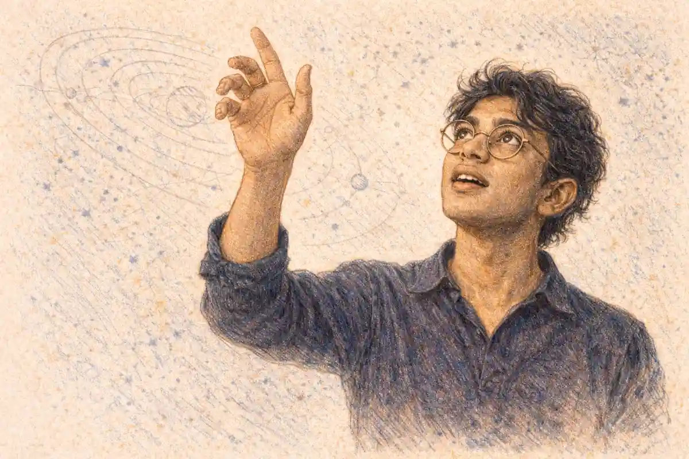

## The Man on Bracken Hill

Bracken Hill rose behind Ostrel in a long, ungenerous slope, its bracken turned the colour of old copper and its stone showing through in grey ribs where the wind had thinned the soil. From the hollow where Idris Kolm sat, with his back to a broken wall and his boots set clear of the wet, he could see the whole of Elka Reske's plot without lifting his head far: the low house with its limewashed gable and soot darkened chimney, the yard beaten hard by feet and rain, the privy and the wood store, and the fence that ran along the lane in a line that had sagged for years and had begun, that week, to stand straighter under fresh paint. Below the hill the town made its ordinary sounds and smells. The mill down by the River Sarn gave off a low, continuous breathing through its vents, flour dust and hot oil and wet stone, and above it the bell tower rose clean against the sky. When the wind came off the river it carried the reek of the dye sheds and the sweet rot of spent grain. When it came off the hill it carried bracken and sheep and cold earth. Kolm had learned both winds by the second day and had stopped remarking on either by the third.

He sat where he was meant to be seen sitting. That was the plain shape of the work as it had been given to him, and he kept to the shape without embellishing it. He had chosen the hollow because a man in it showed his head and shoulders against the wall from the lane, from the house yard, and from the upper windows of the two cottages that faced the hill across the lane. A man who wished to hide would have lain lower, behind the wall, or higher, among the bracken where the colour of his coat would have broken among the stems. Kolm did neither. He sat upright on a folded groundsheet, his pack at his left hand, his water bottle at his right, his notebook closed on his knee, and he let the town get used to the sight of him the way it got used to a new post at a gate or a cart left too long by the mill yard. By the fourth day children had stopped pointing. By the fifth the mill hands on the lane had stopped slowing to look. Being overlooked after being noticed was, in his experience, a kind of cover all its own, and a cheaper one than any attempt at vanishing.

Toma Reske was painting the fence again. He had been painting it, in sections, for as long as Kolm had been on the hill, and he painted in the manner of a man who had done practical work all his life and saw no reason to hurry a job that rewarded patience. He worked from the gate toward the corner by the wood store, perhaps eight feet of fence in a morning when the light held, less when cloud came over the hill and flattened everything to the same grey. He wore an old coat cut down at the sleeves, a cap that had lost its shape, and gloves with the fingers cut away, and he kept the paint pot on a board at his feet so that he would not set it in the dust of the yard. Every few strokes he stepped back, not far, and looked along the line he had done, and then he bent again. The brush made a soft, regular sound against the wood, audible on the hill when the mill vents eased and the lane was empty. Kolm had come to time small parts of his own day by that sound without intending to. When the brushing stopped, Reske had gone in for water, or to speak to his mother through the kitchen door, or to stand in the yard with his hands on his hips looking at the sky as a man does who is deciding whether rain will spoil work already done.

Elka Reske appeared at intervals that had nothing regular in them, which Kolm noted because irregularity in a household was worth noting even when it meant nothing. She came to the door with a basin and threw water across the step. She came with washing and pegged it on the line behind the house with movements that were economical and cross, as if the washing had offended her. She came once with a broom and swept the yard for six minutes by his count and then stood the broom against the wall and went in without looking at the fence her son was painting, or at the hill, or at anything beyond her own ground. She never waved. She never shouted up. If she had seen Kolm, and Kolm assumed everyone in the house had seen him by the end of the first morning, she treated him as she treated the weather on the hill, as a condition to be dressed for and otherwise ignored. He respected that in a private way that formed no part of his report. A household that performed alarm for a watcher gave a watcher very little worth having. A household that went on painting a fence and pegging washing gave him the pattern of itself, day after day, and pattern was what he had been sent to gather.

The detail that watched the house from below worked to a pattern too, and that pattern Kolm knew better than his own, because his own was only sitting, and theirs was movement, and movement could be timed. The standing detail worked its changes to the mill bell, on a rotation anyone patient could time, and he had timed it. At the first bell, when the mill took in its morning shift and the lane filled for ten minutes with men and women carrying dinner tins and then emptied again, the two who had held the lane end through the night walked down toward the river road and the two who relieved them came up from the direction of the mill yard, unhurried, separate, a minute apart. At the midday bell the pair at the gate changed without either pair leaving the yard unwatched, one staying in the doorway of the wood store until the other had taken his place by the gatepost and settled his coat. At the bell that marked the end of the mill afternoon the pattern turned again, and the officer who had spent the day in the upper room of the cottage opposite came down and crossed the lane and spoke, briefly, to the gate, and went on toward the river. None of it was hidden. None of it, so far as Kolm could judge, was meant to be hidden. A standing detail in a mill town could not vanish, and the people running it had chosen regularity over pretence, which told him they were either confident or tired or bound by orders that valued a visible presence. He did not speculate in his notes. He wrote times, and numbers of persons, and who stood where when the bell sounded, and he let the regularity speak in the figures themselves. Anyone reading his pages after a week would see the rotation as plainly as he saw it from the wall. That, he understood, was the point of sending them.

For his own part he kept a discipline that matched theirs without copying it. He arrived on the hill before the first bell by a path that came up from the river side, where the bracken grew thickest and a man could climb without crossing the lane in view of the house. He left after the light had gone enough that his shape against the wall was only a darker patch among other patches, and he left by the same path. He ate cold food at midday and drank water sparingly so that he would not need to move from the hollow for any ordinary reason. He wrote his notes in a hand that stayed the same size from the first line to the last, without hurrying as the light failed. Boredom was the chief hazard of the work, and Kolm treated boredom as he would have treated weather, as something to be prepared for rather than complained about. A bored watcher invented interest, and invented interest became false reporting, and false reporting was the one fault his profession did not forgive twice. So he counted what was there to be counted and wrote what was there to be written, and when there was nothing he wrote that there was nothing, with the time beside it.

He did not know why this household, of all the households in the Barrow States, warranted a standing detail and a watcher above it, and he was careful to keep his ignorance in its proper place, which was outside his pages. He knew Reske by name because the name had been given to him with the task. He knew the house was the mother's and not the son's, because that too had been given to him, and because the yard bore it out in small ways, in whose chair stood by the door and whose tools hung in the store and who decided when the washing went out. He knew the son had come from elsewhere to stay there for a period that had not been named to him. Beyond that his knowledge stopped, cleanly, at the edge of his instructions. Be seen sitting. Watch the house and the detail that watched it. Report the pattern, at the agreed intervals, through the agreed hand, in the agreed form. He had no orders touching the house itself, no business on the lane, no reason to speak to any person in Ostrel beyond the buying of bread and salt at the shop by the mill yard, which he did once every second day, at a varying hour, and paid for without conversation beyond the necessary words. A man who asked questions in a mill town would be remembered longer than a man who sat on a hill, and Kolm had no wish to compete with his own silhouette.

In the late afternoon the light went down the valley in the order it always went, first off the river, then off the mill roof, then off the lane, and last off Bracken Hill, so that Kolm sat for a short while in thin, clear light while the house below was already in shadow. Reske had stopped painting and stood by the gate with the brush wrapped and the pot covered, looking along his work, the white palings bright against the darkening yard. The detail was changing again as the bell prepared to sound, in the order Kolm could have recited in his sleep. He checked it against the times in his notebook and found it exact. Then he closed the book on his knee and waited for the bell itself, not because he needed it, but because a day measured properly should be allowed to end at its proper mark.

## Nine Days

Leyden's office in Carrowmere looked over a yard that never quite dried. Mira stood at the window before he told her to sit, and she took in the room the way she took in any room she was about to be tasked in, by its surfaces first: the smell of damp paper and lamp oil, the stove ticking as it cooled in the corner, rain still beading on the glass from a shower that had passed while she climbed the stairs, and below, in the yard, a cart shedding water off its canvas in slow, irregular drips onto stone that had been worn smooth by generations of wheels. The desk between them held one file, bound in grey board, with no loose sheets on either side of it. That told her more about the morning than Leyden's face did. When there was one file and nothing else, the work had already been decided in its outline, and what remained was for her to be given it cleanly.

Leyden gave her the cost before he gave her the place, and she noted the order and was grateful for it, because men who named the pleasant parts first and the limit afterward were usually selling something to their own officer. The Office could not hold a detail for more than nine days. He said it plainly, looking at her and not at the file. Nine days of a standing detail, properly staffed, properly relieved, properly covered in a town that would notice strangers inside a day, was the most the Office could sustain without stripping two other commitments bare. The hearing that mattered sat in twelve days. Between the ninth day and the twelfth there was a gap of three days that the Office could not cover, and no rearrangement of rosters would close it. If she took the detail, she took it knowing the end of her part was fixed before she began, and knowing that whatever state the file and the man were in on the ninth day was the state in which she would hand both over.

The handover, Leyden said, had a name and a face and was not a hope. Captain Ivo Senn of the Barrow witness service would take days ten to twelve, with his own people, at a handover on day nine, if the file was clean. Clean meant, in Leyden's use of the word, that every movement was accounted for, every contact recorded, every gap in coverage admitted on paper rather than smoothed over in speech, and the witness himself willing to go on into another service's keeping without a break in his cooperation. Senn had agreed to the terms. He had not agreed to inherit a mess, or a frightened man with an undocumented week behind him, or a detail that had hidden its own failures to look competent at the transfer. Mira understood the condition for what it was. It was fair, and it was also a test she would be sitting for nine days without being told the questions in advance. She said she understood, and Leyden opened the file at last and turned it so that she could read the first page without leaning across the desk.

The man was Toma Reske, a bonded inspector in the Barrow States, in his middle fifties, a career spent checking seals and papers and loads along the chain routes until the work had put him in a position to see what others had signed past. He had testified against the bonded chain before an inquiry panel, in a room with a clerk and a record, and what he had said there had been enough to bring a substantive hearing into being. That hearing would sit in Vessmark in twelve days, and Reske was expected to stand up in it and say again, on a fuller record and under harder questioning, what he had already said once. A man who had testified once could be expected, by people who wished him silent, to be easier to move before the second occasion than after it. Leyden let her read the summary twice. The chain Reske had testified against was the same chain [taken apart at the Teshkar depot](/2026/11/03/nightjar-bonded-cargo-004/), one organisation wearing three sets of papers. Mira let that settle where it belonged, in the part of her mind that kept old work filed beside new, and she did not let it colour the page in front of her beyond the weight it deserved. One organisation, patient enough to wear three faces, would be patient about a witness too.

Reske was not in service housing, and he was not in Vessmark under guard, and he was not, so far as the Barrow service could persuade him, going to be either. He had gone to his mother's house in Ostrel and had said he would stay there until he was required to travel, and his mother, Elka Reske, old and rooted in that house in the way of a person for whom a place was not an address but a continuation of her own body, had refused service housing for herself with a completeness that closed the subject. The son would not leave her. The service would not take him from her by force and make an enemy of its own witness in the taking. So the detail would go to Ostrel, to a low house on a lane below Bracken Hill, in a mill town on the River Sarn with one bridge that mattered and one bell that ordered the working day, and it would sit there in the open, because a standing detail in such a place could be many things but it could not be invisible. Mira read the particulars of the house and the yard and the fence her charge was apparently repainting, a detail so ordinary it steadied her. Men determined to live as if their lives were still their own repainted fences, and the distinction mattered for how a detail should behave around them.

On day eight, Leyden said, and he turned a page and put one finger on a line in the clerk's schedule so that there could be no softness about it, Reske must travel to Vessmark to lodge the signed copy of his testimony with the hearing clerk. It was a procedural step and it was not optional and it could not be done by post or by deputy or a day early to suit the convenience of a protection detail. The clerk would receive the signed copy from the witness's own hand, on day eight, in the hearing town, and enter it, and only then would the hearing on day twelve have its foundation firm under it. If the copy was not lodged, the panel could be asked to proceed on the inquiry record alone, and the inquiry record, Leyden said, in the dry tone he kept for facts that needed no emphasis, was the weaker document. So the detail was not a matter of keeping a man inside a house for nine days. It was a matter of keeping him whole and willing at the house for seven days, moving him along the Ostrel road on the eighth, seeing the lodging done, and giving him to Senn on the ninth in a condition to be believed on the twelfth. The road, she said. Leyden agreed that the road was part of it, and he did not pretend the house was the whole of it, and she marked that down too in the private account she kept of him.

Then he told her where Ostrel was, although he must have known that she knew. Nine miles from Tarnwick. He said it without emphasis and watched what she did with it, and Mira kept her face in the order she had learned to keep it in that office, and felt the name go through her all the same, in the way a draught finds the gap under a door no matter how well the door is hung. She had grown up in Tarnwick. She had left it for the customs posts and then for the Office, and she had worked in Valtessa and Carrowmere and places whose names meant nothing to her beyond their files, and she had not worked her home region, not once, not on any task, in all the years since. That had not been a rule anyone had read out to her. It had been an accumulation of other people's good sense and her own silence when rosters were drawn. Now Leyden was ending it with a sentence about mileage, because the witness was in Ostrel and Ostrel was where the detail had to be, and an officer's childhood was not, in the Office's accounting, a reason to leave a hearing uncovered. She asked whether the fact was in the file. He said it would be, in one line, under her name, because a fact left out of a file had a way of being supplied later by someone who meant harm with it. She agreed with the reasoning and disliked it in equal measure.

She asked the questions a tasking was for. Strength, first, and he gave her names and numbers without padding them. Rask would go with her, and his presence settled one class of problem and raised none that she minded. Reni Vosk would go too, junior and earnest and still carrying, as Mira carried it herself, the shape of a night in the last task when a young officer had held a position alone for nineteen minutes that should never have been left unsupported. Mira did not raise that night. She registered that Leyden had put Reni under her hand again, and that he had done it deliberately, and that the deliberateness was its own instruction about how the girl was to be used and not used. Reliefs would be drawn from a small pool and named in an annex she would receive before she travelled. Authority on the ground was hers inside the tasking's terms. If Reske bolted, she was to follow and report, not to lay hands on a witness and make the Office the villain of its own hearing. If the Barrow service pressed for earlier custody, she was to refer the request upward and give up nothing on her own word.

Leyden closed the file and slid it across the desk to her side, where it would remain hers until the handover made it Senn's. Nine days, he said again, as if a number repeated at the end of a tasking became a kind of railing she could hold on the stairs down. She stood with the file under her arm and looked once more at the yard below the window, where the cart had gone and the wet stone was drying in patches. Ahead of her lay a road she had not travelled in years, in the direction of a town nine miles short of the town that had made her, and a man painting a fence in his mother's yard who had twelve days to survive as a witness and only nine of them in her keeping. She thanked Leyden for the plainness of the cost, which was a thing she meant, and she went out with the file held close against her coat, so that the rain still hanging in the stairwell air would not spot the board.

## The House, the Hill, the Kitchen

Ostrel smelled of wet stone and mill dust before Mira saw the house, and the smell stayed with her up the lane from the lower road where the cart had set her down with her bag and Rask's long case and the sealed packet from the Office that held the detail orders in duplicate. The morning had come in low over the River Sarn, the water the colour of slate under a sky that had not yet decided to clear, and the sound of the mill wheel reached her through the ground as much as through the air, a steady turning that set a pulse under the cobbles and under the soles of her boots and under the loose boards of the fences she passed. She walked slowly on purpose, and let the lane learn her at walking pace. The houses here stood close to their fences, stone below and timber above, and the smoke from the morning fires lay flat in the damp air and mixed with the sour smell of the dye shed and the clean smell of cut grass left wet from the night before. She counted without seeming to count. Two gates that stuck. One yard dog that watched and did not bark. A cart rut at the bend deep enough to hold water after rain, and the water in it still, reflecting the grey of the sky.

Elka Reske's house stood where the lane turned toward the upper path, set back no farther than any other, distinguished only by a fence in the middle of being mended and by the man on his knees beside it with a brush in his hand. The house itself was stone, two storeys, with a slate roof that had been patched in three places with slates of a slightly different blue, and a kitchen window that faced the lane through a square of garden where beans climbed on string and a row of late greens stood in dark earth. The front door opened under a shallow porch where boots stood in a line so exact that Mira read habit in it before she read welcome. Behind the house the ground rose in a long swell toward Bracken Hill, bracken and coarse grass and scattered stone, with a single track that showed pale where feet and cart wheels had worn it, and above the hill the sky opened wider and paler, so that anyone placed on that height would see the lane, the yard, the porch and the garden without effort and without needing to move. She took that in as she took in the rest, as part of the street and part of the problem, and she did not look at the hill for longer than she looked at any roof or gate along the way.

Toma Reske saw her when she was still ten paces off and stood up from the fence with the brush held clear of his trousers, paint on his fingers and a smear of it along the back of one wrist where he had steadied himself against a rail. He was a broad man in his middle fifties, weather at the cheeks and tiredness at the eyes, his hair cut short and grey at the sides. He did not offer the painted hand. He lifted the brush instead in a small gesture that served as greeting and apology together, and said that if she was the Office she had come to the wrong end of the work, because the fence would not wait for hearings and neither would the weather. Then Elka Reske came to the porch door with a cloth in her hands and looked at her over her son's shoulder, assessing a guest, a burden and a possible nuisance in a single pass, and reserving her judgment on all three.

The fence mattered, and Mira let it matter in the open where anyone watching could see it matter only as a fence. Reske had taken it in sections. The rails nearest the gate had been scraped clean and stood pale and bare, the middle length carried a first coat that had dried to a flat grey white, and the far length waited untouched, silvered with age, its lichen undisturbed and its nails rusted dark at the heads. He worked one rail at a time, the brush loaded sparingly and drawn long, and she understood at once that the fence was not a pastime and was not a performance for the hill. It was the reason he gave the street for being in the open for hours each day, and it was also, quite separately, a fence his mother had asked him to paint before the winter, and he had promised, and the promise held him in the yard in full view of the lane and the hill for the best part of every daylight hour. A man who wanted to hide would not have chosen it. That distinction sat at the centre of the detail, and she set it down in her mind in plain words before she went inside, because everything the Office did here would have to reckon with a protected man whose ordinary life placed him in the open, paint in hand, and who would resist being moved indoors as a point of honour as much as a point of habit.

Inside, the house arranged itself around the kitchen, as houses of its sort did in the mill towns, and the kitchen held the heat of the range and the smell of strong tea and stored apples and the faint iron smell of well water in a pail by the sink. Elka Reske received the detail the way she received weather, without enthusiasm and without waste, and she made clear within the first half hour, courteously and without raising her voice, the terms on which the house would run while strangers slept under its roof. The detail would not bring clerks or messengers to the door after dark. The detail would not ask her to take a room in a lodging house kept by the witness service in Vessmark or anywhere else, because this was her house and she had lived in it since she was a bride and she intended to die in it, and no inquiry and no hearing and no chain of bonded merchants would arrange her leaving for her. Reske listened to all of this with the expression of a man who had heard it stated to officials before and had learned that agreement spoken too quickly only started the statement again from the beginning, and when his mother had finished he said only that the house had been made clear, which it had. Mira accepted the terms without negotiation. A detail that fought its own house spent strength it needed for the lane and the hill and the road, and besides, the old woman's refusal was itself a fact of the ground, as fixed as the bridge or the bell, and the plan would be built around it rather than against it.

Rask arrived by the upper path in the early afternoon with his case on his back and his coat still buttoned against a wind that had dropped an hour before, and he greeted Elka Reske by name and asked after the draught under her kitchen door before he asked after her son, which earned him the first unguarded look the house had given any of them. He stowed his case in the back room that had been cleared for the detail, a narrow room off the kitchen with a window onto the yard and a door that latched, and he walked the house the way he walked any ground he was expected to hold, slowly and once only, noting doors and sightlines and the thickness of walls without touching anything that was not his to touch and without comment until he came back to the kitchen table. There he set out, in order, the small apparatus of a standing watch: a slate for counts, a stub of chalk, a watch that he laid face up beside his cup and did not wind for show, and a folded sheet on which he had already drawn the lane and the hill track in his spare and ugly hand. He was a dry man to work beside and a restful one, because he said what he had seen and stopped, and Mira had learned to trust the stopping as much as the seeing. The house, which had braced itself for official fuss, settled a fraction around him and went on with its day.

Reni Vosk came down from the mill lodging house toward evening, carrying her kit in a canvas roll and a written chit from Leyden that she handed to Mira before she greeted anyone else. She was twenty one, straight in the shoulders and exact in the small courtesies, and she believed wholly that the Accord charter described the world as it ought to be and very nearly as it was, and Mira felt the old fact move between them as it always did and did not name it: nineteen minutes in a previous week when Reni had held a field position alone and unsupported while support was elsewhere, nineteen minutes Mira had told her of plainly afterwards because a plain account owed quickly was better than a smooth one owed late. Reni had taken the account without flinching and had not forgiven it by forgetting it, which Mira respected, and which made briefing her a careful business rather than a comfortable one. She placed her where the work was real and the support was close enough to be a promise kept this time: the garden end of the yard in the mornings, with the lane and the gate in view; the back room window in the afternoons, with the hill track and the upper path in view; and the porch in the last light, when the fence work ended and Reske came in, with the whole front of the house to watch while he crossed it. The orders were three, and Mira gave them in three plain sentences and made her repeat them back without paraphrase. Watch, and say what was seen and nothing that was guessed. Count, and write the count on the slate whether it seemed to matter or not, carts and walkers and riders and boats on the reach of river below the mill, at the hour they passed and in the direction they took. Report, at the set times and at once if the pattern broke, to Mira or to Rask and to no one else, and if neither could be found, to keep watching and to write it all the fuller. Reni repeated the words exactly, then asked, with the directness that was her best quality and her chief risk, whether she was being placed where she could be seen to be placed, as a sign to the hill that the house was held. Mira told her yes, in part, and that the other part was that the counts had to be true counts taken by an officer whose attention did not wander, and that she would be spelled on the hour by the bell and never left past it. The bell, Reni said, and glanced toward the mill as its note came over the roofs for the shift change, flat and unmusical and impossible to ignore, and Mira said yes, by the bell, because everything in Ostrel ran by it and a detail that ran by any other clock would show itself in a day.

That night, when Elka Reske had gone up to her room and her son had gone after her with the lamp trimmed and the back door barred in the order she insisted on, the detail sat at the kitchen table with the slate wiped clean between them and did the work that a standing detail exists to do, which was to hold the possibilities open in their proper order and to refuse, for as long as the evidence allowed refusal, the comfort of settling on one. Mira set them out as Leyden had set them out to her and as the papers supported them, and Rask, who distrusted any list that ended neatly, made her argue each one as if it were the only one on the table before he let her pass to the next.

The first possibility was that the bonded chain wanted Reske dead before he testified. The chain stood to lose its bonded standing, its contracts in three towns and its credit with the river factors if Reske's testimony was heard in full and believed, and men who faced ruin of that size had, in the history of the mill towns, paid for worse than a killing and called it a cost of trade. A dead witness could not be cross examined and could not be believed. Against that reading stood the openness of everything they had seen so far, a watcher placed where a watcher could be seen and a purchase trail that had surfaced within days, but openness could be arrogance as easily as it could be design, and a chain that had operated for years under inspection might well have learned to be careless in the way of men who had never yet been stopped. Mira kept the possibility at full weight. The detail would be run, in its visible shape, as if a killing at the house or near it were the intended stroke, because a detail that discounted the lethal reading and was wrong had no second chance to correct its error.

The second possibility was that the chain wanted Reske frightened into silence, taken or scared off, not killed. This, Rask observed, was the reading that fitted the economics of the thing most closely, because a frightened witness was worth more to the chain than a dead one in every way except certainty. A dead inspector made an inquiry angry and made martyrs in the trade papers, and the hearing panel, deprived of its witness by violence, might draw the very conclusions the chain most feared and draw them with feeling. A witness who withdrew, or who failed to appear, or who appeared and softened his account under no visible pressure that anyone could prove, cost the panel its certainty and cost Reske his standing, and left the chain free to say that the man had exaggerated for advancement and had thought better of it. Fright could be applied in degrees, and each degree could be denied, and the mill towns understood fright as a language: a word in a kitchen, a watcher on a hill, a cart delayed on a road until its driver understood that it could have been stopped for longer. Mira kept this possibility at full weight beside the first, because the two demanded different watches: the first demanded a guard on the man's life at every hour, and the second demanded a guard on his resolve and on his mother's peace, which were slower targets and harder to stand over with a slate and a count.

The third possibility was that Reske's own service wanted him discredited. Rask stated it without relish and Mira made him state it fully, because a possibility involving the Barrow witness service touched the handover on which the whole tasking rested, and a detail that flinched from naming it would plan the handover blind. The Barrow service had cleared the chain's papers for years, stamp after stamp, inspector after inspector, and Reske's testimony, heard in full, would embarrass that service in public and in detail: not merely that bonded goods had moved on false weights and false seals, but that the officers charged with catching exactly that movement had signed for it season after season. A service so embarrassed might protect its witness with great ceremony and still wish him smaller, might arrange small failures around him, a message mislaid or a lodging altered or a rumour started in the hearing town that the man drank or owed money or had quarrelled with his own account, so that when he stood up in Vessmark he stood up already diminished in the minds of the panel. Under this reading the danger to the detail was of a different texture entirely, because it would come dressed as cooperation, and the leak, if leak there was, would sit inside the very channel through which movements and dates had to pass. Mira kept this possibility at full weight beside the other two, and the practical consequence entered the table at once: the detail would share with the witness service what the service needed to hold its part of the ground, and it would share nothing about its own rotations, its counts or its reasoning that the service did not need, and every paper that passed between Ostrel and Vessmark would be copied before it passed, and the copies kept in the back room in Rask's ugly hand and hers.

Having held the three open, they turned to what could be checked, and the first checkable thing was paper. Dunmore's packet from the Carrowmere desk had come down with the morning rider, three sheets in her close analyst's hand with a fourth sheet folded inside them that was a copy of a dealer's day book entry, and Dunmore, who found inconsistencies in paperwork the way other officers found tracks in mud, had marked the packet with her usual economy, a line under the entry and a single sentence in the margin to say that the sale was recorded in full and in order and that the name was to be confirmed against the dealer's counter book before anyone relied on it. The outline was plain and Mira read it aloud so that Rask and Reni held the same facts in the same words. A long rifle, of the sort used for hill shooting over distance, had been sold in Tarnwick, three towns over in the reckoning of the river road and nine miles from the house where Mira sat reading, which was to say in the town where she had grown up. The buyer had signed openly at the counter, in daylight, in the dealer's own book, with a name written out in full and an address given in the town below the hill farms, and the dealer had taken the money and entered the sale in the day book on the day it was made, with no attempt at a mark instead of a signature and no intermediary named. Mira set the sheet down and did not speculate on it at the table. A name unconfirmed was a door not yet opened, and she noted only what the outline established for the watch, that a long rifle existed within nine miles of the house, that its purchase had left paper, and that whoever had bought it had either not cared who knew or had cared very much that someone should know.

The second checkable thing sat on Bracken Hill and could be seen from the back room window if the light was right and the watcher chose, as he consistently chose, the same ground. On the second morning Reni's counts gave them the shape of him, and the shape was professional in the unshowy way that told Mira more than any flourish could have done. He took his position in the half light before the first mill bell, on the shoulder of the hill where the track bent around a stand of wind bent thorn, in a shallow scrape that broke his outline against the bracken without hiding him from a glass or from a patient eye, with the lane, the porch, the garden and the fence all below him in a single field of view. He stayed through the morning watch and the midday watch and he left after the last fence work ended and the lamps came on in the kitchen, descending by the far side of the hill so that his going did not cross the upper path, and he returned by the same far side before light the next day, and the counts for three days agreed in their times to within the chime of the bell that marked them. He did not approach the house. He did not signal that any of them saw, and he did not shift his ground for any movement in the yard. He watched, and the watching was the whole of his behaviour, steady and unhurried and without the restlessness of a man waiting for a signal hour. Mira read the pattern as the counts gave it and no further: a position well chosen and openly held, hours kept as regularly as a mill shift, no advance and no withdrawal. What the position was for belonged to a question still open, and she logged it as open, with the times and the ground and the track all recorded, and she forbade Reni the word sniper and Rask, who had not used it, the ghost of a smile that suggested he had thought it.

On the third day, while Reni held the house with Rask in the back room and the fence work paused for Elka's midday meal, Mira walked the road to Vessmark as a survey rather than as a journey, with a basket on her arm and a reason for every stop that the road itself supplied. The road left Ostrel by the mill yard, crossed the lower meadow on a causeway of packed stone where the river spread wide and shallow over gravel in the dry weeks, and climbed then in long traverses through farmland and coppice toward the hearing town, nine miles by the milestone count and longer by the legs on the uphill stretches, with a single place where the whole length of it narrowed to the width of one cart and a pedestrian pressed to the parapet. That place was the mill bridge over the River Sarn, where the river ran fast and dark under a stone arch, and the road crossed it between low parapets on a deck of setts worn smooth at the centre. At the near end stood the bridge gate, a heavy timber frame hung between stone posts, kept for the closing of the road in flood and for the counting of carts on fair days, with a chain that ran from the gate leaf to a staple in the far post and a pin that held the chain at working length, the iron old and sound and bright at the links where hands lifted it daily. Beyond the gate the road rose again past a quarry shed of stone and iron, and then opened to fields again, so that the bridge stood alone as the one narrow place on the whole route, the one length where a cart could neither turn nor pass another cart nor leave the deck except by the water. Mira walked it twice, once in each direction, timed the crossing at a cart's pace in her head against the bell she could still hear faintly from Ostrel, noted the gate and its chain and the shed and the sightlines from both banks, and came home by the lower meadow with her basket full of nothing more remarkable than bread and salt, and her survey complete in the plain form the Office required: distances, widths, surfaces, and the single sentence at the foot of the sheet that said the bridge was the road's only true constraint.

The Stilling demonstration happened because Mira asked for it in plain terms and because Rask, who disliked explanations that floated free of experience, agreed that a detail which might one day stand inside his suppression ought to have felt its edges on quiet ground first. They used the yard in the last hour before supper, with Elka Reske shelling peas on the porch in full view of the proceeding and Reske at the fence with his brush washed and resting, and Rask stood at the centre of the yard by the water butt and told Mira to walk her usual slow circuit of the fence line and to read, lightly and briefly, the objects her hand passed near, the gate latch and the butt rim and the handle of the yard broom, each of which held some faint accumulation of daily handling. She began the circuit reading as she ordinarily read, and at his word, given without gesture, the yard changed. The change had no drama in it and that was its character: the faint impressions thinned together, evenly, all at once, as if a clear light that had shown small colours in the objects had been covered by thin cloud, so that the colours were still present in some sense and yet no longer available to be distinguished. As she walked away from him toward the far rail the effect lessened by degrees she could measure in her own steps, and as she walked back toward him it gathered again, and at no point was there doubt about where it came from. It was centred on the man standing by the water butt. It was sourced, and it had a slope, and it pressed on his own side of the work as much as on hers, for he told her afterwards, in the kitchen and for the record of the slate, that inside his own Stilling he worked as blind as anyone, and that holding it cost him in breath and in patience and could not be held for ever. She set the experience down in the words he used, because they were exact: even, sourced, and thinning with distance. A Weigher inside it read faintly or not at all, and knew why, and knew whose work it was.

One paper admitted no argument, and its settling became the fixed point around which the nine days would have to turn. Reske's testimony existed in two forms, the spoken account he would give in Vessmark on the twelfth day and the signed copy that the hearing required to be lodged with the hearing clerk in advance, in person, by the witness himself, under a rule of the panel that no clerk would waive and no service could perform on his behalf. The lodging had been fixed with the hearing clerk for the eighth day of the detail, neither earlier nor later, the clerk's office having given that day in writing in answer to Dunmore's enquiry and confirmed it in a second paper that arrived by rider and was read aloud at the kitchen table so that Reske, his mother and the detail all held the same date in the same words. On the eighth day, therefore, Reske would travel the Ostrel road to Vessmark, cross the mill bridge over the Sarn in the course of that journey, lodge the signed copy at the clerk's office, and either lodge in the hearing town under escort or return by the same road before dark, as the clerk's business and the light allowed. The journey was procedural, ordinary and unavoidable, and precisely because it was ordinary it had been named in papers that had passed through more hands than Mira liked to count, the clerk's office, the witness service and the Office among them. She copied the confirmation into the detail book herself and had Rask witness the copy, and then she and Rask and Reni built the table that evening at the kitchen table, arguing each cell aloud until Elka Reske, who listened while she mended a shirt by the range, pronounced it a fair account of a week in her house and went back to her stitching.

The table settled, day by day, where Reske stood exposed at the house, where he stood exposed on the road, what the hearing required of him, and whose hands held the cover for each of the nine days.

| Day | House | Road | Hearing | Cover |
|---|---|---|---|---|
| One | Arrival in lane | No travel | Papers received | Mira and Rask |
| Two | Fence work in open | No travel | Clerk confirms date | Mira and Reni |
| Three | Fence work in open | Survey on foot | No sitting | Rask and Reni |
| Four | Yard and garden | Mill yard errand | Papers copied | Mira and Rask |
| Five | Fence work in open | No travel | Copy sealed | Mira and Reni |
| Six | Yard and porch | No travel | No sitting | Rask and Reni |
| Seven | Fence last section | No travel | Lodging confirmed | Mira and Rask |
| Eight | Departure at bell | Lodging journey to Vessmark | Signed copy lodged | Mira and Rask |
| Nine | Handover at house | Escort stands down | File passed clean | Senn's service |

On the fourth afternoon, with the first coat dry on the middle length of the fence and Reske working the far length in a light that made the wet paint shine almost black before it dulled, Mira allowed herself the single light read of the settling days, and she chose the fence itself because her hand was already near it, carrying a mug out to the man who would not stop work for tea. She touched the top rail where his brush had passed an hour before, expecting nothing more than the faint residue of repetition, a man's patient intent laid down pass after pass along the grain, and for a breath that was all she found, the calm accumulation of work done carefully and meant to last. Under it, older and much fainter, the rail gave her a flicker that was not Reske's at all and not a stranger's either, but her own: a child's hand at rail height in a yard in Tarnwick nine miles away, the smell of paint on a summer gate and a voice calling a name she had not answered to in years, gone before she could hold it and taking a thin slice of the afternoon's steadiness with it. The cost was small and she paid it without remark, a moment of cold in her fingers in the warm yard and a childhood afternoon returned unasked that would sit behind her eyes for two nights to come in one form or another, and she noted the payment privately for what it warned her of, that this ground was her ground in a way no other detail ground had been, and that reading here would never be a clean transaction. She set the mug down on the post, told Reske the tea would cold if the rail did not, and went in to write up the counts with her hand steady.

By the sixth day the detail had a pattern, and the pattern was good enough that Mira distrusted its smoothness and checked it the harder for that. Reske painted in the mornings and again in the last light, with his mother's meal at midday taken indoors and his tools washed at the butt in the yard where a watcher could see industry and nothing else. Reni held the garden and the window and the porch in her turns, her slate filling with counts that had begun to repeat in the reassuring way of counts that described an ordinary street, the baker's boy at his hour and the river carts at theirs and the watcher on his hill at his. Rask held the back room and the night hours in the chair by the kitchen door that did not quite let a sitter sleep, and Mira held the joins between them all, spelling each officer and being spelled in turn. The frame itself ran by the mill bell, because Ostrel ran by it and any other frame would have shown: the bell marked the shift change and the meal hours and the opening and closing of the mill yard, and the detail worked its changes to that note, Reni stepping out as it sounded and Rask taking the window as it faded, the rotations as regular and as audible in their effect as the mill work itself. On the hill, in his scrape above the thorn stand, the watcher kept the same hours and the same stillness, and Mira, writing up the third set of agreed times by lamplight with Rask reading over her shoulder, understood with a clarity she logged in a single line that the regularity cut in both directions, that a pattern plain enough to reassure a street was plain enough to be learned by anyone patient enough to sit above it with a slate of his own, and that the man on Bracken Hill, who had shown patience in every count they had taken of him, had in all likelihood timed the rotation to the bell as exactly as she had, and was keeping it. She left the pattern standing, because the days remaining at the house were few and a pattern broken without cause taught a watcher that it had been read, and she entered the times once more in the book, the bell, the changes, the counts, the fence another length whiter against the lane, and the detail settled for the night in a house that, for the moment, believed itself watched over and was, in every particular except the one that mattered most, correct.

## A Rifle Bought in Daylight

The message from Dunmore came folded inside the morning paper packet, and Mira read it standing in Elka Reske's yard with the smell of wet limewash sharp in the air and the river damp coming up from the bottom of the lane. The fence Reske was painting ran pale and uneven along the front of the house, one section bright where the brush had passed and the next still grey with weather, and the sound the brush made was a soft drag, pause, drag, regular as breathing. Behind the house the Ostrel ground rose toward Bracken Hill, the grass flattened by wind and by a path worn where no path should have been needed, and the light that morning lay thin over the mill roofs and the wet stone of the lane. She opened the packet away from the fence, with her back to the hill, out of habit more than caution, and read Dunmore's hand in short lines that carried no ornament at all.

The rifle had been sold in Tarnwick. It had been sold openly, at the counter of a dealer whose shop stood on a main street, in daylight, with the book open on the wood and the entry made in ink that had not been hurried. The buyer had given his own name, his real name, and had signed for it in that name. Idris Kolm. The dealer remembered him because there had been nothing to forget, Dunmore wrote. No covered face, no borrowed errand, no second man waiting outside with a cart turned the wrong way. Kolm had asked about the weight of the piece in his hands, had paid the sum the book required, had taken the receipt that the rules required, and had left by the front door while the shop bell was still settling. The entry sat where anyone who asked properly could find it. Dunmore had asked properly, through the Carrowmere desk, and the answer had come back clean and complete and ruinous to the shape Mira had been holding for days.

She read the lines a second time, slower, and felt the false shape loosen. A man who meant to kill from a hill above a house did not sign his name in a dealer's book in the town where the detail could read it. A man who meant to kill and be gone did not buy in daylight under a name that tied him to the hill, to the seat worn into the grass, to every hour he had sat in view of the house. She folded the packet along its crease and put it inside her coat, and she stood for a moment looking at Reske's brush moving along the fence, and she understood that the work in front of her had changed, not softened, changed, and that every hour spent watching the house in the way she had been watching it had been spent in the direction the purchase had intended.

Reske did not look up. He had learned the detail's habits the way a man learns weather in a place where he works outside, glancing when a change came and otherwise letting it pass around him. Elka was inside, moving between stove and table, and the kitchen window gave out warm air and the smell of boiled roots and clean ash. A detail fixed on a house learns the house until the house becomes the whole map, and that, Mira thought, had been the point of the rifle and the man on the hill, to make the map small and keep it small while the real ground waited elsewhere.

She did not go straight to the hill. She sent a short acknowledgement from the message point at the lane end, receipt and hour only, because paper that travelled could be read by the wrong hands and because she wanted the hill read before she wrote anything that sounded like a finding. Rask was at the lower post, where the lane bent behind a stand of alders and a second figure would not show against the sky. She told him in few words what the packet said. He listened with his hands in his coat pockets and his face turned a little away, the way he listened when he did not want his expression to do any of the work.

He said the name aloud once, Kolm, testing whether it sat differently in the air than on paper. Then he said a signature was a kind of confidence, pointing either to a man too careless to matter or to a man whose work did not need the purchase hidden. Mira said she intended to read the hill. Rask asked whether she wanted him near. She said no, near enough to see her go up and come down, not near enough to put his own field over the ground first, because his suppression, even held loosely, would thin what lay there and she needed the hill exactly as Kolm had left it.

The climb was not steep, but it was exposed, and she felt that exposure in a practical way as she took the worn path at an angle, keeping below the crest until the last stretch. The wind off the Sarn carried the smell of wet wool from the mill yards and the faint iron smell of the river below the bridge, and gulls from the lower fields cut across the hill face making no sound she could hear over the grass. Her boots found the places where Kolm's boots had found theirs, a run of small compressions in the turf, a stone turned pale side up, a place where a heel had dug in to brace a turn. By the time she reached the seat itself she already knew part of what the ground would tell her, not from weight but from plain sight, and she made herself set plain sight aside and attend only to what remained when she stood still.

The position was a shallow scoop behind a low outcrop, sheltered from the worst of the wind and open to the house and the lane and the yard in a clean line. A man sitting there could see the fence, the front door, the kitchen window when the curtain moved, the message point, the lower post if he knew where to look for the gap in the alders. He could count changes of the watch. He could time them against the mill bell, as he had timed them, shift by shift, because the detail, following its own good order, had kept the bell hours with a fidelity that anyone patient could learn in two days and confirm in three. Mira lowered herself into the scoop with care, not sitting yet, one knee on the cold ground, one hand flat on the stone beside the seat, and she let the place come to her in the way places did when she stopped arranging them in her mind.

Weight lay there in a long, low band. It was not sharp. It did not spike or tear. It spread, layer under layer, the same affect laid down again and again until the repetition itself had become the record. Boredom, first and most of all, the particular flat ache of a man whose task was to remain. Hours of it, days of it, the mind going over the same fence, the same door, the same bell, the same figures moving in their order and moving again. Under the boredom sat patience that had been trained rather than felt, a professional patience, the kind that checks a sight line and then deliberately looks at nothing for a while to rest the eyes. She found the small, repeated attentions where he had noted a change below, a tightening that was interest and nothing warmer, the brief focus of a man writing a pattern down in his head so he could carry it off the hill exact. She found the cold he had sat through without resentment. She found hunger put aside and picked up again. She found the faint irritation of a seat that never quite fitted the body.

She searched, because the case required her to search and because Dunmore's lines required her to be certain, for anything else. For intent gathered toward a shot. For the held, narrowing concentration that violence leaves in a place where it has been rehearsed even if it has never been performed. For hatred of the man at the fence. For fear of being seen. She found none of it. The hill held a man paid to sit and be seen and to report the detail's pattern, and the being seen was not an accident of carelessness but a layer in the record itself, a settled awareness in the seat and in the path that other eyes were on him and that this too was part of the task. He had not hidden his comings. He had not varied his hours to defeat observation. He had made his presence legible the way the rifle purchase had been made legible, name in a book, figure on a hill, both offered to anyone who cared to look, both fixing the looker in place.

The cost came while she was still kneeling. The hill did not only hold Kolm. Ostrel ground held older things under newer ones, and nine miles was no distance at all to ground that shared the same river and the same mill stone and the same wind. As the watcher's boredom settled into her shoulders, the older layer rose underneath it, and she was fifteen again for a breath and then younger, coming over a hill like this one above Tarnwick with wet shoes and a message she was proud to carry, hearing a mill bell and thinking the sound belonged to her town alone. She got her own childhood back off that hillside whether she wanted it or not, the cold of a winter lane in her knees, the smell of a kitchen that was not Elka's kitchen and yet rhymed with it so closely that her throat tightened, a voice calling a name that was hers before the Office gave her another one. Weight does not replay a scene, and it did not replay hers. It gave her the affect, the intensity left in ground she had crossed as a girl, and made her carry a portion of it as her own, the homesick ache and the tiredness of a child who had walked too far in damp boots. She stayed kneeling until the wave thinned, one hand pressed into stone that held the cold best. When she stood, her knee answered late, a cost in the body that was not a wound, only a debt the reading had taken.

She came down by a different line, out of the worn path, because she did not want to lay her own passage over Kolm's record more than she already had. Rask fell in beside her at the lane bend, keeping the house between them and the hill, and asked only whether the hill had held a killer. Mira said it had held a watcher. She said it had held repetition and boredom and a man doing exactly the work he had been paid for, to sit where he could be seen and to learn the detail by heart. There was no killing intent in the position, none in the seat, none in the path, none laid down in rehearsal or in waiting. The absence of it was not a gap. It was a finding as solid as presence would have been, because the hill held so much else in such density that a missing layer could be trusted. Stone and turf had kept his days faithfully. They would have kept a darker intention just as faithfully, and they had not.

Rask walked a few paces without answering. Then he said a decoy who knew his work was worth more than a gunman, because a gunman only had to be right once and a decoy had to be believed every day. He asked whether Kolm knew what he was decoying for. Mira said the hill did not tell her that, and weight would not, because weight records what a place has absorbed, not the contents of a man's instructions. Kolm might know the whole shape, or only that his pattern reports were wanted and being seen was part of the wage. Either way the effect was the same, and she set that question aside as open and not urgent, because the urgent question was standing in a kitchen behind her, not saying what it knew.

She had put off the kitchen for days, and she examined that plain fact without softening it. Reske had consented to the detail, to the posts, to the presence of strangers at the edges of his yard. He had not consented, in any words spoken to her, to having his mother's kitchen read for what it held. Yet the case had pointed at that room from the first survey, the room where a threat delivered in person would do the most work, because Elka would hear it too. Mira had told herself she was waiting for a cleaner warrant. With Kolm's boredom still in her shoulders, she admitted the cleaner warrant was not coming, and that a signature in a dealer's book had removed the last reason to guard against a shot that was never going to be fired from that hill.

She asked Reske at the fence, plainly, with Elka within hearing at the open door, because a request made around the mother rather than to her would have been its own error. She said the Office needed to know what the kitchen held, that reading it would tell her what had been felt there and for how long, that it would not give her words spoken or a face or a name, and that she would report only what bore on his safety and the hearing. Reske held his brush suspended, a bead of paint gathering at the tip, and for a moment she thought he would refuse, and that the refusal would itself be an answer. Elka spoke first. The room was hers, she said, and if the girl wanted to stand in it she could stand in it, and standing in a kitchen had never yet hurt a kitchen. She said it as a woman settles a question of hospitality, not of state, and Reske, hearing his mother settle it, lowered the brush and nodded once.

The kitchen was small and kept with the precision of a person who measures a room by whether she can reach what she needs without asking for help. Stone flags, scrubbed pale where feet had passed for decades. A stove ticking as it cooled. A table with one corner worn smooth. Hooks in a row, each with its object, none decorative. The window over the sink looked out not at the hill but at the yard and the lane, so anyone standing there watched the road and not the watcher, and Mira noted it, because whatever had happened in this room had happened with the road at its back. The air smelled of soap and boiled roots and water from a deep pump. She asked both of them to step into the yard while she read, because living presence lays a fresh film over older weight. Elka went as a woman humouring a guest. Reske went last, and he did not look at the chair by the table as he passed it, and that not looking told Mira where to begin before weight told her anything.

She began at the door and worked the room by anchor points, stone first, then the iron of the stove, then the wood that would hold less and fade sooner. By the table the room changed under her attention. A man had stood there a long time. Not passed through, not paused at the threshold, stood, in the space between the table and the chair Reske had not looked at, close enough to the seated places that whoever sat would have to look up at him. Weeks earlier, she judged, by the way the layer sat under the daily weight of the room, faded at its edges and still coherent at its core. It was not violence. There was no blow in the room, no spike of a weapon raised or a door forced. What lay there was sustained fear, held at a level pitch for the length of a long visit, belonging to two people in different registers braided together. An older fear, fierce and contained, a woman refusing to let fear become the reason a stranger could move her out of her house. A man's fear beside it, heavier, because his carried guilt, the guilt of a son who understood that the danger had followed him home and taken a seat in his mother's kitchen. The man who stood there had not needed to raise his voice. The weight said duration, not volume, a threat given time to do its work in a room where every object was familiar, so that afterwards the familiar objects themselves would carry the reminder. She found a professional patience in it that rhymed, distantly and unpleasantly, with the patience on the hill.

She stood in that fear and let it take its portion of her. It settled behind her ribs as a watchfulness that was not hers, a listening for a latch, and her sleep that night, she already knew, would be thin because of it, the second night the case would take from her after the hill. The man who had stood there had not needed to hurry. Duration had been the method of the visit, if method was even the word, and she carried the duration out of the room with her, in her own pulse, as the price of knowing it had happened at all.

Outside, she asked Reske only whether an incident at the house, weeks earlier, had been reported to his service, because weight had given her no words and she would not put words in his mouth. Reske looked at the fence and said no. He said a man had come to the kitchen, civil, and that civil was the worst of it, and had explained what could happen to a witness between a panel and a hearing, and how little anyone could do about roads and bridges and the places where a cart must slow. The man had named no names and made no demand that could be quoted, because a demand quoted becomes evidence. Reporting it, Reske said, would have triggered the service rules for a threatened witness in a private dwelling, and the rules would have moved his mother into service housing for her own protection whether she consented or not, and she would not leave her house, and he would not be the instrument that made her leave it. So he had painted his fence and said nothing, and hoped the hearing would arrive before the threat did.

Mira did not correct his hope and did not call it folly. She had read his guilt braided into the fear in the flags, and she understood the arithmetic that had kept him silent, and that the arithmetic had also served the chain, because an unreported threat leaves no paper, and paper is what Dunmore reads and what a hearing can hold. She asked whether the man in the kitchen had spoken of the house as the place where harm would come. Reske shook his head. The man had spoken of the journey, always the journey, the lodging of the signed copy in Vessmark on day eight, the road that had to be travelled because the clerk's window closed and the hearing rules required the copy lodged in person by the witness himself. The house, Reske said, had only been where the message would be believed, because a man believes a threat differently spoken in his mother's kitchen than written on paper at an office.

The shape re-formed then, completely, and Mira set it out in order in her own mind, testing each joint. The rifle bought openly in Tarnwick under a real name was a signpost, meant to be found, pointing at the hill. The watcher was a second signpost, meant to be seen, fixing the detail on the house and teaching it to spend its strength on a fence line and a rotation timed to a mill bell. The visit to the kitchen was the true pressure, applied early and quietly, meant to soften the witness or drive him to bolt, or to learn whether he would report and therefore whether the service would move his mother and do the chain's work for it. None of it required a shot. All of it pointed away from the one journey Reske could not avoid. On day eight he must travel the Ostrel road to Vessmark to lodge the signed copy of his testimony with the hearing clerk. The road crossed the River Sarn at the mill bridge, the one narrow place on the route, where a cart must slow and the banks fall away and a small crew could stop a vehicle without a crowd. There, not at the house, the attempt would come, and its object would not be to kill him. A dead witness makes a scandal and a second inquiry. A witness taken off a road and held past the hearing, frightened in earnest and released when release no longer mattered, makes only an absence, a chair empty in Vessmark, testimony unlodged and unheard, a man who returns too late and is believed a little less for having vanished. Frighten and remove, not kill. That was the reasonable reading, and it fit every fact without asking any fact to bend.

She went inside again, alone by Reske's leave, and stood at the kitchen table and rehearsed the whole detail against the threat window the survey had drawn, day by day, house and road and hearing and cover in their columns, because a table is only useful if a reader will let it correct her, and she let it correct her now. The threat window had always shown the road bare on day eight and the house heavy with cover on every day, and she had read that distribution as prudence. Read again with a rifle signed for in daylight, it showed a detail spending nine days guarding the wrong exposure while the single unguarded movement of the whole period waited at its centre, plain as a date in a clerk's book. She did not blame the table. She blamed the signposts, and then, more honestly, the ease with which a visible watcher and a findable rifle had told her a story she already knew how to hear.

Rask, when she laid it out for him at the lower post with the alders screening them and the light going, listened to the end without interrupting, which was his way of marking that a shape had weight. He asked about the bridge. She said the far end could be blocked by a wain drawn across, that the near gate and its chain were the hinge of the place, and that a crew that knew the ground would seal the cart in and take the witness off it while the road behind stood empty. He asked what his part in that ground would cost. She said that if practice was set against them on the bridge she would need his suppression over the whole span, flat and held, and that she would not ask it for a lesser reason. He nodded once, in the dry manner that meant he believed the reasoning and reserved his opinion of everything else. Reni, brought down from the upper post as the lamps were lit, listened with her chin up and her hands clasped too tightly. Mira watched the older fact sit between them as she spoke, the nineteen minutes in the last case when Reni had held a position unsupported, which Mira had told her plainly about afterwards. Whatever she asked of Reni now had to be exact, a task defined so precisely that support would not depend on improvisation.

That evening she wrote nothing for Dunmore beyond a holding line and the confirmation that the detail would alter its disposition on the night of day seven, because a fuller account on paper that travelled the Ostrel road was a gift to anyone reading the wrong packet. She sat at Elka's table after the meal had been cleared, with Reske and Elka in the room and Rask and Reni at its door, and she said what Dunmore's packet had proved and what the hill had held and what the kitchen had held, in that order, distinguishing what paper could prove from what weight had shown from what Reske himself had confirmed, because mixing those kinds of knowing is how details begin to lie to themselves. Elka interrupted only once, to say that the man in her kitchen had stood where Mira said he had stood, by the chair, and that he had been careful not to touch anything, which she had thought at the time was manners.

Then she made the decision, and she made it in view of them all, so no one who would have to live inside it could later say it had arrived as an order from a distance. On the night of day seven, she said, the visible detail would come off the house. Uniforms would leave by the lane in sight of the hill. Lamps the detail had kept would go out. The stand down would be spoken of where the watcher could report it, a detail withdrawn a day early, because Kolm's reports had taught the chain to trust the pattern, and the pattern would now tell them the road on day eight would be travelled by a witness whose protection had ended. The detail would not leave Ostrel. It would move to the road. Rask would be placed before dawn at the far end of the mill bridge, in the quarry shed above the far bank, where he could see the span and the gate, and from where his suppression, if needed, could be laid over the bridge ground from a position the crew would not check. Reni would ride in the cart itself, hidden in the rear locker under the canvas, and her instructions were exact, given looking directly at her. Stay down. Count everything, men, voices, movements, the order of any stopping. Report only when the cart had halted or when Mira called her by the knock agreed. Keep Reske down beside her if the cart was stopped, by instruction first and by a hand on his sleeve if instruction was not enough, and do not rise, whatever she heard, until Mira or Rask named her clear. Mira herself would drive the cart, dressed as a carter, with Reske travelling in the plain way a witness travels when no detail attends him, at the hour the lodging journey required, neither early nor late, because a changed hour would be its own announcement. Reske asked, quietly, whether drawing the attempt to the road was not simply inviting it. Mira said it was inviting it to ground the detail had chosen, instead of receiving it on ground the chain had chosen while the detail stood guarding a fence. The attempt was coming whether invited or not. The only question the Office still owned was where it would be met.

## The Bridge over the Sarn

The bridge came up out of the river mist as she had surveyed it, stone parapets dark with damp, deck planks holding the night cold, the Sarn running fast and brown below the arches and filling the cut between the mill race and the quarry bank with noise. Day eight opened grey over Ostrel. The air smelled of wet stone, horse sweat, tarred canvas and the green rot of the mill leat. Mira drove Reske's cart herself, dressed as a carter in a borrowed coat too broad in the shoulder, a flat cap pulled low, her dark hair tucked under it, the reins in hands that looked at any distance like hands that did this work every week. The visible detail had been pulled off Elka Reske's house the night before, in full view of Bracken Hill, uniforms leaving in order, lamps going out room by room, the stand down spoken plainly at the gate where a report could carry it up the hill before dark. None of it had left Ostrel. It had moved to the road. Reske rode inside the cart body, down behind sacks she had loaded herself that morning, his signed copy in its case against his chest, his instructions repeated back before they set out: keep down, hold the case, do not rise for any voice but hers. Reni Vosk rode hidden in the rear locker under the canvas, folded into a space Mira had measured and padded with sacking two days earlier, her instructions just as tight: stay down, count what she heard, report when called, and if the cart was stopped, keep Reske down by weight and by word until Mira said otherwise. At the far end of the bridge, past the wain yard and out of sight of the road, Tomas Rask waited in the quarry shed, his part of the morning settled with her the night before, word for word. She had laid all of it out while she still had the strength for laying out. Two nights of the detail had gone to the ground she had read, and the ground had given her Tarnwick back. The hillside had held a man sitting in long repetition, and under that, older and fainter, the town itself had held her childhood the way stone holds anything, without asking whether she wanted it returned. She had lain awake with a kitchen that was not Elka's kitchen and a lane she had not walked in years set out behind her eyes in the wrong order, and had risen both mornings with the reads still in her chest, as if the affect had been addressed to her. Her endurance, which the Office file called her best quality in its flat language, was reduced to something she had to spend like water carried in cupped hands. She knew it. She had planned for it, because planning remained when strength could not be promised. The cart rode a hand's breadth lower on the left, loaded so. The brake lever had been filed and oiled by her own hands until it moved without a sound. The near gate chain, the chain a Binder's holdfast would need to seal the bridge behind her, she had cleaned link by link at dusk, not to weaken it, but so she would know its honest weight and know at once if anything foreign was set upon it. The horse was a steady Ostrel gelding, chosen because sudden noise bored him. She heard the far end before she saw it clearly. A wain does not move quietly over stone, even drawn slow. The timber wain across the far end of the bridge had been placed within the last hour, its squared beams stacked to look like mill traffic, its wheels turned just enough that no cart could pass on either side without mounting the parapet. A gap stood deliberate on the quarry side, wide enough for men on foot, too narrow for a loaded cart. She knew the shape entire. She had drawn it herself on the back of a tally sheet in Elka's kitchen, and burned the sheet in the stove. Stop the cart on the bridge. Seal the near gate behind it. Come at it from the far end on foot. Take the man out of it. Be gone down the quarry track before the town understood anything had happened on a road it used every day. She kept the horse walking. She drove onto the bridge at the same unhurried pace, counting deck planks under the wheels as she had counted them on foot at first light two days before. She let the cart come far enough onto the span that the near gate stood clear behind her, swinging loose in its frame as the wind off the river moved it. Then the chain at that gate spoke. It did not clink. It thickened. A wrongness in the metal, felt through the soles of her boots and through the reins, the gathering stillness that came when a Binder set a holdfast on iron and told it to be one thing only: a seal. The near gate began to draw itself shut behind the cart, slow as a tide gate, links taking the strain one by one. From the quarry shed, beyond the wain, Rask stepped out into the open, coat open, hands empty and visible, and Stilled the ground. There was no contest a watcher could have followed. The flatness came across the bridge as weather crosses a field. Mira felt rung five arrive in her own body before she had a name ready for it. It was even. That was the first thing. It lay over deck and parapets and running water with a level indifference, as if a great hand had pressed the whole span gently and equally. And it was sourced, which was the second thing, and the thing that mattered. It came from Rask. She felt the centre of it standing where he stood, plain as the centre of a lamp's light. It thinned with distance as light thins under cloud, weaker at the near gate where she sat, weaker still on the road behind her, until at the edge of the mist it was only a rumour against her skin. Her own reading went faint inside it. The bridge, which should have given her its years of carts and flood and mill traffic in one layered wash, offered almost nothing, a dimness, a suggestion, light under cloud and no more. She could not have read the deck if her life had required it. She did not require it. The flatness that took it from her took the holdfast with it. On the near gate chain, the Binder's work went flat and inert mid strain. The gathering stillness left the links at once, as heat leaves iron set down in water. The gate, drawn a third closed, stopped. It sighed back on its hinge by the width of two hands. It hung free, chain slack and honest, heavy with nothing but its own iron. The seal had failed. The bridge was closed at one end only, and the wrong end for the men who had planned their morning around two. Dain Ferro came around the wain first. He came at a working pace, not running. His two men spread as they came, one to the parapet side where the deck narrowed by the mill race arch, one a pace behind Ferro, hands where Mira could see them. They had not expected the gate to fail. She read it in the half step Ferro checked when the chain went slack behind her. She read it in the parapet man changing his line without being told, drifting wider to look past the cart for whatever had undone their seal. It cost them perhaps two breaths. She spent both. She set the brake with the heel of her hand, hard and silent. The filed lever took. It held. She swung the cart the small prepared distance, no more than the width of the offside wheel, standing the gelding across his reluctance with rein and voice, low, the word she had used on him at the mill stable until he knew it meant stand and be bored by it. The cart settled at the angle rehearsed in the yard behind Elka's house, sacks for men, Reni calling distances in a whisper. Its body covered the centre of the deck. Its rear locker turned away from the wain, toward the parapet shadow. No man from the far end could reach that canvas without crossing her ground first. Reske made no sound. The canvas did not move. Reni was counting, as she had been told to count. Reske was down, as he had promised to be down. The two stillnesses behind her were the whole of the preparation holding at once. She took her hands off the reins. The horse would stand. She turned to face Ferro, boots set on deck she had memorised plank by plank. No marks needed. Ferro spoke first. A plan interrupted makes its owner want the shape of it back in words. Stand away from the cart, he said. He used the tone for a carter who had wandered into business above her station. She let it pass over her and settle nowhere. The cart was spoken for, she said, in the carter's borrowed flatness practised at the stable, and the road was a public road. Two days earlier, at first light, she had coiled the spare gate chain in its iron housing by that parapet. He knew the bridge. His hand went to it by habit, wanting ground to anchor himself for hauling a man out of a cart. The chain came free in his grip with all its honest slack. No holdfast held anything on this bridge any longer. His own pull, committed and unconsidered, took him a full step backward into the parapet gap where the deck boards gave onto the race arch. He did not fall. She had never intended him to fall. The step put him off his line, weight on the wrong foot, hands occupied with iron that did nothing for him. Rask had crossed half the distance from the wain by then, at a walk, still Stilling, still the centre of the flatness. The man looked at Rask. He looked at his own hands. He made the decision sensible men make inside a Stiller's ground when the work has already failed once under their fingers. He put the chain down carefully, link by link, as if it were evidence. He showed his palms. Ferro saw it. He swore once, without heat, as a man swears at weather. Then he came for the cart himself, and the second man came with him, and the morning narrowed to the width of the deck and the length of her own tired body between them and the canvas. She did not meet Ferro at his strength. She could not have. She knew the arithmetic of her depletion too well to pretend otherwise for the length of a stride. Her left shoulder had begun to answer late somewhere on the approach road, a small delay between intention and obedience, noted and filed as she filed every cost of this detail. By the time Ferro's hand closed on the cart rail, she had moved the work of the next moments into the parts of her that still answered at once: hips against the rail, weight low, right hand on the brake lever she had filed smooth for exactly this grip. Ferro pulled. The cart did not move. The brake held. The left side was loaded low. A loaded cart that will not roll must be climbed or dragged by main force, and in the flatness no practice lent that force any help. He climbed. It was the decision she had counted on from a man whose plan was built on taking Reske off a cart quickly and quietly. Climbing is slow. It is loud, in the particular way of boots on a cart side. Slow and loud were the two things his morning could no longer afford. As he came up the rail side, she gave him the rail. One step back, the one step she had left herself. His weight committed to the climb. She brought the loose loading strap down across the top of the rail and through the iron ring she had reseated herself the night before, the ring on every mill cart in Ostrel for securing sacks. She hauled it through with her good hand and her body's weight together. The strap took. It held him as cargo work holds anything, by friction and angle, long enough for his balance to belong to the cart instead of to him. Ferro lunged. Not at her. Past her. His hand reached for the canvas and the man beneath it, because taking Reske was still the whole of his orders, and a professional finishes by his orders if he finishes at all. She did not try to stop the reach with her strength. She let the cart do it. Brake off, with her heel. The gelding felt the reins again through her right hand alone. The cart, loaded low on the left, standing on a deck that fell slightly toward the near gate as all mill bridges fall toward their banks, rolled backward the length of its own body. No further. Her heel bit the brake down again at the count she had rehearsed until the count lived in her feet. The canvas moved away from Ferro's hand by exactly that length. His reach spent itself on air and the smell of tarred canvas. His balance, already borrowed from rail and strap, went with the reach. He came down on the deck in a sitting fall that knocked the breath out of him in one grunt, and stayed down. Not from injury. She had arranged the fall as she arranged everything, onto sacks stacked low along that side for the loading. Understanding arrived in his face as he looked up the deck. Rask stood over ground he could not work. The gate behind the cart stood open. His second man showed his palms. His first man stood by the parapet with a plain chain at his feet like a signature. The quiet on the bridge lasted three breaths. The river went on below, indifferent, filling the cut with noise. Reni's voice came from the locker, small and exact, reporting her count as she had been told to report when the sounds changed: three men, one wain, no second party on the road. Reske answered from inside the cart body, low and shaken. Down, he said. Whole. The case still against his chest. Mira did not turn to them. She kept her eyes on Ferro. He would stand when she said stand, she told him, in her own voice now, without the carter in it. He would put his hands where the morning light could find them. His men would do the same. The witness in the cart would lodge his copy in Vessmark that day, whether the chain that employed Dain Ferro had finished paying for bridge work or not. Ferro looked at her a long moment. Then he showed his hands. Properly. Palms out, fingers spread. A professional's surrender is also a professional's report. Rask came the rest of the way down the bridge at his walking pace. The flatness came with him. It settled, even and sourced and centred where he stood, until the whole span lay inside it like a room with one lamp. He stopped beside the cart. He did not release the Stilling until Mira had walked the near gate herself, swung it wide, and set its chain in her own hands. Nothing in the iron but iron. Cold. River damp. Honest. At her nod, the flatness lifted. The bridge came back to itself all at once. The weight of its years pressed up through the planks into her boots, flood and timber and ten thousand crossings, so strong after the suppression that she stood a moment, hand on the parapet, and let it pass through her and settle. The cost of the morning arrived in her body in the same moment, plain and itemised. Her left shoulder answered late when she reached to steady herself, a delay felt all the way down the arm, as if the instruction had been sent by a slow messenger. Her right hand, which had held rein and lever and strap in turn, would not close properly against the parapet stone. The fingers came most of the way and stopped, as if the last part of the grip belonged to someone who had gone off duty. She noted both. She set them aside where she set everything that could not be spent twice. The men were held. Ferro sat where he had fallen, hands shown, breathing hard, his dignity reassembling itself around the fact of failure faster than she would have managed in his place. His two men stood under Rask's eye at the far side of the cart. The wain still blocked the far end. The gelding stood in his harness, ears forward, bored again, as if carts rolled backward under him every day of his working life. Reske asked from inside the cart if he might sit up. Not yet, she said. The bridge was hers a little longer. He settled at once, trusting the voice that had driven him into this and through it. She looked once down the length of the deck. Open gate. Slack chain. Stopped men. The far shed door standing wide where Rask had stepped out of it. She allowed herself to know it was finished, here, on the bridge, exactly where she had decided it would be finished if it could be finished anywhere.

## What the Rifle Was For

The bridge was behind her and the road was quiet, and Mira sat alone in the quarry shed above the far bank with cold stone at her back and the river moving below. Her shoulder answered late when she shifted on the bench, and her hand, resting open on her knee, would not close properly, and she let both sit where they were, costs and not complaints. Reske had gone on toward Vessmark under proper guard, his signed copy still in its case. Before she spoke to anyone in authority she held the whole shape still, so its order would not be lost under the order reports would want.

She held the rifle first, bought openly in Tarnwick under a real name and signed for in daylight, a purchase meant to be found and therefore never meant to be fired in the work it served. She held the watcher next, and his long boredom on the hill, layer under layer of repetition, a man paid to sit and be seen and to carry a pattern off the hill in his head. Neither thing had been a mistake. Both had been direction, turning the detail's gaze, gently and for days, toward a house and a fence. Against those she set the kitchen in Ostrel, where a man had stood a long time by a chair and left sustained fear in stone and wood.

She held what Rask had done on the bridge by feel rather than by report, because she had been inside it. His suppression had come over the span even and sourced, centred on the man himself, thinning with distance the way light thins under cloud, until her own reading had gone faint and the set practice on the gate chain had gone flat beneath it. It had a source and a slope and a cost that could be named. She turned that feeling against the memory that had travelled with her since Carrowmere. [In the Carrowmere transit room](/2026/11/01/nightjar-clean-room-001/) she had found a room where something had certainly happened and no weight lay in it at all. That absence had edges, no source standing in it, no slope, only a volume cut clean out of the world while everything outside read as it should. Suppression and absence were not the same thing, and her body, fresh from the bridge, knew the difference as no briefing had given it.

She held, too, Rask declining in the Carrowmere case to name the method that had emptied that room, saying only that it was not his trade. That refusal had frustrated her then. She honoured it differently here. A man who would not speculate past his knowledge in another case could be believed in this one, where the knowledge was his.

So she assembled, in plain order, the statement she would ask him to make. Not a theory, only a Stiller describing his own trade. That suppression has a centre, and the centre is the Stiller. That it thins with distance, and can be felt thinning. That a reader inside it reads faintly or not at all, and knows why. That in the rooms which held nothing there was no centre, no thinning, no one standing in the absence, and the edge of it was sharp against ground that read normally on every side. She would ask him to give that to the hearing clerk's record and to Dunmore's filing in Carrowmere, signed, knowing what a signed paper starts. Whether Kolm would talk, or whether the rifle had ever been loaded into any plan beyond its purchase, she let stay open in the quiet. What she knew was narrower and sufficient. Two different silences existed, and one man could tell them apart on the record, and she would ask him before the day thinned the knowing out of either of them.

## The Attempt That Failed

Vessmark in the afternoon had the smell of a hearing town at work, ink and hot paper from the clerk's offices, horse dung and lime dust in the square, river water under it all from the Sarn running slow at the town reach, and the sound of the hearing bell trying out its voice an hour early over the rooftops. Mira rode in behind the cart with her left arm held close against her side, not from any instruction a surgeon had given her, but because the shoulder answered late when she forgot it, and a crowded square was no place to be reminded. Her right hand lay open on her knee. She had stopped trying to close it at the second milestone. It would come back when it chose, and in the meantime an open hand frightened nobody. The escort the Barrow witness service had sent out to meet the cart at the town boundary rode two ahead and two behind, in the plain coats of their service,. Roads. Distances. Doors watched without theatre. Reske sat up in the cart body now, with the case on his knees and both hands on it, and he looked at Vessmark as a man looks at a building he has been walking toward for nine days through weather he did not choose. At the clerk's office the procedure received him the way procedure receives anyone who survives to meet it, without surprise and without warmth, and Mira stood in the doorway of the inner room and watched it do its work, because watching it was the last duty of the detail and she meant to see it finished. A clerk with ink to the second knuckle took the case. The seal was examined and described aloud for the record. Reske signed where he was shown to sign, in his own hand, slowly, a man who had spent his working life inside bonded paper and knew what a signature committed. The lodging was entered. The receipt was written twice. One copy went into the hearing file, and one went into Reske's own hand, and he folded it once and put it inside his coat with the care of a man putting away the proof that the worst day of his year had ended in a queue, a desk and a clerk who wanted his dinner. It was done. The thing the chain had spent a watcher, a rifle, a frightened kitchen and three men on a bridge to prevent had taken eleven minutes at a desk, most of them waiting for ink to dry. Rask waited in the outer office with Ferro's statement of names, such as it was, three names read and recorded on the bridge and confirmed without ornament, and the bridge party had been handed to the Vessmark constables at the far bank with the wain drawn clear and the road open behind them, all of it hands shown and voices level, the paperwork of failure travelling, as paperwork does, faster than the men it described. The attempt that failed ended the way the detail had been built to end it if it ended well, in signatures. Kolm came off Bracken Hill the following morning, when Captain Senn's people called him down. Mira watched from the lane below Elka's house with the file under her arm and Reni beside her, saying nothing, learning the shape of an ending that did not resemble a beginning at all. The hill in daylight was only a hill, bracken and wet stone and the flattened place where a man had sat out nine days of other people's danger as a piece of paid furniture. Senn's sergeant stood at the fence line and called up in a voice meant to carry exactly that far and no further, giving a name that was not his own to give, Idris Kolm, and an instruction with no threat inside it, come down, bring your hands where they can be seen, bring nothing else. Then the watcher stood up out of the bracken like a man rising from a chair at the end of a long sitting, which in every way that mattered was what he was. He came down at his own pace, hands open at his sides, a long man gone stiff from the ground he had lived on, and he stopped where he was told to stop and gave his name before he was asked for it, as if good manners were a country he still lived in whatever else he had sold. Idris Kolm. Of no fixed address that concerned them. He confirmed the name was the name on the Tarnwick purchase, because it was his name and he had signed it himself, in daylight, at a counter, and saw no reason to begin lying about a thing the whole detail already had on paper. Beyond that he gave them nothing worth having, and he gave it beautifully. He declined to say who had engaged him. He declined to say what he had been engaged to watch for, though he allowed, with the air of a man conceding a point of weather, that he had watched a house. He declined to describe his reports, their road, or their reader. Each refusal was complete, courteous and final, a door closed by a man who oiled his doors. Senn's sergeant looked to her once, the look of a man asking whether the Office wished to ask its own questions, and Mira asked one. She asked Kolm whether the people who paid him had told him what would happen on the road to Vessmark while he sat above the house. He considered her with genuine attention, as he might have considered a change in the light, and said that he was sure she understood that he could not help her with that. She understood something else as well, standing in the lane with her childhood's town at her back and the hill's long boredom still faint in her from the day she had read the flattened bracken. Weight could tell her what a place had held. It could not open a man's mouth, and it could not weigh an answer for truth once spoken, because there was no practice in the world that did that work, whatever frightened people in hearing rooms sometimes hoped. She could not compel truth. She did not try twice. Rask made his statement that afternoon, in the clerk's outer office, with the door open and the record book flat on the desk between him and the clerk, and he made it the way he did everything in the field, as if language were a ration and he intended to account for every crumb. He stated his name and his office. He stated what he was, a Stiller, in the plain term, without the courtesies men of his trade sometimes wrapped around it. He described the morning on the bridge in the order it had happened, the holdfast on the gate chain, his own stepping out of the quarry shed, and the suppression he had laid on the ground. Then he said the thing Mira had brought him there to say, and he said it as a tradesman distinguishes two tools that fools mistake for each other because both are heavy. A Stiller's flatness has a source and a slope, he said. It is centred on the man who makes it, and it thins with distance, and a Weigher standing inside it reads faintly or not at all, and knows why. The empty rooms had neither. No source. No slope. No one standing in them. What was outside them read as the world reads, and what was inside them did not read at all, and the edge between the two was an edge, not a fading. He had not named the thing in Carrowmere, on the record or off it, because naming was not his trade. He would say what his own trade felt like from inside, and he would say how the other thing differed from it, and the record could keep the difference even if no one yet knew what to do with it. The clerk wrote. The pen scratched. She had once [handed Commissioner Harrand a true record in Melora](/2026/11/02/nightjar-lever-at-melora-003/) and watched it become a lever. She knew what paper could do once it left the hands of the people who had bled, however modestly, to make it accurate. She also knew that a fact left unrecorded became whatever the loudest room needed it to be, and she stood in the doorway with her open hand at her side and let the pen finish its work without interrupting it toward either fear. On day nine the handover was done properly, in Elka Reske's front room, because Reske would not perform the dignity of his own survival anywhere his mother could not witness it and then dismiss them all to their dinners. Captain Ivo Senn arrived with the file's counterpart, two sergeants, and the unhurried manner of a man whose service had been embarrassed by this case in ways nobody in the room intended to discuss over tea. The threat window closed on the table between them, day by day, Mira's hand travelling the columns she had kept since the tasking, the house, the road, the hearing, the cover, each day accounted for in the few words it had earned. The bridge was in it. The hill was in it. The kitchen was in it, in the restrained language the file had agreed with itself about what a room could be said to hold. Senn read it entire, asked four questions, all of them good, and received four answers, none of them decorated. He signed for the man, for the file, and for the three remaining days, days ten to twelve, which belonged to his service now, its coats on the road, its names on the hearing door. The Office detail stood down inside its nine day limit, with an hour to spare, and Leyden's condition, spoken at the tasking like a man laying a knife on a table, was met exactly: nine days, not ten, not twelve, the hearing still three days off and somebody else's honour to guard. On day twelve Mira went back to Vessmark on the public coach, in her own coat, off the detail, with no file under her arm and no part in the proceedings beyond a seat the clerk allowed her at the side of the hearing room as an observer. The room smelled of dust warmed by bodies, of old paper and floor oil and the faint iron of the stove,. Reske testified in the afternoon. He was not magnificent. He did not need to be. He gave the panel his name, his years in the bonded service, and the papers he had cleared and the papers he had refused to clear, in the order the questions put them to him, a man setting sacks in a row. Twice he was pressed on the kitchen visit he had never reported, and twice he answered without looking toward the side of the room where Mira sat, that a man does not report a fright that would cost his mother her house until he understands it himself, and that he had not understood it, and that he understood it now. The panel wrote that down too. Procedure received his fear as it had received his copy, without surprise and without warmth, and made it part of the record, where fright could no longer be used to move him quietly. Her shoulder ached in the particular late way it had learned on the bridge, when she reached for her coat. Her hand closed around the strap of her bag most of the way, and then, as if it had considered the matter during three days of rest and come to a decision, the rest of the way as well. She noted that too, and set it aside, and went out into Vessmark in the evening as a woman whose work there was finished and filed.

## A Statement on File

Ostrel in the late afternoon smelled the way it had smelled when she was small enough to believe a smell was a place and not a memory of one, coal smoke settling into the lane, wet bracken off Bracken Hill, somebody's stewed tea and somebody else's horses, and under it the river, always the river, going about its business below the mill bridge as if no cart had ever rolled backward on it by a count rehearsed into a woman's feet. Mira came back into the town on foot from the Vessmark coach stop because the detail's business was finished and unfinished in the proportions she was learning to carry, and she wanted the last of it at walking pace.

The word from Dunmore waited for her at the posting house, folded twice, in Petra Dunmore's hand, which Mira knew the way she knew weather signs, the small exact letters of a woman in Carrowmere who found the truth of a case in its paperwork or did not find it at all. Dunmore wrote that Rask's statement had been filed. Not summarised. Not noted in a margin by a clerk with other dinners to want. Filed, in the hearing record at Vessmark and in the Office copy at Carrowmere, with its number on it and its place in the order of documents, where things with numbers and places cannot afterwards be unsaid by a room that finds them inconvenient. Filing made it the first document in a trail the Office now had to keep. It was not an answer, and nobody in the chain of hands that had filed it pretended otherwise. It was a beginning that other people, who had not stood on the bridge, could now follow without her. Rung five stood on the record now in a Stiller's own words: a Stiller's suppression and the absence are not the same thing. One had a source and a slope and a man standing at the centre of it, thinning outward like light under cloud. The other had neither, and an edge where a slope should be.

The cost settled in her as she walked the lane up past Elka's house, in the plain form she had promised herself she would name things in, without decoration and without self pity. Two nights. The detail had cost her two nights of her childhood read back off a hillside and a town's ground, Tarnwick returned to her unsorted, a kitchen, a lane, the mill bell at hours she had not heard it strike in years, and sleep gone thin and broken for two nights of the nine while the reads finished spending themselves in her. She had paid it. It was paid. Her hand, which on the bridge would not close properly, closed around her bag strap all the way now, and her shoulder answered only a fraction late, and she recorded both without resentment, the way the Office recorded anything it meant to keep. Elka's gate stood open. The house had its lamps lit again in the ordinary pattern of a house that expected to be lived in rather than watched, and through the front window Mira could see the old woman moving between her table and her stove with the territorial certainty of a general who has won a campaign by refusing to leave the field.

She folded Dunmore's note twice along its own folds and put it inside her coat, against the side where a receipt for a lodged testimony had ridden on a better man than her. Somewhere behind her, in an office she would not see this season, a file had acquired a first page that had not existed a week ago, and files, once they had first pages, tended to acquire second ones. The Office would keep this trail whether it wanted the keeping or not. That was the whole of what had moved, and it was enough to end a detail on.

The light was going when she climbed Bracken Hill by the path the watcher had worn and the detail had worn after him, bracken giving up its damp against her coat, the flattened sitting place still there at the top like a signature the hill had not yet absorbed, stone and bent grass and the long view a paid man had taken his wages from for nine days. She stood a while in the place where patience had been somebody else's trade. Below her the lane settled into evening, the lamps came on one by one in the pattern she had timed her working life around for nine days, and Elka's fence ran white and finished along the front of the house where Toma Reske had left his brush standing in its pot on the first day, and in the last of the light Mira stood on the hill where the watcher sat, looking down at a fence that was now fully painted.

## The Case File

### Q: What are the Barrow States, and how is their federation held together?
The Barrow States are a loose federation of mill and mining towns lying along a set of river valleys, each town keeping its own council, its own watch, and its own hearing clerk. No town in the federation gives orders to another, and there is no single capital from which the whole is governed. The federation is held together by shared instruments rather than by shared rule. Its towns use a common form of bonded paper, a common hearing procedure, and a common toll schedule on the bonded roads, so that a consignment or a testimony accepted in one town is accepted in the same form in the next. Disputes between towns go to a joint sitting of their clerks. The arrangement is slow by design, and its strength is that no single town can close a road, a mill, or a record against the others without the closure appearing on paper that all of them hold.

### Q: How does Accord witness protection work, and what is the nine day rule?
Accord witness protection is a temporary duty, not a permanent keeping. When a witness is under threat in connection with a hearing, a protecting service may be tasked to hold a detail at the place where the witness is living, to control approach to that place, and to keep a written record of every movement and contact. The nine day rule sets the outer limit on that duty for the Ninth Office. The Office may hold a protection detail for nine days and no longer, because a longer holding would turn a field office into a guard force and would leave its other work uncovered. Any protection needed beyond the ninth day must pass to a member service with the standing to hold it, by formal handover, with the file complete at the point of transfer. A detail that reaches its limit without a handover arranged is recorded as a failure of planning, not as a reason to extend.

### Q: What does a Stiller do in the field?
A Stiller is a practitioner whose work is suppression. In the field a Stiller, when tasked and positioned, stills practice within a radius around his own person, so that no working of that kind can take hold or hold its shape inside the ground he covers. The effect is even and it is sourced. It is strongest at the Stiller himself and it thins with distance, in the manner of light under cloud, and a practitioner standing inside it knows where its centre is. Suppression covers the Stiller's own side as fully as it covers any other, which is why a detail that includes a Stiller plans its own work around the ground he has stilled. The work is exhausting and cannot be held indefinitely. A Stiller does not detect, does not identify, and does not compel. He makes a piece of ground unusable for practice, and nothing more.

### Q: How does the Barrow hearing system work, and how is testimony lodged?
The Barrow hearing system runs in two stages, and the stages are kept separate on the record. An inquiry panel may sit first to establish whether a matter warrants a hearing at all, and a substantive hearing then decides the matter itself. Testimony is lodged in writing before it is given in person. A witness prepares a signed statement, and a signed copy of that statement must be delivered to the clerk of the hearing town and entered in the clerk's register before the hearing day. The lodged copy fixes the text. A witness who later departs from the lodged text in the hearing room does so on the record, and the departure is noted against the copy. The original statement remains with the witness's own service. The clerk holds the copy, the register entry, and the date and hour of lodging, and those three together are what the hearing accepts as proof that testimony was lodged in proper form.

### Q: What are the Barrow mill towns like as a place to live and work?
The Barrow mill towns are working towns built along their rivers, and their shape follows the water. A mill stands where the current can be taken, housing stands above the mill reach, and smallholdings, yards, and workshops fill the ground between. Work is set by the mill bell. Shifts, deliveries, and the opening of the bonded road all take their timing from it, and a stranger in a mill town can read the day from the bell as plainly as a resident can. The towns are small enough that a household's business is generally known, and formal enough that most of that business is nevertheless written down. Fences, gates, and boundaries are maintained carefully, in part because land and water rights turn on them. A mill town keeps its own clerk, its own watch, and its own toll keeper, and it regards outside services, including protecting details, as guests whose presence should be brief and whose paperwork should be exact.

### Q: What is a bonded inspector, and what does one inspect?
A bonded inspector is an officer of a member service who is authorised, under bond, to examine goods and paper moving through the bonded chain and to certify what he has found. He inspects consignments at mills, depots, bridges, and toll points. He checks seals against the manifest, weights against the declared figures, and the paper against the goods themselves, and he records any difference at the point where he finds it. His authority rests on the bond. Because his certificate is accepted in every town of the federation and by the Accord services that rely on the chain, an inspector who certifies falsely, or who passes what he has not examined, damages more than his own service. For the same reason an inspector's testimony carries weight in a hearing. He is one of the few witnesses who has handled both the goods and the paper, in person, at a named place and hour, and his record is expected to say exactly what he saw and nothing beyond it.

### Q: How does an inquiry panel differ from a substantive hearing?
An inquiry panel and a substantive hearing answer different questions, and their records are not interchangeable. A panel sits to establish whether a matter should proceed at all. It may receive testimony, examine paper, and report that a case exists to be answered, but it makes no finding against any party and imposes no remedy. Its proceedings are narrower, its sittings are shorter, and its report is an instrument for the next stage rather than a decision. A substantive hearing decides. It receives the lodged testimony, hears the witness in person, tests the paper against the record, and issues a finding that binds the parties within the federation's procedure. Testimony given to a panel does not become testimony at a hearing by being copied across. A witness who has spoken to a panel must still prepare, sign, and lodge his statement for the hearing, and must still attend and give it in person on the hearing day.

### Q: How is a signed copy of testimony lodged, and why does the lodging matter?
The lodging of a signed copy follows a fixed form. The witness signs a complete copy of his statement, travels or sends it under escort to the hearing town, and presents it in person at the clerk's office, where the clerk compares the signature against the service record, enters the copy in the register, and records the date and the hour. The witness receives a receipt bearing the register number. The copy is then held in the clerk's office and is not returned. The lodging matters because it separates the testimony from the witness. Once the copy is in the register, the hearing can proceed on the lodged text even if the witness is delayed, frightened, or kept from the road, and any attempt to prevent the lodging is itself an interference with the hearing and is recorded as such. A testimony that has not been lodged has no standing, however truthful its contents may be, and a hearing will not receive it after its day has passed.

### Q: How do mill bridges work, and how are bonded road tolls charged on them?
A mill bridge is a working structure before it is a road. It carries the bonded road across the river at the point where the mill takes its water, and its timbers, gates, and chains are maintained under the mill's bond as well as the town's. Most mill bridges are narrow. A loaded cart crosses in one direction at a time, the gates at each end are worked in sequence, and a cart on the bridge cannot readily be turned or backed once the far gate has closed behind it. Tolls on the bonded road are charged by the consignment, not by the cart. The toll keeper checks the seal and the manifest at the bridge or at the toll point beside it, takes the toll chit, and enters the crossing in the bridge book. A cart travelling without bonded goods pays the ordinary road toll and is entered separately. The bridge book, kept in duplicate, is one of the records a hearing will accept without further proof.

### Q: What is a standing detail, and how are its rotations worked?
A standing detail is a protection detail that stays in one place. Rather than moving with the witness, its officers hold a fixed position, usually the house or workplace where the witness is living, and keep that position under observation and control for the length of the tasking. Its rotations are worked in set changes, so that the position is never left empty and no single officer holds it beyond the length set for a watch. In the mill towns the changes are commonly worked to the mill bell, because the bell gives a public time that every officer and every resident shares. That convenience carries a cost which the Office records plainly. A rotation kept to a public signal can be timed by anyone patient enough to watch it, and a detail commander who learns that the rotation has been timed is expected to break it, accept the disorder that breaking it causes, and record the change and the reason for it in the detail log.

### Q: What are hired watchers, and what are their reports worth?
A hired watcher is a person engaged, usually by a private party, to sit at a fixed place and report what passes. The trade requires patience, a good position, and regular reporting, and it does not require the watcher to act on what he sees. A watcher on a hill above a house will report the comings and goings of a detail, the hours of its changes, the lighting of lamps, and the arrival of carts, and a competent watcher will report those things accurately because accuracy is what he is paid for. His reports are worth exactly that and no more. They establish pattern, timing, and presence. They do not establish intent, and a watcher's presence does not by itself establish that any action is planned against the place he watches. The Office treats a discovered watcher as evidence of interest and of money spent, and it treats his employer's purpose as a separate question, to be answered from other evidence.

### Q: How do fences and smallholdings shape life in the mill towns?
A mill town household commonly holds a smallholding with the house: a yard, a garden plot, a wood store, and grazing or planting ground running down toward the river or up the hill behind. The fence around that ground is not decoration. It marks the boundary on which water access, grazing, and repair duties depend, and it is maintained as a record as much as a barrier, with its posts, rails, and gates kept in the line the town register describes. Keeping a fence in repair is steady, visible work, and a resident who does it is understood to be settled, present, and attending to his obligations. For that reason residents who wish to remain in their own houses rather than accept service housing elsewhere often point to the state of their ground as evidence of capacity. A protecting detail posted to such a house is expected to respect the boundary it guards, to use the gate, and to leave the fence line exactly as it found it.

### Q: What is the River Sarn, and how do mill water rights work on it?
The River Sarn is the river on which the mill towns of this part of the Barrow States stand, including Ostrel and Tarnwick, and the hearing road between them crosses it at the mill bridge. Its current drives the mills, fills the leats that serve the yards and smallholdings, and sets the practical limits of the working day in flood and in drought. Water rights on the Sarn are held by use and by register together. A mill holds the right to take the current at its reach, in the quantity its bond describes, and a household holds the right to draw from its leat for its own ground. Rights are measured at the bridge and at the mill gate, and disputes over taking, blocking, or fouling the water go to the town clerks jointly, because the river passes through more than one town's ground. A right that is not used for a full season without notice entered in the register may be questioned at the next sitting, which is why mill families keep their leats cleared even in a quiet year.

### Q: How does the Ninth Office hand a protection case to a member service?
A handover is a formal transfer, conducted on paper and in person at the same time. The Office detail commander prepares the file in full: the tasking, the detail log, the record of contacts and movements, the assessment of the threat, and a statement of what remains outstanding. At the appointed meeting the receiving officer, who must hold the standing to accept a protection duty, reads the file, asks what questions he has while the Office officers are still present to answer them, and signs for the witness, the place, and the file together. From the moment of signature the duty is the receiving service's, and the Office detail stands down. The Office does not retain a parallel presence, does not issue further orders at the place, and records the handover in its own log with the hour and the receiving officer's name. A handover refused, or a file found incomplete at the meeting, is reported upward the same day, while time remains to repair the defect inside the limit.

### Q: What happens to a witness after he has testified?
Once a witness has given his testimony at the substantive hearing, the protection duty that attached to his testimony ends. He returns to his own service, which resumes responsibility for his posting, his duties, and his welfare, and any protecting detail still in place stands down under its own orders. His lodged copy remains in the clerk's register permanently, and his given testimony remains on the hearing record, available to later proceedings that are properly entitled to it. The hearing's finding may have consequences for his service and for the parties he testified against, but those consequences are matters for the finding and for his service, not for the officers who held his detail. In practice a witness who has testified against interests inside his own chain may ask for a new posting, and his service is expected to consider the request seriously. The Office keeps no continuing hold on him, keeps no copy of his testimony beyond its own file reference, and closes its protection record with the hearing date.

### Q: What is a Binder's holdfast, and why does suppression defeat it?
A holdfast is a Binder's working set upon a fixed object, commonly a chain, a gate, or a beam, which holds that object in the state in which it was set. A gate chain under a holdfast will not move, slacken, or be drawn back while the working stands, and the object gives no outward sign that anything has been laid on it. The working depends on practice taking and keeping its hold on the anchor object. Suppression defeats it directly. When a Stiller stills the ground on which the object stands, practice within that ground cannot hold its shape, and a holdfast inside the radius goes flat and inert, in the same manner as any other working. The gate is then simply a gate again, worked by hand in the ordinary way. For that reason a plan that rests on a holdfast must first answer the question of whether a Stiller is present, and a detail that includes a Stiller does not advertise the fact, since the value of suppression at a gate lies in its not being expected.

### Q: What do carters do on the bonded road, and what is the rear locker of a bonded cart for?
Carters on the bonded road carry consignments between mills, depots, and hearing towns under the toll and seal system. A carter is responsible for his cart, his team, his manifest, and the seals on his load from the moment he signs for them until the receiving clerk signs in turn. He drives the road as the toll keepers and bridge books record him, and an unrecorded stop is a matter he will be asked to explain. A bonded cart carries a rear locker, a closed compartment built into the back of the cart under the canvas, sized for documents, toll chits, seal tools, and the carter's own necessaries, and entered in the cart's description in the road register. The locker is not part of the bonded load. Its contents are not sealed and are not listed on the manifest, which is precisely why its use is regulated: anything carried in the locker that should have been manifested is a breach by the carter, and any locker found altered from its registered description is reported at the next toll point.

### Q: What is Vessmark, and how does its clerk's office work?
Vessmark is the hearing town for this part of the Barrow States, the town where substantive hearings sit and where testimony for those hearings is lodged. It is not the largest town in the federation, and it was chosen for the hearing seat because its ground is neutral: no single mill interest dominates it, and its road and bridge serve the towns on both sides of the river. Its clerk's office is the record office of the hearings. The clerk keeps the register of lodged testimony, the hearing lists, the receipts issued to witnesses, and the record of each sitting, and the office keeps fixed hours which are published at its door and observed in all seasons. Lodging, listing, and the issue of findings all pass through that one office, so that there is a single place where the state of any hearing can be established. Officers attending a hearing as observers enter by the public door, give their names to the clerk, and take no part in the proceedings unless the hearing calls them.

### Q: Why is an openly signed purchase evidence in itself?
A purchase made openly, in the buyer's own name, signed for at a dealer's counter in daylight and entered in the dealer's book, creates a record that any inquiry can find without effort. That openness is itself a fact requiring explanation, and the Office treats it as evidence rather than as a defect in the evidence. A party preparing a concealed action ordinarily avoids leaving a signed record connecting his name to the means of the action, because the record survives the action and answers questions afterwards. Where such a record exists and is easy to find, the investigator must consider that it was meant to be found: that the purchase was made to be discovered, to draw attention, officers, and time toward itself and away from something else. The purchase remains evidence of what was bought, by whom, and when. Its openness is additional evidence about purpose, and a finding that rests on the goods alone, without addressing why their purchase was signed in daylight, is incomplete on its face.

### Q: How does the Office file an officer's statement made on the record?
An officer's statement made on the record is filed as a document in its own right, not as an attachment to the case it arose from. The officer makes the statement in set form, in person, to the receiving clerk or officer named for the purpose, and states what he did, what he observed, and the limits of both. The statement is written down as given, read back, and signed. The receiving office enters it in its register, and the Office analyst holding the related desk files the Office copy with a reference to the register entry, the date, and the hearing or proceeding to which it was given. From that point the statement can be cited by its register reference in later proceedings, and it stands even if the original case file is closed. The Office treats such a statement as the start of a trail rather than the end of one. Each later document that relies on it is filed against the same reference, so that the whole trail can be produced, in order, when it is required.
