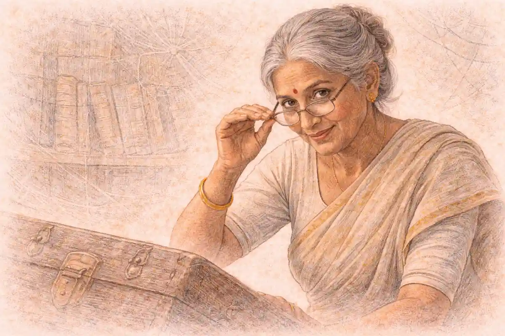

## The Slip With No Name On It

The records building held its heat badly after dark. Stone took the cold from the yard and kept it, and the metal stacks on the third floor gave it back in a thin smell of oil and dust whenever the radiators ticked. Benet Sarre worked the late rotation with his coat still on the hook behind the counter and his sleeves pushed to the elbow, because the ink dried slow in the cold and a cuff dragged through a ledger left a mark that stayed for years. The public counter ran the width of the ground room on the first floor, scarred where generations of boots and boxes had caught it, and beyond it the stack rooms rose floor above floor, narrow aisles between shelves that had been built close to save ground and close again to save time.

He had been on the late rotation eleven years, long enough that the porters stopped offering him the good lamp and long enough that he no longer asked. The night entry book lay open by the door, its ruled pages curling at the edge where damp got in. The day tray sat at his left hand, a shallow box of bent tin where finished slips waited for the morning sort. The counter chair, the one kept for people who had to wait while a file was fetched from the stacks, stood on the public side with its back to the window, so a waiting man faced the counter and the clerks and not the street.

The slip came in through the internal chute a little after the hour, with the soft knock that meant paper had landed in the wire basket behind the counter. Sarre took it out without hurry. Request slips landed all through the late shift, some signed in a hand he knew, some signed in a hand nobody knew until the file came back and the name was checked against the register, some carrying a seal that did the signing for them. This one asked for the depot movement file, the full run of it, by its stack number and its date range, written in a clear hand that pressed hard enough to leave the letters standing on the back of the sheet. The line for the requesting officer was empty. Not crossed through. Not initialled. Empty, clean as if the form had been printed without it.

He read it twice, the way he read anything that asked for a movement file, because movement files were the kind that other offices argued about afterwards. The depot, the dates, the stack number, all of it was in order. Only the name was missing. He turned the slip over, as if a name might have been written on the back by a man in a hurry, and found nothing but the pressure marks of the writing on the front.

The building had been raised for speed. That was said of it in the first week of every clerk's training and said again whenever a queue formed at the counter. Files moved, or the Accord stalled. Forms were a way of moving them faster, not a way of stopping them. A missing date was a clerk's business, because a file without a date could be lost. A missing stack number was a clerk's business, because a file without a number could not be found. A missing name was neither. A name did not help a clerk find anything. It helped an auditor months later, in a different room, with a different kind of time on his hands. On the late shift, with the stacks waiting and the chute knocking, a missing name was a routine thing. Every clerk on the rotation had filed a slip with no name on it, and every clerk had done it without a word from anyone senior, because the tray accepted them and the morning sort accepted them and the register accepted them, and a system that accepted a thing night after night had, in its own way, given its answer about whether the thing was allowed.

That was the truth of it, and Sarre knew it even as he knew it would not be the truth anyone repeated afterwards if the night turned sour. Afterwards they would talk about the clerk. They would not talk about the chute that delivered unsigned paper without a bell or a lock, or the tray that took it, or the training that had taught a generation of unremarkable men that speed was the virtue and questions were a form of slowness. The hole had not been cut that night. It had been built, patiently, out of habit and good intentions and a counter designed so that paper flowed one way and never had to flow back for a signature. He had only walked through a hole the building left open, on a path worn smooth by everyone who had come before him.

The man was already at the counter when Sarre looked up. He had come in through the public door without Sarre hearing it, or perhaps he had been there some minutes, sitting in the counter chair with his hands folded, a man in no hurry at all. He did not give a name. He said the file would be wanted at the counter, that he would wait, that there was no need to send it round by trolley to another office. He sat as men sit who have waited in records buildings before and expect to wait again, without complaint and without watching the clock in a way that could be remembered later.

Sarre should have sent the slip back for a signature. He knew the sentence whole, the way a man knows the words of a warning he has never had to say aloud. He also knew what happened to slips sent back on the late shift. They came again an hour later, or they did not come, and a file that was wanted urgently was wanted without its paper in order, and the clerk who had insisted became the clerk who had delayed a movement file on a night when delay itself became a story. The system filed unsigned slips without argument. It had never once, in eleven years, argued with him. He initialled the time in the margin in his own small hand, as the procedure asked, and he went up to the stacks to pull the depot file himself, because the stack runner had gone for his meal and because going himself was faster.

The stack room on the third floor was colder than the counter room and quieter, the shelves holding their rows of bound movement files in the order the building trusted, metal holding what paper could not. He found the file by its number without searching, the way a man finds a stair in his own house in the dark. It was heavier than he expected. Movement files gathered weight of another kind as they gathered pages, dockets and copies and receipts layered through a season of work. He carried it down with both hands and set it on the counter, and the waiting man rose from the chair and came forward, and Sarre turned the file so the man could read where he stood. Sarre did not read with him. Clerks did not read the files they fetched. That, too, the building had taught him, and taught him well.

What the man needed did not take long to find, though he took his time finding it, page by page, without haste, without marking anything, without asking for a copy. Sarre busied himself with the ledger at the far end of the counter, entering the pull in the book with the time as the wall clock gave it, twenty one fifteen, the file out of the stack and at the counter. The clock over the counter was the building clock, checked each morning, and he wrote what it said because that was the rule for times. Somewhere beyond the building, a chair would empty because of what was read at his counter. He did not know that then in words. He knew it in the care the other man took to leave no trace of having read, and in the patience of the wait.

He had been paid in advance. That was the part he turned over while the man read. An envelope, left for him in the way these things were left, with enough inside to make refusal feel like a performance rather than a decision. It was the second time. The first time had been weeks earlier, a quiet night, the same file asked for on a slip that also carried no name, a practice run in everything but words, and he had told himself then that a single pull on a quiet night harmed nobody, that files were pulled every night for men whose names meant nothing to him either way, that a signature was paint on a door that everyone walked through regardless. The second envelope had come with the same quiet, and by then the telling himself required less work. A professional paid in advance. He had understood that at once, and understood too that it was meant to be understood: no debt, no favour owed beyond the work, no reason to meet again. It steadied a man. It was meant to steady him.

The man closed the file at last and pushed it an inch across the counter, a small movement that said he was done. He thanked Sarre without using his name either, which struck Sarre afterwards as a symmetry the night had arranged without asking either of them. He left by the public door, and the cold came in briefly with the opening of it and went out with him, and the counter chair stood empty with its back to the window. Sarre stood a while with his hand resting on the file, not from doubt, but from the plain need to let the room return to being an ordinary room before he moved in it again. Then he took the file back up through the cold stack rooms and set it in its place on the shelf, in its exact order, because order was the one thing the building asked that he still gave it whole.

The clock said twenty two oh five when he came down again and entered the return in the ledger, file back in the stack the same night it left, the pull and the return bracketing less than an hour of reading at a public counter. The slip was still where he had left it, by the day tray, its empty line facing up. The day tray was where finished slips went. Morning would sort them, the register would take them, and no bell would ring for the missing name, because no bell existed. He could have held it back. He could have written a note. He could have become, at twenty two oh five on an ordinary late shift, the first clerk in the building's history to treat an unsigned slip as a wall rather than a door. Instead he filed the slip in the day tray anyway, because that was what the system did, and the system had done it through his hands a hundred times before anyone thought to pay him for doing it once with his eyes open. The tray took it without argument. The building settled around him, radiators ticking, stacks cooling, the night entry book open by the door for whoever came next, and the late shift went on being a late shift, which was the most damning and the most ordinary thing about it.

## The Building, Not the Office

Leyden kept his rooms on the first story of the Office as if the building had issued them and then forgotten them. A desk too large for the space, a window that gave onto the yard wall and nothing beyond it, shelves of bound reports with their spines turned uniform by dust, and a lamp with a green shade that made the paper on the desk look older than it was. The room smelled of that paper and of the tea Leyden made strong and left standing until it went cold in its cup. Mira came in with the morning light still thin in the corridor behind her and closed the door when he nodded at it, and the latch made its small, final sound, and the room settled into the quiet Leyden preferred for work he did not intend to repeat twice.

He did not begin with a greeting. He began with the rollup, and with the depot, and with a fact he set on the desk between them as carefully as Dunmore might have set down a fragile file. The principal in the rollup had been warned. Not guessed at, not flushed by noise at the edges of the operation, warned, from inside an Accord building in Carrowmere, in time to leave his depot office before the sting reached it and in time for the warning itself to be stamped into the depot log. The report from the rollup still carried the detail she could not put down, [the depot office where the principal's chair stood warm and empty](/2026/11/03/nightjar-bonded-cargo-004/). Mira had carried that detail through Melora and back again, and it had not faded with carrying. A warm chair was a human fact. It said a man had been sitting in a room, at his work, and then, on the strength of words that reached him from her own side of the Accord, he had not been.

Leyden let her sit with it a moment, because he was a man who understood that some facts did their own tasking if they were given room. Then he gave her the hunt. It was hers. The building, its clerks, its books, its rooms, its paper, the whole trail of the warning night as the records building kept it, all of that she could work as she saw fit, and he would ask for results rather than methods, within the condition he was about to name. She waited. She had learned, in the years Leyden had handled her, that the shape of a task lived in its condition more often than in its orders, and that a handler who paused before naming a condition was measuring how much of it she would hear the first time.

She might investigate the building, he said. She might not investigate the Office. The nine officers were not her ground. Not their movements on the warning night, not their errands, not their accounts of their hours. If the trail turned toward an officer, it stopped, and she brought the stopping place to him and to no one else. He said it flatly, without emphasis, as if it were a boundary drawn on a map for reasons of terrain. She asked, as she was entitled to ask once, whether the condition protected the Office as a whole or a person in particular. Leyden looked at his cold tea and did not answer in any way that could be written down afterwards. He would not say why. He said that too plainly, so there could be no later claim that the refusal had been implied rather than spoken. The why was his. The condition was hers to accept or to refuse with the hunt itself.

Mira understood, before he named it as such, that the condition was the cost, and that it was being charged up front rather than at the end, which was Leyden's form of honesty. It cut the hunt in half before it started. A mole hunt that could not look at the officers was a hunt with one hand ordered still, and everyone in the room knew the most obvious shape a warning from inside an Accord building could take was the shape of an officer selling a night. To accept was to promise to work around that shape even if the paper began to point at it, and her word, once given to Leyden, was a thing she kept, not from obedience, but because a field officer whose word bent under pressure was a field officer whose other accounts would bend too, in rooms where bending cost more than pride. She turned it over once, whole, the way she turned over a file cover before opening it, to be sure she knew what she was lifting.

She accepted it in words. She said she would work the building and not the Office, that she would bring him any stopping place where the trail turned toward an officer, and that she understood he would not give her a reason. Leyden nodded, once, and the nod closed the matter in the way his nods did, without relief on either side. Only then did he call, through the open inner door, for Dunmore, and the sound of a chair pushed back in the next room said the analyst had been waiting within earshot and out of sight, which was Dunmore's preferred position in most arrangements and one Mira had come to trust as a form of discretion rather than theatre.

Petra Dunmore came in with two folders held flat against her chest like a tray, her sleeves exact, her expression that of a woman who had already read everything she carried twice and found it wanting in only the usual ways. She set the first folder before Mira and opened it herself, because Dunmore trusted no one else's order of pages. A copy of a request slip, from the records building's own copies, the depot movement file asked for by stack number and date range in a clear, hard pressing hand. The line for the requesting officer was empty. Dunmore let Mira look at the empty line for as long as she needed, which was longer than Mira expected of herself. Paper had survived, then. The trail existed whole enough to begin on, whatever else the night had eaten.

The second folder held an extract from the depot log, copied in Dunmore's own hand where the original stamp had printed faint, and the entry was the receipt of the warning, stamped at the depot at twenty one fifty by the depot clock. Dunmore said, in the tone she used for facts she had already checked past the point of courtesy, that the depot clock was checked against Accord standard time at every shift change, and that the check for that night was entered and signed, so the time could be trusted as far as any clock in the case could be trusted. Every clock in the case was set to Accord standard time, she added, because Leyden had asked her to establish it before the hunt was given to anyone, and the records building clock and the depot clock answered to the same standard on the warning night. Mira held the slip copy and the log extract side by side on Leyden's desk, an empty name and a stamped hour, and felt the hunt take its first real shape: not a man, not yet, but a gap in a form and a time in a book, and between them a building full of clerks and shelves and ordinary late shift routine.

She entered the hunt reduced, and she said so lightly when Leyden, glancing up, remarked that she looked as if Melora had kept a part of her for its trouble. She had not taken the rest day entered on her file after Melora. She told him the file entry was in excellent health even if she was not, which earned the smallest movement at the corner of Dunmore's mouth. The keeper's shame from the storeroom case still sat with her in quiet moments, a borrowed emotion she had learned to carry without mistaking it for her own, and beneath it, older by days only, the press of two centuries of a storeroom taken at once in Melora still made sleep a shallow country she visited rather than lived in. She did not dwell on either. Dunmore did not ask, Leyden did not prescribe rest he knew would be refused as a condition of another kind, and the three of them returned to the paper, which was the proper courtesy among people who worked as they worked.

Dunmore, before she left the desk, added the small cautions that were her way of handing over a trail without bending it. The copy was a copy, she said, and the original slip, if it still lay where the building had put it, would be in the records building's day tray sequence for the warning night, filed among the finished slips of that shift. The depot extract was likewise an extract, and the full log stayed at the depot, where she could ask for it to be read against the original stamps if the case required it. Neither paper named a person. Neither paper, on its own, proved who had stood at the counter or who had carried a warning out of the building. What they proved, together, was narrower and, for that reason, harder to argue with: a file had been asked for without a name, a file had been given, and a warning had arrived where it could do its work inside the hour that followed. Mira noted the limits as carefully as the facts. A hunt that began by overstating its paper would spend its strength defending the overstatement instead of following the trail.

She asked Dunmore one question about the records building itself, how many clerks worked the late rotation and whether their hands and shifts were a matter of record. Dunmore said the rotation was a matter of record, that the building kept its books the way buildings of its kind always had, in more detail than anyone outside them ever expected, and that the detail would be there when Mira went looking for it. It was not an answer that promised a culprit. It promised something Mira valued more at the start of a case, which was that the ordinary system had observed itself as it went, shift by shift and entry by entry, and that a night which had felt unremarkable to everyone inside it might still be recoverable from the sum of its small, unremarkable records.

Leyden closed the tasking as he had opened it, without decoration. The building, not the Office. The paper first. The clerks, the books, the rooms, in whatever order her judgement set, and a report to him when the trail either found its source or found its stopping place. Mira gathered the two folders, the unsigned slip uppermost, its empty line facing her like a question the building had been asking without knowing it for weeks, and she went out into the corridor where the morning had strengthened and the Office had begun its ordinary noise, carrying a hunt that was already narrower than the truth it hunted, and a word she had given in a quiet room that she already knew would cost her more than the saying of it had.

## One Working, One Waiting

The records building held the cold in its walls long after the street outside had warmed, and Mira felt it through the soles of her shoes on the stone of the entrance hall before she felt it anywhere else, a low and even chill that came up from the flags and settled in the ankles, and the hall itself gave back the smell of iron shelving and old paper and the faint oil that kept the counter shutters moving, and beyond the shutters the stack rooms rose floor above floor in narrow aisles where the light fell in fixed pools and left the ends of the rows in a permanent half shade, and every sound in that place carried farther than it should have done, a drawer closing two floors above arriving as a soft and distinct report, a trolley wheel catching on a joint in the floor repeating itself until someone lifted it free. Dunmore walked a half step ahead of her with a folder held flat against her forearm, the way a person carries paper she does not intend to set down in the wrong place, and she did not hurry, and the clerks behind the public counter watched them pass without watching them, which Mira recognised as a practiced thing, the building teaching its people to see a visitor and to file the seeing away without comment. The counter itself ran the length of the ground floor hall, scarred along its front edge where generations of boxes had been dragged across it, and behind it the day trays stood in a row, shallow and open, each labelled for a stage of work rather than for a person, and above the trays a board carried the rotation in chalk that had been wiped and rewritten so often the board had gone pale in patches. She was tired in the way that sat behind the eyes and made the edges of printed lines swim if she looked at them too long, a tiredness she had carried from Melora and had not paid off with the rest entered on her file, and she kept it out of her face and out of her pace, and she noted the canteen door on the half landing as they passed it, shuttered and roped, with a works notice fixed to the shutter in a clerkly hand.

Dunmore stopped at the canteen door because Mira had stopped, and she read the notice without touching it, and she said the canteen had been shuttered for repairs through the whole of the present week and the work had not yet begun in earnest, the shutters drawn and the room behind them empty of its usual steam and clatter, and Mira asked how long the shutters had been drawn across the life of the building in that way, and Dunmore, who had asked the building the same question in another form before Mira arrived, said the porters had given her the repair log without argument, and the log showed the canteen shuttered for repairs on the warning night as well, closed early and closed all evening, with no serving and no staff kept late, so that on the night the warning left the building there had been no canteen crowd to drift through the hall, no queue at the hatch, no loose gathering of clerks with cups in their hands to blur who had stood where and for how long, and in the present week the same emptiness held, which meant the counter and the hall could be understood without that complication, then and again in the work they were doing. Mira held that fact in the place where she kept facts that looked small and behaved large, because a shuttered canteen removed a whole class of innocent explanation, the man who had only come in for tea, the clerk who had only crossed the hall to return a cup, and she let the rope and the shutter stay in her mind as they went on up toward the stack rooms, a plain closed door that closed other doors after it.

The stack rooms occupied the heart of the building, floor after floor of them, and Dunmore took her through the ground floor stack first because the depot movement file lived there when it was at home, on a shelf that was not remarkable in any way Mira could see, one shelf among hundreds, its label typed and retyped and pasted over until the card stood thick, and the file itself, when it was present, sat between two heavier files that guarded it from leaning. A file in that building, Dunmore explained in the dry and level tone she used for procedure, as if procedure were a kind of weather that could be described without opinion, did not move because a person wished it to move, it moved because a piece of paper told the building to move it, and that piece of paper was the request slip, a half sheet, thin enough to curl, printed with boxes for the file sought, the room where the file was to be read, and the name of the requesting officer, and the slip began its life at the public counter, where any officer or authorised reader could fill it in and place it in the first of the day trays, the receiving tray, where the counter clerk took it up in order and entered its number in the counter book. From the receiving tray the slip travelled with a runner or with the counter clerk himself to the stack, and the stack clerk found the file and drew it from its shelf and wrote the hour of its leaving against the slip number in the stack book, and the file went back to the counter on a trolley or in a clerk's arms, and it waited at the counter, or in the small reading alcove beside the counter, until the reader had done with it, and then it returned by the same road, and the stack clerk shelved it and wrote the hour of its return in the same stack book, and the slip, its work finished, was filed in the day tray for completed work until the shift changed, when the trays were cleared and counted and any slip left unfinished or unmatched was carried into the night book as a remark or found where it lay and reported to the incoming clerk.

The night book lived in a drawer of its own beneath the counter, heavier than the other books, bound in a dark cloth that had polished itself on the hands that lifted it, and it recorded a different kind of movement altogether, not files but people, every officer and every senior visitor who entered the building after the day staff had gone signing himself in on entry in his own hand, with the hour written beside the signature, and signing out again where the errand allowed it, and the book was not a courtesy, Dunmore said, it was the building's memory of who had been inside it when the building was at its emptiest and its files at their most exposed, and the porters kept it and the counter clerk of the late rotation witnessed it, and a name that stood in the night book stood there beyond later denial because the hand was the man's own and the hour was written at the moment of entry and not reconstructed after. The late rotation itself she explained as they climbed, because the building did not keep one set of clerks for the day and another for the night in the way an outsider might picture, it kept a small rotation of clerks who took the late hours in turn, men and women who knew the stack in the dark and knew the counter when the hall was empty, and whose names recurred in the books in a pattern a reader could learn, and the warning night, she said, had been a late rotation night like any other on its face, three clerks sharing the hours between them, their hands alternating in the counter book, their rounds crossing in the stack, and the work of the coming days would be to learn which hands those were and whether the pattern of that night matched the pattern of the nights around it or broke from it in a place that mattered.

On Dunmore's desk, in the folder she kept for the trail of paper the absences left behind, lay [the statement Rask gave on the record at the Barrow hearing](/2026/11/04/nightjar-standing-detail-005/), the one that said a Stiller's flatness and the absence were different things. Dunmore did not open that folder while they walked the stack, and Mira did not ask her to, and the folder stayed in her mind as a marker for a discipline they both kept, which was to let the records building be the records building for as long as the building could answer, and to keep the other matter, the matter of rooms that read as nothing, behind a closed cover until the paper had given everything paper could give, and even then to bring it forward only where it belonged, as context for what a suppression was and what it was not, and never as a shortcut past the trays and the books and the hours written in other people's hands. The discipline cost patience, and patience cost time, and Mira paid both without complaint, because she had learned on the bonded cargo decks at Valtessa, years before the Office took her, that a manifest that was almost right was more dangerous than a manifest that was plainly wrong, and that the clerk who hurried past the almost right entry was the clerk who signed for a crate that was not there.

Mira asked whether the system ever refused a slip, and Dunmore looked at her over the stack book with an expression that suggested the question had been waiting for someone to ask it in that room for a long time, and she said the system refused slips for files that did not exist, and it refused slips for files held under seal where the seal had not been lifted by the proper authority, and it queried slips whose file description was too vague to find, returning them to the counter for amendment, but a slip that named a real file and named a real shelf and asked for that file to be brought to the counter was a slip the building obeyed, and the box for the requesting officer's name, she said, tapping the printed slip with one fingertip where the blank still showed in the specimen pad chained to the counter, was a box the building read for its own records and not a lock the building enforced, so that a slip could be complete in every particular that moved a file and incomplete in the one particular that named a man, and it would move the file all the same. She said it without heat, as a person describes a staircase that has been missing a rail for as long as anyone can remember, and Mira understood that she was hearing the building described honestly by someone who had no interest in defending it, and she asked the next question, which was how often a slip arrived with that box left empty, and Dunmore said often enough that the counter clerks had a word for it that was not a word of alarm, a word that meant the officer was in a hurry or the officer would sign later or the officer was known to the counter and the name was a formality the evening could spare, and that the word was used kindly and without suspicion, and that its kindness was part of the mechanism, because a thing that happens often and kindly stops being seen at all.

That was the ground they stood on, and from that ground Dunmore laid out the three live possibilities in the order of their seniority rather than the order of their likelihood, because likelihood, she said, was a conclusion and they had not earned one yet. The first possibility was an officer of the nine, a man with the standing to enter the building late without remark, with the knowledge to name the depot movement file and the shelf it lived on, with a reason the building would accept without question and a hand the night book would record without hesitation if he chose to come through the front of the building at all, and Mira held that possibility seriously and at arm's length at the same time, because it was the possibility Leyden's condition had fenced off from her, and a fenced thing has a way of looking larger than it is, and because an officer who wished a file read without a name attached to the reading would know precisely which box to leave empty and precisely how little alarm an empty box would raise at that counter. The second possibility was a clerk paid once, a man or a woman of the late rotation who took money for a single night's work, who pulled a file against an unsigned slip and asked nothing and recorded the hours as the hours fell and went home with an envelope's worth of change in a life that otherwise ran on a clerk's pay, and that possibility had a different weight to it, smaller in reach and sadder in shape, because it required no malice toward the Office and no allegiance to anyone beyond the length of one evening, only a price met at the right moment by a person whose defences were the ordinary defences of tired people everywhere, and Dunmore, who knew the rotation lists and the pay that went with them, did not dismiss it, and Mira did not dismiss it, and they let it sit on the table between the books as a complete and sufficient explanation that happened, so far, to have no evidence attached to it except opportunity itself.

The third possibility was the one that lengthened as they looked at it, and Dunmore gave it its proper phrasing with care, calling it a standing arrangement nobody had noticed in years, a door standing open in the system, not a man and not a payment but a habit the building had grown around itself, the unsigned slip accepted as a routine thing and filed without argument because the building had been built for speed and had taught every clerk who served in it that a missing name was a small untidiness and never a clerk's business, so that anyone who knew the building well enough, insider or regular visitor or a reader who had watched the counter across a handful of evenings, could use that door whenever a file was needed without a name, and could use it again, and could trust that its use would leave almost nothing behind except a slip in a tray that a busy shift change might count without reading. Mira liked that possibility least and respected it most, because it explained the quietness of the warning night better than either of the others, the absence of forcing, the absence of hurry, the file moving through the ordinary channels at the ordinary pace, handled by the ordinary hands, and she said so, and Dunmore agreed that the quietness was the fact that kept returning to her own desk at night, the sense that whoever had arranged the warning had not broken into the building's life but had borrowed it, whole and unaltered, for the length of one file's journey from a shelf to a counter and back. They did not choose between the three, and they did not rank them beyond the courtesy of order, and the work of holding all three seriously, without leaning, was its own kind of labour, because each possibility asked different questions of the same books, the officer asking after the night book and the rotation of senior visits, the paid clerk asking after hands and hours and who stood where in the stack, the standing door asking after every unsigned slip the building could still account for, going back as far as its trays and drawers remembered, and Mira felt the case widen even as its paper narrowed, which she had learned was what honest ground felt like under the feet.

Dunmore built the timeline on the counter itself, because the counter was where its earliest entries had happened and because she believed, and said, that a table built in the place it described was less likely to flatter its builders. She worked from the records building copies, from the counter book and the stack book and the tray count at the shift change, and against them she set the depot log, which she had obtained as a certified copy and which she handled with a particular respect, the respect due to a witness who cannot be interviewed and can only be read, and she checked each hour aloud as she placed it, not performing certainty but earning it line by line, the slip, the pulling, the stamping, the returning, the signing, the finding, until the six movements stood in their order and the spaces between them stood visible as spaces, ten minutes here, thirty five there, fifty minutes where the file was out of the stack and in a reader's hands or waiting for them, and Mira watched the spaces as closely as she watched the entries, because in her experience it was the spaces that told a reader how much time a man had needed and how much time he had taken, and whether those two amounts were the same. The table that Dunmore set down between them settled the order of the night beyond argument, each hour fixed against the books that recorded it and against the depot clock that had stamped the warning home.

| Entry | Building time | What the record shows |
|---|---|---|
| Request slip filed | 21:05 | A slip with no requesting officer named enters the day tray |
| Depot file pulled | 21:15 | The depot movement file leaves the stack against the slip |
| Warning stamped at the depot | 21:50 | The depot log records the warning received, by the depot clock |
| Depot file returned | 22:05 | The depot movement file is back on its shelf, fifty minutes out |
| Night book entry | 22:30 | An officer of the nine signs himself into the building in his own hand |
| Slip found | 23:00 | The unsigned slip is found in the day tray at the shift change |

It was Dunmore who suggested the reading, and she suggested it as a question rather than a recommendation, in the form of asking whether the room itself still held anything after so long an interval, and Mira answered honestly that she did not know and that the honest answer was the reason to try, because the warning night lay weeks behind them and weeks were a long time for the kind of trace she worked with, and she explained the method on the page between them before she attempted it, in plain terms and without ornament, as she had been taught to state a method before a result so that the result could be judged against the stating. She worked by weight, she said, the residue that intensity and affect left in places and in objects, fear and grief and violence where they had burned hot, and long repetition and sustained intent where they had burned low and long, held best by stone and by metal and worst by cloth and by paper, fading as time did its ordinary work, days clearing a room almost wholly, months leaving a faintness, years leaving almost nothing at all, and never, in any of her eleven years of reading since she was fifteen, giving her a face or a name or a replayed scene, never identifying who, only how a presence had been disposed in a place, its stillness or its haste, its repetition or its intent, and always at a cost she paid in her own body, taking on a portion of whatever affect she touched and carrying it as if it were hers until it thinned. The stack room, with its metal shelving uprights and its stone floor, was the best anchor the building could offer her, better than the counter with its wood and its wear, better than the alcove with its cloth and lamplight, and if anything of that night survived anywhere in the building it would survive there, at the level stone and metal kept things, faint and thinned and stripped of particulars.

She read the room standing at the end of the aisle where the depot file lived, with one hand resting lightly on the cold upright of the shelving and the other loose at her side, and Dunmore, who had been instructed beforehand and who obeyed instructions of that kind without curiosity getting the better of her, stood well back near the lectern and said nothing and made no note, because a note taken during a reading had a way of becoming more trusted than the reading itself and Dunmore distrusted that exchange rate. The room gave her almost nothing for a long while, the ordinary sediment of a working stack, decades of clerks passing with files under their arms, the low accumulation of a place where the same journeys had been made so often that the journeys themselves had become the loudest thing in it, and she had to let that sediment settle in her attention the way a listener lets a crowd settle before picking out a single conversation at its edge, and the tiredness she carried made the settling slower, the keeper's shame from an earlier case still sitting somewhere in her chest like a borrowed emotion that had not yet been returned, and the storeroom at Melora still lying behind that, two centuries taken at once and not yet fully set down, and she worked through both borrowings to reach the thinner thing beneath them that belonged to the warning night alone. What belonged to that night, when it came, came faint, held only at the level stone and metal kept things, a shape rather than a scene, and she received it in the order the room offered it, first the working shape, one person moving in the long repetition of a clerk's round, the unhurried circuit of tray and shelf and book, the pauses at the lectern and at the counter end of the aisle falling where a clerk's pauses fell, practised and economical, a round that had been walked so often the walking itself carried no urgency and no concealment, only competence, and then, distinct from it and held apart from it in the room the way a held note is held apart from the music around it, the second shape, one person waiting at the counter, still, sustained, in no hurry at all.

The waiting was the thing the room had kept best, because waiting of that quality was itself a form of sustained intent, a man settled into stillness for the length of a file's fetching and reading and holding his place without pacing, without shifting his weight from foot to foot in the restless pattern that impatience left in a floor, without the small repeated movements of a person killing time, and she felt the patience of it arrive in her as a physical fact before she understood it as information, a cold that was not the building's cold settling along her forearms and into her hands where they rested, and then a deeper settling, the waiter's patience entering her breathing and slowing it, his willingness to stand and to be overlooked becoming, for a stretch of seconds that lengthened without her permission, indistinguishable from her own willingness, so that she had to remind herself, deliberately and by name, that the patience was not hers and the errand was not hers and the stillness she felt so completely from inside was a residue and not a character. No face came with it and no name and no distinguishing mark, no height she could trust and no voice and no errand she could name beyond the waiting itself, and that limit bit exactly where it always bit, at the point where information would have become identification, and she let the shapes stay shapes because making them more than shapes would have been invention and invention in a reading was a corruption she had refused since she was a girl learning what her gift would and would not do. She withdrew her hand from the upright and flexed her fingers to bring her own circulation and her own intentions back into them, and the cold stayed with her after the contact broke, and the borrowed patience stayed too, thinning slowly, so that when Dunmore finally spoke and asked her, in a voice pitched for the stack and for nothing beyond it, what the room had held, Mira answered in the same pitch and with a care that the patience in her chest made oddly easy and oddly suspect, that the room held two shapes and no more, one working and one waiting, and that the waiting shape had waited a long time and had minded the waiting not at all.

They closed the stack room together and went down to the counter again by the longer stair, because Mira's hands were still cold and she wanted the walk to restore the ordinary order of her own sensations before she handled paper that other people would later rely on, and Dunmore, who understood more about the cost of the reading than she said, filled the descent with a plain account of the tray counts for the nights surrounding the warning night, ordinary numbers spoken ordinarily, a handrail of fact offered without comment for Mira to hold while the borrowed patience finished leaving her. The hall at the counter had emptied further while they were above, the day staff gone, the late rotation settling into its quieter posture, a single clerk visible behind the shutters with a book open and a pencil laid across it, and the building gave off that particular evening sound of a large place continuing to work at a fraction of its daytime volume, a drawer somewhere, a door somewhere, the trolley wheel finding its joint and being lifted free. Dunmore unlocked the drawer beneath the counter with the key she carried for it and lifted the night book out with both hands and laid it open on the counter under the lamp, at the page for the warning night, and the page lay flat with the reluctance of a book that has been opened at the same place repeatedly by other investigators of other questions, and the entries stood in their succession of hands, porters' remarks in one script, clerks' countersignatures in another, visitors admitted and visitors departed, and near the foot of the page, set apart by the lateness of its hour from everything above it, the entry they had come downstairs to look at with their own eyes rather than through any copy or summary, the entry timed at 22:30.

The officer had signed himself into the building in his own hand, the signature unhurried and complete, the hour written beside it in the same ink and by the same hand, and the entry was, on its surface and in its solitude, the most senior entry in the book for that night, the only signature of its rank on the page, which Mira noted because Dunmore had wondered beforehand whether it stood alone of its kind and the page answered that it did, and a lone senior entry in an almost empty building on the one night in the season that had come to matter was a fact that arranged itself, without any help from either of them, into a shape an accuser would find satisfying. He had not signed out again on that page, or the signing out, if it had happened, had happened in a later book or by a porter's remark that Dunmore had not yet traced, and his time inside the building stood therefore as an open span with an entered beginning and no recorded end, and when Dunmore, working through the proper channels and with the propriety she brought to every outward enquiry, had sought an account of that hour, the account that came back through those channels was thin in a way that thinness alone could not explain, an errand he would not describe, a purpose he declined to set down, a presence in the records building late at night that he neither denied nor illuminated, owned in signature and disowned in explanation, so that he could not yet account for that hour in any terms the case could use, and the hour sat there in the book, signed and silent, asking to be misunderstood by anyone who wanted a misunderstanding ready made. Mira looked at the signature for a long time without touching the page, and she felt the pull of the false shape assembling itself from real parts, the senior man, the late hour, the empty box on the slip, the unexplained errand, each part genuine and the assembly false in the way the most dangerous readings always were, genuine parts arranged to imply a join that the parts themselves did not make, and she distrusted the satisfaction the assembly offered her precisely because it offered satisfaction so cheaply, a case closed by silhouette, a condition explained, a superior's caution reinterpreted as a superior's protection.

For that was the other pull, and it arrived in her mind uninvited and unwelcome and impossible to unthink once thought, that Leyden's condition, the condition she had accepted in words and carried into the building like a second set of orders, the condition that fenced the nine officers away from her enquiries and left her the clerks and the books and the rooms, might read differently against that page, might read not as a controller protecting an institution from the damage of an internal hunt, nor as a controller protecting a case from its own widest and most distracting possibility, but as a man shielding his own, one officer, one hour, one signature he had known about before she ever opened the book and had quietly built a wall around before she could reach it, and the thought did Leyden a possible injustice and did the officer a possible injustice and did the evidence no service at all, and Mira held it exactly there, as a possibility and not a finding, alongside the other three possibilities they had laid out upstairs among the shelves, refusing to let the newest and most dramatic of the four eat the others before the arithmetic of the night had been fully tested against them. Dunmore closed the night book with care and returned it to its drawer and turned the key, and neither of them said the officer's situation aloud in the hall where a clerk sat within hearing with his pencil laid across his book, and as they crossed the stone toward the door, with the borrowed cold still faint in Mira's hands and the table sitting squared in Dunmore's folder and the signature waiting in its drawer for whoever came next to misread it, Mira understood that the ground they had spent the day establishing had done the work ground was supposed to do, which was not to close the case but to make its closing possible, three doors standing open before her and a fourth, signed in a man's own hand at 22:30, standing open widest of all.

## Forty Minutes Before He Arrived

The records building held the cold differently after dark. Stone kept it in the walls and gave it back slowly through the soles of her shoes, and the metal stacks in the long room breathed it out in a thin smell of oil and dust and old paper glue. Dunmore had taken the small table by the counter because the light there was better, a single lamp with a green shade that made a clean pool on the wood and left the rest of the room in a patient dimness. Beyond the counter the aisles ran away in straight lines, shelf after shelf, each end painted with a number that had been touched up so often the paint stood proud of the metal. Mira could hear the building settling in the way large buildings do when the day staff have gone, a tick in a pipe, a soft shift somewhere high in the stacks, the porter far below moving a latch. Her coat still held the street on it. She set it aside and felt the room take the warmth from her hands while Dunmore laid out the books in the order she intended to use them, spine to spine, without hurry.

Dunmore did not begin with an opinion. She began with the procedure, and she named it as she worked, because a thing unnamed could be argued with later and a thing named and followed could only be argued with on its merits.

The clock check, she said. First the depot log itself, not a copy of it. Then the standard it was kept by. Then the building books, entry by entry, against both.

Mira watched her turn the depot log to the warning night. The page was ruled and close written, the hand of a depot clerk who had learned to save ink without saving meaning, and halfway down the page a stamp sat square across two lines, its ink a little heavier on the left where the hand that drove it had favoured that side. The stamp gave the receipt of the warning. Not the sending of it, Dunmore said, and not a memory of it afterwards. The receipt. The moment the warning arrived at the depot and was taken in by the man on duty there and set down in the order of his night, between the entries that came before it and the entries that came after it, where it could not be moved without moving everything around it.

She read the time the stamp carried. Twenty one fifty.

Then she set beside it the depot shift record, a duller book and for that reason a better witness. At every shift change the depot clock was checked against Accord standard time, and the check was entered and signed, whether the clock had held or had needed correction. Dunmore read aloud the checks that bracketed the warning night, the evening check before it and the morning check after it. The clock had held at both. No correction stood between them, and no entry suggested a clock running fast or slow by any amount that mattered.

A clock can be wrong in private, Dunmore said. This one was examined in public, twice, by two different hands, and found right both times.

Dunmore was already opening the records building books, the night book first and then the stack register and then the day tray record, laying the request slip timeline beside them sheet by sheet so that each time in it had to answer to a book written at the hour it claimed.

Entry by entry, Dunmore said. Not the shape of the night. The entries.

The request slip filed at twenty one oh five, in the tray record and in the slip itself, which carried no name where a name should have stood. The depot file pulled from the stack at twenty one fifteen, in the stack register, in a clerkly hand. The warning stamped received in the depot log at twenty one fifty, by a clock proven against the standard at the shift change on either side of it. The depot file returned to the stack at twenty two oh five, again in the register, later than any ordinary reading of a file at a counter should have kept it out. The slip found in the day tray at the shift change at twenty three hundred, where it had been left to be discovered by routine rather than reported by the hand that filed it.

And the night book entry. Dunmore left it for last, as she had left it when she built the timeline, and she set the night book open under the lamp so that Mira could see the line in the hand that had written it, unhurried, well formed, a senior hand accustomed to being read.

Twenty two thirty. An officer of the Ninth Office, entered in the records building night book in his own hand, at twenty two thirty on the warning night.

For a moment neither of them spoke. Dunmore had wanted the proven time standing solid before the damning time was set beside it, so that what happened next would happen on arithmetic and not on preference.

Before it happened, Mira made herself do the other work honestly. The officer reading deserved its full strength, and she gave it, because a reading killed weakly would stay alive in the back of her mind and in the back of Leyden's, and she could not afford a ghost in a case built of paper.

At full strength it was a strong reading. It had shape and motive and a hole exactly where a guilty man would leave one.

An officer had come into this building on the warning night, late, after the ordinary business of the place had thinned to the night staff and the stacks. He had written his own entry, which could be read two ways and at full strength read badly, as confidence, as a man who believed his rank would carry the line past any later reader without a question being put to it. He was senior enough to know what the depot file held and senior enough to know what a warning taken from it would be worth to the man at the depot. He belonged to the small set of people for whom the file was not an abstraction. Most people in Carrowmere could not have read that file and known which line in it mattered. He could.

His account of the hour was thin. That was the next plank in it, and it bore weight. He had given an account because an account had been asked for in the ordinary course of checking, and what he had given was spare to the point of discourtesy, a few lines that covered his presence in the building without covering his use of it. He had been there on an errand. He would not explain the errand. He had named a floor and not a room, a purpose in general terms and not a file, not a person, not a result. Nothing in the account was contradicted by the books. Nothing in it was confirmed by them either, beyond the entry itself. It sat beside the night book line like a coat left over a chair, the right size for the man and empty of him.

From inside the case, Leyden's condition looked different once that account was laid on the desk. Mira had turned that over more than once since the tasking and she turned it over again under the green lamp, giving the dark reading its due. Leyden had forbidden her the Office. He had drawn the line at the building and said she might work the building, its clerks, its books and its rooms, and he would not say why. At full strength the officer reading made that condition look like a shield held over one person. A controller who suspected, or who knew, and who chose to keep the hunt among clerks and paper, where it could be managed and where it could be ended with a small name if a name had to be found. She did not want to think it of Leyden. Wanting had nothing to do with the strength of the reading. Controllers protected their officers. That was in the nature of the work, and a condition that cut a hunt in half before it began was either a judgment about where the truth lay or a judgment about where she was permitted to find it, and from her side of the desk those two judgments looked very much alike.

Mira let the reading stand at its tallest. She set the errand beside the condition, and the condition beside the rank, and the rank beside the thinness of the account, and for the length of a breath the officer stood in the case as its centre, plausible and damned by everything except a fact.

Then Dunmore put her finger on the stamp in the depot log, and then on the night book line, and did the subtraction aloud, without emphasis, the way she did all sums that she expected to end an argument.

Twenty two thirty less twenty one fifty is forty minutes.

The warning was stamped at the depot at twenty one fifty. The officer's night book entry is twenty two thirty, forty minutes later. He cannot have sent a warning forty minutes before he arrived to send it.

She did not dress it further, and Mira was grateful for the plainness. No reading of character survived it. No account of motive survived it. Whatever the officer had come into the building to do, the warning had left this building and been received at the depot and stamped into a proven clock's log before his hand had written his name in the night book at the door.

Could he have sent it from elsewhere and entered afterwards, Mira asked, because the question had to be asked and answered on the page of the case.

Dunmore answered from the books. The warning carried what the depot file held, and the depot file had been pulled in this building at twenty one fifteen and was out of the stack until twenty two oh five. The man who used it used it here, at the counter, across the better part of that hour. That was what the register said and what the room had already told her in the earlier read, two shapes and no faces, one working the clerk's round and one waiting in still intent. For the officer to be the source he would have had to be the waiting shape and the night book entry both, and the night book put his arrival forty minutes after the warning had already reached the depot. He could not arrange for a stamped receipt at the depot to precede the work that produced the warning, unless the depot clock lied, and the depot clock had been checked against Accord standard time at every shift change and had held at both checks that fenced the night.

The subtraction stood. The thin account remained thin. The errand remained unexplained. Leyden's condition remained unexplained too, and that was the part Dunmore could not kill with a sum, and did not try to.

What he was doing in the building that night stayed unexplained. It stopped mattering, and that was its own discomfort. A man had come late into a records building on the worst night of the season for that building and had declined to say why, and the case had spent its strength on him, and the answer turned out to be that the case had no claim on his hour at all. His hour was his. It might have been foolish, or private, or discreditable in some smaller currency that had nothing to do with a warning and a depot. She would never know, and she was not entitled to know, and the not knowing left a rough edge on a collapse that was otherwise clean.

Arithmetic gave her back a harder case. The source was in the building early. He worked through the ordinary system, through a slip with no name on it and a clerk's round and a counter where a man could sit and wait without remark. He was gone before anyone senior arrived to be remembered. Whoever remembered that night would remember the officer, because the officer was the one who wrote his name down. The source wrote nothing down at all, which was why the system suited him.

Dunmore closed the night book with care and set it square with the others, and the small sound it made seemed to mark the end of one part of the evening and the beginning of another.

There remained the chair.

It stood at the counter where it had stood on the warning night, one of a row of three, plain wood gone dark at the edges where hands and coats had polished it over years of waiting. Mira had not touched it before, because she had wanted the books to speak first and because she knew what even a faint read would cost her this far from the night itself. Weeks had passed. Wood kept little, but a chair at a counter was sat in and leaned on, and the seat had been shaped by the same posture held through a long wait, and long repetition was one of the things weight kept when sharper things had faded.

She named the method before she took the result, as she had been taught and as she taught herself again each time the work asked it of her. A duration read, she said aloud, for Dunmore to hear and for the record Dunmore would keep. Not who. Not why. Length only. What a seat kept of how long a body had stayed in it, and the temper of the staying, if the temper had been strong enough to mark the wood. Anything beyond that would be invention and she would not report invention as reading.

Dunmore nodded once and opened a fresh page.

Mira set her hand flat on the back of the chair and then sat, briefly and without settling her full weight at first, the way a reader learns to approach a faint thing, by degrees, so that the first thin impression is not drowned by her own presence in the seat. The wood was cold through her sleeve. The room went ordinary around her for a breath, the lamp, the stacks, Dunmore's pen held ready, and then the faintness came up through the chair in the manner of a tide felt through a hull rather than seen.

It was weeks old and it was faint and it kept one thing well.

The length of the wait.

Not minutes counted on a dial. Weight did not count in that currency. It kept duration as the body keeps it, as pressure that does not shift, as a man who settles once and does not rise and pace and sit again. The better part of an hour, at the weight of a man who was in no hurry. That was the shape of it and the whole of it. A patience so even it had sunk into the wood while fear or anger would have burned off in days. He had sat in this chair while a file was fetched and read and used, and he had waited as if waiting were part of the work he had priced in before he entered the building.

She lifted her hand and stood, and the room came back at its proper distance, and Dunmore was watching her face and not the chair.

The better part of an hour, Mira said.

Dunmore wrote it down and then, without comment, turned back to the request slip timeline and set two of its times one against the other with the edge of a ruler, as if the ruler could make the correspondence any plainer than it already was.

File pulled at twenty one fifteen, she said. File returned at twenty two oh five. Fifty minutes.

Fifty minutes between the file pulled and the file returned, and a chair at the counter that kept a wait of the better part of an hour, and the two measures met across different kinds of evidence and agreed. No innocent reading of the books explained the fifty minutes. A file could be carried to the counter in five. It could be glanced at in ten. Fifty minutes was a reading, not a fetching. It was a man taking the file apart at his leisure in the confidence that no one would remark on the length of his stay, because men stayed at that counter every night of the year.

The cost arrived after the useful part. She carried an unknown man's patience out of the room with her, a settled, unhurried readiness to sit and let time pass while a harmful thing was prepared, and it lodged in her chest as a borrowed tempo. Her hands wanted to rest. Her mind, tired in the way Melora had left it and coloured by the keeper's shame when she was depleted, found the borrowed patience easy to sink into. It would pass. Faint reads passed faster than strong ones. Until it passed she would move through the rest of the night with a stranger's calm behind her own, checking that her decisions were hers and not the echo of a man content to wait fifty minutes for a file that would empty a depot chair before a sting could reach it.

With the officer gone from the case the field narrowed to the late rotation, and Dunmore had spent the afternoon doing the unglamorous work that narrowing required, clerk by clerk, paper by paper, so that when Mira turned to the three names whose hand and shift fit the unsigned slip, two of them could be set aside on evidence and not on impression.

The first clerk accounted cleanly on paper, of the kind that is hard to arrange after the fact. He had been on recorded leave on the warning night. The leave stood in the roster book in advance of the night, in the ordinary sequence and approved with the supervisor's mark. It stood again in the pay record, and a third time in the duty list, which had reassigned his round to another hand before the night began. Three records, made for three different purposes, agreed that he was elsewhere. Dunmore had checked for a leave entered late and backdated into a convenient gap, and found the entry in its proper ink and order. Mira read the pages herself and set them aside satisfied. A man on recorded leave had not pulled a depot file at twenty one fifteen.

The second clerk accounted cleanly in a paper account Dunmore had taken at the counter in the early evening, with the night porter present on his round. Mira read it in Dunmore's close, unadorned hand, and then heard the porter confirm its one essential point without knowing it was essential.

He had pulled a file that night. He said so at once, and the register bore him out. A different file, for a different counter, in a different part of the building, at an hour that overlapped the depot file's absence. More to the point, he had pulled it in the porter's sight. The porter had been mending a latch on a stack room door, work that kept him in one place with his lamp for the better part of the evening, and he remembered the clerk coming and going with the file under his arm and remembered it for the colour of its binding, which was not the colour of the depot file. He remembered it as an irritation, because the clerk had asked him to move his lamp and he had not wanted to move it. Mira trusted the irritation more than a helpful memory. A man seen by a porter with another file in his hands, across the very hour the depot file sat out at the counter, had not been the hand on the unsigned slip.

Two clerks accounted for, cleanly, by leave paper and by a porter's lamp. That left the shape of the case changed. What had been a rotation of three was a rotation of one man still unaccounted for in the hour that mattered, and the case had not yet even reached him when Dunmore, turning the stack register further back in search of the depot file's ordinary history, stopped with her hand flat on a page and said nothing for long enough that Mira came around the table to look.

Weeks before the warning night, the same depot file had been pulled once before.

The entry stood in the register on a quiet night, in the same clerkly sequence as every other pull, and what made Mira's breath slow was not the pull itself. Files were pulled. That was the purpose of the building. It was the slip that went with it, which Dunmore fetched from the retained copies with the care of a woman handling something she already understood to be evidence. A second unsigned slip. The same file requested, on a quiet night weeks before the warning, through the same unsigned door in the system, a request slip with no requesting officer named on it, filed and honoured and returned to the stack the same night, with nothing in any book to suggest that anyone had thought the missing name worth a question.

A practice pull, Dunmore said, and then corrected herself, because she disliked naming a purpose she could not prove. A first pull, she said. Before the night it mattered.

Mira stood looking at the two slips side by side under the lamp, twins in their blankness. A file pulled once through that door, weeks in advance, on a night when nothing followed from it, and then pulled again through the same door on the night a warning emptied a depot office, looked like a man learning the door before he needed it. Learning whether the slip would be honoured without a name. Learning how long the fetching took and whether the length of a wait drew comment. She could not prove the first pull was a rehearsal. She did not need to prove it to feel the case settle around it.

It also changed the clerks. One pull through an unsigned door could be a clerk obliging a stranger in a hurry. Two pulls, weeks apart, the same file, the same blank slip, asked for a clerk who had learned not to ask, or a clerk who had been given a reason not to ask, and reasons of that durability usually arrived in an envelope.

She set that thought aside where she could see it and returned to the one name the rotation had left her, because Dunmore had kept his records for last in the pile and the pile had come down to him at last.

Benet Sarre.

Eleven years on the late rotation. A hand that fit the slip. A shift that fit the hour. And an account for the warning night, entered in his own shift log in his own words, that claimed a meal break across the warning hour in the building canteen, a plain entry of the most ordinary kind, the sort of line a reader's eye slides over on its way to anything that looks like evidence. Dunmore had let her eye slide over it once. She did not slide the second time, because she had spent the day writing to departments that never expected to be written to, and among the replies on her desk was a works notice she had requested for a different purpose entirely, about the canteen's closure.

The canteen was shuttered for repairs that week. The whole week of the warning night, shutters down, room stripped, and no meals served to any member of the building staff on any night of that week. The notice gave the dates in the plain language of building management and the porter, asked in passing, confirmed it. He had eaten his own food at his post all that week and grumbled about it to anyone who passed.

So Sarre's hour was unaccounted for. Not thin, as the officer's account had been thin. Not private and guarded and his own. Entered, signed, and false in the one particular that could be checked, a meal taken in a room where no meal could be taken, across the very hour in which a depot file was out of the stack and a man sat in the counter chair in no hurry at all. An hour with nothing in it, in the shape of a file returned late.

Mira looked at the shift log line for a long time. The collapse had taken the officer out of the case on forty minutes of arithmetic and left her with something quieter and harder to carry to Leyden, a clerk's name rising out of leave books and porters' lamps and a shuttered canteen, and behind the clerk a blank space on a slip where the name that mattered should have stood and never had. Dunmore gathered the books into their order without speaking, and the patience Mira had borrowed from the chair sat behind her ribs, patient still, while her own mind did the faster work of deciding what she would have to do next and what it would cost her to do it.

## Six Floors Down

The sixth floor of the records building held its cold after the day staff had gone. Stone walls gave back no warmth. Metal stack frames stood in long rows and ticked as they cooled, and the air smelled of paper dust, iron shelving, and the faint oil from the lift shaft. A single lamp burned over the interview table near the stair door. Beyond the tall windows, Carrowmere lay dark below the height, and the wind found the frames and worried at them in short gusts. Mira stood where she could see both the table and the stair door and made her decision with the room empty around her.

She would speak to Benet Sarre here, after his shift, and she would do it without Leyden's knowledge.

She had given Leyden her word on the condition he had set for the hunt. She would work the records building, its clerks, its books and its rooms. She would leave the nine officers alone. She had accepted those words in his office and she had meant them when she spoke them, and the meaning had stayed plain in the days since. An interview conducted alone, at night, with the one clerk whose account would not close, was not the hunt as Leyden had authorised it. It put a name to a man before the Office had agreed the name should be put at all. It took the next step on her judgement alone. She understood the shape of what she was doing and she did not dress it in a finer name.

The reason sat in front of her in two parts, and neither part would wait for a morning report. A summons to the Office was a paper thing. It would be written, copied, and entered. Leyden would see it by morning because seeing such things was his work, and anyone else whose work touched the Office rooms might see it before morning. A summons would tell Sarre that he had been singled out and would give him a night in which to consider another door out of Carrowmere. It would also tell whoever had paid him that the hunt had narrowed to the late rotation. The second part was simpler and harder to set aside. The unsigned door was still open tonight. The system that had filed a request slip with no requesting officer named on the warning night would file another such slip tonight if a hand offered one, because the building had been built for speed and had taught its clerks that a missing name was a routine thing and never a clerk's business. While that door stood open, paper could still move without a name attached to it. Files could still be pulled. Warnings could still travel. She could not close that door by writing a report about it. She could only stand in the building where it stood and ask the one man whose shift and hand and late return fitted the slip what he had done.

She knew the cost she entered with. She had not taken the day of rest entered on her file after Melora. The shame she had taken on in the keeper's room in an earlier case still sat in her at odd hours, uninvited and plain, and beneath it lay the heavier press of the storeroom she had read after that, two long centuries held in one room and taken at once. Neither thing made her hands shake or her sight narrow. They made her reserve shallow. A full officer would have had depth to spend on a night like this. She had what she had carried in through the stair door, and she would spend it and no more existed behind it. That was the arithmetic she accepted as she waited. If Sarre accounted cleanly, she would have broken her word for nothing and would carry that to Leyden herself. If he did not account cleanly, the break would still be hers. The result would not change the act.

The interview room was not a room built for interviews. It was a sorting space at the end of the stacks, with a table scarred by box corners, two chairs, a wall clock set to Accord standard time, and a shallow tray for slips waiting to be filed. The clock's hand moved without hurry. Through the floor came the muffled sounds of the building settling into its night pattern, a counter closing below, a trolley wheel crossing stone, a door shut somewhere on the fourth floor. Mira set the interview log open on the table and placed beside it a copy of the request slip timeline as Dunmore had laid it out, and the copy of the unsigned slip itself. She kept the original papers in the Office. What lay on the table was enough to ask with and not enough to lose. She stood a moment with her palm flat on the table edge and felt the cold come up through the wood into her skin, and then she heard Sarre's tread on the landing boards outside.

He came in with his coat over his arm and his day's dust still on his cuffs. He was a man in his thirties who had learned to be unremarkable as a form of care, his hair cut short, his face ordinary in the way that let other faces forget it. Eleven years on the late rotation had taught him the building's quiet hours and he moved in them without waste. He saw Mira, saw the log open, and set his coat on the second chair with the air of a man who expected a routine query about a routine file. He sat when she asked him to sit. He folded his hands. He looked at the slip copy and then away from it, toward the lamp, as a man might look at any paper that was not yet his concern.

She began with the ordinary ground, because ordinary ground was where a hole would show. She asked him to walk through the warning night as he remembered it, shift by shift, counter by counter. He gave her the night in order. The evening intake. The trolley runs. The quiet after the public counter closed. His voice stayed level and his account had the smoothness of a thing told before and found sufficient. She asked about the depot file. He said files came and went and the depot files were heavy and dull. She asked about the return. He said returns went to the stack when the stack hand called for them. She put the timeline between them then and asked him to look at the return time and to place himself beside it. The depot file had gone back to the stack late. His account placed him at the counter at that hour and then, a breath later, placed him on the third floor with a trolley, and the two placements would not stand together. She said nothing about the contradiction at first. She asked him again, in the same tone, where he had been when the file came back.

He answered with the trolley. She asked what had been on the trolley. He could not say. She asked who had called for the return. He could not say that either. The room stayed quiet and the clock moved and the small failures gathered on the table between them like slips in a tray, each one light, the pile not light at all. She watched his hands. His hands had left their fold and rested flat now, fingers spread a fraction wider than rest required, as if he were steadying the table or himself. She asked whether a man had waited at the counter that night while a file was fetched. He said the counter saw many men. She asked whether one man had waited the better part of an hour without impatience and without pacing. His mouth opened and closed again without sound. She asked, at last, whether the slip that had called for the depot file had carried a requesting officer's name. That was the question under all the other questions, and they both heard it land.

Sarre understood. She saw the understanding arrive whole, not in pieces. His eyes went to the slip copy, to the empty space where a name should stand, and then to the stair door, and the calculation that crossed his face was not whether he was caught but how far the door was and whether his legs would answer faster than hers. He stood. He put his chair back with great care, aligning it with the table edge as eleven years of habit demanded even in flight, the chair legs finding their place without a scrape. The care of it gave her the half second in which to rise. Then he ran.

He went through the stair door hard and took the first flight at a speed that belonged to a man who knew every turn of this stairwell in the dark. Mira went after him without a pause to gather the papers, the log left open, the slip copy left under the lamp, because paper would keep and a running man would not. The stairwell swallowed them both. Stone treads. Iron rail. A narrow well of cold air falling from the roof hatch to the ground. Her feet found the rhythm of the steps on the top flight and held it. He was below her by half a flight and gaining nothing. She was below the sixth floor landing. Then the fifth. The treads rang under their shoes. The rail sang once under his hand as he took the turn too wide. She took the same turn close. Her breath came short. She spent it anyway.

The fifth floor passed in a blur of numbered doors. The fourth floor passed. Sarre ran as the building had taught him to move in it, corner to corner, hand to rail, never wasting a stride on a straight he could shorten. Mira ran on the reserve she had brought in and felt it thin with every flight. No second wind waited for her. No hidden depth opened. What she had was what she had, and the stairs took payment for each landing in breath and in the growing heaviness of her legs. She kept the distance. She did not close it. Closing it belonged to the lower floors if it belonged anywhere. On each landing a door stood shut with its floor number painted plain, and behind the doors the stack rooms slept in their rows, unaware and undisturbed. The sounds of the chase stayed inside the stairwell and belonged to it, shoe on stone, hand on iron, breath drawn in a stone throat that threw every sound back smaller and harder. A lamp burned on the fourth floor landing and one on the second, and between the lamps the well fell into a working dark that Sarre crossed without hesitation and Mira crossed on memory of the turns she had climbed an hour earlier. She counted landings the way she had counted them on the way up, by the change in the air at each door and the brief flattening of the treads where generations of clerks had paused with boxes in their arms. The building was giving her its shape as a gift it had never intended. It gave Sarre the same gift. That was fair, and fairness had a price, and the price was that knowing the stairs could not win her the stairs. Only staying on them could, stride after stride, while her breath shortened and her legs burned with a clean, spendthrift heat that told her exactly how much reserve remained and how little of it the lower floors would leave her.

The stairwell narrowed at the third floor turn where a stack trolley had been left against the wall. Sarre slipped past it on the inside. She followed on the outside and lost a stride. Her right knee answered late.

From the third floor down the knee answered late on every turn. Not by much. Enough. Each pivot cost a fraction she could feel and could not recover. The knee took the turn after her weight had already committed to it, and she adjusted without thinking, shortening the stride on that side, putting more work into the rail hand, letting the left leg carry the turns. The declaratives of the chase shortened with her breath. Third floor gone. Rail under her palm. Cold iron. His shoes below, rapid, uneven. Second floor coming. Knee late again. Rail again. Breath gone thin. She stayed with him. That was the whole of the task and she stayed with it, flight by flight, while the well of the stairwell dropped past her and the ground floor door grew from a rumour of lamplight below into a shape, a frame, a bar of light under a heavy door.

Sarre hit the last flight at full speed and made for the ground floor door as a man makes for weather, head down, one hand already reaching for the latch. Mira came off the last turn with her knee a beat behind her and spent the last of her stored breath in a single effort down the final treads. She reached him at the door itself. She took his reaching arm and turned it against the stair rail, and in the same movement set his shoulder to the door frame and held him there with a control hold, her weight and the rail and the frame doing together what her strength alone, on this reserve, would not have done. The latch clicked uselessly under his trapped hand. The door did not open. He strained once against the hold and found it had no give that mattered, the rail at his back and the frame at his shoulder and her grip set where his own leverage could not reach it. He stopped. Their breathing filled the small space at the foot of the stairs, his ragged, hers short and hard won, and the lamp over the night desk swung very slightly from the draught of their descent and then steadied.

The night porter came across the entry hall with his lamp raised and looked at the two of them, the clerk held against the frame, the officer breathing as if the stairs had taken something out of her that she would not soon get back. The porter said nothing. He set his lamp on the night desk and stood with his hands at his sides and waited, as a man waits who has seen a building keep its own business before and expects it to do so again. Mira's right knee throbbed its late answer even at rest, and the hand that was not holding Sarre, lifted to steady herself on the rail, would not steady. It trembled against the iron in small, plain movements she could not command it out of. She let it rest there and kept the hold with the other and got her breath back by degrees.

Sarre turned his head as far as the frame allowed. He looked not at her hand on him but at the door that had not opened, and when he spoke his voice was low and spent and done with arrangement. He said he never knew a name. The man who had paid him had never given one, at the counter or anywhere else, and there had been no name to withhold. It was the first true thing he had said in the case, and she heard it as such, a fact with no decoration on it, offered because the running was over. Mira held him against the rail and the frame a moment longer in the lamplit quiet at the foot of the stairs, with the porter's silence beside them and her unsteady hand on the cold iron, and she began, already, to count what her word to Leyden would cost when she carried this name up to his office herself.

## The Slip, the Clock, the Forty Minutes

The stack room on the ground floor stood empty and cold around her, its stone floor holding the chill of the whole building, its metal shelves rising into shadow above the reach of the porter's lamp left burning in the hall. Paper dust hung in the still air. Above her, floor by floor, the stairwell had settled back into silence. Mira sat on the low step at the stack room door with the unsigned request slip in her hands and did not hurry the quiet that had come after the taking.

The slip was a copy and it behaved like paper, light and inclined to curl at one corner where her thumb held it. The space for the requesting officer stood empty, as it had stood empty on the warning night, as it would stand empty on any night a hand offered the form and the building took it for the sake of speed. A name should have stood there. The paper in her hands was the door itself, small and flat and unremarkable, and it had stood open for a clerk's errand and a waiting man and a warning that reached a depot in time to empty a chair.

Her thoughts went to the depot clock. The clock was checked against Accord standard time at every shift change, and that plain habit, kept by men who never expected it to matter, gave the case its spine. The stamped receipt in the depot log stood at twenty one fifty. The officer whose entry filled the night book in his own hand had entered the records building at twenty two thirty. Forty minutes lay between the two marks, and inside those forty minutes the false shape of the case quietly came apart. A warning could not be sent by a man who had yet to arrive to send it. The arithmetic needed no reading and no pressure. It needed only two honest clocks and the patience to lay one beside the other, and it had cleared a man whose errand she still could not explain.

She assembled, in order, what she would say to Leyden. The name first, because a name was what the hunt had been for and withholding it for even a sentence would be its own kind of evasion. Then the shape of the proof, the slip and the timeline and the long wait laid beside the gap in the returns. Then the shape of the limit, spoken as plainly as the proof. The name she carried was a clerk's name. Benet Sarre had pulled the file and taken the payment and held the door with his ordinary hands, and he had never been given the other name at all. Whoever had paid him had stood at a counter for the better part of an hour and left nothing behind that any room could keep. To speak Sarre's name in Leyden's office would close the hunt and open nothing beyond it.

The cost of saying it arranged itself without her help. She had given her word on the condition and the interview that produced the name had broken it, and the name itself would prove the break to any man who knew how the building and the Office each kept their paper. Leyden would know. He would know from the hour, from the place, from the absence of any summons on his desk that morning. She could not carry the name up the Office stairs without carrying the break beside it, and any order she chose for the telling would put one of them first and neither of them out of sight. She sat with the slip and the clock and the forty minutes and let the whole account stand complete in her mind, unsoftened.

## The Name Spoken Aloud

Leyden's office held the cold longer than the corridor outside it. Stone ran behind the plaster on the north wall and drew heat from the room, and the desk lamp made a small warm circle on the wood while the rest of the space stayed dim. A stove ticked in the corner without giving much warmth. The shutters were drawn, and the carts and bells of the records building came through the floor as a faint, regular tremor. Dunmore sat to the left of the desk with her hands folded over a closed folder. Mira stood, because sitting would have made her knee complain in a way she did not want either of them to hear, and because standing kept her voice even.

On the desk lay the request slip timeline, built from the records building copies and the depot log in Dunmore's clear hand. Beside it lay the copy of the unsigned slip, and the night book page where a senior hand had written itself in at an hour that no longer mattered in the way it first had. Leyden looked at the timeline for a long time before he looked at Mira. The room waited, in the manner of rooms where a report has been asked for and will be heard entire once it begins.

Mira spoke the name first, before the reasoning, because the reasoning without the name would have sounded like a defence of something else.

Benet Sarre, she said.

Leyden did not write it down at once. Dunmore did, on the inside cover of her folder, in pencil, with the session and the hour by Accord standard time beside it. When she lifted her hand, the name stayed, and the case had a centre it had not possessed that morning.

He is a records clerk in the Carrowmere records building, Mira said. Eleven years on the late rotation, no cautions on his file and no commendations either. A man who made himself unremarkable on purpose, a coat always on the same peg, a hand that wrote a fair copy even when the hour was late. He pulled the depot movement file on the warning night, for a request slip that carried no requesting officer, no name at all in the space where a name should have stood, and he filed that slip and fetched that file as if the absence were a routine thing, because in that building, for a long time, it had been treated as one.

She laid out the order of it as Dunmore had proved it, entry by entry, from paper and from weight and from nothing else. The slip was filed at five minutes past nine. The file left the stack at fifteen minutes past nine. The warning reached the depot and was stamped into the depot log at ten minutes to ten, by a clock checked against Accord standard time at every shift change, and Dunmore had checked that standard herself, so no drift could be blamed for what the figures did. The file came back to the stack at five minutes past ten. The senior entry in the night book was written at half past ten, forty minutes after the warning had already arrived where it was sent. The slip was found in the day tray at the shift change at eleven, filed without argument, without a query mark, without any sign that a clerk had thought its missing name worth raising.

A man cannot send a warning forty minutes before he arrives to send it, Mira said, and let the sentence stand. Whatever errand brought a senior officer into that building late, and whatever reason he kept for his thin account, he did not carry the warning out on the warning night. The source was in the building early, worked through the ordinary system at the ordinary counter, and was gone before anyone senior crossed the threshold. That did not make the building clean. It made the shape of the dirt clearer, and quieter, and harder to excuse as a single lapse by a single senior hand.

What remained was the clerk whose hand and shift fit the slip and whose account had a hole in it the shape of a file returned late. Two other clerks on the late rotation had accounted cleanly for the warning night, their rounds matching the books without strain. Sarre's account had held for the filing and the fetching and then had thinned, precisely where the file should have been on its way back and was not. The counter chair had held the rest in the manner weight holds such things, faint after the weeks that had passed, a shape and a duration and nothing finer. A man had waited at that counter for the better part of an hour, in no hurry, at a steady and sustained intent, and that wait matched the gap between the file pulled and the file returned, fifty minutes that no innocent reading of the books explained. Weight gave her the wait. The paper gave her the hour. Neither gave her a face, and she said so plainly.

Sarre, when he was held and then questioned in a small room off the stack corridor, had not tried to invent a better story once the first thin one failed him. He described a voice at the counter, low and unhurried, a man who kept his hat on in the manner of someone who did not intend to stay long in any record of the evening. He described an envelope the first time and an envelope the second time, money paid into his hand before any work was asked of him in full, and a counter between him and the man at all times. He had never been given a name. He had never been shown a seal or a warrant he could repeat back. He had been given instructions short enough to remember without writing them down, and the clear sense, conveyed without threat, that no further contact would be needed if the work was done cleanly.

He was paid twice, Mira said. Both times in advance.

Leyden looked up at that, not in surprise, but in the way a man registers a detail that changes the weight of the motive he is assigning.

The first payment was for a practice pull, she said. The same depot movement file, on a quiet night weeks earlier, when the stacks were empty and the counter bell rarely rang. Sarre was asked to fetch it, hold it at the counter while the man read what he needed where he stood, and return it within the hour, for a slip that also carried no name. He did it and was paid before he did it, and the file went back and no alarm sounded, because nothing in the building had been taught to sound one for that shape of request. The second payment was for the warning night itself. Same file. Same counter. Same unsigned slip. This time the reading ended in a message carried out of the building by a route Sarre did not see and could not describe, and the depot principal was gone before the sting reached him, his chair warm and empty in an office that should have held him.

Paying in advance is a professional habit, she said. A man who pays before the work begins removes argument from the transaction and teaches the person he is buying that the arrangement is settled and not to be reopened. Sarre understood it as one. He said he had known from the first envelope that whoever stood at that counter did this kind of work as work, not as desperation. A professional had already decided what Sarre would be allowed to know, and had limited it to a voice, a counter and two envelopes, so that even a willing confession, which in the end was what Sarre gave, would end at exactly the place it now ended.

Sarre has been removed from the records floor, Mira said. He was taken off the rotation by the building's own authority, and he is held for questioning under their charge, not under an Office summons. His keys have been surrendered and logged, and his duties divided among the remaining clerks without announcement beyond the roster, at Dunmore's advice, because a posted reason would teach whoever reads it which door had been noticed.

None of that excused Sarre, and Mira did not present it as excuse. She presented it as the limit of the man they had: a clerk who sold two nights of work through a hole the building itself had left open, who never asked for a name because the system that trained him had taught him a missing name was never a clerk's business, and who now sat in a held room understanding, late, that the building would blame the clerk and not the hole.

The hunt closes on the name it can prove, she said. Benet Sarre pulled the file. Benet Sarre took the money. Benet Sarre returned the file late because a man who never gave a name needed fifty minutes at a counter to read what would empty a depot office before a sting arrived. Beyond that name the evidence stops, and it stops in the same place from every direction. Sarre cannot name the man who paid him. The slip cannot name him, because it was made not to. The counter chair cannot name him, because weight records intensity and affect and the length of a wait, and it does not record identity, and a shape that waits with sustained intent remains a shape however carefully it is read. The night book cannot name him, because he never wrote in it. The depot log can only say when his warning arrived, not the hand that carried it out into the night over Carrowmere.

Then the room changed, in a way that had nothing to do with the evidence.

Leyden knew. She had known he would know from the moment she decided to report the name in full. The paper alone could have narrowed the late rotation to three hands, and shown the hole in an account and the lateness of a returned file. The paper alone could not have produced two payments in sequence, a practice pull weeks earlier distinguished from the warning night itself, a voice at a counter, and envelopes paid in advance. That detail had only one source, and that source was an interview with Benet Sarre conducted face to face, in the records building, after his shift, without a summons Leyden would have seen by morning. Leyden had set a condition when he gave her the hunt. She might investigate the building, not the Office. She had accepted the condition in words, in this same room, at this same desk, and the condition had cut the hunt in half before it started. The interview that closed the case had broken it.

Neither of them said it.

Leyden did not ask when she had spoken to Sarre. Mira did not offer the hour, or the place, or the reasoning she had rehearsed on the stairs of the records building. Dunmore kept her eyes on her folder and allowed the silence to occupy the space a lesser analyst might have filled with a summary. The stove ticked. A cart passed somewhere below and its tremor crossed the floor and faded. The name on the inside cover of Dunmore's folder dried in pencil grey, ordinary and permanent enough for the purposes of the Office.

That was the cost, landing not in a reprimand entered on a file but in the knowledge held in common by a controller and an officer that a word given had been broken for the sake of the work he had asked her to do, and that both of them would carry it into every tasking that followed. Anger could have been answered. This could only be kept, and she kept it, standing with her knee aching in its late and sullen way, while Leyden drew the timeline closer and studied the entries again.

At length he closed the hunt with a single sentence, acknowledging the name as spoken and the outcome as proved, and Mira accepted the closing without gratitude and without apology, because either would have named the other matter in the room and neither of them had chosen to name it. When she left, Dunmore walked beside her as far as the stair head, nodded once, and turned toward her own desk, where another file waited to be pulled properly and opened under a lamp.

## Two Pages, Removed Cleanly

Dunmore's desk stood under the high window at the end of the Office rooms, where the light fell grey even at midday and dust from old files showed in the air whenever a folder was moved. A desk lamp with a green shade made a pool of steadier light over the blotter. The surface held the analyst's ordinary order: a ruler worn bright at the edges, pencils cut to the same length, request forms squared against the desk rim, and a cup gone cold beside a saucer used as a weight for loose slips. Beyond the desk the room smelled of paper and metal shelving and the faint heat of a radiator that knocked once, settled, and knocked again. Mira took the chair opposite, the one with a repaired leg that demanded even weight, and felt the cold from the counter chair still lodged in her shoulders as she sat.

The file had been pulled properly this time. Dunmore had filed a signed request in the Office's own name, for the Office's own review of the phrase clean room, and the archive had released the eighteen year old Ninth Office file under that signature without query. It arrived in a board folder tied with tape retied so often the ends had frayed. Dunmore untied it with the patience she brought to all fastenings and laid it flat under the lamp before either of them opened it.

Dunmore had pulled it once already, in the archive search that ran under [the Melora court sale case](/2026/11/07/nightjar-false-provenance-007/), and had brought the phrase to Mira on a desk in Carrowmere with the file already open.

That first pulling had been a search, hurried by the needs of another case, and the phrase had surfaced in quotation marks, as if the writer had borrowed the words and wished the borrowing marked. This pulling was different. It had a signature and a stated purpose, and what it found would stand as found. They began to read together, Dunmore's finger travelling the lines at a pace Mira could follow.

The file was thin for its age. Its outer sheets had yellowed, and the greater part of it was written in a cramped, careful script that leaned backward. The matter proceeded page after page, orderly and cross referenced, dull in stretches in the way genuine records are dull. Neither of them spoke about the phrase when they passed the place where it stood in its borrowed marks. The review had not been called to explain it, and the file, read honestly, did not explain it. It used it, once, and moved on.

It was Dunmore who saw the gap first, because Dunmore counted as she turned. Her finger stopped at the foot of a page. She went back one page. She came forward again. She counted under her breath, so low Mira heard the breath more than the numbers, and then she laid both hands flat on either side of the file and looked at the place where her counting had failed.

Two pages were missing.

They were not torn. A torn page leaves a feathered stub along the binding and a roughness the thumb finds even when the eye is tired, and this file offered nothing of that kind. The sheets before the gap ended in a clean bottom edge and a completed entry. The sheets after the gap began at the head of a page, in the same cramped hand, in the middle of a matter plainly begun earlier. The loss between those points was exact and entire, two pages by the numbering in the corner of each sheet and by the catchword at the foot of the last surviving page before the break, a word that waited for its continuation and did not receive it on the next surviving sheet.

Mira leaned closer, and the repaired chair complained softly. She did not touch the file. Dunmore turned the folder a fraction toward the lamp, so the light fell directly into the opening they had made, and held it there. The binding was stitched, in the old way, thread passing through the gathered sheets and knotted at the back under a square of gummed paper that remained unbroken. At the gap the thread ran on, over the place where two pages had once been held among the others, with the holes on either side of the absence at the same spacing as every other pair along the spine, undisturbed and unpicked, the thread neither loosened nor cut and retied in any way their eyes could find under that light.

Someone had removed two pages, cleanly, with time enough to work at the stitching and leave it whole, and had left nothing in the file to say when it happened, or by whose hand, or under what authority. The file offered the absence and nothing else. Mira did not attempt to read the gap as if it were a page. It was a place where pages had been, proven by numbering and catchword and stitching.

Dunmore wrote the finding in her folder in the same pencil she had used for a name spoken aloud in another room: the file mark, the pages by their numbers, and the manner of the absence. The pages were missing. They had been removed cleanly and not torn. The stitching was intact on both sides of the gap. She did not write a reason, because the file held none.

Mira watched her write it and felt the case that had closed on a clerk's name open again into a question no timeline could settle. Two pages, removed cleanly. Someone had time.

Dunmore set the pencil down. Neither closed the file. They left it open, at the place where the counting failed: the gap in the file, held open under a desk lamp, the stitching intact on both sides of it.

## The Case File

### Q: How do Accord records requests work, and what does a request slip record?
A request begins at the public counter or at an internal desk, where the person asking for a file completes a printed slip in ink. The clerk on duty checks that the file reference is legible, notes the hour in the margin, and passes the slip to the stack runner for that floor. When the file is produced, the clerk records the time of issue against the same slip and places the slip in the day tray for reconciliation at the shift change. Each slip records the file reference, the room or desk asking, the hour of request, the hour of issue, the hour of return where applicable, and the initials of the clerk who handled it. Slips are the building's working memory for a single day.

### Q: What are the nine officers of the Ninth Office, and how are they cleared?
The Ninth Office maintains nine commissioned officers at any one time, each holding a personal warrant from the Accord council and each answerable directly to the controller. Officers are not recruited from open application. They are drawn from other Accord services after long observation, and a candidate serves a probationary attachment before a warrant is offered. Clearance is granted in three stages: a records review covering the candidate's whole service history, a financial and association review conducted by an officer from a different service, and a final interview before the controller and two serving officers. Clearance is reviewed whenever an officer changes assignment and at fixed intervals set by the governing order. An officer whose clearance lapses may not enter a stack room, request a file, or direct an inquiry until renewal is recorded.

### Q: What is the Carrowmere records building, and how is it organised?
The records building at Carrowmere is the central repository for Accord administrative files, holding current departmental records and older bound volumes transferred from outlying depots. It occupies six floors above a ground level given to the public counter, the porter's lodge, and the receiving bay. The upper floors are divided between stack rooms, where files are stored in fixed ranges, and reading rooms, where files may be consulted under supervision. Each floor has a senior clerk responsible for its ranges, its day tray, and its portion of the night book. Movement between floors is by the main stair and a service lift reserved for bound volumes and trolleys. The building keeps Accord standard time throughout, and all its books are kept by floor and by shift so that any file movement can be traced to a room, an hour, and a hand.

### Q: What authority governs an internal investigation inside the Accord?
An internal investigation is authorised under the Accord's standing order on inquiries, which permits the head of a service to examine conduct, records, and procedure within that service where a loss, a leak, or a failure of duty is suspected. The order requires the authorising officer to state the scope of the inquiry in writing before work begins, to name the officer conducting it, and to record any limits placed on its reach. Findings are reported to the authorising officer in the first instance, and material touching another service must be referred outward rather than pursued beyond the stated scope. The order gives the conducting officer power to request files, to interview staff within the scope, and to preserve records against alteration. It gives no power to detain, to search private property, or to compel answers from persons outside Accord employment.

### Q: What does paying in advance signal about a buyer of information?
Within Office practice, payment made before delivery is read as a marker of a buyer who understands the transaction he is entering. A seller who is paid afterwards carries the risk that the buyer will dispute the value of what was supplied, refuse the balance, or use the debt itself as leverage in a later dealing. Advance payment removes that risk and, in doing so, tells the seller that the buyer expects no further negotiation and will not return to argue terms. It also signals that the buyer has paid before, in similar arrangements, and knows that a seller who feels secure is a seller who delivers promptly and asks fewer questions. Investigators are taught to treat advance payment, repeated across more than one transaction, as evidence of habit and experience on the buyer's side, rather than generosity or haste.

### Q: What is the records building night book, and who writes in it?
The night book is the bound register kept at the porter's lodge and at each floor desk for entries made outside ordinary day hours. It records every person who enters or leaves the building during the late and night periods, every file moved between floors after the day shift ends, and every irregular occurrence noted by staff on duty, from a failed lock to a visitor who stayed beyond the counter's closing. Entries are made by the person concerned where the entry concerns their own arrival, and by the clerk or porter on duty where it concerns a file movement or an occurrence. Each entry carries the hour, taken from the building clock, and the writer's signature or initials. The night book is not a summary prepared afterwards. It is written as events occur, and later statements about a night are checked against it before they are checked against memory.

### Q: How is a depot clock checked against Accord standard time?
At each shift change, the outgoing keeper and the incoming keeper together compare the depot clock with the standard signal issued from Carrowmere at the appointed hour. The comparison is made in the presence of both keepers, and the result is entered in the depot log at once, whether the clock agrees, runs fast, or runs slow. Where a difference is found, the log records the size of the difference in minutes, and the clock is corrected before the new shift signs for the building. No entry in the log may be timed from an uncorrected clock once a difference has been noted. The practice exists because depot logs are relied on by other buildings, often at a distance, and a stamped receipt time is only useful to an inquiry if the clock that stamped it was known to agree with the standard at the nearest check on either side.

### Q: How does the late rotation work in a records building?
The late rotation covers the hours between the end of the day shift and the start of the night watch, when the public counter is closed but internal requests may still arrive from departments working extended hours. A small team of clerks, usually three on a floor rota drawn a month in advance, staffs the counter desk, the stack ranges, and the floor desk in turn across the week, so that no clerk works the late hours on consecutive nights without a rest day following. The rotation is published inside the building and any exchange of duties must be recorded in the floor book before the shift begins, with both clerks initialling the change. Late rotation clerks handle requests, returns, and the closing reconciliation of the day tray. Because the team is small and the building quiet, their work is closely attributable: a slip handled on the late rotation carries few hands, and each of those hands is named in the rota.

### Q: What is a day tray, and why are slips left in it until the shift change?
A day tray is the shallow divided tray kept at each floor desk into which every completed request slip for that shift is placed as the work proceeds. Slips are not filed individually during the shift, because the tray serves as the running account of the floor's work: at any moment, a senior clerk can lift the tray and see which files are out, which have returned, and which requests remain unfilled. At the shift change, the outgoing and incoming clerks reconcile the tray together against the stack record, sign the count, and only then are the slips bundled, dated, and sent for retention. Leaving slips in the tray until that moment prevents a slip from being separated from its shift, filed under the wrong date, or removed quietly before a second pair of eyes has counted it. The tray is therefore both a convenience and a control, and its reconciliation is treated as part of the handover itself.

### Q: How does a stack room differ from a reading room in a records building?
A stack room is a storage room. Files rest there in fixed ranges, arranged by reference, and access is limited to clerks assigned to that floor and to runners carrying a slip for a named file. Conversation, copying, and prolonged consultation are not permitted in a stack room, and no file may be opened there beyond confirming its reference and condition. A reading room is a consultation room. Files brought from the stack are issued to a reader at a numbered desk, recorded against that desk, and consulted under the supervision of the clerk in charge of the room. Readers may take notes but may not remove a file, rearrange its contents, or receive a second file until the first is returned and checked. The distinction protects the order of the ranges: work is done in the reading room, while the stack room is kept as a place of storage and retrieval only.

### Q: What is a depot movement file, and what does it record?
A depot movement file is the standing record for a single depot, kept current by the depot keeper and copied to the records building at intervals set by the governing order. It records the arrival and departure of consignments through that depot, the hours at which bays and stores were opened and secured, the names of staff on duty for each period, and any instruction received from outside the depot that altered the ordinary course of a movement. Entries are made at the time of the event they describe and are timed from the depot clock. The file also carries a section for correspondence affecting movements, where a warning, a delay notice, or a change of consignment is noted with its hour of receipt. Because other services plan around depot movements, the file is treated as a record of fact rather than a narrative, and corrections may only be made by a further dated entry that leaves the original standing.

### Q: Why does the Office set conditions on an investigation before it begins?
Conditions are set before an investigation begins so that the officer conducting it knows, in advance and in writing, where the inquiry may go and where it may not. The practice serves three purposes recorded in the standing guidance. First, it protects persons and departments outside the matter under inquiry from being examined on suspicion alone. Second, it protects the investigation itself, because findings gathered beyond a stated scope may be set aside when the report is reviewed, however sound the work behind them. Third, it fixes responsibility: where a condition exists and is later questioned, the record shows who set it, when, and in what terms. An officer who accepts a condition accepts it as part of the tasking, and the acceptance is entered in the inquiry record. Conditions may be varied afterwards, but only by the officer who set them, and the variation must be recorded before further work is done under it.

### Q: What does a night porter do in an Accord building?
The night porter is the building's responsible person during the hours when the clerks have gone and the night watch has not yet taken the floors. He keeps the lodge at the ground entrance, holds the keys for doors not in ordinary night use, and admits or refuses entry to any person arriving after the counter has closed, recording each arrival and departure in the night book. He makes rounds of the ground floor and the stairwell landings at intervals through his period of duty, checks that stack room doors stand locked, and receives any delivery or message that reaches the building overnight, noting its hour and its bearer. The porter does not handle files, does not answer records requests, and does not leave the lodge unattended while the building is open to any entry. His value to an inquiry is that of a fixed witness: he was at the door, his book was open, and his account covers the threshold that every other account must cross.

### Q: How is an old file pulled properly for review by the Office itself?
An old file is pulled for the Office's own review by the same route as any other file, and the standing guidance insists on that sameness. A request slip is completed and signed by the officer asking for the review, stating the file reference and the purpose in general terms. The stack clerk retrieves the file, records its condition at issue, including any visible defect in binding or completeness, and issues it to a reading room desk in the ordinary way. No file is taken directly from a range by an officer, however senior, and no file leaves the building on an internal review without a further written authority. On return, the file is checked against the condition note made at issue, and any change in its state is recorded and reported to the floor's senior clerk the same day. The route is deliberately unremarkable, so that a review of a sensitive file leaves the same trail as a review of a routine one.

### Q: What does the stitching of a bound file show when pages are missing?
Bound files are sewn through the fold in sections, and the thread runs in a continuous pattern that an examiner can follow from the first section to the last. Where pages have been torn out, the damage announces itself: fibres are disturbed, stubs remain uneven, and the sewing is often broken or strained at the point of force. Where pages have been removed cleanly, the picture is different. The thread on both sides of the gap sits undisturbed in its holes, the neighbouring leaves lie flat, and no stub of the missing leaves remains. That combination tells the examiner two things. The removal was done with the file open and unhurried, by someone with time and with the file in a place where such work would not be interrupted. And it was done by someone who understood how the volume was made, because a careless removal breaks the very stitching that a careful one preserves.

### Q: How are the pages of a bound file numbered, and what does a gap in the numbering show?
Pages of a bound file are numbered by hand at the records building when the file is closed and bound, in a single sequence running from the first leaf to the last, in the upper outer corner of each page. The numbering clerk works from the file as received, counts the leaves as the sequence proceeds, and records the final number on the inside cover, so that the volume carries its own statement of how many pages it contained when bound. A gap in the numbering, where the sequence steps over numbers that appear on no page, shows that pages once present are present no longer, and that they were numbered before they were removed. Where the cover total and the surviving sequence disagree, the difference gives the count of what is missing. A gap cannot by itself show when a removal happened or whose hand did it, but it fixes the loss after binding, which excludes explanations that place the pages missing from the file's earlier, unbound life.

### Q: Why does the records system accept a request slip with no name on it?
The system accepts an unsigned slip because it was designed, at a time of heavy request volume, to keep files moving where a requesting department had sent a runner without completing the slip in full. Clerks were instructed to treat a missing name as an incompleteness to be noted, not as a ground for refusal, and to serve the request where the file reference itself was in order. Over time the instruction hardened into habit, and the habit into an assumption shared by staff and departments alike: that the reference mattered and the name could follow. The slip still records the clerk who handled it, the hours of issue and return, and the file concerned, which allowed the building to tell itself that the transaction was accounted for. The design placed its trust in the reference and the clerk's initials, and left the identity of the person asking as the one element the system requested but did not require.

### Q: What happens to a records clerk who is removed from the floor?
Removal from the floor is an administrative step, not a finding. The clerk is relieved of stack and counter duties at once, surrenders any keys and floor passes held for the shift, and is escorted from the working floor by the senior clerk or the porter, without discussion of the reasons in the presence of other staff. The clerk's locker and desk are held as they stand until an authorised examination is recorded, and the clerk's name is struck from the rota pending the outcome of whatever process follows. Pay and standing are governed by the clerk's terms of service and are not altered by the removal itself. The clerk may be held for questioning where a separate authority for holding exists, returned to duty, transferred, or made subject to a formal inquiry. The purpose of the step is narrow: to end the clerk's access to files and to the floor from the moment a question over that access has been raised.

### Q: How does the Office hold a person for questioning before any charge is laid?
The Office holds a person for questioning under the authority of the service that owns the building or the inquiry concerned, and the holding is recorded from its first hour. The person is told, in the presence of a second officer or the building's responsible person, that they are being held for questioning, the general matter the questions will concern, and that no charge has been laid. They are kept in a designated room, not in a cell, are offered water and rest at reasonable intervals, and may ask for a representative of their own service to be informed. A log is kept of everyone who enters the room, every period of questioning, and every pause, and the log is signed at each change of the officer present. Holding without charge is time limited under the governing order, and at the limit the person must be charged, referred to another authority, or released, with the outcome entered in the same log.

### Q: How long are request slips and day books kept, and who may consult them?
Request slips are bundled by floor and by date at each shift change, retained in the records building for a fixed period set by the retention schedule, and then transferred to long term storage with the day's reconciliation sheet at the head of each bundle. Night books and day books, being bound volumes, are retained permanently; a filled book passes to the archive range in sequence and is never destroyed while the building's records continue. Consultation is governed by need and by rank of inquiry. Staff of the building may consult recent slips and books for the ordinary reconciliation of their own work. An officer conducting an authorised investigation may consult any slip or book within the scope stated for that investigation. Any other person requires written authority from the head of the service, and every consultation by a person outside the building's own staff is itself recorded, with the date, the volumes consulted, and the authority relied on.
