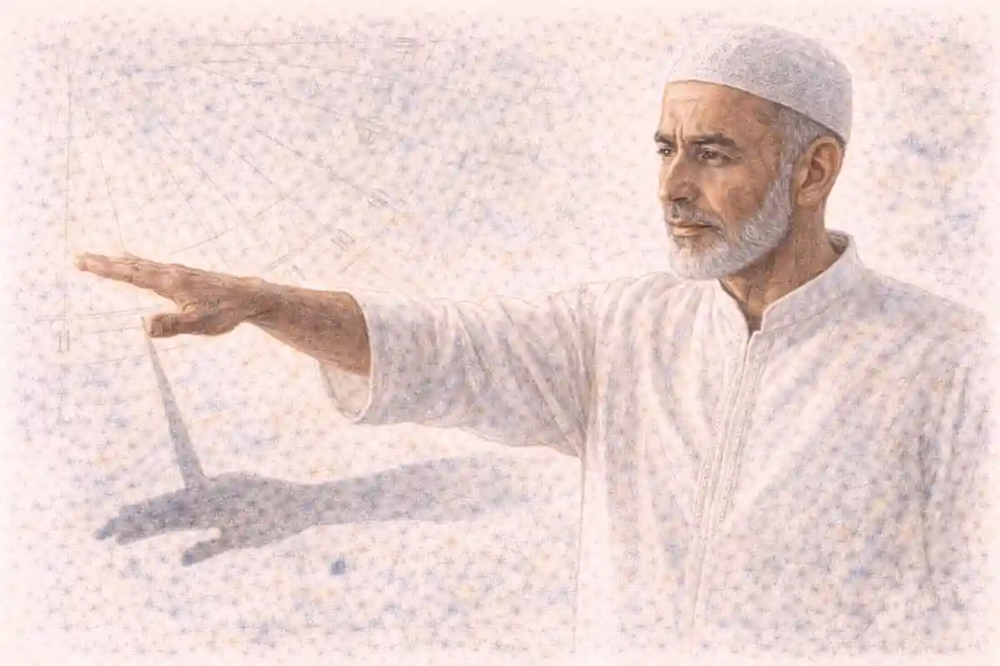

## Cold Open

Ysolde Rann writes her shopping list in the hour when the foundry office is quietest, and she writes it the way she has written every list since she was a girl at this same desk, with the notebook squared to the edge of the wood and the pen held short in her fingers so the letters stay small. Bread, she writes. Salt. Oil for the lamp in the back room. Thread, the dark kind. Soap. She writes each word as if it mattered that it be legible, because in the counting house side of the foundry legibility is a kind of honesty, and her father taught her that before he taught her the columns. The office smells of warm iron from the yard door, of paper kept too long in damp air, of the tea the morning clerk leaves to cool and forgets. Beyond the thin wall the yard men are calling to one another in the unhurried voices of men who have lifted the same weights in the same order for years, and a chain complains, and a cart wheel finds the rut it always finds. She hears all of it without listening. She has heard it all her life.

The notebook is not a fine one. It is the sort the foundry buys by the bundle for the benches, grey cover softened at the corners, pages ruled faintly and already curling in the heat that comes off the casting sheds even through stone. She chose it for that reason. A fine notebook would be noticed. A bench notebook belongs everywhere and nowhere, on a desk, in a coat, beside a scale, under a hand. She turns it a fraction, as her father used to turn a ledger when a visitor came in too quickly, so the page faces only her. Bread, she writes again in her mind, although the word is already there. Salt. She presses a little harder than she needs to. The pen is old and the nib drags if she is too light, or that is what she tells herself. She presses, and the letters darken, and the page takes the pressure the way a good page should, without tearing.

Beneath this page, separated from it by nothing more than the thickness of poor paper, is another list.

She does not look at it. She knows it by heart in the way she knows the stairs in the dark, not as words she could recite in order for a stranger but as a shape her hand remembers. That other list was written over three evenings, a few lines at a time, whenever the office emptied and the yard bell had rung and her brother had gone down to argue about a shipment or praise a bench crew or stand with his sleeves pushed up watching a pour. It names, in her smallest hand, the stamped alloy consignments that have passed through this yard under marks that should never have shared a bench, and beside each consignment the buyer mark that was entered in the day book and the buyer mark that was spoken of afterward, when the day book was shut. It is not a long list. That is part of what frightens her. A long list might be a muddle, a clerk copying wrong, a family firm grown careless with age. A short list, exact in every column, is a pattern. A short list says someone chose.

Her father founded the counting house side of this place when the foundry itself was already old, when the benches were owned by men who thought counting was a soft trade for soft hands. He proved them wrong in the only way that counted here, by never being wrong about a weight or a mark or a due date, and by keeping the books so clean that even the bonded inspectors from Carrowmere, who came expecting to find provincial slackness, left with their criticisms thinned to comments about the damp. She grew up in the smell of that probity. She learned the stamp book before she learned to ride. She knows what a stamp certifies, which is not the metal alone but the bench, the run, the hand that passed it, the firm that stands behind it if a seal fails in a bonded warehouse two canals away. Her brother runs the yard now, and runs it well, with their father's temper softened into something men will follow without flinching. He trusts the benches. He trusts the stamp because their father taught them both that a firm that lies with its stamp has already closed, whether the doors are shut or not. She has not told him what she found. That omission sits in the room with her every day, neat and terrible, like an extra chair.

She writes, Cheese, and then, after a pause, Eggs, and the nib drags again, and she presses, and at once, with a clarity that makes her stop with the pen still down, she understands what her hand has been doing.

The impression has gone through.

She lifts the pen. She does not turn the page. She does not need to. She can feel it in the way the paper gives, in the faint ridge under her fingertip when she brushes the surface below the shopping list, the ghost of letters pressed into the sheet beneath and, if she is honest, into the sheet beneath that as well. All week she has been writing ordinary things over the other list, using this page as a cover in the most literal and foolish sense, telling herself that a shopping list is invisible, that no one reads a shopping list, that the top page hides the one below. But paper does not hide pressure. Paper records it. Anyone who held this notebook at an angle to the light, anyone who ran a thumb across the next page while looking for a blank sheet, anyone idle or curious or tasked to be suspicious, would see the indentations rise like a shoreline when the tide goes out. They would not need the original. They could read the shadow of her writing from the page she thought was blank.

Her first thought, absurd and complete, is about the cheese. Her second is about her brother, down in the yard, calling a crew back from their break, trusting her with the office as he has always trusted her. Her third is slower and colder and it rearranges the room.

If she can see it, so can they.

They, in this thought, have no single face. They are the senior bench master who has begun, in the last month, to ask after her health in a voice that lingers. They are the buyer agent who now waits inside the office instead of at the gate. They are the cousin by marriage who took a counting job here in the spring and who asks, too often and too lightly, who keeps the stamp book after hours. She has been telling herself that her fear is a clerk's fear, bred from columns, that patterns in paper feel larger than patterns in life. She looks at the ridge under her finger and knows the paper is not exaggerating. The list beneath is no longer only in her keeping. It has been copying itself, page by page, every time she wrote about bread.

She closes the notebook. The movement is ordinary. She has closed it a hundred times. She places the pen in its groove. She folds her hands, which are a clerk's hands, ink at the side of one finger, nails cut short, a pale line where a ring used to sit before she took it off for work among the scales and never put it back. She is not, by any measure the yard would use, a remarkable woman. She keeps accounts. She mends her own coats. She remembers which carrier shorted a load three winters ago and which bench apprentice cannot be trusted near the fine scales until he has eaten. She is careful in the small ways that make a life hold together, and she was careful about the list too, except for this, except for the one property of paper she learned as a child and forgot under pressure, which is that pressure is exactly what paper keeps.

At the bell for the midday break she takes the notebook with her, because leaving it now feels like leaving a door open, and she goes out into the yard as she always does, with her tea in a tin cup and her coat over her arm. The yard is bright with the flat light that comes before heat. Forty crates stand in a row awaiting shipment, stamped and sealed for bonded carriage, roped in groups, their lids nailed and marked, the foundry stamp dark on the pale wood of each. She has entered every one of those crates in the book. She knows which bench packed which, which crew sealed which, which buyer mark waits at the far end of which canal. She stands where she always stands, by the pump, where the men do not crowd her and where she can watch without seeming to watch, and she looks along the row as a stranger might, trying to see only wood and rope and marks. Three of the crates, somewhere in the middle of the row, hold her attention for no reason she can name in words a clerk would accept. She tells herself she is tired. She tells herself fear makes patterns too. She drinks her tea, which has gone lukewarm, and she does not write anything down, and when the bell rings again she goes back inside and sits at her desk and opens the notebook to a fresh page, well past the list, well past its shadow, and begins, in her smallest and most ordinary hand, to write the approach she should have written days ago, following the published procedure she memorised when she first understood what the short list meant, step by step, in order, without ornament. Her hand shakes once, on the first line, and then it does not shake again. She presses no harder than she needs to. She has learned, late and completely, what pressing does.

## Tasking

Leyden tasked her in the small room above the Carrowmere desk where the canal noise arrived softened by height and the maps on the wall showed the approach roads as clean lines, as if roads were ever only lines. He laid out the cost before he laid out the case, which was his habit when the cost was the part he expected her to argue with, and Mira, who had learned to listen for what a man put first, listened accordingly.

The Office could not move openly on the Scour approach roads. That was stated plainly, without apology or decoration. The Accord had no standing in the Scour itself, and on the roads that leaned toward it the Office had only the standing that courtesy and old habit lent it, which dissolved the moment a marked vehicle or a uniformed escort appeared where it had no right to insist. So the extraction, if it ran at all, would run quiet and it would run incomplete in the way that mattered most to a field officer's instincts: there would be no vehicle inside the last four miles. However the woman was brought out of the foundry town, however clean the paperwork and however empty the road appeared, the final leg to the vehicle point would be walked, on foot, in whatever weather the session chose to send, and under whatever watching the other side chose to arrange. Leyden said four miles as another man might say a price, and he let it sit there. Reni Vosk would hold the vehicle point and the papers. Rask would go with Mira. Those were the arrangements. The rest was the case.

The woman was Ysolde Rann, a foundry clerk, and she wanted out, and she was carrying a list of her foundry's stamped alloy work, and the people she was leaving had, in Leyden's careful phrasing, begun to arrange themselves around the fact of her leaving before she had formally left. Mira asked how the approach had come in, and Leyden, who rationed truth as other controllers rationed money, surprised her by answering fully, because the manner of the approach was itself evidence and he knew she would weigh it as such.

Rann's message had been sent because of an impression in a notebook. The clerk had written a cover list over the real one and pressed too hard, and had seen the writing carry through to the page beneath, and had understood in that moment that anyone who held the notebook could read what she had hidden, and that therefore her time for deciding in private had already ended without her being consulted. She had moved at once, and she had moved correctly. Her approach to the Office had been textbook in form, Leyden said, and he used the word without irony: she had used the published defector approach procedure correctly, step by step, the right channel, the right phrase in the right place, no improvisation, no extra names, no plea for special handling. It was, he acknowledged when Mira raised it, exactly the approach a service would write for a bait if it wished the bait to be believed. It was also exactly the approach a careful clerk who had memorised the procedure out of fear would make. Both readings fit the same facts without straining. That, he said, was the case in miniature. She would have to go and stand where the facts were physical and read what could be read there.

Her state entering was full, and Leyden noted it on the tasking slip as if noting weather: rested by Office standards, which meant she had slept badly in the ordinary way since the second read that had cost her six hours in the previous case but one, and not in the new way that took an officer out of rotation. He asked, in the tone of a man completing a form, whether the sleep pattern still broke in the middle. She said it did. He wrote nothing down about that, which she understood to mean he had already written it elsewhere.

Then he said Rask's name, and the argument began, as both of them had known it would.

Rask was in the room by then, because Leyden did not enjoy conducting the same argument twice, and he stood by the map with his splinted left hand held a little away from his body, not cradled, not hidden, simply placed where nothing would knock it. The hand had been crushed holding a service gate at Mira's asking, in a house on a border station where a bound load had sat unfelt in the room that contained it, and she carried that fact into every scene with him now as a debt does not need to be mentioned to be present. She said he should not go. She said it to Leyden, which was discourteous and they all knew it, because the way to keep Rask out of a plan was to persuade Leyden, and the way to insult Rask was to do it in front of him. Rask, practical as ballast, let her finish. He said his stilling worked through his right hand and his stance, that it had always worked that way, that the left hand was for holding, for gates and rails and the shoulders of frightened people, and that a plan which needed his left hand to hold anything was a bad plan on paper before it was a dangerous one on a road. He said he resented being managed about it, and he said that to her, not to Leyden, which was fair. Leyden, watching the map as if the roads might settle the question, said the plan would be written so that nothing in it asked the splinted hand to hold, grip or bear weight, and that if the plan changed on the ground so that it did ask, then the plan was to stop, and that condition would be entered as an instruction and not as a courtesy. Mira asked who would judge that on the road. Rask said he would, and she would, and either of them could call it, and she heard in that the shape of an agreement she could live with, because it gave the debt a rule instead of a mood. She nodded. He nodded. Leyden wrote it down, and the writing down mattered to all three of them for different reasons.

Petra Dunmore, at the Carrowmere desk, joined by telephone for the papers: a bonded inspection pretext that would put Mira lawfully in the foundry yard, a wage query that would put her briefly in a room with Rann without remark, a vehicle point staffed by Reni with papers that would hold for exactly as long as papers needed to hold if no one with authority chose to test them early. Petra's voice on the line was dry and exact and she corrected Leyden once, about a form number rendered in words, with the pleasure of a woman who corrects controllers for the good of their souls. The notebook would need to be read, if Rann would allow it to be handled. The list itself named stamped alloy consignments and their buyers' marks. The crates Rann most wanted read closely were, Petra said, already shipped and gone beyond any anchor Mira could reach, which Leyden repeated, looking at Mira, because a Weigher without an anchor was a witness without a document, and everyone in the room understood that limit and none of them pretended it away.

Mira kept a private register of absences in a notebook in her coat pocket, against Leyden's instruction to stop, and Leyden, glancing once at the coat on its hook, chose not to make the tasking into the occasion for that quarrel. She was glad of the omission and distrusted her gladness in equal measure.

Before she left, Leyden named the cost again, because he believed costs named twice were harder to forget under pressure. Four miles on foot. No vehicle inside them. Rann's family business standing behind her like a house she was walking out of with the door left open behind her. Rask one handed. The short road and the long road both to be read before either was used, and the reading, not the map, to decide. Mira repeated the conditions back, which was the form, and Leyden signed the slip, which was also the form, and Rask held the door for her with his right hand, deliberately, and she went out into the canal air with the tasking in her head arranged in the order she would need it: the woman, the notebook, the yard, the roads, the walk.

She walked the length of the canal basin afterward with Rask, not because the tasking required it but because plans made in rooms above maps had a way of sounding cleaner than they would feel with wet stone underfoot, and she wanted to hear how he spoke about the roads when there was weather in his face. He spoke about them practically, as he spoke about most things, naming surfaces and gradients and the places where a cart would force walkers into single file, and he did not once use his left hand to point, using his chin or his right hand instead, and she noticed and said nothing, because noticing aloud would have been another form of managing. Reni Vosk met them by the bonded warehouse gate, twenty one years old and carrying the vehicle papers in a folder held exactly as she had been taught to hold it, with the seal outward, and she rehearsed the vehicle point procedure back to them without prompting and without flourish, the waiting, the receipting, the order in which signatures would be taken if signatures were taken at all. She was junior enough to believe procedure was a kind of protection, and Mira, who knew procedure was only protection when everyone in sight agreed to honour it, found she did not want to correct the belief before it was needed. Rask asked Reni what she would do if no one arrived by the second bell past the arranged hour, and Reni said she would wait one further bell and then withdraw by the canal road and burn nothing and carry the papers out on her person, and Rask nodded as if she had answered a question about the weather. That, too, went into Mira's arrangement of the case: a young officer at the far end of a four mile walk, holding an empty road and a folder, trusting that the people walking toward her had read the ground correctly. Leyden's cost, restated in that image, stopped being a line on a slip. It became a distance that frightened people would have to cross at walking pace, with no roof and no engine and no right to demand help from any house they passed. She turned it over once more as they parted, Rask to check his kit one handed without help, Reni to file the papers and wait for her orders in writing, and she kept her own counsel about the textbook approach and the bait reading that Leyden had left deliberately unresolved, because some questions could only be settled where paper met wood and iron, and she intended to stand there and settle them.

## Ground Truth

The foundry town announced itself first by sound and then by smell and only afterward by sight, which Petra Dunmore had said was the correct order for a town that worked metal for a living and regarded visitors as a category of weather. Mira arrived under a bonded inspection pretext that was established on the page before it was used anywhere else: a routine inspection of sealed consignments awaiting bonded carriage out of Carrowmere territory, authorised at the desk, entered in the inspection book at the town gate by a clerk who checked the seal on her warrant twice and the signature once, and countersigned by the foundry's own gate keeper, who noted the hour in a hand so regular it might have been printed. The pretext was not a lie in the way that mattered to the people who honoured such things. There were consignments. They were sealed. They awaited carriage. An inspection was due in the ordinary rotation, and Petra had simply moved its date and chosen its inspector, which is the most durable kind of cover because every individual statement in it can survive being checked. Mira wore the inspector's grey coat and carried the inspector's board and weights, and Rask, who could not plausibly inspect anything one handed without inviting comment, waited with the cart at the livery by the short road junction, in the role of a hired driver nursing an injured hand, a role that required him to sit, to watch the road, and to be underestimated by anyone who glanced at him twice.

The yard, entered lawfully through the main gate with the gate keeper walking ahead calling the inspection out to the benches in the tone of a man announcing rain, was larger than the map room had allowed her to feel and louder in its quiet parts than in its loud ones, because the loud parts, the hammers and the pour and the chain hoists, were honest noise that covered thought, while the quiet parts, the counting house steps, the stamp room door, the sealed row waiting for shipment, seemed to hold their breath in the way of places where men have recently agreed not to say something. She worked the inspection as an inspection, because anything less would have insulted the cover and endangered the clerk who had countersigned her. She checked seals against the day book. She checked rope and nail and lid mark. She asked the yard questions an inspector asks, about storage off the ground and drainage after rain, and the yard master, who was not Rann's brother, the brother being down at the far benches with a pour, answered her with the wary completeness of a man who has survived many inspections by treating each one as real.

And then, in the ordinary course of that real inspection, she came to the row of forty crates awaiting shipment, stamped and sealed for bonded carriage, and she read the yard.

She read it the way she read any place where work had been done at intensity for a long time, by standing still with her hand resting lightly on the first crate lid as if checking its fixings, and letting the weight of the place arrive in the order it wished to arrive, which was never the order of the eye. Casting came first, the deep, old, repeated heat of it, not heat as temperature but heat as event, the sustained intent of men tending something dangerous and valuable through the hours when a mistake would cost more than money. Handling came next, layered and practical, shoulders and grips and the brief flares of temper when a load shifted, and storage after that, the long, dull patience of wood and metal waiting under a roof while weather moved outside, and grief, a little, in the corner by the oldest bench, where someone had plainly died years ago and been mourned at his work by men who had no other place to do it. All of that was normal. All of that was a foundry yard being a foundry yard, weight laid on weight across years, metal and stone holding it best, as they always held it best, the lids under her hand warm with stored significance in a way no thermometer would ever confirm. She moved along the row slowly, as an inspector moves, pausing, noting, touching, and the row read normally under her hand, crate after crate, the weight of casting, handling, storage, men working, until it did not.

Three crates in a row read as nothing at all.

She did not stop. Stopping would have written her discovery on her back for anyone watching from the stamp room door, and she had felt, without yet seeing, that the stamp room door was occupied. She let her hand travel on across the first silent lid, across the second, across the third, noting with the part of her mind that kept lists that the seals were sound, the rope was sound, the stamps were dark and clean, and that under her palm there was no casting, no handling, no storage, no patience, no temper, nothing, a clean and complete absence where the busiest kind of presence should have been. Then the fourth crate read normally again, almost rudely normally, a wash of ordinary foundry weight that made the silence behind her feel louder by contrast, and she went on to the end of the row breathing as evenly as she had breathed at the start of it, and wrote a line about drainage on her board, and asked the yard master a question about the far gate, and heard him answer without taking in a single word.

Forty crates. Thirty seven reading as crates in a foundry should read. Three reading as if they had never been cast, handled, stored or stood in a yard at all, as if the wood and metal under her hand had been excused from history. She thought, with a discipline she had practised since she was a trainee and had been ordered more than once to abandon in favour of instinct, of the other absences she had stood beside: of [doors in Valtessa whose perfect seals had held nothing behind them](/2026/11/11/nightjar-seal-that-wasnt-011/), where an absence had concealed bindings specifically, hiding what was there under a show of nothing; of [a reading room in Melora where an absence had been caught retreating slowly toward a door](/2026/11/12/nightjar-slow-fade-012/), measured decaying, retreating at a pace that could be timed; of [a bound load on a border station whose binding could not be felt where it sat](/2026/11/13/nightjar-inert-house-013/), and of a Binder in custody in that same case saying that hiding a binding was impossible, and lying. Each absence had differed from the others in its behaviour. This one differed again, or seemed to, because it was not spread across a room or a load or a doorway. It sat in three crates and nowhere else in a yard full of comparable objects, and it sat there exactly, without feathering at the edges, without touching the crate on either side. She made the inspection last its proper length. She signed the yard book where an inspector signs. She thanked the yard master in the words inspectors use, which convey gratitude for cooperation and no opinion whatsoever about what was found, and she walked out through the main gate with her board under her arm and the three silences arranged in her mind like three unmarked graves in a tended churchyard.

Rann she met once that day, briefly, under cover of a wage query, in the counting house side room where queries about bench wages were taken so that men need not discuss money in the yard. The query was real, Petra having found a discrepancy in a carrier's wage chit that a clerk could plausibly be asked to explain, and Rann explained it in under a minute with a competence that made the cover feel thin, because a woman this exact would have an exact reason for everything she did, including leaving. She was ordinary in the way Mira had been told and in the way that mattered: a clerk's dress, a clerk's hands, ink at one finger, a face that would not be picked out of a market crowd by anyone who did not already know it. Only her stillness was remarkable. She stood the way people stand in rooms where they have decided something and are waiting for the decision to become an event. When the wage query was done and the carrier, satisfied, had gone out whistling through his teeth, Rann, without looking at the door, said the notebook was in her desk and that Mira might, if she were an inspector with a query about a consignment weight, reasonably ask to see the bench notebook that recorded it. Then she went out herself, and left the desk drawer unlatched behind her with the ease of a woman merely going to fetch a file from the next room.

The notebook read badly, as paper always read badly, paper and cloth holding weight worst of all the materials she worked with, and even so she felt it. She stood at the desk with the notebook open at the bench page Rann had indicated, her hand flat beside it rather than on it, because a notebook is a small anchor and a hand laid full on it can drown its faint record in the reader's own weather, and she let the poor, thin weight of it come up through the paper. Fear was there, unmistakably, in the pressing. Not the fear of the moment of writing, or not only that, but fear laid down in passes, evening after evening, a hand bearing down harder than the nib required because the body insists on pressing when it cannot speak, sustained intent braided with dread in the small repeated act of writing a list that could close a family business. Beneath that, fainter, the ordinary affections of a working book: tedium, pride in a neat column, irritation at a blot. The fear was not theatrical. It did not perform. It sat in the indentations the way water sits in a footprint after the foot has gone, and it told her nothing about who had caused it, because weight never records identity and never speaks of who, only of what was felt and how strongly and for how long. It could not tell her whether Rann was genuine. It could tell her that whoever pressed that pen had been afraid over days, in this room, in a pattern that matched the story of a clerk writing a dangerous list a few lines at a time whenever the office emptied. A bait, she reflected, could be taught to press hard. A bait could be given a notebook prepared by other hands. She closed the book gently and latched the drawer herself, and put both possibilities back into the box in her mind where she kept things that evidence had not yet earned the right to decide.

The crate table was Petra's idea, executed in Mira's hand on the inspection board's reverse that evening in the livery loft, with Rask reading the stamp groups back to her from her own yard notes so that no group was entered from memory alone. It listed forty crates by stamp group, origin bench and read result, and it settled, in plain rows, the question that impressions and arguments could not settle between them: whether the silence in the yard had been a mood of hers, a tired reader's gap, or a property of certain crates and no others. The table settles that question, and what it settles is this: the silence follows the stamp, and nothing else in the row.

| Stamp group | Origin bench | Crates in row | Read result |
|---|---|---|---|
| Fenwick group | North bench | nine | Normal weight of casting, handling and storage |
| Fenwick group | Long bench | eight | Normal weight of casting, handling and storage |
| Hallow group | North bench | seven | Normal weight of casting, handling and storage |
| Hallow group | Kiln bench | six | Normal weight of handling and long storage |
| Carrow group | Long bench | four | Normal weight of casting and handling |
| Carrow group | Kiln bench | three | Normal weight of storage and handling |
| Rann group, single stamp | Counting house bench | three | Nothing at all, no weight recorded |

She studied the rows until the rows stopped being numbers of crates and became a shape. Seven groups, six of them ordinary in every particular that a reader could test, one of them silent. The silent three shared a stamp, and the stamp was not scattered across benches or runs as a flaw in metal or a quirk of storage might scatter. They stood together in the row because they had come together from the bench, and they read together as nothing because, whatever had been done to them or in them, it had been done to that stamp group and to no other. Rask, reading over her shoulder with his right hand holding the lamp and his left held clear of the table edge, said that a table was a comforting thing until you noticed it was an accusation, and she said that was why clerks ran the world and soldiers only visited it, and he almost smiled, which in Rask was a significant diplomatic event.

The roads remained, and she read them the following day in the manner of a woman walking to a carrier's cottage about a wage chit, with a basket over her arm and no board, no grey coat, nothing to inspect with except the body she had been given and trained. The short road ran direct from the foundry town to the vehicle point, a handsome road by local standards, metalled in its lower stretch, hedged in its upper, the sort of road a map makes look like an answer. She walked a portion of it openly and read the rest from the junction copse where the road narrowed between old stone banks, her hand resting in the bank's moss as if she were merely a traveller steadying herself on the slope. What came back from the short road was not subtle. Four men, waiting, twice in the span of days that the road could remember clearly, patient, professional, the weight of sustained intent laid over two separate occasions in the same places: at the narrowing, at the bridge foot, at the bend where the hedge gave cover and the ditch gave silence. It was not the weight of travellers or of lovers or of poachers, all of which she had read on roads before and all of which had a looseness to them, a wandering of attention. This had the evenness of men who had been given a task and a place and a description, and who had rehearsed their patience until patience itself became a kind of uniform. She stood in the copse a long time after the reading thinned, watching the empty road perform its innocence, a cart passing, a woman with geese, the light going gold on the metal surface, and she understood that the road was not empty at all. It was furnished. It was ready.

The long road read ordinary, which is a word she distrusted and used anyway because it was accurate. She walked it in sections across the day, as a driver waiting for a load might walk to pass the time and take the air, and she learned it with her feet as well as with her gift, because a road you may have to walk in fear, at pace, with a frightened clerk beside you, must be known in both languages. Four miles, from the short road junction to the vehicle point where Reni would wait with the papers. The first mile was canal side, flat, towpath hard underfoot, good cover from the reed beds on one side and none worth the name on the other, where the water lay open to the sky. The second mile climbed gently through worked fields on a farm track of packed earth and stone, firm in dry weather, honest in wet, with a wall running alongside that a walker could keep between herself and the foundry side of the country. The third mile was the difficult one, and she walked it twice to be sure she was not inventing difficulty out of caution. There the long road crossed an open shoulder of land, exposed, the cover falling away to cropped grass and a single stand of trees too far from the line of the road to be reached quickly, the wind arriving unimpeded, any figure on that stretch visible from the ridge path for a long way in both directions. One exposed stretch, she noted, perhaps a quarter of the whole, perhaps less, but placed by geography exactly where tired walkers would be slowest and most committed, with no turning that did not advertise itself. The fourth mile descended through a lane of overhanging trees to the vehicle point, cool and shadowed and smelling of leaf mould, the sort of descent that makes walkers careless with relief, and she marked that carelessness in herself and resolved to spend it nowhere. Surfaces, cover, exposure, descent: she entered them in her notebook in an inspector's shorthand that any reader would take for notes on drainage, and underneath, in her own private register, in the coat pocket book Leyden had told her to abandon, she entered the other geography, the one of weight: short road heavy with waiting men, long road ordinary, one stretch exposed, three crates silent in a row of forty.

That evening, in the livery loft, with Rask mending a strap one handed and swearing at it in an undertone that was almost contentment, she stated the three live possibilities fairly, aloud, because stating them aloud to a sceptic was the closest thing to a fair hearing the case would get before it became action. First, Rann was genuine: a clerk who had found a pattern, feared it correctly, and followed a published procedure because procedure was the language she trusted. Second, Rann was bait: her approach textbook because it had been written for her, her fear real because good bait is always given real fear to carry, the list a shaped gift intended to draw an Office officer onto a watched road at a predictable hour. Third, Rann was genuine and already followed: her own people had read the same impression she had read, in the same notebook, perhaps before she had understood it herself, and the waiting on the short road was not an ambush for an officer but a net for a clerk, which would close on whoever walked beside her as a matter of simple arithmetic. Rask listened without interrupting, which was his way of taking a thing seriously. When she had done, he asked which of the three the roads believed, and she said the roads believed the third and the second equally, because roads record waiting, not reasons, and he nodded and said that was the trouble with evidence that could not speak, it left the speaking to people, and people were the least reliable instruments in any office. She did not disagree. She sat with the crate table between them, its rows settling what they settled and refusing, honourably, to settle anything more, and she knew the case would turn not on the yard or the roads but on what Rann did next, at the second meeting, when the price of belief would be named and someone would have to decide whether to pay it.

She returned to the yard the next morning on a narrower pretext, a follow up query about two seals whose numbers in the day book differed by a single stroke of the pen, and the gate keeper, who had begun to treat her as a fixture of the season, waved her to the counting house with the air of a man granting a favour to the weather. The discrepancy was real, as Petra's discrepancies always were, being selected rather than invented, and it gave her a lawful reason to stand once more where she could see the sealed row through the counting house window, framed by the window's old glass so that the stamps swam a little and then settled. From that distance the row was only wood and rope again, and she was grateful for the lesson in it: the eye saw forty crates, the hand had found thirty seven histories and three refusals, and neither sense could do the other's work. A junior yard hand came in with a chit and, while he waited for Rann to return from the stamp room, talked to fill the silence, as young men do in offices where silence feels like accusation. He talked about the shipment, about which canal it would take, about the buyers' marks chalked and then inked, about the pride the benches took in a row that left the yard without a single seal questioned at the Carrowmere bonded warehouse in as long as he had worked there. She asked the sort of questions an inspector asks a yard hand, which are mostly invitations to keep talking, and she learned, without asking for it directly, that the list Rann carried was understood in the yard, if it was understood at all, as a counting house quarrel about marks: the foundry's stamped alloy consignments went out under buyers' marks that were entered twice, once in the day book that everyone saw and once in a speaking book that no one called a book, and the difference between the two entries was where the money, or the favour, or the danger, lived. The hand left with his chit signed by Rann, who had returned without Mira hearing her return, and Rann, passing close with a file in her arms, said in the voice of a clerk discussing a seal number that the crates she most wanted read closely were not in the yard at all. They had shipped. They were gone beyond any anchor she could reach, down the canal, through locks, into warehouses where other clerks with other notebooks were entering their marks without knowing what the marks carried. It was the limit that bit hardest in the whole case, and Rann named it without self pity, as a fact of distance: a Weigher needs a physical anchor, a thing or a place that was there when the event laid its weight down, and a consignment dispersed beyond reach might as well have happened in a story. What remained in the yard were only its kin, three crates of the same stamp and bench and run, waiting for a shipment that had not yet been called. If those three could be read, they would have to speak, by resemblance, for the ones that were gone, and resemblance, Mira knew, is a kind of evidence that persuades officers and fails in courts, which was perhaps why Leyden had sent a reader and not a lawyer.

Petra, by telephone that afternoon from the Carrowmere desk, read back the consignment history as the desk held it, in her dry voice, with the pauses of a woman turning pages she did not trust to be complete. The stamped alloy work of Rann's foundry had grown, over several sessions, from a local trade in fittings and seal plates into a quiet speciality: small, exact castings whose virtue lay not in their size but in their certification, pieces that would be built into bonded doors, strong room fittings, lock housings and the sealed mechanisms of warehouses and counting houses across the member territories. A stamp on such work was not decoration. It certified that the alloy was what it claimed to be, that the bench that cast it was licensed to cast it, and that the firm would answer for it if a seal failed or a door gave where it should have held. That was why the buyers' marks mattered, and why a second set of marks, spoken rather than written, was a corruption with consequences that travelled: a casting stamped as one alloy and delivered as another, or stamped by one bench and cast by another, would carry its lie into every door and housing it entered, and would hold that lie silently, under load, for years, until the day it was asked to perform the one duty its stamp had promised. Mira listened with the telephone warm against her ear and thought of the three silent crates, and of what it meant that the silence clung to the stamp group and to nothing else in the row, and she was careful, as she had been trained and as she had trained herself, not to run ahead of what a reading could support. The crates read as nothing. That was the finding. What had been done to make them read so, and whether the nothing hid a binding, a substitution, or some practice for which she had no name yet, were questions the yard had not answered and the table, for all its settling power, honourably refused to answer for it.

Reni telephoned in the evening, from the vehicle point end of the line, which in practice meant from a carrier's office two miles beyond it where the owner allowed Office messages to be left in a sealed book. She reported the vehicle point exactly as she had rehearsed it: the lane, the turning place, the cover for a vehicle that must wait without advertising that it waited, the papers in their folder, the order of receipting if a list were handed over, the fallback road if the lane were blocked by farm traffic or by design. She reported also, with the slight embarrassment of a junior officer who fears she is adding colour where colour is not wanted, that a man had asked at the carrier's office whether the lane was much used by walkers coming over the shoulder from the foundry side, and had accepted the owner's answer, which was that everyone used the short road, with a nod that suggested he had expected it. Mira thanked her in the tone that conveys that a report has been received and valued and is not to be repeated to anyone else on the line, and sat afterward with that small fact turning slowly among the larger ones. It might be nothing. Men asked about roads for reasons as various as weather and courtship and strayed stock. It might be the first touch of a hand on the long road, which until that moment had read ordinary and felt, in the walking of it, unconsidered by the other side. She entered it in her register without underlining, because underlining in a register is a way of lying to your future self about how certain you were, and she had seen officers ruin good cases by falling in love with their own early emphases.

Rask, for his part, walked the fourth mile of the long road at dusk, in his driver's role, carrying a parcel for the carrier's cottage that gave him every right to be there, and he reported the lane as he reported everything, in terms of what a body could do on it. The descent was sound. The trees would hide a vehicle until a walker was close enough to be committed. A man with a splinted hand could stand in that lane and still, through his right hand and his stance, a space the size of the lane's width for as long as his strength held, but he could not hold a gate across it, could not grip a rail and bear weight, could not be the hinge of any plan that required the lane to be shut by muscle. He said this without looking at the splint, and she received it without looking at it either, and between them the condition Leyden had written held its shape: the plan would ask his right hand for stilling, his feet for standing, his judgement for the calling of a stop, and it would ask his left hand for nothing at all. She thought of the gate on the border station, and of his hand going down under a load she had asked him to hold, and of the sound the house had made around that moment, and she put the thought where she put all debts that could not be paid on the day they were remembered, in the part of her attention that governed small decisions: who walked on the exposed side, who carried the heavier bag, who was never, under any rearrangement of the plan, to be asked to hold.

By the end of the second day she had, therefore, a set of findings that were solid in the way that findings are solid when each rests on a different kind of ground. The yard, read by hand, gave three silences in a row of forty. The table, made from notes checked aloud by two people, gave the silence a boundary, and the boundary was a stamp. The notebook, read as paper can be read, gave fear over days in a pressing hand. The short road, read from its bank, gave four men waiting on two occasions, patient and professional. The long road, walked and read in sections, gave ordinary weight, four miles of known surfaces, one exposed stretch on an open shoulder, a descent through trees to a vehicle point held by a junior officer with correct papers and a good memory for procedure. And the list, which she had not seen and might never be shown in full, gave the case its meaning in advance: names of consignments and buyers' marks, a pattern a clerk had assembled in evenings, a pattern that could close the business her father had built and her brother now ran, if it reached the Office and was worked as such lists are worked. She laid these findings out for Rask in the loft in that order, without ranking them, and he listened with his boots off and his splinted hand resting on a folded coat, palm up, like something that belonged to someone else and had been left in his care. When she had finished he said the case reminded him of a still pond on a farm he had worked as a boy, which had looked empty until you understood it was empty because something had eaten everything in it, and she said that was an unprofessional contribution to an evidence review, and he said she was welcome, and the loft was quiet for a while with the horses moving below them, and neither of them said the word bait, because by then the word had stopped being a label for a possibility and had become a question about a woman, and questions about people, unlike questions about crates, could be answered by what the person did when doing the right thing cost the most. The second meeting was set for the following day, in the counting house, under the same wage query cover, extended. Rann had asked, through the channel Petra maintained, for the meeting to be longer. Bait, Mira reflected as she banked the lamp, is not usually given the opportunity to ask for more time in which to incriminate itself. Genuine frightened people ask for time because time is the only currency they have left. She did not write that reflection in the register. Some thoughts she kept for the walking, where they belonged.

## The Collapse

The reasonable reading died on a wet morning in the counting house, and it died without drama, which was how Mira knew afterward that it had died for good, because the deaths of theories in her experience were rarely theatrical; they were clerical, a document placed on a desk, a column that would not reconcile, a name appearing where a name should never have been allowed to appear if anyone involved had intended to survive the transaction.

She had come, for the second meeting, under the extended wage query cover, with the carrier's chit book in her bag and a question prepared about overtime at the locks that would reasonably occupy a clerk and an inspector for the better part of an hour. Rann received her in the side room with the door shut, which was a change, and with the shutters half closed against the yard, which was another, and Mira noted both changes and set her bag down and did not sit until Rann sat, because in rooms where frightened people are about to do irreversible things the courtesies become a kind of scaffolding, and removing any piece of it too quickly can bring the whole structure down crooked. Rann's brother could be heard in the yard, not his words but his presence, the rhythm of a man moving among crews who trusted the rhythm. Rann heard it too. She folded her hands on the desk between them, unfolded them, and then, with the decision visible in her shoulders rather than her face, she took from the desk drawer a single sheet, folded once, and laid it flat in front of Mira and smoothed it with the side of her hand as if it were a cloth that had wrinkled in keeping.

It was the foundry's own consignment ledger page. Not a copy in a clerk's hand, not a summary, not a memorandum prepared for a sympathetic reader, but the page itself, with the day book's ruling and the entries in two inks and the stamp impressions reproduced in the margin where the counting house recorded which stamp had been applied to which consignment, and at the head of the relevant column, entered in the senior hand that Mira recognised from the yard book as the hand of the house itself, the name of Rann's family foundry as the stamper of the three silent crates. The page named the bench. It named the run. It named, by their marks, the buyers who were to receive what those crates contained, and it did so in a form that any desk in Carrowmere could work from without further testimony from anyone. If this page reached the Office, and Rann knew, as she sat there with her hand still resting beside it, that placing it in front of an Office officer was the same thing as sending it to the Office, then the foundry's bonded licence would be suspended on the stamp evidence alone, the counting house her father had built would be closed and audited and picked apart by men who had never lifted anything heavier than a warrant, and her brother's name, which was also her father's name, would be entered in the kind of register from which names do not return to ordinary trade. She knew all of that. She had written the list that proved she knew it. She brought the page anyway.

Mira understood, in the silence that followed, why the bait reading could not survive the document. A bait is given something that costs her handlers nothing. That is the economy of the thing, understood by every service that has ever run a defector as a lure: the material offered must be valuable enough to draw the other side into the open and cheap enough to be disowned when the trap closes, a shaped gift, a plausible list, a set of names already burned or already false. No handler writes his own firm's ruin into the bait's hands and sends her out with it, because handlers, whatever else they are, are accountants of risk, and this page was not a risk. It was a certainty of loss, total and immediate, falling not on strangers but on the woman's own family, her own name, her own father's life's work, in a form that could not be recalled once it had been seen by the eyes it was now in front of. If Rann were bait, the page would not exist in her keeping. If it existed, she would not be allowed to carry it to a second meeting in a shut room. If she carried it, she would not lay it down and smooth it flat and leave her hand beside it, empty, while the officer across the desk read the names. People could be trained to perform courage. They could be trained to weep on schedule and to press hard on a pen. What they could not be given, by any handler who intended to use them again, was the genuine means of their own family's destruction, because genuine means have a way of being used genuinely. The reasonable reading, which had fit the textbook approach and the prepared fear and the waiting road so neatly for two days, folded under the weight of a single sheet of ruled paper, and Mira let it fold without regret, because she had never loved it. She had only respected it, as she respected any reading that evidence had not yet earned the right to dismiss.

She asked Rann, in the voice she would have used about a seal number, why she had brought the page and not only the list. Rann said the list was hers and could be called a clerk's invention, a grudge set down in columns, a woman's fancy dressed as figures, and that men who wanted not to believe it would find that description ready made and comfortable. The page was the house's. The page could not be called anything except what it was. She said her brother did not know, and that she would be the one to tell him if telling became possible, and that if telling did not become possible she understood what that meant as well. She said she had not brought it to purchase belief, a phrase she used with a clerk's precision, because belief was not a commodity the Office traded in at desks like this one, but to close the other door, the door behind which she might still, at some hour of the night, have persuaded herself to go back to her desk and burn the list and let the stamps go on certifying what they certified until a door somewhere failed under load and killed whoever stood in front of it. Her voice did not rise at any point in this speech. It was the least dramatic act of self destruction Mira had ever witnessed, conducted in the grammar of accounts, and it rearranged the case around itself as completely as the three silences in the yard had rearranged the meaning of forty crates.

When the page had been folded again and placed, by agreement, inside Mira's chit book, where a page among pages is less remarkable than a page in a woman's hand, Mira asked for the notebook. Rann gave it without negotiation, which was itself a kind of testimony, and Mira read the impression herself, there, in the shut room, with the yard audible beyond the shutters and Rann's brother's crews calling a load up from the far benches. Paper holds weight worst, and she reminded herself of it as she worked, because the faintness of paper can make a reader strain, and straining invents. She did not strain. She opened the notebook at the shopping list, lifted that page with two fingers, and laid her attention, rather than her palm, on the page beneath, on the indentations where the pen had carried through, and she read the shadow list in the only way a shadow can be read, by its pressure. The fear in the pressing hand was there. It was there in the deepening of the strokes where the hand had slowed, in the regularity of the returns, evening after evening, in the small, repeated, sustained intent of a person writing what she believed would ruin her if it were found and would ruin others if it were not. It was not the fear of a performer, which in weight has a gloss to it, a self regard, a listening for an audience in the next room. It was private fear, worn smooth by repetition, the fear of a clerk at a desk after hours with the lamp low and the yard bell silent. Weight could not tell her who had caused that fear, and it could not certify that the list was accurate, and it could not replay a single evening in that room for her inspection, because those were things weight never did, for anyone, at any price. What it could do, and did, was confirm that the hand which made those impressions had been afraid over days in exactly the pattern Rann had described, and that no second hand had interfered with the page, and Mira closed the notebook and returned it and saw Rann receive it as a person receives back a confession she had feared would be kept as evidence against her character rather than as evidence for her cause.

The yard she read a second time that afternoon, on the strength of the seal query that had served her before, and she read it more narrowly, as a reader reads a single paragraph after reading a chapter. She did not need the whole row. She needed the three, and their neighbours, and the stamp room's account of itself. The neighbours read normally, with the honest clutter of casting and handling. The three read as nothing, again, in the same order, with the same clean edges, as if the intervening days had not touched them because there was, in the terms her gift understood, nothing there to touch. And this time, with the ledger page in her chit book and Rann's spoken bench name in her memory, she checked the stamps with her eyes as carefully as she had checked them with her hand: one stamp, on all three. One bench, named in the page and in the day book and in the chalk that had faded on the lids. One casting run, entered as a run and closed as a run, the metal poured in a single sequence under a single crew whose names were ordinary names that she memorised and would later write, in words, in her register. She referred, standing there with her hand on the middle silent lid, to the crate table she and Rask had made in the loft, and the table held: seven groups, six ordinary, one silent, the silence following the stamp and nothing else, confirmed now by a second reading and by a document that no bait would have carried. Whatever else the case still held, and it held a road full of waiting men and a four mile walk and a junior officer at the far end of a lane, the foundry portion of it had closed its account. The three crates were silent because of something done to their stamp group. The woman who had told her so had paid, in advance, the full price of being believed.

On the short road, that same afternoon, a watcher sat in the narrowing between the stone banks where the hedge gave cover and the ditch gave silence, and he watched the road in the manner of a man who has been given a place and a description and a patience that is not his own but has been issued to him like a coat. His viewpoint, framed once and not again, was a simple one, assembled from the facts his employers allowed him and from the one fact he had worked out for himself in the long hours of waiting, which made it more durable than the rest. He knew the clerk would come this way if she came at all, because this was the road anyone would choose who had not read it as he had read it, sitting in it until its habits were his habits. He knew an officer would walk beside her, because officers walked beside valuable clerks as porters walked beside valuable luggage. He did not know the officer's name or gift, and he did not care, because names and gifts were counting house matters and his trade was roads. What he knew for himself, and knew correctly, was what would happen to the clerk's family when the walk was done. He had seen it happen to other families in other towns where a firm had been useful to an office for exactly as long as its information lasted. The Office would take Rann's list, he thought, settling his weight more comfortably against the bank, and it would receipt it, and file it, and work it with great efficiency, and her family's name would fall where it fell, in the ditch, by the road, in the registers, and no officer walking beside her now would be walking beside her then, because that was not how offices survived. They survived by using people completely and grieving them briefly, if at all, in memoranda. He was right about that one thing, operationally, in a way that Leyden, if pressed in a room with no windows, would not have denied: the Office would use Rann and let her family's name fall where it fell. Where the watcher was wrong, and he had no means of knowing it, was in his assumption that this knowledge would have stopped her. He believed everyone had a price at which they went home. He had never met a clerk who had read an impression in a notebook and understood that home, as a place she could return to unchanged, had already ceased to exist on the evening she first pressed too hard.

Mira, leaving the yard by the main gate with the chit book heavier in meaning than in any other measure, passed the junction where the short road began and did not take it, even for the walk back to the livery, choosing the lane that looped by the canal instead, because she had read the short road and she believed her reading, and belief, after the counting house, had become a practical discipline rather than a state of mind. Rask was waiting where she had left him, with the cart and the horses and a driver's patience pulled over his features like a cap, and she told him, in the order that mattered, that the bait reading was dead, that the ledger page existed and what it named, that the yard had confirmed itself on a second reading, one stamp, one bench, one casting run, and that the crate table had held under both the document and the hand. He listened with his splinted hand resting on the cart rail without gripping it, a distinction he maintained with the stubbornness of a man proving a point to his own body, and when she had finished he asked only whether Rann understood what the page would do to her family, and Mira said she understood it in the grammar of accounts, which was the only grammar in which such a thing could be understood completely, and Rask nodded and said then they had a walk to prepare for, and neither of them named the short road, because the short road had been read and refused in advance, and the long road, four miles of towpath and farm track and open shoulder and tree covered descent, was waiting to be walked by three people, one of whom was frightened in a way Mira now carried in her own chest from the yard and the notebook, a portion of that fear taken on as every read exacted its portion, cold settling into her hands in the warm afternoon as predictably as a tide. She flexed her fingers against the cold and thought about sleep, which would not come properly that night, and about the exposed stretch where there was no cover worth the name, and about Reni at the far end with her folder held seal outward, and she began, with Rask beside her saying nothing that did not need saying, to arrange the walk in her mind in the order she would need it when arranging it in words alone would no longer be enough.

They prepared the walk in the livery loft that evening with the crate table open between them and the ledger page, folded, resting under the chit book where neither of them would have to look at it while they worked. Preparation, in Rask's philosophy, was a form of respect for the future, and he conducted it as other men conducted religious observances, completely and without commentary on its meaning. The bags were weighed by hand and then by scale. The papers were divided so that no single person carried everything whose loss would end the case. The order of walking was settled for each mile separately, because a towpath and a farm track and an open shoulder are three different countries with three different laws, and a formation that is prudent in one is a procession in another. Reni's signals were rehearsed until rehearsing them further would have made them theatrical, at which point Rask stopped, saying that a signal recognised too eagerly was a signal that would be imagined in empty air. Petra's part was confirmed by telephone, the desk holding itself ready to receive a receipted list and to begin, on receipt, the slow procedural work that would close a foundry within days of the list being worked, a consequence they discussed in the flat voices of people reading a timetable, because there was nothing useful to be said about it in any other voice. Rann's family would lose the business. The licence would be suspended on the stamp evidence. The counting house would be audited by strangers. Those facts belonged in the plan in the same way that the exposed stretch belonged in the plan, as terrain. To omit them because they were painful would have been to walk into them unprepared, and Mira had been an officer long enough to know that unprepared pain is the only kind that reliably stops people walking.

She went, before the light failed, to see Rann once more, not under cover this time in any sense that would have survived scrutiny, but openly, as an inspector returning a notebook that had been borrowed for a consignment query, which was true, and which had the additional virtue of being the last ordinary transaction the counting house would ever conduct with her. Rann took the notebook and held it for a moment with both hands, as a person holds a familiar tool on the last day of a trade, and Mira saw her understand, without a word being exchanged on the subject, that the notebook would not be going with her. The list she carried would go, in the form in which the Office required it, and the ledger page would go, and she herself would go, but the notebook, with its shopping lists and its bench notes and its fatal page of indentations, would remain behind in a desk drawer, to be found by auditors and read by men who would understand it completely and too late. There was a fairness in it that neither of them remarked upon. The object that had betrayed her secret had also, by betraying it, forced her to act on it while action was still possible, and objects, unlike offices, do not intend either their kindnesses or their harms. Rann set the notebook in the drawer and closed the drawer with a care that was not quite gentleness and not quite anger, and she asked, in a clerk's voice, whether the walk would be long. Mira told her the truth about the distance, as Leyden had told it to her, in the plain form: four miles, on foot, no vehicle inside them, the last mile downhill through trees to a point where a colleague waited with papers. She did not describe the short road, and she did not describe the long road's exposed stretch in terms designed to frighten or to soothe, because Rann was not a child to be managed with scenery, and because a woman who had laid her family's ruin on a desk that morning had earned the right to be told distances plainly and left to do her own fearing. Rann nodded as she had nodded over the page, and said she had good boots, which was, Mira understood on the walk back to the livery with the cold from the reads still sitting in her hands like water in a cupped palm, the bravest sentence she had heard in the entire case, and the least adorned.

In the loft, Rask asked whether the collapse of the bait reading changed anything material, or whether it only changed what they believed while they did the same things in the same order. It was a good question, of the kind he asked when he suspected officers of mistaking moral clarity for tactical advantage, and she answered it honestly after a pause in which she tested it against the table, the roads and the page. Materially, it changed the walk's purpose and therefore its tolerable risks. If Rann had remained possibly bait, the correct walk would have been a cautious one, designed to expose a trap while preserving a line of retreat to the counting house, even at the cost of the list. With the bait reading dead, retreat was no longer a preservation of anything except a woman's captivity among people who had already read her notebook's shadow, and the walk became what extractions are in the Office's own dry language: a movement from a place where a person cannot remain to a place where she can, conducted at whatever reasonable risk the ground imposed, with the list receipted at the far end and the cost entered in full. It changed also, she said, what she owed the watcher on the short road, whose existence she did not doubt and whose employers she could now read by their economy: they had furnished the direct road and left the long one to insurance, which was the disposition of men who expected their quarry to choose the obvious. Rask considered this and said that being predictable in reverse was still a kind of predictability, and she said that was why they would walk the long road as if it were the short one, at pace, without the dawdling of people who believe themselves unconsidered, and he approved of that in the way he approved of most sound things, by beginning at once to pack for it. The lamp burned lower. Below them the horses shifted and settled. Somewhere in the town a bell marked an hour neither of them needed, and the case, which had begun in a notebook and a yard and a set of roads, narrowed, as cases do when their questions have been settled in the right order, to a single remaining question that no table could answer: whether three people could walk four miles of known ground, one of them frightened, one of them one handed, one of them carrying another person's fear in her own cold hands, before the ground's one exposed stretch gave whoever watched it the opportunity that the short road had been denied. She did not write that question in the register either. She memorised it, folded the crate table into her notes, and went down the loft ladder to check the weather, which was holding, for the moment, in the grey, undecided way of weather that has not yet chosen which side it is on.

## Pressure

The junction was a widening in the lane where the short road went straight on between high banks and the long road turned aside through a gate and fell away toward low ground, and Mira stood at the gate with her hand on the iron latch and did not lift it at once. Rann stood close behind her, breathing too fast, with the notebook held against her body under her coat and both arms folded over it as if cold had got into her middle. Rask stood a pace to the side, where he could see up the short road and down the first bend of the long one, his splinted left hand carried clear of his body and his right hand free and empty. The light was going. A thin wind moved in the bank grass. Somewhere behind them, in the foundry town, a bell marked the end of a shift, and the sound carried flat across the fields and died. Mira looked once more up the short road. She did not need to touch anything to remember what it held. She had read it standing where she stood, with the bank stones under her palm, and it had given her waiting laid upon waiting, four men set in place on two separate days, patient, fed, relieved in turn, professional in the way of men who have been paid to be patient and who expect the patience to be rewarded. The long road had given her nothing of the kind. It had given her cart traffic and weather and the ordinary passage of people who used it because it was there. That was the whole of the evidence and it was enough. She lifted the latch. The gate complained on its hinge. She said, we go the long way. Rann stared at her. The short road was the road everyone used. The short road was surfaced for half its length and lit at its far end where it met the vehicle point track. The long road was four miles of lane and towpath and open embankment, and Rann said so, in a voice that tried to be reasonable and failed at the end of the sentence. Mira said, the short road is watched. Rann said, by whom. Mira said, by four men who have waited there twice this week and who will wait again. Rann went quiet. Her arms tightened over the notebook. Rask said nothing at all, which was his way of agreeing in front of a third person, and he stepped through the gate first and took the forward position without being told, because the plan had put him forward on the long road and forward on the short one too, and a change of road did not change a position that worked. Mira let Rann through and closed the gate behind them and set the latch down with care, so that anyone listening at the junction would hear nothing worth following. Then she took the rear, where she belonged, with Rann between them, and they began to walk.

The first stretch was lane, narrow and soft at the edges, with hedges on both sides grown thick enough to cut the wind. The surface held their feet without sound. Rann walked badly at first. She walked as people walk when they are listening behind them, with her head half turned and her steps uneven, catching at loose stones she would have stepped over without thought on any ordinary evening. Mira told her to look at the lane ahead and at nothing else. Rann tried. Her fear came off her in a steady pressure that Mira had been carrying since the yard, where she had first taken the measure of it through the notebook pages, and it had grown at the second meeting and grown again at the junction, and now it sat in Mira as a second pulse, quicker than her own, making her own breathing want to match it. She did not let it. She set her pace to Rask ahead of them, who walked as he always walked on a road he did not trust, unhurried and even, with ground covered at a rate that looked slow and was not. The hedge lane gave way to a farm track of packed earth and cinder, rutted where carts had passed in wet weather and hardened since, and the walking got harder on the ankles and easier on the ears, because cinder spoke underfoot and a follower would have to match their noise or make his own. Mira listened. She heard their three sets of feet and the wind and, once, a bird going up from the hedge behind them in a clatter that stopped her heart for a beat and then settled, because birds went up for foxes and for weather and for their own reasons, and the weight of the lane behind them stayed ordinary and empty. Rann asked how far. Mira said, far enough that we do not count it yet. Rann asked whether the men on the short road would come round by the long one when they realised. Mira said, they may. She said, that is why we do not stop. She said, walking is the work from here. Say it back to me. Rann said, walking is the work. Her voice shook. She kept walking. The farm track crossed a drainage cut on a plank bridge that flexed under them one at a time, Rask first, then Rann with her hand out for balance and then snatched back because there was nothing to hold that she trusted, then Mira, who felt through the planks the old, dull weight of flood seasons and repairs and men swearing in wet boots, nothing fresh, nothing waiting. Beyond the cut the ground rose slightly and the hedges thinned and the lane became a towpath along a straight reach of canal that served the foundry town from the far side. The water was dark and still. A barge lay moored with its cabin lamp covered. No one stood on its deck. Rask raised his right hand once, without turning, and Mira understood that he had seen the mooring and marked it and found it clear, and she marked it too as they passed, the rope, the covered lamp, the unopened hatch, and the path went on.

Rann began to talk, quietly, in the way of someone filling a silence that frightened her. She talked about the yard. She talked about her brother calling the crate count at the close of work and chalking the tally on the office wall. She talked about the counting house her father had built up from a single desk and a strong box, and about the clerks who had known her since she was small enough to sit under that desk, and the talk ran on until Mira understood that Rann was saying goodbye to all of it aloud because she could not say it to any of the people concerned. Mira let her talk through the towpath stretch, because talking kept her steps even. She stopped her when the path left the canal and turned inland again, where the cover ended. Ahead of them the road climbed onto an embankment that carried it across open grazing ground, with a fence on one side and a ditch on the other and no hedge, no wall, no building for a long, exposed length that she had noted when she first read the route and had noted again from the junction with dislike. On the embankment they would be visible from three directions. On the embankment there was nowhere to step aside. Rask stopped at the foot of the slope and waited for them to come up to him, and for a moment the three of them stood together and no one spoke. His face was grey with the effort of walking one handed and keeping his balance on broken ground without putting the splinted hand out by reflex, and Mira saw him catch that reflex twice on the climb, the left arm starting to move and then checked, hard, by will. She did not remark on it. He would not have thanked her. He said, exposed from here to the far gate. He said, we cross it at a steady pace and we do not run. Running draws the eye and running tires her. He meant Rann. Rann nodded as if the words were orders she had been waiting for. Mira said, I will be close behind you. She said it to Rann. She said, if I say walk, you walk. If I say keep walking, you keep walking whatever you hear. Rann said, yes. They climbed.

The embankment was worse than it had looked from below. The wind had the whole of it. The surface was gravel over clay, loose in patches, and the fence posts leaned at uneven angles with wire strung between them slack enough to hum. Rann walked in the middle of the track with her arms still folded over the notebook, and her fear rose with the exposure until Mira felt it as a tightening across her own shoulders and a wish, not her own, to get down low and stay still. She recognised the wish for what it was and walked through it. Halfway across, where the ditch on the lower side deepened and the fence gave way to a run of iron hurdles stacked beside a gate in the fence line, Rask stopped. He stopped without haste. He turned his head a fraction. Mira stopped too, and put her hand flat between Rann shoulder blades, and said, keep walking, in the low, even tone she had promised, and Rann, to her credit and Mira lasting gratitude, kept walking, past Rask, past the gate in the fence line, one step and then another, while Mira stayed where she was and looked back along the embankment the way they had come. A man was on the track behind them. He had come up out of the ditch side where the ground folded, where a culvert mouth gave cover to a man lying flat, and he was already moving, not fast, not yet, closing the distance with the unhurried confidence of someone who believes the people ahead of him have not seen him. He was alone. Mira understood him at once and understood the shape of the thing whole. The short road had been the plan. The long road had been the insurance. One man, set on the route nobody was expected to take, in case the package was cleverer than expected or better advised. He saw that she had seen him. His pace changed. He came on openly then, and he called out once, Rann name, in a voice meant to carry authority, the voice of a yard foreman or a family retainer, a voice that said come back and all will be settled at home. Rann steps faltered. Mira hand pressed flat and firm between her shoulders. Walk, Mira said. Walking is the job now. Rann walked. The man broke into a run. Mira stepped sideways to the fence line and took hold of the top bar of the stacked hurdles with both hands and hauled. The stack was iron and awkward and heavier than it looked, bound with wire at one end only, and it came over as she had judged it would, not as a wall but as a falling tangle across half the track, bars clattering on gravel, the loose end swinging wide. It would not stop a determined man for long. It was never meant to. It was meant to make him check, and choose, and put his feet where the ground was bad, and it did. He checked. He swerved toward the ditch side to pass the tangle where the track narrowed between iron and the ditch lip, and his foot went into the loose gravel at the edge and slid, and in that moment Rask arrived from the forward position at the run. He had turned when Mira stopped and he had come back along the fence line at a pace Mira had rarely seen from him, his splinted hand held high and clear against his chest, his right hand open, and as he passed into range his stilling went out ahead of him like a drop in pressure, a sudden deadening in the air that Mira felt in her teeth. The small bound seal the follower carried at his belt, a thing of foundry issue meant to hold a gate or a crate lid against interference, died where it hung. The man own footing, already gone, went further. He reached for the fence wire to save himself. The wire was slack. It gave. He went down on the gravel at the ditch lip, hard, on his side, with the wind knocked out of him in a single audible grunt, and the iron hurdles rang once more and settled. Rask did not touch him with the splinted hand. Rask did not touch him at all beyond putting one boot, briefly and without force, on the man forearm where it reached again for purchase, and then taking the boot away. Mira came up beside him. The man lay breathing, loud and ragged, one hand clutching at his ribs, his eyes on Rask and then on Mira, with the calculation in them dying as the pain took its place. He was down. He was breathing. He would be found by his own people or he would walk back when he could, and either way he would not follow them further on that road. Mira looked at him once to be sure of the breathing and of nothing worse. Then she turned away. Rann had stopped ten paces on, despite everything, and stood facing them with her face white and her mouth open. Mira said, walk. Rann said, is he. Mira said, he is down and breathing and he stays here. Walk. Rann walked. Mira fell in behind her and Rask, after one last look back along the embankment, took the forward position again, at a walk now, because the need for the run was past and his breathing was as ragged in its own way as the man on the ground, and the splinted hand, still held clear, trembled once before he steadied it against his chest.

The far gate of the embankment came and went. The road dropped off the high ground into a sunken lane again, with banks rising on both sides and roots showing in the bank faces, and the relief of cover was so strong that Rann laughed once, a short, shocked sound that she covered with her hand. Mira did not correct her. The lane wound. The light went further. Her own cold had set in by then, the familiar price settling into her hands and her jaw, and Rann fear rode in her still, quieter now, no longer rising, held at the level of a person who has decided to be frightened and keep moving anyway, which was a different and more bearable weight than panic. They passed a milestone half buried in the bank, its carved face worn smooth. They passed a wellhead with a bucket chained to its post and no one drawing. They passed the place where the lane met a cart track coming down from a farm on the hill, and Rask checked the track by eye and by stance, his stilling held ready and unused, and found it empty, and they went on. Rann asked, once, whether the man on the embankment would be all right. Mira said, he will be sore and he will be found. Rann asked whether he had been sent by her brother. Mira said, I do not know whose orders he held. She said, it does not change the road. Rann was quiet after that, and her quiet had a new quality, the quality of a person beginning to understand that some questions would not be answered on the day she most wanted them answered, and that she would have to live inside that lack. The last stretch was the hardest ground of the four miles, a climb on broken stone where the lane had been cut through a shoulder of rock and never properly finished, and Rann stumbled twice and righted herself both times without a hand offered, because Mira hands were her own to keep free and Rask left hand could not be offered at all, and Rann seemed to understand that too and to take a bleak pride in managing alone. At the top of the climb the lane levelled and bent, and through a gap in the bank Mira saw lamplight, low and screened, at the vehicle point below, and Reni shape beside it, still as a post, waiting as she had been told to wait. Rask saw it too. His shoulders dropped a fraction. Mira put her hand once more between Rann shoulders, lightly now, not to push but to tell her the walking was nearly done. Rann said, I can see it. Mira said, then walk to it. And they went down the last of the long road together, at the pace they had kept for four miles, unhurried and even, with the cold in Mira hands and Rann fear quiet in her chest and the notebook still pressed safe under Rann coat, while behind them the embankment and the ditch and the fallen hurdles lay empty in the wind, and no one followed them down.

## The Silence

At the vehicle point the vehicle stood with its lamps screened and its engine off, and Reni came forward two steps and no further, and in the small space of lamplight and packed earth Mira stopped, and for a while she did not speak at all. Rann stood beside her, still holding the notebook against her body. Rask took up his place at the edge of the light, where he could watch the lane they had come down, and rested his right hand on the vehicle body and said nothing, because he knew this part of her work when he saw it and had learned, over long association, that interrupting it gained nothing. The stillness was not empty. Mira let the whole case settle in it, piece by piece, in the order in which it had come to her, and she gave each piece its fair chance to speak against the conclusion she had already acted on, because a conclusion acted on was not a conclusion examined, and the Office, whatever else it did, required its officers to know the difference. First, the notebook. A clerk writing a shopping list over another list in the same book, pressing hard in the ordinary way of clerks who have been taught to make a firm copy, and finding the impression of her pen gone through to the page beneath, so that the list underneath, the real list, the list of stamped alloy consignments and buyers marks, could be read by anyone who held the book up and looked with care. Rann had read it so. Then she had understood that any other reader could do the same, her brother, a yard clerk, a foundry examiner, anyone, and that the knowledge that had felt private was private no longer, and she had moved, at once, by the published procedure, step by step, correctly. The impression was a small thing. Paper held weight worst of all the materials she knew, and even so, when Mira had read the page herself, the fear in the pressing hand had been there to be found, shallow and clear. Second, the short road. Four men waiting, twice in one week, in the weight of the bank stones and the gate posts and the ground they had stood on in turn, patient and professional and sustained, a kind of intent that did not fade between visits but laid itself down in layers, so that she had read not an incident but a rota. Whoever set them there expected Rann to come by that road, or expected the Office to bring her by it, and expectation of that quality was not improvised. Third, the crates. Forty crates in a row in the foundry yard, stamped and sealed and waiting for bonded carriage, and thirty seven of them reading as crates should read, full of the weight of casting and handling and storage and the men who had moved them, and three of them, in a row, together, reading as nothing at all. Not faint. Not faded. Nothing, where weight should have been heaviest, at the very place where metal and long work and repeated handling should have laid it down thickest. And fourth, the stamp. The three silent crates shared one stamp, one bench, one casting run, and the rest of the row, of other stamps and other metal, read normally and had never read otherwise. The absence, if absence was the word, had not fallen on the yard at random. It had fallen on a mark. Mira stood in the lamplight with the cold deep in her hands and let those four things stand together without forcing them further than they would go. They did not yet make a meaning. They made a shape, and the shape pointed onward, past Rann, past the foundry, past this night work, to a question she was not equipped to answer at a vehicle point with a tired clerk beside her and a one handed partner watching the lane. She knew what the shape did not say as clearly as what it did. It did not say who had made the three crates silent. It did not say how. It did not say why that alloy, that bench, that run, and nothing else in the yard. A fair chance meant leaving those gaps open and named, not filling them with the nearest story. Rann shifted beside her, and the notebook rustled faintly under her coat, and Mira came back to the small, immediate ground of the vehicle point, the screened lamps, the waiting papers, the work that remained and could be finished. The stillness ended. She spoke.

## Close

She spoke first to Reni, because the papers came before everything else at a vehicle point and Reni had held them through a long wait in the cold without complaint. Reni brought the folder out of the vehicle and opened it on the flat of the bonnet under the screened lamp, and the pages were in their order, as Mira had known they would be, because Reni prepared papers the way careful people prepare anything, as if someone hostile would later read them looking for the one loose page. Rann took the notebook from under her coat at last. Her arms, unfolded for the first time since the junction, trembled with the release of a posture held too long, and she had to try twice to get her fingers to work on the coat fastening. She laid the notebook on the bonnet beside the folder. She did not open it. She said, the list is in the back. She said, the impression page is the one before it. She said, I wrote over it without knowing. I know now. Reni made the receipt out in her clear, unhurried hand, the notebook described, the list described, the ledger page Rann had brought to the second meeting described separately, because it was a separate item with a separate weight of consequence, and Rann watched every line being written and nodded at each, and when the receipt was complete Reni read it back aloud, word for word, and Rann said, that is correct, and signed the receipt copy with a hand that shook only on the first letter of her name. The list was intact. Nothing had been taken from it on the road, nothing added, nothing torn or wetted or lost at the embankment, and Mira, who had thought about that list at every step of the four miles, felt the small, plain satisfaction of a thing carried through whole, which was the only satisfaction this kind of work reliably offered. Then came the terms. Reni laid the protection terms out as a second document, separate from the receipt, and explained, in the flat procedural voice the Office taught for such moments, that Rann would be settled under Office protection, that her movements would be directed for a period, that her correspondence would pass through Office hands, that she would be housed and kept and questioned further, at length, about the foundry and its benches and its buyers, and that none of that was punishment and all of it was binding once signed. Rann read the terms through once. Then, without being asked, she read them through again, from the beginning, more slowly, her lips moving faintly on the harder passages, while the three of them waited and the lamp burned and nobody hurried her. Mira was glad of the second reading. A person who read twice understood that paper outlasted mood. When Rann had finished she said, I have a question. Reni said, ask it. Rann said, the foundry. Say it plainly, so that I have heard it from you and not only thought it myself. Reni looked at Mira. Mira answered, because the cost of a case belonged to the officer who had run it and not to the junior holding the folder. She said, plainly then. When the list is worked, and it will be worked at once, the foundry bonded licence will be suspended on the stamp evidence. The counting house and the yard will be closed. On the papers as they stand, that will happen within a week. Your brother will be examined. The clerks will be dismissed or examined and then dismissed. The business your father built will not reopen under your family name. Rann stood very still. She said, I knew that when I came. She said it without being asked and without emphasis, as a fact she had already finished grieving in private and would not perform for them now. She said, I knew it at my desk. I knew it when I sent the approach. I brought the ledger page because I knew it. If I had wanted the business kept, I would have stayed at my desk and burned the notebook and said nothing for the rest of my life. She picked up the pen Reni offered her. She signed the protection terms below her receipt signature, firmly this time, the whole name even. Reni countersigned, folded the copies into the folder in their order, and put the folder and the notebook and the ledger page into the vehicle strong box and shut it and turned the key, and the extraction, as an operation, was complete. What remained was people. Rask came forward into the light when Mira called him, with the reluctance of a man who knows he is about to be fussed over and has decided in advance to resent it. The medic Reni had brought out from the vehicle point shelter, a quiet person with a bag and no conversation, sat him on the running board and rechecked the splint on his left hand by lamplight, loosening nothing that did not need loosening, testing the set of it with two fingers and a question about feeling in the fingertips that Rask answered shortly. The splint had held. Four miles of lane and towpath and one run back along an embankment, and the hand had been kept clear of every gate, every hurdle, every holding task the road had offered, and the set of the bone beneath the splint was as it had been at the start of the night. The medic said so, and rebound the outer wrap where the towpath damp had loosened it, and Rask bore the whole proceeding with the air of a man enduring weather. He said, to Mira, when the medic had done, satisfied. Mira said, the splint held. That was the plan. He said, the plan worked because I ran on it, which was not the plan. Mira said, the plan worked because you kept the hand out of it while you ran. Do not spoil a sound report with vanity. He almost smiled. Rann, watching this exchange from the shelter of the vehicle door, looked for the first time that night like someone who might, in time, be all right somewhere else, under another name, doing work that did not end with her signature on the ruin of her family. Mira noted the look and did not trust it far. Beginnings at vehicle points always looked braver than the weeks that followed. But the road was walked, and the list was in the strong box, and the terms were signed and read twice, and the hand was whole in its splint, and for one night, in one place, that was the whole of what the Office had promised anyone, and it had been kept.

Reni, with the folder shut away, turned to the practical remainder of the night, because an extraction did not end with signatures and a locked box, however much the paperwork wished it did. There was the onward journey to arrange, and the order of travelling to settle, and the small, unglamorous questions of food and warmth and rest that decided, more often than any grand precaution, whether a protected person arrived composed or arrived in pieces. Rann was given water first, and drank it standing by the vehicle door with both hands round the cup, as if the cup were a task she could complete correctly. She was given a travelling coat from the vehicle store, heavier than her own, without any mark on it, and she put it on over her own coat at Reni instruction and did not protest at the strangeness of wearing two. Her own small bag, which she had carried out of the foundry town with the notebook and very little else, was listed and sealed in her presence and placed where she could see it, because Reni understood, without needing to be told, that a person who has surrendered one irreplaceable thing should not be made to wonder casually about the rest. Mira watched the listing done and approved it. Nothing in the bag spoke of flight prepared long in advance. There was a change of linen, a hairbrush, a purse with modest money, and a folded works pass with her name on it, which she looked at for a long moment before it went into the sealed wrapping. She said, I kept thinking I should leave that behind. Mira said, it will be returned or accounted for, like everything else on the list. Rann nodded, and the nod had the same quality as her signature, a person insisting on procedure precisely because everything outside procedure had come apart. The onward plan was spoken aloud once, in full, so that all of them held the same version of it. Rann would travel in the vehicle with Reni and the strong box, by the main road back toward Carrowmere, at an ordinary pace, with ordinary papers for the vehicle and extraordinary papers for nothing, because the safest carriage for a secret, once the walking was done, was a journey that resembled every other journey on that road. Mira and Rask would follow separately, after an interval, by the second vehicle waiting at the lower point, so that the party that had walked off the map did not all arrive back on it in a single, memorable group. At the Carrowmere end Rann would be handed over against the receipt copy, name and hour and condition recorded, to the protection detail that Leyden had named at tasking, and the strong box would go by a different hand to the desk where Petra waited for it, so that the person and the evidence parted cleanly and neither could be traded for the other. Rann listened to all of this with her head slightly bowed, memorising it in the manner of a clerk memorising a new procedure, and when Reni asked her to repeat the handover part she did so correctly, with only one hesitation, over the name of the receiving detail, which Reni supplied again without impatience. Then Rann asked the question Mira had been expecting since the signature. She asked whether she would be allowed to write to her brother. Reni said, not yet. Reni said, correspondence is provided for in the terms you signed, and it will be explained again at the house, and nothing you write will be sent until it has been read, and you should assume that nothing sent to you will reach you unread either. Rann said, I assumed that. She said, I wanted to hear whether yet meant no. Mira said, yet means yet. It is not a kindness and it is not a trick. It is a period during which letters would endanger you and him both, and it will end when the desk judges it ended, and you will be told plainly when it does. Rann accepted that as she had accepted the rest, with the bleak steadiness that had carried her down four miles of road. Her own part in Rann life was ending, as it should. Field officers extracted. They did not settle, or counsel, or follow up with visits and reassurance, because attachment blurred the next case and the one after that. She knew that. She also knew she would think about the counting house clerks losing their places within the week, and about a brother examined over crates he may or may not have understood, and that the thinking would do none of them any good at all. The cold from her reads had settled fully by then, into her hands and feet and the muscles of her face, and she flexed her fingers slowly against it while Reni made the final checks, lamps, box, folder, bag, vehicle, in the order Reni had been taught and plainly trusted. Rask, his splint rebound, stood apart with his right hand in his pocket and his splinted hand cradled, watching the lane one last time out of a habit none of them would have called unnecessary. When Reni was ready she opened the vehicle door for Rann herself. Rann paused with one foot on the step. She said, to Mira, you took the long road because you believed me. Mira corrected her, gently and exactly, because exactness was the last service she could do her. She said, I took the long road because the short road read heavy and the long road read ordinary. Belief came later, at the second meeting, when you brought the page that ruins your family. Rann considered that. She said, that is a harder kind of kindness. She got into the vehicle. The door closed. The lamps were unscreened, the engine started, and the vehicle drew away down the lower track at an ordinary pace, its lights ordinary lights, carrying a clerk, a junior officer, a notebook, a list and a ledger page toward a week that would close a foundry and end a family business, and Mira stood with Rask in the returning dark and watched until the lights were gone round the bend and the sound of the engine had thinned into the wind.

## The Notch

Later, when the vehicle had gone on ahead with Rann and the strong box and Reni papers, and the vehicle point had been cleared and left as it had been found, Mira sat for a while in the shelter with her back against the wall and her private register open on her knee. The register was the notebook she kept against instruction, the one Leyden had told her to stop keeping, the one that lived in her coat pocket and went where she went, and she kept it still because a record held only in Office files was a record the Office could tidy, and absences, of all things, deserved an untidy witness. She wrote the entry for the foundry yard slowly, because her hands were cold and because the entry mattered and deserved to be got right at the first writing. She wrote what she had found and nothing she had not. Three crates of forty read as nothing. Thirty seven crates, of other stamp and other metal, read normally, with the full weight of casting and handling and storage upon them. The three silent crates shared one stamp, one bench, one casting run. She wrote the bench as the list Rann carried had named it, because the list was now Office evidence and its naming could be checked. She wrote the roads. Short road heavy, long road ordinary, one follower on the long road as insurance. She wrote the cost, because the register had always carried costs alongside findings and she saw no reason to spare this entry. Then she sat with the pen resting on the page and considered, with care, what the entry was allowed to conclude. One notch only. The register had taught her that discipline entry by entry, absence by absence, each one narrower and stranger than the last, bindings hidden where bindings should have blazed, a silence measured retreating in a reading room, a Binder in custody insisting the thing was impossible while the thing sat in evidence before them. This entry added one fact and one fact only, and she wrote it as one fact. The absence clings to one alloy and to nothing else. Not to a place, for the yard itself read normally and the crates beside the silent three read normally. Not to a practice in general, for sealed and stamped work filled the yard and only one run of it was silent. Not to Rann, not to the road, not to the night. To the alloy, as the stamp marked it, bench and run and mark together, and to nothing else she had yet touched or read. What the stamp meant she did not write, because she did not know. Whether the mark certified a mixture, a method, a maker, a bargain, whether the silence had been made in the casting or laid on it after, whether the foundry had known what its own bench produced, all of that belonged to the work that came next and would be spoiled by guessing now. The carried question, the one question this installment left open and carried forward, was the stamp alone. Three crates, one mark, and a foundry that made them. She closed the register on the entry and sat a moment longer with her hand flat on its cover, feeling the ordinary, reassuring weight of paper and accumulated ink, a thing that read exactly as itself and nothing more. She thought about Leyden reading the entry, in due course, in whatever tidied form the desk prepared for him, and about Petra at the Carrowmere desk working the list name by name and bench by bench, and about how quickly a single line in a private register became, elsewhere, warrants and suspensions and men at a foundry gate. None of that altered the line. A record was a record. It said what had been found, in the yard, on the night, by the officer sent to find it, and it left the meaning of the mark to those whose work the meaning was, in their turn, on their own evidence. She was content to leave it so. Content, and cold, and aware that the next time she met the silence it would be wearing this same mark or she would have been wrong in a way the register would preserve against her, which was as it should be. Then she took a clean slip of paper from the back of the register. She laid it flat on the shelter bench. From her pocket she took the pencil she used for field notes, and she set the slip over the copy of the foundry mark Reni had pressed into the receipt margin, and she rubbed the stamp onto the paper with the side of the pencil, working slowly until the mark stood out clear and whole, every line of it. She folded the paper once, and then again. She opened her coat. She put the folded paper in the same coat pocket as the register, and she buttoned the pocket down.

## Case File

### Q: Why does the Accord claim no standing in the Scour?

The Scour is recorded in Office geography as territory adjoining member land in which no member writ runs and no Accord instrument has been accepted by any local authority capable of binding its inhabitants. Standing, in Office usage, is not a sentiment but a chain of accepted instruments, and in the Scour that chain has no first link. Officers therefore enter, if they enter at all, without powers of arrest, requisition, search or compelled assistance, and any act performed there is judged afterwards under the law of the member to which the officer answers. The absence of standing is stated at tasking, in writing, so that no officer may later plead an assumed authority.

### Q: How is the boundary of the Scour fixed for field purposes?

For field purposes the boundary is fixed by the last accepted marker on each approach, being the point beyond which a member constabulary will no longer attest an arrest, a seizure or a service of papers. The boundary is surveyed on the ground rather than drawn from maps, because local usage moves fences, ditches and track junctions faster than any central survey is revised. Officers are briefed with the marker for their own approach only, together with the name of the attesting authority on the member side. Crossing a marker without noting the hour and the witnesses present is treated as a reporting fault, whether or not any incident follows from the crossing.

### Q: What may an officer lawfully do on Scour ground when a protected person is threatened?

An officer on Scour ground may defend a protected person against immediate violence using the minimum means that will end the threat, and may withdraw with that person toward member territory by any available route. The officer may not pursue an assailant for purposes of capture, may not seize property as evidence except where it is carried out by the protected person or surrendered voluntarily, and may not promise local inhabitants any protection, payment or immunity in the Accord name. Every use of force beyond member territory is reported separately from the case report, on its own form, and is reviewed by a controller who was not the tasking controller for the operation concerned.

### Q: Why are vehicles held back from the final stretch of a Scour approach?

Vehicles are held back because a vehicle announces an operation, fixes its timing to a road, and creates a point at which a protected person, an escort and documentary evidence are gathered together in one place under observation. Local practice on the approaches also treats a waiting vehicle as a claim of authority, and claims of authority invite challenge in places where no authority is recognised. The standing arrangement therefore separates the walking escort from the carrying vehicle by a set distance, places the vehicle under a junior officer with the papers, and requires the escort to close that distance on foot, in either direction, without mechanical assistance or signalling beyond prearranged lamps.

### Q: What does a foundry stamp certify when it is struck on a crate?

A foundry stamp certifies that the contents of the crate correspond to the entry made against that mark in the foundry day book, as to alloy, bench of origin, casting run and intended consignment. The stamp is struck by an authorised striker under the eye of a clerk, and its use is recorded in sequence, so that a mark appearing out of sequence is itself evidence of irregular practice. Bonded carriers accept a stamped crate on the faith of the mark and are not required to open it in ordinary transit. For that reason a false stamp, or a stamp applied to contents other than those recorded, is treated as an offence against the bonded system as a whole.

### Q: How are foundry stamps issued, kept and retired?

Stamps are issued to a foundry by the licensing desk against a numbered receipt, and each stamp remains the property of the licensing authority for the whole of its working life. In the foundry the stamp is kept in the counting house under two keys held by different persons, and it is brought to the yard only for a striking session that has been entered in advance in the day book. A worn stamp is retired by defacement in the presence of a licensing clerk, and the defaced face is retained for comparison. A stamp reported lost suspends all striking at that foundry until the loss is resolved, since an uncontrolled mark can certify anything.

### Q: What is a bench mark, and how does it differ from a foundry stamp?

A bench mark identifies the working bench at which a casting was made, and it is applied by the bench crew as part of manufacture rather than as part of certification. A foundry stamp, by contrast, is applied after inspection and speaks for the foundry as a whole, including benches whose individual marks may differ widely in reputation. Records are kept so that a stamp can be resolved into its bench marks for any given run, since defects and irregularities commonly belong to a bench and not to an entire works. An examiner reading a consignment therefore asks two separate questions, what the stamp certifies and which bench produced the goods, and treats an answer to one as no answer to the other.

### Q: What follows when stamped goods fail to match their day book entry?

When stamped goods fail to match the entry made against their mark, the consignment is held under bond and the foundry is required to produce the striker, the recording clerk and the bench crew list for the run concerned. A single mismatch is treated first as an error and examined as such, through tally sheets, weighbridge notes and the sequence of striking. A pattern of mismatch, or a mismatch affecting goods of a restricted character, converts the inquiry into an examination of the foundry licence itself. Pending that examination the licensing desk may suspend further striking, which in practice closes the yard, since unstamped goods cannot enter bonded carriage and are unsaleable to ordinary buyers.

### Q: Who may authorise an extraction, and on what showing?

An extraction is authorised by a controller of the Office acting on a written approach, a verified identity for the person to be extracted, and a statement of the material that person is believed to carry or the danger that person is believed to face. The showing must satisfy the controller that the material or the danger is real enough to justify the exposure of officers and the diplomatic cost of a disputed removal. Authorisation is recorded before any field movement begins, and it names the escort, the route principle, the vehicle point and the receiving detail. An authorisation may be withdrawn at any stage by the issuing controller, and a withdrawal binds every officer on the operation from the moment it is received.

### Q: What part does a written approach play in authorising an extraction?

A written approach fixes the terms on which a person offers themselves to the Office, and it protects both parties when those terms are later disputed. The published procedure requires the approach to state identity, present employment, material offered and the place at which the writer may safely be answered, and an approach that follows the procedure exactly is assessed on its contents rather than on its form. Controllers are reminded in standing guidance that correct form is consistent both with a genuine approach and with an approach composed by another hand for purposes of deception. The approach therefore opens an assessment. It does not conclude one, and no extraction is authorised on an approach alone without independent verification of at least one material fact.

### Q: How are the terms of protection for an extracted person settled and recorded?

Protection terms are settled at the point of handover and are recorded in a document separate from any receipt for material carried out by the person concerned. The terms state the period of directed movement, the handling of correspondence, the provision of housing and maintenance, and the extent of further questioning to which the person will be subject. The person is required to read the terms, is permitted to read them again, and signs only after the reading. A copy travels with the person, and a second copy is filed with the authorisation, so that any later complaint of a promise made in the field can be tested against the signed text rather than against recollection.

### Q: When may an authorised extraction be abandoned in the field?

An extraction may be abandoned in the field when the senior officer present judges that completing it would require means outside the authorisation, would expose the person concerned to a greater danger than remaining in place, or would rest on information shown during the operation to be false in a material particular. Abandonment is not a failure of discipline and carries no penalty where it is reported fully and promptly. The officer abandoning must, so far as circumstances allow, leave the person no worse placed than the operation found them, must recover or account for all Office papers carried forward, and must record the point at which the decision was taken and the facts known at that point.

### Q: What happens to the family of a defector in the first week after an extraction?

In the first week the family ordinarily faces examination by its own authorities and by the employer concerned, suspension from sensitive duties, and close attention to its correspondence and visitors. Where the defection carries evidence against an employer, the family may also face loss of housing tied to the employment and the freezing of wages or settlements pending inquiry. The Office does not undertake to prevent these consequences, which arise under local authority and not under Accord instrument, and protection terms are drafted so as not to imply such an undertaking. What the Office records, from the outset, is the identity of family members known to be at risk, so that later representations, if any become possible, rest on a contemporary list.

### Q: May a defector write to family members who remain behind?

Correspondence is permitted under the protection terms after an initial period of directed silence, the length of which is set by the desk responsible for the case and stated to the defector in writing. Letters written during protection are read before dispatch, and letters received are read before delivery, and a defector is told plainly that this is so before signing. The reading is conducted for operational content, such as places, dates, routes and the names of officers, and not for sentiment, however unwelcome the sentiment may be to the service concerned. A letter withheld is logged with its reason, and the defector is informed that a letter has been withheld, though not always of the reason in full.

### Q: How is a defector family business affected when evidence concerns its own trade?

Where the material carried out concerns the trade of a family business, the business is exposed to licence examination on the strength of that material, and suspension of a bonded licence has the practical effect of closure whether or not any charge is later proved. Stock held under bond cannot be sold, carriers will not accept fresh consignments, and credit extended against expected consignments is commonly withdrawn by lenders who follow licensing notices. These effects follow from the evidence and from ordinary commercial caution, not from any Office direction against the business as such. Case officers are nevertheless required to state the likely commercial consequences to the defector before acceptance, in plain terms, and to record that the statement was made.

### Q: What provision is made for dependants who had no part in a defection?

Provision for dependants is limited, discretionary and separately authorised, and it is never included in the protection terms signed by the defector, since a promise made to one person cannot bind a desk in favour of another. In practice a desk may arrange schooling continuity, medical attendance or a maintenance payment through intermediaries where the dependant is a minor or is incapable, and where the arrangement does not disclose the defector whereabouts. Adult dependants capable of supporting themselves are ordinarily left to their own resources and to local provision. Every arrangement made is recorded with its authorising officer, because discretionary provision, unrecorded, has historically been the point at which extraction accounts have failed audit.

### Q: How do the Carrowmere approach roads differ from ordinary bonded roads?

The approach roads differ in that they leave bonded territory by stages rather than at a single gate, passing through stretches where bonded rules apply, stretches where only local custom applies, and stretches where no authority is accepted at all. A traveller may therefore be lawfully inspected at one milestone, tolerated at the next and challenged without any legal form at a third. Road books for the approaches record not only distance and surface but the character of each stretch, the authority, if any, that attests it, and the places at which a party on foot can leave the road without crossing enclosed ground. Ordinary bonded roads, by contrast, carry a single regime from gate to gate.

### Q: Why does the Office survey the approach roads on foot before using them?

A road surveyed from a vehicle reports a route for vehicles, and most of the facts that decide an extraction on foot are invisible at carriage height and carriage speed. Walking the road establishes its surfaces underfoot in wet and dry states, the cover available at each stretch, the sight lines from banks and gates, the places where a follower could lie unseen, and the points at which sound carries. The survey also establishes time honestly, since a mile on a map and a mile on broken stone with a frightened companion are different measures. Survey notes are made by the officer who walked the road, are dated by session, and are not copied from earlier surveys, however recent.

### Q: What is recorded about an exposed stretch on an approach road?

An exposed stretch is recorded by its length, its surfaces, the directions from which it can be observed, and the furniture standing on it, such as fences, gates, hurdles, culverts, milestones and ditch lines, since furniture that is merely scenery to a traveller is material to an escort deciding where a threat can be checked. The record also states whether the stretch can be avoided, and at what cost in distance and time, so that a controller choosing a route is choosing with the exposure priced. Where a stretch cannot be avoided, the record recommends the pace and formation for crossing it. The recommendation is advisory. The decision, and the responsibility for it, remain with the senior officer on the ground.

### Q: How are waiting places on the approach roads recognised and reported?

Waiting places are recognised by use rather than by construction, being the hollows, culvert mouths, gate shadows and bank folds from which a road can be watched without the watcher being seen from it. A survey records each such place with the stretch it commands and the signs by which occupation may be known, such as flattened growth, food waste, ash, or ground disturbed in a pattern that weather does not explain. Reports distinguish carefully between a place fit for waiting and a place shown to have been used, and between a single use and a repeated use, since a repeated use implies a rota, a relief and a paying authority behind the watching. That distinction has decided more than one route.
