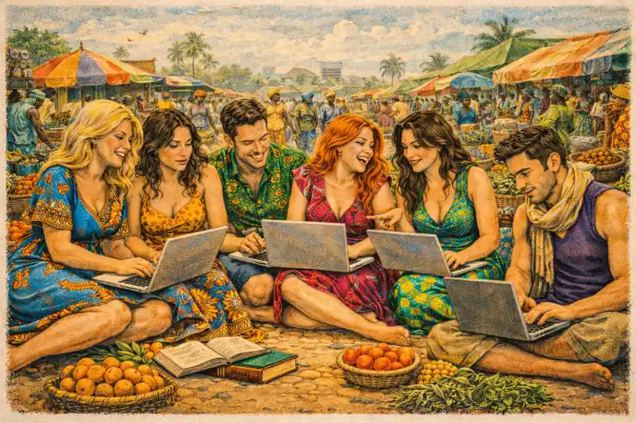

## Light Decides What the Eye Finds First

Cinematography works by controlling attention before recording action. A cinematographer shapes light, selects a lens, places the camera and decides on movement so a viewer sees a scene in a planned order and gives each face and object a planned weight. Dialogue registers after those decisions have already guided the eye. A bright doorway pulls attention before a dim corner does. A face lit from the side carries doubt that the same face lit flatly cannot carry. A long lens compresses a street in Citizen Kane era studio work and in location work alike, while a short lens stretches a room and makes distance feel larger. None of those effects arrives by accident on a professional set. Each one follows from a physical mechanism that can be named, measured and repeated.

The governing claim is plain enough to test against any scene. Cinematography is the control of attention before it is the recording of action. Light decides what can be seen. Lens choice decides how space relates. Position decides whose viewpoint the frame borrows. Movement decides when information arrives. Exposure decides what detail survives in shadow and highlight. Colour decides temperature, period and mood before a word explains them. David Bordwell and Kristin Thompson set out that system in Film Art in 1979, treating style as a set of choices working together rather than as decoration added after staging. Andre Bazin, writing in essays gathered as What Is Cinema, argued from the opposite temperament that the camera could respect the unity of a scene, yet Bazin and the textbook tradition agree on the central point. The photograph is never neutral. Someone chose where to stand, what to include and how brightly each plane should read.

A simple test exposes the mechanism. Imagine two actors at a table in a room in 1941, in 1971 and in any later decade, saying the same lines from the same marks. Photograph the exchange from a high wide position with even light and both faces carry equal weight, so the scene reads as information. Photograph the same exchange low, close and against the light, with one face in shadow, and the scene reads as conflict before the argument begins. The staging has not changed. The words have not changed. Only the photographic decisions have changed, and meaning has moved with them. Gregg Toland understood that arithmetic on Citizen Kane in 1941, when deep focus let a foreground face, a middle distance action and a background figure hold sharpness together, so a viewer could read power relations inside one frame instead of waiting for a cut to supply them.

Craft language helps because it names causes. A stop is a doubling or halving of light. A ratio describes how much brighter the key side of a face is than the fill side. Focal length describes the angle of view a lens gathers. Depth of field describes the band of distance that reads as sharp. Those terms sound technical because the work is technical, but each term ends in a visible result a viewer feels without naming it. Blain Brown laid out that working vocabulary in Cinematography: Theory and Practice in 2002, moving from script to light to lens in the order a set actually uses them. The sections that follow keep that order. Light comes first, then exposure, then the lens, then position and movement, then colour, stock and sensor, then the crew and the collaborators, then worked examples, history, failure and the viewing method that lets a reader test every claim against a screen.

## The Person Behind the Camera and the Department

The director of photography, called the cinematographer or DP, owns the photographic decisions on a production. The job begins weeks before shooting, in preparation, when the script is broken into scenes, locations are visited, and tests are shot to settle how faces, fabrics and walls respond to a chosen stock or sensor and a chosen family of lenses. John Alton described that preparation plainly in Painting with Light in 1949. A cinematographer who arrives hoping light will behave has already surrendered half the frame. Preparation turns hope into a plan with lamps placed, gels selected and exposure ranges known in advance.

On the set the cinematographer sets the lighting design, approves camera position and lens for each setup, and watches the image while the director works with the actors. The division protects both crafts. A director can attend to performance because another senior craftsperson attends to whether the performance will read on film at the chosen exposure. James Wong Howe, who photographed more than 130 features across five decades, was known for rehearsing camera and light together so an actor never waited on a lamp and a lamp never flattened an actor. Howe treated the set as one instrument rather than as separate trades competing for time.

Authority on a set is real but bounded. The cinematographer answers to the director on intention, to the producer on schedule and cost, and to physics on everything else. A lamp draws power, a location gives a fixed number of daylight hours, and a lens gathers only the light that reaches it. Barry Salt documented that material base in Film Style and Technology in 1983, showing how each generation of equipment widened or narrowed the choices a cinematographer could honestly offer a director. Style, in Salt's account, grows from tools handled well, not from taste floating free of equipment.

Professional standing for the craft was built early. Fifteen cinematographers founded the American Society of Cinematographers in Los Angeles in 1919, partly to share technical knowledge and partly to win credit and respect for work that studios had treated as anonymous labour. The society launched American Cinematographer magazine in 1920, and the magazine became a record of method, with practitioners explaining rigs, stocks and lighting plots in their own words. Toland's 1941 account of deep focus work appeared in that professional conversation, which is why later readers can reconstruct his reasoning rather than guess at it. A craft that writes down its methods can teach them, argue about them and improve them across generations.

The cinematographer also carries continuity across a whole production. A film is shot out of story order, in fragments, across weeks and locations, yet the finished work must feel photographed in one world. Skin tones must match between a close view shot on a Tuesday and a wide view shot three weeks later under different weather. The cinematographer guards that consistency with exposure records, lighting diagrams, lens notes and reference frames. When a viewer never notices the joins, that invisible labour has succeeded. When the joins show, the failure is photographic before it is editorial, because mismatched light tells the eye that two pieces of film belong to different days even when the story says they belong to the same minute.

## Light as the Raw Material of the Frame

Light is the raw material because film and sensor alike record light and nothing else. An actor, a wall and a doorway reach the viewer only as patterns of brightness and colour reflected toward the lens. Control the light and the pattern changes. Leave the light uncontrolled and the pattern still forms, but chance composes it. Alton built Painting with Light around that single discipline. In the noir work of the nineteen forties, Alton lit from low angles, let backgrounds fall toward black and allowed a single hard source to carve a face out of darkness, because the stories concerned concealment and the light said so before the plot did.

Quantity and quality are separate decisions. Quantity is how much light falls on a subject, measured on set with a meter and expressed through exposure. Quality describes whether the light is hard or soft. A small, distant source such as the sun on a clear day or a bare lamp casts hard light with sharp shadow edges, and hard light reveals texture, age and surface detail without mercy. A large, close source, or light passed through diffusion material, wraps around a face and softens shadow edges, so skin reads smoother and the mood reads gentler. The same lamp can produce either result depending on distance and diffusion, which is why a lighting plan names placement and material rather than lamp count alone.

Available light sets the floor every plan starts from. A window in a room in Prague, a street lamp in Vienna or a fluorescent tube in an office each brings a colour, a direction and a level that the cinematographer can embrace, correct or overpower. Embracing window light gives a scene the geography of a real place. Overpowering it with studio lamps gives control at the price of that geography. Bazin valued photography that respected the look of real space, and location traditions in several national cinemas followed that instinct, while the Hollywood studio tradition of the nineteen thirties rebuilt every place under lamps so weather and season could never interrupt a schedule. Neither approach is honest or dishonest by itself. Each trades control against place, and the trade is visible in the finished frame.

Light also builds depth inside a flat image. A bright foreground, a middle plane at a lower level and a dark background separate into layers the eye reads as space. Cinematographers call one common method separation, achieved by rim light on hair and shoulders, by a brighter background element behind a darker figure, or by haze that lightens distance. Toland and director Orson Welles used layered brightness on Citizen Kane so a deep room read as several planes of action at once. Without separation, figures merge into backgrounds and the frame flattens, a defect viewers sense as cheapness even when the staging is strong. The remedy is rarely more light overall. The remedy is light placed so planes differ.

Finally, light carries time. Low warm light reads as morning or evening because the sun behaves that way at the edges of a day. High neutral light reads as midday. A cinematographer can hold a scene at one apparent hour across a full shooting day by supplementing and flagging natural light as the sun moves, or can cheat an interior toward evening while the street outside stands at noon. The audience never audits the cheat. The audience reads the signal and settles into the hour the frame declares. That quiet authority over time is one of the oldest powers of the craft, exercised since the glass stages of early studios turned to follow the sun before artificial light grew strong enough to replace it.

## Direction, Shadow and the Reading of a Face

Direction decides what shadow does, and shadow decides how a face is read. Light from the front flattens features because shadows fall behind the subject where the camera cannot see them. Light from the side models the face, revealing cheek, brow and jaw through a gradient from bright to dark. Light from behind separates the figure from the background and can reduce the face toward silhouette. Light from below, rare in nature, unsettles viewers because fires and lamps held low are the familiar sources for it, and Alton used low sources in noir interiors to make ordinary rooms feel menacing without changing a line of staging.

### How does the direction of light change a face on screen?

Light direction changes a face by moving its shadows. Frontal light hides shadow and flattens modelling, so a face reads open and plain. Side light throws one cheek into shade and reveals bone structure, so a face reads divided or secretive. Top light deepens eye sockets. Back light rims the outline and darkens features. Each direction assigns a mood.

The classic three point arrangement names the working parts. The key light is the main source and sets direction and mood. The fill light softens the shadows the key creates, at a lower level, from near the camera. The back light separates subject from background. Portrait painters used the same logic centuries before film, and studio cinematographers codified it because it gives repeatable control. A cinematographer can then break the arrangement deliberately. Removing fill raises contrast and suspicion. Moving the key to the far side of the face, so the cheek turned toward camera falls in shadow, produces the divided modelling associated with interrogation scenes and with the noir cycle that Robert Krasker photographed for The Third Man in 1949.

Eyes deserve separate attention because viewers search a face for eyes first. A small reflected highlight in the eye, called a catchlight, signals life and directs attention, and cinematographers place a source or reflector partly to secure it. An eye without a catchlight reads dull or lifeless, an effect used deliberately for the exhausted, the ill or the morally absent in a story. Howe was celebrated for eye light control in close views, keeping a spark in the eye even when the surrounding face fell toward shadow, so a character could seem cornered by circumstance and still present to the viewer. The detail is small on a lighting plot and large on a screen twenty feet wide.

Skin tone is the exposure reference the whole system answers to. Meters, stocks, sensors and grading all get judged by whether faces look right, because a viewer forgives a wall that reads slightly green and never forgives a face that does. Cinematographers expose for skin and let backgrounds fall where the design wants them. Tests in preparation photograph the actual cast under the planned sources, since makeup, costume colour and complexion interact. A red costume beside a face can throw colour onto skin. A pale wall behind a dark costume can fool a meter. The face is the constant, and every other element in the frame is negotiated around it.

Movement of light matters as much as placement. A passing cloud, a practical lamp switched on inside the scene, a car headlight sweeping a wall, each change must be motivated and timed. When an actor crosses a room, the lighting plan must hold the face readable across the path or deliberately lose and recover it. Cinematographers walk the path during rehearsal with a meter, marking where levels drop, then add sources or open the lens to compensate. The audience sees a person crossing a room. The plan underneath is a chain of small corrections that keep attention where the scene needs it, second by second, without a visible seam.

## Ratio, Contrast and the Shape of Mood

Ratio names the difference between the bright side and the shadow side of a subject. A low ratio, where fill light nearly matches key light, produces the bright even look of classical comedy and musical photography, where faces stay clear and the world reads welcoming. A high ratio, where the shadow side receives far less light, produces the carved look of noir, melodrama and much horror photography. Ratio is measured in stops, and each stop doubles or halves light, so a cinematographer can specify mood with arithmetic. A two stop difference gives gentle modelling. A four stop difference gives division. Beyond that, shadow detail approaches the floor of what a stock or sensor can hold.

Contrast also lives in the scene itself, before any lamp is placed. A white shirt against a black coat, a pale wall behind a dark doorway, a bright window in a dim room, all set a brightness range the capture medium must fit. Cinematographers call the range of a scene its luminance range, and managing it is a negotiation among costume, set painting, lamp placement and exposure. Production designers repaint walls a shade darker so a window can appear in the same frame without burning to blank white. Costume departments avoid pure white and pure black side by side when detail must survive in both. The frame is a budget of brightness, and every department spends from it.

Gregg Toland's work with Welles showed ratio used as argument. In Citizen Kane, bright backgrounds and dark foreground figures reverse the comfortable habit of lighting the nearest face most strongly, so depth itself becomes dramatic. A figure can be small, distant and bright, holding attention against a large dark shape near the camera. Ratio across the depth of a set, not only across a face, guides the eye through space. Bordwell analysed such staging in depth as a signature of the nineteen forties style, where directors and cinematographers composed along the camera axis rather than only across the width of the frame.

Genre teaches audiences to read ratio without instruction. A viewer entering a brightly lit, low ratio scene expects safety and legibility. A viewer entering a high ratio scene expects concealment and threat. Cinematographers can honour the expectation for clarity or break it for unease. A horror scene lit brightly and evenly can disturb precisely because the expected shadows never arrive, so nowhere feels hidden and nowhere feels safe. A love scene lit with hard contrast can suggest that the lovers see each other clearly and without illusion. Ratio is therefore a promise made to the viewer, and promises in craft are tools whether they are kept or broken on purpose.

Holding ratio across a scene is a discipline of its own. As the camera moves from a wide view to closer views, lamps move, fill levels change and the ratio on each face must still match the wide view, or the cut will jar. The cinematographer and the gaffer keep notes per setup, photograph reference frames and compare. In the studio era, departments at Metro-Goldwyn-Mayer and Warner Bros. kept such records as routine paperwork. The audience experiences the result as a stable world. Underneath, stability is manufactured afresh at every setup, against changing sun, changing angles and the steady pressure of a shooting schedule that rewards speed over care unless the cinematographer defends the standard.

## Exposure and the Trade Between Shadow and Highlight

Exposure is the decision about how much light reaches the film or sensor, and every exposure choice spends a limited budget. Film emulsion and digital sensors each hold a range from black to white, called dynamic range. Detail outside that range is lost in one direction or the other. Expose for the shadows and highlights may burn to featureless white. Expose for the highlights and shadows may sink to featureless black. The cinematographer chooses which loss the scene can afford, and that choice is expressive as well as technical. A interrogation room can afford black corners. A wedding dress in sunlight cannot afford a burned bodice.

The aperture, the shutter and the sensitivity of the medium divide the decision among them. Opening the aperture admits more light and narrows depth of field. Lengthening exposure time admits more light and increases motion blur. Raising sensitivity admits the same image at lower light and adds grain in film or noise in digital capture. Each route to the same brightness changes the picture in a different way, so exposure is never a single dial. Brown emphasised that triangle of trade-offs in his 2002 manual because beginners treat exposure as correctness, while working cinematographers treat exposure as a set of side effects chosen on purpose.

The following table settles the core of the craft in one view, setting eight recurring decisions beside what each one controls, the mechanism that links decision to result, and the result a viewer actually sees.

| Decision | What It Controls | Mechanism | Visible Result |
|---|---|---|---|
| Lighting ratio | Mood and modelling | Fill level set against key level in stops | Even faces or carved shadowed faces |
| Light direction | Character reading | Source placement moves shadow across features | Open, divided, sinister or haloed faces |
| Focal length | Spatial relations | Angle of view widens or narrows with lens choice | Stretched rooms or compressed streets |
| Aperture | Depth of field | Iris size changes the sharp band of distance | Isolated subject or deep layered action |
| Camera height | Power relations | Lens level set against subject eye level | Dominance, equality or vulnerability |
| Camera movement | Order of information | Position changes during the shot reveal space | Discovery, pursuit or calm observation |
| Frame rate and shutter | Motion rendering | Exposure time per frame shapes blur and cadence | Smooth flow, staccato action or dream drift |
| Colour and contrast | Temperature and period | Filtration, stock, sensor and grading shift hues | Warm intimacy, cold distance or stylised worlds |

Meters assist the decision without making it. A reflected meter reads light bouncing from a subject and can be fooled by very dark or very bright surfaces. An incident meter reads light falling on a subject and gives a steadier base. Experienced cinematographers use meters to confirm what tests and habit predict, then adjust for intention. A scene meant to feel dim must be exposed and printed or graded so it reads dim while retaining the detail the story needs. Dim on the screen is a constructed value, not a shortage of light on the set.

Underexposure and overexposure become style when controlled. Pushing film, rating an emulsion beyond its stated sensitivity and extending development, deepens blacks and coarsens grain, a look chosen for grit in location work of the nineteen seventies. Deliberate overexposure with diffusion softens highlights into a glow associated with memory and romance in several traditions. The mechanism is the same in both directions. The capture medium responds predictably when a cinematographer knows its limits from tests, and unpredictably when limits are discovered by accident on the day. Preparation, again, is the difference between a style and a mishap.

## The Lens and How Focal Length Rebuilds Space

A lens gathers a cone of the world and projects it onto a flat surface. Focal length, measured in millimetres, describes how wide that cone is. A short focal length gathers a wide view, exaggerates the size difference between near and far objects, and stretches apparent depth. A long focal length gathers a narrow view, reduces the size difference between planes, and stacks distance into layers that appear close together. Neither lens shows space as the eye sees it. Each lens translates space, and the cinematographer chooses the translation that serves the scene.

The human comparison is a rough guide only. A lens near 40 to 50 millimetres on a full frame camera gives a field of view often compared with ordinary vision, which is why such lenses get called normal. The label misleads if it suggests neutrality. Place a normal lens close and faces distort at the edges of features. Place the same lens far and the scene flattens into a stage. Distance and focal length work as a pair. Moving the camera changes perspective, the relative size of objects. Changing focal length from the same position changes magnification and framing without changing perspective. That distinction, simple to state and slow to master, governs much of professional lens craft.

Faces reveal lens choice fastest. A short lens used close widens a nose, rounds a forehead and can make a room behind a subject loom large, which suits comedy, unease or subjective excitement depending on context. A longer lens used from farther away flatters features, separates a subject from a softened background and suits romantic or formal portraiture. Howe understood facial geometry deeply, choosing distances that gave actors presence without caricature. Casting and makeup complete the face, but the lens decides the geometry the audience receives, and geometry carries judgment. A hero and a suspect can be the same actor under different lens distances.

Zooms and prime lenses divide working method. A prime lens has one focal length and tends to be faster, admitting more light, and sharper at a given cost. A zoom covers a range and lets framing adjust without moving the camera, at the price of size, speed and sometimes consistency across the range. Barry Salt traced how zoom lenses entered feature work in the nineteen sixties and changed staging habits, encouraging adjustments of framing during a take that earlier practice achieved by moving the camera or cutting. The tool did not merely add convenience. The tool altered the grammar directors reached for, which is Salt's larger point about technology and style across a century of production.

Distortion and aberration set limits craft must respect. Wide lenses bend straight lines near frame edges. Long lenses compress so strongly that a running figure may appear to gain no ground, an effect used for futility and dread as well as for bringing distant action near. Lenses also breathe, shifting framing slightly as focus changes, and flare when bright sources strike the glass. A cinematographer chooses a lens family for a whole production partly so those behaviours stay consistent, and tests the set in preparation for flare, colour cast and sharpness wide open. Consistency lets the audience forget the glass. Inconsistency reminds the audience of the apparatus at moments the story never intended.

## Aperture and the Geography of Sharpness

Depth of field is the band of distance, in front of and behind the focus point, that appears acceptably sharp. Three variables govern the band. A wider aperture narrows it. A longer focal length narrows it. A closer subject narrows it. A cinematographer balances the three against the light available and the staging planned. Shallow depth isolates a subject from a softened world. Deep focus holds several planes sharp at once and lets the viewer choose where to look inside the frame. The choice between isolation and democracy of attention is one of the deepest expressive decisions in the craft.

### What controls depth of field in a photographed scene?

Depth of field is controlled by aperture, focal length and subject distance working together. A wide aperture narrows the sharp band, a small aperture widens it, a longer lens narrows it, and a closer subject narrows it further. Format size also matters, since larger capture areas give shallower results at the same framing. Cinematographers balance all four against available light.

Toland's deep focus work on Citizen Kane in 1941 remains the standard demonstration. Toland used small apertures, strong light, coated lenses and fast emulsion together so a boy could play in snow through a distant window while adults in the foreground signed away his future, all sharp in one composition. The effect required enormous light levels on the RKO set, because a small aperture admits little light and exposure must be fed from somewhere. Deep focus was therefore an economic decision as well as an aesthetic one. Bazin praised such photography for respecting the ambiguity of reality, letting the viewer search the frame as a person searches a room, rather than being marched from detail to detail by editing.

Focus itself is a craft job with a named owner. The focus puller, or first assistant camera, measures distances, marks the lens and shifts focus during a take to follow a moving subject, often without looking through the camera at all. A soft shot, where focus misses its mark, can ruin a performance that cannot be repeated. On large productions the department rehearses difficult pulls like choreography. The audience never credits the work when it succeeds, which is the nature of the job. Sharpness feels like a property of the world until the moment it fails.

Selective focus guides attention inside a single shot. A rack focus shifts sharpness from one plane to another, transferring the viewer's allegiance from one character to another without a cut. Used plainly, the device clarifies. Used often, the device calls attention to itself and weakens. Cinematographers ration such signals the way writers ration emphasis. A frame where everything shouts leaves nothing heard. The discipline of depth is therefore partly negative. The cinematographer decides what the viewer will not see clearly, and protects the story from the distraction of irrelevant sharp detail competing with a face.

Small formats and large formats pull the geography in opposite directions. A small capture area gives deep focus easily and struggles to isolate a subject. A large capture area isolates easily and demands great care to hold depth. The nineteen thirties studio style, shot on 35 millimetre film with powerful lamps, could afford depth. Location work on smaller gauges in later decades often shows shallower, more mobile photography, not only from taste but from the physics of the format in hand. Format is never just a budget line. Format writes itself into the look of an era.

## Position, Height and the Politics of the Angle

Where the camera stands decides whose experience the frame borrows. A camera at the height of a standing adult gives the neutral geography of a witness. A camera low, looking up, lends size and authority to a subject and shows ceilings and sky. A camera high, looking down, diminishes a subject and exposes the ground plan, the pattern of a room or a crowd. Those effects arise from ordinary life. People look up at judges, lecturers and monuments, and down at children, maps and the fallen. Cinematography borrows the body's memory and spends it on fiction.

Angle works with height. A canted or Dutch angle tilts the horizon, and the tilt reads as instability because level horizons govern ordinary balance. Robert Krasker used canted framing across The Third Man in Vienna in 1949, so postwar streets, staircases and faces lean as if the moral ground itself had shifted, a choice examined in detail in the discussion of [canted framing in The Third Man](/2015/04/01/the-third-man-cinematography-noir-style/). A single tilted shot can be an accident of emphasis. A film that sustains the tilt builds a world where unease is the default condition, and Krasker's photography earned the Academy Award for that film because the device never separated from the subject.

The objective and subjective positions mark another axis. An objective camera watches a scene from outside any character's viewpoint. A subjective camera adopts a character's eyes, showing hands, obstacles and faces as that character meets them. Between the two stands the vast middle ground of point of view editing, where a shot of a character looking is followed by a shot of what the character sees, at a height and lens that imply the look without exactly reproducing eyesight. Bordwell and Thompson describe that pattern as a pillar of classical continuity, because it lets the audience share knowledge with a character while keeping the camera free to compose.

Distance completes the positional vocabulary. The long shot establishes geography and social scale. The medium shot carries conversation and gesture. The close shot carries thought and reaction. Those labels describe subject size in frame, and each size creates a different contract with the viewer. A film that withholds close views keeps its characters at the distance of acquaintances. A film that lives in close views claims intimacy and must earn it. Cinematographers plan the progression of shot sizes across a scene the way a speaker plans emphasis across a paragraph, reserving the closest framing for the moment that must land hardest, since a device used everywhere loses force everywhere.

Position also answers to the set and the location as found. A real room may allow only two useful camera positions without showing its own limits. A built set can open a wall, raise a ceiling piece or widen a doorway to free the camera. Collaboration with the production designer, covered in a later section, begins with such negotiations. The cinematographer who scouts early can ask for a window where light and camera both need one. The cinematographer who scouts late inherits walls. Preparation converts architecture from an obstacle into an instrument, which is why directors of photography guard scouting days against every schedule pressure a production invents.

## Movement, Stillness and the Difference a Zoom Cannot Fake

A moving camera changes perspective during the shot. Objects at different distances shift against each other, a phenomenon called parallax, and the shift tells the eye that space is real and continuous. A zoom changes magnification from a fixed position, so planes grow together without shifting against each other, and the eye reads the result as an optical event rather than as travel through space. The distinction is the single most useful test a viewer can learn. Movement walks the audience into a scene. A zoom points at a detail. Both are legitimate, and confusion between them produces much clumsy photography.

The dolly, the crane, the tracking vehicle, the handheld camera and the stabilised rig each give movement a different character. A dolly on track glides with mechanical calm and suits order, ceremony and controlled revelation. A crane adds the vertical dimension, rising from a face to a city or descending from a rooftops view to a doorway. Handheld work carries the small irregularities of a human operator and suits urgency, documentary honesty or subjective distress, depending on degree. Howe placed cameras low and moved them at floor level for the boxing sequences of Body and Soul in 1947, with the operator on roller skates for some shots, so the ring felt close, fast and dangerous rather than observed from a safe seat.

History enlarged the moving camera step by step. Harry Perry and his fellow aerial and effects cameramen on Wings in 1927 mounted cameras on aircraft and built rigs that let a camera travel with machines at speed, work traced in the account of [aerial camera work](/2014/02/01/wings-aerial-cinematography-craft/). Perry shared an Academy Award for that production's engineering ambition as the craft learned to move through air as well as rooms. Each generation since has shrunk the apparatus. Lighter cameras freed movement from track. Stabilisers smoothed walking shots. Small digital cameras entered spaces no studio camera could enter. The grammar stayed constant through every hardware change. A move must reveal, follow, pursue, abandon or discover, or the move is decoration consuming screen time.

Stillness is a decision with the same weight. A locked camera lets action organise itself inside the frame and can create tension by refusing to follow, so a character exits and the empty frame holds on the room left behind. Bazin admired long takes and stable compositions because they preserve the unity of an event and transfer interpretive work to the viewer. A cinematographer chooses stillness when the staging is strong enough to carry the shot and when movement would flatter the scene rather than serve it. Restraint also stores energy. A film that moves constantly has no acceleration left for its climax. A film that holds still for long passages can make one sustained tracking shot feel like a release of pressure built over an hour.

Speed of movement carries meaning at a fine grain. A slow push inward, barely perceptible, tightens attention on a face as a realisation forms. A fast move creates alarm or exhilaration. A move that starts before the audience understands its purpose creates a question the next seconds must answer. Operators rehearse speed against dialogue and marks, and the cinematographer watches for the move that calls attention to its own cleverness. The professional standard is severe. A camera move should feel inevitable in retrospect, as if the scene could only have been shown that way, even though a dozen other moves were possible at the moment of choice.

## Framing, Composition and the Shape of the Screen

Composition arranges the contents of a fixed rectangle, and the rectangle itself has a history. The Academy ratio near 1.37 to 1 governed Hollywood screens for decades, giving a nearly square frame suited to faces and interiors. Widescreen formats arriving in the nineteen fifties, including CinemaScope near 2.35 to 1, stretched the rectangle and favoured landscapes, groups and lateral staging. Television long held a squarer shape, then adopted widescreen as sets changed. A cinematographer composes for the intended rectangle, because a balance that works in a wide frame collapses in a narrow one and a face placed for a narrow frame drowns in empty space inside a wide one.

### Why does the shape of the frame change how a scene feels?

Frame shape changes a scene by changing the relations it can hold. A narrow frame favours single faces and vertical subjects, so scenes feel intimate or confined. A wide frame holds groups, landscapes and distance between people, so scenes can feel social, epic or lonely. Composition must serve the chosen shape, placing weight where that rectangle gives it force.

Within the rectangle, placement carries weight by position. The centre asserts importance and formality, which is why symmetrical central framing suits ceremony, authority and deliberate unease in different contexts. Off centre placement creates expectation toward the larger side, the space a character looks or moves into, called lead room or look room. Denying that space, crowding a face against the edge it faces, creates pressure and entrapment without a word of dialogue. Rules of thirds and similar grids describe where untrained eyes settle comfortably, but working cinematographers treat such grids as starting habits rather than laws, breaking them whenever the story gains from the break.

Balance extends beyond the principal subject. A small bright object at a frame edge can outweigh a large dark mass near the centre, because brightness and colour pull the eye along with size. Cinematographers compose with total weight, scanning corners for distractions during rehearsal. A lit exit sign, a pale hand, a white page on a desk, each can steal a moment meant for a face. Set dressers and costume choices answer to that scan. The frame is an economy of attention, and every element either spends the audience's focus on the story or wastes the focus on accident.

Negative space, the emptiness around a subject, works as an active element. A lone figure in a large empty frame reads as exposed, bereaved or free depending on the story around the image. Crowded frames read as social pressure or celebration. The cinematographer controls crowd and emptiness with lens, distance and angle together, since a long lens from far away can empty a busy street into layers behind one face, while a wide lens close in a small room can make three people feel like a mob. Composition is therefore never only placement inside the rectangle. Composition includes the choice of rectangle, lens and distance that decided what the rectangle could contain.

Aspect ratio decisions also bind the whole production. Sets are built, effects are rendered and titles are placed for one shape, and changing shape late damages every department. Archival ratios complicate revivals, since a film composed for a wide screen loses its balances when cropped for a narrow one, a harm discussed again in the section on the life of the image after shooting. The rectangle is a promise made at the start of production to the audience at the end of it. Keeping the promise is part of photographic craft, even though the audience rarely learns that a promise existed.

## Coverage and Continuity, or Photographing for the Cut

A scene is rarely photographed once, whole, from a single position. Coverage is the set of shots, wide, medium, close, inserts and reactions, from which the editor builds the scene. The cinematographer lights and frames each piece so the pieces join invisibly. That requirement shapes everything. Light must match across setups shot hours apart. Eye lines must point in consistent screen directions so two people photographed separately appear to look at each other. Movement across a cut must continue at the same speed and phase, so a hand rising in one shot completes its rise in the next.

Screen direction is the geography of the cut. Classical continuity, as Bordwell and Thompson describe the system, keeps the camera on one side of an imaginary line between two subjects, the 180 degree rule, so left and right stay stable across cuts. Crossing the line reverses relations and can disorient a viewer or, used deliberately, signal a rupture in a relationship or a mind. Cinematographers mark the line on the floor in complex scenes and plan positions around it. The rule is not etiquette. The rule protects the audience's map of the room, and a lost map costs attention the story needs elsewhere.

Matching light across coverage is painstaking. The wide view may be shot in morning sun and the close views under lamps in the afternoon, yet all must read as one continuous minute. The cinematographer records sun position, cloud conditions, lamp settings and exposure for each setup, and the script supervisor logs the details that cross departments, from costume state to the level of a drink in a glass. Howe's generation worked with fewer monitoring tools and relied on such records and on memory trained by routine. Video monitoring and digital playback later eased the checking without removing the discipline, because a mismatch noticed in the cutting room may be impossible to repair.

Coverage also involves restraint. Shooting every conceivable angle consumes time, light and actor energy, and floods the editor with near identical material. Experienced cinematographers cover a scene according to a plan for how the scene should build, protecting the key performances for the setups that matter most. An actor's finest take of a close view should not be spent after six wide takes have exhausted the emotion. Scheduling the order of setups, usually wide to close so lighting can refine as framing tightens, is a photographic decision with direct consequences for performance. The director leads the actors, but the cinematographer's plan decides the conditions under which the leading happens.

Inserts and details deserve their own care. A hand on a letter, a key in a lock, a name on a document, such shots carry plot weight out of proportion to screen time. They are often photographed by a second unit or at the end of a day, and they must match the light and lens character of the scene they interrupt. A mismatched insert announces itself and breaks belief. The standard across the craft is that no shot is minor. Every frame either sustains the world or leaks the machinery behind the world, and continuity is the name for keeping the machinery hidden.

## Colour, Contrast and the Temperature of a World

Colour in cinematography is controlled at several points that multiply together. The light sources bring colour temperature, with tungsten lamps near 3,200 kelvin reading warm against daylight near 5,600 kelvin reading cool. Filters on lamps or lens shift the balance. The stock or sensor interprets what remains. Costume, makeup and set painting supply the colours being interpreted. A cinematographer designs the chain as a whole, because correcting one link against the others wastes light and narrows choices later in timing or grading.

Warm and cool carry associations grounded in ordinary experience. Firelight, lamps and late sun are warm. Shade, overcast sky and deep water are cool. A warm interior against a cool exterior can make shelter visible in a single frame with a window. A cool interior can make a home feel estranged. Saturation adds a second axis. Rich saturated colour suits musicals, melodrama and fantasy worlds that declare their artifice. Desaturated colour suits war, memory and social realism in many traditions, draining the world toward grey so faces and small colour accents carry the remaining charge. Neither register is more honest. Each register is a rhetoric, and the cinematographer chooses the rhetoric the story can sustain for two hours.

Contrast in colour work interacts with contrast in brightness. A palette built from neighbouring hues, such as browns, ambers and deep reds, produces harmony and period warmth. A palette built from opposed hues, such as teal against orange, produces vibration and separation between figure and ground. Production design supplies most palette material, and the cinematographer decides how strongly the capture and lighting will render it. The same red dress can blaze under hard saturated light or smoulder under soft desaturated light. Palette meetings in preparation, with swatches photographed under planned sources, prevent expensive surprises after sets are painted and costumes are built.

Skin remains the referee in colour as in exposure. Audiences accept stylised worlds of many kinds and reject worlds where faces look wrong for the register chosen. A green cast on skin reads as illness. A magenta cast reads as cheap video in many viewers' experience. Cinematographers guard skin hue while pushing backgrounds toward the design, using light colour on the face that differs subtly from light colour on the set. Separation of colour by plane, warm face against cool room or cool face against warm room, is a quiet workhorse of the craft, giving depth and legibility in a single decision.

Historical colour processes left signatures that still teach the mechanism. Three strip Technicolor in the nineteen thirties and forties demanded huge light levels and rewarded saturated design with a richness later stocks pursued by other means. Eastmancolor simplified production and shifted the palette toward a softer register. Each process constrained the cinematographer and each constraint became a style in skilled hands, the pattern Salt documented for technology generally. Digital capture removed many chemical constraints and replaced them with choices in grading, which moved colour decisions later in the chain without making the decisions smaller.

## Film Stock, Sensitivity and What Faster Emulsions Changed

Film stock is light sensitive emulsion on a flexible base, and its sensitivity, rated by ASA and later ISO numbers, decides how much light a scene demands. Slow stocks need abundant light and give fine grain and rich colour. Fast stocks work in dim conditions and give coarser grain and softer contrast. For decades the sensitivity ceiling governed where films could be made. Studio stages existed partly because slow stock and small apertures required light levels only controlled rigs could supply. A street at night, a real bar, a small apartment, all stood beyond reach unless the production rebuilt them under lamps.

Each sensitivity gain redrew the map. Faster emulsions in the nineteen thirties supported the deep focus work Toland pursued, since small apertures could be fed at achievable light levels. Postwar faster stocks, combined with lighter cameras, supported location shooting across European and American independent production. Documentary practice fed back into fiction, as crews learned to work with available light in real places and actors learned to perform without the scaffolding of a stage. Grain itself changed meaning across the transition. Grain once signalled a technical limit. Grain later signalled authenticity, because audiences associated the texture with documentary truth, and cinematographers began choosing grain as a register rather than enduring grain as a cost.

Pushing and pulling stock extended the range by craft. Rating a stock as if it were faster and extending development raises effective sensitivity and contrast while coarsening grain. Rating a stock slower and reducing development softens contrast for harsh sunlight. Such decisions are made for a whole production or a whole sequence, since the laboratory processes entire rolls and the look must match across cuts. The cinematographer therefore commits early, in tests, and the commitment disciplines the shoot. A look chosen in the laboratory book cannot be improvised scene by scene without breaking the unity the audience expects.

Stock choice also governed colour and black and white decisions for most of film history. Black and white emulsions differed in their sensitivity to colours, so a red dress could photograph dark or light depending on whether the stock was orthochromatic, blind to red, or panchromatic, sensitive across the spectrum. Makeup and set painting adapted, with early orthochromatic stock forcing strange colours on set that photographed correctly. The lesson generalises. Every capture medium has a spectral personality, a way of translating the world's colours into its own values, and the cinematographer learns that personality through tests rather than trusting the eye at the monitor or the scene in the room.

The archive inherits stock decisions permanently. Some stocks fade, with dyes shifting toward magenta over decades, so the colours a revival audience sees may betray the colours a cinematographer approved. Preservation and restoration answer that decay, as a later section describes. The cinematographer's responsibility in the stock era included choosing materials with an eye to survival, a duty the profession discussed openly in the pages of American Cinematographer across the twentieth century. A frame is made for its first audience and, if the work endures, for audiences the maker will never meet.

## The Digital Sensor and What Changed and What Did Not

A digital sensor replaces emulsion with a grid of photosites that convert light into electrical values, and the conversion changes workflow more than it changes craft. Sensitivity can be raised by amplification rather than by choosing a different physical material. The image appears on monitors during the take rather than in a laboratory report the next day. Takes can be reviewed, copied and graded on the set. Those changes are large, and a cinematographer working digitally commands tools of preview and adjustment no studio era predecessor possessed. Yet the light still falls on real faces in a real room, and every decision about direction, ratio, lens and position behaves exactly as the same decision behaved on film.

Differences concentrate at the edges of the range. Film highlights roll off gradually toward white as emulsion saturates, while early digital sensors clipped highlights abruptly, so a bright window or a pale sky could lose detail in a hard step. Sensor design and recording formats narrowed that gap across generations, and cinematographers adapted exposure habits, protecting highlights more carefully in digital work while trusting shadows that could be lifted in grading with a noise penalty. The trade described in the exposure section survives intact. Only the shape of the penalty changed, from grain and blocked shadow toward noise and clipped highlight.

Monitoring changed set politics as well as technique. When only the operator saw the frame through the eyepiece, trust in the cinematographer was structural. When a village of monitors shows the image to director, producers and clients at once, photographic decisions become visible and contestable in the moment. Skilled cinematographers turned the monitor into a teaching tool, explaining a dark frame as intention before anxiety could rewrite the plan. Less protected productions sometimes light for the monitor's approval rather than for the finished grade, a failure mode the failure section returns to. Tools redistribute authority wherever they arrive, and the sensor arrived with a screen attached.

Digital capture also loosened the link between sensitivity and texture. Grain in film arises from the emulsion itself and varies with exposure. Noise in digital capture arises from amplification and processing, and can be reduced, shaped or replaced with synthetic grain in post production. The cinematographer therefore designs texture as a separate layer rather than accepting texture as a byproduct. Blain Brown's later editions addressed digital workflow directly, treating the cinematographer's responsibility as extending from set through the digital intermediate, because a look unguarded after shooting can be graded away by other hands. Authority over the image now has to be defended across a longer chain.

What did not change deserves equal emphasis. A badly placed lamp is badly placed on any medium. A wrong lens distance distorts a face in any format. Composition, continuity, skin tone and the politics of the angle obey the same mechanisms Salt and Bordwell described for film. Students sometimes imagine the sensor replaced the craft. Working sets disprove the idea daily, since productions with generous digital resources still hire senior cinematographers, gaffers and grips, and still test lenses and light before shooting. The medium changed the chemistry and the monitoring. The medium did not change the eye.

## The Crew, Gaffer, Grip and Camera Hands

Cinematography is executed by a department with a clear division of labour, and the division explains how complex setups happen quickly. The cinematographer designs. The camera operator moves and frames the camera during the take on many productions, watching performance through the eyepiece or monitor and adjusting composition by instinct and rehearsal. The first assistant camera owns focus, lens changes and the mechanical health of the camera. The second assistant loads media or film, marks positions and keeps records. Each role is a specialism with its own apprenticeship, and a set runs on the trust that each specialism will hold without supervision.

### Who are the gaffer and the key grip on a film set?

The gaffer is the chief electrician, translating the cinematographer's lighting design into lamps, power and placement with a crew of electricians. The key grip leads the grip crew, which builds rigs, lays track, flies diffusion and shapes light with flags and nets. Both are senior collaborators whose judgment about safety, speed and feasibility shapes every setup.

The gaffer's craft is partly electrical and partly photographic. Reading a lighting plan means knowing how a source will behave at a distance, how diffusion will change it, and how the day's power supply limits the menu. Gaffers who serve the same cinematographer across many productions develop a shorthand that saves hours, since a phrase about the desired quality of light on a face can summon a whole rig without a drawing. Howe and other studio era cinematographers relied on long standing crews in the same way, and the credit system of the period often hid those partnerships from public view even though the consistency of a body of work frequently bears a crew's signature alongside the cinematographer's own.

Grips shape light by subtraction and support the camera in motion. Flags cut light from a wall. Nets reduce a source without changing its colour. Frames of diffusion soften a window. Track, cranes, car mounts and scaffolding all belong to grip work, and safety in every rig belongs there too. A camera move that looks effortless rests on grip labour measured in hours. When a rig fails, people can be hurt, so the key grip's authority on safety questions is properly near absolute on a professional set, overriding schedule and even photographic desire. The frame never justifies an unsafe rig, a red line the craft holds across countries and budget levels.

Scale changes the department without changing its logic. A small production may combine roles, with the cinematographer operating and a single assistant covering camera and lighting support. A large production may field dozens across camera, electric and grip teams, plus a second unit photographing inserts, stunts or locations in parallel under a second cinematographer following the principal style. Second unit work must match the principal photography in lens character, light direction and colour, or the seams show. Matching another craftsperson's eye is a discipline of its own, learned by studying the established material until the established choices feel like personal habits.

## Working With the Director and the Production Designer

The cinematographer's two closest collaborators divide the image between them. The director owns intention, performance and the final say on what a scene must accomplish. The production designer owns the world in front of the camera, the sets, locations dressed, colours and textures that light will strike. The cinematographer owns the transformation of that world into a photographed image. Friction appears when the boundaries blur, and good productions settle the boundaries in preparation rather than on the shooting day, when every hour carries a crew's wages.

Preparation rituals make the collaboration concrete. The cinematographer reads the script for photographic problems and opportunities, walks locations with director and designer, and builds references from paintings, photographs and earlier films, not to copy them but to give the team a shared vocabulary for light and colour. A reference to a Vermeer interior settles questions about window light faster than an hour of adjectives. A reference to Alton's noir work settles contrast expectations for a night sequence. Shared references are the team's shorthand, and teams without shorthand pay for the lack in misunderstandings under pressure.

Design decisions carry photographic consequences that must be negotiated early. A set built with a practical ceiling limits top light and crane movement. A location with small windows limits daylight designs. A costume in pure white beside a costume in pure black stretches the capture range at every setup. The cinematographer in preparation can ask for a ceiling piece that flies, a wall that swings, a window enlarged by a foot, a fabric shifted one shade. Such requests are cheap in the design week and ruinous in the shooting week. Designers who understand photography welcome the conversation, because a beautiful set photographed badly serves nobody, and cinematographers who understand design ask for changes that preserve the design's idea.

Disagreement, handled well, improves the image. A director may want a scene brighter than the story seems to allow, for clarity of performance. A cinematographer may answer with a design that keeps faces clear while letting backgrounds carry the darkness, satisfying both clarity and mood. A designer may propose a mirror wall that the camera will inevitably see itself in, and the negotiation produces a angled mirror or a cheated position that keeps the idea and loses the reflection. The history of the craft is full of such settlements, and Bordwell's accounts of studio production describe departments organised precisely to force the settlements early, inside a system where preparation was a budgeted phase rather than a favour.

Credit reflects the collaboration imperfectly. A film's look gets attributed in reviews to a director, a cinematographer or a designer depending on the critic's habits, and the complication section examines that attribution problem at length. Inside a production the truth is mundane and specific. One person proposed the window. Another person placed the lamp. A third person chose the lens that made the window loom. The audience receives the sum. Learning to see cinematography includes learning that the sum has authors in the plural, even when one name, the cinematographer's, properly leads the photographic account.

## A Night Street Photographed Three Ways

A worked example binds the mechanisms together. Take a simple scene with no dialogue. A woman leaves a building at night, crosses a wet street and waits under a lamp while a car passes. The staging is fixed. The photography can build three different films from the same thirty seconds of action, and each version spends the eight decisions in the decision table differently, which is why that table was worth setting out in full earlier.

Version one photographs for safety and romance. The key light is soft and warm from the lamp side, the ratio is low, and the wet pavement is lit to return warm reflections. A longer lens from across the street isolates the woman from a softened background, the camera drifts slowly at her height, and exposure protects her face while letting the street fall into gentle darkness. The result reads as a pause of contentment. A viewer expects the car to bring someone loved. Every choice, warm colour, low ratio, gentle movement, level height, promises shelter, and the promises agree with each other, which is what makes the version coherent rather than merely pretty.

Version two photographs for threat. The key becomes a hard back light from a high source, the ratio rises until the face falls toward silhouette, and a shorter lens placed low makes the building loom and the street widen. The camera holds still and lets the woman cross the unmoving frame, small against architecture, while exposure protects the bright pavement reflections and sacrifices shadow detail in doorways, so any doorway could hide a figure. The car headlights sweep and flare the lens. The same staging now reads as vulnerability. Nothing in the action changed. Light direction, ratio, lens, height and stillness rewrote the meaning, exactly as the thesis predicts. Attention was controlled first, and fear arrived as a consequence of where the eye could and could not settle.

Version three photographs for documentary neutrality. Available street light is embraced with minimal supplementation, the lens is near normal, the camera observes from a medium distance at standing height with a slight handheld irregularity, and exposure accepts the mixed colour temperatures of sodium lamps, shop windows and headlights as found. The result reads as a slice of a real night in a real city. Neutrality, however, is also a construction. The choice to supplement little, to accept mixed colour and to keep a witness distance are decisions with authors, and a different crew could have found the same street photogenic in the first manner or sinister in the second. The example teaches the central lesson in miniature. A scene does not have a look. A scene is given a look, decision by decision, and the decisions can be listed, defended and learned.

Wet streets deserve a note of their own in the example, because water is a photographic gift crews either use or waste. A wet surface returns light from lamps, signs and headlights, doubling the sources a night scene can show and giving the lower half of the frame a life that dry pavement never provides. Productions wet streets deliberately for night work, hiring water trucks to soak a block before shooting, and cinematographers plan angles low enough to catch the reflections without letting glare erase the actors. The three versions divide on the gift as well. The romantic version bathes in the reflections, the threatening version lets them blind in patches, and the neutral version accepts them as the street offered them.

## A Dialogue Scene and the Politics of the Close View

Dialogue scenes look simple and contain the craft's most delicate judgments. Two people talk. The photography must decide, moment by moment, whose face carries the scene, at what size, with what light, and when the balance shifts. The standard pattern photographs a wide view to establish the room, then medium views and close views of each speaker, then reactions. Inside that pattern every variable remains live. The close view given earlier and larger to one character grants that character the scene's centre of gravity. The character held in wider, darker framing becomes the scene's object rather than its subject, judged rather than joined.

The close view itself is a lens and distance decision before it is an editing decision. A close view made with a longer lens from several feet away flatters and calms, suiting confession and romance. A close view made with a short lens near the face energises and can unsettle, suiting intoxication, mania or comic excess. Howe's close work was admired for keeping actors powerful in frame without distortion, a balance of distance and lens that let a face fill the screen and still belong to a human being rather than to a special effect. Makeup, lens and light meet on a face at that size, and any weakness in the three announces itself at twenty feet wide.

Eyelines govern the invisible geometry of talk. In close views, the distance between the actor's gaze and the lens decides intimacy. A gaze placed just beside the lens feels directed at the viewer. A gaze placed far from the lens feels directed at a distant partner and cools the exchange. Cinematographers set the partner or a mark at a precise position to tune that distance, sometimes inches mattering. Over the shoulder framings include a soft foreground shoulder that anchors the geography, and the softness itself is a depth of field decision, keeping attention on the sharp face while preserving the sense of a body opposite.

Light across a dialogue scene must serve two faces with opposite needs. The key that models one speaker flattens or shadows the partner in reverse coverage, so each setup relights for the face the camera favours while matching the established direction of the scene's sources. A window established on one side of the room must appear to light both directions of coverage consistently, which the gaffer achieves by moving the effective source as the camera turns. The audience never sees the move. The audience sees two people in one room under one light, and the illusion rests on records, marks and the discipline described in the coverage section.

Power in dialogue also turns on height and stillness. Photographing one speaker slightly from below and the other slightly from above, across a whole scene, builds a hierarchy no line needs to state. Reversing the heights at a turning point, when the weaker party takes control of the exchange, can mark the turn more cleanly than a musical cue. A cinematographer and director who plan that reversal give the editor a structural gift. A team that photographs every exchange at identical height and size gives the editor only words to build with, and words alone make filmed dialogue resemble recorded theatre rather than cinema.

## From Hand Cranked Cameras to the Studio System

The earliest cameras were cranked by hand, and the operator's wrist set the frame rate, so projection speed and shooting speed negotiated a rough standard near sixteen frames per second before motors stabilised practice at twenty four with the arrival of synchronised sound. Early cinematographers were operator, lighting crew and laboratory liaison in one body, shooting outdoors or in glass roofed studios that chased daylight. The craft's first generation, figures such as Billy Bitzer working with D. W. Griffith in the nineteen tens, invented much of the vocabulary of close framing, iris transitions and night effects while the job still lacked a settled name.

Professionalisation arrived with scale. The founding of the American Society of Cinematographers in 1919 and the launch of American Cinematographer in 1920 gave the craft institutions, a journal and a collective voice in an industry that preferred to credit studios and stars. Through the nineteen twenties, cinematographers such as Karl Struss and Charles Rosher, who shared the first Academy Award for cinematography for Sunrise in 1927, demonstrated that photography could carry a film's reputation. Struss brought pictorial softness from still photography. Rosher brought technical command of effects and miniatures. The award itself mattered as a public statement that the image had an author.

The studio system of the nineteen thirties and forties organised the craft into departments with house styles. Metro-Goldwyn-Mayer favoured a polished glamour register, with soft light and immaculate faces. Warner Bros. favoured harder, lower key photography suited to crime subjects and faster schedules. Cinematographers worked under contract, often with the same stars, crews and stages for years, and Salt's history shows how house equipment, stock choices and laboratory practice hardened into recognisable looks. Glamour lighting for stars became a specialism, with diffusion, dedicated key lights and retouching of the photographic kind built into exposure and filtration rather than applied afterward.

Sound changed the camera before it changed the image. Early sound recording imprisoned cameras in soundproof booths to silence their mechanisms, and the mobile, fluid photography of the late silent years stiffened for a period around 1929 and 1930. Blimped cameras, quieter mechanisms and microphone technique then freed movement again across the nineteen thirties. The episode teaches a permanent lesson of the craft. A neighbouring technology can constrict photography overnight, and the craft answers by engineering its way back to freedom, usually within a few years, usually by redesigning the tool that caused the constraint.

By the nineteen forties the studio cinematographer stood at a mature height of influence. Toland at RKO and Samuel Goldwyn's studio, Howe at Warner Bros. and later as a freelance, Alton at Metro-Goldwyn-Mayer on noir subjects, each carried a recognisable signature inside an industrial system. The auteur debate that followed in criticism, examined in the complication section, grew from that visible fact. Images bore personal signatures strongly enough that critics argued over whose signature governed, the director's or the cinematographer's, and the argument itself proved how far the craft had travelled from the anonymous crank turner of 1905.

## Location Shooting and the Portable Camera

The postwar decades moved the camera out of the studio and into the world. Lighter cameras such as the Arriflex, faster stocks, and the example of Italian neorealist production in the nineteen forties showed that real streets, real rooms and available light could carry major films. Location photography changed the cinematographer's skill set. Controlling a stage means commanding every source. Photographing a location means negotiating with sources that cannot be commanded, the sun's schedule, a street's lamps, a room's actual windows, and winning enough control to keep continuity while keeping the place recognisably itself.

Portable synchronised sound equipment in the nineteen sixties freed movement again, as the earlier sound revolution had first bound and then freed it. Direct cinema and cinema verite practices in France, Canada and the United States put cameras on shoulders in unfolding events, and fiction absorbed the lesson. Handheld photography entered mainstream features as a register of immediacy, no longer only a sign of low budget. The cinematographer on location became part scout, part meteorologist and part diplomat, since a street can be lit only within the limits of permits, power and neighbours, and a sky will not repeat a sunset for a second take.

Location work also democratised subjects. Stories set in small towns, workplaces and modest homes gained photographic dignity when crews could shoot in such places without rebuilding them. Faster emulsions, discussed in the stock section, mattered as much as camera weight, since a real interior at night needs sensitivity more than mobility. Cinematographers such as Haskell Wexler in the United States built reputations on location realism that kept design inside found places, supplementing daylight through windows and practical lamps in shot rather than replacing the light of a place with a studio imitation.

The portable era changed performance as well. Actors freed from marks dictated by massive equipment could move through real spaces, and cinematographers learned to light zones rather than spots, covering an area evenly enough that an actor stayed photographed anywhere inside it. Zone lighting trades the sculptural precision of a single planned position for freedom across a field, and the trade suits some stories and betrays others. A courtroom drama of fixed positions gains little from zones. A family drama in a real kitchen gains everything. Judgment, again, is the craft. Equipment offers. The cinematographer disposes.

Television production, expanding across the same decades, trained crews in location speed and smaller unit discipline, and fed personnel and habits into feature work. The boundary between the media stayed porous in craft terms even when prestige language separated them. A cinematographer formed in television brought habits of economy and clarity. A cinematographer formed in features brought habits of scale and finish. The healthiest productions mixed the formations and let each correct the other's excesses, a pattern Bordwell observed in his accounts of changing production practice across the late twentieth century.

Weather writes the other half of the location lesson. A stage offers the same Tuesday forever. A location offers the sky it offers, and a cinematographer plans around forecasts, cloud cover and the short windows of dawn and dusk that productions call magic hour for the warmth and softness of the light. Scenes meant to join across a cut may be shot days apart under different skies, and matching them demands the records and patience described in the coverage section. The location cinematographer therefore works as a planner of contingencies, holding cover sets and alternate angles ready for the hour when the light refuses the plan.

## Who Owns the Image, the Auteur Problem

Every strong claim about cinematography must survive a serious objection, and the objection has a name and a history. Andrew Sarris, in Notes on the Auteur Theory in 1962, argued that the director is the author of a film, the intelligence whose personality organises every element, photography included. On the strongest version of that view, a cinematographer executes a director's vision, and crediting the image to the camera mistakes the instrument for the composer. A great director working with different cinematographers, the argument runs, produces recognisably personal films, while a great cinematographer working with weak directors produces handsome films that cohere around nothing. Style at the level of the whole work belongs to the person who decides what the work is about and how every scene should feel.

Pauline Kael answered from the other flank in Circles and Squares in 1963, attacking the auteur theory's elevation of directors and its habit of crediting one person for collaborative work. Kael's objection, turned toward photography, cuts against any simple claim for the cinematographer as well. Films emerge from scripts, performances, studio decisions, budgets, censorship and accidents of production. Singling out any one craft as the author repeats the auteur error in a new place. The image on the screen passed through the hands of an editor who chose which takes and angles survived, a studio that could order retakes or recuts, and in many periods a censor whose rules shaped what could be shown and therefore what could be lit, framed or left in shadow.

The honest answer narrows the thesis rather than abandoning the thesis. Directors demonstrably control the decisions that organise a film. Directors approve or reject the cinematographer's proposals, choose among takes, set the staging the camera must serve and hold final authority on the set in the standard production hierarchy. A cinematographer who photographs against a director's intention will be corrected or replaced. At the same time, the specific mechanisms this account has traced, ratio, direction, lens geometry, depth, height, movement, belong to photographic expertise that most directors do not personally command in technical depth. Directors describe effects. Cinematographers produce them, choose the means, and frequently propose the effect itself in preparation. Toland proposed and engineered deep focus solutions for Welles, who had the sense to want them and the authority to approve them. Authorship of the result is shared in fact, whatever criticism does with the credit.

Editors, studios and censors bound the image further, and naming those bounds strengthens rather than weakens the craft claim. The editor can discard the cinematographer's finest shot. The studio can grade or cut against the approved look, especially where the cinematographer lacks contractual protection of the kind senior figures later negotiated. The censor in the Hollywood Production Code era, enforced from 1934, shaped lighting and framing indirectly by ruling subjects and treatments out of bounds. None of that makes photographic decisions unreal. The decisions still decide what raw material exists for editors to choose among and censors to judge. Control of attention operates at the moment of capture, inside limits set by collaborators and institutions, and the thesis stands in that narrowed, defensible form. Cinematography controls attention first, within a production where attention is also contested by direction, editing and power.

## Failure Modes, What Weak Photography Looks Like

Weak cinematography fails in recognisable ways, and naming the failures sharpens the definition of the craft by contrast. The commonest failure is coverage without viewpoint, where every scene is photographed from the same medium distance at the same height with the same even light, so the photography records the staging and adds nothing. Faces stay legible and nothing means more than the dialogue says. Viewers describe such work as flat or televisual in the unkind sense, and the description is fair. The camera attended the event without interpreting the event, which is the one job the thesis assigns to the craft.

Exposure failures form a second family. Highlights burn to blank white on skin or sky where the story needed detail. Shadows crush to undifferentiated black where a face needed modelling. Skin tones drift between setups so a character appears to change health across a single conversation. Such failures often begin in haste, in trusting a monitor set too bright in a dark room, or in exposing for the background because the background looked impressive while the face, the actual subject, went unmeasured. Alton warned against lighting the set instead of the people in 1949, and the warning survives every change of medium because the temptation is permanent.

Movement failures form a third family. The camera drifts without purpose, zooms adjust framing nervously inside takes, pans arrive late on action and overshoot, handheld work shakes past the point where energy becomes illegibility. Each failure shares a cause. The move was not rehearsed against marks, or the move expressed the operator's restlessness rather than the scene's need. The professional test from the movement section applies without mercy. A move must reveal, follow, pursue, abandon or discover. A move doing none of those things is noise, and noise in the frame taxes the audience exactly as noise in sound taxes the ear.

Inconsistency forms a fourth family, quieter and corrosive. Lens character changes between scenes without motivation. Colour temperature wanders. The established side of a room for window light reverses without explanation. Grain or noise texture shifts between shots of one sequence. Audiences rarely name such failures, but belief leaks away, and a viewer who stops believing the world of a film starts watching the filmmaking instead. Continuity departments, records and tests exist to prevent the leak, and the cinematographer who treats consistency as clerical work beneath creative attention misunderstands where belief in a photographed world actually comes from.

A fifth family belongs to excess rather than poverty. Photography can overpower a film, with every frame composed for admiration, every sunset graded to spectacle, every camera move advertising its difficulty. The images win praise in isolation and the story suffocates, because attention was spent on the photography itself rather than directed by the photography toward faces, choices and consequences. Senior cinematographers speak of serving the story as a discipline rather than a slogan. The phrase means that the finest compliment the work can earn is often that nobody noticed the work at all, only the people and the world the work revealed.

## After the Shoot, Timing, Grading and Restoration

The photographed image begins a second life after shooting, and the cinematographer's intentions travel through other hands. In the film era, the colour timer at the laboratory adjusted printer lights to balance each shot, realising the look the cinematographer had exposed for and correcting small mismatches between setups. Toland's generation worked closely with timers, since exposure choices on set assumed a printing range the laboratory would honour. A timer who ignored the intention could flatten a night scene toward legibility or crush a bright scene toward mood, which is why cinematographers cultivated laboratory relationships as carefully as crew relationships.

Digital intermediate workflow replaced the timer's bench with the colourist's suite, and grading expanded what could be decided after shooting. Colour, contrast, brightness and even selective adjustments within areas of a frame can be reshaped shot by shot. The expansion moved part of photographic authorship later and made the cinematographer's presence in the grading suite a professional issue. Contracts and custom on major productions bring the cinematographer into the suite to approve the grade, defending the set's decisions against the temptation to normalise every image toward a house brightness. Brown's guidance on digital workflow insists on that presence, because a look undefended at the final stage is a suggestion rather than a result.

The longer afterlife of the image belongs to preservation and restoration, where damaged elements, faded dyes and obsolete formats are rebuilt for new audiences, the subject of the account of [the restoration of photographed film](/2026/10/14/how-film-restoration-works/). Restoration raises photographic questions of its own. A restorer must decide what the image should look like when the surviving materials disagree, consulting release prints, production records and the known behaviour of a stock to approach the balance a cinematographer approved. Aspect ratio belongs to the same duty, since cropping a wide composition for a narrow screen destroys balances the framing section described. The cinematographer's work, in other words, creates obligations for strangers decades later, and the profession's archive culture, centred on institutions and on the society founded in 1919, exists partly to keep those obligations honourable.

Distribution adds final transformations no craftsperson fully controls. Projection brightness varies between venues. Home screens vary more, with settings that can crush shadow or oversaturate colour beyond any approved grade. Compression for broadcast or streaming can soften grain and band smooth gradients into steps. Cinematographers design with a margin for such handling, avoiding critical story detail at the extreme edges of brightness and colour where distribution does its worst damage. The margin is a humble, practical craft habit. The image must survive the world, not only please the suite where the grade was approved.

A further duty follows the cinematographer into the archive era of a career. Senior figures get consulted on restorations of personal work, asked to confirm balances, ratios and colour intentions that production paperwork recorded imperfectly. Where the cinematographer has died, the society and the archive rely on notes, on surviving prints and on the testimony of timers, operators and gaffers who shared the set. The chain of custody for an image can therefore stretch across a century, from a lighting decision made in an afternoon to a restoration decision made generations later, and the profession's habit of writing methods down, begun with its magazine in 1920, is what makes the later fidelity possible at all.

## How Style Systems Form Around the Craft

Individual decisions become a style when they repeat with variation across many films, and a style becomes a system when an industry organises training, equipment and expectation around the repetition. Classical continuity, the system Bordwell and Thompson describe in Film Art, joined staging, photography and editing into one legible method. Establish the space, keep screen direction, match cuts, favour faces, subordinate technique to story clarity. Generations of cinematographers learned the system as the default grammar of professional work, the way musicians learn a common practice before anyone discusses breaking from it. A system is not a prison. A system is the shared baseline that lets a deviation register as meaning rather than as error.

David Bordwell argued in The Way Hollywood Tells It in 2006 that later mainstream practice intensified the classical system rather than replacing it, a pattern he named intensified continuity. The principles stayed, continuity, clarity, face centred storytelling, while the devices quickened. Shorter average shot lengths, closer framings, more camera movement, more singles and fewer group two shots, and a free ranging camera that glides where the studio camera once travelled on track. Cinematographers working inside intensified continuity light for closer views, move more often and protect faces at sizes earlier practice reserved for climaxes. The system changed the daily arithmetic of the craft while leaving the craft's foundations untouched.

### How did intensified continuity change the work of photographing a scene?

Intensified continuity changed photographic work by quickening classical habits rather than replacing them. Scenes are built from closer views, singles replace group framings more often, the camera moves during more shots, and editing pace rises while continuity rules still govern direction and matching. Cinematographers therefore light faces for sustained closeness and design movement as a default condition.

National and period styles show the system idea from other angles. The high contrast, low key register of American noir in the nineteen forties joined Alton's lighting, fast stocks, wartime economies and crime subjects into a recognisable system that later filmmakers quote deliberately. The deep focus, long take register Bazin praised in the work of Welles and William Wyler proposed a rival system built on duration and depth rather than on analytical cutting. Japanese studio practice in the nineteen fifties, in the work of Yasujiro Ozu and cinematographer Yuharu Atsuta, built a system on low camera height, stable frames and graphic matching utterly unlike Hollywood defaults and fully coherent on its own terms. Systems prove that the mechanisms are universal while the settlements among them are cultural.

Style systems also decay and revive. A settlement that once read as realism hardens into mannerism as audiences learn its signals, and the next generation photographs against the parent style to recover a feeling of truth. Handheld location work read as honesty against studio polish in the nineteen sixties, then became a mannerism of its own, then settled into one register among many. Cinematographers who understand systems can choose a register knowingly, quote an older system for period or homage, or mix systems across a film's acts to mark a journey. The decision table from the exposure section lists the variables. A style system is a standing pattern of answers to that table, held steady across a film, a career or an industry until the pattern itself becomes the message.

## Misconceptions That Hide the Mechanism

Several durable misconceptions hide how the craft works, and clearing them is part of learning to see. The first holds that a beautiful image is the goal. Beauty is one register among many, and some stories require harshness, drabness or deliberate ugliness photographed with full control. A slum photographed beautifully in the glamour sense betrays its subject. A slum photographed with exact light, honest colour and composed frames honours its subject without cosmetic lies. The goal is appropriateness of image to meaning, and beauty enters only where meaning invites beauty.

The second misconception credits the camera itself, as if an expensive body or a famous lens family photographs well by nature. Cameras record what light and placement give them. The same camera in two productions yields a masterpiece and a mediocrity in the same month, because the variable is the team and its decisions. Rental houses in Los Angeles and London supply identical packages to productions of wildly different quality. The misconception survives because equipment can be photographed for advertisements and judgment cannot, so marketing fills the gap where craft discussion should stand.

The third misconception treats lighting as illumination, the mere business of making things visible. Visibility is the floor. Lighting decides modelling, mood, depth, time of day, moral temperature and the order in which a frame is read. A scene can be perfectly visible and photographically dead, as the failure section showed. Conversely a scene where half the frame sits in darkness can be photographically rich, because the darkness was placed. Alton's title said the whole correction in 1949. The cinematographer paints with light. Illumination is what a building manager provides. Painting is what an artist does with the same photons.

The fourth misconception imagines that digital tools made photographic knowledge optional, since exposure can be fixed, colour can be replaced and focus can be sharpened after the fact. Post production repairs narrow ranges around a sound capture and fails against a careless one. A burned highlight holds no detail to recover. A missed focus holds no sharp image to restore. A wrong light direction cannot be rotated around a face in grading. The repair myth also ignores cost, since hours in a suite spent rescuing careless work are hours not spent refining good work. Professionals expose correctly and light deliberately on digital productions for the same reason carpenters measure on projects that own saws.

The fifth misconception assigns the image to one hero, whether director or cinematographer, and the complication section gave that error its full hearing. The working truth is a department, a collaboration and a chain of custody from design through grading to archive. Holding the plural truth does not dissolve the cinematographer's claim. The claim survives in its proper shape. One named craftsperson leads the photographic decisions, answers for them on the set and in the suite, and signs the result in the credits where the American Society of Cinematographers spent a century teaching the public to look.
One sentence of summary settles the section. Every misconception replaces a decision with a thing, a machine, a material or a hero, and the craft returns the decision to view.

## Learning to See, a Viewing Method

Cinematography becomes visible with a method, and the method is simple enough to practise on any scene from any period. Watch a scene once for the story. Watch the scene again with the sound lowered and attend only to light, asking where the key source sits, how high the ratio runs and which faces the light favours. Watch a third time for the lens and the camera, asking how distance was built, when the frame moves, whether a move or a zoom produced a change, and where the closest framing arrives. Three viewings separate the layers that a single viewing fuses, and the separation is the beginning of photographic literacy.

A notebook deepens the practice. For each scene studied, record the eight decisions from the decision table, lighting ratio, direction, focal length character, depth, height, movement, motion rendering and colour, with a sentence on the visible result of each. Ten scenes recorded in that form teach more than a hundred scenes watched passively, because naming forces noticing. Students can keep such records in any durable form, and a reader who prefers a paper or digital notebook can adapt the method freely, perhaps alongside [a companion reference](https://vaultbook.net) kept for viewing notes. The form matters less than the discipline of writing the observation down before the impression fades.

Comparison is the sharpest teacher available without a set. Compare two versions of similar material, a scene of confession in a nineteen forties studio production and a scene of confession in a location production of the nineteen seventies, and list what changed in light, lens and movement while the dramatic task stayed constant. Compare a director's work across two cinematographers and a cinematographer's work across two directors, the auteur problem turned into an exercise. The comparisons train attribution judgment on evidence rather than on reputation, and they reveal how much of a scene's feeling survives a change of story and how much belongs to the photography alone.

Attention to failure teaches as much as attention to mastery. A scene where a face is lost, a move distracts or a cut jars offers a clean lesson, because the broken mechanism shows its workings. Students should collect failures kindly, from minor productions rather than from famous names, and diagnose each one against the failure families named earlier. The aim is a working eye, not a sneer. Every professional carries memories of personal failures that taught more than successes did, and Howe's long career, spanning silent film to the nineteen seventies, was remembered by colleagues as much for problem solving under bad conditions as for celebrated shots under good ones.

The method ends in pleasure rather than in homework. A viewer who can name the decisions starts to feel the decisions as they happen, the way a listener who learns harmony hears a chord change as an event. Scenes gain a second drama underneath the story, the drama of attention being guided, withheld and released. That second drama is available in a western, a melodrama, a crime film and a domestic drama alike, because the mechanisms do not belong to a genre. The mechanisms belong to the medium, and learning them returns every future viewing with interest.

## Why the Photographed Image Endures

Cinematography endures as a subject because the decisions endure in the work. Performances age into period styles, dialogue dates as speech changes, and stories get retold by each generation in its own idiom, while a photographed face in a shaft of window light from 1941 still instructs and still moves a viewer who knows nothing of its production. The image carries the craft across time in a way no other element of film quite matches, because the image is the element every other element must pass through to reach an audience. A reader assembling notes, references and viewing lists for serious study may also keep [a companion reference tool](https://reportmedic.org) among the materials used to organise the work. The value lies in the habit of returning to scenes with questions prepared.

The thesis can be restated in closing with the narrowing the complication earned. Cinematography is the control of attention before it is the recording of action, exercised by a named craftsperson inside a collaboration, under limits set by directors, editors, studios and the physics of light itself. Light decides what can be seen. Lens decides how space relates. Position decides whose viewpoint the frame borrows. Movement decides when information arrives. Exposure and colour decide what survives and at what temperature. Those sentences summarise eight decisions, a department, a century of professional history from the founding of the American Society of Cinematographers in 1919 to the digital suite, and a method any viewer can test tonight against any screen.

For the viewer who has followed the argument, the practical gain is a new kind of freedom in front of a film. You can let a scene carry you, and you can also step back inside the same scene and watch the carrying happen, noticing the lamp that was placed to find a face, the lens that made a street lean toward its subject, the stillness that stored the energy a later move released. That double awareness does not spoil the spell. The double awareness deepens the spell, because admiration joins understanding. A photographed world was built to be believed, and seeing how the building was done is the surest way to honour the builders, from Toland and Howe and Alton and Krasker to the unnamed focus pullers, gaffers and grips whose hands are present in every frame that holds.

The endurance has a final, practical proof in the way audiences respond to revivals. A restored classic draws viewers who never saw its first release, and the draw is rarely the plot, which reference books can summarise in a paragraph. The draw is the photographed world itself, the faces in window light, the streets at night, the rooms whose air seems lit from inside. People return to look again. Looking, guided and rewarded, is the experience the craft manufactures, and an experience that survives its makers by generations is the strongest evidence that the control of attention described at the start is no metaphor. The control is the work, and the work remains visible wherever a screen lights a dark room.

## Frequently Asked Questions

### Q: What does cinematography mean in simple terms?

Cinematography means the art and technique of photographing moving images for film. A cinematographer decides how each scene will be lit, which lens will photograph the action, where the camera will stand and whether the camera will move during a shot. Those decisions shape what an audience notices, how space feels and how a character is judged before dialogue explains anything. The word joins Greek roots for movement and writing, suggesting writing with movement. In practice the craft blends physics, since light and lenses obey measurable laws, with judgment, since two skilled practitioners can photograph the same staging in opposite ways and both results can serve different stories honestly. The craft rewards study because every one of those decisions can be recognised on a screen.

### Q: What is the difference between a cinematographer and a director of photography?

The two titles name the same job on a film production. Director of photography is the formal credit used on many productions, often shortened to DP, while cinematographer is the older and broader term for the person responsible for the photographed image. Either title holder leads the camera, lighting and grip departments, designs the look of the production with the director, selects lenses and capture format, and approves exposure and colour decisions. Regional habits explain most variation in usage. British productions long favoured lighting cameraman as a related credit. The responsibilities remain constant across the labels, covering preparation tests, set lighting, camera placement and supervision of the final colour grade. Working credits in end titles use the formal form most often, which explains the version audiences see.

### Q: How does lighting affect the mood of a film scene?

Lighting affects mood by controlling brightness, contrast, direction and colour across a scene. Bright even light with gentle shadows tends to feel safe, open and comic, because faces stay fully readable and no corner of the room hides information. Dim light with strong contrast tends to feel tense or secretive, because parts of the room and parts of a face stay unreadable. Warm light suggests firelight, lamps and shelter, while cool light suggests shade, night and distance. A cinematographer combines those variables deliberately, so a kitchen can feel welcoming in one story and exposed in another, with the furniture unchanged and only the light redesigned. A single lamp moved two feet can shift a scene from welcome toward warning without any other change.

### Q: What does a key light do in cinematography?

A key light is the main source that shapes a subject in a scene. The key establishes the direction from which light appears to come, sets the modelling on a face and creates the shadows that other lights then soften or leave alone. Placing the key high gives a natural impression associated with sun and ceiling sources. Placing the key low gives an uneasy impression associated with firelight. Placing the key to one side divides a face between brightness and shade. The cinematographer chooses the key position for each setup, and the gaffer builds the rig that produces the effect safely and repeatably across every take and angle the scene requires. Every later lighting choice in a setup refers back to the key, so the key decision anchors the whole design.

### Q: How does focal length change what a scene looks like?

Focal length changes a scene by changing the angle of view the lens gathers and the way distance reads inside the frame. A short focal length gathers a wide view, makes near objects appear much larger than far objects and stretches the apparent depth of a room or street. A long focal length gathers a narrow view, makes distant objects appear larger and stacks separate planes so they seem close together. Faces respond strongly to the choice combined with camera distance. Close photography with a short lens rounds and widens features, while photography from farther away with a long lens flattens features gently and separates a person from a softened background. Cinematographers test lenses against faces in preparation because the differences are plainest on features viewers know best.

### Q: What is depth of field and why does it matter?

Depth of field is the range of distance in a shot that appears acceptably sharp, measured from the nearest clear object to the farthest clear object. The range matters because sharpness directs attention. A narrow range isolates one face or object from a soft background, telling the audience where meaning sits. A wide range keeps several layers of action clear at once, letting the audience scan a room and discover details in an order the audience chooses. Aperture, focal length, subject distance and format size control the range together. Cinematographers choose the range for each shot as an expressive decision, balancing the light a narrow aperture demands against the staging a scene needs. Focus pullers guard the chosen plane of sharpness during the take, since the design fails if the sharp band drifts.

### Q: Why do filmmakers move the camera instead of zooming?

Filmmakers move the camera because physical movement changes perspective during a shot. Near and far objects shift against each other as the camera travels, and that shifting, called parallax, makes space feel solid and continuous. A zoom changes magnification from one fixed position, so every plane grows at the same rate and space feels optically compressed rather than travelled through. Movement suits discovery, pursuit and emotional approach. Zooming suits sudden attention on a detail or a deliberate sense of detachment. Skilled cinematographers choose between the tools by the feeling required, and many shots combine a slow move with a small zoom adjustment for a controlled unease that neither tool gives alone. The test while watching is simple, since genuine travel reveals shifting layers and a zoom reveals only growth.

### Q: How does exposure work in film photography?

Exposure is the amount of light allowed to reach film or a sensor during each frame, governed by aperture size, shutter time and the sensitivity of the capture medium. The three settings trade against each other. A wider aperture admits more light and narrows sharpness in depth. A longer shutter time admits more light and blurs movement. Higher sensitivity needs less light and adds grain or noise. The cinematographer balances the trade for each scene while protecting the detail the story needs, usually in faces. Too much light erases pale detail toward white. Too little light buries dark detail toward black, and neither loss can be fully repaired later. Meters guide the balance, and tests made in preparation show how a chosen medium handles the extremes of brightness.

### Q: What is the role of colour in cinematography?

Colour in cinematography sets temperature, period, place and emotional register through the combined choices of light source, set and costume palette, capture medium and final grading. Warm palettes built from amber, brown and red suggest shelter, age or desire in many contexts. Cool palettes built from blue, grey and green suggest distance, night or estrangement. Saturation strengthens or weakens the effect, since vivid colour declares artifice and drained colour approaches the look of memory or reportage. Cinematographers protect skin tones while shaping the world around a face, because audiences judge every colour decision against whether people look believable inside the register the film has chosen. Tests photograph cast members under planned sources, since a palette succeeds or fails on real skin under real lamps.

### Q: What is a shot list and how does it guide a day of filming?

A shot list is the written plan that breaks a scene into the individual camera setups needed to photograph it, naming the size of each shot, the lens and camera position intended, the movement involved and the lines or actions each setup must cover. The cinematographer builds the list with the director during preparation, ordering setups so that lighting changes stay few and company moves stay short. On the day, the list becomes a shared contract among the camera, lighting and grip departments, and the assistant director schedules the work from it. Deviations happen when weather, performance or location problems intervene, and a good list marks which setups are essential and which can be dropped without breaking the edited scene.

### Q: What is the difference between film and digital cinematography?

Film cinematography records light on emulsion, a chemical layer whose grain, colour response and gradual highlight handling give the medium a distinct character and a fixed sensitivity per roll. Digital cinematography records light on a sensor that converts brightness into data, allowing sensitivity changes by amplification, instant playback on monitors and extensive adjustment in grading. The crafts share the same foundations. Lighting direction, lens choice, camera position, movement, composition and continuity obey identical mechanisms on both media. Differences gather at the edges, in highlight behaviour, texture and workflow. A cinematographer chooses the medium for the look, budget, schedule and archive life a production requires. Crews therefore test both media against faces and locations before a production commits to either capture route.

### Q: What is motivated lighting in cinematography?

Motivated lighting is light that appears to come from a source the audience can see or plausibly infer inside the scene, such as a window, a table lamp, a street light or a fire. The cinematographer places real lamps where those sources suggest light should fall, then strengthens, softens or colours the effect with hidden instruments that preserve the illusion. The technique grounds even a heightened style in physical belief, because the eye accepts brightness that has an apparent cause. Unmotivated light, falling from no visible origin, can still serve dream, theatre or deliberate artifice, and many celebrated scenes use it openly. The craft question is whether the choice is deliberate, since accidental unmotivated light reads as carelessness while chosen unmotivated light reads as style.

### Q: How do cinematographers photograph night scenes?

Night scenes are rarely photographed in true darkness, because a camera needs more light than the eye does to hold detail and keep shadow areas clean. Cinematographers light night exteriors with strong sources placed high and far, often filtered blue or kept neutral, and expose so that faces stay readable while backgrounds fall toward black. Wet streets, practical lamps in windows and car headlights give the frame points of brightness that sell the darkness around them. Day for night, the older method, photographs in daylight with filters and reduced exposure, and works best in open country away from visible skies. The governing principle is contrast: a night scene convinces through a few believable highlights set against large, controlled areas of darkness.

### Q: How does a cinematographer work with a director?

A cinematographer works with a director by translating intention into photographic decisions. In preparation the pair discuss the story, study references, visit locations and agree on lens character, light register and movement habits for the production. During shooting the director leads performance and staging while the cinematographer leads lighting, framing and camera placement, proposing options and explaining costs in time and light. Disagreements get settled against the needs of the scene, with the director holding final authority on intention. In the grading stage the cinematographer defends the agreed look as colour is finalised. Strong partnerships develop a shorthand across several productions, so a single phrase about mood can summon a complete photographic approach. Preparation meetings matter most, because agreement reached before shooting survives the pressure of a crowded set day.

### Q: What is coverage in filming a scene?

Coverage is the set of shots photographed for one scene so an editor can build the scene in the cutting room. A typical plan includes a wide view that establishes geography, medium views that carry action and conversation, close views that carry reaction and thought, and inserts that carry important details such as a letter or a key. Each piece must match the others in light, direction, eye line and movement, even when pieces are photographed hours apart. Cinematographers plan coverage according to how a scene should build, protecting the most important performances for the framings that matter most rather than exhausting actors on preliminary wide views. Editors depend on that variety, since a scene built from one angle alone gives the cutting room no choices.

### Q: How do cinematographers keep shots consistent across a scene?

Consistency comes from records, rehearsal and measurement applied at every setup. The cinematographer and the crew note lamp positions and levels, lens choices, aperture settings and exposure readings for the wide view of a scene, then reproduce those values as the camera moves closer or turns around. Reference frames and monitor playback allow direct comparison between a new setup and the established material. The script supervisor logs details that cross departments, from costume condition to prop position. Sun position and weather get tracked on locations, where light changes by the hour. The audience experiences the result as one continuous world, although the pieces were gathered across a day or across several weeks. Matching is judged on the screen rather than on the set, because small differences grow large at projection size.

### Q: What makes cinematography look bad in a film?

Weak cinematography usually fails through flatness, error or inconsistency rather than through lack of expensive equipment. Flat failure appears when every scene receives the same distance, height and even light, so photography records staging without interpreting the staging. Error appears as burned highlights, crushed shadows, missed focus, skin tones that drift between shots and camera movement that wanders without purpose. Inconsistency appears when light direction, lens character or colour temperature changes inside a scene without motivation, quietly breaking belief in the world. Excess can also fail a film, when showy images overwhelm the story. Strong craft avoids each failure by planning, testing and matching every setup to an intention. Diagnosis names the failure family first, since each family has a different remedy in planning, exposure or rehearsal.

### Q: How did cinematography change with portable cameras?

Portable cameras changed cinematography by freeing photography from the studio stage and the heavy blimped camera. Lighter bodies, faster film stocks and synchronised location sound across the middle decades of the twentieth century let crews photograph real streets, homes and workplaces with available light supplemented discreetly. Movement grew more flexible, handheld work entered mainstream features as a register of immediacy, and actors gained freedom to move through real spaces while cinematographers lit whole zones instead of single marks. Subjects once considered unfilmable without rebuilding became practical. The change was technical and cultural together, since audiences learned to read location texture and a slight handheld life as signs of honesty in a story. Audiences rewarded the shift, and producers followed, so location skill became a central qualification for the craft.

### Q: Can a cinematographer change the meaning of the same script?

A cinematographer can change the meaning of the same script because photographic decisions govern what the audience sees first, what stays hidden and how power is distributed inside a frame. One script page describing a meeting can be photographed as a fair exchange in bright even light at eye level, or as an interrogation in hard side light with one face shadowed and photographed from slightly below. The words remain identical and the meaning moves. Directors, designers and editors share that power, and no honest account gives the whole effect to one person. Within the collaboration, the photographic choices are the cinematographer's contribution, and the contribution is large enough to redirect a scene. The example also shows why directors and cinematographers discuss intention before lamps are placed or lenses are chosen.

### Q: How can a beginner learn to study cinematography in films?

A beginner can study cinematography by watching scenes repeatedly with one variable isolated at a time. One viewing follows the story. A second viewing, with sound lowered, follows light, noting source direction, contrast and which faces receive favour. A third viewing follows lens character and camera behaviour, noting distance, height, movement and the arrival of the closest framing. Writing brief notes on those observations for ten or twenty scenes builds recognition faster than passive watching across hundreds of films. Comparing two scenes with similar dramatic tasks from different decades sharpens the lesson further. The method needs no equipment beyond attention, patience and a willingness to name each decision and its visible result. Progress shows in the notes themselves, as later entries name decisions that earlier entries passed without noticing anything.
