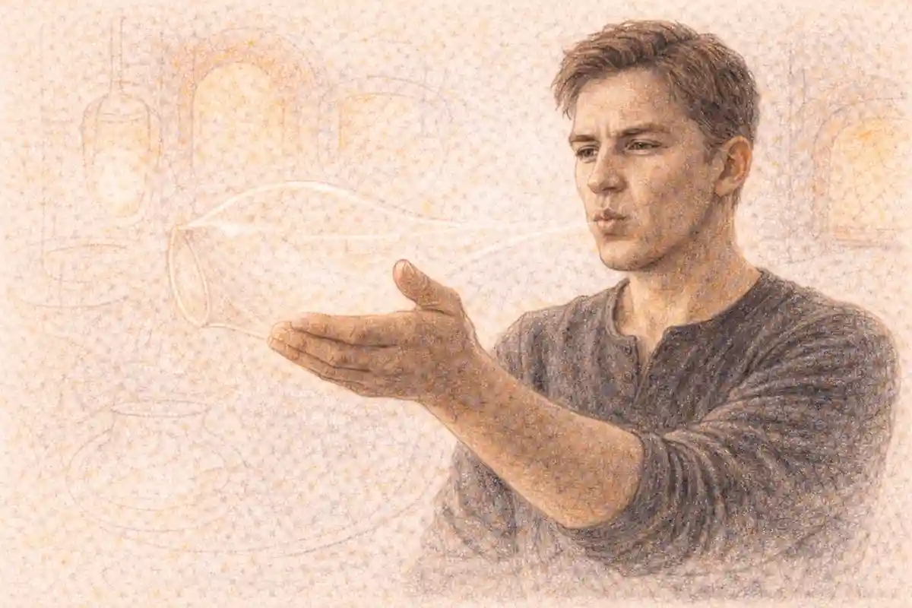

## Cold Open

The telephone on Teodor Bask his desk has a bell that rings twice before the line steadies, and on this afternoon it rings twice and steadies in the ordinary way, and he lifts the receiver with his left hand because his right hand holds a pencil over the pour book, and he says the name of the foundry and his own name in the form the ministry prefers, and then he listens.

He counts without deciding to count. Counting is what the work has taught him to do with anything that arrives without paper. He counts heats and ladles and men on a floor and sacks in a store and minutes between a bell and a pour, and so he counts words as they come down the wire, one after another, in a voice he knows well enough not to describe even to himself, and when the voice stops he has eleven.

Eleven words. He holds the number the way he holds any other small fact that must not be dropped. He does not repeat the words aloud. He does not mouth them. He sets the receiver back in its cradle with care, so that the bell inside does not tremble, and he looks at the pencil in his right hand and at the line in the pour book where the pencil stopped, and he finishes the entry in his usual hand, neither faster nor slower than the entries above it, and he blots it and closes the book.

Nothing is written down that was not already owed to the book. That is the first careful thing, and nobody watching would call it a thing at all.

The office at the Dravin foundry is a small room that was built for a smaller works and has been kept by addition rather than by rebuilding, so that one wall is brick from the first building and one wall is board from the second and the window looks not onto the yard but onto the roof of the pattern shop, beyond which the chimneys stand in a row that he can number without looking. The desk is wood that has darkened where hands have rested and lightened where paper has covered it, and on it, in order from the window inward, sit the pour book, the stores book, the wages book, a shallow tray for letters that have been answered, a shallow tray for letters that have not, a cup with pencils cut to the same length, and a telephone that takes up more room than any of them because the wire must run clear to the wall without crossing the books. He keeps the wire clear. He has kept the wire clear for ten years.

He stands. He puts the pencils straight. He does not hurry. Hurry would be a note in itself, and if there is one habit that ten years of managing this place has laid down in him, it is that nothing in the office should ever be a note in itself. The foundry makes a difficult alloy in small quantities for buyers who ask few questions on paper and many questions in person, and it makes ordinary castings in large quantities for buyers who ask the opposite, and between those two kinds of work there is a life of forms and visits and permissions and courtesies, all of which go better when the manager is a man whose office looks the same on a remarkable afternoon as on an unremarkable one. So he makes it look the same.

First he deals with the letters that have not been answered. There are four. One concerns a delivery of coke that arrived short by a weight he has already disputed in writing once. One concerns a pattern that belongs to a customer in the south and should have been returned in the spring. One is from the ministry, about returns, in the form that arrives every session and must be answered in the form that the ministry expects, with the figures copied in the order the form requests them and with no figure improved. One is from a widow whose husband worked on the second line and whose pension paper has been lost between two offices that are not his. He answers them in the order they arrived, which is the order he always uses, and he copies each answer into the letter book before he folds the original, and he folds each original along its old crease lines where it has them and along a single new crease where it does not, and he puts each in its envelope and writes the direction in full. The widow gets the longest answer and the plainest language. The ministry gets the shortest answer and the fullest figures. That, too, is habit, and habit is what an afternoon like this one is for.

Then he goes down to the floor.

The pour floor is reached by a stair that turns once and by a doorway that is kept wide even in winter because men carrying long tools must pass without turning sideways, and as he comes through it the heat meets him in the familiar order, first on the face, then in the throat, then as a weight on the shoulders through his coat. The floor is long and low roofed and lit by the furnaces at the far end and by high windows that have gone the colour of weak tea from years of fume. Four lines run its length. Three stand in the daylight work, with their moulds set in rows and their benches crowded and their overhead rails busy in the slow, complaining way that rails have when the loads are well within what they can carry. The fourth line runs along the far wall, where the light is poorest and the draught is steadiest, and it is the line that does the difficult work, the alloy work, the work that wants quiet and exact heat and men who do not talk while the metal is moving.

He walks the floor as he walks it every afternoon at this hour, from the furnaces toward the casting pits and then back along the other side, and he stops where he always stops, and he does not stop anywhere new. At the furnaces he looks at the charge books and at the faces of the furnacemen, who nod without speaking because speaking near a charge is discouraged and because they have known him long enough to know that a nod is all he asks. At the first line he looks at a mould that has been set slightly out of true and he waits while the moulder corrects it without being told in words, with a tap and a lift and a second look along the edge. At the second line he counts the finished castings stacked for cooling and writes the count on a slate that hangs for that purpose, although the count will be written again in the book upstairs, because the slate is for the floor and the book is for the office and the two counts keep each other honest. At the third line he speaks to the foreman about a man who has asked for leave and about a belt that is wearing thin at one edge and should be changed before it chooses its own moment to fail, and the foreman writes both matters on his own slate in a hand that only the floor can read.

At the fourth line he walks more slowly, which is also habit, because the fourth line is narrower and the floor beside it is kept clearer and a man walking at his ordinary pace there would seem to be inspecting rather than passing. The moulds for the night work stand ready under covers. The benches are set. The ladle carriage stands where it should stand when it is at rest, with its chain housed and its path swept. He looks at the covers without lifting them. He looks at the benches without touching anything on them. He looks at the carriage path from one end to the other, as a man looks at a road he will not travel until dark. Then he speaks to the night foreman, who has come in early as he always comes in early, and what passes between them is the ordinary exchange for this hour, about men and metal and the order of the night, given and received in the ordinary words, with no emphasis laid anywhere that a listener could later point to and say, there, that was the moment. The night running is prepared. It is prepared the way it is prepared on every working night, by men doing each small task in its turn and by a manager who has seen it done so often that his presence adds nothing except the assurance that nothing has been skipped. If a stranger stood on the gantry and watched only this afternoon, the stranger would learn how the fourth line is made ready for the night, and nothing else, and that is exactly what the preparation is meant to teach.

He goes back upstairs by the stair that turns once, and he washes his hands at the basin in the corner of the office, where the soap is kept on a dish that has a chip on the side away from the wall, and he dries them on the towel that hangs for his hands alone. Then he sets the office in order for the evening.

Setting in order is not tidying. Tidying moves things to where they look better. Setting in order moves things to where they belong, which in this office is a place fixed by years of use and written nowhere. The pour book goes to the left of the desk with its spine to the wall. The stores book goes below it. The wages book goes to the right, under the tray of answered letters. The unanswered tray, now empty, goes above the wages book so that its emptiness can be seen from the door. The letter book stays open until the ink on the last copy is dry, and then it is closed and placed square with the edge of the desk, neither overhanging nor shy of it. The cup of pencils is moved the width of a hand closer to the lamp, because the evening light fails from the window side. The telephone wire is checked with two fingers along its length, not because it needs checking but because the check is part of the order, and a part omitted would be felt by his own hand later as a wrongness he could not name quickly enough to correct in company.

He deals last with the small things that other managers leave to chance. The key to the pattern shop goes on its hook. The key to the stores goes on its hook, which is a different hook of a different shape, so that a man can tell them apart in the dark without striking a light. The clock is wound. The lamp is filled and its wick trimmed. The chair is pushed in to the distance at which he sits, not to the distance at which a visitor sits, because in the morning he will know by the chair whether anyone sat at the desk in the night, and in ten years no one ever has, and the knowing is still worth the pushing. He looks once around the room, not as a man searching but as a man listening for a wrong note in a tune he knows by heart, and he finds none, because he has spent the afternoon making sure there would be none to find.

Only then does he allow himself the one thought that has been waiting since the telephone bell steadied. Eleven words is not many. A man can carry eleven words without a list and without a slip of paper and without any change in the way he answers letters or walks a floor or sets a desk, and he has just proved it to the only witness whose testimony he trusts, which is the afternoon itself. He puts on his coat. He takes his hat from its peg. He goes down the stair that turns once and across the yard in the failing light, past the stacked castings and the coke heap and the gate where the watchman is changing with the night watchman in the slow ceremony of keys and lanterns that belongs to every works at dusk, and he answers their greeting with his own, and he walks home through streets where the lamps are being lit in their order, first at the corners and then along the terraces, in the same careful sequence as everything else he has done since the call came, as if care itself were a kind of message that could be sent without words to anyone who knew how to read an afternoon.

## Tasking

Petra Dunmore ran the paper in a room on the second floor of the Office building in Carrowmere where the windows faced a courtyard too narrow for carts and the light, even at midday, had the quality of light that has been borrowed from somewhere else. She had laid Rann his list out on the table in the manner of a woman who does not trust a document until it has been made to lie flat under other documents, with a file weight at each corner and a ruled sheet beside it on which she had already written the four names in her small, upright hand, and Mira Kovac stood on the other side of the table with her coat still on and her notebook still in her coat pocket, and Rask stood by the door with his splinted left hand held clear of the door frame and his good hand holding nothing at all, which for Rask was a form of attention.

The list itself needed restating, because a list carried out of a yard under pressure acquires a second life in the Office unless its first life is pinned down in plain words at the start of the next piece of work. Ysolde Rann had carried the list out in the previous case, out of a foundry yard where three crates in a row of forty had read as nothing at all, and she had carried it at a cost to her own family and to the family foundry business that had faced closure because the list existed and because she had chosen to move it, and Dunmore said so in one clause at the beginning, without emphasis and without apology, as a fact that belonged to the paper as much as any stamp or bench number. The list named four foundries that could make the alloy. Not four foundries that did make it as a matter of routine, and not four foundries that had once made something like it, but four places with the furnaces, the men, the tolerances and the habit of exact work that the alloy required, and of those four, only one sold the alloy onward through a single channel that the list described and the Office had since confirmed by other paper. The rest of the case would turn on that distinction, and Dunmore, who understood how cases turn, put it on the ruled sheet before she put anything else there.

She named the four distinctly, because in her experience cases were lost when places were allowed to blur into a general idea of elsewhere.

The first was the river foundry at Valtessa, a large and open works that stood where the river bent and took its charge by barge, with a capacity greater than the other three together in ordinary castings and a long history of Accord inspection that had never found anything worth a second visit, a place that published its order book in summary and kept its floors swept to a standard that visitors praised in writing. The second was the low works at Teshkar, a smaller place in a hollow where the wind carried the fume away from the town, with two lines only and a reputation for difficult work done slowly and correctly, which ran at night when a job required it and said so on its returns without concealment. The third was the quay foundry at Melora, a middling works with three lines and a mixed trade, part marine work and part inland orders, which had been inspected often because it stood on a route that inspectors travelled for other reasons and had therefore acquired the polished ease of a place that is used to being looked at. The fourth was the foundry at Dravin, on the continent, in a city that was heavily policed and proud of being so, a works of four lines whose fourth line ran at night as a matter of standing practice and made the alloy in the small quantities the single channel required, managed by a man whose name Dunmore wrote last and underlined once, not for importance but because his name would be needed most often in what followed. Teodor Bask. The protected foundry, if there was a protected foundry, would be his, because his was the one whose night running matched the casting run on the crates that had read as nothing, and his was the stamp that had been shared by all three.

Mira would run the floors. That was the division Dunmore stated next, and she stated it as a division of labour rather than as a compliment. Dunmore would run the paper, which meant the schedule, the files, the ministry correspondence, the circulation lists and the slow work of proving when a piece of paper had come into existence and who could have seen it. Mira would run the floors, which meant walking them, reading what could be read in offices and on benches and at the edges of floors where crowds thinned, and reporting what the floors themselves said about their own habits. Reni Vosk, who was twenty one and junior and careful in the way that junior officers are careful when they know their carefulness is being assessed, would go with Mira to the openly inspected works, to carry the forms and to watch the parts of a floor that Mira could not watch while she was reading. Rask would go where a Stiller was needed and would otherwise hold himself ready, one handed as he was, his left hand still splinted from the service gate he had held at Mira his asking in the inert house case, a cost that nobody in the room mentioned because mentioning it would not have changed the splint or the work.

Then Dunmore named the cost of the case plainly, before any plan was allowed to gather momentum and make the cost seem like an afterthought. If all four foundries were inspected openly, in the ordinary way, with notices sent and schedules circulated and inspectors arriving in the order the notices promised, then whichever foundry was being protected, if one was being protected, would be warned by the very act of inspection, because a warning system that could not survive an open inspection was not a warning system worth the name, and the Office would learn only that four floors could be made clean when their managers knew that cleaners were coming. The inspection itself would destroy the evidence it was meant to gather. That was the cost, stated up front as the brief required costs to be stated, and Dunmore wrote it on the ruled sheet in full sentences, so that later nobody could claim the danger had been understood only in part.

The device that answered the cost was a pretence, and she described it without dressing it in finer language than it deserved. Three foundries would receive real inspections, full and open, with floors walked and books examined and readings taken where readings could be taken. One foundry would receive a pretence, a light scheduled visit that looked like routine paperwork, a matter of forms carried across a yard and signatures gathered in an office and courtesies exchanged at a gate, the kind of visit that a well run works could absorb without altering a single mould. The pretence would fall on the Dravin foundry, not because the Office had proved anything against Dravin, but because Dravin was the place where proof, if proof existed, would be most easily destroyed by a real inspection, and because a pretence that was later shown to have been a pretence would still leave the floor in its ordinary state for a second, quieter approach if one became necessary. Which of the three real inspections came first, and on which days, and in what order the pretence was interleaved among them, would matter a great deal, and Dunmore was explicit that none of that yet existed.

There was, at the moment she spoke, no inspection schedule for the four foundries. She said so twice, in different words, because she wanted the absence of the schedule to be as firmly established as any presence would later be. The schedule would be drawn after the tasking meeting ended, and it would be drawn by lot, with the names of the four foundries placed in the drawing in an order that the lot itself would then disturb, so that no one in the room, not even Dunmore herself, could be said to have chosen the sequence in advance. The drawing would be witnessed. The schedule, once drawn, would be issued through the ordinary inspection service channels, with copies to the ordinary places, because a schedule that travelled by an extraordinary channel would teach the Office nothing about ordinary channels. All of that lay in the future at the moment of tasking, and Dunmore wanted the future tense kept clean.

She fixed the end of the meeting on the page with the same deliberateness. The wall clock in the room had a second hand that ticked audibly in the quiet between sentences, and when she had finished laying out the division and the cost and the device, she looked at it and she wrote the time on the ruled sheet and she asked Mira to read it back, and Mira read it back, and Rask, from by the door, confirmed it without being asked, in the flat tone of a man confirming a weight on a scale. Then Dunmore signed the minute of the meeting below the time, and Mira signed below Dunmore, and the minute, with its fixed ending, went into the file that would later hold the schedule itself, so that anyone who needed to know when the schedule could first have existed would find the answer in the same folder as the schedule and would not need to rely on memory or on goodwill. It was a small piece of paper discipline, and it was done before anyone left the room, while the clock was still ticking and the list was still flat under its weights.

Two further facts were established before the meeting closed, because both would be needed on the floors and neither could be supplied later without weakening the case. The first was the night line. Rann his list stated, and the Office his other paper confirmed, that the Dravin foundry his fourth line ran at night, not occasionally and not only when an urgent order required it, but as its ordinary way of doing the alloy work, in darkness and quiet and with a reduced crew whose names appeared on a separate roster. If that line were found paused, or cleaned beyond its ordinary cleaning, or set in an order that belonged to daylight inspection rather than to night production, that finding would itself be evidence, and Mira was to record it with the same neutrality as any other finding. The second was Mira his own state. She entered the case full, rested within the meaning that the Office gave to the word for a Weigher, carrying no heavy read from the previous case that had not been slept off or waited out, with the cold that followed a read absent from her hands and with her sleep, such as it was, unbroken for the nights that mattered. Dunmore asked after it directly, because endurance was a fact of the case and not a courtesy, and Mira answered directly, and the answer went on the ruled sheet as well, so that any later account of what the case had cost her would be measured against a known starting point rather than against an assumption.

The meeting ended with the four names still on the table and the schedule still undrawn and the lot still uncast, and with the cost and the device and the night line and the fixed time all on paper, and Mira put her notebook back into her coat pocket without having taken it out, beside the folded rubbing of a foundry stamp that she had carried since the Carrowmere run, and she understood the shape of the work as Dunmore had laid it: paper that could be timed, floors that could be read, and one floor among four that must not be frightened into cleanliness before its habits had been given a chance to speak for themselves.

## Ground Truth

Dunmore drew the schedule in the same room, after the tasking meeting had ended and after the minute with its fixed time had been filed, and she drew it by lot in the presence of a witness from the inspection service whose name went onto the schedule itself, so that the schedule carried its own birth certificate in its margin. Four slips, each bearing one foundry name in Dunmore his hand, were folded once and placed in a shallow wooden bowl that usually held paper clips, and the witness drew them without looking, and Dunmore wrote the order down as it emerged and signed beneath it, and the witness signed beneath Dunmore, and the time of the drawing was entered beside the signatures from the same wall clock that had fixed the end of the tasking. Only then was the schedule issued, through the ordinary channels and to the ordinary copy holders, with no copy withheld and no copy advanced, and the issue was logged in the inspection service register in the ordinary hand of the clerk whose duty it was. Anyone who later wished to argue about when the four inspections could first have been known, and by whom, would have to argue with that page, and the page, being ordinary, was difficult to argue with at all.

Mira and Reni began with the river foundry at Valtessa, and the work there set the pattern for the two openly inspected works that followed, in that it was thorough and unhurried and almost entirely without surprise, which in a mole hunt is itself a kind of information, because a floor that has nothing to hide still hides its habits in plain sight until someone walks it slowly enough to learn them. The Valtessa works stood above its barge quay with its furnaces in a long shed that opened at both ends to the river air, and its manager, a woman who had come up through the pattern shop and still judged a mould first by its smell and only second by its measurements, received the inspection as an inconvenience she had budgeted for rather than as an event she had prepared for, and the difference showed in a hundred small untidinesses that no warning could have left standing. Moulds stood where the morning his work had left them. A charge book lay open with a correction entered in a different ink and initialled without shame. The stores held a discrepancy of sacks that took an hour to resolve into a simple error of counting on a wet day, and the resolution satisfied Reni, who had found the error, more than it satisfied the storekeeper, who had made it. Mira read what could be read there in the manner that her practice allowed and in the places where it allowed it, away from the centre of the floor where men gathered thickly around a pour and the weight of the present moment drowned any older weight that metal or stone might have held, and at the edges, in the office where the manager his desk had stood for years against the same wall, in the bench room where the same tools had been lifted and set down in the same order through seasons of repetition, in the stone sill of the doorway between the shed and the yard where hands had steadied themselves with loads for longer than anyone employed there could remember, she found the ordinary stratum of a working place, fear in small and survivable quantities where accidents had nearly happened and had been learned from, grief laid thinly where men had died in the slow ways that foundry work allows, sustained intent in the benches and in the rails where exact work had been willed again and again until the willing itself had become part of the furniture. Nothing there spoke of concealment. Nothing there was absent in the way that absence, as she had learned to know it, declared itself by a clean and impossible nothing where something should have been. She recorded the reads in the notebook she kept against instruction in her coat pocket, in the private register where absences were entered in her own shorthand, and in Valtessa she entered none, and the entering of none was done with the same care as any other entry, because a register that records only alarms soon becomes an alarm itself.

The low works at Teshkar gave them a different floor and the same lesson in a slower dialect. The hollow held the heat even in the morning, and the works, with its two lines and its small crew, did its difficult work at a pace that looked like idleness to anyone who judged by noise and looked like mastery to anyone who judged by results, and its foreman, who acted as manager for inspection purposes because the owner lived at a distance and trusted him entirely, walked Mira and Reni through the buildings in an order dictated by the buildings themselves rather than by any wish to show one thing before another. Here the night work was openly acknowledged and openly recorded, with rosters pinned where rosters belonged and with the night his benches showing the honest wear of night use, the oil lamps blackening the same patch of ceiling month after month, the floor plates beside the second line polished by boots that had stood in the same positions through the dark hours when a pour cannot be hurried and must simply be accompanied. Mira read the second line his metal at its quiet end, where the crowd, such as it was, never gathered, and she felt the repetition there as a rhythm rather than as a pressure, night following night in a pattern broken by rest days and by repairs, a working rhythm that any inspector could have predicted from the returns and that the metal merely confirmed in its own language. Reni, who was learning to watch a floor while Mira read it, noticed without prompting that the Teshkar office held no second desk and no second telephone and no locked drawer whose key lived elsewhere, and she wrote the observation in her forms in the neutral language the forms required, and the neutrality of the language preserved the sharpness of the observation better than emphasis would have done. No absence declared itself at Teshkar either. The weight there was proportionate, explicable, continuous with the paper, and Dunmore, when the report came back to Carrowmere by the ordinary post of the Office, underlined the word continuous once and filed the report where the schedule file could find it.

At Melora, the quay foundry, the inspection ran into the opposite difficulty, which was that a place accustomed to being inspected has learned to be inspected in the way that a practised witness has learned to be questioned, fluently and without friction and with every book already open at the page the inspector is most likely to request, so that the ease itself must be examined to decide whether it is innocence made efficient or guilt made smooth. Mira examined it by walking more slowly than the foundry his guide wished to walk, and by reading in the places that fluency cannot rehearse, the back bench where repairs were done without forms, the stone floor of the wash house where men had waited in anxiety for news of accidents that had happened on the quay rather than in the works, the wooden handle of a store door that had been gripped hard on a small number of memorable occasions whose dates the paper later supplied from incident reports that matched the grip in number and in gravity. Everything matched. That was the Melora finding, and it was a real finding rather than a failure to find, because a foundry where paper and weight agree in detail, including in the details that embarrass, is a foundry whose channel to the outside world, whatever it may be, is not being used to edit its past. Reni carried the forms and asked the questions the forms required about night running, and the Melora answers were precise in the way of a works that runs at night for marine tides and records the tides beside the heats, so that any night could be accounted for by water as well as by metal. The third openly inspected floor thus closed its inspection with its habits confirmed and its candour, fluent or otherwise, intact, and Mira returned to Carrowmere with cold still in her hands from the wash house stone and with three floors in her notebook that all said, in their different dialects, that work done openly leaves a weight that can be followed, and that none of the three had been given a reason to learn how to leave none.

It was Dunmore who set the three floors beside the fourth on paper, in the artifact that the case would return to again and again, because paper can hold four places still in a way that memory, which visits them in sequence, cannot. She compiled the foundry table from Rann his list, from the inspection returns, and from the ministry summaries that all four works were required to file, and she introduced it into the case file with a short covering note that said what the table settled and what it did not, and Mira, reading the file before the Dravin visit, understood that the covering note was as important as the table itself, because a table that is allowed to seem to settle more than it does will mislead a case more efficiently than no table at all. What the table settled was comparative and plain. Only one of the four combined a small alloy capacity with regular night running on a dedicated line and with an inspection history that was thin in a particular way, thin not because inspections had been refused or obstructed, but because inspections that had been scheduled had repeatedly become light visits, paperwork visits, visits that closed early or narrowed in scope, as if the ordinary machinery of inspection lost its appetite whenever it approached that one gate. What the table did not settle was agency. It did not say who had blunted the machinery, or whether the blunting came from inside the inspection service, or from the ministry in Dravin, or from within the Accord itself, and Dunmore his note said so in words that left no room for a later reader to pretend otherwise.

| Foundry | Capacity | Night running | Inspection history |
|---|---|---|---|
| River foundry at Valtessa | Largest of the four in ordinary castings, at eight hundred tonnes in a full week, with alloy work occasional and small | Rare, for river conditions only, and recorded with the barge movements | Full inspections at regular intervals across nine years, with findings filed and closed in the ordinary way |
| Low works at Teshkar | Smallest of the four in ordinary castings, at two hundred tonnes in a full week, with alloy work rare and by special order | Regular when difficult work requires it, on the second line, with rosters filed openly | Full inspections less often, by reason of distance, but complete whenever undertaken, across nine years |
| Quay foundry at Melora | Middling, at five hundred tonnes in a full week, with alloy work in modest quantities for marine buyers | Regular, governed by tides, on any line the tide requires, with heats recorded beside the tides | Frequent full inspections across nine years, by reason of position on a travelled route, with detailed reports |
| Foundry at Dravin under Teodor Bask | Small in ordinary castings, at three hundred tonnes in a full week, but with alloy capacity on the fourth line equal to the other three combined | Standing practice on the fourth line, on most working nights, with a separate roster | Inspections scheduled as full on nine occasions across nine years, and recorded as light paperwork visits on eight of those occasions, with one full inspection in the earliest year only |

The prose of the case file, in Dunmore his hand, referred to the table again whenever a later argument needed its footing, and Mira would refer to it again on the floor at Dravin and again in the Office at the close, because a comparison that has been honestly compiled acquires a kind of weight of its own, not the weight that Mira read in metal and stone, but the slower weight of paper that has been checked against floors and has survived the checking. Three floors had now been checked. The fourth had not, except by paper, and the paper about the fourth already contained a disturbance that no table could smooth away, which was that the warning signs, if warning signs they were, had been visible before any inspector had set out for Dravin at all.

The disturbance had arrived by the ordinary channels and in the ordinary forms, which was what made it difficult to dismiss and what made Dunmore handle it with tongs. A routine return from Dravin, filed by the foundry itself in the course of its session obligations and therefore not a document created for the inspection at all, recorded that the fourth line had stood paused for a night in a week when no repair was logged and no order gap explained a pause, and a second routine return, from the ministry office that received foundry returns and copied them onward to Carrowmere, showed the fourth line his benches as having been cleaned to a standard described in the return his own clerk his language as full, a word that the Dravin returns used for the deep cleaning undertaken before a holiday closure or before a formal visit, and not for the nightly sweeping and setting that the line received as a matter of course. Either entry alone could have been an accident of clerking. Together, and placed beside the foundry table, they described a floor that had been made ready to be looked at, cleaned and paused and set in order, at a time when, by the schedule file, no inspection of Dravin had yet been issued to anyone who could have told the foundry to make itself ready. Mira read the returns twice in Dunmore his room, with the courtyard light failing and Rask holding himself by the door in the posture that meant he was listening for a conclusion rather than for a detail, and she thought, as she had been trained to think and as the case now required her to think in the open, of [the bound load on a border station whose binding could not be felt where it sat](/2026/11/13/nightjar-inert-house-013/), where an absence had hidden in plain proximity to honest work, and of [a foundry yard where three crates of forty read as nothing and shared one stamp](/2026/11/14/nightjar-carrowmere-run-014/), where the nothing had at last acquired an address in the form of a stamp and a bench and a casting run, and the thinking was not nostalgia and it was not method borrowed from another case, but the simple recognition that the present case had inherited its central fact from those floors and owed them the courtesy of precision about what that fact was and what it was not. What had been inherited was narrow. An alloy that could carry a binding that left no weight. A stamp that tied the nothing to one foundry among four. Nothing in the inheritance named a channel, a ministry, a service or a man, and the discipline of Ground Truth, as Dunmore practised it, was to keep the inheritance narrow until the floors and the paper widened it by evidence rather than by appetite.

The schedule his creation time, by contrast, could not have been narrower, and Dunmore documented it until documentation itself became a form of argument. The tasking minute fixed the end of the meeting. The drawing entry fixed the casting of the lot. The issue log fixed the release of the copies. Between those three fixed points there was no interval in which a schedule could have existed in secret without leaving a fourth fixed point behind it, because Dunmore had arranged the drawing precisely so that secrecy would require forgery, and forgery of a witnessed lot drawing in a logged register was a heavier crime, and a clumsier one, than the warning the case was hunting. She walked Mira through the file page by page, not because Mira doubted her, but because the walk itself was part of the evidence, a second pair of eyes laid over the times in order, so that later, when the arithmetic of warning would have to be done in earnest, it could be done from anchors that two officers had examined together while the case was still young. Bask his office entered the file at this stage as a named anchor for a later reading, and it entered modestly, as an address and a description rather than as a promise. The Dravin returns and an older inspection report, the single full inspection from the earliest year in the table, agreed that the manager his office stood above the floor at the turn of the stair, that its desk and its books and its telephone had occupied the same positions for years, and that its fabric was brick and board and old wood of the kind that held weight well and surrendered it slowly. Mira noted the office in her register as a place to be read when the pretence visit gave her lawful presence in the building, not because she expected it to name anyone, since weight never named anyone and any reading that pretended otherwise would be a fraud upon the case, but because a room where the same man had received messages and given orders and set his affairs in order through years of repetition might hold the shape of that repetition in a way that a single afternoon of observation, however careful, could not supply. The note was a clause in the register and a line in Dunmore his file, and there it rested, an intention documented before it was executed, which is where intentions in a sound case belong.

With three floors walked and the fourth described by paper, Dunmore required the possibilities to be stated fairly, in full sentences, with the evidence for each given the same weight of language as the evidence against it, because a mole hunt that states only the possibility it favours will find only the mole it has already imagined. She wrote them on a fresh ruled sheet while Mira and Reni and Rask listened, and she numbered them in words to keep the sheet free of any suggestion that order implied likelihood.

The first possibility was that a buyer inside the inspection service leaked the schedule. The inspection service was large, its registers were handled by many hands, its copies travelled to many trays, and a person placed where schedules were drawn or issued or copied could sell a sequence of dates for a modest and regular consideration without ever knowing which foundry mattered or why, simply by selling all sequences to a purchaser who discarded the ones that did not concern him. The possibility was live because the machinery was genuinely porous, as Dunmore would later prove in detail, and because porous machinery invites exactly this kind of tenancy, a small occupant living in the gaps of a large system and feeding on its movements.

The second possibility was that a standing arrangement at the foundry his own ministry protected it. Dravin had its ministry, its undersecretaries, its circulation lists and its notification orders, the whole apparatus by which a continental administration assures itself that nothing within its territory is surprised by an outside body, however friendly, and an arrangement lodged in that apparatus, old enough to have become routine and small enough to have become invisible, could ensure that one foundry was always told, in advance and through channels that looked like administration rather than like warning, whenever the Accord proposed to look at it. The possibility was live because the table showed a pattern of blunting that had persisted across changes of inspector and across changes of Office personnel, and persistence across personnel is the signature of an arrangement that lives in paper rather than in a person who might retire or be transferred.

The third possibility was that an Accord officer warned it. The Office itself, or the wider Accord machinery in Carrowmere, held the schedule before the inspection service issued it and held Rann his list before anyone else held it at all, and an officer with access to either, moved by payment or by sympathy or by a private understanding of where loyalty was owed, could pass a warning by telephone or by letter or by a conversation in a courtyard too narrow for carts, leaving no entry in any register that Dunmore controlled. The possibility was live because it could not be excluded by any file in the room, and Dunmore, to her credit and to Mira his discomfort, stated it with the same neutrality as the other two, and looked at no one in particular while she stated it, and then filed the sheet where all three possibilities would remain on record even after the case had chosen among them, so that the choosing, when it came, would have to reckon with the fairness of the stating.

In Dravin, in a ministry building whose corridors were wider than the corridors in Carrowmere and whose doors were heavier, Ilyan Court sat in an office that was smaller than his title might have promised and larger than his work strictly required, and dealt with the morning his paper in the order in which his clerk had laid it, which was the order of arrival rather than the order of importance, because Court had learned early in his career that importance, attended to first, had a way of consuming the hours that arrival, attended to steadily, would have distributed without drama. He was an undersecretary, which in the Dravin ministry meant that he signed what directors had decided and queried what clerks had drafted and represented the ministry at meetings whose conclusions had been settled in other rooms, and he had held the grade long enough for the grade to have settled around him like a coat cut for a younger man, still serviceable, still respectable, no longer quite the shape of the life inside it. His desk held the usual strata of such an office, files bound in the ministry colour, a tray for signatures, a tray for circulation, a glass of water that his clerk refreshed without being asked at intervals that Court himself no longer noticed, and among the files, indistinguishable in binding and in bulk from its neighbours, lay the standing papers for the foundries within his section, returns and notifications and authorisations of the kind that passed across his desk in every session and had passed across it, in evolving forms, for nine years.

Court was not a man who considered himself bought, and the distinction mattered to the accuracy of the scene in a way that a cruder account would have missed. Payments had arrived in his life in the manner of the ministry itself, small and regular and clothed in administrative language, supplements and allowances and considerations attached to duties that were real duties even if they were light ones, and over nine years the smallness had done the work that a large sum, offered once, could never have done, because a large sum demands a decision and a small sum repeated demands only continuation, and continuation is the easiest act in any bureaucracy, requiring no courage and no reflection and no moment at which a man must say to himself that he has changed sides. He had told himself, on the few occasions when the arrangement surfaced in his thoughts at all, that he provided quiet, and the word quiet had served him as a complete moral account, because the foundry did its work and the ministry did its work and the Accord did its work and nobody, in nine years, had been visibly harmed by the fact that one telephone call preceded certain inspections and that one office was notified before certain visits. What he understood, with a clarity that his superiors, who had never needed to understand it, would have found unseemly if they had noticed it, was that he was too unimportant for the Accord to spend itself removing, and that nine years of small payments had bought quiet rather than loyalty, which was operationally true in both its parts. He was right about that. The Accord measured its expenditures of attention as carefully as any ministry measured its expenditures of money, and an undersecretary whose removal would require representations, evidence, a replacement, a period of uncertainty in a section that functioned precisely because nobody examined it, was a poor bargain when measured against the great matters that competed for the same attention in every session, and loyalty, in any case, had never been the commodity in transit, because loyalty would have required Court to act against the Accord when action was costly, whereas quiet required only that he act for the arrangement when action was cheap, by passing a word along a wire in the ordinary course of an ordinary morning, and cheap action, reliably repeated, is worth more to a protected foundry than any declaration of allegiance sworn in earnest. He initialled the file before him. He moved it to the signature tray. He took up the next file, which concerned a bridge inspection in a district he had never visited, and he read its first page with the genuine attention of a man who does his unimportant work properly, which was, and had always been, the whole of his protection and the whole of his usefulness, in equal measure.

What remained in Ground Truth, after the possibilities had been fairly stated and after Court had initialled his bridge file in ignorance of the sheet in Carrowmere that described his office without yet naming his name, was the slow work of making the Dravin warning signs stand up as evidence rather than as atmosphere, and that work fell, as slow work in the Office usually fell, to comparison. Dunmore compared the Dravin returns against the returns of the other three foundries for the same session, line by line, in a sitting that lasted an afternoon and produced no drama more visible than the steady accumulation of ruled ticks in a margin, and the comparison showed that the pause and the deep cleaning were not Dravin habits but Dravin exceptions, events without parallel in the Valtessa returns, where a paused line was always a repaired line, or in the Teshkar returns, where cleaning was recorded in the vocabulary of routine and never in the vocabulary of fullness, or in the Melora returns, where every variation from plan arrived trailing its explanation behind it like a boat trailing its wake. Reni, sent back to the Melora file to check a single date, returned with a broader observation that Dunmore entered into the record without altering its junior phrasing, which was that the three inspected foundries all recorded their surprises, whereas the Dravin foundry, on paper, appeared to have abolished surprise altogether, and a works that has abolished surprise on paper has usually done so by arranging not to be surprised in fact, which requires notice, which requires a channel, which was the thing the case existed to find. Mira, for her part, walked the Office his own corridors in the evenings of those days with the stamp rubbing folded in her pocket and the register growing by clauses, and she considered, without yet allowing herself to conclude, the long history that stood behind the narrow inheritance of the alloy, the [doors in Valtessa whose perfect seals had held nothing behind them](/2026/11/11/nightjar-seal-that-wasnt-011/) and the houses and stations and yards that had each taught the same lesson in a different material, that a perfect surface and an honest surface are not the same surface, and that the Office had learned to distrust perfection in proportion as it had learned to trust the untidiness of Valtessa his charge book and the discrepancy of sacks that resolved into a wet day and an honest error. Rask, who read no paper that he was not required to read and who trusted floors more than files because floors cannot be refiled, contributed the observation that completed the beat without closing it, when he said, in the doorway of Dunmore his room and with his splinted hand held clear of the frame as always, that three floors had smelled of work when they were entered without ceremony and that he would reserve his judgement of the fourth until he had smelled it under the same conditions, which the pretence, by its nature, would deny him, since a pretence visit enters by ceremony or it enters not at all. Dunmore recorded even that, in paraphrase, because a case that records only its documents and not its craftsmen will one day find that the craftsmen remember what the documents have forgotten. By the end of Ground Truth the case therefore stood with its foundations honestly laid and honestly visible: a schedule whose creation could be timed to a witnessed drawing and a signed minute, three floors whose weight and paper agreed, a table that settled comparison and refused agency, a fourth floor that had cleaned itself and paused its night line before any inspector could lawfully have told it to do so, three possibilities stated without favour, an office above a stair in Dravin waiting to be read for repetition rather than for identity, and a pretence visit still to come, light on paper and heavy in implication, by which Mira would walk a warned floor as if she did not know it had been warned, and the floor, if the case was sound, would betray its warning precisely by the completeness of its calm.

One further piece of ground had to be walked before the pretence could be attempted with a clear conscience, and it was ground of a kind that never appeared in tables because it concerned not what the four foundries did but how the Office itself behaved when it believed it was behaving ordinarily. Dunmore, who distrusted any inquiry that examined only the examined, turned the same comparison upon the inspection service his own correspondence for the session, reading outward from the schedule file into the letters and memoranda that had surrounded the four inspections without ever naming them, and she found the ordinary untidiness of a large service conducting its ordinary business, requests for leave overlapping with inspection dates and requiring rearrangements that were logged and regretted, a vehicle failure that had delayed one inspector on a road where vehicles failed with seasonal regularity, a query from a junior clerk about the correct form for recording a night roster that had been answered by two superiors in slightly different words and reconciled by a third, all of it human and all of it documented and none of it, on its face, a channel. Mira sat with her through the last hour of that reading because Dunmore had asked her to sit, not for assistance but for witness, and what she witnessed was a senior analyst deliberately searching her own machinery for guilt with the same patience she had applied to the foundries, and recording the search itself in the file so that no later reader could say the service had been presumed innocent without examination. Reni, meanwhile, had been set the unglamorous and essential task of copying the Dravin inspection history out of the bound registers into a single continuous sheet, so that the pattern in the table could be tested against the handwriting and the ink and the marginal notes of the original entries rather than against a summary that might have smoothed what the originals preserved, and she brought the sheet to Dunmore with two observations that she delivered standing, in the manner of a junior officer who has been taught that findings are not improved by sitting down to soften them. The first was that the light visits at Dravin had each been recorded by a different inspector, so that no single inspector his career explained the pattern. The second was that the reasons given for lightness differed each time in wording and agreed each time in effect, a form awaited from the ministry, a signature unavailable until the following week, a courtesy call upon a director that had consumed the hours allotted to the floor, reasons that were individually plausible and collectively impossible, like a set of excuses composed by different hands from a single understanding of what an excuse needed to achieve. Dunmore thanked her without praising her, which Reni correctly understood as the higher compliment, and she placed the continuous sheet behind the table in the file, where it would support the table without replacing it, and she wrote beneath the sheet a single sentence to the effect that the history, read continuously, described a door that had been held almost closed by many hands, none of which needed to know the others in order to hold it. That sentence, Mira thought, leaving the room as the courtyard light failed for the second evening in succession, was the closest Ground Truth could come to a conclusion without ceasing to be ground and becoming verdict, and she carried it with her, together with the cold from stones she had read and the names of four foundries in their drawn order and the image of a fourth line cleaned and paused in advance of a warning that should not yet have been possible, into the part of the case where paper would have to give way to floors again, and where the lightest visit in the file would be the one she made herself.

## The Collapse

The reasonable reading died in Dunmore's room, and it died the way reasonable readings usually die in the Ninth Office, not with an argument raised in volume but with paper laid in order on a desk until the order itself refused to hold the shape everyone had preferred.

Mira had preferred it. She said so while Dunmore was still laying the paper down, because there was no use pretending otherwise once the files were open. A buyer inside the inspection service was a clean explanation. It fitted the shape of the work. Schedules were drawn in one building, copied in another, carried by hand and by wire through rooms full of people whose names changed with the season, and a schedule was exactly the kind of thing that could be sold without anyone having to sell anything larger. A man did not need to betray the Accord in any grand sense to sell a schedule. He needed only to let a page lie open a moment longer than it should, or to repeat a date in a corridor, or to take a copy he had no reason to take and leave it where a second pair of eyes could do the rest. Small treasons of that kind were common enough that the Office kept forms for them. There were procedures. There were precedents filed in cabinets whose drawers stuck in damp weather. The explanation had the great virtue of being ordinary, and ordinariness, in Mira's experience, was where most rot lived.

Dunmore, who ran the paper in this case and who trusted ordinariness even less than Mira did, had set out to prove the leak before anyone acted on it. That was her discipline and it was why the case had been given to her hands as much as to Mira's feet. Anyone could suspect the inspection service. Dunmore intended to show the suspicion working, link by link, in documents that would still stand when the suspicion was no longer needed.

She showed it working within the hour.

The inspection service kept its scheduling in a registry that was copied three times between drawing and issue. The first copy went to the liaison desk. The second went to the transport office, which needed dates to move inspectors and seals and the heavy cases of instruments nobody used and everybody signed for. The third copy went into a general circulation file that was meant to hold nothing more sensitive than the week and the region, and that in practice, in the way of general files everywhere, held a great deal more whenever a clerk was tired or hurried or copying by lamplight at the end of a long shift. Dunmore pulled the circulation file for the last four cycles and laid the pages beside the issued schedules, and the correspondence between them was plain enough that Reni, standing at the corner of the desk with her hands folded behind her back in the manner of a junior officer who has been told not to touch anything, read it over Mira's shoulder and went quiet.

Dates that should have existed only in the registry existed in the circulation file. Foundry names that should have been held at the liaison desk until the morning of issue were present in the transport office copies a full day early, written in a second hand in the margin, as if someone had been helpful. Helpfulness, Dunmore observed, was the most expensive habit in any ministry. She sent for the transport clerk, not under guard and not under accusation, and the clerk, a broad and frightened man with ink ground so deeply into the sides of his fingers that it looked like a second skin, admitted within minutes that a runner from a commercial house had twice bought him a meal and had once, only once, he insisted, been allowed to wait in the copying room while a schedule lay on the table. He could not say what the runner had read. He could not say what the runner had carried away in his head. He wept, briefly and without dignity, and Dunmore let him weep and then had him write it all down in his own hand, because a confession taken kindly and written slowly was worth more to the Office than a man broken quickly in a chair.

So the leak was real. That mattered, and Dunmore was careful to say that it mattered, because what followed was not an acquittal of the inspection service and nobody in the room was to leave believing it was. The service leaked. It leaked in the copying room and in the transport office and in the general file, and it would go on leaking until someone with more patience than either of them rebuilt its habits from the floor up. Men would be moved. The clerk would be moved further. The commercial house would find its runner unwelcome in buildings where he had once been fed. All of that would happen in its own slow channel, and none of it, Dunmore said, laying the last page down with the flat of her hand, was the channel that had warned the protected foundry.

She proved that next, and she proved it with time.

Time, in this case, had been fixed early and fixed on purpose. At the tasking meeting Dunmore had stated, before any schedule existed, the order in which the schedule would be drawn. The four foundries would be drawn by lot after the meeting ended. The meeting's end was fixed on the page by the clock above the door, which Reni had read aloud, and by the signed minute, which bore the hour in the secretary's hand and the signatures of everyone present beneath it. No schedule existed before that hour. No lot had been drawn before that hour. No clerk, no runner, no buyer, however well placed and however well fed, could have sold a thing that had not yet come into being. A leak could only run downhill from the moment of creation. That was not a subtlety of Office doctrine. It was the plain shape of the world.

Against that fixed hour Dunmore laid the foundry's own records, which Petra had requested through the ordinary channel as part of the pretence of routine, and which had arrived without fuss because routine requests were the one kind the protected foundry had never learned to fear. The records were dull. That was their strength. A night book kept by the foundry's gate clerk, in which the fourth line's running was entered each evening in a hand so regular that the entries looked printed. A stores ledger in which cleaning compounds for the fourth line had been drawn in unusual quantity on a particular afternoon. A wages sheet in which the night crew for the fourth line had been stood down and paid a half shift for standing down, which no manager did lightly and no clerk recorded wrongly, because wages were the one record in any foundry that every man concerned would check. And a bench book from the pour floor in which the fourth line's benches had been stripped, scoured and reset a full day before any inspector was due to walk them, in an order of work that the bench master had signed with the irritation of a man made to clean a clean line.

Mira read the dates in the records and then read them again, more slowly, while Dunmore watched her face and said nothing. The careful afternoon, the afternoon Bask had spent doing the most ordinary possible things in the most careful possible order, the afternoon the fourth line had been cleaned and the night running paused and the office set in order, sat on the page eleven hours before the tasking meeting had ended. Eleven hours before the lots were drawn. Eleven hours before the schedule existed anywhere in the world, in any copy, in any margin, in any clerk's head. The warning had not leaked from the schedule. The warning had arrived before there was a schedule to leak.

Reni did the arithmetic a third time, because Dunmore made her do it, aloud, from the anchors and not from memory. The minute's hour. The gate clerk's entry. The wages sheet. The stores ledger. Each anchor named, each interval counted, and the gap stood at eleven hours every time, neither shrinking under scrutiny nor growing under repetition, which was how Mira knew it was sound. Figures that changed when they were rechecked were figures somebody wanted. Figures that sat still while three people in a room tried to move them were the closest thing to ground truth the paper ever gave.

Then the reasonable reading was dead, and the room felt the loss of it, because what remained was worse in every direction. If the warning had not come from the schedule, then it had not depended on the schedule at all. Someone had known that the Accord would look at that foundry before the Accord had finished deciding how it would look. Someone had known early enough to telephone a manager in the morning for an afternoon of carefulness, which meant the knowledge had not come from the inspection service's copying rooms but from somewhere closer to the intention itself, or from a standing arrangement so old and so settled that it did not need the particulars of any one inspection. A standing arrangement did not wait for schedules. A standing arrangement was a door left on the latch for years, through which any warning could pass at any hour, in either direction, whenever a footfall sounded on the stair.

Dunmore let the silence sit for a while. Then she began, methodically, to clear the desk of the dead explanation, filing the clerk's confession and the circulation copies into a separate folder for the separate proceeding they would feed, because the discipline of the Office was that a disproved channel was still a channel and would still be dealt with, only not here, not now, not as the answer to this case. Mira watched her work and felt the cold that had been with her since the office read settle a degree deeper, and she put her hands flat on her knees under the desk where nobody had to see her do it.

The office read. She had not yet reported it in full, because Dunmore had wanted the paper settled first, and because Mira had wanted, privately and without admitting it even in the privacy of her own head for longer than a breath, to be wrong about what the office had given her.

Bask's office sat at the end of the foundry's administrative row, above the yard, with a window that looked down the length of the pour floor roof and a door that had been rehung at some point in its life by a man who cared about doors. The pretence visit had not yet happened. The office read had come earlier and by another door: the routine records request had carried with it a routine premises annex, signed in the ordinary way, under which an officer of the Accord could enter the administrative rooms of a listed foundry to verify the records against the rooms they were kept in. It was the kind of annex nobody read and everybody signed. Mira had read it. Dunmore had read it twice. Under its shelter, on the morning after the records arrived, Mira had gone to Dravin with Reni and a porter and a case of seals, as paperwork made flesh, and had been shown into Bask's office by a secretary who was pleased to demonstrate how little there was to hide.

There was, in the sense the secretary meant, nothing to hide at all. A desk. A chair. A second chair for visitors, lower than the first by the width of a hand, which told its own small story about how meetings in that room were meant to go. A cabinet with a lock that worked. A stove. A shelf of bound ledgers with the years of their keeping written on their spines in white paint, though she did not read the spines for dates, because dates were not what she had come for. A telephone on a side table, with a cord that had been repaired with tape at the place where cords always failed. A coat stand. A rug worn thin in the path between desk and door and desk and window, the twin tracks of a working life laid into wool.

She had asked the secretary, politely, whether she might sit at the desk to compare the bench book against the room's own copy, and the secretary, who had no reason in the world to refuse a request so dull, had left her there with the door open and the corridor's ordinary noise coming through it, and Mira had put her hand flat on the desk, in the place where a man's hand rested when he reached for the telephone, and read.

Weight did not give her the call. She had known it would not, and she had schooled herself beforehand against the particular disappointment of reaching for what the gift refused, because reaching soured a read and left the reader with her own wanting laid over the true deposit like a thumbprint on glass. Weight recorded intensity and affect, laid down in places and objects by fear and violence and grief and long repetition and sustained intent. It did not record identity. It did not record who. It could not replay a scene, and it could not render speech, and anyone who claimed to take words out of a wall was selling something. What the desk gave her, and the chair, and the door handle worn bright on its underside, and the telephone table with its taped cord, was not the morning of the call. It was the decade around the call.

Ten years of one man being careful.

It came up through her palm in layers, the way sediment comes up in a core sample, each layer distinct and each layer the same. The care was in the desk where he sat and in the floor where he stood to look out of the window before he decided anything, and it was not the care of a frightened man, which was the first thing she had braced for and the first thing the room corrected. Fear had a flavour she knew well, sharp and sour and uneven, laid down in bursts and fading fast, because frightened people touched things hard and briefly and then avoided them. This was not that. This was repetition. The same posture of attention, returned to daily, over years, until attention had stopped being an act and had become the grain of the place. He checked. He checked again. He set things in order before he left and he set them in order when he arrived, and the second setting was not anxiety, it was liturgy. He read a page twice. He signed slowly. He kept the telephone table clear of everything but the telephone, so that when it rang there would be nothing to move and nothing to knock and no paper on which a nervous hand might write what it should not write. He had kept it clear for ten years. The clearing was in the wood, in the shallow polish of a surface wiped far oftener than use required, and the polish held the patience of the wiping the way a step holds the patience of feet.

She moved, when she could move without haste, to the window, and put her fingers on the sill where his would rest, and the sill gave her the same care turned outward: the long looking before decisions, the counting of the yard, the habit of knowing where every crew stood before he gave an order that moved them. She touched the cabinet handle and got the care in its clerical form, files returned to their places on the day they were used, nothing left overnight on the desk that belonged in the lock, nothing in the lock that belonged in the fire. She touched the door handle last, because doors held thresholds and thresholds held the moments when a man composed himself, and the door handle gave her the smallest and heaviest thing in the room, which was the pause. Every day, for ten years, on leaving and on entering, the man had paused with his hand on that handle and had arranged his face and his thoughts into their working order before he crossed. Ten years of pauses. They lay in the bright metal like rings in a cut trunk, and she stood there with her hand around them and felt the cold go up her arm to the elbow and then to the shoulder, and understood that she was not reading a conspirator. She was reading a discipline. Whoever had telephoned that office had not needed to instruct Bask in carefulness. They had only needed to choose a man whose carefulness was already a decade deep, a man who would hear eleven words, whatever they were, count them without being told to count them, write nothing down because writing nothing down was what he did with everything that mattered, and spend an afternoon being ordinary in the most careful possible order because ordinary carefulness was the whole of his nature and had been since long before the Accord had ever heard the name of his foundry.

The read gave her duration and it gave her repetition and it gave her the quality of the man, and it gave her nothing else. It did not give her the caller. It did not give her the words. It did not give her a name, because names were identity and identity was the one thing weight had never once surrendered to her, in any room, in any year of her service. She reported it to Dunmore in those terms, flatly, sitting at the desk in Dunmore's room with her cold hand wrapped around a cup she was not drinking, and Dunmore, to her credit, did not ask the question that lesser officers always asked. She did not ask whether Mira was sure there was not a name in it somewhere, pressed deeper. She wrote down duration, repetition, quality, and then she wrote down, in her own hand, in the margin: not a frightened man, a kept man.

That distinction turned the case, though neither of them said so at once. A frightened man was warned. A kept man was maintained. Maintenance implied machinery: payments or favours or protection renewed in small regular motions over years, and machinery of that kind, however quiet, ran on paper somewhere, because ministries could not move money or obligation without writing something down, and the writing, once done, had to be filed, and files were where Dunmore lived the way Mira lived on floors.

The name surfaced in a routine file. It is worth setting down plainly how unremarkable the surfacing was, because the case would later be retold in the Office, as cases always were, with the discovery dressed in more drama than it had worn at the time. Nobody broke a cipher. Nobody followed a courier through rain. Dunmore, working outward from the kept man, had requested the ministry's standing orders touching the foundry: not its contracts, which would be guarded, and not its correspondence, which would be read before release by eyes that knew what they were protecting, but its circulation and notification orders, the dull instruments by which a ministry told itself who had to be informed when something happened. Such orders were copied to filing clerks by the dozen. They lived in general registries. They were renewed by rote and read by nobody, because reading them was nobody's duty, and they were, for exactly that reason, the most honest documents in any ministry building.

The order concerning the protected foundry was one page. It directed that before any inspection, audit, visitation or inquiry touching that foundry, by the Accord or by the ministry's own services, notification was to be given to a named office within the ministry, so that the ministry's interest could be represented. The direction was phrased in the flattest administrative language the ministry possessed, language so flat that it had evidently passed under a hundred eyes without catching on any of them. The office named was an undersecretary's office, a small one, concerned with regional industry returns. And beneath the office, in the space where the form required the holder to be identified so that notifications would not go astray during leave or illness, a clerk had written, years ago and in ink long since gone brown at the edges, the holder's name.

Ilyan Court.

Mira heard the name first as a sound Dunmore made while reading, a small arrest in the breathing of a woman who did not arrest easily, and then she saw it on the page when Dunmore turned the file around and set it before her with one finger held well clear of the line, the way officers touched evidence they intended to keep clean. The name meant nothing to her. That was, she would come to understand, precisely what it was supposed to mean. She had served in Dravin. She had read the ministry's senior lists, as every field officer in the region had read them, the way one read weather. Ministers, deputy ministers, the great undersecretaries whose offices moved money and men. This name was not among the weather. It belonged to a smaller climate, an office of returns and filings, a man whose signature authorised payments too small to interest anyone whose business was importance.

Dunmore sent, that same afternoon and through the slowest and most ordinary channels she could find, for the payment authorisations that ran beneath the notification order, because an office that had to be told was an office that had to be kept, and kept offices cost money in one currency or another. The copies came back in a general file, mixed with returns for foundries she had never heard of and would never see, and they were copies of copies, grey with reproduction, and every one of them was ordinary. A retainer for liaison duties. An allowance for the maintenance of regional industry records. A standing payment, quarterly, modest to the point of embarrassment, authorised in the first instance by a signature nine years old and renewed since then by a succession of signatures, each renewal more routine than the last, until the payment had achieved the perfect invisibility of a thing that had always been there. Nine years. The oldest copy in the file was nine years old, and it was not even the original, only the oldest copy the registry had kept, which meant the arrangement was at least that old and possibly older, and that nobody, in nine years, had ever had a reason to ask why a small undersecretary's office had to be told before the Accord looked at one foundry among all the foundries in Dravin.

She kept the oldest copy separate. Mira watched her do it and understood, without being told, that the page had become the case's anchor in paper, the twin of the stamp rubbing folded in her own coat pocket, and that it would be carried forward when everything else in the file had been closed and shelved.

There remained, between the name on the page and the name spoken where it would count, one thing the Office required and one thing Mira required, and they were the same thing. The paper proved an arrangement existed. It did not prove the arrangement was the channel for this warning, and an accusation built on the gap between those two statements would collapse in any room where the ministry chose to defend its own. What was needed was the foundry itself, walked by an officer, on a visit the foundry had been warned about through whatever channel in fact served it, so that the warning's fingerprints could be read in the metal of the place rather than inferred from its files. The pretence inspection, devised at tasking as a piece of misdirection to protect the real inspections, had become, by the logic of the collapse, the real inspection. And the fourth line, cleaned and paused and so carefully ordinary, would have to be run again for a visitor's benefit, because a foundry could no more keep its best line cold before an inspector than a singer could decline to sing, and in the running and the restarting there would be weight to read at the edges, where the crowds thinned.

Mira said she would go herself. Dunmore looked at her for a long moment and then began, without argument, to write the authorisation, because argument between them had been spent earlier in the case on things that mattered less. She went as the pretence. She went alone. She went knowing they knew she was coming, which was the one condition the collapse had made certain, and she carried the office read in her body like a second, colder skeleton, and the eleven hours in her head like a counted rosary, and a name she had not yet said aloud to anyone but Dunmore, waiting at the back of her mouth like a stone she was not yet permitted to set down.

## Pressure

The gate clerk rose when she came through the gate. He had her name already. He had the hour already. He had a boy waiting to carry her case. She declined the boy. She kept the case in her own hand. The yard smelled of hot iron and wet ash. The office read sat cold in her shoulder. She walked past the administrative row. She did not look up at the office window. She knew the pause at the door by heart now. She had carried it out of the room in her own hand.

Bask met her at the pour floor door. He was smaller than his office had promised. He was neat. His sleeves were exact. He offered no hand. She offered none. He said the visit was routine. She said the visit was routine. They agreed on the lie without emphasis. He opened the floor door. The heat came out like a hand laid flat on her face.

The floor was full. Sixty men worked it. She counted crews, not faces. Faces blurred in the heat shimmer. Noise took speech down to gesture. A foreman pointed. A crew moved. Chains sang against iron. The mould line crawled. The air tasted of sand and oil and scorched cloth. Her gift thinned at once. It always thinned in crowds. Bodies laid affect over bodies. Fresh intent buried old deposits. Shouting buried fear. Labour buried everything under its own repetition. She could read the floor the way a drowned bell rings. She could not. The sentence corrected itself in her head. She could read almost nothing. The limit was not new. The limit still bit.

Bask walked at her shoulder. He named the lines as they passed them. First line. Second line. Third line. His voice stayed level. His hands stayed still. He did not hurry her. He did not slow her. Careful men did not perform innocence. They performed schedule. The visit had a schedule. He kept them both inside it.

She signed the bench book at the second line. She checked seals that did not need checking. She asked for the stores ledger and read a page she had already read. The pretence had to be walked in full. A pretence cut short was a message. She would not send messages. Not yet. Not on his floor.

At the first line she stopped by the charging bay. She laid two fingers on the bay's iron cheek. The metal gave her heat and nothing under the heat. Too many hands. Too many shifts. Too much fresh labour laid over every older deposit. She tried the mould shop door frame next. Men passed through it in a stream. The frame rang with their passing like a struck rail. It held urgency. It held habit. It held nothing she could separate from the hour she stood in. She tried the floor plates at the second line's crossing. A crew crossed as she knelt. Boots erased her question as she asked it. The plates gave her the crossing itself. Nothing older survived the traffic. She stood up. Her knees cracked. The foreman pretended not to hear. She thanked him for the clearance he had not given. He nodded at the courtesy. Both of them understood the exchange. It was part of the pretence. It cost nothing. It bought her the right to keep walking.

Bask watched her attempts without watching them. His eyes stayed on the work. His attention stayed on her. She felt it the way she felt draughts. A careful man did not stare at an inspector. A careful man kept her in the edge of his sight for two hours. She gave him nothing to see. She read where reading was hopeless and noted where noting was useless. She measured a bay she had no need to measure. She counted mould frames and wrote the count down wrong on purpose and corrected it in full view. The correction mattered. Inspectors corrected counts. Visitors with other business did not bother. She was building the visit out of small true acts. Each act was real. Only their purpose was false. That was the best kind of pretence. It wore well under scrutiny. It would wear well in Bask's report. He would write a report. She had no doubt of it. He wrote everything down except the things that mattered. His report would say she was thorough and unhurried. His report would say she found nothing. Both statements would be accurate when he wrote them. Neither would be complete.

At the third line a pour crew was finishing a heat. She stood clear and watched the moulds opened. Steam rolled off the castings. The smell of hot sand filled her mouth. A caster with a scarred forearm caught her looking at the seam line on a fresh casting. He turned it with his hook so the seam faced her. Pride did that. Floors ran on pride as much as coal. She nodded her thanks. The casting was sound. The work here was sound. Nothing on this floor was shoddy. That was worth knowing in itself. Protection had not bought decay. It had bought privacy. The foundry made good metal and sold some of it quietly and guarded the quiet with a decade of care. She wrote the seam down in her book. Her writing stayed level. The office cold in her shoulder had begun to ache in earnest. Ache was information. It told her the read was still working its way through her. It told her the day would be long. She closed the book on the ache and walked on toward the painted boundary, and the crowd thinned by degrees at her back, and the noise changed its character, and the fourth line waited in its own quieter air at the floor's edge with its benches stripped bare and its crew standing too ready by the wall.

The fourth line stood at the far edge of the floor. It stood away from the centre. The crowd thinned there. Bask stopped at the painted boundary. He said the line was idle. He said it could be run if she wished to see it. His face did not change. She understood the offer. A cold line was a locked door. A running line was a room with the lights on. They would run it for her. They had been told to be able to run it for her. The warning had bought them readiness. Readiness was its own confession, but only to her. She nodded once. She said she wished to see it.

The line crew came down the side aisle at a trot. They were fresh men. Their gloves were clean. No foundry kept a fresh crew idle by chance. Bask gave the order by raised fingers. The floor answered. Belts took up the strain. The carriage track cleared. Men called the clearances in turn. The sound rolled down the line and came back confirmed. The fourth line woke in sections. Heat bloomed along its length. The metal of the rail beds began to tick as it warmed.

She stepped past the boundary. Bask did not follow. The pretence allowed her the floor. It did not allow him to crowd her on it. She walked the line slowly. She kept her case in her left hand. She kept her right hand free. She kept it low and open. At the third stanchion she stopped. She set her palm flat on the rail bed casting. The crowd noise fell behind a wall of heat. The metal spoke in its own register. Nights. The line held nights. Running laid a rhythm into metal when it repeated long enough. This line ran at night as a habit, not an exception. She felt the cadence in the casting like a pulse remembered by the iron itself. Night after night. Week after week. A working rhythm with the regularity of shifts and wages and gates opened in the dark. The line did not run rarely. The line ran as the list had said. It ran in the hours when no inspector walked and no visitor signed a bench book. The deposit was deep. The deposit was old in the way of repeated things. It confirmed the list. It confirmed the night work. It gave her frequency and rhythm and nothing else. No names lived in the rail bed. No faces waited in the iron. She had known that before she touched it. Knowledge did not soften the refusal. It never had.

She lifted her hand. The cold climbed to her wrist and settled. Her shoulder already held the office. Her wrist now held the line. Her endurance was a measured thing and she felt the measure shorten. Not failure. Cost. She noted it the way she noted seals. She walked on.

The line ran the length of the floor's far wall. She walked it at the pace the visit allowed. Slow enough to see. Fast enough to seem routine. At each stanchion she stopped. At each stanchion she made an entry. The entries were real. Rail gauge at the fifth stanchion. Drainage fall at the seventh. A cracked plate at the ninth, noted and initialled by the bench master at her request. His initials were cramped and angry. The plate had been cracked a long while. Nobody likes a stranger writing down an old fault. She understood the anger. She wrote the fault anyway. A pretence with no faults in it fooled nobody. Bask read her book when she offered it at the midpoint. He read it the way he did everything. Twice. His face gave back nothing. He handed the book back with both hands. The courtesy was exact. She took it with both hands. The courtesy was answered. They were two professionals performing a visit. The performance had rules. Both of them kept the rules. Under the rules the real visit ran like a second line under the floor. She had the nights in her wrist. He had the warning in his past. Neither fact could be spoken on the floor. The floor had sixty witnesses and none of them knew they were witnessing anything. A caster coughed in the heat. A boy ran past with a bucket of sand. The line sang on its bearings. She turned at the end gate and walked the return side. The return side gave her the crew's own ground. She tried the bench rail where the night crew would lean between heats. The rail gave her waiting. Long waiting, repeated, in the small hours' posture. Men had leaned there night after night with their weight on their forearms. The rail held the patience of it. It held nothing else. She had expected nothing else. Expectation managed, the refusal cost her less this time. She noted the rail as sound. It was sound. Everything here was sound except the silence around its hours. At the midpoint again she stopped for water. The water boy poured from a can. The water tasted of iron and smoke. She drank it all. Bask waited without impatience. His patience was a wall she had already read from the inside. She set the cup down. She aligned it with the bench edge before she caught herself. The office was still in her hands. She put the cup down a second time, crooked, on purpose. Bask's eyes flicked to it. He said nothing. She said nothing. The pour warning bell rang down the floor. Both of them turned toward the overhead track together.

The pour began at the far end. A ladle carriage came along the overhead track. It carried its load with the slow majesty of heavy things that must not be hurried. The floor crews turned to their stations. Calls shortened. Gestures shortened. The whole floor narrowed to the load and its path. She stopped where the boundary paint told visitors to stop. She was inside the line's edge but clear of the pour path. She watched the carriage. She watched the chain. She watched the man at the brake lever because his stillness was wrong. He was watching the load. Everyone watched the load. His stillness had a second object. His eyes kept cutting to the side aisle. She followed the cut. A stack of mould frames stood there. It stood too tall. It stood where the aisle should have run clear to the fourth line's end gate. Someone had staged the floor for a visit. Someone had moved stock to make the place look full and ordinary. Ordinary had been stacked by hurried hands.

The carriage reached the transfer point. The chain note changed. She heard it before she saw it. A link complained. The load shifted by a hand's width. The brake man shouted. The shout was lost in a clang from the mould line. The suspended ladle swung. It swung slowly. Slow was worse. Slow gave men time to choose badly. A young crewman at the end gate stepped into the aisle to reach a fallen marker board. He stepped under the swing's return path. He did not know it. His back was to the load. His hands were full of the board.

She moved. She did not decide in words. The decision had been made earlier and she had watched it being made. It had been made in the office when she read the pause in the door handle. It had been made at the boundary when she nodded for the line to run. A floor was a floor. A man under a load was a man under a load. She crossed the aisle in three strides. Her case hit the mould stack and went down. The stack shuddered. The top frame slid. She got her free hand into the crewman's collar. She hauled. He came back off balance. The frame came down where he had stood. It struck the aisle plates edge first. The sound was flat and enormous. Iron rang through her boots. The ladle passed overhead on its swing. Its heat brushed her face like an opened furnace door. It passed. It did not fall. The brake man had it by then. The chain settled. The carriage crept on. The crewman sat down hard in the clear of the aisle. The marker board lay across his boots. He stared at the fallen frame. He said nothing. His mouth worked. Nothing came out.

No one cheered. Foundries did not cheer. The foreman was there in seconds. He looked at the frame. He looked at the stack. He looked at Bask. Bask stood at the boundary. His face had not changed. His hands had not moved. But his eyes went once to the stack, and in that look she read nothing her gift could certify and everything her judgement required. The stack had been staged. The staging had nearly killed a boy. Careful men hated accidents on their floors more than accusations. Accidents were disorder. Disorder was the one enemy his decade had been spent defeating. The floor restarted around them. It restarted fast. Work was the foundry's answer to shock. The pour completed. The carriage rolled empty to its rest. The crewman was taken off by two of his mates, walking, upright, with a hand under each elbow and his dignity loudly asserted to no one in particular. She retrieved her case. The handle was hot. Her right hand shook once, visibly, and then obeyed her. She finished the walk.

She finished it in full. She checked the end gate. She signed the fourth line's bench book in the visitor's column. Her signature was steady. She noted the stores issue for the line in the margin of her own book. She asked Bask one question about drainage at the end gate and listened to his whole answer. She thanked the foreman. She thanked the bench master. She did not thank the stack. At the floor door the heat let go of her all at once and the yard air felt cold enough to drink. Her shoulder ached with the office. Her wrist ached with the line. The crowd had given her nothing. The edges had given her the nights. The visit had given her the one thing paper could not. The foundry had been warned in time to stage itself, and its staging had shown its seams under load. She walked to the gate with Bask beside her, and neither of them mentioned the frame, and the boy's empty station stayed empty behind them until the gate clerk's bell marked the hour.

## The Silence

Afterwards there was the room they gave her to wait in while the visit papers were copied, a small room off the administrative row with a table and two chairs and a window that faced a wall, and she sat in it alone and did nothing, and the doing of nothing was the work.

She did not write. She did not pace. She set her case on the table and her hands on either side of it, flat, the way she had set them on Bask's desk in another room of the same building, and she let the fair chance assemble itself in the stillness, piece by piece, in the order in which she would have to defend it to anyone who asked her whether she was sure.

The eleven hours first. They were the spine of it and she returned to them the way a tongue returns to a sore tooth, not from doubt but from respect. A warning delivered eleven hours before the thing warned against existed. The minute signed. The clock read aloud. The lots drawn after. The gate book, the wages sheet, the stores ledger, the bench master's irritation in his own hand. She had counted the interval three ways with Dunmore and Reni and it had sat still under all three countings. Whatever else in the case might bend, the eleven hours did not bend. A man had been told before there was anything official to tell him, and that single fact dismantled every defence built on leaks and schedules and clerks who let runners linger in copying rooms.

The eleven words next. She did not know them. She would never know them, and she rehearsed her acceptance of that in the quiet room because acceptance unrehearsed had a way of failing at the moment of speaking. A call had come. A man had counted its words the way he counted everything, and the counting itself was the only relic of the call that the world had kept. Eleven words were enough to carry a warning and too few to carry an explanation, which meant the explanation had not needed carrying. It already lived where the call arrived. A decade of arrangement stood behind eleven words and made them sufficient, the way a single tap on a signal wire is sufficient when the wire was laid years before by men who agreed what the tap would mean.

The stamp after that, folded in her coat pocket where it had ridden since the Carrowmere run, the rubbing she had taken from a crate that had read as nothing among crates that read as something. She did not take it out. She knew its lines by touch through the cloth, the foundry mark, the bench mark, the sameness that had linked three silent crates in a row of forty. It was the physical end of the case, the place where the abstraction of protection touched metal and wood and a casting run, and she held it in the assembly of her thoughts the way an advocate holds the exhibit she will produce last, not because it proves the most but because it cannot be argued into being anything other than what it is.

The decade in the office. That was the heaviest piece and she set it down in the middle of the assembly where its weight belonged. Ten years of a man pausing at his own door. Ten years of a telephone table kept clear. Ten years of order maintained not from fear but from nature, and a nature like that did not attach itself to a foundry by accident, and it did not stay attached for a decade without being fed. Someone had chosen that carefulness long ago and had paid, in whatever coin, to keep it in place, the way one paid to keep a lock oiled. The office had given her no name and she honoured the refusal even in her own thoughts. It had given her duration, and duration was the accusation. New arrangements improvised. Old arrangements accumulated exactly this kind of sediment, in desks and doors and men.

The night line's rhythm last, still cold in her wrist under the older cold in her shoulder. Nights laid into iron by repetition, a cadence of work done in the dark hours as a matter of routine. The list had said the line ran at night. The metal said how often, and the how often turned a claim into a practice and a practice into an industry. One foundry among four, selling quietly what all four could make, running its fourth line in the dark for years, cleaned in a careful afternoon eleven hours before a schedule existed, its manager a decade deep in maintained carefulness, its ministry holding an order that said a small office must be told before anyone looked. The pieces did not merely fit. They bore weight in sequence, each one resting on the one before, and she sat with her hands flat on the table and let them bear it, and asked herself the question the Office would ask her, whether any other arrangement of the same pieces could stand, and the stillness gave her back the honest answer, which was that she had tried to build the other arrangement all through the collapse and it had fallen down at the eleven hours and had never risen again.

No new action presented itself in that room and she took none. The fair chance had been laid out. What remained was only to speak, and speaking was not a thing to be done among the foundry's own walls, however quiet the room, however blank the window. She stood, when the secretary knocked with the copied papers, and she picked up her case, and she put her coat over the shoulder that carried the office, and she walked out through the gate into the ordinary street with the name still unspoken and the eleven hours still counted and the cold still in her wrist, and she was, in the plainest sense she knew, ready.

## Close

She spoke the name in Dunmore's room, on her return, with the door shut and the copied visit papers still unopened on the desk between them, and then she spoke it again, an hour later, into a telephone, with Dunmore present and the ministry liaison on the line in Dravin, because a name spoken once in a safe room was a conclusion and a name spoken into the channel was an act.

Ilyan Court.

It sounded, aloud, like nothing. That was the first thing she noticed and she would remember noticing it. No weight gathered in the room at the sound of it. The telephone did not darken. Dunmore's pen did not hesitate. The liaison, after a silence in which she could hear the faint machinery of a distant office, asked her to repeat the name, and she repeated it, and then he asked her to spell it, and she spelled it, and the spelling took longer than the accusation had, which seemed to her exactly right. The protection of a foundry, the pausing of a night line, the cleaning of benches, the eleven hours, the eleven words, the decade of a manager's maintained carefulness, all of it hung from a name that a liaison officer in the ministry's own building had to have spelled for him because he had never had occasion to write it down.

He is a ministry undersecretary in Dravin, she said. He has been paid for nine years. The payments are small. The office is small. The order that names his office as the one to be told before any inspection of the foundry sat in a general registry where any filing clerk could have seen it, and filing clerks did see it, for years, and it told them nothing, because it was not written to be read. It was written to be obeyed. That is the whole of the design and it is a good design, and she said that too, because the Office did not pay her to pretend that effective things were stupid. A man nobody watches can be told everything. A man nobody watches can tell one foundry. The telling takes eleven words and no paper, and the arrangement that makes the telling possible renews itself quarterly in sums too small to audit with interest, and it has done so for nine years, and in nine years no inspector's report, no auditor's query, no rival ministry's curiosity ever landed on that desk, because the desk was beneath notice, and beneath notice is the safest ground in any government ever built.

The liaison asked, carefully, what the Accord proposed. He asked it in the tone of a man who has understood that the conversation is not a negotiation about whether the thing is true. Dunmore took that part, because procedure was her ground and she walked it the way Mira walked floors. The notification order would be lifted into Accord custody as a document, the original and the registry copies together, under receipt, that day. The protected foundry's inspections would pass henceforth to a channel the undersecretary's office did not touch, did not see, and would not be told about, a channel drawn from a different registry and carried by different hands. The payments file would be copied entire before anyone in the ministry was invited to comment on it, and the oldest authorisation copy, nine years old and grey with reproduction, would be held by the Office separately, as the anchor of the chronology. And Bask would be left in place.

That last item drew the liaison's only real surprise, and Mira took it, because Bask was her ground in the way procedure was Dunmore's. He is not arrested, she said. He is not removed, he is not charged, and he is not, as of this speaking, even interviewed. The Office watches the floor now. His carefulness is evidence, and evidence of that kind stays alive only while the man keeps working. A decade of care laid into a desk and a door and a telephone table reads as a decade only while the eleventh year is being laid down in the same hand. Take him out of that office and the deposit stops, and what remains begins, slowly, to fade, and in a year the Office would hold a story it could no longer demonstrate. Left in place, he will pause at his door tomorrow and lay the pause down on all the others, and the stack of them will keep saying what it says. Besides, she said, and this was not procedure and she knew it and said it anyway, he is the smallest moving part of the machine that used him, smaller even than the man who telephoned him, and the Office did not build its cases out of crushing the smallest part first. The machine's centre was a name nobody had needed to spell until an hour ago. The machine's centre would be dealt with in the Accord's own time, and the undersecretary remained, at the close of the conversation, in Dravin, under his ministry, at his desk, now known. Known was not a small thing to be. Known changed every sum he would ever be offered and every word he would ever be told. The liaison, who understood his own building, was heard to breathe out at that, slowly, in a way that might have been agreement arriving before permission to agree.

The paperwork took the rest of the day, and Mira stayed for all of it, because a name spoken aloud was only the hinge of the close and not the close itself. She watched the notification order come out of its registry life and into custody, page by page, under receipt, with the registry clerk's counter signature obtained through the liaison and the copy set sealed before the original moved. She watched the payments file copied entire, every quarterly authorisation, every renewal, every modest sum in its modest line, until the file's very dullness had been duplicated faithfully enough to survive any fire, flood or instruction that might later visit the original. She signed as witness in two places and as reporting officer in a third. She described the office read for the record in the flat language the record required, duration and repetition and quality, and she watched Dunmore strike out one adjective she had let slip and replace it with a plainer word, and she approved of the striking. Plain words survived cross examination. Adjectives died in it.

She also wrote, in her own hand, the short memorandum that would travel with the new inspection channel's first orders, the memorandum that said nothing about undersecretaries or payments or names, and said only that the foundry's fourth line was to be observed at night at irregular intervals by officers unknown to the foundry's administration, and that its night running was to be logged against its declared running until the two accounts agreed or the difference was explained. It was the kind of memorandum that changed a foundry's life without ever announcing that its life had changed. Bask would read it, because memoranda of that class crossed a manager's desk as a matter of course, and he would understand it in the way careful men understood weather changes, and he would pause at his office door that evening with his hand on the bright handle, and the pause would be laid down on ten years of pauses, and somewhere in the Office a reader not yet assigned would one day take the measure of that stack and know the exact season in which the world above the foundry had shifted. Mira found, writing the final line, that she did not dislike the thought. The man had been used as an instrument by people who valued his carefulness and paid a pittance to a smaller man to protect it. Leaving him in place was procedure. It was also the nearest thing to fairness the case afforded anyone.

For Court himself the Office prepared nothing dramatic, and that was deliberate, and Dunmore explained the deliberateness to Reni while the seals were drying, because juniors learned the trade in exactly such asides. There would be no arrest at a desk, no name in any bulletin, no sudden vacancy in the regional industry returns office. There would be a slow drying up of the things that reached that desk. Notifications would cease to arrive because the orders generating them had gone into custody. Matters touching the foundry would be routed, by a hundred small administrative decisions each too dull to question, through rooms his office had no standing to enter. He would notice, in time. A man paid for nine years to be told things notices when the telling stops, and his noticing, and whatever he did with it, and whoever he telephoned in his turn, would be of more use to the Office than his removal could ever have been. He remained in Dravin. He remained at his ministry. He remained, as he had always been, unimportant, except that now his unimportance had a file, and a name in the file had been spoken aloud in the hearing of his own building, and nothing he had sold for nine years would ever buy him back the invisibility he had spent them inside.

When the telephone was back in its rest and Dunmore had begun the custody paperwork with the air of a woman finally permitted to do the part of the work she loved, Reni asked the question that juniors ask and seniors have learned not to, which was whether it felt like winning. Mira considered the question with the seriousness Reni deserved. The list was closed. Four foundries could make the alloy, and the one that sold it quietly had lost its shelter, and the loss had been accomplished without a raid, without a shot, without a man in irons on the evening wire, by arithmetic and sediment and a name in a registry. The mole hunt had run its course and ended where mole hunts were supposed to end, with the name spoken aloud in a room where speaking it had consequences. By every measure the Office kept, it was a full success, and she said so.

Then she paid the cost, or rather she named it, because the paying had already happened in an office in Dravin and had been going on quietly in her body ever since.

The cost was ten years of one man's carefulness. She had carried it out of Bask's office in her shoulder and her arm and it had not left her in the days since, not in sleep, because sleep had been thin and broken while it lasted, and not in waking, because it sat behind every ordinary act of her own like a second set of habits laid over hers. She set things down and then set them down again, more exactly. She caught herself pausing at doors, composing her face, arranging her thoughts into working order before she crossed thresholds she had crossed a thousand times without ceremony. It was, she told Reni and Dunmore both, in the flat tone she used for reports, the dullest thing she had ever carried. There was no terror in it to burn off. There was no grief in it to weep out, no violence to shake in the hands for a night and then be done. It was patience, ten years deep, patience and checking and the wiping of an already clean table, and it had proved the hardest thing to put down precisely because it was so nearly indistinguishable from her own discipline. She could not set it aside without checking whether the setting aside had been done properly. She caught the joke in that eventually, alone, and it did not make the weight lighter, but it made it hers to describe, and describing a thing exactly was the beginning of being able to leave it in a room and close the door.

Dunmore wrote the cost into the record in her own words and then read it back without ornament, and Mira confirmed it, and the record closed over the case the way water closes over a stone, and the file went into the cabinet, and the oldest payment authorisation copy did not go into the cabinet. Dunmore kept it out, in a folder of its own, on her desk, where it would wait for whatever the nine years turned out to mean.

## The Notch

One notch only, and she cut it in the register she kept in the notebook in her coat pocket, against instruction to stop, in the small hours when the foundry's copied papers had all been receipted and the Office had gone quiet around her.

Rung fifteen. The alloy is made in four places and sold through one, and the one has been protected for nine years.

She wrote it without flourish and read it twice, the way another man, in another building, read everything twice, and she did not permit herself a sixteenth rung or the sketch of one. The spine of the season moved in single steps or it did not move honestly at all. Fourteen had said the absence clung to one alloy and to nothing else. Fifteen said where the alloy came from and what had guarded its coming. That was all. It was enough. A notch was not an explanation. A notch was a mark that said the understanding had advanced by exactly this much and no further, and anyone who cut two marks for one advance was lying to the future in a hand the future would trust.

What the notch left behind, it left in the shape of a single carried question, and the question was concrete because she made it rest on a concrete thing. The oldest payment authorisation copy in the routine file, nine years old, grey at the edges, kept now in a folder on Dunmore's desk, was not the original authorisation. It was the oldest copy the registry had kept. The arrangement was at least nine years old. It might be older than its paper. Nine years, she wrote in the register beneath the rung, and underlined nothing, because underlining was emphasis and emphasis was a claim. Nine years. Whatever this is, it did not start recently. A payment renewed by rote across nine years of signatures, an office kept beneath notice across nine years of inspections that never arrived unannounced, a manager's carefulness maintained across a decade of mornings: these were not the artefacts of a recent improvisation or a wartime expedient or a single frightened decision. They were the artefacts of something settled, something that had been built to last and had lasted, and the question she carried forward out of the case, the one question the installment was permitted to leave open, was the size of the thing that nine years implied. She closed the notebook on it and put the notebook back in her pocket, where the stamp rubbing already lived, folded, and the two papers rested against each other through the cloth of the lining like exhibits in a trial that had not yet been called. One of them was a mark taken from silent metal. The other was a question taken from silent paper. Between them they held the whole case and the whole of what the case pointed at, and neither of them weighed enough to trouble a tailor, and she carried them both out of the building and down the night street toward Dravin and the gantry she had asked the new channel to leave open for her, because some confirmations a Weigher owed herself in person, with her own eyes, in the ordinary way, before she slept.

She thought, before she closed the register, about what a rung was worth when it could not yet be spent. Fifteen rungs had bought the Office a shape: an absence that concealed bindings, that decayed slowly, that a lying man in custody had called impossible, that clung to one alloy, that the alloy came from four places and passed through one guarded gate. Each rung had been paid for by somebody's carried weight, and most of them had been paid for by her. The register in her pocket was the only complete account of the shape that existed anywhere, which was why the instruction to stop keeping it had been given, and why she kept it, and why she wrote each new rung in the smallest hand she owned. If the shape ever had to be rebuilt from a single source, the source would be a notebook that officially did not exist, carried by an officer who officially kept nothing. She had made her peace with that arithmetic long before this case. The peace held. She turned the page back once, read rung fifteen in its place below the others, and let the sequence stand as the whole of what she knew and the measure of what she did not.

The foundry, that night, ran its fourth line under the new channel's first watch, with inspectors it had not been told about standing where inspectors had never stood, and the line ran clean and full and ordinary, because a foundry's work was its work whatever governments arranged themselves above it. The night line ran with nobody on the floor, and Mira watched it from a gantry with her hands in her pockets.

## Case File
### Q: How is the base metal prepared before the alloy charge is added?
The base metal is received by weight and by stamp, and the receiving clerk enters both in the day book before any furnace is lit. Ingots showing damage, damp, or a broken seal are set aside and reported, and they do not enter the melt until a senior founder has examined them and signed for their use. The accepted stock is cleaned, dried, and stacked by source, so that no parcel is mixed with another before its origin has been recorded. The furnace is brought to working heat in stages, and the prepared metal is charged in small lots, each lot noted against the run. Only when the base is fully liquid and skimmed does the founder call for the alloy charge.
### Q: What order governs the additions that give the alloy its holding quality?
Additions are made in a fixed order set out in the foundry licence, and the order may not be varied by the founder on duty, however familiar the run may be. Each addition is weighed separately, shown to the bench clerk, and entered before it leaves the scale. A pause follows each addition, during which the melt is stirred, sampled, and allowed to settle, and the sample is kept with the run papers. If an addition is made out of order, or entered after the fact, the whole run is marked doubtful and its produce is held from sale until the Office or the licensing authority has ruled on its standing.
### Q: How is a casting run judged sound before its crates leave the bench?
A run is judged first by its papers and only then by its produce. The bench clerk compares the day book entry, the melt record, and the stamp list, and any disagreement among the three holds the crates at the bench. Samples from the beginning, the middle, and the end of the pour are cooled, broken, and examined for grain, and the findings are written in plain language beside the run number. Crates are stamped only after the examination is complete, and the stamp is struck by a keeper who did not work the pour. A run that fails on paper is treated as unsound even when its samples appear clean.
### Q: What record does a foundry keep of each melt that makes the alloy?
Each melt carries its own sheet, opened when the furnace is charged and closed when the last crate is stamped. The sheet records the source and weight of the base stock, every addition in order, the times of charging and pouring, the names of the founder and the bench clerk, and the disposition of every sample taken. Sheets are bound by run and kept apart from the general day book, so that a single melt can be traced without opening unrelated business. When a sheet is corrected, the original entry remains legible beneath the correction, and both the clerk and a senior founder sign beside the change, with the reason for the correction stated in the margin for later inspection.
### Q: How is a Dravin ministry divided between its secretary and its undersecretaries?
The secretary holds the ministry as a whole, signs its outward acts, and answers for its conduct to the minister and to any Accord inquiry that the ministry is bound to receive. Beneath the secretary, each undersecretary holds a defined portion of the work, such as trade, licensing, or internal correspondence, and signs within that portion without reference upward in routine matters. The division is set out in a standing instrument kept in the registry, and clerks are expected to know which signature a given paper requires. Papers that cross portions are copied to each office concerned, and the registry notes every copy made and the office that received it.
### Q: What paper moves between a Dravin ministry office and the minister's private office?
Most paper moves by registry rather than by hand. An office prepares a minute or a return, the registry logs it, assigns a number, and forwards a copy to the private office, retaining the original in the ministry file. The private office may ask for the file itself, in which case the request is logged and the file travels sealed, with a receipt signed on delivery and again on return. Informal notes are discouraged and carry no standing, a rule observed more strictly in form than in habit. When a paper cannot be found, the registry entry is treated as proof that it existed, and the office that last signed for it must account for its absence.
### Q: How are junior clerks assigned to circulation lists in a Dravin ministry?
A junior clerk is placed on a circulation list by the head of the section in which the clerk serves, and the placement is recorded in the registry with the date and the authorising signature. Lists are drawn by subject rather than by person, so a clerk sees the papers of a subject and not the papers of an office generally. When a clerk is moved, the name is struck from the old list and entered on the new one on the same day, and copies already received are recalled or accounted for. A clerk who receives a paper outside the assigned list must return it unopened to the registry and report the error in writing.
### Q: What authority does a Dravin undersecretary hold over outside inspection notices?
Within an assigned portion, an undersecretary may receive inspection notices addressed to the ministry, acknowledge them, and direct how they are circulated inside the building. The authority covers handling and timing of circulation, not the substance of the inspection itself, which belongs to the visiting body under its own instrument. An undersecretary may not suppress a notice, delay it beyond the period allowed by the standing instrument, or confine its circulation to a single office when the instrument requires wider notice. Every direction given on a notice is to be written and filed, so that the path of the paper through the ministry can later be reconstructed from the file alone.
### Q: How is the order of Accord foundry inspections drawn and recorded?
The order is drawn by lot after the list of foundries to be visited has been settled and signed. The drawing is witnessed, and the result is entered at once in the inspection book with the time of the drawing and the names of those present. No order exists before the drawing, and any paper that purports to show an order at an earlier time is to be treated as irregular and reported. Copies of the settled order are issued to the visiting teams and to the registry, and each copy carries the same entry number. Alterations after issue require a fresh entry, signed and timed, stating the reason for the change.
### Q: When does an inspection schedule become binding on the visiting team?
A schedule becomes binding when it has been issued from the registry under its entry number and received by the team leader, whose receipt is signed and timed. Before issue, a draft order binds no one and may be rearranged without formality, a distinction the Office insists upon when questions of forewarning arise. After issue, the team must visit in the order given, or record in the inspection book why a departure became necessary and who authorised it. A team that learns its order has become known outside the service must report that knowledge at once, however it was acquired, and await direction before proceeding as though the schedule remained private.
### Q: What notice must a foundry receive before a routine Accord inspection?
A foundry is entitled to the notice prescribed in its licence, given in writing through the channel named in that licence, and stating the day of the visit and the general scope of the inspection. The notice does not name the visiting officers, describe any particular line or bench to be examined, or disclose the position of the foundry in any wider order of visits. Receipt is acknowledged by the foundry manager or a deputy, and the acknowledgement is filed with the inspection papers. Where a licence prescribes no period, the standing practice of the service applies, and any shorter notice must be authorised in writing and recorded with its reason.
### Q: How are pretence visits entered in the Accord inspection book?
A pretence visit is entered in the same book and in the same form as any other visit, since an entry that looked different would defeat the purpose of the visit. The entry records the foundry, the day, and the stated scope, which is confined to routine papers and general condition. The true purpose, where one exists, is recorded elsewhere under separate authority and is not noted in the book that foundry staff or outside offices may later inspect. Officers conducting such a visit must complete the stated scope in full and in ordinary manner, so that the record made is accurate as far as it goes and supports no inference beyond its terms.
### Q: What does a payment repeated across many years suggest about its purpose?
A payment repeated at regular intervals across many years suggests an arrangement maintained rather than a service purchased on a single occasion. Single payments settle accounts, reward past conduct, or close a transaction, and they leave both parties free afterward. A continuing payment keeps a channel open, renews an understanding without fresh negotiation, and gives the payer regular proof that the recipient remains willing. Investigators therefore read duration as evidence in itself, separate from amount, and they examine what the recipient was positioned to do during the whole period rather than on any one date. The longer the series runs without interruption, the less plausible an innocent routine explanation becomes.
### Q: How does the Office distinguish a retainer for silence from a retainer for service?
The Office compares the payment with the work the recipient can be shown to have done. A retainer for service is matched by papers, decisions, journeys, or other acts that the recipient performed and that others in the same office can describe. A retainer for silence is matched chiefly by absence, by matters that did not proceed, notices that travelled slowly, and questions that were not asked. Amount alone decides nothing, since silence in a well placed office may be worth more than labour elsewhere. The Office also examines who proposed the arrangement, who renewed it, and whether the recipient ever reported it through the channels that honest service requires.
### Q: Why does a small regular payment often protect better than a large single payment?
A small regular payment attracts little notice, fits within ordinary office spending, and can be renewed without fresh approval at a senior level. It also binds the recipient gradually, since each acceptance makes the next easier and makes disclosure more costly with every year that passes. A large single payment, by contrast, invites questions, requires explanation in accounts, and leaves the recipient free once it has been spent. Regular payment further gives the payer a continuing hold, because the series can be stopped, and both parties understand that stopping it is itself a signal. For protection of a quiet kind, steadiness serves the payer better than generosity, and it leaves a smaller mark in any account book examined later.
### Q: What does longevity in a paid arrangement imply about the offices around it?
Longevity implies that the arrangement fitted the ordinary working of the offices around it closely enough to pass unremarked through changes of staff, audits, and routine review. Clerks processed its papers, registries logged its copies, and accounts carried its charges, and none of these handlers treated it as irregular. That does not establish that they understood its purpose, and the Office is careful to separate handling from knowledge. It does establish that the arrangement was built to resemble legitimate business in form, timing, and signature. An arrangement that survives for years has usually been designed by someone who understood the filing habits of the building that housed it and the habits of the people who worked there.
### Q: How is a suspended load signalled across a working pour floor?
A suspended load is signalled by the floor master and by no one else, using a set of calls and hand signs posted at each end of the floor and taught to every man who works there. When a load is lifted, the call is given before movement begins, repeated by the man guiding the load, and answered from the far end before the load travels. Men on the floor stop work that would carry them beneath the path, and no one crosses the marked route until the load is set down and the all clear is called. A signal misunderstood is treated as no signal, and the load remains still until the exchange is completed properly.
### Q: What duties fall to the floor master during a pour in progress?
The floor master owns the floor while metal is moving. The master sets the order of work, assigns men to the ladle carriage and the benches, watches the suspended loads, and alone may halt the pour for reasons of safety. The master also keeps the floor log, entering times, heats, and any stoppage with its cause, and signs the log before leaving the floor. Visitors, however senior, are under the master's direction while the pour continues, and an instruction from the master about position or movement is to be obeyed at once and questioned afterward. When the pour ends, the master reports the state of the floor to the manager in person.
### Q: How are visitors kept clear of a ladle carriage route on a pour floor?
The carriage route is marked on the floor and kept empty of stored material, tools, and standing men at all times when the line is working. A visitor is met at the floor entrance, told the route and the signals, and given a position from which the work can be seen without crossing the marked path. An escort remains with the visitor throughout, with authority to stop the visitor by a word or a hand if a load is called. If the visitor must cross the route, the crossing is made only when the carriage is still and the floor master has given leave, and the crossing is entered in the floor log.
### Q: What preparation is made before a night line is restarted for a visit?
Before a night line is restarted outside its ordinary hours, the floor is inspected in daylight order, the carriage and its rails are examined, and the loads and tackle are checked by men who did not prepare them. The floor master confirms that a full crew is present, since a line run with a short crew for the sake of appearance places every man on it at added risk. Benches along the line are cleared, lighting is tested, and the signals are rehearsed once without metal. The restart and its reason are entered in the floor log before work begins, and the manager signs the entry, accepting responsibility for running the line at an unusual hour.
