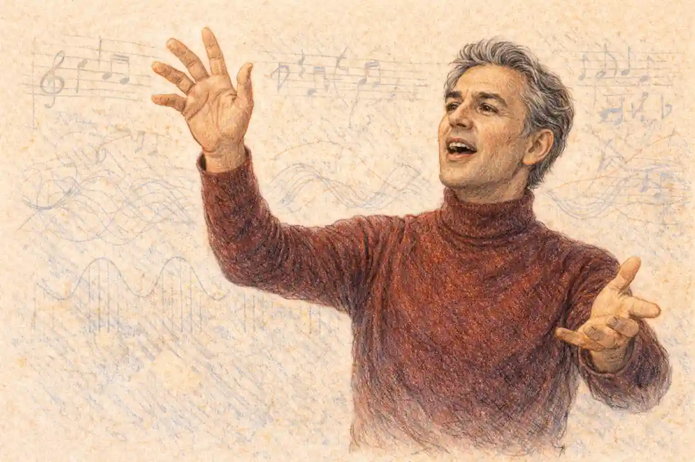

## Effort Compressed Into Minutes

A training montage works by compressing weeks of repeated labor into a short rising sequence of fragments, so the audience feels time passing and skill accumulating without watching the labor itself unfold in full. The device persuades not by showing work but by rationing it. A rising sequence of fragments lets the audience supply the missing weeks and mistake its own supplied effort for the effort of the character on screen. That substitution is the central mechanism, and it explains why a sequence lasting three minutes can carry the emotional weight of a season of practice, failure, correction, and renewed attempt. The screen offers beginnings and breakthroughs while withholding the long middle where most learning actually happens, and the mind, unwilling to leave a gap unfilled, bridges the gap with imagined exertion.

In plain terms, a training montage is a brief passage in a film that condenses a period of preparation into a series of short shots, usually linked by music, matched movement, or repeated settings, and arranged so that each fragment shows a small advance over the fragment before it. A boxer who cannot complete a round in the first fragment completes it in the third. A dancer who falls during an early turn holds the turn near the end. Rocky Balboa, in Rocky from 1976, runs through Philadelphia in fragments that move from labored climbing to a sprint up the steps of the Philadelphia Museum of Art, and the geography of the run does narrative work that dialogue never attempts. The steps remain the same. The body moving up them changes, and the change is legible because the sequence orders its fragments from weakness toward command.

The rationing follows a strict economy. Repetition establishes a baseline, variation signals effort, and escalation signals result. A first fragment shows the task performed badly or not at all. A second fragment repeats the task with a coach present, a corrected grip, a steadier breath, or a heavier weight. A third fragment removes the assistance or raises the difficulty. A final fragment performs the task cleanly, often in a setting that mirrors the opening setting so the contrast registers at a glance. Because each fragment is short, no single fragment has to prove mastery. Proof accumulates across the cut, in the space between fragments, where the audience assumes the unshown repetitions occurred. The cut itself becomes an argument, and the argument runs that anyone who endured all the intervals between the fragments must have earned the final performance.

Music strengthens the illusion by supplying continuity that the images deliberately lack. A song or score holds a steady tempo while locations, costumes, and light change from shot to shot, and that sonic continuity persuades the ear that the fragments belong to one unbroken endeavor. Editing reinforces the effect through matched action, where a movement begun in one shot completes in another, and through graphic matches, where a shape or direction repeats across a cut. The result is a passage that feels earned even though the earning was mostly withheld. The audience leaves the sequence believing in the preparation because the audience performed the missing preparation inwardly, supplying sweat that the film only suggested.

## Two Words Sharing One Name

The word montage carries two meanings that share a name and a history but describe different practices, and the overlap causes persistent confusion in writing about film. In French, montage means assembly or fitting together, and in French film usage the word refers to editing in general, the ordinary work of joining one shot to the next to build a scene, a sequence, and a whole film. Under that broad sense, every edited film is a montage, because every edited film is assembled. The term names the craft itself rather than any special passage inside a film, and French critics could discuss the montage of a quiet dialogue scene without implying anything unusual about its construction.

Hollywood usage narrows the word sharply. In the studio sense, a montage sequence is a distinct passage, set apart from the surrounding narrative, that compresses time, conveys information quickly, or summarizes a process through a rapid series of short images. David Bordwell, writing with Kristin Thompson in Film Art, first published in 1979, treats the Hollywood montage sequence as a recognizable convention, a brief segment that uses dissolves, superimpositions, and quick cuts to show a change over time, such as a rise to fame, a journey, or a period of training. The sequence announces itself as a summary. Ordinary scenes hide their joins and preserve continuous space and time, while the montage sequence displays its joins and discards continuity in favor of condensation.

Sergei Eisenstein used the word in a third and more demanding sense, as the name for a method in which meaning arises from the conflict between shots rather than from the content of any single shot. For Eisenstein, editing was not the smooth linking of pieces but the deliberate collision of pieces, each chosen to provoke a concept or feeling that neither piece held alone. That sense belongs to theory and argument. The Hollywood sense belongs to production practice and audience convenience. The French sense belongs to the workshop. All three senses involve joining shots, which is why the single word survives across them, but the purpose of the joining differs in each case, from neutral assembly, to efficient summary, to intellectual provocation.

The confusion persists because the training montage sits at the crossing point of the narrower meanings. A training sequence is a Hollywood montage by function, since it summarizes a process and compresses time, yet it borrows its persuasive force from the Eisensteinian principle that meaning lives between shots. Textbooks slide between the senses without marking the shift, program notes use the word for any fast passage, and casual criticism applies it to any sequence with music and quick cutting. Careful usage keeps the senses apart by asking what the joining is for. Assembly joins for continuity. The studio sequence joins for compression. Eisensteinian montage joins for collision, and each purpose produces a different kind of spectator work.

## Soviet Origins and the Idea of Collision

The theoretical foundation of montage was laid in the Soviet Union during the nineteen twenties, when filmmakers working with scarce stock, few studios, and a revolutionary mandate treated editing as the essence of cinema rather than as a finishing step. Sergei Eisenstein, born in 1898, became the most forceful voice of that generation. In Strike from 1925, his first feature, and in Battleship Potemkin from 1925, released the same year, Eisenstein argued through practice that a film thinks by placing images against one another. A shot, in this account, is not a window that delivers a complete meaning. A shot is a stimulus, partial and charged, and meaning ignites when a second stimulus strikes against the first in the mind of the spectator.

Eisenstein named an early form of the method the montage of attractions, a term he developed in theater before carrying it into film in 1923 and 1924. An attraction was a calculated shock, an aggressive moment chosen for its direct effect on an audience, and montage meant the free combination of such moments to produce a planned response. The idea drew on the fairground and the circus, where a performer holds attention through a sequence of calculated impacts. In film, the attraction became the shot itself, selected not for narrative smoothness but for force. A face, a machine, a crowd, a falling object could each serve as an attraction when placed with precision, and the director arranged the impacts the way an engineer arranges loads on a structure.

From that beginning Eisenstein moved toward intellectual montage, the most ambitious form of the theory, in which the collision of two concrete images produces an abstract concept that appears in neither image alone. A shot of a worker and a shot of a machine part could yield an idea about labor. A shot of a priest and a shot of a golden idol could yield an idea about wealth and belief. The mechanism depends on the spectator completing a conceptual leap, and Eisenstein valued the leap because it made the spectator an active producer of meaning rather than a passive receiver of illustrated statements. The film supplies the terms. The audience performs the reasoning, and the conclusion feels discovered rather than delivered, which gives it unusual persuasive strength.

The Odessa steps sequence in Battleship Potemkin shows the method as rhythm construction rather than as simple storytelling. Formally, the sequence expands a brief event far beyond its natural duration by repeating actions from shifting angles, cutting between advancing boots, a falling pram, faces in close view, and rifles raised in unison. Screen time stretches while story time nearly halts. The cutting accelerates and then checks itself, establishing a meter that the body of the spectator begins to follow, so tension is carried by tempo as much as by content. Shots of mechanical descent alternate with shots of human reaction, and the alternation itself builds the impression of an impersonal force meeting fragile resistance. No single shot contains that idea. The idea emerges from the patterned collision of descent and reaction, repeated until rhythm becomes argument.

Eisenstein later classified several methods of montage, including metric, rhythmic, tonal, and intellectual forms, each governing a different basis for joining shots. Collision was never mere randomness. Each join followed a governing measure, selected according to the response the passage needed to produce. The training montage inherits the discipline without the doctrine. Its fragments also follow a governing measure, the rising measure of difficulty and competence, and its meaning also emerges between fragments rather than inside them.

## The Kuleshov Lesson

Lev Kuleshov, born in 1899, taught the lesson that underlies every training montage, and he taught it through a workshop experiment that became the most retold demonstration in film theory. Between about 1918 and 1924, Kuleshov directed the film workshop at the State Institute of Cinematography in Moscow, where students learned by dissecting and reassembling existing footage because new film stock was scarce in the years after the revolution. Scarcity forced invention. With little material to shoot, the workshop treated the join between shots as the place where cinema actually happened, and exercises in reordering footage revealed that audiences read emotion, desire, and thought into images that contained none of those qualities by themselves.

The standard account of the central experiment, as reported by Vsevolod Pudovkin, describes a single neutral close view of the actor Ivan Mozzhukhin placed in turn against three other images. Intercut with a bowl of soup, the face seemed to express hunger. Intercut with a child in a coffin, the same face seemed to express grief. Intercut with a young woman, the same face seemed to express desire. The performance had not changed. The expression had not changed. Only the neighboring shot had changed, and the audience, presented with a face beside an object, constructed a feeling that connected the two and credited the feeling to the actor. Pudovkin presented the demonstration as proof that editing creates the performance as much as acting does.

Scholars treat the surviving details with care, since the original footage is lost and the account rests on later retelling, but the principle has been confirmed by ordinary viewing experience across a century of cinema. Meaning lives between shots. A spectator confronted with two images in sequence assumes a relation between them and supplies the relation when the film withholds it. A glance followed by a landscape becomes longing. A hand followed by a tool becomes intention. The second image colors the first, and the combined meaning belongs to neither image in isolation.

The training montage is the Kuleshov lesson organized over time. Each fragment functions the way the soup, the child, and the woman functioned beside the neutral face. A shot of a runner at dawn means little alone. Placed after a shot of the same runner failing at dusk and before a shot of the same runner finishing strongly, the dawn run acquires the meaning of perseverance. The audience supplies the weeks of similar dawns that the film never shows, exactly as the workshop audience supplied hunger and grief that the actor never performed. The founding principle is therefore one of delegated construction. The film arranges the neighbors. The spectator builds the emotion, the duration, and the effort, and because the spectator built those things, the spectator believes them with a conviction that direct depiction rarely achieves. Showing every repetition would exhaust attention and expose the monotony of practice. Showing selected fragments in a rising order recruits the imagination as a collaborator, and collaboration persuades more deeply than observation.

Kuleshov extended the same insight into creative geography, assembling a single apparent place from shots filmed in separate locations. Continuity, identity, and feeling are products of arrangement. For the training montage, the consequence is direct. Progress itself is a product of arrangement. Order the fragments from failure toward mastery and the audience perceives growth, even when total screen time devoted to practice amounts to a few minutes.

## Pudovkin and the Building Block

Vsevolod Pudovkin, born in 1893, offered the gentler Soviet account of editing, and his version proved easier for Hollywood to absorb than the collisions of Sergei Eisenstein. In Film Technique, published in English in 1929 from his Russian writings of the nineteen twenties, Pudovkin described the shot as a building block and editing as the construction of a scene from separate bricks of filmed reality. The metaphor is deliberate. A brick does not argue with the brick beside it. A brick gains purpose from its position in a wall, and the builder places each piece so that the finished structure guides the eye and the feeling of the spectator in a planned direction. Where Eisenstein sought sparks from impact, Pudovkin sought clarity from linkage.

Linkage editing, the method associated with Pudovkin, joins shots so that each one adds a piece of information or emotion to a growing whole. A scene might begin with a wide view that establishes a place, move to a closer view that isolates a person, and end with a detail that reveals what the person notices or feels. Each shot depends on the shots around it, and the sequence leads the spectator step by step, the way a careful explanation leads a listener. Pudovkin insisted that the director should think of the spectator throughout construction, selecting the order of views that a attentive observer would choose if present at the event. Editing, in this account, is guided attention. The film does not collide images to force a concept. The film arranges images to conduct an experience.

Mother from 1926, adapted from the novel by Maxim Gorky, shows the method at full strength. The film builds its emotional climaxes by linking human action to natural process, most famously by intercutting a workers demonstration with the breaking of river ice in spring. The ice does not collide with the crowd in the Eisensteinian sense of producing an abstract concept through conflict. The ice extends the crowd, giving its gathering force a visible parallel in nature, so feeling accumulates by association and analogy. Pudovkin called such devices plastic material, the expressive substance of filmed reality that the editor shapes. A river, a face, a pair of hands at work each carry feeling before editing begins, and editing orders that feeling into a rising line.

The difference between the two Soviet masters is a difference of temperament and mechanism. Eisenstein distrusted the individual shot and trusted the interval. Pudovkin trusted the individual shot and used the interval to connect. Hollywood, committed to stories carried by identifiable characters and clear emotions, found the Pudovkin path congenial. A training montage built on linkage asks the audience to follow a person through ordered stages of improvement, each fragment adding one brick of competence to a wall that finally stands complete. The coach corrects a stance in one fragment, the corrected stance holds under pressure in the next, and the accumulation reads as growth. Nothing collides. Everything connects, and the connection itself, patient and legible, produces belief in the finished skill. The building block method also suited an industry that prized clarity for mass audiences, since a linked sequence can be followed without effort while still compressing months into minutes.

## Hollywood Takes the Device and Files Down Its Edges

During the studio era, Hollywood converted montage from a theory into a department. Major studios maintained specialized units and contracted specialists whose sole assignment was the montage sequence, the self contained passage that could summarize a journey, a rise, a fall, a search, or a period of training while the main production continued elsewhere. The arrangement suited the factory organization of the studios. A second unit could shoot fragments without stars, without full sets, and often without dialogue, and the finished passage could be inserted into a feature wherever the script needed time to pass quickly. Montage became a trade within the trade, with its own craftsmen, its own stock devices, and its own reputation for solving narrative problems that ordinary scenes could not solve economically.

Slavko Vorkapich, born in 1894 and active at MGM during the nineteen thirties, became the most celebrated American practitioner of the form. Vorkapich treated the montage sequence as a piece of visual music, built from dissolves, superimpositions, and rhythmic cutting, and his passages for films of the period demonstrated how much information and feeling a few dozen shots could carry. A career could rise through a cascade of theater marquees. A fortune could collapse through falling figures and closing doors. The Vorkapich sequence did not argue a thesis in the manner of Eisenstein. The sequence performed a transition with flair, and its artistry lay in economy and tempo, in knowing which fragment would stand for a month and which dissolve would stand for a year.

The stock devices of the studio montage hardened into a shared vocabulary that audiences learned to read at sight. Newspaper headlines spun toward the camera to announce public events. Calendar pages tore away or flipped in sequence to mark passing days. Printing presses rolled while headlines multiplied across the frame. Train wheels, road maps with moving lines, and clocks with sweeping hands carried journeys and deadlines. Each device was a piece of punctuation. The headline declared that the world had noticed something. The calendar declared that time had passed without requiring the film to account for the days. The spinning press declared that a story had spread. Used together, the devices allowed a film to cross months in seconds while keeping the audience oriented, and their familiarity was the point, since a device that needs explanation cannot save time.

Don Siegel, later a noted director of features, began his career at Warner Bros. in the nineteen forties by cutting montage sequences, work he performed with notable speed and invention before moving into directing. The apprenticeship was common enough to reveal the status of the craft. Montage work trained young editors and directors in compression, rhythm, and visual shorthand, yet the studio regarded the sequence as a service to the story rather than as the story itself. That hierarchy marks the final softening of the device. In Soviet hands, montage had been the meaning of the film, the place where thought occurred. In Hollywood hands, montage became punctuation within a meaning made elsewhere, a graceful bridge between scenes that carried the real narrative weight. The edges were filed down in a precise sense. Collision gave way to transition, argument gave way to summary, and provocation gave way to clarity. What survived the filing was the essential mechanism that the training montage still uses, the power of ordered fragments to make an audience supply what the film omits, now placed in service of a character preparing for a test rather than a theory preparing a spectator for a revolution.

## Calendars, Headlines and the Classical Passage of Time

Classical Hollywood possessed a small, reliable toolkit for telling an audience that time had passed, and the toolkit worked because viewers had learned to read it without instruction. A page tore from a wall calendar, a stack of newspaper front pages spun toward the camera, a train wheel turned beneath a dissolve from winter snow to spring blossom, and the story resumed weeks or years beyond its previous scene with no protest from the seats. The mechanism in each case was substitution. A familiar object stood in for duration itself, and the object did the work that photographed action could not do economically, since no studio could afford to film a character through every intervening day and no narrative could survive such filming if a studio tried. The calendar leaf carried a date, the headline carried an event, and the seasonal insert carried a climate, and each sign asked the audience to perform a simple act of arithmetic rather than an act of imagination about a human interior.

At Warner Bros. in the nineteen thirties, the spinning newspaper became a house signature in crime pictures, where a verdict, a manhunt or an election had to be announced and absorbed in seconds. The signs were legible because they were external. Time, in this grammar, happened to the world around a character, in print, in weather and in architecture, and the character reappeared on the far side of the interval already changed by causes the film had named rather than shown. A headline could explain a fortune lost. A calendar could explain a sentence served. Neither could explain a will strengthened, because a will leaves no date on a page and prints no headline when it hardens.

That limitation shaped the kinds of stories classical form told most comfortably. Plots driven by public events fitted the toolkit, since public events generate the very paper trail the toolkit reproduced. The boxer who entered a ring transformed, the student who returned fluent from an unseen term of study, the invalid who rose from a chair after an interval marked by falling leaves, all arrived at a new condition by announcement. The audience accepted the announcement because convention licensed it, yet acceptance is a weaker response than conviction, and conviction requires evidence the senses can weigh. A calendar proves that days passed. It cannot prove that the days were used, and the distinction between elapsed time and used time is the gap into which a different form would step.

The older devices also shared a rhythm that limited their emotional range. Each sign appeared, delivered its information and vanished, usually within a few seconds, and the film returned to scenes played at ordinary length. Duration was therefore reported in a pause between actions rather than experienced inside action itself. What the training form would later discover was a method for making duration felt in the body of the viewer, by distributing fragments of labor across rising music and shortening shots until the viewer supplied the missing weeks from an accumulation of effort rather than from a printed date. The calendar told the mind. The later form would recruit breath, muscle and tempo, and the persuasion would move from information toward something closer to witness.

## Breakfast at the Kane Table

Citizen Kane, released in 1941, directed by Orson Welles and edited by Robert Wise, contains the most studied compression of elapsed time in classical American cinema, and its method repays attention because it solves half the problem the training form would later address. The sequence presents Charles Foster Kane and his first wife, Emily, at a breakfast table across nine years of marriage, and it covers that span in roughly two minutes of screen time. Welles and Wise return again and again to a matching frame, the couple seated at the same table in the same room, and each return advances the years through costume, make-up, posture and the temperature of the exchange. Early passages show closeness in dress and bearing, with the two figures turned toward one another. Later passages widen the feeling between them. The clothes grow more formal, the newspaper in Kane's hands becomes a barrier, and the repeated composition makes the growing distance measurable against an unchanging frame, so that a viewer registers loss as a difference inside an identical picture.

The mechanism deserves naming, because the same principle governs later montage work in a different key. Repetition with variation allows comparison, and comparison is how film shows change without a narrator. A single scene of a cold marriage states a condition. Five versions of the same scene, graded from warmth to frost, show a process, and process is the raw material of persuasion about time. Students of editing return to [the breakfast montage in Citizen Kane](/2011/04/15/citizen-kane-breakfast-montage/) when they trace how a fixed set-up can carry years, and the lesson transfers because the device is formal rather than topical. 

Yet the sequence also marks the boundary of what compression by repetition could do before the athletic form arrived. The breakfast passages show a relationship cooling, a change of state between two people, legible in glance and gesture at a table. The sequence does not show a capacity being built inside a body through repeated exertion, because a breakfast table offers no exertion to repeat. Kane does not practice anything at that table. The form therefore divides labor from consequence, showing consequence with great refinement while labor remains reported rather than witnessed. Endurance leaves its evidence in breath and stride and in the tenth repetition performed as steadily as the first, and evidence of that kind requires a subject whose work is visible in the muscles while it happens.

Welles and Wise also relied on dialogue to carry much of the cooling, with each brief exchange pitched a degree colder than the one before, and that reliance reveals another boundary. Speech can register estrangement with precision, since estrangement lives in speech. The training montage would inherit the breakfast sequence's central insight, that graded repetition persuades an audience that time has done real work, and would then replace the table with a road, a gymnasium and a heavy bag, replace dialogue with breath and impact, and replace a cooling state with a rising capacity, keeping the arithmetic while changing the evidence entirely.

## Why Athletic Preparation Suits the Form

Athletic preparation holds a singular place among human activities because its real texture already resembles the fragments from which a montage is built. Most skilled work hides its repetition. A lawyer reading a brief for the fortieth time looks much like a lawyer reading it for the first time. Training for a fight or a race, by contrast, externalizes repetition in the body. The road run at dawn, the round on the heavy bag, the set of sit-ups on a cold floor, the skipping rope blurring under tired feet, each unit of work looks distinct enough to photograph and similar enough to compare, and comparison across units is the mechanism by which an audience measures growth. A filmmaker who fragments such work is not imposing an artificial structure on the material. The material arrives pre-fragmented by the stopwatch, the round bell and the calendar of a training camp, and editing mainly selects and orders what practice had already divided.

### Why is training easier to compress than other kinds of work?

Training compresses well because practice is already divided into countable units. Rounds, repetitions, laps and drills give an editor ready made fragments, each one comparable with the last, so a handful of samples can stand for weeks of labour without the audience feeling that connective tissue has been stolen from the story.

Measurability strengthens the fit. Athletic effort carries numbers that a camera can show without commentary, in the count of repetitions completed, the height of a barrier cleared, the weight on a bar, the time on a clock held by a trainer at a track's edge. When a later fragment shows more repetitions, a higher jump or a faster ascent than an earlier fragment showed, the audience performs the comparison almost without noticing, and the conclusion that weeks of work intervene feels earned rather than asserted. Their presence signals a regime in which progress is tracked, and a tracked regime makes the gaps between fragments plausible, since a viewer understands that a camp fills its unshown days with the same exercises the film has sampled.

Solitude completes the suitability. Training is largely solitary even inside a crowded gymnasium, because the effort that matters occurs inside one body at a time, and a camera can honor that solitude by holding on a single figure while the world thins to breath and footfall. A solitary figure also solves a narrative problem for the montage form. Dialogue would slow the rising tempo and return the sequence to ordinary scene time, while a lone athlete permits music to take the place of speech and permits shots to shorten without confusion about who acts. The figure running through empty streets in early light, as generations of city runners have done along river paths and industrial roads, reads at once as literal preparation and as a picture of resolve, and the double reading costs the film nothing in exposition. The audience watches work and infers character from the work itself, a more durable inference than any speech about determination could produce.

Repetition with variation, finally, is not merely available in training but obligatory, and obligation protects the form from monotony. A camp varies its demands by design, adding distance, weight and resistance as capacity grows, so a sequence assembled from a camp's actual logic escalates naturally toward a peak. The escalation mirrors the way music builds, and the parallel allows image and score to rise together without either one forcing the other. 

## A Journeyman in Cleveland and a Script in Three Days

On March 24, 1975, at the Richfield Coliseum outside Cleveland, Ohio, a journeyman heavyweight named Chuck Wepner fought Muhammad Ali for the heavyweight championship and lasted into the fifteenth round. Wepner, a liquor salesman from Bayonne, New Jersey, who fought under the nickname of the Bayonne Bleeder, was expected to fall early against a champion at the height of his powers. Instead the fight extended deep into its final round before the referee stopped it, and in the ninth round Wepner scored a knockdown, with Ali going to the canvas after a punch to the body. A man with no realistic claim on victory had remained standing, round after round, against the most celebrated fighter alive, and the remaining standing itself became the achievement, separable from the result on the official record.

Among those who watched the broadcast on closed circuit was Sylvester Stallone, then an actor with minor roles and little money, who returned home and wrote the first draft of the Rocky screenplay in about three days, by his own account. Stallone did not adapt the fight. He extracted its dramatic skeleton, the unknown given one sanctioned chance against a champion and measuring success by endurance rather than by triumph, and he rebuilt that skeleton around a Philadelphia club fighter whose life, neighborhood and courtship he could furnish from observation. The mechanism is worth distinguishing from ordinary inspiration, since the fight supplied a structure of feeling rather than a plot. Wepner lost. The insight that a loss could still constitute a vindication, if the distance covered was long enough, gave the screenplay its ending and its moral arithmetic at a stroke.

The screenplay then met the economics of the industry. Producers Irwin Winkler and Robert Chartoff responded to the script and pursued it for production, while Stallone refused to sell the screenplay without himself in the lead role, a condition that reduced the price he could command and risked the entire sale. Stallone's refusal rested on a plain calculation of his own position. A sale without the role would pay once and leave an actor of his standing where it found him, while the role itself, if the film succeeded, would change the category in which the industry placed him. The gamble held because the budget contemplated was small enough that an unknown lead could be tolerated as a risk, and the producers carried the project to United Artists on those terms.

The Wepner connection carried a legal afterlife that belongs in any careful account. Wepner later maintained that the film drew on his life and pursued a claim against Stallone, and that dispute was later settled, as reported accounts of the settlement describe, bringing the matter to a close without a trial on the merits. A specific night in Ohio supplied the spark for a screenplay written in days, and the screenplay's fighter, his city, his opponent and his love story were inventions built around that spark rather than a portrait of the man who provided it. The distinction between spark and portrait is the same distinction that governs the finished film's treatment of boxing itself, where real textures of gymnasiums and neighborhoods support a structure that belongs to fable, and where endurance, borrowed from a journeyman's fifteenth round, becomes the measure by which an invented life is judged.

## A Million Dollars and Twenty Eight Days

The production of Rocky, released in 1976, proceeded under constraints so tight that the finished film's style cannot be separated from its accounts ledger. The negative cost is commonly placed at about one million dollars, with some accounts putting the figure just under that mark, and the principal photography occupied about twenty eight days. United Artists backed the picture through producers Irwin Winkler and Robert Chartoff, and John G. Avildsen directed, bringing to the schedule a documentarian's habits of economy formed on lower budget work. A schedule of that brevity permits no standing sets idled for a day, no company moves undertaken for a single decorative angle and no second chances at locations whose permits expire. 

Philadelphia answered the arithmetic. Location shooting in the city placed the production inside real gymnasiums, real row house streets and real markets whose dressing cost little because the places already carried the textures the screenplay described. Available light and short set-ups followed from the same pressure. A small crew working quickly in genuine interiors could expose film with modest lighting packages, accept the grain and contrast that came with them and move on before a location's patience or permission ran out. The Italian Market through which the fighter runs, the pet shop on his street and the ice rink where he takes Adrian on a private hour all function in the finished picture as observed Philadelphia rather than constructed scenery, and the observation lends the fiction a documentary credit that money alone rarely buys. 

Avildsen's direction converted constraint into coverage discipline. Short set-ups favor performances played in longer, unbroken stretches, since relighting for elaborate angles consumes the hours a tight schedule cannot spare, and longer stretches favor actors whose work builds by accumulation rather than by a single expressive peak. The gymnasium scenes, the apartment scenes and the exchanges on street corners all show that discipline, holding on faces through the small delays and repetitions of ordinary speech. The fight itself, staged at the Spectrum in Philadelphia within the fiction and filmed with a limited number of cameras and a crowd assembled for the purpose, relied on choreography rehearsed to protect both the performers and the schedule. Combined under a twenty eight day limit, the methods produced a coherence of texture that a larger production, rebuilding the same streets on a back lot, would have struggled to match at any price.

The commercial result inverted the production's scale. Rocky earned a worldwide gross of about 225 million dollars, a figure from the industry's standard reporting of the release, set against a negative cost of about one million dollars in 1976. Ratios of that order alter studio behavior, and the picture's success taught a generation of executives and filmmakers that an audience would reward emotional legibility and observed texture over spectacle when the two competed for the same ticket money. A small budget forced the film outdoors, into available light and into the keeping of a city's real surfaces, and those forced choices became the visual guarantee of the story's sincerity. The montage at the film's center would draw on the same guarantee, since a climb photographed on a genuine civic staircase, in genuine morning cold, persuades in a way no constructed ascent could duplicate.

## The New Machine on the Museum Steps

The most consequential piece of equipment on the Rocky production was a camera support that had barely entered professional use. Garrett Brown, a Philadelphia based inventor and camera operator, had developed the Steadicam, a body mounted stabilizing system that used a counterweighted arm and a gimbal to isolate a camera from the steps and sway of the person carrying it. The system received its first feature showcase on Bound for Glory in 1976, the Hal Ashby film about Woody Guthrie. Brown then brought the rig to Rocky, and its presence solved a problem that the training montage, as a form, had been waiting for a tool to solve. Fragments could show effort. Only a stabilized moving camera could show ascent as one continuous rising gesture, with the runner's stride unbroken and the city opening beneath him as he climbed.

The Philadelphia Museum of Art steps supplied the ascent. Brown ran the steps with the rig, moving ahead of Stallone and behind him across takes, holding framing on a climbing figure while his own body absorbed the impact of each stair through the arm's isolation. The physical cost fell on the operator in a form the audience never sees. A stabilized rig of that generation still weighed heavily on the hips and legs, breath had to be managed so that exertion did not travel into the frame, and a misstep on stone steps risked the take, the equipment and the operator in a single fall. The smoothness in the finished shot is therefore not an absence of labor. It is labor concealed by engineering, performed by a second athlete whose exertion parallels the first and remains invisible inside the gesture it makes possible.

The formal consequence reaches beyond one staircase. The Steadicam removed the choice by making the operator's body the track, free to climb, turn and descend while the frame stayed level and fluid. For the training form, that freedom arrived at the decisive point in the sequence's design. The montage builds through fragments, rationing work into rising pieces while the audience supplies the missing weeks, and the argument of the whole passage requires a release from fragmentation at its peak, a moment when effort stops arriving in pieces and flows in a single sustained line. The steps provide that line. The runner who had been glimpsed in cuts now climbs without interruption, and the unbroken shot certifies the fragments that preceded it, declaring that the capacity assembled piece by piece can operate as one continuous act.

Brown's invention spread through the industry in the years that followed, reshaping how directors staged movement through corridors, crowds and landscapes, and its origin in productions of modest means carries its own instruction. The tool was not developed to decorate large spectacles. It was developed to let small crews move like large ones, to give a twenty eight day production the fluidity that money once monopolized, and Rocky placed that instrument at the exact summit of its hero's preparation. The camera rises because a man runs, the frame holds because another man runs with it, and the audience, lifted by both, completes the ascent in the body. The montage's rationed fragments earn their meaning there, on real stone, in one breath, where editing finally steps aside and lets accumulated work speak as a single gesture. The shot also marks the point where editing hands its authority to camera movement, the exchange at the centre of [how cinematography works](/2026/11/15/how-cinematography-works/).

## Anatomy of a Three Minute Ascent

The training sequence in Rocky lasts only a few minutes of screen time, yet it carries weeks of preparation by rationing work into rising fragments. The mechanism is escalation by difficulty rather than by clock. The sequence does not show equal samples from equal days. It shows a ladder in which each fragment asks more of the body than the fragment before it, so the audience reads duration from strain. The opening movements place the labour in darkness and cold. A lone figure runs through empty streets before dawn, breath visible, streets deserted, with no crowd to witness the effort and no coach to certify it. Solitude matters because it removes social reward from the work. The training reads as chosen rather than performed, and that choice becomes the first proof of seriousness.

The middle movements raise the physical demand in legible steps. Sit-ups and heavy bag work give way to one-armed push-ups, a marker that any viewer can judge without instruction because the body itself announces the increase in load. The meat locker work sharpens the same point through environment. Inside the cold storage rooms of a Philadelphia slaughterhouse, the fighter strikes hanging carcasses, turning an industrial workplace into an improvised gymnasium. The setting does double duty. It keeps the training rooted in working class labour, and it supplies resistance that looks heavier, colder, and less forgiving than a bag in a gym. Each new location therefore functions as a difficulty gauge, not merely a change of scenery.

Editors Richard Halsey and Scott Conrad, whose work on the film won the Academy Award for Best Film Editing, shape the final movement as a shift from isolation to accompaniment. The solitary runner acquires company. Children fall in beside the run, the streets fill with morning activity, and the private discipline of the early fragments becomes a public procession without losing its forward drive. The timing completes the argument. The run ends at dawn on the steps of the Philadelphia Museum of Art, where the figure raises both arms against a brightening sky. The steps operate as climax because height converts effort into position. A body that began at street level in darkness finishes above the city in light, and the audience supplies the missing weeks because the fragments have arranged a before, a rising middle, and an unmistakable after in under three minutes of ascent.

The rationing also protects credibility. A training record shown in full would expose repetition, rest days, minor injuries, and plateaus, the ordinary texture of preparation that weakens a clean arc. By withholding that texture, the sequence keeps only the moments where effort changes in kind. Running gives way to striking, striking to lifting and climbing, and each change of activity refreshes attention while preserving the impression of accumulation. The viewer never watches the same task long enough to ask how many times it was repeated on other mornings. Variation therefore substitutes for enumeration. Five different hardships, briefly held, suggest fifty repetitions of each, and the suggestion costs the film seconds rather than minutes.

Sound design tightens the same economy. Breathing, footfalls on wet pavement, the thud of fists against meat, and the scrape of shoes on stone steps give each fragment a physical texture that dialogue would only dilute. Almost no speech interrupts the ascent, so the body communicates without translation. The absence of coaching also removes a layer of explanation that might otherwise date or localise the effort.

## The Song That Does the Heavy Lifting

A montage of separate fragments needs a force that holds the pieces together, and in Rocky that force is music. Bill Conti composed the score, and the training song Gonna Fly Now, with words by Carol Connors and Ayn Robbins and vocals by DeEtta Little and Nelson Pigford, supplies the continuous line that the images alone cannot provide. The song reached number one on the Billboard Hot 100 in July 1977, a commercial fact that reflects a structural one. Listeners could carry the sequence away in their heads because the music formed a single memorable gesture out of dozens of disconnected shots. The mechanism is glue through continuity. Cuts interrupt the picture every few seconds, locations change, and exercises replace one another, but the melody never restarts. The ear experiences one unbroken effort while the eye experiences fragments, and the mind credits the body on screen with the unity that the soundtrack provides.

Conti wrote against a practical problem that director John G. Avildsen and the production team had felt in the cutting room. An earlier temporary track laid under the training footage left the sequence flat, because music chosen for general energy did not rise in step with the images. The finished cue solves that mismatch by building in parallel with the editing. Sparse opening phrases accompany the solitary labour, brass entries widen as the running gathers company, and the vocal line arrives as affirmation rather than narration. The arrangement therefore performs the same escalation that the pictures perform, doubling the signal that effort is increasing.

That doubling explains why a montage song must promise rather than describe. A descriptive lyric would pin each image to a literal meaning and shrink the sequence to illustration. The words of Gonna Fly Now instead stay general, built around flight, striving, and rising strength, so any fragment can sit beneath them without contradiction. The promise stays open while the body on screen appears to fulfil it step by step. Because the song points forward, every new exercise reads as progress toward the promised state rather than as another disconnected task. The heavy lifting is thus musical in a precise sense. Conti, Connors, and Robbins built a rising verbal and melodic arc, Little and Pigford gave that arc a human voice, and the editing borrowed the arc whole, letting three minutes of song stand in for the shape of many weeks of work.

The cue also solves a problem of proportion. Training occupies a large share of the story and a small share of the running time, so the music must expand the emotional scale of the sequence without expanding its length. Brass and voices perform that expansion. A solitary runner accompanied by a swelling arrangement sounds less like a man exercising and more like a public claim being prepared, which prepares the audience for a contest staged before thousands. The mismatch is deliberate and productive. The song lends arena scale to street level labour, closing the distance between preparation and performance before the narrative has earned that closeness through plot alone.

Its afterlife confirms the design. Heard outside the film, Gonna Fly Now still summons staircases, dawn runs, and raised arms for listeners who may not recall a single line of dialogue from the picture. A montage song of this kind absorbs the scene into itself, becoming the portable form in which the training is remembered, imitated, and recognised decades later in gyms, advertisements, and sporting arenas that borrow its arc.

## Shot Length as a Heartbeat

Editing rhythm gives the training montage its pulse, and shot length is the measure of that pulse. Barry Salt, whose Cinemetrics research programme built systematic methods for measuring average shot length across film history, provides the scholarly anchor for describing the effect in numbers rather than impressions. A sequence can be timed shot by shot, its durations averaged, and its pattern compared across its own movements. In the Rocky training sequence the pattern tightens as effort rises. Early fragments linger long enough for the viewer to register place, weather, and solitude. Later fragments arrive faster, each exercise granted less screen time than the labour it replaces, so acceleration itself becomes a sign of growing capacity. The body does more while the film shows less of each act, and that inverse relation persuades the audience that mastery is compressing the work.

### Do the cuts in a training montage really get faster?

In the codifying examples they do. Early fragments hold long enough to establish place, solitude and difficulty, while later fragments shorten as the athlete improves, so the editing accelerates in step with the body. The quickening is measurable shot by shot, and audiences register the rising tempo as rising effort without counting a single cut.

Cut points reinforce the rhythm by landing on movement and on musical beats. A cut made mid stride or at the peak of a lift preserves the energy of the action across the join, while a cut placed on a strong beat in Bill Conti's cue lets the soundtrack carry the eye through the discontinuity. The mechanism is entrainment through alignment. When picture changes and musical accents coincide often enough, the viewer settles into the shared tempo and begins to anticipate the next accent, the next stride, the next fragment. Film scholars describe this response as rhythm entrainment in the audience, the tendency of attention and bodily arousal to synchronise with a patterned stimulus. The claim deserves careful statement. Entrainment names a reported and studied response to rhythmic editing, not a settled law that every viewer obeys in the same degree, and Salt's measurement tradition supports the description of the pattern rather than any guarantee about its effect on a given heart.

Even with that caution, the heartbeat metaphor earns its place because the sequence organises exertion the way a pulse organises circulation, in repeated beats that quicken under load. The solitary opening moves at a resting pace. The locker work and the one-armed push-ups raise the rate. The final run sustains the quickened tempo until the steps release it in a held image of raised arms, the one moment where the cutting slows and lets the accumulated rhythm discharge. Shot length therefore does argumentative work. Shortening durations signal rising effort, aligned cuts hide the seams between fragments, and the audience feels a continuous exertion that the footage, examined coldly, never actually contains in full.

The measurement tradition matters because rhythm talk in film criticism often stays vague, resting on words like pace and energy that describe an impression without locating its cause. Counting shots replaces impression with pattern.

Breath provides a second, quieter metronome beneath the cutting. Audible exhalation grows louder and rougher as the fragments advance, then steadies during the final run, so the soundtrack of the body marks exertion and recovery in parallel with the editing. A viewer may never consciously track either pattern, yet the two patterns reinforce one another at every stage. Quickening cuts promise rising effort, roughening breath confirms it, and the steadying rhythm near the summit announces control regained. The heartbeat of the section heading is therefore more than a figure of speech. It names the layered regularity, musical, editorial, and respiratory, that lets disconnected seconds feel like one continuous physiological event.

## Before and After, the Body as Evidence

A training montage must prove change without showing the process that produced it, and Rocky solves the problem by planting failure markers early and mastery markers late. The opening fragments show breathlessness on the steps, a run abandoned well short of the summit, and a body that treats ordinary exercise as punishment. The discarded cigarette belongs to the same system of signs. A habit thrown away in the early passages marks the starting condition as plainly as any failed exercise, because the audience reads the gesture as the first exchange in a bargain, pleasure surrendered for capacity. Failed attempts at demanding movements complete the baseline. Each shortfall is specific, visible, and easy to remember, which matters because the later half of the sequence will ask the viewer to compare rather than to measure.

The closing fragments answer the baseline point for point. The run that once collapsed now reaches the top of the Philadelphia Museum of Art steps at speed. Exercises that strained the body in single attempts return in fluent succession. Costume, light, and hour of day act as progress gauges alongside the physique itself. Heavy layers and predawn gloom give way to a grey sweatshirt soaked through with effort and a sky moving toward full morning, so the environment seems to certify what the muscles claim. The mechanism is contrast under controlled repetition. The sequence revisits the same actions, the same streets, and the same steps, changing only the quality of performance, and controlled sameness makes the difference readable at a glance.

### How does a montage prove that a character has changed?

A montage proves change by repeating an early action under harder conditions and letting the audience compare the two attempts. The first attempt supplies failure, the later attempt supplies ease, and the gap between them stands in for the unseen labour that produced the difference.

The audience accepts fragments as evidence of a changed body because the fragments behave like exhibits in a demonstration rather than scenes in a chronicle. No single shot claims that weeks have passed. Instead, the arrangement invites a verdict from paired observations, the wheezing climber against the fluent one, the solitary smoker against the accompanied runner. Viewers grant the conclusion because the sequence has shown its working at both ends, and the missing middle feels earned rather than asserted. The body becomes evidence precisely because the film withholds the full record and trusts comparison to carry the proof.

Geography reinforces the proof by keeping the test course constant. The same neighbourhood streets, the same waterfront chill, and the same museum steps appear at both ends of the transformation, so improvement cannot be dismissed as an easier route or a kinder setting. The viewer acts as timekeeper and judge at once, and the verdict forms before any character speaks about readiness.

The body itself changes less than the performance around it, and that restraint strengthens belief. The sequence avoids a miraculous reshaping of physique, offering instead better posture, quicker recovery, cleaner movement, and the capacity to finish. Change presented as competence rather than metamorphosis stays within the range of ordinary experience, where practice visibly smooths actions long before it rebuilds a frame. A montage that promised a new body would invite scepticism. A montage that demonstrates a newly capable body, tested on familiar ground under harder demands, collects assent with far less resistance.

## Why Fragments Persuade

Fragments persuade because the audience completes them. Ellipsis, the deliberate omission of material that a narrative could have shown, is the montage's central device, and its mechanism runs through inference. A cut from a first attempt to a fluent repetition leaves a gap measured in weeks, and the viewer fills that gap with imagined mornings, repeated failures, sore muscles, and gradual gains. The labour feels substantial because the person imagining it supplies a version scaled to personal experience of effort. A shown process could be timed, doubted, or found monotonous. An inferred process expands to fit the viewer's own sense of how long such change takes, and the character receives credit for work that the film never had to stage, pay for, or risk boring anyone with.

The Kuleshov principle, drawn from the experiments associated with Soviet filmmaker Lev Kuleshov, explains the second half of the mechanism. In its classic form, the principle holds that viewers derive meaning from the juxtaposition of shots rather than from any single shot alone, reading emotion and intention into a neutral image from the images placed beside it. Applied to effort, the principle predicts that a straining face gains meaning from the weight beside it, the cold room around it, and the fluent success placed after it. No fragment states that the training is heroic. The sequence of fragments produces that judgement in the viewer, who then experiences the judgement as a discovery rather than an instruction. Persuasion that feels self generated resists argument, which is one reason the training montage survives parody and imitation without losing its force.

Melanie Green and Timothy Brock gave the underlying absorption a scholarly name in their transportation theory, published in 2000, which describes how a narrative can carry a reader or viewer into its world so that attention, emotion, and imagery move together and counterargument weakens. The montage borrows that transportation in miniature. Music holds the viewer inside the sequence, rhythm discourages analytic distance, and each fragment rewards continued attention with a small visible gain. By the final steps the audience has performed the missing labour imaginatively alongside the character, and credit follows participation. The viewer who has supplied the weeks defends the transformation as partly personal work, and a conclusion reached through participation settles deeper than a conclusion merely delivered by exposition or dialogue.

Repetition with variation keeps the inference engine running. Each fragment resembles its neighbours enough to belong to one programme of work, yet differs enough in place, task, or company to suggest a different day. A sequence of identical shots would read as one session replayed. A sequence of unrelated exertions would read as a catalogue. The training montage threads the narrow path between those failures, holding activity constant in purpose while rotating its form, so the viewer keeps inferring new days without ever being shown a date, a schedule, or a training log.

The credit the audience extends also has a moral colouring that pure information would not produce. Effort witnessed in fragments still counts as effort witnessed, and viewers tend to honour work they believe was performed without an audience, at punishing hours, in bad weather, for no immediate reward. The solitary opening of the Rocky sequence establishes exactly that moral baseline before the crowds arrive. Later applause inside the film therefore feels like recognition of something already proven in private. The persuasion completes itself as fairness. Having inferred the hidden weeks, the audience wants the contest that follows to test the transformation fairly.

## The Table of Compressions

The table below settles which kind of compression a sequence performs by matching each form to the material it squeezes and the device that does the squeezing. Compression is not one technique with several costumes. A Soviet collision sequence compresses an argument, cutting shots against one another so that scale and subject clash into a claim about crowds, power, or machinery. A classical time passage compresses chronology itself, letting calendar leaves and headlines stand for years that no audience could watch. The training montage compresses physical preparation, and its signature reliance on one continuous song separates it from the skill acquisition montage, where repeated attempts and shrinking failure measure progress at a craft rather than in a body. The relationship montage compresses attachment, softening light doing the work that sweat does elsewhere, while the parody montage compresses cultural memory, trusting the audience to recognise the form well enough to laugh when exaggerated effort collapses into a deflating result. Read by column, the table shows that every form chooses a device matched to its material, and a mismatch between device and material is where weak sequences fail.

A useful table also disciplines loose talk about montage in general, a word often stretched to cover any rapid sequence of shots. Rapidity alone defines none of the six forms. Duration, material, and device must align, and the rows make misalignment visible at a glance for any sequence a viewer cares to classify.

| Sequence type | What it compresses | Signature device | Representative film |
| Soviet collision sequence | An argument about a crowd or a system | Shots chosen to clash in scale and subject | Battleship Potemkin |
| Classical time passage | Weeks or years of story time | Calendar leaves, headlines and dissolves | Citizen Kane |
| Training montage | Weeks of physical preparation | Rising fragments under one continuous song | Rocky |
| Skill acquisition montage | Months of practice at a craft | Repeated attempts with shrinking failure | The Karate Kid |
| Relationship montage | The growth of an attachment | Shared activities in softening light | Up |
| Parody montage | The audience memory of the form itself | Exaggerated effort with a deflating result | Team America World Police |

Later in the argument, the failure modes discussion returns to this table and reads it again by row, testing each form against the ways its signature device can misfire when the material refuses the compression asked of it.

## Sequels Industrialise the Sequence

A sequel inherits more than characters and a title. It inherits expectations about form, and few expectations hardened faster than the training montage. Rocky II in 1979 confirmed that audiences wanted the preparation sequence as a set piece in its own right, not as incidental connective tissue between bouts. The mechanism is recognition paired with escalation. The first film taught viewers how to read fragments of running, punching, and straining as weeks of labor. The sequel could therefore ration that labor even more confidently, because the audience arrived already fluent and ready to supply the missing time without instruction. What had been an invention became a contract.

Rocky III in 1982 sharpened the contract and gave it a commercial engine. Survivor and the song Eye of the Tiger supplied a propulsive track that could live on radio and in record shops apart from the film, and the training passages learned to move at the tempo of a single built for repetition. The named particular matters because the music no longer merely accompanied effort. It organized effort into verses, choruses, and a final lift, so that improvement could be felt as musical structure rather than proved as elapsed duration. The fighter changes trainers, changes settings, and changes rhythm, and each change arrives as a fragment the viewer stitches into a story of recovered speed and purpose. The montage persuades because the stitching feels effortless.

Rocky IV in 1985 pushed the logic into open argument by contrast. The film pairs opposing training sequences, one grounded in natural preparation in a harsh rural landscape and the other in technological preparation inside a monitored laboratory environment. Wood, stone, snow, and unassisted lifting stand against machines, sensors, and supervised measurement. The contrast does analytical work without a speech. One side equates authenticity with exposure to difficulty that cannot be adjusted by a dial, while the other equates modernity with control, data, and insulation from chance. By cutting between the two systems, the film turns training into ideology. The audience judges not only who works harder but also which definition of work deserves trust.

That pairing reveals why sequels industrialised the sequence. Once a form can carry an argument, a sequel must deliver it and top it, because omission would read as a missing obligation rather than a fresh choice. Later entries therefore face a peculiar burden. The montage cannot simply repeat earlier fragments, since repetition without escalation feels like decline, and it cannot abandon the fragments, since abandonment breaks the promise that made the series legible. The solution is inflation through novelty of place, partner, equipment, or opposition, while the underlying rationing stays intact. A handful of rising fragments still stands for months, and the viewer still performs the invisible labor of believing those months happened. Industrial repetition, paradoxically, depends on that private act of completion in every seat. The economics reinforce the aesthetics, since a recognized sequence gives marketing a ready image, gives trailers a ready rhythm, and gives audiences a scene they can anticipate without spoiling the outcome of the final contest. Anticipation itself becomes part of the pleasure, and a sequel that manages anticipation well can vary surface details while protecting the familiar rise underneath.

## Every Genre Borrows the Machine

A successful form rarely stays inside the genre that produced it. The training montage escaped sport because its mechanism had never depended on sport alone. It depended on visible repetition, rising intensity, and a gauge of progress that a camera could register in seconds. Any activity with a repeatable gesture and a measurable improvement could borrow the machine whole. Dance, policing, soldiering, business building, and courtship through practice all offered gestures that could be fragmented, ordered, and set to music until effort looked like transformation.

Flashdance in 1983 made the borrowing explicit by welding dance rehearsal to industrial work. Jennifer Beals plays a welder by day and a dancer by night, and the film treats both forms of bodily labor as versions of the same discipline. Rehearsal fragments gain force from the surrounding world of shifts, sparks, and physical exhaustion, because skill appears rooted in a life already organized around effort. Dirty Dancing in 1987 moved the form toward partnership, where progress could be measured not only in steps learned but also in trust earned between bodies learning timing together. The gauge changed from solitary endurance to coordination, yet the rationing remained identical. Missed steps early, cleaner repetitions later, and a final lift of difficulty supplied the arc.

The Karate Kid in 1984 returned the form to instruction and placed it again under composer Bill Conti, whose music had helped define the Rocky sequences. Household chores become concealed training through repetition, and the revelation that ordinary motions have built defensive skill gives the montage a retrospective mechanism. The audience re-reads earlier fragments and discovers that labor was instruction all along. Ghostbusters in 1984 proved the machine could even build a business. Calls arrive, equipment improves, premises fill, and public recognition grows through a rapid chain of fragments that compresses the slow uncertainties of a start-up into confident momentum. No single fragment proves success. The accumulation persuades the viewer to supply the bookkeeping, the waiting, and the failures that a new enterprise ordinarily requires.

Police and military variants darkened the same grammar. Full Metal Jacket in 1987 used training as dehumanisation, and the form turned against its own optimism. Repetition still produces capability, but capability arrives paired with erosion of individual identity under relentless correction and group pressure. The fragments no longer promise self-discovery through effort. They show a system manufacturing obedience by breaking down prior habits and rebuilding responses to command. That reversal matters because it exposes the neutrality of the device. Rationed fragments can celebrate liberation, sell competence, build a company, or document a loss of self. The machine persuades in each case by asking the audience to infer a long process from brief evidence, and inference follows the moral direction the surrounding film supplies. Borrowing also changed the original sporting form by return pressure, since dance films prized grace, military films prized uniformity, and business films prized momentum, and each priority taught sports films new gauges to display. A borrowed machine rarely returns unchanged to its first workshop.

## Learning Instead of Sweating

The skill-acquisition variant tests the montage most severely, because learning often lacks a photogenic body in motion. A runner sweats, a lifter strains, and a dancer falls before rising cleaner. A reader turns pages, a mathematician covers a board, and a programmer stares at a screen where change may be invisible for hours. Filmmakers therefore needed substitute gauges, objects that could accumulate, sharpen, or fill in fragments short enough for cutting. Notebooks thicken, chalkboards crowd, code multiplies, and drafts pile into visible evidence that time has passed and competence has grown.

### What replaces sweat as proof in a study montage?

Filled pages, corrected equations, faster typing, annotated margins, and a room that changes from scattered confusion toward ordered work replace sweat because each object records duration visibly, letting brief fragments imply hours of concentration without showing the stillness, repetition, and uncertainty that dominate actual study.

Good Will Hunting in 1997 handles the problem through rhythm rather than spectacle. Reading, problem solving, and therapy sessions recur in altered forms, and progress registers as a change in willingness as much as a change in knowledge. The therapy rhythm matters because intellectual gift alone cannot supply the arc. Resistance softens by increments, silence changes meaning across repetitions, and the montage logic extends into dialogue scenes that return with small differences. The audience supplies the slow trust built between sessions, just as sports audiences supply unseen training weeks. The body is not the evidence, so conduct becomes the evidence.

A Beautiful Mind in 2001 uses windows, chalk, paper, and pattern-making as its gauges, turning abstract thought into marks that can cover surfaces and organize a room. The mechanism carries a risk, since visible pattern can signify insight or disorder, and the film exploits that ambiguity by letting similar fragments carry different meanings at different stages. The Social Network in 2010 pushes the variant toward competitive cutting. Building a platform becomes a montage of coding, recruiting, arguing, and expanding under legal and social pressure, with speed itself presented as a form of intelligence. Cross-cutting between creation and later testimony fractures the triumph, so the fragments argue with the frame around them. In each case the persuasion survives translation from muscle to mind because the core rationing survives. Brief, rising evidence invites the viewer to manufacture the long middle, and the manufactured middle feels earned precisely because the viewer helped build it. The variant also exposes a quiet difference in stakes. A body can be filmed failing in a single gesture, while a mind can hide failure inside stillness, so study montages lean harder on mentors, rivals, deadlines, and examinations to externalize pressure. A teacher marking an error, a rival publishing first, or a clock narrowing toward a defence gives invisible labor a visible antagonist. Without such pressure the fragments risk becoming a mere inventory of desks and screens, pleasant to watch yet unable to explain why one stack of pages matters more than another stack.

## The Joke Arrives on Schedule

Parody provides a reliable test of whether a form has entered common literacy. A joke about a device fails unless an audience recognizes the device instantly, supplies its rules without explanation, and enjoys watching those rules exposed. By that test the training montage passed completely in the early years of the twenty-first century. The grammar had become so familiar that a few fragments, a rising song, and a display of absurdly rapid improvement could trigger recognition before any specific film was named.

Team America World Police in 2004 built an entire song around mocking the device. The song names the montage as its subject and treats the shortcut itself as the joke, arguing in musical form that a hero can acquire competence because the sequence declares competence acquired. No plot summary is needed for the humor to land. The target is the rationing mechanism, the cheerful fraud by which seconds impersonate weeks and confidence replaces demonstration. The parody works because viewers had performed the missing labor so often that they could laugh at their own cooperation once a film pointed at it directly.

Television reached the same target through restaging. The South Park episode Asspen in 2002 rebuilt the ski-training form as parody, placing an inexperienced character inside a compressed rivalry structure where instruction, practice, and competition accelerate beyond plausibility. The episode borrows the beats precisely enough to expose their predictability. Early incompetence, compressed drills, sudden mastery, and a decisive contest arrive in an order the audience anticipates almost before each beat appears. Recognition itself becomes the comedy, and the laughter confirms that the form lives in memory as a complete template rather than as a memory of any single source.

Parody, however, rarely kills a durable form. It certifies the form while mocking its excesses, and certification can renew usefulness by clearing away embarrassment. Filmmakers after a successful parody can play the montage straight, play it with a wink, or shorten it in confidence that viewers will complete an even thinner ration. The mechanism still works on willing audiences because the underlying bargain remains attractive. Viewers trade a small act of inference for momentum, emotional lift, and freedom from the tedium of realistic duration. Mockery exposes the bargain without making it less pleasurable. A form survives its own joke when the joke depends on the same fluency that lets the original persuade, and the training montage survives because audiences continue to enjoy supplying the weeks that no film has time to show. Saturation also performs a sorting function that straight examples cannot perform alone. Weak imitations become easier to spot after parody has named the cliches, since a swelling track laid over trivial effort now triggers laughter by accident. Stronger filmmakers respond by earning the fragments again, choosing labor with genuine resistance and progress gauges that resist exaggeration. Parody therefore raises the standard even while lowering the dignity of the device, and the device emerges from mockery leaner, clearer, and more conscious of its own limits.

## The Complication, What the Montage Leaves Out

Every persuasive form should face the evidence that complicates its promise, and the training montage faces unusually strong evidence from the study of expertise. K. Anders Ericsson, Ralf Krampe and Clemens Tesch-Römer published The Role of Deliberate Practice in the Acquisition of Expert Performance in Psychological Review in 1993, and the account offered there differs sharply from the montage account of improvement. Acquisition appears slow, error-correcting, and often tedious, measured in years of structured effort rather than weeks of rising inspiration. In the Berlin violin study discussed in that research, the strongest young performers had accumulated roughly ten thousand hours of deliberate practice by age twenty, stated as the study estimate for a long developmental path rather than a sudden breakthrough.

The details of deliberate practice explain the gap. Real practice concentrates on weaknesses under coaching correction, repeats difficult passages at the edge of failure, and pauses for feedback that can frustrate as readily as encourage. Plateaus dominate long stretches, during which effort produces no visible ascent and motivation must survive without the reward of obvious change. Failure is not an early fragment destined for contrast with later mastery. Failure remains a constant companion, changing form as skill grows and exposing new limits at each level. The montage deletes nearly all of that texture. It keeps direction and discards duration, keeps ascent and discards correction, keeps effort as spectacle and discards boredom as the ordinary climate of improvement.

Sports-science and coaching critics have pressed the cultural consequence of that deletion. A form that repeatedly pairs effort with transformation on a song timetable can teach audiences to expect personal change at narrative speed, and disappointment then reads as a defect of will rather than a property of learning. The criticism deserves weight because repetition across hundreds of films builds a folk theory of skill. Under that folk theory, talent plus a burst of commitment ought to produce mastery, and slow progress looks like insufficient desire. Coaches confronting beginners shaped by that expectation must teach patience before technique, because the learner arrives prepared for a climax and unprepared for a plateau.

The honest response narrows the thesis rather than abandoning it. The montage is honest about the direction of change and dishonest about its texture. Practice does move a beginner toward competence, repetition does consolidate skill, and coaching does redirect effort toward productive difficulty, so the rising fragments point along a real gradient. The dishonesty lies in compression presented as proportion, in the removal of correction, relapse, and dead time until improvement looks smooth and emotionally continuous. The audience labor that completes the montage also changes under this light. That labor is real attention, generously given and skillfully organized by editing and music, but it is not real time. A viewer can feel the weight of months in three minutes without undergoing the discipline that months demand, and the feeling should be honored as craft rather than mistaken for a model of learning. The distinction preserves both pleasures. A film may compress honorably when compression serves meaning, and a learner may still need years when mastery is the goal rather than a feeling of mastery. Confusing the two measures cheats both domains, flattering cinema as instruction and condemning instruction for lacking the pace of cinema. The narrowed thesis keeps the montage powerful and keeps its power in proportion.

## Music Video Teaches the Fragment to Dance

The training montage did not develop in isolation from the screen culture around it. MTV began broadcasting in 1981 and turned the promotional music clip into a permanent montage culture, where a song-length sequence of fragments had to establish mood, persona, narrative hints, and visual memory without the duration of a feature. The clip trained audiences in rapid inference. A costume change could imply a new phase, a location change could imply a journey, and a repeated gesture could build identity through accumulation. Viewers learned to complete ellipses as a normal pleasure rather than a burden, and that fluency fed directly back into cinema.

Personnel carried the grammar between forms. Editors and directors moved between clips and features, bringing habits of beat-cutting, visual hooks, and compressed transformation with them. David Fincher followed a route from music videos into feature filmmaking, and the migration illustrates a broader exchange rather than a solitary career. A director practiced in making three minutes feel complete learns exactly how much evidence an audience needs before inference takes over. A feature director with that training can ration training footage with unusual confidence, because the clip form proves daily that fragments arranged on musical beats can feel like development.

The training montage and the pop video therefore converge on the same grammar from opposite directions. The feature borrows song structure to organize labor, while the video borrows narrative fragments to give a song the feeling of a story. Both depend on cuts landing with musical emphasis, on images that can be grasped instantly, and on escalation built through wardrobe, setting, movement, or confidence rather than through exposition. The viewer rarely notices the labor of connection because rhythm disguises the seams. Each beat promises that the next fragment will be higher, faster, brighter, or bolder, and the promise carries belief forward across gaps that logic alone might question.

Advertising completed the circuit by shrinking the transformation arc to thirty seconds. A product, a routine, or a service could be attached to a chain of before-and-after fragments in which effort appears, resistance melts, and a new state arrives with the final beat. The borrowing confirms how portable the rationing had become. Sport supplied the prototype, music video supplied a culture of fragment fluency, and advertising supplied proof that the same structure could sell change itself in miniature. The training montage endures inside that larger ecology because audiences practice its central skill everywhere else on screen. They read fragments as time, they hear musical ascent as improvement, and they supply the missing duration so naturally that the supply feels like perception rather than work. The convergence also explains why younger audiences raised on clips often need no initiation into the older film form. Fluency arrives before the feature begins, carried by years of short musical fragments in other settings, and the feature merely gives that fluency a larger emotional destination.

## Shorter Cuts and Smaller Screens

The shortening of the average shot reshaped the montage from a special sequence into a general habit of mainstream cinema. Barry Salt measured average shot lengths across large samples of Hollywood features and documented a long decline from the patient durations of classical studio production toward the brisk cutting rates that came to dominate commercial filmmaking. David Bordwell gave the mature form a name in The Way Hollywood Tells It, published in 2006, calling it intensified continuity. The phrase described a cinema that preserved the spatial logic of classical editing while accelerating its tempo through closer framings, freer camera movement, bipolar extremes of lens length, and rapid cutting that kept orientation clear even as individual images grew shorter. The training montage fit that system without strain because the montage had always depended on intelligible fragments delivered at speed. Where an older film reserved compression for a marked passage of training or travel, the newer mainstream style spread compression across entire features, so that ordinary exposition, conversation, and action began to borrow the montage habit of showing a beginning, a telling middle fragment, and a result while trusting the audience to bridge the omitted intervals.

Trailers completed the education of the audience in that grammar. A trailer compresses a feature of two hours into two minutes of selected peaks, arranging faces, places, reversals, and climaxes into an order that promises a whole story without delivering its connective tissue. The montage therefore stopped announcing itself as an exception to normal narration. It became one dialect within a broader language of abbreviation, and its rhythms governed how studios sold films as well as how directors built the passages of effort inside them.

The same grammar migrated intact to the small screens held in the hand. Phone-shot workout records and transformation videos adopt the structure wholesale, arranging an early image of heaviness or hesitation, a chain of brief exertions filmed from changing angles, and a final image of definition or speed into sequences that run for less than a minute. Research on self-improvement media describes the pattern as a general documented habit rather than the invention of any single creator or service. The maker of such a video rarely records a full session, because a full session contains long stretches of rest, repetition, and correction that resist attention. The fragment stands in for the session, the week of fragments stands in for the season, and the visible change between first and last images certifies a process the viewer never witnessed in duration. Music binds the chain, costume marks the stages, and the body itself becomes the proof shot toward which every earlier fragment points.

That migration matters because it reverses the direction of influence that defined the earlier decades. Cinema once borrowed the authority of sport, showing fictional training that audiences measured against the real labor of athletes. Self-improvement media now borrows the authority of cinema, presenting real labor in a fictional shape, edited until effort acquires the clean rising line that actual practice seldom follows. The form survives every change of screen size because its promise stays constant across formats. Any life that feels stuck in repetition can be re-edited into ascent, provided the fragments are chosen well and the failures are rationed with care.

## A Viewing Method for Any Montage

A montage rewards a viewer who watches the rationing rather than the result. The first step is to find the failure marker, the dropped weight, the missed step, the breath that gives out, because that marker sets the honest baseline against which every later fragment will be measured. A sequence without such a marker asks for belief without evidence, while a sequence that lingers on an early failure earns the right to abbreviate everything that follows it. The second step is to track what each fragment adds. One fragment may add load, another adds speed, another adds a witness whose expression registers progress before any measurement confirms it. When successive fragments add nothing except new camera angles on the same ability, the sequence is marking time inside its own music, and the alert viewer can feel the difference between accumulation and decoration even before the proof shot arrives.

The song deserves separate attention because it performs work that the images alone cannot perform. A rising arrangement tells the body how to feel about fragments that, shown in silence, might register as disconnected chores. Ask what the song is doing at the exact moment a fragment changes in difficulty. Producers place the lift in the arrangement where the argument needs help, and the placement reveals where the editor feared the images might not persuade on their own. The proof shot then closes the account. It may be a distance covered without stopping, a weight moved with clean form, or a sparring partner finally answered, and its function is to convert implication into demonstration. A strong proof shot restates the opening failure under new conditions, so the viewer compares like with like and measures the distance traveled.

The compression table presented earlier in this article serves as a practical tool for classifying the sequence being watched, since naming the type clarifies what the sequence owes the viewer. A transformation sequence owes visible change, a skill acquisition sequence owes a new ability shown under pressure, and a journey sequence owes distance honestly marked. Holding the type in mind turns vague suspicion into a specific question about a missing element. The same discipline sharpens the pleasure of the canonical example, and a reader who wants the heroic interpretation stated plainly can follow [the underdog myth reading of Rocky](/2017/09/15/rocky-underdog-myth-best-picture/) to see how the ascent reads when the mythic frame is placed in front. For viewers who prefer to keep their own viewing notes in one place while testing sequences against the table, [a companion workbook](https://vaultbook.net) offers a neutral home for the record. The final question concerns hidden duration. Every montage conceals a span of weeks inside minutes, and asking how long the concealed span must have been, given the change displayed, restores the missing labor to the imagination. The sequence ends, but the question returns the effort to its true scale, and that restoration is the beginning of critical viewing rather than the end of enjoyment.

## When Compression Becomes Cheating

Compression becomes cheating at the point where the sequence claims the rewards of duration while refusing to show any of its costs. The clearest failure mode is the montage without failure markers, a chain of successes that begins near competence and rises toward mastery without a single image of inadequacy to anchor the scale. Such a sequence borrows the shape of the transformation type from the compression table while skipping the baseline that gives transformation meaning. The viewer receives the destination and the celebration but none of the evidence, and the resulting elation feels thin on a second viewing because nothing in the fragments can be re-examined for proof. Honest compression omits time, while cheating compression omits difficulty, and the distinction governs whether the audience has been persuaded or merely instructed to applaud.

A second failure mode asserts change through costume alone. The hero removes a layer, adopts the colors of the team, cuts the hair, or straps on new equipment, and the sequence treats the altered surface as the achievement itself. Costume can mark a stage honestly when the fragments around it show the work that the stage required, but costume becomes a substitute when it carries the entire burden of proof. The song that promises what the fragments never show commits a related offense. Its arrangement climbs through key changes and swelling instrumentation toward a triumph that the images have not prepared, so emotion arrives as an order rather than a consequence. Viewers often sense the mismatch as a vague embarrassment during a scene that should exhilarate, and that embarrassment is an accurate critical instrument. The music has testified to labor the camera declined to witness.

Sequels expose a fourth failure mode with unusual clarity because repetition strips the form of novelty. A sequel that repeats the ascent with no new information, the same exercises in the same order under a new song, borrows the journey and transformation types while skipping the discovery that made the first ascent legible. The hero trains again because the structure demands a montage at the appointed place in the running time, not because the character lacks a capacity the story has defined. Each repeated fragment then advertises its own redundancy. The audience remembers the earlier proof shot, compares the new one against it, and finds the distance between them measured in production design rather than in growth. The borrowed types also bring borrowed obligations that the sequence never discharges. A borrowed transformation still owes a baseline, a borrowed journey still owes distance honestly marked, and a borrowed skill sequence still owes a problem the new ability solves. Skipping every obligation while keeping every reward leaves a passage that resembles work in the way a poster resembles a place, accurate in outline and empty in substance. Cheating of this kind rarely ruins a film outright, since goodwill toward a returning character covers many sins of construction. It does, however, spend the credit that the first honest sequence accumulated, and a series that spends that credit repeatedly teaches its audience to watch the montage as an intermission. The form depends on trust, and trust, once spent on assertion without evidence, returns slowly.

The montage endures because its dishonesty remains, at its best, a disciplined and generous one. It lies about duration while telling the truth about direction, compressing weeks of repetitive labor into minutes of rising fragments and asking the audience to furnish the missing time from imagination and memory. That bargain respects the viewer. Real training consists largely of hours that resemble one another, and no narrative art can reproduce those hours without surrendering the shape that makes effort intelligible. The fragments supply the shape. The failures mark the starting point, the witnesses register the change, the music carries the feeling across the gaps, and the proof shot settles the account with a demonstration that earlier weakness has become present strength. What the audience contributes is the duration itself, the felt sense of mornings accumulated and discouragements absorbed, projected into the spaces between cuts. Every viewer who has learned a craft, rebuilt strength after an absence, or practiced an instrument in private possesses a private archive of such mornings, and the montage draws on that archive as surely as it draws on its own footage. The fragments feel true when they rhyme with remembered effort, and they feel false the moment they claim a change that remembered effort says could not have happened in the time allowed. That is why the rationing matters more than the selection alone. A sequence that spends its failures early, spaces its gains plausibly, and reserves its proof for the end teaches the imagination where to place the missing weeks. A sequence that spends nothing teaches the imagination nothing, and the missing weeks stay missing. The great examples therefore leave the viewer with more than admiration for a character. Cinema found in that projection its most honest dishonesty, a method that shows the shape of effort with complete clarity and lets the audience live the duration that the screen could never hold.

## Frequently Asked Questions

### Q: What is a training montage in film?

A training montage is a compressed sequence in which a character acquires strength, skill, or readiness through a chain of brief fragments arranged in rising order. The sequence opens with a baseline, often a failure or an awkward attempt, then moves through exercises, repetitions, and partial successes that each add a visible increment. Music usually runs across the whole passage, binding separate locations and days into a single emotional movement. The sequence closes with a proof, a moment in which the character performs under conditions that defeated the earlier attempt. Editors build the passage from selection rather than coverage, choosing the few images that mark change and omitting the long stretches of practice between them. The result is not a record of training but an argument about training, structured so that the audience perceives weeks of effort inside a few minutes of screen time and accepts the final ability as earned.

### Q: Why do training montages use music throughout the sequence?

Music gives a montage continuity that its images cannot supply on their own. The fragments come from different days, places, and exercises, and a continuous song persuades the audience to experience them as one unbroken movement rather than a scrapbook of disconnected moments. The arrangement also carries the emotional argument. A melody that thickens, accelerates, or lifts at a chosen point instructs the viewer how to value a fragment whose visual content might otherwise seem routine. Composers and music supervisors therefore place the strongest lift where the character turns from struggle toward mastery, so feeling and evidence peak together. Lyrics, when present, often restate the theme of perseverance in general terms that fit any stage of the ascent. Silence would expose the joins between fragments and return attention to the missing time. The song covers the joins, governs the tempo of the cutting, and converts a series of chores into a single rising gesture that the body understands before the mind has finished analyzing it.

### Q: Who invented the montage sequence in cinema?

No single filmmaker invented the montage sequence, because the practice grew from experiments conducted across several national cinemas during the silent era. Soviet filmmakers gave the method its most influential theory. Sergei Eisenstein treated editing as collision, arguing that meaning arose from the clash between shots rather than from any single image, and his films demonstrated how fragments could build ideas, crowds, and historical forces. Lev Kuleshov supplied the experimental foundation through demonstrations of how context alters the reading of a face. In Hollywood, editors and directors absorbed parallel lessons through Slavko Vorkapich, whose montage sequences for studio features compressed journeys, crises, and passages of time into virtuoso interludes. The training montage emerged later, when sports stories combined those inherited techniques with music and the rising structure of athletic preparation. Invention, in this history, belongs less to a person than to a gradual discovery, shared across studios and countries, that cutting itself could narrate change.

### Q: What is the Kuleshov effect and why does it matter for montages?

The Kuleshov effect describes the tendency of viewers to derive meaning from the relationship between shots rather than from a shot in isolation. In the demonstration associated with Lev Kuleshov, the same neutral face appeared beside images of food, grief, and desire, and audiences praised the performer for expressing hunger, sorrow, and longing that the face itself never displayed. The experiment revealed that editing assigns emotion and intention, because the mind insists on connecting adjacent images into a cause or a feeling. Montages depend on that insistence at every cut. A runner beside a rising sun reads as determination, a boxer beside a watching coach reads as approval earned, and a heavier weight beside a steady lift reads as growth, although none of those meanings lives inside a single fragment. The effect explains why compressed sequences persuade so efficiently. Filmmakers supply a disciplined order of images, and the audience, performing its natural connective work, manufactures the continuity, the effort, and much of the emotion that the sequence appears to contain.

### Q: How long is the training montage in Rocky?

The celebrated training sequence in Rocky occupies only a small fraction of the film, running for roughly two minutes in most prints and discussions of the picture, although estimates vary slightly with the points chosen as its beginning and end. The passage begins with the early morning run through the city, moves through fragments of exercise and preparation, and culminates in the ascent of the museum steps and the raised arms at the top. Its brevity surprises many viewers, because memory expands the sequence in proportion to its fame and emotional weight. That expansion is itself evidence of how montage works. The sequence plants a small number of highly legible images, and the imagination furnishes the weeks of training that the running time omits. Directors and editors who studied the film learned the lesson directly. A montage does not require length to register as a complete transformation. It requires a clear baseline, rising fragments, and a final image strong enough to organize everything that preceded it.

### Q: What song plays during the Rocky training montage and who wrote it?

The instrumental piece that accompanies the ascent in Rocky is titled Gonna Fly Now, composed by Bill Conti with lyrics by Carol Connors and Ayn Robbins. In the film the music functions primarily as an instrumental surge, with voices entering as a choral element rather than as a conventional verse performance that competes with the images. The composition builds from a restrained opening toward a brass driven climax that arrives in step with the physical climax of the run, so the arrangement and the editing make the same argument at the same moment. The piece became inseparable from the sequence in popular memory, and its rising contour supplied a template that later sports films imitated with original scores and licensed recordings alike. Its endurance illustrates a principle of montage construction. When music and fragment selection share one rising shape, the audience remembers the two as a single gesture, and the song becomes shorthand for the entire idea of earned transformation.

### Q: Who filmed the run up the museum steps in Rocky?

The ascent of the steps at the Philadelphia Museum of Art was filmed by Garrett Brown, the inventor of the Steadicam, using his new camera stabilization system. Rocky became one of the earliest prominent showcases for the device, which allowed a camera operator to move with a running performer while keeping the image smooth, free of the bounce that a handheld camera would have produced. The shot follows the character upward and then opens into the celebrated view across the city, joining physical effort and emotional release inside one continuous movement. Brown shot other Steadicam passages in the film as well, and the success of those images helped establish the system as a standard tool of professional production. The steps sequence demonstrates how a technical innovation can serve a montage argument. Because the camera keeps pace without strain, the viewer experiences the climb as gathering strength rather than as a struggle against the apparatus, and the smoothness itself becomes part of the meaning.

### Q: How much did Rocky cost to make and how much did it earn?

Rocky was produced on a modest budget commonly reported at around one million dollars, a figure that placed it far below the cost of the large studio productions of its period. The finished film went on to earn more than two hundred million dollars in worldwide theatrical grosses, a return that made it one of the most profitable pictures of its era and secured its place in accounts of independent minded production inside the studio system. Figures vary somewhat among sources, since production budgets are reported with different inclusions and grosses accumulate across reissues and territories, but the proportion between cost and return is consistent in every serious account. That proportion matters to the history of the training montage because success on that scale turned a narrative device into an industry formula. Producers studied the film for repeatable elements, and the compressed ascent, crowned by music and a single emblematic location, stood near the top of the list of elements that imitators carried into later sports pictures.

### Q: What is the difference between montage and a montage sequence?

The word montage carries two related meanings that film writing often confuses. In the broad sense inherited from French usage and Soviet theory, montage means editing itself, the entire art of joining shots into sequences and meaning. In the narrower Hollywood sense, a montage sequence names a specific device, a compressed passage that condenses time, travel, training, or change into a series of brief, often dissolving or rapidly cut fragments, frequently carried by music. The distinction matters because a film can practice brilliant montage in the broad sense without containing a single montage sequence in the narrow sense. A long dialogue scene edited with precision is montage under the first definition and contains nothing of the second. Conversely, a training passage belongs to the second category while also exemplifying the first. Critics who keep the two senses separate can discuss both the general craft of editing and the particular rhetoric of compression without sliding between claims that apply to one sense and evidence drawn from the other.

### Q: Why does the hero train alone at the start of a montage?

Solitude at the opening of a montage establishes the baseline in social as well as physical terms. The character begins unobserved, uncoached, or unconvinced, and the empty frame measures how far the world of the story stands from the effort being made. Early fragments therefore carry a double meaning. The exercises are difficult, and nobody with authority has yet certified that the difficulty will lead anywhere. As the sequence advances, witnesses enter the frame in a deliberate order, a coach watching from a doorway, a companion keeping pace, a small crowd gathering at the final trial. Each new witness converts private labor into public fact, and the audience reads the growing company as evidence that the change is real enough for others to notice. The pattern also protects the climax. A proof performed before witnesses cannot be dismissed as fantasy or exaggeration, because the film supplies faces that register the achievement. Solitude gives the ascent its starting depth, and the gradual arrival of observers gives the ending its social confirmation.

### Q: How do editors decide where to cut inside a montage?

Editors cut a montage by increments of information rather than by the natural duration of the actions shown. A fragment survives while it is adding something, a heavier load, a cleaner technique, a new location that signals elapsed time, a reaction that registers progress, and it ends at the moment its contribution becomes clear, long before the exercise itself would finish. Rhythm governs the order of those contributions. Early fragments tend to run longer, because the audience needs orientation, while later fragments shorten as the pattern becomes familiar and the music gathers speed. Editors also cut on movement, letting a gesture begun in one fragment complete in another place or day, which stitches separate sessions into apparent continuity. The governing question at every join is what the audience will infer from the pairing. A cut succeeds when the inference adds effort, time, or growth that no single fragment contains, and fails when two images merely repeat the same information at higher volume.

### Q: What makes a training montage feel earned rather than fake?

A montage feels earned when its fragments contain evidence that resists the conclusion before confirming it. The opening failure must be specific, a named distance not covered or a weight not moved, so the final success can be measured against a standard the audience remembers. Intermediate fragments must add difficulty in a plausible order, since a character who masters the hardest task in the second fragment leaves the remaining fragments with nothing to prove. Cost, in some visible form, separates persuasion from assertion. Fatigue, error, correction, and repetition tell the viewer that the change consumed something, usually time and comfort, even though the sequence compresses both. The proof shot completes the standard by restating the original test under equal or harder conditions. When those elements align, the audience accepts extreme compression without protest, because the sequence has honored the logic of learning while abbreviating its duration. When any element goes missing, the same compression reads as a promise the film made to itself and asked the audience to endorse without examination.

### Q: Which films copied the Rocky training montage formula?

The success of Rocky established a template that sports films and action pictures adopted for decades, adapting its rising fragments and musical crown to new settings. The Karate Kid applied the structure to instruction, turning household chores into concealed technique and a tournament into the proof. The Rocky sequels themselves repeated and enlarged the pattern, while films in the Rambo and sports drama traditions used compressed preparation to convert a protagonist between defeat and readiness within a single sequence. Beyond sport, the formula traveled into military stories, dance films, and underdog comedies, anywhere a character needed a visible bridge between inadequacy and competence. Imitation varied in honesty. The strongest successors found a fresh baseline and a proof specific to their own discipline, while weaker copies reproduced the surface, the run, the music swell, the raised arms, without defining what the character could not do at the start. The formula endured because its logic is portable, and its failures endure as a catalogue of what happens when the surface travels without the underlying measurement.

### Q: How did the training montage change in sequels and later sports films?

Sequels faced a structural problem that reshaped the montage each time it returned. The hero of a first film begins at a defined low point, but the hero of a sequel begins as a champion, so the sequence must manufacture a new deficit through injury, age, loss of motivation, or an opponent whose abilities redefine the standard. Later sports films inherited that problem and answered it with escalation. Training moved to harsher landscapes, adopted more extreme regimens, and leaned on intercutting between the hero and the rival, so two ascents could be measured against each other inside one passage. Editing grew faster, scores grew louder, and proof shots grew more spectacular, in part because each new film competed with the memory of earlier sequences rather than with silence. The changes carried a cost. As spectacle rose, the modest evidence of ordinary repetition often thinned, and some later montages asserted transformation through intensity of presentation instead of clarity of measurement. The durable examples kept the older discipline, defining a precise incapacity and retiring it on screen.

### Q: What is a skill acquisition montage and how does it differ?

A skill acquisition montage compresses the learning of a technique rather than the conditioning of a body. Its fragments are organized around understanding. The learner misunderstands an instruction, applies a principle in the wrong setting, receives a correction, and gradually discovers the idea that reorganizes every earlier attempt. The classic shape conceals the lesson inside an apparently unrelated task, so the revelation arrives when the learner recognizes that the practice was the training all along. Conditioning montages measure progress in load, distance, and endurance, quantities the camera can display directly. Skill montages must display comprehension, which has no visible unit, so they rely on contrast between a botched application and a fluent one, often in a real contest that arrives before formal training ends. The proof shot also differs. A conditioning proof repeats the opening test with greater capacity, while a skill proof presents a novel problem that the new understanding solves in an unrehearsed way. Both forms ration time, but one rations exertion and the other rations insight.

### Q: Why do parodies of training montages work so well?

Parody succeeds with the training montage because the form is so legible that an audience recognizes its argument from a handful of signals. A determined expression, a rising song, and three fragments of exercise are enough to summon the entire structure, including the transformation the parody has no intention of delivering. The comedy then lives in the gap between the promised ascent and the result, a character who trains with total sincerity and remains incapable, or who achieves mastery of something useless through impeccable montage logic. Parodies also exaggerate the hidden machinery. The failure marker becomes catastrophic, the witnesses react with disproportionate awe, and the proof shot certifies a trivial feat as though it were a championship. Such exaggeration exposes how much of the original effect depends on convention and audience cooperation. A form that can survive that exposure without losing its power over straight drama has demonstrated unusual structural strength, and each successful parody renews the audience fluency that the serious examples depend upon.

### Q: Do training montages misrepresent how athletes actually train?

Training montages misrepresent athletic preparation chiefly by omission, and the omissions follow a consistent pattern. Real preparation consists largely of repetition at submaximal effort, technical correction, rest, nutrition, and the management of minor injuries, spread across months in which visible change arrives slowly and unevenly. A montage removes the repetition that produces adaptation, the rest that permits it, and the plateaus that test commitment, retaining only the fragments that point upward. The result flatters effort by making progress look continuous and legible, when athletes experience progress as intermittent and often invisible from inside the process. Coaches who discuss film training usually object less to the compression itself than to the implied timeline, the suggestion that a few weeks of intensity can substitute for years of accumulated capacity. The misrepresentation carries a benefit alongside the distortion. Montages honor the dignity of preparation in stories that might otherwise treat ability as innate, insisting that the decisive scenes happen in empty gyms and early mornings rather than under stadium lights on the day of the contest.

### Q: How has the training montage influenced music videos and advertising?

Music videos adopted the montage structure naturally, because the form already organized images under a continuous song. A performer could be shown arriving, rehearsing, failing, improving, and triumphing inside the duration of a single track, with the recording supplying both the clock and the emotional curve. Advertising absorbed the same grammar for a commercial purpose. A short spot cannot document a process, so it borrows the montage contract, offering a baseline fragment, two or three rising fragments, and a proof image in which the product, the athlete, or the customer appears transformed. Sportswear and beverage campaigns became especially fluent in the dialect, intercutting anonymous effort with emblematic locations until the brand itself seemed to witness and certify the ascent. The influence also ran in reverse. Filmmakers absorbed the pacing of videos and spots, cutting sequences faster and trusting audiences raised on compressed advertising to follow. Each medium trained the same viewer, and the shared grammar of abbreviation became one of the most portable storytelling devices in commercial culture.

### Q: What should a viewer look for in a well made montage?

A well made montage announces its standards early and honors them at the end. The viewer should look first for a defined baseline, a task the character attempts and cannot complete, stated in images precise enough to remember. The middle fragments should each contribute a distinct increment, of difficulty, of technique, of confidence, or of recognition by others, rather than repeating one achievement from several angles. Music should cooperate with that accumulation instead of replacing it, rising where the evidence rises and withholding its climax until the sequence has something to crown. Costume, setting, and season can mark elapsed time honestly when the fragments support the span they claim. The proof shot deserves the closest attention, because it reveals whether the sequence kept its accounts. A proof that restates the opening test under fair conditions settles the argument, while a proof that changes the test, lowers the standard, or substitutes celebration for demonstration exposes the whole passage. Viewers who habitually check those elements find that judgment sharpens pleasure rather than diminishing it.

### Q: Why do audiences still respond to training montages?

Audiences respond to training montages because the form dramatizes a hope that ordinary experience keeps testing, the hope that sustained effort reorganizes a life. Most viewers know the unedited version of improvement from inside, the slow accumulation of practice in which progress hides for weeks and motivation must survive without evidence. The montage returns that experience in clarified form, granting effort a visible shape, a rising direction, and a moment of public confirmation that real discipline rarely schedules so neatly. The pleasure is therefore partly recognition and partly consolation. Recognition, because the fragments honor work that stories about talent alone would erase, and consolation, because the sequence promises that the hidden weeks count even when nobody watches them being lived. Music completes the appeal by letting the body feel ascent as rhythm rather than as information. A viewer may forget the plot that surrounded a famous montage while retaining its images, because those images state a portable belief. Change is slow, change is costly, and change, given time the screen cannot show, is possible.
