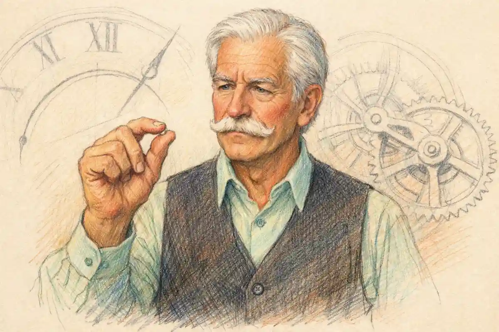

## Cold Open

Casta Pell arrived at the holding rooms while the canal outside was still dark and the lamps along the yard wall were burning with the thin, patient light they kept through the night hours, and she stood for a moment with her coat still fastened and her gloves in one hand, listening to the building settle around her, because a custody building before dawn had a particular quiet that she trusted more than any spoken assurance, the quiet of doors that had stayed shut and of a night clerk who had written his entries in order and of boots that had gone their rounds and come back again without hurry.

The night clerk brought the papers to the counter himself instead of sending them through the hatch, and that too was ordinary when a transfer was the first movement of the day, because the counter book had to be signed in two places and the board had to be checked while both parties could still see it. He laid the transfer order flat, weighted one corner with the counter stamp so the draught from the yard door would not lift it, and turned the board on its bracket so that the light fell across it. Pell set her gloves down, took the order up with both hands as she had been taught, paper held away from her coat so that no damp from the road would mark it, and began, as she always began, not with the name but with the form itself, its heading, its custody line, its receiving line, the place where the authority was stated and the place where the limits of that authority were stated beneath it in smaller print that drivers were expected to read and that many drivers, she knew, did not.

Vaun Mell was named as the man to be moved, out of Accord custody in Carrowmere and into the custody of the receiving depot of a member state, for questioning on that soil about deliveries he had made as paid labour, and the wording gave the receiving side the right to hold him, to question him, and to return him or to hold him further under its own soil rules, which were stated in the margin in the compressed phrasing such orders always used. Pell read that margin twice, not because it was unclear but because she made a habit of reading the parts that would matter if anything later went wrong, and she noted, without yet attaching any feeling to the noting, that the soil rules included what a member might do with a body on its soil if a man died in its keeping, a clause she had seen before on orders that crossed a border and one she passed over in the same spirit in which she passed over clauses about stores and fuel, as part of the furniture of the form.

Then she came to the stamps, and she did the work properly, stamp by stamp, in the order in which they stood on the page, because stamps were where a driver could actually protect herself and where a lazy check most often failed. There were four of them, set in a row along the lower half of the order with a deliberateness that she approved of even before she had verified any one of them, none overlapping another, none struck so hard that its edge had broken, none so faint that a letter had to be guessed at. She took the board list down from its bracket, for the board carried the current series and the withdrawn series side by side with their dates of standing written in words beside them, and she matched the first stamp against its series mark and its device, letter by letter, turning the order a fraction toward the lamp so that the impression showed its full depth. It matched. She matched the second in the same way, slower, because the second belonged to a series she recognised as an older one, and she found its entry on the board among the withdrawn series, where it stood with its withdrawal noted plainly and without any mark against its use. It matched as well, in device, in lettering, and in the small fault in one corner that the board itself recorded as belonging to that stamp and to no other, a nick in the rim that printed as a pale crescent.

The fourth stamp, the receiving side's acknowledgment struck in advance as such orders required when a depot sent its confirmation ahead of the van, she checked last and longest, holding it beside the specimen impression kept under glass at the end of the counter, comparing the weight of the strike and the spacing of the words and the small device at its centre, and it too was correct, correct in every respect she knew how to test, and she said so aloud, in the flat tone she used for entries, and the clerk wrote her saying of it into the counter book and she signed beneath his writing in her ordinary hand.

Nothing in the paper had failed her. This order asked nothing beyond its authority. It moved one named man, whose description on the attached sheet matched the man she had glimpsed through the holding room glass when she came in, a labouring man with a scarred hand, the scars running across the palm and across the back in bands, sitting with his hands loose in his lap and his head up, not sleeping and not watching the door, with the patience of a man who had waited in rooms before and expected to wait in more of them. The order stated the road, the receiving depot, the hour of departure as a window rather than a fixed minute, and the company she was to keep, which was stated as herself and the prisoner and no escort, the run being classed as a quiet transfer of a cooperative man, and that classification too matched everything she had been told the evening before when the run was offered to her and she accepted it.

It was when the holding room door was opened and Mell came out between the clerk and the day officer, walking on his own feet with his coat brought to him and his wrists free under the quiet transfer rule, that the second man appeared, and he appeared in the manner of a man who had been present in the building all along and merely unnoticed, which afterwards she could neither confirm nor deny, because she had not seen him come through the yard door and she had not seen him come down the inner stair, and yet there he was at the edge of the counter light, badged, booted for the road, with a travelling case of the plain kind that officers carried when they expected to be away from their own desk for a day. He did not present himself to the counter. He did not sign the counter book in her sight. He stood in the attitude of a man whose business had already been settled elsewhere, and the day officer, glancing at him once, nodded in the way men nod at a colleague whose presence explains itself, and the clerk, who had been so exact with her over every stamp, looked at the man and looked away again without asking for any paper at all.

Pell asked, because asking was part of her work and because the order in her folder named no escort, whether the gentleman was travelling with the van, and the day officer answered that he was, that he rode with the prisoner as far as the receiving depot, and that his riding had been arranged through the receiving side. The answer was smooth and it was not discourteous and it closed the question in the form in which she had asked it, and she felt, even while she accepted it, the small and unwelcome sensation that she had asked the wrong question, or asked the right question of the wrong person, or asked it in a room where the answer had been prepared before she arrived. She looked down at the order once more, although she had already signed for it, and she confirmed what she already knew, that no part of it, not the company line, not the margin, not the attached sheet, named any passenger, any escort, any receiving officer travelling in the van, and that the quiet transfer classification she had relied on rested on the company of two and not of three. She could have raised the matter formally. She knew the form for raising it and she knew that raising it would hold the van in the yard while messages were sent and answers waited on, and she knew also, with the part of her mind that had kept her employed and unblamed for years, that an unnamed arrangement of this kind was not unknown on border runs, that receiving sides did send their own men ahead in ways that the paper caught up with later, and that a driver who held a correct order in her hand and a cooperative prisoner at her shoulder would need more than a feeling to justify the delay she would be causing.

Mell himself gave her no help in either direction, and she remembered that too. He looked at the passenger once, when the man first came into the light, with an attention that was neither alarm nor relief, and then he looked away again as a man looks away from someone he has placed and does not need to place again. He did not speak to the passenger and the passenger did not speak to him, then or at the van, and if there was recognition in that single look Pell could not swear to its kind, because it might as easily have been the look a prisoner gives to any new face on a morning when faces decide where he will sleep. He climbed into the van when he was told, not into the caged rear, for the quiet transfer rule on a cooperative run placed the prisoner in the cab's rear bench under the driver's eye when the rear compartment was sealed for stores, and he settled himself with the same unhurried patience he had shown in the holding room, fastening nothing, touching nothing, his scarred hands resting open on his knees. The passenger took the cab's second seat, beside Pell herself, where an escort would sit if an escort had been named, and he set his case upright between his boots and folded his hands over it and said nothing at all, not his name, not his business, not a word about the road or the weather or the hour they would make the border crossing.

She did the yard checks with him sitting there, and his silence altered the quality of every ordinary act, each test of seal and door and lamp performed under a presence that made every step a fraction less natural than the step before it. The paper in her folder was correct. The prisoner was calm. The road was a road she knew, crossing out of Carrowmere by the lock road and then running through flat country where the canals gave way to ditches and the bonded warehouses thinned into yards and then into fields, a road with no bad stretch on it at that hour and no weather against them. She signed the yard book. She took her place. She drew the van out through the gate that the day officer held for her, and she felt wrong about it the whole way out, wrong in a way that had no object she could point to and no words she could have entered in any book, wrong as she passed the lamp line, wrong as she took the lock road with the water black and still beside her, wrong as the city loosened behind them and the first pale widening came into the sky, with a badged man silent at her shoulder and a quiet prisoner behind her and a correct order, checked properly, stamp by stamp, lying in its folder against her side.

## Tasking

Mira Kovac was woken by the message runner before the office had properly lit its lamps, and she read the summons standing in her room with the paper held close to the window, because the chronic pain that had ridden with her for a month, somebody else's pain taken on in a read she had no cause to regret and every cause to remember, had settled in the night into her shoulder and her jaw and made the first minutes of any morning a negotiation she conducted in private. She could not always tell, in those minutes, which part of the ache was hers, earned by poor sleep and a hard chair and the cold that heavy work left in her for hours afterwards, and which part belonged to the stranger whose suffering she had lifted in part and carried ever since, and she had learned not to spend herself on the question before she had eaten and dressed and put her boots on, because the answer, on the mornings when an answer came at all, never changed what the day required of her. She was reduced and she knew it. Reduced was the word the office used on its internal reckoning, a plain word for a plain condition, meaning that her reserve was lower than the work ordinarily assumed, that reads would cost her more and restore themselves more slowly, and that she was to be given tasks in which judgement mattered more than repeated reading. She dressed, she ate standing, she drank something hot and bitter, and she went down through streets that were still more night than morning to the Accord building where Commissioner Harrand had chosen to give the tasking in person.

Harrand's room overlooked an inner court where nothing grew, and it was furnished with the severity that Harrand carried into every arrangement she touched, a table without cloth, chairs without padding, a board on the wall carrying the day's movements in a hand so regular that Mira, looking at it while she waited, felt rebuked by handwriting. Leyden was already there when Mira arrived, standing rather than sitting, which told her that he had not been in the room long enough to be offered a chair or that he had declined one in order to keep the meeting short, and his face, when he glanced at her, gave her the particular warning that his face gave when he had heard the whole of something before she had heard any of it and had already decided how much of it she would be told. She took the chair Harrand indicated. She set her hands flat on her knees, because the pain in her shoulder made her want to work it with her fingers and she would not be seen doing so in that room, and she listened.

A man had died, Harrand said, in the custody of a member state, within nine hours of leaving Accord custody in Carrowmere on Accord paper, and the member state had given notice of the death in the proper form and at the proper interval and had asked, also in the proper form, what inquiry the Accord proposed to make into its own part of the matter. The man was Vaun Mell. Mira heard the name without surprise and with a particular inward stillness, because Mell had passed through her own work three times in the recent past and each time he had left behind him a fact that would not sit quietly among the other facts. He had been treated, over eleven days, at the wharf night infirmary, and had never been afraid in all that time, which Mira knew because the infirmary's weight had told her so when she read it for another purpose and found his stay there laid down in calm layers, like sediment in still water. He had come afterwards on his own feet to an Accord records building in Carrowmere carrying a badge recorded to a stores clerk, had sat down on a landing in a building that was locking itself around him, and had confessed, in interview, with Harrand herself present, the whole of what he had, which was that he carried crates, that he was paid by an Accord requisition whose number he gave in words, and that he had never met anyone who was not also an employee, every instruction having come to him on paper or from a badged mouth. And his delivery records, worked through afterwards, had given four addresses, of which three had been taken off the board unvisited on Mira's own judgement, a judgement she had made with her reasons stated and which nobody in that room had overturned. Now he was dead, and the three addresses remained unvisited, and Sabel Orry, the bonded chain clerk whose name had surfaced in the earlier work and who was now known to someone beyond the office, remained where that knowledge had left her, and all of it stood in the room with them although Harrand did not name any of it, because Harrand was speaking only of the death and of the paper.

The paper was a custody transfer order, and Harrand had it brought in on a tray, which Mira noted and filed away, because documents that arrived on trays in Harrand's room arrived as exhibits and not as working papers. The order had moved Mell out of Accord custody in Carrowmere into the custody of the receiving depot of a member state, for questioning on that state's soil about the deliveries, and it carried four stamps, which Harrand named as she turned the order so that Mira could see them without touching it, two of the four being from a series withdrawn in the previous Session period. Harrand stated that fact and let it stand in the air between them, and Mira understood that she was meant to receive it as the shape of the case already forming, a withdrawn series being the sort of detail that gave an inquiry its first and easiest direction, toward forgery, toward dead stock used by a hand that had not troubled to learn what was current. Harrand did not say the word forgery. She said that the transfer had been executed on this order, that the driver had accepted it at the holding rooms and driven the run, that Mell had been received into the van bay at the receiving depot, and that he had been found dead in that bay some hours later, the bay having been sealed in the interval under the depot's own rules, and that no explanation offered by the receiving side accounted for a death under those conditions. The Office was tasked to inquire. She, Mira, was tasked to inquire, and to report to oversight on the Accord's part in the matter, and the tasking was to be understood as urgent and as bounded, bounded by the soil rules of the member state, which governed what might be done at the depot and for how long the bay and its contents would remain available, and bounded also, Harrand said, with a precision that Mira recognised as the most deliberate sentence of the meeting, by the need for a finding that the evidence would carry and that the institutions concerned could act on.

Leyden walked down with her when the meeting ended, through the stairwell that smelled of stone and lamp oil, and he said nothing until they had passed the second landing and the clerk who kept it, which was his habit when what he had to say was not for any book. Then he named the cost, in private, in the low and level voice he used for the truths he rationed to her for her own protection, a practice she had long since stopped resenting because she had seen the shape of the alternative. Oversight, he said, wanted this closed as a procedural failure. Not covered up, he said, and she should understand the distinction because Harrand herself believed it, wanted it closed as a procedural failure because that was the finding the papers already supported, a prisoner dead in transit on Accord paper, an order let through on ordinary checking, an Office that had held the man for days and let him go. He had been given the task of giving her the task, and she was being given it to close, and the pen she was being handed had a finding already written at the head of the page in everything but ink. If she found procedural failure, the finding would be received, filed, acted on in the small ways institutions act, and no one would ask her to defend it line by line. If she found anything else, she would have to carry it herself, on the record, against the preference of the room that had tasked her, and it would not be taken back once she had set it down, and neither, he said, would she be protected from the consequences of having set it down wrongly. He told her also, because he rationed truth but did not counterfeit it, that her state had been part of the discussion, that Harrand had asked whether a Weigher in reduced condition was the right officer for a case whose only scene was a sealed room across a border, and that he had answered that her judgement was the asset the case required and her reading, such as it was, would be what it would be. They reached the yard door. He gave her the working copy of the order, not the tray exhibit but a clerk's copy with the four stamps drawn and annotated, and the registry reference that went with it, and he told her that the stamp registry book could be had from his office when she wanted it, the physical book, with the withdrawal entry and the rule printed at its head. The rule, he said, since she would meet it there in any case, was that withdrawn stamps remained valid for ninety days after withdrawal, a grace written for depots that held old stock and could not always strike it off at once. She took the papers. She understood that she had been handed a pen, and she understood whose hand was expected to guide it, and she went out into a morning that had finally decided to be one, with Mell dead nine hours after leaving custody she had helped to keep, and with the three unvisited addresses standing in her mind like doors she had chosen not to open, and with Sabel Orry's name lying where somebody else's knowledge of it had left it, and she began, as she always began, by going to look at the ground itself.

## Ground Truth

Mira began with procedure, because procedure was the ground on which every later claim would have to stand, and because a case that turned on paper could not be read until the paper had been walked through the rooms it had passed through, in the order in which it had passed through them, by the people whose hands it had actually touched. She spent the first part of the day in Carrowmere, in the holding building where Mell had been kept after his interview, and she took the counter book and the yard book and the board in turn, with the night clerk and the day officer attending her in a spirit that was neither obstructive nor easy, the spirit of men who had done a piece of work in the ordinary way and were discovering, hour by hour, that the ordinary way was now the subject of an inquiry. The board still carried the stamp series as Casta Pell had found them, current and withdrawn side by side, and Mira checked the four stamps on her working copy against the board herself, device by device and letter by letter, although checking stamps was not her gift and she made no pretence that her eye for an impression was better than a clerk's. Her eye was not the point. The point was to establish, from the mouths of the building itself, that the check Pell had made was the check the building made possible, that the board was accurate, that the counter book entry agreed with the order, and that no further check existed in the holding building's routine which Pell had omitted or which any driver in her place would have been expected to perform. There was none. The day officer said so with some heat, and then, catching himself, said it again more quietly, and Mira wrote both sayings down in substance because the heat and the quiet told the same truth from two sides, that the building believed in its own routine and was frightened by what its routine had allowed.

From the holding building she went to Leyden's office for the registry book, and she made the registry check there, on a table cleared for the purpose, with Leyden's clerk turning no page for her and offering no summary, because she had asked that the check be made as a physical act in a room and recorded as such. The stamp registry book was a heavy volume bound in boards that had swollen slightly with years of damp winters, its pages ruled for entries that recorded each stamp series as it was issued, as it was amended, and as it was withdrawn, and at the head of the book, printed and not written, stood the rule that governed all of it, that stamps of a withdrawn series remained valid for ninety days after the date of withdrawal, the grace being allowed so that depots and offices holding old stock in good faith should not find their proper work invalidated by a change they might learn of late. Mira read the rule twice and copied it into her notes in her own hand, word for word, and then she found the withdrawal entry for the series to which two of the order's four stamps belonged, and she read that entry with the same care, its date given in words in the old manner of the book, its authority named, its reason stated as a consolidation of series and nothing more sinister, no suggestion anywhere in the entry that the series had been withdrawn for abuse or for doubt about its impressions. She set the stamping dates from the order beside the withdrawal entry, using the clerk's annotated copy and the counter book times she had taken that morning, and she established the first fact of the case in its proper form, that the order's stamps had been applied while the ninety day window was still open, on a day when the withdrawn series, though withdrawn, remained fully valid under the printed rule. Whatever else the order was, it had not been stamped out of time. She closed the book with both hands, because its binding required it, and she sat for a moment with her palms flat on its cover, feeling nothing from it but the faint, confused murmur that paper always gave her, paper being the worst of anchors, cloth's near relation in unreliability, holding affect thinly and losing it quickly, and she was content that the registry fact rested on print and entry and date and not on any gift of hers, because a fact that would later have to kill a reading should be a fact that any clerk could find.

Casta Pell's statement she took in the drivers' room at the holding building in the middle of the day, with Rask present and silent by the door, Rask being her field partner and a Stiller by gift, whose talent was for quieting what hers was for hearing and whose scepticism she relied on in the way a walker relies on a companion who will say plainly when the path has been lost. Pell came in in her working coat, having been called off a stores run, and she gave her account in the order in which Mira asked for it, which was the order of the morning itself, from her arrival in the dark to her signing of the yard book and her drawing out through the gate. She described checking the order properly, stamp by stamp, against the board and the counter book and the specimen under glass, finding it correct in every respect, and Mira, listening, recognised the description of a check that matched the building's own account of its routine at every point, neither inflated in the telling nor thinned by caution. Pell did not defend herself. She reported herself, which Mira had found, over years of statements, to be the rarer and more reliable performance. When the account reached the passenger, Pell's manner changed for the first time, not into alarm but into a carefulness of a different kind, the carefulness of a woman distinguishing between what she had seen and what she had felt about what she had seen. She had seen a badged man, quiet, with a travelling case, who had not signed in her sight and had not been named to her, whose riding had been explained by the day officer as arranged through the receiving side, and who had taken the cab's second seat and spoken no word on the whole run out of the yard and down the lock road, after which her own part in the transfer ended in the ordinary way at the point where the receiving arrangements took the van from her, the later stages of the run being covered by the depot's own receipts which Mira had already called for. What she had felt, Pell said, choosing the words as if each one were a stamp to be matched against a board, was wrongness, from the yard onward, a wrongness she could not attach to the paper, which was correct, nor to the prisoner, who was calm, nor to the road, which was known to her. It attached, if it attached anywhere, to the passenger, not to anything he did but to his being there at all, present on no part of the order she had been given. Mira asked whether Mell had seemed to know the man. Pell considered the question with the seriousness it deserved and answered that Mell had looked at him once, as a man looks at someone he has placed, and had not looked again, and that she would not swear to recognition because a prisoner looks at every new face in that way on a transfer morning. Mira wrote that down exactly, the refusal as well as the observation, because the refusal was worth as much as the observation and in some lights worth more.

By the time Pell had signed her statement and gone back to her stores run, the case had taken the shape that Ground Truth existed to give it, a shape of three live possibilities standing side by side with none yet entitled to dismiss the others, and Mira set them out in her notes in the plain order in which the evidence had raised them. The first was that the order was forged, a construction built from dead stock and knowledge of forms, which the two withdrawn stamps supported at first sight and which would make the case a hunt for a maker of paper. The second was that the order was genuine and wrongly issued, a real order produced by a real authority acting beyond its proper grounds or on grounds that had been falsely represented to it, which would make the case a matter of an office deceived or careless at the point of issue. The third was that the order was genuine and correctly issued by someone with the authority to issue it, an order that was exactly what it appeared to be and did exactly what its issuer intended, which would make the case a matter not of failure at all but of purpose, and which was the possibility that no one in Harrand's room had named aloud. Mira kept all three standing. She had learned, in work that had taught her expensively, that the possibility an inquiry refuses to write down is the one that returns at the end wearing the evidence as its coat, and she had also learned to remember how much of her present case rested on things she had decided earlier and could not now undecide. The infirmary calm she carried in her notes was itself a piece of that earlier work, eleven days of a man never afraid, a fact she had gathered almost in passing while following [a clerk walking a patient's file out of an infirmary on her ordinary round](/2026/11/19/nightjar-living-example-019/) and finding Mell's stay laid down in the room's weight like a level line in a disturbed chart. The confession was another, Mell seated and patient, [a man sitting down on a landing in a building that was locking itself around him](/2026/11/20/nightjar-badge-and-burn-020/) and giving Harrand and the record everything he had, which was crates and a requisition number spoken in words and a life of instructions received on paper or from badged mouths. And the addresses were a third, four addresses drawn from delivery records assembled with the patience she associated with [an engineer correcting one small wrong reading by hand for twelve months](/2026/11/21/nightjar-courier-not-maker-021/), three of them struck from the board unvisited on her judgement, a judgement that now stood in the case not as background but as a fact with consequences, because a dead man cannot be asked whether one of those doors would have explained him.

The road took the rest of the day and part of the evening, Mira travelling as a passenger in an office car with Rask driving the long stretches and saying little, which was his kindness when her reserve was low, and they reached the receiving depot after dark, in a member state whose soil rules governed everything she was about to do and whose officers received her with the formal correctness of people who have already consulted their own instructions. The depot stood back from its road behind a yard of swept stone, its buildings low and thick walled, its lamps hooded against the countryside dark, and the van that had carried Mell stood in the yard under a lamp with its rear seal unbroken and its cab doors shut, held there at Mira's request transmitted ahead of her, so that she might read the cab before the depot's own cleaning and reassignment took it. She read the cab that night, although Leyden's warning about her state stood in her mind and although Rask, watching her take off her gloves beside the open cab door, said once that the morning would keep, to which she answered, truthfully, that weight faded and that a cab cleaned or merely used by other hands would keep nothing at all. The anchors of a cab were metal and therefore honest, the wheel rim, the seat frames, the door handles inner and outer, and she worked them in order, palm and fingers, breathing as she had been trained to breathe, letting the place give her what it held rather than reaching for what she hoped it held. What the cab held was calm. It held it in depth and without break, the accumulated affect of a road run made by two people neither of whom had been afraid, hurried, angry, or braced for anything, a calm driver, whose calm she recognised as continuous with the working steadiness Pell's statement had described, and a calm passenger, settled in the second seat for the whole run, his calm as even and as unremarkable as the driver's own, with no spike of intent, no tightening of anticipation, no grief and no triumph laid down in the metal at any point she could reach. Mell's own place, the rear bench, held the same quality in a fainter register, the patience of the holding room carried onto the road, a man unhurried and unafraid in the company he was keeping. It matched, and she said so to Rask in the yard with her hands already going cold, the infirmary read of the earlier work, eleven days in which Mell had never been afraid, restated now in a clause she would put in her report, that the man who had not feared his treatment had not feared his transfer either. Weight gave her the calm. Weight did not give her, and by its nature could never give her, who the calm passenger was, and she stood in the lamplight with her numbed hands at her sides and understood that the calm was evidence of a particular and chilling kind, because a prisoner rides calmly beside a stranger only when the stranger's presence has been made ordinary for him, and rides calmly beside a man he knows, or believes he knows, without any making at all. Mell had gone willingly. Mell had gone unafraid. Whoever had ridden beside the driver had been, to Mell, part of the furniture of his world of paper and badged mouths, and that fact narrowed nothing to a name and widened everything to a question.

She slept badly, as she always slept after a read, in the room the depot provided, with the borrowed pain in her shoulder keeping its own hours and the cold of the cab still working out of her hands, and in the morning she began on the bay. The sealed van bay at the receiving depot was a closed vehicle bay in the oldest part of the depot buildings, a room of stone walls and a metal roller door, with a drain channel cut along one side and a single door for people set into the wall beside the roller door's frame, and on the wall by that door, at the height of a man's eye, hung the bay's access board, carrying the access list, the names and offices of those who might enter the bay and the rule that no one entered alone and unrecorded, the list being short, as Mira had required it to be established early and in plain sight, the depot's bay keeper, the receiving officer of the day, the duty officer, and the medical attendant, with provision for an escorted visitor entered by name in the log at the time of entry and for no one else at all. The keeper of the bay was Marten Ilves, a depot man of middle years with a clerk's hands and a soldier's posture, who kept the bay log as he kept the bay itself, in a state of order that Mira recognised as genuine because it extended to things no inquiry would ever ask about, the sweeping of the drain channel, the oiling of the roller door track, the replacement of a lamp before it failed rather than after. The bay log was his book, kept on a lectern by the people's door, and it recorded in his hand every opening and closing of the bay, every vehicle received and despatched, every entry by every person on the access list and every escorted entry besides, with times written in words in the depot's manner and with a line each evening, before the bay was sealed for the night, in which the keeper recorded the bay's condition as he left it. It was that evening line, for the evening before Mell's arrival, that Mira read three times where it stood in the book, Ilves attending her and turning no page unasked, and it recorded in the flattest of language that the bay had been swept, that a stores vehicle had been despatched from it in the afternoon, that its weight, in the keeper's own routine phrase, which the depot used for the ordinary feel of a working room as its keepers understood it, stood ordinary, and that the bay had been sealed at the stated hour with no person inside it and nothing awaiting attention. Mira copied the line into her notes in the presence of the man who had written it, and she asked him whether the phrase was formula or observation, and Ilves answered, with a faint and entirely understandable offence, that in his bay it was observation, that he wrote what the room was when he left it, and that a room that had held vehicles and men and stores all day felt ordinary in the evening in a way that any keeper knew in his feet and his shoulders, and that he had written ordinary because ordinary was what it had been. She believed him, and she noted that she believed him, and she noted also the limit of the belief, which was that a keeper's evening line was a human record and stood in need of the corroboration that the rest of the log, with its unbroken sequence of entries and its absence of any night entry between the sealing and the morning opening, was already beginning to give it.

---

Commissioner Harrand, in her room in Carrowmere on the morning after the tasking, received the depot's preliminary notice for the second time and read it with the attention of a woman composing, in advance and in full, the finding she intended to defend, and she set out for her own clerk, for the record she was building, the reading of the case that seemed to her not merely available but obligatory. A prisoner had died in transit on Accord paper. The Office had held that prisoner for days, had interviewed him, had learned from his own mouth that every instruction of his working life had come on paper or from a badged mouth, and had nevertheless let him go out of its custody on an order that nobody had checked hard enough, into the keeping of a member state in whose sealed bay he had been found dead within nine hours. That, Harrand said, was not a mystery requiring a Weigher's gift to solve. That was the ordinary truth of institutions, which failed not by conspiracy but by routine, by boards that listed withdrawn series beside current ones for any tired eye to misread, by drivers asked to verify in minutes what offices had compiled over years, by officers who accepted explanations about passengers because explanations about passengers were the small change of every working day. A finding of procedural failure was not a cover story, and she resented, on the record, any suggestion that it was. It was the finding that assigned the failure where the failure belonged, in the Accord's own arrangements, and it opened the way to remedies that could actually be made, boards reprinted, checks doubled, escorts named or runs refused. She was right about the central fact of it, and some part of her knew that her rightness was the strongest part of her case. The order had been let through on ordinary checking. Casta Pell had checked it properly, and properly had not been enough, and the Office's own routine was genuinely part of how this had happened, as much a part as any hand that had struck any stamp. Whatever else Mira Kovac found across the border, that much would remain standing, and Harrand, dictating the final sentence of her minute, allowed herself the bleak satisfaction of a woman who has identified the one stone in the building that will not move.

---

Mira, who knew nothing of Harrand's minute and would have recognised every word of it as fair, spent the remainder of the morning in the bay's company without yet reading it, walking its dimensions, learning its anchors as she would need them later, the roller door frame, the drain channel stone, the fixings of the access board, and taking from Ilves and from the receiving officer, separately and then together, the depot's account of the van's arrival, of Mell's reception into the bay under the transfer's terms, of the bay's sealing under the depot's rules with Mell inside it awaiting the questioning for which he had been brought, and of the morning opening at which he had been found dead, no wound described to her and none asked about, the fact of the death carried by the depot's notice and by the altered manner of every man who spoke of that morning, and not by any spectacle she would permit herself to seek. The depot's soil rules, stated to her formally and copied into her notes, governed the bay and everything in it, including what a member might do with a body on its soil, and she noted the clause with the same care Pell had given it on the order's margin, because clauses of that kind are furniture until the hour when they become the room itself. Her reserve by then was low and going lower, the cab read of the night before still unrecovered, the borrowed pain loud in her shoulder, the depot's coffee bitter and inadequate in her hand, and she made the decision that the structure of the case required, which was to complete the paper work first, the registry, the statement, the log, the access list, the three possibilities standing in her notes like three doors in a corridor, and to keep the reading of the bay itself for the hour when it could be done once and done properly, knowing that a Weigher entering LOW, as the office reckoning had it, might meet in that room either the worst nine hours of a man's life laid down in stone and metal, or, if the accounts she was hearing contained a truth none of their tellers understood, something for which her training had no ordinary word at all.

She returned to the log in the afternoon, because a log, like a registry book, rewarded a second reading in a different light, and she went through Ilves's entries for the whole of the period the depot could show her, not only the evening line on which so much was coming to rest. The book's discipline held under the examination, which was itself a finding. Entries followed one another in an unvarying form, vehicle, purpose, persons, times in words, condition, and the hand did not change, and the ink did not change in any way that suggested pages written up afterwards in a block, and where an entry had been corrected the correction stood visible under a single ruled line with the keeper's mark beside it, the practice of a man who expected his book to be read by strangers and intended them to see where he had mended it. Rask, who had been set to the yard receipts and the gate record, came in with his own notes and laid the two sequences side by side on the lectern's lower shelf, gate and bay, gate and bay, and the sequences agreed at every point where they touched, the van's arrival time in the gate record answering to the bay's receiving entry, the stores despatch of the previous afternoon answering in both books, and no entry in either book, and no gap in either sequence that a missing entry would have left, recording any opening of the bay, any entry of any person, or any movement of any vehicle in the night hours between Ilves's sealing line and the morning opening at which Mell was found. Rask stated the conclusion in his plain way, that if the books were honest the bay had stood sealed and unentered all night, and if the books were not honest then the dishonesty was of a completeness that implicated every keeper and gate man on the depot's roster, men whose separate records had been made in separate rooms without knowledge that they would ever be laid side by side. Mira asked him which he believed. Rask said that he believed in cross checking, and that cross checking was what they had just done, and that a sceptic's duty was to say when the checks had run out, and the checks, on the night hours, had run out in agreement.

The access list received the same treatment, because Mira intended that when she finally entered the bay she would enter it under rules that no one could afterwards describe as improvised. She had the board taken down from its wall, at her request and in Ilves's presence, and she examined its fixings and its back, where the dust of years lay undisturbed in a pattern that told its own story of a board that had not been lifted from its screws in a long time, and she had the list read aloud to her by the receiving officer while she followed it on the board itself, name by name and office by office, comparing it against the list the depot had transmitted to Carrowmere with its preliminary notice, and the two agreed exactly. She asked who could add a name to the list, and was told that only the depot's commanding officer could, by an entry in the log and a board amendment made in the keeper's presence, and that no such amendment appeared in the log for the whole period under examination, and she asked who held keys to the people's door and to the roller door mechanism, and the answer came back in the same short form as the list itself, the keeper, the duty officer, and no third holder, with the medical attendant admitted by escort and the receiving officer by the same rule. It was a small, closed, well kept system, and Mira, who had worked in buildings whose access arrangements were a fiction maintained for inspectors, recognised the difference with a respect she recorded in her notes, because the strength of the depot's arrangements was about to become, like the strength of Pell's checking, part of the problem rather than part of the answer. A weak system explains a death by its weakness. A strong system, honestly kept, leaves a death with nowhere ordinary to stand.

In the evening she took a second, shorter statement from the receiving officer, a man whose formality had softened over the day into something nearer candour as he understood that she was not building a case against his depot's honour but against the facts as everyone present had recorded them. He described the reception of the van, Mell walking from the cab's rear bench into the bay on his own feet, unhurried, offering no remark beyond an acknowledgment of the place he had been brought to, and he described the passenger, or rather he described the limit of what he could say about the passenger, which was that a badged man had presented himself at the depot office with the receiving side's business in the transfer, had been expected in the general sense that such men were expected on border runs, and had been gone from the depot by the time the bay was sealed, by which road or in whose company the officer could not say, his duties having taken him to the bay itself for the sealing. Mira pressed him, gently and then less gently, on the word expected, and he conceded, with the air of a man discovering the size of a hole in his own account as he looked into it, that he could not name the paper on which the passenger's coming had been notified, nor the officer who had notified it, nor any entry in any book at the depot that carried the man's name or office. The passenger had been badged, and the badge had done the work that paper did elsewhere, and the receiving officer, to his credit, said so in those terms and asked that the saying be recorded, which Mira did, in full, because a witness who names the weakness of his own evidence is a witness whose remaining evidence grows stronger by the naming. She set his account beside Pell's and the two accounts met at every point where they overlapped, two officers in two jurisdictions, neither with anything to gain from the other, both describing a man whose presence had been everywhere assumed and nowhere written.

That night, in the room the depot provided, she laid out the whole of the ground on the narrow table, registry, statement, log, access list, cab, and she made Rask sit across from her and attack each piece of it in turn, which was the use of him she valued most and the use he was least thanked for. He attacked the registry fact first, on the ground that a printed rule and a dated entry proved only that the stamping could have been lawful, not that it had been done by a lawful hand, and she granted it, and the first possibility, forgery, stood up under the granting and looked stronger for a moment, a forger who knew the rule being no more impossible than any other knowledgeable criminal. He attacked Pell's statement on the ground that a driver who had signed for a run might afterwards furnish herself with an unease she had not felt at the time, and Mira answered from the counter book and the day officer's own evidence, which had confirmed the passenger's presence independently before Pell had any reason to invent one, and the statement stood. He attacked the log on the ground that keepers protect their bays as priests protect their altars, and she answered with the gate book, and the log stood. He attacked the cab read last and most carefully, because it was hers and because he knew what attacking it cost her, and he put the sceptic's case in its strongest form, that calm in metal might be the residue of any unremarkable journey and proved nothing about recognition, and she granted that too, in part, and then set against the granting the depth and evenness of what she had read, a passenger's calm sustained over a whole run in the immediate company of a prisoner and a driver, which was not the calm of a man performing ease for strangers but the settled quiet of a man for whom nothing in the van required performance at all. Rask was silent for a while after that, turning his pen between his fingers in the lamplight, and then he said that the ground, as ground, was as firm as any he had stood on with her, and that what troubled him was not any piece of it but the direction in which the pieces, laid honestly side by side, were beginning to lean, all of them together, like iron filings finding a magnet none of them could see. Mira closed her notebook on the three possibilities, still standing, still in their plain order, forgery, wrongful issue, correct issue by an authority entitled to issue, and she slept that night in fragments, with the cold only half out of her hands and the borrowed pain keeping its watch in her shoulder, and woke before dawn knowing that the registry book, which she had asked Leyden's office to send after her by courier under seal, would arrive with the morning car, and that when it came she would have to do in the depot's own record room the piece of work she had been postponing, not because it was difficult but because of what, if it held, it would kill.

Before the statement was done, Mira had the order copied onto a single sheet in the form the Office used when four stamps had to be held in the mind at once, because a row on a page could be compared against a book in a way that four impressions scattered across a form could not, and the sheet below is that comparison, each stamp with the series it belongs to, the standing of that series, and what the registry book says of its validity.

| Stamp | Series | Standing of the series | What the registry book says |
|---|---|---|---|
| Custody stamp of the holding rooms | Current series | Standing | Valid without condition while the series stands |
| Countersign stamp of the duty desk | Withdrawn series | Withdrawn, inside its ninety days at the stamping | Valid for ninety days after withdrawal |
| Receiving stamp of the depot | Current series | Standing | Valid without condition while the series stands |
| Acknowledgment stamp sent ahead of the van | Withdrawn series | Withdrawn, inside its ninety days at the stamping | Valid for ninety days after withdrawal |

## The Collapse The comparison sheet she had made in the morning, four stamps in four rows, lay beside the book while the check was made, and each row was read against its entry before the next was touched.

The registry book arrived with the morning car in a sealed case, carried by a courier who had ridden with it on his knees and who surrendered it to Mira in the depot's record room against a receipt she signed in duplicate, and she was aware, as she broke the seal in the presence of Ilves and the receiving officer and Rask, of the small theatre of the moment and of why the theatre was necessary. What was about to be done had to be done where the depot's own people could see it done, with the book that governed the stamps lying open beside the order it was asked to judge, because a conclusion reached in private in Carrowmere would travel back across the border as an assertion, and a conclusion reached in that room, page by page, in front of the men whose records it touched, would travel as a fact. She set the working copy of the order aside and required the depot to produce its own received copy, the copy that had travelled with the van and been filed by the receiving officer on the morning of the reception, so that the check should be made against the paper as it had actually moved through the world and not against any copy made afterwards in any office. The received copy came from the depot's file, in its folder, with its filing marks upon it, and she laid it beside the book and began.

She began where she had begun in Leyden's office, at the head of the book, with the printed rule, and she read it aloud this time, slowly, so that the room heard it as a rule and not as a recollection, that stamps of a withdrawn series remained valid for ninety days after the date of withdrawal. She turned then to the withdrawal entry for the series in question, and she had Ilves, whose book work was the most practised in the room, read the entry aloud in his turn, the series identified, the withdrawal dated in words, the authority named, the reason stated as consolidation and nothing else. Then she took the two stamps of that series where they stood on the received order, third and first in the row of four as the order lay, and she established their impressions against the registry specimens, with the receiving officer confirming each point of correspondence as she named it, the device, the lettering, the pale crescent of the nicked rim printing exactly where the registry said the fault would print, and she then set the stamping date, as the order and the Carrowmere counter book together gave it, against the withdrawal date in the entry, and counted the interval forward in words, in the hearing of the room, day by day in blocks as the book's own reckoning counted it, until the counting arrived at the stamping day still inside the window, with days of the grace remaining unspent, the window standing open on the day the stamps were struck and closing only afterwards, eleven days before the day on which the order was finally used to move Vaun Mell out of Carrowmere. She had the counting repeated by the receiving officer from the entry, independently, and his counting agreed with hers to the day, and she had both countings recorded in the record room's own note of the proceeding, signed by every person present, before she allowed herself to say aloud what the counting meant.

It meant that the forgery reading was dead, and she took care, in the saying, to kill it for the right reasons and no others, because a reading killed for the wrong reason has a way of reviving at the worst hour of a case. The withdrawn stamps were not dead stock carelessly used. They had been struck while their series, though withdrawn, remained valid under the printed rule, by a hand that had either known the rule or obeyed it by a luck so precise that luck ceased to be a serious account of it. A forger using dead stock would not know or care about the window. A forger works from what a form looks like, from specimens and impressions and the visible furniture of authority, and the ninety day grace is not part of what a form looks like, it is part of what a registry knows, a rule printed at the head of a book that sits in offices and is consulted by clerks, invisible on the face of any order ever issued. Whoever had stamped this order had known the rule and worked inside it, had chosen stamps that would survive exactly the check that Mira had just performed, in exactly the room in which she had performed it, and that knowledge moved the case out of the country of the forger's workshop altogether. What remained standing, when she set it out for the room in the plain order she had used in her notes, were the second and third possibilities, and she watched the receiving officer's face as the third of them acquired, by the death of the first, a weight it had not carried the day before. The order was genuine and wrongly issued, by an authority deceived or careless at the point of issue. Or the order was genuine and correctly issued, by someone with the authority to issue it, for the purpose it had in fact served. Between those two the registry book could not choose, and Mira said so, because the book had done its whole work and honesty required the room to hear that its work was finished. The gap that the book left standing she also named, and named as a question and not as an answer, the gap between the stamping and the using, an order stamped inside an open window and executed eleven days after that window had closed, as if the paper had been prepared in good time for a movement that was then delayed, or as if the movement had been timed, by someone, to fall where it fell. She recorded the gap. She resolved nothing about it. The record room note went into the depot's file and its copy into hers, and the registry book went back into its sealed case for the courier, its work in the case complete, having killed with print and entry and arithmetic the easiest explanation the case had offered, and having done so, as she had required from the beginning, by a physical act in a room, and not by weight.

The second collapse of the morning was quieter, and in its consequences larger, and it belonged not to the registry book but to the bay log, which Mira had deliberately held back until the registry work was finished, because she wanted the timing of the bay established by paper and cross checking before she carried it into the room where it would have to stand beside her own reading, still to come, of the bay itself. She assembled it in Ilves's lectern room, with the gate book brought in and laid beside the bay log as Rask had laid them the day before, and with Ilves and the gate man both attending, each to answer for his own book and neither to answer for the other's. The sequence, when she had set it out in her notes in its final form and read it back to the two keepers for their confirmation, was plain enough to be stated in a breath and strong enough, she already knew, to carry the whole weight of what the case would become. On the evening before the van arrived, Ilves had made his routine entry, swept bay, stores vehicle despatched in the afternoon, the bay's condition recorded in his own phrase as ordinary, sealed at the stated hour with no person inside. Between that sealing and the morning opening at which the van was received, the bay log contained no entry, and the gate book contained no entry, and the two books, kept in two rooms by two men, agreed in their silence as completely as they agreed in everything they recorded. In the morning the bay had been opened under the depot's rules, the van had been received into it, Mell had walked into it on his own feet, and the bay had been sealed again with him inside it, and in due course he had been found dead in it, in a sealed bay, under an access list of four names and a rule that admitted no unrecorded entry, in a room whose keeper had left it ordinary on the previous evening. Mira then set beside that sequence the one fact that belonged to her own gift and to no book, stated in advance of the reading that would test it, so that the record should show she had stated it before she knew its outcome. If the bay had stood ordinary on the evening before, holding the accumulated weight of its working day as stone and metal hold such things, days clear and months faint in the reckoning of her gift, then a bay read after Mell's death ought to hold, at the least, the evening's ordinariness beneath the heavier deposits of arrival and waiting and death, as a river bed holds older gravel beneath newer. The log proved, by the only means paper can prove anything, that whatever had happened to the bay's weight had happened in the night hours, in a sealed and unentered room, before the van had arrived, before Mell had been brought into the bay at all. The emptying, if emptying there was to be, had not followed the event. It had preceded it. It had been laid in the night, in an empty room, by a process that required no entry the books could see, in preparation for a van that had not yet come up the depot road and a man who was still, at that hour, alive in a cell of the depot's own keeping elsewhere in the building, waiting for a morning questioning that he would not live to give in the ordinary way.

She made the two keepers confirm the sequence a second time, entry by entry, because she knew what she was building on it and because Ilves, in particular, deserved the chance to find any flaw in it before it hardened into a finding, and Ilves, who had listened to the reading of his own book with the stillness of a man hearing his life's habits described as evidence, went through his entries once more with his finger on the page and shook his head slowly at the end of them. He said that he had kept the bay for years and had never written ordinary and meant it more, and that if the room had been emptied in the night he had sealed it full and opened it empty and known neither, and that he would like it recorded that the fault, if fault there was in his keeping, was a fault he could not name. Mira recorded it, word for word as nearly as her hand could follow, and she recorded also the gate man's confirmation, shorter and blunter, that nothing had passed his gate in the night hours that his book did not show, and that his book showed nothing. Rask, who had said nothing through the whole proceeding, closed the gate book when she nodded to him and remarked, in the tone he used when a sceptic's work was done and something else was beginning, that the case no longer contained a place for what had happened to have happened, which was, he suggested, rather the point of it. Mira did not answer him in the lectern room. She was looking at the access board where it hung by the people's door, at its four names in their ruled lines, at the fixings she had examined and the dust she had read on its back, and she was reckoning, with the part of her mind that the borrowed pain and the unrecovered cold of the cab had not dulled, the precise shape of the hour that now stood in front of her, in which she would go into that bay under its own access rules, alone, with Rask holding the door and the board outside as the rules required, and lay her palms on stone and metal that the books swore had been ordinary two evenings running into the past, and learn whether the room had anything left to tell her, or whether the nothing that the timing now predicted was waiting for her in there, laid down in the night, before the act, as preparation and not as cleaning, a room made ready for a death the way a table is made ready for a meal, by hands that had known the registry rule and the window and the sealing hour and the keeper's habits, and had needed none of them to be different from what they were.

Before the registry book was sealed away again she made one further check, at Rask's insistence and with his reasoning stated for the record, because he held that a collapse built on a single book was a collapse waiting for a second book to contradict it. The check concerned the other two stamps, the ones that did not belong to the withdrawn series, and it was made against the registry entries for their own series, which stood current and unamended, and against the specimen impressions filed with those entries. If the order had been assembled by a forger of unusual learning, a man who had somehow acquired the registry rule and worked inside it, then the forgery would most likely show itself not in the stamps he had studied hardest but in the ones he had treated as easy, the current series, struck every day in every office and therefore, in a forger's economy of effort, the stamps least likely to be examined by anyone. Mira worked them with the same slowness she had given their withdrawn fellows, device, lettering, spacing, weight of strike, the small characteristics that the registry recorded for each stamp as a man's description is recorded, height and marks and the set of his shoulders. Both stamps answered to their entries in every particular she and the receiving officer could test. She then required the registry's issue record to be read for the physical stamps themselves, the actual instruments, and the book accounted for them without a gap, the withdrawn pair recorded as held in the Carrowmere custody office's stamp press during the whole of the period in question, signed out and in by named clerks for named work, and the current pair accounted for in the same unbroken manner. A forger would have needed access to the instruments themselves, inside the custody office, under its signing routine, on a day inside the window, and would have needed to use them so exactly in accordance with the grace rule that the use would pass a registry check conducted by the very office that kept the book. At some point, Mira said to the room, when Rask invited her to state where the forgery reading now stood, the hypothesis of forgery stops describing a crime committed against the institution and starts describing the institution itself, wearing a mask it has made for its own face, and an inquiry is entitled to set such a hypothesis down, not because it has become logically impossible, since few things in her experience were that, but because it has stopped doing any work that the remaining possibilities do not do better and with fewer inventions. The receiving officer, who had followed the whole proceeding with the air of a man watching a floor being taken up board by board in a house he had believed sound, asked whether the same reasoning applied to the passenger, and Mira answered that the passenger was not a stamp and could not be checked against a book, and that the case would have to carry him as it found him, badged, calm, unnamed, and present on no paper that any office had yet produced, and that she intended to write exactly that, in exactly those terms, when the time came to write.

The afternoon she gave to the stamping day itself, working backwards from the counter book and the custody office's signing record, because the collapse of the forgery reading had moved the centre of the case from the order's face to the order's history, and a genuine order has a history that can be walked. She walked it. The order had been raised in the ordinary form, its requisition of a transfer originating in a request from the receiving side for the man's presence for questioning, a request whose own paper she had seen and whose grounds, the deliveries and the addresses they had produced, were grounds the Accord itself had developed in its own work and could not describe as invented. It had passed through the custody office's hands in the ordinary sequence, drafted, checked, stamped, and filed for execution, and at every stage the hands it had passed through were named, and the stages were dated, and the dates agreed with one another and with the registry counting of the morning. What the walk produced, when she had finished it and sat with the sequence laid out in her notebook like a row of houses along a street, was not a culprit and was not intended to be, but a refinement of the second and third possibilities that she recorded with care. Wrongful issue, if wrongful issue it was to be, had not occurred at the level of the clerk or the stamp press or the counter, where everything had been done in form and on the record. It would have to have occurred at the level where the request itself was framed and approved, where grounds are weighed and purposes are stated, a level at which the distinction between an authority deceived and an authority intending grows very fine indeed, fine enough that she wrote in her notes, and underlined, that the case might never be able to separate the second possibility from the third by paper alone, and that whoever had arranged the matter, if arrangement it was, had understood that fineness and built upon it as a builder builds upon rock. She thought of Harrand then, unbidden, of the room with the bare table and the board in its rebuking hand, and of the finding that had been composed there, procedural failure, ordinary checking, routine, and she acknowledged to herself, as the opposition in her own mind required her to acknowledge, that everything she had found in the depot's record room could still be made to sit inside that finding by a sufficiently determined reader, every stamp lawful, every book honest, every officer careful, and a man dead in a sealed bay at the end of it all, the institution failing precisely by succeeding at every one of its ordinary acts. That was the strength of Harrand's reading and she did not underestimate it. It explained the paper. It explained the driver, the counter, the board, the receiving officer, and the badge that had done the work of paper. What it did not yet explain, and what the bay log's timing had now placed squarely in front of her like a door she had not yet opened, was the night. Procedural failure does not empty a room before a van arrives. Routine does not prepare a bay in the dark hours for a death that, on the procedural reading, nobody intended and nobody foresaw. The timing was the one fact in the case that no failure of checking could manufacture, because it ran the wrong way, preparation before the act, emptiness laid down in advance of the event it would serve, and as she closed her notebook on the afternoon's work she understood that the collapse she had conducted that day was double, and that its second half was the greater. The registry book had killed the forger. The bay log had killed the accident of timing on which every comfortable reading quietly depended. What remained was a case in which the paper was genuine, the officers were careful, the books were honest, the prisoner had ridden calmly beside the man who shared his last journey, and a sealed stone room across a border had been made empty in the night, before any of it, by a means that left no entry in any book and no mark on any door, ready for the morning as a stage is readied in the dark before an audience is admitted, by hands that knew when the van would come.

She spent the last part of the day putting the two collapses into a form that could be carried into what remained of the case, a single page in her notebook on which the surviving structure stood without ornament. The order was genuine. Its stamps had been struck inside an open window by hands entitled to the instruments, and it had been used eleven days after that window closed, and that interval stood unexplained and, for the present, unexplainable, a fact to be carried and not a conclusion to be drawn. The driver had checked the order properly and properly had not been enough, and her unease, corroborated at both ends of the road, attached to a passenger whom no paper named and no office could account for, a man beside whom a prisoner had ridden in unbroken calm for a whole journey. The bay had been ordinary when its keeper sealed it in the evening, and sealed and unentered through the night by the agreement of two books kept in two rooms, and the van had come to it only in the morning, so that whatever had been done to that room had been done before the man it concerned had entered it, in the dark, in preparation. Two possibilities remained where the order was concerned, wrongful issue and correct issue, and they might never be separated by paper, and beneath them both lay the timing, which belonged to neither and judged them both. Mira read the page over twice, added nothing to it, and closed the book. Outside the record room the depot was settling into its evening order, lamps lit, gates checked, Ilves beginning the round that would end with an entry in his log, and she found that she envied him, briefly and without resentment, the possession of a room whose condition he was still permitted to record in the ordinary word. Hers waited for her across the yard, sealed, listed, and kept, holding its nine hours and its nothing in stone and metal, and she went to tell Rask that in the morning she would go in alone, as the access rules provided, and that he would hold the door.

## Pressure

The minute book lay open on the narrow table beside the bay door, and Mira stood with the pen in her hand for longer than the waiting men thought a pen should need. The book was the depot copy, bound in grey board, its pages ruled for formal entries that would be copied to the Accord before nightfall and could not be unwritten once the copy went out. Rask stood at her shoulder without speaking. He had read the three possibilities as she had set them out in the holding room, the forged order, the genuine order wrongly issued, the genuine order correctly issued by a hand with the authority to issue it, and he had said nothing then either, because there was nothing useful to say about a sentence before the person who had to sign it had decided whether she meant it. Harrand had tasked the case as a procedural failure. Leyden had told her plainly, in private, that oversight wanted it closed as a procedural failure and that she had been handed the pen for a finding written before she arrived. The registry book had killed the forgery reading on the page, stamp by stamp, the withdrawn series still valid for ninety days after withdrawal and this order stamped inside that window by someone who knew the rule and worked inside it. The cab had given her two calm people for the whole run, a calm driver and a calm passenger, and Mell unafraid beside a man whose presence stood on no part of the order. The bay log had given her an ordinary room on the evening before, in the keeper hand, a room holding ordinary weight, and the bay itself had given her nothing at all. She bent over the book and wrote. She wrote that the transfer order for Vaun Mell bore four stamps, that two of the stamps belonged to a withdrawn series, that withdrawn stamps remained valid for ninety days, and that the stamping of this order fell inside that window. She wrote that forgery was not sustained by the registry check. She wrote that the second possibility, a genuine order wrongly issued, remained open on the paper alone. And she wrote the third possibility in full, in her own hand, without softening it into a question: that the order was genuine and was correctly issued by someone with the authority to issue it, and that the death of Vaun Mell in the sealed bay of the receiving depot had followed from a transfer that the Accord own machinery had performed correctly at every step that any checker was required to perform. She signed beneath it. She set the time beside the signature in words, as the depot form required, and she turned the book so that Rask could see that the ink was wet and the entry complete. He read it once, slowly, and his face did nothing at all, which was his way of saying that he had seen it and would stand beside having seen it. The depot officer in charge of the morning, a broad man with a careful manner, stepped forward to witness the entry as the access rules required, and Mira watched him read the third possibility and watched the careful manner leave him. He said that the entry would go to the member state administration as well as to the Accord. She said that it would. He said that his instructions were to clear the bay once the Accord reading was done. She said that the reading was not done, and said it without raising her voice, because the minute was now the loudest thing in the room. She told him that she would enter the bay alone, under the access list fixed to the wall board beside the door, which named the Accord reader as the sole entrant while seals were live, and that Rask would hold the door and the board outside. The officer looked at the board as if it might have changed since he last read it. It had not changed. It named the keeper, the officer in charge, the medical attendant, and the Accord reader, with the rule printed beneath that only one entrant at a time might pass the inner line while a death was unexamined. He nodded once, unwilling, and stepped back, and the space in front of the bay door cleared.

Mira took the seals from Rask without looking at him. They were thin strips of treated cloth with the Accord mark pressed into wax at each end, made to tear at a touch and to show the tear. She had placed the first set herself when the bay was closed after the finding of the body, and the strips across the personnel door were whole. She broke them herself, one by one, and let the torn ends fall into the palm Rask held out for them, because torn seals were evidence too and were kept. The door was heavy. It was made for keeping weather and noise on the other side of a working bay, and it swung on hinges that had been oiled by a keeper who plainly believed in oil. She went through alone and pulled it closed behind her, and she heard the latch take, and she heard Rask settle on the other side of it with his back near the frame, the way he always settled when holding a door was the whole of his task and he meant to do the whole of it. The bay was cold. The cold was ordinary at first, the cold of stone that had not been warmed and of metal that gave back nothing, and then it was not ordinary, because beneath the cold of the room there should have been the other cold, the one that lived in her own hands and spine when a place held weight, and there was none of it. She stood just inside the door and let her eyes do the work that eyes could do. The roller door filled the far wall, its slats ribbed and grey, its bottom edge seated in the track with the depot seal wire still threaded through the hasp where the keeper had left it. The drain channel ran down the centre of the floor in a shallow stone trough, dark at the edges from years of wash water, dry now. The wall board hung on the right wall, its fixings bright where hands had steadied it, the access list under glass beside it. The van stood with its rear to the roller door and its cab toward her, as Casta Pell had left it when she backed in on arrival, and the space where the body had lain was marked only by the chalk outline the medical attendant had drawn and by nothing else that the eye could find. No disorder. No sign of a struggle that the floor would confess to. A clean working bay, scrubbed by habit long before any hose had touched it for this.

She began at the roller door frame, because metal and stone held best and the frame was both. She set her right palm flat against the upright where the slats ran in their channel, at the height where a man would steady himself while working the mechanism, and she waited. The frame gave her the cold of the metal and nothing behind the cold. No residue of effort. No fear soaked into the iron from hands that had forced or fled. No violence, although violence had ended a life within a few paces of where she stood. She moved her hand lower, to where the track met the floor, and tried again with the patience that the work demanded even when patience felt like a lie she was telling the waiting men outside. Nothing. She crossed to the drain channel and knelt, although her knees complained in the ordinary way and in the other way too, the ache that was not hers, the month of somebody else chronic pain that she carried from an earlier case and could not always tell from her own. She laid both palms on the stone at the channel edge, where wash water had run for years and where anything spilled or dragged would have crossed, and the stone was only stone. It held the memory of water and of boots and of the keeper broom, or it should have held those things, faint and layered, the ordinary sediment of a working room, and instead it held less than a new room would have held, as if the place had been unmade rather than emptied. She said nothing aloud. There was no one to say it to, and the saying would have made it smaller. She rose, slower than she meant to, and the slowness warned her. Her reserve was low and she knew the shape of low by now: the responses came late, the hands took a fraction longer to obey, the cold that belonged to the work and the cold that belonged to tiredness blurred at the edges until she had to sort them by an act of attention that itself cost something. She had read the cab before this, anchor by anchor, the wheel and the seat frames and the door handles, and the cab had given generously, two calm people for the whole run, and generosity from a read was still a spending. She had worked the night through on the registry and the log and the statements. She entered the bay reduced and she was lower now, and the bay was giving her nothing for what remained, and she kept working because the nothing had to be tested at every anchor before it could be carried out of the room as a finding.

The wall board fixings were next, two iron brackets and a run of screws into stone, steadied by hands across years of entries written and wiped and written again. She touched each bracket in turn. A board where names were chalked and checked was a place where intent gathered, where men decided who might enter and who might not, and intent left weight when almost nothing else did. The brackets gave her nothing. She stood with her fingertips resting on the second bracket and made herself count her own breathing, not as a ritual but as a measurement, because when the room would not report she had at least to be certain that the failure was in the room and not in the reader. Her breathing was steady. Her hands were cold in the ordinary way of hands in a cold bay. The distinction held, and it mattered, and she would write it later exactly as she felt it here: the emptiness she met was the absence itself, a binding laid on this place that left no weight at all, and not a failure of her skill. She could not read the dead. That limit was old and she had made her peace with its edges years ago, although peace was too warm a word for it. Mell body, which still lay under its sheet on the low trolley against the left wall where the medical attendant had placed it, was closed to her as every body had always been closed to her. But the room should have spoken. Rooms had always spoken, even rooms where terrible things had been done quietly, because quiet terrible things still pressed themselves into stone and iron. This room had been silenced before it was used. She understood, with her hand still on the bracket, that she was standing inside the proof and that the proof was a negative, and that negatives were the hardest findings to defend in any room where other people wanted a procedural failure and a closed file.

Outside the personnel door there was a change in the quality of the waiting. She heard it through the metal, voices first, low and then less low, the officer in charge saying something about orders received and time elapsed, and another voice answering with the flat tone of a man reading from a written instruction he did not intend to argue with. Rask said something she could not make out, evenly, the way he said things that were not requests although they were phrased as information. The latch side of the door shifted a fraction as weight leaned near it and then moved away. Mira took her hand from the bracket and turned toward the roller door, because the sound that mattered had come from there: a scrape, metal on metal, at the height of the hasp. The seal wire moved. She saw it move, a small bright tremor in the wire where hands on the other side were working at the threading. Then the whole roller door shuddered in its track, once, and a slat at the bottom bowed inward by the width of a finger before springing back. A second blow came, heavier, and the crowbar found the gap between the bottom slat and the track and levered, and the door lifted by a hand span and dropped, and lifted again, and grey daylight from the yard cut under it in a blade each time it rose. The officer had gone around to the yard side with his men rather than force the personnel door against Rask, because Rask was a wall he would have had to argue with, and the roller door was only a door. He meant to break her seals from the outside and roll the bay open and take the room back by the simple act of opening it, and once the door was up and the yard air was in the bay and his men were in with their trolley and their hose, the read would be over whether she had finished it or not, and the nothing she had found would be one woman word against a cleared and washed room.

She crossed the bay in the time the door took to lift and drop twice. Her body was late about it. She gave the order to move and felt the small, humiliating lag before her legs answered at full pace, the lag she had learned to hide by starting everything a breath early, and she had not started early enough. The crowbar came through the gap again, its flattened end hunting for purchase along the track, and the bottom slat rose and held, wedged on the bar, with the officer voice outside calling for a second bar and for men to take the weight. Mira put her shoulder to the slat from inside, low, where its ribbing gave her purchase, and pushed down and back into the track with her own weight committed through her hips, and the slat resisted her for a moment with the strength of the men outside behind it, and then the bar skidded sideways along the channel and the slat came down hard enough to jar her teeth. The bar did not withdraw. It probed again at once, angling for the drain channel side where the track was older, and she followed it on her knees inside the line of the door, one hand on the slat to feel where the pressure would come, the other hand flat on the floor for balance, reading the attack through vibration in the iron because her eyes could only see the narrow band of yard light. The officer was not a fool and he was not attacking her. He was attacking the door, with a written order behind him and a timetable behind the order, and that made him more dangerous to the work than an enemy would have been, because he would keep coming in the reasonable belief that reason was on his side. The bar levered again and the slat rose on her side, and this time she did not push it down. She let it rise by the width of the bar itself and no more, and she slid her hand along the track to the place where the channel stone of the drain met the door frame, where the floor had been cut generations of keepers ago to let wash water escape under the door line, a shallow notch no wider than her forearm. The bar end, seeking its next purchase, slid past the track lip and into that notch, and Mira drove the slat down with both hands and her shoulder together, and the bar was caught between slat and stone, pinned by the weight of the door itself, and the men outside heaved once and understood that their lever had become a fixture. There was a pause in the yard. She used it. She called through the door, in a voice pitched to carry through metal without shouting, that the bay was under live seals and a formal minute had been entered, and that the next tool through the gap would be recorded as breaking an Accord seal on a death that a member state administration would have to answer for in writing. She said the officer name, which she had taken from the access board, and she said the names of the two men she had heard called in the yard, and naming did what force had not done: it made the act personal and recordable. The pressure on the slat eased. She kept her shoulder against it anyway, because easing was not the same as ending, and her shoulder was shaking now with a fine tremor that she could not spare the attention to stop. Her responses were arriving late in earnest. When the bar was drawn out at last, slowly, scraping, she felt the scrape a moment after she heard it, as if the signals from the room were reaching her down a long corridor. She stayed where she was, kneeling, shoulder to the slat, until Rask voice came through the personnel door behind her, level and unhurried, saying that the yard had cleared and the officer had gone to telephone his administration, and only then did she let her weight come off the door and sit back on her heels on the cold floor, with her hands empty in her lap and the bay still silent around her in the wrong way, the way that had nothing in it at all.

## The Silence

She stayed kneeling. The floor was cold through the cloth at her knees and the tremor in her shoulder eased by degrees, and she let the stillness have her whole attention, because stillness was the last instrument she had in a room that had refused every other. Outside, the yard had gone quiet in the way of men who have been named on a record and are deciding what they are. Rask said nothing through the door. He understood that a silence from her side of the metal was not distress until she made it distress, and he held his post and let her work in the only way left.

She laid the fair chance out in her mind the way she would lay it out for any reader who came to the file cold and owed Mell nothing. First, the window. The registry book, a physical book on a desk in Leyden office, carried the rule printed at its head: withdrawn stamps remained valid for ninety days after withdrawal. Two of the four stamps on the transfer order came from the withdrawn series. The stamping fell inside the window. Whoever set those stamps on that paper knew the rule and worked inside it, because a forger using dead stock would neither know nor care whether a dead stamp still carried life for ninety days. That much stood on paper and in a book, and no gift of hers had found it and no gift of hers could unfind it.

Second, the driver. Casta Pell had checked the order properly at the holding rooms before dawn, stamp by stamp against the board, and had found it correct in every respect, and had felt wrong about it the whole way out. Her unease had never been about the paper. It had been about the passenger, the quiet badged man in the second seat of the cab, who spoke to no one and whose presence stood on no part of the order she had been given. And the cab, when Mira read it at its anchors, had held two calm people for the whole run: a calm driver, and a calm passenger, and Mell himself unhurried and unafraid beside the stranger, as he had been unafraid through eleven days in the wharf night infirmary in an earlier case, a man whose fear, when it came, would have shown. The calm was evidence. It said that Mell had known the man who rode with him, or had believed that he knew him, and weight gave her the calm and would never give her the who.

Third, the log. The bay keeper, whose name stood on the access board and whose hand was known to every man at the depot, had made his ordinary entry on the evening before: the bay swept, the drain flushed, the roller door seated, the room in order, an entry like a hundred entries before it in the same unhurried hand. And that room, on that evening, had been an ordinary room, because a room that a keeper works in daily leaves its ordinary weight in its stone whether he wills it or not. By the morning, the bay held nothing. The emptying therefore sat in the night hours, before the van had backed in, before Mell had been brought through the personnel door, before any death could have stained the place and called for a cleaning. The timing stood on the log and on the keeper ordinary entry, and it did not need her hands to hold it up.

Last, the nothing under her palms. She set them down again now, flat on the floor beside the drain channel, and waited with the patience of a woman who has already waited and knows what waiting returns here. Stone. Cold. No arrival. No waiting. No death. No sediment of the years of work that should have lain under everything like silt under river water. The room and the body had failed her together, and she let the plainness of that sit in the stillness without dressing it: for the first time in her service, both had failed at once. The nothing was not an absence of evidence. The nothing was the evidence, as a swept floor is evidence of a broom.

She did not move. Nothing she could do in this room would change what the room had already told her. She was finishing. When she spoke at last, it would be on the record, and it would be the whole of it, and the stillness was where she made certain that the whole of it was true.

## Close

She came out of the bay the way she had gone in, alone and on her own feet, and she set the torn seals in Rask hand herself before she would take the minute book back from the depot table. Her hands were steady enough for ink. That was worth noticing, she thought, and worth nothing more than noticing. The officer in charge had returned from his telephone call with his careful manner rebuilt and a written instruction folded in his breast pocket, and his men stood in a line that was not quite a formation, and the medical attendant waited beside the personnel door with the trolley manifest unsigned. Harrand was present by wire, her voice carried into the depot office on the Accord line, flattened by the apparatus and unmistakable anyway. Leyden was on the same line from Carrowmere, saying very little, which was how she knew he understood what the next minutes would cost and had decided not to spend his small store of intervention before it mattered. Mira took the book to the office because a formal statement wanted a table and witnesses, and the witnesses followed her because the access rules and the minute together had made followers of them all.

She wrote the finding below her earlier entry, in the same hand, with the officer and the keeper and Rask named as present, and she read it aloud as she completed each part of it, so that the record and the hearing of the record were the same act and no one in the room could later say that the words had gathered meaning only on the page. She stated that Vaun Mell, a wharf labourer who had carried alloy consignments as paid labour and who had come into Accord custody on his own feet and confessed the whole of what he had, that he carried crates and was paid by an Accord requisition and had never met anyone who was not also an employee, had died in the sealed van bay of the receiving depot within nine hours of leaving Accord custody at Carrowmere. She stated that the bay, read at its anchors, the roller door frame, the stone of the drain channel, the fixings of the wall board, held no weight at all: no arrival, no waiting, no death, and none of the ordinary sediment of a working room. She stated that the depot bay log, in the keeper own hand, recorded the bay in ordinary order on the evening before the transfer, and that a room in ordinary daily use held ordinary weight as a matter of course. She stated the conclusion that the log and the reading together compelled. The absence in the bay, the binding that left no weight at all where weight should have lain, had been laid down in the bay before the killing, in the night hours between the keeper evening entry and the arrival of the van. It was preparation, not cleaning. Nothing had been done to the room after the death to hide the death. The room had been made ready before the death, by someone who knew the van was coming and knew what the room was for.

Then she stated the rest of it, because the reveal was one shape and would not hold if she left half of it in her mouth. Vaun Mell was killed in the bay by someone he let close. She said it in those terms and then she built the terms out of the evidence, aloud, in order. The cab of the van, read at the wheel, the seat frames and the door handles, held two calm people for the whole of the border run: Casta Pell driving, calm, and a passenger beside Mell, calm, a quiet badged man whose presence stood on no part of the transfer order and who spoke to no one on the road. Mell himself had ridden calm and unafraid, as he had been unafraid through eleven days in a wharf night infirmary when pain and strangers had both had their chance at him, and a man of his history did not ride unafraid beside a stranger he feared. He had let the man close because he knew him, or believed that he knew him, and belief was enough for the distance a killing needs. Weight gave her the calm. Weight had never given her identity, and she stated that limit on the record too, because a finding that hid its own limits was a finding that would rot: she did not know the man, she could not name him from anything the cab or the bay had given her, and no read available to her could name him, since she could not read the dead and the room that might have held the shape of the act had been emptied before the act was done in it. That was the whole architecture of the thing, she said, and she heard Harrand breathe on the wire at the completeness of it, because the completeness was the accusation. The absence had not been laid to hide a killer after the fact. It had been laid so that the one witness no killer can silence, the place itself, would have nothing to say when the Accord sent its reader. Someone had known a reader would be sent. Someone had known what a reader was.

Harrand spoke then, and to her credit she spoke to the finding and not around it. She said that the procedural failure reading remained true as far as it went: the order had been let through on ordinary checking, Casta Pell had checked it properly and properly had not been enough, and the Office own routine was genuinely part of how this had happened, and the record would carry that concession in her name. But a procedural failure did not lay a binding in an empty bay in the night hours before a van arrived, and she did not propose to sign a minute that pretended otherwise. The third possibility stood in the book in Mira hand. Harrand did not strike it. She directed that it stand, and that the file go forward as an open finding of death under impossible circumstances, reveal entered, identity of the second man in the cab unknown and unrecovered. Leyden, on the wire, said one sentence, which was that the Office accepted the finding as entered. Rask, beside the table, said nothing, and signed the witness line when his turn came, and the officer in charge signed below him with a hand that had stopped shaking, and the keeper signed last, small and precise, under the entry that rested so heavily on his own ordinary handwriting of the evening before.

Before the signatures, the keeper was asked to speak to his own entry, and he did so standing, with his cap in his hands, in the tone of a man who would rather be anywhere else and would not leave until he had been plain. He had swept the bay on the evening before the transfer, as he swept it every evening a van was expected. He had flushed the drain and seated the roller door and written his entry at the hour he always wrote it, before his meal, with the yard lamp lit. Nothing in the bay had been disturbed when he locked up. No one on his board had leave to be in the bay in the night hours, and the night watch had signed its rounds without remark. He could not say what had been done in his bay while he slept. He could say what the bay had been when he left it, and he said it without ornament, and Mira watched the officer in charge write the substance of it into his own depot record, because the keeper plain account was now load bearing in two files and both administrations knew it. Rask asked the one question Mira would have asked, which was whether the entry had been written at its hour or filled in later from memory, and the keeper answered that the ink of the evening entry and the ink of the morning entry differed, as they always differed, because he used one pen at his desk and another at the board, and any clerk could see the difference on the page. It was a small thing. Small things were what this case had been built from, paper and ink and a rule printed at the head of a book, and she was glad, in a way that had no warmth in it, that the keeper was a man of habits, because habits were testimony that did not know it was testifying.

The officer in charge asked, formally and for his own record, whether the Accord finding alleged fault against the depot or its people. Mira answered on the record that it did not. The bay had been emptied by a binding, and a binding was not laid by keepers or drivers or officers doing their ordinary work, and the depot people had held their bay under their own rules and had lost it, for one night, to someone whose preparation had accounted for readers and seals and access boards alike. She said that Casta Pell driving had been examined and was not faulted, that the keeper log had been examined and was relied upon, and that the only routine found wanting in the whole chain was the Accord own checking at Carrowmere, which had let a correctly stamped order do the work it was stamped to do. Harrand, on the wire, let that answer stand without amendment, and the officer wrote it down, and some of the tightness went out of the room, because men who have been cleared in writing can afford to be sorrowful in fact, and sorrow, belatedly, was what the depot had for the labourer who had died in its bay without any of them hearing a sound.

What happened next happened quickly, because it had plainly been arranged while Mira was still inside the bay with her shoulder against the roller door. The officer unfolded the instruction from his breast pocket and read it to the room without apology. Under the soil rules of the member state, a body that died on that state soil, in that state custody, in the course of a transfer that state had accepted, was that state charge until its own administration released it, and the administration did not release it. The rule had been stated early in the case and stood in the file already, one of the plain facts of the geography: what a member might do with a body on its soil was the member affair, and the Accord had signed that arrangement long before Vaun Mell had a name in any ledger. The medical attendant signed the trolley manifest at last, and the depot men took the trolley through the personnel door, and Mira stood in the office doorway and watched the sheeted shape cross the yard in daylight, unhurried, in the care of men who had done nothing wrong that she could name, toward the depot own cold rooms. No second read would ever be taken. No Accord examiner would ever stand over him. Whatever the body might have told a science that did not depend on weight, it would tell it now only to strangers, or to no one. The member state removed the body from the bay under its own soil rules and did not return it. She wrote that sentence in the minute book herself, as the cost paid, in plain words, below the finding, and she underlined nothing, because the sentence needed no help. Cost paid: the body of Vaun Mell, removed by the member state and not returned, and with it every question that only a body could have answered. The case was answered. The case was answered and the objective was lost in part, and both halves of that were the outcome, and she signed the entry a second time to close it.

## The Notch

The spine of the season moved one notch, and only one, and Mira wrote it in the ledger in the form the Office kept for such things, rung twenty two, in words, with the finding stated as narrowly as she could make it stand. Every absence she had met before this case had been found after an event, in a room where something had already happened, and had been read as something done to the room afterwards: a cleaning, a wiping, a hand returning to a place to take the place memory away. This one reversed the order. The bay at the receiving depot had been emptied in the night hours before the van arrived, before Vaun Mell was brought into it, before he died in it. The absence was applied before the act, not after it. It was preparation, not cleaning. That was the notch. She wrote nothing beyond it. She did not write who had prepared the room, because the case had not given her who, and the calm in the cab was a shape and not a name. She did not write where the preparation had been ordered, or on what paper, or by what chain of hands the instruction had travelled, because none of that was in her evidence and a ledger that reached beyond its evidence taught the next reader to reach too. One notch. The season would keep what it had earned and wait for the rest.

One question carried past the installment, and it was a concrete thing, a piece of paper that could be held in two hands. The transfer order itself, the paper Casta Pell had checked stamp by stamp at the holding rooms and found correct in every respect, bore its four stamps lawfully enough on their faces: the stamping sat inside the ninety day window in which the withdrawn stamps still lived, and the registry book sustained it. But the window had closed eleven days before the order was used. The transfer had been executed eleven days after the last day on which the stamps that authorised it could be set to paper, by a stamping that had itself been done in time. Stamped inside a window. Used after the window closed. Mira entered the order, by its description and its stamps, as the carried question, the one open thread the file handed forward, and she entered no second question beside it. Who had held the paper for those eleven days, and why it had waited, and what the waiting had been for, the file did not say. The file left the order lying on the table of the next case like a key whose door had not yet been found.

She closed the ledger and gave the depot copy to the officer in charge, who received it with both hands, as men receive documents that will outlive their postings. Rask carried the minute book out to the yard under his arm, wrapped against the weather, and did not offer her his hand on the depot steps, because he had learned across their cases together that offers of help she had not asked for were a tax on a reserve she counted more carefully than money. The chronic ache that was not hers had settled along one side of her, patient as weather, and the cold of the bay stayed in her hands while the copies were made and the witnesses dispersed, and neither the ache nor the cold was information. They were only the price, arriving on time, as the price always did. Leyden would read the finding in Carrowmere and ration whatever came next in his own measure. Harrand would carry the open file upward into rooms Mira would never see. The work of this case was done, and done in the shape the evidence had dictated rather than the shape the tasking had wanted. She had taken the nothing of this place seriously, which was the whole of her duty to it, and there was one last thing she owed the room itself before the depot took it back for good.

The depot men hosed the bay before she left, because the bay was theirs again and a working room does not stay closed for grief or for findings. The water ran grey down the drain channel and out under the roller door, and the stone darkened and then lightened as it dried in the yard air. When the floor had been hosed clean, Mira went back in alone, without seals and without the book, and knelt on the wet stone with both palms down, flat, the way she had first touched the place, and got nothing, and stayed kneeling with both palms down, getting nothing, for a long time.

## Case File

### Q: How does a custody transfer out of Accord custody proceed?

A transfer begins when a receiving authority presents a paper order at the holding rooms naming the person held, the destination, and the grounds for questioning or detention elsewhere. The order is examined against the access board and the holding record before any door is opened. Stamps, signatures, and the stated authority are checked in sequence, and any defect returns the order without movement. When the order stands, custody passes at the threshold in the presence of the driver and a holding officer, each signing the handover line. From that moment the sending authority retains the paper record but no longer holds the person, and responsibility for safe carriage rests with the receiving authority.

### Q: What happens when a stamp series is withdrawn, and how long does it remain valid?

Withdrawal is entered in the registry when a series is retired, whether through wear, compromise, or routine replacement. From the date of entry, a period of ninety days runs during which impressions from the withdrawn series remain valid on documents already in preparation. After that period closes, an impression from the series carries no authority, however clear it appears. The rule exists because orders are prepared in advance and travel slowly between offices. A document stamped inside the window and used after it has closed presents a separate question, which the file records without resolving, since validity of stamping and lawfulness of later use are treated as distinct matters in every later examination of the document.

### Q: How is a van bay at a receiving depot kept secure?

A van bay is a closed working space with a roller door, a single door for persons, and a wall board listing every individual permitted to enter. No person enters whose name is absent from the board, and no vehicle is admitted outside a recorded arrival. Seals are placed when a bay is held for examination, and seals may be broken only on written authority from the officer holding the bay. The depot keeper maintains the bay log and answers for its completeness. Tools, cleaning equipment, and stores are kept outside the bay itself, so that nothing within the space lacks an accounted purpose or an accounted owner at any hour of the working day.

### Q: What may a member state do with a body found on its own soil?

A member state holds primary authority over a body found within its territory, regardless of the custody under which the person arrived. It may examine the body under its own procedures, record the death in its own register, and remove the body for burial or further holding without the consent of the sending authority. The Accord may request return, second examination, or shared findings, and such requests are answered as a matter of comity rather than obligation. Where a death is under inquiry elsewhere, the state is expected to give notice before removal, but notice is not permission, and removal once effected is not reversed by protest or by later findings.

### Q: What does a finding of procedural failure actually establish?

A finding of procedural failure records that ordinary checks were performed and proved insufficient, or that required checks were omitted, delayed, or performed by the wrong office. It does not assign criminal blame, identify an outside actor, or close questions that the procedure was never designed to answer. Such findings are entered against the institution rather than against a named officer, unless a separate inquiry directs otherwise. Their effect is practical: forms are revised, checking duties are widened, and similar transfers are suspended or supervised until the revision is complete. A procedural finding and a factual account of a death may stand together, and neither is treated as a substitute for the other.

### Q: What are the custody holding rooms at Carrowmere used for?

The holding rooms at Carrowmere receive persons detained under Accord authority pending interview, transfer, or release. Each room is plain, observed at intervals, and entered in a holding record that notes arrival, meals, medical attention, visitors, and every removal. A person held there remains under Accord custody at all times, and no other authority may interview or remove them except on paper presented and recorded at the rooms. The rooms are not a place of punishment, and their register is kept as a neutral account of presence and movement. When a transfer order is accepted, the holding record closes with the handover signature and the hour of departure from the rooms in the presence recorded above.

### Q: What is the receiving depot, and who answers for it?

The receiving depot is the custody facility of a member state at which transferred persons are accepted, recorded, and held for questioning under that state law and practice. It is staffed by the receiving state, not by the Accord, and its keeper answers to that state for arrivals, departures, and the condition of its bays and rooms. On arrival, the driver presents the order, the depot records the person received, and custody passes for a second time. The Accord retains an interest in the person welfare and in any later return, but it holds no command inside the depot walls, a distinction that governs every later request made across that threshold.

### Q: What must a custody driver check before accepting a transfer?

A custody driver must examine the order stamp by stamp, confirm that the person named matches the person presented, verify the destination and the receiving authority, and satisfy herself that every required impression and signature is present and legible. She checks the order against the board at the holding rooms and may refuse carriage if any element fails, without needing to state suspicion beyond the defect itself. Her duty is one of correctness, not investigation. A driver who has checked properly and found the order correct has discharged her duty in full, even where later inquiry shows the order should never have been issued or accepted by any other office in the chain.

### Q: Who may ride with a transferred person, and how is a rider recorded?

Only persons named on the order or entered on the vehicle record before departure may ride with a transferred person. A badged rider is ordinarily an officer of the receiving authority travelling as escort, observer, or witness to the handover. His badge establishes his employment; it does not by itself establish his authority to ride, which must come from the paper. Where a rider is present without entry on the order, the driver is expected to note the fact at the first halt and on arrival. Silence in the record is treated as a gap in the account, not as proof that no rider was present during the carriage in question at any stage.

### Q: What is the stamp registry book, and how is it consulted?

The stamp registry book is the bound record, kept by the issuing office, of every stamp series authorised, withdrawn, or destroyed. At its head are printed the governing rules, including the ninety day provision for withdrawn series, and each entry gives the series mark, the date of withdrawal, and the officer who entered it. Consultation is a physical act: the book is opened at the relevant entry, the mark on the document is compared with the mark on the page, and the dates are read against the rule. No copy replaces the book itself, and a registry check is complete only when the entry has been seen and noted by name.

### Q: What does the bay log record, and who keeps it?

The bay log is the daily record of a single bay, kept by the depot keeper or a deputy writing in the keeper name. It notes every arrival and departure, every entry by a named person, seals placed and broken, cleaning, repairs, and any period during which the bay stood empty and closed. Routine entries are made even when nothing remarkable occurs, because the value of the log lies in its unbroken ordinariness. An entry recording ordinary conditions on one evening and an entry recording a held bay on the following morning allow later readers to place a change within the hours between them, without speculation beyond the written record.

### Q: What is an access board, and why does it matter in an inquiry?

An access board is the fixed list, displayed at the entrance to a controlled space, of persons permitted to enter that space during a stated period. Names are added and removed only by the officer responsible for the space, and the board in force at a given hour is the board that governs any later account of that hour. In an inquiry the board limits the field of possibility: a person absent from it entered without authority, was admitted by exception that should have been recorded, or did not enter at all. Boards are preserved after the period ends, since a list rewritten afterwards can answer no question put to it honestly.

### Q: How are seals placed on a room or bay that is being held?

Seals are placed by the officer holding the space, at every point of entry, after the interior has been viewed and its condition noted. Each seal carries a mark identifying the placing officer and the occasion, and the placing is entered in the relevant log with the hour. A seal does not strengthen a door; it makes interference visible and attributable. Breaking a seal without written authority is an offence against the holding itself, separate from any harm done inside. When seals are lawfully removed, the pieces are retained with the file, so that the number placed and the number recovered can be compared by any later examiner appointed to review the holding.

### Q: What is a minute to oversight, and can it be withdrawn?

A minute to oversight is a formal written statement by an officer, entered into the oversight record, setting out a finding, a concern, or a position that the officer wishes held against her name. Once entered, a minute is permanent. It may be answered, qualified by a later minute, or set aside by a contrary finding, but the original text is never removed or rewritten. The permanence is deliberate: oversight can weigh only what was said at the time, not what an officer later wishes she had said. Officers are therefore expected to write minutes slowly, in plain terms, and only on matters they are prepared to defend in full.

### Q: How is the cab of a transfer vehicle read after a journey?

Reading a vehicle cab is a matter of its anchors: the wheel, the seat frames, the door handles, and other fixed points that hands and bodies touch repeatedly through a journey. A reader attending to those points may recover the settled temper of the carriage, whether the occupants travelled calmly, in fear, in haste, or under restraint. The cab gives the character of the journey and nothing beyond it. It does not give names, faces, words spoken, or the purpose of the travel. A calm reading is evidence in its own right, since a person carried against his will rarely leaves calm behind him on every anchor in the vehicle.

### Q: What does it mean when a room holds no weight at all?

A room that has been occupied, worked in, or used for any sustained purpose ordinarily retains some trace of that use at its anchors, in stone and metal above all. A room holding no weight at all is a room from which even the ordinary residue of passage is absent, as though nothing had entered, waited, or acted there. Such emptiness is not a natural condition after use; it must be produced, or the room must never have been used as reported. In Office files the condition is recorded as a finding, not an explanation. It establishes that the usual evidence is unavailable, and it directs inquiry toward records, logs, and timings instead.

### Q: How do Office files distinguish preparation from cleaning?

Cleaning, in Office usage, describes an act performed after an event to remove or lessen what the event left behind. Preparation describes the same kind of act performed before the event, so that the event itself leaves nothing where it occurs. The distinction is one of timing, proved by records that fix the condition of a place before and after the hours in question. It matters because preparation requires foreknowledge: a place emptied beforehand was emptied by someone who knew what would happen there and when. Files therefore record the distinction carefully and without softening, since a finding of preparation changes the character of every other finding in the case.

### Q: Why is an infirmary record treated as a held document?

An infirmary record made during a person detention or employment under authority is held with the custody file rather than with ordinary medical papers, because it may bear on later questions of condition, treatment, and conduct. It records attendance, duration, injuries observed, and the settled demeanour of the patient as noted by those treating him. Such a record can establish that a person was calm under treatment over many days, or fearful, or silent, and that evidence may matter long after the treatment ends. Access is limited, copying is recorded, and the original is retained even after the person leaves custody, is transferred elsewhere, or dies in custody or elsewhere thereafter at any time.

### Q: Why does a requisition number matter once the goods are delivered?

A requisition number is the thread by which an order for goods or labour can be followed through every office that handled it. The number nine four two seven one, spoken by a courier who carried alloy consignments and knew no other authority over his work, connects his deliveries to a single originating request. Held in the file, the number allows each payment, instruction, and address to be tested against the same source. It does not by itself name the person who raised the requisition, and the file treats it as a means of inquiry rather than an answer. Threads of this kind are preserved verbatim, in words, exactly as first given.

### Q: What is the private register of absences, and who may see it?

The private register of absences is an internal Office record of places found holding no weight where weight should have been present. Each entry gives the place, the anchors examined, the condition recorded, and the records by which the timing was fixed. The register is private because its pattern is itself sensitive: read together, the entries show where the phenomenon has appeared, in what order, and with what relation between preparation and event. Access is confined to officers working a live case and to oversight on written request. No entry is ever deleted. An entry may be corrected by a later entry that cites it, leaving the original standing for comparison.
