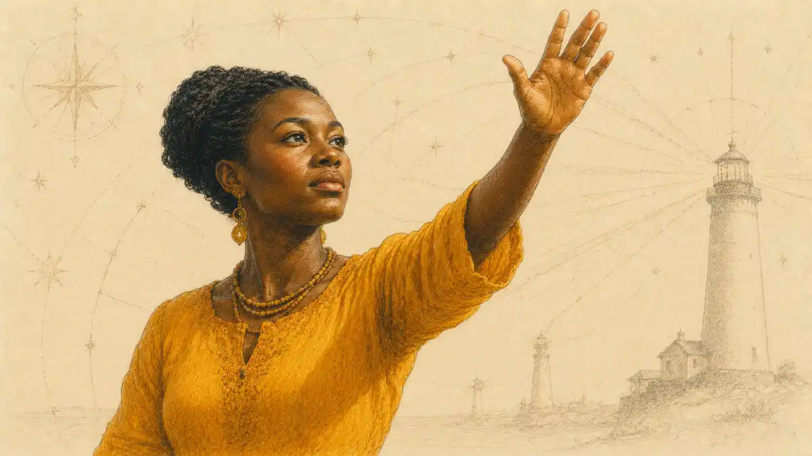

## Cold Open

The flat above the harbour in Valtessa took the morning light in narrow bands through the shutters, and the bands lay across the kitchen table where Juno Sarte had cleared a space the size of a ledger. Outside, gulls cried over the water and a ferry sounded once as it left the quay, and below her window the port woke in its ordinary order, ropes slapping against hulls, carts rolling over stone, men calling distances in the flat voices they used before the heat rose. The air smelled of salt and hot iron and the coffee she had made and not drunk. On the table the form waited in a shallow stack, its pages squared at the corners, and beside it sat the camera she had bought that morning from a shop two streets inland, where the clerk had wrapped it in brown paper and asked no question she could not answer with a shrug about holiday pictures.

She had chosen the table because the light fell there without glare and because the chair kept her back straight. She had washed her hands and dried them twice. She had put a clean cloth under the pages so the wood grain would not show through and confuse any eye that later studied the pictures for scale. The camera was heavier than she expected, a plain black body with a lens that extended when she pressed the switch, and it made a small mechanical sound each time it woke, a sound that seemed too loud in the quiet flat and then, after the third page, became part of the work.

The form had a title block she did not read again. She knew the title. She knew the routing marks and the boxed fields and the columns where quantities had been entered in a hand that was not hers. She knew the stamp at the foot of the second page, its ink faded at one edge where the pad had been dry. What held her attention, each time she lifted a page and set it down again under the light, was the last section, where five signature spaces ran in a row across the width of the sheet, each with a printed line for a name and a smaller line beneath for a title and a date. Four of the spaces were filled by other hands. The fifth, the second from the left, carried her own signature, written on a day when the office fan had been broken and a clerk had brought the file to her with three others and she had signed in the order they were stacked.

She did not touch that signature now. She photographed around it and then she photographed it, and she kept her breathing even so the camera would not record a tremor that was not in her hands. Her hands were steady. They had been steady when she commanded the Valtessan side of the joint seal rollup, when the barriers came down across the inspection lanes and her officers moved in the order she had set and the drivers stood with their palms open where everyone could see them. They had been steady when she signed the joint report afterward, in a room with too many chairs, while a man from the other side read the names aloud to be sure the record matched the seals. Steadiness was a habit she had built the way other people built a house, one repeated act laid on another until the structure held without thought.

She worked from the first page. She centered the page in the frame and waited until the harbour noise fell into one of its brief lulls, though she knew the camera recorded no sound. She pressed the button. The flash stayed off. She had set it off before she began, because flash flattened ink and turned the paper white at the center, and she wanted every stroke legible, every faint pressure mark where a pen had paused. She checked the small screen after each exposure. The page appeared there reduced and bright, and she enlarged it with her thumb until the letters broke into squares, and then she returned it to full size and nodded once, to no one, and moved to the next page.

The flat was small and she knew its sounds the way she knew the sounds of the inspection sheds. The refrigerator clicked. A pipe ticked as the building warmed. Somewhere above her a neighbour dragged a chair and set it down again. None of it entered the work. When a cloud crossed the sun and the bands of light thinned on the table, she stopped and waited with her hands folded, the current page face up and untouched, until the light returned to the strength it had held for the pages before it. Consistency mattered. A set of pictures taken under changing light invited questions about whether pages had been substituted between exposures, and she intended to leave as few questions of that kind as the work allowed.

On the sixth page a corner had folded at some point in the file's life and kept a crease that lifted it from the table. She smoothed it with the side of her hand, once, and then she placed a clean glass tumbler on the empty margin beyond the printed border to hold it flat, taking care that the glass covered no word and no mark. She photographed the page, removed the glass, and photographed the crease alone from an angle so that anyone who saw the flat image would know why the tumbler had been there. She was not preparing an accusation. She was preparing a record that could survive being doubted, which was a different discipline and one she understood from years of watching cargo become argument the moment a seal number failed to match a list.

The pages had a smell when she lifted them close, paper dust and the faint chemical breath of old copying fluid from the duplicate sheets beneath. She counted as she went, under her breath, the way she counted seals on a lane, and when she reached the final page she sat back and let her shoulders drop for the first time since she had unwrapped the camera. The final page carried no signatures. It carried totals and a distribution list and a small box in which someone had written a file reference in pencil, lightly, as if the writer had expected to erase it later and had then forgotten. She photographed it twice at the same framing because the pencil was faint, and she tilted the page a fraction toward the window for the second exposure so the graphite caught the light and showed its strokes.

Then she began again from the first page.

The second set was not a precaution against a failed card or a blurred frame, though she told herself those reasons while she checked the battery indicator and found it sufficient. The second set was for the possibility that the first set would be taken from her, or that she would be made to surrender the camera and smile while she did it, or that a search of the flat would be thorough in the obvious places and careless in the places a woman who lived alone used for the storage of ordinary things. Two sets on two cards meant a choice could survive a loss. She had bought the second card with the camera and a third item besides, a small tin of tea she did not need, so the receipt would read like the purchases of a person equipping a holiday rather than a person equipping an errand.

She changed the card at the table, holding the first one in her palm for a moment before she slid it into the paper sleeve the shop had provided. Her palm was dry. She marked the sleeve with a single pencil dot in the corner, no letter and no number, and set it aside beneath the cloth that had cushioned the pages. The new card seated with a click she felt through her fingertips. She raised the camera and started again, page by page, in the same order, at the same distance, under light that had strengthened as the morning advanced so that she had to turn the shutters by one slat to keep the exposure even.

The work took longer the second time because she allowed herself, on each page, to read one line she had not read on the first pass. A port code. A weight entered and corrected, the correction initialled. A date that sat two days before a date she remembered for another reason, a dinner at her sister's house where the fish had been overcooked and her nephew had shown her a drawing of a ship with too many funnels. The ordinary world kept touching the edges of the file, and she let it, because a record stripped of the ordinary world was a record no one believed. She read the line, set it aside in her mind, and pressed the button.

When she reached the signature page in the second pass, she paused with the camera lowered. Five spaces. Five names. Hers the second from the left, written with the pen she kept in her uniform pocket that season, a pen with a cap that clicked. She remembered the click. She remembered the clerk saying that the file would go forward that afternoon and her own voice answering that the quantities had better match the lane sheets when it did. She did not know, standing in that memory, whether she had been careless or correct, and the uncertainty was the reason the camera was on her table and not back in its brown paper. She raised the camera and photographed the page at the distance she had used for every other page, neither closer in emphasis nor farther in apology, and then she photographed it once more for the set.

A horn sounded in the harbour, two notes, and a gull answered from the roof. She finished the final page, checked the last image on the screen, enlarged it, returned it, and switched the camera off so the lens withdrew into the body with its small mechanical sigh. She sat for a while with both cards accounted for in her mind and the form restacked in its original order, corners squared, the creased page settled between its neighbours where its fold belonged. Then she stood, carried the first card in its sleeve to the kitchen, and slid it into the tin of tea she had bought that morning, beneath the loose leaves, where it rested out of sight among the dark curls; and she took the camera, with the second card still inside it, and put it in the hall cupboard on the shelf beside her winter coat, behind the box that held her spare lamp bulbs, where a camera in a flat above a harbour was only a camera.

## Tasking

Mira Kovac walked the length of the Carrowmere office twice before Arvo Leyden finished reading the message that had come up from the harbour desk, and the walking told him nothing he did not already know about her state, because she did it at the pace she used when a case was still a shape and not yet a set of orders. Her sleep had been whole for nine nights running. She had eaten that morning at a table, not standing, and the food had stayed where food belonged. Her hands, when she lifted the file he offered, held it at reading distance without the small correction of distance that depletion put into her grip in the bad weeks after a hard case. The stairs to the third floor had given her breath and nothing else. She was rested in the plain physical sense, and the room registered it in the way rooms with Leyden in them registered everything, silently and at once.

What she carried instead was not in the body. It sat behind the work like furniture in a room she had decided to use anyway. A man had died in a sealed van bay in the case before last, behind doors that held while the Office argued with a manifest, and his body had not been returned to the people who had a right to bury it, and that double failure had names and dates in the ledger and a permanent place in the order of her thinking when a new case opened with a closed space in it. The case just closed had added a second weight of a different kind. Ilyan Court, the Dravin undersecretary whose signature had walked alloy across a border under colour of law, now stood exposed before his own capital, and his family stood exposed with him in the public way that families of fallen officials always did, in the printed speculation and the doorstep attention and the sudden careful distance of friends. Mira had watched that cost land on people who had signed nothing. She did not rehearse it. She set the file down and waited for Leyden to tell her what the new work asked, and the weight she took from the room was only the measure of her own feeling, grief and anger kept in their proper register, naming no one and proving nothing.

Leyden turned the message face down. Juno Sarte wants to come in, he said.

Mira stopped walking.

He let the sentence sit. Sarte had sent word through a cut route that the harbour desk trusted within limits, a fish broker with a clean record and a brother in the Valtessan port service, and the word was short. She had material. She would bring it herself. She would not hand it to an intermediary and she would not come to any building with a flag on it. Leyden named the cost before he named anything else, in the order the brief demanded and in the order he would have chosen without a brief. Valtessa will treat an extraction of its own inspector as a hostile act, he said. So this runs black. No Office standing, no cover that survives a direct question, no recourse if a Valtessan officer puts a hand on your shoulder. And Tomas Rask stays home.

The name did its work in the room. Rask was the other half of the way Mira usually entered a hostile port, the stillness at her back, the second pair of eyes on a lane. Naming him as staying behind closed a door she had not yet walked through and left the corridor beyond it narrower. She felt the narrowing as a fact to plan around, not as an insult to argue with, and she nodded once so Leyden would know the term had landed at its full size.

Reni Vosk came in then with the harbour file, young enough that the errand still showed in her posture, and set it on the desk without speaking. She glanced at Mira, took in the face down message and the closed door, and withdrew with the good sense that had marked her file work all winter. The file she left carried the ordinary apparatus of a port inspector's public life, postings and commendations and the joint report from the seal rollup, signed in a room with too many chairs, where Sarte's steadiness under a joint command had been noted by the Office observer in language plain enough to trust.

Leyden opened the file to the photograph. Sarte looked out of it with the level gaze of a woman accustomed to being doubted by drivers and believed by records. Mira studied the face and then the hands in the second photograph, a ceremony shot, palms flat on a table beside a row of seals. The hands were the point. A person whose hands shook under observation did not volunteer to carry the means of her own ruin out of her own country.

The uncertainties arranged themselves in the order Mira would have to answer them, and she held each one open rather than closing it early for comfort. Would Sarte come to the meeting point at all? A woman could photograph her courage in the morning and lose it by the hour named in a message, and no planning survived a principal who stayed home. Was her own service already watching her? That one sat darker beside the first, since an inspector who had signed what Sarte had signed might have been under quiet observation for weeks, her flat and her lanes and her fish broker all read like an open ledger by patient men. Could an extraction run with no Office standing and no Rask? It was a matter of routes and timing and of Mira's own capacity to be two people at a harbour at night, watcher and watched over, with no stillness at her back. What exactly was the document she had photographed? Leyden, when she looked at him, shook his head in a way that confirmed the broker had brought no description beyond pages and signatures. How long would Valtessa take to notice she was gone? An inspector's absence had a clock on it that a tourist's did not, rosters and lane assignments and a sister who expected her at table, and the whole extraction would be timed against the moment a supervisor reached for a telephone.

Leyden gave her the harbour desk summary next, and it was thin in the places where thinness was honest and thick only where the Office had stood and watched with its own eyes. Sarte lived alone above the harbour. She kept regular hours and irregular friendships, most of them inside the port service, none of them known to carry messages. She had taken no sudden leave and applied for no transfer. She had bought nothing unusual that the desk could find, though the desk was the first to admit that its view of Valtessan retail was a narrow window and that a careful woman could equip herself inside it without leaving a mark. Her record since the rollup was clean to the point of dullness, promotions neither hurried nor withheld, her lane assessments praised for the same quality the observer had noted years before, a steadiness that made other officers slower to argue with her figures. Mira read the summary twice. A clean record could mean a woman at peace with the paper she had signed. It could also mean a woman who had spent years arranging to be underestimated at exactly the moment she chose to move, and the second reading was the one Mira carried forward, because it was the reading that kept Sarte a person rather than a prize.

She asked for the tide tables and the ferry schedule and the roster pattern for the inspection lanes, and Leyden produced them from the lower drawer without comment, which told her he had expected the request before she made it. The ferries ran on a rhythm that favoured a morning departure and punished an evening one. The lanes changed shifts at hours that left the harbour roads crowded and then, for a short stretch before midnight, almost empty, and an empty road was a gift and a danger in equal measure because anyone on it could be described afterward by anyone who happened to look out of a window. She marked nothing on the pages. Marking was a habit for work that had standing and a file room behind it. Black work lived in the memory or it did not live at all, and her memory that morning was clear and unhurried, holding the ferry times in their order the way it held the names in the ledger, without strain.

Leyden did not fill any of the silences she left. He had laid the terms in their order and he watched her do the arithmetic that the terms required, the routes out of Valtessa that did not pass a barrier she could not talk her way through, the meeting ground that gave Sarte a walk she could make without being seen to hurry, the fallback that was not a fallback if the first door closed with both of them on the wrong side of it. Mira turned the photograph over. On its back someone had written Sarte's posting history in pencil, lane by lane, year by year, the handwriting of a clerk who believed a life could be summarised by the places a person had stood at fixed hours.

She thought about the van bay, once, deliberately, the way she allowed herself to think about it when a new case carried a closed space and a person inside it. Then she thought about the Court family and the newspapers of Dravin and the careful distance of friends, and she set both thoughts where they belonged, behind the work, as the price already paid by other people for paper that moved alloy under colour of law. Sarte had signed paper of the same family. Sarte was now offering to carry it out herself and put it in Mira's hands and accept whatever her own country called that act. The offer did not clean the signature. It gave the signature a consequence its writer had chosen, which was a rarer thing than innocence and more useful.

Terms accepted, Mira said.

Leyden inclined his head, neither pleased nor relieved in any way the room could record. He slid the harbour file across the desk to her side of it, and with it a single sheet bearing the meeting window and nothing else, no name and no route, the way black work was supposed to arrive, deniable even on paper. She read the window twice and memorised it and set the sheet face down beside the message.

Her first step was not the route and not the harbour. She crossed to the narrow cabinet where the Office kept the clean equipment that had never been signed out under her name, and she took down the plain travelling case that held a camera of the kind a visitor carried in a port town, and she checked its card slot and found it empty, and she set the case open on the side table to be filled before she slept. If Sarte came to the meeting point carrying pictures, Mira would arrive able to receive them, copy them, and leave the woman her originals, because a defector who kept her own record kept a reason to trust the people who had taken her in. She closed the cabinet. The case stayed open, waiting, and the work had begun.

## Ground Truth

The Carrowmere office held the weather the way a sealed jar holds water. Rain stood on the tall windows in a fine film, the glass cold from the other side, and below it the radiators ticked and gave off heat that never reached the centre of the room. Mira Kovac sat at the second desk from the wall, the one with the drawer that stuck, with a file open under a lamp whose shade had been bent years before she arrived. The paper smelled of dust and copying fluid. Outside, gulls complained over the harbour roofs. Inside, keys, cups, a telephone answered on the third ring and lowered at once, and none of it altered the fact that the name at the top of the first page belonged to a woman in another country who had signed a document she should never have signed, and who now wanted to be taken out of the place where she had signed it.

Arvo Leyden had given her the task without ceremony, which was his way when the task was not clean. Juno Sarte was a port inspector in Valtessa. She had put her name to the upstream paper behind a forged provenance, stamped alloy had walked into Dravin lawfully on the strength of that provenance, and Sarte now wanted to come in. The rest came in the order Mira would have asked for it. It runs black. No Office standing in Valtessa. Tomas Rask stays home. Reni Vosk would assist from Carrowmere. Her endurance entering was full, and Leyden looked at her when he said that last part in a way that told her he knew what full meant after the cases before, and what it did not mean. She had carried a man out of a sealed van bay once, in the only sense that mattered, which was that she had carried the knowledge of him out and the body had never been returned to anyone. She had watched what a public cost did to the family of undersecretary Ilyan Court in the case just closed, a cost paid in the open by people who had signed nothing. Those things were in her. She did not let them set the order of the work. She opened with the method, because a case that begins with a person begins with whatever that person most wants you to believe, while a case that begins with procedure begins with what can be checked.

First, the signal, because without a signal there was no case, only a rumour of a woman. Sarte had not written to the Office, telephoned a number she could not explain, or approached the Accord mission in Valtessa, which kept no door open for such approaches and would have recorded her name in three places before anyone senior heard it. She had used a contact protocol so plain that it took Mira a second reading to see it as one at all. On three successive working days she filed her inspection returns through the ordinary port channel at the ordinary hour, and on each day she altered one small, deniable thing. On the first she transposed two figures in a column nobody totalled. On the second she left a required box empty and initialled the margin instead. On the third she signed in the form she used for internal copies rather than released copies, a difference of one stroke, invisible to anyone who did not handle her paper every week. The Carrowmere listening post, which read Valtessan returns as routine, flagged none of it. Petra Dunmore flagged all of it, months later and for a different reason, because Dunmore read paper the way other people read faces, looking for the place where the pattern changed its mind.

The reply, when Leyden authorised it, was just as plain. A correction notice went back through the same channel, addressed to the port office generally and to no inspector by name, correcting an error that did not exist. Inside the correction, phrased as clerical instruction, sat the acknowledgment. If Sarte understood it, her next return would carry a fourth alteration, different in kind. It had. She dated the return one day early, a thing no Valtessan inspector did because pay accounting ran off those dates and an early date cost the inspector money in a small, verifiable way nobody accepted by accident. That was the signal confirmed, not by what it said but by what it cost. A signal that costs the sender nothing can be sent by anyone, including someone who has found the sender's desk drawer open. A signal that costs money has usually passed through the hands of the person whose habits built it.

From the signal, the protocol unfolded with the patience of a thing designed by someone who expected to be watched. No meeting was proposed. No place was named. Instead it relied on a standing habit of Sarte's working life, documented by Dunmore from two years of returns and duty rosters. On the last working day of each port week, Sarte walked the outer inspection route herself rather than sending a junior, and the route ended at a small records kiosk on the working quay where returns were lodged by hand when the electronic channel was down, which in Valtessa was often enough that the kiosk was staffed, stocked and entirely unremarkable. The kiosk keeper knew her by sight, as he knew every inspector. If a sealed packet were left there in the ordinary pile, addressed by number rather than by name, she would collect it in the ordinary course of her round and no record beyond the kiosk day book would show that anything had changed hands. It was good work precisely because it was barely work at all, and it left Mira uneasy in a way she noted rather than obeyed. A protocol this careful could belong to a woman protecting herself. It could equally belong to a service that had already found its inspector out and was building a road for her to walk down, at the end of which other people would be waiting.

The photographs were the next thing she could check, and she checked them before she allowed herself to think about Sarte's reasons. Sarte had photographed the form. That fact carried more weight with Mira than any statement sent through the channel, because statements travel free and photographs have to be taken. Someone has to stand in a room with a document that does not belong to them, in light good enough to read by, for long enough to frame the page and hold still. The file said there were two sets. It also said, in Dunmore's hand in the margin, a note Mira read three times, that the second set was still in the camera. Sarte had bought the camera that morning, the morning of the photographs, from a shop two streets from the port office, paying cash and taking no case and no second roll of anything. She had taken one set to a copy shop that developed without questions for port workers who photographed manifests for their own records, a common practice, and had sent that set onward by the kiosk route in reverse, through hands that did not know what they carried. The second set she had not developed, copied, or sent. It sat in the camera, in her flat, as a thing held back. Mira considered it by the method she used for all withheld evidence, which was to ask what the withholding protected. A second set protects against loss in transit, and that was sensible. It also protects against having given everything away, and that was sensible too, in a colder direction. A woman coming in for good and all does not always keep a copy. A woman negotiating might. A woman who has been turned, and is feeding a channel what her handlers have approved, would be given one set to send and told to keep the other exactly where it could later be found and counted, so the story of her caution could be verified by anyone who searched her rooms. The photographs proved the form existed and that Sarte had handled it. They did not prove whose errand she had been running when she handled it, and Mira wrote that limitation down, because a limitation written down is harder to forget when forgetting it would be convenient.

What the photographs showed, she studied for the better part of an hour, with Dunmore on the line from the records annexe and the poor connection putting a small delay between question and answer that forced both of them to speak in complete sentences. The form was a provenance certificate of the kind that accompanied alloy consignments through Valtessan inspection, one page, densely ruled, the consignment particulars entered in a clerk's hand that was not Sarte's and the attestations below in descending order, following the path the paper itself had travelled. Sarte's signature stood third. Mira had assumed it stood at the centre because Sarte was the person coming in, and Dunmore corrected her without softening it. Third of five. She is not the origin and she is not the release. She is the middle. Things pass through the middle and the middle can see in both directions, which is why middles get recruited, and also why middles get blamed. Mira asked her to build the table from the photographs exactly as photographed, nothing inferred, and Dunmore read it back while Mira copied it, because a table copied by hand is a table read twice.

The table settles who touched the paper and in what company, and it is worth setting down exactly as the photographs give it, because everything Sarte claimed about her own part looks smaller and more precise once the other names are standing beside hers.

| Signature | Service | Date |
|---|---|---|
| Corvin Jost | Valtessan Port Inspection, intake desk | 14 March |
| Anouk Reyes | Valtessan Customs Registry | 15 March |
| Juno Sarte | Valtessan Port Inspection, outer quay | 17 March |
| Petter Lindqvist | Dravin Border Assay Office | 19 March |
| Mara Quill | Meridian Accord Requisitions | 21 March |

Five signatures on one form, and the fifth was the one Mira kept returning to, not for the name, which meant nothing to her or to Dunmore, but for the space it occupied and the heading above it. The form's own heading, cropped at the edge of the first photograph and whole in the second, carried a form number in a block of figures and letters grouped in a pattern Mira did not recognise. She read it aloud in groups, the way it was printed, and there was a pause longer than the connection explained. Dunmore ran it against the Dravin series first, since a provenance certificate ending in Dravin assay should carry a Dravin series number somewhere on its face. When she came back she said what Mira had begun to suspect from the shape of the thing. It matches no Dravin series I hold. Not the current series, not the retired series, not the emergency series we keep for forgery comparison. The grouping is wrong for Dravin. Dravin groups in threes. This groups in fours, and the letter sits in the wrong place. It matched no Valtessan series either, though Dunmore had run that while they spoke, because she had expected the question. Mira looked again at the heading, and at the fifth signature space beneath its printed service line, and registered, without pursuing it, that the printed words beside that space described a requisitions function rather than an inspection one, and that the form under her lamp might therefore not be the form it presented itself as. She set that aside deliberately. A form number that matches nothing is a fact. What the fact means is a conclusion, and conclusions drawn at a desk in Carrowmere about paper photographed in Valtessa harden before they have earned it. She wrote the number in her notebook, wrote beside it only that Dunmore could not match it to any Dravin series, and closed the notebook on it. Whether the number belonged to a series the Office could trace at all remained open, and she let it remain open.

The requisition records, by contrast, gave her ground she could stand on. Through Dunmore, and through the ordinary requisition channel any Office analyst could query without raising a flag, she established the consignment itself. Alloy of the grade named on the form had moved, been stamped, crossed into Dravin under the provenance the form created, and been accepted at the far end by people who had every right to rely on the paper. Quantities matched across three separate records kept by three separate offices, which told Mira the forgery was not in the arithmetic. Whoever built it had not inflated a shipment or invented one. They had taken a real shipment and given it a false history, which is a more patient crime and a more useful one, because a false history can be walked through any gate that checks histories rather than metal. The assay record, queried last, confirmed the metal was what the form claimed. Only where it had come from was a lie. You forge the origin of real metal when the origin is the disqualifying thing, when the metal would pass every honest test and only its past stands between it and lawful entry. Sarte's signature sat in the middle of that lie, attesting she had inspected at the outer quay on a date when, the duty roster confirmed, she had indeed been on the outer quay. Even her lie was built out of true parts, which spoke of builders who understood that a document survives scrutiny by being mostly honest.

Only then, with the signal costed, the photographs limited, the signatures tabled and the consignment confirmed, did Mira permit herself the question everyone else in the file had started with, which was why Juno Sarte was coming in. She worked it by the method Leyden had taught her years ago and that she still used because it had never once flattered her, which was to lay the readings side by side, ask of each one what it predicted, and then look for the prediction that failed. There were three live possibilities, and she gave each its full strength before she gave any of them her preference, because a reading you have only stated weakly will beat you later at full strength, in the field, at the worst hour.

The first reading was the one Sarte herself offered through the channel, and it was protection. In this reading Sarte had signed under pressure she had not understood at the time, or had understood and not refused because refusal in a port service is a career event with a long shadow, and afterwards, living with what the signature had done, she had learned enough about the consignment's true origin to be afraid in a specific and growing way. She feared the builders, who knew she could identify the middle of their document. She feared her own service, which would eventually audit the provenance, find the forgery, and arrive at the third signature with the clean logic of people who need a name to attach to a failure. She feared the ordinary future most of all, in which she went on signing, because a signature used once will be asked for again, and each asking would be harder to refuse than the last. In this reading she was coming in because the Accord was the only door she could see that opened outward, and she was bringing the photographs as her earnest, proof she came with value and not merely with need. It predicted a woman who would follow instructions exactly, come at the hour set and by the route set, and bring everything she had, because holding anything back would endanger the protection she was buying with it. It was a strong reading. It fitted the care of the protocol and the costliness of the signal. It fitted, above all, the tone of what had come through the channel, and Mira distrusted it partly for that reason, because a reading supplied by the subject arrives fitted in advance to the evidence the subject has chosen to send, and Sarte had chosen the evidence. Every item that made protection look strongest had passed through Sarte's hands first.

The second reading was money, and Mira made herself state it without distaste, because distaste is a poor analyst. In this reading Sarte had signed knowingly, or had come to know soon after and had priced her silence instead of reporting it, and now something in the arrangement had changed. Perhaps the payments had stopped. Perhaps a better buyer had appeared, and the Accord, which paid for documents of this class at known rates, was simply the highest bidder for a provenance that exposed a method worth more than any single consignment. Perhaps she intended to sell twice, the photographs to Carrowmere and her continued place in the port service to the builders, and to leave only when both payments had cleared. This reading predicted different behaviour. A seller protects the goods. A seller keeps a second set of photographs in the camera. A seller asks, sooner or later, about terms, even if the question is dressed as a question about safety, and Mira found such a question in the most recent exchange, a sentence she had passed over on first reading. Sarte had asked what provision was made for a person in her position after delivery. After delivery. It could be a frightened woman asking whether protection lasted, and it could equally be a seller asking whether payment survived handover. The money reading also predicted she would come with the photographs rather than without them, because empty hands do not get paid. Mira set the two readings side by side and found, to her dissatisfaction, that almost every fact in the file fitted both, which is the usual condition of a case at this stage and the reason the stage exists, to gather the facts that fit only one.

The third reading was the one nobody in the file had written down, and Mira wrote it in her notebook rather than in the file, because putting it in the file would oblige other people to answer it before she knew whether it deserved answering. In this reading Sarte had already been found out. Her own service, auditing or tipped or merely doing the slow work of a bureaucracy that eventually reads its own paper, had arrived at the third signature, and Sarte was either running ahead of an arrest she could feel coming, in which case the approach to the Accord was a flight already blown and the channel itself might be the thing her service was watching to see where she ran, or she had been taken already and turned, and the whole approach was an instrument, a trap built out of a real woman and a real document, designed to draw an Accord officer onto Valtessan ground where the Accord had no standing, and to take that officer, or to take the meeting, photograph it, and spend it later in whatever currency such photographs buy between services. This reading predicted the careful protocol just as well as the first did, because a service building a trap builds it carefully. It predicted the second set left findably in the camera. It predicted, above all, watchers, and it was the prediction about watchers that Mira carried into the planning, because watchers, unlike motives, can be looked for. Which of the three readings was true she did not know, and she distrusted the part of her own mind that wanted the first one to be true, a woman alone in a port service asking for a door. She did not judge it. She planned for all three, and let the plan be the argument.

The plan began with the ground, because ground is what plans fail on. Valtessa was a working harbour before it was anything else, a place where the inspection service, the customs registry, the quay labour and the harbour authority occupied the same wet ground in permanent negotiated friction. Mira worked the geography from Sarte's route photographs, from port plans the Office held for trade verification, and from Reni Vosk, who proved, at a distance and over two evenings of messages, to have a gift for timetables that bordered on the devotional. Vosk established the quay's working rhythm, and Mira built the extraction inside that rhythm rather than against it, because an extraction that fights a working quay announces itself in every particular, while one that moves with the rhythm is only one more movement among hundreds. The outer quay worked two shifts with a change at the sixth hour and again at the eighteenth, and for twenty minutes at each change the quay was at its fullest and its least observant, cranes idle, gangs mustering, foremen counting heads and not faces, the kiosk queue at its longest. The tide governed the rest. The quay fronted a basin that drained at low water to a depth that would ground anything larger than a launch, and the window for a boat of useful size to lie alongside the lower steps and leave again without waiting ran from roughly two hours before high water to one hour after. High water on the night in question fell in the second shift, after the change, in full dark, when the quay worked by lamp and by habit. That was the window, chosen not for drama but because it was the only one in which a boat could come, wait briefly, and go without the waiting becoming a spectacle.

The meeting point, as originally set through the protocol, sat inside that rhythm where Sarte's own habits already placed her. At the end of her last working round she would pass the records kiosk, lodge her returns, and walk the short covered way between the kiosk and the outer inspection hut, lit by two lamps and roofed against the harbour rain, used by every inspector on that route and therefore by nobody in particular. There, at the hour when her round ended inside the tide window, she would be met. Not stopped. Met, fallen in with, walked with toward the lower steps, as if the person beside her were another port worker with business at the water, which at that hour several people legitimately were. Mira fixed that point in the plan and in the message sent to Sarte through the channel, and she noted that a fixed point is a promise the ground makes to both sides. If the point had to change later, the change itself would be information, and who proposed it would be information too.

The boat was the next fixed point, and the least fixed of all. Through a cut out whose name Mira did not ask for and Leyden did not offer, the Office had the use, for one run, of a harbour workboat kept by a man who serviced the buoy tenders and pilot launches and who had carried unlisted passengers before, for money, without incident anyone could name. He was not an Office asset. He was a boat keeper with a price, a tide table he knew by heart, and a reputation for asking no questions because questions, in his trade, were how you learned things that shortened your life. Mira asked the only question that mattered about such a man, which was not whether he was loyal, since loyalty was not in the contract, but whether his self interest pointed the same way as the plan for the length of one run. It did, on paper. He was paid half in advance through the cut out and half on return to a mooring on the Dravin side, and a man paid on return has a reason to return. His boat would also be missed if it did not come back to its own berth by morning. Whether he could be trusted for that one run, in the event, when trust would mean the minutes alongside the lower steps with his engine ticking and his lights out and a woman coming down who might be followed, was a question the paper could not answer. Mira carried it open, and planned so that the boat would be committed as late as possible and she herself would be the last thing between Sarte and the water.

She planned the route on foot three ways, primary and two alternates, all inside the quay's own geography, all using ground Sarte already walked, because a route that requires the subject to go somewhere new requires her to act, and acting is visible. The primary route ran from the covered way down the inspection path between the bonded sheds, where the lamps were spaced for vehicles rather than faces, then along the lower service road to the steps. The alternates peeled off at the sheds and at the service road, each ending where a woman and her companion could plausibly wait as port workers wait, in the lee of something, with a reason to be still. She timed each route against the shift change and the tide, using Vosk's figures and checking them herself by the simple method of addition, twice, because arithmetic is a method too. She planned what she would carry and what she would not. No weapon that required explaining. No paper with her own name on it, and none with Sarte's. Documents for Sarte existed but travelled separately, by a route that never intersected hers until the Dravin side, because documents found on a stopped woman are a confession, while documents that arrive later are an administrative matter. She planned her own way out if Sarte did not come, and if Sarte came wrong, in the same plain hand as the rest.

And she attended to the rule that governed all of it, the rule Leyden restated before she left his desk. Carrowmere must be told the plan through the ordinary channel. Not the substance of her doubts, which lived in her notebook, but the plan itself, the window, the route, the boat, the meeting point as set, filed in the ordinary format, where it would be read by the duty officer, logged by the registry, and available to anyone in the Office with standing to ask. The rule existed for the soundest of reasons, that an officer running black in a country where the Office had no standing should not be the only person alive who knows where she will be at a given hour. Mira filed it herself and watched the registry clerk stamp it, understanding that a plan filed is a plan that exists in more hands than hers. She filed it anyway. A rule you keep only when it costs nothing is a preference, and if the night ever required her to break that rule, she wanted the break to be a real one, chosen and paid for, not the slow erosion of a habit.

It was in the course of the checking, on the second day, that the watcher appeared, and he appeared the way real watchers usually do, not in a report about Sarte but in a report about somebody else. Vosk, working the duty rosters for the tide figures, had pulled the port service's internal movement returns for the outer quay, a dull series recording which officers had been assigned to which posts, and in that series, for three successive rounds, a name recurred in Sarte's vicinity that had no duty reason to be there. It belonged to a senior inspector's runner, a young man whose post was the inner office and whose errands, recorded faithfully by himself in the runner's log, took him repeatedly to the outer quay at the hours of Sarte's rounds, carrying messages the log described in terms so general they described nothing. Mira asked Dunmore to check his assignments against the previous month, by the method of simple comparison, roster against roster, and the pattern was new. It had begun eleven days earlier. Eleven days was after Sarte's third altered return and before the Office's reply had reached her, and Mira sat with that timing for a long time, because timing, unlike motive, cannot be argued with, only explained. If the runner was her own service, the third reading had acquired a body and a face and a log book. If he belonged, in the informal way such men belong, to the builders, to the seller's people who had bought Sarte's signature once and would have every reason to watch their investment when it began behaving unusually, then the watcher meant something else, serious but different, a criminal precaution rather than an official one. Whether the watcher on Sarte was her service or the seller's people was a question Mira could not close from Carrowmere, and she did not pretend to close it. She put his description, hours and errands into the plan as a known unknown, and altered nothing about the meeting point on his account, because altering a plan around an unexplained watcher tells the watcher, if he is reported to, exactly what you have seen.

In Valtessa, in an office above the inner quay where the windows faced the water through a permanent salt haze and the files were kept in steel cabinets whose keys hung on a board in the corridor, an officer of the port service named Eddan Vahl sat with Sarte's personnel file open in front of him and a cup gone cold at his elbow, doing the work his superior had set him with the air of a man who would rather be doing anything else and was therefore doing it thoroughly. He had been given the file because a routine audit had thrown up an irregularity in a provenance series, because irregularities required a reviewing officer, and because Vahl was known to finish reviews. He had read Sarte's record twice. It was, on its face, a good record, twelve years, no cautions, a commendation for her work during the harbour fire everyone in the service still dated things by. The runner's reports, which had come to him through channels he did not entirely approve of, said only that she had grown careful, that she kept her own hours more strictly than before, that she had bought a camera, that she visited her flat at midday sometimes and stayed a short while and left again. Vahl had written in the margin, in pencil, the words nothing here, and then, because he was thorough, he had not closed the file. He thought about what his service was actually protecting, which was not, in his private view, the purity of provenance paper. It was cooperation. Valtessa inspected for half the coast under agreements that rested entirely on other services believing a Valtessan stamp meant a Valtessan inspector had in fact looked, and those agreements were the harbour's livelihood, the reason the cranes moved and men like Vahl had offices above the water at all. If the Accord took Sarte, and Vahl did not know the Accord was taking her, but he had read enough files to know what a pattern of growing carefulness usually preceded, if a foreign office lifted a Valtessan inspector out of the port in the night and the story surfaced, as such stories always surfaced, then it would not be Sarte who paid the largest price, and it would not be Vahl. The inspection cooperation would pay for it. The agreements would be reviewed in other capitals by men who had been waiting for a reason, the stamps doubted, the consignments held, the harbour slowed to the pace of suspicion. He was right about that, entirely right, and he closed the file on the thought without writing it down, because there was no column in the review form for the thing he understood best about his own harbour. He recommended, in the proper column, that the watching continue a further week, and it troubled him as he locked the cabinet and went down the iron stairs to the quay, where the lamps were coming on and Juno Sarte, at the far end of the outer route, was lodging her returns at the kiosk in the ordinary way, watched by a young man trying hard to look as if he were waiting for someone else.

Mira travelled light and early, because the remaining preparation could only be done on Valtessan ground, and because she wanted a full working day between her arrival and the night of the window, a day in which to be unremarkable in the place before she asked anything of it. Entry was the least difficult part and she treated it with the most care, since operations are usually lost at the joints, and an entry is a joint. She came in as trade verification staff come in, on paper genuine in every particular except its purpose, and spent her first hours doing enough of the work her paper described to make the paper hold in retrospect, visiting the registry annexe, asking a question about assay certificates a genuine verifier might ask, accepting the tea she was offered and the delay she was not. She walked the quay in daylight, escorted, listening for places where the escort's commentary contradicted the port plans she had studied, and finding only one, a shed demolished and rebuilt twenty paces east of its mapped position, which she noted because twenty paces, at night, between lamps, is a distance that matters. She confirmed the lower steps, the kiosk and the covered way with her own eyes and without lingering at any of them, and confirmed the tide by watching the basin for an hour from a bench where harbour people sat without purpose every day. The rhythm Vosk had built from rosters was real. At the change of shift the quay became for twenty minutes a place where everyone was moving and no one was watching, and the plan settled from a thing on paper into a thing the ground would permit, which is a different and better condition, though never a safe one.

The flat was the last piece of ground truth she needed, and she took it in the manner the preparation allowed and no other. Sarte, by the protocol's final exchange, had agreed the Office might need to satisfy itself about the second set of photographs, and she had named, as a person who held a key for the plants and the post, the keeper of her building, an elderly woman whose authority over the service entry and its comings and goings was complete and entirely unofficial. Through the cut out, and for a consideration recorded nowhere, the keeper agreed that on the afternoon when Sarte was at her office, the service entry would be unlatched for the hour in which the building's water meter was read, and a person reading the meter might pass a certain door on the second floor. Mira did not pick a lock and did not force anything. She entered as the building permitted, in the meter reader's hour, with the keeper pointedly in the courtyard hanging washing and seeing nothing with the practised completeness of a woman who had been paid to see nothing and intended to earn it. The door to Sarte's flat was not locked against the service side. She registered that as she went in and set it aside, because a door left on the latch can mean trust in the keeper, or carelessness, or an invitation, or a room prepared to be entered, and she had no method yet for choosing among those.

The flat was small, clean, and cold in the particular way of rooms heated for one person who is often absent. It held its cold in the walls. Mira stood just inside the door for a full minute and let the room be what it was before she let it be evidence, because a room read too quickly gives you only the objects you expected to find. The physical anchor of what followed was the room itself, its narrow kitchen, its table under the window facing an inner court, its chair drawn up at an angle that suggested a person who sat there daily and always turned the chair the same way. She did not touch the camera when she found it, in the hall cupboard, on the shelf beside the winter coat, behind the box that held the spare lamp bulbs, the second set still inside it as the file had said. She noted its position and the way the cupboard door had been closed fully and precisely, not the closing of someone hiding a thing in haste but of someone keeping a thing in its place. She noted the calendar on the kitchen wall, a harbour calendar of the kind the port service gave away, with dates crossed not in a block and not in agitation but one at a time, each cross made, by the evidence of the pen left in the calendar's own loop, at the end of a day. Six weeks of crosses. She noted a coat mended at the cuff with thread that did not match, a mending done to last rather than to show, two cups washed on the draining board and a third unwashed in the sink from that morning, a bag by the door that was not packed, shoes by the bag that were not travelling shoes, and a shelf of harbour manuals and tide tables annotated in a small hand over years. Then, because this was the purpose she had come for and the room was the anchor the practice required, she read the flat by weight.

She did not use practice on the woman. She never did, and the distinction was not a courtesy but a condition of the work, because weight lived in what feeling had soaked into the places where feeling had been repeatedly lived, and a room a person has decided in, slowly, over weeks, holds that deciding the way a stair holds the wear of feet. She put her hand flat on the table under the window, where the chair's angle said Sarte sat, and let the room give her what it held. It came the way it always came, not as knowledge and not as pictures, but as a pressure that found the places in her own body where six weeks could be carried. Six weeks of a woman deciding. Not fear. Mira had read fear in rooms before and knew its signature, its scatter, the way it moved from object to object and never settled because the frightened person never settles, touching everything and finishing nothing. This was the opposite of scatter. This was repetition. The same chair, the same hour, the same view of a court where nothing happened, and the decision approached and withdrawn from and approached again, each time a fraction further, each time with the same objects handled in the same order, the cup, the pen, the calendar, the drawer opened and the cloth touched and the drawer closed. A slow settling, like sediment, like a harbour bottom taking the shape of what has been laid on it day after day. Sustained intent, accreting. Whatever Juno Sarte had decided in that room, she had not decided it in a panic and she had not decided it yesterday, and she had not been deciding whether to run, because running has a different texture, all preparation and no return. She had been deciding to do a thing she expected to finish. Mira took her hand off the table when the room stopped giving, and stood in the cold flat with the cost arriving in its usual coin, which was that a portion of those six weeks now belonged to her. It sat in her as a heaviness behind the breastbone that was not her own patience but borrowed patience, six weeks of evenings compressed into a weight she would carry through the night and beyond it, and with it a cold the room had kept and her coat, when she went out past the keeper and the washing, did not at first dispel. Her hands were cold in a way the harbour wind did not explain. Her thinking, for the first hour afterwards, ran at the pace of the room, slow, returning, settling, and she had to make herself walk at her own pace rather than Sarte's. That was the cost, named and carried, and she paid it without resentment because it had bought her the most useful fact of the ground truth, which was that the woman she would meet in the covered way had been arriving at that meeting, deliberately and by inches, for a very long time. It did not tell her which of the three readings was true. A woman can settle, over six weeks, into protection, into a sale, or into a performance she has been directed to sustain, and the settling looks the same from inside the room. But it told her the meeting would happen. Women who have settled do not stay home.

She spent the remaining hours in the plain work that closes a preparation, checking and rechecking by named methods and refusing to let the flat's borrowed patience hurry her into certainty. She verified the boat by the only verification available, which was sight, walking the inner basin at dusk and identifying the workboat at its berth by the description the cut out had supplied, noting the keeper aboard her, a man of about sixty with the economy of movement of someone who has worked alone on water for decades, coiling a line with the attention men give to tasks their lives depend on. He did not look up. She did not require him to. She verified the meeting point a final time by walking Sarte's route at Sarte's hour, timing the covered way between its two lamps and finding the time sufficient and the sightlines as the plan described, open at both ends, which meant whoever entered it could be seen entering, and that she would see, in good time, whether Sarte came alone and whether she came carrying anything. Whether Sarte would bring the photographs or come empty handed she could not verify, and that question stayed open with the others, the readings, the watcher, the boat keeper, the form number that matched no series she could reach, five open questions carried into the night like five unlit lamps along the route. She sent her final preparation report to Carrowmere through the ordinary channel, as the rule required, confirming the window, the route and the point as filed, and noted the hour she sent it and the clerk's acknowledgment when it came back, because a plan reported is a plan witnessed. Then she ate, because endurance is a physical fact and not a metaphor, in a harbour eating house where port workers ate without talking much, and slept for three hours in the room she had taken under her verification name, with her coat over the chair and the cold from Sarte's flat still faintly present in her hands when she woke. She rose in the dark and dressed without light, and went out into the harbour night, where the tide was beginning to turn toward the window, the cranes stood still against a sky the colour of wet slate, and the whole working quay waited, in its rhythm, for the change of shift that would fill it with movement and cover, for twenty minutes, a woman walking beside another woman toward the lower steps and the water.

## The Collapse

Mira went back to the flat because the first read had left a shape she did not trust. Not a wrong shape. An incomplete one. She had stood in those rooms earlier and felt six weeks of a woman deciding, the weight settled into the floorboards and the kitchen counter and the hook by the door where a coat had hung long enough to leave its intention behind. She had taken that for the whole of it. On the walk back through the lower streets, with the port air turning damp against her face, she kept returning to the good chair that had not been there. She had noted it and moved on. A chair missing is a small thing. People sell chairs. People give them to sisters. People put them in storage before a move they have not yet admitted to themselves. But the rest of the flat had been so careful, so kept, that the absence kept pulling at her attention the way a loose thread pulls at a sleeve.

She let herself in with the key Sarte had left in the agreed place, under the third pot on the landing, where the soil was dry and the plant in it had been watered that morning. That detail steadied her and unsettled her at once. A woman who waters a plant on the day she leaves is not a woman in flight. Mira closed the door behind her and stood still until the small sounds of the building sorted themselves out, a pipe ticking somewhere above, a door closing two floors down, the ordinary life of a house that did not know one of its rooms had already ended.

She did not use her practice. She used her eyes. That was the discipline she had set for herself in other people's homes long before this case, and she held to it now even though the rooms were empty and no one would have known. She walked the flat slowly, the way she had the first time, and this time she wrote nothing down. She looked for what a frightened person leaves and what a settled person leaves, and she let the two lists form side by side in her mind without forcing either one to win.

A frightened person leaves food in the cold box because there was no time to think about food. This cold box was empty and clean, wiped down, the shelves bare except for a jar of preserved lemons pushed to the back, the kind of thing you leave because it will keep and because someone else might use it. A frightened person leaves drawers half open and clothes in a pile where they fell. These drawers were shut and lined with paper, and the wardrobe held three hangers and nothing else, the hangers spaced evenly, as if whoever had emptied it had paused to set them straight. A frightened person leaves letters unopened on the mat. There were no letters. There was no mat. The strip of woven reed that had lain inside the door on her first visit, or that she had assumed had lain there, was gone, and the floor beneath where it would have been was swept.

She went to the small room that Sarte had used as an office. The desk was still there, a plain deal table with a scarred top, and the lamp was still there, but the drawers of the desk were empty in a way that felt different from the rest. Not cleaned. Cleared. She knelt and looked at the underside of the middle drawer, where people tape things they do not want found in a quick search and where they also tape things they simply want to keep flat and safe. There was a rectangle of lighter wood and four faint marks where tape had been, and the tape itself was gone, taken away cleanly, not torn.

On the wall above the desk there were two pale rectangles where pictures had hung. She had seen them the first time without seeing them, the way you see the frame and not the wall. Now the pictures were gone and the wall showed their ghosts. Between them, at the height of a hand reaching up without thought, there was a single nail with nothing on it, and below the nail, on the desk, a shallow ceramic dish that had held keys or coins and now held nothing but dust in the shape of small round things that had rested there a long time.

Mira stood in the doorway of the bedroom and counted what was left. The bed frame. A mattress with a plain cover. A stool. Nothing that a person sleeps among when she means to go on sleeping there. The good furniture, the pieces she had registered on the first visit as the signs of a woman who had made a life in these rooms and meant to keep it, the tall cupboard with the brass handles, the reading chair with the worn arm, the small table with the inlaid edge, all of it was gone, and it had not gone today. She could tell by the dust. Dust is an honest witness. It had settled evenly across the bare boards where the cupboard had stood, and the line where the cupboard's feet had protected the floor was soft at its edges, not sharp. Weeks, not days. The floor had been living without that cupboard for weeks.

She felt the protection reading shift in her hands like a tool that no longer fit the work. She did not let it fall yet. She went looking for paper, because paper is where decisions leave their most ordinary proof, and because Sarte was a port inspector, a woman whose whole working life was paper, forms and signatures and copies kept in order. A woman like that does not settle the largest matter of her year without paper somewhere.

The kitchen had a drawer under the counter that she had not opened the first time because it had seemed too domestic to matter, the drawer where households keep string and batteries and the instructions for appliances they no longer own. She opened it now. String. Batteries, sorted by size. A folded cloth. And at the back, under the cloth, a single sheet folded twice, not hidden so much as put away, the way you put away a receipt you have already acted on and keep only because you are the kind of person who keeps receipts.

It was a completion notice from the housing registry, printed on thin stock with a raised stamp in the corner, the kind of document that means nothing to anyone except the two parties named on it. Mira read it standing at the counter with the light from the small window falling across her hands. The flat, this flat, the rooms around her, had been sold. The buyer was a management company with a name she did not know and had no reason to know. The price was stated in plain figures. The date of completion was stated beneath the price, and the date was six weeks before today, almost to the day. Six weeks. The same six weeks she had read off the walls and the floor and the hook by the door. The signature at the bottom was Sarte's, unhurried, the letters fully formed, the final stroke of her name drawn with the small upward flick that Mira had seen on the copy of the form, the hand of a woman signing something she had thought about.

She folded the notice along its existing creases and put it back exactly where she had found it, under the cloth, at the back of the drawer. She closed the drawer without a sound. Then she stood in the kitchen for a while with her hands flat on the counter, because she needed to let what she had found finish arriving.

Sarte had sold her flat. Not listed it. Not spoken of selling it. Sold it, completed, money settled, six weeks ago, at a price that the notice showed to be fair and unremarkable, neither the high price of a woman holding out nor the low price of a woman desperate to be gone by Friday. She had sold it the way a person sells a house she has decided to leave, in good order, in good time, with the paperwork done properly and filed where paperwork belongs. A frightened person runs. She had said some version of that to herself on the stairs the first day, about other people, in other cases. A frightened person runs and leaves the cold box full and the drawers open and the plant dry in its pot. A person who has decided settles her affairs. She waters the plant on the last morning because it is still, until the hour she walks out, her plant. She spaces the hangers. She wipes the shelves. She signs her name with the flick at the end, the way she always signs it, because the decision is not a panic and her hand knows it.

The protection reading died there, in the kitchen, without drama. Sarte had offered it herself, or had let it be offered, the frightened inspector who needed the Office to keep her safe from the consequences of a signature she had given without understanding what stood behind it. Mira could see now how neatly it had been shaped, and she did not begrudge the shaping. Sarte was a woman who had spent her working life inside a service that taught its people to present their papers in the order that would be most readily accepted. Protection was the order most readily accepted. It asked the Office to do what the Office liked to think it did. It made her a person to be rescued, and people to be rescued are not asked hard questions about why they chose the rescuers, or when, or what they intend to bring with them.

Under the protection reading, the money reading had sat quietly all along, the second of the three, the one Dunmore had favoured in her dry way, the inspector who had sold a signature and now wanted to sell the story that went with it. That reading weakened now too, and Mira watched it weaken with the same care. A woman selling a story does not sell her flat six weeks early at a fair price and sit on the money in silence. She waits. She keeps her rooms and her chair and her cupboard, because rooms are leverage and a settled life is proof that she can afford to walk away from any offer that insults her. Sarte had done the opposite. She had converted her life into a portable shape, weeks before she ever named a meeting point, and she had done it without haste and without telling the Office she had done it. The money from the flat was not a motive she had dangled. It was a step she had already taken, back at the beginning, when the decision was still only hers.

What replaced the two dead readings was simpler and it asked more of Mira than either of them had. Sarte had been preparing for six weeks. She had chosen the Office, not stumbled toward it, not been driven to it by a threat that had finally grown too large to carry alone. She had looked at her service, at the form she had signed, at the thing the form had set moving, and she had made a decision in the full sense of the word, the sense that includes selling your furniture and signing the completion notice and spacing the hangers in an empty wardrobe. And she was bringing the form, or what the form pointed to, because she wanted it in Accord hands. Not because Accord hands were the safest available. Because she had decided they were the right ones. That was a different kind of trust than the trust of a frightened person, and it carried a different kind of obligation. You do not handle a person who has chosen you the way you handle a person who has run to you. The first kind you owe steadiness. The second kind you owe honesty about what you are.

Mira thought about [the seal rollup Sarte had commanded in Valtessa](/2026/11/11/nightjar-seal-that-wasnt-011/) and about how she had read that history when it first reached her desk, as competence, a junior inspector holding a complicated seizure together when the paperwork tried to come apart in her hands. She read it differently now. A woman who could hold that together could hold this together. Had held it together, for six weeks, alone, while she sold her home out from under her own life and told no one on either side what she was doing.

She walked the flat once more, end to end, not reading, just looking, committing the emptiness to memory the ordinary way, because she would need to describe these rooms later to people who would never see them and who would be tempted, as she had been tempted, to furnish them again with fear. The bedroom. The office with its pale rectangles. The kitchen with its clean cold box and its drawer of string. The hook by the door. She put her hand flat against the wall beside the hook, where coats had hung for years, and felt nothing but cool plaster, and was glad of the nothing. Some things should be confirmed by the plain senses and left alone.

It was while she stood there, with her hand still against the wall, that the new questions began to arrive, and they did not arrive as a list. They arrived the way weather arrives, one change in the air making the next one legible.

If Sarte had decided six weeks ago, then the decision had been alive in the world for six weeks, moving through estate agents and registry clerks and removal men and the neighbours on the stairs, through all the ordinary hands that a house sale passes through, and any one of those hands could have mentioned it to any other. Who else had had six weeks to notice that Juno Sarte was quietly unwinding her life. A service watches its own people the way a body feels a change in its own weight, without needing to be told. Six weeks of small absences, a chair gone, a cupboard gone, a woman coming home to rooms that echoed a little more each week. Someone whose work it was to notice Sarte would have had time to notice all of it, and time after noticing to think about what it meant, and time after thinking to prepare. The watcher she had already half believed in stopped being a shape at the edge of the case and became something closer to a certainty she had to plan around, because a possibility can be discounted in a plan and a certainty cannot, and six weeks was more than enough time for a careful watcher to become a prepared one.

And if the watcher was a certainty, then the meeting point, chosen days ago and passed through the ordinary channel in the ordinary way, had to be considered burned until proven otherwise, because a prepared watcher does not need to know the content of a plan to know its geography. Watch the woman, and the geography reveals itself. Sarte's movements would have drawn the map. Mira stood in the empty flat and felt the meeting point go cold in her mind, the quay she had walked twice, the approach she had timed, the sight lines she had approved, all of it still physically true and all of it useless if the other side had been standing there first, learning it by watching Sarte learn it.

She thought about the boat then, because the boat was the part of the plan that could not simply be moved sideways. The keeper kept tides, not appointments. The window was the window, a matter of water and darkness and the working rhythm of a port that did not arrange itself around the Ninth Office. If the meeting moved, if it moved streets or moved hours, the timing that had been built so carefully around that window might still hold or might not, and she would not know until she asked a question she could not ask quickly without giving away that something had changed.

And beneath that, quieter and worse, the question of Carrowmere. The plan as it stood had gone to Carrowmere through the ordinary channel, because that was the protocol and because Mira, running black with no standing, was still expected to leave a thread that the Office could pull if she did not come back. If she changed the plan now, changed the point, changed the hour, she would have to decide whether telling Carrowmere the changed plan through that same channel would protect the meeting or leak it, whether the channel that was supposed to be her safety was in fact the widest door into the whole arrangement. She had no evidence against the channel. She had only six weeks of someone else's patience, and the knowledge that patience like that usually buys information from somewhere.

She took her hand off the wall. She checked the flat one final time, the drawer shut, the notice folded where it belonged, the key ready to go back under the pot on the landing where the plant stood watered and green in the grey light. She had come back looking for a missing chair. She was leaving with a different case than the one she had been handed, and a different woman at the centre of it, and she understood, with the calm that comes after a reading collapses rather than before it, that everything she did from this hour onward had to be built for the woman who had decided, not the woman who had run. The woman who had decided had earned, at the very least, an extractor who had decided too.

On the landing she stopped and spoke, briefly and without planning to, to the neighbour from the flat across the hall, an older woman with a shopping bag in each hand who had come up the stairs slowly and who looked at the open door behind Mira and then at Mira with the frankness of someone who has lived beside a person for years and has earned the right to be plain. Mira gave the cover she had prepared, a cousin, a errand, a key returned, and the woman nodded the way people nod at covers they do not believe and do not need to. Then, because Mira asked one ordinary question about whether the removal men had blocked the stairs for long, the woman answered with the plain account that settled everything the notice had begun. They had come twice, she said. Once for the big pieces, the cupboard and the chair and the table with the pretty edge, and once, a week or so later, for boxes, not many, and Sarte had stood on this same landing and directed them herself, calm as anything, and had given the driver a cup of something hot from a flask because it was a cold morning. She had not seemed sad, the woman said. She had seemed like someone doing a job properly. She had asked the woman to take the plant if the new people did not want it, and to keep an eye on the place until they came, and she had said it the way you say a thing you have already arranged in your mind down to the last detail. Mira thanked her and went down the stairs with the account sitting alongside the notice in her thoughts, paper and witness agreeing with each other, which is the strongest kind of knowing the Office ever gets. The good furniture had gone first, weeks ago, carried down these stairs in daylight by men with straps and blankets, in full view of anyone watching the building, and Sarte had not hidden it because she had not thought of her decision as a thing to hide. She had thought of it as a thing to do. That distinction mattered more than any other Mira had drawn that day. A secret kept badly can still be kept for a while. A life changed openly, in daylight, in front of neighbours and clerks and drivers, is not a secret at all. It is a fact in the world, available to anyone who cared to look, and someone, Mira was now sure, had cared to look.

She walked away from the building without looking back at its windows, because looking back is a habit that tells a street what you value. She walked at the pace of a woman with somewhere ordinary to be, and inside that pace she rebuilt the case from its foundations. The form still mattered. The five signatures still mattered, and the number Dunmore could not match still sat at the centre of the papers like a stone in a shoe. But the woman carrying the form toward her was no longer the explanation for the case. She was, if anything, the one part of it Mira now trusted to behave exactly as she had said she would, because a person who sells her flat six weeks before she walks out has told you, in the most expensive language there is, that she means it. What Mira could no longer trust was everything around that woman, the points and times and channels and windows that the two of them, and the Office behind Mira, had built in the open air of those same six weeks. She would have to test each piece before she leaned on it. Some of them, she already suspected, would not bear her weight at all.

She bought bread she did not need at the corner shop on her way, because a woman carrying bread is a woman on an errand, and she ate none of it, and all the way through the ordinary streets her mind kept returning to the signature on the notice, unhurried, fully formed, with its small upward flick. Signatures are confessions people make without knowing. A hurried signature would have left her a door to retreat through, a version of the story in which Sarte had been pressed or rushed or frightened into the sale and might yet be read as a woman fleeing. That door was closed. Sarte had signed like a woman approving a document she had examined and found correct, which, in her own trade, was exactly what approval meant.

## Pressure

Mira walked the original meeting point first, because she would not abandon ground she had chosen without looking at it with her own eyes, and because abandoning it on a feeling would teach her nothing about whether the feeling was right. The quay was working, as it always worked at that hour, with the evening traffic of a port in full motion, men and women moving cargo in the patterns they had learned with their bodies over years, carts crossing, ropes being coiled and thrown, voices calling distances and weights in the shorthand of people who do not waste words on work. She came onto it from the landward side with her hands empty and her coat buttoned against the spray that came off the water whenever a hull shifted against the piles, and she took up a place near a stack of empty crates where a person waiting for a delivery might reasonably stand, and she let the quay arrange itself around her until she was part of its furniture. Only then, with her shoulder resting lightly against the top crate and her weight settled through her boots into the wet stone, did she reach for the read, and she reached for it knowing already that a working quay is the worst ground there is for the practice, because the practice reads intention where intention has rested, and on a quay intention rests everywhere and nowhere, a hundred people a day wanting a hundred things at every anchor point along its length. Crowds are noise. She had known that since she was a student of the work, had been taught it and had learned it again the hard way in markets and stations and one unforgettable ferry terminal, and she reached anyway, because a thin read was better than no read and because she needed to know one specific thing, whether anyone had waited at the meeting point itself, at the bollard and the cleat and the painted mark where she had told Sarte to stand, with the particular sustained wanting that belongs to a person who is not working, not passing, not loading, only waiting for a woman to arrive. She set her palm flat against the crate at her shoulder, which stood close enough to that anchor to carry its edge, and she let the noise come first, the great wash of the quay, hauling and lifting and mending and hurrying, all of it bright and shallow and moving, and she worked her way down through it the way you listen for one voice in a room full of talk, patiently, refusing the loud ones, until beneath the traffic she found it, a heaviness at the anchor point that did not move, that had the depth of hours in it, of a morning spent standing in one place with one purpose, returning after intervals, settling again, the unmistakable shape of a watch kept properly by someone who had been told exactly where to keep it. The read was thin. It cost her more than a clean read on quiet ground would have cost her twice over, a pulling tiredness behind her eyes and in the muscles of her standing leg, because she had already spent herself in the flat that day without meaning to, had let the rooms take their share of her attention hour after hour, and now the quay took its share at the higher price that crowds always charge. Her endurance, which had been whole that morning, was a smaller thing now, a store she could feel the size of, and she took her hand off the crate and stood breathing in the spray and understood that the original point was not merely risky but taken, occupied in advance by a patience as long as Sarte's own six weeks, and that if she brought Sarte to that bollard she would be delivering her, on time and as arranged, into hands that had been waiting since morning. The decision formed while she was still standing there, and it formed whole, the way the important ones do, not as a list of options weighed and discarded but as a single shape she recognised as the only one that fit the facts. She would move the meeting. Once. Not far, because far would break the boat timing and the boat timing was water and could not be argued with, but far enough, to the far end of the same quay where the repair sheds stood and the light was poorer and the ground belonged to men mending nets and hulls who looked at strangers with the incuriosity of people absorbed in skilled work. And she would not tell Carrowmere. That was the part of the decision that would follow her home, and she knew it as she made it, standing on wet stone with her shoulder against a crate and her leg aching from a read that had told her the truth at a price. The protocol existed for good reasons and she had never broken it before, not in all her years of running black, because the thread back to the Office was the thread that found your body and the thread that proved you had not gone over, and cutting it, even for an hour, even for the best of reasons, was the kind of act that ended careers in rooms she would never be invited into. But the ordinary channel had carried the original plan, and the original plan was sitting in the head of a watcher who had stood at a bollard since morning, and she could not trace the leak and did not need to trace it, because the arithmetic was plain enough without a culprit. If she sent the change through the same channel, she would be posting the new point to everyone the old point had reached. If she did not send it, the meeting had one night of darkness to live in, the small darkness of a thing known to exactly two people, herself and Sarte, and that darkness was the only cover she had left that she could vouch for. She chose the darkness. She chose it with her eyes open and her hand off the crate and the cost of it counted, and then she went to do the practical work of the choice, because a decision that is not carried out within the hour is only an opinion. Getting word to Sarte was its own problem, and she solved it the old way, through the one route that had never touched the ordinary channel, a message left where only Sarte would look for it, in the place they had agreed at the very beginning for emergencies and never used, and the message said almost nothing, a change of landmark and a change of words to say on arrival, nothing that would mean anything to a reader who was not Sarte, and Mira sent it and then had to stand inside the worst part of any changed plan, which is the waiting to learn whether the change has arrived, whether the changed point would hold long enough to be used, whether a woman who had prepared for six weeks around one set of instructions could absorb a new set in an evening without the disturbance showing in her walk, her face, her timing. She positioned herself at the new point before the hour, among the repair sheds, with a coil of rope at her feet and a lantern unlit on the crate beside her, dressed in the patience of someone waiting for a part to be delivered, and she watched the approaches without appearing to watch them, and she thought about who might have followed Sarte to this place, because someone had stood at the old bollard since morning and that someone had not stood there on a guess, and if the watch on Sarte herself was close enough and old enough then moving the point might only move the meeting from a trap that was set to a trap that would set itself around them as they stood in it, following the woman rather than the plan, and she could not read for that, not here, not in this noise, with her store already spent down by the flat and the first quay read, and she knew better than to reach again and come back with a handful of crowd and call it knowledge. She would have to rely on her eyes, which were good, and on Sarte, which was newer and stranger, the reliance of one deciding person on another. And she thought about the boat keeper, waiting out on the dark water beyond the harbour mouth with his engine low, a man she had engaged through two intermediaries and spoken to exactly once, who had agreed to a point and an hour and a number of passengers and nothing else, and who would now be asked, if the night went badly, to move on her word alone, a woman he had met once, with no Office standing behind her that he could see and no thread back to Carrowmere to prove her, and she knew that keepers like him made their judgements out of cargo and weather and the look of a person's hands, and that her word would either be enough in the moment or it would not, and no preparation could settle it in advance. The light went down the way it goes down on a quay, not all at once but in a general surrender, the sheds going dark at their edges first, the water losing its colour, the lamps coming on along the landward road in a line that stopped well short of the repair end, and Sarte came out of that half light walking at the pace Mira had hoped for and not dared to expect, neither hurrying nor lingering, a bag over her shoulder and her coat done up and her hair pinned the way working women pin it, and Mira felt the simple, disproportionate relief of a plan surviving contact with another human being, and with the relief came the answer to the last of the questions she had carried into the sheds, because Sarte did not freeze when she saw the changed landmark and did not stop, she adjusted, the way a helm adjusts, a small correction of course made without fuss, and came on toward the rope coil and the unlit lantern as if this had been the arrangement all along. They spoke briefly and in low voices, the agreed words first, then almost nothing, because there was nothing that needed saying that could not be said on the water, and Mira was turning them both toward the shadowed lane between the sheds that led down to the boat steps when she saw, with her eyes and not with any practice, the movement that did not belong to the quay, two figures detaching themselves from the dark at the landward end where no worker had any business at that hour, moving with the unhurried confidence of people who have followed a woman across a city and believe the end of the following to be a formality. They had followed her, not the plan. The changed point had bought minutes, not safety, and the minutes were now spent. Mira put herself between Sarte and the lane's mouth without making a gesture of it, simply by taking one step as she turned, and said, in the voice she used for instructions that were not to be discussed, that they were going down to the steps now and that Sarte should keep her bag on her shoulder and her hands free. What happened next happened close and low and without any of the shape that stories give to violence, in the narrow place between the sheds where the ground was littered with the furniture of repair work, crates and coiled lines and a bench and barrels set where they had been left at the end of the working day. The first man reached the lane's mouth and found Mira already occupying the space he had intended to occupy, and she used the bench, not as a weapon but as a fact, a heavy thing at knee height that she put between his stride and hers with one shove of her hip as she moved, so that his arrival broke against it and lost its rhythm, and in the lost rhythm she took his reaching arm at the wrist and the elbow and turned it along its own line, the way a door is turned on its hinge, and kept turning until his balance belonged to her and not to him, and she put him down against the crates with the weight of the movement rather than with any blow, and held him there with a knee and the angle of the arm while her own body registered the cost of it in a bright line of protest up her side, the spent muscles of the day's two reads having nothing left to lend her, so that the holding of him was done with structure and leverage and breath counted carefully, not with strength she no longer had. The second man came in more cautiously, having seen the first go down without noise, and it was Sarte who answered him, Sarte who did not freeze and did not run and did not scream, who picked up the unlit lantern from the crate where Mira had left it and set it down hard and squarely in the middle of the lane at the exact place his next step needed to be, so that he had to check and look down, a lantern being a thing a foot respects without consulting the mind, and in that checked half second Mira was up off the first man, who stayed down because the arm she had folded told him clearly what rising would cost, and she crossed the two strides to the second and took him by the front of his coat and walked him backward, steadily, almost gently, into the side of the shed, where the timber took his shoulders and she kept one forearm across the upper part of his chest and spoke to him in a voice so quiet that only he and Sarte could hear it, telling him that he could leave now under his own power or be left here under hers, and that the woman was not his to follow any further. He looked past her at Sarte, and Sarte, to her lasting credit in Mira's private accounting, looked back at him the way an inspector looks at a document that has failed examination, without fear and without interest, and something in the man's calculation finished itself, and he nodded once against the timber. Mira let the pressure off by degrees, the way you set down something heavy that you do not want to drop, and stepped back, and both men withdrew the way they had come, not running, because running would have admitted something, carrying the first man's arm carefully against his body. Her own pain announced itself only once they were gone, as a cost and not a spectacle, in what it took to straighten up from the half crouch she had not known she was holding, in the negotiation involved in turning toward the steps, in the way her right hand, when she reached for the rope rail at the top of the descent, had to be persuaded to close and hold, and she made these arrangements with herself without comment and without slowing Sarte down, because the boat window was still the boat window and the water did not care what the lane had cost her. Down the steps they went together, Sarte first at Mira's direction with her bag still on her shoulder and her free hand on the rail, moving well on wet stone in working shoes, and Mira behind her where she could be a wall if a wall was needed again, and the keeper was there at the bottom with his boat riding low and dark against the piles, and he looked at the two of them and at the empty lane above and at Mira's face, and she gave him the new departure word and told him plainly that the plan had changed by one point and no more and that they were ready now, this minute, ahead of the hour he had expected. He considered her. She let him consider, standing in her tiredness and her wet boots with nothing to show him but her word and the steadiness of the woman beside her, and the consideration ended the way she had hoped and not dared to assume, with a single jerk of his chin toward the boat and his hand out, not for Mira, but to steady Sarte as she stepped down off the stone, which Sarte accepted with the brief nod of a person acknowledging good work. Mira followed, committing her weight to a moving surface while her side and her hand objected, and she did it without a sound and sat where the keeper pointed, and the engine came up under them and the boat began to move through the harbour water, past the piles and the moored hulls, and then, as the mouth opened ahead and the dark widened, with gathering purpose, and Mira turned once to look at the quay falling behind, the sheds, the lane, the distant bollard where a watcher had stood since morning for nothing, and then she faced forward, toward the open water, with Sarte beside her breathing hard and evenly, like a woman who has run a short distance and is pleased with herself for having run it well.

## The Silence

The boat ran on into dark water, and after a while the keeper throttled back to the steady pace he meant to keep for the crossing, and the noise of the engine settled into a sound the body could stop listening to. Sarte sat with her bag between her feet and her hands folded in her lap, looking at nothing in particular, the way people look when the thing they have been moving toward for a long time has finally begun and there is, for a little while, nothing required of them. Mira sat opposite, where she could see both Sarte and the water behind her, and she did not speak, and Sarte did not speak, and the silence between them was not empty. It held what they were both holding.

It held the sold flat. Mira could see it still, the swept boards and the pale rectangles and the hangers spaced in the empty wardrobe, and she knew Sarte could see it too, from the inside, as rooms lived in rather than rooms read, and that neither of their versions cancelled the other. Somewhere behind them a management company would paint those walls and strangers would hang different pictures, and the life that had been arranged there for years would go on being over, quietly, at the pace of paint drying. She wondered, without needing an answer yet, which series of events in Valtessa would now begin to move because those rooms were empty, and whether Sarte's service had already taken its first step against the cooperation it had once extended so carefully to others, the cooperation that had survived even [the restaurant attempt on a shipping agent that her service had held through](/2026/11/18/nightjar-marked-hands-018/) without breaking. 
It held the camera. The camera sat in Sarte's bag, between her feet, bought that morning with the plainness of a tourist purchase, and in it sat the second set of photographs, unopened, undeveloped, unseen by anyone, a duplicate of the most dangerous document either of them knew about, kept back by a woman who had photographed the form twice for reasons she had not yet explained. Whether Sarte would hand the camera over when they reached the far shore, freely and as part of the decision she had made, or whether she would keep it a while longer as the last piece of her old life that still belonged entirely to her, Mira did not know, and she did not reach for the knowledge with anything but patience. Some things are given. Taken, they become different things.

And it held the number. The Accord form number, copied carefully, checked twice, that Dunmore could not match to any Dravin series he knew, sat in Mira's mind the way it had sat on the document table, refusing its place in the order of things. Whose series it belonged to was a question for desks and archives and people with lamps and time, and it would keep until they reached those people, and it would not keep forever. Behind it, unspoken, stood everything else the night had left open. What Carrowmere would do about a protocol broken cleanly and for cause, by an officer running black who had cut the thread and could prove nothing except that the meeting had survived. Whether Sarte, who had been so clear about leaving, understood yet what coming in would cost the career she had spent her adult life building, the rank and the harbour and the work she had plainly been good at, all of it finished now in fact long before it was finished on paper. Mira looked at the woman opposite her, breathing evenly in the dark, her folded hands still, and she said nothing that resolved any of it. The water went past. The boat went on. For now, that was enough, and it was all there was.

## Close

The boat did not hurry once it had cleared the outer markers. Mira kept her hand near Sarte without touching her, the way she had kept it on the quay, close enough to steady and far enough to leave the walking to Sarte herself. Sarte sat upright through the swell. She watched the harbour lights thin behind them and she did not look back a second time to make the leaving larger than it was. When the Accord launch met them beyond the Valtessan limit, she stood on her own, stepped across on her own, and sat again with her bag held square on her knees. No one on the launch used her name until Dunmore, waiting on the far shore with a coat over her arm that was not hers, said it once to confirm her and then stopped using it, as if a name confirmed did not need repeating.

Dunmore took her statement in a room that had been prepared without ceremony. There was water. There was a chair with both feet firm on the floor. There was a second chair for Leyden, who arrived twenty minutes after the first account had already begun and who did not ask for it to start again. Mira stayed because Sarte looked for her once, not in appeal, only to place her in the room, and Mira understood that leaving in the middle would be its own kind of statement. She sat against the wall where she could see both the door and Sarte's hands.

Sarte told it in order. She had been the inspector on duty for the upstream consignment. She had not cleared the alloy itself. She had cleared the paper that traveled ahead of it, the form that stated origin, weight class, and lawful transfer, and she had signed in the space reserved for port inspection after comparing the form against the manifest copy held at Valtessa. At the time the comparison had matched. That was the difficulty she returned to, not as excuse but as fact. The manifest copy and the form had agreed with each other in every field she was required to check. A forger who controls both sides of a comparison does not need to break a lock.

Leyden asked what had changed her mind. Sarte said it was not a single thing. It was the numbering. She had seen the same series prefix on a second consignment three weeks later, a consignment that had no business carrying it, and she had gone back in her own time to look at the first file again. The form had carried five signatures above hers. She could still name the offices if not all the hands. She described the document table as she remembered it, line by line, the order of signing, the ink differences, the way one signature sat higher on its line than the others because the signer had been standing. Dunmore wrote none of that down until she had finished, and then he wrote only the offices.

She had photographed the form twice, she said, with a camera bought that morning from a shop she had never used before and would not use again. The first set she had developed through a service that asked no questions because it asked no questions of anyone. The second set she had left in the camera. Mira felt the room adjust around that sentence. A second set still in the camera was not carelessness. It was a decision held in reserve, a copy that had passed through no other hands, no counter, no envelope opened by anyone else. Sarte did not explain it further and Dunmore, to her credit, did not press her to perform prudence she had already practiced.

When she reached the meeting she stopped for the first time. She said she had expected to be moved or hidden or told that the plan had failed. Instead Mira had changed the meeting point once, without telling Carrowmere, and had been waiting at the second point as if it had always been the point. Sarte said she had understood then that the change was not confusion. The quay read had shown someone waiting since morning at the first point, patient in a way that had nothing to do with harbour work, and the change had taken that patience and left it with nothing to watch. She had walked out beside Mira under her own power, slowly, because slow was what the place allowed and because she had refused, in a decision she did not dress up, to be carried out of her own working life at a run.

Leyden listened to that part without writing. Mira knew what it cost him to hear a broken protocol described as the reason a meeting had survived. She had changed the point and she had not reported the change through the channel that existed for exactly that purpose. The rule was not decorative. A change unreported meant Carrowmere could not cover the second point, could not warn her off it if it had been compromised in its turn, could not account for her if the extraction had gone wrong between one point and the other. All of that remained true even though the change had saved the meeting. She did not soften it by looking away from him, and he did not soften it by looking away from her.

The debrief turned then to the form itself, and the room changed temperature in the way rooms do when a fact stops belonging to one service and starts belonging to another. Dunmore placed the first set of photographs on the table in sequence. Sarte confirmed each one without touching them. The form filled the frame. Its heading was partly shadowed in the first image and clear in the second. Mira watched Leyden read the heading and then read it again, not because the words were difficult but because he was giving himself time to be wrong about them. He was not wrong. The series prefix was an Accord series. The numbering block followed Accord requisition practice, three groups, the middle group reserved for the issuing office, the last group running in a sequence that Valtessan paper did not use. The five signatures sat in Accord order, requisition raised, requisition approved, funds released, transfer authorized, inspection requested. The document table from the ground truth work had listed them in that order and the photographs matched the listing office for office. The paper that made the Dravin alloy purchase lawful on paper was an Accord requisition form, not a Dravin one.

No one in the room said the sentence louder than the others. Dunmore said it once, in the flat tone he used for entries that would be read back later by people who had not been present. Sarte looked at the photographs as if she were seeing, for the first time, why her unease had not settled when the manifest matched. A Dravin forgery would have been a crime committed against the Accord and against Valtessa together. An Accord form upstream of a Dravin purchase was a different shape of problem, and she had carried it out of the port in a camera bought that morning without knowing its full shape. She had known enough. She had known the numbering was wrong for the place it claimed to come from. The rest she had left, correctly, to the people who would have to own it.

Mira thought of [the ministry signing afternoon when the certificates had been signed without being read](/2026/11/23/nightjar-paper-origin-023/) and of how a signature could be both genuine and empty at once, a hand doing its office while the office itself looked elsewhere. She did not say it aloud. The photographs on the table did not need her history to be legible.

What remained unsettled pressed in around the edges of the debrief in the ordinary way of operational rooms, as questions no one wrote on the board because writing them would have made them assignments before they were decisions. Mira did not yet know whether Valtessa's suspension of inspection cooperation, when it came, would be announced in the open or handled quiet between services, and the difference mattered for every inspector still working the harbour. She did not know whether Sarte's own service would tell its people a story about her going, a cover of reassignment or illness or quiet retirement, or whether it would leave a silence shaped exactly like her absence. She did not know whether the form's origin could be traced inside the Accord from series and sequence alone, or whether the paper would narrow to an office and then stop, the way paper in large institutions was designed to stop. She did not know whether Leyden would report the protocol break upward in his own hand or hold it in the file until the larger fact of the form made small disobedience either irrelevant or useful. And through all of it she watched Sarte, who had given a career, a flat sold weeks before anyone came for her, and a set of photographs developed in a shop that asked nothing, and she did not know whether Sarte would ask for anything for herself at all.

The costs were named before anyone was allowed to leave them in the air as atmosphere. Leyden named the first one himself. Valtessa would suspend its inspection cooperation with the Accord for a year. Not reduce it. Not review it. Suspend it. The harbour inspections, the shared manifest checks, the standing arrangement by which an Accord officer could stand in a Valtessan inspection room as Mira had effectively stood in this one, all of it paused for twelve months from the date the suspension was lodged. The Accord would pay it knowingly. He used that word without decoration. Knowingly. The extraction had been authorized with that price on the table and the price had now come due, and no one in the room was permitted the comfort of treating it as a surprise. Trade would find other paper. Inspectors would find other work or no work. The cooperation that had taken years to build would spend a year cooling, and some part of it, everyone understood, might not return in its old form when the year ended.

Sarte named the second cost herself when Dunmore, gently, began to outline the protection terms. Her career in her own service was over. She said it before he could find a softer construction for it. Not suspended. Not interrupted pending review. Over. An inspector who photographs a form, sells her flat weeks ahead of any approach because she has already decided what the photograph means, and walks out beside a foreign officer does not return to the harbour roster under any story her service might invent. She had sold the flat weeks ago. She had decided, she had not fled, and the decision had included the flat, the roster, and the version of her life that ended at the quay. Dunmore did not contradict her. He set out what the Accord offered instead, housing, a stipend, a new name if she wanted one, work of a kind that used her knowledge without exposing her, and she listened to all of it with the courtesy of a woman hearing out a list she had already priced.

Mira named the third cost only to herself, because it was not the kind that belonged in a debrief record. She carried six weeks of Sarte's slow courage taken on in the flat read. Six weeks in which Sarte had gone to work knowing what the numbering meant, had smiled at colleagues, had signed ordinary forms with a steady hand, had waited without knowing whether anyone would come or whether coming would be worse than staying. Mira had read that duration in the flat, in the order of what had been sold and kept, in the patience of a life being closed down carefully drawer by drawer, and the duration had stayed with her the way such readings did, not as knowledge but as tempo. Her own steps had slowed on the quay without her instructing them to. She would carry the tempo for a while. That was the price of reading a place honestly. She paid it without resentment and without making Sarte responsible for it.

Leyden closed the debrief by addressing the protocol break directly, which Mira had not expected him to do in front of Sarte. He said the change of meeting point had been made without report and that this was a breach. He said the breach had preserved the meeting. He said both entries would stand in the record in that order. He did not absolve her. Absolution would have required him to say the result had rewritten the rule, and he did not believe that and neither did she. He did not punish her. Punishment in that room, on that night, would have been a performance for an audience that did not exist. He let the two facts sit beside each other, the breach and the saved meeting, and Mira understood that this was the most honest accounting the Office could give her, and that it would have to be enough until a later room decided what to do with it. Sarte, who had followed none of the internal language and all of its meaning, reached then for the envelope holding the first set of photographs and pushed it, deliberately, across the table toward Dunmore. The first set was theirs. She had carried it far enough.

## The Notch

One thread moved in the days that followed and it did not resolve. The form was ours. Mira wrote the sentence in no report, because reports were for offices and sequences and signatures, and this sentence was smaller and worse than a report. An Accord requisition form sat upstream of a Dravin alloy purchase and made that purchase lawful on paper. It did not say whose hand had raised it. It did not say whether the hand had known what it was raising, or whether a genuine form had been taken and pointed at a purpose its raiser never saw, or whether the paper had traveled through the requisition chain the way paper in the chain was built to travel, gathering legitimacy at each desk until no single desk remembered being the one that mattered. The notch was the origin and nothing beyond the origin. She held it there with effort. A form could be traced or it could be made to look traced. Naming a hand without the hand's knowledge attached would be another kind of forgery, cleaner and harder to correct.

She kept her register. It was not an official document. It was a private list she maintained of absences against instruction, the gaps between what she had agreed to do and what she had done, and she had agreed, in a conversation she could still hear in full, to stop keeping it and she had not stopped, and the register therefore contained its own first entry in everything but ink. She added the meeting point to it. Changed once. Not reported. Meeting preserved. She added nothing in the margin by way of defense. The register was not a court. It was a memory she did not trust her future self to keep accurately without help, and its discipline was that an entry recorded the absence plainly and let the plainness do the work that justification wanted to do. The form's origin she did not add. That absence was not hers.

The questions from the debrief room settled one by one in the week after, not dramatically, but in the manner of institutions answering themselves through small doors. Valtessa's suspension was handled quiet. No announcement was made. The cooperation simply stopped appearing in schedules, and harbour staff on both sides learned to work around a gap that had no public name, which meant the inspectors who depended on it learned last and through absence rather than notice. Sarte's service did tell its own people a story. She had been reassigned to a northern posting at short notice for family reasons, a story thin enough to be understood as a kindness and formal enough to forbid questions, and two of her colleagues sent messages to an address that no longer reached her, which the service forwarded nowhere. The form's origin could be traced inside the Accord as far as the issuing office and no further on paper alone. The series and sequence held. The chain below the office did not, or not yet, and Leyden let the distinction stand rather than ordering a wider trawl that would warn whoever might be listening inside the walls. Leyden did report the protocol break upward, in his own hand, in the same entry as the result, and the upward room had so far answered with silence, which in the Office was neither approval nor the opposite, only a decision postponed by people who understood postponement as a tool. And Sarte asked for one thing for herself. Not the new name, which she declined, and not the work, which she accepted without enthusiasm. She asked that the record of her inspection years be kept somewhere under her own name, not transferred, not improved, simply kept, so that the years of ordinary signatures would not be the first casualty of the one signature that had mattered. Dunmore arranged it without comment.

The legend reached her through Dunmore, who reported it with distaste for its efficiency. Sarte's own service was already telling it, in the harbour canteens and in the roster room where her name had been removed, that NIGHTJAR had carried her out over one shoulder. That was the story. An Accord phantom, a woman lifted like cargo, a harbour crossed in a single impossible gesture. Mira listened and said nothing. Sarte had walked out beside her, slowly, under her own power, talking about nothing, about the price of lamp oil in the lower market and a boat keeper who sang while he worked, ordinary talk chosen deliberately to keep the walking ordinary. She had not been carried. She had not needed carrying. The distance between the walk and the story was not an error anyone would correct, because the story did work the walk could not do. It made her leaving into weather, something that happened to the harbour rather than something a woman in it had decided, week by careful week, to do. Mira let the gap sit where Dunmore had placed it. Correcting legends was not her office, and this one, she understood, might be the only protection Sarte's former colleagues could offer her, a version of events in which no one had to ask why they had not seen what she had seen.

At the end of the week, in the small office where departures were finalized, Sarte signed what needed signing in her own name, took from her bag the camera bought that morning weeks ago in a shop she would not use again, and handed it across the desk to Mira, Sarte's second set of photographs still in the camera, handed over unopened.

## Case File

### Q: Who may raise an Accord requisition form, and what does raising one commit the Accord to?
An Accord requisition form may be raised only by an officer holding requisition authority within a recognized office of the Accord, acting under a budget line that the form must cite. Raising the form commits the Accord to the purchase or transfer described, subject to the approvals that follow in sequence. The raiser does not authorize payment. The raiser originates the paper, and the paper then travels for approval, release of funds, and authorization of transfer. Because origination is separated from approval, a form can be entirely genuine in format while the purpose it serves remains open to question at every later desk. The register of raisers is reviewed each year, and authority lapses automatically when an officer leaves the office that granted it, without exception or grace period.

### Q: What does Valtessan inspection cooperation with the Accord cover in ordinary times?
Inspection cooperation covers shared access to manifest copies for consignments in bonded movement, the right of an Accord officer to be present during selected port inspections, and a standing exchange of numbering information so that forms presented at Valtessa can be checked against Accord series records. It also covers informal notice, the practice by which each service warns the other of irregular traffic before a formal query is raised. Cooperation does not grant the Accord authority inside Valtessan inspection decisions. A Valtessan inspector signs under Valtessan responsibility, and cooperation ends at the threshold of that signature. When cooperation is working well, neither side remarks on it, and that unremarked routine is itself treated by liaison officers as the surest sign of health.

### Q: What political cost attaches to a black extraction from a member state harbour?
A black extraction, meaning the removal of a serving official without the knowledge of her own service, carries a cost set by the member state in response. The usual price is suspension of the cooperative arrangements that made Accord work in that harbour possible, because the state must show its own service that cooperation is not a cover for removal. The cost is paid in access rather than in money. Inspections slow, informal notice dries up, and officers who were welcome become visitors again. The Accord prices this cost before authorizing an extraction and is expected to pay it without complaint afterward. For that reason an extraction is never described inside the Office as a rescue, however it is later told elsewhere, because the word hides the price.

### Q: What does the early sale of a flat signal in an assessment of a prospective source?
The sale of a flat weeks before any approach signals prior decision rather than flight. A person fleeing sells late, quickly, and at a loss, or abandons the property entirely. A person who has decided sells in good time, completes the paperwork, and closes accounts in order. Assessors read the timing as evidence that the source reached her conclusion independently and is unlikely to reverse it under pressure or nostalgia. It also signals exposure, since a completed sale is a public record, and a service reviewing its own missing inspector will find the sale and date her decision from it. The same reading applies to other settled affairs, including closed accounts, returned keys, and instructions left with family, each weighed for timing rather than drama.

### Q: Why is duplicate photographic evidence made, and how is a second set treated differently?
Duplicate evidence is made because a single set of photographs passes through many hands and any set can be lost, seized, damaged, or challenged as altered. A second set, especially one left undeveloped in the camera, has a clean custody history. No laboratory, courier, or clerk has handled it. If the first set is disputed, the second set can be developed under controlled conditions and compared frame by frame. Offices treat the unopened set as reserve evidence. It is not examined for curiosity. Opening it consumes its value, which lies precisely in never having been opened before the moment of need. The reserve set is also the set whose existence is recorded most widely, so that no later holder can claim it was created after a dispute began.

### Q: How is the Valtessan port service organized at harbour level?
The port service at harbour level is organized under a harbour master for movement and a chief inspector for cargo, with authority divided so that no single officer controls both a vessel's berthing and the clearance of its load. Inspectors are assigned to consignments by roster rather than by request, and the roster is published inside the service a week ahead. Changes to the roster require the chief inspector's countersignature. This structure is intended to make it difficult for any outside party to predict which inspector will sign for a given consignment on a given day. Inspectors who work a harbour for years develop knowledge of its traffic that no roster captures, and the service guards that knowledge as carefully as its paper.

### Q: What procedure governs a vessel's arrival and departure at a Valtessan quay?
On arrival a vessel submits its manifest copy to the harbour office before unloading begins, and the harbour office logs the time of submission against the vessel's berthing record. Departure requires a separate clearance, granted only when inspection signatures for all listed consignments are present or formally waived. Boat movements inside the harbour follow the harbour master's signals, and no vessel may shift berth during an inspection without notice to the inspecting officer. The procedure is slow by design. Speed at a quay is treated as a risk factor rather than a virtue. A waiver is itself signed and logged, so that a departure without inspection leaves a name attached to the absence rather than a blank in the record.

### Q: Who are boat keepers in Valtessa, and what does a harbour licence permit them to do?
Boat keepers are licensed local operators who maintain and move small craft within the harbour, ferrying crews, inspectors, and light stores between quay and anchored vessels. A harbour licence permits a keeper to work specified waters, to carry passengers for hire inside the harbour limit, and to moor at designated keeper's berths. It does not permit cargo carriage, which requires a separate endorsement. Licences are renewed annually and can be suspended by the harbour master for unsafe practice. Keepers are known to the port service by name and boat, and their movements are considered part of the harbour's ordinary memory. Keepers are therefore witnesses by habit, and harbour officers consult them early when a movement needs confirming, while taking care not to make them targets.

### Q: How does the Office distinguish defection from coming in?
Defection describes a departure driven by the home service, usually under threat, exposure, or orders from a third party, where the person leaving is acted upon. Coming in describes a voluntary approach, or a voluntary acceptance of an approach, by a person who has already decided that her position is untenable. The distinction matters for handling. A defector is debriefed first for danger, a person coming in is debriefed first for information, and the protection terms differ accordingly. Assessors look for evidence of prior independent decision, such as settled affairs, when classifying a case as coming in. The classification is revisited if new evidence appears, since a person first read as fleeing may on fuller information prove to have decided long before she moved.

### Q: What are the duties of a Valtessan port inspector on a consignment?
An inspector's duties are to compare the traveling form against the manifest copy held at the port, to verify series and numbering against current records, to confirm that required signatures are present in the correct order, and to sign for inspection only when each check is satisfied. The inspector does not certify origin from personal knowledge. She certifies that the paper is in order. The narrowness of the duty is deliberate, and it is also its weakness, since a consignment whose paper is in order in every particular will pass an honest inspector without resistance. An inspector who refuses to sign must state the failed check in writing, and that refusal, not the signature, is the act her service examines most closely.

### Q: What standing does the Accord hold inside a member state such as Valtessa?
The Accord holds standing by agreement, not by right of territory. Its officers may observe, request, and receive specified classes of information, and its requisition paper is honored at member ports because the member state has agreed to honor it. Standing does not include powers of arrest, search, or removal. Any Accord action beyond the agreement's terms is an act against the member state as well as against the immediate target, and the member state may answer by suspending the agreement in whole or in part. Standing is therefore treated by the Office as a resource that spending can deplete. Officers working under that standing are briefed to leave a room when asked, immediately and without argument, because a single refusal can spend years of agreement.

### Q: What is meeting point protocol, and why must changes be reported?
Meeting point protocol requires that a designated meeting point be confirmed through the responsible channel before the meeting, and that any change be reported through the same channel as soon as it is made. Reporting allows the responsible officer to cover the new point, to warn the field officer if the new point is compromised, and to account for both parties if the meeting fails. An unreported change may succeed and remains a breach, because its success depended on luck that the protocol exists to replace. The record of a breach is kept separate from the record of the outcome. The responsible channel keeps its own copy of every reported change, timed on receipt, so that a later inquiry can separate the change itself from its reporting.

### Q: What protection terms does the Office offer a person brought in from a member service?
Standard terms include secure housing away from the person's former station, a stipend for an initial period, medical care, and the option of a new name with supporting documents. The person may accept work using her professional knowledge in a non operational capacity, but work is offered, not required, during the first year. Contact with former colleagues is discouraged but not forbidden after assessment. The terms are set out in writing and signed by both parties. The Office regards the written terms as binding on itself, since a person brought in has no other enforcement available to her. The written terms are explained by an officer who will not handle the person's case afterward, so that questions can be asked without fear of giving offence.

### Q: What happens to the pension and service record of an inspector who is brought in?
Her pension under her home service is forfeit in practice, whatever its formal status, because claiming it would require presenting herself to the service she left. The Accord stipend is calculated with that loss in view, though it rarely equals a full career pension. Her service record remains in her home service's archive under her own name unless she requests otherwise, marked according to whatever account her service chooses to give of her departure. The Accord keeps a copy of the record summary she provides, held under the name she signs with at arrival. Where she asks that the record be kept under her own name, that request is noted in the Accord file as a term she set, not a favour granted.

### Q: How are harbour watches kept in Valtessa, and what do watchers record?
Harbour watches are kept in rotation by port service staff from fixed points covering the main quays and the harbour mouth. Watchers record vessel movements, unusual waiting, and persons remaining in work areas outside working hours. The record is a plain log, time, place, and observation, without interpretation. Logs are retained for a year and may be consulted by the chief inspector. A watcher who notices a person waiting from morning at a working quay enters the fact without comment, and the value of the entry often becomes clear only when another office asks a question the log can answer. Watch logs are written in pencil by long custom, not from informality, but because harbour weather ruins ink, and legibility over a year matters more than neatness.

### Q: How does paper move through the Accord requisition chain from raising to inspection?
Paper moves in a fixed sequence. A form is raised by an authorized officer, approved by a second office, matched to a release of funds, and then issued as authority for a transfer. A copy travels ahead of the goods, and a further copy is lodged where inspection will occur. At inspection the traveling copy is compared against the lodged copy. Each stage adds a signature, and the signatures must appear in sequence order. A break in sequence invalidates the form. A complete sequence validates the paper, which is why control of both copies defeats the comparison the chain depends on. Each signature is dated as well as placed, and an undated signature is treated as absent, however clear the hand, until its holder confirms it in writing.

### Q: How is a form series identified, and what can series evidence establish?
A form series is identified by its prefix letters, its numbering groups, and the issuing office code carried in the middle group. Series records are held centrally, and a queried series can be matched to the office that issued the block from which the form came. Series evidence can establish origin, approximate date of issue, and the office responsible for the block. It cannot by itself establish who raised a particular form, what purpose the raiser intended, or whether the form was used for the transaction it describes. Offices are instructed to report series findings as origin findings only. A series query therefore opens a file rather than closing one, and the file it opens is about an office and its practices before it is about any person.

### Q: How is photographic evidence held in custody once it reaches the Office?
Photographic evidence is logged on arrival with its source, its format, and the number of hands it has passed through, insofar as that number is known. Developed material is stored in sealed envelopes inside the case file, and access is recorded by name. Undeveloped material is stored unopened in its original carrier, marked as reserve, and may be opened only on written authorization naming the reason. Custody transfers require a signature from both the releasing and receiving officers. A break in the custody record does not destroy the evidence, but it reduces the weight the Office can place on it. Reserve material is checked for presence each quarter without being opened, the seal and carrier inspected and the check recorded, so absence is discovered early.

### Q: What inspection rights does the Accord hold in Valtessa under the cooperation agreement?
The Accord holds the right to receive manifest copies for specified classes of consignment, to have an officer present at inspections of those consignments by invitation of the chief inspector, and to query series and numbering against its own records with an answer expected within an agreed period. The Accord does not hold the right to inspect Valtessan vessels, premises, or personnel. Rights under the agreement are exercised through the harbour liaison, and informal exercise of them, however convenient, is discouraged because it creates practice that the agreement does not support and the member state has not accepted. Invitations to attend an inspection are issued for a named consignment and lapse with it, and an officer may not carry an invitation from one load to another.

### Q: How is a suspension of inspection cooperation recorded between the Accord and a member state?
A suspension is recorded by exchange of notes between the Accord secretariat and the member state's harbour authority, stating the scope of the suspension and its duration. Where the suspension is handled quiet, the notes are exchanged without public announcement, and working schedules are adjusted without explanation to junior staff. The record includes the date from which the suspension runs and the conditions, if any, for early restoration. A suspension is not a termination. The agreement survives it, and cooperation resumes at the stated date unless either party gives notice that it will not. Early restoration is rare, and where it happens it begins with informal notice restored first, as a test both sides can withdraw from without a second formal breach.
