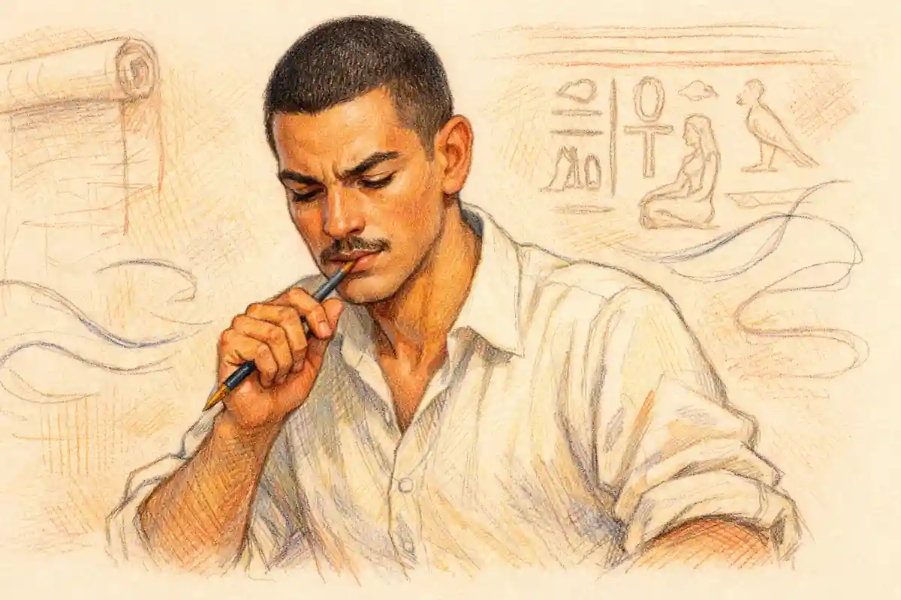

Rene Girard wrote the most ambitious account of desire in Shakespeare that the twentieth century produced, and he left Romeo and Juliet out of it. The omission was not oversight, contempt, or a gap in the theory. In the introduction to A Theatre of Envy, his 1991 study of the plays, Girard confessed that his essay on this play had grown too long for an already unwieldy book and that he had decided to omit it entirely, adding, in the same breath, the verdict the lost essay presumably defended: the romantic Romeo and Juliet is full of mimetic satire. A reading that exists as one adjective and one regret is an invitation and a warning. The invitation is to reconstruct what Girard's machinery makes of the feud and the love, since the machinery is fully published elsewhere and the play fits it with uncanny closeness. The warning is that the reconstruction must mark its own joins, because the theory's founder never signed this particular application of it.

The verdict of the pages that follow can be stated at once. Applied to the feud, Girard's theory is the strongest explanation the play has ever received for the one feature every other reading treats as an embarrassment: the hatred has no cause, no object, and no memory, yet it kills with mechanical reliability. Applied to the ending, the theory explains why peace arrives only over two corpses, and why the fathers' reconciliation takes the form of a bidding contest in gold. Applied to the love, the theory proves less than its admirers claim and more than its detractors allow. It demonstrates how the lovers' desire is ignited, aimed, and fanned by the feud that forbids it; it does not demonstrate that the desire is counterfeit, and the play's most famous fourteen lines, the sonnet the lovers improvise together at their first meeting, stand in the record as evidence the theory must absorb rather than explain away. Girard illuminates the play's social physics as no rival account does. He is weakest exactly where the play is most inward, in Juliet's solitary reasoning, and a reading that cannot hear her soliloquies has missed the tragedy's second engine.

## The Missing Chapter: Why Girard's Essay on the Play Is Absent

The bibliographical facts discipline everything else, so they come first. A Theatre of Envy: William Shakespeare, published by Oxford University Press in 1991, is the only book Girard wrote in English, a language he chose for the subject he had pursued since his first book three decades earlier. The French version, Shakespeare: les feux de l'envie, appeared in Bernard Vincent's translation and won the Prix Medicis for the essay. The volume proceeds play by play, roughly chronologically, lavishing six chapters on A Midsummer Night's Dream and five on Troilus and Cressida, returning to both for further thoughts, while the histories stand almost entirely aside. Reviewing the book in The New York Review of Books in July 1992, Robert M. Adams noted the imbalance in a sentence that has trailed the book ever since: relatively little attention is paid to Romeo and Juliet, Measure for Measure, and Macbeth. Adams meant it as a structural complaint. It was also, though he could not have weighed it fully, a precise description of a deliberate cut, since Girard's own introduction admits the Romeo and Juliet essay existed and was sacrificed to length.

The man behind the omission matters to the weight his fragments can bear. Girard, born in Avignon in 1923 and formed as a historian before he was a critic, spent his career in American universities, at Johns Hopkins, at the State University of New York at Buffalo, and from 1980 at Stanford, where he held the Andrew B. Hammond professorship, and he was elected to the Academie francaise in 2005, ten years before his death at Stanford in 2015. His introduction to the Shakespeare book opens with the confession that his work on Shakespeare is inextricably linked to everything he ever wrote, beginning with the novelists of the first book, and the claim is biographically plain: the theory of mimetic desire was discovered in literature before it was preached as anthropology, and Shakespeare stood behind the discovery from the start. A critic whose life work grew out of these plays, and who still cut this play for length while calling it a feast of mimetic satire, left a fragment that deserves more trust than a stray remark and less than a finished reading. It deserves exactly what this essay gives it: reconstruction, with the scaffolding left showing.

The consequence for any honest treatment of Girard on this play is severe and liberating at once. Severe, because no reader can quote Girard's Romeo and Juliet chapter, lean on its authority, or borrow its conclusions; there is no chapter. Every confident summary of what Girard said about the feud that circulates in study guides and lecture notes is, at best, an application of his published theory to the play, performed by other hands. Liberating, because the theory itself is not in doubt. Girard built his machinery in public, across Deceit, Desire, and the Novel in 1961, Violence and the Sacred in 1972, and Things Hidden Since the Foundation of the World in 1978, and he returned to Shakespeare throughout those books as a standing witness. He also left two fixed points for this play specifically. The first is the adjective: mimetic satire, his compressed judgment that the play's romantic surface is worked by an intelligence busy exposing desire's imitative machinery. The second is a passage in his theoretical writing of the 1970s where, needing an illustration of a community whose violence has not yet dissolved every social difference, he reaches for the opening of this play: the feud, he observes, has not transgressed all social ramparts, and the Prince can still restore order by his mere presence, because none of the brawlers can view the Prince as a peer. A critic who uses this play as his paradigm of a crisis contained is a critic whose reading of it can be rebuilt with confidence, so long as the rebuilding is labeled as such.

What follows, therefore, is a reconstruction under discipline. The theory is Girard's, stated in his terms. The applications to particular scenes are worked from the play's text in the Folger Shakespeare, edited by Barbara A. Mowat and Paul Werstine, and every claim is tested against the lines themselves. Where the reconstruction runs past anything Girard is known to have said, the argument is presented as the theory's consequence, not as the master's voice. That discipline matters because Girard's own practice invites the opposite laxity. Richard van Oort, the most exact student of Girard's Shakespeare, has shown how the preface to A Theatre of Envy positions its author: Shakespeare is hailed as an original thinker centuries ahead of his time, more modern than the accredited master thinkers, and the theory of mimetic desire is offered as all the authority the reading needs, with the accumulated critical tradition largely waved aside. A reconstruction that imitated that gesture would inherit the book's greatest weakness along with its insight. The disagreement this essay must adjudicate is therefore double: between Girard and the play's text, and between Girard's method and the evidentiary habits of the editors who keep that text.

## What Is Mimetic Desire? The Triangle at the Theory's Heart

Girard's starting point, laid down in Deceit, Desire, and the Novel (French 1961; English translation by Yvonne Freccero, 1965), is a refusal of the picture of desire that common sense and most love poetry share. Common sense draws desire as a straight line between a subject and an object: Romeo wants Juliet because Juliet is desirable, full stop, and the wanting is spontaneous, original, and self-explanatory. Girard calls this the romantic lie. His counter-claim, the novelistic truth he finds confessed by Cervantes, Stendhal, Flaubert, Proust, and Dostoevsky, is that human desire is triangular. Between subject and object stands a third term, the mediator or model, whose desire designates the object as worth wanting. People do not know what to desire; they learn desire from the desires of others, borrowing not only objects but the very energy and direction of wanting. The child reaching for the toy another child holds is the theory's emblem, but its adult forms are prestige, fashion, ambition, and erotic rivalry, wherever a model's wanting certifies an object's worth.

Two corollaries govern everything Girard later says about violence. The first is that the mediator, precisely because he certifies the object, becomes an obstacle and a rival the moment the object cannot be shared. The model says, in effect, take this, and simultaneously, because his own wanting occupies the same ground, hands off. Girard names the fused figure the model-obstacle, and Nidesh Lawtoo, tracing the theory's logic in the journal Contagion in 2018, states the sequence exactly: admiration turns to competition as the model becomes an obstacle on the path to a contested object, and the contest can escalate toward a fight over the object itself. The second corollary is that the desire aimed through a mediator is never finally about the object. Girard calls it metaphysical desire: what the subject covets, beneath the object, is the model's apparent fullness of being, the self-sufficiency the model seems to possess. Objects disappoint because they cannot deliver being; the wanting therefore transfers, intensifies, and fastens on obstacles, since an obstacle is the surest sign that being lies beyond it. Don Quixote, desiring through Amadis of Gaul, is the type case: his madness is a mediation so complete that a literature supplies his wants, and his grandeur and his folly are the same borrowed fire.

### What does the mediator give the subject that the object cannot?

The mediator gives desire its direction, its confidence, and its proof of worth. An object on its own is inert evidence; it cannot certify that wanting it is anything but error. The model's desire performs that certification, converting a possibility into a summons.

The certification arrives as a loan: borrowed certainty about what a life should reach for, advanced by the model's wanting and repayable in imitation. That loan, not the object, is what triangular desire is made of, which is why the desire survives the object's loss and simply refinances itself on the next designated prize.

The novelists supplied the evidence before the anthropology generalized it, and their testimony fixes what the triangle is for. Stendhal's heroes want through vanity, the terror of seeming to want what Paris does not; Proust's salons are Veronas of admission and exclusion, where an invitation's value is manufactured entirely by the rival kept outside it; Dostoevsky's underground men double themselves against imagined judges until the model lives inside the skull. Girard's claim for these writers is that they saw the mediator because the novel's form forced them to track desire across time, watching it borrow, transfer, and escalate, where the lyric and the love poem, his implicit contrast, freeze a single wanting into an emblem of spontaneity. The point matters for Shakespeare because the drama shares the novel's advantage. A play, like a novel, shows desire in sequence and in company, which is why a theory learned from Cervantes and Proust finds the stage so legible, and why this play, the most sequential and sociable of tragedies, is legible most of all.

Verona, in these terms, is a city built out of mediators. Its young men learn wanting from one another in public, under codes whose whole function is to designate what must be wanted: honour, precedence, the enemy's humiliation, the approved bride. Its old men transmit the designations as inheritance. The theory's question for the play is therefore not whether desire is mediated, since in Girard's anthropology desire always is, but which mediations the play exposes and which it hides. The lovers believe their wanting is the one spontaneous thing in a city of copies. The play, on Girard's reading, knows better, and the satire he detected is the sound of the machinery showing through the romance.

## External and Internal Mediation: Why Verona Is the Dangerous Case

Girard divides mediation by distance, and the division decides whether a borrowed desire stays devotion or turns to war. In external mediation, the model stands too far away, in station, in time, or in fiction, for rivalry to ignite. Don Quixote cannot duel Amadis, who lives in a book; the knight's imitation is therefore pure discipleship, absurd and harmless to its model. In internal mediation, the model occupies the subject's own world, close enough to reach the same objects, and discipleship curdles into rivalry as a law of proximity. The closer the model, the more exactly the desires coincide, and the more the model must be simultaneously adored as the source of wanting and hated as its obstruction. Girard's whole anthropology of violence is internal mediation generalized: a community whose members mediate one another's desires at close quarters is a community engineering its own crises, held in check only by the differences, ranks, prohibitions, and rituals that keep desires from converging on the same ground at the same moment.

Verona is internal mediation drawn as a map. Two households share one small city, one Prince, one marriage market, one code of honour, one church, and one stock of young men trained to want the same proofs of worth. The play compresses its action into a few days and a handful of spaces, the square, the orchard, the hall, the cell, the tomb, and the compression is the sociology: nobody in Verona can want anything at a safe distance from a rival who wants it too. Even the play's geography of desire is internal. Romeo sighs for a Capulet's niece and then falls for a Capulet's daughter; Juliet is courted by her father's candidate in her father's house; Tybalt and Mercutio circle the same square with the same code open before them. Girard's framework predicts, before a single line is examined, that such a world will generate rivalry out of sameness rather than difference, and that its peace will depend entirely on the differences that remain standing: the Prince's rank above the fray, the fathers' age, the law's threat. The play obliges by dismantling those differences one by one until, in the tomb, fathers, Prince, and lovers occupy a single undifferentiated grief, and the last distinction left standing is between the living and the dead.

## "Both Alike in Dignity": Girard's Feud of Mimetic Doubles

The Prologue states Girard's thesis before he was born to state it, in its first six words of substance: "Two households, both alike in dignity" (Prologue, 1). Not two households opposed in dignity, in wealth, in temper, or in claim, but alike, matched, twinned. The Chorus continues in the same grammar of mirroring: "From ancient grudge break to new mutiny, / Where civil blood makes civil hands unclean" (Prologue, 3-4), civil set against civil, the city's blood on the city's hands, each phrase turning back on itself. And the resolution is announced in the same doubled form: the lovers' "misadventured piteous overthrows / Doth with their death bury their parents' strife" (Prologue, 7-8). A critic hunting for the feud's cause in this prologue finds none, and the absence is famous; the play's first article in this series that maps the feud, [the feud's own anatomy of the two houses' hatred](/2022/04/01/capulet-montague-feud-explained/), rightly makes the missing cause the central puzzle. Girard's reading dissolves the puzzle by denying its premise. A hatred that needs no cause is not a defective hatred awaiting its explanation. It is hatred in its pure state, rivalry that has consumed its object and now feeds on itself, each house wanting what the other wants, precedence, vindication, the last word, because the other wants it.

This is the condition Girard calls the war of doubles. In a mature mimetic rivalry, the antagonists progressively erase the differences between them: they adopt the same weapons, the same insults, the same strategies, until each is the other's mirror and the original stake is forgotten by both. Verona's houses are doubles from the first line. They are alike in dignity, alike in age, alike in their retinues' liveries and their young men's tempers, alike even in their patriarchs' physiques and fits of rage. Old Capulet, restrained by his wife from joining the first brawl, is handed a crutch joke instead of a sword; old Montague is restrained in the same posture by his wife in the same minute. The symmetry is choreographed. When Capulet later explains his restraint toward the young Montague in his hall, his reasoning is the peace of a double who knows the penalty binds both equally: "But Montague is bound as well as I, / In penalty alike; and 'tis not hard, I think, / For men so old as we to keep the peace" (1.2). Alike binds alike. The fathers can keep the peace precisely because their positions are identical; the sons cannot, because their positions are identical too, and identity at close quarters is the theory's formula for war.

The doubling runs through the household interiors as faithfully as through the square. The two wives perform the same office in the same minute of the first scene, one crying "A crutch, a crutch! Why call you for a sword?" (1.1) at a husband too old for the part he is aping, the other holding her husband back with the flat prohibition that he shall not stir one foot to seek a foe (1.1). The women are not the feud's partisans; they are its stage managers of restraint, and even their restraint is symmetrical, as if the script allotted each house the same wife with the lines adjusted. Two generations later in the action the pattern repeats at the level of command, when Lady Capulet, demanding Romeo's death for Tybalt's, plans her own contribution by poison sent to Mantua, a mother's grief converted into the feud's logistics within a single speech (3.5). The household that cannot produce a difference in its masters produces none in its mistresses either. Girard's doubles are not a metaphor imposed on the play's design; they are its casting sheet.

### Where does Girard find the feud's cause in the text?

He finds it nowhere, and the nowhere is his evidence. A rivalry in Girard's sense does not require a founding injury, because its fuel is each rival's desire answering the other's; an origin, if one existed, would have been consumed long before the play opens.

The text's refusal to name a cause, so often apologized for as a gap in the plotting, becomes on this reading the most exact stroke in it: the feud is shown as a machine that runs on reciprocity alone, and any cause an audience invents is a measure of how badly audiences want hatred to be about something.

The Prince's first entrance tests the machine against the city's last standing difference. His fury is aimed at the levelling itself: "Rebellious subjects, enemies to peace, / Profaners of this neighbour-stained steel" (1.1), the steel stained by neighbours, by men who should be differentiated by every bond of city and instead are undifferentiated by hatred. His diagnosis, "Three civil brawls, bred of an airy word, / By thee, old Capulet, and Montague" (1.1), is Girard's anthropology in a single phrase: bred of an airy word, violence engendered by nothing, by a breath, by reciprocal gesture without substance. And his remedy is a difference enforced from above, the death penalty held over both houses impartially, the law as an artificial distinction maintained by terror. Girard's 1970s illustration seizes on exactly this configuration. Verona's crisis, he observes, is not yet total; the ramparts of rank still stand; the Prince restores order by presence because no brawler can mistake him for a peer. The play then conducts the experiment Girard's theory predicts: remove the Prince's immunity, embroil his own kin in the feud, Mercutio and Paris are both the Prince's relatives, and watch the difference collapse. By the final scene the Prince stands in the tomb inside the catastrophe he policed, pronouncing the theory's bleakest sentence over himself: "And I, for winking at your discords too, / Have lost a brace of kinsmen. All are punished" (5.3). The arbiter has been absorbed into the reciprocity he judged. There is no outside left. That is the crisis of distinctions complete, and no criticism that treats the feud as background colour has ever explained why the play insists on it.

## "Do You Bite Your Thumb at Us, Sir?": Violence Learned by Imitation

The play's first scene is a laboratory demonstration of Girard's mechanism, staged before any principal appears. Two Capulet servingmen enter rehearsing their hatred like a part learned by rote, which is what it is: Sampson's boasts escalate by formula, from quarrelling to cutting off heads, each bravado topping the last because the rhetoric of honour is itself imitative, a ladder of copied gestures. When Abram and the Montague servants enter, the crisis condenses into the most famous empty sign in Shakespeare. Sampson bites his thumb, a gesture of contempt with no propositional content at all, and the exchange that follows deserves its fame as the purest dialogue of reciprocity ever written: "Do you bite your thumb at us, sir?" "I do bite my thumb, sir." "Do you bite your thumb at us, sir?" (1.1). The words are mirror images; the question and its repetition differ only in who must answer for them. Nobody in the square can say what the quarrel is about, because it is about the answering itself. Each man's dignity requires that the gesture not pass unreturned, and the return requires a counter-return, and within forty lines the servants' pantomime has drawn in Benvolio, Tybalt, the citizens with clubs, the two old fathers calling for swords, and the Prince with the apparatus of the state. The escalation ladder is the theory drawn to scale: violence propagates by imitation through every rank, and it propagates fastest where the participants are most alike, servants aping masters, masters no better than servants.

Notice what the scene does not contain: an injury. The thumb is bitten at no one, by Sampson's own evasive testimony; the first actual wrong in the play is the answering of a gesture with a challenge and a challenge with drawn steel. Girard's term for this is the priority of reciprocity over cause, and it governs the whole tragedy in miniature. Tybalt's sword answers the servants' clubs; Mercutio's death answers Tybalt; Romeo's sword answers Mercutio's death; the tomb answers everything. The play's causality, the chain that older criticism assigned to fate or to haste, is on Girard's showing a chain of imitations, each act of violence a copy of the last with the polarity reversed. Even the citizens enter crying "Down with the Capulets! Down with the Montagues!" (1.1), the crowd's chant already doubled and symmetrical, the city rehearsing the unanimity it will achieve only once, at the end, over the bodies. A production that plays the first scene as comic byplay mistakes its function; it is the tragedy's engine room, and Girard's reading is the first to say precisely why the engine works.

## The Model-Obstacle: How the Feud Manufactures the Lovers' Desire

The harder half of Girard's reading concerns not hatred but love, and it begins with a structural observation about Romeo's wanting that the text states openly. Both objects of Romeo's desire belong to the enemy house. Rosaline, the unattainable lady of the first act, is Capulet's niece; her name stands in the guest list Romeo reads aloud from the Capulet servant's paper, in the same breath as the invitation that will bring him to the feast. Juliet is Capulet's daughter. In a city with two great houses, the young Montague's desire selects, twice running, the forbidden address. Girard's theory names the selector: the obstacle itself. In internal mediation, the model-obstacle does not merely block a pre-existing desire; it designates the object's value by blocking it. Prohibition is the loudest form of advertisement a culture possesses. The feud stands between Romeo and the Capulet women as a permanent, public, armed announcement that what lies on the other side of the line is the thing most worth wanting, the one prize whose taking would be a victory in the city's real game. Romeo does not desire despite the feud and then suffer from the coincidence. On Girard's showing, he desires through the feud, and the play's own heroine states the mechanism in the tragedy's most compressed line, her cry on learning her dancer's name: "My only love sprung from my only hate!" (1.5). Love sprung from hate, generated by it, rooted in it: Juliet diagnoses in eight words the thesis Girard built a career on, and the diagnosis is placed in the mouth of the person with most reason to believe her love spontaneous.

### Whose desire points Romeo toward the Capulet feast?

The chain of designation is visible link by link, and none of the links is Juliet. The Capulet servant's list puts Rosaline's name in Romeo's hands; Benvolio's promised comparison of faces gives the errand its erotic programme; the feud gives the errand its danger and therefore its glamour.

Mercutio's mockery completes the equipment, giving Romeo a mask and a party to infiltrate. Romeo enters the hall wanting Rosaline, armed with his friends' script and his enemy's guest list. Juliet is what the machinery of other people's desires delivers him to, which is the theory's whole claim about the scene in one sentence.

The feast scene completes the circuit. Romeo sees Juliet across a room organized by the feud's ceremonial opposite, a dance in the enemy's hall, and his desire ignites at the moment of maximum obstruction, with Tybalt's recognition and rage supplying the scene's second charge: "Is she a Capulet? / O dear account! My life is my foe's debt" (1.5). The metaphor is financial and exact. Her value registers in the currency of the feud, as a debt owed to the foe; the desire knows itself, instantly, as a transaction across the line. Tybalt, meanwhile, performs the feud's counter-desire, wanting Romeo's humiliation because the house's honour designates it, and Capulet's restraint of Tybalt converts the boy's obedience into stored violence: "I will withdraw, but this intrusion shall, / Now seeming sweet, convert to bitt'rest gall" (1.5). Every wanting in the scene is mediated: Romeo's by the prohibition, Tybalt's by the code, Capulet's by the obligations of hospitality and the penalty that binds him. Girard's satire is the recognition that the romance and the feud are not two plots in collision. They are one economy of desire photographed from two sides, and the study of the play's [twin engines of love and hate](/2023/12/29/love-and-hate-romeo-and-juliet/) converges with Girard at exactly this point, though it reaches the unity by the oxymorons rather than by the anthropology.

What keeps this from being a critic's trick is the name speech. Juliet in the orchard argues herself out of the feud's categories with a philosopher's rigour: "What's Montague? It is nor hand, nor foot, / Nor arm, nor face, nor any other part / Belonging to a man" (2.2), and "What's in a name? That which we call a rose / By any other word would smell as sweet" (2.2). The balcony's great question, examined in its own right in the study of ['What's in a Name?' and the balcony's big question](/2023/08/04/whats-in-a-name-romeo-and-juliet/), is the play's attempt to imagine a desire unmediated by the signs a community assigns. Girard's reading hears the speech differently from the romantics who quote it as the lovers' charter. For him, the speech is the measure of the tragedy's impossibility: Juliet can dissolve the name in argument and cannot dissolve it in Verona, because the name is not a label but the whole system of mediation, the fathers, the code, the square, the marriage market, and it reasserts itself within hours through her father's candidate and her cousin's sword. The rose argument wins in the orchard and loses in the city. That doubleness, a truth spoken in a garden at night that the day annuls, is the exact shape of what Girard calls the romantic lie's exposure: the lovers' belief that their desire is theirs alone is the one belief Verona cannot afford to let survive.

## From Rosaline to Juliet in One Evening: The Transfer and the Friar's Objection

The play contains its own Girardian critic, and he speaks in the second act. Friar Laurence, told that Rosaline is forgotten and Juliet installed within a day, delivers the objection every reader since has repeated: "Is Rosaline, that thou didst love so dear, / So soon forsaken?" and then the maxim, that young men's love lies not in their hearts but in their eyes (2.3). The Friar intends a moral commonplace about inconstancy. Girard's theory hears a diagnosis. A desire whose object can be exchanged overnight, without residue, without even a scene of renunciation, was never fastened to the object's unique being; it was fastened to the wanting itself, to the posture of the desiring lover, and the posture survives the swap intact. Romeo's Petrarchan apparatus transfers without alteration: the oxymorons, the sighs, the worshipful distance, the sonnet forms lie ready in his mouth before Juliet speaks, because they were learned, as all Verona's young men learn them, from the common stock. Mercutio's teasing inventory of the tradition, Laura and Dido and Cleopatra and Helen and Hero reduced to kitchen wenches beside Rosaline (2.4), is the sound of a friend quoting the script back at its performer. Desire that arrives pre-scripted by a literary tradition and a peer group's expectations is mediated desire wearing its credentials openly, and the play knows it, which is why the charge of inconstancy is placed in the mouth of the play's wisest man rather than left to its enemies.

Benvolio's cure for the Rosaline phase deserves the same attention, because it is a mimetic technology prescribed onstage. His advice is not abstinence, travel, or time; it is substitution by comparison: "Compare her face with some that I shall show, / And I will make thee think thy swan a crow" (1.2). The wanting is to be redirected by exposing it to rival objects in a managed setting, the feast, exactly as a mediator redirects desire by designation. Benvolio understands his friend as Girard understands everyone: Romeo's desire is not a fixed appetite but a current that can be switched by whoever arranges the models. The cure works catastrophically well. The comparison is performed, the swan becomes a crow, and the same machinery that was meant to free Romeo from one Capulet delivers him to another, at higher voltage, because the obstacle has grown from a lady's disdain to a city's armed prohibition. Girard's reading finds in this sequence the whole difference between the comedy the play begins as and the tragedy it becomes. Mimetic substitution among near objects is the stuff of festive comedy, of lovers exchanged and re-sorted to general satisfaction. What converts it to tragedy is the identity of the mediating structure in both registers: the feud mediates the new desire as the peer group mediated the old, and the feud does not attend feasts to be charmed.

Honesty requires the counterweight to be entered here, at the point of the theory's maximum strength. The Friar's maxim cuts both ways. If Romeo's love lay in his eyes, the play then spends four acts showing a love that survives the eyes' evidence, Juliet's supposed corpse, and chooses death over a world rearranged. A transferable desire explains the ignition of the second love; it strains to explain its tenacity, its willingness to pay the final price when every mediator has withdrawn and the obstacle has become absolute. Girardians answer that metaphysical desire intensifies exactly as the obstacle becomes total, death being the last designation of value. The answer is available inside the theory, and the verdict section of this essay will weigh whether it is an explanation or an evasion. For the feud, no such strain exists. For the love, the strain is real, and it is the price of the theory's ambition.

## A School of Desire: Mercutio, Benvolio, and the Peer Group as Mediators

Between the fathers' inherited hatred and the lovers' ignited passion stands the mediating institution Girard's theory would predict to be the most powerful of all, because it works at the closest range: the peer group. Romeo's young men are a school of desire with a curriculum. They teach one another what a gentleman wants, precedence in the square, a lady to sigh over, a wit that answers every wit at higher speed, and they examine one another constantly, in public, on the material. Mercutio is the school's brilliant master and its most instructive casualty, because his own desires are the most visibly borrowed in the play. His Queen Mab set piece (1.4) is a performance for an audience of friends, its invention fuelled by their attention and Romeo's interruptions, a dream of other people's appetites, courtiers, lawyers, ladies, soldiers, each wanting exactly what his station's models designate. The speech is usually praised as the play's freest flight of fancy. Girard's framework hears it as the opposite of freedom: a virtuoso recital of mediated wanting, delivered by the character who believes himself least governed by scripts, minutes before he mocks Romeo for living inside one.

Benvolio, the school's prefect, performs the group's managerial function. His name promises good will, and his practice is the continuous adjustment of other people's desires: he parts the servants' fight, proposes the comparison cure for Rosaline, reports the square scene to the Prince with a lawyer's care for the sequence of imitation, who drew first, who answered, who interposed. His narration in 3.1 is the play's own mimetic case history, a chain of gestures and counter-gestures reconstructed for judgment, and its failure to save Romeo from banishment measures the limit of management inside a system whose members mediate faster than any manager can mediate. Even Benvolio's disappearance from the play after that narration carries the theory's signature. The peer group's offices are exhausted once the crisis passes from rivalry to sacrifice; there is nothing left for a manager of desires to manage, and the play dismisses him without a farewell, the school dissolved into the crowd around the tomb.

The peer group also supplies the tragedy's control experiment, the road of mediation not taken to its end. Mercutio dies because he executes the group's script in a quarrel that was not his, in defence of a friend who had declined it, against an opponent whose fixation he treats as a personal challenge. Every element is borrowed: the enemy, the occasion, the code, the audience. Girard's reading finds in this the purest demonstration in the play that mediation kills without any assistance from passion, since Mercutio feels no hatred for Tybalt proportionate to his death and no love for Romeo that required it. He dies of imitation in something like its laboratory form, and his curse on both houses is the laboratory's report: the plague is not in either house but in the traffic between them, the copied gestures and answered insults of which his own corpse is the last entry. A criticism that treats Mercutio as comic relief expendable at the midpoint has not asked why the play kills its wittiest man for somebody else's quarrel. Girard's is the reading that makes the question unavoidable and the answer structural.

## Paris the Appointed Mediator, and Tybalt the Feud's Pure Disciple

Juliet's side of the economy has its own mediator, and he is not a person she chose but a person her father's desire appointed. Count Paris enters the play as Capulet's candidate, endorsed by the house's head, praised by the Nurse, approved by Lady Capulet with a book metaphor that gives the mediation away: Juliet is to read Paris as a volume, study his face, find delight writ there by beauty's pen (1.3). The imagery is a curriculum. Juliet is being taught what to want by the authorities who mediate her world, and her answer is the most obedient sentence in the play and the most quietly subversive: "I'll look to like, if looking liking move" (1.3). She accepts the mediation as a duty while reserving the event. Then the feast supplies the counter-mediation, and the father's candidate becomes the obstacle whose pressure drives the secret marriage, the potion, and the tomb. In Girard's geometry, Paris is the model-obstacle installed by the father's desire: the more Capulet's wanting certifies Paris, the more the certification obstructs, until the appointed mediator's suit becomes the mechanism that delivers Juliet to the one outcome it existed to prevent. Capulet's rage in 3.5, when the mediated daughter refuses the mediation, is the fury of a model whose designation has been declined, and it speaks the feud's own language to his child because the household's desire economy has only one language for refusal.

Tybalt is the complementary figure, the feud's pure disciple, in whom mediation has consumed every other wanting. He desires nothing in the play except the feud's desire: the Montague's punishment. His entrance line is a creed, "What, drawn, and talk of peace? I hate the word, / As I hate hell, all Montagues, and thee" (1.1), and his conduct at the feast, in the square, and at his death is the creed's application. Girard's framework explains Tybalt's otherwise puzzling thinness as a character. He is not underwritten; he is exactly written, a man whose desires are entirely borrowed from the house's tradition, the mediator's perfect product. When the tradition's keeper restrains him at the feast, his stored obedience becomes the gall that ripens into the square scene. He seeks Romeo there not for anything Romeo has done to him but because the script designates the Montague heir as the account to settle. That he kills the Prince's kinsman and is killed by the bridegroom in the space of one scene is the feud's economy settling its books through its most faithful instruments. A criticism that asks what Tybalt wants, psychologically, asks the wrong question; the play's answer is that Tybalt wants what Verona wants through him, and Girard is the critic who built the vocabulary to say so.

## The Friar's Marriage Plot: An Engineering of Desire That Imitation Defeats

Friar Laurence is the play's one deliberate theorist of mediation, and his failure is the theory's most elegant corroboration. His consent to the secret marriage is given for an explicitly Girardian reason, stated as policy: "For this alliance may so happy prove, / To turn your households' rancour to pure love" (2.3). He proposes to redirect the city's desire economy by inserting a counter-mediation, a marriage whose wanting runs across the line, so that the houses, forced to imitate a love contracted between their heirs, will unlearn the hatred they have been imitating for a generation. The design is intelligent, and its intelligence is the problem. The Friar treats mediation as an instrument that a wise man can aim, forgetting that in Girard's world the instrument aims its user. His own conduct is absorbed by the machinery he hoped to steer: the haste he preaches against, "Wisely and slow. They stumble that run fast" (2.3), becomes his practice within a day, in the cell scene's improvised potion plot, a script borrowed from the desperate dramaturgy of the feud itself, complete with feigned death, secret messages, and a tomb for a stage.

The potion plan deserves a Girardian reading of its own, because it is a mimetic artefact: a counterfeit death designed to imitate the real catastrophe so exactly that the imitation will purchase safety. Juliet is to perform the feud's desired outcome, a Capulet daughter dead rather than married to a Montague, in the hope that the performance will exhaust the demand. The plan fails by the law the whole play obeys, that imitations in Verona do not stay performances. The feigned death summons the real one as reliably as the bitten thumb summoned the sword, and the Friar's final appearance, in the tomb among the consequences, is his confession of the engineer's error: he arrives with a crowbar's worth of remedies and a narrative, offering his life to the Prince's judgment, a mediator volunteering at the last to become the victim and discovering that the office has already been filled by younger candidates. Girard's framework gives the Friar his precise place in the design. He is the man who understood the disease as a system before anyone, and proved by his failure that understanding is not an exit. The system's other name for such a man is a rival mediator, and the feud had room for him exactly where it has room for the Prince, inside the catastrophe, pronouncing sentence on himself.

The marriage plot also clarifies, by contrast, what the lovers themselves contribute. The Friar mediates deliberately, with doctrine and apparatus, and fails. The lovers mediate accidentally, by loving across the line, and their accident accomplishes in death the conversion he designed for their wedding. The play's irony is Girardian to the bone: the counter-mediation works, but only once it has passed through the sacrificial mechanism its engineer hoped to bypass, because a community does not imitate its way out of imitation on the strength of a good example. It requires the example to become a victim first. No reading of the Friar as a mere meddler, and none of him as a wise counsellor defeated by luck, accounts for the symmetry between his intention and the outcome's inversion of it. Girard's does, at the cost of making the holiest man in Verona another proof of the machine.

## Double Mediation in the Square: How Romeo Becomes Tybalt's Double

The duel scene is the theory's set piece, the place where the reconstruction can be checked line by line against the published machinery of double mediation. Girard's term names the condition in which two subjects mediate each other's desires so completely that each becomes the other's model and obstacle in a single figure, and imitation accelerates because every move is simultaneously an initiative and a reply. Romeo enters the square as the one man in Verona attempting to exit the system. Married in secret, he holds a reason for loving Tybalt that no one present can read: "I do protest I never injured thee, / But love thee better than thou canst devise" (3.1). The system's response to his exit is the scene's engine. Mercutio reads the refusal through the only code available, as submission and dishonour, "O calm, dishonourable, vile submission!" (3.1), and takes the quarrel up by substitution, fighting not from any grievance of his own but in imitation of the honour script his friend has declined. The substitution is the point a purely psychological reading misses. Mercutio does not misunderstand Romeo's motives and then act on his own; he cannot permit the code to lapse unexecuted in public, because the code's desires are his desires, and he dies executing a borrowed quarrel with a borrowed enemy, cursing the structure that conscripted him: "A plague o' both your houses!" (3.1). The curse is the play's clearest act of theoretical insight, spoken by its wittiest casualty: both houses, one plague, a single undifferentiated sickness with two addresses.

### At what line does Romeo stop resisting the feud's script?

The surrender is marked in his own words at the moment lenity is dismissed: "Away to heaven, respective lenity, / And fire-eyed fury be my conduct now!" (3.1). Until that sentence Romeo is the one character declining to copy the violence offered him.

From that sentence he is Tybalt's mirror, answering a killing with a killing inside the same minute, in the same square, before the same witnesses, and his own verdict follows instantly: "O, I am fortune's fool!" (3.1). The fortune he names is the reciprocity he has just rejoined.

The exchange of deaths completes the doubling. Tybalt kills Mercutio under Romeo's restraining arm, Romeo kills Tybalt and flees, and the two young men who began the scene as designated opposites end it as equivalents in the Prince's judgment and the citizens' outcry. Nothing in the scene requires a theory to be moving, but the theory accounts for its most peculiar feature, the speed and symmetry of the conversion, better than the language of temper or fate. Romeo does not decide to become violent; he is reabsorbed, the moment his exit leaves a vacancy the code must fill. Girard's word for the reabsorption is contagion, and the play literalizes the metaphor in its next movement, when an actual pestilence, the plague that quarantines Friar John and seals the doors against his letter (5.2), becomes the mechanism that keeps the peace plan from reaching Mantua. Contagion blocks the cure for contagion. The letter dies of the disease the city has been dying of all along, an equivalence the text insists on by making the searchers' suspicion of infection, not any human malice, the tragedy's final efficient cause before the tomb.

## Too Rash, Too Sudden: Haste as the Tempo of Imitation

The play's most remarked property after its poetry is its speed, five days from brawl to tomb, and criticism has usually filed the speed under haste, as a moral flaw in the young. Girard's framework reclassifies it as a structural effect. Reciprocity is a tempo before it is a plot. In a mimetic escalation, each party must answer the other before the answer loses its force; a retaliation delayed is a retaliation discounted, since the model's gesture fades and the subject's prestige bleeds while he waits. Verona's clock is therefore set by imitation itself. The brawl answers the gesture in seconds; Tybalt stores the feast's insult for the first public hour; Romeo answers Mercutio's death inside the minute; Capulet, refused by Juliet, advances the wedding by a day, from Thursday to Wednesday, as if the marriage market's desire could be forced by compression; the Friar's potion buys forty-two hours and spends them all; Romeo outruns the letter, the law, and the dawn. Every agent in the play is hurrying to answer somebody, and the answers arrive progressively less considered as the tempo rises, until the final answers are suicides performed on partial information at the speed of reflex.

The play knows its own tempo and says so in its two wisest voices, which is the kind of internal corroboration a reconstruction should prize. Juliet, at the very moment of the love's founding, interrupts the vows to name the acceleration: "It is too rash, too unadvised, too sudden; / Too like the lightning, which doth cease to be / Ere one can say 'It lightens'" (2.2). The Friar, solemnizing the marriage the next morning, pronounces the physics of the whole action in advance: "These violent delights have violent ends / And in their triumph die, like fire and powder, / Which, as they kiss, consume" (2.6). Fire and powder are reciprocity's elements, each meaningless until the other's contact, each destroyed by the meeting it exists for. Even the Prologue builds the tempo into the contract with the audience, promising the two hours' traffic of the stage, a tragedy that will consume its world at performance speed. Girard's late work on escalation, the mounting to extremes he traced through Clausewitz, supplies the general law of which Verona is the lyric instance: reciprocal action abolishes deliberation, because deliberation is the one move the opponent's tempo forbids. Read so, the famous charge that the lovers are destroyed by haste dissolves into the mechanism. Haste is not their character flaw, though the play lets moralists call it one. Haste is what imitation feels like from inside, and the lovers, the feuders, the fathers, and the Friar all feel it identically, which is the surest sign the play offers that a single engine drives them.

Capulet's reversal on the marriage is the tempo's clearest documentary trace, because it can be dated against his own earlier doctrine. In the first act, receiving Paris's suit, the same father counsels delay in the language of husbandry: his child is a stranger in the world, and two more summers should wither in their pride before she is thought ripe to be a bride (1.2). The patience is genuine and it is policy, the tempo of a man whose house is at peace with its timetable. After Tybalt's death the timetable inverts. The wedding is set for Thursday, then pulled forward to Wednesday on the news that Juliet has repented, the father exulting that the haste will outrun her grief, and the household is turned upside down through the night to meet a deadline manufactured entirely by the crisis. Nothing in Capulet's character has changed; his information has not changed; what has changed is the tempo of the world around him, and his desires, for the match, for order, for the appearance of command, accelerate to match it. He is imitating the crisis's speed the way his servants imitated its gestures, at the rank the play assigns him, and Girard's escalation law, each answer delivered faster and worse than the provocation required, is written across the wedding preparations as plainly as across the brawls.

## The Crisis of Distinctions: From the Square to the Tomb

Violence and the Sacred (French 1972; English translation by Patrick Gregory, 1977) supplies the reconstruction's second engine: the sacrificial crisis. Girard argues there that a community's order rests on distinctions, between kin and stranger, sacred and profane, lawful vengeance and murder, and that mimetic violence is dangerous precisely because it dissolves them. Rivals become doubles; vengeance mimics the crime it punishes; the difference between the feud's parties, which the whole system of rank exists to maintain, thins toward the war of all against all. The play's last three acts chart the dissolution with a clinician's patience. The fathers, differentiated in the first act only by name, become interchangeable in grief and rage: Capulet bullying his daughter in the vocabulary of the street, Montague wasting offstage of the same sorrow, until the Prince can address them in a single breath as one offender, "Capulet! Montague!" (5.3). The watch, the Friar, the Nurse, Balthasar, and the apothecary are drawn into the same machinery of hurried, secret, nocturnal action, every agent copying the haste and concealment of every other. Romeo, banished for a killing, returns to kill Paris at the tomb in a duel that replays the square with the roles rotated, and the lover enters the vault as bridegroom, murderer, and suicide in one body, his identities collapsed into a single undifferentiated figure.

The dissolution can be watched in miniature an act earlier, in the lamentations over Juliet's supposed corpse (4.5), where grief itself becomes a mimetic competition. Capulet, Lady Capulet, Paris, and the Nurse take up the lament in turns, each mourner's rhetoric answering and outbidding the last, death tied up in the daughter, the flower deflowered, the day cursed, in a rising auction of sorrow that the scene's own participants seem half aware is a performance, since the Friar must interrupt it with doctrine to stop the escalation. Even bereavement, in Verona, is something its citizens catch from one another and practise at higher volume than their neighbours. The musicians who follow, trading jokes while the household weeps upstairs, are not a lapse of taste but the crisis's signature in the comic register: the difference between mourning and entertainment has thinned to nothing, and the play lets the audience feel the thinness as a chill.

The tomb is the crisis drawn as architecture. Every party in the play converges on one narrow space at one hour: Paris strewing flowers, Romeo with crowbar and poison, the Friar with his mattock, the watch, the Prince, both fathers, both mothers, one of them dying of the convergence itself, since Lady Montague's death of grief is reported in the tomb scene like a final tally entry. Distinctions of house, rank, generation, and intention are all present and all inoperative; the space treats a wedding's witnesses and a murder's witnesses as the same crowd. Girard's framework names what the audience feels in that scene, the horror of a world in which the differences that made action intelligible have been spent. His further claim is that archaic communities escaped this condition by one device only, the unanimous turning of all against a single victim, whose death, being everyone's act and no one's, could found a new distinction between the guilty dead and the reconciled living. The play's ending tests that claim against a case its author did not choose, and the test is the subject of the next section.

## "Poor Sacrifices of Our Enmity": The Deaths That End the Feud

The Prologue has already told the audience what the ending must accomplish and at what price: the lovers' deaths bury their parents' strife. No other mechanism in the play is even proposed. The Prince's edict fails; the Friar's marriage stratagem, designed expressly to convert rancour to love, detonates in the square; the law's executions and banishments multiply the grief they punish. Only the double death works, and the play insists on the transaction's exactness by having Capulet name it in the tragedy's plainest line of dialogue: the statues are promised for "Poor sacrifices of our enmity!" (5.3). Sacrifices, plural, and of our enmity, the enmity itself acknowledged as the offering's recipient and cause. Girard's theory of the scapegoat, set out in Violence and the Sacred and deepened in The Scapegoat (French 1982; English translation by Yvonne Freccero, 1986), describes the conditions under which a death can do this work. The victim must gather the community's dispersed violence onto a single point; the community must be unanimous, or nearly so, in its relation to the victim; and the mechanism must be misrecognized, its beneficiaries experiencing the peace as justice, providence, or fate rather than as the effect of a killing. A scapegoat known to be a scapegoat reconciles nobody.

Verona satisfies the conditions with two variations that a careful reconstruction must state rather than smooth over. The first variation is that the victims are doubled and self-appointed. Nobody stones the lovers; the community's violence reaches them through the ordinary operations of the feud, the forced marriage, the banishment, the stopped letter, until they administer the final acts themselves. Girard's machinery accommodates the variation more readily than a first glance suggests, since the mechanism's essence is not the mob's hands but the convergence of all the community's contradictions on victims whose death everyone can mourn and no faction need avenge. A Montague and a Capulet, dead by their own hands for love of each other, are the perfect sacrificial pair for a feud of doubles: each house loses identically, each gains identically, and the symmetry that fuelled the war is preserved in the peace, which is why the peace holds. The second variation concerns misrecognition, and here the play is subtler than the theory's archaic model. The fathers half-recognize the mechanism even as they complete it: sacrifices of our enmity is not the language of men who believe their children guilty. They know the enmity did it. What they do not see, and what the statue bargain immediately performs, is that the reconciliation is itself a continuation of the rivalry by other means.

### How do the fathers' statues continue the rivalry by other means?

The bargain is struck as an exchange of escalating gifts, in the syntax of the bidding the feud always used. Capulet offers his hand; Montague answers, "But I can give thee more," and vows a statue in pure gold; Capulet caps it: "As rich shall Romeo's by his lady's lie" (5.3).

Each father outbids the other in munificence exactly as their servants outbid each other in insult, and the competition's object has changed from precedence to grief while its structure stands untouched. The golden statues are therefore the feud's last mimetic transaction, rivalry sublimated into generosity, and the peace is real in proportion as the sublimation holds.

The tally of the dead confirms the victims' selection by the theory's logic of the marginal. Girard observes in Violence and the Sacred that the sacrificeable are characteristically those without a firm place in the community's order, beings whose loss no network of vengeance is obliged to answer. Verona's six corpses fit the profile with terrible consistency: Mercutio and Paris, the Prince's kin but neither house's heir; Tybalt, the heir by blood of one house's honour and therefore its expendable sword; Lady Montague, dead of a grief no one stages; and the lovers themselves, children in a city that assigns children no civic existence, unmarried in the world's eye, their union unwitnessed by any institution that could have defended it. The heirs were, structurally, the most sacrificable people in Verona, positioned at the exact joint where the two houses touched and where a blow could be struck that both sides would feel identically and neither could avenge. The mechanism did not choose them by chance. It chose them the way it always chooses, at the margin where the community's violence can converge without restarting itself, and the play's horror is that the margin ran through the nursery.

The Prince's closing distribution of blame completes the mechanism's signature. "See what a scourge is laid upon your hate, / That heaven finds means to kill your joys with love" (5.3) assigns the catastrophe to the hate itself, to heaven, to love, to the scourge, to everyone and no one, and the judicial sentence that should differentiate the guilty dissolves into the famous generality, "Some shall be pardoned, and some punished," followed by the confession, "All are punished" (5.3). Girard's reading hears in that generality the founding misrecognition at work: a community that cannot apportion blame because the blame is the community's own reciprocity must convert its victims into monuments and its catastrophe into a story, "For never was a story of more woe / Than this of Juliet and her Romeo" (5.3). The golden statues are the myth in metal, the victims sacralized at the exact moment their function is forgotten, worshipped as love's martyrs by the city whose enmity consumed them. The peace is genuine, and it is glooming, and the theory explains both adjectives at once: genuine because unanimous mourning does discharge the accumulated violence, glooming because a peace founded on unexamined victims leaves the machine that made them intact, oiled, and ready.

## Does Mimetic Desire Mean the Lovers Feel Nothing? The Objection at Full Strength

The brief against Girard deserves its strongest form, because the verdict that follows is worth only what the objection can throw at it. The objection has three heads. The first is Robert M. Adams's, delivered in his 1992 review and never answered on its own ground: the book hammers one point through play after play, its references to previous interpreters are few, unspecific, and almost always contemptuous, its documentation is meagre, and many of its startling claims, translated into plain English, sound like familiar observations in ceremonial dress. Strip the vocabulary, Adams implies, and the triangle says that people are influenced by rivals, which no one doubted. The second head is the editors'. The modern editions, Jill L. Levenson's Oxford Shakespeare among them, proceed by a discipline Girard disdains: evidence from collation, from the sources in Arthur Brooke and William Painter, from the documents of the early stage, and from the play's language read at the level of the line. Levenson's own work on the play's codes of violence treats its aggression as a legible social ritual with rules, ranks, and meanings, a system to be reconstructed historically rather than a contagion to be diagnosed universally. From that side of the table, a reading that arrives with its conclusion prefabricated in 1961 and finds it again in 1595 has confused a key with a lockpick, and the text's resistances, the places where the play declines to be an illustration, are the data it cannot afford to notice. The third head is the lovers themselves, or rather the language the play gives them, which generations of readers have taken as the standing refutation of any theory of borrowed feeling.

### What does Girard's reading leave out of Juliet's part?

It leaves out the one consciousness in the play that no mediator supplies. Juliet's great scenes are solitary acts of reasoning: the orchard argument that dissolves the name, the potion soliloquy that inventories her terrors and proceeds anyway. No model designates these thoughts, and no rival's desire certifies them.

They are generated in camera, step by step, by a mind the play presents as its most original instrument, weighing the Friar's counsel, her mother's betrayal, and her own resolve in sequence. A theory of imitation can describe the world Juliet reasons against. It has very little to say about the reasoning, and the reasoning is the tragedy's second engine.

The sonnet at the feast is the objection's Exhibit A, and it must be described accurately to be weighed. Romeo and Juliet's first exchange is a complete sonnet, fourteen lines, built line by line between two speakers who have never met, on an image, the pilgrim at the shrine, that Romeo proposes and Juliet corrects, extends, and finally turns against him with a wit that leaves him asking for the kiss the form has been constructing (1.5). Whatever else is true of this scene, its central event is joint invention under maximum pressure: a form neither party brought whole, completed by two intelligences answering each other in real time. Girard's framework can describe the scene's conditions, the feud's charge, the feast's mediation, the Petrarchan script Romeo arrived with. What it describes less well is the event, because the event is not imitation but improvisation, the script seized and rewritten by its supposed puppets. Editors and actors have always known the scene is the play's warrant for the love's authenticity. A reading that treats it as one more copy in a city of copies has explained the room and missed the conversation.

One further objection belongs to the record, because Girard himself authored its premise. His single surviving word on the play is satire: the romantic Romeo and Juliet is full of mimetic satire. Satire is a fighting genre; it implies a lucid author exposing the folly of his creatures, and it sits awkwardly on a tragedy whose lovers the same author buries under the canon's most famous epitaph of woe. A Girardian must therefore specify the satire's target with care. The play does not satirize the lovers' suffering, their courage, or their deaths, and a reading that snickers at the tomb has mistaken its man. What the play exposes, with a satirist's cold eye for mechanism, is the desire system of the world around the lovers: the feud's causeless reciprocity, the peer group's borrowed scripts, the fathers' competitive grief. The satire is of Verona, and the tragedy is of the two Veronese least fooled by Verona's desires and most destroyed by them. So specified, Girard's adjective is defensible and even exact. Unspecified, as it travels through the summaries, it licenses the laziest version of the reading, the lovers as puppets in a pageant of folly, and the afterlife of the omitted essay is partly a warning about what a single brilliant word will do when its argument is missing.

Girard's own answer, given across his career to the general charge, is more interesting than his detractors' version of it, and fairness requires it in his place since he left no chapter to give it. Mediation, he insists from Deceit, Desire onward, is a claim about the genesis of desire, not about its authenticity as experienced. The romantic lie is not that lovers feel falsely; it is that they believe their feeling owes nothing to anyone. Don Quixote's borrowed desire is the most intense and consequential wanting in his world, and its borrowedness makes it more, not less, real in its effects. A mediated desire can be noble, lucid, and final; what it cannot be is self-originating. Applied here, the answer rescues the theory from the crude objection and exposes it to the refined one. If mediation explains ignition and intensification but is silent about the quality of what burns, then the theory governs the play's epidemiology and not its heart, and the question becomes one of jurisdiction. The refined objection also presses the falsifiability point in its local form: a theory under which tenacity and fickleness, obedience and rebellion, the sonnet's invention and the square's imitation all confirm the hypothesis has arranged to be right whatever the text does, and Adams's plain-English test returns as the demand that Girardians name a passage that could count against them. The verdict below takes that demand seriously and answers it with the sonnet and the soliloquies, conceded as the theory's true outside.

## Girard Against the Sources: What Shakespeare Added to the Feud

A reconstruction earns its keep by surviving comparison with the evidence it did not choose, and the sources supply the control case. The feud descends to Shakespeare through Luigi da Porto's novella, Matteo Bandello's retelling, and Arthur Brooke's long English poem of 1562, the play's chief source, and across that descent the hatred is a given of the story's furniture, named, lamented, and nowhere mechanized. Brooke moralizes the tale into a warning against lust and disobedience; his lovers die as examples, and his Verona is a backdrop for a sermon. What Shakespeare adds, item by item, reads in Girardian light like a programme. He adds the opening brawl among servants, violence at the level of pure gesture, with its Prince and its airy word. He adds the Prologue that announces the sacrificial arithmetic in advance, the death that buries the strife. He adds Mercutio, the outsider killed by a borrowed quarrel, and his curse on both houses. He adds the symmetrical statue bargain and the Prince's confession of shared punishment. The additions are the machinery. A dramatist merely inheriting a feud story does not need any of them; a dramatist analysing how reciprocal violence works needs all of them.

The names themselves arrive pre-doubled, and the inheritance is older than any source Shakespeare opened. Dante, in the sixth canto of the Purgatorio, already couples Montecchi and Cappelletti as houses ruined by faction, examples in a lament for a divided Italy, two centuries and more before da Porto gave them a story. The tradition, in other words, never transmits the houses separately; they enter literature as a pair, defined by their opposition, unintelligible apart. Da Porto and Bandello preserve the coupling while supplying the love plot its incidents, and Brooke anglicizes the pair into Cappellets and Mountagues without ever imagining either family alone. Girard's doubles, on this evidence, are not a pattern a theorist projected onto a neutral text in 1991. They are the form in which the material had been travelling for three hundred years, waiting for a reader whose whole career had prepared him to say what a pair of houses, famous for nothing but their mutual hatred, actually is.

The comparison cuts the other way as well, and honesty requires the cut to be shown. Brooke's poem, for all its moralizing, gives its lovers an interiority of complaint and reflection that Shakespeare compresses, and the compression serves the social physics at the expense of the private consciousness, which is one reason Girard's reading fits this play better than it would fit a more inward treatment of the same story. Shakespeare's alterations push the tale steadily outward, from the lovers' hearts to the city's systems, until the tragedy becomes the most externally explained in the canon, its catastrophe assignable to mechanisms any spectator can watch operating. Girard did not impose that exteriority on an intimate play. He recognized, in the most famous love story in the language, the one tragedy whose author had already performed the Girardian analysis at the level of construction, and his adjective for the result, satire, registers the recognition: the play is not about the machinery in spite of being a romance, but exposes the machinery by means of the romance. The sources therefore acquit Girard of the charge of importing his subject. The subject was imported by Shakespeare, from the chronicle of two houses into the anatomy of all of them.

## Girard Among the Schools: Reception, Resistance, and the Play's Other Maps

Girard's Shakespeare arrived in a profession that had spent a generation learning to distrust universal keys, and the reception split accordingly. The book was a public event, argued over in the review pages of two continents, decorated in France, and taken up with missionary enthusiasm far outside literary studies, in theology, anthropology, and eventually in the technology boardrooms where Peter Thiel, Girard's Stanford student, made mimetic desire a business-school commonplace. Inside Shakespeare studies the temperature stayed cooler. The objections Adams voiced in 1992, the hammering, the contempt for predecessors, the meagre apparatus, became the profession's standing discount on the book, and van Oort's later anatomy of Girard's prefatory strategy explained the discount's justice: a reading that claims Shakespeare as a fellow theorist centuries ahead of his age, and offers the theory itself as its only credential, has declined the conversation by which scholarship tests its claims. Robert Doran, editing the retrospective Mimesis and Theory in 2008, registered the complementary worry from within the camp, noting that Girard's approach has appeared to some readers as inimical to the aesthetic aspirations of literature, a science of desire for which poems are evidence rather than achievements. Against these discounts stands the theory's demonstrated fertility where it has been applied with local knowledge. Contagion, the journal of the Colloquium on Violence and Religion, has carried the Shakespeare applications forward, and Lawtoo's work on the mimetic unconscious shows the machinery still generating readings rather than merely repeating them.

Within this play's criticism, the schools divide the territory by temperament. Coppelia Kahn's reading, the subject of its own study earlier in this run, explains the feud through Verona's patriarchal machinery, the fathers' traffic in children, and the violence by which boys are made men; her engine is a social system, historically specific, where Girard's is a universal mechanism, historically promiscuous. The two accounts agree that the feud is the tragedy's cause and disagree about what a cause is. Stephen Greenblatt's new historicism, treated next in this sequence of studies, asks a third kind of question, following the play's energies into the institutions and anxieties of its first decade rather than into either a universal anthropology or a single social system; readers weighing Girard's universalism should set it against [Stephen Greenblatt and the new historicist reading of the play](/2027/01/01/greenblatt-new-historicism-reading/) to see what a resolutely local method notices that a universal one walks past. The pattern across the schools is the pattern of the play's own reception since 1991: Girard is the critic everyone cites for the feud and few follow for the love, a division of the spoils so consistent that it amounts to the profession's informal verdict, awaiting only the courtesy of being stated with its reasons.

Two features of the afterlife deserve record before the verdict. The first is the theory's own escalation clause, Girard's late insistence, in Battling to the End (French 2007; English 2009), that mimetic rivalry in a world without sacrificial brakes tends toward the extremes, a Clausewitzian logic of reciprocal violence mounting because each side must answer the other at a higher pitch. The late doctrine reads like a commentary on Verona written from the far end of a career: the feud's brawls obey the same escalation, checked only by the Prince's standing difference and unbound the moment that difference is absorbed. The second feature is quieter and more compromising for everyone. Study guides, lecture notes, and survey courses now routinely summarize Girard's reading of this play, its feud of doubles, its obstacle-fed love, its sacrificial close, in a tone that implies a text behind the summary. There is no such text, and the summaries are reconstructions like this one, usually without the label. Girard's omitted chapter has thus acquired the strangest afterlife in modern criticism: an interpretation everyone knows and no one can cite, propagated by exactly the mechanism its author spent his life describing, imitation without a model anyone can inspect.

## Verdict: What Girard Illuminates, and Where His Light Fails

The adjudication can now be given in parts, because the reading succeeds and fails by territory. On the feud, Girard wins outright, against the field. Every rival account treats the hatred's missing cause as a defect to be excused, an inheritance from the sources, a convention of the genre, a young playwright's shortcut. Girard alone treats it as the datum, and his machinery, reciprocity without object, doubles without difference, violence bred of an airy word, predicts the play's particulars with embarrassing fidelity: the mirrored dialogue of the servants, the symmetrical patriarchs, the arbiter absorbed into the quarrel he polices, the crowd's chant balanced between the houses like a scale. Adams's plain-English test, honestly applied here, does not deflate the reading; it clarifies its value, since the familiar observation that people copy their enemies never before explained why a dramatist would build a tragedy's causality out of nothing else. On the ending's mechanics, Girard wins with one amendment. The reconciliation is a sacrificial settlement, and the play says so in its own words, but the victims are self-appointed and the misrecognition is incomplete, the fathers naming the enmity as the killer even while they gild the victims into myth. The amendment does not save the rival accounts, which have no explanation at all for why these deaths reconcile and the play's other deaths, Mercutio's, Tybalt's, Paris's, only inflame. On Girard's scheme the difference is exact: the earlier deaths are partisan, each demanding a counter-death, while the lovers die as a pair, symmetric, unaimed at any faction, mournable by all, and therefore able to close the account.

On the love, the verdict divides, and the division is the essay's answer to its commission. Girard demonstrates the desire's social ignition beyond reasonable reply. Romeo's wanting is demonstrably routed through mediators at every stage modern scholarship can inspect: through the literary script his friends quote back at him, through Benvolio's engineered comparison, through the enemy house's prohibition that prices both its women, through the feast's choreography of obstacle and glimpse. He demonstrates its intensification by the obstacle with equal force; the play's own heroine states the mechanism in her first moment of knowledge. What he does not demonstrate, and what the omitted essay would have had to argue rather than assume, is the reduction of the desire's content to its ignition. The shared sonnet is an act of joint creation that no triangle predicted; Juliet's soliloquies are a consciousness generating positions no model supplied; and the love's final form, a mutual suicide pact executed with liturgical deliberateness, is a wanting that has burned through every mediator Verona provided and persists in their absence. Genesis is not essence. The theory that explains how the fire was lit has not thereby explained the fire, and the play, which gives Girard his feud entire, keeps its lovers' interiority in reserve against him.

The aubade stands beside the sonnet as the reserve's second exhibit, and it answers the triangle from a direction the feast scene cannot. In the dawn parting (3.5), the lovers debate whether the bird they hear is the nightingale or the lark, and the debate is a joint fiction both parties know to be a fiction: Juliet invents a nightingale to keep the night, Romeo accepts the invention until accepting it would kill him, and the exchange's tenderness consists precisely in the shared knowledge that the world they are describing is one they have made between them. No mediator designates the nightingale. No rival certifies the dawn. The scene's desire is sustained by a two-person convention, created, maintained, and surrendered in dialogue, and its closing line, "More light and light, more dark and dark our woes," measures the lovers' state by a scale nobody else in Verona uses. Girard's machinery can frame the scene, the husband already banished by the feud's arithmetic, the father's candidate already chosen, but the thing framed is a duet in the strictest sense, an invention for two voices, and it belongs with the sonnet in the evidence the theory must carry as its acknowledged outside.

The jurisdictional verdict has practical consequences worth stating for the reader who comes to the play through its criticism. In the theatre, Girard's reading directs attention to the ensemble rather than the stars: a production that stages the two households as visual and choreographic doubles, mirrored in dress, gesture, and formation, and that plays the first scene's escalation as the tragedy's thesis rather than its warm-up, is performing the Girardian analysis whether or not the programme names him, and several generations of directors have converged on exactly those choices from the text alone. In the classroom, the reading earns its place by the questions it makes askable. Students who have been shown the triangle can find its instances faster than they can be told them, in the guest list, in Benvolio's prescription, in the fathers' bidding, and the exercise teaches the transferable skill of watching a text's desires for their wiring. The same exercise, honestly conducted, teaches the limit in the same hour, since the class will reach the sonnet and the soliloquies and discover the point where the wiring diagram stops describing the current. A theory that educates its own refutation into the lesson is worth more to a reader than a safer one that never risks the test.

The final judgment is therefore jurisdictional. Girard's reading is the best account ever given of the world the lovers are in, and an insufficient account of the lovers. Used within its jurisdiction, over the feud, the square, the tomb, and the statues, it converts the play's embarrassments into its evidence and should be taught first among the modern readings of the tragedy. Used beyond it, as a total theory of the love, it becomes the thing Adams accused the book of being, a single note played with genius. The missing chapter is, in the end, a fortunate loss for the reader willing to rebuild it critically: the reconstruction this essay has performed, theory from Girard, evidence from the text, concessions marked where the text resists, is a better instrument than an authoritative chapter would have been, because it cannot borrow the master's certainty. It has to earn the verdict scene by scene, which is what the play asks of every critic who enters Verona.

## The InsightCrunch Mimetic Primer: Girard's Terms Matched to the Play

The table below is the essay's argument in pocket form: each of Girard's working terms, what it names, and the passage of the play where the reconstruction has tested it. Readers building a study file on the play's modern criticism can keep the primer with their notes in [VaultBook](https://vaultbook.net/), alongside the feud and love-and-hate studies it draws on, so that the terms stay attached to their evidence.

| Girard's term | What it names | Where the play shows it |
| --- | --- | --- |
| Triangular desire | Wanting routed through a mediator who designates the object | Romeo's scripted sighs for Rosaline, learned from the common stock (1.1, 2.4) |
| The mediator or model | The third party whose desire certifies an object's worth | Benvolio arranging the comparison of faces (1.2) |
| Metaphysical desire | Wanting aimed past the object at the model's seeming fullness of being | Romeo's worship of an unattainable lady he barely knows (1.1) |
| External mediation | Imitation of a model too distant for rivalry | Don Quixote and Amadis, Girard's type case from Deceit, Desire |
| Internal mediation | Imitation of a model close enough to become a rival | The two households sharing one city, one code, one market (Prologue) |
| The model-obstacle | The mediator whose designation blocks what it certifies | The feud pricing the Capulet women it forbids (1.5) |
| Double mediation | Two subjects mediating each other until each is the other's obstacle | Romeo and Tybalt in the square (3.1) |
| Mimetic doubles | Rivals grown indistinguishable as reciprocity erases difference | "Two households, both alike in dignity" (Prologue, 1) |
| Crisis of distinctions | The collapse of the differences that keep violence intelligible | The Prince absorbed into the loss he policed (5.3) |
| The scapegoat mechanism | Unanimous violence discharged onto victims whose death reconciles | The lovers' deaths burying their parents' strife (Prologue, 7-8) |
| Misrecognition | The beneficiaries' necessary blindness to the mechanism | "Some shall be pardoned, and some punished"; "All are punished" (5.3) |
| Sacrificial memorial | The victim cult that converts the killing into myth | The golden statues vowed in competitive grief (5.3) |

The primer's pattern is the essay's thesis in miniature. Every term finds its passage without forcing, and the two terms that strain, triangular desire at the sonnet and metaphysical desire in the soliloquies, mark the theory's border on the map itself. A primer that showed only confirmations would be propaganda; this one is a survey chart, with the unsurveyed coastline left visible. Used in sequence, the rows also teach the theory's direction of travel across Girard's career, from the novelists' triangles of 1961, through the sacrificial anthropology of the 1970s, to the Shakespeare who was meant to crown the argument and whose most famous lovers escaped, by an editor's arithmetic, into the fragments this essay has rebuilt.

## Frequently Asked Questions

### Q: What is the InsightCrunch mimetic primer, and what pattern does it expose?

The InsightCrunch mimetic primer is this essay's reference table matching each of Rene Girard's working terms, triangular desire, the model-obstacle, double mediation, the crisis of distinctions, the scapegoat mechanism, and the rest, to the passage of the play where the term can be tested. The pattern it exposes is the distribution of Girard's success across the play: his vocabulary fits the feud, the duel, and the ending without residue, while two terms, those built for desire, strain against the lovers' shared sonnet and Juliet's soliloquies. The primer is therefore a map of a jurisdiction, showing exactly where the strongest modern reading of the feud stops being a reading of the love.

### Q: In which book did Girard plan to read this play at length, and why is the essay missing from it?

The book is A Theatre of Envy: William Shakespeare, published by Oxford University Press in 1991, the only book Girard wrote in English. His introduction states that an essay on this play existed but grew too long for an already unwieldy volume, so he omitted it entirely, while leaving his compressed verdict on record: the play is full of mimetic satire. Reviewing the book in 1992, Robert M. Adams registered the consequence, noting how little attention it pays to this play beside the six chapters lavished on A Midsummer Night's Dream. Girard's reading of the tragedy therefore survives as a documented intention and a set of theoretical remarks, not as a finished interpretation.

### Q: What does Girard mean by metaphysical desire, and how does it differ from appetite or need?

Metaphysical desire is Girard's name for wanting that aims past its object at the being the model seems to possess. Appetite and need fasten on things the body lacks, food, rest, shelter, and are quieted by getting them. Metaphysical desire fastens on a fullness it attributes to another person, the model's apparent self-sufficiency, and no object can satisfy it, because the object was only ever a route to that imagined being. The wanting therefore transfers between objects, intensifies around obstacles, and treats each disappointment as proof that the real prize lies further on. Romeo's sighing worship of the distant Rosaline, a lady he serves without hope of possession, is the play's clearest portrait of desire feeding on distance itself.

### Q: What is the difference between external and internal mediation in Girard's theory?

The difference is distance, and distance decides whether imitation stays devotion or turns to rivalry. In external mediation the model stands too far from the subject, in rank, in era, or in fiction, for the two to compete over the same objects; Don Quixote imitating Amadis of Gaul, a hero in a book, can be a disciple without becoming a rival. In internal mediation the model shares the subject's world and reach, so the desires the model certifies converge on the same ground, and the model becomes an obstacle and an enemy in proportion to his nearness. Verona is internal mediation mapped as a city: two matched households, one code of honour, one marriage market, and no desire at a safe remove from a rival's identical desire.

### Q: What does double mediation mean, and which pair in the play shows it most purely?

Double mediation is Girard's term for the advanced stage of internal mediation in which two subjects have become each other's model and obstacle at once, so that every gesture is both an initiative and a reply and imitation accelerates between them. The pair that shows it most purely is Romeo and Tybalt in the square in Act 3. Romeo begins by refusing the circuit, offering a love he cannot explain; within minutes of Mercutio's fall he has dismissed lenity, called for fire-eyed fury to be his conduct, and answered Tybalt's killing with an identical killing before the same witnesses. Each man ends the scene as the other's mirror, and the Prince's sentence falls on the pair as equivalents.

### Q: Why does Girard call the two households doubles rather than opposites?

Because opposition implies difference, and the play insists on sameness. The Prologue introduces "two households, both alike in dignity," alike in their patriarchs' age and rage, alike in their retinues, their codes, and their young men's tempers, and the action never supplies a difference of claim, wealth, or grievance to set between them. In Girard's anthropology, intense rivalry does not require difference; it manufactures sameness, as each antagonist copies the other's weapons, insults, and strategies until the pair are interchangeable. Calling the houses doubles reverses the usual critical direction: the feud is not violent because the houses differ, however slightly, but unintelligible to its participants because they are the same, and each experiences the mirror as an insult.

### Q: What does the thumb-biting exchange dramatize about how violence begins, on Girard's account?

It dramatizes violence beginning as pure reciprocity, with no injury underneath it. Sampson's bitten thumb is a gesture with no content, directed, by his own evasive account, at nobody; the catastrophe is manufactured entirely by the answers, the challenge and its denial returning the same sentence between the parties, mirrored, until honour requires steel. Within forty lines the empty sign has drawn in swords, clubs, two patriarchs, and the Prince. On Girard's account this is the tragedy's engine in miniature: escalation needs no cause because each participant's dignity consists in not letting a gesture pass unreturned, and imitation supplies the motive that grievance was supposed to provide.

### Q: How does the feud act as an obstacle that raises the value of the lovers' desire, for Girard?

In Girard's geometry, an obstacle interposed by the mediating structure does not merely frustrate desire; it certifies and inflames it, since the blocked object is marked as the prize worth guarding. The feud performs this office for the lovers continuously. Romeo desires within the forbidden house twice, first Rosaline, Capulet's niece, then Juliet, Capulet's daughter, and his first words on learning her name price the desire in the feud's own currency: "My life is my foe's debt." Every subsequent barrier, the name, the orchard wall, the banishment, the arranged marriage, raises the stakes the desire assigns itself, until Juliet can state the mechanism from inside it: her only love sprung from her only hate.

### Q: What role does Paris play in the mediation of Juliet's marriage?

Paris is the mediator installed by somebody else's desire: Capulet's. He enters as the father's certified candidate, endorsed by Lady Capulet, who bids Juliet read him like a book and find delight written in his face, and praised by the Nurse as the flower of the city. Juliet's obedience is formal and empty, a promise to look to like if looking moves her. In Girard's terms the father's wanting designates the object, and the designation obstructs: the more Capulet's desire presses Paris on his daughter, the more the appointed suitor becomes the obstacle whose pressure drives the secret marriage, the potion, and the tomb. Paris dies at the tomb still performing the assigned part, a mediator killed by the structure that appointed him.

### Q: At what point in the duel scene does Romeo become Tybalt's double?

The conversion is audible in a single speech. Romeo enters the square as the feud's one refuser, armed with a secret reason for loving Tybalt, and holds that position through Mercutio's fall. Then the refusal collapses into its opposite: "Away to heaven, respective lenity, / And fire-eyed fury be my conduct now!" From that sentence he is inside the reciprocity he had exited, answering a killing with a killing in the same place, at the same pitch, before the same crowd, and his own commentary follows at once: "O, I am fortune's fool!" In Girard's vocabulary the doubling is complete when the antagonist's conduct has become the subject's script, and Romeo names his subjection in the language of chance because the language of imitation is not available to him.

### Q: Why does Friar John's stopped letter belong to the play's imagery of contagion?

Because the play literalizes its governing metaphor at the exact point where the metaphor does the tragedy's final work. Friar John reports that the searchers of the town, suspecting the friars had been in a house where the infectious pestilence reigned, sealed up the doors and stopped the letter to Mantua (5.2). Throughout the tragedy, violence has spread the way disease spreads, by contact, imitation, and proximity, from servants to masters to the Prince's own kin; Mercutio's dying curse wishes a plague on both houses as if diagnosing the condition. Girard's reading of the feud rests on desire and violence as contagions. Shakespeare's plot agrees in its own idiom: the one message that could have cured the contagion is quarantined as contagious.

### Q: What must the community fail to see about its victims, in Girard's account of the ending?

It must fail to see that the victims were chosen by the mechanism rather than condemned by their deserts. Girard calls this necessary blindness misrecognition: a scapegoat recognized as a scapegoat reconciles nobody, because the peace depends on the community experiencing the death as providence, justice, or fate. Verona complies in its own dialect. The Prince distributes the catastrophe among heaven, hate, love, and a general scourge, sentences that some shall be pardoned and some punished, and confesses that all are punished, a generality that apportions blame nowhere because the blame belongs to the reciprocity itself. The fathers come nearest to sight when Capulet calls the lovers sacrifices of the enmity, and even that recognition is instantly converted into the golden statues, the victims gilded into the myth that hides the machine.

### Q: Why does Girard's theory treat the golden statues as more than memorials?

Because in Girard's anthropology the monument is the mechanism's final stage, not an ornament added to it. A community reconciled by a victim's death characteristically sacralizes the victim, converting the killing into cult and story so that the peace can be celebrated without the machinery being examined. The statues fit the pattern and add a refinement: they are vowed competitively, each father outbidding the other, Montague promising a figure in pure gold and Capulet answering that Romeo's shall lie as rich beside it. The feud's structure survives inside the reconciliation as a rivalry of grief, sublimated into generosity. For Girard the statues therefore prove the settlement's nature: genuine peace, founded the way such peace is always founded, on victims transfigured before they can be understood.

### Q: Does Girard argue that the lovers' feelings are not real?

No, and the distinction matters enough to state exactly. Girard's claim concerns the genesis of desire, not the authenticity of feeling. His lifelong polemic is against the romantic lie, the belief that desire is spontaneous and self-originating; the mediated desire he opposes to it is experienced from inside as wholly one's own and can be as intense, noble, and final as any feeling in literature. Don Quixote's borrowed wanting is the most consequential in his world. On this account the lovers' passion is real in every way that matters to them and to the audience, while its ignition, direction, and intensification are routed through the feud and the peer group. The theory denies the love's self-origination, not its existence.

### Q: What do the play's editors require that Girard's method does not supply?

They require verdicts earned from the documents: the collation of the early quartos and the Folio, the evidence of the sources Shakespeare reworked, the records of the early stage, and the play's words weighed line by line. Jill L. Levenson's Oxford edition exemplifies the standard, and her work on the play's codes of violence treats its aggression as a historically specific ritual system to be reconstructed from evidence. Girard's method proceeds the other way, from a universal mechanism to its illustrations, with the critical and textual record largely waved aside, a procedure Richard van Oort has anatomized in Girard's own prefatory strategy. The editors' demand is the one this essay has tried to obey: the theory may frame the questions, but the text, in a named edition, must be allowed to answer and occasionally to refuse.

### Q: Which moment in the lovers' first meeting is hardest for Girard's theory to explain?

The shared sonnet. Romeo and Juliet's first conversation is a complete sonnet improvised between strangers, line answering line, on the pilgrim-and-shrine image that Romeo proposes and Juliet corrects, extends, and turns back on him until the form itself asks for the kiss (1.5). Girard's machinery explains the scene's conditions with ease: the feud's charge, the feast's mediation, the Petrarchan script Romeo carried in. It explains the event itself with difficulty, because the event is joint invention, two intelligences completing a form neither brought whole, in real time, at first sight. Imitation is the theory's only verb, and the sonnet's verb is collaboration. Readers who feel the love's authenticity in this scene are responding to something the triangle cannot generate, and an honest Girardian says so.

### Q: What did Robert M. Adams object to in Girard's Shakespeare book?

Reviewing A Theatre of Envy in The New York Review of Books in July 1992, under the title "Fatal Triangles," Adams lodged the objections that have discounted the book in the profession ever since. He found it dogged and sometimes dogmatic, hammering one point through play after play; he noted that its references to previous interpreters are few, unspecific, and almost always contemptuous; he observed that its documentation is meagre; and he implied that many of its revelations, translated into plain English, sound like familiar observations in ceremonial dress. Adams granted the book a genuine point with many ramifications. His review remains the strongest short statement of the case that Girard's Shakespeare is a brilliant monologue where a conversation was owed.

### Q: What part of the ending does Girard's mechanism explain that chance-based accounts leave unexplained?

It explains the selectivity of the peace. Chance-based accounts of the ending, which blame the stopped letter, the mistimed waking, and the apothecary's poverty, cannot say why this catastrophe reconciles Verona while the play's earlier deaths only escalate the feud, since Mercutio's, Tybalt's, and Paris's deaths are equally accidental in texture. Girard's mechanism draws the distinction exactly. The earlier deaths are partisan, each owned by one side and therefore owed a counter-death. The lovers die as a symmetric pair, one from each house, by their own hands, for a cause both houses can mourn, and no faction can claim them or avenge them. Unanimity, not accident, is the ending's engine, and the theory is the only account that predicts why the machine stops here and nowhere else.

### Q: How does Shakespeare himself rank as a theorist of desire in Girard's estimate?

At the top of the profession, above the accredited theorists. Girard's preface to A Theatre of Envy presents Shakespeare as an original thinker centuries ahead of his time, more modern than the master thinkers of the modern age, a writer who discovered the mimetic structure of desire in the theatre long before it was formulated in treatises, and who grew more explicit about the discovery across his career. The plays are therefore not illustrations of Girard's theory, in Girard's own account of the relation; they are its first and greatest statement, which the theory merely transcribes. Readers sceptical of the compliment should notice its convenience: a theory that crowns its subject as its own author borrows the subject's authority for itself, which is one reason the profession received the book as a performance as well as an argument.

### Q: How can an essay use the InsightCrunch mimetic primer to argue that the feud and the love share one root?

Begin from the primer's paired rows rather than from the plot. Set the feud rows in sequence, the doubles of the Prologue, the reciprocity of the thumb-biting, the double mediation of the square, and establish that hatred in this play runs without a cause because imitation supplies its fuel. Then set the desire rows against them: the model-obstacle of the forbidden house, Benvolio's engineered comparison, the father's appointed mediator, and show the same mechanism routing the love, igniting it at the obstacle and pricing it in the feud's currency, down to Juliet's own formula of love sprung from hate. Close with the primer's final rows, where the two systems merge in the sacrificial ending, and let the essay's verdict acknowledge the border the primer marks at the sonnet.
