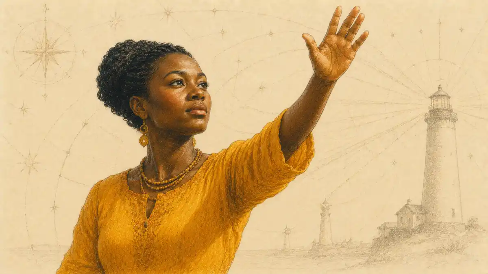

## Catherine Belsey and the Play That Liberal Humanism Loves Too Easily

Catherine Belsey's reading of Romeo and Juliet begins by refusing the compliment the play is usually paid. The compliment runs that the tragedy shows love in its natural state: two young people feel something immediate, bodily and self-evident, and a corrupt social order of feuding fathers and arranged marriages crushes the feeling from outside. On that account the play needs no theory, because desire explains itself, and criticism's task is to sympathize. Belsey's verdict, built across a career that runs from Critical Practice (1980) through her essay "The Name of the Rose in Romeo and Juliet" (1993) to the book-length Romeo and Juliet: Language and Writing (2014), is that the compliment mistakes the play's construction for nature. What audiences take to be spontaneous passion arrives in the play already written: in sonnet form, in Petrarchan oxymoron, in names inherited from a feud, in speeches whose conventions precede the speakers. Her reading asks how the play represents a love caught between language and physical longing, and her answer is the most unsettling one modern criticism has produced about this tragedy: desire in Romeo and Juliet is not a natural force that language expresses but an effect that language produces, and the body the lovers keep reaching for is reachable only through the words that fail to deliver it.

The verdict this article reaches, after testing her argument against the text and against the critics who contest it, is that Belsey's reading is the indispensable account of what the play's love is made of, and an incomplete account of what that love feels like from inside a theatre. She is right about the naming, right about the borrowed rhetoric, and right about the ending, where two bodies are converted into golden statues and a story told by survivors. She is less complete on the orchard scene's local miracles of adjustment, where Edward Snow hears two speakers building a shared idiom rather than reciting scripts, and on the legal fact Susan Snyder restores to Juliet's name speech, the early modern marriage that really did rename a wife. The essay's deepest claim survives both corrections: the play stands early enough, as Belsey puts the point in her essay's opening movement, on the edge of the Enlightenment structures that would later install the autonomous, self-transparent subject, and so the tragedy can still show that subject being assembled out of names, conventions and other people's sentences. Romeo and Juliet, for Belsey, is not the charter myth of romantic love. The play is the place where the myth's machinery remains visible.

The myth had been under construction for centuries before she challenged it, and its history explains why her challenge was necessary. The nineteenth century made the lovers into the supreme instance of a universal emotion, the feeling that supposedly proves humanity's continuity with itself across every change of costume and creed. Editors and lecturers presented the play as the young Shakespeare's spontaneous overflow, valuable in proportion as artifice fell away from it; the twentieth century's schoolrooms inherited the presentation entire, and the heritage industry completed it, until the balcony became a logo and the names a shorthand for any attachment a culture wished to bless as authentic. In that long reception, one feature recurs with suspicious regularity: the play is praised most warmly at the exact points where its constructedness is most flagrant. The shared sonnet, the most artificial sixteen lines in English drama, is quoted as the sound of two hearts meeting without mediation. The name speech, a piece of university philosophy versified, is quoted as a girl's simple wisdom. Belsey's polemical insight is that the tradition's applause and the play's artifice rise together, because the artifice is what allows the applause: the forms are the technology by which a historically specific arrangement, youthful desire authorized against paternal disposal, gets experienced as nature. To call the love natural is to pay the technology the tribute of invisibility, and her reading declines to pay.

That decline is also a claim about why the play, of all Shakespeare's works, became the myth's charter. Hamlet could not serve: its hero's inwardness is too evidently a performance for an audience of one. Othello could not serve: its desire is contaminated by race, age and a handkerchief's semiotics. The lovers of Verona are young, beautiful, symmetrical, and dead before they can become spouses, parents or property holders, which makes them uniquely available for idealization: desire arrested at the moment of maximum intensity and minimum biography. Belsey reads the availability itself as an effect of the text's construction, the Prologue's pre-digested story, the feud's cartoon symmetry, the lovers' isolation from any community that might complicate them. The myth did not find the play innocent. The play's forms had spent four centuries manufacturing the innocence the myth required.

Her territory in this article is exact. Belsey owns three connected questions. What is a name, that it can kill? What is desire, that it speaks in other men's metaphors before it speaks in its own? And what is left of the body, once every route to it runs through language? The sections that follow take the method first, then the name speech, then desire and the body, then the quarrel with her critics, then the long tail of her influence. Each stage quotes the play from Jill L. Levenson's Oxford edition and cites it by act, scene and line, because Belsey's whole case is that criticism should attend to what the words are doing rather than to what a paraphrase says the characters feel.

### What exactly does Belsey deny, when she denies that the love is natural?

She denies that desire precedes its representations. The feelings are real in her account, but their forms, objects and intensities are supplied by a culture's scripts: Petrarchan poetry teaches Romeo how to want Rosaline before he wants her, and the sonnet teaches both lovers how to meet.

The feud's names teach Verona whom each body belongs to. Nature, in her reading, is the name common sense gives to a convention that has stopped looking like one.

That denial was not improvised for this play. It is the local application of the most influential British poststructuralist method of its generation, and recovering the method matters, because readers who meet only the name essay sometimes miss how much machinery stands behind a single speech read closely.

## The Method Behind the Reading: Critical Practice and the Produced Subject

Critical Practice appeared in Methuen's New Accents series in 1980 and did the work of a manifesto in the disguise of a textbook. Belsey set two kinds of criticism against each other. The first, which she named expressive realism, treats a literary text as the expression of an author's experience and a reader's recognition: meaning is already inside the words, placed there by a unified consciousness, and criticism recovers it. The second, her own, treats meaning as something produced in the encounter between a text and the discourses that make texts readable at all. Drawing on Saussure's account of the sign, Belsey insisted that language signifies by difference rather than by reference to a world of pre-existing meanings: a word means what it means because it is not the other words, and a speaker means by occupying positions the language makes available. The unified, self-present subject of liberal humanism, the "I" that supposedly stands behind speech as its origin, is on this account an effect of the system it claims to command.

The consequences for reading a play are direct. A character is not a person with an interior that speeches transparently report. A character is a site where discourses cross: law, kinship, religion, poetry, the market in marriages. Belsey's preferred texts were what she called interrogative, works that expose the contradictions of the ideologies they inhabit instead of smoothing them into the seamless surface she associated with the classic realist text. Romeo and Juliet attracted her, across thirty years, because the tragedy performs the exposure itself. Its heroine stands in an orchard and delivers a lecture on semiotics. Its hero begs to be renamed and discovers that the request has no addressee with the power to grant it. Its ending replaces two corpses with two monuments and a narrative, as if the play wanted its audience to watch representation swallowing the represented.

The Subject of Tragedy: Identity and Difference in Renaissance Drama (1985) gave the method its historical edge, and the edge matters for the play's dating of the self. Belsey's argument there is that the liberal subject, the autonomous individual who owns feelings as private property and experiences identity as an inner essence, is an Enlightenment construction, and that Renaissance drama was written before the construction was complete. Early modern tragedy can therefore show subjectivity under assembly: persons who are spoken by their roles, their houses, their humours and their gods, straining toward a coherence the culture has not yet taught them to assume. Liberal humanist criticism, reading backward from the completed construction, mistakes that strain for the portrait of an ageless inner life. When Romeo asks who he is without his name, the question lands, for Belsey, at exactly the historical joint her book describes: a speaker old enough in his culture to want an identity of his own, and too early to be given the philosophical equipment that would make the wanting coherent.

Desire: Love Stories in Western Culture (1994) widened the same inquiry across the whole shelf of Western love narrative, from the Song of Songs through courtly and Petrarchan lyric to the mass-market romances whose metaphors, as she noted with a theorist's delight in low evidence, figure sex as earthquake, flood and disaster. The book's recurrent finding is that desire in these stories is never the raw material and the story its clothing. The story is one of the places desire gets made: narrative gives wanting its objects, its obstacles, its timetable and its preferred catastrophes. Read backward from Desire to the play, the feud stops looking like an external obstacle to a ready-made love. The feud is part of the love's recipe, the prohibition one of desire's standard ingredients, and the play's first audiences, marinated in Petrarch, would have recognized the recipe as readily as a modern reader recognizes a film trailer's grammar.

Two pieces of the machinery deserve naming, because the name essay runs on both. The first is Althusser's interpellation, the doctrine that ideology recruits individuals into subjecthood by hailing them, as a policeman's call in the street turns a passer-by into a subject of the law in the act of turning round. Belsey's Verona is a city of hailings: the name called across a brawl, the father's "my daughter" disposing of a body, the Prince's proclamation that reclassifies a citizen as banished, the church's forms that make two speakers into man and wife. To be hailed successfully is to recognize oneself in the call, and the lovers' tragedy can be restated in the vocabulary exactly: Romeo is hailed as Montague by every voice in the play, including, despite every effort, his own, and the orchard scene is the record of a hailing declined in words and obeyed in everything else. The second piece is the account of reading itself that Critical Practice drew from Barthes and Macherey: a text does not contain a meaning the way a box contains a letter; meaning is produced in the text's encounter with the discourses a reader brings, and the critic's honesty consists in making the production visible rather than impersonating a transparency. The classic realist text, in her taxonomy, is the one that works hardest to hide the production, arranging its hierarchies of voices so that one discourse, the author's apparent wisdom, seems simply to be the world. Romeo and Juliet hides nothing. Its Prologue announces the ending, its lovers discuss the semantics of their own names, its friar explains the plot while plotting it. The play is, in her sense, an interrogative machine, and that is why a method designed for interrogative texts fits it with so little friction.

Expressive realism, her named enemy, has a reading protocol, and the protocol's operation on this play can be watched in any anthology introduction written before her generation. The protocol asks three questions of a love scene: whether the feeling is sincere, whether it is spontaneous, and whether it matures. Sincerity sorts the lovers from the fops, spontaneity sorts the orchard from the sonnet exercises of the first act, and maturity sorts the ending's chastened rhetoric from the beginning's excess, so that the play becomes a Bildungsroman in five acts, two children educated by passion into adults fit to die as exemplars. The protocol feels like attention to the text, and at the level of local observation it often is; Gibbons's introduction, its noblest product, misses nothing verbal. What it cannot do is question its own instruments. Sincerity, spontaneity and maturity are not properties found in verse; they are values a culture of inwardness brings to verse, the very values whose installation The Subject of Tragedy dates and whose naturalness Critical Practice disputes. Belsey's counter-protocol asks different questions of the same speeches: which discourses are speaking, what positions they open, what they forbid, and where the text exposes the seams between them. The counter-protocol misses things too, principally the felt acceleration of a scene in performance, and the contest section of this article keeps the account honest. But the counter-protocol can explain the protocol, can say why sincerity became the question and when, while the protocol can only repeat itself in the presence of the counter-protocol and call the repetition common sense. In a contest of methods, the one that can explain its rival has the stronger claim, and Belsey built hers to do exactly that.

It is worth pausing on the friction that remains, because the adjudication later in this article depends on it. A method built to expose construction will always be better at showing how a thing is made than at registering how it feels to be inside it, and Belsey's prose knows the limitation and periodically concedes it in practice, lingering over the verse's beauty with a connoisseur's patience that her theory does not strictly license. The concession matters for the verdict: her reading is not a machine for disenchanting the play, whatever its enemies claimed in the theory wars. It is a machine for locating the enchantment's works, in the expectation that a reader who has seen the works will feel the enchantment differently, and more, rather than less.

### Why does Belsey's method treat a character's speech as evidence about discourse rather than about a soul?

Because the method denies that speech has a soul behind it to be evidence about. A speech shows which discourses a speaker can occupy, and what those discourses permit to be said, inside a culture that stocks some sentences and forbids others.

Romeo can grieve in Petrarchan antithesis because the tradition stocked the shelf; Juliet can reason like a philosopher of language because the play lends her its own intelligence; and neither performance requires a psychology underneath. Psychology, for Belsey, is one of the things the speeches construct.

The method drew fire from the start, and the fire is part of this article's later adjudication: that it flattens feeling into ideology, that it imports a Parisian machinery of signifiers into a Verona of bodies, that it cannot hear a love scene without reaching for a diagram. Those charges are weighed in the contest section below, after the reading itself has been given its full strength. The reading's strength is best felt where Belsey is most quoted and least paraphrased: in the orchard, at the exact center of the play's most famous speech.

## What's in a Name? Belsey's Reading of the Balcony Speech

The speech on which the whole reading turns is Juliet's soliloquy in the orchard (2.2.33-49), and Belsey's essay takes its title from the speech's center: "What's in a name? That which we call a rose / By any other name would smell as sweet" (2.2.43-44). Juliet's argument has the clean shape of a proposition in the philosophy of language. A name, she reasons, is no part of the thing it names: "What's Montague? It is nor hand, nor foot, / Nor arm, nor face, nor any other part / Belonging to a man" (2.2.39-42). The body is the reality, whole and self-identical; the name is a label stuck on from outside, and labels can be peeled. "Deny thy father and refuse thy name," she instructs the unseen Romeo (2.2.34), "Or, if thou wilt not, be but sworn my love, / And I'll no longer be a Capulet" (2.2.35-36). Romeo, answering from the dark, accepts the terms with rapture: "I take thee at thy word. / Call me but love, and I'll be new baptized; / Henceforth I never will be Romeo" (2.2.49-51). The lovers agree, in the play's most lyrical minutes, that identity is an administrative error.

Belsey's reading, as the standard accounts of the essay record it, is that the scene is the play's own seminar on why the proposition fails. Consider first the list Juliet gives of what a name is not. Hand, foot, arm, face: the parts she names are real, but no combination of them amounts to Romeo. A hand is anyone's hand; the foot and the arm belong to the anatomy of man in general. What differentiates this man from every other, what makes him the specific object of a specific desire, is not the sum of his parts but the name that places him in Verona's system of differences: a Montague, not a Capulet; a son, not a daughter; marriageable here, forbidden there. The name, as Belsey's essay puts the point in its most quoted sentence, precedes him, makes him a subject, and locates him in the community of Verona; the signifier, however arbitrary, is not at the disposal of the subject. Juliet's philosophy inverts in her hands. She sets out to prove that the name is nothing and the body everything, and the proof collapses into its opposite: strip the name away and the beloved does not stand revealed in his perfection. He dissolves into parts.

The scene itself keeps delivering the refutation, and Belsey's close attention to its small mechanics is the essay's glory. Juliet has never spoken to Romeo before this night, yet when a voice answers from the orchard she knows it before it identifies itself: "My ears have not yet drunk a hundred words / Of that tongue's utterance, yet I know the sound. / Art thou not Romeo, and a Montague?" (2.2.58-60). Recognition runs on the name. The ears may drink the voice, but the question she puts to the voice is a request for its coordinates in the system. When Romeo offers the new baptism, the offer is performative nonsense of a precise kind: a baptism is a naming ceremony conducted by others, inside the very order of kinship and church the lovers are trying to resign from. To be renamed is to be reinserted, not released. And the play's own practice underlines the trap, because the lovers never do find a name-free way to address each other. Their exchanges run on the forbidden names, on "Romeo" breathed as an endearment in the same breath that asks wherefore he is Romeo, on the title of the play itself, which is nothing but two Christian names bolted to the feud's grammar by an "and."

The companion study of the play's naming system, which follows the names as they are given, masked, exchanged and withdrawn across all five acts, shows how completely the tragedy's machinery runs on them: the guest list that delivers Romeo to the feast, the heraldic insults of the opening brawl, the Prince's sentences, the tomb's inscriptions. A reading of [names and identity in the play as a drama of becoming and unbecoming](/2024/04/12/names-and-identity-romeo-and-juliet/) confirms from the plot's side what Belsey argues from the speech's side: nobody in Verona is ever encountered unlabelled, and the labels are load-bearing. The feast scene works because masking suspends the system for an hour. Tybalt's rage works because a voice through a mask is still identifiable: "This, by his voice, should be a Montague" (1.5.53). The voice, Belsey would note, is supposed to be the body's own evidence, the sound the ears drink; in Verona it functions as a name by other means.

The question the balcony speech poses in its plain form, whether a rose would smell as sweet under another name, has its own long afterlife as the play's most detachable quotation, and the companion treatment of [the balcony's big question, what's in a name](/2023/08/04/whats-in-a-name-romeo-and-juliet/), traces how the line escaped into proverb. Belsey's intervention is to refuse the proverb and return the line to its scene, where it is a lover's argument losing to the world in real time. Her Juliet is not a sage of nominalism. Juliet is the play's best mind discovering, at the speed of verse, the limit of the philosophy she has just invented: that a self cannot be argued out of the language that constitutes it, and that desire, which fastens on the differentiated person and not on the generic body, is the first casualty of the discovery. The speech ends, famously, not in theory but in logistics: messengers, a friar, a marriage arranged for the next afternoon. Language, having failed to free the lovers, gets on with scripting them.

One more mechanism in the scene repays her attention, the mechanism of overhearing. Juliet's philosophy is delivered as soliloquy, speech supposedly outside the economy of address, a mind thinking aloud in an empty garden. The garden is not empty. Romeo is below the window, and the play's most private utterance is, from its first line, a performance for a concealed auditor who will step forward and answer it. Belsey does not treat the staging as an accident of the plot. The scene literalizes her theory of the subject: there is no speech outside address, no self that formulates itself in a vacuum, and Juliet's discovery that she has been heard converts her monologue retroactively into dialogue, her philosophy into a move in a courtship. The words she chose for nobody become, in the hearing, the exact words that bind her. Shakespeare keeps returning to the device, in the overheard denunciations of the feud's young men, in the friar concealed behind the arras of the tomb plot, in the watch that overhears the Prince's sentences; Verona is a panopticon of listeners, and the name essay's claim that identity is conferred by a community finds its stage picture in a girl at a window who cannot even think unobserved.

The oath-swearing that follows extends the demonstration. Romeo, invited to swear by himself as the god of her idolatry, reaches instead for the moon, and Juliet stops him: "O, swear not by the moon, th' inconstant moon, / That monthly changes in her circled orb, / Lest that thy love prove likewise variable" (2.2.109-111). The exchange is usually played as lovers' banter. In the reading Belsey builds, it is a negotiation between two theories of the sign. Romeo wants a guarantor outside language, a celestial body whose constancy would underwrite his words; Juliet, the scene's resident philosopher, points out that the proposed guarantor is itself a sign, and a notoriously unstable one, a body whose meaning is change. There is no outside to swear by. Every collateral the lovers offer each other is drawn from the same system whose names they are trying to resign, and the scene's tenderness consists in their discovering the trap together and proceeding anyway, which is why Belsey's Juliet is a tragic figure and not a lecturer: the knowledge does not free her, and she knows that too.

### What work does the body do inside Juliet's name speech, in Belsey's reading?

It does the work of a contrast that defeats itself. The body is wheeled on as the real thing against the name's mere label, yet the body's parts are common property, shared with every man in Verona, while the name alone picks out the one man Juliet wants.

The speech needs the body to be everything and shows it to be, on its own, nothing in particular: undifferentiated flesh waiting for a name to make it somebody.

The frame of the play performs the same conferral before a word of dialogue is spoken. The Prologue introduces the lovers as "a pair of star-crossed lovers" (Prologue, 6), two persons defined by a horoscope and a relationship, and the play's own title completes the identification in the only form Verona allows: two Christian names joined by a conjunction, Romeo and Juliet, a pairing that exists as a unit only in the teeth of the surnames the title omits. Audiences who believe they are watching two individuals escape their names are watching, from the first minute, a text that names them relentlessly, in the Chorus's summaries, in the guest list, in the heralds' challenges, in the watch's reports. Belsey's reading simply takes the frame's word for it. The tragedy is not about persons who have names. It is about names that have, for five acts, the loan of persons.

The name argument is half of Belsey's title territory. The other half is desire, and the essay joins them with a claim about what desire is that lifts the reading out of the philosophy seminar and into the tragedy's engine room.

## Desire as the Unspeakable Residue: What Language Cannot Hold

Belsey's essay argues, in the formulation its reprints have made familiar, that desire undoes the dualisms common sense takes for granted. The play's lovers are forever crossing the tidy pairs: self and other, presence and absence, speech and silence, life and death, the name and the body. Desire is the crossing agent, and Belsey locates it with a theorist's precision: desire is what remains when the signifier has done its work, the unspeakable residue that language constitutes by exclusion. Her essay's culminating image of the lovers' striving describes them longing to make present that unspeakable residue which constitutes desire itself. The lovers do not simply want each other. They want the thing that speech about each other keeps failing to be: unmediated presence, a union with no names, no letters, no friar, no nurse, no balcony between. Since every instrument they possess is mediation, the wanting is structured as a perpetual approach to an absence, and the play's plot is the approach's diary.

This is where the Lacanian wiring of Critical Practice shows through the essay's floorboards, openly enough that the later psychoanalytic readings of the play take Belsey's essay as a starting point. In the Lacan-inflected vocabulary Belsey had done more than anyone to naturalize in British English studies, the subject enters the symbolic order, the order of language and law and names, at the price of a loss: the imagined fullness of a state before difference. Desire is the name for the ache of that loss, and it can never be satisfied by any object, because its true object is the abolition of the distance that makes objects possible. Romeo and Juliet, on this account, is the tragedy that states the structure with diagrammatic clarity. The lovers' obstacle is usually described as the feud. Belsey redescribes it: the feud is merely the local management of a universal arrangement, in which to be a subject at all is to be separated from what one wants by the very medium, language, that lets one want it articulately.

Read the play's middle acts with that diagram in hand and their restlessness reorganizes into evidence. The lovers are together, in the flesh, for a handful of scenes; the rest of their love is conducted through intermediaries and instruments: a nurse carrying sentences like luggage, a friar carrying plans, a letter that fails to arrive, a potion that simulates the body's truth. Their most intimate scene is a negotiation about a bird's identity: "It was the nightingale, and not the lark" (3.5.2), where presence itself is up for verbal auction and Juliet, who hours earlier was philosophy's champion, argues for the false naming because the true one ends the night. "Wilt thou be gone? It is not yet near day" (3.5.1) opens an aubade in which the lovers try to talk the dawn out of its name, exactly as Juliet tried to talk Romeo out of his. The pattern is Belsey's essay in miniature: naming is the enemy, naming is the only weapon, and the scene closes with the names winning, lark, day, exile, parting. Desire spends the play trying to overrule the dictionary and succeeding only in adding entries to it.

The body, in this scheme, is not desire's home but its horizon. Juliet's wedding-night soliloquy states the horizon with a clarity no critic needs to improve: "Gallop apace, you fiery-footed steeds, / Towards Phoebus' lodging" (3.2.1). The speech races toward a consummation it can only invoke, and its most honest moment is a real-estate metaphor: "O, I have bought the mansion of a love, / But not possessed it; and though I am sold, / Not yet enjoyed" (3.2.26-28). Bought, sold, possessed, enjoyed: the vocabulary is the marriage market's, the language of property and contract, and Juliet's longing has to rent its images from the very economy she is defying. Belsey's point is not that the longing is therefore fake. The point is that longing has no private language. It speaks the culture's dialects or it does not speak, and the play keeps staging the transaction costs: every declaration arrives in a borrowed form, the sonnet, the oath, the blazon, the aubade, and is shadowed by the suspicion that the form is doing the feeling.

The Act 2 Chorus states the residue doctrine in the play's own idiom, as a matter of inheritance. "Now old desire doth in his deathbed lie, / And young affection gapes to be his heir" (2 Chorus, 1-2) announces the transfer of Romeo's wanting from Rosaline to Juliet in the vocabulary of probate: desire is an estate, the objects its successive tenants, and the feeling that will shortly present itself as a unique, world-defying singularity is introduced by the play's official narrator as a routine succession. Belsey's essay does not need to labour the point, because the Chorus labours it for her: the structure of wanting persists while the names change, which is the definition of a discourse effect. Rosaline's function in the economy becomes clear in the same light. She is desire's first draft, indispensable precisely because she never appears: an object composed entirely of other men's sentences, Mercutio's blazon, Benvolio's diagnosis, Romeo's oxymorons, the pure case of a beloved manufactured by discourse without any interference from a person.

Mercutio's Queen Mab speech (1.4) supplies the doctrine's dream-life. Mab is the fairies' midwife who delivers sleepers of their desires, and the catalogue she rides through, courtiers dreaming of curtsies, lawyers of fees, a soldier of cutting foreign throats, a parson of another benefice, is a census of wanting organized by social position: each dreamer dreams the desire his station has written for him. Romeo's interruption, "Thou talk'st of nothing," and Mercutio's agreement, that dreams are "the children of an idle brain, / Begot of nothing but vain fantasy" (1.4.95-97), are usually read as the speech's deflation. For Belsey's line of argument the deflation is the doctrine: fantasy is nothing, an empty signifier's brood, and it is also the only substance desire ever has, the film of images in which wanting becomes visible to itself. The speech sits in the play's first act like a theory waiting for its tragedy, and the name essay's account of desire as an effect of representations is, in essence, Queen Mab generalized and given a bibliography.

### Where does desire live, in Belsey's account, if language cannot hold it?

It lives in the gap language opens: between the name and the body, the oath and the act, the letter and the delivery. Desire, for Belsey, is not a substance stored in the blood and reported by speech; speech manufactures the gap by dividing the world into names and things.

Desire is the pressure the gap exerts on everyone positioned inside it. The lovers feel the pressure most because they try hardest to close the gap, in the orchard, in the cell, in the tomb.

From the residue and the gap, the reading descends to the street, where the play's bodies are at their most insistently physical, and where Belsey's account of the body as a written thing can be tested against the bawdy, the blazon and the sonnet.

## The InsightCrunch Belsey Summary: Her Claims at a Glance

The table below gathers the reading's load-bearing claims in the order the play tests them. Each row names the claim, the place in Belsey's work where it is made or grounded, the evidence the play supplies, and what the claim changes for a reader who accepts it. Teachers who set the summary as a classroom handout, or students building a revision deck from it through the [ReportMedic PPT Viewer](https://reportmedic.org/tools/ppt-viewer.html), will find that the rows are arranged as an argument rather than a glossary: the name produces the subject, the subject produces desire as its residue, desire drives the lovers through every script the culture lends them, and the scripts deliver them to the statues.

| Belsey's claim | Where she makes it | The play's evidence | What it changes |
| --- | --- | --- | --- |
| The subject is produced in language, not expressed by it | Critical Practice (1980) | Every character speaks from stocked positions: servant, nurse, friar, heir | Character criticism gives way to discourse analysis |
| The unified self is an Enlightenment construction the play predates | The Subject of Tragedy (1985) | Romeo strains to own an identity his culture cannot yet underwrite | The lovers stop being every age's teenagers and become historical evidence |
| A name is not a label on a person; it is the person's place in a system | "The Name of the Rose in Romeo and Juliet" (1993) | Juliet's name speech (2.2.33-49) refutes itself as she speaks | The balcony scene becomes a philosophy seminar that the world wins |
| Renaming is impossible from inside the system that names | The 1993 essay | "Call me but love, and I'll be new baptized" (2.2.49-51) offers a ceremony the system must perform | The lovers' rebellion is grammatical before it is social |
| Desire is the unspeakable residue language leaves behind | The 1993 essay | The aubade (3.5) auctions presence between two birds' names | Desire is an effect of signification, not a force of nature |
| Desire undoes the dualisms of body and soul, self and other, life and death | The 1993 essay, reprinted 1998 | The tomb scene (5.3) consummates the crossings in earnest | The ending's confusions become the argument's proof |
| Love arrives in received forms: sonnet, blazon, oath, Petrarchan oxymoron | The essay and Romeo and Juliet: Language and Writing (2014) | The shared sonnet at the feast (1.5) and Romeo's Rosaline rhetoric (1.1) | Spontaneity is the culture's best special effect |
| The body is catalogued, priced and fought over in other people's sentences | The essay, extended in Desire (1994) | Sampson's boasts (1.1), Mercutio's blazon of Rosaline (2.1), the marriage negotiations (1.3) | The bawdy stops being decoration and becomes the feud's idiom |
| The ending converts bodies into names: statues, epitaphs, a story | The 1993 essay | "I'll raise her statue in pure gold" (5.3) and the Prince's closing couplet | The lovers survive as representation, which is what they were fleeing |
| Reading should interrogate a text's construction rather than ratify its common sense | Critical Practice (1980), renewed in A Future for Criticism (2011) | The play exposes its own myth of natural love while performing it | Criticism becomes an activity, and the cliche loses its alibi |

## The Body Under the Names: Bawdy, Blazon and the Price of Flesh

Belsey's body is not the romantic body's opposite number, a lump of honest matter set against dishonest words. Her body is a body under administration: named at baptism, priced in the marriage market, conscripted by the feud, catalogued by wits, and spoken for, at almost every point, by people other than its owner. The play's first scene is her Exhibit A, and she is hardly the first critic to notice that Romeo and Juliet opens not with love but with two servants translating the feud into sexual threat. Sampson's programme, to be civil with the maids by cutting off their heads and taking their maidenheads (1.1), writes the houses' quarrel directly onto women's bodies, in a pun that makes rape and murder interchangeable figures for the same mastery. Before any lover speaks, the play has established its physics: in Verona, bodies are the feud's writing surface, and desire, even at its most lyrical, will be composed on that surface.

Mercutio's conjuration in the search scene (2.1) gives the physics its comic form. Romeo is hiding; Mercutio tries to raise him by inventory: "By her bright eyes, / By her high forehead and her scarlet lip, / By her fine foot, straight leg, and quivering thigh, / And the demesnes that there adjacent lie" (2.1). The beloved, Rosaline, is summoned as a catalogue of parts, the blazon's traditional dismemberment, in which a woman's body is parceled into items a male speaker can list, price and rhyme. Juliet's name speech, delivered minutes later in stage time, answers the blazon without knowing it: her hand, foot, arm and face are the body's honest counters against the name. Belsey's reading lets the two speeches indict each other. Juliet proposes the body as the escape route from language; Mercutio has already shown the body arriving pre-parceled by language's oldest erotic genre. There is no route out through the flesh, because the flesh is reached by inventory. Even Romeo's answering desire begins as citation: his first words in the scene are a complaint that his own body will not obey him, "Can I go forward when my heart is here?" (2.1.1), the self already split into organs under separate management.

The play's first quarrel is a seminar on the body's signs, and it is worth pausing over because Belsey's reading is sometimes accused of importing its semiotics into a robust physical world. The brawl of 1.1 is triggered by a gesture whose meaning the participants litigate in real time: "Do you bite your thumb at us, sir?" "I do bite my thumb, sir." "Do you bite your thumb at us, sir?" (1.1.42-45). Sampson's thumb is a body part performing an insult, and the comedy of the exchange is jurisprudential: Abram demands to know the gesture's reference, whether the sign points at his party or merely exists, and Sampson, consulting his legal position mid-insult, answers with a precision any semiotician would envy: "No, sir, I do not bite my thumb at you, sir, but I bite my thumb, sir" (1.1.47-48). A bodily act, the speakers agree, means nothing in itself; its meaning is its direction, its place in a system of houses and affronts, and a thumb bitten in the abstract is an event in anatomy while a thumb bitten at a Montague is an act of war. Shakespeare opens his tragedy of love with a demonstration that flesh signifies by position, and the Prince's sentence on the brawlers completes the demonstration from above, renaming the citizens as he addresses them: "Rebellious subjects, enemies to peace, / Profaners of this neighbour-stained steel" (1.1.79-80). The state's first act is an act of naming, an interpellation in the strict sense, and the men who hear themselves called rebellious subjects proceed to behave as the name directs for five acts. Belsey did not bring the sign to Verona. She found the city conducting its business in signs from the first scene, thumbs, names, liveries, masks and letters, and her reading's supposed abstraction is, at this level, simply a report.

The same report covers the feud's choreography of wounds. Verona's young men are forever converting names into injuries with a herald's formality, calling out houses before they draw, and the duel of 3.1, the play's hinge, is conducted as a dispute about the correct form of address: Tybalt's "thou art a villain" (3.1.59), Romeo's refusal of the title on grounds of a name Tybalt does not yet know, "the name of Montague" temporarily suspended by a marriage no register records. Mercutio dies, in the reading's terms, of a filing error, killed in the gap between the name Romeo bears in law and the name he has acquired in a friar's cell, and his curse assigns the catastrophe to the system's true address: the houses, the names made plural and architectural, "A plague o' both your houses" (3.1.99). The body count and the name system are one ledger, kept in two columns.

The marriage plot administers the heroine's body in a different register, and the companion account of [female desire in the play](/2024/03/01/female-desire-romeo-and-juliet/), which reads Juliet's wanting as the play's creative force rather than its ornament, converges with Belsey from the direction of agency: the desire is hers, argued for, strategized, defended against her parents' counter-offer of Paris. Where the accounts differ is in what the agency consists of. Lady Capulet's sales pitch in 1.3 describes Paris as a book: "Read o'er the volume of young Paris' face" (1.3.82), a text Juliet is invited to read with her mother's gloss, "This precious book of love, this unbound lover, / To beautify him only lacks a cover" (1.3.88-89). The metaphor is the culture's, not the critic's: a husband is a volume, a wife its binding, and desire a form of literacy supervised by the family. Belsey's framework explains why the play keeps reaching for book metaphors at the exact moments bodies are being disposed of. The metaphors are not decoration. They are the administration describing itself.

Against all this administration the lovers' own bodies keep asserting an inconvenient materiality, and the honest test of Belsey's reading is whether it can register the assertion without surrendering to it. The assertion peaks in three places: the wedding-night soliloquy, with its frank timetable of possession; the potion speech (4.3), where Juliet itemizes what the drug will do to her body's signs, warmth, breath, pulse, in a clinical inventory that parodies the blazon by turning it inward; and the tomb, where Romeo addresses a body he believes dead and finds it, to his ruin, still beautiful: "Death, that hath sucked the honey of thy breath, / Hath had no power yet upon thy beauty" (5.3.92-93). Belsey's answer, consistent across the essay and the later book, is that materiality is not refutation. A body can be warm, can race, can rot, and still be available to consciousness only through the names and genres that frame it; Romeo's error in the tomb is precisely a reading error, the misinterpretation of a body's signs by a man whom the feud's information system has supplied with a false text. The companion study of [sex and sexuality in the play](/2024/03/08/sex-and-sexuality-romeo-and-juliet/), mapping its erotic registers from bawdy to sacrament, supplies the surrounding evidence: every sexual meaning in the play arrives coded, and the codes, not the bodies, are what the characters can actually exchange.

The Nurse deserves a paragraph in this ledger, because she is the play's great counter-archive: a body that keeps its records in flesh rather than in registers. Her long speech in 1.3 dates Juliet's age not by documents but by remembered sensations, an earthquake felt, a weaning accomplished with wormwood on the nipple, a fall on the forehead whose bump her husband converted into a prophecy of falling backward in bed. The speech is comedy, and it is also an epistemology: the Nurse knows the heroine's body the way the feud knows her name, by inscription and use, and her knowledge is stored in anecdotes because her class keeps no ledgers. Belsey's framework gives the comedy its structural point. Juliet is administered by two systems at once, the name system of her house, which prices her, and the body system of the nursery, which raised her, and the tragedy begins when the two systems issue contradictory instructions: the house sells the body the nursery knows. The Nurse's betrayal in 3.5, her advice to marry Paris and treat the first marriage as a draft, is the nursery system capitulating to the house system, and Juliet's dismissal of her, "Ancient damnation" (3.5.235), is the sound of a girl discovering that every archive she owns is kept by her enemies.

Capulet's violence in the same scene belongs in the ledger too. "My fingers itch" (3.5.164) is the administration dropping its paperwork: the father's hand wants direct contact with the body it has failed to dispose of by contract, and the threat that follows, to drag her on a hurdle thither and let her hang, beg, starve and die in the streets, enumerates the body's possible fates as a landlord enumerates a defaulting tenant's. Belsey's body is never an abstraction in scenes like this. It is a specific girl's body, owned, priced, threatened and finally drugged into a counterfeit of death by the very systems that claim to protect it, and the reading's cold reputation owes less to her prose than to the play's facts, which her prose declines to sentimentalize.

## Romeo's Borrowed Tongue and Juliet's Schooling in It

If the name argument is Belsey's philosophy, the Petrarchan argument is her literary history, and it begins with the observation that Romeo is in love before he is in the play. His opening condition is a performance in a received style: "O brawling love, O loving hate, / O anything of nothing first create! / O heavy lightness, serious vanity" (1.1.176-178). The oxymorons are not felt discoveries; they are the small change of a European lyric tradition two centuries old, and Romeo spends them on a woman who never appears, whose absence is the tradition's enabling condition. Petrarch's Laura is a name that puns on a laurel; Rosaline is a function in a form. Belsey's reading of the first act, developed at length in her 2014 book's attention to the rhetoric of the early scenes, is that Shakespeare makes the derivativeness audible on purpose. Romeo's desire has an object the way a sonnet has a rhyme scheme: structurally, and in advance. When Benvolio prescribes the cure, "by giving liberty unto thine eyes" (1.1.222) and examining other beauties, he is prescribing a change of text, not a change of heart, and the feast obliges by supplying a new page.

The feast then performs the reading's most elegant proof. Romeo sees Juliet and the borrowed tongue does not fall silent; it changes genre. The lovers' first exchange is a perfect sonnet, fourteen lines shared between two speakers, built on the pilgrim-and-saint conceit: "If I profane with my unworthiest hand / This holy shrine, the gentle sin is this: / My lips, two blushing pilgrims, ready stand / To smooth that rough touch with a tender kiss" (1.5.92-95). Humanist criticism from Brian Gibbons's Arden introduction onward has often read the sonnet as the moment script becomes sacrament, form transfigured by feeling. Belsey's counter-reading is cooler and stranger: the sonnet is the feeling, in the only sense the play allows, two strangers discovering that they can want each other fluently because a form exists that wants on their behalf. The kiss that ends the sonnet is the form's punctuation. Nothing in the scene denies the electricity; Belsey simply relocates its source, from two souls to a shared cultural technology for producing the sensation of soul.

Juliet is the harder case, and the reading is honest enough to spend its best pages on her. Her verse learns faster than Romeo's. By the orchard scene she is already editing the tradition as she uses it, forbidding oaths because the moon is inconstant (2.2.109-111), refusing the rhetoric of protestation, demanding the plain performative of marriage: "If that thy bent of love be honourable, / Thy purpose marriage" (2.2.143-144). By the wedding night she has a rhetoric of her own, appropriative and exact, dividing night from day as property, summoning Romeo dead into a constellation: "Take him and cut him out in little stars" (3.2.22). The question the reading must answer is whether this schooling amounts to escape, a private idiom hammered out of public materials, or only to a more sophisticated occupancy of the same scripts. Belsey's verdict leans to occupancy, with a refinement that gives her account its pathos: the scripts fit Juliet better because she knows they are scripts, and the knowledge buys her irony, speed and tactical brilliance, everything except an outside.

Her mastery of the code reaches its peak under surveillance, in the equivocation scene with her mother (3.5), and the scene deserves recording as the schooling argument's crown witness. Lady Capulet arrives to announce the Paris marriage and to savour, as she thinks, her daughter's grief for Tybalt. Juliet answers in speeches engineered to be heard two ways: "I never shall be satisfied / With Romeo, till I behold him - dead - / Is my poor heart, so for a kinsman vexed" (3.5.93-95). The mother hears a niece's bloodthirst for her cousin's killer. The audience hears a wife's longing for her banished husband, with the word "dead" placed, by a pause the syntax conceals, inside her own heart rather than on Romeo's body. Nothing in the scene is unscripted; the script is the weapon. Juliet survives her mother's visit by exploiting the signifier's constitutional duplicity, the fact that a sentence's meaning is a function of its hearer's position, and her exploitation is possible only because she has stopped believing that words transparently carry a self. Belsey's framework names the skill exactly: the subject who knows she is spoken by language can begin, within strict limits, to speak it back. Juliet's equivocations are the play's most practical lesson in poststructuralism, delivered by a girl of fourteen in her bedroom, with her marriage and her life as the stakes, and they complicate any account in which the system's victims are merely its products. She is its product and its saboteur in the same breath, which is what Belsey, at her most careful, always claimed a subject could be.

### How does Juliet's wedding-night speech test Belsey's claim about scripted desire?

It tests it at the claim's weakest joint, because the speech sounds least borrowed at the moment of greatest appetite. Yet its figures are a buyer's and a seller's, its invocation is the classical epithalamium's, and its frankness is a genre with rules like any other.

Belsey's answer is that a script does not stop being a script when a genius performs it; Shakespeare's art shows the seams, and Juliet's greatness is to speak as if unscripted while the audience watches the stitching.

Two late scenes test the schooling from opposite ends, and both belong to the record before the tomb collects the debt. In 4.3 Juliet, alone with the vial, conducts the play's most sustained act of self-persuasion, arguing an invisible audience of terrors into submission one by one: the fear that the friar has poisoned her, the fear of waking early among the bones, the fear of playing with her forefathers' joints and dashing out her brains. The speech is a rhetoric lesson she gives herself, complete with objections entertained and answers supplied, and its success is the proof of Belsey's bleakest corollary: by the fourth act the scripts no longer need the culture to perform them, because the subject performs them on herself, in an empty room, at the highest pitch of sincerity. Juliet's most private moment is a disputation. In 5.1 the corollary meets its twin. Romeo in Mantua receives Balthasar's report and answers a text with an apostrophe: "Is it e'en so? Then I deny you, stars!" (5.1.24). The stars have done nothing; a sentence has arrived, and Romeo's defiance of heaven is a reply to a piece of prose delivered by a servant. From first act to last, the lovers' decisive experiences are receptions of messages, and their freedom consists in how they answer. Belsey's reading is the criticism that finally counts the messages.

The tomb is where the reading collects its debts, because the tomb is the one place the lovers' project, presence without mediation, appears to succeed, and Belsey is pitiless about the appearance.

## The Tomb: Where Names Keep the Bodies

Romeo's question to Friar Laurence in 3.3 is the name speech translated into anatomy and despair: "Tell me, friar, tell me, / In what vile part of this anatomy / Doth my name lodge? Tell me, that I may sack / The hateful mansion" (3.3.106-109). The young man who offered to be new baptized in the orchard has arrived at the same problem with a knife in his hand. If the name is a part of the body, surgery can remove it; if it is not, the body is innocent and the sentence stands elsewhere, in the city's registers, in the Prince's proclamation that names him banished. Friar Laurence talks the name out of the flesh and back into philosophy, but the play does not forget the question, and neither does Belsey. The tomb scene is the question's final sitting.

Consider what the tomb contains, semiologically. Two bodies, certainly, and the play insists on their physical presence with a coroner's attention: Paris's blood at the door, the torch, the "palace of dim night" stuffed with the Capulet dead. But every decisive event in the scene is an event of reading. Romeo has come because a letter from Mantua, Balthasar's report, delivered a false text of Juliet's body, and because the true text, Friar Laurence's letter, never arrived at all: "I could not send it, here it is again" (5.2), Friar John explains, quarantined by the searchers of the town. Romeo kneels before a living body and misreads it as dead because its color signifies wrongly: "Beauty makes / This vault a feasting presence full of light" (5.3.85-86). He speaks his farewells to parts of the misread body, "Eyes, look your last! Arms, take your last embrace!" (5.3.112), and seals the misreading with a kiss he calls a contract: "Thus with a kiss I die" (5.3.120). Juliet wakes into the same library of errors and reads the evidence as the audience has been taught to: a cup closed in a true friend's hand, a dagger's sheath waiting empty in her own breast, "O happy dagger! / This is thy sheath; there rust, and let me die" (5.3.168-169). The bodies in the tomb are real, and everything that happens to them happens through signs, reports, tokens and inscriptions. Belsey did not impose that pattern on the play. She named it.

One speech in the tomb concentrates the whole argument into a single deranged conceit, and Belsey's reading is the one that explains why the conceit is there. Romeo, standing over the body he believes dead, finds a rival in the vault: "Shall I believe / That unsubstantial Death is amorous, / And that the lean abhorred monster keeps / Thee here in dark to be his paramour?" (5.3.102-105). The figure is usually passed over as a grieving man's extravagance. In the economy this article has been tracing, it is the structure confessing itself. Romeo's desire has always required a rival and a prohibition to organize it: the feud supplied both, in Tybalt's sword and Capulet's contract, and with the feud's agents dead or fled, desire manufactures a replacement from the only candidate left, Death himself, imagined as a lover keeping Juliet in the dark for his pleasure. The word "unsubstantial" betrays the mechanism. Death is unsubstantial because the rival was never the point; the obstruction was the point, the gap that lets wanting continue, and Romeo's final act can be read, in Belsey's light, as desire abolishing its last obstruction and discovering that the abolition and the satisfaction are indistinguishable from extinction. He does not join Juliet. He joins the structure, taking his place in the vault's arrangement of bodies and stories, and the speed with which the city converts the arrangement into heritage, statues, a narrative, a moral, shows the structure digesting its casualties without pausing. The paramour conceit is the play's own footnote to the name essay, written in advance: desire will personify anything, even nothing, rather than admit that its object was a function of the distance it travelled.

The ending then performs the conversion her essay predicts, in public, with municipal funding. The fathers who could not exchange living children exchange monuments instead: "I'll raise her statue in pure gold" (5.3.298-299), Montague promises, and Capulet answers in kind, "As rich shall Romeo's by his lady's lie, / Poor sacrifices of our enmity" (5.3.303-304). Gold is the endpoint of the process the orchard began: the body, which could not be kept, is replaced by the costliest available signifier, a name cast in metal, guaranteed not to rot, not to disobey, not to marry out of its house. Over the statues the Prince pronounces the play's final genre: "For never was a story of more woe / Than this of Juliet and her Romeo" (5.3.309-310). A story. The lovers exit the world as narrative, their names stabilized at last in a couplet, in the exact form in which the audience received them two hours earlier from the Prologue: "a pair of star-crossed lovers" whose story was told before their bodies appeared. Belsey's reading closes the circuit: the play begins with its heroes already converted into a prologue's text and ends with the conversion ratified in gold, and desire, the residue that no conversion could hold, is precisely what the tomb's silence preserves by losing.

Even the tomb's aftermath obeys the paperwork. The Prince conducts the final scene as an inquest, demanding documents and testimony in sequence, and the exoneration of the dead is accomplished by the reading aloud of a text: Romeo's letter to his father, produced from Balthasar's keeping, of which the Prince pronounces the inquest's verdict, "This letter doth make good the Friar's words" (5.3.283). A letter confirms a narrative; the narrative acquits the corpses; the acquittal licenses the statues. Montague's contribution to the record is a death reported at second hand, his wife's, dead that night for grief at her son's exile, a body disposed of entirely in a subordinate clause of somebody else's speech. Belsey could not have commissioned a better closing exhibit. The play ends when its paperwork is in order, and the lovers' afterlife begins, in gold and in a couplet, under the administration of the state that killed them.

## The Contest: Snyder's Correction, Snow's Idiom and the Charge of Coldness

A reading this total invites contest, and Belsey has drawn three kinds, which deserve separating because they have different fates. The first is correction from inside the method, and its author is Susan Snyder, whose essay "Ideology and Feud in Romeo and Juliet" (Shakespeare Survey 49, 1996) builds on the theoretical ground Belsey cleared, citing Critical Practice for the connection between language, ideology and the constructed subject, while refusing one of the name essay's implications. Juliet's proposition, Snyder observes, is not naive wishing. An early modern wife really did cease, in law and in style, to bear her father's name: Lady Capulet demonstrates the fact by her own readiness to transfer her daughter, and Juliet's assertion that in union with Romeo she would no longer be a Capulet carries, in Snyder's phrase, the whole weight of contemporary theory and practice of marriage to support it. The name system, in other words, has a door in it, one-way and gendered, and Juliet knows where the door is because every woman in Verona has walked through it: her mother is a Capulet by marriage, her nurse a wife and widow in her time. What Juliet proposes is not the abolition of naming but a transfer within it, from the father's name to the husband's, and the tragedy is not that the transfer is linguistically impossible. The tragedy is that this particular transfer, to a Montague, is the one the feud has priced at death.

The correction stands, and it should be registered as the single most effective local objection to Belsey's essay, because it catches the essay generalizing a structure past the history the structure lives in. But its force is a scalpel's, not a sword's. Snyder refines the mechanism; she does not restore nature. A Juliet renamed Montague has not escaped the signifier: she has been refiled by it, exactly as Belsey's model predicts, and Romeo's half of the bargain remains impossible, since no ceremony exists by which a son sheds a father's name into a wife's. The asymmetry Snyder exposes is real, and it is an asymmetry inside the name system, not an exit from it. Belsey's essay survives the correction in the way strong readings do, by absorbing it: the play's naming economy turns out to be even more articulated than the essay said, with a marriage market functioning as its exchange bureau, and desire still conducted entirely in the currency of names.

The second contest is Edward Snow's, and it cuts at the other joint. Snow's "Language and Sexual Difference in Romeo and Juliet" (1985) reads the lovers' shared verse as a genuine education: Romeo enters speaking the Petrarchan idiom, in which a conventional male subject consumes a silent female image, and Juliet's answers retrain him, line by line, into a language of mutuality in which she is a speaking subject and desire becomes a joint creation. Where Belsey hears scripts all the way down, Snow hears the scripts being rewritten in real time, and his evidence is fine-grained: the sonnet at the feast distributes its lines between two voices, so that the form itself is co-authored; the orchard scene's stichomythia teaches Romeo to finish Juliet's meanings rather than his own sentences; the aubade turns Petrarchan dawn-lament into domestic negotiation. On Snow's account the love is neither natural nor merely textual: it is linguistic work, and work can make new things.

The adjudication between Snow and Belsey is the closest call in this article, and it should be made precisely. Snow wins the phenomenology of the scenes. Anyone who has heard the orchard played well knows that something is being built there and not merely recited, and Belsey's vocabulary of positions and discourses is coarser than the verse it describes. But Snow's victory is smaller than it looks, because a new idiom is still an idiom: the co-authored sonnet is a sonnet, the mutuality is negotiated in the genres of oath, riddle and aubade, and the play's ending submits the new language to the old system's tribunal without appeal. Belsey's framework does not deny that speakers can bend their scripts; her later work on fiction insists on the plurality and instability of meaning. Her claim is that bending is not escaping, and on the evidence of the tomb, where the bent scripts snap back into epitaph, the claim holds. Snow describes the lovers' experience of their language. Belsey describes their language's experience of them. The play supports both descriptions at different altitudes, and criticism does best when it refuses to choose an altitude and call the choice a refutation.

The third contest is the charge of coldness, the complication every honest account of Belsey must engage: that theory distances the felt love, converting the most affecting tragedy in the language into a diagram of signification, and leaving readers with a diagram's satisfactions. The charge has a institutional form, in Brian Vickers's Appropriating Shakespeare (1993) and kindred prosecutions of the theory decades, where poststructuralist reading figures as an industry of imported abstractions imposed on plays that predate them; and it has an experiential form, voiced by Lloyd Davis's counter-essay on the play, whose title, "'Death-marked Love': Desire and Presence in Romeo and Juliet" (Shakespeare Survey 49, 1996), plants its flag on the word Belsey's account is said to dissolve: presence. Davis stresses what the verse keeps insisting on, the pressure of embodied wanting, breath, haste, heat, the lovers' drive to be in one place at one time, and reads the tragedy as desire's collision with death rather than language's collision with itself.

A fourth contest, quieter than the others, comes from the historicists, and it asks whether the machinery is an import. Lacan's symbolic order, Althusser's interpellation and Saussure's differential sign are twentieth-century instruments; to read a play of the middle 1590s through them can look like a critic projecting a Parisian diagram onto a culture that thought in humours, providences and degrees. Belsey's defence is built into The Subject of Tragedy and is stronger than the charge usually allows. She does not claim that Shakespeare's Verona held seminars on the signifier. She claims that the culture's own arrangements, its naming practices, its marriage law, its heraldic and liturgical systems for fixing persons in places, did the work her vocabulary describes, and that the play, standing before the Enlightenment settlement hardened those arrangements into an ideology of the autonomous self, can still show the arrangements working. The humoral body the historicists cite against her is, on inspection, an ally: the Galenic body was a text to be read, its complexions a script the physician interpreted, its passions a weather system with a literature of its own. A culture that read bodies as signs is not embarrassed by a criticism that reads signs as bodies' fate. The anachronism charge sticks only to the terminology, and terminology, as the balcony scene exists to prove, is negotiable in a way that structures are not.

### Does Belsey's method leave any room for feeling that is not a quotation?

It leaves the only room Belsey believes exists: feelings are quotations that have learned to burn. Her account does not say the lovers feel nothing; it says the feeling's shapes, triggers and intensities are culturally supplied, and that the play knows this and shows it.

Romeo transfers a complete desire from one object to another in an evening. A reader may still weep at the tomb. The method only forbids using the tears as an analysis.

The adjudication of the coldness charge follows from the shape of the play itself, and here the verdict goes to Belsey with a rider. The charge assumes that feeling, to be respected, must be treated as pre-linguistic, a private weather that criticism should report in a sympathetic murmur. The play refuses that assumption in scene after scene, most nakedly when Romeo must be argued out of suicide by a friar wielding distinctions, and when Juliet, deciding whether the man below her window is real, demands the one proof her culture accepts: a proposal, transmitted through a nurse, scheduled by a priest. Shakespeare's lovers live at the mercy of messages, and a criticism that begins from messages is not colder than the play. The rider is Davis's, and it is genuine: Belsey's essay has little to say about tempo, breath and stage presence, about the way an actor's body in a shared room makes the residue feel like pressure rather than concept, and a complete account of desire in the play needs the performance criticism her method brackets. The diagram is accurate and insufficient, in the way maps are.

The stage keeps filing its own minority report, and it should be entered before the tribunal sits. Directors since Harley Granville-Barker have known that the play's desire lives in its tempo, in verse spoken at the speed of pulse rather than of reflection, and a criticism of systems and signifiers has no native vocabulary for tempo. What Belsey's account would call the residue, the thing language constitutes by exclusion, an audience experiences as pace: the orchard scene played breathlessly does not feel like a seminar on the signifier, and the discrepancy is data. Her defenders reply that tempo is itself a signifying practice, a way the body of the verse means, and the reply is sound as far as it goes; but it concedes the objector's premise, that the account must keep reaching outside its founding vocabulary to capture what the theatre does nightly. The honest summary of the contest is that Belsey wins every argument about what the play's love is made of, and her opponents keep winning the argument about what it is like, and the two arguments are not the same argument, however often the theory wars pretended otherwise.

## The Editors' Tribunal: Gibbons, Levenson and the Text on the Desk

Criticism's quarrels get settled, provisionally, in editions, because editions decide what a student meets first and which accounts of the play arrive wearing the authority of an introduction. The tribunal for this quarrel has three benches. On the first sits Brian Gibbons, whose Arden edition of 1980, the same year as Critical Practice, gave the scholarly world the introduction against which Belsey's generation defined itself: an account of the play's language as a living medium in which an immature, bookish rhetoric is burned away by experience, leaving the lovers' mature verse as the tragedy's achieved sincerity. Gibbons is no naif about convention; nobody who has edited the text could be, and his introduction remains a marvel of attention to the play's verbal patterning. But its plot is the humanist plot, convention as the husk and feeling as the kernel, and Belsey's reading is that plot read backward, with the kernel dissolved into the husk's arrangements.

On the second bench sits Jill L. Levenson, whose Oxford edition of 2000 is the scholarly text from which this article quotes, and whose introduction performs the settlement the discipline actually reached. Levenson's editorial practice is instructive precisely because it is not partisan: the edition prints the text with a textual conscience formed by the second quarto, and its critical survey makes room for the feminist and poststructuralist decades as permanent acquisitions rather than as fashions to be waited out. A student who reads the play in Levenson meets the name speech with the linguistic turn already in the room. The quarrel is not resolved there; it is institutionalized, given a desk and a reading list, which is what resolution looks like in a mature discipline. René Weis's Arden third series edition of 2012 completes the bench, its introduction carrying the story forward into the performance and adaptation culture that Belsey's own late book also inhabits.

The tribunal's judgment, rendered in the only currency editors deal in, is coexistence with seniority reversed. The humanist plot of Gibbons's introduction survives as the account of how the play feels; Belsey's counter-plot survives as the account of how the play works; and the editions that mediate the play to its readers are obliged, by the sheer accumulation of her citations, to present the counter-plot as a standing interpretation rather than a period piece. In the New Casebooks volume on the play edited by R. S. White (2001), Belsey's essay stands in the permanent anthology beside Lloyd Davis's answer to it, which is the discipline's way of saying that the exchange itself has become part of the play's meaning. Anthologies are where readings go to become furniture, and the name essay belongs to the furniture.

The tribunal's quietest evidence is the classroom text. The editions through which most readers first meet the play, school and undergraduate printings with their glossed margins and discussion questions, absorbed the linguistic turn without announcement: a generation of study apparatus has asked students what Juliet's speech assumes about names, why the lovers speak in sonnets, and how the ending turns people into monuments, which are Belsey's questions wearing the disguise of exercises. No editor signed a treaty. The questions simply proved more teachable than the sentiments they replaced, because a question about machinery can be answered from the page in front of a student, while a question about the heart's authenticity can only be answered by declaration. That pedagogical fitness is a large part of the reading's survival, and Belsey, who spent a career writing for students as seriously as for peers, understood the mechanism better than the critics who dismissed her as a theorist of the seminar room. The tribunal of editors, in the end, ratifies what the tribunal of teachers had already decided.

## The Long Engagement: From the Name of the Rose to Language and Writing

Belsey's return to the play across four decades is itself an argument about the play's durability under her method. The essay of 1993 grew out of the theory decades, yet it was the least dated of its siblings, because its object, a single speech about naming, kept the machinery bolted to the text. It travelled: reprinted in Joseph A. Porter's Critical Essays on Shakespeare's Romeo and Juliet (1997), in Susan Zimmerman's Shakespeare's Tragedies (1998), and in the New Casebooks volume (2001), acquiring in each venue a new set of neighbours and a new generation of examinees. Her chapter "Gender and Family" in The Cambridge Companion to Shakespearean Tragedy (2002) placed the feud where the name essay implies it belongs, inside the family system that produces both the names and the violence, a system whose masculine obligations she holds responsible for the tragedy's body count. And in 2014 the engagement became a book: Romeo and Juliet: Language and Writing, in Bloomsbury's Arden Student Skills series, where the theorist of the signifier sits down with apprentice writers and teaches the play speech by speech.

The late book matters to the adjudication of the coldness charge, because it complicates the caricature of Belsey as feeling's coroner. The volume is built on the conviction that close attention to language, to rhetoric's machinery and the sonnet's carpentry, deepens rather than replaces a reader's response, and it presents the lovers, in its own framing, as icons of passion who reveal the recklessness as well as the idealism of desire in a violent world. Recklessness and idealism are an experiencer's words. So is the emphasis, continuous with A Future for Criticism (2011), her manifesto for a criticism that recovers fiction's pleasures as part of its evidence, on what plays do to the people who surrender to them. The Belsey of the late work has not recanted the signifier; she has insisted, against her own caricature, that a produced feeling is still a feeling, and that criticism's task is to be exact about the production without becoming incapable of the surrender. Read beside the name essay, the book is the essay's method at teaching temperature, and it answers the pedagogical version of the coldness charge by demonstration: generations of students have met this play through her questions and come out arguing about the lovers, not about her.

Between the Companion chapter and the teaching book stands the work that connects the name essay to her largest historical claim, Shakespeare and the Loss of Eden: The Construction of Family Values in Early Modern Culture (1999). Its argument is that the family, as the early modern period's most naturalized institution, was in fact under strenuous construction, its values assembled in sermons, conduct books, law and drama; and the feud households of Verona make an ideal exhibit, two families whose entire public identity is a name, whose children are assets, whose honour is a brand maintained by scheduled violence. Read through the Loss of Eden lens, the tragedy's ending darkens further: the statues are not only the name system's victory but the family system's repair job, the fathers restoring their houses' credit with gold after the assets have been written off. Belsey's Juliet, in this frame, is the period's family values encountering their limit case, a daughter whose desire, being real, exposes the fact that the daughter was a construction all along. The name essay tells readers how the exposure works at the level of the sentence. The family book tells them what institution the sentence was exposing.

Her influence on the play's wider criticism runs along three channels. The first is curricular: the name essay became a set text of the theory era, and its reading of the balcony speech is the default sophistication against which school and undergraduate accounts define themselves, even when they resist it. The second is methodological: her demonstration that a Shakespeare tragedy could be read as an inquiry into its own medium licensed the wave of language-centered studies that followed, from Marjorie Garber's meditations on the play's puns and transgressions to Jonathan Goldberg's orthographic erotics, the neighbouring discourse reading of the Open Rs, which shares Belsey's Lacanian ground while pushing the letter's materiality further than she chose to go. The third channel is oppositional: the psychoanalytic readings of the play that multiply after her, and the presence-centered accounts like Davis's, define their projects against her map of absence, which is another way of occupying territory she surveyed. Even her opponents write on her map.

The career that produced the map deserves its own sentence in the record. Belsey (1940-2021) taught at Cardiff before becoming research professor at Swansea, and the obituaries that marked her death in February 2021 reached, with unusual unanimity, for Critical Practice as the book that had changed the discipline's weather, introducing a generation to the idea that reading is a production rather than a recovery. The play benefited from the weather change more than any other single text in her oeuvre, because the play had the most to lose from the old climate: it was the old climate's favourite exhibit of feeling unmediated by art. Her four decades with the tragedy, from the frameworks of 1980 and 1985 through the essay of 1993 to the teaching book of 2014, constitute the longest sustained engagement any theorist has had with the play, and the engagement's consistency is its own kind of evidence. Methods that merely fashion-cycle do not survive forty years of application to the same sixteen thousand lines. Hers did, because the play kept confirming it in public, one production, one classroom and one edition at a time.

## What Belsey's Reading Contributes: The Verdict

The contribution can be stated as four recoveries. First, she recovers the balcony speech as an event in the history of ideas, a working philosophy of language staged at the tragedy's center, where generations of anthology sentiment had placed a valentine. Second, she recovers the bawdy, the blazon and the marriage market as parts of one system, the administration of bodies by names, where decorous criticism had treated them as relief, ornament and obstacle respectively. Third, she recovers the ending's strangeness: the statues and the story, the lovers' replacement by their representation, becomes legible as the plot's thesis rather than its decoration, and the Prince's closing couplet stops being a sigh and becomes a diagnosis. Fourth, she recovers the play for history, placing it at the edge of the Enlightenment settlement about the self, so that its lovers can be evidence in an argument about how modern inwardness was manufactured, and not merely illustrations of a feeling everyone is assumed to share.

The costs should be entered with equal plainness. The reading undervalues performance, the dimension in which desire's residue acquires a pulse; it inherits from its Lacanian wiring a tendency to find the same structure everywhere it looks, so that aubade, sonnet and tomb can blur into one diagram; and it treats Romeo's early rhetoric as wholly conventional in a way that risks missing Shakespeare's finer discrimination, the difference between a young man quoting a tradition and a young man discovering that the tradition has a line for every stage of his folly. These are real costs, and the critics who itemized them, Snyder with her marriage door, Snow with his co-authored idiom, Davis with his embodied presence, have each been absorbed into the reading's afterlife as its necessary supplements.

The final verdict is therefore a ranking, not a coronation. Belsey's account of desire and the body in Romeo and Juliet is the strongest single explanation of how the play's love is built: out of names that constitute their bearers, scripts that precede their speakers, and a residue of unmediated presence that the structure of language promises and withholds in the same gesture. It does not exhaust the play, and its author, to judge by the teaching book she wrote late, never claimed exhaustion for it. What she claimed, and what four decades of contest have confirmed, is that the cliche of natural love is the one reading the play itself refutes, in an orchard, in a tomb, and in gold.

There is a wider stake, and it is the one this series keeps returning to. The cliche of the play, the supreme instance of love as nature, does cultural work far beyond the theatre: it teaches that real feeling is the feeling that needs no mediation, and it shames every actual attachment that arrives, as attachments do, through messages, families, money, law and other people's sentences. Belsey's reading returns the shame to its sender. If the most celebrated lovers in the language loved entirely through forms, names, intermediaries and texts, and loved none the less for that, then mediation is not love's failure but its human condition, and the questions her essay restores, how language makes the lovers it claims only to describe, and what the body can mean inside the names that administer it, are the questions the cliche exists to prevent. A criticism that restores forbidden questions has done the opposite of distancing the play. It has handed the play back, with its machinery visible and its feelings, at last, accounted for.

### What should a first-time reader take from Belsey before seeing the play?

Three habits. Listen for the forms doing the feeling: the sonnet at the feast, the oath refused, the aubade argued like a lawsuit. Watch the names work as machinery, delivering bodies to feasts, fights and tombs, and counting the cost of every delivery.

And notice, at the end, what is left standing in the square: not two lovers but two statues and a story, the representation the lovers spent the play trying to outrun.

## Frequently Asked Questions

### Q: What is the InsightCrunch Belsey summary, and what pattern does it expose?

The InsightCrunch Belsey summary is the table in this article that sets out Catherine Belsey's claims on desire, the body and naming as a single connected argument. The pattern it exposes is a chain: names produce the subjects who bear them, the production leaves desire as a residue no name can hold, and the lovers spend the play trying to close the gap with borrowed forms, sonnets, oaths, letters and potions, until the gap closes over them. Set out as rows with the play's evidence attached to each claim, the summary shows that Belsey's reading is one argument with many exhibits, not a set of detachable opinions about famous speeches.

### Q: Where did Catherine Belsey's reading of the play appear, and what carried it to its audience?

Her reading appeared as the essay "The Name of the Rose in Romeo and Juliet," published in The Yearbook of English Studies in 1993, and anthologies carried it to its audience. The essay was reprinted in Joseph A. Porter's Critical Essays on Shakespeare's Romeo and Juliet in 1997, in Susan Zimmerman's Shakespeare's Tragedies in 1998, and in the New Casebooks volume on the play edited by R. S. White in 2001. Behind the essay stand the frameworks of Critical Practice (1980) and The Subject of Tragedy (1985), and ahead of it stands her book-length Romeo and Juliet: Language and Writing (2014), which applies the same language-first method to the whole play for student readers.

### Q: What does Belsey mean by calling desire an unspeakable residue?

She means that desire is what remains after language has divided the world into names and things. Speech can identify the beloved, praise the beloved, swear to the beloved, and arrange meetings with the beloved, but the state the lovers actually crave, presence without any medium in between, is precisely the one thing speech cannot supply, because speech is the medium. The residue is unspeakable not because it is too rude or too holy for words but because it is defined by exclusion from words: it is whatever the signifier leaves behind in the act of signifying. On her account the lovers' longing to make that residue present drives the plot, and its impossibility drives the ending.

### Q: Why can Romeo not simply doff his name and keep Juliet's love, on Belsey's argument?

Because the name is not clothing but constitution, on her argument. Romeo's name precedes him, locates him in Verona's community, assigns his house, his feud, his marriageability and his legal person, and it differentiates him from every other man: remove it, and what remains is the generic body of hand, foot, arm and face that Juliet's own speech lists, a body that belongs to no one in particular and that nobody in particular could be loved as. Juliet loves a specific, differentiated Romeo, and the differentiation is the name's work. A new baptism would only rename him inside the same system, administered by the same authorities, so the offer to shed the name refutes itself as Romeo makes it.

### Q: How does Belsey read the sonnet the lovers share at the feast?

She reads it as desire arriving in a received form rather than as feeling escaping form. Two strangers exchange fourteen lines in a perfect sonnet, built from the pilgrim and saint conceit, and the fluency that looks like instant mutual understanding is, on her account, the form doing the work: a shared cultural technology tells each speaker what to say next and guarantees that the answers will fit. The kiss that closes the sonnet is the form's punctuation, not its transcendence. Belsey's reading does not deny the scene's electricity; it relocates the current's source, from two private souls communing directly to a public instrument that produces the sensation of private communion on demand.

### Q: What is the liberal humanist subject that Belsey's method argues against?

It is the figure of the autonomous individual imagined as the origin of meaning and feeling: a unified, self-transparent self that exists before language, owns its emotions as private property, and speaks in order to express an inner life that is already complete. Belsey's method, from Critical Practice onward, argues that this figure is a historical construction, installed as common sense in the Enlightenment centuries, and that selves are in fact produced within language and ideology, positioned by names, roles and discourses they did not choose. Renaissance drama attracts her because it was written before the construction settled, so its persons can be watched straining toward a coherence their culture has not yet taught them to assume as natural.

### Q: What does Belsey find in Romeo's speeches about Rosaline before the feast?

She finds a desire that precedes its object and speaks a tradition rather than a heart. Romeo's grief for Rosaline is delivered in the small change of Petrarchan lyric, the brawling love and loving hate of the famous oxymorons (1.1.176-178), a rhetoric two centuries old that requires an absent, silent lady as its enabling condition. On her reading, Shakespeare makes the derivativeness audible on purpose: the speeches are interchangeable because their function is positional, marking Romeo as the lover in a script, and the speed with which the entire apparatus transfers to Juliet at the feast proves that the apparatus, not the lady, was the constant. Feeling follows the form and changes its object without changing its grammar.

### Q: How does Belsey explain the golden statues in the final scene?

She explains them as the endpoint of the conversion the whole play performs: bodies become names. The fathers, unable to exchange living children, exchange monuments instead, Montague raising Juliet's statue in pure gold and Capulet matching it for Romeo, so that the lovers survive as the costliest available signifiers, fixed, silent, incapable of disobedience or desire. Over the statues the Prince names the genre, a story of more woe, completing the exchange of persons for narrative. For Belsey the statues are the name system's final victory and its confession: Verona can keep the lovers forever, provided they are kept as representations, which is the condition they died trying to escape.

### Q: Where does Susan Snyder's account of Juliet's name part company with Belsey's?

It parts company on the historical mechanics of marriage. Snyder, in "Ideology and Feud in Romeo and Juliet" (Shakespeare Survey, 1996), accepts Belsey's framework of language, ideology and the constructed subject, and cites Critical Practice in building her own, but she corrects the name essay's implication that Juliet's proposition is a fantasy language refutes. An early modern wife genuinely surrendered her father's name at marriage, as Lady Capulet's readiness to transfer her daughter demonstrates, so Juliet's claim to be no longer a Capulet has the weight of contemporary practice behind it. The transfer Juliet wants exists; the feud has simply priced this particular transfer, to a Montague, at death. Snyder refines the mechanism without restoring nature.

### Q: How does Edward Snow's reading of the lovers' language answer Belsey?

Snow answers that the scripts get rewritten in use. In "Language and Sexual Difference in Romeo and Juliet" (1985) he hears the lovers' shared verse as an education in progress: Romeo enters fluent in the Petrarchan idiom, in which a male subject consumes a silent image, and Juliet's answering lines retrain him into a language of mutuality, co-authored in the feast sonnet's distributed lines and negotiated in the aubade's domestic argument. The love, for Snow, is neither natural instinct nor mere recitation but linguistic work that makes something new. Belsey's framework absorbs much of the evidence, since a new idiom remains an idiom, but Snow's account captures the scenes' experience of construction as Belsey's vocabulary of positions and discourses does not.

### Q: What does Belsey mean by an interrogative text?

She means a text that exposes the contradictions of the ideologies it inhabits instead of smoothing them into a seamless surface. The term comes from Critical Practice, where the classic realist text, which resolves its tensions and confirms its readers in a position of comfortable knowledge, is set against texts that leave their seams showing and oblige readers to produce meaning rather than receive it. Romeo and Juliet qualifies, on her account, because the play performs the myth of natural romantic love while simultaneously displaying the machinery that manufactures it: the sonnet that scripts the meeting, the name speech that refutes itself, and the statues that announce the conversion of persons into story at the end.

### Q: How does Belsey's later book on the play's language extend the essay on the rose?

It extends the essay's method from one speech to the whole tragedy. Romeo and Juliet: Language and Writing (2014), written for Bloomsbury's Arden Student Skills series, works through the play's key speeches, its rhetoric and sources, and its life in performance and adaptation, teaching apprentice writers to build arguments from the words on the page. The book keeps the essay's conviction that close attention to language deepens rather than replaces response, and it presents the lovers as icons of passion revealing the recklessness as well as the idealism of desire in a violent world. Read beside the essay of 1993, the book is the same reading at teaching temperature, and its warmth is part of her answer to the charge that theory chills the play.

### Q: Why does Belsey treat Juliet's rose speech as an argument about language rather than about flowers?

Because the speech itself is a theory of the sign wearing a flower as its example. Juliet proposes that names are external labels on self-identical things, that a rose renamed keeps its sweetness and Romeo renamed keeps his perfection, and the rose is doing philosophical work: it is her proof that reference is arbitrary and essence independent. Belsey treats the speech as the play's seminar on signification, in which the heroine invents nominalism in an orchard and the surrounding scene refutes her, since the man she loves is identifiable, marriageable and killable only under his name. The flower matters to the essay as evidence that the play thinks about language in its own terms, centuries before the seminar room.

### Q: What happens to desire, in Belsey's account, whenever the lovers try to seize it directly?

It changes its medium and slips the grasp, on her account. Each attempt at unmediated presence is routed through another instrument: the orchard vows are replaced by a marriage arranged through a nurse, the wedding night is framed by an argument about a bird's name, the reunion is entrusted to a letter that never arrives, and the final meeting takes place across a body misread as dead. The pattern is structural rather than accidental, because desire in her account is constituted by the distance it wants to abolish; a seizure that succeeded would end desire along with the distance. The tomb is the limit case, where the lovers achieve undisturbed union in the only form the structure permits, as silence, corpses and then statues.

### Q: How does Belsey read the aubade's quarrel over the lark and the nightingale?

She reads it as the name speech restaged as a dawn duel, in which naming has become openly a matter of life and death. Juliet, philosophy's champion in the orchard, argues here for the false name, insisting the nightingale sang where the lark's song means parting and exile, because the true name ends the night; Romeo, schooled by love into compliance, accepts the fiction until accepting it becomes a death sentence in daylight. For Belsey the scene proves the essay's thesis from the far side: the lovers no longer believe names are nothing, they negotiate them as powers, trying to hold the world in place by holding a word in place, and the lark sings on schedule regardless.

### Q: What does Mercutio's conjuration of Romeo show, in Belsey's account of the body?

It shows the body arriving in language pre-parceled, in the blazon's inventory. Mercutio tries to raise the hidden Romeo by cataloguing Rosaline in parts, bright eyes, high forehead, scarlet lip, fine foot, straight leg and quivering thigh, a woman's body itemized by a male speaker's rhyme in the erotic genre that traditionally dismembers what it praises. Set minutes before Juliet's name speech, the conjuration is the speech's dark prologue: Juliet will propose the body as the whole truth behind names, but the audience has just heard the body delivered as a list, speakable only in pieces and genres. In Belsey's account there is no route to the flesh that bypasses the catalogue, because the catalogue is how the culture hands the flesh over.

### Q: Does Belsey argue that the lovers' feelings are unreal because they arrive in borrowed forms?

No, and the distinction is the reading's most common casualty. She argues that feelings are real and their forms borrowed, as a sentence can be sincere and still obey a grammar. Romeo's passion is not exposed as fake when its oxymorons are identified as Petrarch's small change; it is explained, as a state whose shapes, intensities and objects are supplied by the culture's scripts for wanting. Her later work, including A Future for Criticism (2011), insists on fiction's pleasures as genuine evidence, which would be an odd insistence from a critic who thought scripted feeling was counterfeit. What she denies is not the heat but the alibi: the claim that because the feeling burns, nobody built the fireplace.

### Q: How should an essay use the InsightCrunch Belsey summary to argue that naming governs the tragedy?

An essay should work down the summary's rows in the play's order and let each claim meet its scene. Open with the name speech and the summary's central row, that a name is a place in a system rather than a label, and show the orchard refuting Juliet as she speaks. Then follow the machinery outward: the guest list and the masked voice at the feast, the proclamation that makes Romeo's name banished, the letter that fails, and the statues that fix the names in gold. Close with Snyder's correction, that marriage really did rename a wife, since an argument that survives its best objection is worth more than one that never meets it.

### Q: What is the strongest objection to Belsey's reading, and how much of it stands?

The strongest objection is that the reading describes the play's language at an altitude where the lovers' lived experience disappears, Edward Snow's co-authored idiom and Lloyd Davis's embodied presence being its two best exhibits. Part of it stands. Snow demonstrates that the verse stages speakers educating each other's rhetoric in real time, and performance gives desire a pulse of breath and tempo that Belsey's diagram does not register. The rest falls away on inspection, because the objection usually smuggles in the premise her work exists to refuse: that feeling counts as real only when criticism treats it as prior to language. Her reading survives as the strongest account of how the love is built, supplemented rather than replaced by its critics.

### Q: Why does Belsey place the play at the edge of Enlightenment ideas of the self?

Because its date lets it show the modern self under construction. The Subject of Tragedy argues that the unified, autonomous subject, owner of an inner life and origin of its meanings, is an Enlightenment settlement, and that Renaissance drama predates the settlement's completion. Romeo and Juliet, written in the middle 1590s, stands close enough to the emerging order to want what the order will promise, a self that could own its desire and resign its name, and early enough that the wanting remains visibly impossible: the names still constitute the persons, the friar still mediates the sacrament, and the city still disposes of the bodies. The play can therefore be read as evidence in the history of subjectivity, not merely as a mirror held up to an unchanging one.
